# 麦克风阵列信号处理 · 从入门到工业实践

🌐 **简体中文** ｜ [English](README_EN.md)

一套面向初学者、算法研究者与音频系统工程师的中文开源系统教程。从球面几何、复相量时频、子空间代数与统计估计预备出发，完整推演**声源定位、波束形成、回声消除、盲去混响、语音分离与多目标追踪**六大核心算法，再落地到真实硬件的时钟同步、延迟预算、选型验收，以及**声学成像、分布式无线阵列、全景声可穿戴阵列与条件目标提取**四篇前沿专题。

**[在线进入交互式课程站 →](https://nanless.github.io/microphone-array-tutorial/)** · **[▶ 零安装 4 麦波束实验室](https://nanless.github.io/microphone-array-tutorial/assets/readme/lab/array-lab.html)** · **[🔊 15 麦真实房间试听](https://nanless.github.io/microphone-array-tutorial/site/#course-cases)** · **[全书合订本 PDF](dist/microphone-array-tutorial.pdf)** · [第 0 章数学基础](chapters/00_math-foundations.md) · [全书导读目录](chapters/00_overview.md) · **[English Edition (Web / PDF / Docs)](README_EN.md)**

**16 章正文 · 2 篇附录 · 360 道可运行练习 · 87 张编号图** · **283 段配套 WAV 音频** · **129 个上游 Git 项目来源索引**

最新版本包含双语 PDF、逐章 HTML 网页包和复算资料。 [查看发布说明与下载](https://github.com/nanless/microphone-array-tutorial/releases/latest)

<picture>
  <source media="(prefers-reduced-motion: reduce)" srcset="assets/readme/course-cover-still.svg">
  
</picture>

---

## 为什么需要多支麦克风？六大核心问题一览

单支麦克风只能记录声压随时间的一维起伏，目标人声、旁向干扰、墙面混响和设备自身喇叭的回声全部叠在同一条波形里。当多支麦克风同步采样时，声波到达各阵元的**微秒级时间差、跨通道相位关系与播放参考信号**为系统提供了可解耦的物理线索：

| 核心模块 | 解决什么实际痛点 | 依赖的物理线索与代表算法 | 交付输出与直达章节 |
| --- | --- | --- | --- |
| **声源定位（DOA）** | 说话人在哪个方向？多径反射下为何会指错？ | 麦间到达时差与子空间正交性：GCC-PHAT、SRP-PHAT、MUSIC、ESPRIT | 方位角或空间坐标 · [第 4 章](chapters/04_doa-estimation.md) |
| **波束形成（Beamforming）** | 怎样无失真保留目标方向人声，同时压低旁向噪声？ | 导向矢量无失真约束与干扰协方差逆加权：DSB、超指向、MVDR、LCMV、GSC、MWF | 增强后的单路或双耳音频 · [第 5 章](chapters/05_beamforming.md) |
| **声学回声消除（AEC）** | 全双工通话中，怎样干净减除设备自己播出的声音？ | 同步播放参考回采与分块频域自适应：NLMS、PBFDAF、APA、FDKF、双讲冻结 | 减除耦合回声后的近端语音 · [第 6 章](chapters/06_aec.md) |
| **盲去混响（WPE）** | 没有干净参考信号时，怎样削弱房间多次反射拖尾？ | 跳过保护间隔 $\Delta$ 的多通道延迟线性预测与时变方差加权：离线/在线 WPE；另介绍基于已知多通道路径的 MINT 逆滤波 | 压低晚期混响的清晰语音 · [第 7 章](chapters/07_wpe-dereverberation.md) |
| **语音分离（Separation）** | 多人同时抢话（鸡尾酒会问题）时怎样拆成独立音轨？ | 非高斯跨频共变、活动先验与时频掩码：IVA、ILRMA、GSS、PIT、连续流拼接 CSS | 分离后的多路说话人音轨 · [第 8 章](chapters/08_speech-separation.md) |
| **声源追踪（Tracking）** | 说话人边走边说、停顿静默时，怎样稳住自适应波束？ | 状态空间贝叶斯递推与数据关联：Kalman、粒子滤波、IMM、轨迹确认与退役状态机 | 连续平滑的角度轨迹与不确定度 · [第 9 章](chapters/09_source-tracking.md) |

---

## 本书的四个核心特点

- **不跳关键步骤的数学闭环**：专门设立[第 0 章《全书数学基础与信号分析预备》](chapters/00_math-foundations.md)，从零推导三维旋转 $\mathrm{SO}(3)$、复相量与 STFT 完美重建（COLA）、子空间投影与 Woodbury 秩一更新、Wirtinger 复变求导、复高斯 CRLB 与维纳—卡尔曼递推；正文每条公式均配物理直觉与成立前提。
- **360 道手算锚点 + 纯 NumPy 复算**：拒绝黑箱调库，核心算法均提供无第三方重依赖的纯 NumPy 实现与小规模精确分数手算例（如 2 麦 4 点 DFT、3 麦距离气泡、2 格反卷积），方便逐元素核对共轭符号、归一化系数与矩阵维度。
- **283 段配套音频 + 专讲“什么时候会失效”**：除正常增益效果外，配套 31 套独立专题音频（连同主清单共 32 套、283 段受控合成音频与真实混响录音），专门重现**高频空间混叠栅瓣、强相干反射假峰、导向失配目标自消、低频差分白噪声放大、AEC 参考超窗/双讲发散、100 ppm 晶振频偏（SRO）抵消**等典型工程失效现场。
- **从仿真脚本直通量产硬件与开源生态**：[第 10 章](chapters/10_engineering-practice.md)与[第 11 章](chapters/11_selection-guide.md)逐项核算级联拓扑、端到端延迟路径、定点动态范围、每秒乘加数（MACs）与帕累托验收规格书；另配 [6 篇源码研究手册](codes/chapters/ch00/research/README.md)，对照 WebRTC AEC3、SpeexDSP、nara_wpe、Acoular、pyroomacoustics 等 129 个上游项目。

---

## 先听为快：两个无需安装环境的在线实验

1. **[15 麦真实混响房间定位与 MVDR 波束对比](https://nanless.github.io/microphone-array-tutorial/site/#course-cases)**：基于公开基准数据集 LOCATA 的真实房间多通道录音，在线切换说话人 A / B 查看 SRP-PHAT 空间扫描谱峰（估计 35° 对光学真值 34.4°），并同步跳转试听“单麦原始录音 vs 15 路延迟求和 vs MVDR 加后滤波”（相对延迟求和，B 单讲评分段的 300–3400 Hz 录音总能量低 **12.9 dB**，A 单讲评分段低 **1.5 dB**）。
2. **[四支麦，听哪边？零安装浏览器波束实验室](https://nanless.github.io/microphone-array-tutorial/assets/readme/lab/array-lab.html)**（离线说明见 [`assets/readme/lab/`](assets/readme/lab/README.md)）：在网页中实时切换单麦、对准左边 A 与对准右边 B，再把右侧干扰一键切成 **250 Hz 低音**——直观听见并算清为什么同一组采样时差能把高频干扰压到 **0.01% 以下**，面对长波长低频干扰却残留 **82.1% 功率**。

---

## 全书 19 篇结构与选读路线

| 模块 | 章节范围 | 核心内容 | 快速入口 |
| --- | --- | --- | --- |
| **导读与数学底座** | 导读、第 0～3 章 | 学习路线图、全书预备数学推导、信噪比与双耳线索、远近场传播与 STFT 空间协方差、线/圆/球/嵌套稀疏阵几何极限 | [导读](chapters/00_overview.md) · [第 0 章数学](chapters/00_math-foundations.md) · [第 1 章](chapters/01_problem-definition.md) · [第 2 章](chapters/02_basics-signal-model.md) · [第 3 章](chapters/03_array-geometry.md) |
| **六大核心算法** | 第 4～9 章 | DOA 定位、固定/自适应/神经波束形成、线性与混合 AEC、WPE 去混响、盲分离/GSS/CSS 分离、多目标贝叶斯声源追踪 | [04 定位](chapters/04_doa-estimation.md) · [05 波束](chapters/05_beamforming.md) · [06 AEC](chapters/06_aec.md) · [07 WPE](chapters/07_wpe-dereverberation.md) · [08 分离](chapters/08_speech-separation.md) · [09 追踪](chapters/09_source-tracking.md) |
| **实时工程与选型** | 第 10～11 章 | 前端级联与参考取点、SRO 时钟同步、通道标定与坏麦降维、定点算力功耗预算、四类终端帕累托选型与可执行验收规格书 | [10 工程实现](chapters/10_engineering-practice.md) · [11 选型与验收](chapters/11_selection-guide.md) · [在线工程面板](https://nanless.github.io/microphone-array-tutorial/site/#course-engineering) |
| **四篇前沿专题** | 第 12～15 章 | 工业声学相机反卷积成像（DAMAS/CLEAN-SC）、低带宽分布式无线协同（DANSE）、全景声与 TWS/助听器可穿戴微阵列、条件目标说话人提取与多通道会议日志（距离气泡/TS-VAD） | [12 声学成像](chapters/12_acoustic-imaging.md) · [13 分布式阵列](chapters/13_distributed-enhancement.md) · [14 可穿戴阵列](chapters/14_spatial-wearable-arrays.md) · [15 目标提取与日志](chapters/15_target-extraction-diarization.md) |
| **速查与排错附录** | 第 16～17 章 | 全局统一符号表、中英术语词典、紧凑公式速查；研究生文献与挑战赛地图、全链路故障排查树与跨章综合实验 | [16 附录 A：符号与公式](chapters/16_appendix-symbols-math.md) · [17 附录 B：排错与练习](chapters/17_appendix-guide.md) |

- **零基础入门读者**：建议按 `第 0 章（或按 §0.8 检索）→ 第 1～3 章 → 第 4～5 章` 顺序阅读，边读边跑每章末尾的纯 NumPy 练习。
- **算法与科研读者**：可从[第 0 章 §0.8 数学检索表](chapters/00_math-foundations.md#08-全书各章数学工具按需检索总表)与第 2 章统一记号切入，直奔第 4～9 章、第 12～15 章及[附录 B 文献挑战赛地图](chapters/17_appendix-guide.md#172-领域地图教材会议期刊与挑战赛)。
- **音频硬件与嵌入式工程师**：可直接阅读[第 10 章工程实践](chapters/10_engineering-practice.md)、[第 11 章选型指南](chapters/11_selection-guide.md)、[附录 B 故障排查表](chapters/17_appendix-guide.md#174-常见问题与调试指南)与[工业部署源码手册](codes/chapters/ch00/research/03_industrial_deployment.md)。

---

## 本地运行与复算验证

克隆仓库并安装轻量基础依赖（核心教学练习仅依赖 `numpy`、`matplotlib` 等基础科学计算包，无需 GPU）：

```bash
git clone https://github.com/nanless/microphone-array-tutorial.git
cd microphone-array-tutorial
python3 -m venv .venv
.venv/bin/pip install -r requirements.txt

# 运行第 0 章 16 道全书数学基础核验题（E00-01 ～ E00-16）
.venv/bin/python -m codes.chapters.ch00.chapter00_exercises

# 运行第 2～5 章空间定位与波束形成基线 / 第 6～9 章回声消除与追踪基线
.venv/bin/python -m codes.chapters.ch00.cross_chapter.ch02_05_baselines
.venv/bin/python -m codes.chapters.ch00.cross_chapter.ch06_09_baselines
```

---

## 仓库资源地图

- **按章查找教学代码与 283 段音频清单**：[`codes/chapters/README.md`](codes/chapters/README.md)
- **算法覆盖矩阵（正文公式 ↔ 教学核 ↔ 测试 ↔ 上游实现）**：[`codes/chapters/ch00/COVERAGE.md`](codes/chapters/ch00/COVERAGE.md)
- **上游开源实现与工业部署研究手册（6 篇）**：[`codes/chapters/ch00/research/README.md`](codes/chapters/ch00/research/README.md)
- **87 张插图、静态课程站与标签化 A4 合订本 PDF 构建说明**：[`scripts/README.md`](scripts/README.md)
- **第三方代码、公开数据集署名与许可边界**：[`codes/chapters/ch00/THIRD_PARTY.md`](codes/chapters/ch00/THIRD_PARTY.md)
- **完整英文版（19 篇正文文档：导读 + 16 章正文 + 2 篇附录、6 篇研究手册、87 张英文插图、英文课程站与英文合订本 PDF）**：[`README_EN.md`](README_EN.md) · [`chapters_en/`](chapters_en/00_overview.md) · [`dist/microphone-array-tutorial-en.pdf`](dist/microphone-array-tutorial-en.pdf)

本仓库原创软件代码与脚本采用 [MIT 许可证](LICENSE)，原创教材正文、研究手册与教学插图采用 [CC BY-NC-SA 4.0 许可证](LICENSE-DOCS)；随仓引用的第三方源码片段与公开声学数据集均严格保留各自原始许可条款。
