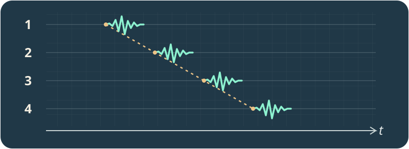

# 麦克风阵列入门

**一张会议桌，四个麦克风。离得远的那个人，怎样才能被听清？**

[读第一章 →](chapters/01_problem-definition.md) · [学习路线](#学习路线) · [PDF](dist/microphone-array-tutorial.pdf) · [English](README_EN.md)

<picture>
  <source media="(prefers-reduced-motion: reduce)" srcset="assets/readme/cover/room-still.svg">
  
</picture>

## 序言：会议桌上，四份不同的录音

视频会议开到一半，坐在桌子另一头的同事问了一句：「你们听得见吗？」耳机里听到的却是半句话、键盘响声，还有自己上一句话的回声。换个座位，问题又变了。

假设把会议机里的四路原始录音拆开听。它们录的是同一个房间，可是同一句话到达每个麦克风的时间不一样。图里的说话人离 1 号麦克风最近；在直达声里，2、3、4 号会稍晚收到。平时几乎听不出这点先后，把波形摊开就看得见。

这点先后有两种用法。**想找人**，就量一量同一段声音在不同录音里错开多少，再结合麦克风的位置推方向，这叫**声源定位**。**想朝那个人拾音**，就用这个方向的时差把他的话对齐再合成，这叫**波束形成**。键盘若在另一个方向，按同一套时差处理，它的声音通常对不齐；究竟能压下多少，要看频率、间距和房间。

再想想耳机里的回声。它可能是远端的声音经扬声器播出，又绕回麦克风。会议机知道自己放了什么，于是可以用播放信号来估计这份回声。至于房间里的拖尾、两个人同时开口、说话人边走边讲，各有各的难点。这本书从桌上的四路录音讲起，逐步把这些问题拆开。

**现在就听一段。** 同一组录音里有两种合成节奏。[听单支麦](assets/readme/lab/single.wav?raw=true)，再[听朝左拾音](assets/readme/lab/left.wav?raw=true)和[朝右拾音](assets/readme/lab/right.wav?raw=true)。先调低音量；每段约 3 秒。[去实验页动手换方向 →](assets/readme/lab/README.md)

## 学习路线

没学过阵列处理，从第 1 章开始。图和试听可以先看，代码可以后跑。遇到复数、矩阵或分贝换算，再查[数学与符号附录](chapters/14_appendix-symbols-math.md)。已有项目在做，直接选遇到的问题。

### 01　从录音看出位置

[第 1 章：哪些声音要留下](chapters/01_problem-definition.md) → [第 2 章：声音怎样到达麦克风](chapters/02_basics-signal-model.md) → [第 3 章：阵列怎样摆](chapters/03_array-geometry.md) → [第 4 章：从时差找方向](chapters/04_doa-estimation.md)

拿两条波形左右滑，找出最像是同一段声音的位置。再算一算：知道这个时差，能确定一个方向，还是有多个可能的方向？

### 02　把拾音转向想听的人

[第 5 章：波束形成](chapters/05_beamforming.md) → [第 9 章：跟上移动的说话人](chapters/09_source-tracking.md)

先做会对齐再平均的固定波束；把方向故意拨错，听听目标会损失多少。遇到讲话的人在走动，再让连续几次方向观测互相参照，少被某一帧带偏。

### 03　分别对付回声、拖尾和串话

[第 6 章：用播放信号消回声](chapters/06_aec.md) · [第 7 章：减轻房间拖尾](chapters/07_wpe-dereverberation.md) · [第 8 章：分离同时说话的人](chapters/08_speech-separation.md)

先辨认现象：听到的是自己刚说过的话、一个字尾部拖出来的反射，还是另一个人同时在说？三种问题能利用的线索不同。

### 04　拿实录验证，把方法装进设备

[十六支麦录下的溪流](codes/chapters/ch02/real_audio/README.md) · [第 10 章：同步、标定与延迟](chapters/10_engineering-practice.md) · [第 11 章：选型与验收](chapters/11_selection-guide.md)

先用同一段实录比较单麦和多麦平均，看看相关的噪声会怎样影响结果。再给自己的设备订验收条件：坐多远、延迟多少、环境一变效果会不会掉下来。

如果你要画出机器里**哪里在响**，读[第 12 章：声学成像](chapters/12_acoustic-imaging.md)。如果麦克风散在不同设备上，还要处理各自的采样时钟，读[第 13 章：分布式阵列](chapters/13_distributed-enhancement.md)。

## 全书与配套材料

[完整章节目录](chapters/00_overview.md) · [按章查代码和音频](codes/chapters/README.md) · [练习与音频手册](codes/chapters/ch00/research/05_exercises_and_audio.md) · [房间仿真实验](chapters/15_appendix-guide.md)

全书有 **13 章正文、2 篇附录、363 道可运行练习和 80 张编号图**，另有一张房间练习补图。书里明确区分可手算的合成对照、房间仿真和真实录音，方便判断每项结果能说明什么。

[源码研究手册](codes/chapters/ch00/research/README.md) · [第三方来源与许可](codes/chapters/ch00/THIRD_PARTY.md) · [构建说明](scripts/README.md)

仓库根目录没有通用许可证。第三方代码和数据按各自条款使用。
