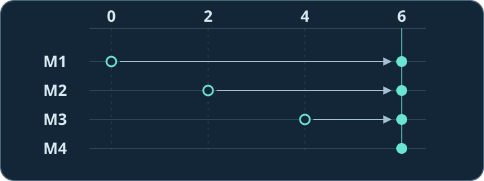

# 麦克风阵列信号处理

**一群麦克风，怎么知道该听谁？** 从声音抵达四支麦的先后，学到让会议麦克风朝人拾音、让机器人跟上移动的说话者。

[先听四支麦的效果](#先听同一段声音选两种方向) · [新手课程路线](#按这条路线学) · [全书 PDF](dist/microphone-array-tutorial.pdf) · [English](README_EN.md)

## 先听：同一段声音，选两种方向

把上图想成一张桌子。左边 A 发出一串较长的音，右边 B 发出成对的短音。**先猜：如果只改处理方式，能不能让左边和右边轮流占上风？**

| 播放同一段 3 秒声音 | 留意什么 |
| --- | --- |
| [▶ 单支麦 M1](assets/readme/lab/single.wav?raw=true) | 长音和两下短音都在。 |
| [▶ 四支麦对准左边 A](assets/readme/lab/left.wav?raw=true) | 长音留下，两下短音变轻。 |
| [▶ 四支麦对准右边 B](assets/readme/lab/right.wav?raw=true) | 这次主要听见两下短音。 |

先把设备音量调低。三段都是单声道，可以直接用手机扬声器；如果浏览器下载了 WAV，用播放器打开即可。效果来自对四路信号做不同的时间补偿，音频没有逐段调音量。这是**有意选用容易对比的合成音**，实录不会这么干净。

**[在电脑上下载互动实验](assets/readme/lab/array-lab.html)** → 点 **Download raw file**（下载原始文件），再用浏览器打开保存的 HTML。不用装 Python，也不用给网页麦克风权限。先对准 A，再勾选「把右边 B 换成低音」：B 没挪位置，怎么又听得见了？

## 序言：为什么要让最先听见的麦克风等一等？

会议桌另一端有人刚开口，旁边又响起键盘声。把四支麦的录音直接混在一起，两种声音通常都还在。四支麦的价值，是它们记录下了**不同的先后顺序**：左边的声音先到左端，右边的声音先到右端。同一件事，既给了我们一个线索来找方向，也给了我们一个办法来选方向。

以左边的 A 为例。假设同一个波峰依次在第 0、2、4、6 格到达四支麦。让最先听到的 M1 等 6 格，M2 等 4 格，M3 等 2 格，最后到的 M4 不用等。现在四个波峰都在第 6 格。

这时再取四路平均，A 的波峰能和波峰叠在一起，保持原来的强度。B 的到达顺序正好相反，照 A 的规则补时间，B 的波峰和波谷就可能相抵。这就是最简单的**波束形成**：麦克风没有转动，改变的是我们合成录音的方式。

但方向不同并不保证能把另一边压下去。实验里，换成 **250 Hz** 的低音后，同样对准 A，B 仍留下单麦参照约 **82% 的功率**：低音一轮起伏更长，这点时差只够错开一小段。学阵列有趣的地方就在这里：先弄懂一个方法为什么有效，再找出它在哪些条件下不够用。

## 按这条路线学

第一次学可以从第 1 站开始，也可以带着手头的问题跳进去。浏览上面的实验不用数学基础；往后用到三角函数、复数和矩阵时，可以随时查[附录 A](chapters/14_appendix-symbols-math.md)。

### 第 1 站 · 看懂四路录音为什么不同

[第 1 章：任务](chapters/01_problem-definition.md) → [第 2 章：信号模型](chapters/02_basics-signal-model.md) → [第 3 章：阵列几何](chapters/03_array-geometry.md)

看一段波形，判断哪一路先收到；算一算间距改变后，时差会怎么变。

### 第 2 站 · 找到声音，再朝它拾音

[第 4 章：声源定位](chapters/04_doa-estimation.md) → [第 5 章：波束形成](chapters/05_beamforming.md)

把两路录音前后滑动，找最吻合的位置；再比较朝对方向和朝错方向的输出。

### 第 3 站 · 分清回声、混响和串话

[第 6 章：消回声](chapters/06_aec.md) · [第 7 章：去混响](chapters/07_wpe-dereverberation.md) · [第 8 章：语音分离](chapters/08_speech-separation.md)

通话听见自己、房间里有拖尾、两个人同时开口，是三道不同的题。先描述你听见的现象，再挑相应的方法。

### 第 4 站 · 把方法装进真实设备

[第 9 章：追踪](chapters/09_source-tracking.md) · [第 10 章：工程实践](chapters/10_engineering-practice.md) · [第 11 章：选型](chapters/11_selection-guide.md)

处理偶尔找错方向的帧；检查通道是否同步，分开量延迟和拾音效果。

想从**真实录音**开始？试试[十六支麦录下的同一条溪流](codes/chapters/ch02/real_audio/README.md)：先听单麦和多麦平均，再看看为什么声道加多了，噪声功率也不一定按课本里的简单比例下降。

想继续做空间成像或把几台设备连起来？接着读[第 12 章：声学成像](chapters/12_acoustic-imaging.md)和[第 13 章：分布式阵列](chapters/13_distributed-enhancement.md)。

## 全书与配套材料

[章节总目录](chapters/00_overview.md) · [离线合订 PDF](dist/microphone-array-tutorial.pdf) · [按章查代码和音频](codes/chapters/README.md) · [练习与音频手册](codes/chapters/ch00/research/05_exercises_and_audio.md)

全书有 **13 章正文、2 篇附录、363 道可运行练习和 80 张编号图**，另有一张房间练习补图。每章可以沿着「看解释 → 复算 → 跑代码 → 听结果」往下走；[附录 B](chapters/15_appendix-guide.md)另有一份可动手的房间仿真题。

[源码研究手册](codes/chapters/ch00/research/README.md) · [第三方来源与许可](codes/chapters/ch00/THIRD_PARTY.md) · [构建说明](scripts/README.md)

复算首页实验

[互动页面](assets/readme/lab/array-lab.html)内含完整合成和处理代码。A、B 的到达时间以 16 kHz 的采样点为单位，分别是 `[0, 2, 4, 6]` 和 `[6, 4, 2, 0]`。每个百分比都用已知声源的浮点分量单独计算：输出平方和 ÷ 单麦平方和，保留完整延迟尾部。试听文件是两分量相加后量化得到的 PCM WAV。

已安装 Node.js 的话，在仓库根目录运行 `node assets/readme/lab/export-lab.mjs --check` 可重算并逐字节核对三段音频。这组数值只解释这里的合成对照；它不是实测阵列的降噪指标。

仓库根目录没有通用许可证。第三方代码和数据按各自条款使用。
