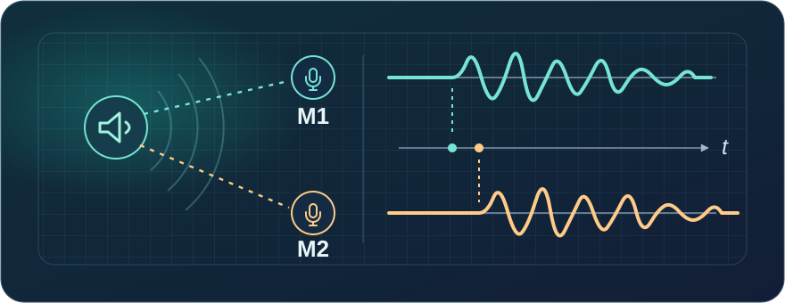
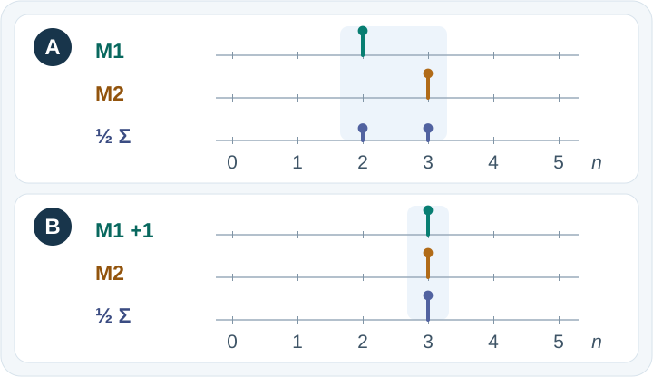
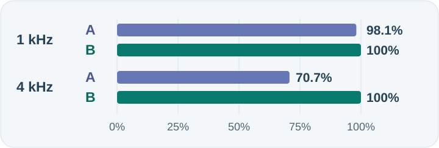

# Microphone Arrays for Beginners

[中文首页](README.md) · [First lesson: two microphones](chapters/01_problem-definition.md) · [Book guide](chapters/00_overview.md) · [Download the PDF](dist/microphone-array-tutorial.pdf)

**Both microphones pick up your voice. Why can mixing them make part of it disappear?** If you speak at one end of a conference table, the nearer microphone hears you first. That delay helps us work out where you are, and it matters when we mix the recordings.



## Listen first: where did the high tone go?

Mix a low tone and a high one, then let M2 record the result one sample behind M1. A digital recording stores one number at each regular time step; that's a **sample**. The clips below mix the same synthetic input, with no added noise and no separate gain adjustments. Start at low volume and listen to A, then B. Each lasts two seconds.

**[▶ A · Average the recordings directly](codes/chapters/ch02/audio/alignment_unaligned.wav?raw=true)**　　**[▶ B · Align the recordings, then average](codes/chapters/ch02/audio/alignment_aligned.wav?raw=true)**

If your browser downloads the WAV, open it in your audio player. In B, listen for the higher tone. The lower tone changes much less. The next figure shows where that difference comes from.

## Look at what the average does

Use a short pulse in place of the whole sound. The horizontal axis is the sample number. The height of a stem is the amplitude at that sample. `½ Σ` means add the two values and divide by two.



- **A, average directly.** At sample 2, `(1 + 0) ÷ 2 = 0.5`. At sample 3, `(0 + 1) ÷ 2 = 0.5`. The original peak gets spread across two samples.
- **B, align and average.** Let the earlier M1 wait a sample. Both peaks now fall on sample 3, giving `(1 + 1) ÷ 2 = 1`. Delaying the earlier recording only requires past samples.

The pulse shows **how to align** the signals. The clips contain continuous tones, each with a positive and negative half of its cycle. When the recordings are out of step, a positive value in one can meet a negative value in the other. Their average can have a smaller amplitude.

## Count the samples: why is the high tone affected more?

The clips are sampled 16,000 times per second. A sample is **62.5 microseconds**. A 1 kHz cycle lasts 16 samples; a 4 kHz cycle lasts only four. The same delay shifts one tone by **1/16 of its cycle**, and the other by **1/4**.



Here, 100% is the amplitude of the [clean reference](codes/chapters/ch02/audio/alignment_reference.wav?raw=true) at that frequency. Without alignment, the 4 kHz tone retains about seven tenths of its amplitude, while 1 kHz stays close to the original. This is an **amplitude** comparison in a noise-free example; it does not measure speech intelligibility.

<details>
<summary>Work out the 70.7% from four samples</summary>

At 16 kHz, a 4 kHz cycle has four samples. If the original sine has amplitude 1, one channel is `0, 1, 0, −1`. The channel delayed by one sample is `−1, 0, 1, 0` over the same steady-state cycle.

Their average is `−0.5, 0.5, 0.5, −0.5`. None of those samples happens to land on the peak of the resulting sine. Write the average as `0.5 × sin(θ) − 0.5 × cos(θ)`: the two components are a quarter cycle apart, so the amplitude is `√(0.5² + 0.5²) = 1/√2 ≈ 0.707`. See [E01-05](chapters/01_problem-definition.md#e01-05差一个采样点为什么高频损失更大) for the worked answer and WAV measurements.

</details>

## Pick your next lesson

| What would you like to understand? | Start here |
| --- | --- |
| **Why use two microphones?** | [Chapter 1: What to keep and what to remove](chapters/01_problem-definition.md) → [Chapter 2: Turning arrival times into a model](chapters/02_basics-signal-model.md) |
| **Where is the speaker, and how do I listen in that direction?** | [Chapter 4: Find the shift that best matches two recordings](chapters/04_doa-estimation.md) → [Chapter 5: Align and combine sound from the target direction](chapters/05_beamforming.md) |
| **Why do I hear myself in a call, and why does an empty room ring?** | [Chapter 6: Cancel echo using the known playback signal](chapters/06_aec.md) · [Chapter 7: Reduce the tail from room reflections](chapters/07_wpe-dereverberation.md) |
| **What should I measure on my device?** | [Chapter 10: Latency, synchronization, and calibration](chapters/10_engineering-practice.md) · [Chapter 11: Choose from the use case and acceptance criteria](chapters/11_selection-guide.md) |

Using the arrival order to infer direction is the starting point for **source localization**. Compensating for the delay from a chosen direction and combining the signals is the simplest **beamforming** method. We supplied the correct delay here. The later chapters explain how to estimate it and when the estimate can go wrong.

<details>
<summary>Reproduce the WAV measurements on your computer</summary>

You need Git and Python. The tutorial was verified with Python 3.13; [requirements.txt](requirements.txt) pins the dependencies.

```bash
git clone https://github.com/nanless/microphone-array-tutorial.git
cd microphone-array-tutorial
python3 -m venv .venv
.venv/bin/python -m pip install -r requirements.txt
.venv/bin/python -c 'import json; from codes.chapters.ch01.chapter01_experiments import published_alignment_measurements as measure; print(json.dumps(measure()["pcm_measurements"], indent=2))'
```

On Windows, use `.venv\Scripts\python.exe` in place of `.venv/bin/python`. The result lists amplitudes and ratios for 1 kHz and 4 kHz. The measurement checks the committed WAV formats and digests and leaves the audio files untouched.

</details>

## Book and reference material

[Chapter guide](chapters/00_overview.md) · [Offline PDF](dist/microphone-array-tutorial.pdf) · [Code and audio by chapter](codes/chapters/README.md) · [Exercise and audio handbook](codes/chapters/ch00/research/05_exercises_and_audio.md)

The Chinese tutorial has **13 chapters, two appendices, 363 runnable exercises, and 80 numbered figures**, plus a supplementary room exercise figure. Use the [book guide](chapters/00_overview.md) for array geometry, speech separation, tracking, acoustic imaging, and distributed arrays. The [audio inventory](codes/chapters/README.md#audio-inventory) lists synthetic examples separately from the real DEMAND recordings.

[Source research handbook](codes/chapters/ch00/research/README.md) · [Third-party sources and licenses](codes/chapters/ch00/THIRD_PARTY.md) · [Build the site, PDF, and experiments](scripts/README.md)

There is no general license at the repository root. Public access does not grant redistribution rights. Third-party code and data have their own terms.
