# Microphone Array Signal Processing · From Fundamentals to Industrial Practice

🌐 [简体中文](README.md) ｜ **English**

A complete, open bilingual (English & Chinese) technical monograph and runnable engineering laboratory for beginners, researchers, and audio systems engineers. Starting from spherical geometry, complex phasors, subspace linear algebra, Wirtinger calculus, and Bayesian estimation, the book derives **DOA localization, beamforming, acoustic echo cancellation (AEC), WPE dereverberation, speech separation, and multi-target source tracking** without skipping intermediate steps—then bridges directly into real-time hardware synchronization, latency/compute budgeting, system selection, and four frontier chapters on **acoustic imaging, distributed wireless arrays, spatial/wearable arrays, and conditioned target extraction with multichannel diarization**.

**[Open English Interactive Course →](https://nanless.github.io/microphone-array-tutorial/site_en/)** · **[▶ 1-Click 4-Mic Browser Lab](https://nanless.github.io/microphone-array-tutorial/assets/readme/lab/array-lab.html?lang=en)** · **[🔊 15-Mic Real Room Demo](https://nanless.github.io/microphone-array-tutorial/site_en/#course-cases)** · **[English Monograph PDF](dist/microphone-array-tutorial-en.pdf)** · [Math Foundations (Ch 0)](chapters_en/00_math-foundations.md) · [Full Contents](chapters_en/00_overview.md) · [简体中文](README.md)

**16 chapters · 2 appendices · 443 runnable exercises · 92 numbered figures** · **283 companion WAV files** · **129 upstream open-source references**

<picture>
  <source media="(prefers-reduced-motion: reduce)" srcset="assets/readme/course-cover-still-en.svg">
  
</picture>

---

## Why Multiple Microphones? Six Core Problems at a Glance

A single microphone collapses target speech, competing talkers, room reflections, and loudspeaker echo into one scalar waveform. Synchronized microphones unlock **spatial degrees of freedom**—microsecond inter-channel arrival delays, spatial covariance structure, and playback reference signals each solve a distinct problem:

| Core Module | Practical Question Solved | Physical Clues & Representative Algorithms | Output & Direct Chapter |
| --- | --- | --- | --- |
| **DOA Localization** | Where is the talker, and why do reflections create false peaks? | Inter-mic time delays & subspace orthogonality: GCC-PHAT, SRP-PHAT, MUSIC, ESPRIT | Azimuth/elevation or 3D coordinates · [Chapter 4](chapters_en/04_doa-estimation.md) |
| **Beamforming** | How do we preserve target speech distortionlessly while suppressing side noise? | Steering-vector constraints & interference covariance inversion: DSB, Superdirective, MVDR, LCMV, GSC, MWF | Enhanced mono or binaural audio · [Chapter 5](chapters_en/05_beamforming.md) |
| **Acoustic Echo Cancellation (AEC)** | How do we remove the device's own loudspeaker playback during full-duplex calls? | Synchronized playback loopback & partitioned frequency-domain adaptation: NLMS, PBFDAF, APA, FDKF, DTD | Echo-free near-end speech · [Chapter 6](chapters_en/06_aec.md) |
| **Blind Dereverberation (WPE)** | How do we strip late room reflections without a clean reference signal? | Multi-channel delayed linear prediction with guard interval $\Delta$: offline/online WPE, MINT | Dereverberated speech · [Chapter 7](chapters_en/07_wpe-dereverberation.md) |
| **Speech Separation** | How do we unmix overlapping talkers (the cocktail party problem)? | Cross-frequency source priors, activity guidance & masks: IVA, ILRMA, GSS, PIT, streaming CSS | Separated speaker streams · [Chapter 8](chapters_en/08_speech-separation.md) |
| **Source Tracking** | How do we keep adaptive beams locked when talkers move or pause? | Bayesian state-space filtering & data association: Kalman, Particle Filter, IMM, track lifecycle | Smooth angle trajectories & uncertainty · [Chapter 9](chapters_en/09_source-tracking.md) |

---

## Four Defining Strengths

- **Zero-Gap Mathematical Derivations**: [Chapter 0 (*Mathematical & Signal Analysis Foundations*)](chapters_en/00_math-foundations.md) builds $\mathrm{SO}(3)$ rotations, complex phasors, STFT COLA reconstruction, subspace projections, Sherman–Morrison–Woodbury updates, Wirtinger complex calculus, circular complex Gaussians, CRLB, and Wiener–Kalman recursion from scratch.
- **443 Hand-Worked Anchors + Pure NumPy Implementations**: Every core equation is paired with small exact-fraction hand calculations and dependency-light NumPy code so you can verify conjugate signs, FFT scaling, and matrix shapes without black-box wrappers.
- **283 Controlled & Real WAV Assets Exposing Failure Modes**: Alongside the main 109-clip manifest, 31 dedicated audio suites (283 WAVs in total) reproduce real engineering pitfalls—spatial aliasing grating lobes, coherent reflection false peaks, steering-mismatch target cancellation, superdirective low-frequency white-noise amplification, AEC double-talk divergence, and 100 ppm sampling-rate offset (SRO) drift.
- **Production Hardware & Upstream Codebase Audits**: [Chapters 10](chapters_en/10_engineering-practice.md) and [11](chapters_en/11_selection-guide.md) cover cascade topology, end-to-end latency budgets, fixed-point scaling, MACs/power estimation, and Pareto acceptance specs, backed by [6 implementation manuals](codes/chapters/ch00/research_en/README.md) auditing WebRTC AEC3, SpeexDSP, nara_wpe, Acoular, pyroomacoustics, and more.

---

## Listen First: Two Zero-Install Browser Experiments

1. **[15-Mic Real Room Localization & MVDR Comparison](https://nanless.github.io/microphone-array-tutorial/site_en/#course-cases)**: Built on real multichannel room recordings from the LOCATA benchmark. Toggle between speakers A and B to inspect SRP-PHAT spatial spectra (35° estimate vs. 34.4° optical ground truth) and A/B-compare the single mic, 15-mic delay-and-sum, and MVDR with postfiltering (**12.9 dB** extra interferer suppression with **1.5 dB** target loss).
2. **[Which Side Should Four Mics Listen To? Interactive Browser Lab (EN/中文)](https://nanless.github.io/microphone-array-tutorial/assets/readme/lab/array-lab.html?lang=en)** (offline guide in [`assets/readme/lab/`](assets/readme/lab/README_EN.md)): Steer live between source A and source B, then switch B to a **250 Hz low tone**—hear and measure why the exact same sample delays suppress high-frequency B below **0.01%** yet leave **82.1% power** at 250 Hz.

---

## Complete 19-Part Curriculum & Reading Routes

| Part | Scope | Topics Covered | Direct Links |
| --- | --- | --- | --- |
| **Overview & Foundations** | Overview, Ch 0–3 | Course roadmap, self-contained math foundations, SNR metrics & binaural cues, near/far-field propagation & STFT spatial covariance, linear/circular/spherical/nested coarray geometry | [Overview](chapters_en/00_overview.md) · [Ch 0 Math](chapters_en/00_math-foundations.md) · [Ch 1](chapters_en/01_problem-definition.md) · [Ch 2](chapters_en/02_basics-signal-model.md) · [Ch 3](chapters_en/03_array-geometry.md) |
| **Six Core Algorithms** | Ch 4–9 | DOA estimation, fixed/adaptive/neural beamforming, linear & hybrid AEC, WPE dereverberation, blind/guided/neural separation, Bayesian multi-speaker tracking | [Ch 4 DOA](chapters_en/04_doa-estimation.md) · [Ch 5 Beamforming](chapters_en/05_beamforming.md) · [Ch 6 AEC](chapters_en/06_aec.md) · [Ch 7 WPE](chapters_en/07_wpe-dereverberation.md) · [Ch 8 Separation](chapters_en/08_speech-separation.md) · [Ch 9 Tracking](chapters_en/09_source-tracking.md) |
| **Real-Time Systems & Selection** | Ch 10–11 | Cascade ordering & echo loopback tap points, SRO clock drift, channel calibration & dead-mic fallback, fixed-point/MACs/battery budgets, Pareto selection & testable specs | [Ch 10 Engineering](chapters_en/10_engineering-practice.md) · [Ch 11 Selection](chapters_en/11_selection-guide.md) · [Engineering Hub](https://nanless.github.io/microphone-array-tutorial/site_en/#course-engineering) |
| **Four Frontier Chapters** | Ch 12–15 | Acoustic camera deconvolution (DAMAS/CLEAN-SC), bandwidth-constrained distributed arrays (DANSE), Ambisonics & wearable/TWS arrays, conditioned target extraction & diarization (acoustic distance bubble / TS-VAD) | [Ch 12 Imaging](chapters_en/12_acoustic-imaging.md) · [Ch 13 Distributed](chapters_en/13_distributed-enhancement.md) · [Ch 14 Wearable](chapters_en/14_spatial-wearable-arrays.md) · [Ch 15 Target Extraction](chapters_en/15_target-extraction-diarization.md) |
| **Reference Appendices** | Ch 16–17 | Master notation table, terminology glossary, compact formula lookup, literature & challenge roadmap, end-to-end troubleshooting trees & capstone exercises | [Ch 16 Appendix A](chapters_en/16_appendix-symbols-math.md) · [Ch 17 Appendix B](chapters_en/17_appendix-guide.md) |

- **Beginners**: Follow `Ch 0 (or look up sections via §0.8) → Ch 1–3 → Ch 4–5`, running the pure NumPy end-of-chapter exercises as you go.
- **Algorithm & ML Researchers**: Start from [Ch 0 §0.8 Math Lookup](chapters_en/00_math-foundations.md#sec-0-8) and Chapter 2 notation, then jump directly to Chapters 4–9, Chapters 12–15, and [Appendix B Challenge Roadmap](chapters_en/17_appendix-guide.md#sec-17-2).
- **Embedded & Audio Systems Engineers**: Jump straight to [Chapter 10 Engineering](chapters_en/10_engineering-practice.md), [Chapter 11 Selection Guide](chapters_en/11_selection-guide.md), [Appendix B Troubleshooting Tree](chapters_en/17_appendix-guide.md#sec-17-4), and the [Industrial Deployment Manual](codes/chapters/ch00/research_en/03_industrial_deployment.md).

---

## Quick Local Setup & Verification (3 Minutes, CPU-Only)

```bash
git clone https://github.com/nanless/microphone-array-tutorial.git
cd microphone-array-tutorial
python3 -m venv .venv
.venv/bin/pip install -r requirements.txt

# Run all 16 Chapter 0 math foundation exercises (E00-01 to E00-16)
.venv/bin/python -m codes.chapters.ch00.chapter00_exercises

# Run spatial localization/beamforming and AEC/WPE/separation/tracking baselines
.venv/bin/python -m codes.chapters.ch00.cross_chapter.ch02_05_baselines
.venv/bin/python -m codes.chapters.ch00.cross_chapter.ch06_09_baselines
```

---

## Repository Map & License

- **Runnable code & 283-WAV inventory by chapter**: [`codes/chapters/README_EN.md`](codes/chapters/README_EN.md)
- **Algorithm coverage matrix (equations ↔ code ↔ tests ↔ upstream)**: [`codes/chapters/ch00/COVERAGE_EN.md`](codes/chapters/ch00/COVERAGE_EN.md)
- **Upstream source & industrial deployment manuals (6 guides)**: [`codes/chapters/ch00/research_en/README.md`](codes/chapters/ch00/research_en/README.md)
- **Upstream lockfile & offline acquisition guide**: [`codes/chapters/ch00/upstream/README_EN.md`](codes/chapters/ch00/upstream/README_EN.md)
- **92-figure generation, static websites & tagged A4 PDF builds**: [`scripts/README_EN.md`](scripts/README_EN.md)
- **Third-party attributions & dataset terms**: [`codes/chapters/ch00/THIRD_PARTY_EN.md`](codes/chapters/ch00/THIRD_PARTY_EN.md)
- **Collaboration & verification specification**: [`AGENTS_EN.md`](AGENTS_EN.md) · **Chinese Edition**: [`README.md`](README.md) · [`dist/microphone-array-tutorial.pdf`](dist/microphone-array-tutorial.pdf)

Original software and scripts in this repository are licensed under the [MIT License](LICENSE); original textbook prose, research manuals, and pedagogical figures are licensed under [CC BY-NC-SA 4.0](LICENSE-DOCS). Third-party code adaptations and public acoustic datasets retain their respective original licenses.
