# Microphone Array Signal Processing · From Fundamentals to Industrial Practice

Start with multichannel recordings and array geometry. Work through localization, beamforming, echo cancellation, dereverberation, separation, and tracking, then apply them to device implementation, evaluation, and system selection. Two advanced chapters cover acoustic imaging and distributed arrays.

**[Open the online course →](https://nanless.github.io/microphone-array-tutorial/)** · [Start at Chapter 1](chapters/01_problem-definition.md) · [Industrial practice](https://nanless.github.io/microphone-array-tutorial/site/#course-engineering) · [Full contents](chapters/00_overview.md) · [PDF](dist/microphone-array-tutorial.pdf) · [简体中文](README.md)

<picture>
  <source media="(prefers-reduced-motion: reduce)" srcset="assets/readme/course-cover-still.svg">
  
</picture>

## Online case studies

[Open the Chinese course](https://nanless.github.io/microphone-array-tutorial/) in your browser. Switch between the two sound sources in the animation, see how the array finds and focuses on a source in a real room recording, and pick a chapter from the learning route. [Jump to the case studies →](https://nanless.github.io/microphone-array-tutorial/site/#course-cases)

## Preface · Why record the same words four times?

Halfway through a call, someone at the far end of the table asks, “Can you hear me?” In your headphones you get half a sentence, some keystrokes, and an echo of what you just said. Those sounds pile up, but they give the device different clues.

Separate the four raw recordings. The voice reaches the nearest microphone first and the farthest one later. **To find the speaker**, slide the recordings and measure how far apart they are. **To listen toward them**, use that offset to line up the voice before averaging the channels. Your own words can echo back if the remote loudspeaker plays them and the microphones pick them up again. In that case the device has another clue: it knows what it just played.

This book starts with what you can hear. At each step, ask what signals you have, what they can tell you, and when they might lead you astray.

## Learning paths

| Chapters | What you can do | Where to start |
| --- | --- | --- |
| 1–3 · Fundamentals and geometry | Model the signals using arrival times, phase, and microphone positions | [Chapter 1](chapters/01_problem-definition.md) |
| 4–9 · Algorithm design and validation | Choose algorithms for localization, beamforming, echo cancellation, dereverberation, separation, and tracking, then check them with code and worked examples | [Localization](chapters/04_doa-estimation.md) · [Beamforming](chapters/05_beamforming.md) · [Chapter guide](chapters/00_overview.md) |
| 10–11 · Industrial practice | Plan synchronization and calibration, measure end-to-end latency, budget compute and power, and define acceptance criteria | [Engineering](chapters/10_engineering-practice.md) · [Selection and validation](chapters/11_selection-guide.md) |
| 12–13 · Advanced topics | Locate machine noise and account for clock drift, bandwidth, and packet loss across devices | [Acoustic imaging](chapters/12_acoustic-imaging.md) · [Distributed arrays](chapters/13_distributed-enhancement.md) |

If you are new to the subject, begin with Chapter 1 and consult the math appendix as needed. For device work, go straight to the engineering tasks and the implementation guide. The main text is in Chinese. [Math and notation](chapters/14_appendix-symbols-math.md) · [Engineering tasks](https://nanless.github.io/microphone-array-tutorial/site/#course-engineering) · [Industrial implementation notes](codes/chapters/ch00/research/03_industrial_deployment.md)

**13 chapters · 2 appendices · 363 runnable exercises · 80 numbered figures**

[Code and audio by chapter](codes/chapters/README.md) · [Implementation notes](codes/chapters/ch00/research/README.md) · [Web and PDF builds](scripts/README.md) · [Third-party sources and terms](codes/chapters/ch00/THIRD_PARTY.md)

The repository does not have a general root license. Third-party code and data retain their own terms.
