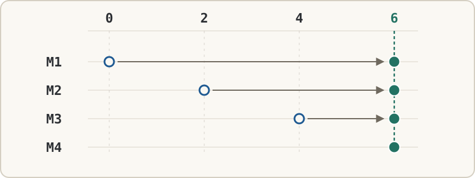

# 互动实验：四支麦，听哪边？

🌐 **简体中文** ｜ [English](README_EN.md)

四支等间距麦克风从左到右排成一行（`M1`～`M4`）。左边声源 **A** 发出较长的双频乐音（`1000 / 3000 Hz`），右边声源 **B** 发出成对的短促敲击音（`3000 / 5000 Hz`）。先调低耳机或音箱音量，试听以下三段同增益单声道 WAV：

1. **[▶ 单支麦 M1 原始拾音](single.wav?raw=true)**：长音 A 与成对短音 B 全部清晰可闻（各占 100% 原始功率）。
2. **[▶ 延迟求和 · 对准左边 A](left.wav?raw=true)**：长音 A 完整保留（100%），右边短音 B 几乎消失（残余功率 `<0.01%`）。
3. **[▶ 延迟求和 · 对准右边 B](right.wav?raw=true)**：短音 B 完整保留（100%），左边长音 A 大幅变轻。

### 一键打开浏览器互动实验室（零安装、无需麦克风权限）

- **[在线直接运行互动实验室 →](https://nanless.github.io/microphone-array-tutorial/assets/readme/lab/array-lab.html)**（支持中英双语切换与实时时延对齐可视化）
- **离线运行方式**：在仓库 [`array-lab.html`](array-lab.html) 页面点击 **Download raw file**，用任意现代浏览器直接双击打开即可。

进入实验室后，先点 **“对准左边 A”**，再勾选 **“把右边 B 换成 250 Hz 低音”**：阵列几何与补偿时差分毫未动，为什么原本被压制下去的右边干扰 B 突然又大声漏出来了？

---

## 物理机制：对准某一侧时，时域波形发生了什么？

在 `16 kHz` 采样率下，相邻两采样点间隔 `62.5 μs`。左边声源 A 的同一个波峰依次在第 `0, 2, 4, 6` 个采样点到达 `M1, M2, M3, M4`。只要给先收到的 `M1, M2, M3` 分别人为补等 `6, 4, 2` 个采样点，四路 A 的波峰就会全部精准对齐到第 `6` 格：



对四路对齐波形取算术平均，目标 A 同相相加，幅度与功率保持 100% 无失真；而反方向声源 B 原本按 `[6, 4, 2, 0]` 到达，套用同一组等待时间后被拉开到 `[12, 8, 4, 0]` 格——高频波峰与波谷跨通道正负抵消。但当 B 换成 `250 Hz` 低音时，单个周期长达 `64` 个采样点，`12` 格时差仅占不到五分之一个周期，四路低音依然近似同相，因此仍残留约 **82.1% 的单麦功率**。这一现象正是[第 5 章《波束形成》](../../../chapters/05_beamforming.md)引入超指向差分波束与自适应 MVDR 零陷的物理起点。

---

## 逐字节复算与核验

本目录三段预生成 WAV 与浏览器实时合成器共享 [`array-lab.html`](array-lab.html) 内嵌的同一套确定性数值核（`<script id="lab-model">`），共用单一固定导出增益，不做逐段峰值归一化。在仓库根目录运行：

```bash
node assets/readme/lab/export-lab.mjs --check
```

即可重新执行合成模型并逐字节核验已发布音频资产。下一步可继续阅读[第 5 章：波束形成](../../../chapters/05_beamforming.md)或[返回教程主页](../../../README.md)。
