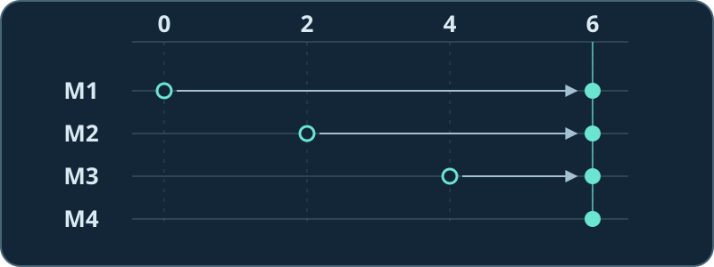

# 试听实验：四支麦，听哪边？

四个麦克风从左到右排成一行。合成声源 A 在左边，发出较长的音；B 在右边，发出成对的短音。先调低音量，猜一猜哪种声音会变轻。三段都是单声道。

1. [▶ 单支麦](single.wav?raw=true)：两种节奏都听得见。
2. [▶ 对准左边](left.wav?raw=true)：长音留下，两下短音变轻。
3. [▶ 对准右边](right.wav?raw=true)：短音留下，长音变轻。

**[在电脑上做互动实验](array-lab.html)**：在文件页点 **Download raw file**，再用浏览器打开下载的 HTML。无需安装软件，也不用给网页麦克风权限。先对准左边，再把右边的 B 换成低音：方向没变，为什么又听得见了？

## 对准某一侧，到底改了什么？

左边 A 的同一个波峰在第 0、2、4、6 格到达四支麦。每格是一个采样点，在这个实验里为 62.5 微秒。让 M1 等 6 格、M2 等 4 格、M3 等 2 格，M4 不用等，四路便都在第 6 格收到这个波峰。

再取四路平均，对齐的 A 保持原来的强度。B 走的路和 A 不同；照 A 的规则给 B 补时间后，B 的波峰可能碰上另一通道的波谷，平均后就弱了。把 B 换成 250 Hz 的低音，相同的时差只占它一个周期的一小段。在本实验里，B 仍留下单麦参照约 **82% 的功率**。

## 怎样复算？

在 16 kHz 下，A 和 B 的到达时间分别为 `[0, 2, 4, 6]` 和 `[6, 4, 2, 0]` 个采样点。[互动页面](array-lab.html)先对两种已知分量使用相同的补时差规则，再分别用完整输出的平方和除以单麦的平方和。播放器播放的是两分量相加后量化的 PCM 文件；三段共用导出增益。

已安装 Node.js 的话，在仓库根目录运行 `node assets/readme/lab/export-lab.mjs --check` 可重算并逐字节核对试听文件。这是有意选用容易对比的合成音，数值只描述此处的对照。继续看[第 5 章：波束形成](../../../chapters/05_beamforming.md)或[回到教程首页](../../../README.md)。
