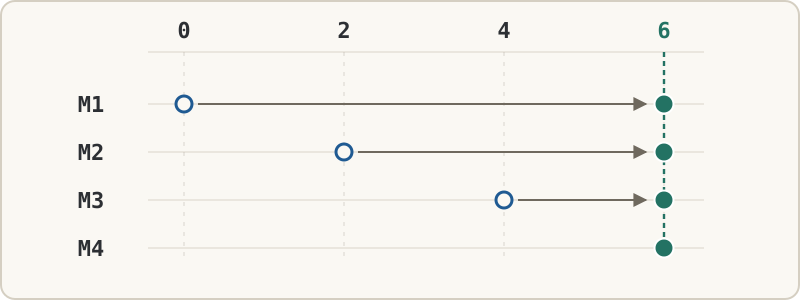

# Interactive Lab: Which Side Should Four Mics Listen To?

🌐 [简体中文](README.md) ｜ **English**

[简体中文](README.md) · [English Course Website](https://nanless.github.io/microphone-array-tutorial/site_en/)

Four equally spaced microphones (`M1` to `M4`) sit in a row. Source **A** on the left plays sustained tones (`1000 / 3000 Hz`); source **B** on the right plays paired short taps (`3000 / 5000 Hz`). Turn your volume down first, then compare these three shared-gain mono WAV clips:

1. **[▶ Single mic M1](single.wav?raw=true)**: both rhythms remain at 100% reference power.
2. **[▶ Delay-and-sum · Steer left to A](left.wav?raw=true)**: sustained tone A stays intact (100%); short pairs from B drop below `0.01%` power.
3. **[▶ Delay-and-sum · Steer right to B](right.wav?raw=true)**: short pairs from B stay intact (100%); sustained tone A drops sharply.

### Open the Zero-Install Browser Lab (1-Click Online or Offline)

- **[Launch Live Browser Lab (EN / 中文) →](https://nanless.github.io/microphone-array-tutorial/assets/readme/lab/array-lab.html?lang=en)** — boots directly in **English**, lets you toggle steering directions, and updates the sample-alignment diagram live.
- **Offline mode**: open [`array-lab.html`](array-lab.html), click **Download raw file**, and open the single HTML file in any browser (no server or microphone permission needed).

Try steering left to A, then check **“Switch B on the right to a 250 Hz low tone”**: neither speaker moved and the delays did not change—why did B become loud again?

---

## What Changes Physically When You Steer?

At `16 kHz` (`62.5 μs` per sample), the same wavefront peak from A reaches `M1, M2, M3, M4` at samples `0, 2, 4, 6`. Delaying `M1` by 6 samples, `M2` by 4, and `M3` by 2 stacks all four copies of A cleanly at sample `6`:



Averaging the four aligned channels preserves 100% of A while spreading opposite-side B across samples `[12, 8, 4, 0]`, where high-frequency peaks and troughs cancel. At `250 Hz`, however, one period spans `64` samples—a 12-sample spread covers less than one-fifth of a cycle, leaving **82.1% of B's single-mic power** intact. Overcoming this low-frequency aperture limit motivates superdirective and MVDR beamforming in [Chapter 5: Beamforming](../../../chapters_en/05_beamforming.md).

---

## Byte-for-Byte Reproduction

Both the browser player and the pre-rendered WAV files execute the exact `<script id="lab-model">` kernel inside [`array-lab.html`](array-lab.html) with one shared export gain. From the repository root, run:

```bash
node assets/readme/lab/export-lab.mjs --check
```

to verify all published lab assets byte for byte. Continue to [Chapter 5: Beamforming](../../../chapters_en/05_beamforming.md) or [return to the English README](../../../README_EN.md).
