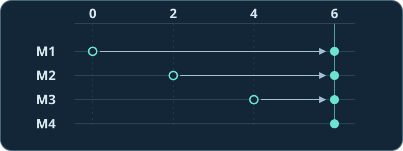

# Listening experiment: which side should four mics listen to?

Four microphones sit in a row. Synthetic source A on the left plays long tones; B on the right plays pairs of short tones. Turn the volume down first, then predict which rhythm will get quieter. All three clips are mono.

1. [▶ Single mic](single.wav?raw=true): both rhythms are audible.
2. [▶ Steer left](left.wav?raw=true): the long tones stay; the short pairs get quieter.
3. [▶ Steer right](right.wav?raw=true): the short pairs stay; the long tones get quieter.

**[Try the interactive lab on a computer](array-lab.html)**: choose **Download raw file** and open the downloaded HTML in a browser. No installation or microphone permission is required. Switch to English, steer left, and change source B on the right to a low tone. The direction stayed the same. Why can you hear B again?

## What changes when you steer?

The same peak from A reaches the four mics at samples 0, 2, 4 and 6. Each sample interval is 62.5 microseconds in this experiment. Delay M1 by six samples, M2 by four, and M3 by two; M4 needs no added delay. All four peaks now land at sample 6.

Average the four aligned copies and A keeps its strength. B travels a different path. With the delays chosen for A, B's peak in one channel can meet a trough in another, weakening the average. For a 250 Hz tone, the same delays cover only a small part of a cycle. In this experiment about **82% of B's single-mic power** still remains.

## Reproduce the result

At 16 kHz the arrivals are `[0, 2, 4, 6]` samples for A and `[6, 4, 2, 0]` for B. The [lab HTML](array-lab.html) applies the same delays to each known source component, then divides that component's full output sum of squares by its single-mic sum of squares. The player uses their sum quantized to PCM; all clips share an export gain.

With Node.js installed, run `node assets/readme/lab/export-lab.mjs --check` from the repository root to verify the published clips byte for byte. These synthetic sounds make the contrast clear, and the numbers describe only this example. Continue with [Chapter 5: Beamforming](../../../chapters/05_beamforming.md) or [return to the homepage](../../../README_EN.md).
