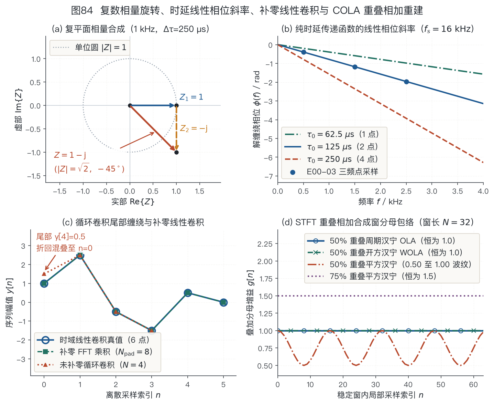
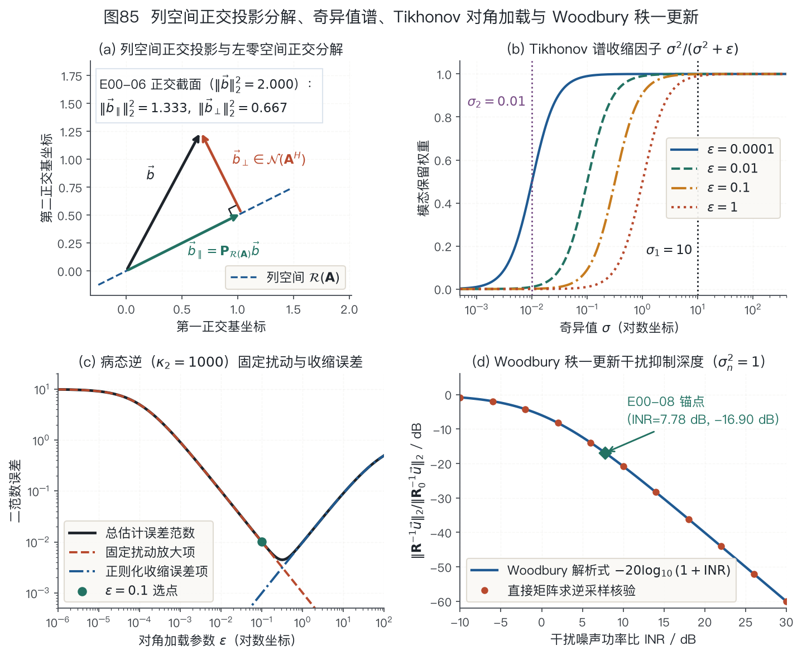
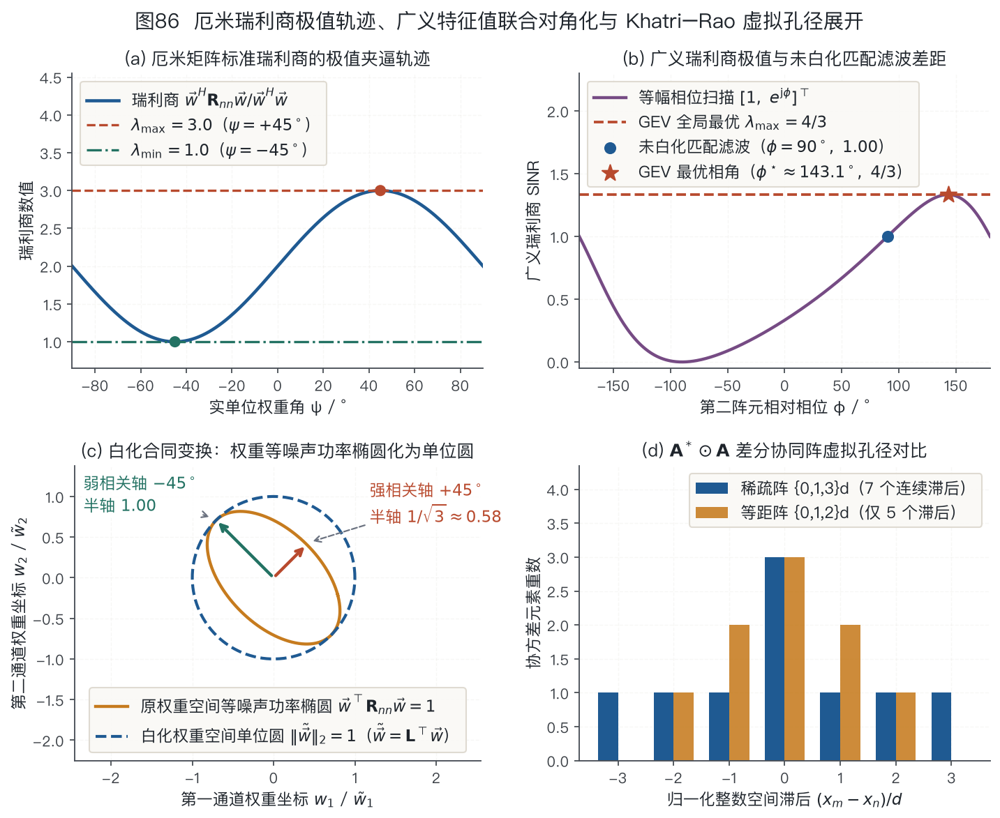
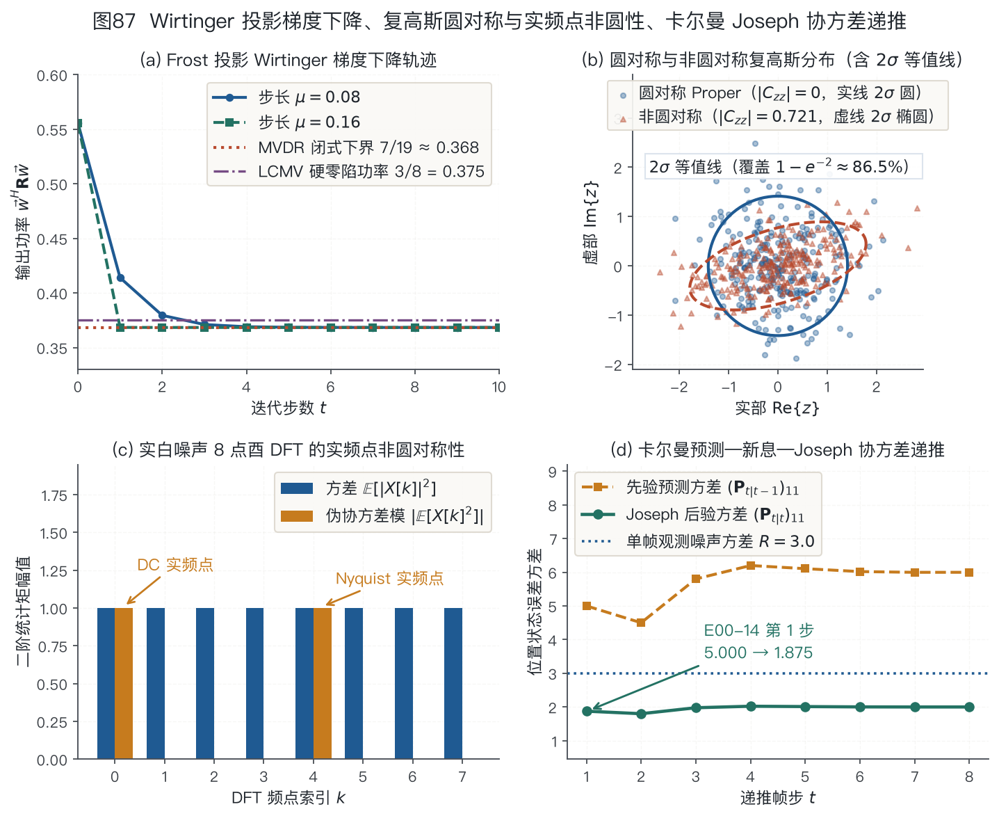

🌐 **简体中文** ｜ [English](../chapters_en/00_math-foundations.md)

> 本篇是第 0 章（正文与扩展专题共 16 章，即第 0～15 章，其中第 12～15 章为四篇扩展专题，另有附录 A、B），面向零前置阵列背景的读者，从最基础的向量、复数、矩阵与概率起步，一步不跳地推完第 1～15 章及附录 A、B 用到的全部核心数学工具、手算算例与工程失效边界；熟悉相关基础的读者亦可按 §0.8 检索表按需查阅。
>
> 导读首页：[00_overview.md](00_overview.md) ｜ 下一篇：[01_problem-definition.md](01_problem-definition.md)

---

## 0. 全书数学基础与信号分析预备

现代麦克风阵列信号处理横跨空间几何、傅里叶与 Z 域时频分析、复矩阵线性代数、复变微积分、统计估计与球面谐波展开。初学者阅读波束形成、声学回声消除或去混响文献时，受阻之处往往不在物理声学本身，而在推导途中频繁调用的复共轭内积、分块矩阵求逆、Cholesky 白化、Wirtinger 共轭偏导、圆对称复高斯或球面特殊函数。

本章按照**严格无前向依赖**的顺序组织整条数学链：绝不在定义复数前偷用复指数，绝不在介绍矩阵前调用行列式或迹循环，每个大模块开头均配备零基础热身与可纸笔验算的 $2\times 2$ 小例子，再一步不跳地推完核心定理并点明数值失效边界。正文五组锚点手算与章末十六道可运行练习（`E00-01`～`E00-16`）采用互不重复的参数设计；全部练习与核心算子均由纯 NumPy 核心模块 `codes/chapters/ch00/core/chapter00_math.py` 与命令行入口 `codes/chapters/ch00/chapter00_exercises.py` 精确复现。

| 缩写 / 记号 | 中文名与英文全称 | 在本章与全书中的作用 |
|---|---|---|
| TDOA | 到达时间差（Time Difference of Arrival） | 两支麦克风接收同一声源直达波的到达时刻差，定位与波束对齐的物理基础 |
| $\mathrm{SO}(3)$ | 三维特殊正交旋转群（Special Orthogonal Group in 3D） | 刚体三维旋转矩阵群（$\mathbf R^\top\mathbf R = \mathbf I_3,\ \det\mathbf R = +1$），用于运动阵列与头部追踪 |
| DFT / STFT | 离散傅里叶变换 / 短时傅里叶变换（Discrete / Short-Time Fourier Transform） | 将时域离散卷积转化为逐频点复数相量代数与窄带空间滤波 |
| PSD | 功率谱密度（Power Spectral Density） | 刻画平稳随机信号功率随频率分布的频域二阶统计量（自相关函数的傅里叶变换） |
| COLA / WOLA | 恒定重叠相加 / 加权重叠相加（Constant / Weighted Overlap-Add） | COLA描述窗的恒定重叠和，WOLA是加权重叠相加方法；未改谱时还可用非零窗乘积和逐点归一重建 |
| SVD | 奇异值分解（Singular Value Decomposition） | 诊断传播矩阵有效秩与二范数条件数，量化病态求逆的噪声放大倍数 |
| GEV / GEVD | 广义特征值问题 / 分解（Generalized Eigenvalue Problem / Decomposition） | 在有色相关噪声下通过白化合同变换求解最大信干噪比波束权重 |
| MVDR / LCMV | 最小方差无失真响应 / 线性约束最小方差（Minimum Variance Distortionless Response / Linearly Constrained Minimum Variance） | 复线性等式约束二次规划在单方向保真与多方向零陷设计中的闭式解 |
| KKT | 卡罗需—库恩—塔克条件（Karush–Kuhn–Tucker Conditions） | 带不等式约束凸优化（如非负最小二乘 NNLS）的一阶最优性充要条件 |
| NNLS / MM | 非负最小二乘 / 主化—最小化（Non-Negative Least Squares / Majorization-Minimization） | 处理声源功率非负约束与非光滑稀疏/重加权目标函数的迭代优化框架 |
| Proper $\mathcal{CN}$ | 恰当复高斯分布（Proper Complex Gaussian） | 中心化伪协方差为零；再加零均值条件，才关于原点圆对称 |
| FIM / CRLB | 费舍尔信息矩阵 / 克拉美—罗下界（Fisher Information Matrix / Cramér–Rao Lower Bound） | 满足正则条件的无偏估计量的方差下界，刻画孔径、频带与信噪比对定位精度的制约 |
| WLS / GLS | 加权 / 广义最小二乘（Weighted / Generalized Least Squares） | 在已知异方差或相关噪声协方差下的最小方差线性无偏估计（高斯—马尔可夫最优） |
| LMMSE / RLS | 线性最小均方误差 / 递推最小二乘（Linear Minimum Mean Square Error / Recursive Least Squares） | 维纳滤波、多通道语音增强与快速自适应回声消除的二阶最优滤波框架 |

### 0.1 三角恒等式、三维空间几何与球面坐标系

#### 0.1.1 三角恒等式、三维向量内积与四套空间坐标系桥接

阵列处理的物理起点非常直观：同一声源到达不同位置麦克风存在路程差，路程差带来传播时延，而传播时延在单频正弦波上表现为相位差。为了用几何语言准确表达路程差，我们先复习三维实向量的两个最基本运算。给定两个三维实列向量 $\vec a = [a_1, a_2, a_3]^\top$ 与 $\vec b = [b_1, b_2, b_3]^\top$（上标 $^\top$ 表示把行与列互换的**转置**），它们的**欧氏点积（内积）**与**欧氏二范数（长度）**定义为：

$$\vec a^\top\vec b = a_1 b_1 + a_2 b_2 + a_3 b_3 = \|\vec a\|_2\|\vec b\|_2\cos\gamma\text{，}\qquad
\|\vec a\|_2 = \sqrt{\vec a^\top\vec a} = \sqrt{a_1^2 + a_2^2 + a_3^2}\text{，}$$

其中 $\gamma \in [0, \pi]$ 是两向量之间的空间夹角。当 $\|\vec u\|_2 = 1$ 时称 $\vec u$ 为**单位方向向量**，任意向量 $\vec r$ 在方向 $\vec u$ 上的有向投影长度直接就是点积 $\vec r^\top\vec u$。

再看正弦波叠加必需的三条实三角恒等式。对任意实角度 $\alpha, \beta \in \mathbb{R}$，由两角和差公式 $\cos(\alpha\mp\beta) = \cos\alpha\cos\beta \pm \sin\alpha\sin\beta$，将 $\cos(\alpha-\beta)$ 与 $\cos(\alpha+\beta)$ 相加并令 $A = \alpha+\beta,\ B = \alpha-\beta$（即 $\alpha = \frac{A+B}{2},\ \beta = \frac{A-B}{2}$）即得和差化积；再令 $\alpha = \beta = \delta/2$ 代入 $\cos(\delta) = \cos^2(\delta/2) - \sin^2(\delta/2) = 1 - 2\sin^2(\delta/2)$ 移项即得半角公式：

$$\begin{aligned}
\cos(\alpha \mp \beta) &= \cos\alpha\cos\beta \pm \sin\alpha\sin\beta\text{，}\\
\cos A + \cos B &= 2\cos\!\left(\frac{A+B}{2}\right)\cos\!\left(\frac{A-B}{2}\right)\text{，}\\
\cos A - \cos B &= -2\sin\!\left(\frac{A+B}{2}\right)\sin\!\left(\frac{A-B}{2}\right)\text{，}\\
1 - \cos\delta &= 2\sin^2\!\left(\frac{\delta}{2}\right)\text{，}\qquad
1 + \cos\delta = 2\cos^2\!\left(\frac{\delta}{2}\right)\text{。}
\end{aligned}\tag{0-1}$$

只用纯实数三角式(0-1)，我们就能看懂最简单的双元麦克风阵列如何“挑方向”。设两支麦克风收到的等幅单频声波相差相位 $\psi$，记为 $\cos(\omega t)$ 与 $\cos(\omega t - \psi)$：

- **同相相加（延迟求和原型）**：套用式(0-1)第二行，得 $\cos(\omega t) + \cos(\omega t - \psi) = 2\cos(\psi/2)\cos(\omega t - \psi/2)$。输出包络振幅为 $2\lvert\cos(\psi/2)\rvert$，功率与单麦之比为 $4\cos^2(\psi/2) = 2(1+\cos\psi)$，在 $\psi = 0$（正对声源）处功率放大 $4$ 倍，在 $\psi = \pm\pi$ 处彻底抵消。
- **反相相减（一阶差分心形/偶极子原型，见[第 3 章 §3.1](03_array-geometry.md#sec-3-1)与[第 5 章 §5.3.1](05_beamforming.md#sec-5-3-1)；二阶近场差分扩展见[第 15 章 §15.3](15_target-extraction-diarization.md#sec-15-3)）**：套用式(0-1)第三行，得 $\cos(\omega t) - \cos(\omega t - \psi) = -2\sin(\psi/2)\sin(\omega t - \psi/2)$，功率比为 $4\sin^2(\psi/2) = 2(1-\cos\psi)$，在 $\psi = 0$ 处压出深零陷、在 $\psi = \pm\pi$ 处达到峰值。

读者立刻会发现：两支麦克风用实三角和差化积还算顺手，但一旦推广到 $M = 8$ 支甚至 $64$ 支麦克风，反复套和差化积将极其冗长——这正是我们在 §0.2.1 引入复数与欧拉公式的直接动机。

在计算三维空间夹角与程差前，先建立全书通用的**四套三维空间坐标系**及其精确换算桥，避免跨阅文献与开源库时发生静默的方向左右翻转：

| 坐标系名称 | 适用章节与标准 | 笛卡尔基底定义 | 方位角零点与正旋向 | 俯仰 / 极角定义 |
|---|---|---|---|---|
| 右手笛卡尔系 $(x,y,z)$ | 全书欧氏内积共同基底 | 阵元坐标 $\vec r_m$、声源 $\vec p = r\vec u$ | — | — |
| 本书平面阵参考系 $(\theta_{\mathrm{book}}, \phi_{\mathrm{el}}, r)$ | 第 2～13 章默认 | 线阵沿 $x$ 轴，$+y$ 为正前正横，$+z$ 向上 | $\theta_{\mathrm{book}}$ 从 $+y$ 向 $+x$ **顺时针**为正 | $\phi_{\mathrm{el}} \in [-90^\circ, +90^\circ]$ 从水平面向上 |
| 同基底球谐极角系 $(\alpha, \vartheta, r)$ | 第 5 章 §5.8 与 §0.7 | 与上相同 $(x,y,z)$ | $\alpha \in (-\pi, \pi]$ 从 $+x$ 向 $+y$ **逆时针**为正 | 余纬角 $\vartheta \in [0, \pi]$ 从天顶 $+z$ 向下 |
| 听者局部 AmbiX / AES69 (`SOFA`) 系 | [第 3 章 §3.1.1 三维坐标系对照](03_array-geometry.md#sec-3-1-1)与[第 14 章 §14.2](14_spatial-wearable-arrays.md#sec-14-2) | 听者正前 $+x_{\mathrm{AmbiX}}$、正左 $+y_{\mathrm{AmbiX}}$、正上 $+z_{\mathrm{AmbiX}}$ | 水平方位从 $+x_{\mathrm{AmbiX}}$ 向 $+y_{\mathrm{AmbiX}}$ **逆时针**为正 | 俯仰角从水平面向上为正 |

> **AES69 / SOFA 符号辨析**：AES69（`SOFA`）国际标准的正式字段名为 `(azimuth, elevation, radius)`，默认听者朝向 `ListenerView = [1, 0, 0]`（$+x_{\mathrm{AmbiX}}$ 正前）、头顶朝向 `ListenerUp = [0, 0, 1]`（$+z_{\mathrm{AmbiX}}$ 正上）、左手为 $+y_{\mathrm{AmbiX}}$。本书为避免与本书俯仰角 $\phi_{\mathrm{el}}$ 撞符，将 AES69 / SOFA 的 `(azimuth, elevation)` 分别记作 $(\phi_{\mathrm{SOFA}}, \delta_{\mathrm{SOFA}})$，并用下标 $\mathrm{AmbiX}$ 标识该听者局部系（以区别于第 9 章匹配 $\mathbf R_{\mathrm{WA}}$ 的阵列局部系 $\vec u_{\mathrm{A}}$）。当同一听者正前方对齐本书 $+y$ 正横轴时，右手系旋转 $90^\circ$ 给出笛卡尔轴桥 $(x_{\mathrm{AmbiX}}, y_{\mathrm{AmbiX}}, z_{\mathrm{AmbiX}}) = (y, -x, z)$。

由此，给定本书球面参数 $(\theta_{\mathrm{book}}, \phi_{\mathrm{el}}, r)$，四套坐标系的精确指源单位向量 $\vec u$ 与坐标换算式完全闭合：

$$\begin{aligned}
\alpha &= 90^\circ - \theta_{\mathrm{book}} \pmod{360^\circ}\text{（折叠至 }(-180^\circ, 180^\circ]\text{），}\qquad
\vartheta = 90^\circ - \phi_{\mathrm{el}}\text{，}\\
\phi_{\mathrm{SOFA}} &= -\theta_{\mathrm{book}} \pmod{360^\circ}\text{（折叠至 }(-180^\circ, 180^\circ]\text{），}\qquad
\delta_{\mathrm{SOFA}} = \phi_{\mathrm{el}}\text{，}\\
\vec u &= \begin{bmatrix}
\cos\phi_{\mathrm{el}}\sin\theta_{\mathrm{book}}\\
\cos\phi_{\mathrm{el}}\cos\theta_{\mathrm{book}}\\
\sin\phi_{\mathrm{el}}
\end{bmatrix}
= \begin{bmatrix}
\sin\vartheta\cos\alpha\\
\sin\vartheta\sin\alpha\\
\cos\vartheta
\end{bmatrix}\text{，}\qquad
\vec p = r\vec u = \begin{bmatrix}x\\ y\\ z\end{bmatrix}\text{，}\\
\vec u_{\mathrm{AmbiX}} &= \begin{bmatrix}
\cos\delta_{\mathrm{SOFA}}\cos\phi_{\mathrm{SOFA}}\\
\cos\delta_{\mathrm{SOFA}}\sin\phi_{\mathrm{SOFA}}\\
\sin\delta_{\mathrm{SOFA}}
\end{bmatrix}
= \begin{bmatrix}u_y\\ -u_x\\ u_z\end{bmatrix}\text{，}\qquad
\vec p_{\mathrm{AmbiX}} = r\vec u_{\mathrm{AmbiX}} = \begin{bmatrix}y\\ -x\\ z\end{bmatrix}\text{。}
\end{aligned}\tag{0-2}$$

**从笛卡尔反解角度为何必须用双参数 $\operatorname{atan2}$？** 普通单参数反正切 $\arctan(x/y)$ 只能输出 $(-\pi/2, \pi/2)$ 内的主值，既会在分母 $y = 0$ 时除零，又无法区分 $(+1, +1)$（第一象限）与 $(-1, -1)$（第三象限）——商都是 $+1$，会丢失整整半个圆周。双参数四象限函数 $\operatorname{atan2}(\text{对边}, \text{邻边})$ 同时检查分子与分母的符号，完整映射到 $(-\pi, \pi]$。由 $\vec p = [x, y, z]^\top \neq \vec 0$ 反解时：先求 $r = \sqrt{x^2+y^2+z^2}$ 与 $\phi_{\mathrm{el}} = \arcsin(z/r)$，再取本书方位角 $\theta_{\mathrm{book}} = \operatorname{atan2}(x, y)$（注意以 $x$ 为首参数、$y$ 为次参数），而逆时针角 $\alpha = \operatorname{atan2}(y, x)$、SOFA 方位角 $\phi_{\mathrm{SOFA}} = \operatorname{atan2}(y_{\mathrm{AmbiX}}, x_{\mathrm{AmbiX}}) = \operatorname{atan2}(-x, y)$；仅当声源位于正天顶或正地底（$\lvert z\rvert = r$，水平投影为零）时方位角无唯一定义。

#### 0.1.2 球面余弦定理、泰勒展开与近场菲涅耳判据

有了式(0-2)对单位方向向量 $\vec u(\theta, \phi_{\mathrm{el}})$ 的显式定义，我们立刻可以推出两个方向 $(\theta_1, \phi_{\mathrm{el},1})$ 与 $(\theta_2, \phi_{\mathrm{el},2})$ 之间的空间张角 $\gamma \in [0, \pi]$。直接计算两单位向量的欧氏点积 $\vec u_1^\top\vec u_2$，合并含 $\cos\phi_{\mathrm{el},1}\cos\phi_{\mathrm{el},2}$ 的前两项并套用式(0-1)第一行 $\sin\theta_1\sin\theta_2 + \cos\theta_1\cos\theta_2 = \cos(\theta_1 - \theta_2)$，两步便得到**球面余弦定理**：

$$\begin{aligned}
\cos\gamma &= \vec u_1^\top\vec u_2
= \cos\phi_{\mathrm{el},1}\cos\phi_{\mathrm{el},2}\bigl(\sin\theta_1\sin\theta_2 + \cos\theta_1\cos\theta_2\bigr)
+ \sin\phi_{\mathrm{el},1}\sin\phi_{\mathrm{el},2}\\
&= \sin\phi_{\mathrm{el},1}\sin\phi_{\mathrm{el},2}
+ \cos\phi_{\mathrm{el},1}\cos\phi_{\mathrm{el},2}\cos(\theta_1 - \theta_2)\text{。}
\end{aligned}\tag{0-3}$$

接下来推导远场平面波与近场球面波的精确分界。设参考原点位于阵列几何中心 $\vec 0$，声源位于 $\vec p = r\vec u$（$r = \|\vec p\|_2 > 0$），第 $m$ 支麦克风位于 $\vec r_m$（离原点径向偏距 $\rho_m = \|\vec r_m\|_2$）。展开向量差的欧氏范数平方，得精确传播距离 $r_m = \|\vec p - \vec r_m\|_2$：

$$\begin{aligned}
r_m &= \|\,r\vec u - \vec r_m\,\|_2
= \sqrt{(r\vec u - \vec r_m)^\top(r\vec u - \vec r_m)}\\
&= \sqrt{r^2 - 2r\,\vec r_m^\top\vec u + \rho_m^2}
= r\sqrt{1 - \frac{2\,\vec r_m^\top\vec u}{r} + \frac{\rho_m^2}{r^2}}\text{。}
\end{aligned}\tag{0-4}$$

当声源远大于阵列尺寸（$\rho_m / r \ll 1$）时，令无量纲小量 $\xi = -\frac{2\,\vec r_m^\top\vec u}{r} + \frac{\rho_m^2}{r^2}$。我们需要对光滑函数 $f(\xi) = \sqrt{1 + \xi} = (1+\xi)^{1/2}$ 在 $\xi = 0$ 附近做**二阶泰勒展开** $f(\xi) = f(0) + f'(0)\xi + \frac{1}{2!}f''(0)\xi^2 + O(\xi^3)$：逐次求导得 $f(0) = 1$、$f'(\xi) = \frac{1}{2}(1+\xi)^{-1/2} \Rightarrow f'(0) = \frac{1}{2}$、$f''(\xi) = -\frac{1}{4}(1+\xi)^{-3/2} \Rightarrow f''(0) = -\frac{1}{4}$，代入即得 $\sqrt{1+\xi} = 1 + \frac{1}{2}\xi - \frac{1}{8}\xi^2 + O(\xi^3)$。

现在把 $\xi$ 完整平方展开，绝不跳步：

$$\xi^2 = \left(-\frac{2\,\vec r_m^\top\vec u}{r} + \frac{\rho_m^2}{r^2}\right)^2
= \frac{4(\vec r_m^\top\vec u)^2}{r^2}
\underbrace{- \frac{4(\vec r_m^\top\vec u)\rho_m^2}{r^3} + \frac{\rho_m^4}{r^4}}_{O(\rho_m^3/r^3)\text{（因 }|\vec r_m^\top\vec u|\le\rho_m\text{）}}\text{。}$$

将 $\xi$ 与 $\xi^2$ 代入 $\Delta r_m = r_m - r = r\bigl(\frac{1}{2}\xi - \frac{1}{8}\xi^2 + O(\xi^3)\bigr)$，注意括号外乘以 $r$ 后，括号内的 $O(\rho_m^3/r^3)$ 恰好变成 $O(\rho_m^3/r^2)$，立得连接远场平面波与近场球面波的**二阶菲涅耳（Fresnel）程差展开式**：

$$\begin{aligned}
\Delta r_m &= r_m - r
= r\Biggl[\frac{1}{2}\left(-\frac{2\,\vec r_m^\top\vec u}{r} + \frac{\rho_m^2}{r^2}\right)
- \frac{1}{8}\cdot\frac{4(\vec r_m^\top\vec u)^2}{r^2} + O\!\left(\frac{\rho_m^3}{r^3}\right)\Biggr]\\
&= \underbrace{-\vec r_m^\top\vec u}_{\text{一阶远场平面波项 }\Delta r_{m,1}}
+ \underbrace{\frac{\|\vec r_m\|_2^2 - (\vec r_m^\top\vec u)^2}{2r}}_{\text{二阶球面波曲率项}}
+ O\!\left(\frac{\rho_m^3}{r^2}\right)\text{。}
\end{aligned}\tag{0-5}$$

在沿 $x$ 轴的一维线阵上，$\vec r_m = [x_m, 0, 0]^\top$，水平面声源（$\phi_{\mathrm{el}} = 0^\circ$）有 $\vec r_m^\top\vec u = x_m\sin\theta$，故二阶曲率项分子化为 $x_m^2(1 - \sin^2\theta) = x_m^2\cos^2\theta$。式(0-5)立刻揭示了[第 2 章 §2.2](02_basics-signal-model.md#sec-2-2) 远场夫琅禾费（Fraunhofer）距离 $r_{\mathrm{F}} = 2D^2/\lambda$ 的来历：设阵列总孔径为 $D$，边缘阵元偏距 $\lvert x_m\rvert \le D/2$，在正横方向（$\cos\theta = 1$）二阶曲率程差达到最大 $\Delta r_{\mathrm{curv},\max} = \frac{(D/2)^2}{2r} = \frac{D^2}{8r}$。由于单频声波每传播一个波长 $\lambda = c/f$ 跨越 $2\pi\ \mathrm{rad}$ 相位周期，工程上规定孔径边缘曲率相位误差 $\frac{2\pi}{\lambda}\Delta r_{\mathrm{curv},\max} \le \frac{\pi}{8}\ \mathrm{rad}$（$22.5^\circ$），解此不等式消去 $\pi/8$ 即得 $r \ge \frac{2D^2}{\lambda}$。

在该边界 $r = r_{\mathrm{F}} = 2D^2/\lambda$ 的正横方向上，长度为 $D$ 的**均匀连续孔径**沿 $x \in [-D/2, D/2]$ 的二次曲率相位分布为 $\Delta\phi(x) = \frac{2\pi}{\lambda}\frac{x^2}{2r_{\mathrm{F}}} = \frac{\pi}{2}(x/D)^2$（两端恰为 $\pi/8$）。作代换 $u = x/D \in [-1/2, 1/2]$，由实余弦/正弦菲涅耳积分（等价于 §0.2.1 的复相量形式）算得正横同相叠加归一化模长为

$$\left\lvert\frac{1}{D}\int_{-D/2}^{D/2} e^{-\mathrm{j}\frac{\pi}{2}(x/D)^2}\,\mathrm{d}x\right\rvert
= \sqrt{\left(\int_{-1/2}^{1/2}\cos\!\left(\frac{\pi}{2}u^2\right)\mathrm{d}u\right)^2
+ \left(\int_{-1/2}^{1/2}\sin\!\left(\frac{\pi}{2}u^2\right)\mathrm{d}u\right)^2}
\approx 0.9932\text{，}$$

对应正横增益损耗 $20\log_{10}(0.99316) \approx -0.0596\ \mathrm{dB} \approx -0.06\ \mathrm{dB}$（大阵元密集线阵 $M \ge 8$ 亦低于 $0.1\ \mathrm{dB}$）；而对于仅含 $M = 3$ 或 $4$ 支阵元、边缘阵元权重占比更高的稀疏小线阵，同样边界上的叠加损耗约 $0.13$～$0.15\ \mathrm{dB}$。

**锚点手算 0-1（四系坐标桥、球面夹角与近场菲涅耳程差复算；`E00-01` 采用独立新参数）。**

- **（1）四系坐标桥与球面夹角**：取本书坐标 $\theta_{\mathrm{book}} = 60^\circ$、$\phi_{\mathrm{el}} = 30^\circ$、距离 $r = 2.0\ \mathrm{m}$。由式(0-2)立得球谐极角 $\alpha = 90^\circ - 60^\circ = 30^\circ$、$\vartheta = 90^\circ - 30^\circ = 60^\circ$，以及 AES69/SOFA 球面角 $\phi_{\mathrm{SOFA}} = -60^\circ$、$\delta_{\mathrm{SOFA}} = +30^\circ$。因 $\sin 30^\circ = \cos 60^\circ = 1/2$、$\cos 30^\circ = \sin 60^\circ = \sqrt{3}/2$，逐分量代入得：

    $$\begin{aligned}
    \vec u &= \begin{bmatrix}\frac{\sqrt{3}}{2}\cdot\frac{\sqrt{3}}{2}\\ \frac{\sqrt{3}}{2}\cdot\frac{1}{2}\\ \frac{1}{2}\end{bmatrix}
    = \begin{bmatrix}0.750000\\ 0.433013\\ 0.500000\end{bmatrix}\text{，}\qquad
    \vec p = 2\vec u = \begin{bmatrix}1.500000\\ 0.866025\\ 1.000000\end{bmatrix}\ \mathrm{m}\text{，}\\
    \vec p_{\mathrm{AmbiX}} &= \begin{bmatrix}y\\ -x\\ z\end{bmatrix}
    = \begin{bmatrix}0.866025\\ -1.500000\\ 1.000000\end{bmatrix}\ \mathrm{m}\text{。}
    \end{aligned}$$

    核对 SOFA 球面反算：$2[\cos 30^\circ\cos(-60^\circ),\ \cos 30^\circ\sin(-60^\circ),\ \sin 30^\circ]^\top = [\frac{\sqrt{3}}{2}, -\frac{3}{2}, 1]^\top = \vec p_{\mathrm{AmbiX}}$，严格一致。再取第二方向 $(\theta_2, \phi_{\mathrm{el},2}) = (0^\circ, 30^\circ)$，代入式(0-3)得 $\cos\gamma = \sin^2 30^\circ + \cos^2 30^\circ\cos 60^\circ = \frac{1}{4} + \frac{3}{4}\cdot\frac{1}{2} = \frac{5}{8} = 0.625$，故空间张角 $\gamma = \arccos(0.625) \approx 51.32^\circ$。
- **（2）近场菲涅耳程差复算**：设 $c = 343\ \mathrm{m/s}$、$f = 1715\ \mathrm{Hz}$（波长 $\lambda = 0.20\ \mathrm{m}$）、线阵孔径 $D = 0.40\ \mathrm{m}$，夫琅禾费远场边界为 $r_{\mathrm{F}} = 2(0.40)^2 / 0.20 = 1.60\ \mathrm{m}$。考察位于近场正横方向 $r = 1.00\ \mathrm{m} < r_{\mathrm{F}}$、$\theta = 0^\circ$ 的声源到右侧边缘阵元 $x_m = +0.20\ \mathrm{m}$ 的程差：由式(0-4)算得精确距离 $r_m = \sqrt{1.00^2 + 0.20^2} = \sqrt{1.04} \approx 1.019804\ \mathrm{m}$，精确程差 $\Delta r_{\mathrm{exact}} = +19.804\ \mathrm{mm}$。一阶平面波近似给出 $\Delta r_1 = 0\ \mathrm{mm}$，程差误差达 $19.804\ \mathrm{mm}$（相位误差 $35.65^\circ$，已显著超出 $22.5^\circ$ 容限）；加入式(0-5)二阶曲率项后 $\Delta r_2 = 0 + \frac{0.20^2\times 1^2}{2\times 1.00} = +20.000\ \mathrm{mm}$，残余程差误差骤降至 $0.196\ \mathrm{mm}$（相位误差仅 $0.35^\circ$，精度提升逾 $100$ 倍）。

**这个例子说明了什么？** 在近场区，一阶平面波模型会丢失关键的球面曲率相位（这也是第 15 章近场距离气泡用来区分远近说话人的物理特征），而二阶菲涅耳近似已能在 $r \sim 0.6\,r_{\mathrm{F}}$ 处把相位误差压到 $1^\circ$ 以内。**结论在哪些条件下不成立？** 当声源贴近阵列到 $|x_m|/r \to 1$ 时，泰勒高阶余项 $O(\rho_m^3/r^2)$ 不可忽略，必须直接按式(0-4)精确开平方计算。

#### 0.1.3 三维正交旋转群 $\mathrm{SO}(3)$ 复合、非交换性与主动/被动逆映射

在运动阵列追踪（[第 9 章 §9.4](09_source-tracking.md#sec-9-4)）与可穿戴头部追踪渲染（[第 14 章 §14.3](14_spatial-wearable-arrays.md#sec-14-3)）中，我们需要用 $3\times 3$ 实矩阵描述三维刚体旋转。在 §0.3 展开完整矩阵代数之前，这里先给出本节自包含的 $3\times 3$ 矩阵基本规则：

> **本节 $3\times 3$ 矩阵速览**：若矩阵 $\mathbf R = [\vec r_1, \vec r_2, \vec r_3]$ 由三列向量拼成，它左乘向量 $\vec v = [v_1, v_2, v_3]^\top$ 的结果是三列的线性组合 $\mathbf R\vec v = v_1\vec r_1 + v_2\vec r_2 + v_3\vec r_3$——换言之，**矩阵 $\mathbf R$ 的第 $j$ 列正是第 $j$ 个坐标轴基向量 $\vec e_j$ 旋转后的像**。两矩阵复合相乘按行乘列定义，$(\mathbf A\mathbf B)_{ij} = \sum_{k=1}^3 A_{ik}B_{kj}$（等价于先后施用两次线性变换：$(\mathbf A\mathbf B)\vec v = \mathbf A(\mathbf B\vec v)$）。转置 $\mathbf R^\top$ 将行与列互换，并满足乘积反序转置律 $(\mathbf A\vec v)^\top = \vec v^\top\mathbf A^\top$，故乘积 $\mathbf R^\top\mathbf R$ 的第 $(i, j)$ 个元素是列内积 $\vec r_i^\top\vec r_j$；三阶行列式 $\det\mathbf R$ 衡量变换对单位立方体有向体积的缩放倍数（$+1$ 保持右手定则，$-1$ 含镜面翻转）；矩阵的 **Frobenius 范数**定义为全部元素平方和开根号 $\|\mathbf A\|_F = \sqrt{\sum_{i,j} A_{ij}^2}$。

刚体旋转必须同时满足正交性 $\mathbf R^\top\mathbf R = \mathbf I_3$（三列两两垂直且长度为 $1$）与右手定向 $\det\mathbf R = +1$，全体此类矩阵构成三维特殊正交群 $\mathrm{SO}(3)$。利用“第 $j$ 列即基向量 $\vec e_j$ 的像”这一性质，我们可以按右手定则一步不跳地写出绕三个坐标轴旋转的基元矩阵，并清楚看到**为什么绕 $y$ 轴旋转 $\mathbf R_y(\beta)$ 中 $\sin\beta$ 的正负号与 $\mathbf R_z, \mathbf R_x$ 相反**：

- **绕 $+z$ 轴转 $\alpha$（偏航 yaw）**：右手大拇指指向 $+z$，四指从 $+x$ 卷向 $+y$，故 $\vec e_x \mapsto [\cos\alpha, \sin\alpha, 0]^\top$、$\vec e_y \mapsto [-\sin\alpha, \cos\alpha, 0]^\top$、$\vec e_z$ 不动；
- **绕 $+y$ 轴转 $\beta$（俯仰 pitch）**：右手大拇指指向 $+y$，因右手系满足循环叉积 $\vec e_z \times \vec e_x = +\vec e_y$，四指是**从 $+z$ 卷向 $+x$**（而不是从 $+x$ 卷向 $+z$），故 $\vec e_z \mapsto [\sin\beta, 0, \cos\beta]^\top$（第 $3$ 列首行为 $+\sin\beta$），而 $\vec e_x$ 被压向 $-z$ 侧得 $\vec e_x \mapsto [\cos\beta, 0, -\sin\beta]^\top$（第 $1$ 列末行为 $-\sin\beta$），这正是 $\mathbf R_y(\beta)$ 正负号反置的几何根源；
- **绕 $+x$ 轴转 $\gamma$（横滚 roll）**：右手大拇指指向 $+x$，四指从 $+y$ 卷向 $+z$，故 $\vec e_y \mapsto [0, \cos\gamma, \sin\gamma]^\top$、$\vec e_z \mapsto [0, -\sin\gamma, \cos\gamma]^\top$。

将上述基向量像按列排入矩阵，立得三个基元旋转矩阵：

$$\begin{aligned}
\mathbf R_z(\alpha) &= \begin{bmatrix}
\cos\alpha & -\sin\alpha & 0\\
\sin\alpha & \cos\alpha & 0\\
0 & 0 & 1
\end{bmatrix}\text{，}\qquad
\mathbf R_y(\beta) = \begin{bmatrix}
\cos\beta & 0 & \sin\beta\\
0 & 1 & 0\\
-\sin\beta & 0 & \cos\beta
\end{bmatrix}\text{，}\\
\mathbf R_x(\gamma) &= \begin{bmatrix}
1 & 0 & 0\\
0 & \cos\gamma & -\sin\gamma\\
0 & \sin\gamma & \cos\gamma
\end{bmatrix}\text{。}
\end{aligned}\tag{0-6}$$

直接展开行列式可验证 $\det\mathbf R_z(\alpha) = \cos^2\alpha + \sin^2\alpha = 1$（$\mathbf R_y, \mathbf R_x$ 同理）；正交性 $\mathbf R^\top\mathbf R = \mathbf I_3$ 带来两条直接推论：第一，旋转严格保持向量长度与夹角不变，即 $\|\mathbf R\vec v\|_2^2 = (\mathbf R\vec v)^\top(\mathbf R\vec v) = \vec v^\top(\mathbf R^\top\mathbf R)\vec v = \|\vec v\|_2^2$；第二，旋转求逆无需消元，$\mathbf R^{-1} = \mathbf R^\top$。工程落地中必须警惕两件事：一是**三维有限角旋转不可交换**（例如对 $\vec e_y = [0, 1, 0]^\top$，先绕 $x$ 转 $90^\circ$ 再绕 $z$ 转 $90^\circ$ 得 $\mathbf R_z(90^\circ)\mathbf R_x(90^\circ)\vec e_y = \mathbf R_z(90^\circ)[0,0,1]^\top = [0,0,1]^\top$，而反序 $\mathbf R_x(90^\circ)\mathbf R_z(90^\circ)\vec e_y = \mathbf R_x(90^\circ)[-1,0,0]^\top = [-1,0,0]^\top$，指向截然不同；`E00-02` 将系统核算 $\mathbf R_z\mathbf R_y$ 与 $\mathbf R_y\mathbf R_z$ 的交换子范数）；二是**声源主动旋转与听者头部被动旋转互为转置逆**——若佩戴者头部相对世界系旋转了 $\mathbf R_{\mathrm{head}}$，则静止在世界系位置 $\vec v_{\mathrm{world}}$ 的声源在头部局部系下的坐标是 $\mathbf R_{\mathrm{head}}^\top\vec v_{\mathrm{world}}$，漏写转置会让声像朝反方向加倍偏转。

**单位四元数与球面线性插值（SLERP）**：串联欧拉角 $\mathbf R_z(\alpha)\mathbf R_y(\beta)\mathbf R_x(\gamma)$ 在俯仰角 $\beta = \pm 90^\circ$ 附近会出现**万向节死锁（gimbal lock）**——两个旋转轴重合、丧失一个自由度；同时，对两个旋转矩阵直接做线性加权 $(1-t)\mathbf R_0 + t\mathbf R_1$ 会破坏正交性 $\mathbf R^\top\mathbf R = \mathbf I_3$ 而跳出 $\mathrm{SO}(3)$。工程中更常使用四个实数构成的**单位四元数**表达绕单位转轴 $\vec k \in \mathbb{R}^3$（$\|\vec k\|_2 = 1$）右手旋转 $\phi$ 角的刚体姿态：

$$\mathbf q = \begin{bmatrix}q_w\\ \vec q_v\end{bmatrix}
= \begin{bmatrix}\cos(\phi/2)\\ \sin(\phi/2)\,\vec k\end{bmatrix}\in\mathbb{R}^4\text{，}\qquad
\|\mathbf q\|_2^2 = q_w^2 + \|\vec q_v\|_2^2 = 1\text{。}$$

记三维向量 $\vec v = [v_x, v_y, v_z]^\top$ 对应的反对称叉积矩阵为 $[\vec v]_\times = \begin{bmatrix}0 & -v_z & v_y\\ v_z & 0 & -v_x\\ -v_y & v_x & 0\end{bmatrix}$（满足 $[\vec v]_\times\vec u = \vec v\times\vec u$），则单位四元数到 $\mathrm{SO}(3)$ 旋转矩阵的精确映射（等价于罗德里格斯公式）及无死锁的 **Hamilton 乘积**复合规则为：

$$\begin{aligned}
\mathbf R(\mathbf q) &= \bigl(q_w^2 - \|\vec q_v\|_2^2\bigr)\mathbf I_3 + 2\vec q_v\vec q_v^\top + 2q_w[\vec q_v]_\times \in \mathrm{SO}(3)\text{，}\\
\mathbf q_2 \otimes \mathbf q_1 &= \begin{bmatrix}
q_{w,2}q_{w,1} - \vec q_{v,2}^\top\vec q_{v,1}\\
q_{w,2}\vec q_{v,1} + q_{w,1}\vec q_{v,2} + \vec q_{v,2}\times\vec q_{v,1}
\end{bmatrix}\text{，}\qquad
\mathbf R(\mathbf q_2 \otimes \mathbf q_1) = \mathbf R(\mathbf q_2)\mathbf R(\mathbf q_1)\text{，}
\end{aligned}$$

且单位四元数的逆即共轭 $\mathbf q^{-1} = \mathbf q^* = [q_w, -\vec q_v^\top]^\top$（对应 $\mathbf R(\mathbf q)^\top$）。因 $\mathbf R(\mathbf q)$ 中所有项均关于 $\mathbf q$ 为二次齐次，故 $\mathbf R(-\mathbf q) = \mathbf R(\mathbf q)$——单位超球面 $\mathbb{S}^3$ 上互为对跖的 $\mathbf q$ 与 $-\mathbf q$ 对应**同一个**三维旋转（构成 $\mathrm{SO}(3)$ 的二对一**双重覆盖**，物理上分别对应转角 $\phi$ 与 $\phi - 2\pi$）。在惯性测量单元（IMU）高频姿态追踪（[第 9 章 §9.2.3](09_source-tracking.md#sec-9-2-3)、[§9.4](09_source-tracking.md#sec-9-4)）与音频帧边界头部追踪双耳渲染（[第 14 章 §14.3](14_spatial-wearable-arrays.md#sec-14-3)）中，若要在相邻姿态 $\mathbf q_0, \mathbf q_1$ 之间做恒定角速度的测地线插值（$t \in [0, 1]$），必须先检查内积符号：若 $\mathbf q_0^\top\mathbf q_1 < 0$ 则取 $\mathbf q_1 \leftarrow -\mathbf q_1$ 使 $\cos\Omega = \mathbf q_0^\top\mathbf q_1 \ge 0$（$\Omega \in [0, \pi/2]$），以保证沿**最短圆弧**而非绕远 $360^\circ - \phi$ 旋转，再执行**球面线性插值（SLERP）**：

$$\operatorname{SLERP}(\mathbf q_0, \mathbf q_1; t)
= \frac{\sin\bigl((1-t)\Omega\bigr)}{\sin\Omega}\,\mathbf q_0
+ \frac{\sin(t\Omega)}{\sin\Omega}\,\mathbf q_1\qquad(\cos\Omega = \mathbf q_0^\top\mathbf q_1 \ge 0)\text{，}$$

当两姿态极近（$\Omega \to 0$）时退化为归一化线性插值以避免 $0/0$ 数值下溢。*手算核对*：绕 $+z$ 轴转 $90^\circ$（$\vec k = [0, 0, 1]^\top,\ \phi = 90^\circ$）对应 $\mathbf q_1 = \bigl[\frac{\sqrt 2}{2},\, 0,\, 0,\, \frac{\sqrt 2}{2}\bigr]^\top$，代入映射得 $q_w^2 - \|\vec q_v\|_2^2 = 0$、$2\vec q_v\vec q_v^\top = \operatorname{diag}(0, 0, 1)$、$2q_w[\vec q_v]_\times = \begin{bmatrix}0 & -1 & 0\\ 1 & 0 & 0\\ 0 & 0 & 0\end{bmatrix}$，三项相加恰好还原式(0-6)的 $\mathbf R_z(90^\circ)$；从单位姿态 $\mathbf q_0 = [1, 0, 0, 0]^\top$ 向 $\mathbf q_1$ 插值有 $\cos\Omega = \frac{\sqrt 2}{2} \Rightarrow \Omega = 45^\circ$，中点 $t = 0.5$ 的权重为 $\frac{\sin 22.5^\circ}{\sin 45^\circ} \approx 0.5412$，算得 $\operatorname{SLERP}(\mathbf q_0, \mathbf q_1; 0.5) = [\cos 22.5^\circ,\, 0,\, 0,\, \sin 22.5^\circ]^\top \approx [0.9239,\, 0,\, 0,\, 0.3827]^\top$，精确映射为 $\mathbf R_z(45^\circ)$（若误用 $-\mathbf q_1$ 且漏做符号翻转，则 $\Omega = 135^\circ$，中点将绕远路落到 $-135^\circ$）。

---

### 0.2 复数相量、分贝标度、傅里叶分析与离散 LTI 系统

#### 0.2.1 复数四则运算、欧拉公式与 $M$ 元阵 Dirichlet 核

在 §0.1.1 我们看到，只用实三角函数处理多支麦克风的相位差叠加会迅速陷入繁琐。引入虚数单位 $\mathrm{j} = \sqrt{-1}$（满足 $\mathrm{j}^2 = -1$）后，任意**复数**写作代数形式 $z = a + \mathrm{j}b \in \mathbb{C}$（实部 $a = \operatorname{Re}\{z\}$，虚部 $b = \operatorname{Im}\{z\}$），几何上对应二维复平面上的点 $(a, b)$。初学者掌握下面四条最基本规则即可无障碍读通全书复代数：

1. **加减与乘法**：按普通多项式展开并代入 $\mathrm{j}^2 = -1$，即 $(a+\mathrm{j}b)(c+\mathrm{j}d) = (ac - bd) + \mathrm{j}(ad + bc)$；
2. **复共轭（conjugate）**：把虚部取反 $z^* = a - \mathrm{j}b$（几何上是关于实轴的镜像），满足分配律 $(z_1 + z_2)^* = z_1^* + z_2^*$ 与 $(z_1 z_2)^* = z_1^* z_2^*$；
3. **模长与模平方**：复数到原点的距离为 $|z| = \sqrt{a^2 + b^2}$，且 $z z^* = (a+\mathrm{j}b)(a-\mathrm{j}b) = a^2 + b^2 = |z|^2 \ge 0$ 永远是非负实数；因此复数除法只需分子分母同乘分母共轭即可实数化分母：$\frac{z_1}{z_2} = \frac{z_1 z_2^*}{|z_2|^2}$；
4. **欧拉公式与极坐标乘除**：考察复平面单位圆上的点 $g(\phi) = \cos\phi + \mathrm{j}\sin\phi$，对角度求导得 $g'(\phi) = -\sin\phi + \mathrm{j}\cos\phi = \mathrm{j}(\cos\phi + \mathrm{j}\sin\phi) = \mathrm{j}g(\phi)$，且初值 $g(0) = 1$——这与指数函数 $(e^{\mathrm{j}\phi})' = \mathrm{j}e^{\mathrm{j}\phi}$ 满足完全相同的微分方程与初值（把 $\cos\phi, \sin\phi, e^x$ 的泰勒级数逐项对比亦可互证），由此得到连接指数与旋转的**欧拉公式**及极坐标运算法则：

$$\begin{aligned}
e^{\mathrm{j}\phi} &= \cos\phi + \mathrm{j}\sin\phi\text{，}\qquad
\cos\phi = \frac{e^{\mathrm{j}\phi} + e^{-\mathrm{j}\phi}}{2}\text{，}\qquad
\sin\phi = \frac{e^{\mathrm{j}\phi} - e^{-\mathrm{j}\phi}}{2\mathrm{j}}\text{，}\\
z_1 z_2 &= (|z_1|e^{\mathrm{j}\phi_1})(|z_2|e^{\mathrm{j}\phi_2}) = |z_1||z_2|\,e^{\mathrm{j}(\phi_1+\phi_2)}\text{，}\qquad
\frac{z_1}{z_2} = \frac{|z_1|}{|z_2|}\,e^{\mathrm{j}(\phi_1-\phi_2)}\text{。}
\end{aligned}\tag{0-7}$$

式(0-7)把复数乘法化为“模长相乘、相位相加”。现在立即用它解决 §0.1.1 留下的多阵元叠加问题——推导全书第 2、3、5 章最常出现的 **$M$ 元均匀线阵方向图因子（Dirichlet 核）**。先证明有限等比数列求和公式：对公比 $q \neq 1$，记 $S = \sum_{m=0}^{M-1} q^m = 1 + q + \cdots + q^{M-1}$，两边乘以 $q$ 得 $qS = q + q^2 + \cdots + q^M$，两式相减中间项全部消去，得 $(1-q)S = 1 - q^M \Rightarrow S = \frac{1-q^M}{1-q}$。对任意实相位增量 $u \in \mathbb{R}$，令 $q = e^{-\mathrm{j}u}$，对分子分母各提取一半相移因子并套用式(0-7)的 $\sin$ 表达：

$$\begin{aligned}
A_M(u) &= \sum_{m=0}^{M-1} e^{-\mathrm{j}m u}
= \frac{1 - e^{-\mathrm{j}M u}}{1 - e^{-\mathrm{j}u}}
= \frac{e^{-\mathrm{j}\frac{M u}{2}}\bigl(e^{+\mathrm{j}\frac{M u}{2}} - e^{-\mathrm{j}\frac{M u}{2}}\bigr)}
{e^{-\mathrm{j}\frac{u}{2}}\bigl(e^{+\mathrm{j}\frac{u}{2}} - e^{-\mathrm{j}\frac{u}{2}}\bigr)}\\
&= e^{-\mathrm{j}\frac{M-1}{2}u}\,\frac{\sin(M u/2)}{\sin(u/2)}\qquad(u \neq 2k\pi)\text{。}
\end{aligned}\tag{0-8}$$

全书统一将等权延迟求和指向 $\theta_0$ 时相邻两麦补偿后的残余空间相位差记为 $\psi = \kappa d(\sin\theta - \sin\theta_0) = \frac{2\pi d}{\lambda}(\sin\theta - \sin\theta_0)$（与下文式(0-9)、[第 2 章 §2.6.1](02_basics-signal-model.md#sec-2-6-1)、[第 5 章式(5-5)](05_beamforming.md#sec-5-2) 及[附录 A §16.1](16_appendix-symbols-math.md#sec-16-1)完全一致）。将 $u = -\psi = \kappa d(\sin\theta_0 - \sin\theta)$ 代入式(0-8)，指数中的两个负号恰好抵消，得到均匀线阵复方向图 $\frac{1}{M}A_M(-\psi) = \frac{1}{M}\sum_{m=0}^{M-1} e^{+\mathrm{j}m\psi} = e^{+\mathrm{j}\frac{M-1}{2}\psi}\frac{\sin(M\psi/2)}{M\sin(\psi/2)}$（含前置线性相位因子在内的完整复值均与第 2 章、第 5 章严格相同）。式(0-8)把物理规律完全透明化：当 $\psi = 0$ 时未归一极限值为 $M$（主瓣峰值），当 $M\psi/2 = \pm\pi$ 即 $\psi = \pm 2\pi/M$ 时到达首个零点（对应瑞利角分辨尺度约 $\lambda/(Md) \sim \lambda/D$，阵元越多主瓣越窄）；更重要的是，一旦 $\lvert\psi\rvert = 2\pi$，分子分母再次同时归零，极限模值重新回升至 $M$——这就是与主瓣等高的**空间栅瓣（grating lobe）**。因为 $\lvert\sin\theta - \sin\theta_0\rvert \le 2$（当入射角与波束指向分别位于相反端射 $\pm 90^\circ$ 时恰好取等号），要求在任意指向角与入射角下严格不出现栅瓣必须满足 $\frac{2\pi d}{\lambda}\cdot 2 < 2\pi$，一步就导出了经典的半波长防混叠准则 **$d < \lambda/2$**（在边界 $d = \lambda/2$ 指向 $+90^\circ$ 时，$-90^\circ$ 处恰好进入栅瓣；不含端射扫描时工程上常宽写作 $d \le \lambda/2$，见[第 2 章 §2.6](02_basics-signal-model.md#sec-2-6) 与[第 3 章 §3.2](03_array-geometry.md#sec-3-2)）。

将式(0-7)推广到连续时间信号分析，本书全书统一采用**前向傅里叶核 $e^{-\mathrm{j}2\pi f t}$**（逆变换合成核为 $e^{+\mathrm{j}2\pi f t}$）。若连续信号 $x(t)$ 经传播延迟 $\tau_0 > 0$ 变为 $y(t) = x(t - \tau_0)$，作变量代换 $u = t - \tau_0$（$\mathrm{d}t = \mathrm{d}u$）：

$$\begin{aligned}
Y(f) &= \int_{-\infty}^{\infty} x(t - \tau_0)\,e^{-\mathrm{j}2\pi f t}\,\mathrm{d}t
= \int_{-\infty}^{\infty} x(u)\,e^{-\mathrm{j}2\pi f(u + \tau_0)}\,\mathrm{d}u\\
&= e^{-\mathrm{j}2\pi f\tau_0}\int_{-\infty}^{\infty} x(u)\,e^{-\mathrm{j}2\pi f u}\,\mathrm{d}u
= e^{-\mathrm{j}2\pi f\tau_0}\,X(f)\text{。}
\end{aligned}\tag{0-9}$$

式(0-9)确立了阵列信号处理的相位正负号准则：**迟到 $\tau_0 > 0$ 的信号在正频率 $f > 0$ 处产生负相位滞后 $\phi(f) = -2\pi f\tau_0$**。将式(0-5)远场一阶程差 $\Delta r_{m,1} = -\vec r_m^\top\vec u$（沿 $x$ 轴均匀线阵取 $x_m = md$ 时到达时延 $\tau_m = -x_m\sin\theta/c$）代入式(0-9)，立得全书统一的远场平面波导向矢量分量 $a_m(\theta) = e^{-\mathrm{j}2\pi f\tau_m} = e^{+\mathrm{j}\kappa\vec r_m^\top\vec u} = e^{+\mathrm{j}\kappa x_m\sin\theta}$（波数 $\kappa = 2\pi f/c$，与[第 2 章 §2.3](02_basics-signal-model.md#sec-2-3)、[第 4 章 §4.6](04_doa-estimation.md#sec-4-6)及[第 5 章 §5.1](05_beamforming.md#sec-5-1)完全一致；此时取等权补偿系数 $w_m = \frac{1}{M}e^{+\mathrm{j}\kappa x_m\sin\theta_0}$，延迟求和输出 $\sum_{m=0}^{M-1} w_m^* a_m(\theta) = \frac{1}{M}\sum_{m=0}^{M-1}e^{+\mathrm{j}m\kappa d(\sin\theta-\sin\theta_0)} = \frac{1}{M}\sum_{m=0}^{M-1}e^{+\mathrm{j}m\psi} = \frac{1}{M}A_M(-\psi)$ 恰好与式(0-8)及第 2 章、第 5 章的复方向图严格一致，§0.3.1 将把该共轭内积简记为 $\vec w^H\vec a(\theta)$）。对一般线性相位响应 $\phi(f)$，注意区分**相延迟（phase delay）** $\tau_p(f) = -\frac{\phi(f)}{2\pi f}$（单频载波等相位面延迟）与**群延迟（group delay）** $\tau_g(f) = -\frac{1}{2\pi}\frac{\mathrm{d}\phi(f)}{\mathrm{d}f}$（信号包络延迟）：对纯时延系统，解缠绕相位是过原点的直线，两者相等且恒等于 $\tau_0$（见[第 2 章 §2.3](02_basics-signal-model.md#sec-2-3) 与[第 4 章 §4.2](04_doa-estimation.md#sec-4-2) GCC-PHAT）。同时，因为实值信号满足 $x^*(t) = x(t)$，对其傅里叶积分两边取共轭得：

$$X^*(f) = \left(\int_{-\infty}^{\infty} x(t)\,e^{-\mathrm{j}2\pi f t}\,\mathrm{d}t\right)^*
= \int_{-\infty}^{\infty} x(t)\,e^{+\mathrm{j}2\pi f t}\,\mathrm{d}t
= \int_{-\infty}^{\infty} x(t)\,e^{-\mathrm{j}2\pi (-f) t}\,\mathrm{d}t = X(-f)\text{，}$$

这便是实信号频谱的**厄米共轭对称性** $X(-f) = X^*(f)$：幅度偶对称 $|X(-f)| = |X(f)|$，相位奇对称 $\phi(-f) = -\phi(f)$，与正频率共同保证逆变换合成波形严格为实数。

#### 0.2.2 功率分贝 $10\log_{10}$、幅值分贝 $20\log_{10}$、量化噪声与块统计陷阱

声压与数字信号能量常跨越数个数量级，工程上用常用对数 $\log_{10}$（满足乘变加 $\log_{10}(ab) = \log_{10}a + \log_{10}b$、幂提前 $\log_{10}(a^k) = k\log_{10}a$）构造**分贝（$\mathrm{dB}$）**。分贝的底层定义永远锚定在**功率（或能量、方差）之比**上；仅当被比较的两个物理量在同一声阻抗或同一归一化基准下满足功率与幅值模平方成正比（$P \propto |A|^2$）时，幂次 $2$ 提到对数前才把系数 $10$ 变成 $20$：

$$\Delta L_{\mathrm{dB}} = 10\log_{10}\!\left(\frac{P_2}{P_1}\right)
= 10\log_{10}\!\left(\frac{|A_2|^2}{|A_1|^2}\right)
= 20\log_{10}\!\left(\frac{|A_2|}{|A_1|}\right)\text{。}\tag{0-10}$$

下表汇总声学工程最常用的分贝速查刻度（牢记“$-3\ \mathrm{dB}$ 为半功率点，$-6\ \mathrm{dB}$ 为半幅度点”）：

| 分贝值 $\Delta L_{\mathrm{dB}}$ | 线性幅值比 $\lvert A_2/A_1\rvert$ | 线性功率比 $P_2/P_1$ | 典型声学与阵列工程含义 |
|---|---|---|---|
| $+6.02\ \mathrm{dB}$ | $\times 2$ | $\times 4$ | 距离减半的自由场声压增幅，或双麦同相信号功率增益 |
| $+3.01\ \mathrm{dB}$ | $\times \sqrt{2} \approx 1.414$ | $\times 2$ | 功率翻倍，或双麦对空间白噪声的理想 SNR 增益 |
| $0\ \mathrm{dB}$ | $\times 1$ | $\times 1$ | 单位无失真增益基准 |
| $-3.01\ \mathrm{dB}$ | $\times 1/\sqrt{2} \approx 0.707$ | $\times 1/2$ | **半功率点**：波束主瓣 $-3\ \mathrm{dB}$ 宽度与滤波器截止频率定义 |
| $-6.02\ \mathrm{dB}$ | $\times 1/2 = 0.500$ | $\times 1/4$ | **半幅度点**：波形幅值减半、功率降至四分之一 |
| $-20.00\ \mathrm{dB}$ | $\times 0.1$ | $\times 0.01$ | 幅度衰减十倍、功率衰减一百倍 |

用式(0-10)结合表内规则，可以立刻算清多麦白噪声阵列的增益账本：设 $M$ 支麦克风的目标信号已精确对齐且幅值均为 $1$，同相求和后目标幅值变为 $M$ 倍、功率变为 $M^2$ 倍，目标增益为 $20\log_{10}M = 10\log_{10}(M^2)$；而 $M$ 路互不相关、方差同为 $\sigma^2$ 的独立白噪声相加时，展开平方期望交叉项全部为零（详见 §0.6.1 线性组合方差公式），总噪声方差按**功率线性相加**变为 $M\sigma^2$，噪声功率增益仅 $10\log_{10}M$，两者相减即得白噪声信噪比增益 $10\log_{10}M$（例如 $M = 2$ 为 $+3.01\ \mathrm{dB}$，$M = 8$ 为 $+9.03\ \mathrm{dB}$；`E00-03` 核算 $M = 4$ 情形）。

评测多段语音的信噪比或回声返回损失增强（ERLE，见[第 6 章 §6.8](06_aec.md#sec-6-8)）时，还要当心对数凹性引发的**统计顺序陷阱**：因为 $f(x) = \log_{10}x$ 的二阶导数 $f''(x) = -\frac{1}{x^2\ln 10} < 0$ 严格为负，它是**严格凹函数**，满足詹森（Jensen）不等式 $\frac{1}{B}\sum_{b=1}^B f(r_b) \le f\!\left(\frac{1}{B}\sum_{b=1}^B r_b\right)$。于是对正功率比 $\{r_b\}_{b=1}^B$，先逐帧取 $\mathrm{dB}$ 再平均得到的是**几何均值的分贝** $10\log_{10}\bigl(\prod_b r_b\bigr)^{1/B}$，恒小于等于先对功率比求算术平均再取分贝的**算术均值分贝** $10\log_{10}\bigl(\frac{1}{B}\sum_b r_b\bigr)$（在各帧分母能量相等时，它恰好等于先汇总总能量再取分贝）。例如在各帧分母能量相等时，两帧功率比分别为 $4$（$+6.02\ \mathrm{dB}$）与 $16$（$+12.04\ \mathrm{dB}$），逐帧 $\mathrm{dB}$ 均值为 $+9.03\ \mathrm{dB}$（几何均值 $\sqrt{64} = 8$），而总能量分贝为 $10\log_{10}(10) = +10.00\ \mathrm{dB}$，差距随动态范围拉大而迅速扩大（`E00-03` 给出 $1$ 与 $99$ 差逾 $7\ \mathrm{dB}$ 的极端算例）。

> **工程卡片：定点均匀量化噪声与 $\mathrm{SQNR} = 6.02B + 1.76\ \mathrm{dB}$**（[第 10 章 §10.4](10_engineering-practice.md#sec-10-4)）
> 用 $B$ bit 有符号均匀量化器覆盖满量程 $[-A, +A]$，量化步长为 $\Delta = \frac{2A}{2^B}$。当信号幅度远大于 $\Delta$ 且高动态变化时，舍入误差 $e$ 可近似建模为 $[-\Delta/2, +\Delta/2]$ 上的均匀分布，其均方误差（量化噪声功率）由定积分立得 $\sigma_e^2 = \frac{1}{\Delta}\int_{-\Delta/2}^{\Delta/2} e^2\,\mathrm{d}e = \frac{\Delta^2}{12}$。满幅正弦波 $A\cos(\omega t)$ 的信号平均功率为 $P_s = \frac{A^2}{2}$，代入比值取 $10\log_{10}$ 得经典量化信噪比公式：
>
> $$\begin{aligned}
> \mathrm{SQNR}_{\mathrm{dB}} &= 10\log_{10}\!\left(\frac{A^2 / 2}{\Delta^2 / 12}\right)
> = 10\log_{10}\!\left(\frac{3}{2}\cdot 2^{2B}\right)\\
> &= 20B\log_{10}2 + 10\log_{10}(1.5)
> \approx 6.02B + 1.76\ \mathrm{dB}\text{。}
> \end{aligned}\tag{0-11}$$
>
> 每增加 $1\ \mathrm{bit}$ 字长约带来 $6.02\ \mathrm{dB}$ 动态范围（$16\ \mathrm{bit}$ 满幅正弦约 $98.1\ \mathrm{dB}$）；但人声波峰因数高于正弦波约 $10$～$12\ \mathrm{dB}$，工程上须按真实 RMS 留足余量。

#### 0.2.3 采样定理、DFT 频轴、循环卷积定理与离散互相关

把连续声波 $x(t)$ 以采样率 $f_s$（采样周期 $T_s = 1/f_s$）等间隔采样得到离散序列 $x[n] = x(nT_s)$ 时，频谱会以 $f_s$ 为周期无限延拓。根据**奈奎斯特—香农（Nyquist–Shannon）采样定理**，只有当信号最高频率严格低于奈奎斯特频率 $f_s / 2$ 时，周期延拓的频谱才互不重叠；任何高于 $f_s/2$ 的频率分量 $f_0$ 都会折叠成混叠假频 $|f_0 - m f_s| \le f_s/2$（如 $f_s = 16\ \mathrm{kHz}$ 下未加抗混叠滤波的 $10\ \mathrm{kHz}$ 正弦波会混叠为 $6\ \mathrm{kHz}$）。

对有限长 $N$ 点序列 $x[0], \ldots, x[N-1]$，标准前向 **DFT**、逆变换 **IDFT** 以及有符号物理频轴映射（对应 `numpy.fft.fftfreq` 与实信号单边谱 `rfftfreq`）定义为：

$$\begin{aligned}
X[k] &= \sum_{n=0}^{N-1} x[n]\,e^{-\mathrm{j}\frac{2\pi}{N}kn}\qquad(0 \le k < N)\text{，}\\
x[n] &= \frac{1}{N}\sum_{k=0}^{N-1} X[k]\,e^{+\mathrm{j}\frac{2\pi}{N}kn}\qquad(0 \le n < N)\text{，}\\
f_k^{\mathrm{full}} &= \begin{cases}
\dfrac{k}{N}f_s\text{，} & 0 \le k < \lceil N/2\rceil\text{，}\\
\dfrac{k - N}{N}f_s\text{，} & \lceil N/2\rceil \le k < N\text{。}
\end{cases}
\end{aligned}\tag{0-12}$$

对于偶数 $N$，双边 `fftfreq` 按 $\lceil N/2\rceil$ 分界将奈奎斯特频点 $k = N/2$ 赋值为 $-f_s/2$，而实信号单边谱 `rfftfreq`（保留 $0 \le k \le \lfloor N/2\rfloor$）将其标为 $+f_s/2$（由于 $e^{\pm\mathrm{j}\pi n} = (-1)^n$ 对一切整数 $n$ 恒等，两者表示同一离散频点，与[附录 A 式(16-1)](16_appendix-symbols-math.md#sec-16-1)完全一致）。切忌把完整 $N$ 点 DFT 高半区 $k > N/2$ 误当作高于 $f_s/2$ 的正频率代入导向矢量 $e^{-\mathrm{j}2\pi f_k\tau}$。

现在证明 DFT 的三条核心定理——**帕塞瓦尔能量守恒**、**循环卷积定理**与**离散互相关（Wiener–Khinchin）定理**。三者共用同一把钥匙——单位根正交和：由 §0.2.1 等比求和公式，对任意整数 $d$，当 $d \equiv 0 \pmod N$ 时每项为 $1$ 和为 $N$；否则公比 $q = e^{-\mathrm{j}\frac{2\pi}{N}d} \neq 1$ 且 $q^N = 1$，分子 $1 - q^N = 0$，故 $\frac{1}{N}\sum_{k=0}^{N-1} e^{-\mathrm{j}\frac{2\pi}{N}kd} = \delta_{N}[d]$（模 $N$ 冲激）。

**1. 帕塞瓦尔（Parseval）能量守恒定理**：展开频域模平方和并交换有限求和次序：

$$\begin{aligned}
\frac{1}{N}\sum_{k=0}^{N-1}\lvert X[k]\rvert^2
&= \frac{1}{N}\sum_{k=0}^{N-1}\left(\sum_{n=0}^{N-1}x[n]e^{-\mathrm{j}\frac{2\pi}{N}kn}\right)
\left(\sum_{m=0}^{N-1}x^*[m]e^{+\mathrm{j}\frac{2\pi}{N}km}\right)\\
&= \sum_{n=0}^{N-1}\sum_{m=0}^{N-1}x[n]x^*[m]
\underbrace{\left(\frac{1}{N}\sum_{k=0}^{N-1}e^{-\mathrm{j}\frac{2\pi}{N}k(n-m)}\right)}_{\delta[n-m]}
= \sum_{n=0}^{N-1}\lvert x[n]\rvert^2\text{。}
\end{aligned}\tag{0-13}$$

**2. 循环卷积定理与补零线性卷积等价**：把两个 $N$ 点 DFT 逐点相乘 $Y[k] = X[k]H[k]$ 后做 $N$ 点 IDFT，展开定义并套用单位根正交和：

$$\begin{aligned}
y_{\mathrm{circ}}[n]
&= \frac{1}{N}\sum_{k=0}^{N-1} X[k]H[k]\,e^{+\mathrm{j}\frac{2\pi}{N}kn}\\
&= \sum_{r=0}^{N-1}\sum_{m=0}^{N-1} x[r]h[m]\left(\frac{1}{N}\sum_{k=0}^{N-1}e^{+\mathrm{j}\frac{2\pi}{N}k(n-r-m)}\right)\\
&= \sum_{m=0}^{N-1} h[m]\,x\bigl[(n - m)\bmod N\bigr]
\triangleq (x \circledast_N h)[n]\text{。}
\end{aligned}$$

推导一目了然：因为单位根正交和按模 $N$ 筛选 $r \equiv n - m \pmod N$，频域逐点相乘对应的是**模 $N$ 循环卷积**。而物理房间的因果脉冲响应对应的是非周期**线性卷积** $y_{\mathrm{lin}}[n] = \sum_{m=0}^{L_h-1} h[m]x[n-m]$：当 $x$ 非零长 $L_x$、$h$ 非零长 $L_h$ 时，完整线性卷积非零长为 $L_{\mathrm{lin}} = L_x + L_h - 1$。若未补零直接取 $N = L_x$，线性卷积中 $n \ge N$ 的 $L_h - 1$ 个尾部样本会按 $n \bmod N$ 折回污染帧首（时域循环混叠，见[第 6 章 §6.2.1](06_aec.md#sec-6-2-1) FDAF）。消除混叠的充要条件是在变换前将两序列末尾补零至点数 $N_{\mathrm{pad}}$：

$$\begin{aligned}
N_{\mathrm{pad}} \ge L_x + L_h - 1
\quad\Longrightarrow\quad
&\operatorname{IDFT}_{N_{\mathrm{pad}}}\!\bigl\{X_{\mathrm{pad}}[k]\,H_{\mathrm{pad}}[k]\bigr\}[n]
= (x * h)[n]\\
&\qquad(0 \le n < L_x + L_h - 1)\text{。}
\end{aligned}\tag{0-14}$$

**3. 离散互相关与 Wiener–Khinchin 功率谱定理**：衡量两路离散信号在相对平移 $q$ 点后的对齐程度时，全书统一采用与 `scipy.signal.correlate` 一致的**复离散互相关**定义（区间外补零）：

$$\begin{aligned}
R_{12}[q] &\triangleq \sum_{n\in\mathbb{Z}} x_1[n]\,x_2^*[n - q]\text{，}\\
\operatorname{DFT}_{N_{\mathrm{pad}}}\!\bigl\{R_{12}\bigr\}[k]
&= X_{1,\mathrm{pad}}[k]\,X_{2,\mathrm{pad}}^*[k]\text{，}\\
S_{xx}[k] &= \operatorname{DFT}_{N_{\mathrm{pad}}}\!\bigl\{R_{xx}\bigr\}[k] = \lvert X_{\mathrm{pad}}[k]\rvert^2\text{。}
\end{aligned}\tag{0-15}$$

*两行证明与滞后正负号核验*：将 $R_{12}[q] = \sum_n x_1[n]\,x_2^*[-(q-n)]$ 视作 $x_1[n]$ 与时间反转共轭序列 $\tilde x_2[n] = x_2^*[-n]$ 的线性卷积，而 $\tilde x_2$ 的 DFT 恰好是 $\sum_n x_2^*[-n]e^{-\mathrm{j}\frac{2\pi}{N}kn} = \bigl(\sum_m x_2[m]e^{-\mathrm{j}\frac{2\pi}{N}km}\bigr)^* = X_2^*[k]$，套用式(0-14)即证得 $\operatorname{DFT}\{R_{12}\} = X_1 X_2^*$（令 $x_1 = x_2$ 即得自相关与功率谱互为傅里叶对的离散 **Wiener–Khinchin 定理**；[第 4 章 §4.2](04_doa-estimation.md#sec-4-2) GCC-PHAT 正是对互谱 $X_1 X_2^*$ 归一化幅值再做 IDFT）。核对滞后正负号与数组索引：若麦 1 比麦 2 晚收到单位脉冲 $1$ 个采样点（$x_2 = [1, 0, 0]$、$x_1 = [0, 1, 0]$），把 $x_2$ 向右推 $q = +1$ 点恰好与 $x_1$ 重合，此时 $R_{12}[+1] = \sum x_1[n]x_2^*[n-1] = x_1[1]x_2^*[0] = 1$（正峰落在 $q = +1$），而交换顺序 $R_{21}[q]$ 的峰值落在 $q = -1$；在有限长 $N_{\mathrm{pad}}$ 点 IDFT 输出数组中，非负滞后 $q \ge 0$ 存于前段下标 $0, 1, \ldots$，而负滞后 $q < 0$ 按模 $N_{\mathrm{pad}}$ 卷绕存于末尾下标 $N_{\mathrm{pad}} + q$（编码读取对称滞后窗时需用 `fftshift` 重排或做模长折算）。

**锚点手算 0-2（帕塞瓦尔能量、逐点线性卷积与循环混叠复算；`E00-04` 采用独立新序列）。**

取 $L_x = 4$ 点输入 $x = [1, 1, -1, 0]^\top$ 与 $L_h = 3$ 点因果滤波器 $h = [1, -0.5, 0.5]^\top$。时域能量为 $1^2 + 1^2 + (-1)^2 + 0^2 = 3.0$。由式(0-12)取 $W_4 = e^{-\mathrm{j}\pi/2} = -\mathrm{j}$ 手算 $4$ 点 DFT：

$$\begin{aligned}
X[0] &= 1 + 1 - 1 + 0 = 1\text{，}\qquad
X[1] = 1 + 1(-\mathrm{j}) + (-1)(-1) + 0 = 2 - \mathrm{j}\text{，}\\
X[2] &= 1 - 1 - 1 + 0 = -1\text{，}\qquad
X[3] = 1 + 1(\mathrm{j}) + (-1)(-1) + 0 = 2 + \mathrm{j} = X^*[1]\text{。}
\end{aligned}$$

频域能量 $\frac{1}{4}\bigl(1^2 + (2^2+1^2) + (-1)^2 + (2^2+1^2)\bigr) = \frac{12}{4} = 3.0$，严格验证式(0-13)。再逐点写出 $L_{\mathrm{lin}} = 4 + 3 - 1 = 6$ 点完整线性卷积 $y_{\mathrm{lin}}[n] = \sum_{m=0}^2 h[m]x[n-m]$：

- $y[0] = 1(1) = 1.0$；$y[1] = 1(1) + (-0.5)(1) = 0.5$；
- $y[2] = 1(-1) + (-0.5)(1) + 0.5(1) = -1.0$；$y[3] = 1(0) + (-0.5)(-1) + 0.5(1) = 1.0$；
- $y[4] = (-0.5)(0) + 0.5(-1) = -0.5$；$y[5] = 0.5(0) = 0.0$。

若不补零直接做 $N = 4$ 点 FFT 乘积逆变换，尾部样本 $y_{\mathrm{lin}}[4] = -0.5$ 会按 $4 \bmod 4 = 0$ 折回加在 $n = 0$ 上，把首点从 $1.0$ 篡改为 $1.0 + (-0.5) = 0.5$，输出 $[0.5, 0.5, -1.0, 1.0]^\top$；将两序列补零至 $N_{\mathrm{pad}} = 8 \ge 6$ 后，前 $6$ 点精确还原 $[1.0, 0.5, -1.0, 1.0, -0.5, 0.0]^\top$。

#### 0.2.4 短时傅里叶变换（STFT）频谱泄漏与 COLA / WOLA 完美重建条件

语音与环境声随时间剧烈非平稳，工程前端采用窗长 $N$、帧移（hop size）$H$ 的滑动分析窗 $w_a[r]$ 将长信号切分为重叠短帧，计算短时傅里叶变换（STFT）：

$$X[k, \ell] = \sum_{r=0}^{N-1} x[\ell H + r]\,w_a[r]\,e^{-\mathrm{j}\frac{2\pi}{N}kr}\qquad(0 \le k < N,\ \ell \in \mathbb{Z})\text{。}$$

> **全书 STFT 轴序统一约定**：本书第 2、5、8 章及附录 A 统一将**频点指标 $k$ 写在前、时间帧指标 $\ell$ 写在后**，写作 $X_m[k, \ell]$（与 Python / SciPy / Librosa 默认的 `F × T` 二维频谱矩阵存储轴序完全一致）；仅在第 7 章 WPE 去混响中，为遵循 Nakatani 与 `nara_wpe` 领域文献习惯，局部记作帧号在前、频点在后的 $X(n, f)$，工程调用接口时务必核对两轴顺序。

**什么是频谱泄漏（spectral leakage）？** 对无限长单频信号截取有限长 $N$ 点帧，数学上等于时域乘以窗函数 $w_a[r]$，频域等价于把理想冲激频谱与窗函数频谱做卷积。若直接截取不加平滑窗（等价于**矩形窗**），其频谱主瓣最窄（频率分辨率最高），但第一旁瓣高达 **$-13.3\ \mathrm{dB}$**，导致强窄带声源的能量通过高旁瓣严重“泄漏”并淹没相邻频点的弱语音成分。改用两端平滑归零的**周期型（DFT-even）汉宁窗** $w_{\mathrm{Hann}}[r] = \frac{1}{2}\bigl(1 - \cos\frac{2\pi r}{N}\bigr) = \frac{1}{2} - \frac{1}{4}e^{+\mathrm{j}\frac{2\pi r}{N}} - \frac{1}{4}e^{-\mathrm{j}\frac{2\pi r}{N}}$（$0 \le r < N$，分母为 $N$ 而非 $N-1$）后，其频谱恰为居中矩形窗 Dirichlet 核减去左右各移 $1$ 格、半幅的两份平移核，远区旁瓣主阶相互抵消，使主瓣虽展宽为矩形窗的两倍，第一旁瓣却骤降至 **$-31.5\ \mathrm{dB}$**（且高频滚降速率由 $6\ \mathrm{dB/oct}$ 陡增至 $18\ \mathrm{dB/oct}$），大幅抑制跨频泄漏。

若分帧加窗后未改频谱，直接对每帧 $X[k, \ell]$ 做 $N$ 点 IDFT 乘以合成窗 $w_s[r]$ 再按帧移 $H$ 移位相加，由于 IDFT 精确抵消 DFT（还原出 $x[\ell H + r]w_a[r]$），第 $n$ 个全局采样点上的重建波形恰为（令 $r = n - \ell H$，窗外为零）：

$$\hat x[n] = \sum_{\ell \in \mathbb{Z}} \bigl(x[n]\,w_a[n - \ell H]\bigr)\,w_s[n - \ell H]
= x[n]\underbrace{\sum_{\ell \in \mathbb{Z}} w_a[n - \ell H]\,w_s[n - \ell H]}_{g[n]}\text{。}$$

因此，若不再逐点归一，在稳定内部覆盖区间上实现完美重建（$\hat x[n] = x[n]$）的充要条件是**加权恒定重叠相加（COLA / WOLA）条件**：

$$g[n] \triangleq \sum_{\ell \in \mathbb{Z}} w_a[n - \ell H]\,w_s[n - \ell H] = 1\qquad(\forall\,n \in \mathbb{Z})\text{。}\tag{0-16}$$

现在一步不跳地验证周期汉宁窗在 $50\%$ 与 $75\%$ 重叠下的三种经典求和（全部只需余弦反相与二倍角恒等式 $\cos^2\theta = \frac{1+\cos 2\theta}{2}$）：

$$\begin{aligned}
&\text{（1）}50\%\text{ 重叠（}H=N/2\text{）一次和：}\\
&\quad w_{\mathrm{Hann}}[r] + w_{\mathrm{Hann}}\!\left[r+\tfrac{N}{2}\right]
= \frac{1-\cos\frac{2\pi r}{N}}{2} + \frac{1+\cos\frac{2\pi r}{N}}{2} = 1\text{；}\\
&\text{（2）}50\%\text{ 重叠平方和（反例）：}\\
&\quad w_{\mathrm{Hann}}^2[r] + w_{\mathrm{Hann}}^2\!\left[r+\tfrac{N}{2}\right]
= \frac{1+\cos^2\frac{2\pi r}{N}}{2}
= \frac{3}{4} + \frac{1}{4}\cos\frac{4\pi r}{N} \in [0.50,\ 1.00]\text{；}\\
&\text{（3）}75\%\text{ 重叠（}H=N/4\text{）四帧平方和：}\\
&\quad \sum_{q=0}^{3} w_{\mathrm{Hann}}^2\!\left[r+\tfrac{qN}{4}\right]
= \left(\frac{3}{4}+\frac{1}{4}\cos\frac{4\pi r}{N}\right) + \left(\frac{3}{4}-\frac{1}{4}\cos\frac{4\pi r}{N}\right)
= 1.5\text{。}
\end{aligned}\tag{0-17}$$

式(0-17)清晰对应三种工业实践：① 分析用汉宁、合成用矩形（纯 OLA，$50\%$ 重叠，$g \equiv 1$）；② 分析与合成对称使用**开方汉宁窗** $w_a = w_s = \sqrt{w_{\mathrm{Hann}}}$（WOLA，$50\%$ 重叠，$w_a w_s = w_{\mathrm{Hann}} \Rightarrow g \equiv 1$，兼顾压制频域修改后的帧边缘咔嗒声）；③ 若两端都用完整汉宁窗，在 $50\%$ 重叠下不除以 $g[n]$ 会强加 $6.02\ \mathrm{dB}$ 的周期性幅度颤音，此时可保持 $50\%$ 重叠并逐点除以非零的 $g[n]$，也可把重叠提至 $75\%$（$H = N/4$）后除以常数 $1.5$。前者满足非零重叠相加（NOLA）条件，后者还具有恒定的归一化分母；两者都能重建未改谱的信号（见 `E00-05`）。



读图 84 时，可沿四个子图串联核对 §0.2 的时频核心结论：

- **子图 (a) 复平面相量合成**：在 $f = 1\ \mathrm{kHz}$ 处，直达相量 $Z_1 = 1$（蓝色实线）与滞后 $\Delta\tau = 250\ \mu\mathrm{s}$（四分之一周期，相移 $-\pi/2$）的第二相量 $Z_2 = -\mathrm{j}$（橙色虚线）首尾相接，合成相量 $Z = 1 - \mathrm{j}$（红色实线）模长 $\sqrt{2} \approx 1.414$、相位 $-45^\circ$。
- **子图 (b) 纯时延传递函数的线性相位斜率（$f_s = 16\ \mathrm{kHz}$）**：延迟 $1, 2, 4$ 个采样点（$62.5, 125, 250\ \mu\mathrm{s}$）对应三条过原点的负斜率直线，蓝点标出 `E00-03` 的三频点采样。
- **子图 (c) 循环卷积尾部缠绕与补零线性卷积**：蓝色空心圆为 `E00-04` 的 $6$ 点时域线性卷积真值，绿色方块为补零 $N_{\mathrm{pad}} = 8$ 的 FFT 乘积逆变换（逐点重合）；红色三角展示未补零 $N = 4$ 循环卷积将 $y[4] = 0.5$ 折回至 $n = 0$ 造成 $1.5$ 的混叠失真。
- **子图 (d) STFT 重叠相加合成窗分母包络（窗长 $N = 32$）**：稳定窗内 $50\%$ 重叠周期汉宁 OLA（蓝色圆点实线）与开方汉宁 WOLA（绿色叉号虚线）分母恒为 $1.0$；$75\%$ 重叠平方汉宁（紫色点线）恒为 $1.5$；未归一的 $50\%$ 重叠平方汉宁（红色点划线）在 $0.50$～$1.00$ 之间剧烈波动。

#### 0.2.5 离散 LTI 系统、Z 变换、极零点、互素条件与分数时延

在回声消除（[第 6 章](06_aec.md)）、多通道逆滤波去混响（[第 7 章 §7.1](07_wpe-dereverberation.md#sec-7-1) MINT）以及 Root-MUSIC（[第 4 章 §4.6](04_doa-estimation.md#sec-4-6)）中，离散线性时不变（LTI）系统频繁在复 $z$ 平面分析。给定因果脉冲响应 $h[n]$，其**单边 Z 变换**（传递函数）定义为 $H(z) = \sum_{n=0}^{\infty} h[n]\,z^{-n}$：令 $z = e^{\mathrm{j}\omega}$（复平面单位圆，归一化数字角频率 $\omega = 2\pi f / f_s$），$H(e^{\mathrm{j}\omega})$ 立刻退化为离散时间傅里叶变换（DTFT），而时域卷积 $y = x * h$ 在 Z 域化为多项式/有理函数乘法 $Y(z) = H(z)X(z)$。

- **FIR 与 IIR 及极零点稳定性**：有限长脉冲响应（**FIR**，$L$ 抽头）是关于 $z^{-1}$ 的多项式 $H(z) = \sum_{k=0}^{L-1} h[k]z^{-k}$，仅有有限个**零点**（使 $H(z) = 0$ 的根）和位于原点的平凡极点，故**无条件 BIBO 稳定**（对称 FIR 满足 $h[L-1-k] = h[k]$，提取中点相移得 $H(e^{\mathrm{j}\omega}) = e^{-\mathrm{j}\omega(L-1)/2}A(\omega)$ 且 $A(\omega)$ 为实函数，故具有严格常数群延迟 $\tau_g = \frac{L-1}{2}$ 采样点）。无限长脉冲响应（**IIR**）是有理函数 $H(z) = B(z)/A(z)$，分母根 $p_k$ 称为**极点**：按部分分式展开后每个单极点贡献因果响应模态 $p_k^n u[n]$，故因果 IIR 绝对可和（BIBO 稳定）的充要条件是**全部极点严格落在单位圆内部**（$|p_k| < 1$）。若房间传递函数 $H(z)$ 含有落在单位圆外（$|z_0| > 1$）的**非最小相位零点**，其单通道直接逆 $1/H(z)$ 就会在单位圆外产生不稳定极点而发散——这正是第 7 章不能简单对单麦房间响应直接求逆的代数根源。
- **多通道 Bézout 互素恒等式（MINT 理论基石）**：单通道无法稳定求逆非最小相位房间响应，但若用 $M \ge 2$ 支麦克风采集同一声源，得到多项式传递函数 $H_1(z), \ldots, H_M(z)$，代数中的 **Bézout 恒等式**指出：只要这 $M$ 个多项式**没有公共零点（互素，coprime）**，就必定存在有限长 FIR 逆滤波器组 $G_1(z), \ldots, G_M(z)$ 精确满足：

$$\begin{aligned}
H(z) &= \sum_{n=0}^{\infty} h[n]\,z^{-n}\text{，}\qquad
\tau_p(\omega) = -\frac{\phi(\omega)}{\omega}\text{，}\qquad
\tau_g(\omega) = -\frac{\mathrm{d}\phi(\omega)}{\mathrm{d}\omega}\text{，}\\
\sum_{m=1}^{M} H_m(z)\,G_m(z) &= 1\text{。}
\end{aligned}\tag{0-18}$$

在时域矩阵形式下，式(0-18)的 Bézout 精确逆等价于由各通道卷积块拼成的 **Sylvester 块矩阵**满行秩（即矩阵各行线性无关，§0.3.1 将给出严格秩定义；$M = 2$ 时在末抽头不全零条件下充要，对 $M \ge 3$ 则是满足列数下界后的一般性条件，详见[第 7 章 §7.1](07_wpe-dereverberation.md#sec-7-1)及练习 `E07-16`～`E07-17`）。此外，在均匀线阵 Root-MUSIC 中，按式(0-5)与式(0-9)的全书正向相位约定，噪声子空间多项式的根若对应真实远场平面波，恰好落在复 $z$ 平面单位圆上 $z_k = e^{+\mathrm{j}\kappa d\sin\theta_k}$（$|z_k| = 1$，见[第 4 章 §4.6](04_doa-estimation.md#sec-4-6)），通过找最贴近单位圆的 $K$ 个根即可免网格搜索求角。

- **分数时延（fractional delay）与插值幅频滚降**：阵列波束对齐或异步采样率漂移补偿（SRO，[第 10 章 §10.2](10_engineering-practice.md#sec-10-2)、[第 13 章](13_distributed-enhancement.md)）常需要移动非整数个采样点 $\tau = n_0 + \alpha$（$\alpha \in (0, 1)$）。对理想延迟传递函数 $e^{-\mathrm{j}\omega\tau}$ 在 $[-\pi, \pi]$ 做逆 DTFT，得无限长非因果 **Shannon–Whittaker $\operatorname{sinc}$ 核**；若为了低算力改用最简单的**两点线性插值** $y[n] = (1-\alpha)x[n] + \alpha x[n-1]$，代入 $z = e^{\mathrm{j}\omega}$ 展开模平方 $\lvert(1-\alpha)+\alpha e^{-\mathrm{j}\omega}\rvert^2 = (1-\alpha)^2 + \alpha^2 + 2\alpha(1-\alpha)\cos\omega = 1 - 2\alpha(1-\alpha)(1-\cos\omega)$，再套用式(0-1)半角公式 $1-\cos\omega = 2\sin^2(\omega/2)$，立得其精确幅频响应：

$$\begin{aligned}
h_{\mathrm{ideal}}[n] &= \frac{\sin\bigl(\pi(n - \tau)\bigr)}{\pi(n - \tau)} = \operatorname{sinc}(n - \tau)\text{，}\\
\bigl\lvert H_{\mathrm{lin}}(e^{\mathrm{j}\omega})\bigr\rvert
&= \bigl\lvert (1 - \alpha) + \alpha e^{-\mathrm{j}\omega}\bigr\rvert
= \sqrt{1 - 4\alpha(1 - \alpha)\sin^2\!\left(\frac{\omega}{2}\right)}\text{。}
\end{aligned}\tag{0-19}$$

由式(0-19)可见，当 $\alpha = 0.5$（半采样点延迟）时，$\lvert H_{\mathrm{lin}}(e^{\mathrm{j}\omega})\rvert = \lvert\cos(\omega/2)\rvert$：在低频尚能维持平坦，但在奈奎斯特频率 $\omega = \pi$ 处直接**滚降归零**（$-3\ \mathrm{dB}$ 衰减落在 $f_s/4$）。因此高保真宽带分数时延必须改用加窗截断 $\operatorname{sinc}$ 或高阶 Lagrange / Farrow 滤波器（见[附录 B 图 36](17_appendix-guide.md)）。

**多速率多相分解与 Noble 恒等式**：在过采样子带回声消除滤波器组（[第 6 章 §6.2.3](06_aec.md#sec-6-2-3)）与数字 PDM 麦克风多级抽取滤波（[第 10 章 §10.2](10_engineering-practice.md#sec-10-2)）中，滤波器常紧邻整数倍抽取器 $(\downarrow D)$（保留 $y[k] = w[kD]$）或插值器 $(\uparrow U)$（相邻样本间补插 $U-1$ 个零，Z 域满足 $X_\uparrow(z) = X(z^U)$）。若直接在高采样率 $f_s$ 上算完 $L$ 抽头 FIR 卷积再每 $D$ 个样本丢掉 $D-1$ 个，会白白浪费 $(D-1)/D$ 的乘加（MAC）算力。按带余除法把脉冲响应下标拆为 $m = nD + p$（$n \ge 0,\ p \in \{0, 1, \ldots, D-1\}$），即可把任意传递函数 $H(z)$ 精确写成 **$D$ 支路 Type-1 多相分解**，并配合两条 **Noble 恒等式**把滤波运算全部搬移到低采样率侧：

$$\begin{aligned}
H(z) &= \sum_{p=0}^{D-1} z^{-p}\,E_p(z^D)\text{，}\qquad
E_p(z) \triangleq \sum_{n=0}^{\infty} h[nD + p]\,z^{-n}\text{，}\\
E(z^D) &\longrightarrow (\downarrow D) \;\equiv\; (\downarrow D) \longrightarrow E(z)\qquad\text{（抽取 Noble 恒等式），}\\
(\uparrow U) &\longrightarrow E(z^U) \;\equiv\; E(z) \longrightarrow (\uparrow U)\qquad\text{（插值 Noble 恒等式）。}
\end{aligned}$$

*两行验证*：对抽取恒等式，左路输出为 $w[kD] = \sum_n e[n]\,x[kD - nD] = \sum_n e[n]\,x[(k-n)D]$，与先抽取 $x_\downarrow[k] = x[kD]$ 再同 $e[n]$ 卷积严格一致；对插值恒等式，左路 Z 变换为 $E(z^U)X(z^U) = \bigl[E(z)X(z)\bigr]_{z \leftarrow z^U}$，恰为先在低速率做 $E(z)$ 滤波再插零上采样。*算力与边界核对*：设 $L = 64$ 抽头抗混叠 FIR 后接 $D = 4$ 倍抽取（如 $f_s = 64\ \mathrm{kHz} \to 16\ \mathrm{kHz}$）：直接高率滤波再丢弃需 $64 f_s$（$4.096\ \mathrm{MMAC/s}$）；经 Type-1 多相分解拆成 $4$ 条各 $16$ 抽头的支路 $E_p(z^4)$ 并借抽取 Noble 恒等式移至低率侧后，每条支路仅以 $f_s/4$ 运行，总算力降为 $4 \times 16 \times (f_s/4) = 16 f_s$（$1.024\ \mathrm{MMAC/s}$），精确实现 **$D$ 倍无损降算力**。须注意两条边界：Noble 恒等式严格要求滤波器仅含 $z^D$（或 $z^U$）幂次（这正是先做多相分解的目的），且多相重构只节省算力而不改变等效传递函数 $H(z)$，若原滤波器在 $\omega > \pi/D$ 阻带抑制不足，抽取后依然会发生频谱混叠。

---

### 0.3 复线性代数、正交投影、矩阵分解与分块求逆

#### 0.3.1 矩阵运算热身、复内积范数与柯西—施瓦茨不等式

进入多通道窄带频域后，$M$ 支麦克风在同一频点的复相量排成列向量 $\vec x = [x_1, \ldots, x_M]^\top \in \mathbb{C}^{M\times 1}$，多通道线性系统与二阶统计则用复矩阵 $\mathbf A \in \mathbb{C}^{M\times K}$ 表达。先用五条零基础热身法则把全书矩阵算子打牢：

1. **矩阵乘法与共轭转置**：对 $\mathbf A \in \mathbb{C}^{M\times K}$、$\mathbf B \in \mathbb{C}^{K\times P}$，乘积 $(\mathbf A\mathbf B)_{ij} = \sum_{k=1}^K A_{ik}B_{kj}$ 一般不可交换（$\mathbf A\mathbf B \neq \mathbf B\mathbf A$）。复矩阵的**共轭转置（Hermitian transpose）**定义为既转置又逐元素取复共轭：$(\mathbf A^H)_{ij} = A_{ji}^*$，满足反序律 $(\mathbf A\mathbf B)^H = \mathbf B^H\mathbf A^H$。
2. **$2\times 2$ 行列式、求逆与线性无关/秩**：矩阵列向量的最大线性无关个数称为**秩** $\operatorname{rank}(\mathbf A)$。对 $2\times 2$ 矩阵 $\mathbf M = \begin{bmatrix}a & b\\ c & d\end{bmatrix}$，行列式 $\det\mathbf M = ad - bc \neq 0$ 是其满秩可逆的充要条件，逆矩阵有简洁闭式（主对角互换、副对角变号再除以行列式）；例如 $\mathbf M = \begin{bmatrix}2 & 1\\ 1 & 2\end{bmatrix}$ 有 $\det = 3$、$\mathbf M^{-1} = \frac{1}{3}\begin{bmatrix}2 & -1\\ -1 & 2\end{bmatrix}$，相乘立得 $\mathbf I_2$。
3. **特征值与特征向量**：若存在标量 $\lambda$ 与非零向量 $\vec v$ 满足 $\mathbf A\vec v = \lambda\vec v$（变换只伸缩、不改方向），则称 $\lambda$ 为特征值、$\vec v$ 为特征向量，由特征方程 $\det(\mathbf A - \lambda\mathbf I) = 0$ 求解。例如对上述 $\mathbf M = \begin{bmatrix}2 & 1\\ 1 & 2\end{bmatrix}$，$(2-\lambda)^2 - 1 = 0 \Rightarrow \lambda_1 = 3$（$\vec v_1 \propto [1, 1]^\top$）、$\lambda_2 = 1$（$\vec v_2 \propto [1, -1]^\top$），特征值之和等于迹 $4$、乘积等于行列式 $3$。
4. **矩阵迹与迹循环置换律**：方阵主对角元之和称为**迹** $\operatorname{tr}(\mathbf C) = \sum_i C_{ii}$。对任意维度兼容的 $\mathbf A \in \mathbb{C}^{M\times K}$ 与 $\mathbf B \in \mathbb{C}^{K\times M}$，直接交换双重有限求和次序即证得全书高频使用的**迹循环置换律**：$\operatorname{tr}(\mathbf A\mathbf B) = \sum_{i=1}^M \sum_{j=1}^K A_{ij}B_{ji} = \sum_{j=1}^K \sum_{i=1}^M B_{ji}A_{ij} = \operatorname{tr}(\mathbf B\mathbf A)$。
5. **向量范数与矩阵范数**：向量 $\ell_p$ 范数最常用 $\ell_1$ 范数 $\|\vec x\|_1 = \sum_i |x_i|$（促进稀疏）、欧氏 $\ell_2$ 范数 $\|\vec x\|_2 = \sqrt{\vec x^H\vec x} = \sqrt{\sum_i |x_i|^2}$（能量开方）与 $\ell_\infty$ 范数 $\|\vec x\|_\infty = \max_i |x_i|$（峰值幅度）；矩阵最常用 **Frobenius 范数** $\|\mathbf A\|_F = \sqrt{\sum_{i,j}|A_{ij}|^2} = \sqrt{\operatorname{tr}(\mathbf A^H\mathbf A)}$ 与**谱二范数** $\|\mathbf A\|_2 = \max_{\|\vec x\|_2 = 1}\|\mathbf A\vec x\|_2$（最大放大倍数）。

$$\begin{aligned}
\begin{bmatrix}a & b\\ c & d\end{bmatrix}^{-1}
&= \frac{1}{ad - bc}\begin{bmatrix}d & -b\\ -c & a\end{bmatrix}\quad(ad \neq bc)\text{，}\qquad
\operatorname{tr}(\mathbf A\mathbf B) = \operatorname{tr}(\mathbf B\mathbf A)\text{，}\\
\|\vec x\|_2^2 &= \vec x^H\vec x = \sum_{m=1}^M \lvert x_m\rvert^2\text{，}\qquad
\|\mathbf A\|_F = \sqrt{\operatorname{tr}(\mathbf A^H\mathbf A)}\text{。}
\end{aligned}\tag{0-20}$$

在复空间 $\mathbb{C}^M$ 中，内积必须对其中一个向量取复共轭，否则 $\vec x^\top\vec x = \sum x_m^2$ 可能为负数或虚数（如对 $\vec x = [1, \mathrm{j}]^\top$，$\vec x^\top\vec x = [1, \mathrm{j}][1, \mathrm{j}]^\top = 1 - 1 = 0$，非零向量会算出零长度）。本书统一将波束形成器线性输出定义为共轭内积 $y = \vec w^H\vec x = \sum_{m=1}^M w_m^* x_m$。对任意 $\vec u, \vec v \in \mathbb{C}^M$，**柯西—施瓦茨（Cauchy–Schwarz）不等式**断言：

$$\lvert\vec u^H \vec v\rvert^2 \le (\vec u^H \vec u)(\vec v^H \vec v) = \|\vec u\|_2^2\,\|\vec v\|_2^2\text{，}\tag{0-21}$$

且等号成立当且仅当 $\vec u$ 与 $\vec v$ 复共线（存在 $\alpha \in \mathbb{C}$ 使 $\vec u = \alpha\vec v$，或至少其一为零）。*逐步证明*：若 $\vec v = \vec 0$ 两边皆零；若 $\vec v \neq \vec 0$，令投影系数 $\alpha = \frac{\vec v^H\vec u}{\vec v^H\vec v}$（注意 $\alpha^* = \frac{\vec u^H\vec v}{\vec v^H\vec v}$），展开非负残差模平方：

$$\begin{aligned}
0 \le \|\vec u - \alpha\vec v\|_2^2
&= (\vec u - \alpha\vec v)^H(\vec u - \alpha\vec v)
= \vec u^H\vec u - \alpha\vec u^H\vec v - \alpha^*\vec v^H\vec u + |\alpha|^2\vec v^H\vec v\\
&= \|\vec u\|_2^2 - \frac{|\vec u^H\vec v|^2}{\|\vec v\|_2^2} - \frac{|\vec u^H\vec v|^2}{\|\vec v\|_2^2} + \frac{|\vec u^H\vec v|^2}{\|\vec v\|_2^2}
= \|\vec u\|_2^2 - \frac{|\vec u^H\vec v|^2}{\|\vec v\|_2^2}\text{。}
\end{aligned}$$

移项乘以 $\|\vec v\|_2^2$ 即证得式(0-21)，且当且仅当残差 $\vec u - \alpha\vec v = \vec 0$ 时取等号。它直接给出空间白噪声下延迟求和匹配滤波器（$\vec w \propto \vec a$，见[第 5 章 §5.2](05_beamforming.md#sec-5-2)）最大化白噪声增益的初等证明。

#### 0.3.2 四个基本子空间、复列空间正交投影与 SI-SDR 一维投影

设复矩阵 $\mathbf A \in \mathbb{C}^{M\times K}$（例如 $K$ 个声源的导向矩阵，秩 $r = \operatorname{rank}(\mathbf A)$）。由列向量或行向量所有线性组合张成的线性集合称为子空间，其极大线性无关组构成一组基，基向量个数即子空间维数。线性代数基本定理将输入空间 $\mathbb{C}^K$ 与观测空间 $\mathbb{C}^M$ 正交拆分为两对互补子空间（复空间必须配 $\mathbf A^H$ 而非 $\mathbf A^\top$）：

| 基本子空间 | 数学定义 | 所在空间与维数 | 在阵列信号处理中的典型物理含义 |
|---|---|---|---|
| 列空间 $\mathcal R(\mathbf A)$ | $\{\mathbf A\vec z : \vec z \in \mathbb{C}^K\}$ | $\mathbb{C}^M$，维数 $r$ | $K$ 个声源导向矢量张成的信号（或已知干扰）子空间 |
| 左零空间 $\mathcal N(\mathbf A^H)$ | $\{\vec y \in \mathbb{C}^M : \mathbf A^H\vec y = \vec 0\}$ | $\mathbb{C}^M$，维数 $M - r$ | 与信号子空间正交的 MUSIC 噪声子空间或 GSC 阻塞子空间 |
| 行共轭空间 $\mathcal R(\mathbf A^H)$ | $\{\mathbf A^H\vec y : \vec y \in \mathbb{C}^M\}$ | $\mathbb{C}^K$，维数 $r$ | 可由阵列观测唯一辨识的源幅度组合空间 |
| 零空间 $\mathcal N(\mathbf A)$ | $\{\vec z \in \mathbb{C}^K : \mathbf A\vec z = \vec 0\}$ | $\mathbb{C}^K$，维数 $K - r$ | 阵列因空间混叠或重列而完全失明的源模糊子空间 |

当 $\mathbf A$ 列满秩（$r = K$）时，对任意非零 $\vec z \in \mathbb{C}^K$ 都有 $\mathbf A\vec z \neq \vec 0$，于是 $\vec z^H(\mathbf A^H\mathbf A)\vec z = \|\mathbf A\vec z\|_2^2 > 0$，这用两行证明了 Gram 矩阵 $\mathbf A^H\mathbf A \in \mathbb{C}^{K\times K}$ 必然严格正定可逆。给定任意观测 $\vec b \in \mathbb{C}^M$，寻找列空间中距 $\vec b$ 最近的逼近 $\vec b_\parallel = \mathbf A\hat{\vec z}$，几何上要求残差 $\vec b_\perp = \vec b - \mathbf A\hat{\vec z}$ 与 $\mathbf A$ 的每一列正交，即 $\mathbf A^H(\vec b - \mathbf A\hat{\vec z}) = \vec 0$（复正规方程）。解出 $\hat{\vec z} = (\mathbf A^H\mathbf A)^{-1}\mathbf A^H\vec b$ 再左乘 $\mathbf A$，立得列空间正交投影算子、左零空间正交补投影算子，以及当 $K = 1$（实信号向单一参考波形 $\vec s \neq \vec 0$ 投影）时支撑语音分离评测的 **SI-SDR（尺度不变信失真比）一维投影公式**（[第 8 章 §8.5](08_speech-separation.md#sec-8-5)、[第 15 章 §15.2](15_target-extraction-diarization.md#sec-15-2)）：

$$\begin{aligned}
\mathbf P_{\mathcal R(\mathbf A)} &= \mathbf A(\mathbf A^H\mathbf A)^{-1}\mathbf A^H\text{，}\qquad
\mathbf P_{\mathcal R(\mathbf A)}^\perp = \mathbf I_M - \mathbf P_{\mathcal R(\mathbf A)}\text{，}\\
\vec s_{\mathrm{target}} &= \frac{\vec s^\top\hat{\vec s}}{\|\vec s\|_2^2}\,\vec s\text{，}\qquad
\vec e_{\mathrm{noise}} = \hat{\vec s} - \vec s_{\mathrm{target}}\text{，}\qquad
\mathrm{SI\text{-}SDR} = 10\log_{10}\!\left(\frac{\|\vec s_{\mathrm{target}}\|_2^2}{\|\vec e_{\mathrm{noise}}\|_2^2}\right)\text{。}
\end{aligned}\tag{0-22}$$

任何合法正交投影阵 $\mathbf P$ 均满足厄米性 $\mathbf P^H = \mathbf P$ 与幂等性 $\mathbf P^2 = \mathbf P$（投影两次等于投影一次），特征值只取 $1$ 或 $0$；由式(0-20)迹循环置换律立得 $\operatorname{tr}(\mathbf P_{\mathcal R(\mathbf A)}) = \operatorname{tr}\bigl((\mathbf A^H\mathbf A)^{-1}\mathbf A^H\mathbf A\bigr) = \operatorname{tr}(\mathbf I_K) = K$。因 $\vec b_\parallel^H\vec b_\perp = \vec b^H(\mathbf P - \mathbf P^2)\vec b = 0$，必有复空间勾股定理 $\|\vec b\|_2^2 = \|\vec b_\parallel\|_2^2 + \|\vec b_\perp\|_2^2$。式(0-22)第二行也直接揭示了第 15 章条件目标提取的静音陷阱：当目标说话人沉默使参考波形 $\vec s = \vec 0$ 时，分母 $\|\vec s\|_2^2 = 0$ 引发 $0/0$ 无定义奇异性，必须切换到静音专用能量损失。

**锚点手算 0-3（复列空间投影逐项复算；`E00-06` 采用独立新矩阵）。**

取满列秩复矩阵 $\mathbf A = \begin{bmatrix}1 & 0\\ 0 & 1\\ \mathrm{j} & 1\end{bmatrix} \in \mathbb{C}^{3\times 2}$ 与观测向量 $\vec b = [1, 1, 0]^\top$（$\|\vec b\|_2^2 = 2$）。写出共轭转置 $\mathbf A^H = \begin{bmatrix}1 & 0 & -\mathrm{j}\\ 0 & 1 & 1\end{bmatrix}$（第 $3$ 列 $+\mathrm{j}$ 取共轭变 $-\mathrm{j}$），逐项手算每一步矩阵乘法：

$$\begin{aligned}
\mathbf A^H\mathbf A &= \begin{bmatrix}1\cdot 1 + 0 + (-\mathrm{j})\mathrm{j} & 0 + 0 + (-\mathrm{j})\cdot 1\\ 0 + 0 + 1\cdot\mathrm{j} & 0 + 1\cdot 1 + 1\cdot 1\end{bmatrix}
= \begin{bmatrix}2 & -\mathrm{j}\\ \mathrm{j} & 2\end{bmatrix}\quad(\det = 4 - 1 = 3)\text{，}\\
(\mathbf A^H\mathbf A)^{-1} &= \frac{1}{3}\begin{bmatrix}2 & \mathrm{j}\\ -\mathrm{j} & 2\end{bmatrix}\text{，}\qquad
\mathbf A^H\vec b = \begin{bmatrix}1\\ 1\end{bmatrix}\text{，}\qquad
\hat{\vec z} = (\mathbf A^H\mathbf A)^{-1}\mathbf A^H\vec b = \frac{1}{3}\begin{bmatrix}2+\mathrm{j}\\ 2-\mathrm{j}\end{bmatrix}\text{，}\\
\vec b_\parallel &= \mathbf A\hat{\vec z} = \frac{1}{3}\begin{bmatrix}2+\mathrm{j}\\ 2-\mathrm{j}\\ \mathrm{j}(2+\mathrm{j}) + (2-\mathrm{j})\end{bmatrix} = \frac{1}{3}\begin{bmatrix}2+\mathrm{j}\\ 2-\mathrm{j}\\ 1+\mathrm{j}\end{bmatrix}\text{，}\qquad
\vec b_\perp = \vec b - \vec b_\parallel = \frac{1}{3}\begin{bmatrix}1-\mathrm{j}\\ 1+\mathrm{j}\\ -1-\mathrm{j}\end{bmatrix}\text{。}
\end{aligned}$$

核对正交内积 $\vec b_\parallel^H\vec b_\perp = \frac{1}{9}\bigl((2-\mathrm{j})(1-\mathrm{j}) + (2+\mathrm{j})(1+\mathrm{j}) + (1-\mathrm{j})(-1-\mathrm{j})\bigr) = \frac{1}{9}\bigl((1-\mathrm{j}3)+(1+\mathrm{j}3)-2\bigr) = 0$；范数平方 $\|\vec b_\parallel\|_2^2 = \frac{5+5+2}{9} = \frac{4}{3}$、$\|\vec b_\perp\|_2^2 = \frac{2+2+2}{9} = \frac{2}{3}$，相加恰等于 $2 = \|\vec b\|_2^2$。**结论在哪些条件下不成立？** 当 $\mathbf A$ 的两列近乎共线（$\det(\mathbf A^H\mathbf A) \to 0$）时，显式求 $(\mathbf A^H\mathbf A)^{-1}$ 会把舍入误差放大为条件数的平方，必须改用 §0.3.4 的 QR 或 SVD 构造列空间标准正交基 $\mathbf U_r\mathbf U_r^H$。

#### 0.3.3 厄米矩阵谱定理、Cholesky 算法与矩阵平方根噪声着色

空间协方差矩阵 $\mathbf R_{xx} = \mathbb{E}[\vec x\vec x^H] \in \mathbb{C}^{M\times M}$ 天然满足**厄米对称** $\mathbf R^H = \mathbf R$，且对任意 $\vec w$ 二次型 $\vec w^H\mathbf R_{xx}\vec w = \mathbb{E}[|\vec w^H\vec x|^2] \ge 0$ 恒为非负实数（半正定，记作 $\mathbf R \succeq \mathbf 0$；若对一切 $\vec w \neq \vec 0$ 严格大于零则称正定，记作 $\mathbf R \succ \mathbf 0$）。为什么厄米矩阵的特征值必为实数、不同特征值对应的特征向量必正交？两步即可证完：

- **实特征值**：设 $\mathbf R\vec u = \lambda\vec u$（$\vec u \neq \vec 0$），左乘 $\vec u^H$ 得 $\lambda\|\vec u\|_2^2 = \vec u^H\mathbf R\vec u$；对其整体取共轭转置并利用 $\mathbf R^H = \mathbf R$，得 $\lambda^*\|\vec u\|_2^2 = (\vec u^H\mathbf R\vec u)^H = \vec u^H\mathbf R\vec u = \lambda\|\vec u\|_2^2$，故 $\lambda^* = \lambda \in \mathbb{R}$。
- **特征向量正交**：若 $\mathbf R\vec u_1 = \lambda_1\vec u_1$、$\mathbf R\vec u_2 = \lambda_2\vec u_2$ 且 $\lambda_1 \neq \lambda_2$，比较 $\vec u_2^H(\mathbf R\vec u_1) = \lambda_1\vec u_2^H\vec u_1$ 与 $(\mathbf R\vec u_2)^H\vec u_1 = \lambda_2\vec u_2^H\vec u_1$，相减得 $(\lambda_1 - \lambda_2)\vec u_2^H\vec u_1 = 0 \Rightarrow \vec u_2^H\vec u_1 = 0$。

由此**厄米谱定理**保证任何厄米矩阵均可由酉矩阵 $\mathbf U$（$\mathbf U^H\mathbf U = \mathbf I_M$）正交对角化；当 $\mathbf R \succ \mathbf 0$ 时，我们同时拥有两种最核心的“矩阵开方”分解——**Cholesky 下三角分解** $\mathbf R = \mathbf L\mathbf L^H$（算力仅为高斯消元一半）与**唯一厄米正定平方根** $\mathbf R^{1/2} = \mathbf U\boldsymbol{\Lambda}^{1/2}\mathbf U^H$：

$$\begin{aligned}
\mathbf R &= \mathbf U\boldsymbol{\Lambda}\mathbf U^H = \sum_{m=1}^M \lambda_m\vec u_m\vec u_m^H\text{，}\qquad
\mathbf R^{\pm 1/2} = \mathbf U\boldsymbol{\Lambda}^{\pm 1/2}\mathbf U^H\text{，}\\
\mathbf R &= \mathbf L\mathbf L^H\quad\Longleftrightarrow\quad
L_{jj} = \sqrt{R_{jj} - \sum_{k=1}^{j-1}\lvert L_{jk}\rvert^2}\text{，}\\
L_{ij} &= \frac{1}{L_{jj}}\!\left(R_{ij} - \sum_{k=1}^{j-1} L_{ik}L_{jk}^*\right)\qquad(i > j)\text{。}
\end{aligned}\tag{0-23}$$

在最常用的 $2\times 2$ 情形下，展开 $\begin{bmatrix}L_{11} & 0\\ L_{21} & L_{22}\end{bmatrix}\begin{bmatrix}L_{11} & L_{21}^*\\ 0 & L_{22}\end{bmatrix} = \begin{bmatrix}R_{11} & R_{12}\\ R_{21} & R_{22}\end{bmatrix}$，三步即得闭式 Cholesky 因子：$L_{11} = \sqrt{R_{11}}$、$L_{21} = R_{21} / L_{11}$、$L_{22} = \sqrt{R_{22} - |L_{21}|^2}$。例如对 $\mathbf R = \begin{bmatrix}4 & 2\\ 2 & 5\end{bmatrix}$，立得 $L_{11} = 2$、$L_{21} = 1$、$L_{22} = \sqrt{5-1} = 2$，即整数阵 $\mathbf L = \begin{bmatrix}2 & 0\\ 1 & 2\end{bmatrix}$。

**厄米平方根 $\mathbf R^{1/2}$ 与 Cholesky $\mathbf L$ 的声学用途**：① **相关噪声着色（coloring）**（如[第 2 章 §2.5.2](02_basics-signal-model.md#sec-2-5-2) 扩散噪声着色仿真）——将单位白噪声 $\vec w$（$\mathbb{E}[\vec w\vec w^H] = \mathbf I_M$）左乘 $\mathbf R^{1/2}$ 或 $\mathbf L$ 得 $\vec v = \mathbf R^{1/2}\vec w$，其协方差精确为 $\mathbf R^{1/2}\mathbf I_M(\mathbf R^{1/2})^H = \mathbf R$；② **预白化（pre-whitening）**——左乘 $\mathbf R^{-1/2}$ 或 $\mathbf L^{-1}$ 把相关噪声拉回各向同性白噪声 $\mathbf I_M$。务必牢记：**可逆（$\lambda_m \neq 0$）不等于正定（$\lambda_m > 0$）**；差分协方差若因统计误差出现负特征值，Cholesky 会在开根号处报错，直接求逆也会产生负功率畸变。

#### 0.3.4 奇异值分解（SVD）、QR、伪逆与 Tikhonov / TSVD 正则化

对一般长方形或非对称矩阵 $\mathbf G \in \mathbb{C}^{M\times N}$（如[第 12 章 §12.7](12_acoustic-imaging.md#sec-12-7) 声学成像字典或[第 14 章 §14.5](14_spatial-wearable-arrays.md#sec-14-5) 双耳匹配矩阵），长方形矩阵不适用通常的特征分解，非厄米方阵也不保证酉对角化；但 $\mathbf G^H\mathbf G \in \mathbb{C}^{N\times N}$ 恒为厄米半正定阵。对其施用式(0-23)谱分解得 $\mathbf G^H\mathbf G = \mathbf V\boldsymbol{\Lambda}\mathbf V^H$，取前 $r = \operatorname{rank}(\mathbf G)$ 个正特征值的平方根作**奇异值** $\sigma_i = \sqrt{\lambda_i} > 0$，并定义左奇异向量 $\vec u_i = \frac{1}{\sigma_i}\mathbf G\vec v_i$（立可验证 $\vec u_i^H\vec u_j = \frac{1}{\sigma_i\sigma_j}\vec v_i^H(\mathbf G^H\mathbf G)\vec v_j = \delta_{ij}$ 严格标准正交），再把 $\vec u_1, \ldots, \vec u_r$ 补全为 $M\times M$ 酉矩阵 $\mathbf U$，便严格推导出普适的**奇异值分解（SVD）**、**Moore–Penrose 伪逆** $\mathbf G^+$ 以及满列秩情形（$r=N$）下的**正规方程条件数平方律**：

$$\begin{aligned}
\mathbf G &= \mathbf U\boldsymbol{\Sigma}\mathbf V^H = \sum_{i=1}^r \sigma_i\,\vec u_i\vec v_i^H\qquad(\sigma_1 \ge \cdots \ge \sigma_r > 0)\text{，}\\
\mathbf G^+ &= \mathbf V\boldsymbol{\Sigma}^+\mathbf U^H = \sum_{i=1}^r \frac{1}{\sigma_i}\,\vec v_i\vec u_i^H\text{，}\qquad
\kappa_2(\mathbf G^H\mathbf G) = \frac{\sigma_1^2}{\sigma_r^2} = \kappa_2(\mathbf G)^2\text{。}
\end{aligned}\tag{0-24}$$

若 $r<N$，$\mathbf G^H\mathbf G$ 奇异，其通常二范数条件数为无穷；不能把非零奇异值之比当作这个奇异矩阵的条件数。
几何上，SVD 揭示任何线性映射都只是“旋转（$\mathbf V^H$）$\to$ 沿正交轴拉伸 $\sigma_i$（$\boldsymbol{\Sigma}$）$\to$ 再旋转（$\mathbf U$）”三步复合。由此引出三条至关重要的数值计算基本原则：

1. **为什么工程求解最小二乘宁用 QR / SVD 而不直接算正规方程 $\mathbf G^H\mathbf G$？** 当 $\mathbf G$ 满列秩时，**QR 分解**（通过 Gram–Schmidt 正交化或 Householder 镜像把 $\mathbf G = \mathbf Q\mathbf R$ 拆为列正交阵 $\mathbf Q$ 与上三角阵 $\mathbf R$）直接把 $\|\mathbf G\vec x - \vec y\|_2$ 化为上三角回代 $\mathbf R\vec x = \mathbf Q^H\vec y$，条件数保持 $\kappa_2(\mathbf G) = \sigma_1/\sigma_r$；若先算乘积 $\mathbf G^H\mathbf G$ 再求逆，条件数立刻按式(0-24)平方为 $\kappa_2(\mathbf G)^2$（例如 $\kappa_2(\mathbf G) = 10^5$ 经平方后达 $10^{10}$，双精度浮点直接损失 $10$ 位有效数字）。
2. **秩亏损与伪逆 $\mathbf G^+$**：当 $\mathbf G$ 列秩亏损或欠定时，最小二乘解有无穷多，Moore–Penrose 伪逆 $\hat{\vec x} = \mathbf G^+\vec y$ 唯一挑出其中二范数 $\|\hat{\vec x}\|_2$ 最小的那一个。
3. **病态逆噪声放大与 TSVD / Tikhonov 一步不跳推导**：对含噪观测 $\vec y = \vec y_0 + \Delta\vec y$（$\vec y_0 = \mathbf G\vec x_{\mathrm{true}}$），直接求逆给出 $\mathbf G^+\vec y = \vec x_{\mathrm{true}} + \sum_{i=1}^r \frac{\vec u_i^H\Delta\vec y}{\sigma_i}\vec v_i$：一旦存在微弱奇异值 $\sigma_r \ll \sigma_1$，落在 $\vec u_r$ 方向的微弱噪声就被 $1/\sigma_r$ 剧烈放大；将两道非负不等式 $\|\Delta\vec x\|_2 = \|\mathbf G^+\Delta\vec y\|_2 \le \frac{1}{\sigma_r}\|\Delta\vec y\|_2$ 与 $\|\vec y_0\|_2 = \|\mathbf G\vec x_{\mathrm{true}}\|_2 \le \sigma_1\|\vec x_{\mathrm{true}}\|_2$ 两边相乘，再同除正数 $\|\vec x_{\mathrm{true}}\|_2\|\vec y_0\|_2$（对非零 $\vec x_{\mathrm{true}}\in\mathcal{R}(\mathbf G^H)$），即得相对误差紧界 $\frac{\|\Delta\vec x\|_2}{\|\vec x_{\mathrm{true}}\|_2} \le \kappa_2(\mathbf G)\frac{\|\Delta\vec y\|_2}{\|\vec y_0\|_2}$。为驯服弱奇异模态，对 **Tikhonov（岭回归 / 对角加载）**目标 $J_\varepsilon(\vec x) = \|\mathbf G\vec x - \vec y\|_2^2 + \varepsilon\|\vec x\|_2^2$（$\varepsilon > 0$），利用酉矩阵保范性作坐标旋转 $\tilde{\vec x} = \mathbf V^H\vec x$、$\tilde{\vec y} = \mathbf U^H\vec y$（第 $i$ 分量 $\tilde y_i = \vec u_i^H\vec y$），原本耦合的矩阵目标解耦为逐模态独立标量二次和：

$$J_\varepsilon(\vec x) = \|\boldsymbol{\Sigma}\tilde{\vec x} - \tilde{\vec y}\|_2^2 + \varepsilon\|\tilde{\vec x}\|_2^2
= \sum_{i=1}^r \Bigl(\lvert\sigma_i\tilde x_i - \tilde y_i\rvert^2 + \varepsilon\lvert\tilde x_i\rvert^2\Bigr)
+ \sum_{i>r}^M \lvert\tilde y_i\rvert^2 + \varepsilon\sum_{i>r}^N \lvert\tilde x_i\rvert^2\text{。}$$

对每一模态标量项直接复数配方：$\lvert\sigma_i\tilde x_i - \tilde y_i\rvert^2 + \varepsilon\lvert\tilde x_i\rvert^2 = (\sigma_i^2 + \varepsilon)\bigl\lvert\tilde x_i - \frac{\sigma_i}{\sigma_i^2+\varepsilon}\tilde y_i\bigr\rvert^2 + \frac{\varepsilon}{\sigma_i^2+\varepsilon}\lvert\tilde y_i\rvert^2$，立得唯一极小点 $\tilde x_i = \frac{\sigma_i}{\sigma_i^2 + \varepsilon}\tilde y_i$（$i > r$ 时 $\tilde x_i = 0$），再左乘 $\mathbf V$ 回原坐标并对照正规方程 $\mathbf V(\boldsymbol{\Sigma}^\top\boldsymbol{\Sigma} + \varepsilon\mathbf I_N)^{-1}\boldsymbol{\Sigma}^\top\mathbf U^H\vec y = (\mathbf G^H\mathbf G + \varepsilon\mathbf I_N)^{-1}\mathbf G^H\vec y$，便完整推导出 **Tikhonov 软收缩**与**截断 SVD（TSVD）硬门限**（相对门限 $\rho \ge 0$）两条正则化闭式解：

$$\begin{aligned}
\hat{\vec x}_\varepsilon &= (\mathbf G^H\mathbf G + \varepsilon\mathbf I_N)^{-1}\mathbf G^H\vec y
= \sum_{i=1}^r \underbrace{\left(\frac{\sigma_i^2}{\sigma_i^2 + \varepsilon}\right)}_{\text{软收缩因子 }w_i(\varepsilon)}\frac{\vec u_i^H\vec y}{\sigma_i}\,\vec v_i\text{，}\\
\hat{\vec x}_{\mathrm{TSVD}} &= \sum_{\sigma_i > \rho\sigma_1} \frac{\vec u_i^H\vec y}{\sigma_i}\,\vec v_i\text{。}
\end{aligned}\tag{0-25}$$

对比可见：TSVD 在 $\sigma_i = \rho\sigma_1$ 处发生全留与全砍的硬跳变；Tikhonov 则用平滑因子 $\frac{\sigma_i^2}{\sigma_i^2+\varepsilon}$ 让强模态（$\sigma_i^2 \gg \varepsilon$）近乎无偏通过、把病态模态（$\sigma_i^2 \ll \varepsilon$）的有效逆增益从 $1/\sigma_i$ 压低为 $\sigma_i/\varepsilon$。工程上对空间协方差矩阵还须区分**绝对加载** $\mathbf R + \varepsilon\mathbf I$（与功率同量纲，输入整体放大 $10$ 倍时会失调）与**无量纲相对加载** $\mathbf R + \alpha\frac{\operatorname{tr}(\mathbf R)}{M}\mathbf I$（尺度不变，但在静音 $\operatorname{tr}(\mathbf R)=0$ 时需设底噪下限；见 `E00-07` 与[附录 A §16.3](16_appendix-symbols-math.md#sec-16-3)）。

**最佳秩 $K$ 逼近（Eckart–Young–Mirsky 定理）**：对式(0-24)的奇异值分解 $\mathbf G = \sum_{i=1}^r \sigma_i\vec u_i\vec v_i^H \in \mathbb{C}^{M\times N}$（$\sigma_1 \ge \cdots \ge \sigma_r > 0$）与任意目标秩 $1 \le K < r$，截取前 $K$ 项得到 $\mathbf G_K = \sum_{i=1}^K \sigma_i\vec u_i\vec v_i^H$。在所有满足 $\operatorname{rank}(\mathbf B) \le K$ 的矩阵 $\mathbf B \in \mathbb{C}^{M\times N}$ 中，$\mathbf G_K$ 同时在 Frobenius 范数与谱范数（二范数）下取得全局最小逼近误差：

$$\min_{\operatorname{rank}(\mathbf B)\le K}\|\mathbf G - \mathbf B\|_F^2
= \|\mathbf G - \mathbf G_K\|_F^2 = \sum_{i=K+1}^r \sigma_i^2\text{，}\qquad
\min_{\operatorname{rank}(\mathbf B)\le K}\|\mathbf G - \mathbf B\|_2
= \|\mathbf G - \mathbf G_K\|_2 = \sigma_{K+1}\text{。}$$

对谱范数下界，维数论证一步即明：任意 $\operatorname{rank}(\mathbf B) \le K$ 的零空间 $\mathcal N(\mathbf B)$ 维数至少为 $N - K$，必然与 $(K+1)$ 维子空间 $\operatorname{span}\{\vec v_1, \ldots, \vec v_{K+1}\}$ 交出非零单位向量 $\vec z$，从而 $\|(\mathbf G - \mathbf B)\vec z\|_2 = \|\mathbf G\vec z\|_2 \ge \sigma_{K+1}$，且 $\mathbf B = \mathbf G_K$ 恰好取等号（Frobenius 范数下界亦在 $\mathbf B = \mathbf G_K$ 处取等；当 $\sigma_K > \sigma_{K+1}$ 时，Frobenius 范数下的最优逼近唯一）。该定理是[第 4 章 §4.6](04_doa-estimation.md#sec-4-6) 总体最小二乘 ESPRIT（TLS-ESPRIT，将含噪子阵拼接矩阵 $[\mathbf E_{s1}, \mathbf E_{s2}]$ 投影至最佳秩 $K$ 子空间）与低秩子空间降噪的理论基础。

**总体最小二乘（TLS）与 Weyl / Davis–Kahan 特征子空间微扰界**：普通最小二乘（OLS）假定设计矩阵 $\mathbf A \in \mathbb{C}^{m\times n}$（$m > n$）完全无噪、所有误差仅落在右端 $\vec b \in \mathbb{C}^m$。然而在 TLS-ESPRIT（[第 4 章 §4.6](04_doa-estimation.md#sec-4-6)）等子空间方程中，两个子阵的特征基矩阵同时含有有限快拍估计误差，直接做 OLS 会产生系统性衰减偏差（对照[第 3 章 §3.4.1](03_array-geometry.md#sec-3-4-1)）。**总体最小二乘（Total Least Squares，TLS）**同时允许对 $\mathbf A$ 与 $\vec b$ 施加最小联合 Frobenius 微扰使方程严格相容：

$$\min_{\Delta\mathbf A,\,\Delta\vec b,\,\vec x}
\bigl(\|\Delta\mathbf A\|_F^2 + \|\Delta\vec b\|_2^2\bigr)
\quad\text{s.t.}\quad
(\mathbf A + \Delta\mathbf A)\vec x = \vec b + \Delta\vec b\text{。}$$

将等式改写为增广形式 $[\mathbf A + \Delta\mathbf A,\ \vec b + \Delta\vec b]\begin{bmatrix}\vec x\\ -1\end{bmatrix} = \vec 0$，可见增广矩阵 $[\mathbf A + \Delta\mathbf A,\ \vec b + \Delta\vec b] \in \mathbb{C}^{m\times (n+1)}$ 必须至多秩 $n$。对原增广矩阵作奇异值分解 $[\mathbf A,\ \vec b] = \mathbf U\boldsymbol{\Sigma}\mathbf V^H$（奇异值 $\sigma_1 \ge \cdots \ge \sigma_{n+1} \ge 0$，末列右奇异向量分块记作 $\vec v_{n+1} = [\vec v_{1:n,\,n+1}^\top,\ v_{n+1,n+1}]^\top$），由上文 Eckart–Young–Mirsky 定理，最佳秩 $n$ 逼近恰好削去最弱奇异项 $\sigma_{n+1}\vec u_{n+1}\vec v_{n+1}^H$ 并把 $\vec v_{n+1}$ 推入零空间。只要满足非退化分离条件 $\sigma_n(\mathbf A) > \sigma_{n+1}([\mathbf A,\ \vec b])$（确保 $v_{n+1,n+1} \neq 0$），将末分量归一为 $-1$ 即得唯一闭式解：

$$\hat{\vec x}_{\mathrm{TLS}} = -\frac{1}{v_{n+1,n+1}}\,\vec v_{1:n,\,n+1}\text{。}$$

例如对真值 $x_{\mathrm{true}} = 2$ 的无噪关系 $\mathbf A_0 = [1, 2, 2]^\top,\ \vec b_0 = [2, 4, 4]^\top$ 叠加对称正交扰动得 $\mathbf A = [1.4, 1.6, 2.2]^\top,\ \vec b = [1.8, 4.2, 3.9]^\top$：OLS 因仅对 $\vec b$ 投影给出偏低估计 $\hat x_{\mathrm{OLS}} \approx 1.9038$，而对 $[\mathbf A, \vec b]$ 做 SVD（$\sigma_1(\mathbf A) \approx 3.0594 > \sigma_2([\mathbf A, \vec b]) \approx 0.6708$）取末右奇异向量 $[0.8944, -0.4472]^\top$ 算得 $\hat x_{\mathrm{TLS}} = 2.0000$，本例恰好恢复了真值。检查 TLS 的稳定性时，应分别考察奇异值间隔与归一分母 $|v_{n+1,n+1}|$；间隔趋零并不必然使该分母趋零，而小分母会直接放大归一误差。

更进一步，有限快拍样本协方差 $\hat{\mathbf R} = \mathbf R + \mathbf E$（$\mathbf R, \mathbf E$ 均为 $M\times M$ 厄米矩阵，特征值均按降序排列）对特征值与信号子空间的破坏程度，由两条核心谱微扰定理严格定界：

$$\begin{aligned}
\bigl\lvert\lambda_i(\hat{\mathbf R}) - \lambda_i(\mathbf R)\bigr\rvert &\le \|\mathbf E\|_2\qquad(i = 1, \ldots, M)\qquad\text{（Weyl 特征值不等式），}\\
\bigl\|\sin\Theta(\hat{\mathbf U}_s, \mathbf U_s)\bigr\|_2 &\le \frac{\|\mathbf E\|_2}{\Delta_{\mathrm{gap}}}\qquad\text{（Davis–Kahan }\sin\Theta\text{ 定理），}\\
\Delta_{\mathrm{gap}} &= \lambda_K(\mathbf R) - \lambda_{K+1}(\hat{\mathbf R}) > 0\text{，}
\end{aligned}$$

其中 $\mathbf U_s, \hat{\mathbf U}_s \in \mathbb{C}^{M\times K}$ 分别为 $\mathbf R$ 与 $\hat{\mathbf R}$ 前 $K$ 个信号特征向量张成的标准正交基，$\Theta(\hat{\mathbf U}_s, \mathbf U_s)$ 为两子空间的主夹角对角阵（$\|\sin\Theta(\hat{\mathbf U}_s, \mathbf U_s)\|_2 = \|\hat{\mathbf U}_s\hat{\mathbf U}_s^H - \mathbf U_s\mathbf U_s^H\|_2$）。**Weyl 不等式**表明任意单特征值的偏移不超过扰动谱范数 $\|\mathbf E\|_2$；而 **Davis–Kahan 定理**给出子空间偏差相对“扰动强度与间隙之比”的上界（参见 [Yu、Wang 与 Samworth 2015，Theorem 1 及范数说明](https://personal.lse.ac.uk/wangt60/publication/DKvariant.pdf)）。比值小，界就能有效限制子空间偏转；比值接近 $1$ 时，界变宽，实际偏角仍取决于扰动方向与结构。以 MUSIC 与 ESPRIT（[第 4 章 §4.6](04_doa-estimation.md#sec-4-6)）为例：$\mathbf R = \operatorname{diag}(5, 1)$ 叠加非对角实扰动 $E_{12} = E_{21} = 0.5$ 时，$\|\mathbf E\|_2 = 0.5$，$\hat\lambda = [5.0616,\ 0.9384]$ 满足 Weyl 界 $0.0616 \le 0.5$，$\Delta_{\mathrm{gap}} = 4.0616$，子空间偏移 $\sin\Theta = 0.1222 \le 0.5/4.0616 = 0.1231$；若换为 $\mathbf R = \operatorname{diag}(1.2, 1.0)$ 并保持同一扰动，$\Delta_{\mathrm{gap}}$ 降至 $0.6099$，实际 $\sin\Theta = 0.6340$，偏角达 $39.3^\circ$。后一例说明较小间隙可能使同强度扰动引起更大偏转，这是有限快拍下测向门限行为的一项风险；但不能由上界变大直接推出子空间必然互换。取同规模 $\mathbf R = \operatorname{diag}(3, 1)$、$\mathbf E = \mathbf I_2$，虽然 $\|\mathbf E\|_2 = \Delta_{\mathrm{gap}} = 1$，特征向量却完全不变。

#### 0.3.5 Sherman–Morrison–Woodbury 引理与分块矩阵 Schur 补求逆

在递推最小二乘（RLS，[第 6 章 §6.2.6](06_aec.md#sec-6-2-6)）、在线 WPE（[第 7 章 §7.4](07_wpe-dereverberation.md#sec-7-4)）与单干扰解析 MVDR 中，协方差矩阵常呈“易求逆基底 $\mathbf A \in \mathbb{C}^{M\times M}$ 加低秩修正 $\mathbf U\mathbf C\mathbf V$”（$\mathbf U \in \mathbb{C}^{M\times K}, \mathbf C \in \mathbb{C}^{K\times K}, \mathbf V \in \mathbb{C}^{K\times M}, K \ll M$）。当 $\mathbf A$、$\mathbf C$ 与容量矩阵 $\mathbf C^{-1} + \mathbf V\mathbf A^{-1}\mathbf U$ 均可逆时，**Sherman–Morrison–Woodbury 矩阵求逆引理**将 $O(M^3)$ 求逆降为 $O(K^3)$：

$$(\mathbf A + \mathbf U\mathbf C\mathbf V)^{-1}
= \mathbf A^{-1} - \mathbf A^{-1}\mathbf U\bigl(\mathbf C^{-1} + \mathbf V\mathbf A^{-1}\mathbf U\bigr)^{-1}\mathbf V\mathbf A^{-1}\text{。}\tag{0-26}$$

*直接乘积验证*：将 $(\mathbf A + \mathbf U\mathbf C\mathbf V)$ 右乘式(0-26)右端并提取公因子 $(\mathbf C^{-1} + \mathbf V\mathbf A^{-1}\mathbf U)^{-1}\mathbf V\mathbf A^{-1}$：

$$\begin{aligned}
&\quad(\mathbf A + \mathbf U\mathbf C\mathbf V)\Bigl[\mathbf A^{-1} - \mathbf A^{-1}\mathbf U(\mathbf C^{-1} + \mathbf V\mathbf A^{-1}\mathbf U)^{-1}\mathbf V\mathbf A^{-1}\Bigr]\\
&= \mathbf I_M + \mathbf U\mathbf C\mathbf V\mathbf A^{-1}
- \mathbf U\mathbf C\bigl(\mathbf C^{-1} + \mathbf V\mathbf A^{-1}\mathbf U\bigr)
(\mathbf C^{-1} + \mathbf V\mathbf A^{-1}\mathbf U)^{-1}\mathbf V\mathbf A^{-1}
= \mathbf I_M\text{。}
\end{aligned}$$

令 $\mathbf A = \sigma_n^2\mathbf I_M$、$\mathbf U = \vec u$、$\mathbf C = [\sigma_i^2]$、$\mathbf V = \vec u^H$，式(0-26)立化为经典的 **Sherman–Morrison 秩一求逆公式**：

$$\bigl(\sigma_n^2\mathbf I_M + \sigma_i^2\vec u\vec u^H\bigr)^{-1}
= \frac{1}{\sigma_n^2}\left(\mathbf I_M - \frac{\sigma_i^2\,\vec u\vec u^H}{\sigma_n^2 + \sigma_i^2\|\vec u\|_2^2}\right)\text{。}\tag{0-27}$$

将式(0-27)右乘干扰导向矢量 $\vec u$，立刻算出 $\mathbf R^{-1}\vec u = \frac{1}{\sigma_n^2(1+\mathrm{INR})}\vec u$（其中阵列级干扰噪声比 $\mathrm{INR} = \frac{\sigma_i^2\|\vec u\|_2^2}{\sigma_n^2}$），直接证明协方差求逆会自动在强干扰方向压出深度为 $(1+\mathrm{INR})^{-1}$ 的自适应零陷。工程在线实现中须警惕长时秩一减法递推 $\mathbf P$ 的浮点舍入漂移会破坏厄米正定性，须定期做对称化 $\mathbf P \leftarrow \frac{1}{2}(\mathbf P + \mathbf P^H)$ 或改用 Cholesky / QR 平方根递推。

与 Woodbury 同源的分块消元利器是 **Schur 补（Schur complement）**。对分块矩阵 $\mathbf M = \begin{bmatrix}\mathbf A_{11} & \mathbf A_{12}\\ \mathbf A_{21} & \mathbf A_{22}\end{bmatrix}$（$\mathbf A_{11}$ 可逆），令 $\mathbf S_2 = \mathbf A_{22} - \mathbf A_{21}\mathbf A_{11}^{-1}\mathbf A_{12}$（$\mathbf A_{11}$ 的 Schur 补），做左右两次分块高斯消元即可写出完整的**分块 LDU 对角化**；因为上下三角分块阵的行列式恒等于 $1$，且求逆只需把三角块副对角取反并颠倒相乘顺序，我们一步同时得到**分块行列式公式**与 **§0.6.2 求逆 Fisher 信息矩阵必需的分块矩阵求逆公式**（当 $\mathbf A_{22}$ 亦可逆时，改由右下块对称消元立得末行左上块闭式）：

$$\begin{aligned}
\begin{bmatrix}\mathbf A_{11} & \mathbf A_{12}\\ \mathbf A_{21} & \mathbf A_{22}\end{bmatrix}
&= \begin{bmatrix}\mathbf I & \mathbf 0\\ \mathbf A_{21}\mathbf A_{11}^{-1} & \mathbf I\end{bmatrix}
\begin{bmatrix}\mathbf A_{11} & \mathbf 0\\ \mathbf 0 & \mathbf S_2\end{bmatrix}
\begin{bmatrix}\mathbf I & \mathbf A_{11}^{-1}\mathbf A_{12}\\ \mathbf 0 & \mathbf I\end{bmatrix}\text{，}\\
\det\mathbf M &= \det(\mathbf A_{11})\,\det(\mathbf S_2)
= \det(\mathbf A_{11})\,\det\!\bigl(\mathbf A_{22} - \mathbf A_{21}\mathbf A_{11}^{-1}\mathbf A_{12}\bigr)\text{，}\\
\mathbf M^{-1} &=\\
&\quad\begin{bmatrix}
\mathbf A_{11}^{-1} + \mathbf A_{11}^{-1}\mathbf A_{12}\mathbf S_2^{-1}\mathbf A_{21}\mathbf A_{11}^{-1} & -\mathbf A_{11}^{-1}\mathbf A_{12}\mathbf S_2^{-1}\\
-\mathbf S_2^{-1}\mathbf A_{21}\mathbf A_{11}^{-1} & \mathbf S_2^{-1}
\end{bmatrix}\text{，}\\
\bigl[\mathbf M^{-1}\bigr]_{11} &= \bigl(\mathbf A_{11} - \mathbf A_{12}\mathbf A_{22}^{-1}\mathbf A_{21}\bigr)^{-1}\qquad(\mathbf A_{22}\text{ 可逆})\text{。}
\end{aligned}\tag{0-28}$$

顺手用式(0-28)三行即可证出 **Sylvester 行列式恒等式** $\det(\mathbf I_M + \mathbf U\mathbf V) = \det(\mathbf I_K + \mathbf V\mathbf U)$：构造分块阵 $\mathbf N = \begin{bmatrix}\mathbf I_M & -\mathbf U\\ \mathbf V & \mathbf I_K\end{bmatrix}$，先消左下块得 $\det\mathbf N = \det(\mathbf I_M)\det(\mathbf I_K + \mathbf V\mathbf U)$，改为先消右上块得 $\det\mathbf N = \det(\mathbf I_K)\det(\mathbf I_M + \mathbf U\mathbf V)$，两者相等即证毕。

#### 0.3.6 声学处理中的三类特殊结构矩阵：Toeplitz、循环阵与 Vandermonde

阵列信号处理中的大部分结构化加速与可辨识性定理，都源于下面三类特殊矩阵：

1. **Toeplitz 矩阵（平稳自相关与均匀线阵协方差）**：沿每条平行于主对角线的斜线元素全相等，即 $T_{ij} = t_{i-j}$（如第 2、4、6 章平稳语音自相关阵与均匀线阵扩散噪声相干阵；厄米 Toeplitz 还满足 $t_{-k} = t_k^*$），只需 $O(N)$ 存储而非 $O(N^2)$。
2. **循环矩阵（Circulant Matrix，FFT 对角化的代数核心）**：每一列都是前一列向下循环移一位的特殊 Toeplitz 阵，$C_{ij} = c_{(i-j)\bmod N}$。记 $N$ 点酉 DFT 矩阵为 $\mathbf F$（$F_{kn} = \frac{1}{\sqrt{N}}e^{-\mathrm{j}\frac{2\pi}{N}kn}$，$\mathbf F^H\mathbf F = \mathbf I_N$），考察 $\mathbf C$ 作用在酉 DFT 矩阵第 $k$ 个共轭基向量 $\vec f_k$（$(\vec f_k)_n = \frac{1}{\sqrt{N}}e^{+\mathrm{j}\frac{2\pi}{N}kn}$）上的第 $m$ 个分量：

$$(\mathbf C\vec f_k)_m = \sum_{n=0}^{N-1} c_{(m-n)\bmod N}\,\frac{1}{\sqrt{N}}e^{+\mathrm{j}\frac{2\pi}{N}kn}
= \left(\sum_{r=0}^{N-1} c_r\,e^{-\mathrm{j}\frac{2\pi}{N}kr}\right)\frac{1}{\sqrt{N}}e^{+\mathrm{j}\frac{2\pi}{N}km}
= \lambda_k\,(\vec f_k)_m\text{。}$$

这四行代数直接证明了：**任意循环矩阵的特征向量永远是同一组傅里叶基，特征值恰好就是其首列 $\vec c$ 的 $N$ 点 DFT**。这就是为什么频域块自适应滤波（FDAF，第 6 章）能用 $O(N\log N)$ 的 FFT 把矩阵卷积化为对角标量乘法。
3. **Vandermonde 矩阵（均匀线阵流形矩阵与空间可辨识性）**：按式(0-5)与式(0-9)的全书正向相位约定，$M$ 元均匀线阵对 $K$ 个远场源的导向矩阵为 $A_{mk} = z_k^{m-1}$（$m = 1, \ldots, M$，$z_k = e^{+\mathrm{j}\kappa d\sin\theta_k}$），称为复 Vandermonde 矩阵。当 $M = K$ 时其行列式具有如下闭式积（*两句证明*：将其视为关于 $z_K$ 的 $K-1$ 次多项式，每当 $z_K = z_i$（$i < K$）时两列相同、行列式归零，故必含因式 $\prod_{i < K}(z_K - z_i)$；按末列展开得 $z_K^{K-1}$ 首项系数恰为 $(K-1)$ 阶 Vandermonde 行列式，归纳即证）：

$$\begin{aligned}
\mathbf F\mathbf C\mathbf F^H &= \operatorname{diag}\!\bigl(\operatorname{DFT}(\vec c)\bigr)\text{，}\\
\det\!\begin{bmatrix}
1 & 1 & \cdots & 1\\
z_1 & z_2 & \cdots & z_K\\
\vdots & \vdots & \ddots & \vdots\\
z_1^{K-1} & z_2^{K-1} & \cdots & z_K^{K-1}
\end{bmatrix}
&= \prod_{1 \le i < j \le K} (z_j - z_i)\text{。}
\end{aligned}\tag{0-29}$$

式(0-29)第二行给出均匀线阵辨识多源的精确代数判据：只要 $K \le M$ 且所有声源的复相位节点 $z_1, \ldots, z_K$ 两两互异（方向不重合且无 $d > \lambda/2$ 栅瓣折叠），Vandermonde 导向矩阵就严格列满秩（这也是第 4 章 MUSIC / ESPRIT 成立的几何前提）。



读图 85 时，可重点对照四项线性代数机制：

- **子图 (a) 列空间正交投影与左零空间分解**：按 `E00-06` 精确长度构造的二维保长正交截面（$\|\vec b\|_2^2 = 2.000$），观测向量 $\vec b$ 被唯一正交拆分为落在列空间 $\mathcal R(\mathbf A)$ 内的最优逼近 $\vec b_\parallel = \mathbf P_{\mathcal R(\mathbf A)}\vec b$（绿色箭头，$\|\vec b_\parallel\|_2^2 = 1.333$）与落在左零空间 $\mathcal N(\mathbf A^H)$ 内的垂直残差 $\vec b_\perp$（红色箭头，$\|\vec b_\perp\|_2^2 = 0.667$），坐标轴读数与勾股和完全吻合。
- **子图 (b) Tikhonov 谱收缩因子**：横轴为对数奇异值 $\sigma$，纵轴为保留权重 $\sigma^2/(\sigma^2+\varepsilon)$。当 $\varepsilon = 0.1$（橙色点划线）时，$\sigma_1 = 10$ 处权重保持 $0.999$，而病态模态 $\sigma_2 = 0.01$ 处权重被压低至约 $10^{-3}$，精准阻断小奇异值除零放大。
- **子图 (c) 固定扰动与收缩误差折中**：本图固定 $\Delta\vec y=0.10\vec u_2$，比较确定性误差范数。随着加载量 $\varepsilon$ 从 $10^{-6}$ 增至 $10^2$，固定扰动放大项（红色虚线）单调下降，正则化收缩误差项（蓝色点划线）缓慢上升，合成总误差（黑色实线）在 $\varepsilon^\star \approx 0.3169$（区间 $\varepsilon \in [0.2, 0.4]$ 内）形成清晰谷底。
- **子图 (d) Woodbury 秩一更新干扰抑制深度（$\sigma_n^2 = 1$）**：蓝色解析曲线 $-20\log_{10}(1+\mathrm{INR})$ 与直接矩阵求逆采样点（红色圆点）逐点重合，绿色菱形标出 `E00-08` 算例在 $\mathrm{INR} = 6$（$7.78\ \mathrm{dB}$）时相对白噪声基准逆 $\mathbf R_0^{-1}\vec u$ 产生的 $1/7$（$-16.90\ \mathrm{dB}$）压制。

---

### 0.4 瑞利商极值、广义特征值与张量矩阵乘积

#### 0.4.1 厄米矩阵瑞利商极值定理（Courant–Fischer 变分原理）

在主成分分析与无约束能量最大化中，我们关心非零权重 $\vec w \in \mathbb{C}^M \setminus \{\vec 0\}$ 作用下二次型与范数平方的比值——**瑞利商（Rayleigh quotient）** $R(\mathbf H, \vec w) = \frac{\vec w^H\mathbf H\vec w}{\vec w^H\vec w}$（$\mathbf H = \mathbf H^H$，特征值降序排列 $\lambda_1 \ge \lambda_2 \ge \cdots \ge \lambda_M$）。代入式(0-23)谱分解 $\mathbf H = \mathbf U\boldsymbol{\Lambda}\mathbf U^H$，令酉变换坐标 $\vec z = \mathbf U^H\vec w$（$\|\vec z\|_2^2 = \|\vec w\|_2^2 > 0$），瑞利商立刻化为特征值的加权平均（权重 $p_m = |z_m|^2 / \|\vec z\|_2^2 \ge 0,\ \sum p_m = 1$）：

$$\begin{aligned}
R(\mathbf H, \vec w) &= \frac{\vec z^H\boldsymbol{\Lambda}\vec z}{\vec z^H\vec z}
= \sum_{m=1}^M \lambda_m\,\frac{\lvert z_m\rvert^2}{\|\vec z\|_2^2}
\in \bigl[\lambda_M,\ \lambda_1\bigr]\text{，}\\
\lambda_k(\mathbf H) &= \max_{\dim\mathcal V = k}\ \min_{\vec w \in \mathcal V \setminus \{\vec 0\}} R(\mathbf H, \vec w)\text{，}\qquad
\max_{\mathbf W^H\mathbf W = \mathbf I_K} \operatorname{tr}(\mathbf W^H\mathbf H\mathbf W) = \sum_{k=1}^K \lambda_k\text{。}
\end{aligned}\tag{0-30}$$

第一行直接说明瑞利商永远被夹在 $[\lambda_{\min}, \lambda_{\max}]$ 之间，当且仅当 $\vec w$ 属于最大或最小特征值的特征子空间时，分别取最大或最小；对应特征值为单根时才可写成 $\vec w \propto \vec u_1$ 或 $\vec w \propto \vec u_M$；第二行依次给出刻画任意第 $k$ 大特征值的 **Courant–Fischer 极大极小变分原理**以及多通道子空间提取（如 PCA 与多源主子空间）所用的 **Ky Fan 迹极大定理**（在所有 $K$ 列标准正交矩阵 $\mathbf W$ 中，取前 $K$ 个主特征向量时输出总能量之和 $\sum_{k=1}^K \lambda_k$ 最大）。

#### 0.4.2 广义瑞利商、广义特征值问题（GEV）与白化合同联合对角化

在真实房间与双耳助听场景中，背景噪声各通道往往强相关（$\mathbf R_{nn} \neq \sigma^2\mathbf I_M$）。此时最大化窄带输出信干噪比（Max-SNR / GEV 波束形成，见[第 5 章 §5.9](05_beamforming.md#sec-5-9) 与[第 13 章 §13.12](13_distributed-enhancement.md#sec-13-12)）等价于最大化**广义瑞利商** $\frac{\vec w^H\mathbf R_{ss}\vec w}{\vec w^H\mathbf R_{nn}\vec w}$（$\mathbf R_{ss} \succeq \mathbf 0$，$\mathbf R_{nn} \succ \mathbf 0$）。

切勿直接对非厄米乘积 $\mathbf R_{nn}^{-1}\mathbf R_{ss}$ 调用通用非对称特征求解器。数值最稳健且几何最清晰的解法是先对噪声协方差做式(0-23) Cholesky 分解 $\mathbf R_{nn} = \mathbf L\mathbf L^H$，再作**白化变量代换** $\tilde{\vec w} = \mathbf L^H\vec w$（即 $\vec w = \mathbf L^{-H}\tilde{\vec w}$，其中 $\mathbf L^{-H} \triangleq (\mathbf L^H)^{-1}$）：

$$\begin{aligned}
\frac{\vec w^H\mathbf R_{ss}\vec w}{\vec w^H\mathbf R_{nn}\vec w}
&= \frac{\tilde{\vec w}^H\bigl(\mathbf L^{-1}\mathbf R_{ss}\mathbf L^{-H}\bigr)\tilde{\vec w}}
{\tilde{\vec w}^H\bigl(\mathbf L^{-1}\mathbf L\mathbf L^H\mathbf L^{-H}\bigr)\tilde{\vec w}}\\
&= \frac{\tilde{\vec w}^H\,\tilde{\mathbf R}_{ss}\,\tilde{\vec w}}{\tilde{\vec w}^H\tilde{\vec w}}\qquad
\bigl(\tilde{\mathbf R}_{ss} \triangleq \mathbf L^{-1}\mathbf R_{ss}\mathbf L^{-H}\bigr)\text{。}
\end{aligned}\tag{0-31}$$

容易核验白化后的目标矩阵 $\tilde{\mathbf R}_{ss}$ 依然严格厄米半正定：$\tilde{\mathbf R}_{ss}^H = (\mathbf L^{-H})^H\mathbf R_{ss}^H(\mathbf L^{-1})^H = \mathbf L^{-1}\mathbf R_{ss}\mathbf L^{-H} = \tilde{\mathbf R}_{ss}$，且对任意 $\vec z$ 有 $\vec z^H\tilde{\mathbf R}_{ss}\vec z = (\mathbf L^{-H}\vec z)^H\mathbf R_{ss}(\mathbf L^{-H}\vec z) \ge 0$。于是套用式(0-30)，取酉矩阵 $\mathbf Q = [\vec q_1, \ldots, \vec q_M]$ 对角化 $\tilde{\mathbf R}_{ss} = \mathbf Q\boldsymbol{\Lambda}_{\mathrm{GEV}}\mathbf Q^H$（即 $\mathbf L^{-1}\mathbf R_{ss}\mathbf L^{-H}\vec q_m = \lambda_m^{\mathrm{GEV}}\vec q_m$），再令 $\vec\phi_m = \mathbf L^{-H}\vec q_m$（即 $\vec q_m = \mathbf L^H\vec\phi_m$）并两边左乘 $\mathbf L$，立得 $\mathbf R_{ss}\vec\phi_m = \lambda_m^{\mathrm{GEV}}\mathbf L\mathbf L^H\vec\phi_m = \lambda_m^{\mathrm{GEV}}\mathbf R_{nn}\vec\phi_m$。写成矩阵形式 $\boldsymbol{\Phi} = \mathbf L^{-H}\mathbf Q$，即实现两矩阵的**合同联合对角化**：

$$\begin{aligned}
\boldsymbol{\Phi}^H\mathbf R_{nn}\boldsymbol{\Phi} &= \mathbf Q^H\mathbf L^{-1}(\mathbf L\mathbf L^H)\mathbf L^{-H}\mathbf Q = \mathbf I_M\text{，}\\
\boldsymbol{\Phi}^H\mathbf R_{ss}\boldsymbol{\Phi} &= \mathbf Q^H\tilde{\mathbf R}_{ss}\mathbf Q = \boldsymbol{\Lambda}_{\mathrm{GEV}}
= \operatorname{diag}\!\bigl(\lambda_1^{\mathrm{GEV}}, \ldots, \lambda_M^{\mathrm{GEV}}\bigr)\text{。}
\end{aligned}\tag{0-32}$$

当目标为单点源秩一结构 $\mathbf R_{ss} = \phi_s\vec a\vec a^H$ 时，$\tilde{\mathbf R}_{ss} = \phi_s(\mathbf L^{-1}\vec a)(\mathbf L^{-1}\vec a)^H$ 仅有唯一非零特征值 $\lambda_{\max}^{\mathrm{GEV}} = \phi_s\|\mathbf L^{-1}\vec a\|_2^2 = \phi_s\vec a^H\mathbf R_{nn}^{-1}\vec a$，对应最优权重方向 $\vec w_{\mathrm{GEV}} \propto \mathbf L^{-H}(\mathbf L^{-1}\vec a) = \mathbf R_{nn}^{-1}\vec a$。顺便用两行证明工程上常见的**语音泄漏压缩律**：若噪声估计混入 $\epsilon$ 倍目标语音变为 $\tilde{\mathbf R}_{nn} = \mathbf R_{nn} + \epsilon\mathbf R_{ss}$，代入广义特征方程 $\mathbf R_{ss}\vec w = \tilde\lambda(\mathbf R_{nn} + \epsilon\mathbf R_{ss})\vec w$，移项得 $(1 - \epsilon\tilde\lambda)\mathbf R_{ss}\vec w = \tilde\lambda\mathbf R_{nn}\vec w \Rightarrow \frac{\tilde\lambda}{1 - \epsilon\tilde\lambda} = \lambda^{\mathrm{GEV}}$，反解即得 $\tilde\lambda = \frac{\lambda^{\mathrm{GEV}}}{1 + \epsilon\lambda^{\mathrm{GEV}}}$——广义特征向量方向虽暂未改变，但特征值上限被压低，直接破坏依赖 $\lambda^{\mathrm{GEV}}$ 的 GEV-BAN / 维纳后置定标。

**锚点手算 0-4（整数 Cholesky 白化与非对称相关噪声 GEV 增益复算；`E00-09` 采用对称噪声独立参数）。**

取非对称相关噪声协方差 $\mathbf R_{nn} = \begin{bmatrix}4 & 2\\ 2 & 5\end{bmatrix}$（$\det = 16$，$\mathbf R_{nn}^{-1} = \frac{1}{16}\begin{bmatrix}5 & -2\\ -2 & 4\end{bmatrix}$）与目标导向矢量 $\vec a = [2, \mathrm{j}2]^\top$（$\mathbf R_{ss} = \vec a\vec a^H$，$\|\vec a\|_2^2 = 8$）。先按 §0.3.3 的 $2\times 2$ Cholesky 公式立得整数下三角因子 $\mathbf L = \begin{bmatrix}2 & 0\\ 1 & 2\end{bmatrix}$，其逆为 $\mathbf L^{-1} = \frac{1}{4}\begin{bmatrix}2 & 0\\ -1 & 2\end{bmatrix}$，白化目标向量 $\mathbf L^{-1}\vec a = \begin{bmatrix}1\\ -0.5 + \mathrm{j}\end{bmatrix}$。对比未白化匹配滤波（$\vec w = \vec a$）与 GEV 最优波束：

$$\begin{aligned}
\mathrm{SINR}_{\mathrm{MF}}
&= \frac{\|\vec a\|_2^4}{\vec a^H\mathbf R_{nn}\vec a}
= \frac{64}{4(4) + 2(2)(-\mathrm{j}2) + 2(2)(\mathrm{j}2) + 5(4)}
= \frac{64}{36} = \frac{16}{9} \approx 1.7778\quad(+2.50\ \mathrm{dB})\text{，}\\
\lambda_{\max}^{\mathrm{GEV}}
&= \|\mathbf L^{-1}\vec a\|_2^2 = 1^2 + (-0.5)^2 + 1^2 = \frac{9}{4} = 2.2500\quad(+3.52\ \mathrm{dB})\text{，}\\
\vec w_{\mathrm{GEV}} &\propto \mathbf R_{nn}^{-1}\vec a
= \frac{1}{16}\begin{bmatrix}5 & -2\\ -2 & 4\end{bmatrix}\begin{bmatrix}2\\ \mathrm{j}2\end{bmatrix}
= \frac{1}{8}\begin{bmatrix}5 - \mathrm{j}2\\ -2 + \mathrm{j}4\end{bmatrix}\text{。}
\end{aligned}$$

**这个例子说明了什么？** 在不对称相关噪声下，GEV 通过 $\mathbf R_{nn}^{-1}$ 同时自动调整两通道权重的幅度比（$\sqrt{29} : \sqrt{20}$）与相对相位，无需增加传感器就额外赢回 $+1.02\ \mathrm{dB}$ 信干噪比（若噪声对角相等如 `E00-09`，最优权重退化为等幅仅调相对相位）。**结论在哪些条件下不成立？** 一旦噪声协方差混入语音泄漏且叠加导向矢量失配，无失真约束会引发严重目标自相消（见[第 5 章 §5.4.1](05_beamforming.md#sec-5-4-1)）。

#### 0.4.3 列主序向量化 $\operatorname{vec}$、Kronecker 积、Hadamard 积与 Khatri–Rao 积

在多通道去混响（[第 7 章 §7.3](07_wpe-dereverberation.md#sec-7-3)）、稀疏协同阵定位（[第 3 章 §3.3](03_array-geometry.md#sec-3-3)）与互谱矩阵成像（[第 12 章 §12.7](12_acoustic-imaging.md#sec-12-7)）中，待估变量常夹在双边矩阵乘积内部。配合 §0.3.1 已证的迹循环置换律（立刻把样本二次型均值改写为 $\frac{1}{L}\sum_{\ell=1}^L \vec x_\ell^H\mathbf R\vec x_\ell = \operatorname{tr}(\mathbf R\hat{\mathbf R}_{xx})$），下面四类张量算子能把矩阵方程一键拉直为标准线性方程组：

1. **列主序向量化 $\operatorname{vec}(\mathbf X)$**：把 $\mathbf X = [\vec x_1, \ldots, \vec x_N] \in \mathbb{C}^{M\times N}$ 按从第 $1$ 列到第 $N$ 列纵向拼接为长列向量 $[\vec x_1^\top, \ldots, \vec x_N^\top]^\top \in \mathbb{C}^{MN\times 1}$（对应 NumPy `X.reshape(-1, order='F')`，切勿误用默认行主序 `'C'`）。
2. **Kronecker 积（直积）$\mathbf A \otimes \mathbf B \in \mathbb{C}^{MP\times NQ}$**：把 $\mathbf A$ 的每个元素 $A_{ij}$ 替换为分块 $A_{ij}\mathbf B$。由分块乘法逐块核对即得混合乘积律 $(\mathbf A\otimes\mathbf B)(\mathbf C\otimes\mathbf D) = (\mathbf A\mathbf C)\otimes(\mathbf B\mathbf D)$；把对角块相加即得迹乘法律 $\operatorname{tr}(\mathbf P\otimes\mathbf Q) = \sum_i P_{ii}\operatorname{tr}(\mathbf Q) = \operatorname{tr}(\mathbf P)\operatorname{tr}(\mathbf Q)$；代入特征向量张量积 $(\mathbf P\otimes\mathbf Q)(\vec u_i\otimes\vec v_j) = (\mathbf P\vec u_i)\otimes(\mathbf Q\vec v_j) = \lambda_i\mu_j(\vec u_i\otimes\vec v_j)$ 立证特征值外积律 $\operatorname{eig}(\mathbf P\otimes\mathbf Q) = \{\lambda_i\mu_j\}$。
3. **Hadamard 积（逐元素积）$\mathbf A \circ \mathbf B$**：同维矩阵对应位置元素直接相乘 $(A\circ B)_{ij} = A_{ij}B_{ij}$。因 $\mathbf A \circ \mathbf B$ 恰好是 Kronecker 积 $\mathbf A \otimes \mathbf B$ 抽取相同行列索引 $(i, i)$ 构成的主子矩阵，而两半正定阵的直积特征值 $\lambda_i\mu_j \ge 0$ 仍半正定，故其主子矩阵必然半正定——这用两句话就证完了 **Schur 乘积定理**。
4. **按列 Khatri–Rao 积 $\mathbf B \odot \mathbf A \in \mathbb{C}^{PM\times K}$**：对同列数矩阵 $\mathbf B = [\vec b_1, \ldots, \vec b_K]$ 与 $\mathbf A = [\vec a_1, \ldots, \vec a_K]$，定义为对应列的 Kronecker 积横向拼接 $\mathbf B \odot \mathbf A = [\vec b_1\otimes\vec a_1,\ \ldots,\ \vec b_K\otimes\vec a_K]$。

> **跨章算符 $\odot$ 双重约定说明（与[附录 A §16.1](16_appendix-symbols-math.md#sec-16-1) 同步）**：在支撑[第 3 章 §3.3](03_array-geometry.md#sec-3-3)与[第 12 章 §12.7](12_acoustic-imaging.md#sec-12-7)的协方差向量化推导中（显式写作于本节 §0.4.3 以及[附录 A §16.1/§16.2/§16.3.2](16_appendix-symbols-math.md#sec-16-1)），本书用 $\circ$ 记 Hadamard 积、用 $\odot$ 记按列 Khatri–Rao 积；而其余各章（如第 5、6、8、14、15 章的时频掩码、BSM 相位投影与 FiLM 调制）遵从信号处理与深度学习领域惯例，将 $\odot$ 用作逐元素 Hadamard 乘积。跨章查阅时请以所在节的定义为准。

**微型 $2\times 2$ 数值直觉对比**：设 $\mathbf P = \begin{bmatrix}1 & 2\\ 0 & 3\end{bmatrix}$、$\mathbf Q = \begin{bmatrix}4 & 5\\ 6 & 7\end{bmatrix}$，三种乘积的输出尺寸与数值截然不同：

$$\begin{gathered}
\mathbf P \circ \mathbf Q = \begin{bmatrix}4 & 10\\ 0 & 21\end{bmatrix}\text{（}2\times 2\text{），}\qquad
\mathbf P \odot \mathbf Q = \begin{bmatrix}4 & 10\\ 6 & 14\\ 0 & 15\\ 0 & 21\end{bmatrix}\text{（}4\times 2\text{），}\\
\mathbf P \otimes \mathbf Q = \begin{bmatrix}
4 & 5 & 8 & 10\\
6 & 7 & 12 & 14\\
0 & 0 & 12 & 15\\
0 & 0 & 18 & 21
\end{bmatrix}\text{（}4\times 4\text{）。}
\end{gathered}$$

连接拉直与乘积的核心是如下两条恒等式（Roth 列引理与对角拉直公式）：

$$\begin{aligned}
\operatorname{vec}(\mathbf A\mathbf X\mathbf B) &= (\mathbf B^\top \otimes \mathbf A)\operatorname{vec}(\mathbf X)\text{，}\\
\operatorname{vec}\!\bigl(\mathbf A\operatorname{diag}(\vec p)\mathbf B^\top\bigr) &= (\mathbf B \odot \mathbf A)\vec p\text{。}
\end{aligned}\tag{0-33}$$

*一步不跳的推导与复共轭警示*：第一式中，写出 $\mathbf X = \sum_{j=1}^N \vec x_j\vec e_j^\top$，则 $\mathbf A\mathbf X\mathbf B$ 的第 $k$ 列为 $\sum_{j=1}^N (\vec e_j^\top\mathbf B\vec e_k)\mathbf A\vec x_j = \sum_{j=1}^N (\mathbf B^\top)_{kj}\mathbf A\vec x_j$，把 $k = 1, \ldots, Q$ 纵向拼接恰好等于 $(\mathbf B^\top \otimes \mathbf A)\operatorname{vec}(\mathbf X)$——**切记此处是普通转置 $\mathbf B^\top$ 而绝非共轭转置 $\mathbf B^H$**（`E00-10` 中若误写为 $\mathbf B^H$，重构误差高达 $30.53$）。第二式中，单秩外积 $\vec a_k\vec b_k^\top$ 的第 $p$ 列恰为 $b_{pk}\vec a_k$，按列拼起即 $\operatorname{vec}(\vec a_k\vec b_k^\top) = \vec b_k\otimes\vec a_k$；对 $\mathbf A\operatorname{diag}(\vec p)\mathbf B^\top = \sum_{k=1}^K p_k\vec a_k\vec b_k^\top$ 逐项取 $\operatorname{vec}$，立得 $\sum_k p_k(\vec b_k\otimes\vec a_k) = (\mathbf B\odot\mathbf A)\vec p$。令 $\mathbf B = \mathbf A^*$（因 $\mathbf A^H = (\mathbf A^*)^\top$），便立刻导出支撑稀疏阵列差分协同阵（difference coarray，[第 3 章 §3.3](03_array-geometry.md#sec-3-3)）的虚拟孔径方程：

$$\begin{aligned}
\mathbf R_{xx} &= \mathbf A\operatorname{diag}(\vec p)\mathbf A^H + \sigma_v^2\mathbf I_M\text{，}\\
\operatorname{vec}(\mathbf R_{xx}) &= (\mathbf A^* \odot \mathbf A)\vec p + \sigma_v^2\operatorname{vec}(\mathbf I_M)\text{。}
\end{aligned}\tag{0-34}$$

观察式(0-34)中虚拟流形列 $\vec a_k^*\otimes\vec a_k$ 的元素 $e^{-\mathrm{j}\kappa x_n\sin\theta_k}e^{+\mathrm{j}\kappa x_m\sin\theta_k} = e^{+\mathrm{j}\kappa(x_m - x_n)\sin\theta_k}$：它完全等价于摆放在位置差 $x_m - x_n$ 处的虚拟阵元。矩阵 $\mathbf A$ 的 **Kruskal 秩** $k_{\mathbf A}$ 定义为使任意 $k$ 列均线性无关的最大整数 $k$，恒有 $k_{\mathbf A} \le \operatorname{rank}(\mathbf A)$，满列秩矩阵或无重复节点的 Vandermonde 阵满足等号。结合 §0.3.6 Vandermonde 满秩判据与 Sidiropoulos–Bro Kruskal 秩下界 $k_{\mathbf A^*\odot\mathbf A} \ge \min(k_{\mathbf A^*} + k_{\mathbf A} - 1, K)$，仅用 $3$ 支物理传感器按 $\{0, 1, 3\}d$ 稀疏布阵，就能生成覆盖 $\{-3, -2, -1, 0, +1, +2, +3\}d$ 共 $7$ 个连续虚拟阵元（比 $3$ 元等距线阵的 $5$ 个多出 $2$ 个自由度），从而突破 $M - 1$ 源数限制。



读图 86 时，可依次把握四个子图的谱几何结论：

- **子图 (a) 厄米矩阵标准瑞利商轨迹**：对 `E00-09` 的 $\mathbf R_{nn} = \begin{bmatrix}2 & 1\\ 1 & 2\end{bmatrix}$，实单位向量 $\vec w(\psi) = [\cos\psi, \sin\psi]^\top$ 的瑞利商 $2 + \sin(2\psi)$ 严格被夹在最小特征值 $\lambda_{\min} = 1.0$（$\psi = -45^\circ$）与最大特征值 $\lambda_{\max} = 3.0$（$\psi = +45^\circ$）两条上下界水平切线之间。
- **子图 (b) 广义瑞利商极值与未白化匹配滤波差距**：在 `E00-09` 相关噪声下，未白化匹配滤波（蓝色圆点 $\phi = 90^\circ$）仅获 $\mathrm{SINR} = 1.00$，而 GEV 最优权重（红色五角星 $\phi^\star \approx 143.1^\circ$）在等幅相位曲线上恰好触及全局上界 $\lambda_{\max} = 4/3 \approx 1.333$。
- **子图 (c) 白化合同变换（二维实权重截面）**：在原权重空间中，单位输出噪声功率轨迹 $\vec w^\top\mathbf R_{nn}\vec w = 1$（橙色实线）沿强正相关轴 $+45^\circ$ 被压缩为短半轴 $1/\sqrt{3}\approx 0.58$（红色箭头）、沿弱相关差分轴 $-45^\circ$ 保留长半轴 $1.00$（绿色箭头）；经 Cholesky 白化代换 $\tilde{\vec w} = \mathbf L^\top\vec w$ 后，椭圆化为各向同性单位圆 $\tilde{\vec w}^\top\tilde{\vec w} = 1$（蓝色虚线），彻底消除方向偏心。
- **子图 (d) Khatri–Rao 差分协同阵虚拟孔径对比**：同样 $3$ 支麦克风，稀疏阵 $\{0, 1, 3\}d$（蓝色柱）无空洞覆盖 $-3d$～$+3d$ 共 $7$ 个滞后，而等距线阵 $\{0, 1, 2\}d$（橙色柱）把冗余耗在 $\pm 1d$ 重复项上，仅覆盖 $5$ 个滞后。

---

### 0.5 复变 Wirtinger 微积分、约束优化与迭代算法

#### 0.5.1 Wirtinger 共轭偏导数与矩阵对数行列式梯度

当我们调整复数波束权重 $\vec w = \vec w_{\mathrm{R}} + \mathrm{j}\vec w_{\mathrm{I}} \in \mathbb{C}^M$ 去最小化实值输出功率 $J(\vec w) = \vec w^H\mathbf R\vec w \in \mathbb{R}$ 时，许多初学者都会困惑：经典复变函数论要求在开邻域上全纯的函数 $f(w) = u(w_{\mathrm{R}}, w_{\mathrm{I}}) + \mathrm{j}v(w_{\mathrm{R}}, w_{\mathrm{I}})$ 满足**柯西—黎曼（Cauchy–Riemann）方程** $\frac{\partial u}{\partial w_{\mathrm{R}}} = \frac{\partial v}{\partial w_{\mathrm{I}}}$ 与 $\frac{\partial u}{\partial w_{\mathrm{I}}} = -\frac{\partial v}{\partial w_{\mathrm{R}}}$；而实值函数虚部恒为零（$v \equiv 0$），若在连通开集上全纯就只能是常数；非常数实值函数仍可能在个别点满足这些方程并复可微，例如 $J(w)=|w|^2$ 在 $w=0$ 处的复导数为零，那为什么波束形成论文却天天对 $\vec w^*$ 求导？

原因非常朴素：实值函数 $J : \mathbb{C}^M \to \mathbb{R}$ 虽不是全纯复函数，但作为 $2M$ 个实部与虚部变量 $(\vec w_{\mathrm{R}}, \vec w_{\mathrm{I}}) \in \mathbb{R}^{2M}$ 的多元实函数是光滑可微的。**Wirtinger 微积分（$\mathbb{CR}$-calculus，Wirtinger 1927；Brandwood 1983）**不必把矩阵拆成两倍维度的实块阵，而是通过下面一对线性微分算子，让我们在代数形式上把 $(\vec w, \vec w^*)$ 当作**相互独立**的变量直接求导：

$$\begin{aligned}
\frac{\partial}{\partial\vec w}
&\triangleq \frac{1}{2}\left(\frac{\partial}{\partial\vec w_{\mathrm{R}}} - \mathrm{j}\frac{\partial}{\partial\vec w_{\mathrm{I}}}\right)\text{，}\qquad
\frac{\partial}{\partial\vec w^*}
\triangleq \frac{1}{2}\left(\frac{\partial}{\partial\vec w_{\mathrm{R}}} + \mathrm{j}\frac{\partial}{\partial\vec w_{\mathrm{I}}}\right)\text{。}
\end{aligned}\tag{0-35}$$

（注：Brandwood 1983 与部分自适应滤波教材将复梯度定义为 $\nabla_{\vec w^*}^{\mathrm{Br}} = \frac{\partial}{\partial\vec w_{\mathrm{R}}} + \mathrm{j}\frac{\partial}{\partial\vec w_{\mathrm{I}}}$，不含式(0-35)的因子 $\frac{1}{2}$，故所得梯度幅值为本节的 $2$ 倍，例如 $\nabla_{\vec w^*}^{\mathrm{Br}}(\vec w^H\mathbf R\vec w) = 2\mathbf R\vec w$，但令梯度为零求得的驻点完全相同。）在标量 $w = u + \mathrm{j}v$ 上逐项代入立可验真：$\frac{\partial w}{\partial w} = \frac{1}{2}(1 - \mathrm{j}^2) = 1$，$\frac{\partial w}{\partial w^*} = \frac{1}{2}(1 + \mathrm{j}^2) = 0$；同理 $\frac{\partial w^*}{\partial w^*} = 1$、$\frac{\partial w^*}{\partial w} = 0$。按分量展开到列向量 $\vec w \in \mathbb{C}^M$：因 $\vec w^H\vec a = \sum_m w_m^* a_m$ 对 $w_m^*$ 求偏导恰剩 $a_m$，$\vec a^H\vec w = \sum_m a_m^* w_m$ 完全不含 $w_m^*$ 故导数为零，而厄米二次型 $\vec w^H\mathbf R\vec w = \sum_{m,i} w_m^* R_{mi} w_i$ 把 $w_i$ 视为常因子对 $w_m^*$ 求导恰得第 $m$ 行乘积 $\sum_i R_{mi} w_i = [\mathbf R\vec w]_m$，即得全书高频调用的**三条复向量 Wirtinger 恒等式**（记 $\nabla_{\vec w^*} \equiv \frac{\partial}{\partial\vec w^*}$）：

$$\begin{aligned}
\nabla_{\vec w^*}\bigl(\vec a^H\vec w\bigr) &= \vec 0\text{，}\qquad
\nabla_{\vec w^*}\bigl(\vec w^H\vec a\bigr) = \vec a\text{，}\\
\nabla_{\vec w^*}\bigl(\vec w^H\mathbf R\vec w\bigr) &= \mathbf R\vec w\qquad(\mathbf R = \mathbf R^H)\text{。}
\end{aligned}\tag{0-36}$$

*为何最速下降方向指向 $-\nabla_{\vec w^*}J$？* 写出实值函数 $J(\vec w)$ 在复微扰 $\delta\vec w = \delta\vec w_{\mathrm{R}} + \mathrm{j}\delta\vec w_{\mathrm{I}}$ 下的一阶全微分：

$$\begin{aligned}
\mathrm{d}J &= \left(\frac{\partial J}{\partial\vec w_{\mathrm{R}}}\right)^\top\delta\vec w_{\mathrm{R}}
+ \left(\frac{\partial J}{\partial\vec w_{\mathrm{I}}}\right)^\top\delta\vec w_{\mathrm{I}}\\
&= 2\operatorname{Re}\left\{\frac{1}{2}\left(\frac{\partial J}{\partial\vec w_{\mathrm{R}}} - \mathrm{j}\frac{\partial J}{\partial\vec w_{\mathrm{I}}}\right)^\top
\bigl(\delta\vec w_{\mathrm{R}} + \mathrm{j}\delta\vec w_{\mathrm{I}}\bigr)\right\}
= 2\operatorname{Re}\Bigl\{\bigl(\nabla_{\vec w^*}J\bigr)^H\delta\vec w\Bigr\}\text{。}
\end{aligned}\tag{0-37}$$

由式(0-21)柯西—施瓦茨不等式，固定步长 $\|\delta\vec w\|_2$ 时取 $\delta\vec w = -\mu\,\nabla_{\vec w^*}J$（$\mu > 0$）使 $\mathrm{d}J = -2\mu\|\nabla_{\vec w^*}J\|_2^2 \le 0$ 下降最快，且无约束驻点等价于 $\nabla_{\vec w^*}J = \vec 0$（这正是[第 6 章 §6.1](06_aec.md#sec-6-1) 复数 LMS 更新 $\vec w \leftarrow \vec w + \mu\vec x e^*$ 中输入不共轭而残差取共轭的根源）。

**矩阵 Wirtinger 求导与对数行列式梯度**（[第 7 章 §7.2](07_wpe-dereverberation.md#sec-7-2) WPE 与[第 8 章 §8.3](08_speech-separation.md#sec-8-3) AuxIVA / ILRMA / FastMNMF 必备）：在盲源分离与最大似然估计中，优化变量是可逆解混矩阵 $\mathbf W \in \mathbb{C}^{M\times M}$ 或厄米正定协方差矩阵 $\mathbf R \succ \mathbf 0$，一阶全微分改写为实值迹内积 $\mathrm{d}J = 2\operatorname{Re}\!\left\{\operatorname{tr}\!\left[\left(\frac{\partial J}{\partial\mathbf W^*}\right)^H\mathrm{d}\mathbf W\right]\right\}$。我们用两步推完最关键的对数行列式与逆矩阵梯度：

- **Jacobi 行列式微分与矩阵逆微分**：对任意可逆阵 $\mathbf X$，由拉普拉斯按行展开 $\det\mathbf X = \sum_j X_{ij} C_{ij}$（$C_{ij}$ 为代数余子式，且 $(\mathbf X^{-1})_{ji} = C_{ij}/\det\mathbf X$）得 $\frac{\partial\det\mathbf X}{\partial X_{ij}} = (\det\mathbf X)(\mathbf X^{-1})_{ji}$，汇总成迹即 **Jacobi 公式** $\mathrm{d}(\ln\det\mathbf X) = \operatorname{tr}(\mathbf X^{-1}\mathrm{d}\mathbf X)$；再对恒等式 $\mathbf R\mathbf R^{-1} = \mathbf I$ 两边取微分 $(\mathrm{d}\mathbf R)\mathbf R^{-1} + \mathbf R\,\mathrm{d}(\mathbf R^{-1}) = \mathbf 0$，立得 $\mathrm{d}(\mathbf R^{-1}) = -\mathbf R^{-1}(\mathrm{d}\mathbf R)\mathbf R^{-1}$。
- **一般可逆阵对数行列式梯度**：为避免多值复对数分枝问题，直接对正实值函数 $\ln\lvert\det\mathbf W\rvert^2 = \ln\bigl((\det\mathbf W)(\det\mathbf W^*)\bigr)$ 把 $\mathbf W$ 视作常量仅对 $\mathbf W^*$ 微分：$\mathrm{d}_{\mathbf W^*}\ln\lvert\det\mathbf W\rvert^2 = \frac{\mathrm{d}_{\mathbf W^*}\det\mathbf W^*}{\det\mathbf W^*} = \operatorname{tr}\!\bigl((\mathbf W^*)^{-1}\mathrm{d}\mathbf W^*\bigr) = \operatorname{tr}\!\bigl((\mathbf W^{-H})^\top\mathrm{d}\mathbf W^*\bigr)$，对照逐元素偏导即得 $\frac{\partial\ln\lvert\det\mathbf W\rvert^2}{\partial\mathbf W^*} = \mathbf W^{-H}$，两边同乘 $\frac{1}{2}$ 得 $\frac{\partial\ln\lvert\det\mathbf W\rvert}{\partial\mathbf W^*} = \frac{1}{2}\mathbf W^{-H}$。
- **协方差最大似然梯度**：对复高斯负对数似然目标 $\mathcal L(\mathbf R) = \ln\det\mathbf R + \operatorname{tr}(\mathbf R^{-1}\hat{\mathbf R})$（该概率似然函数与样本协方差 $\hat{\mathbf R}$ 将在 §0.6.1 严格推导，此处先作为纯矩阵标量函数求微商），取一阶微分并利用迹循环律：$\mathrm{d}\mathcal L = \operatorname{tr}\!\bigl(\mathbf R^{-1}\mathrm{d}\mathbf R - \mathbf R^{-1}(\mathrm{d}\mathbf R)\mathbf R^{-1}\hat{\mathbf R}\bigr) = \operatorname{tr}\!\bigl((\mathbf R^{-1} - \mathbf R^{-1}\hat{\mathbf R}\mathbf R^{-1})\mathrm{d}\mathbf R\bigr) = 0$，当且仅当 $\mathbf R^{-1} = \mathbf R^{-1}\hat{\mathbf R}\mathbf R^{-1} \Longleftrightarrow \mathbf R = \hat{\mathbf R}$。当 $\hat{\mathbf R}\succ\mathbf 0$ 时，该驻点位于正定可行域并给出最大似然解；若 $\hat{\mathbf R}$ 奇异，零特征方向可使此负对数似然趋于负无穷，严格正定域内没有最小值。

$$\begin{aligned}
\frac{\partial\operatorname{tr}(\mathbf A\mathbf W^H)}{\partial\mathbf W^*} &= \mathbf A\text{，}\qquad
\frac{\partial\operatorname{tr}(\mathbf W^H\mathbf R\mathbf W)}{\partial\mathbf W^*} = \mathbf R\mathbf W\text{，}\\
\frac{\partial\ln\lvert\det\mathbf W\rvert}{\partial\mathbf W^*} &= \frac{1}{2}\mathbf W^{-H}
\quad\Longleftrightarrow\quad
\frac{\partial\ln\lvert\det\mathbf W\rvert^2}{\partial\mathbf W^*} = \mathbf W^{-H}\text{，}\\
\mathrm{d}\Bigl(\ln\det\mathbf R + \operatorname{tr}(\mathbf R^{-1}\hat{\mathbf R})\Bigr)
&= \operatorname{tr}\!\Bigl(\bigl(\mathbf R^{-1} - \mathbf R^{-1}\hat{\mathbf R}\mathbf R^{-1}\bigr)\mathrm{d}\mathbf R\Bigr)\text{。}
\end{aligned}\tag{0-38}$$

（在纯 NumPy 核心 `matrix_wirtinger_logdet_check` 中对复 $2\times 2$ 矩阵的中心差分核验显示，解析式 $\frac{1}{2}\mathbf W^{-H}$ 与逐元素实虚有限差分最大偏差小于 $10^{-10}$。）

#### 0.5.2 复线性等式约束拉格朗日乘子法：MVDR 与 LCMV 闭式解

拉格朗日乘子法的几何直觉极清晰：在等式约束超平面上滑行到目标函数的最低点时，目标函数的梯度必定**垂直于约束平面**（否则沿平面切向还能继续下降），也就是说梯度必能写成约束法向量的线性组合。

设 $\mathbf R \in \mathbb{C}^{M\times M}$ 严格正定，约束矩阵 $\mathbf C \in \mathbb{C}^{M\times K}$（$K \le M$，列满秩），期望复响应 $\vec f \in \mathbb{C}^K$。要在 $\mathbf C^H\vec w = \vec f$ 下最小化输出功率 $\vec w^H\mathbf R\vec w$，因为复等式含 $2K$ 个实约束，用共轭对称和 $2\operatorname{Re}\{\vec\lambda^H(\mathbf C^H\vec w - \vec f)\}$ 构造**实值拉格朗日函数**：

$$\mathcal L(\vec w, \vec\lambda)
= \vec w^H\mathbf R\vec w + \vec\lambda^H(\mathbf C^H\vec w - \vec f) + (\vec w^H\mathbf C - \vec f^H)\vec\lambda\text{。}\tag{0-39}$$

按式(0-36)对 $\vec w^*$ 求 Wirtinger 偏导令零（注意第二项不含 $\vec w^*$ 故导数为零，因子 $2$ 自然消去）：

$$\begin{aligned}
\nabla_{\vec w^*}\mathcal L &= \mathbf R\vec w + \mathbf C\vec\lambda = \vec 0
\quad\Longrightarrow\quad \vec w = -\mathbf R^{-1}\mathbf C\vec\lambda\text{，}\\
\mathbf C^H\vec w &= -\bigl(\mathbf C^H\mathbf R^{-1}\mathbf C\bigr)\vec\lambda = \vec f
\quad\Longrightarrow\quad \vec\lambda = -\bigl(\mathbf C^H\mathbf R^{-1}\mathbf C\bigr)^{-1}\vec f\text{。}
\end{aligned}$$

因 $\mathbf R \succ \mathbf 0$ 且 $\mathbf C$ 列满秩，$\mathbf C^H\mathbf R^{-1}\mathbf C \succ \mathbf 0$ 必可逆。回代 $\vec\lambda$ 并写出 $K = 1$（$\mathbf C = \vec a, f = 1$）特例，立得 LCMV 与 MVDR 闭式最优解：

$$\begin{aligned}
\vec w_{\mathrm{LCMV}} &= \mathbf R^{-1}\mathbf C\bigl(\mathbf C^H\mathbf R^{-1}\mathbf C\bigr)^{-1}\vec f\text{，}\qquad
P_{\min}^{\mathrm{LCMV}} = \vec f^H\bigl(\mathbf C^H\mathbf R^{-1}\mathbf C\bigr)^{-1}\vec f\text{，}\\
\vec w_{\mathrm{MVDR}} &= \frac{\mathbf R^{-1}\vec a}{\vec a^H\mathbf R^{-1}\vec a}\text{，}\qquad
P_{\min}^{\mathrm{MVDR}} = \frac{1}{\vec a^H\mathbf R^{-1}\vec a}\text{。}
\end{aligned}\tag{0-40}$$

**全局唯一最小值严格检验（配方证明）**：任取另一满足 $\mathbf C^H\vec w = \vec f$ 的可行权重 $\vec w = \vec w_* + \vec d$（$\vec w_* = \vec w_{\mathrm{LCMV}}$），相减得 $\mathbf C^H\vec d = \vec 0$。因 $\mathbf R\vec w_* = \mathbf C(\mathbf C^H\mathbf R^{-1}\mathbf C)^{-1}\vec f$，展开输出功率交叉项 $\vec d^H\mathbf R\vec w_* = (\mathbf C^H\vec d)^H(\mathbf C^H\mathbf R^{-1}\mathbf C)^{-1}\vec f = 0$ 严格消去，故 $\vec w^H\mathbf R\vec w = \vec w_*^H\mathbf R\vec w_* + \vec d^H\mathbf R\vec d$；由于 $\mathbf R \succ \mathbf 0$，只要 $\vec d \neq \vec 0$ 必有 $\vec d^H\mathbf R\vec d > 0$，一步证毕全局唯一最优性。同时切记：若希望波束响应 $\vec w^H\vec c_k = g_k$ 为非实复数，则因 $(\mathbf C^H\vec w)_k = (\vec w^H\vec c_k)^*$，右端须填入共轭值 $f_k = g_k^*$。

**锚点手算 0-5（MVDR 与双约束硬零陷 LCMV 的完整分步求逆复算；`E00-11` 采用复干扰独立算例）。**

在三元阵列中取目标导向 $\vec a_{\mathrm{tar}} = [1, 1, 1]^\top$、干扰导向 $\vec a_{\mathrm{int}} = [1, -1, 1]^\top$（$\vec a_{\mathrm{tar}}^H\vec a_{\mathrm{int}} = 1$，$\|\vec a_{\mathrm{int}}\|_2^2 = 3$），总协方差 $\mathbf R = \mathbf I_3 + \vec a_{\mathrm{int}}\vec a_{\mathrm{int}}^H$。先由式(0-27) Sherman–Morrison 写出 $\mathbf R^{-1} = \mathbf I_3 - \frac{1}{4}\vec a_{\mathrm{int}}\vec a_{\mathrm{int}}^H$：

- **（1）单约束 MVDR**：$\mathbf R^{-1}\vec a_{\mathrm{tar}} = \vec a_{\mathrm{tar}} - \frac{1}{4}\vec a_{\mathrm{int}} = \frac{1}{4}[3, 5, 3]^\top$，二次型分母 $\vec a_{\mathrm{tar}}^H\mathbf R^{-1}\vec a_{\mathrm{tar}} = 3 - \frac{1}{4} = \frac{11}{4}$，故：

    $$\vec w_{\mathrm{MVDR}} = \frac{1}{11}\begin{bmatrix}3\\ 5\\ 3\end{bmatrix}\text{，}\qquad
    P_{\min}^{\mathrm{MVDR}} = \frac{4}{11} \approx 0.363636\text{，}\qquad
    \vec w_{\mathrm{MVDR}}^H\vec a_{\mathrm{int}} = \frac{3 - 5 + 3}{11} = \frac{1}{11} \neq 0\text{。}$$

- **（2）双约束硬零陷 LCMV（完整 $2\times 2$ 求逆过程）**：令 $\mathbf C = [\vec a_{\mathrm{tar}}, \vec a_{\mathrm{int}}]$、$\vec f = [1, 0]^\top$。因 $\mathbf R^{-1}\vec a_{\mathrm{int}} = \frac{1}{4}\vec a_{\mathrm{int}}$，逐步构造 $\mathbf R^{-1}\mathbf C$、约束 Gram 矩阵及其 $2\times 2$ 逆（式(0-20)）：

    $$\begin{aligned}
    \mathbf R^{-1}\mathbf C &= \frac{1}{4}\begin{bmatrix}3 & 1\\ 5 & -1\\ 3 & 1\end{bmatrix}\text{，}\qquad
    \mathbf C^H\mathbf R^{-1}\mathbf C = \frac{1}{4}\begin{bmatrix}11 & 1\\ 1 & 3\end{bmatrix}
    \quad\left(\det = \frac{33 - 1}{16} = 2\right)\text{，}\\
    \bigl(\mathbf C^H\mathbf R^{-1}\mathbf C\bigr)^{-1} &= \frac{1}{8}\begin{bmatrix}3 & -1\\ -1 & 11\end{bmatrix}\text{，}\qquad
    \bigl(\mathbf C^H\mathbf R^{-1}\mathbf C\bigr)^{-1}\vec f = \frac{1}{8}\begin{bmatrix}3\\ -1\end{bmatrix}\text{，}\\
    \vec w_{\mathrm{LCMV}} &= \frac{1}{32}\begin{bmatrix}3\cdot 3 - 1\cdot 1\\ 3\cdot 5 - 1(-1)\\ 3\cdot 3 - 1\cdot 1\end{bmatrix}
    = \begin{bmatrix}1/4\\ 1/2\\ 1/4\end{bmatrix}\text{，}\qquad
    P_{\min}^{\mathrm{LCMV}} = \frac{3}{8} = 0.375000\text{。}
    \end{aligned}$$

**这个例子说明了什么？** 硬零陷 LCMV 精确满足 $\vec w^H\vec a_{\mathrm{tar}} = 1$ 与 $\vec w^H\vec a_{\mathrm{int}} = 0$，但多加一条约束缩小了可行域，总输出功率比 MVDR 高出 $\frac{3}{8} - \frac{4}{11} = \frac{1}{88} \approx 0.0114$；唯有当干扰功率趋于无穷大时，MVDR 才会极限退化为同一方向的硬零陷解。

#### 0.5.3 凸优化、NNLS 的 KKT 条件、Frost 投影梯度与交替投影

在声学成像功率非负约束（[第 12 章 §12.5](12_acoustic-imaging.md#sec-12-5)）、稳健波束形成（[第 5 章 §5.4](05_beamforming.md#sec-5-4)）、多指标选型（[第 11 章 §11.5](11_selection-guide.md#sec-11-5)）、双耳幅度匹配 MagLS（[第 14 章 §14.6](14_spatial-wearable-arrays.md#sec-14-6)）与稀疏波达方向重构（[第 4 章 §4.7](04_doa-estimation.md#sec-4-7)）中，我们需要五类现代优化基石：

**1. 凸集、凸函数、詹森不等式与 SOCP / Pareto 几何**：若集合 $\mathcal C$ 内任意两点连线仍落在 $\mathcal C$ 内，称其为**凸集**；若函数满足 $f(\theta\vec x + (1-\theta)\vec y) \le \theta f(\vec x) + (1-\theta)f(\vec y)$（$\theta \in [0, 1]$，光滑情形等价于海森阵半正定 $\nabla^2 f \succeq \mathbf 0$），称其为**凸函数**（反号则称凹函数）；对任意非负归一化权重 $p_i \ge 0,\ \sum_i p_i = 1$ 递归推广即得有限凸组合形式的**詹森不等式** $f\!\bigl(\sum_i p_i x_i\bigr) \le \sum_i p_i f(x_i)$，将权重取作概率分布即化为期望形式 $f(\mathbb{E}[X]) \le \mathbb{E}[f(X)]$（概率与期望将在 §0.6.1 正式定义）。凸优化最核心的性质是**任何局部极小点必为全局极小点**。全书常遇到两类凸几何衍生概念：一是**二阶锥规划（SOCP）**，把范数鲁棒约束 $\|\mathbf A\vec w + \vec b\|_2 \le \vec c^\top\vec w + d$（如最坏导向失配下最小化功率的稳健 MVDR，第 5 章）转化为多项式时间全局可解的凸锥问题；二是多目标选型中的 **Pareto 最优前沿**（不存在同时在所有指标上更优的方案），而线性加权和 $\min_i (w u_i + (1-w)v_i)$ 几何上只扫描候选集**左下凸包**的支撑切线，可能漏掉凹进区域的 Pareto 解（第 11 章 §11.5）。

**2. 非负最小二乘（NNLS）的 KKT 充要条件**：对凸问题 $\min_{\vec q \ge \vec 0} \frac{1}{2}\|\mathbf P\vec q - \vec b\|_2^2$，拉格朗日函数 $\mathcal L(\vec q, \vec\mu) = \frac{1}{2}\|\mathbf P\vec q - \vec b\|_2^2 - \vec\mu^\top\vec q$（乘子 $\vec\mu \ge \vec 0$）驻点给出 $\vec\mu^\star = \vec g(\vec q^\star) = \mathbf P^\top(\mathbf P\vec q^\star - \vec b)$，点 $\vec q^\star$ 全局最优当且仅当满足 **KKT 条件**：

$$\begin{aligned}
f\!\left(\sum_i p_i x_i\right) &\le \sum_i p_i f(x_i)\qquad\Bigl(p_i \ge 0,\ \sum_i p_i = 1\Bigr)\text{，}\\
f\bigl(\mathbb{E}[X]\bigr) &\le \mathbb{E}\bigl[f(X)\bigr]\qquad\text{（概率期望形式），}\\
\vec q^\star &\ge \vec 0\text{，}\qquad
\vec g(\vec q^\star) = \mathbf P^\top(\mathbf P\vec q^\star - \vec b) \ge \vec 0\text{，}\\
q_i^\star\,g_i(\vec q^\star) &= 0\qquad(\forall\,i\text{，互补松弛条件})\text{。}
\end{aligned}\tag{0-41}$$

*一行充分性证明与几何直觉*：由二次目标 $f(\vec q) = \frac{1}{2}\|\mathbf P\vec q - \vec b\|_2^2$ 的凸性，对任意可行 $\vec q \ge \vec 0$ 皆有 $f(\vec q) \ge f(\vec q^\star) + \vec g(\vec q^\star)^\top(\vec q - \vec q^\star) = f(\vec q^\star) + \vec g(\vec q^\star)^\top\vec q \ge f(\vec q^\star)$（等号用到互补松弛 $\vec g(\vec q^\star)^\top\vec q^\star = 0$，末步用到 $\vec g(\vec q^\star) \ge \vec 0$ 与 $\vec q \ge \vec 0$）。式(0-41)的几何含义同样朴素：对卡在边界 $q_i^\star = 0$ 的分量，只要朝正方向迈一步代价升高（偏导 $g_i \ge 0$），停在零点就合法；但对所有严格为正的内部活动分量（$q_j^\star > 0$），梯度必须严格归零（$g_j = 0$），绝不能把无约束最小二乘解的负分量粗暴截断置零了事（见 `E00-12` 的数值反例）。

**投影 Gauss–Seidel（逐坐标下降）求解 NNLS 与 DAMAS**（[第 12 章 §12.5](12_acoustic-imaging.md#sec-12-5)）：对大规模非负线性系统 $\mathbf A\vec q \approx \vec b$（其中 $A_{jj} > 0$），每次固定其余分量，将第 $j$ 行移项求解后向非负半轴 $[0, \infty)$ 投影截断，并立刻把已更新的前序分量投入后续计算，即得循环**投影 Gauss–Seidel** 迭代：

$$q_j^{(k+1)} = \max\!\left(0,\ \frac{1}{A_{jj}}\!\left(b_j - \sum_{i < j} A_{ji}q_i^{(k+1)} - \sum_{i > j} A_{ji}q_i^{(k)}\right)\right)\text{。}$$

当 $\mathbf A$ 取非负点扩散函数（PSF）矩阵时，上式直接给出声学成像 DAMAS 的前向单向遍历更新（[第 12 章 §12.5 式(12-12)](12_acoustic-imaging.md#sec-12-5)）；而若将其作用于非负最小二乘 $\min_{\vec q \ge \vec 0}\frac{1}{2}\|\mathbf P\vec q - \vec b\|_2^2$ 的正规方程系统（令 $\mathbf A = \mathbf P^\top\mathbf P$、右端换为 $\mathbf P^\top\vec b$），则上式等价于严格的逐坐标最小化，每步单调降低目标值且任意不动点均精确满足式(0-41)的 KKT 条件。

**3. Frost 投影 Wirtinger 梯度下降与步长收敛界**（[第 5 章 §5.5](05_beamforming.md#sec-5-5) 与图 87a）：在线自适应 LCMV 不必每帧求矩阵逆，而是先沿负共轭梯度走一步 $\vec w^{(t)} - \mu\mathbf R\vec w^{(t)}$，再向线性约束仿射超平面 $\{\vec w : \mathbf C^H\vec w = \vec f\}$ 做正交投影。令静态最小范数特解 $\vec w_{\mathrm{q}} = \mathbf C(\mathbf C^H\mathbf C)^{-1}\vec f$、约束正交补投影阵 $\mathbf P_\perp = \mathbf I_M - \mathbf C(\mathbf C^H\mathbf C)^{-1}\mathbf C^H$（满足 $\mathbf C^H\mathbf P_\perp = \mathbf 0$ 且 $\mathbf P_\perp\vec w_{\mathrm{q}} = \vec 0$），单步 **Frost 投影梯度更新**及其误差收缩方程为：

$$\begin{aligned}
\vec w^{(t+1)} &= \mathbf P_\perp\bigl(\vec w^{(t)} - \mu\,\mathbf R\vec w^{(t)}\bigr) + \vec w_{\mathrm{q}}\text{，}\\
\vec e^{(t+1)} &\triangleq \vec w^{(t+1)} - \vec w_{\mathrm{LCMV}}
= \bigl(\mathbf I_M - \mu\,\mathbf P_\perp\mathbf R\mathbf P_\perp\bigr)\vec e^{(t)}\text{，}\\
0 &< \mu < \frac{2}{\lambda_{\max}(\mathbf P_\perp\mathbf R\mathbf P_\perp)}\text{。}
\end{aligned}\tag{0-42}$$

*两行收敛证明*：因为 $\vec w^{(t)}$ 与 $\vec w_{\mathrm{LCMV}}$ 同属约束平面，误差 $\vec e^{(t)}$ 恒满足 $\mathbf P_\perp\vec e^{(t)} = \vec e^{(t)}$；又在最优点 $\mathbf P_\perp\mathbf R\vec w_{\mathrm{LCMV}} = \vec 0$，故两式相减立得 $\vec e^{(t+1)} = (\mathbf I - \mu\mathbf P_\perp\mathbf R\mathbf P_\perp)\vec e^{(t)}$。在正交补子空间内，厄米算子 $\mathbf P_\perp\mathbf R\mathbf P_\perp$ 的非零特征值全为正数，令每条特征模态的衰减因子满足 $|1 - \mu\lambda_i| < 1$，立即得出充要收敛步长上界 $0 < \mu < 2/\lambda_{\max}(\mathbf P_\perp\mathbf R\mathbf P_\perp)$。在图 87a 的白噪声加单秩干扰算例中，$\mathbf P_\perp\mathbf R\mathbf P_\perp$ 共有两个非零特征值 $\{1,\ 19/3\}$；由于迭代从静态等权初值 $\vec w^{(0)} = \vec w_{\mathrm{q}}$ 出发，初始投影梯度 $\mathbf P_\perp\mathbf R\vec w_{\mathrm{q}} = 2(\vec a_{\mathrm{int}}^H\vec w_{\mathrm{q}})\mathbf P_\perp\vec a_{\mathrm{int}}$ 使初始误差 $\vec e^{(0)}$ 完全落在特征值 $\lambda_{\max} = 19/3$ 对应的一维特征子空间内，因此取 $\mu^\star = 1/\lambda_{\max} = 3/19 \approx 0.1579$ 可**一步精准收敛**至闭式 MVDR 解（若初值包含 $\lambda = 1$ 模态分量，该分量则以因子 $16/19$ 逐次衰减）。

**4. 交替投影（Alternating Projections）与 MagLS 相位迭代**（[第 14 章 §14.6](14_spatial-wearable-arrays.md#sec-14-6)）：当可行点需同时满足两个闭集合 $\mathcal C_1, \mathcal C_2$（或最小化两集合间的欧氏距离 $\min_{\vec u\in\mathcal C_1,\ \vec v\in\mathcal C_2}\|\vec u - \vec v\|_2^2$）时，**交替投影法**轮流把当前点正交投影到两个集合上：$\vec v^{(t)} = \Pi_{\mathcal C_2}(\vec u^{(t)})$、$\vec u^{(t+1)} = \Pi_{\mathcal C_1}(\vec v^{(t)})$。根据正交投影的最近点定义，每一步必然满足单调不增链 $\|\vec u^{(t+1)} - \vec v^{(t)}\|_2 \le \|\vec u^{(t)} - \vec v^{(t)}\|_2 \le \|\vec u^{(t)} - \vec v^{(t-1)}\|_2$（若 $\mathcal C_1, \mathcal C_2$ 为相交线性子空间或凸集，冯·诺依曼交替投影定理保证收敛至交集）。在高频双耳渲染 **MagLS（幅度最小二乘）** 与相位重建（Griffin–Lim）中，令 $\mathcal C_1 = \{\mathbf A\vec c : \vec c \in \mathbb{C}^Q\}$ 为阵列可实现的复响应子空间，$\mathcal C_2 = \{\vec d \in \mathbb{C}^K : |d_k| = m_k\}$ 为给定目标幅度的相位流形，交替投影化为两步简洁闭式迭代：

$$\begin{aligned}
\text{相位对齐（向 }\mathcal C_2\text{ 投影）：}\quad
d_k^{(t)} &= m_k\,\frac{(\mathbf A\vec c^{(t)})_k}{\lvert(\mathbf A\vec c^{(t)})_k\rvert}\text{，}\\
\text{线性拟合（向 }\mathcal C_1\text{ 投影）：}\quad
\vec c^{(t+1)} &= \mathbf A^+\vec d^{(t)}\text{，}\\
\bigl\lVert\,\lvert\mathbf A\vec c^{(t+1)}\rvert - \vec m\,\bigr\rVert_2
&\le \bigl\lVert\,\lvert\mathbf A\vec c^{(t)}\rvert - \vec m\,\bigr\rVert_2\text{。}
\end{aligned}\tag{0-43}$$

当 $(\mathbf A\vec c^{(t)})_k=0$ 时，相位对齐可任选相位并取模长 $m_k$。式(0-43)保证幅度误差不增；非凸圆环面上的迭代可能停在不同局部解。与复最小二乘相比，MagLS把高频拟合目标改为幅度，从而不再要求拟合剧烈卷绕的目标相位；实际误差是否更小取决于输入与初始化。

**5. $\ell_1$ 近端算子与软阈值收缩（Soft-Thresholding）**（[第 4 章 §4.7](04_doa-estimation.md#sec-4-7)）：面对含非光滑 $\ell_1$ 稀疏惩罚的复数 LASSO 或 L1-SVD 目标 $\min_{\vec x}\frac{1}{2}\|\mathbf A\vec x - \vec y\|_2^2 + \lambda\|\vec x\|_1$，近端梯度法（如 ISTA/FISTA）先沿数据项做一步梯度下降，再对各分量独立施加 $\ell_1$ **近端算子（proximal operator）** $\operatorname{prox}_{\tau\lvert\cdot\rvert}(z) = \arg\min_x\bigl(\frac{1}{2}\lvert x - z\rvert^2 + \tau\lvert x\rvert\bigr)$（$\tau > 0$）。对实标量 $z \in \mathbb{R}$，由次微分最优性 $0 \in (x - z) + \tau\,\partial\lvert x\rvert$（$x = 0$ 处次微分为 $[-1, 1]$）直接给出精确闭式；对复标量 $z = \lvert z\rvert e^{\mathrm{j}\phi} \in \mathbb{C}$，设 $x = r e^{\mathrm{j}\alpha}$（$r \ge 0$），$\lvert x - z\rvert^2 = r^2 + \lvert z\rvert^2 - 2r\lvert z\rvert\cos(\alpha - \phi)$ 在相位对齐 $\alpha = \phi$ 时最小，进而化为对模长 $r \ge 0$ 最小化 $\frac{1}{2}(r - \lvert z\rvert)^2 + \tau r$ 得 $r^\star = \max(\lvert z\rvert - \tau, 0)$。合写实数与复数**软阈值收缩算子**为：

$$\operatorname{prox}_{\tau\lvert\cdot\rvert}(z) = \begin{cases}
\operatorname{sign}(z)\max(\lvert z\rvert - \tau,\ 0)\text{，} & z \in \mathbb{R}\text{，}\\
\dfrac{z}{\lvert z\rvert}\max(\lvert z\rvert - \tau,\ 0)\text{，} & z \in \mathbb{C}\text{（当 }\lvert z\rvert \le \tau\text{ 时取 }0\text{）。}
\end{cases}$$

对向量 $\vec z$ 逐分量施用上述软阈值即得 $\operatorname{prox}_{\tau\|\cdot\|_1}(\vec z)$：凡幅值不超过门限 $\tau$ 的弱分量被直接压为精确零值，大分量仅向原点平滑收缩 $\tau$ 而不引入硬截断跳变，从而与 §0.5.4 式(0-44)的平滑重加权 IRLS 形成互补。

**半正定规划（SDP）与 Schur 补线性矩阵不等式（LMI）**：将第 1 条的二阶锥规划（SOCP）进一步推广到厄米半正定矩阵锥 $\mathbf X \succeq \mathbf 0$ 上，在仿射矩阵不等式（线性矩阵不等式，LMI）约束下最小化线性目标函数即构成**半正定规划（Semidefinite Programming，SDP）**——它同属凸优化，可由内点法在多项式时间内求得全局最优解。把声学阵列中常见的凸二次功率上界或 SOCP 范数约束改写为 LMI 的核心桥梁，正是 §0.3.5 式(0-28)的分块 LDU **Schur 补**分解：对任意厄米正定矩阵 $\mathbf A \succ \mathbf 0$、向量 $\vec x \in \mathbb{C}^M$ 与实标量 $t \in \mathbb{R}$，作合同分解

$$\begin{bmatrix}\mathbf A^{-1} & \vec x\\ \vec x^H & t\end{bmatrix}
= \begin{bmatrix}\mathbf I_M & \mathbf 0\\ \vec x^H\mathbf A & 1\end{bmatrix}
  \begin{bmatrix}\mathbf A^{-1} & \mathbf 0\\ \mathbf 0 & t - \vec x^H\mathbf A\vec x\end{bmatrix}
  \begin{bmatrix}\mathbf I_M & \mathbf A\vec x\\ \mathbf 0 & 1\end{bmatrix}\text{。}$$

因外侧分块三角阵可逆且 $\mathbf A^{-1} \succ \mathbf 0$，合同变换保持矩阵半正定性，左端分块矩阵半正定当且仅当右下角的标量 Schur 补非负，于是得到全书最常用的 **Schur 补 LMI 等价式**：

$$\vec x^H\mathbf A\vec x \le t\quad(\mathbf A \succ \mathbf 0)
\qquad\Longleftrightarrow\qquad
\begin{bmatrix}\mathbf A^{-1} & \vec x\\ \vec x^H & t\end{bmatrix} \succeq \mathbf 0\text{。}$$

特别取 $\mathbf A = \mathbf I_M$ 并按 $\begin{bmatrix}s\mathbf I_M & \vec y\\ \vec y^H & s\end{bmatrix} \succeq \mathbf 0$（$s > 0$）展开，立即说明所有 SOCP 范数约束 $\|\vec y\|_2 \le s$ 皆为 SDP 的特例。该等价式直接支撑全书两类前沿方法：一是[第 5 章 §5.4](05_beamforming.md#sec-5-4)（[§5.4.1](05_beamforming.md#sec-5-4-1)）的**稳健最差情况波束形成**（将二次输出噪声功率上界 $\vec w^H\hat{\mathbf R}_{nn}\vec w \le t$ 及导向/协方差不确定集约束统一送入凸锥求解器）；二是[第 12 章 §12.11](12_acoustic-imaging.md#sec-12-11)（及[第 4 章 §4.7](04_doa-estimation.md#sec-4-7)）的**无网格原子范数最小化（ANM）**——通过在连续方位域求解厄米 Toeplitz 半正定规划 $\min_{\mathbf T(\vec u)\succeq \mathbf 0,\,t}\frac{1}{2}\bigl(t + \frac{1}{M}\operatorname{tr}\mathbf T(\vec u)\bigr)$ 约束于 Schur 补 LMI $\begin{bmatrix}\mathbf T(\vec u) & \vec y\\ \vec y^H & t\end{bmatrix} \succeq \mathbf 0$，避免离散扫描网格导致的基失配。*手算核对与边界*：取 $\mathbf A = \operatorname{diag}(2, 4) \succ \mathbf 0$、$\vec x = [1, 1]^\top$，二次型精确为 $\vec x^H\mathbf A\vec x = 6$；代入上式检查 $3\times 3$ 分块阵 $\begin{bmatrix}0.5 & 0 & 1\\ 0 & 0.25 & 1\\ 1 & 1 & t\end{bmatrix}$ 的最小特征值，当 $t = 6$ 时恰为 $0$（紧边界），$t = 7$ 时升至 $+0.0408 > 0$（严格可行），而 $t = 5$ 时跌为 $-0.0567 < 0$（不可行）。工程中须注意两项局限：SDP 内点法的单步复杂度随矩阵维数 $M$ 急剧攀升，大阵元实时逐频部署远不如闭式 RCB 或 SOCP 轻量；此外，用半正定松弛（SDR）求解非凸二次约束问题时，若最优解矩阵秩大于 $1$，则仅提供下界而不能直接读出精确的秩一权重向量。

#### 0.5.4 主化—最小化（MM）、EM 算法、KL/IS 散度与 Gauss–Newton

许多阵列统计模型（WPE 时变方差、AuxIVA、ILRMA、cACGMM 空间混合模型、稀疏成像）的目标函数没有闭式解，可用替代上界构造目标值单调不增的迭代框架——**主化—最小化（Majorization–Minimization，MM）**。为最小化复杂函数 $J(\vec x)$，在当前点 $\vec x^{(t)}$ 处构造易求解的替代上界函数 $Q(\vec x \mid \vec x^{(t)})$，使其同时满足**全局上界性** $Q(\vec x \mid \vec x^{(t)}) \ge J(\vec x)$（$\forall\,\vec x$）与**切点相切性** $Q(\vec x^{(t)} \mid \vec x^{(t)}) = J(\vec x^{(t)})$。令 $\vec x^{(t+1)} = \arg\min_{\vec x} Q(\vec x \mid \vec x^{(t)})$，三步不等式链立刻锁死单调下降：

$$J\bigl(\vec x^{(t+1)}\bigr) \le Q\bigl(\vec x^{(t+1)} \mid \vec x^{(t)}\bigr)
\le Q\bigl(\vec x^{(t)} \mid \vec x^{(t)}\bigr) = J\bigl(\vec x^{(t)}\bigr)\text{。}$$

若目标有下界，其目标值序列因而收敛。要进一步证明迭代点趋于驻点，还需为具体算法检查水平集有界、一阶一致性及更新的连续性等条件，不能只由这条不等式链推出。

*平滑稀疏 $\ell_1$ 的 IRLS 一步不跳推导*：考察 $J(\vec x) = \frac{1}{2}\|\mathbf A\vec x - \vec y\|_2^2 + \lambda\sum_{i=1}^N \sqrt{|x_i|^2 + \delta^2}$（$\delta > 0$）。对实标量函数 $g(u) = \sqrt{u}$（$u > 0$），求导得 $g'(u) = \frac{1}{2\sqrt{u}}$、$g''(u) = -\frac{1}{4u^{3/2}} < 0$，故 $g(u)$ **严格凹**，其曲线处处位于切线下方：$g(u) \le g(u^{(t)}) + \frac{u - u^{(t)}}{2\sqrt{u^{(t)}}}$。代入 $u_i = |x_i|^2 + \delta^2$、记权重 $w_i^{(t)} = 1/\sqrt{|x_i^{(t)}|^2 + \delta^2}$，即得二次替代上界；再套用式(0-36)对 $\vec x^*$ 求 Wirtinger 偏导 $\frac{1}{2}(\mathbf A^H\mathbf A\vec x - \mathbf A^H\vec y) + \lambda\cdot\frac{1}{2}\operatorname{diag}(\vec w^{(t)})\vec x = \vec 0$，两侧消去因子 $\frac{1}{2}$ 立得迭代重加权最小二乘（IRLS）闭式解：

$$\begin{aligned}
Q\bigl(\vec x \mid \vec x^{(t)}\bigr)
&= \frac{1}{2}\|\mathbf A\vec x - \vec y\|_2^2
+ \lambda\sum_{i=1}^N\left[\sqrt{u_i^{(t)}} + \frac{\lvert x_i\rvert^2 - \lvert x_i^{(t)}\rvert^2}{2\sqrt{u_i^{(t)}}}\right]\text{，}\\
\vec x^{(t+1)}
&= \Bigl(\mathbf A^H\mathbf A + \lambda\operatorname{diag}\!\bigl(\vec w^{(t)}\bigr)\Bigr)^{-1}\mathbf A^H\vec y\text{，}\qquad
w_i^{(t)} = \frac{1}{\sqrt{\lvert x_i^{(t)}\rvert^2 + \delta^2}}\text{。}
\end{aligned}\tag{0-44}$$

**期望最大化（EM）算法、KL / Itakura–Saito 散度与 NMF 乘性更新**（[第 8 章 §8.3–§8.4](08_speech-separation.md#sec-8-3)）：最大化含隐变量 $z$（如时频格点所属说话人标签）的边缘对数似然 $\ln p(\vec x; \theta) = \ln\sum_z p(\vec x, z; \theta)$ 时（概率密度与最大似然估计准则将在 §0.6.1 正式展开，此处仅用到非负归一化权重 $q(z) \ge 0,\ \sum_z q(z) = 1$ 的凸组合性质），因 $\ln$ 严格凹，由式(0-41)詹森不等式直接推出**证据下界（ELBO）**：

$$\ln p(\vec x; \theta) = \ln\sum_z q(z)\frac{p(\vec x, z; \theta)}{q(z)}
\ge \sum_z q(z)\ln\frac{p(\vec x, z; \theta)}{q(z)}
= \ln p(\vec x; \theta) - D_{\mathrm{KL}}\bigl(q(z)\,\|\,p(z\mid\vec x;\theta)\bigr)\text{。}$$

其中非负的 **Kullback–Leibler（KL）散度** $D_{\mathrm{KL}}(q \| p) = \sum_z q(z)\ln\frac{q(z)}{p(z)} \ge 0$（再次由 $-\ln$ 凸性用詹森不等式立证）当且仅当 $q(z) = p(z \mid \vec x; \theta^{(t)})$ 时严格归零——这就是 **E 步**（令替代下界在 $\theta^{(t)}$ 处紧贴对数似然）；随后 **M 步**最大化该下界更新 $\theta^{(t+1)}$。可见 **EM 本质上就是极大化版本的 MM 算法**，天然保证对数似然单调不减。在频谱非负矩阵分解（NMF / ILRMA，$\mathbf V \approx \mathbf W\mathbf H$，所有元素非负）中，衡量功率谱拟合误差的最常用尺度不变准则正是与复高斯负对数似然（式(0-49)）完全同源的 **Itakura–Saito（IS）散度**；利用凸函数 $1/y$ 的詹森上界与凹函数 $\ln y$ 的切线上界构造可分离 MM 辅助函数 $Q(H_{kt} \mid \mathbf H^{(r)}) = \frac{c_1}{H_{kt}} + c_2 H_{kt} + \text{const}$，令偏导 $\frac{\partial Q}{\partial H_{kt}} = -\frac{c_1}{H_{kt}^2} + c_2 = 0$ 解得 $H_{kt} = \sqrt{c_1/c_2}$，由此严格推出带开方幂次 $1/2$、逐元素保持 $\mathbf H \ge \mathbf 0$ 且单调不增的 **IS-NMF 乘性更新法则**（Févotte & Idier 2011；详见[第 8 章式(8-12)](08_speech-separation.md#sec-8-3)）：

$$\begin{aligned}
D_{\mathrm{KL}}(q \| p) &= \sum_i q_i\ln\frac{q_i}{p_i} \ge 0\text{，}\qquad
D_{\mathrm{IS}}(v \| \hat v) = \frac{v}{\hat v} - \ln\frac{v}{\hat v} - 1 \ge 0\text{，}\\
\mathbf H &\leftarrow \mathbf H \circ \left(\frac{\mathbf W^\top\bigl((\mathbf W\mathbf H)^{\circ(-2)} \circ \mathbf V\bigr)}{\mathbf W^\top(\mathbf W\mathbf H)^{\circ(-1)}}\right)^{\circ(1/2)}\text{。}
\end{aligned}\tag{0-45}$$

最后，对于非线性几何时差最小二乘 $\min_{\vec p} \frac{1}{2}\|\vec r(\vec p)\|_2^2$（[第 4 章 §4.4](04_doa-estimation.md#sec-4-4)），把残差在当前点 $\vec p^{(t)}$ 处作一阶泰勒线性化 $\vec r(\vec p^{(t)} + \Delta\vec p) \approx \vec r^{(t)} + \mathbf J^{(t)}\Delta\vec p$（雅可比阵 $[\mathbf J]_{mi} = \partial r_m/\partial p_i$），并加入阻尼项 $\frac{\lambda_{\mathrm{LM}}}{2}\|\Delta\vec p\|_2^2$：对二次近似目标 $\frac{1}{2}\|\vec r^{(t)} + \mathbf J^{(t)}\Delta\vec p\|_2^2 + \frac{\lambda_{\mathrm{LM}}}{2}\|\Delta\vec p\|_2^2$ 关于 $\Delta\vec p$ 求梯度令零，得 $(\mathbf J^\top\mathbf J)\Delta\vec p + \mathbf J^\top\vec r + \lambda_{\mathrm{LM}}\Delta\vec p = \vec 0$，移项即得 **Gauss–Newton / Levenberg–Marquardt（LM）**迭代方程：

$$\Bigl(\mathbf J^\top\bigl(\vec p^{(t)}\bigr)\mathbf J\bigl(\vec p^{(t)}\bigr) + \lambda_{\mathrm{LM}}\mathbf I\Bigr)\Delta\vec p^{(t)}
= -\mathbf J^\top\bigl(\vec p^{(t)}\bigr)\vec r\bigl(\vec p^{(t)}\bigr)\text{，}\qquad
\vec p^{(t+1)} = \vec p^{(t)} + \Delta\vec p^{(t)}\text{。}\tag{0-46}$$

阻尼 $\lambda_{\mathrm{LM}}$ 大时自动退化为稳健梯度下降，接近谷底调小 $\lambda_{\mathrm{LM}}$ 则享有接近二阶的局部超线性收敛速度。

---

### 0.6 概率统计、复高斯估计、维纳—卡尔曼滤波与指派算法

#### 0.6.1 概率统计基础、圆对称复高斯与非高斯声学先验

在进入复随机向量建模之前，先用四条零基础概率与估计核心法则打通底层直觉：

1. **期望线性性与线性组合方差**：对任意随机变量 $X_1, \ldots, X_M$ 与常数系数 $a_i$，数学期望严格满足线性性 $\mathbb{E}[\sum a_i X_i] = \sum a_i\mathbb{E}[X_i]$；而总和的方差展开后包含两两协方差交叉项（$\operatorname{Cov}(X_i, X_j) = \mathbb{E}[(X_i-\mu_i)(X_j-\mu_j)]$）：当各路噪声互不相关（$\operatorname{Cov} = 0$）时，交叉项逐项为零，方差便可直接相加——这严格证明了 §0.2.2 中 $M$ 支不相关白噪声求和方差等于 $M\sigma^2$。
2. **贝叶斯定理、对数几率更新与 Sigmoid / Softmax**：给定先验概率 $P(H_1)$ 与观测似然 $P(E \mid H_1)$，由联合概率对称性 $P(H_1 \mid E)P(E) = P(E \mid H_1)P(H_1)$ 立得**贝叶斯定理**。在语音活动检测（VAD）与多通道日志融合（[第 15 章 §15.5](15_target-extraction-diarization.md#sec-15-5)）中，将两假设后验比取对数变成**对数几率（log-odds）** $\ell = \ln\frac{p}{1-p}$，条件独立多线索的乘法融合瞬间简化为极易实现的加法更新；把实值对数几率映射回 $(0, 1)$ 概率的反函数正是神经网络常用的 **Sigmoid** $\sigma(\ell) = \frac{1}{1 + e^{-\ell}}$，推广到 $K$ 个互斥类别即 **Softmax**：

$$\begin{aligned}
\operatorname{Var}\!\left(\sum_{i=1}^M a_i X_i\right)
&= \sum_{i=1}^M a_i^2\operatorname{Var}(X_i) + 2\sum_{1\le i<j\le M} a_i a_j\operatorname{Cov}(X_i, X_j)\text{，}\\
\ln\frac{P(H_1\mid E)}{P(H_0\mid E)}
&= \ln\frac{P(H_1)}{P(H_0)} + \ln\frac{P(E\mid H_1)}{P(E\mid H_0)}\text{，}\\
\sigma(\ell) &= \frac{1}{1+e^{-\ell}}\text{，}\qquad
\operatorname{softmax}_k(\vec z) = \frac{e^{z_k}}{\sum_{j=1}^K e^{z_j}}\text{。}
\end{aligned}\tag{0-47}$$

3. **实高斯分布与三大估计准则（MLE / MAP / MMSE）**：$M$ 维实高斯 $\vec x \sim \mathcal N(\vec\mu, \boldsymbol{\Sigma})$（$\boldsymbol{\Sigma} \succ \mathbf 0$）的概率密度为 $p(\vec x) = (2\pi)^{-M/2}(\det\boldsymbol{\Sigma})^{-1/2}\exp\!\bigl(-\frac{1}{2}(\vec x-\vec\mu)^\top\boldsymbol{\Sigma}^{-1}(\vec x-\vec\mu)\bigr)$。从含噪数据 $\vec x$ 反推未知参数 $\vec\theta$ 时，全书出现三种估计口径：**最大似然估计（MLE）**只最大化观测似然 $\arg\max_\theta p(\vec x\mid\theta)$，不依赖先验；**最大后验估计（MAP）**结合先验分布最大化后验峰值 $\arg\max_\theta p(\vec x\mid\theta)p(\theta)$（在高斯先验下等价于 Tikhonov 岭正则）；**最小均方误差估计（MMSE）**取后验期望 $\mathbb{E}[\theta\mid\vec x]$ 使均方误差最小（线性高斯情形下 MAP 与 MMSE 重合，即 §0.6.3 维纳与卡尔曼滤波）。
4. **总体矩与有限样本协方差**：收集同一频点 $L$ 帧快拍 $\{\vec x_\ell\}_{\ell=1}^L$，样本均值 $\bar{\vec x} = \frac{1}{L}\sum_\ell \vec x_\ell$，逐项展开中心化样本协方差 $\hat{\mathbf C} = \frac{1}{L}\sum_\ell (\vec x_\ell - \bar{\vec x})(\vec x_\ell - \bar{\vec x})^H$ 即得精确秩一差 $\hat{\mathbf C} = \hat{\mathbf R} - \bar{\vec x}\bar{\vec x}^H$（$\hat{\mathbf R} = \frac{1}{L}\sum_\ell \vec x_\ell\vec x_\ell^H$）。即使理论均值为零，有限快拍 $\bar{\vec x}$ 仍常非零；且当 $L < M$ 时 $\operatorname{rank}(\hat{\mathbf R}) \le L < M$ 必然秩亏不可逆。

现在转向复随机向量 $\vec z = \vec u + \mathrm{j}\vec v \in \mathbb{C}^M$（先以零均值为例）。仅知道厄米协方差 $\mathbf R_{zz} = \mathbb{E}[\vec z\vec z^H]$ 还不够，必须同时检查不取共轭的**伪协方差（pseudo-covariance）** $\mathbf C_{zz} = \mathbb{E}[\vec z\vec z^\top]$。在标量 $z = u + \mathrm{j}v$ 上展开一目了然：

$$\begin{aligned}
R_{zz} &= \mathbb{E}[\lvert z\rvert^2] = \sigma_u^2 + \sigma_v^2\text{，}\qquad
C_{zz} = \mathbb{E}[z^2] = (\sigma_u^2 - \sigma_v^2) + \mathrm{j}\,2\mathbb{E}[uv]\text{。}
\end{aligned}\tag{0-48}$$

对于一般均值 $\vec\mu = \mathbb{E}[\vec z]$ 的复随机向量，中心化协方差为 $\mathbf R_{zz}=\mathbb E[(\vec z-\vec\mu)(\vec z-\vec\mu)^H]$，伪协方差定义为 $\mathbf C_{zz} = \mathbb{E}[(\vec z - \vec\mu)(\vec z - \vec\mu)^\top]$。当且仅当 $\mathbf C_{zz} = \mathbf 0$（对标量即实虚部等方差 $\sigma_u^2 = \sigma_v^2$ 且互不相关 $\operatorname{Cov}(u, v) = 0$）时，称 $\vec z$ 为二阶**恰当（Proper）**复随机向量——它允许非零均值 $\vec\mu \neq \vec 0$（如式(0-49)所示）；而严格**圆对称（circularly symmetric）**是更强的分布旋转不变性 $\vec z \overset{d}{=} e^{\mathrm{j}\alpha}\vec z$，必然强制 $\vec\mu = \vec 0$（在零均值复高斯情形下，恰当性与圆对称性完全等价，见 Schreier & Scharf 2010）。

**为什么恰当复高斯密度没有实高斯的系数 $\frac{1}{2}$？** 先取零均值情形，把 $\vec z = \vec u + \mathrm{j}\vec v$ 拆成 $2M$ 维实向量 $\vec r = [\vec u^\top, \vec v^\top]^\top$，由 $\mathbf C_{zz} = \mathbf 0$ 立可验证实虚联合协方差具有反对称分块结构 $\boldsymbol{\Sigma}_{2M} = \frac{1}{2}\begin{bmatrix}\operatorname{Re}\mathbf R_{zz} & -\operatorname{Im}\mathbf R_{zz}\\ \operatorname{Im}\mathbf R_{zz} & \operatorname{Re}\mathbf R_{zz}\end{bmatrix}$。先看最直观的标量 $M = 1$（$\mathbf R_{zz} = \sigma^2,\ \boldsymbol{\Sigma}_2 = \frac{\sigma^2}{2}\mathbf I_2$）：代入二维实高斯公式得 $p(u, v) = \frac{1}{2\pi\cdot(\sigma^2/2)}\exp\!\bigl(-\frac{u^2+v^2}{2(\sigma^2/2)}\bigr) = \frac{1}{\pi\sigma^2}\exp\!\bigl(-\frac{|z|^2}{\sigma^2}\bigr)$——两处分母的 $2$ 全部精确抵消。一般 $M$ 维情形由复实同构行列式恒等式 $\det\boldsymbol{\Sigma}_{2M} = 2^{-2M}(\det\mathbf R_{zz})^2$ 及 $\frac{1}{2}\vec r^\top\boldsymbol{\Sigma}_{2M}^{-1}\vec r = \vec z^H\mathbf R_{zz}^{-1}\vec z$，直接把 $2M$ 维实高斯化为 **Proper 复高斯 $\mathcal{CN}(\vec\mu, \mathbf R_{zz})$**；对 $L$ 帧独立零均值样本连乘密度取 $-\frac{1}{L}\ln\prod_{\ell=1}^L p(\vec z_\ell)$，略去常数 $M\ln\pi$ 并套用 §0.3.1 迹循环律 $\frac{1}{L}\sum_\ell \vec z_\ell^H\mathbf R_{zz}^{-1}\vec z_\ell = \operatorname{tr}(\mathbf R_{zz}^{-1}\hat{\mathbf R})$，三步推出平均负对数似然（当 $\hat{\mathbf R}\succ\mathbf 0$ 时，再由式(0-38)得到最大似然解 $\hat{\mathbf R}_{\mathrm{MLE}} = \hat{\mathbf R}$；若样本协方差奇异，严格正定域内不存在该似然的最大值）：

$$\begin{aligned}
p(\vec z) &= \frac{1}{\pi^M\det(\mathbf R_{zz})}\exp\!\Bigl(-(\vec z - \vec\mu)^H\mathbf R_{zz}^{-1}(\vec z - \vec\mu)\Bigr)\text{，}\\
\mathcal L_{\mathrm{NLL}}(\mathbf R_{zz})
&= -\frac{1}{L}\sum_{\ell=1}^L \ln p(\vec z_\ell) - M\ln\pi
= \ln\det\mathbf R_{zz} + \operatorname{tr}\!\bigl(\mathbf R_{zz}^{-1}\hat{\mathbf R}\bigr)\text{。}
\end{aligned}\tag{0-49}$$

| 对比维度 | $M$ 维实高斯 $\mathcal N(\vec\mu, \boldsymbol{\Sigma})$ | $M$ 维恰当（零均值时圆对称）复高斯 $\mathcal{CN}(\vec\mu, \mathbf R_{zz})$ |
|---|---|---|
| 二阶矩完备条件 | 对称正定 $\boldsymbol{\Sigma} \succ \mathbf 0$ | 厄米正定 $\mathbf R_{zz} \succ \mathbf 0$ 且中心化伪协方差 $\mathbf C_{zz} = \mathbf 0$ |
| 归一化前缀 | $(2\pi)^{-M/2}(\det\boldsymbol{\Sigma})^{-1/2}$ | $\pi^{-M}(\det\mathbf R_{zz})^{-1}$（无 $-1/2$ 幂次） |
| 指数与似然系数 | $-\frac{1}{2}(\vec x-\vec\mu)^\top\boldsymbol{\Sigma}^{-1}(\vec x-\vec\mu)$；$\frac{1}{2}\ln\det\boldsymbol{\Sigma}$ | $-(\vec z-\vec\mu)^H\mathbf R_{zz}^{-1}(\vec z-\vec\mu)$；$\ln\det\mathbf R_{zz}$ |
| 实信号偶数点 DFT 频点 | 直流 $k=0$ 与奈奎斯特 $k=N/2$（纯实数） | 内部复频点 $1 \le k < N/2$ |

**两行证明实信号 DFT 端点非圆对称例外（图 87c 与 `E00-13`）**：对实白噪声 $x[n] \sim \mathcal N(0, \sigma^2)$（$\mathbb{E}[x[n]x[m]] = \sigma^2\delta[n-m]$）做偶数点 $N$ 的**酉 DFT** $X[k] = \frac{1}{\sqrt{N}}\sum_{n=0}^{N-1} x[n]e^{-\mathrm{j}\frac{2\pi}{N}kn}$，直接计算伪方差：

$$C_{XX}[k] = \mathbb{E}\bigl[X[k]^2\bigr]
= \frac{1}{N}\sum_{n=0}^{N-1}\sum_{m=0}^{N-1} \mathbb{E}[x[n]x[m]]\,e^{-\mathrm{j}\frac{2\pi}{N}k(n+m)}
= \frac{\sigma^2}{N}\sum_{n=0}^{N-1} e^{-\mathrm{j}\frac{4\pi}{N}kn}\text{。}$$

当 $1 \le k < N/2$（及共轭镜像点）时，$2k$ 不是 $N$ 的倍数，由单位根正交和立得 $C_{XX}[k] = 0$（严格圆对称）；唯独直流 $k = 0$ 与奈奎斯特 $k = N/2$ 处 $e^{-\mathrm{j}\frac{4\pi}{N}kn} \equiv 1$，故 $C_{XX}[0] = C_{XX}[N/2] = \sigma^2 \neq 0$，它们服从一维实高斯 $\mathcal N(0, \sigma^2)$，严格对数似然必须乘回系数 $\frac{1}{2}$。

> **声学非高斯先验与离散分布速览**（[第 8 章 §8.3–§8.4](08_speech-separation.md#sec-8-3)、[第 9 章](09_source-tracking.md)、[第 15 章](15_target-extraction-diarization.md)）：① **超高斯球对称拉普拉斯先验** $p(\vec s) \propto \exp(-\|\vec s\|_2/\sigma)$ 在零点更尖、尾部更重，能刻画语音的时频稀疏性与跨频协同发声，是 AuxIVA 打破独立高斯旋转模糊的关键；② **复角中心高斯（cACG）分布**定义在单位超球面归一观测 $\tilde{\vec z} = \vec z / \|\vec z\|_2$ 上，$p(\tilde{\vec z}; \mathbf B) = \frac{(M-1)!}{2\pi^M\det\mathbf B}(\tilde{\vec z}^H\mathbf B^{-1}\tilde{\vec z})^{-M}$，它对信号能量缩放严格不变，专用于 cACGMM / GSS 空间聚类；③ 声源出现/漏检用 **伯努利分布** $\mathrm{Bern}(p)$（均值为 $p$，方差 $p(1-p)$），单位时间突发声源数与杂波虚警数用 **泊松分布** $\mathrm{Pois}(\lambda)$（均值与方差同为 $\lambda$）。

#### 0.6.2 Fisher 信息矩阵、CRLB 与信息准则（AIC / MDL）

本节假设概率密度可对参数求导、积分区域不随参数改变，且微分与积分可以交换，并要求 Fisher 信息有限、正定。在这些正则条件下，对于无偏参数估计量 $\hat{\vec\theta}(\vec x)$（$\mathbb{E}[\hat{\vec\theta}] = \vec\theta \in \mathbb{R}^P$），**克拉美—罗下界（CRLB）**给出其误差协方差不可逾越的理论下限，由 **Fisher 信息矩阵（FIM）** $\mathbf I(\vec\theta)$ 决定：

$$\begin{aligned}
\operatorname{Cov}(\hat{\vec\theta}) &= \mathbb{E}\!\bigl[(\hat{\vec\theta} - \vec\theta)(\hat{\vec\theta} - \vec\theta)^\top\bigr] \succeq \mathbf I^{-1}(\vec\theta)\text{，}\\
[\mathbf I(\vec\theta)]_{ij} &= \mathbb{E}\!\left[\frac{\partial\ln p(\vec x;\vec\theta)}{\partial\theta_i}\frac{\partial\ln p(\vec x;\vec\theta)}{\partial\theta_j}\right]\text{，}\\
[\mathbf I(\vec\theta)]_{ij}^{\mathrm{SB}} &= L\operatorname{tr}\!\bigl(\mathbf C^{-1}\partial_i\mathbf C\,\mathbf C^{-1}\partial_j\mathbf C\bigr)\\
&\quad + 2L\operatorname{Re}\!\bigl\{(\partial_i\vec\mu)^H\mathbf C^{-1}(\partial_j\vec\mu)\bigr\}\text{。}
\end{aligned}\tag{0-50}$$

*两步看懂 1D CRLB 与 Slepian–Bangs 公式来历*：
1. **1D CRLB（柯西—施瓦茨立证）**：对无偏条件 $\int \hat\theta(\vec x)p(\vec x;\theta)\,\mathrm{d}\vec x = \theta$ 两边关于 $\theta$ 求导，结合 $\partial_\theta p = p\,\partial_\theta\ln p$ 与 $\int \theta\,\partial_\theta p\,\mathrm{d}\vec x = \theta\frac{\partial}{\partial\theta}(1) = 0$，得 $\mathbb{E}\bigl[(\hat\theta - \theta)\,\partial_\theta\ln p\bigr] = 1$。两边平方并套用柯西—施瓦茨不等式 $\bigl(\mathbb{E}[AB]\bigr)^2 \le \mathbb{E}[A^2]\mathbb{E}[B^2]$，立得 $\operatorname{Var}(\hat\theta)\cdot I(\theta) \ge 1$。
2. **一般 Slepian–Bangs 公式与白噪声特化（式(0-50)末行）**：对 $L$ 帧独立恰当复高斯快拍 $\vec x_\ell \sim \mathcal{CN}(\vec\mu(\vec\theta), \mathbf C(\vec\theta))$，完整的 **Slepian–Bangs 公式**同时包含协方差变化项 $L\operatorname{tr}(\mathbf C^{-1}\partial_i\mathbf C\,\mathbf C^{-1}\partial_j\mathbf C)$ 与均值变化项（Stoica & Nehorai 1989, 1990；Kay 1993）。当噪声为与参数无关的各向同性白噪声 $\mathbf C = \sigma_v^2\mathbf I_M$（$\partial_i\mathbf C = \mathbf 0$）时，迹项消失：由式(0-49)知 $\ln p = -\frac{1}{\sigma_v^2}\sum_\ell (\vec x_\ell - \vec\mu)^H(\vec x_\ell - \vec\mu) + \text{const}$，求偏导得得分函数 $s_i = \frac{2}{\sigma_v^2}\sum_\ell \operatorname{Re}\{(\partial_{\theta_i}\vec\mu)^H\vec v_\ell\}$；计算乘积期望 $\mathbb{E}[s_i s_j]$ 时将 $2\operatorname{Re}\{a\} = a + a^*$ 展开，因圆对称噪声满足 $\mathbb{E}[\vec v_\ell\vec v_\ell^\top] = \mathbf 0$，不共轭交叉项归零，特化为 $[\mathbf I(\vec\theta)]_{ij} = \frac{2L}{\sigma_v^2}\operatorname{Re}\{(\partial_i\vec\mu)^H(\partial_j\vec\mu)\}$。

现在结合 §0.3.5 已证的**分块矩阵求逆公式(0-28)**，一步不跳地推出双麦窄带 TDOA 定位下界：设 $\vec\mu(\tau, \varphi) = A e^{\mathrm{j}\varphi}[1,\ e^{-\mathrm{j}\omega\tau}]^\top$，$\mathrm{SNR} = |A|^2/\sigma_v^2$。求偏导得 $\partial_\tau\vec\mu = A e^{\mathrm{j}\varphi}[0,\ -\mathrm{j}\omega e^{-\mathrm{j}\omega\tau}]^\top$ 与 $\partial_\varphi\vec\mu = \mathrm{j}A e^{\mathrm{j}\varphi}[1,\ e^{-\mathrm{j}\omega\tau}]^\top$，逐项代入 Slepian–Bangs 给出 $2\times 2$ 联合 FIM：

$$\begin{aligned}
I_{\tau\tau} &= \frac{2L}{\sigma_v^2}\omega^2|A|^2 = 2L\omega^2\mathrm{SNR}\text{，}\qquad
I_{\varphi\varphi} = \frac{2L}{\sigma_v^2}(2|A|^2) = 4L\mathrm{SNR}\text{，}\\
I_{\tau\varphi} &= \frac{2L}{\sigma_v^2}\operatorname{Re}\!\bigl\{(\mathrm{j}\omega)(+\mathrm{j})|A|^2\bigr\} = -2L\omega\mathrm{SNR}\text{。}
\end{aligned}$$

若源初相 $\varphi$ 已知（主动导频），方差下界为 $1/I_{\tau\tau}$；若 $\varphi$ 未知（被动语音定位常态），由式(0-28)分块求逆 $[\mathbf I^{-1}]_{11} = (I_{\tau\tau} - I_{\tau\varphi}^2 / I_{\varphi\varphi})^{-1}$，未知相位恰好扣掉一半信息量。此外，在[第 4 章 §4.6.1](04_doa-estimation.md#sec-4-6-1) 估计未知声源个数 $K$ 时，单看似然总会偏向更复杂的模型，因此必须用**信息准则（AIC / MDL）**在负对数似然上加自由度惩罚项 $p_k$：在复高斯空间白噪声模型下，$k$ 个信号特征值与 $k$ 维正交信号子空间的独立实自由度为 **$p_k = k(2M - k)$**（另加与 $k$ 无关的噪声方差自由度 $+1$，模型比较时可略去；五项逐笔计数推导见[第 4 章 §4.6.1 式(4-28)](04_doa-estimation.md#sec-4-6-1)），其中 $\mathrm{MDL}$ 因带 $\ln L$ 惩罚在大快拍下具强一致性，而 Wax–Kailath（1985）准则以末尾 $M - k$ 个噪声特征值的几何均值与算术均值之比度量噪声白度：

$$\begin{aligned}
I_{\mathrm{eff}}(\tau) &= I_{\tau\tau} - \frac{I_{\tau\varphi}^2}{I_{\varphi\varphi}} = L\omega^2\mathrm{SNR}\text{，}\qquad
\operatorname{Var}(\hat\tau) \ge \frac{1}{4\pi^2 f^2 L\,\mathrm{SNR}}\text{，}\\
\mathrm{AIC}(k) &= -2\ln\mathcal L(\hat{\vec\theta}_k) + 2p_k\text{，}\qquad
\mathrm{MDL}(k) = -\ln\mathcal L(\hat{\vec\theta}_k) + \frac{1}{2}p_k\ln L\text{，}\\
-\ln\mathcal L_{\mathrm{WK}}(k) &= -L(M - k)\ln\!\left[\frac{\bigl(\prod_{i=k+1}^M \hat\lambda_i\bigr)^{1/(M-k)}}{\frac{1}{M-k}\sum_{i=k+1}^M \hat\lambda_i}\right]\text{。}
\end{aligned}\tag{0-51}$$

顺便厘清一个深刻等价性：把双麦几何 $\tau = (d\sin\theta)/c$ 代入式(0-51)，它与[第 2 章 §2.6.6](02_basics-signal-model.md#sec-2-6-6) 假定每帧复源幅 $s_\ell = A_\ell e^{\mathrm{j}\varphi_\ell}$ 均独立未知的 CRLB 下界（式(2-14)）在 $M = 2$ 时**精确相等**。原因有二：首先实幅度偏导 $\partial_A\vec\mu$ 与切向偏导 $\partial_\tau\vec\mu$ 在 $\operatorname{Re}\{\cdot\}$ 度量下严格正交（$\operatorname{Re}\{-\mathrm{j}\omega A\} = 0$），未知实幅毫不折损时延信息；其次在双麦模型里，无论各帧共享同一初相 $\varphi$ 还是每帧有独立初相 $\varphi_\ell$，每帧所能提取的有效定位信息都只来自“麦 2 与麦 1 含噪相位之差”，两路噪声相加使每帧信息严格减半，因此跨 $L$ 帧累加后得到完全相同的下界 $L\omega^2\mathrm{SNR}$。

#### 0.6.3 高斯—马尔可夫加权最小二乘、维纳正交原理与卡尔曼滤波

**1. 高斯—马尔可夫定理与广义最小二乘（GLS / WLS）**（[第 4 章 §4.4](04_doa-estimation.md#sec-4-4) Chan 定位、[第 7 章 §7.2](07_wpe-dereverberation.md#sec-7-2) WPE 与[附录 A §16.3](16_appendix-symbols-math.md#sec-16-3)）：考虑带噪线性观测 $\vec b = \mathbf A\vec x_* + \vec n$（$\mathbf A \in \mathbb{C}^{m\times p}$ 满列秩，$\mathbb{E}[\vec n] = \vec 0$，已知正定噪声协方差 $\mathbf C_{nn} = \mathbb{E}[\vec n\vec n^H] \succ \mathbf 0$）。当各通道噪声功率不等或存在相关时，普通最小二乘（OLS）平等对待所有残差不再最优。沿用 §0.3.3 的 **Cholesky 白化**思路：分解 $\mathbf C_{nn} = \mathbf L\mathbf L^H$，对观测方程两边同左乘白化阵 $\mathbf W = \mathbf L^{-1}$ 得 $\tilde{\vec b} = \tilde{\mathbf A}\vec x_* + \tilde{\vec n}$，此时白化噪声协方差 $\mathbb{E}[\tilde{\vec n}\tilde{\vec n}^H] = \mathbf L^{-1}(\mathbf L\mathbf L^H)\mathbf L^{-H} = \mathbf I_m$ 变为标准白噪声。在白化空间套用普通最小二乘 $\min_{\vec x} \|\tilde{\mathbf A}\vec x - \tilde{\vec b}\|_2^2 = (\mathbf A\vec x - \vec b)^H\mathbf C_{nn}^{-1}(\mathbf A\vec x - \vec b)$（因 $\mathbf W^H\mathbf W = \mathbf C_{nn}^{-1}$），立得广义最小二乘（GLS / WLS）闭式解与加权正交性：

$$\begin{aligned}
\hat{\vec x}_{\mathrm{GLS}} &= \bigl(\mathbf A^H\mathbf C_{nn}^{-1}\mathbf A\bigr)^{-1}\mathbf A^H\mathbf C_{nn}^{-1}\vec b\text{，}\\
\operatorname{Cov}(\hat{\vec x}_{\mathrm{GLS}}) &= \bigl(\mathbf A^H\mathbf C_{nn}^{-1}\mathbf A\bigr)^{-1}\text{，}\\
\mathbf A^H\mathbf C_{nn}^{-1}(\mathbf A\hat{\vec x}_{\mathrm{GLS}} - \vec b) &= \vec 0\text{，}\\
\operatorname{Cov}(\tilde{\vec x}) - \operatorname{Cov}(\hat{\vec x}_{\mathrm{GLS}}) &= \mathbf D\mathbf C_{nn}\mathbf D^H \succeq \mathbf 0\text{。}
\end{aligned}\tag{0-52}$$

*三行证明高斯—马尔可夫（Gauss–Markov）BLUE 定理*：记 $\mathbf G_{\mathrm{GLS}} = (\mathbf A^H\mathbf C_{nn}^{-1}\mathbf A)^{-1}\mathbf A^H\mathbf C_{nn}^{-1}$，任意线性无偏估计 $\tilde{\vec x} = (\mathbf G_{\mathrm{GLS}} + \mathbf D)\vec b$ 满足无偏性 $(\mathbf G_{\mathrm{GLS}} + \mathbf D)\mathbf A = \mathbf I_p \Longleftrightarrow \mathbf D\mathbf A = \mathbf 0$，由此交叉项 $\mathbf G_{\mathrm{GLS}}\mathbf C_{nn}\mathbf D^H = (\mathbf A^H\mathbf C_{nn}^{-1}\mathbf A)^{-1}(\mathbf D\mathbf A)^H = \mathbf 0$ 严格消去，故 $\operatorname{Cov}(\tilde{\vec x}) = \operatorname{Cov}(\hat{\vec x}_{\mathrm{GLS}}) + \mathbf D\mathbf C_{nn}\mathbf D^H \succeq \operatorname{Cov}(\hat{\vec x}_{\mathrm{GLS}})$。这无需假设高斯分布就证明了 GLS 是**最佳线性无偏估计（BLUE）**。有趣的是，当两通道噪声强正相关时（如 $\mathbf C_{nn} = \begin{bmatrix}1 & 1.2\\ 1.2 & 2\end{bmatrix}$、$\mathbf A = [1, 1]^\top$），GLS 甚至会给高噪通道分配**负权重**（本例权重为 $[+1.333, -0.333]^\top$，和仍为 $1$），借通道相减抵消共模噪声。

**2. 维纳—霍夫正交原理与 MVDR 串联后置等价性**：当随机目标 $s$（方差 $\phi_s$）与观测 $\vec x$ 互相关为 $\vec r_{xs} = \mathbb{E}[\vec x s^*]$ 时，展开均方误差 $\mathrm{MSE}(\vec w) = \phi_s - \vec w^H\vec r_{xs} - \vec r_{xs}^H\vec w + \vec w^H\mathbf R_{xx}\vec w$ 并按式(0-36)令 $\nabla_{\vec w^*}\mathrm{MSE} = -\vec r_{xs} + \mathbf R_{xx}\vec w = \vec 0$，即得**维纳—霍夫方程**与**正交原理**。再考虑秩一独立噪声模型 $\vec x = \vec a s + \vec v$（$\mathbf R_{xx} = \mathbf R_{vv} + \phi_s\vec a\vec a^H$，$\vec r_{xs} = \phi_s\vec a$），三行套用式(0-26) Woodbury 逆（令 $\alpha = \vec a^H\mathbf R_{vv}^{-1}\vec a$，则 $\mathrm{SINR}_{\mathrm{MVDR}} = \phi_s\alpha$）：

$$\mathbf R_{xx}^{-1}\vec a = \left(\mathbf R_{vv}^{-1} - \frac{\phi_s\mathbf R_{vv}^{-1}\vec a\vec a^H\mathbf R_{vv}^{-1}}{1 + \phi_s\alpha}\right)\vec a
= \left(1 - \frac{\phi_s\alpha}{1+\phi_s\alpha}\right)\mathbf R_{vv}^{-1}\vec a
= \frac{\mathbf R_{vv}^{-1}\vec a}{1 + \phi_s\alpha}\text{，}$$

乘以 $\phi_s$ 并凑出 $\vec w_{\mathrm{MVDR}} = \mathbf R_{vv}^{-1}\vec a / \alpha$，立证多通道维纳滤波严格等于**无失真 MVDR 空间波束串联单通道实标量维纳后置滤波**（[第 5 章 §5.5.1](05_beamforming.md#sec-5-5-1)）：

$$\begin{aligned}
\vec w_{\mathrm{W}} &= \mathbf R_{xx}^{-1}\vec r_{xs}\text{，}\qquad
\mathbb{E}\!\bigl[(s - \vec w_{\mathrm{W}}^H\vec x)\vec x^H\bigr] = \vec 0^\top\text{，}\\
\mathrm{MMSE} &= \phi_s - \vec r_{xs}^H\mathbf R_{xx}^{-1}\vec r_{xs}\text{，}\\
\vec w_{\mathrm{W}} &= \left(\frac{\mathrm{SINR}_{\mathrm{MVDR}}}{1 + \mathrm{SINR}_{\mathrm{MVDR}}}\right)\vec w_{\mathrm{MVDR}}\qquad
\bigl(\mathrm{SINR}_{\mathrm{MVDR}} = \phi_s\vec a^H\mathbf R_{vv}^{-1}\vec a\bigr)\text{。}
\end{aligned}\tag{0-53}$$

**3. 一步不跳推导卡尔曼滤波器与 Joseph 稳定化协方差**（[第 6 章 §6.2.7](06_aec.md#sec-6-2-7) 与[第 9 章 §9.2](09_source-tracking.md#sec-9-2)）：设线性高斯状态空间模型为 $\vec s_t = \mathbf F\vec s_{t-1} + \vec w_t$（$\vec w_t \sim \mathcal N(\vec 0, \mathbf Q)$）与观测方程 $\vec z_t = \mathbf H\vec s_t + \vec v_t$（$\vec v_t \sim \mathcal N(\vec 0, \mathbf R)$），过程噪声、观测噪声与历史误差彼此独立。我们分四步从零推出全部方程：

- **第 1 步（时间预测误差传播）**：预测状态 $\hat{\vec s}_{t|t-1} = \mathbf F\hat{\vec s}_{t-1|t-1}$，则先验误差 $\tilde{\vec s}_{t|t-1} = \vec s_t - \hat{\vec s}_{t|t-1} = \mathbf F\tilde{\vec s}_{t-1|t-1} + \vec w_t$。因 $\vec w_t$ 与 $\tilde{\vec s}_{t-1|t-1}$ 独立，外积取期望交叉项为零，立得预测协方差 $\mathbf P_{t|t-1} = \mathbf F\mathbf P_{t-1|t-1}\mathbf F^\top + \mathbf Q$。
- **第 2 步（新息与线性更新误差）**：定义观测新息 $\vec\nu_t = \vec z_t - \mathbf H\hat{\vec s}_{t|t-1} = \mathbf H\tilde{\vec s}_{t|t-1} + \vec v_t$，其协方差为 $\mathbf S_t = \mathbb{E}[\vec\nu_t\vec\nu_t^\top] = \mathbf H\mathbf P_{t|t-1}\mathbf H^\top + \mathbf R$。对**任意**增益矩阵 $\mathbf K$，线性更新 $\hat{\vec s}_{t|t} = \hat{\vec s}_{t|t-1} + \mathbf K\vec\nu_t$ 对应的后验误差为：

    $$\tilde{\vec s}_{t|t} = \vec s_t - \hat{\vec s}_{t|t}
    = \tilde{\vec s}_{t|t-1} - \mathbf K(\mathbf H\tilde{\vec s}_{t|t-1} + \vec v_t)
    = (\mathbf I - \mathbf K\mathbf H)\tilde{\vec s}_{t|t-1} - \mathbf K\vec v_t\text{。}$$

- **第 3 步（Joseph 稳定化协方差）**：对上式外积取期望 $\mathbf P_{t|t}(\mathbf K) = \mathbb{E}[\tilde{\vec s}_{t|t}\tilde{\vec s}_{t|t}^\top]$，利用 $\tilde{\vec s}_{t|t-1}$ 与 $\vec v_t$ 独立，交叉项为零，立刻得到对**任意预先给定的增益 $\mathbf K$ 精确成立**且恒对称半正定的 **Joseph 协方差更新式**。
- **第 4 步（迹求导得出最优卡尔曼增益）**：若新息协方差 $\mathbf S_t\succ\mathbf 0$（例如观测噪声协方差 $\mathbf R\succ\mathbf 0$），便可求其逆。展开 $\operatorname{tr}(\mathbf P_{t|t}(\mathbf K)) = \operatorname{tr}(\mathbf P_{t|t-1}) - 2\operatorname{tr}(\mathbf K\mathbf H\mathbf P_{t|t-1}) + \operatorname{tr}(\mathbf K\mathbf S_t\mathbf K^\top)$，结合对称性与式(0-20)迹循环律取一阶微分得 $\mathrm{d}\operatorname{tr}(\mathbf P_{t|t}(\mathbf K)) = 2\operatorname{tr}\!\bigl((\mathbf S_t\mathbf K^\top - \mathbf H\mathbf P_{t|t-1})\,\mathrm{d}\mathbf K\bigr)$；令 $\mathrm{d}\mathbf K$ 的系数矩阵为零，即得 $-2\mathbf P_{t|t-1}\mathbf H^\top + 2\mathbf K\mathbf S_t = \mathbf 0 \Longrightarrow \mathbf K_t = \mathbf P_{t|t-1}\mathbf H^\top\mathbf S_t^{-1}$。

$$\begin{aligned}
\hat{\vec s}_{t|t-1} &= \mathbf F\hat{\vec s}_{t-1|t-1}\text{，}\qquad
\mathbf P_{t|t-1} = \mathbf F\mathbf P_{t-1|t-1}\mathbf F^\top + \mathbf Q\text{，}\\
\vec\nu_t &= \vec z_t - \mathbf H\hat{\vec s}_{t|t-1}\text{，}\qquad
\mathbf S_t = \mathbf H\mathbf P_{t|t-1}\mathbf H^\top + \mathbf R\text{，}\\
\mathbf K_t &= \mathbf P_{t|t-1}\mathbf H^\top\mathbf S_t^{-1}\text{，}\qquad
\hat{\vec s}_{t|t} = \hat{\vec s}_{t|t-1} + \mathbf K_t\vec\nu_t\text{，}\\
\mathbf P_{t|t} &= (\mathbf I - \mathbf K_t\mathbf H)\mathbf P_{t|t-1}(\mathbf I - \mathbf K_t\mathbf H)^\top
+ \mathbf K_t\mathbf R\mathbf K_t^\top\text{。}
\end{aligned}\tag{0-54}$$

务必区分 Joseph 形式与教科书简写式 $(\mathbf I - \mathbf K_t\mathbf H)\mathbf P_{t|t-1}$：把 $\mathbf K_t\mathbf S_t = \mathbf P_{t|t-1}\mathbf H^\top$ 代入 Joseph 展开式，末两项 $-\mathbf P_{t|t-1}\mathbf H^\top\mathbf K_t^\top + \mathbf K_t\mathbf S_t\mathbf K_t^\top$ 恰好抵消才化为简写式；当定点量化或近似使增益偏离为 $\tilde{\mathbf K}_t$ 时，简写式不再保证与 Joseph 式相等，并可能丢失对称性或出现负特征值，使滤波器失稳，而 Joseph 式是两项半正定合同和，在精确运算下保持半正定，并减少简写式减法带来的数值风险（Bucy & Joseph 1968；见 `E00-14`）。对于[第 6 章 §6.2.7](06_aec.md#sec-6-2-7) 频域卡尔曼滤波（FDKF）等复值恰当高斯状态空间模型，只需将式(0-54)中的全部实转置 $^\top$ 替换为复共轭转置 $^H$，相同独立性条件下的递推与 Joseph 半正定保持性质仍然成立。

#### 0.6.4 离散马尔可夫链、非线性追踪导引与匈牙利最优指派

本节串联追踪与分离必需的三组离散/非线性统计工具（[第 8 章 §8.6](08_speech-separation.md#sec-8-6)、[第 9 章 §9.2–§9.3](09_source-tracking.md#sec-9-2)、[第 15 章 §15.4](15_target-extraction-diarization.md#sec-15-4)）：

**1. 离散马尔可夫链与平稳分布**：一阶齐次离散马尔可夫链满足无后效性 $P(q_t = j \mid q_{t-1} = i, q_{t-2}, \ldots) = P_{ij}$，行随机转移矩阵 $\mathbf P \in \mathbb{R}^{K\times K}$ 满足 $P_{ij} \ge 0$ 且每行和 $\sum_j P_{ij} = 1$；分布行向量按 $\vec\pi_t^\top = \vec\pi_{t-1}^\top\mathbf P$ 推进，若该分布序列有极限，极限满足**平稳分布方程** $\vec\pi_\infty^\top\mathbf P = \vec\pi_\infty^\top$：

$$\sum_{j=1}^K P_{ij} = 1\quad(P_{ij}\ge 0)\text{，}\qquad
\pi_{t,j} = \sum_{i=1}^K \pi_{t-1,i} P_{ij}\text{，}\qquad
\vec\pi_\infty^\top\mathbf P = \vec\pi_\infty^\top\text{。}\tag{0-55}$$

*微型 $2\times 2$ 手算例（语音活跃/静音两态链）*：设从活跃态转静音概率 $P_{12} = 0.2$（保持 $0.8$）、从静音转活跃概率 $P_{21} = 0.3$（保持 $0.7$），即 $\mathbf P = \begin{bmatrix}0.8 & 0.2\\ 0.3 & 0.7\end{bmatrix}$。由细致平衡 $0.2\pi_1 = 0.3\pi_2$ 且 $\pi_1 + \pi_2 = 1$，一步解得平稳活跃占比 $\vec\pi_\infty = [0.6, 0.4]^\top$（IMM 交互多模型追踪即据此融合匀速与机动两套滤波器）。

**2. 圆周角折叠、非线性滤波（EKF / UKF / 粒子滤波）与 RFS / PHD 简明导引**（[第 9 章 §9.2–§9.3](09_source-tracking.md#sec-9-2)）：

- **圆周统计与最短环绕角差**：方位角在 $\pm 180^\circ$ 接缝处首尾相连，直接相减会把 $+179^\circ$ 与 $-179^\circ$ 错算成差 $358^\circ$（实差仅 $2^\circ$），必须先按式(0-56)折叠到 $[-180^\circ, 180^\circ)$（若如式(0-2)或代码 `wrap_angle_pm180_deg` 要求半开区间 $(-180^\circ, 180^\circ]$，则额外将边界点 $-180^\circ$ 映射至 $+180^\circ$）；球面/圆周方向上的“类高斯”分布是 **von Mises–Fisher（vMF）分布** $p(\vec u; \vec\mu, \kappa) \propto e^{\kappa\vec\mu^\top\vec u}$（$\kappa \ge 0$ 越大方向越集中）。
- **EKF、UKF 与粒子滤波（PF）**：当状态转移 $\vec s_t = f(\vec s_{t-1}) + \vec w_t$ 或观测 $\vec z_t = h(\vec s_t) + \vec v_t$ 非线性（如由笛卡尔位置算方位角 $\operatorname{atan2}$）时：**扩展卡尔曼滤波（EKF）**在当前估计点求一阶雅可比矩阵 $\mathbf F_t = \frac{\partial f}{\partial\vec s},\ \mathbf H_t = \frac{\partial h}{\partial\vec s}$ 代入式(0-54)；**无迹卡尔曼滤波（UKF）**避开求导，用 Cholesky 平方根选取确定性 Sigma 点直接穿过非线性函数再重构均值协方差；**粒子滤波（PF）**以 $N_p$ 个加权样本 $\{\vec s_t^{(i)}, w_t^{(i)}\}$ 近似任意多峰非高斯后验，按似然更新权重 $w_t^{(i)} \propto w_{t-1}^{(i)} p(\vec z_t \mid \vec s_t^{(i)})$，并监控**有效样本数（ESS）** $N_{\mathrm{eff}} = 1/\sum_{i=1}^{N_p}(w_t^{(i)})^2 \in [1, N_p]$——一旦 $N_{\mathrm{eff}}$ 跌破阈值（权重退化集中到少数粒子），即触发重采样。
- **狄拉克 $\delta$ 函数与随机有限集（RFS）/ PHD 强度**：多目标追踪中目标个数本身随说话人进出而变化，用概率假设密度（**PHD**）强度函数 $D_t(\vec x) \ge 0$ 统一表示未知数量目标的空间密度（单点目标对应狄拉克测度 $\delta(\vec x - \vec x_k)$，满足 $\int_A \delta(\vec x - \vec x_k)\,\mathrm{d}\vec x = \mathbf 1\{\vec x_k \in A\}$）：$D_t(\vec x)$ 在任意空间区域 $A$ 上的积分不再是概率，而是**落在该区域内的期望目标总数**：

$$\begin{aligned}
\operatorname{wrap}_{180}(\Delta\theta) &= \bigl((\Delta\theta + 180^\circ)\bmod 360^\circ\bigr) - 180^\circ\text{，}\qquad
N_{\mathrm{eff}} = \frac{1}{\sum_{i=1}^{N_p} \bigl(w_t^{(i)}\bigr)^2}\text{，}\\
\mathbb{E}\bigl[\lvert X_t \cap A\rvert\bigr] &= \int_A D_t(\vec x)\,\mathrm{d}\vec x\text{。}
\end{aligned}\tag{0-56}$$

**3. 置换不变二分图匈牙利最优指派（统一 1-based 数学下标）**：在多说话人 PIT 训练（[第 8 章 §8.6](08_speech-separation.md#sec-8-6)）、DER 评测（[第 15 章 §15.4](15_target-extraction-diarization.md#sec-15-4)）与多轨 GNN 数据关联（[第 9 章 §9.3](09_source-tracking.md#sec-9-3)）中，给定 $K\times K$ 代价矩阵 $\mathbf C = [C_{ij}]$（数学下标 $i, j \in \{1, \ldots, K\}$；工程 Python 数组返回 0-based 索引时对应减 $1$），需在全部 $K!$ 个双射置换 $\pi \in \mathcal S_K$ 中求最小总代价。其线性规划松弛与对偶势向量 $(\vec u, \vec v) \in \mathbb{R}^K \times \mathbb{R}^K$ 满足**强对偶定理**：

$$\min_{\pi \in \mathcal S_K}\sum_{i=1}^K C_{i,\pi(i)}
= \max_{\vec u, \vec v \in \mathbb{R}^K}\left\{\sum_{i=1}^K u_i + \sum_{j=1}^K v_j \;\middle|\; u_i + v_j \le C_{ij},\ \forall\,i,j\right\}\text{。}\tag{0-57}$$

*两步看懂对偶势 $(\vec u, \vec v)$ 如何构造并锁定全局最优*：对任何合法对偶势（满足约化代价 $\tilde C_{ij} = C_{ij} - u_i - v_j \ge 0$），任意置换 $\pi$ 的总代价必有 $\sum_i C_{i,\pi(i)} = \sum_i u_i + \sum_j v_j + \sum_i \tilde C_{i,\pi(i)} \ge \sum_i u_i + \sum_j v_j$；因此一旦找到某个置换所选的 $K$ 条边全落在**零约化代价元**（$\tilde C_{i,\pi(i)} = 0$）上，对偶间隙严格为零，就代数证明了它是全局最优。经典 **匈牙利（Kuhn–Munkres）** 过程只需反复做两件事：① **行列归约**——每行减行最小值写入 $u_i$、每列再减列最小值写入 $v_j$；② **零边覆盖与增广**——若能选出 $K$ 个不同行不同列的零即结束，否则用最少条横竖线盖住所有零，取未覆盖最小元 $\delta > 0$，把未盖行 $u_i$ 加 $\delta$、已盖列 $v_j$ 减 $\delta$（增加新的零边且维持 $\tilde C \ge 0$），至多 $O(K^3)$ 步必然收敛。例如对 $2\times 2$ 矩阵 $\begin{bmatrix}1 & 2\\ 2 & 8\end{bmatrix}$，局部贪心先抢 $C_{11} = 1$ 会被迫承受 $C_{22} = 8$（总代价 $9$），而行减 $u = [1, 2]^\top$、列减 $v = [0, 1]^\top$ 得约化阵 $\begin{bmatrix}0 & 0\\ 0 & 5\end{bmatrix}$，立选零边 $(1\mapsto 2,\ 2\mapsto 1)$ 总代价 $2 + 2 = 4 = (1+2)+(0+1)$（`E00-15` 在 $3\times 3$ 矩阵上演示完整对偶证书）。

#### 0.6.5 统计置信区间、马氏距离 $\chi^2$ 门控与多重检验校正

在追踪异常值剔除（[第 9 章 §9.2](09_source-tracking.md#sec-9-2)）、DOA 分辨率统计评测（[第 4 章 图 13](04_doa-estimation.md)）与系统级压测验收（[第 11 章 §11.5](11_selection-guide.md#sec-11-5)）中，不能仅凭单次样本点估下结论，必须配备三套严谨统计检验工具：

1. **马氏距离与 $\chi^2_m$ 门控（NIS）**：对卡尔曼观测新息 $\vec\nu_t \sim \mathcal N(\vec 0, \mathbf S_t)$（$\vec\nu_t \in \mathbb{R}^m$），按 §0.3.3 用 $\mathbf S_t^{-1/2}$ 白化得 $\tilde{\vec\nu}_t = \mathbf S_t^{-1/2}\vec\nu_t \sim \mathcal N(\vec 0, \mathbf I_m)$，其欧氏范数平方恰是**马氏距离平方**（又称归一化新息平方 NIS）$d_t^2 = \vec\nu_t^\top\mathbf S_t^{-1}\vec\nu_t = \sum_{i=1}^m \tilde\nu_{t,i}^2$——作为 $m$ 个独立标准正态平方和，它严格服从自由度为 $m$ 的**卡方分布 $\chi^2_m$**。据此设定门限 $\gamma_G$（如 $95\%$ 置信门限：$m = 1$ 取 $3.84$，$m = 2$ 取 $5.99$，$m = 3$ 取 $7.81$），若 $d_t^2 > \gamma_G$，该观测落在给定模型的尾部区域，按门限拒收。模型完全正确时，$95\%$ 门限仍会拒收约 $5\%$ 的正常观测，越门限本身不直接给出多径的后验概率。
2. **二项零失误置信上界与 Wilson 得分置信区间**：在 $n$ 次独立伯努利测试中若发生 $k = 0$ 次违约（失误），设真实失误率为 $p$，全通过概率为 $(1 - p)^n$；令 $(1 - p_U)^n = \alpha$ 解得单侧 $(1 - \alpha)$ 精确置信上界 $p_U = 1 - \alpha^{1/n}$（例如要以 $95\%$ 置信度保证失误率 $< 1\%$，须满足 $1 - 0.05^{1/n} < 0.01$，解得 $n = 298$ 时 $p_U \approx 1.00024\%$ 仍超限，至少需要 $n = 299$ 次全通过才降至 $0.99691\% < 1\%$）。对一般违约次数 $k \ge 0$（经验率 $\hat p = k/n$），切勿直接套用朴素正态 Wald 区间 $\hat p \pm z\sqrt{\hat p(1-\hat p)/n}$（当 $k = 0$ 时会退化地给出零宽度区间 $[0, 0]$）。**Wilson 得分置信区间**保留未知真实方差 $p(1-p)/n$，由标准化边界方程 $\frac{(\hat p - p)^2}{p(1-p)/n} = z^2$ 整理为一元二次方程 $(1 + \frac{z^2}{n})p^2 - (2\hat p + \frac{z^2}{n})p + \hat p^2 = 0$，套求根公式立得闭式区间（如 $k = 0, n = 20, z = 1.96$ 给出 $[0, 16.1\%]$，反映小样本不确定性）。Wilson 区间采用正态近似；严格有限样本验收应使用精确二项界或已证明覆盖率的检验，再应用下项的多重校正。
3. **Bonferroni 多重检验校正**：同时验收 $K$ 个指标或场景，设第 $i$ 项出现第一类假阳性错误事件为 $E_i$，由概率论**并集上界（Boole 不等式）** $P\!\bigl(\bigcup_{i=1}^K E_i\bigr) \le \sum_{i=1}^K P(E_i)$ 可知，只要把每项单项显著性水平收紧为 $\alpha_i = \alpha / K$，就能无需假设各指标独立地严格保证全族错误率（FWER）不超过 $\alpha$：

$$\begin{aligned}
d_t^2 &= \vec\nu_t^\top\mathbf S_t^{-1}\vec\nu_t \sim \chi^2_m\text{，}\qquad
p_U(k=0) = 1 - \alpha^{1/n}\text{，}\\
P\!\left(\bigcup_{i=1}^K E_i\right) &\le \sum_{i=1}^K P(E_i)\text{，}\\
p_{\mathrm{Wilson}} &= \frac{\hat p + \frac{z^2}{2n} \pm z\sqrt{\frac{\hat p(1-\hat p)}{n} + \frac{z^2}{4n^2}}}{1 + \frac{z^2}{n}}\text{。}
\end{aligned}\tag{0-58}$$



读图 87 时，可将四幅子图与 §0.5～§0.6 的优化及统计推导逐一印证：

- **子图 (a) Frost 投影 Wirtinger 梯度下降轨迹**：按式(0-42)从等权延迟求和初值出发，前 10 步内两种步长均快速接近红色点线标出的 `E00-11` MVDR 闭式下界 $7/19 \approx 0.368$（低于紫色点划线的 LCMV 硬零陷功率 $3/8 = 0.375$）：本例投影算子 $\mathbf P_\perp\mathbf R\mathbf P_\perp$ 最大特征值为 $\lambda_{\max} = 19/3$，收敛界 $2/\lambda_{\max} = 6/19 \approx 0.3158$，单步最优步长 $1/\lambda_{\max} = 3/19 \approx 0.1579$（故绿色虚线 $\mu = 0.16$ 第一步便已非常接近最优点）。
- **子图 (b) 圆对称与非圆对称复高斯分布（含 $2\sigma$ 等值线）**：蓝色圆点与实线圆为圆对称 Proper 样本（$|C_{zz}| = 0$），红色三角与虚线椭圆为非圆对称样本（$|C_{zz}| \approx 0.721$）；所绘实/虚闭合曲线均为马氏半径 $d = 2$（即二维 $\chi^2_2$ 下界 $d^2 = 4$、理论覆盖概率 $1 - e^{-4/2} \approx 86.5\%$）的 $2\sigma$ 等值线。
- **子图 (c) 实白噪声 $8$ 点酉 DFT 的实频点非圆对称性**：虽然全部 $8$ 个频点方差（蓝色柱）恒为 $1.0$，但直流 $k = 0$ 与奈奎斯特 $k = 4$ 处的伪协方差模（橙色柱）等于 $1.0$，直观呈现了实信号 DFT 端点频点的实高斯退化。
- **子图 (d) 卡尔曼预测—新息—Joseph 协方差递推**：尽管单帧观测噪声方差高达 $R = 3.0$（蓝色点线），且运动过程噪声使先验预测方差 $(\mathbf P_{t|t-1})_{11}$（橙色虚线）爬升至约 $6.0$，融合新息后的 Joseph 更新首步即将位置方差由第 1 步先验预测方差 $(\mathbf P_{1|0})_{11} = 5.000$ 降至后验 $(\mathbf P_{1|1})_{11} = 1.875$（绿色实线）并稳于约 $2.0$。

---

### 0.7 声学特殊函数、正交多项式与球面调和函数导引

#### 0.7.1 归一化 $\operatorname{sinc}$ 函数与三维球面扩散噪声场互谱推导

分析混响房间背景噪声时（[第 5 章 §5.1](05_beamforming.md#sec-5-1) 与[第 14 章 §14.8](14_spatial-wearable-arrays.md#sec-14-8)），三维各向同性弥散声场将环境声建模为从单位球面 $S^2$ 所有立体角 $\Omega = (\vartheta, \alpha)$ 独立、等功率均匀入射的平面波叠加。为什么间距 $d = \|\vec r_i - \vec r_j\|_2$ 的两支全向麦克风在波数 $\kappa = 2\pi f/c$（本书统一用 $\kappa$ 区别于 DFT 频点序号 $k$）处的空间相干系数恰是 $\operatorname{sinc}$ 函数？

先直观理解单位球面积分微元 $\mathrm{d}\Omega = \sin\vartheta\,\mathrm{d}\vartheta\,\mathrm{d}\alpha$：在余纬角 $\vartheta$ 处的水平纬圈半径是 $\sin\vartheta$，沿方位角走一小段弧长为 $\sin\vartheta\,\mathrm{d}\alpha$，乘以沿经线的一小段弧长 $\mathrm{d}\vartheta$ 即得微元面积（积分 $\int_0^{2\pi}\mathrm{d}\alpha\int_0^\pi\sin\vartheta\,\mathrm{d}\vartheta = 4\pi$ 为总立体角）。利用 §0.1.3 旋转不变性令两麦连线对齐 $+z$ 轴，此时平面波相位差为 $\kappa d\cos\vartheta$；作变量代换 $x = \cos\vartheta$（$\mathrm{d}x = -\sin\vartheta\,\mathrm{d}\vartheta$），三行积分即得全书反复调用的三维扩散场相干公式：

$$\begin{aligned}
\gamma_{\mathrm{3D}}(f)
&= \frac{1}{4\pi}\int_0^{2\pi}\mathrm{d}\alpha\int_0^\pi e^{\mathrm{j}\kappa d\cos\vartheta}\sin\vartheta\,\mathrm{d}\vartheta
= \frac{1}{2}\int_{-1}^{1} e^{\mathrm{j}\kappa d x}\,\mathrm{d}x\\
&= \frac{e^{\mathrm{j}\kappa d} - e^{-\mathrm{j}\kappa d}}{2\mathrm{j}\kappa d}
= \frac{\sin(\kappa d)}{\kappa d}
= \operatorname{sinc}\!\left(\frac{2fd}{c}\right)\qquad
\left(\operatorname{sinc}(u) \triangleq \frac{\sin(\pi u)}{\pi u}\right)\text{。}
\end{aligned}\tag{0-59}$$

首个空间零相干点恰好落在半波长 $d = \lambda/2$（$\kappa d = \pi$）处。

#### 0.7.2 柱贝塞尔函数 $J_n(x)$、二维环面扩散相干与 Jacobi–Anger 展开

若噪声仅在二维水平面（$\vartheta = \pi/2$）内沿圆周 $\alpha \in [0, 2\pi)$ 均匀入射，球面积分退化为圆周平均 $\gamma_{\mathrm{2D}}(f) = \frac{1}{2\pi}\int_0^{2\pi} e^{\mathrm{j}\kappa d\cos\alpha}\,\mathrm{d}\alpha$，它定义了零阶**第一类柱贝塞尔函数** $J_0(\kappa d)$。一般整数阶 $n \in \mathbb{Z}_{\ge 0}$ 的 $J_n(x)$ 由收敛幂级数、积分表示及三项递推唯一确定（负整数阶满足 $J_{-n}(x) = (-1)^n J_n(x)$）：

$$\begin{aligned}
J_n(x) &= \sum_{m=0}^{\infty}\frac{(-1)^m}{m!(n+m)!}\left(\frac{x}{2}\right)^{2m+n}
= \frac{1}{\pi}\int_0^\pi \cos(n\alpha - x\sin\alpha)\,\mathrm{d}\alpha\text{，}\\
J_{n-1}(x) + J_{n+1}(x) &= \frac{2n}{x}J_n(x)\text{。}
\end{aligned}\tag{0-60}$$

注意 $J_0(x)$ 的首个零点位于 $x \approx 2.4048$，早于三维 $\sin(x)/x$ 的首个零点 $\pi \approx 3.1416$，切不可混用两种扩散场模型。进一步考察圆周平面波核 $f(\phi) = e^{\mathrm{j}\kappa r\cos\phi}$：它是关于 $\phi = \alpha - \alpha_s$ 的 $2\pi$ 周期光滑函数，展开为傅里叶级数 $\sum_{m=-\infty}^{\infty} c_m e^{\mathrm{j}m\phi}$ 时，令 $\phi = \beta - \pi/2$（故 $\cos\phi = \sin\beta$ 且 $e^{-\mathrm{j}m\phi} = \mathrm{j}^m e^{-\mathrm{j}m\beta}$），第 $m$ 阶系数恰化为式(0-60)的积分 $c_m = \frac{\mathrm{j}^m}{2\pi}\int_{-\pi}^\pi e^{\mathrm{j}(\kappa r\sin\beta - m\beta)}\,\mathrm{d}\beta = \mathrm{j}^m J_m(\kappa r)$，由此得到圆阵模态波束基石——**Jacobi–Anger 平面波展开恒等式**：

$$e^{\mathrm{j}\kappa r\cos(\alpha - \alpha_s)}
= \sum_{m=-\infty}^{\infty}\mathrm{j}^m\,J_m(\kappa r)\,e^{\mathrm{j}m(\alpha - \alpha_s)}\text{。}\tag{0-61}$$

当 $|m| > \lceil e\kappa r/2\rceil$ 后 $|J_m(\kappa r)|$ 呈超指数衰减，使连续圆周声场可用有限阶圆谐模态高精度截断。

#### 0.7.3 亥姆霍兹方程、球贝塞尔/汉克尔函数与刚性球去零陷证明

空气中三维小振幅声压 $p(\vec r, t)$ 服从波动方程 $\nabla^2 p - \frac{1}{c^2}\frac{\partial^2 p}{\partial t^2} = 0$（拉普拉斯算子 $\nabla^2 = \frac{\partial^2}{\partial x^2} + \frac{\partial^2}{\partial y^2} + \frac{\partial^2}{\partial z^2}$）。代入单频简谐时间因子 $p(\vec r, t) = p(\vec r)e^{+\mathrm{j}\omega t}$（$\omega = 2\pi f = \kappa c$），时间二阶偏导拉出 $-\omega^2$，立即化为频域**亥姆霍兹（Helmholtz）方程** $(\nabla^2 + \kappa^2)p(\vec r) = 0$。在球坐标 $(r, \vartheta, \alpha)$ 下写出球面拉普拉斯算子并做分离变量 $p(r, \vartheta, \alpha) = R_n(r)Y_n^m(\vartheta, \alpha)$，径向方程给出**第一类球贝塞尔函数** $j_n(x) = \sqrt{\frac{\pi}{2x}}J_{n+1/2}(x)$（原点有限的驻波解）与**第二类球贝塞尔函数** $y_n(x)$（原点奇异解），两者组合为向外辐射的**第二类球汉克尔函数** $h_n^{(2)}(x) = j_n(x) - \mathrm{j}y_n(x)$（匹配 $e^{+\mathrm{j}\omega t}$ 时间因子）：

$$\begin{aligned}
\left[\frac{1}{r^2}\frac{\partial}{\partial r}\!\left(r^2\frac{\partial}{\partial r}\right)
+ \frac{1}{r^2\sin\vartheta}\frac{\partial}{\partial\vartheta}\!\left(\sin\vartheta\frac{\partial}{\partial\vartheta}\right)\right.&\\
\left.+ \frac{1}{r^2\sin^2\vartheta}\frac{\partial^2}{\partial\alpha^2} + \kappa^2\right] p &= 0\text{，}\\
j_0(x) = \frac{\sin x}{x}\text{，}\qquad y_0(x) &= -\frac{\cos x}{x}\text{，}\\
j_1(x) = \frac{\sin x}{x^2} - \frac{\cos x}{x}\text{，}\qquad
y_1(x) &= -\frac{\cos x}{x^2} - \frac{\sin x}{x}\text{。}
\end{aligned}\tag{0-62}$$

对零阶函数直接按商的求导法则微分，得 $j_0'(x) = \frac{x\cos x - \sin x}{x^2}$ 与 $y_0'(x) = \frac{x\sin x + \cos x}{x^2}$，立即手算验证球贝塞尔方程的**朗斯基行列式（Wronskian）恒等式**（对一切阶数 $n \ge 0$ 皆成立）：

$$\begin{aligned}
W\{j_0, y_0\}(x) &= j_0(x)y_0'(x) - j_0'(x)y_0(x)\\
&= \frac{\sin x(x\sin x+\cos x) + \cos x(x\cos x-\sin x)}{x^3}
= \frac{x(\sin^2 x + \cos^2 x)}{x^3} = \frac{1}{x^2}\text{。}
\end{aligned}$$

*任意阶 $n \ge 0$ 的两行证明（阿贝尔恒等式）*：径向球贝塞尔方程写作 $(x^2 f')' + [x^2 - n(n+1)]f = 0$，将 $y_n$ 方程乘以 $j_n$ 减去 $j_n$ 方程乘以 $y_n$，消去 $[x^2 - n(n+1)]j_n y_n$ 项立得 $\frac{\mathrm{d}}{\mathrm{d}x}\bigl(x^2 W\{j_n, y_n\}(x)\bigr) = 0$，故 $x^2 W\{j_n, y_n\}(x)$ 为与 $x$ 无关的常数；代入大宗量渐近式 $j_n(x) \sim \frac{\sin(x - n\pi/2)}{x}$、$y_n(x) \sim -\frac{\cos(x - n\pi/2)}{x}$ 确定该常数恒为 $1$，从而对一切 $n \ge 0$ 皆有 $W\{j_n, y_n\}(x) = 1/x^2$。

这正是**刚性球障板彻底消除开球高频盲区**的代数根源（[第 5 章 §5.8](05_beamforming.md#sec-5-8)、[第 14 章 §14.2](14_spatial-wearable-arrays.md#sec-14-2)）：悬空开球阵的第 $n$ 阶径向权重为 $b_n^{\mathrm{open}}(\kappa R) = 4\pi\mathrm{j}^n j_n(\kappa R)$，在 $j_n(\kappa R) = 0$（如零阶 $\kappa R = \pi$）处声压驻波抵消归零，逆均衡直接除以零放大噪声；而刚性球硬表面法向振速为零 $\left.\partial_r p_{\mathrm{tot}}\right|_{r=R} = 0$，激发出向外散射项 $-\frac{j_n'(\kappa R)}{h_n^{(2)\prime}(\kappa R)}h_n^{(2)}(\kappa R)$，通分后分子恰好化为朗斯基行列式：

$$\begin{aligned}
b_n^{\mathrm{rigid}}(\kappa R)
&= 4\pi\mathrm{j}^n\left[j_n(\kappa R) - \frac{j_n'(\kappa R)}{h_n^{(2)\prime}(\kappa R)}h_n^{(2)}(\kappa R)\right]\\
&= \frac{4\pi\mathrm{j}^n}{h_n^{(2)\prime}(\kappa R)}
\Bigl[j_n(\kappa R)\bigl(j_n'(\kappa R) - \mathrm{j}y_n'(\kappa R)\bigr)\\
&\qquad\qquad\qquad - j_n'(\kappa R)\bigl(j_n(\kappa R) - \mathrm{j}y_n(\kappa R)\bigr)\Bigr]\\
&= 4\pi\mathrm{j}^n\,\frac{-\mathrm{j}\,W\{j_n, y_n\}(\kappa R)}{h_n^{(2)\prime}(\kappa R)}
= \frac{4\pi\mathrm{j}^{n-1}}{(\kappa R)^2\,h_n^{(2)\prime}(\kappa R)}\text{，}\\
\bigl\lvert b_n^{\mathrm{rigid}}(\kappa R)\bigr\rvert
&= \frac{4\pi}{(\kappa R)^2\,\bigl\lvert h_n^{(2)\prime}(\kappa R)\bigr\rvert} > 0\text{。}
\end{aligned}\tag{0-63}$$

因实部 $j_n'(x)$ 与虚部 $-y_n'(x)$ 在正实轴无公共零点，分母严格非零且分子恒为 $4\pi$。具体代算 $\kappa R = \pi$ 处零阶导数：$j_0'(\pi) = -\frac{1}{\pi}$、$y_0'(\pi) = -\frac{1}{\pi^2}$，故 $h_0^{(2)\prime}(\pi) = -\frac{1}{\pi} + \mathrm{j}\frac{1}{\pi^2}$，其模长为 $\lvert h_0^{(2)\prime}(\pi)\rvert = \sqrt{(-1/\pi)^2 + (1/\pi^2)^2} = \frac{1}{\pi}\sqrt{1 + 1/\pi^2}$；代入式(0-63)分母的 $\pi^2$ 与 $\frac{1}{\pi}$ 约掉一个 $\pi$，再与分子的 $\pi$ 约分，精确得到：

$$\bigl\lvert b_0^{\mathrm{rigid}}(\pi)\bigr\rvert
= \frac{4\pi}{\pi^2 \cdot \frac{1}{\pi}\sqrt{1 + 1/\pi^2}}
= \frac{4}{\sqrt{1 + 1/\pi^2}}
= \frac{4\pi}{\sqrt{\pi^2 + 1}} \approx 3.8116\text{，}$$

而同频点开球零阶模值已跌至机器零（$4.90 \times 10^{-16}$，见 `E00-16`）。下表汇总四类空间声学核函数的几何假设与特征边界：

| 物理声场 / 阵列结构 | 几何对称假设 | 核心特殊函数表达式 | 首个零点或特征边界 |
|---|---|---|---|
| 三维球面各向同性扩散场 | 全立体角 $4\pi$ 均匀独立入射 | $\frac{\sin(\kappa d)}{\kappa d} = \operatorname{sinc}\!\left(\frac{2fd}{c}\right)$ | $\kappa d = \pi$（即间距 $d = \lambda/2$） |
| 二维水平环面各向同性场 | 水平面圆周 $2\pi$ 均匀独立入射 | $J_0(\kappa d) = J_0\!\left(\frac{2\pi fd}{c}\right)$ | $\kappa d \approx 2.4048$（早于三维球面零点） |
| 悬空开球阵列径向模态 | 自由场无散射球面采样 | $b_n^{\mathrm{open}}(\kappa R) = 4\pi\mathrm{j}^n j_n(\kappa R)$ | 零阶在 $\kappa R = \pi$ 陷入驻波盲区零点 |
| 实心刚性球阵列径向模态 | 球面法向振速为零硬散射边界 | $\lvert b_n^{\mathrm{rigid}}(\kappa R)\rvert = \frac{4\pi}{(\kappa R)^2\lvert h_n^{(2)\prime}(\kappa R)\rvert}$ | 正实轴严格无零点（朗斯基恒等式保护） |

#### 0.7.4 Legendre 正交多项式、实/复球谐函数与 Gauss–Legendre 求积

式(0-62)球面角度部分分离出定义在 $x = \cos\vartheta \in [-1, 1]$ 上的 **Legendre 多项式** $P_n(x)$（初值 $P_0(x) = 1,\ P_1(x) = x,\ P_2(x) = \frac{1}{2}(3x^2 - 1)$，满足 Bonnet 递推 $(n+1)P_{n+1}(x) = (2n+1)xP_n(x) - nP_{n-1}(x)$、奇偶性 $P_n(-x) = (-1)^n P_n(x)$ 与正交性 $\int_{-1}^1 P_m(x)P_n(x)\,\mathrm{d}x = \frac{2}{2n+1}\delta_{mn}$）以及带 Condon–Shortley 相位的**连带 Legendre 函数** $P_n^m(x) = (-1)^m(1-x^2)^{m/2}\frac{\mathrm{d}^m}{\mathrm{d}x^m}P_n(x)$（$0 \le m \le n$）。由此定义单位球面 $S^2$ 上的标准正交**复球谐函数** $Y_n^m(\vartheta, \alpha)$（负次数 $Y_n^{-|m|} = (-1)^{|m|}(Y_n^{|m|})^*$）及其核心**球谐函数加法定理**：

$$\begin{aligned}
Y_n^m(\vartheta, \alpha)
&= \sqrt{\frac{2n+1}{4\pi}\frac{(n-m)!}{(n+m)!}}\,P_n^m(\cos\vartheta)\,e^{\mathrm{j}m\alpha}\quad(m \ge 0)\text{，}\\
\sum_{m=-n}^{n} Y_n^m(\vartheta_1, \alpha_1)&\bigl(Y_n^m(\vartheta_2, \alpha_2)\bigr)^*
= \frac{2n+1}{4\pi}\,P_n\bigl(\vec u_1^\top\vec u_2\bigr)\text{。}
\end{aligned}\tag{0-64}$$

*直观写出低阶 $n = 0, 1$ 并亲手验算加法定理*：代入式(0-64)立得 $Y_0^0 = \frac{1}{\sqrt{4\pi}}$、$Y_1^0 = \sqrt{\frac{3}{4\pi}}\cos\vartheta$、$Y_1^{\pm 1} = \mp\sqrt{\frac{3}{8\pi}}\sin\vartheta e^{\pm\mathrm{j}\alpha}$。核算 $n = 1$ 的和式：

$$\begin{aligned}
\sum_{m=-1}^1 Y_1^m(\Omega_1)\bigl(Y_1^m(\Omega_2)\bigr)^*
&= \frac{3}{4\pi}\cos\vartheta_1\cos\vartheta_2
+ \frac{3}{8\pi}\sin\vartheta_1\sin\vartheta_2\bigl(e^{\mathrm{j}(\alpha_1-\alpha_2)} + e^{-\mathrm{j}(\alpha_1-\alpha_2)}\bigr)\\
&= \frac{3}{4\pi}\bigl(\vec u_1^\top\vec u_2\bigr) = \frac{3}{4\pi}P_1(\vec u_1^\top\vec u_2)\text{。}
\end{aligned}$$

结果只依赖两方向夹角余弦、与坐标系旋转无关，这正是球谐域能用实标量阶次权重合成任意指向轴对称波束（如[第 14 章 §14.11](14_spatial-wearable-arrays.md#sec-14-11) `max-rE` 解码）的根本定理。

**实球谐函数与 Ambisonics 工业标准（ACN 通道序 / SN3D / N3D，[第 14 章 §14.2](14_spatial-wearable-arrays.md#sec-14-2)）**：音频编码工程把 $Y_n^{\pm m}$ 实虚重组为实值球谐基，并按 $\mathrm{ACN} = n^2 + n + m$ 编号（Nachbar 等 2011；Zotter & Frank 2019）。工程对接时须牢记三项约定差异：① **AmbiX 标准明确省略式(0-64)中的 Condon–Shortley 相位 $(-1)^m$**，因此一阶偶极子 $(Y, Z, X)$ 均为正号（若从含 $(-1)^m$ 的 `scipy.special.sph_harm` 转换，对奇数 $m$ 须补偿负号）；② AmbiX 通道 $(W, Y, Z, X)$ 定义在式(0-2)的**听者局部系** $\vec u_{\mathrm{AmbiX}} = [n_{x,\mathrm{AmbiX}}, n_{y,\mathrm{AmbiX}}, n_{z,\mathrm{AmbiX}}]^\top = [\cos\delta_{\mathrm{SOFA}}\cos\phi_{\mathrm{SOFA}},\ \cos\delta_{\mathrm{SOFA}}\sin\phi_{\mathrm{SOFA}},\ \sin\delta_{\mathrm{SOFA}}]^\top$（$+x_{\mathrm{AmbiX}}$ 正前、$+y_{\mathrm{AmbiX}}$ 正左、$+z_{\mathrm{AmbiX}}$ 正上），而非本书平面阵默认系 $\vec u$（需经 $(n_{x,\mathrm{AmbiX}}, n_{y,\mathrm{AmbiX}}, n_{z,\mathrm{AmbiX}}) = (u_y, -u_x, u_z)$ 转换）；③ **SN3D 归一化**仅对一阶 FOA（$n \le 1$）恰好峰值等于 $1$，对高阶 HOA（$n \ge 2$）仅保证球面峰值 $\le 1$（例如 $n = 2, m = \pm 1, \pm 2$ 处峰值为 $\sqrt{3}/2 \approx 0.866$）。一阶 FOA 三套归一化约定对照如下：

| ACN 编号 | $(n, m)$ 与通道名 | SN3D（AmbiX；FOA 峰值 $= 1$，高阶 $\le 1$） | N3D（球面均方为 $1$，$\sqrt{2n+1}\cdot\text{SN3D}$） | 球面标准正交基（$\frac{1}{\sqrt{4\pi}}\cdot\text{N3D}$） |
|---|---|---|---|---|
| 0 | $(0, 0)$ 全向 $W$ | $1$ | $1$ | $1/\sqrt{4\pi}$ |
| 1 | $(1, -1)$ 偶极 $Y$ | $n_{y,\mathrm{AmbiX}}$ | $\sqrt{3}\,n_{y,\mathrm{AmbiX}}$ | $\sqrt{3/(4\pi)}\,n_{y,\mathrm{AmbiX}}$ |
| 2 | $(1, 0)$ 偶极 $Z$ | $n_{z,\mathrm{AmbiX}}$ | $\sqrt{3}\,n_{z,\mathrm{AmbiX}}$ | $\sqrt{3/(4\pi)}\,n_{z,\mathrm{AmbiX}}$ |
| 3 | $(1, +1)$ 偶极 $X$ | $n_{x,\mathrm{AmbiX}}$ | $\sqrt{3}\,n_{x,\mathrm{AmbiX}}$ | $\sqrt{3/(4\pi)}\,n_{x,\mathrm{AmbiX}}$ |

**高斯—勒让德（Gauss–Legendre）数值求积**：在 $[-1, 1]$ 上精确计算多项式积分 $\int_{-1}^1 f(x)\,\mathrm{d}x \approx \sum_{q=1}^Q w_q f(x_q)$ 时，取 $Q$ 阶 Legendre 多项式 $P_Q(x)$ 的 $Q$ 个实根作为求积节点 $x_q$ 并配以插值型正权重 $w_q$，其代数精度高达 **$2Q - 1$ 次**（远超等距梯形法）。*两行证明*：任取次数不超过 $2Q - 1$ 的多项式 $f(x)$，用 $P_Q(x)$ 做带余除法得 $f(x) = q(x)P_Q(x) + r(x)$（$\deg q, \deg r \le Q - 1$）；由 Legendre 正交性知 $\int_{-1}^1 q(x)P_Q(x)\,\mathrm{d}x = 0$，又在每个节点上 $P_Q(x_q) = 0$，故精确积分与求积和同时退化为 $r(x)$，而 $Q$ 点插值型求积对所有次数不超过 $Q - 1$ 的多项式 $r$ 精确成立。因此 `E00-16` 仅用 $Q = 5$ 个节点就能无截断误差地精确积分所有 $9$ 次以内多项式（完整覆盖 $0$～$3$ 阶 Legendre 多项式两两乘积最高 $6$ 次的积分）。

---

### 0.8 全书各章数学工具按需检索总表

#### 0.8.1 第 1～15 章与附录 A、B 数学依赖速查表

已经熟悉部分线性代数或统计基础的读者，在阅读后续第 1～15 章及附录 A、B 遇到特定推导步骤时，可按下表直接回跳到本章对应小节与公式编号：

| 章节 | 核心声学与信号处理算法 | 依赖的本章数学预备节与核心公式 | 常见数学误区与数值陷阱 |
|---|---|---|---|
| [第 1 章](01_problem-definition.md)（[双耳定位线索](01_problem-definition.md#sec-1-2)） | 多麦同相叠加降噪、扩散噪声着色、双耳时间差与声级差 | §0.2.2 式(0-10) 分贝换算；§0.3.3 式(0-23) $\mathbf R^{1/2}$ 着色；§0.6.1 线性组合方差与样本协方差 | 混用幅值 $20\log_{10}$ 与不相关噪声功率 $10\log_{10}$；未去直流偏置直接算底噪功率 |
| [第 2 章 §2.2](02_basics-signal-model.md#sec-2-2)、[§2.5](02_basics-signal-model.md#sec-2-5) | 近远场分界、平面波 Dirichlet 核、STFT 与分数时延 | §0.1.2 式(0-5) 菲涅耳展开；§0.2.1 式(0-8)～式(0-9)；§0.2.4 式(0-16) COLA；§0.2.5 式(0-19) | 把迟到信号在正频处的相移写反为正号；分析与合成双乘完整汉宁窗在 $50\%$ 重叠产生波纹 |
| [第 3 章 §3.2](03_array-geometry.md#sec-3-2)、[§3.3](03_array-geometry.md#sec-3-3) | 阵列孔径分辨率、空间混叠、稀疏协同阵与基线校准 | §0.1.1 式(0-2) 坐标桥；§0.2.1 式(0-8) 栅瓣；§0.3.4 SVD / §0.3.6 Vandermonde；§0.4.3 式(0-34) | 将二维/三维角度零点混代；把 $\operatorname{vec}(\mathbf A\mathbf X\mathbf B)$ 中的 $\mathbf B^\top$ 误写为 $\mathbf B^H$ |
| [第 4 章 §4.2](04_doa-estimation.md#sec-4-2)、[§4.6](04_doa-estimation.md#sec-4-6)、[§4.7](04_doa-estimation.md#sec-4-7) | GCC-PHAT、SRP-PHAT、Chan/LM 定位、Capon、MUSIC/Root-MUSIC/ESPRIT、稀疏 DOA 与 MDL | §0.2.3 式(0-15) 互相关；§0.2.5 Z 平面单位圆（Root-MUSIC）；§0.3.2 式(0-22) 正交补投影；§0.3.4 Eckart–Young–Mirsky、TLS 与 Weyl/Davis–Kahan 微扰界；§0.5.2 Capon 拉格朗日；§0.5.3 $\ell_1$ 软阈值；§0.5.4 式(0-46) LM；§0.6.2 式(0-51) CRLB/MDL；§0.7.2 柱贝塞尔 $J_n$ 模态截断 | 相干强反射破坏源协方差满秩使 MUSIC 漏峰；快拍数 $L < M$ 时样本子空间退化 |
| [第 5 章 §5.4](05_beamforming.md#sec-5-4)、[§5.8](05_beamforming.md#sec-5-8) | DSB、超指向加载、MVDR、LCMV、Frost/GSC、MWF 与球谐波束 | §0.3.1 式(0-21)；§0.4.2 式(0-32) GEV；§0.5.2 式(0-40) LCMV；§0.5.3（SOCP/SDP Schur 补 LMI、式(0-42) Frost 投影梯度）；§0.7 式(0-59)、式(0-63) 刚性球朗斯基模态权重、式(0-64) | LCMV 复相位约束右端漏取共轭；超小孔径低频求逆无加载导致白噪声增益急剧恶化 |
| [第 6 章 §6.1](06_aec.md#sec-6-1)、[§6.2](06_aec.md#sec-6-2) | LMS/NLMS、FDAF、仿射投影、RLS 与卡尔曼回声消除 | §0.2.3 式(0-14) 补零卷积；§0.2.5 Z 变换与多相/Noble 恒等式；§0.3.5 式(0-26) Woodbury；§0.3.6 循环阵；§0.5.1 式(0-36)；§0.6.3 式(0-54) | 频域块滤波未清零环绕梯度导致循环混叠；双讲段未冻结更新使近端人声污染回声滤波器 |
| [第 7 章 §7.1](07_wpe-dereverberation.md#sec-7-1)、[§7.2](07_wpe-dereverberation.md#sec-7-2)、[§7.3](07_wpe-dereverberation.md#sec-7-3)、[§7.4](07_wpe-dereverberation.md#sec-7-4) | 离线/在线多通道 WPE 去混响与多通道 MINT 逆滤波 | §0.2.5 式(0-18) Bézout 互素；§0.3.5 Woodbury；§0.4.3 Kronecker；§0.5.4 MM；§0.6.1 式(0-49)；§0.6.3 式(0-52) | 静音帧功率 $\lambda_{ft}\to 0$ 未设下限保护引发除零爆炸；忽略 DC/Nyquist 实频点系数差异 |
| [第 8 章 §8.3](08_speech-separation.md#sec-8-3)、[§8.6](08_speech-separation.md#sec-8-6) | AuxIVA、ILRMA、cACGMM/GSS 空间混合模型、PIT 与 SI-SDR | §0.3.2 式(0-22) SI-SDR；§0.5.1 式(0-38) 矩阵 Wirtinger 对数行列式梯度；§0.5.4 式(0-44)～式(0-45) MM/EM/IS-NMF；§0.6.1 cACG；§0.6.4 式(0-57) | 分离通道频点间排列不一致造成频谱拼错；跨块拼接贪心匹配在静音段引发说话人跳变 |
| [第 9 章 §9.2](09_source-tracking.md#sec-9-2)、[§9.3](09_source-tracking.md#sec-9-3) | 卡尔曼/EKF/UKF/IMM、粒子滤波、vMF、PHD 与多目标 GNN 关联 | §0.1.3 式(0-6) $\mathrm{SO}(3)$、单位四元数与 SLERP；§0.6.3 式(0-54) Joseph；§0.6.4 式(0-55)～式(0-57)；§0.6.5 式(0-58) 马氏 $\chi^2$ 门控 | 用非对称简写 $(\mathbf I - \tilde{\mathbf K}\mathbf H)\mathbf P$ 在量化误差下丧失正定性；圆周角跨越 $\pm 180^\circ$ 未折叠最短角差 |
| [第 10 章 §10.2](10_engineering-practice.md#sec-10-2)、[§10.4](10_engineering-practice.md#sec-10-4) | 采样率偏差（SRO）、定点量化动态范围与实时因子（RTF）预算 | §0.2.2 式(0-10)～式(0-11) 分贝与 SQNR；§0.2.4 帧移缓冲；§0.2.5 分数时延与多相/Noble 恒等式；§0.3.4 条件数与数值精度 | 误拿窗长 $N/f_s$ 代替帧移 $H/f_s$ 作实时因子分母；多块评测混淆先取 $\mathrm{dB}$ 平均与先汇总结算 |
| [第 11 章 §11.3](11_selection-guide.md#sec-11-3)、[§11.5](11_selection-guide.md#sec-11-5) | 几何与算法联合选型、Pareto 前沿与统计置信验收判据 | §0.1.2 近场距离 $r_{\mathrm{F}} = 2D^2/\lambda$；§0.2.1 式(0-8) 角分辨尺度 $\lambda/D$；§0.3.4 Tikhonov 正则化与条件数折中；§0.5.3 Pareto 凸包；§0.6.5 式(0-58) Wilson 置信区间与 Bonferroni | 场景权重变化产生的总体均值波动误判为算法升级；对零失误小样本错用 Wald 区间得出零风险上界 |
| [第 12 章 §12.5](12_acoustic-imaging.md#sec-12-5)、[§12.7](12_acoustic-imaging.md#sec-12-7) | 波束脏图、点扩散函数（PSF）、DAMAS、NNLS 与 CSM 拟合 | §0.4.3 式(0-33)～式(0-34) 向量化；§0.5.3 式(0-41) NNLS/DAMAS 与 SDP Schur 补 LMI（无网格 ANM） | 把无约束最小二乘负解直接截断置零冒充 NNLS 最优解；未校准灵敏度直接标称 $\mathrm{dB\ SPL}$ |
| [第 13 章 §13.3](13_distributed-enhancement.md#sec-13-3)、[§13.12](13_distributed-enhancement.md#sec-13-12) | 集中式与分布式多通道维纳滤波（DANSE）及 GEV 压缩传输 | §0.3.2 正交投影与子空间分解（无损压缩定理本身推于[第 13 章 §13.6](13_distributed-enhancement.md#sec-13-6)）；§0.4.2 式(0-31)～式(0-32) 联合对角化；§0.6.3 式(0-53) 维纳滤波 | 异构节点异步采样率偏移破坏跨节点互协方差相干性；广播信号维数小于目标子空间秩导致有损 |
| [第 14 章 §14.2](14_spatial-wearable-arrays.md#sec-14-2)、[§14.6](14_spatial-wearable-arrays.md#sec-14-6) | FOA/HOA、ACN/SN3D/N3D、DirAC、双耳匹配 BSM-MagLS 与头部追踪 | §0.1.1/§0.1.3 SOFA、头部逆旋转与四元数 SLERP；§0.3.1 式(0-21)；§0.5.3 式(0-43) MagLS 交替投影；§0.7.3～§0.7.4 式(0-63)～式(0-64) | 头部追踪漏写旋转转置 $\mathbf R^\top$；开球阵在 $\kappa R = \pi$ 零陷处强行逆均衡放大底噪 |
| [第 15 章 §15.2](15_target-extraction-diarization.md#sec-15-2)、[§15.3](15_target-extraction-diarization.md#sec-15-3)、[§15.4](15_target-extraction-diarization.md#sec-15-4) | 条件目标提取、近场距离气泡、对数几率融合与多通道日志（DER） | §0.1.2 式(0-5) 近场曲率；§0.3.2 式(0-22) SI-SDR 零目标奇异性；§0.6.1 式(0-47) 对数几率/Sigmoid；§0.6.4 式(0-57) | 目标沉默段套用标准 SI-SDR 引发 $\vec 0/\lVert\vec 0\rVert_2$ 除零无定义；误以为合法 $\mathrm{DER}$ 不能超过 $100\%$ |
| [附录 A §16.1](16_appendix-symbols-math.md#sec-16-1)、[§16.3](16_appendix-symbols-math.md#sec-16-3) | 全书符号总表、有符号 DFT 频轴、WLS/GLS 与对角加载尺度不变性 | §0.2.3 式(0-12) `fftfreq`；§0.3.4 式(0-24)～式(0-25) 伪逆/TSVD/岭正则；§0.6.3 式(0-52) 高斯—马尔可夫加权 | 把完整 DFT 高半区索引 $k > N/2$ 误读为高于奈奎斯特的正频率；协方差缩放后未同步缩放绝对加载量 |
| [附录 B §17.4](17_appendix-guide.md#sec-17-4)、[§17.5](17_appendix-guide.md#sec-17-5) | 学习路线、常见工程排障诊断卡、核心公式速查与房间仿真复现 | §0.1～§0.7 全部核心守恒量与判据（条件数、能量守恒、正交残差、厄米半正定与相位斜率） | 只凭最终听感或单一总分排查故障，跳过逐级物理守恒量与子空间正交性中间断言 |

读上表排查工程异常时，可遵循“先验守恒律 $\to$ 再查矩阵谱 $\to$ 最后查统计假设”的三步诊断顺序：凡涉及频域分块与重构，先核对式(0-13)帕塞瓦尔能量与式(0-16) COLA 分母；凡涉及矩阵求逆与子空间分解，先检查厄米半正定最小特征值与二范数条件数 $\kappa_2$；凡涉及最大似然或递推追踪，先检查圆对称伪协方差、马氏门控与 Joseph 更新的对称半正定性及其增益假设。

#### 0.8.2 经典数学与声学信号处理参考资料

以下原始论文与权威教材支撑本章各节的定义、定理与推导体系：

- Wirtinger, W.，*Zur formalen Theorie der Funktionen von mehr komplexen Veränderlichen*，*Mathematische Annalen* 97，1927，第 357～375 页；以及 Brandwood, D. H.，*A Complex Gradient Operator and Its Application in Adaptive Array Theory*，*IEE Proceedings F* 130(1)，1983，第 11～16 页：奠定 §0.5 复变 Wirtinger 偏导算子及其在自适应波束形成与拉格朗日约束极值中的应用。
- Horn, R. A. 与 Johnson, C. R.，*Matrix Analysis*（第 2 版），Cambridge University Press，2012；Golub, G. H. 与 Van Loan, C. F.，*Matrix Computations*（第 4 版），Johns Hopkins University Press，2013；以及 Sidiropoulos, N. D. 与 Bro, R.，*On the Uniqueness of Multilinear Decomposition of N-Way Arrays*，*Journal of Chemometrics* 14(3)，2000，第 229～239 页：系统论述 §0.3～§0.4 的四个基本子空间、QR/SVD 扰动界、Sherman–Morrison–Woodbury 引理、Schur 补、Toeplitz/循环/Vandermonde 阵、瑞利商变分原理与 Kronecker/Khatri–Rao 积及 Kruskal 秩唯一性界。
- Oppenheim, A. V. 与 Schafer, R. W.，*Discrete-Time Signal Processing*（第 3 版），Pearson，2009；Griffin, D. W. 与 Lim, J. S.，*Signal Estimation from Modified Short-Time Fourier Transform*，*IEEE TASSP* 32(2)，1984，第 236～243 页；以及 Smith, J. O.，*Spectral Audio Signal Processing*，W3K Publishing（CCRMA），2011：系统建立 §0.2 的采样定理、DFT/STFT 频谱泄漏、COLA/WOLA 重建、相位迭代重建、Z 变换极零点及分数时延滤波器理论。
- Schreier, P. J. 与 Scharf, L. L.，*Statistical Signal Processing of Complex-Valued Data: The Theory of Improper and Noncircular Signals*，Cambridge University Press，2010：严格建立 §0.6.1 复随机向量的协方差与伪协方差二阶刻画、恰当（Proper）与圆对称复高斯分布及实频点退化性质。
- Kay, S. M.，*Fundamentals of Statistical Signal Processing: Estimation Theory*（Vol. 1），Prentice Hall，1993；Stoica, P. 与 Nehorai, A.，*MUSIC, Maximum Likelihood, and Cramér–Rao Bound*，*IEEE TASSP* 37(5)，1989，第 720～741 页（及 *Performance Study of Conditional and Unconditional Direction-of-Arrival Estimation*，*IEEE TASSP* 38(10)，1990，第 1783～1795 页）；Wax, M. 与 Kailath, T.，*Detection of Signals by Information Theoretic Criteria*，*IEEE TASSP* 33(2)，1985，第 387～392 页；Bucy, R. S. 与 Joseph, P. D.，*Filtering for Stochastic Processes with Applications to Guidance*，Interscience，1968；以及 Wilson, E. B.，*Probable Inference, the Law of Succession, and Statistical Inference*，*Journal of the American Statistical Association* 22(158)，1927，第 209～212 页：分别给出 §0.6.2～§0.6.5 一般复高斯 Slepian–Bangs FIM、CRLB、AIC/MDL 源数估计、高斯—马尔可夫 WLS、维纳正交原理、Joseph 协方差递推及 Wilson 得分置信区间。
- Kuhn, H. W.，*The Hungarian Method for the Assignment Problem*，*Naval Research Logistics Quarterly* 2(1–2)，1955，第 83～97 页；Hunter, D. R. 与 Lange, K.，*A Tutorial on MM Algorithms*，*The American Statistician* 58(1)，2004，第 30～37 页；以及 Févotte, C. 与 Idier, J.，*Algorithms for Nonnegative Matrix Factorization with the $\beta$-Divergence*，*Neural Computation* 23(9)，2011，第 2421～2456 页：分别建立 §0.6.4 二分图原对偶匈牙利指派算法、§0.5.4 主化—最小化单调收敛理论与 IS-NMF 带开方乘性更新证明。
- Williams, E. G.，*Fourier Acoustics: Sound Radiation and Nearfield Acoustical Holography*，Academic Press，1999；Rafaely, B.，*Fundamentals of Spherical Array Processing*，Springer，2015；Nachbar, C., Zotter, F., Deleflie, E. 与 Sontacchi, A.，*AmbiX — A Suggested Ambisonics Format*，*Ambisonics Symposium*，2011；以及 Zotter, F. 与 Frank, M.，*Ambisonics: A Practical 3D Audio Theory for Recording, Studio Production, Sound Reinforcement, and Virtual Reality*，Springer，2019：系统推导 §0.7 柱/球贝塞尔函数、Jacobi–Anger 平面波展开、刚性球朗斯基恒等式、实/复球谐函数加法定理及 AmbiX ACN/SN3D 标准。

---

### 0.9 本章十六道可运行数学基础练习

以下十六道练习（`E00-01`～`E00-16`）与 §0.1～§0.7 的核心定理一一对应，且均采用独立于正文锚点算例的参数设置、题干内给出全部必需输入矩阵与测试点。读者可先动笔纸算，再运行纯 NumPy 命令行入口核对全部中间矩阵与最终指标（脚本直接向终端输出校验结果）：

```bash
.venv/bin/python codes/chapters/ch00/chapter00_exercises.py --list
.venv/bin/python codes/chapters/ch00/chapter00_exercises.py --exercise E00-11 --json
```

<a id="e00-01"></a>

#### E00-01：球面/AES69 坐标变换、空间方向余弦与二阶菲涅耳球面波程差近似

**题目。** （1）给定本书平面阵坐标系方向 $\theta_{\mathrm{book}} = 30^\circ$、俯仰角 $\phi_{\mathrm{el}} = 45^\circ$、距离 $r = 1.5\ \mathrm{m}$，求对应的球谐逆时针方位角 $\alpha$、余纬角 $\vartheta$、AES69/SOFA 球面坐标 $(\phi_{\mathrm{SOFA}}, \delta_{\mathrm{SOFA}})$、本书三维笛卡尔坐标 $\vec p$ 与 AmbiX/SOFA 局部笛卡尔坐标 $\vec p_{\mathrm{AmbiX}}$，并用球面余弦定理求其与第二方向 $(\theta_2, \phi_{\mathrm{el},2}) = (-60^\circ, 0^\circ)$ 的空间张角 $\gamma$；（2）在声速 $c = 343\ \mathrm{m/s}$、频率 $f = 3430\ \mathrm{Hz}$、线阵孔径 $D = 0.20\ \mathrm{m}$ 下，计算夫琅禾费远场边界 $r_{\mathrm{F}}$，并对比近场声源 $r = 0.50\ \mathrm{m}$、偏角 $\theta = 30^\circ$ 到右侧阵元 $x_m = +0.10\ \mathrm{m}$ 的精确程差、一阶平面波近似误差与二阶菲涅耳近似相位误差。

**参考答案。** 按式(0-2)～式(0-5)分两步复算：

- **（1）四系坐标桥、AES69/SOFA 换算与空间夹角**：由式(0-2)立得球谐角 $\alpha = 90^\circ - 30^\circ = 60.0^\circ$、余纬角 $\vartheta = 90^\circ - 45^\circ = 45.0^\circ$；AES69/SOFA 球面方位角 $\phi_{\mathrm{SOFA}} = -\theta_{\mathrm{book}} = -30.0^\circ$、俯仰角 $\delta_{\mathrm{SOFA}} = \phi_{\mathrm{el}} = +45.0^\circ$。代入 $\sin 30^\circ = \frac{1}{2}$、$\cos 30^\circ = \frac{\sqrt{3}}{2}$、$\sin 45^\circ = \cos 45^\circ = \frac{\sqrt{2}}{2}$，得本书坐标与 AmbiX/SOFA 局部坐标：

    $$\begin{aligned}
    \vec u &= \begin{bmatrix}\frac{\sqrt{2}}{2}\cdot\frac{1}{2}\\ \frac{\sqrt{2}}{2}\cdot\frac{\sqrt{3}}{2}\\ \frac{\sqrt{2}}{2}\end{bmatrix}
    = \begin{bmatrix}\frac{\sqrt{2}}{4}\\ \frac{\sqrt{6}}{4}\\ \frac{\sqrt{2}}{2}\end{bmatrix}
    \approx \begin{bmatrix}0.353553\\ 0.612372\\ 0.707107\end{bmatrix}\text{，}\qquad
    \vec p = 1.5\vec u \approx \begin{bmatrix}0.530330\\ 0.918559\\ 1.060660\end{bmatrix}\ \mathrm{m}\text{，}\\
    \vec u_{\mathrm{AmbiX}} &= \begin{bmatrix}u_y\\ -u_x\\ u_z\end{bmatrix}
    = \begin{bmatrix}\frac{\sqrt{6}}{4}\\ -\frac{\sqrt{2}}{4}\\ \frac{\sqrt{2}}{2}\end{bmatrix}
    \approx \begin{bmatrix}0.612372\\ -0.353553\\ 0.707107\end{bmatrix}\text{，}\qquad
    \vec p_{\mathrm{AmbiX}} = 1.5\vec u_{\mathrm{AmbiX}} \approx \begin{bmatrix}0.918559\\ -0.530330\\ 1.060660\end{bmatrix}\ \mathrm{m}\text{。}
    \end{aligned}$$

    核对 SOFA 球面反推：$[\cos 45^\circ\cos(-30^\circ),\ \cos 45^\circ\sin(-30^\circ),\ \sin 45^\circ]^\top = [\frac{\sqrt{6}}{4}, -\frac{\sqrt{2}}{4}, \frac{\sqrt{2}}{2}]^\top = \vec u_{\mathrm{AmbiX}}$（偏差精确为 $0.0$）。对第二方向 $(-60^\circ, 0^\circ)$，有 $\vec u_2 = [\cos 0^\circ\sin(-60^\circ),\ \cos 0^\circ\cos(-60^\circ),\ 0]^\top = [-\frac{\sqrt{3}}{2}, \frac{1}{2}, 0]^\top$，且 $\theta_1 - \theta_2 = 90^\circ$，点积与式(0-3)球面余弦定理均给出 $\cos\gamma = 0 + \frac{\sqrt{2}}{2}\cdot 1\cdot\cos 90^\circ = 0$，即两方向严格正交（$\gamma = 90.0^\circ$）。

- **（2）近场菲涅耳程差精度对比**：波长 $\lambda = 343 / 3430 = 0.10\ \mathrm{m}$，夫琅禾费边界 $r_{\mathrm{F}} = 2(0.20)^2 / 0.10 = 0.80\ \mathrm{m} > r = 0.50\ \mathrm{m}$，处于近场区。由式(0-4)算得精确距离 $r_m = \sqrt{0.50^2 - 2(0.50)(0.10)(0.5) + 0.10^2} = \sqrt{0.21} \approx 0.458258\ \mathrm{m}$，精确程差 $\Delta r_{\mathrm{exact}} = \sqrt{0.21} - 0.50 \approx -0.041742\ \mathrm{m}$。一阶平面波近似 $\Delta r_1 = -0.10\sin 30^\circ = -0.050000\ \mathrm{m}$，误差达 $8.258\ \mathrm{mm}$（相位误差 $360^\circ\times 0.008258/0.10 \approx 29.73^\circ$）；代入 $\cos^2 30^\circ = 3/4 = 0.75$ 得式(0-5)二阶菲涅耳近似 $\Delta r_2 = -0.05 + \frac{0.01\times 0.75}{2\times 0.50} = -0.042500\ \mathrm{m}$，误差骤降至 $0.758\ \mathrm{mm}$（相位误差仅 $2.73^\circ$，精度提升 $10.9$ 倍）。

<a id="e00-02"></a>

#### E00-02：三维正交旋转矩阵 $\mathrm{SO}(3)$ 复合、逆变换保范性与刚体坐标映射

**题目。** 构造式(0-6)基元旋转矩阵 $\mathbf R_z(90^\circ)$ 与 $\mathbf R_y(90^\circ)$：（1）显式计算复合矩阵 $\mathbf R_{zy} = \mathbf R_z(90^\circ)\mathbf R_y(90^\circ)$ 与 $\mathbf R_{yz} = \mathbf R_y(90^\circ)\mathbf R_z(90^\circ)$，比较两者对基向量 $\vec e_x = [1, 0, 0]^\top$ 的映射结果并求交换子 Frobenius 范数 $\|\mathbf R_{zy} - \mathbf R_{yz}\|_F$；（2）对向量 $\vec v = [1, 2, 2]^\top$ 验证旋转保范性与转置逆还原 $\mathbf R_{zy}^\top(\mathbf R_{zy}\vec v) = \vec v$。

**参考答案。** 代入 $\cos 90^\circ = 0,\ \sin 90^\circ = 1$ 写出两基元矩阵并分别按两种顺序相乘：

$$\begin{aligned}
\mathbf R_{zy} &= \begin{bmatrix}0 & -1 & 0\\ 1 & 0 & 0\\ 0 & 0 & 1\end{bmatrix}
\begin{bmatrix}0 & 0 & 1\\ 0 & 1 & 0\\ -1 & 0 & 0\end{bmatrix}
= \begin{bmatrix}0 & -1 & 0\\ 0 & 0 & 1\\ -1 & 0 & 0\end{bmatrix}\text{，}\\
\mathbf R_{yz} &= \begin{bmatrix}0 & 0 & 1\\ 0 & 1 & 0\\ -1 & 0 & 0\end{bmatrix}
\begin{bmatrix}0 & -1 & 0\\ 1 & 0 & 0\\ 0 & 0 & 1\end{bmatrix}
= \begin{bmatrix}0 & 0 & 1\\ 1 & 0 & 0\\ 0 & 1 & 0\end{bmatrix}\text{，}\qquad
\mathbf R_{zy} - \mathbf R_{yz} = \begin{bmatrix}0 & -1 & -1\\ -1 & 0 & 1\\ -1 & -1 & 0\end{bmatrix}\text{。}
\end{aligned}$$

- **（1）正交性与非交换性**：核验 $\mathbf R_{zy}^\top\mathbf R_{zy} = \mathbf I_3$（误差 $0.0$）、$\det\mathbf R_{zy} = +1.0$。作用在 $\vec e_x$（即取首列）得 $\mathbf R_{zy}\vec e_x = [0, 0, -1]^\top$ 而 $\mathbf R_{yz}\vec e_x = [0, 1, 0]^\top$；交换子差矩阵恰含 $6$ 个 $\pm 1$ 元素，故 $\|\mathbf R_{zy} - \mathbf R_{yz}\|_F = \sqrt{6} \approx 2.449490$。
- **（2）保范与被动逆变换**：$\|\vec v\|_2 = \sqrt{1+4+4} = 3.0$，主动旋转 $\mathbf R_{zy}\vec v = [-2, 2, -1]^\top$ 的范数仍为 $\sqrt{4+4+1} = 3.0$；左乘被动转置逆 $\mathbf R_{zy}^\top$ 精确还原 $[1, 2, 2]^\top$（浮点残差 $\approx 2.22 \times 10^{-16}$）。

<a id="e00-03"></a>

#### E00-03：复相量合成、微秒级时延相位斜率与幅值/功率分贝换算

**题目。** （1）在 $f_0 = 1000\ \mathrm{Hz}$ 下计算直达单位相量与滞后 $\tau_q = 250\ \mu\mathrm{s}$ 及 $\tau_d = 500\ \mu\mathrm{s}$ 两路相量的合成模长与相位；（2）已知纯时延通道在 $\{500, 1500, 2500\}\ \mathrm{Hz}$ 处的解缠绕相位为 $\{-\pi/8, -3\pi/8, -5\pi/8\}\ \mathrm{rad}$，检验线性关系并反推群延迟 $\tau_0$；（3）核算 $M = 4$ 元阵列同相目标增益、不相关白噪声增益与净信噪比增益，并对比两帧功率比 $\{1, 99\}$ 的逐帧分贝均值与总能量分贝值。

**参考答案。** 按式(0-7)、式(0-9)与式(0-10)逐项计算：

- **（1）双径干涉相量**：$1000\ \mathrm{Hz}$ 周期为 $1000\ \mu\mathrm{s}$。当 $\tau_q = 250\ \mu\mathrm{s}$ 时，相移 $-2\pi(1000)(2.5\times 10^{-4}) = -\pi/2$，合成相量 $1 + e^{-\mathrm{j}\pi/2} = 1 - \mathrm{j}$，模长 $\sqrt{1^2+(-1)^2} = \sqrt{2} \approx 1.414214$、功率 $2.0$、相位 $\operatorname{atan2}(-1, 1) = -45.0^\circ$；当 $\tau_d = 500\ \mu\mathrm{s}$ 时相移 $-\pi$，合成 $1 + e^{-\mathrm{j}\pi} = 0$（完全相消）。
- **（2）线性相位斜率还原时延**：三点相邻频率间隔均为 $\Delta f = 1000\ \mathrm{Hz}$，相位差均为 $-\pi/4\ \mathrm{rad}$，严格共线；斜率 $\frac{\mathrm{d}\phi}{\mathrm{d}f} = -\frac{\pi}{4000}\ \mathrm{rad/Hz}$，故群延迟 $\tau_0 = -\frac{1}{2\pi}\left(-\frac{\pi}{4000}\right) = \frac{1}{8000}\ \mathrm{s} = 125.0\ \mu\mathrm{s}$。
- **（3）分贝口径与詹森统计差距**：四麦同相信号幅值放大 $4$ 倍（功率 $16$ 倍），目标增益 $20\log_{10}(4) = 10\log_{10}(16) \approx +12.0412\ \mathrm{dB}$；四路不相关白噪声方差相加放大 $4$ 倍，噪声增益 $10\log_{10}(4) \approx +6.0206\ \mathrm{dB}$；净白噪声信噪比增益 $+6.0206\ \mathrm{dB}$。对两帧功率比 $\{1, 99\}$，几何均值为 $\sqrt{1\times 99} \approx 9.9499$ 而算术均值为 $(1+99)/2 = 50$：

    $$\begin{aligned}
    \overline{L}_{\mathrm{dB}} &= 10\log_{10}\sqrt{99} \approx +9.9782\ \mathrm{dB}\text{，}\\
    L_{\mathrm{pool},\mathrm{dB}} &= 10\log_{10}(50) \approx +16.9897\ \mathrm{dB}\text{（相差 }7.0115\ \mathrm{dB}\text{）。}
    \end{aligned}$$

<a id="e00-04"></a>

#### E00-04：DFT 酉性帕塞瓦尔能量守恒、循环卷积混叠与补零线性卷积精确等价

**题目。** 给定 $x = [1, 2, -1, 0]^\top$ 与 $h = [1, 0.5, -0.5]^\top$：（1）求 $4$ 点 DFT $X[k]$ 并验证共轭对称性与式(0-13)帕塞瓦尔恒等式；（2）逐点手算 $6$ 点线性卷积真值，对比未补零 $N = 4$ 循环卷积的缠绕误差与补零 $N_{\mathrm{pad}} = 8$ FFT 卷积的最大绝对误差。

**参考答案。** 分两步核对频域能量守恒与卷积边界：

- **（1）DFT 与帕塞瓦尔恒等式**：代入旋转因子 $W_4 = e^{-\mathrm{j}\pi/2} = -\mathrm{j}$ 写出 $4$ 点 DFT 矩阵乘法：

    $$\begin{bmatrix}X[0]\\ X[1]\\ X[2]\\ X[3]\end{bmatrix}
    = \begin{bmatrix}
    1 & 1 & 1 & 1\\
    1 & -\mathrm{j} & -1 & \mathrm{j}\\
    1 & -1 & 1 & -1\\
    1 & \mathrm{j} & -1 & -\mathrm{j}
    \end{bmatrix}
    \begin{bmatrix}1\\ 2\\ -1\\ 0\end{bmatrix}
    = \begin{bmatrix}2\\ 2 - \mathrm{j}2\\ -2\\ 2 + \mathrm{j}2\end{bmatrix}\text{，}$$

    满足共轭对称 $X[3] = X^*[1]$ 及实端点 $X[0], X[2] \in \mathbb{R}$。时域能量 $1^2 + 2^2 + (-1)^2 + 0^2 = 6.0$，频域能量 $\frac{1}{4}(4 + 8 + 4 + 8) = 6.0$，绝对误差 $0.0$。

- **（2）逐点线性卷积与循环混叠**：$L_{\mathrm{lin}} = 4 + 3 - 1 = 6$，按 $y_{\mathrm{lin}}[n] = \sum_{m=0}^2 h[m]x[n-m]$ 逐点展开：
  - $y[0] = 1(1) = 1.0$；$y[1] = 1(2) + 0.5(1) = 2.5$；
  - $y[2] = 1(-1) + 0.5(2) - 0.5(1) = -0.5$；$y[3] = 1(0) + 0.5(-1) - 0.5(2) = -1.5$；
  - $y[4] = 0.5(0) - 0.5(-1) = +0.5$；$y[5] = -0.5(0) = 0.0$。

  未补零 $N = 4$ 点 FFT 相乘（$H_4 = [1, 1.5 - \mathrm{j}0.5, 0, 1.5 + \mathrm{j}0.5]^\top$）做逆变换等价于将 $y_{\mathrm{lin}}[4] = +0.5$ 折回 $4 \bmod 4 = 0$，得到 $[1.5, 2.5, -0.5, -1.5]^\top$（混叠二范数误差 $0.5$）；按式(0-14)补零至 $N_{\mathrm{pad}} = 8 \ge 6$ 后，前 $6$ 点与线性卷积真值的最大绝对误差仅 $5.55 \times 10^{-17}$。

<a id="e00-05"></a>

#### E00-05：汉宁窗与开方汉宁分析—合成窗的 COLA 重叠相加完美重建检验

**题目。** 对窗长 $N = 8$ 的周期型汉宁窗 $w_{\mathrm{Hann}}[r] = \frac{1}{2}\bigl(1 - \cos\frac{2\pi r}{8}\bigr)$（$r = 0, \ldots, 7$），在 $32$ 点双音测试序列 $x[n] = \cos\!\left(\frac{2\pi\cdot 3n}{32}\right) + 0.5\sin\!\left(\frac{2\pi\cdot 7n}{32}\right)$（$n = 0, 1, \ldots, 31$）上对比四种配置的稳定内部窗分母包络与重建最大绝对误差：（1）$50\%$ 重叠汉宁分析 + 矩形合成 OLA；（2）$50\%$ 重叠双端开方汉宁 WOLA；（3）未归一的 $50\%$ 重叠双端完整汉宁窗；（4）分母归一后的 $75\%$ 重叠双端完整汉宁窗。

**参考答案。** 写出 $8$ 点周期汉宁窗抽头 $[0,\ \frac{2-\sqrt{2}}{4},\ 0.5,\ \frac{2+\sqrt{2}}{4},\ 1.0,\ \frac{2+\sqrt{2}}{4},\ 0.5,\ \frac{2-\sqrt{2}}{4}]^\top$（约 $[0, 0.146447, 0.5, 0.853553, 1.0, 0.853553, 0.5, 0.146447]^\top$）：

- **配置（1）与（2）**：由式(0-17)第一行，在 $50\%$ 重叠（$H = 4$）下 $w_{\mathrm{Hann}}[r] + w_{\mathrm{Hann}}[r+4] \equiv 1$，故纯 OLA 与双端开方汉宁 WOLA 在稳定内部区间 $[4, 28)$ 的叠加分母恒为 $1.000000$，重建最大绝对误差分别仅 $2.22 \times 10^{-16}$ 与 $4.44 \times 10^{-16}$。
- **配置（3）反例**：双端误乘完整汉宁窗且保持 $H = 4$ 时，由式(0-17)第二行得：

    $$w_{\mathrm{Hann}}^2[r] + w_{\mathrm{Hann}}^2[r + 4]
    = \frac{3}{4} + \frac{1}{4}\cos\frac{\pi r}{2} \in [0.50,\ 1.00]\text{，}$$

    在 $r = 0, 4$ 处为 $1.00$、在 $r = 2, 6$ 处跌至 $0.50$（波纹幅度 $0.50$，峰谷比 $6.0206\ \mathrm{dB}$），在给定 $32$ 点测试序列上造成高达 $0.6929$ 的最大绝对重建误差。
- **配置（4）高重叠恢复**：取 $75\%$ 重叠（$H = 2$），每点被 $4$ 帧覆盖：由式(0-17)第三行，四帧平方和拆为两对相差半周期的余弦波纹 $\bigl(\frac{3}{4} + \frac{1}{4}\cos\frac{\pi r}{2}\bigr) + \bigl(\frac{3}{4} - \frac{1}{4}\cos\frac{\pi r}{2}\bigr) \equiv 1.500000$（以 $r = 0$ 验算：$0^2 + 0.5^2 + 1^2 + 0.5^2 = 1.5$），除以常数 $1.5$ 后最大重建误差回落至 $4.44 \times 10^{-16}$。

<a id="e00-06"></a>

#### E00-06：复列空间正交投影算子 $\mathbf P_{\mathcal R(\mathbf A)}$、幂等厄米性与四基本子空间正交分解

**题目。** 对满列秩复矩阵 $\mathbf A = \begin{bmatrix}1 & 0\\ \mathrm{j} & 1\\ 0 & -\mathrm{j}\end{bmatrix}$ 与向量 $\vec b = [1, 0, \mathrm{j}]^\top$，求列空间投影矩阵 $\mathbf P_{\mathcal R(\mathbf A)}$、左零空间单位基向量 $\vec u_n \in \mathcal N(\mathbf A^H)$、正交分解 $\vec b = \vec b_\parallel + \vec b_\perp$，并核验幂等性、正交内积与勾股范数等式。

**参考答案。** 写出 $\mathbf A^H = \begin{bmatrix}1 & -\mathrm{j} & 0\\ 0 & 1 & \mathrm{j}\end{bmatrix}$，先求 Gram 矩阵及其逆：$\mathbf A^H\mathbf A = \begin{bmatrix}2 & -\mathrm{j}\\ \mathrm{j} & 2\end{bmatrix}$（$\det = 4 - 1 = 3$），$(\mathbf A^H\mathbf A)^{-1} = \frac{1}{3}\begin{bmatrix}2 & \mathrm{j}\\ -\mathrm{j} & 2\end{bmatrix}$。逐项计算 $\mathbf A(\mathbf A^H\mathbf A)^{-1} = \frac{1}{3}\begin{bmatrix}2 & \mathrm{j}\\ \mathrm{j} & 1\\ -1 & -\mathrm{j}2\end{bmatrix}$，再右乘 $\mathbf A^H$ 得式(0-22)一对正交补投影矩阵：

$$\begin{aligned}
\mathbf P_{\mathcal R(\mathbf A)} &= \frac{1}{3}\begin{bmatrix}2 & -\mathrm{j} & -1\\ \mathrm{j} & 2 & \mathrm{j}\\ -1 & -\mathrm{j} & 2\end{bmatrix}\text{，}\qquad
\mathbf P_{\mathcal R(\mathbf A)}^\perp = \mathbf I_3 - \mathbf P_{\mathcal R(\mathbf A)}
= \frac{1}{3}\begin{bmatrix}1 & \mathrm{j} & 1\\ -\mathrm{j} & 1 & -\mathrm{j}\\ 1 & \mathrm{j} & 1\end{bmatrix} = \vec u_n\vec u_n^H\text{。}
\end{aligned}$$

求左零空间基向量 $\mathbf A^H\vec u = \vec 0$：展开两行方程 $u_1 - \mathrm{j}u_2 = 0$ 与 $u_2 + \mathrm{j}u_3 = 0$，取自由元 $u_3 = 1$ 立得 $u_2 = -\mathrm{j}$、$u_1 = \mathrm{j}(-\mathrm{j}) = 1$，归一化即得 $\vec u_n = \frac{1}{\sqrt{3}}[1, -\mathrm{j}, 1]^\top$。再由 $\mathbf A^H\vec b = [1, -1]^\top$ 得 $\hat{\vec z} = \frac{1}{3}[2-\mathrm{j}, -2-\mathrm{j}]^\top$、$\vec b_\parallel = \mathbf A\hat{\vec z} = \frac{1}{3}[2-\mathrm{j}, -1+\mathrm{j}, -1+\mathrm{j}2]^\top$ 与 $\vec b_\perp = \vec b - \vec b_\parallel = \frac{1}{3}[1+\mathrm{j}, 1-\mathrm{j}, 1+\mathrm{j}]^\top$。核验得 $\operatorname{tr}(\mathbf P_{\mathcal R(\mathbf A)}) = 2.0$、幂等误差 $1.57 \times 10^{-16}$、正交内积 $|\vec b_\parallel^H\vec b_\perp| \approx 6.48 \times 10^{-17}$，且勾股范数平方 $\frac{4}{3} + \frac{2}{3} = 2.0 = \|\vec b\|_2^2$（对应图 85a 精确保长截面）。

<a id="e00-07"></a>

#### E00-07：奇异值分解二范数条件数、病态逆噪声放大与 Tikhonov 对角加载正则化

**题目。** 设 $\mathbf G = \mathbf U\operatorname{diag}(10.0, 0.01)$（其中 $\mathbf U = [\vec u_1, \vec u_2] = \frac{1}{\sqrt{2}}\begin{bmatrix}1 & 1\\ 1 & -1\end{bmatrix}$，右奇异阵 $\mathbf V = \mathbf I_2$），真值 $\vec x_{\mathrm{true}} = [1, 0]^\top$，观测混入沿弱左奇异向量的微扰 $\Delta\vec y = 0.10\vec u_2$（相对观测微扰 $1\%$）。求条件数 $\kappa_2(\mathbf G)$、无正则直接逆解误差，以及 Tikhonov 加载 $\varepsilon = 0.10$ 后的解与误差缩减倍数。

**参考答案。** $\mathbf G$ 的奇异值为 $\sigma_1 = 10.0$、$\sigma_2 = 0.01$，二范数条件数 $\kappa_2(\mathbf G) = \sigma_1/\sigma_2 = 1000.0$。干净观测 $\vec y_0 = \mathbf G\vec x_{\mathrm{true}} = 10.0\vec u_1$（$\|\vec y_0\|_2 = 10.0$），故相对观测微扰 $\|\Delta\vec y\|_2 / \|\vec y_0\|_2 = 0.10 / 10.0 = 1\%$：

- **无正则病态逆放大**：因 $\mathbf G^{-1} = \operatorname{diag}(1/10, 1/0.01)\mathbf U^\top$，有 $\mathbf G^{-1}\vec u_1 = [0.1, 0]^\top$、$\mathbf G^{-1}\vec u_2 = [0, 100]^\top$，故 $\hat{\vec x}_{\mathrm{unreg}} = \vec x_{\mathrm{true}} + 0.10[0, 100]^\top = [1.0, 10.0]^\top$。解误差二范数为 $10.0$，恰好顶到理论最坏放大紧界 $\kappa_2(\mathbf G)\frac{\|\Delta\vec y\|_2}{\|\vec y_0\|_2} = 1000 \times 0.01 = 10.0$。
- **Tikhonov 谱收缩修复**：取 $\varepsilon = 0.10$ 代入式(0-25)，两模态投影 $\vec u_1^H\vec y = 10.0$、$\vec u_2^H\vec y = 0.10$ 经谱收缩因子缩放后：

    $$\begin{aligned}
    \hat x_1 &= \frac{\sigma_1}{\sigma_1^2 + \varepsilon}(\vec u_1^H\vec y)
    = \frac{10}{100.1}\times 10 = \frac{100}{100.1} \approx 0.999001\text{，}\\
    \hat x_2 &= \frac{\sigma_2}{\sigma_2^2 + \varepsilon}(\vec u_2^H\vec y)
    = \frac{0.01}{0.1001}\times 0.10 \approx 0.009990\text{，}\\
    \|\hat{\vec x}_{0.1} - \vec x_{\mathrm{true}}\|_2
    &= \sqrt{(-0.000999)^2 + 0.009990^2} \approx 0.010040\text{（误差缩减 }996.03\text{ 倍）。}
    \end{aligned}$$

<a id="e00-08"></a>

#### E00-08：Sherman–Morrison–Woodbury 矩阵求逆引理、秩一协方差递推与分块 Schur 补行列式

**题目。** 设 $\mathbf R = \mathbf I_3 + 2\vec u\vec u^H$，其中 $\vec u = [1, \mathrm{j}, -1]^\top$：（1）显式写出 $\mathbf R$，用式(0-27)手算逆矩阵 $\mathbf R^{-1}$ 及对干扰方向的模长压缩比 $\|\mathbf R^{-1}\vec u\|_2 / \|\vec u\|_2$；（2）将 $\mathbf R$ 按左上 $2\times 2$ 子块 $\mathbf A_{11}$ 与右下标量 $a_{22}$ 分块，求 Schur 补 $S$ 并验证式(0-28)行列式恒等式 $\det\mathbf R = \det(\mathbf A_{11})\cdot S = 1 + 2\|\vec u\|_2^2$。

**参考答案。** 先写出外积 $\vec u\vec u^H = \begin{bmatrix}1 & -\mathrm{j} & -1\\ \mathrm{j} & 1 & -\mathrm{j}\\ -1 & \mathrm{j} & 1\end{bmatrix}$ 与总矩阵 $\mathbf R = \begin{bmatrix}3 & -\mathrm{j}2 & -2\\ \mathrm{j}2 & 3 & -\mathrm{j}2\\ -2 & \mathrm{j}2 & 3\end{bmatrix}$：

- **（1）秩一求逆与干扰零陷**：因 $\|\vec u\|_2^2 = 3$，式(0-27)标量分母为 $1 + 2\times 3 = 7$（对应 $\mathrm{INR} = 6 \approx 7.78\ \mathrm{dB}$）：

    $$\mathbf R^{-1} = \mathbf I_3 - \frac{2}{7}\vec u\vec u^H
    = \frac{1}{7}\begin{bmatrix}5 & \mathrm{j}2 & 2\\ -\mathrm{j}2 & 5 & \mathrm{j}2\\ 2 & -\mathrm{j}2 & 5\end{bmatrix}\text{，}\qquad
    \mathbf R^{-1}\vec u = \left(1 - \frac{6}{7}\right)\vec u = \frac{1}{7}\vec u\text{，}$$

    与直接求逆 Frobenius 差仅 $1.36 \times 10^{-16}$，干扰模长压缩比精确为 $1/7 \approx 0.142857$（$-16.90\ \mathrm{dB}$，对应图 85d 绿菱形锚点）。

- **（2）分块 Schur 补行列式**：左上块 $\mathbf A_{11} = \begin{bmatrix}3 & -\mathrm{j}2\\ \mathrm{j}2 & 3\end{bmatrix}$（$\det\mathbf A_{11} = 9 - 4 = 5$，$\mathbf A_{11}^{-1} = \frac{1}{5}\begin{bmatrix}3 & \mathrm{j}2\\ -\mathrm{j}2 & 3\end{bmatrix}$），右上块 $\vec a_{12} = [-2, -\mathrm{j}2]^\top$，$a_{22} = 3$。算出 $\mathbf A_{11}^{-1}\vec a_{12} = \frac{1}{5}[-6+4,\ \mathrm{j}4-\mathrm{j}6]^\top = \frac{1}{5}[-2, -\mathrm{j}2]^\top$，于是 $\vec a_{12}^H\mathbf A_{11}^{-1}\vec a_{12} = \frac{4+4}{5} = \frac{8}{5}$，Schur 补 $S = 3 - \frac{8}{5} = \frac{7}{5} = 1.4$，乘积 $\det(\mathbf A_{11})\cdot S = 5 \times 1.4 = 7.0$，与 Sylvester 恒等式 $1 + 2(3) = 7.0$ 严格一致。

<a id="e00-09"></a>

#### E00-09：厄米矩阵瑞利商极值、广义特征值问题（GEV）与白化合同联合对角化

**题目。** 给定对称相关噪声协方差 $\mathbf R_{nn} = \begin{bmatrix}2 & 1\\ 1 & 2\end{bmatrix}$ 与目标秩一协方差 $\mathbf R_{ss} = \vec a\vec a^H$（$\vec a = [1, \mathrm{j}]^\top$），逐步手算 Cholesky 因子 $\mathbf L$、白化目标向量 $\mathbf L^{-1}\vec a$、广义特征值与联合对角化矩阵 $\boldsymbol{\Phi}$，并对比 GEV 最优信干噪比与未白化匹配滤波 $\vec w = \vec a$ 的增益。

**参考答案。** 按式(0-23)与式(0-31)～式(0-32)逐步手算：

- **第 1 步（$2\times 2$ Cholesky 与前代求白化向量）**：$L_{11} = \sqrt{2}$、$L_{21} = 1/\sqrt{2}$、$L_{22} = \sqrt{2 - 1/2} = \sqrt{3/2}$。解下三角方程 $\mathbf L\vec y = \vec a$：首行 $\sqrt{2}y_1 = 1 \Rightarrow y_1 = \frac{1}{\sqrt{2}}$；次行 $\frac{1}{\sqrt{2}}\cdot\frac{1}{\sqrt{2}} + \sqrt{\frac{3}{2}}y_2 = \mathrm{j} \Rightarrow y_2 = \frac{-1/2 + \mathrm{j}}{\sqrt{3/2}} = \frac{-1 + \mathrm{j}2}{\sqrt{6}}$：

    $$\mathbf L = \begin{bmatrix}\sqrt{2} & 0\\ \frac{1}{\sqrt{2}} & \sqrt{\frac{3}{2}}\end{bmatrix}\text{，}\qquad
    \vec y = \mathbf L^{-1}\vec a = \begin{bmatrix}\frac{1}{\sqrt{2}}\\ \frac{-1 + \mathrm{j}2}{\sqrt{6}}\end{bmatrix}\text{，}\qquad
    \lambda_{\max}^{\mathrm{GEV}} = \|\vec y\|_2^2 = \frac{1}{2} + \frac{1+4}{6} = \frac{4}{3}\text{。}$$

- **第 2 步（回代 $\mathbf L^H\vec\phi_2 = \vec q_2$ 与合同检验）**：白化矩阵 $\tilde{\mathbf R}_{ss} = \vec y\vec y^H$ 特征值为 $\{0, 4/3\}$，主单位特征向量为 $\vec q_2 = \vec y / \|\vec y\|_2 = \frac{\sqrt{3}}{2}\vec y = \bigl[\frac{\sqrt{3}}{2\sqrt{2}},\ \frac{-1+\mathrm{j}2}{2\sqrt{2}}\bigr]^\top$。解上三角方程 $\mathbf L^H\vec\phi_2 = \vec q_2$：次行 $\sqrt{\frac{3}{2}}\phi_{22} = \frac{-1+\mathrm{j}2}{2\sqrt{2}} \Rightarrow \phi_{22} = \frac{-1+\mathrm{j}2}{2\sqrt{3}}$；首行 $\sqrt{2}\phi_{21} + \frac{1}{\sqrt{2}}\phi_{22} = \frac{\sqrt{3}}{2\sqrt{2}} \Rightarrow \phi_{21} = \frac{2-\mathrm{j}}{2\sqrt{3}}$，即 $\vec\phi_2 \approx [0.577350-\mathrm{j}0.288675,\ -0.288675+\mathrm{j}0.577350]^\top$（两通道等幅且相对相角 $\phi^\star \approx 143.13^\circ$，见图 86b 五角星）。回代 $\boldsymbol{\Phi} = \mathbf L^{-H}\mathbf Q$ 满足 $\|\boldsymbol{\Phi}^H\mathbf R_{nn}\boldsymbol{\Phi} - \mathbf I_2\|_F \approx 5.50 \times 10^{-16}$ 与 $\|\boldsymbol{\Phi}^H\mathbf R_{ss}\boldsymbol{\Phi} - \operatorname{diag}(0, 4/3)\|_F \approx 1.35 \times 10^{-16}$。
- **第 3 步（增益对比）**：未白化匹配滤波 $\mathrm{SINR}_{\mathrm{MF}} = \frac{|\vec a^H\vec a|^2}{\vec a^H\mathbf R_{nn}\vec a} = \frac{4}{4} = 1.0000$，GEV 达到 $4/3 \approx 1.333333$，净增 $10\log_{10}(4/3) \approx +1.2494\ \mathrm{dB}$。

<a id="e00-10"></a>

#### E00-10：列主序向量化 $\operatorname{vec}(\mathbf A\mathbf X\mathbf B)$、Kronecker 积谱性质与 Khatri–Rao 积对角协方差恒等式

**题目。** （1）给定复 $2\times 2$ 矩阵 $\mathbf A = \begin{bmatrix}1 & \mathrm{j}2\\ -\mathrm{j} & 0.5\end{bmatrix}$、$\mathbf X = \begin{bmatrix}2 & -1+\mathrm{j}\\ \mathrm{j}0.5 & 3\end{bmatrix}$、$\mathbf B = \begin{bmatrix}1+\mathrm{j} & -0.5\\ 2 & 1-\mathrm{j}2\end{bmatrix}$，检验式(0-33) $\operatorname{vec}(\mathbf A\mathbf X\mathbf B) = (\mathbf B^\top\otimes\mathbf A)\operatorname{vec}(\mathbf X)$，并计算误写为 $(\mathbf B^H\otimes\mathbf A)\operatorname{vec}(\mathbf X)$ 时的二范数误差；（2）验证 $\mathbf P = \operatorname{diag}(2, 5)$ 与 $\mathbf Q = \begin{bmatrix}3 & 1\\ 1 & 3\end{bmatrix}$ 的 Kronecker 迹与特征值谱；（3）对稀疏三元阵位置 $\{0, 1, 3\}d$、双源空间相移 $\psi_1 = 0.35\pi,\ \psi_2 = -0.55\pi$（导向阵按全书正向相位约定取 $A_{mk} = e^{+\mathrm{j}p_m\psi_k}$）、源功率 $\vec p = [2, 1]^\top$、白噪方差 $\sigma_v^2 = 0.25$，验证式(0-34) Khatri–Rao 虚拟孔径展开与 Hadamard 积半正定性。

**参考答案。** 逐项验证三组张量恒等式：

- **（1）列向量化转置陷阱**：写出列拉直 $\operatorname{vec}(\mathbf X) = [2,\ \mathrm{j}0.5,\ -1+\mathrm{j},\ 3]^\top$，以及普通转置 $\mathbf B^\top = \begin{bmatrix}1+\mathrm{j} & 2\\ -0.5 & 1-\mathrm{j}2\end{bmatrix}$（注意虚部**不变号**）。左端 $\mathbf A\mathbf X\mathbf B$ 与右端 $(\mathbf B^\top\otimes\mathbf A)\operatorname{vec}(\mathbf X)$ 逐元素对比最大绝对偏差精确为 $0.0$；若误取共轭转置 $\mathbf B^H$（把 $\mathbf B^\top$ 的虚部取反），重构二范数误差高达 $30.5328$。
- **（2）Kronecker 谱乘积律**：$\operatorname{tr}(\mathbf P\otimes\mathbf Q) = \operatorname{tr}(\mathbf P)\operatorname{tr}(\mathbf Q) = (2+5)(3+3) = 42.0$；因 $\operatorname{eig}(\mathbf P) = \{2, 5\}$、$\operatorname{eig}(\mathbf Q) = \{3-1, 3+1\} = \{2, 4\}$，四阶直积特征值精确为两两乘积 $\{4.0, 8.0, 10.0, 20.0\}$。
- **（3）Khatri–Rao 虚拟孔径与 Schur 定理**：三元稀疏位置 $\{0, 1, 3\}$ 的两两差集 $\{p_m - p_n\}$ 完整覆盖 $\{-3, -2, -1, 0, +1, +2, +3\}$ 共 $7$ 个连续滞后（图 86d 蓝色柱）；式(0-34) $(\mathbf A^*\odot\mathbf A)\vec p + 0.25\operatorname{vec}(\mathbf I_3)$ 重构 $\operatorname{vec}(\mathbf R_{xx})$ 的最大绝对误差仅 $2.22 \times 10^{-16}$；两半正定阵 $(\mathbf A\mathbf A^H)$ 与 $(\mathbf A\mathbf A^H)^*$ 的 Hadamard 积最小特征值为 $+0.3093 > 0$，印证 Schur 乘积定理。

<a id="e00-11"></a>

#### E00-11：Wirtinger 共轭偏导数验证与复线性等式约束拉格朗日乘子法闭式求解 MVDR/LCMV

**题目。** 在三元阵列协方差 $\mathbf R = \mathbf I_3 + 2\vec a_{\mathrm{int}}\vec a_{\mathrm{int}}^H$（$\vec a_{\mathrm{tar}} = [1, 1, 1]^\top$，$\vec a_{\mathrm{int}} = [1, \mathrm{j}, -1]^\top$）下：（1）在测试点 $\vec w_0 = [0.4-\mathrm{j}0.2,\ -0.3+\mathrm{j}0.5,\ 0.2+\mathrm{j}0.1]^\top$ 与复微扰方向 $\delta\vec w = [0.3+\mathrm{j}0.4,\ -0.2+\mathrm{j}0.1,\ 0.5-\mathrm{j}0.3]^\top$ 处，用中心有限差分（步长 $\epsilon = 10^{-6}$）验证式(0-36) Wirtinger 共轭梯度 $\nabla_{\vec w^*}(\vec w^H\mathbf R\vec w) = \mathbf R\vec w$ 及式(0-37)方向导数；（2）逐步手算单约束 MVDR 权重与双约束硬零陷 LCMV（$\mathbf C = [\vec a_{\mathrm{tar}}, \vec a_{\mathrm{int}}],\ \vec f = [1, 0]^\top$）权重，对比两者输出功率。

**参考答案。** 分两步完成复微积分与 $2\times 2$ 约束矩阵求逆：

- **（1）Wirtinger 偏导差分核验**：解析共轭梯度 $\mathbf R\vec w_0 = [1.8-\mathrm{j}0.2,\ -0.3+\mathrm{j}1.9,\ -1.2+\mathrm{j}0.1]^\top$ 与中心差分 $\frac{1}{2}(\partial_{\vec w_{\mathrm{R}}}J + \mathrm{j}\partial_{\vec w_{\mathrm{I}}}J)$ 最大绝对偏差仅 $7.74 \times 10^{-11}$；沿 $\delta\vec w$ 的解析方向导数 $2\operatorname{Re}\{(\mathbf R\vec w_0)^H\delta\vec w\} = 0.160000$ 与中心差分仅差 $8.42 \times 10^{-11}$。
- **（2）MVDR 与硬零陷 LCMV 完整手算**：复用 `E00-08` 秩一逆 $\mathbf R^{-1} = \mathbf I_3 - \frac{2}{7}\vec a_{\mathrm{int}}\vec a_{\mathrm{int}}^H$（注意 $\vec a_{\mathrm{int}}^H\vec a_{\mathrm{tar}} = -\mathrm{j}$、$\mathbf R^{-1}\vec a_{\mathrm{int}} = \frac{1}{7}\vec a_{\mathrm{int}}$）：
  - **MVDR**：$\mathbf R^{-1}\vec a_{\mathrm{tar}} = \vec a_{\mathrm{tar}} - \frac{2(-\mathrm{j})}{7}\vec a_{\mathrm{int}} = \frac{1}{7}[7+\mathrm{j}2,\ 5,\ 7-\mathrm{j}2]^\top$，分母 $\vec a_{\mathrm{tar}}^H\mathbf R^{-1}\vec a_{\mathrm{tar}} = 3 - \frac{2}{7} = \frac{19}{7}$，代入式(0-40)得 $\vec w_{\mathrm{MVDR}} = \frac{1}{19}[7+\mathrm{j}2,\ 5,\ 7-\mathrm{j}2]^\top$，$P_{\min}^{\mathrm{MVDR}} = \frac{7}{19} \approx 0.368421$，干扰残余响应 $\vec w_{\mathrm{MVDR}}^H\vec a_{\mathrm{int}} = \frac{\mathrm{j}}{19}$。
  - **双约束 LCMV（完整 $2\times 2$ 求逆）**：写出 $\mathbf R^{-1}\mathbf C$ 与约束 Gram 矩阵 $\mathbf G = \mathbf C^H\mathbf R^{-1}\mathbf C$：

    $$\begin{aligned}
    \mathbf R^{-1}\mathbf C &= \frac{1}{7}\begin{bmatrix}7+\mathrm{j}2 & 1\\ 5 & \mathrm{j}\\ 7-\mathrm{j}2 & -1\end{bmatrix}\text{，}\qquad
    \mathbf G = \mathbf C^H\mathbf R^{-1}\mathbf C = \frac{1}{7}\begin{bmatrix}19 & \mathrm{j}\\ -\mathrm{j} & 3\end{bmatrix}\text{，}\\
    \det(7\mathbf G) &= 19\times 3 - (\mathrm{j})(-\mathrm{j}) = 56\quad\Longrightarrow\quad
    \mathbf G^{-1} = \frac{7}{56}\begin{bmatrix}3 & -\mathrm{j}\\ \mathrm{j} & 19\end{bmatrix} = \frac{1}{8}\begin{bmatrix}3 & -\mathrm{j}\\ \mathrm{j} & 19\end{bmatrix}\text{，}\\
    \vec w_{\mathrm{LCMV}} &= (\mathbf R^{-1}\mathbf C)\bigl(\mathbf G^{-1}\vec f\bigr)
    = \frac{1}{56}\begin{bmatrix}7+\mathrm{j}2 & 1\\ 5 & \mathrm{j}\\ 7-\mathrm{j}2 & -1\end{bmatrix}\begin{bmatrix}3\\ \mathrm{j}\end{bmatrix}\\
    &= \frac{1}{56}\begin{bmatrix}21+\mathrm{j}7\\ 14\\ 21-\mathrm{j}7\end{bmatrix}
    = \frac{1}{8}\begin{bmatrix}3+\mathrm{j}\\ 2\\ 3-\mathrm{j}\end{bmatrix}\text{，}
    \end{aligned}$$

    输出总功率为 $P_{\mathrm{LCMV}} = (\mathbf G^{-1})_{11} = \frac{3}{8} = 0.375000$（比 MVDR 微增 $\frac{1}{152} \approx 0.006579$），干扰方向响应严格归零（数值残差 $3.69 \times 10^{-17}$）。

<a id="e00-12"></a>

#### E00-12：非负最小二乘（NNLS）KKT 互补松弛条件检验与主化—最小化（MM）替代上界单调下降

**题目。** （1）对 $\mathbf P = \begin{bmatrix}1.0 & 0.5\\ 0.5 & 1.0\end{bmatrix}$、$\vec b = [1.0, -0.2]^\top$，对比无约束最小二乘解、朴素负值截断解 $\max(\vec q_{\mathrm{LS}}, \vec 0)$ 与真实 NNLS 解的目标值及式(0-41) KKT 条件；（2）给定观测矩阵 $\mathbf A = \begin{bmatrix}1.0 & 0.6 & -0.3\\ 0.2 & 1.0 & 0.5\end{bmatrix}$ 与由稀疏真值 $\vec x_{\mathrm{sp}} = [1.5, 0, -0.8]^\top$ 生成的无噪观测 $\vec y = \mathbf A\vec x_{\mathrm{sp}} = [1.74, -0.10]^\top$，在目标 $J(\vec x) = \frac{1}{2}\|\mathbf A\vec x - \vec y\|_2^2 + 0.05\sum_{i=1}^3\sqrt{\lvert x_i\rvert^2 + 10^{-4}}$（$\delta = 10^{-2}$）上从 $\vec x^{(0)} = \vec 0$ 出发手算第 $1$ 步 IRLS 迭代，并检验 $25$ 步 MM 迭代的替代上界性与单调下降性。

**参考答案。** 分别核查不等式 KKT 与 MM 迭代下降：

- **（1）NNLS 与负值截断反例**：由 $\mathbf P^{-1} = \frac{4}{3}\begin{bmatrix}1 & -0.5\\ -0.5 & 1\end{bmatrix}$ 得无约束解 $\vec q_{\mathrm{LS}} = [22/15, -14/15]^\top \approx [1.466667, -0.933333]^\top$。朴素截断 $[1.466667, 0]^\top$ 在活动分量 $q_1 > 0$ 上残留梯度 $+0.933333 \neq 0$，违背式(0-41)互补松弛，目标值高达 $49/90 \approx 0.544444$。而在活动子集 $q_2^\star = 0$ 上对第 $1$ 列 $\vec p_1 = [1.0, 0.5]^\top$ 重做正交投影：

    $$\begin{aligned}
    q_1^\star &= \frac{\vec p_1^\top\vec b}{\|\vec p_1\|_2^2} = \frac{1.0 - 0.1}{1.25} = 0.72\text{，}\\
    \vec\mu^\star &= \mathbf P^\top(\mathbf P\vec q^\star - \vec b)
    = \begin{bmatrix}1.0 & 0.5\\ 0.5 & 1.0\end{bmatrix}\begin{bmatrix}-0.28\\ +0.56\end{bmatrix}
    = \begin{bmatrix}0.00\\ +0.42\end{bmatrix} \ge \vec 0\text{，}
    \end{aligned}$$

    互补松弛误差仅 $1.60 \times 10^{-16}$，最优目标值降至 $0.196000$。

- **（2）MM IRLS 首步手算与 $25$ 步收敛**：初值 $\vec x^{(0)} = \vec 0$ 处 $J(\vec 0) = \frac{1}{2}(1.74^2 + 0.10^2) + 0.05(3\times 0.01) = 1.520300$，初始权重 $w_i^{(0)} = 1/\delta = 100$，故 $\lambda w_i^{(0)} = 5.0$。按式(0-44)解线性方程 $(\mathbf A^\top\mathbf A + 5\mathbf I_3)\vec x^{(1)} = \mathbf A^\top\vec y = [1.72, 0.944, -0.572]^\top$，首步即得 $\vec x^{(1)} \approx [0.265378,\ 0.120299,\ -0.104386]^\top$，目标值骤降至 $J(\vec x^{(1)}) \approx 0.989012$；持续运行 $25$ 步，每步严格满足 $Q(\vec x^{(t+1)}\mid\vec x^{(t)}) \ge J(\vec x^{(t+1)})$ 且目标单调不增地收敛至 $0.111532$。

<a id="e00-13"></a>

#### E00-13：圆对称复高斯（Proper vs Improper）伪协方差判据、实频点例外与标量时延 CRLB

**题目。** （1）计算 $(\sigma_u^2, \sigma_v^2, \rho) = (0.5, 0.5, 0)$ 与 $(0.8, 0.2, 0.5)$ 两组零均值复随机变量的方差 $R_{zz}$ 与伪协方差 $C_{zz}$；（2）求单位方差实白噪声 $8$ 点酉 DFT 各频点的理论方差与伪协方差；（3）在 $f = 1000\ \mathrm{Hz}$、$\mathrm{SNR} = 10$、快拍数 $L = 25$ 下，写出联合 $2\times 2$ Fisher 信息矩阵并计算已知源初相与未知源初相下的双麦时延 CRLB 标准差。

**参考答案。** 按式(0-48)与式(0-51)逐项核算：

- **（1）Proper 伪协方差判据**：两组变量总功率均为 $R_{zz} = \sigma_u^2 + \sigma_v^2 = 1.0$；第一组 $C_{zz} = (0.5 - 0.5) + \mathrm{j}0 = 0$，为圆对称 Proper 分布；第二组 $C_{zz} = (0.8 - 0.2) + \mathrm{j}2(0.5)\sqrt{0.16} = 0.6 + \mathrm{j}0.4$（$|C_{zz}| = \sqrt{0.52} \approx 0.721110 > 0$，对应图 87b 红虚线椭圆）。
- **（2）实白噪声 $8$ 点酉 DFT 端点例外**：由 §0.6.1 求和公式 $C_{XX}[k] = \frac{1}{8}\sum_{n=0}^7 e^{-\mathrm{j}\frac{4\pi}{8}kn} = \frac{1}{8}\sum_{n=0}^7 (-\mathrm{j})^{kn}$，当 $k \in \{1,2,3,5,6,7\}$ 时公比不等于 $1$、等比和归零（浮点残差 $\le 8.88 \times 10^{-16}$）；唯独 $k = 0$（DC）与 $k = 4$（Nyquist）处每项皆为 $+1$，给出 $C_{XX}[0] = C_{XX}[4] = +1.0$（图 87c）。
- **（3）$2\times 2$ FIM 与双麦时延 CRLB**：角频率 $\omega = 2000\pi\ \mathrm{rad/s}$，$L\cdot\mathrm{SNR} = 250$。联合 FIM 为 $\mathbf I(\tau, \varphi) = \begin{bmatrix}500\omega^2 & -500\omega\\ -500\omega & 1000\end{bmatrix}$。已知初相直接取 $I_{\tau\tau}^{-1}$；未知初相经 Schur 补 $I_{\mathrm{eff}}(\tau) = 500\omega^2 - \frac{(-500\omega)^2}{1000} = 250\omega^2$：

    $$\begin{aligned}
    \sigma_{\tau,\mathrm{known}} &= \frac{1}{2000\pi\sqrt{500}} \approx 7.1176\ \mu\mathrm{s}\text{，}\\
    \sigma_{\tau,\mathrm{unknown}} &= \frac{1}{2000\pi\sqrt{250}} = \sqrt{2}\,\sigma_{\tau,\mathrm{known}} \approx 10.0658\ \mu\mathrm{s}\text{。}
    \end{aligned}$$

<a id="e00-14"></a>

#### E00-14：LMMSE 维纳—霍夫正交原理验证与线性高斯卡尔曼预测—新息—Joseph 协方差更新

**题目。** （1）设 $\vec x = \vec a s + \vec v$，其中 $\phi_s = 2.0$、$\vec a = [1, 1]^\top$、$\mathbf R_{vv} = \begin{bmatrix}1.0 & 0.5\\ 0.5 & 1.0\end{bmatrix}$，求维纳权重 $\vec w_{\mathrm{W}}$、最小均方误差 $\mathrm{MMSE}$，验证正交残差 $\mathbb{E}[e\vec x^H] = \vec 0^\top$ 及式(0-53) MVDR 串联标量维纳后置恒等式；（2）对匀速状态 $\mathbf F = \begin{bmatrix}1 & 1\\ 0 & 1\end{bmatrix}$、$\mathbf H = [1, 0]$、$\mathbf Q = \operatorname{diag}(0, 1)$、$R = 3.0$、初值 $\hat{\vec s}_{0|0} = [10, 2]^\top$、$\mathbf P_{0|0} = \operatorname{diag}(4, 1)$ 与观测 $z_1 = 13.5$，逐步手算单步卡尔曼预测、增益、后验状态与 Joseph 协方差矩阵；并检验当增益因量化偏离为 $\tilde{\mathbf K} = [0.75, 0.20]^\top$ 时，简写式 $(\mathbf I - \tilde{\mathbf K}\mathbf H)\mathbf P_{1|0}$ 的非对称畸变及其与真实 Joseph 后验协方差的 Frobenius 偏差。

**参考答案。** 分别核对批处理维纳滤波与递推卡尔曼更新：

- **（1）维纳正交原理与波束后置分解**：$\mathbf R_{xx} = \begin{bmatrix}3.0 & 2.5\\ 2.5 & 3.0\end{bmatrix}$、$\vec r_{xs} = [2, 2]^\top$。因 $\mathbf R_{xx}[1, 1]^\top = 5.5[1, 1]^\top$，立得 $\vec w_{\mathrm{W}} = [2/5.5, 2/5.5]^\top = [4/11, 4/11]^\top \approx [0.363636, 0.363636]^\top$，正交残差为 $0.0$，$\mathrm{MMSE} = 2 - \frac{16}{11} = \frac{6}{11} \approx 0.545455$。同时 $\vec w_{\mathrm{MVDR}} = [0.5, 0.5]^\top$、输出噪声功率 $0.75$、$\mathrm{SINR}_{\mathrm{MVDR}} = 2/0.75 = 8/3$，乘以标量维纳后置 $\frac{8/3}{1 + 8/3} = \frac{8}{11}$ 精确重现 $[4/11, 4/11]^\top$（误差 $1.24 \times 10^{-16}$）。
- **（2）卡尔曼与 Joseph 逐步矩阵展开**：代入式(0-54)：
  - 预测：$\hat{\vec s}_{1|0} = \begin{bmatrix}1 & 1\\ 0 & 1\end{bmatrix}\begin{bmatrix}10\\ 2\end{bmatrix} = \begin{bmatrix}12\\ 2\end{bmatrix}$，$\mathbf P_{1|0} = \begin{bmatrix}1 & 1\\ 0 & 1\end{bmatrix}\begin{bmatrix}4 & 0\\ 0 & 1\end{bmatrix}\begin{bmatrix}1 & 0\\ 1 & 1\end{bmatrix} + \begin{bmatrix}0 & 0\\ 0 & 1\end{bmatrix} = \begin{bmatrix}5 & 1\\ 1 & 2\end{bmatrix}$；
  - 新息与增益：$\nu_1 = 13.5 - 12 = 1.5$，$S_1 = 5 + 3 = 8.0$，$\mathbf K_1 = \frac{1}{8}[5, 1]^\top = [0.625, 0.125]^\top$，后验状态 $\hat{\vec s}_{1|1} = [12, 2]^\top + 1.5[0.625, 0.125]^\top = [12.9375, 2.1875]^\top$；
  - Joseph 两项展开：记 $\mathbf I - \mathbf K_1\mathbf H = \begin{bmatrix}0.375 & 0\\ -0.125 & 1\end{bmatrix}$，分别计算两项半正定和：

    $$\begin{aligned}
    \mathbf P_{1|1}^{\mathrm{Joseph}}
    &= \underbrace{\begin{bmatrix}0.703125 & 0.140625\\ 0.140625 & 1.828125\end{bmatrix}}_{(\mathbf I - \mathbf K_1\mathbf H)\mathbf P_{1|0}(\mathbf I - \mathbf K_1\mathbf H)^\top}
    + \underbrace{\begin{bmatrix}1.171875 & 0.234375\\ 0.234375 & 0.046875\end{bmatrix}}_{\mathbf K_1 R\mathbf K_1^\top}\\
    &= \begin{bmatrix}1.875 & 0.375\\ 0.375 & 1.875\end{bmatrix}\text{（最小特征值 }1.5 > 0\text{）。}
    \end{aligned}$$

  - 量化扰动增益对照：取 $\tilde{\mathbf K} = [0.75, 0.20]^\top$，简写式给出非对称阵 $(\mathbf I - \tilde{\mathbf K}\mathbf H)\mathbf P_{1|0} = \begin{bmatrix}1.25 & 0.25\\ 0.00 & 1.80\end{bmatrix}$（非对称 Frobenius 畸变 $\sqrt{2\times 0.25^2} \approx 0.3536$），而真实误差协方差（Joseph 式）为对称正定阵 $\begin{bmatrix}2.00 & 0.45\\ 0.45 & 1.92\end{bmatrix}$，简写式偏离真实协方差达 $0.9052$。

<a id="e00-15"></a>

#### E00-15：置换不变代价矩阵、贪心局部指派次优反例与匈牙利二分图全局最优指派

**题目。** 对 $3\times 3$ 代价矩阵 $\mathbf C = \begin{bmatrix}1 & 2 & 9\\ 2 & 9 & 9\\ 9 & 3 & 4\end{bmatrix}$（统一采用 1-based 数学行列编号 $1, 2, 3$），分别计算局部最小贪心指派与匈牙利全局最优指派的映射关系和总代价，逐步构造线性规划对偶势向量 $(\vec u, \vec v)$ 验证零对偶间隙，并检验按行列同步重排 $[3, 1, 2]$（对应 0-based `[2, 0, 1]`）下的置换不变性。

**参考答案。** 对比局部贪心锁死效应与全局对偶最优解（括号内注明 Python 0-based 对应下标）：

- **贪心局部次优**：全局最小元位于第 $1$ 行第 $1$ 列 $C_{11} = 1$；抢占 $(1\mapsto 1)$ 锁死第 $1$ 列后，第 $2$ 行在剩余第 $2, 3$ 列只能承受高额惩罚 $9$，最终贪心指派 $(1\mapsto 1,\ 2\mapsto 3,\ 3\mapsto 2)$（0-based `[0, 2, 1]`）总代价高达 $1 + 9 + 3 = 13.0$。
- **匈牙利逐步归约与强对偶证书**：① **行归约**：各行减去行最小值 $\vec u^{(0)} = [1, 2, 3]^\top$，约化阵为 $\begin{bmatrix}0 & 1 & 8\\ 0 & 7 & 7\\ 6 & 0 & 1\end{bmatrix}$；② **列归约**：第 $3$ 列减最小值 $1$（$\vec v^{(0)} = [0, 0, 1]^\top$），得 $\begin{bmatrix}0 & 1 & 7\\ 0 & 7 & 6\\ 6 & 0 & 0\end{bmatrix}$；③ **零边覆盖与对偶更新**：第 $1$ 列与第 $3$ 行两条线即可盖住全部零，未覆盖最小元 $\delta = 1$（位于 $(1, 2)$），按规则给未覆盖第 $1, 2$ 行加 $\delta = 1$、已覆盖第 $1$ 列减 $\delta = 1$，立得 $\vec u^{(1)} = [2, 3, 3]^\top,\ \vec v^{(1)} = [-1, 0, 1]^\top$（将 $\vec u$ 整体加 $1$、$\vec v$ 整体减 $1$ 即得求解器输出的等价最优对偶势 $\vec u = [3, 4, 4]^\top,\ \vec v = [-2, -1, 0]^\top$，两者对应同一约化阵与对偶和）：

    $$\mathbf C - (\vec u\vec 1^\top + \vec 1\vec v^\top)
    = \begin{bmatrix}0 & 0 & 6\\ 0 & 6 & 5\\ 7 & 0 & 0\end{bmatrix} \ge \mathbf 0\text{，}\qquad
    \sum_{i=1}^3 u_i + \sum_{j=1}^3 v_j = 11 - 3 = 8.0\text{。}$$

    全局最优指派 $(1\mapsto 2,\ 2\mapsto 1,\ 3\mapsto 3)$（0-based `[1, 0, 2]`）所选三条边全落在零约化元上，总代价 $2 + 2 + 4 = 8.0$（比贪心法净省 $5.0$），对偶间隙精确为 $0.0$；行列同步置换后最优总代价恒为 $8.0$。

<a id="e00-16"></a>

#### E00-16：柱/球贝塞尔函数递推、奇次 Legendre 多项式区间正交解耦与球谐函数加法定理检验

**题目。** （1）计算 $x = 2.0$ 处的柱贝塞尔函数 $J_0(2), J_1(2), J_2(2)$ 验证三项递推式(0-60)，并检验 $\kappa r = 1.8,\ \alpha - \alpha_s = 0.65\ \mathrm{rad}$ 处截断阶数 $|m| \le 18$ 的式(0-61) Jacobi–Anger 展开精度；（2）在开球首个零陷频率 $\kappa R = \pi$ 处由 $j_0'(x), y_0'(x)$ 核验球贝塞尔朗斯基恒等式，对比开球与刚性球零阶径向模态幅值 $\lvert b_0(\pi)\rvert$；（3）用 $5$ 点高斯—勒让德求积检验 $0$～$3$ 阶 Legendre 多项式在 $[-1, 1]$ 上的正交矩阵，检验奇次多项式在 $x = 0.6$ 处的反对称性 $P_3(-0.6) + P_3(0.6) = 0$，并在两空间方向 $(\vartheta_1, \alpha_1) = (0.70, 0.45)\ \mathrm{rad}$ 与 $(\vartheta_2, \alpha_2) = (1.25, -0.85)\ \mathrm{rad}$ 上检验 $0$～$3$ 阶复球谐函数加法定理式(0-64)。

**参考答案。** 逐一核对三类声学特殊函数恒等式：

- **（1）柱贝塞尔递推与平面波圆谐展开**：在 $x = 2.0$ 处幂级数给出 $J_0(2) \approx 0.223891$、$J_1(2) \approx 0.576725$、$J_2(2) \approx 0.352834$，满足 $\frac{2\times 1}{2}J_1(2) = J_0(2) + J_2(2)$（误差 $2.22 \times 10^{-16}$）；式(0-61) Jacobi–Anger 级数截断至 $|m| \le 18$ 时相对精确平面波 $e^{\mathrm{j}1.8\cos 0.65}$ 的绝对误差仅 $2.62 \times 10^{-16}$。
- **（2）刚性球朗斯基去零陷核验**：由 §0.7.3 商求导法则得 $j_0'(x) = \frac{x\cos x - \sin x}{x^2}$、$y_0'(x) = \frac{x\sin x + \cos x}{x^2}$。代入 $x = \pi$（$\sin\pi = 0,\ \cos\pi = -1$）得 $j_0(\pi) = 0$、$y_0(\pi) = +\frac{1}{\pi}$、$j_0'(\pi) = -\frac{1}{\pi}$、$y_0'(\pi) = -\frac{1}{\pi^2}$，于是 $h_0^{(2)\prime}(\pi) = j_0'(\pi) - \mathrm{j}y_0'(\pi) = -\frac{1}{\pi} + \mathrm{j}\frac{1}{\pi^2}$，模长 $\lvert h_0^{(2)\prime}(\pi)\rvert = \sqrt{(-1/\pi)^2 + (1/\pi^2)^2} = \frac{1}{\pi}\sqrt{1 + 1/\pi^2} = \frac{\sqrt{\pi^2 + 1}}{\pi^2}$。代入朗斯基行列式与式(0-63)：

    $$\begin{aligned}
    W\{j_0, y_0\}(\pi) &= 0\cdot\left(-\frac{1}{\pi^2}\right) - \left(-\frac{1}{\pi}\right)\cdot\frac{1}{\pi}
    = \frac{1}{\pi^2} \approx 0.101321\text{，}\\
    \bigl\lvert b_0^{\mathrm{rigid}}(\pi)\bigr\rvert
    &= \frac{4\pi}{\pi^2\sqrt{(-1/\pi)^2 + (1/\pi^2)^2}}
    = \frac{4}{\sqrt{1 + 1/\pi^2}}
    = \frac{4\pi}{\sqrt{\pi^2 + 1}} \approx 3.811562\text{，}
    \end{aligned}$$

    开球零阶模值 $\lvert 4\pi j_0(\pi)\rvert \approx 4.90 \times 10^{-16}$ 彻底归零，而刚性球保持充沛增益。

- **（3）Legendre 正交性与球谐加法定理**：$5$ 点高斯—勒让德求积（节点为 $P_5(x)$ 的五个实根）精确积分所有 $9$ 次以内多项式，测得 $0$～$3$ 阶内积矩阵与理论对角阵 $\operatorname{diag}(2,\ 2/3,\ 2/5,\ 2/7)$ 的 Frobenius 误差仅 $1.36 \times 10^{-16}$；奇次多项式 $P_3(x) = \frac{1}{2}(5x^3 - 3x)$ 在 $x = 0.6$ 处满足 $|P_3(-0.6) + P_3(0.6)| = 0.0$；在 $(\vartheta_1, \alpha_1) = (0.70, 0.45)\ \mathrm{rad}$ 与 $(\vartheta_2, \alpha_2) = (1.25, -0.85)\ \mathrm{rad}$ 上，$n = 0, 1, 2, 3$ 各阶式(0-64)加法定理左右两端最大绝对误差仅 $8.33 \times 10^{-17}$。

---

> 📄 本篇信息：配图 4 张 ｜ [回首页](00_overview.md)
