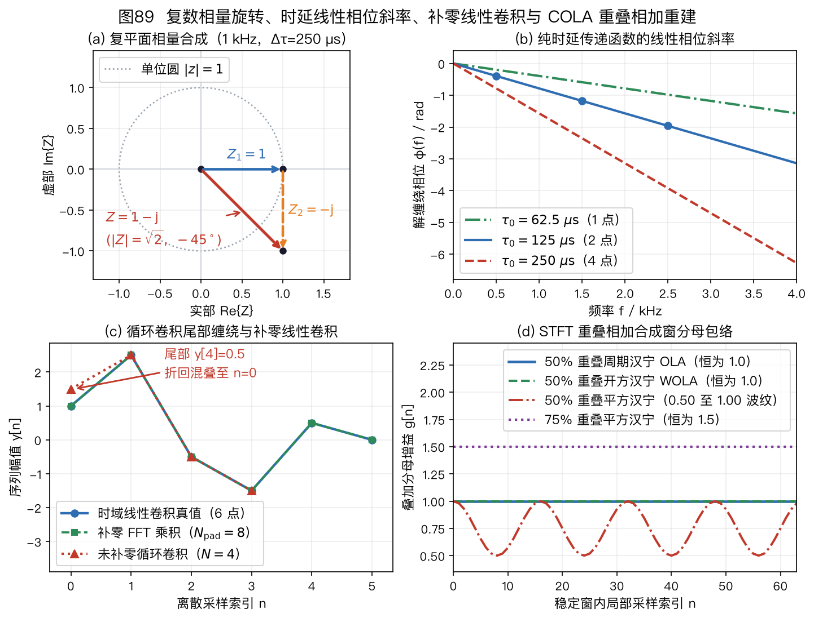
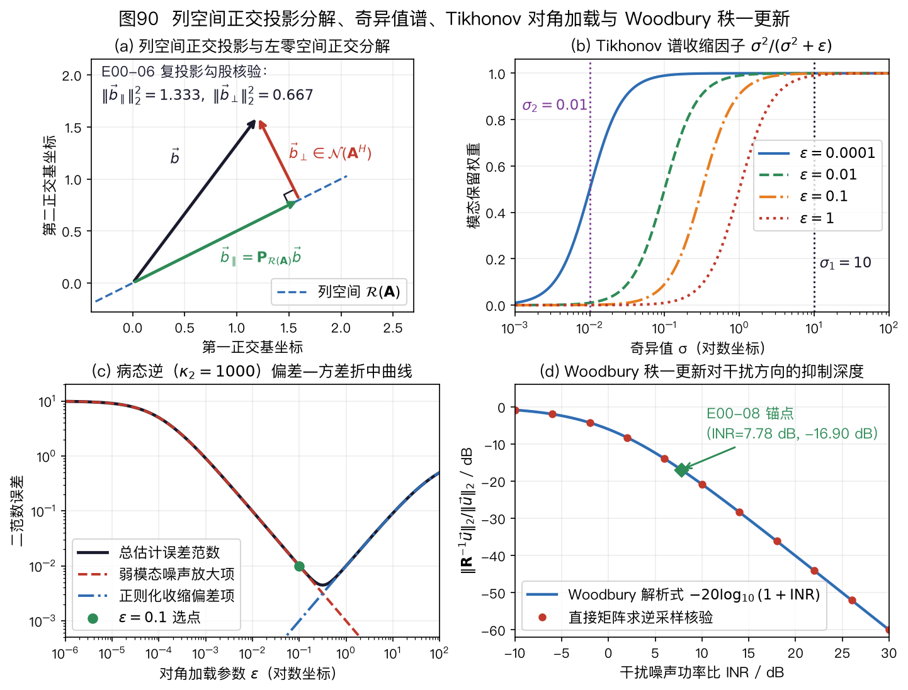
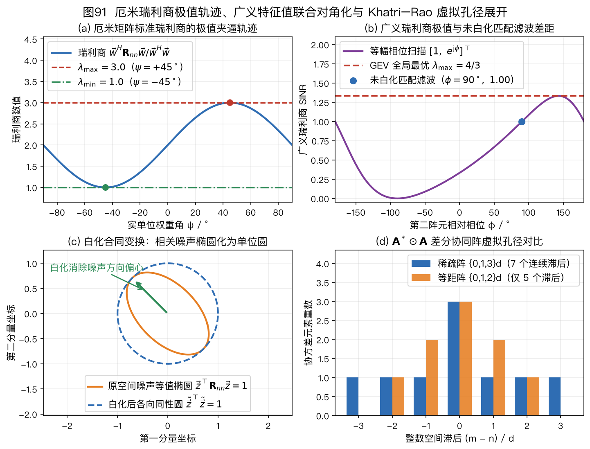

> 本篇是第 0 章（正文与扩展专题共 16 章，即第 0～15 章，其中第 12～15 章为四篇扩展专题，另有附录 A、B），系统推导并串讲全书第 1～15 章与附录 A、B 用到的全部核心数学工具、几何直觉、手算算例与工程失效边界；熟悉相关基础的读者亦可按 §0.8 检索表按需查阅。
>
> 导读首页：[00_overview.md](00_overview.md) ｜ 下一篇：[01_problem-definition.md](01_problem-definition.md)

---

## 0. 全书数学基础与信号分析预备

现代麦克风阵列信号处理横跨空间几何、傅里叶时频分析、复矩阵线性代数、复变微积分、统计估计与球面谐波展开。初学者阅读波束形成、声学回声消除或去混响文献时，受阻之处往往不在物理声学本身，而在推导途中频繁调用的复共轭内积约定、分块求逆引理、广义特征值白化、Wirtinger 共轭偏导或圆对称复高斯假设。

本章将全书第 1～15 章及附录 A、B 依赖的预备数学工具集中梳理成一条自包含的推导链：每引入一类算子或定理，先从可感知的几何或声学现象建立直觉，再一步不跳地推完核心代数恒等式，紧接着用小规模数字算例亲手复算，并指明模型退化或数值病态时的工程边界。本章全部算例与十六道可运行练习（`E00-01`～`E00-16`）均由纯 NumPy 数值核 `codes/chapters/ch00/core/chapter00_math.py` 与命令行入口 `codes/chapters/ch00/chapter00_exercises.py` 精确复现。

| 缩写 / 记号 | 中文名与英文全称 | 在本章与全书中的作用 |
|---|---|---|
| DFT / STFT | 离散傅里叶变换 / 短时傅里叶变换（Discrete / Short-Time Fourier Transform） | 将时域离散卷积转化为逐频点复数相量代数与窄带空间滤波 |
| COLA / WOLA | 恒定重叠相加 / 加权重叠相加（Constant / Weighted Overlap-Add） | 保障分帧加窗频域处理后时域波形无失真拼接的窗函数充要条件 |
| SVD | 奇异值分解（Singular Value Decomposition） | 诊断传播矩阵有效秩与二范数条件数，量化病态求逆的噪声放大倍数 |
| GEV / GEVD | 广义特征值问题 / 分解（Generalized Eigenvalue Problem / Decomposition） | 在有色相关噪声下通过白化合同变换求解最大信干噪比波束权重 |
| MVDR / LCMV | 最小方差无失真响应 / 线性约束最小方差（Minimum Variance Distortionless Response / Linearly Constrained Minimum Variance） | 复线性等式约束二次规划在单方向保真与多方向零陷设计中的闭式解 |
| NNLS / MM | 非负最小二乘 / 主化—最小化（Non-Negative Least Squares / Majorization-Minimization） | 处理声源功率非负约束与非光滑稀疏/重加权目标函数的迭代优化框架 |
| Proper $\mathcal{CN}$ | 圆对称复高斯分布（Circularly Symmetric / Proper Complex Gaussian） | 频域语音与噪声统计建模基石，要求均值与伪协方差同时为零 |
| CRLB | 克拉美—罗下界（Cramér–Rao Lower Bound） | 任意无偏估计量的最小方差理论极限，刻画孔径、频带与信噪比对定位精度的制约 |

### 0.1 三角恒等式、三维空间几何与球面坐标系

#### 0.1.1 和差化积、积化和差与阵列空间方向图因子

阵列处理的起点是“同一声源到达不同位置麦克风存在路程差，而路程差在窄带正弦波上表现为相位差”。把多路带有等差相位的正弦波或复指数相加时，主瓣宽度与旁瓣零陷完全由三角和差恒等式决定。对任意实角度 $\alpha, \beta \in \mathbb{R}$，两角和差公式与积化和差、和差化积恒等式为：

$$\begin{aligned}
\cos(\alpha \mp \beta) &= \cos\alpha\cos\beta \pm \sin\alpha\sin\beta\text{，}\\
\cos\alpha + \cos\beta &= 2\cos\!\left(\frac{\alpha+\beta}{2}\right)\cos\!\left(\frac{\alpha-\beta}{2}\right)\text{，}\\
1 - \cos\delta &= 2\sin^2\!\left(\frac{\delta}{2}\right)\text{。}
\end{aligned}\tag{0-1}$$

式(0-1)第三行半角公式在阵列分析中几乎无处不在。例如双元麦克风对相位差为 $\psi$ 的等幅信号做同相相加时，合成模平方 $|1 + e^{-\mathrm{j}\psi}|^2 = (1 + \cos\psi)^2 + \sin^2\psi = 2(1 + \cos\psi) = 4\cos^2(\psi/2)$；改为反相相减构成一阶差分心形或偶极子拾音时（见[第 15 章 §15.3](15_target-extraction-diarization.md#sec-15-3) 近场距离气泡），合成模平方立刻化为 $|1 - e^{-\mathrm{j}\psi}|^2 = 2(1 - \cos\psi) = 4\sin^2(\psi/2)$，无需展开冗长的复数乘积即可一眼读出零点位置 $\psi = 2m\pi$ 与峰值位置 $\psi = (2m+1)\pi$。

#### 0.1.2 平面与球面余弦定理、菲涅耳二阶展开及远场判据

为了判断多米外的说话人究竟该用球面波还是平面波建模，我们在三维欧氏空间 $\mathbb{R}^3$ 中建立精确的几何距离方程。设参考原点位于阵列几何中心 $\vec 0$，声源位于距离原点 $r = \|\vec p\|_2 > 0$、单位指源方向向量为 $\vec u$（满足 $\|\vec u\|_2 = 1$）的位置 $\vec p = r\vec u$；第 $m$ 支麦克风位于 $\vec r_m$，记其离原点的径向偏移为 $\rho_m = \|\vec r_m\|_2$，且阵元与声源方向夹角余弦为 $\cos\gamma_m = (\vec r_m^\top \vec u)/\rho_m$。由向量差范数展开得精确传播距离 $r_m = \|\vec p - \vec r_m\|_2$：

$$\begin{aligned}
r_m &= \|\,r\vec u - \vec r_m\,\|_2
= \sqrt{(r\vec u - \vec r_m)^\top(r\vec u - \vec r_m)}\\
&= \sqrt{r^2 - 2r\,\vec r_m^\top\vec u + \|\vec r_m\|_2^2}
= r\sqrt{1 - \frac{2\,\vec r_m^\top\vec u}{r} + \frac{\rho_m^2}{r^2}}\text{。}
\end{aligned}\tag{0-2}$$

当声源距离显著大于阵列尺寸（$\rho_m / r \ll 1$）时，令小量 $\xi = -\frac{2\,\vec r_m^\top\vec u}{r} + \frac{\rho_m^2}{r^2}$，对 $\sqrt{1+\xi}$ 在 $\xi = 0$ 处作二阶泰勒展开 $\sqrt{1+\xi} = 1 + \frac{1}{2}\xi - \frac{1}{8}\xi^2 + O(\xi^3)$。将 $\xi$ 与 $\xi^2 = \frac{4(\vec r_m^\top\vec u)^2}{r^2} + O(\rho_m^3/r^3)$ 代入并整理到 $r^{-1}$ 阶，便得到连接远场与近场的**二阶菲涅耳（Fresnel）程差展开式**：

$$\begin{aligned}
\Delta r_m &= r_m - r\\
&= r\Biggl[\frac{1}{2}\left(-\frac{2\,\vec r_m^\top\vec u}{r} + \frac{\rho_m^2}{r^2}\right)\\
&\quad - \frac{1}{8}\cdot\frac{4(\vec r_m^\top\vec u)^2}{r^2} + O\!\left(\frac{\rho_m^3}{r^3}\right)\Biggr]\\
&= \underbrace{-\vec r_m^\top\vec u}_{\text{一阶远场平面波项 }\Delta r_{m,1}}
+ \underbrace{\frac{\|\vec r_m\|_2^2 - (\vec r_m^\top\vec u)^2}{2r}}_{\text{二阶球面波曲率项}}
+ O\!\left(\frac{\rho_m^3}{r^2}\right)\text{。}
\end{aligned}\tag{0-3}$$

在沿 $x$ 轴放置的一维线阵中，$\vec r_m = [x_m, 0, 0]^\top$，若声源位于水平面（俯仰角为 $0^\circ$）且相对正横 $+y$ 轴顺时针偏角为 $\theta$，则 $\vec r_m^\top\vec u = x_m\sin\theta$，于是 $\|\vec r_m\|_2^2 - (\vec r_m^\top\vec u)^2 = x_m^2(1 - \sin^2\theta) = x_m^2\cos^2\theta$。式(0-3)清楚揭示了[第 2 章 §2.2](02_basics-signal-model.md#sec-2-2) 远场夫琅禾费（Fraunhofer）距离 $r_{\mathrm{F}} = 2D^2/\lambda$ 的来历：设阵列总孔径为 $D$，阵元相对中心的最大偏距为 $|x_m| \le D/2$，在正横方向（$\cos\theta = 1$）二阶曲率程差达到最大 $\Delta r_{\mathrm{curv},\max} = \frac{(D/2)^2}{2r} = \frac{D^2}{8r}$。工程上要求整个孔径边缘的球面曲率相位误差 $\frac{2\pi}{\lambda}\Delta r_{\mathrm{curv},\max}$ 不超过 $\frac{\pi}{8}\ \mathrm{rad}$（$22.5^\circ$，保证同相叠加损耗小于 $0.1\ \mathrm{dB}$），解不等式 $\frac{2\pi}{\lambda}\cdot\frac{D^2}{8r} \le \frac{\pi}{8}$，两边消去 $\pi/8$ 立得 $r \ge \frac{2D^2}{\lambda}$。

此外，当需要直接由两组球面角 $(\theta_1, \phi_{\mathrm{el},1})$ 与 $(\theta_2, \phi_{\mathrm{el},2})$ 计算两声源方向之间的空间张角 $\gamma \in [0, \pi]$ 时，将两单位方向向量作欧氏点积即得**球面余弦定理**：

$$\cos\gamma = \vec u_1^\top\vec u_2
= \sin\phi_{\mathrm{el},1}\sin\phi_{\mathrm{el},2}
+ \cos\phi_{\mathrm{el},1}\cos\phi_{\mathrm{el},2}\cos(\theta_1 - \theta_2)\text{。}\tag{0-4}$$

#### 0.1.3 四套常用空间坐标系的精确换算桥

跨阅阵列文献与开源库代码时，最容易引发静默方向翻转的隐患是角度零点与旋向约定不同。全书涉及四套常用三维坐标表示：

1. **右手笛卡尔坐标系 $(x, y, z)$**：所有球面参数化的共同三维欧氏基底，阵元位置 $\vec r_m$ 与声源位置 $\vec p = r\vec u$ 均在此基底下求内积与范数。
2. **本书平面阵列参考系（第 2～13 章默认）**：阵元沿 $x$ 轴排列，$+y$ 轴为正前方正横（broadside，$\theta_{\mathrm{book}} = 0^\circ$），水平方位角 $\theta_{\mathrm{book}}$ 从 $+y$ 轴向 $+x$ 轴**顺时针**旋转为正，俯仰角 $\phi_{\mathrm{el}} \in [-90^\circ, +90^\circ]$ 从水平面朝 $+z$ 轴向上度量。
3. **同基底球谐函数极角系（[第 5 章 §5.8](05_beamforming.md#sec-5-8) 与 §0.7）**：与第 1、2 项共用同一笛卡尔轴 $(x, y, z)$，采用从 $+x$ 轴向 $+y$ 轴**逆时针**起算的水平方位角 $\alpha \in (-\pi, \pi]$，以及从天顶 $+z$ 轴向下起算的极角（余纬角，colatitude）$\vartheta \in [0, \pi]$。
4. **听者局部全景声 AmbiX 与 AES69（`SOFA`）系（[第 1 章 SOFA 坐标对照](01_problem-definition.md#sec-u-fc1c3d209e) 与[第 14 章 §14.2](14_spatial-wearable-arrays.md#sec-14-2)）**：听者正前方定义为 $+x_{\mathrm{A}}$、正左方为 $+y_{\mathrm{A}}$、正上方为 $+z_{\mathrm{A}}$，水平方位角从正前向正左**逆时针**度量为正，俯仰角从水平面向上为正。若以同一听者正前方对齐本书 $+y$ 正横轴，则 $\phi_{\mathrm{SOFA}} = -\theta_{\mathrm{book}}$；若在共享笛卡尔轴 $(x, y, z)$ 下直接比较逆时针角 $(\alpha, \phi_{\mathrm{el}}, r)$ 与本书角度 $(\theta_{\mathrm{book}}, \phi_{\mathrm{el}}, r)$，则满足严格换算：

$$\begin{aligned}
\alpha &= 90^\circ - \theta_{\mathrm{book}}\pmod{360^\circ}\text{（折叠至 }(-180^\circ, 180^\circ]\text{），}\qquad
\vartheta = 90^\circ - \phi_{\mathrm{el}}\text{，}\\
\vec u &= \begin{bmatrix}
\cos\phi_{\mathrm{el}}\sin\theta_{\mathrm{book}}\\
\cos\phi_{\mathrm{el}}\cos\theta_{\mathrm{book}}\\
\sin\phi_{\mathrm{el}}
\end{bmatrix}
= \begin{bmatrix}
\sin\vartheta\cos\alpha\\
\sin\vartheta\sin\alpha\\
\cos\vartheta
\end{bmatrix}\text{，}\qquad
\vec p = r\vec u\text{。}
\end{aligned}\tag{0-5}$$

由笛卡尔坐标 $\vec p = [x, y, z]^\top \neq \vec 0$ 反解球面参数时，先求径向距离 $r = \sqrt{x^2+y^2+z^2}$ 与俯仰角 $\phi_{\mathrm{el}} = \arcsin(z/r)$，再用双参数四象限反正切求方位角 $\theta_{\mathrm{book}} = \operatorname{atan2}(x, y)$（注意本书 $\theta_{\mathrm{book}}$ 以 $x$ 为分子、$y$ 为分母，而逆时针角 $\alpha = \operatorname{atan2}(y, x)$ 以 $y$ 为分子、$x$ 为分母；天顶 $|z| = r$ 处水平投影为零，方位角无唯一定义）。

**锚点手算 0-1（坐标桥与近场菲涅耳程差复算，对应 `E00-01`）。**

- **（1）三维坐标桥与球面正交夹角**：给定本书球面坐标 $\theta_{\mathrm{book}} = 30^\circ$、$\phi_{\mathrm{el}} = 45^\circ$、距离 $r = 1.5\ \mathrm{m}$，代入式(0-5)得逆时针角 $\alpha = 90^\circ - 30^\circ = 60^\circ$、余纬角 $\vartheta = 90^\circ - 45^\circ = 45^\circ$。因 $\sin 30^\circ = 1/2$、$\cos 30^\circ = \sqrt{3}/2$、$\sin 45^\circ = \cos 45^\circ = \sqrt{2}/2$，指源单位向量 $\vec u$ 为 $[\frac{\sqrt{2}}{4}, \frac{\sqrt{6}}{4}, \frac{\sqrt{2}}{2}]^\top$（约为 $[0.353553, 0.612372, 0.707107]^\top$），三维笛卡尔坐标 $\vec p = 1.5\vec u$ 为 $[\frac{3\sqrt{2}}{8}, \frac{3\sqrt{6}}{8}, \frac{3\sqrt{2}}{4}]^\top\ \mathrm{m}$（约为 $[0.530330, 0.918559, 1.060660]^\top\ \mathrm{m}$）。再取水平面方向 $(\theta_2, \phi_{\mathrm{el},2}) = (-60^\circ, 0^\circ)$，因 $\theta_1 - \theta_2 = 90^\circ$，式(0-4)立得 $\cos\gamma = 0 + \cos 45^\circ \cdot 1 \cdot \cos 90^\circ = 0$，两方向严格正交（$\gamma = 90^\circ$）。
- **（2）近场菲涅耳程差与相位误差**：设声速 $c = 343\ \mathrm{m/s}$、频率 $f = 3430\ \mathrm{Hz}$（波长 $\lambda = 0.10\ \mathrm{m}$），线阵孔径 $D = 0.20\ \mathrm{m}$，夫琅禾费远场边界为 $r_{\mathrm{F}} = 2(0.20)^2 / 0.10 = 0.80\ \mathrm{m}$。考察位于近场区 $r = 0.50\ \mathrm{m} < r_{\mathrm{F}}$、偏角 $\theta = 30^\circ$ 的声源到达右侧阵元 $x_m = +0.10\ \mathrm{m}$ 的程差：由式(0-2)算得精确距离 $r_m = \sqrt{0.25 - 2(0.50)(0.10)(0.5) + 0.01} = \sqrt{0.21} \approx 0.458258\ \mathrm{m}$，精确程差 $\Delta r_{\mathrm{exact}} = \sqrt{0.21} - 0.50 \approx -0.041742\ \mathrm{m}$。一阶平面波近似给出 $\Delta r_1 = -0.10\sin 30^\circ = -0.050000\ \mathrm{m}$，程差误差达 $8.258\ \mathrm{mm}$，折合相位误差 $29.73^\circ$（突破 $22.5^\circ$ 远场容限）；改用式(0-3)二阶菲涅耳近似 $\Delta r_2 = -0.05 + \frac{0.01 \times 0.75}{2 \times 0.50} = -0.042500\ \mathrm{m}$ 后，残余程差误差骤降至 $0.758\ \mathrm{mm}$（相位误差仅 $2.73^\circ$，精度提升近 $11$ 倍）。

**这个例子说明了什么？** 当说话人走近到半米以内时，平面波模型会产生近 $30^\circ$ 的系统性相位失配，而二阶菲涅耳球面曲率项不仅能修复这一偏置，还提供了第 15 章近场距离气泡区分远近声源的物理曲率信息。**结论在哪些条件下不成立？** 当声源贴近到与孔径同量级（$|x_m|/r \to 1$）时，泰勒级数高阶余项不再可忽略，此时应直接调用式(0-2)精确平方根而不做多项式截断。

#### 0.1.4 三维正交旋转群 $\mathrm{SO}(3)$ 复合、非交换性与主动/被动逆映射

在运动阵列追踪（[第 9 章 §9.4](09_source-tracking.md#sec-9-4)）与可穿戴头部追踪渲染（[第 14 章 §14.3](14_spatial-wearable-arrays.md#sec-14-3)）中，刚体姿态旋转由满足正交性 $\mathbf R^\top\mathbf R = \mathbf I_3$ 且保持右手定向 $\det\mathbf R = +1$ 的三阶特殊正交群 $\mathrm{SO}(3) \subset \mathbb{R}^{3\times 3}$ 描述。右手系下绕 $+z$（偏航 yaw）、$+y$（俯仰 pitch）、$+x$（横滚 roll）的基元旋转矩阵分别为：

$$\begin{aligned}
\mathbf R_z(\alpha) &= \begin{bmatrix}
\cos\alpha & -\sin\alpha & 0\\
\sin\alpha & \cos\alpha & 0\\
0 & 0 & 1
\end{bmatrix}\text{，}\\
\mathbf R_y(\beta) &= \begin{bmatrix}
\cos\beta & 0 & \sin\beta\\
0 & 1 & 0\\
-\sin\beta & 0 & \cos\beta
\end{bmatrix}\text{，}\\
\mathbf R_x(\gamma) &= \begin{bmatrix}
1 & 0 & 0\\
0 & \cos\gamma & -\sin\gamma\\
0 & \sin\gamma & \cos\gamma
\end{bmatrix}\text{。}
\end{aligned}\tag{0-6}$$

正交性 $\mathbf R^\top\mathbf R = \mathbf I_3$ 带来两条核心推论：第一，旋转严格保持欧氏内积与向量长度不变，即 $\|\mathbf R\vec v\|_2^2 = \vec v^\top\mathbf R^\top\mathbf R\vec v = \|\vec v\|_2^2$；第二，求逆运算无需高斯消元，$\mathbf R^{-1} = \mathbf R^\top$。在工程实现中必须严格区分两件事：一是**三维有限角旋转不可交换**（如 `E00-02` 中先绕 $y$ 轴转 $90^\circ$ 再绕 $z$ 轴转 $90^\circ$ 将 $[1, 0, 0]^\top$ 映为 $[0, 0, -1]^\top$，而交换顺序后映为 $[0, 1, 0]^\top$，交换子 Frobenius 范数 $\|\mathbf R_z\mathbf R_y - \mathbf R_y\mathbf R_z\|_F = \sqrt{6} \approx 2.4495$）；二是**声源主动旋转与听者坐标系被动旋转互为转置逆**——若佩戴者头部相对世界系旋转了 $\mathbf R_{\mathrm{head}}$，则静止在世界系位置 $\vec v_{\mathrm{world}}$ 的声源在头部局部系下的坐标是 $\mathbf R_{\mathrm{head}}^\top\vec v_{\mathrm{world}}$，漏写转置会导致声像朝错误方向加倍偏转。

---

### 0.2 复数相量、分贝标度与傅里叶时频分析

#### 0.2.1 欧拉公式、正负频率共轭对与本书傅里叶核约定

实正弦信号在经过时延与线性滤波后，三角函数和差展开极为繁琐；引入虚数单位 $\mathrm{j} = \sqrt{-1}$ 与欧拉公式 $e^{\mathrm{j}\phi} = \cos\phi + \mathrm{j}\sin\phi$ 后，“时间平移”立刻简化为“复数相乘”。对任意复数 $z = a + \mathrm{j}b = |z|e^{\mathrm{j}\phi} \in \mathbb{C}$，其模平方为 $|z|^2 = zz^* = a^2 + b^2$，实弦波 $\cos(2\pi f_0 t + \varphi)$ 可分解为一对共轭旋转相量之和 $\frac{1}{2}e^{\mathrm{j}\varphi}e^{+\mathrm{j}2\pi f_0 t}$ 与 $\frac{1}{2}e^{-\mathrm{j}\varphi}e^{-\mathrm{j}2\pi f_0 t}$。

本书全书统一采用**前向傅里叶核 $e^{-\mathrm{j}2\pi f t}$**（逆变换合成核为 $e^{+\mathrm{j}2\pi f t}$）。在此约定下，若连续信号 $x(t)$ 经传播延迟 $\tau_0 > 0$ 变为 $y(t) = x(t - \tau_0)$，令积分变量代换 $u = t - \tau_0$（$\mathrm{d}t = \mathrm{d}u$）：

$$\begin{aligned}
Y(f) &= \int_{-\infty}^{\infty} x(t - \tau_0)\,e^{-\mathrm{j}2\pi f t}\,\mathrm{d}t
= \int_{-\infty}^{\infty} x(u)\,e^{-\mathrm{j}2\pi f(u + \tau_0)}\,\mathrm{d}u\\
&= e^{-\mathrm{j}2\pi f\tau_0}\int_{-\infty}^{\infty} x(u)\,e^{-\mathrm{j}2\pi f u}\,\mathrm{d}u
= e^{-\mathrm{j}2\pi f\tau_0}\,X(f)\text{。}
\end{aligned}\tag{0-7}$$

式(0-7)给出了阵列信号处理最核心的物理映射：**迟到 $\tau_0 > 0$ 的信号在正频率 $f > 0$ 处产生负相位滞后 $\phi(f) = -2\pi f\tau_0$**，且解缠绕相位关于频率 $f$ 呈过原点的严格直线，其斜率负值除以 $2\pi$ 即还原群延迟 $\tau_g = -\frac{1}{2\pi}\frac{\mathrm{d}\phi(f)}{\mathrm{d}f} = \tau_0$（见[第 2 章 §2.3](02_basics-signal-model.md#sec-2-3) 与[第 4 章 §4.2](04_doa-estimation.md#sec-4-2) GCC-PHAT）。同时，由于实值信号满足 $x(t) = x^*(t)$，其频谱必然满足厄米共轭对称性 $X(-f) = X^*(f)$：负频率相量 $e^{-\mathrm{j}2\pi(-f)\tau_0} = e^{+\mathrm{j}2\pi f\tau_0}$ 自动翻转符号，与正频率共同保证逆变换合成波形严格为实数。

#### 0.2.2 功率分贝 $10\log_{10}$ 与幅值分贝 $20\log_{10}$ 及块统计陷阱

声压与电子信号跨越数个数量级，工程中普遍使用以 $10$ 为底的对数分贝（$\mathrm{dB}$）度量相对比值。分贝的定义始终锚定在**功率（或能量、均方值、方差）之比**上；当且仅当被比较的两个物理量在同一阻抗或同一归一化基准下满足功率与幅值模平方成正比（$P \propto |A|^2$）时，对数幂次法则 $\log_{10}(|A_2/A_1|^2) = 2\log_{10}(|A_2|/|A_1|)$ 才把前缀系数从 $10$ 变成 $20$：

$$\Delta L_{\mathrm{dB}} = 10\log_{10}\!\left(\frac{P_2}{P_1}\right)
= 10\log_{10}\!\left(\frac{|A_2|^2}{|A_1|^2}\right)
= 20\log_{10}\!\left(\frac{|A_2|}{|A_1|}\right)\text{。}\tag{0-8}$$

利用式(0-8)可以当场算清[第 1 章](01_problem-definition.md)阵列增益的账本：设 $M = 4$ 支麦克风的目标信号已精确对齐且幅值均为 $1$，同相求和后目标幅值变为 $4$ 倍（功率变为 $4^2 = 16$ 倍），目标增益按幅值算 $20\log_{10}(4) \approx +12.04\ \mathrm{dB}$ 与按功率算 $10\log_{10}(16) \approx +12.04\ \mathrm{dB}$ 完全相等；而四路互不相关、方差均为 $\sigma^2$ 的白噪声相加后，**方差（功率）按线性可加性变为 $4\sigma^2$**（均方根幅值仅变为 $\sqrt{4} = 2$ 倍），故噪声增益为 $10\log_{10}(4) = 20\log_{10}(2) \approx +6.02\ \mathrm{dB}$，两者相减即得四麦白噪声信噪比增益 $+6.02\ \mathrm{dB}$。

评测多帧长语音的信噪比或回声返回损失增强（ERLE，见[第 6 章 §6.7](06_aec.md#sec-6-7)）时，还要警惕对数凹函数引发的**詹森（Jensen）不等式统计顺序差异**：对正功率比序列 $\{r_b\}_{b=1}^B$，先逐帧取 $\mathrm{dB}$ 再算术平均得到的是几何均值的分贝 $\frac{1}{B}\sum_b 10\log_{10} r_b = 10\log_{10}(\prod_b r_b)^{1/B}$，恒小于等于先汇总平均功率再取分贝 $10\log_{10}(\frac{1}{B}\sum_b r_b)$。例如两段等长帧的功率比分别为 $1$（$0\ \mathrm{dB}$）和 $99$（$19.96\ \mathrm{dB}$），逐帧 $\mathrm{dB}$ 均值仅为 $+9.98\ \mathrm{dB}$，而总能量比的 $\mathrm{dB}$ 值为 $10\log_{10}(50) \approx +16.99\ \mathrm{dB}$，两者相差逾 $7\ \mathrm{dB}$（见 `E00-03`）。

#### 0.2.3 离散傅里叶变换（DFT）、帕塞瓦尔定理与补零线性卷积等价

对有限长 $N$ 点序列 $x[0], \ldots, x[N-1]$，标准前向 DFT 与逆变换 IDFT 定义为：

$$\begin{aligned}
X[k] &= \sum_{n=0}^{N-1} x[n]\,e^{-\mathrm{j}\frac{2\pi}{N}kn}\qquad(0 \le k < N)\text{，}\\
x[n] &= \frac{1}{N}\sum_{k=0}^{N-1} X[k]\,e^{+\mathrm{j}\frac{2\pi}{N}kn}\qquad(0 \le n < N)\text{。}
\end{aligned}\tag{0-9}$$

证明**帕塞瓦尔（Parseval）能量守恒定理**只需用到单位根正交和 $\sum_{k=0}^{N-1} e^{-\mathrm{j}\frac{2\pi}{N}k(n-m)} = N\delta[n-m]$（当 $n=m$ 时 $N$ 个 $1$ 相加得 $N$；当 $n\neq m$ 时由等比数列求和分子 $1 - e^{-\mathrm{j}2\pi(n-m)} = 0$ 严格归零）。展开频域模平方和并交换有限求和次序：

$$\begin{aligned}
\frac{1}{N}\sum_{k=0}^{N-1}\lvert X[k]\rvert^2
&= \frac{1}{N}\sum_{k=0}^{N-1}\left(\sum_{n=0}^{N-1}x[n]e^{-\mathrm{j}\frac{2\pi}{N}kn}\right)
\left(\sum_{m=0}^{N-1}x^*[m]e^{+\mathrm{j}\frac{2\pi}{N}km}\right)\\
&= \sum_{n=0}^{N-1}\sum_{m=0}^{N-1}x[n]x^*[m]
\underbrace{\left(\frac{1}{N}\sum_{k=0}^{N-1}e^{-\mathrm{j}\frac{2\pi}{N}k(n-m)}\right)}_{\delta[n-m]}
= \sum_{n=0}^{N-1}\lvert x[n]\rvert^2\text{。}
\end{aligned}\tag{0-10}$$

当我们在频域把两个 $N$ 点 DFT 直接逐点相乘 $Y_{\mathrm{circ}}[k] = X[k]H[k]$ 再做 $N$ 点 IDFT 时，单位根的模 $N$ 周期性使时域对应的是**模 $N$ 循环卷积（circular convolution）**而非物理房间的因果**线性卷积（linear convolution）**。设输入帧 $x[n]$ 非零区间长度为 $L_x$，滤波器 $h[n]$ 非零区间长度为 $L_h$，则完整线性卷积 $y_{\mathrm{lin}}[n] = \sum_{m=0}^{L_h-1} h[m]x[n-m]$ 的非零区间总长度为 $L_{\mathrm{lin}} = L_x + L_h - 1$。若未补零直接取 $N = L_x$，则线性卷积位于 $n \ge N$ 的 $L_h - 1$ 个拖尾样本会按 $n \bmod N$ 折回叠加到帧首 $n = 0, \ldots, L_h - 2$ 处，产生时域循环混叠（见[附录 A §16.3.3](16_appendix-symbols-math.md#sec-16-3-3) 与[第 6 章 §6.2.1](06_aec.md#sec-6-2-1) 频域块自适应滤波重叠保留法）。消除循环混叠的充要条件是在变换前将两序列末尾补零至点数 $N_{\mathrm{pad}}$ 满足：

$$\begin{aligned}
N_{\mathrm{pad}} &\ge L_x + L_h - 1\\
\Longrightarrow\quad
\operatorname{IDFT}_{N_{\mathrm{pad}}}\!\bigl\{X_{\mathrm{pad}}[k]\,H_{\mathrm{pad}}[k]\bigr\}[n]
&= (x * h)[n]\quad(0 \le n < L_x + L_h - 1)\text{。}
\end{aligned}\tag{0-11}$$

**锚点手算 0-2（帕塞瓦尔能量与循环混叠复算，对应 `E00-04`）。**

取 $L_x = 4$ 点输入 $x = [1, 2, -1, 0]^\top$ 与 $L_h = 3$ 点脉冲响应 $h = [1, 0.5, -0.5]^\top$。时域能量为 $1^2 + 2^2 + (-1)^2 + 0^2 = 6$；按式(0-9)手算 $4$ 点 DFT（旋转因子 $e^{-\mathrm{j}\pi/2} = -\mathrm{j}$）得 $X[0] = 2$、$X[1] = 1 + 2(-\mathrm{j}) + (-1)(-1) = 2 - \mathrm{j}2$、$X[2] = 1 - 2 - 1 = -2$、$X[3] = 2 + \mathrm{j}2$，频域能量 $\frac{1}{4}(4 + 8 + 4 + 8) = 6$，与式(0-10)分毫不差。

再算 $L_{\mathrm{lin}} = 4 + 3 - 1 = 6$ 点线性卷积得 $y_{\mathrm{lin}} = [1.0, 2.5, -0.5, -1.5, 0.5, 0.0]^\top$。若直接用未补零的 $N = 4$ 点 FFT 相乘求逆，第 $n = 4$ 点的尾部真值 $+0.5$ 会折回加在 $n = 4 \bmod 4 = 0$ 处，使首点从 $1.0$ 篡改为 $1.5$（误差二范数 $0.5$）；而补零至 $N_{\mathrm{pad}} = 8 \ge 6$ 后，前 $6$ 点输出恢复精确真值（浮点误差 $< 10^{-16}$）。

#### 0.2.4 短时傅里叶变换（STFT）频谱泄漏与 COLA / WOLA 完美重建条件

语音与环境声是非平稳过程，工程前端采用窗长为 $N$、帧移（hop size）为 $H$ 的滑动分析窗 $w_a[n]$ 将长信号切分为重叠短帧，计算每帧频谱 $X(k, \ell) = \sum_{r=0}^{N-1} x[\ell H + r]w_a[r]e^{-\mathrm{j}2\pi kr/N}$。若后续未改动频谱直接经逆变换乘以合成窗 $w_s[r]$ 并按帧移 $H$ 累加回时域，第 $n$ 个采样点上的总输出为 $\hat x[n] = \sum_{\ell} x[n]\,w_a[n - \ell H]w_s[n - \ell H]$。因此，在已被完整帧覆盖的稳定内部区间上，时域波形无失真重建（$\hat x[n] = x[n]$）的充要条件是**加权恒定重叠相加（COLA / WOLA）条件**：

$$g[n] \triangleq \sum_{\ell \in \mathbb{Z}} w_a[n - \ell H]\,w_s[n - \ell H] = 1\qquad(\forall\,n \in \mathbb{Z})\text{。}\tag{0-12}$$

考察全书最常用的**周期型（DFT-even）汉宁窗** $w_{\mathrm{Hann}}[r] = \frac{1}{2}\bigl(1 - \cos\frac{2\pi r}{N}\bigr)$（$0 \le r < N$，注意分母是 $N$ 而非对称滤波器设计的 $N-1$）。当帧移取 $50\%$ 重叠（$H = N/2$）时，同一时刻恰有相邻两帧 $r$ 与 $r + N/2$ 叠加，因 $\cos\bigl(\frac{2\pi(r+N/2)}{N}\bigr) = \cos(\frac{2\pi r}{N} + \pi) = -\cos\frac{2\pi r}{N}$，余弦项正负精确抵消：

$$\begin{aligned}
w_{\mathrm{Hann}}[r] + w_{\mathrm{Hann}}\!\left[r + \frac{N}{2}\right]
&= \frac{1}{2}\left(1 - \cos\frac{2\pi r}{N}\right)
+ \frac{1}{2}\left(1 + \cos\frac{2\pi r}{N}\right)\\
&= 1\text{。}
\end{aligned}\tag{0-13}$$

式(0-13)同时给出了两种工业标准配对：（1）分析端用周期汉宁窗 $w_a = w_{\mathrm{Hann}}$、合成端用矩形窗 $w_s = 1$（纯 OLA）；（2）分析端与合成端对称使用**开方汉宁窗** $w_a = w_s = \sqrt{w_{\mathrm{Hann}}}$（WOLA，既压低频域掩码修改后的帧边缘截断伪影，又保持乘积 $w_a w_s = w_{\mathrm{Hann}}$ 满足 $50\%$ 重叠相加恒为 $1$）。反之，若误在 $50\%$ 重叠下对分析与合成两端都乘完整汉宁窗且不做分母归一，叠加增益 $w_{\mathrm{Hann}}^2[r] + w_{\mathrm{Hann}}^2[r+N/2]$ 会变为 $\frac{3}{4} + \frac{1}{4}\cos\frac{4\pi r}{N} \in [0.50, 1.00]$，给输出强加高达 $6.02\ \mathrm{dB}$ 的周期性幅度颤音（若要用双端完整汉宁窗且保持恒定分母，须将重叠率提高到 $75\%$ 即 $H = N/4$，此时常数分母为 $1.5$，除以 $1.5$ 即完美重建，见 `E00-05`）。



读图 89 时，可沿四个子图串联核对 §0.2 的时频核心结论：

- **子图 (a) 复平面相量合成**：在 $f = 1\ \mathrm{kHz}$ 处，直达路径相量 $Z_1 = 1$（蓝色实线箭头）与滞后 $\Delta\tau = 250\ \mu\mathrm{s}$（恰为四分之一周期，相移 $-\pi/2$）的第二路径相量 $Z_2 = -\mathrm{j}$（橙色虚线箭头）首尾相接，合成相量 $Z = 1 - \mathrm{j}$（红色箭头）模长为 $\sqrt{2} \approx 1.414$、相位滞后 $-45^\circ$。
- **子图 (b) 纯时延传递函数的线性相位斜率**：横轴为频率 $f \in [0, 4]\ \mathrm{kHz}$，纵轴为解缠绕相位 $\phi(f)$（单位：$\mathrm{rad}$）。$16\ \mathrm{kHz}$ 采样率下延迟 $1, 2, 4$ 个采样点（$62.5, 125, 250\ \mu\mathrm{s}$）对应三条过原点的负斜率直线，时延越大，相位随频率下倾越陡。
- **子图 (c) 循环卷积尾部缠绕与补零线性卷积**：蓝色圆点实线为 $6$ 点时域线性卷积真值，绿色方块虚线为补零至 $N_{\mathrm{pad}} = 8$ 的 FFT 乘积逆变换（两者逐点重合）；红色三角点线展示未补零 $N = 4$ 循环卷积把 $y[4] = 0.5$ 折回叠加到 $n = 0$ 形成 $1.5$ 的混叠失真。
- **子图 (d) STFT 重叠相加合成窗分母包络**：稳定窗内 $50\%$ 重叠周期汉宁 OLA（蓝色实线）与开方汉宁 WOLA（绿色虚线）分母恒定在 $1.0$；$75\%$ 重叠平方汉宁（紫色点线）恒定在 $1.5$；唯独未归一的 $50\%$ 重叠平方汉宁（红色点划线）在 $0.50$～$1.00$ 之间剧烈起伏。

---

### 0.3 复内积空间、子空间正交投影、奇异值分解与分块求逆

#### 0.3.1 复向量厄米内积、范数与柯西—施瓦茨不等式

进入多通道窄带频域后，$M$ 支麦克风在同一频点的复相量排成列向量 $\vec x \in \mathbb{C}^{M\times 1}$。复欧氏空间 $\mathbb{C}^M$ 与实空间 $\mathbb{R}^M$ 的根本区别在于：**内积必须对其中一个向量取复共轭**，否则向量与自身的内积 $z^2$ 可能为负数甚至虚数，无法定义长度与能量。本书统一将波束形成器线性输出定义为共轭内积 $y = \vec w^H \vec x = \sum_{m=1}^M w_m^* x_m$，配套的二范数平方为 $\|\vec x\|_2^2 = \vec x^H \vec x = \sum_{m=1}^M |x_m|^2 \ge 0$。对任意 $\vec u, \vec v \in \mathbb{C}^M$，**柯西—施瓦茨（Cauchy–Schwarz）不等式**断言：

$$\lvert\vec u^H \vec v\rvert^2 \le (\vec u^H \vec u)(\vec v^H \vec v) = \|\vec u\|_2^2\,\|\vec v\|_2^2\text{，}\tag{0-14}$$

且等号成立当且仅当 $\vec u$ 与 $\vec v$ 复共线（即存在复标量 $\alpha \in \mathbb{C}$ 使 $\vec u = \alpha\vec v$，或其中一向量为零）。*证明*：若 $\vec v = \vec 0$，两边均为 $0$；若 $\vec v \neq \vec 0$，构造差向量 $\vec r = \vec u - \alpha\vec v$ 并取最优投影系数 $\alpha = \frac{\vec v^H\vec u}{\vec v^H\vec v}$，展开非负范数平方 $\|\vec u - \alpha\vec v\|_2^2$ 得 $\vec u^H\vec u - \alpha\vec u^H\vec v - \alpha^*\vec v^H\vec u + |\alpha|^2\vec v^H\vec v$，化简为 $\|\vec u\|_2^2 - \frac{|\vec u^H\vec v|^2}{\|\vec v\|_2^2} \ge 0$，移项乘以 $\|\vec v\|_2^2$ 即证得式(0-14)，且仅当残差 $\vec r = \vec 0$（即 $\vec u = \alpha\vec v$）时取等号。这一等号条件直接给出了空间白噪声下匹配滤波器（延迟求和波束 $\vec w \propto \vec a$，见[第 5 章 §5.2](05_beamforming.md#sec-5-2)）最大化白噪声增益的初等几何证明。

#### 0.3.2 四个基本子空间与复列空间正交投影算子

设复矩阵 $\mathbf A \in \mathbb{C}^{M\times K}$（例如 $K$ 个干扰方向的阵列流形矩阵，满足 $M \ge K$ 且秩为 $r = \operatorname{rank}(\mathbf A)$）。线性代数基本定理将定义域 $\mathbb{C}^K$ 与到达域 $\mathbb{C}^M$ 拆分为两对正交补子空间（注意复空间必须配共轭转置 $\mathbf A^H$ 而绝非普通转置 $\mathbf A^\top$）：

| 基本子空间 | 数学定义 | 所在环境空间与维数 | 在阵列信号处理中的典型物理含义 |
|---|---|---|---|
| 列空间 $\mathcal R(\mathbf A)$ | $\{\mathbf A\vec z : \vec z \in \mathbb{C}^K\}$ | $\mathbb{C}^M$，维数 $r$ | $K$ 个声源导向矢量张成的信号（或已知干扰）子空间 |
| 左零空间 $\mathcal N(\mathbf A^H)$ | $\{\vec y \in \mathbb{C}^M : \mathbf A^H\vec y = \vec 0\}$ | $\mathbb{C}^M$，维数 $M - r$ | 与信号子空间正交的 MUSIC 噪声子空间或 GSC 阻塞子空间 |
| 行共轭空间 $\mathcal R(\mathbf A^H)$ | $\{\mathbf A^H\vec y : \vec y \in \mathbb{C}^M\}$ | $\mathbb{C}^K$，维数 $r$ | 可由阵列传感器观测唯一辨识的源幅度组合空间 |
| 零空间 $\mathcal N(\mathbf A)$ | $\{\vec z \in \mathbb{C}^K : \mathbf A\vec z = \vec 0\}$ | $\mathbb{C}^K$，维数 $K - r$ | 阵列因空间混叠或重列而完全失明的源模糊子空间 |

当 $\mathbf A$ 列满秩（$r = K$）时，给定任意观测向量 $\vec b \in \mathbb{C}^M$，在列空间 $\mathcal R(\mathbf A)$ 中寻找距离 $\vec b$ 最近的逼近向量 $\vec b_\parallel = \mathbf A\hat{\vec z}$，几何上等价于令残差向量 $\vec b_\perp = \vec b - \mathbf A\hat{\vec z}$ 落入左零空间 $\mathcal N(\mathbf A^H)$，即满足复正规方程 $\mathbf A^H(\vec b - \mathbf A\hat{\vec z}) = \vec 0$。因 Gram 矩阵 $\mathbf A^H\mathbf A \in \mathbb{C}^{K\times K}$ 严格正定可逆，解出 $\hat{\vec z} = (\mathbf A^H\mathbf A)^{-1}\mathbf A^H\vec b$，左乘 $\mathbf A$ 即得列空间正交投影算子与左零空间正交补投影算子：

$$\begin{aligned}
\mathbf P_{\mathcal R(\mathbf A)} &= \mathbf A(\mathbf A^H\mathbf A)^{-1}\mathbf A^H\text{，}\\
\mathbf P_{\mathcal R(\mathbf A)}^\perp &= \mathbf I_M - \mathbf P_{\mathcal R(\mathbf A)}\text{。}
\end{aligned}\tag{0-15}$$

任何合法正交投影矩阵 $\mathbf P$ 同时满足两条代数指纹：**厄米对称性** $\mathbf P^H = \mathbf P$ 与**幂等性** $\mathbf P^2 = \mathbf P$（投影两次等于投影一次），其特征值只能取 $1$ 或 $0$，且由迹循环置换律得 $\operatorname{tr}(\mathbf P_{\mathcal R(\mathbf A)})$ 等于 $\operatorname{tr}\bigl((\mathbf A^H\mathbf A)^{-1}\mathbf A^H\mathbf A\bigr) = \operatorname{tr}(\mathbf I_K) = K$，恰好等于子空间维数。利用内积 $\vec b_\parallel^H\vec b_\perp = \vec b^H\mathbf P^H(\mathbf I_M - \mathbf P)\vec b$ 化简为 $\vec b^H(\mathbf P - \mathbf P^2)\vec b = 0$，立得复空间勾股定理 $\|\vec b\|_2^2 = \|\vec b_\parallel\|_2^2 + \|\vec b_\perp\|_2^2$。在[第 4 章 §4.6](04_doa-estimation.md#sec-4-6) MUSIC 空间谱与[第 5 章 §5.6](05_beamforming.md#sec-5-6) 广义旁瓣对消器（GSC）阻塞矩阵设计中，$\mathbf P_{\mathcal R(\mathbf A)}^\perp$ 正是滤除目标或已知干扰子空间的精确算子。

**锚点手算 0-3（复列空间投影与勾股分解复算，对应 `E00-06`）。**

取满列秩矩阵 $\mathbf A \in \mathbb{C}^{3\times 2}$（第一列为 $[1, \mathrm{j}, 0]^\top$、第二列为 $[0, 1, -\mathrm{j}]^\top$）与观测向量 $\vec b = [1, 0, \mathrm{j}]^\top$（$\|\vec b\|_2^2 = 2$）。先写出共轭转置 $\mathbf A^H = \begin{bmatrix}1 & -\mathrm{j} & 0\\ 0 & 1 & \mathrm{j}\end{bmatrix}$（特别留意第三列 $-\mathrm{j}$ 取共轭变为 $+\mathrm{j}$），逐步算出 Gram 矩阵、逆矩阵、最小二乘坐标与正交分解：

$$\begin{aligned}
\mathbf A^H\mathbf A &= \begin{bmatrix}2 & -\mathrm{j}\\ \mathrm{j} & 2\end{bmatrix}\quad(\det = 3)\text{，}\qquad
(\mathbf A^H\mathbf A)^{-1} = \frac{1}{3}\begin{bmatrix}2 & \mathrm{j}\\ -\mathrm{j} & 2\end{bmatrix}\text{，}\\
\hat{\vec z} &= (\mathbf A^H\mathbf A)^{-1}\mathbf A^H\vec b
= \frac{1}{3}\begin{bmatrix}2 & \mathrm{j}\\ -\mathrm{j} & 2\end{bmatrix}\begin{bmatrix}1\\ -1\end{bmatrix}
= \frac{1}{3}\begin{bmatrix}2 - \mathrm{j}\\ -2 - \mathrm{j}\end{bmatrix}\text{，}\\
\vec b_\parallel &= \mathbf A\hat{\vec z} = \frac{1}{3}\begin{bmatrix}2 - \mathrm{j}\\ -1 + \mathrm{j}\\ -1 + \mathrm{j}2\end{bmatrix}\text{，}\qquad
\vec b_\perp = \vec b - \vec b_\parallel = \frac{1}{3}\begin{bmatrix}1 + \mathrm{j}\\ 1 - \mathrm{j}\\ 1 + \mathrm{j}\end{bmatrix}\text{。}
\end{aligned}$$

核算共轭内积 $\vec b_\parallel^H\vec b_\perp$ 等于 $\frac{1}{9}\bigl((2+\mathrm{j})(1+\mathrm{j}) + (-1-\mathrm{j})(1-\mathrm{j}) + (-1-\mathrm{j}2)(1+\mathrm{j})\bigr)$，逐项相加得 $\frac{1}{9}\bigl((1+\mathrm{j}3) - 2 + (1-\mathrm{j}3)\bigr) = 0$；范数平方分别为 $\|\vec b_\parallel\|_2^2 = \frac{5+2+5}{9} = \frac{4}{3}$ 与 $\|\vec b_\perp\|_2^2 = \frac{2+2+2}{9} = \frac{2}{3}$，相加 $\frac{4}{3} + \frac{2}{3} = 2 = \|\vec b\|_2^2$。

**这个例子说明了什么？** 复列空间投影在消除干扰分量 $\vec b_\parallel$ 的同时，将剩余能量严格正交地保留在左零空间残差 $\vec b_\perp$ 中，没有交叉项泄漏。**结论在哪些条件下不成立？** 若两个声源靠得过近导致 $\mathbf A$ 列近似共线（$\det(\mathbf A^H\mathbf A) \to 0$），$(\mathbf A^H\mathbf A)^{-1}$ 将急剧放大舍入误差，此时必须改用 QR 正交化或截断 SVD 构造列空间标准正交基 $\mathbf U_r\mathbf U_r^H$。

#### 0.3.3 厄米矩阵谱定理、半正定锥与 Cholesky 分解

空间协方差矩阵 $\mathbf R_{xx} = \mathbb{E}[\vec x\vec x^H] \in \mathbb{C}^{M\times M}$ 天然满足共轭对称 $\mathbf R_{xx}^H = \mathbf R_{xx}$（即**厄米矩阵，Hermitian matrix**），且对任意非零权重 $\vec w \in \mathbb{C}^M$，二次型 $\vec w^H\mathbf R_{xx}\vec w = \mathbb{E}[\lvert\vec w^H\vec x\rvert^2] \ge 0$ 代表滤波器输出平均功率，故必为实非负数。厄米谱定理保证任何 $M\times M$ 厄米矩阵 $\mathbf R$ 均可由酉矩阵 $\mathbf U$（$\mathbf U^H\mathbf U = \mathbf U\mathbf U^H = \mathbf I_M$）正交对角化为实特征值谱：

$$\mathbf R = \mathbf U\boldsymbol{\Lambda}\mathbf U^H
= \sum_{m=1}^M \lambda_m\,\vec u_m\vec u_m^H\qquad(\lambda_1 \ge \lambda_2 \ge \cdots \ge \lambda_M \in \mathbb{R})\text{。}\tag{0-16}$$

这里必须分清两个常被混为一谈的条件：**可逆（所有 $\lambda_m \neq 0$）不等于正定（所有 $\lambda_m > 0$）**。若矩阵由于差分相减或浮点截断出现负特征值 $\lambda_M < 0$，即便行列式非零且条件数很小，它也不再是合法协方差矩阵，代入自适应波束求逆会导致输出功率估计为负或方向图畸变。当 $\mathbf R$ 严格正定（$\mathbf R \succ \mathbf 0$，即 $\lambda_M > 0$）时，存在唯一对角元严格为正的下三角矩阵 $\mathbf L \in \mathbb{C}^{M\times M}$ 满足 **Cholesky 分解** $\mathbf R = \mathbf L\mathbf L^H$，其计算复杂度约为高斯消元的一半，且为 §0.4 的噪声空间白化提供数值最稳健的平方根逆算子 $\mathbf L^{-1}$。

#### 0.3.4 奇异值分解（SVD）、二范数条件数与 Tikhonov 对角加载正则化

对于一般非方阵或非对称传播矩阵 $\mathbf G \in \mathbb{C}^{M\times N}$（如[第 12 章 §12.7](12_acoustic-imaging.md#sec-12-7) 声学成像传递字典或[第 14 章 §14.5](14_spatial-wearable-arrays.md#sec-14-5) 双耳匹配矩阵），特征分解不再适用，取而代之的是普适的**奇异值分解（SVD）**：

$$\mathbf G = \mathbf U\boldsymbol{\Sigma}\mathbf V^H
= \sum_{i=1}^r \sigma_i\,\vec u_i\vec v_i^H\qquad(\sigma_1 \ge \sigma_2 \ge \cdots \ge \sigma_r > 0)\text{，}\tag{0-17}$$

其中 $r = \operatorname{rank}(\mathbf G) \le \min(M, N)$ 为矩阵秩，左奇异向量 $\mathbf U \in \mathbb{C}^{M\times M}$ 与右奇异向量 $\mathbf V \in \mathbb{C}^{N\times N}$ 均为酉矩阵，$\sigma_i = \sqrt{\lambda_i(\mathbf G^H\mathbf G)}$ 为非负实奇异值。当 $M = N = r$ 时，矩阵二范数条件数定义为最大与最小奇异值之比 $\kappa_2(\mathbf G) = \|\mathbf G\|_2\|\mathbf G^{-1}\|_2 = \sigma_1 / \sigma_N \ge 1$。考虑观测方程 $\vec y = \mathbf G\vec x_{\mathrm{true}} + \Delta\vec y$，直接求逆 $\hat{\vec x}_{\mathrm{unreg}} = \mathbf G^{-1}\vec y$ 展开为 $\vec x_{\mathrm{true}} + \sum_{i=1}^N \frac{\vec u_i^H\Delta\vec y}{\sigma_i}\vec v_i$：一旦存在微小的弱奇异值 $\sigma_N \ll \sigma_1$（如低频超小孔径差分波束），落在 $\vec u_N$ 方向上的微弱传感器热噪声就会被除以 $\sigma_N$ 剧烈放大，相对误差紧界 $\|\Delta\vec x\|_2 / \|\vec x_{\mathrm{true}}\|_2$ 高达 $\kappa_2(\mathbf G)\|\Delta\vec y\|_2 / \|\vec y_0\|_2$。

为抑制弱奇异模态的噪声爆炸，**Tikhonov 正则化（岭回归 / 对角加载）**在最小二乘目标中加入二范数惩罚项 $\min_{\vec x} \|\mathbf G\vec x - \vec y\|_2^2 + \varepsilon\|\vec x\|_2^2$（$\varepsilon > 0$，量纲与 $\sigma_i^2$ 一致），其正规方程闭式解及 SVD 谱滤波形式为：

$$\begin{aligned}
\hat{\vec x}_\varepsilon &= (\mathbf G^H\mathbf G + \varepsilon\mathbf I_N)^{-1}\mathbf G^H\vec y\\
&= \sum_{i=1}^r \underbrace{\left(\frac{\sigma_i^2}{\sigma_i^2 + \varepsilon}\right)}_{\text{谱收缩因子 }w_i(\varepsilon)}
\frac{\vec u_i^H\vec y}{\sigma_i}\,\vec v_i\text{。}
\end{aligned}\tag{0-18}$$

式(0-18)把对角加载的作用剖析得一清二楚：对强信号模态（$\sigma_i^2 \gg \varepsilon$），收缩因子 $\frac{\sigma_i^2}{\sigma_i^2 + \varepsilon} \approx 1$，主能量几乎无偏通过；对病态噪声模态（$\sigma_i^2 \ll \varepsilon$），有效逆增益从发散的 $1/\sigma_i$ 压低为趋于零的 $\sigma_i/\varepsilon$。如 `E00-07` 所示，当 $\sigma_1 = 10$、$\sigma_2 = 0.01$（$\kappa_2 = 1000$）且弱模态混入仅 $1\%$ 的观测微扰（$\|\Delta\vec y\|_2 = 0.1$）时，未加载逆解误差高达 $10.0$（$1000\%$ 失真），而加入 $\varepsilon = 0.1$ 加载后总误差骤降至 $0.01004$，缩减达 $996$ 倍。

#### 0.3.5 Sherman–Morrison–Woodbury 矩阵求逆引理与分块 Schur 补

在递推最小二乘（RLS，[第 6 章 §6.2.5](06_aec.md#sec-6-2-5)）、在线去混响（[第 7 章 §7.4](07_wpe-dereverberation.md#sec-7-4)）以及单干扰解析 MVDR 分析中，协方差矩阵常表现为“易求逆基底矩阵 $\mathbf A \in \mathbb{C}^{M\times M}$ 加上低秩修正 $\mathbf U\mathbf C\mathbf V$”（其中 $\mathbf U \in \mathbb{C}^{M\times K}$，$\mathbf C \in \mathbb{C}^{K\times K}$，$\mathbf V \in \mathbb{C}^{K\times M}$，且 $K \ll M$）。当 $\mathbf A$、$\mathbf C$ 及容量矩阵（capacitance matrix）$\mathbf C^{-1} + \mathbf V\mathbf A^{-1}\mathbf U$ 均可逆时，**Sherman–Morrison–Woodbury 矩阵求逆引理**将 $M\times M$ 大矩阵求逆降维为 $K\times K$ 小矩阵求逆：

$$(\mathbf A + \mathbf U\mathbf C\mathbf V)^{-1}
= \mathbf A^{-1} - \mathbf A^{-1}\mathbf U\bigl(\mathbf C^{-1} + \mathbf V\mathbf A^{-1}\mathbf U\bigr)^{-1}\mathbf V\mathbf A^{-1}\text{。}\tag{0-19}$$

*直接乘积验证*：将原矩阵 $(\mathbf A + \mathbf U\mathbf C\mathbf V)$ 右乘式(0-19)右端，展开四项并提取右端公因子 $(\mathbf C^{-1} + \mathbf V\mathbf A^{-1}\mathbf U)^{-1}\mathbf V\mathbf A^{-1}$：

$$\begin{aligned}
&\quad(\mathbf A + \mathbf U\mathbf C\mathbf V)\Bigl[\mathbf A^{-1} - \mathbf A^{-1}\mathbf U(\mathbf C^{-1} + \mathbf V\mathbf A^{-1}\mathbf U)^{-1}\mathbf V\mathbf A^{-1}\Bigr]\\
&= \mathbf I_M + \mathbf U\mathbf C\mathbf V\mathbf A^{-1}
- \mathbf U(\mathbf C^{-1} + \mathbf V\mathbf A^{-1}\mathbf U)^{-1}\mathbf V\mathbf A^{-1}
- \mathbf U\mathbf C\mathbf V\mathbf A^{-1}\mathbf U(\mathbf C^{-1} + \mathbf V\mathbf A^{-1}\mathbf U)^{-1}\mathbf V\mathbf A^{-1}\\
&= \mathbf I_M + \mathbf U\mathbf C\mathbf V\mathbf A^{-1}
- \mathbf U\mathbf C\bigl(\mathbf C^{-1} + \mathbf V\mathbf A^{-1}\mathbf U\bigr)
(\mathbf C^{-1} + \mathbf V\mathbf A^{-1}\mathbf U)^{-1}\mathbf V\mathbf A^{-1}
= \mathbf I_M\text{。}
\end{aligned}$$

特别地，当秩一干扰叠加在白噪声协方差上，即 $\mathbf R = \sigma_n^2\mathbf I_M + \sigma_i^2\vec u\vec u^H$ 时，令 $\mathbf A = \sigma_n^2\mathbf I_M$、$\mathbf U = \vec u$、$\mathbf C = [\sigma_i^2]$、$\mathbf V = \vec u^H$，式(0-19)化为经典的 **Sherman–Morrison 秩一求逆公式**：

$$\bigl(\sigma_n^2\mathbf I_M + \sigma_i^2\vec u\vec u^H\bigr)^{-1}
= \frac{1}{\sigma_n^2}\left(\mathbf I_M - \frac{\sigma_i^2\,\vec u\vec u^H}{\sigma_n^2 + \sigma_i^2\|\vec u\|_2^2}\right)\text{。}\tag{0-20}$$

将式(0-20)右乘干扰导向矢量 $\vec u$，立刻算出 $\mathbf R^{-1}\vec u = \frac{1}{\sigma_n^2}\bigl(1 - \frac{\mathrm{INR}}{1+\mathrm{INR}}\bigr)\vec u$，即等于 $\frac{1}{\sigma_n^2(1+\mathrm{INR})}\vec u$（其中阵列级干扰噪声比 $\mathrm{INR} = \frac{\sigma_i^2\|\vec u\|_2^2}{\sigma_n^2}$）：无需任何数值近似，我们就从代数上证明了协方差求逆会自动朝着强干扰方向压出深度为 $(1+\mathrm{INR})^{-1}$ 的自适应零陷！

与之同源的另一件分块矩阵利器是 **Schur 补（Schur complement）**。对分块矩阵 $\mathbf M = [[\mathbf A_{11}, \mathbf A_{12}], [\mathbf A_{21}, \mathbf A_{22}]]$（其中 $\mathbf A_{11}$ 可逆），用分块高斯消元消去左下块得到上三角分解，立得 $\mathbf A_{11}$ 在 $\mathbf M$ 中的 Schur 补 $\mathbf S = \mathbf A_{22} - \mathbf A_{21}\mathbf A_{11}^{-1}\mathbf A_{12}$ 及行列式乘法公式：

$$\begin{aligned}
\begin{bmatrix}\mathbf I & \mathbf 0\\ -\mathbf A_{21}\mathbf A_{11}^{-1} & \mathbf I\end{bmatrix}
\begin{bmatrix}\mathbf A_{11} & \mathbf A_{12}\\ \mathbf A_{21} & \mathbf A_{22}\end{bmatrix}
&= \begin{bmatrix}\mathbf A_{11} & \mathbf A_{12}\\ \mathbf 0 & \mathbf A_{22} - \mathbf A_{21}\mathbf A_{11}^{-1}\mathbf A_{12}\end{bmatrix}\text{，}\\
\det\mathbf M &= \det(\mathbf A_{11})\,\det\!\bigl(\mathbf A_{22} - \mathbf A_{21}\mathbf A_{11}^{-1}\mathbf A_{12}\bigr)\text{。}
\end{aligned}\tag{0-21}$$

式(0-21)不仅导出了西尔维斯特（Sylvester）行列式恒等式 $\det(\mathbf I_M + \mathbf U\mathbf V) = \det(\mathbf I_K + \mathbf V\mathbf U)$，还在 §0.6 中直接决定含未知讨厌参数（如未知声源初始相位）时有效 Fisher 信息的折减量。



读图 90 时，可重点对照四项线性代数机制：

- **子图 (a) 列空间正交投影与左零空间分解**：任意观测向量 $\vec b$ 被唯一正交拆分为落在列空间 $\mathcal R(\mathbf A)$ 内的最优逼近 $\vec b_\parallel = \mathbf P_{\mathcal R(\mathbf A)}\vec b$（绿色箭头）与落在左零空间 $\mathcal N(\mathbf A^H)$ 内的垂直残差 $\vec b_\perp$（红色箭头），左上角标出 `E00-06` 复空间勾股核验 $1.333 + 0.667 = 2.000$。
- **子图 (b) Tikhonov 谱收缩因子**：横轴为对数奇异值 $\sigma$，纵轴为保留权重 $\sigma^2/(\sigma^2+\varepsilon)$。当 $\varepsilon = 0.1$（橙色点划线）时，$\sigma_1 = 10$ 处权重保持 $0.999$，而病态模态 $\sigma_2 = 0.01$ 处权重被压低至约 $10^{-3}$，精准阻断小奇异值除零放大。
- **子图 (c) 病态逆偏差—方差折中曲线**：随着对角加载量 $\varepsilon$ 从 $10^{-6}$ 增至 $10^2$，弱模态噪声放大项（红色虚线）单调下降，正则化收缩偏差项（蓝色点划线）缓慢上升，合成总误差（黑色实线）在 $\varepsilon \in [0.1, 0.3]$ 处形成清晰的 U 型谷底。
- **子图 (d) Woodbury 秩一更新干扰抑制深度**：蓝色解析曲线 $-20\log_{10}(1+\mathrm{INR})$ 与直接矩阵求逆采样点（红色圆点）逐点重合，绿色菱形标出 `E00-08` 算例在 $\mathrm{INR} = 6$（$7.78\ \mathrm{dB}$）时对干扰方向产生的 $1/7$（$-16.90\ \mathrm{dB}$）压制。

---

### 0.4 瑞利商极值、广义特征值与张量矩阵乘积

#### 0.4.1 厄米矩阵瑞利商极值定理（Courant–Fischer 变分原理）

在无约束能量最大化（如主成分分析与常规波束扫描）中，我们关心非零权重 $\vec w \in \mathbb{C}^M \setminus \{\vec 0\}$ 作用下二次型与自身范数平方的比值——即**瑞利商（Rayleigh quotient）** $R(\mathbf H, \vec w) = \frac{\vec w^H\mathbf H\vec w}{\vec w^H\vec w}$，其中 $\mathbf H = \mathbf H^H$ 为厄米矩阵。由式(0-16)谱分解 $\mathbf H = \mathbf U\boldsymbol{\Lambda}\mathbf U^H$，令酉变换后的坐标向量为 $\vec z = \mathbf U^H\vec w$（因 $\mathbf U$ 保范，$\|\vec z\|_2^2 = \|\vec w\|_2^2 > 0$），则瑞利商化为特征值的凸组合：

$$\begin{aligned}
R(\mathbf H, \vec w) &= \frac{\vec z^H\boldsymbol{\Lambda}\vec z}{\vec z^H\vec z}
= \sum_{m=1}^M \lambda_m\,\frac{\lvert z_m\rvert^2}{\|\vec z\|_2^2}\text{，}\\
\lambda_{\min}(\mathbf H) &\le \frac{\vec w^H\mathbf H\vec w}{\vec w^H\vec w} \le \lambda_{\max}(\mathbf H)\text{。}
\end{aligned}\tag{0-22}$$

因为非负权重系数 $p_m = \lvert z_m\rvert^2 / \|\vec z\|_2^2$ 满足 $\sum_{m=1}^M p_m = 1$，加权平均永远不可能超出最大特征值 $\lambda_1 = \lambda_{\max}$ 与最小特征值 $\lambda_M = \lambda_{\min}$ 的区间，且当且仅当 $\vec w$ 取主特征向量 $\vec u_1$（乘以任意非零复相位 $e^{\mathrm{j}\theta}$）时达到上界 $\lambda_{\max}$，取末特征向量 $\vec u_M$ 时达到下界 $\lambda_{\min}$。

#### 0.4.2 广义瑞利商、广义特征值问题（GEV）与白化合同联合对角化

在真实房间与双耳助听场景中，背景噪声各通道往往强相关（$\mathbf R_{nn} \neq \sigma^2\mathbf I_M$）。此时最大化窄带输出信干噪比（Max-SNR / GEV 波束形成，见[第 5 章 §5.9](05_beamforming.md#sec-5-9) 与[第 13 章 §13.12](13_distributed-enhancement.md#sec-13-12)）等价于最大化**广义瑞利商** $\frac{\vec w^H\mathbf R_{ss}\vec w}{\vec w^H\mathbf R_{nn}\vec w}$，其中 $\mathbf R_{ss} \succeq \mathbf 0$ 为目标语音协方差，$\mathbf R_{nn} \succ \mathbf 0$ 为严格正定噪声协方差。

切勿直接对非厄米乘积矩阵 $\mathbf R_{nn}^{-1}\mathbf R_{ss}$ 调用通用非对称特征值求解器（容易在有限精度下丢失实特征值与特征向量正交性）！最清晰且数值最稳健的解法是利用 §0.3.3 的 Cholesky 分解 $\mathbf R_{nn} = \mathbf L\mathbf L^H$ 作**白化变量代换** $\tilde{\vec w} = \mathbf L^H\vec w$（即 $\vec w = \mathbf L^{-H}\tilde{\vec w}$，其中 $\mathbf L^{-H} \triangleq (\mathbf L^H)^{-1}$）：

$$\begin{aligned}
\frac{\vec w^H\mathbf R_{ss}\vec w}{\vec w^H\mathbf R_{nn}\vec w}
&= \frac{\tilde{\vec w}^H\bigl(\mathbf L^{-1}\mathbf R_{ss}\mathbf L^{-H}\bigr)\tilde{\vec w}}
{\tilde{\vec w}^H\bigl(\mathbf L^{-1}\mathbf L\mathbf L^H\mathbf L^{-H}\bigr)\tilde{\vec w}}\\
&= \frac{\tilde{\vec w}^H\,\tilde{\mathbf R}_{ss}\,\tilde{\vec w}}{\tilde{\vec w}^H\tilde{\vec w}}\qquad
\bigl(\tilde{\mathbf R}_{ss} \triangleq \mathbf L^{-1}\mathbf R_{ss}\mathbf L^{-H}\bigr)\text{。}
\end{aligned}\tag{0-23}$$

在白化坐标系下，原本呈偏心椭球分布的相关噪声被拉回各向同性单位球（分母化为标准欧氏范数平方 $\tilde{\vec w}^H\tilde{\vec w}$），而分子中的 $\tilde{\mathbf R}_{ss}$ 依然是严格厄米半正定矩阵！直接套用式(0-22)，令酉矩阵 $\mathbf Q$ 对角化白化目标矩阵 $\tilde{\mathbf R}_{ss} = \mathbf Q\boldsymbol{\Lambda}_{\mathrm{GEV}}\mathbf Q^H$，再回代构造非奇异矩阵 $\boldsymbol{\Phi} = \mathbf L^{-H}\mathbf Q$，便同时完成了广义特征方程 $\mathbf R_{ss}\vec\phi_m = \lambda_m^{\mathrm{GEV}}\mathbf R_{nn}\vec\phi_m$ 的求解与两矩阵的**合同联合对角化（simultaneous congruence diagonalization）**：

$$\begin{aligned}
\boldsymbol{\Phi}^H\mathbf R_{nn}\boldsymbol{\Phi} &= \mathbf I_M\text{，}\\
\boldsymbol{\Phi}^H\mathbf R_{ss}\boldsymbol{\Phi} &= \boldsymbol{\Lambda}_{\mathrm{GEV}}
= \operatorname{diag}\!\bigl(\lambda_1^{\mathrm{GEV}}, \ldots, \lambda_M^{\mathrm{GEV}}\bigr)\text{。}
\end{aligned}\tag{0-24}$$

需要注意合同变换 $\boldsymbol{\Phi}^H(\cdot)\boldsymbol{\Phi}$ 与相似变换 $\mathbf T^{-1}(\cdot)\mathbf T$ 的本质差异：除非 $\boldsymbol{\Phi}$ 本身是酉矩阵（对应 $\mathbf R_{nn} = \mathbf I_M$），否则 $\lambda_m^{\mathrm{GEV}}$ 并非 $\mathbf R_{ss}$ 单独的特征值，但它严格保持半正定符号惯性（Sylvester 惯性定理）。当目标语音呈单点源秩一结构 $\mathbf R_{ss} = \phi_s\vec a\vec a^H$ 时，$\tilde{\mathbf R}_{ss} = \phi_s(\mathbf L^{-1}\vec a)(\mathbf L^{-1}\vec a)^H$ 仅有唯一非零特征值 $\lambda_{\max}^{\mathrm{GEV}} = \phi_s\|\mathbf L^{-1}\vec a\|_2^2 = \phi_s\vec a^H\mathbf R_{nn}^{-1}\vec a$，对应最优权重方向 $\vec w_{\mathrm{GEV}} \propto \mathbf L^{-H}(\mathbf L^{-1}\vec a) = \mathbf R_{nn}^{-1}\vec a$，与 §0.5 将导出的 MVDR 波束方向完全同源（仅差一个无失真标量归一化因子）。

**锚点手算 0-4（相关噪声白化与 GEV 增益复算，对应 `E00-09`）。**

设双麦相关噪声协方差为 $\mathbf R_{nn} = \begin{bmatrix}2 & 1\\ 1 & 2\end{bmatrix}$（特征值为 $3$ 与 $1$，行列式为 $3$，逆矩阵为 $\frac{1}{3}\begin{bmatrix}2 & -1\\ -1 & 2\end{bmatrix}$），目标导向矢量为 $\vec a = [1, \mathrm{j}]^\top$，单位功率秩一目标协方差 $\mathbf R_{ss} = \vec a\vec a^H = \begin{bmatrix}1 & -\mathrm{j}\\ \mathrm{j} & 1\end{bmatrix}$。对比未白化匹配滤波与 GEV 白化最优滤波：

$$\begin{aligned}
\mathrm{SINR}_{\mathrm{MF}}
&= \frac{\vec a^H\mathbf R_{ss}\vec a}{\vec a^H\mathbf R_{nn}\vec a}
= \frac{\lvert\vec a^H\vec a\rvert^2}{[1, -\mathrm{j}][2+\mathrm{j},\ 1+\mathrm{j}2]^\top}\\
&= \frac{4}{(2+\mathrm{j}) + (2-\mathrm{j})} = 1.0000\quad(0.00\ \mathrm{dB})\text{，}\\
\lambda_{\max}^{\mathrm{GEV}}
&= \vec a^H\mathbf R_{nn}^{-1}\vec a
= \frac{1}{3}[1, -\mathrm{j}]\begin{bmatrix}2 - \mathrm{j}\\ -1 + \mathrm{j}2\end{bmatrix}\\
&= \frac{(2-\mathrm{j}) + (2+\mathrm{j})}{3} = \frac{4}{3} \approx 1.3333\quad(+1.25\ \mathrm{dB})\text{。}
\end{aligned}$$

**这个例子说明了什么？** 尽管两支麦克风上的目标幅度相等，但噪声在两麦间存在 $+0.5$ 的正相关；GEV 通过 $\mathbf R_{nn}^{-1}$ 自动调整幅相组合，在不增加任何物理传感器的前提下多赢回 $+1.25\ \mathrm{dB}$ 信干噪比。**结论在哪些条件下不成立？** 当噪声估计混入目标语音分量（语音泄漏）使 $\tilde{\mathbf R}_{nn} = \mathbf R_{nn} + \epsilon\mathbf R_{ss}$ 时，最大广义特征值被有理压缩为 $\frac{\lambda_{\max}^{\mathrm{GEV}}}{1 + \epsilon\lambda_{\max}^{\mathrm{GEV}}}$（直接破坏 GEV-BAN 或维纳后置定标），且一旦叠加导向矢量失配或有限快拍扰动，无失真 MVDR 便会把泄漏的目标当作干扰压出深零陷而引发目标自相消（见[第 5 章 §5.4.1](05_beamforming.md#sec-5-4-1) 与[§5.9](05_beamforming.md#sec-5-9)）。

#### 0.4.3 矩阵迹循环律、列主序向量化 $\operatorname{vec}$、Kronecker 积、Hadamard 积与 Khatri–Rao 积

在多通道去混响（[第 7 章 §7.3](07_wpe-dereverberation.md#sec-7-3)）、稀疏协同阵定位（[第 3 章 §3.3](03_array-geometry.md#sec-3-3)）与互谱矩阵声学成像（[第 12 章 §12.7](12_acoustic-imaging.md#sec-12-7)）中，待估变量常以矩阵形式嵌在双边矩阵乘积内部。掌握迹算子与四类结构化矩阵乘积，能把看似棘手的矩阵方程一键拉直为标准线性方程组。

首先，方阵的迹（对角元之和）满足**迹循环置换律**：只要矩阵乘积维度匹配，就有 $\operatorname{tr}(\mathbf A\mathbf B) = \sum_i\sum_j A_{ij}B_{ji} = \operatorname{tr}(\mathbf B\mathbf A)$。由此可把任意标量二次型改写为矩阵内积：$\vec x^H\mathbf R\vec x = \operatorname{tr}(\vec x^H\mathbf R\vec x) = \operatorname{tr}(\mathbf R\vec x\vec x^H)$，从而把对样本求和搬进期望算子内部：$\frac{1}{L}\sum_{\ell=1}^L \vec x_\ell^H\mathbf R\vec x_\ell = \operatorname{tr}(\mathbf R\hat{\mathbf R}_{xx})$。

其次，定义**列主序向量化算子** $\operatorname{vec}(\mathbf X)$：将矩阵 $\mathbf X = [\vec x_1, \ldots, \vec x_N] \in \mathbb{C}^{M\times N}$ 按从第 $1$ 列到第 $N$ 列的顺序纵向堆叠为长列向量 $[\vec x_1^\top, \ldots, \vec x_N^\top]^\top \in \mathbb{C}^{MN\times 1}$（对应 NumPy 的 `X.reshape(-1, order='F')`，切勿误用 Python 默认的行主序 `'C'`！）。配套定义三类矩阵乘积：

1. **Kronecker 积（直积）** $\mathbf A \otimes \mathbf B \in \mathbb{C}^{MP\times NQ}$（$\mathbf A \in \mathbb{C}^{M\times N}, \mathbf B \in \mathbb{C}^{P\times Q}$）：将 $\mathbf A$ 的每个标量元素 $A_{ij}$ 替换为分块 $A_{ij}\mathbf B$。满足混合乘积律 $(\mathbf A\otimes\mathbf B)(\mathbf C\otimes\mathbf D) = (\mathbf A\mathbf C)\otimes(\mathbf B\mathbf D)$、迹乘法律 $\operatorname{tr}(\mathbf P\otimes\mathbf Q) = \operatorname{tr}(\mathbf P)\operatorname{tr}(\mathbf Q)$ 及特征值外积律 $\operatorname{eig}(\mathbf P\otimes\mathbf Q) = \{\lambda_i(\mathbf P)\mu_j(\mathbf Q)\}$。
2. **Hadamard 积（逐元素积）** $\mathbf A \circ \mathbf B$：同维矩阵对应位置元素直接相乘 $(A\circ B)_{ij} = A_{ij}B_{ij}$。著名的 **Schur 乘积定理**保证：两个半正定厄米矩阵的 Hadamard 积仍然半正定（如 `E00-10` 核验 $(\mathbf A\mathbf A^H)\circ(\mathbf A\mathbf A^H)^* \succeq \mathbf 0$）。
3. **按列 Khatri–Rao 积** $\mathbf B \odot \mathbf A \in \mathbb{C}^{PM\times K}$（同列数矩阵 $\mathbf B = [\vec b_1, \ldots, \vec b_K] \in \mathbb{C}^{P\times K}$ 与 $\mathbf A = [\vec a_1, \ldots, \vec a_K] \in \mathbb{C}^{M\times K}$）：定义为对应列的 Kronecker 积横向拼接 $\mathbf B \odot \mathbf A = [\vec b_1 \otimes \vec a_1,\ \ldots,\ \vec b_K \otimes \vec a_K]$。

| 乘积 / 算子 | 记号与输入维度 | 输出维度 | 核心代数性质与阵列用途 |
|---|---|---|---|
| 列主序拉直 $\operatorname{vec}$ | $\mathbf X \in \mathbb{C}^{M\times N}$ | $MN \times 1$ | 按列纵向堆叠（`order='F'`），把矩阵未知数转为标准线性向量 |
| Kronecker 积 $\otimes$ | $\mathbf A_{M\times N},\ \mathbf B_{P\times Q}$ | $MP \times NQ$ | 分块直积，$\operatorname{eig}(\mathbf P\otimes\mathbf Q)=\{\lambda_i\mu_j\}$，多通道 WPE 协方差建模 |
| Hadamard 积 $\circ$ | $\mathbf A_{M\times N},\ \mathbf B_{M\times N}$ | $M \times N$ | 逐元素相乘，两半正定矩阵的 Hadamard 积仍半正定（Schur 定理） |
| Khatri–Rao 积 $\odot$ | $\mathbf B_{P\times K},\ \mathbf A_{M\times K}$ | $PM \times K$ | 对应列做 Kronecker 积，$\mathbf A^*\odot\mathbf A$ 展开稀疏差分协同阵虚拟孔径 |

连接矩阵乘积与列向量化的核心桥梁是如下两条恒等式：

$$\begin{aligned}
\operatorname{vec}(\mathbf A\mathbf X\mathbf B)
&= (\mathbf B^\top \otimes \mathbf A)\operatorname{vec}(\mathbf X)\text{，}\\
\operatorname{vec}\!\bigl(\mathbf A\operatorname{diag}(\vec p)\mathbf B^\top\bigr)
&= (\mathbf B \odot \mathbf A)\vec p\text{。}
\end{aligned}\tag{0-25}$$

*关键步骤推导与易错警示*：在第一式中，将 $\mathbf X = \sum_{j=1}^N \vec x_j\vec e_j^\top$ 代入，$\mathbf A\mathbf X\mathbf B$ 的第 $k$ 列 $(\mathbf A\mathbf X\mathbf B)\vec e_k$ 等于 $\sum_{j=1}^N (\vec e_j^\top\mathbf B\vec e_k)\mathbf A\vec x_j$，即 $\sum_{j=1}^N (\mathbf B^\top)_{kj}\mathbf A\vec x_j$，按 $k = 1,\ldots,Q$ 纵向拼起恰为 $(\mathbf B^\top \otimes \mathbf A)\operatorname{vec}(\mathbf X)$。**请特别当心这里的上标是普通转置 $\mathbf B^\top$ 而绝非共轭转置 $\mathbf B^H$**（在 `E00-10` 中若对复矩阵 $\mathbf B$ 误写为 $\mathbf B^H$，重构误差高达 $30.53$）！紧接着，当 $K$ 个互不相关远场声源功率为 $\vec p = [p_1, \ldots, p_K]^\top$、导向矩阵为 $\mathbf A \in \mathbb{C}^{M\times K}$ 时，因 $\mathbf A^H = (\mathbf A^*)^\top$，在式(0-25)第二式中令 $\mathbf B = \mathbf A^*$，立即导出支撑稀疏阵列差分协同阵（difference coarray）的虚拟孔径方程：

$$\begin{aligned}
\mathbf R_{xx} &= \mathbf A\operatorname{diag}(\vec p)\mathbf A^H + \sigma_v^2\mathbf I_M\text{，}\\
\operatorname{vec}(\mathbf R_{xx}) &= (\mathbf A^* \odot \mathbf A)\vec p + \sigma_v^2\operatorname{vec}(\mathbf I_M)\text{。}
\end{aligned}\tag{0-26}$$

观察式(0-26)中虚拟流形列 $\vec a_k^* \otimes \vec a_k$ 的第 $(n, m)$ 个元素 $e^{-\mathrm{j}\kappa x_n\sin\theta_k}e^{+\mathrm{j}\kappa x_m\sin\theta_k} = e^{+\mathrm{j}\kappa(x_m - x_n)\sin\theta_k}$：它完全等价于放置在差位置 $x_m - x_n$ 处的虚拟阵元响应！例如仅用 $3$ 支物理传感器按稀疏整数位 $\{0, 1, 3\}d$ 摆放时，两两差集覆盖 $\{-3, -2, -1, 0, +1, +2, +3\}d$ 全部 $7$ 个连续滞后（而 $3$ 元等距线阵 $\{0, 1, 2\}d$ 仅有 $5$ 个滞后），从而突破 $M - 1$ 个源数的传统物理孔径限制（见[第 3 章 §3.3](03_array-geometry.md#sec-3-3) 与[第 4 章 §4.6](04_doa-estimation.md#sec-4-6)）。



读图 91 时，可依次把握四个子图的谱几何结论：

- **子图 (a) 厄米矩阵标准瑞利商轨迹**：对 $\mathbf R_{nn} = \begin{bmatrix}2 & 1\\ 1 & 2\end{bmatrix}$，实单位向量 $\vec w(\psi) = [\cos\psi, \sin\psi]^\top$ 的瑞利商 $2 + \sin(2\psi)$ 严格被夹在最小特征值 $\lambda_{\min} = 1.0$（$\psi = -45^\circ$）与最大特征值 $\lambda_{\max} = 3.0$（$\psi = +45^\circ$）两条水平渐近线之间。
- **子图 (b) 广义瑞利商极值与未白化匹配滤波差距**：在 `E00-09` 相关噪声下，未白化匹配滤波（蓝色圆点 $\phi = 90^\circ$）仅获 $\mathrm{SINR} = 1.00$，而 GEV 闭式解达到全局上界 $\lambda_{\max} = 4/3 \approx 1.333$（红色虚线）。
- **子图 (c) 白化合同变换**：原坐标下沿 $+45^\circ$ 压缩的相关噪声等值椭圆 $\vec z^\top\mathbf R_{nn}\vec z = 1$（橙色实线）经 Cholesky 白化后映射为蓝色虚线单位圆，消除噪声各向异性偏置。
- **子图 (d) Khatri–Rao 差分协同阵虚拟孔径对比**：同样仅用 $3$ 支麦克风，稀疏阵 $\{0, 1, 3\}d$（蓝色柱）无空洞铺满 $-3d$～$+3d$ 共 $7$ 个滞后，而等距线阵 $\{0, 1, 2\}d$（橙色柱）把冗余浪费在 $\pm 1d$ 重复项上，仅覆盖 $5$ 个滞后。

---

### 0.5 复变 Wirtinger 微积分、约束拉格朗日与迭代优化

#### 0.5.1 为什么实值代价函数不可全纯，以及 Wirtinger 共轭偏导三大法则

当我们调整复数滤波器权重 $\vec w = \vec w_{\mathrm{R}} + \mathrm{j}\vec w_{\mathrm{I}} \in \mathbb{C}^M$ 去最小化输出平均功率 $J(\vec w) = \vec w^H\mathbf R\vec w \in \mathbb{R}$ 时，许多初学者的第一困惑是：“既然经典复变函数论说 $|w|^2 = ww^*$ 不满足柯西—黎曼（Cauchy–Riemann）方程、在非零点处处不可复导，为什么波束形成论文却天天对 $\vec w^*$ 求导？”

答案非常朴素：实值目标函数 $J : \mathbb{C}^M \to \mathbb{R}$ 虽然不是全纯（解析）复函数，但它作为 $2M$ 个实部与虚部变量 $(\vec w_{\mathrm{R}}, \vec w_{\mathrm{I}}) \in \mathbb{R}^{2M}$ 的多元实函数是无穷次光滑可微的！**Wirtinger 微积分（$\mathbb{CR}$-calculus，Wirtinger 1927；Brandwood 1983）**的精妙之处，在于不必把每个矩阵方程笨拙地拆成实部和虚部两倍维度的实块矩阵，而是通过如下线性微分算子定义，将 $(\vec w, \vec w^*)$ 在形式上当作一对**代数独立**的变量处理：

$$\begin{aligned}
\frac{\partial}{\partial\vec w}
&\triangleq \frac{1}{2}\left(\frac{\partial}{\partial\vec w_{\mathrm{R}}} - \mathrm{j}\frac{\partial}{\partial\vec w_{\mathrm{I}}}\right)\text{，}\\
\frac{\partial}{\partial\vec w^*}
&\triangleq \frac{1}{2}\left(\frac{\partial}{\partial\vec w_{\mathrm{R}}} + \mathrm{j}\frac{\partial}{\partial\vec w_{\mathrm{I}}}\right)\text{。}
\end{aligned}\tag{0-27}$$

让我们先在标量 $w = u + \mathrm{j}v$ 上逐项检验式(0-27)为何赋予了“把 $w$ 与 $w^*$ 当独立变量求导”的权利：代入定义得 $\frac{\partial w}{\partial w} = \frac{1}{2}\bigl(\frac{\partial(u+\mathrm{j}v)}{\partial u} - \mathrm{j}\frac{\partial(u+\mathrm{j}v)}{\partial v}\bigr)$，化简为 $\frac{1}{2}(1 - \mathrm{j}^2) = 1$，而 $\frac{\partial w}{\partial w^*} = \frac{1}{2}(1 + \mathrm{j}^2) = 0$；同理 $\frac{\partial w^*}{\partial w^*} = 1$、$\frac{\partial w^*}{\partial w} = 0$！将乘积求导法则推广到列向量 $\vec w \in \mathbb{C}^M$，立得全书最常用的**三条 Wirtinger 共轭梯度恒等式**（取 $\nabla_{\vec w^*} \equiv \frac{\partial}{\partial\vec w^*}$ 为列向量）：

$$\begin{aligned}
\nabla_{\vec w^*}\bigl(\vec a^H\vec w\bigr) &= \vec 0\text{，}\\
\nabla_{\vec w^*}\bigl(\vec w^H\vec a\bigr) &= \vec a\text{，}\\
\nabla_{\vec w^*}\bigl(\vec w^H\mathbf R\vec w\bigr) &= \mathbf R\vec w\qquad(\mathbf R = \mathbf R^H)\text{。}
\end{aligned}\tag{0-28}$$

*为什么梯度下降和驻点方程一定要对共轭变量 $\vec w^*$ 求导，而不是对 $\vec w$ 求导？* 写出实值光滑函数 $J(\vec w)$ 在微小复扰动 $\delta\vec w = \delta\vec w_{\mathrm{R}} + \mathrm{j}\delta\vec w_{\mathrm{I}}$ 下的一阶全微分 $\mathrm{d}J$，它等于实部贡献 $\bigl(\frac{\partial J}{\partial\vec w_{\mathrm{R}}}\bigr)^\top\delta\vec w_{\mathrm{R}}$ 与虚部贡献 $\bigl(\frac{\partial J}{\partial\vec w_{\mathrm{I}}}\bigr)^\top\delta\vec w_{\mathrm{I}}$ 之和。观察复内积实部：

$$\begin{aligned}
2\operatorname{Re}\Bigl\{\bigl(\nabla_{\vec w^*}J\bigr)^H\delta\vec w\Bigr\}
&= 2\operatorname{Re}\left\{\frac{1}{2}\left(\frac{\partial J}{\partial\vec w_{\mathrm{R}}} - \mathrm{j}\frac{\partial J}{\partial\vec w_{\mathrm{I}}}\right)^\top
\bigl(\delta\vec w_{\mathrm{R}} + \mathrm{j}\delta\vec w_{\mathrm{I}}\bigr)\right\}\\
&= \left(\frac{\partial J}{\partial\vec w_{\mathrm{R}}}\right)^\top\delta\vec w_{\mathrm{R}}
+ \left(\frac{\partial J}{\partial\vec w_{\mathrm{I}}}\right)^\top\delta\vec w_{\mathrm{I}}
= \mathrm{d}J\text{。}
\end{aligned}\tag{0-29}$$

式(0-29)由柯西—施瓦茨不等式直接给出最速上升与最速下降方向：固定步长模 $\|\delta\vec w\|_2$ 时，令 $\delta\vec w = -\mu\,\nabla_{\vec w^*}J(\vec w)$（$\mu > 0$），则一阶变化量 $\mathrm{d}J = -2\mu\|\nabla_{\vec w^*}J\|_2^2 \le 0$ 下降最快！同时，无约束极值点满足对一切 $\delta\vec w$ 有 $\mathrm{d}J = 0$，充要条件正是 **$\nabla_{\vec w^*}J(\vec w) = \vec 0$**（这正是[第 6 章 §6.1](06_aec.md#sec-6-1) 复数 LMS/NLMS 权重更新 $\vec w \leftarrow \vec w + \mu\vec x e^*$ 中输入 $\vec x$ 不取共轭而残差 $e^*$ 取共轭的严格代数根源）。

#### 0.5.2 复线性等式约束拉格朗日乘子法：一步不跳推出 MVDR 与 LCMV

掌握了式(0-28)，全书波束形成的核心公式——**LCMV（线性约束最小方差）**与 **MVDR（最小方差无失真响应）**——便可在六行之内从头推完。设 $\mathbf R \in \mathbb{C}^{M\times M}$ 严格正定，约束矩阵 $\mathbf C \in \mathbb{C}^{M\times K}$（$K \le M$，列满秩 $\operatorname{rank}(\mathbf C) = K$），期望复响应向量为 $\vec f \in \mathbb{C}^{K\times 1}$。我们要在满足复线性等式约束 $\mathbf C^H\vec w = \vec f$ 的前提下最小化输出平均功率 $\vec w^H\mathbf R\vec w$。

由于复等式 $\mathbf C^H\vec w - \vec f = \vec 0$ 同时包含实部和虚部共 $2K$ 个实标量约束，构造**实值拉格朗日函数**时必须用两倍实部 $2\operatorname{Re}\{\vec\lambda^H(\mathbf C^H\vec w - \vec f)\}$，即共轭对称和 $\vec\lambda^H(\mathbf C^H\vec w - \vec f) + (\vec w^H\mathbf C - \vec f^H)\vec\lambda$ 引入复乘子向量 $\vec\lambda \in \mathbb{C}^K$：

$$\mathcal L(\vec w, \vec\lambda)
= \vec w^H\mathbf R\vec w + \vec\lambda^H(\mathbf C^H\vec w - \vec f) + (\vec w^H\mathbf C - \vec f^H)\vec\lambda\text{。}\tag{0-30}$$

对式(0-30)关于 $\vec w^*$ 求 Wirtinger 偏导并令其为零（第二项仅含 $\vec w$ 不含 $\vec w^*$，由式(0-28)导数为零；第三项关于 $\vec w^*$ 的导数为 $\mathbf C\vec\lambda$）：

$$\begin{aligned}
\nabla_{\vec w^*}\mathcal L
&= \mathbf R\vec w + \mathbf C\vec\lambda = \vec 0
\quad\Longrightarrow\quad
\vec w = -\mathbf R^{-1}\mathbf C\vec\lambda\text{，}\\
\mathbf C^H\vec w &= -\bigl(\mathbf C^H\mathbf R^{-1}\mathbf C\bigr)\vec\lambda = \vec f
\quad\Longrightarrow\quad
\vec\lambda = -\bigl(\mathbf C^H\mathbf R^{-1}\mathbf C\bigr)^{-1}\vec f\text{。}
\end{aligned}$$

因 $\mathbf R \succ \mathbf 0$ 且 $\mathbf C$ 列满秩，二次型矩阵 $\mathbf C^H\mathbf R^{-1}\mathbf C \in \mathbb{C}^{K\times K}$ 严格正定可逆。将 $\vec\lambda$ 回代至 $\vec w = -\mathbf R^{-1}\mathbf C\vec\lambda$，并写出 $K = 1$（$\mathbf C = \vec a$，$f = 1$，即目标方向无失真约束 $\vec w^H\vec a = 1$）的特例，立得 LCMV 与 MVDR 闭式解：

$$\begin{aligned}
\vec w_{\mathrm{LCMV}} &= \mathbf R^{-1}\mathbf C\bigl(\mathbf C^H\mathbf R^{-1}\mathbf C\bigr)^{-1}\vec f\text{，}\\
\vec w_{\mathrm{MVDR}} &= \frac{\mathbf R^{-1}\vec a}{\vec a^H\mathbf R^{-1}\vec a}\text{，}\qquad
P_{\min}^{\mathrm{MVDR}} = \frac{1}{\vec a^H\mathbf R^{-1}\vec a}\text{。}
\end{aligned}\tag{0-31}$$

注意约束相容性校验：当 $K = 1$ 时，$\mathbf C^H\vec w = \vec a^H\vec w = 1$ 取共轭后自动满足 $\vec w^H\vec a = 1$；当 $K > 1$ 且希望第 $k$ 列导向矢量 $\vec c_k$ 处的波束响应 $\vec w^H\vec c_k$ 等于复目标值 $g_k$ 时，由于 $(\mathbf C^H\vec w)_k = (\vec w^H\vec c_k)^*$，右端向量必须传入共轭值 $f_k = g_k^*$（实数值 $1$ 或 $0$ 自共轭不受影响，复相位响应切勿漏取共轭！）。

**锚点手算 0-5（MVDR 与硬零陷 LCMV 的精确方差对比，对应 `E00-11`）。**

在三元阵列中取 $\vec a_{\mathrm{tar}} = [1, 1, 1]^\top$、干扰导向 $\vec a_{\mathrm{int}} = [1, \mathrm{j}, -1]^\top$（内积 $\vec a_{\mathrm{tar}}^H\vec a_{\mathrm{int}} = \mathrm{j}$），总协方差 $\mathbf R = \mathbf I_3 + 2\vec a_{\mathrm{int}}\vec a_{\mathrm{int}}^H$。调用式(0-20)秩一逆 $\mathbf R^{-1} = \mathbf I_3 - \frac{2}{7}\vec a_{\mathrm{int}}\vec a_{\mathrm{int}}^H$ 代入式(0-31)：

$$\begin{aligned}
\mathbf R^{-1}\vec a_{\mathrm{tar}}
&= \vec a_{\mathrm{tar}} - \frac{2(-\mathrm{j})}{7}\vec a_{\mathrm{int}}
= \frac{1}{7}\begin{bmatrix}7 + \mathrm{j}2\\ 5\\ 7 - \mathrm{j}2\end{bmatrix}\text{，}\\
\vec a_{\mathrm{tar}}^H\mathbf R^{-1}\vec a_{\mathrm{tar}}
&= 3 - \frac{2}{7}\lvert\mathrm{j}\rvert^2 = \frac{19}{7}\text{，}\\
\vec w_{\mathrm{MVDR}}
&= \frac{1}{19}\begin{bmatrix}7 + \mathrm{j}2\\ 5\\ 7 - \mathrm{j}2\end{bmatrix}\text{，}\qquad
P_{\min}^{\mathrm{MVDR}} = \frac{7}{19} \approx 0.368421\text{。}
\end{aligned}$$

此时 MVDR 对干扰方向的残余复响应为 $\vec w_{\mathrm{MVDR}}^H\vec a_{\mathrm{int}} = \frac{\mathrm{j}}{19} \neq 0$，它并没有死板地把零陷压到绝对零，而是自动权衡了干扰残余功率与传感器白噪声放大。若改用双约束 LCMV（$\mathbf C = [\vec a_{\mathrm{tar}}, \vec a_{\mathrm{int}}]$，$\vec f = [1, 0]^\top$）强制在干扰方向压出硬零陷 $\vec w^H\vec a_{\mathrm{int}} = 0$，解得 $\vec w_{\mathrm{LCMV}} = \frac{1}{8}[3+\mathrm{j},\ 2,\ 3-\mathrm{j}]^\top$，总输出功率升至 $\frac{3}{8} = 0.375000 > \frac{7}{19}$（高出 $\frac{1}{152} \approx 0.006579$）。

**这个例子说明了什么？** 每增加一条线性等式约束都会消耗一个阵列空间自由度、缩小可行权重集合，因此硬零陷 LCMV 的总输出方差恒大于等于单约束 MVDR。**结论在哪些条件下不成立？** 当干扰功率趋于无穷大（$\sigma_i^2 \to \infty$）时，$\frac{7}{19}$ 对应的泛式极限收敛至 $\frac{3}{8}$，MVDR 将平滑退化为同一方向的硬零陷 LCMV。

#### 0.5.3 非负最小二乘（NNLS）的 KKT 互补松弛条件与主化—最小化（MM）原理

当优化变量受到不等式约束（如[第 12 章 §12.5](12_acoustic-imaging.md#sec-12-5) 声学成像中物理声源均方功率必须非负 $\vec q \ge \vec 0$），或目标函数不含闭式解（如[第 7 章 §7.2](07_wpe-dereverberation.md#sec-7-2) WPE 时变方差交替迭代、[第 8 章 §8.3](08_speech-separation.md#sec-8-3) AuxIVA 与[第 14 章 §14.6](14_spatial-wearable-arrays.md#sec-14-6) MagLS）时，需要两套现代凸与非凸优化工具。

第一类是凸问题 $\min_{\vec q \ge \vec 0} f(\vec q) = \frac{1}{2}\|\mathbf P\vec q - \vec b\|_2^2$ 的 **Karush–Kuhn–Tucker（KKT）充要最优性条件**。引入拉格朗日函数 $\mathcal L(\vec q, \vec\mu) = f(\vec q) - \vec\mu^\top\vec q$，点 $\vec q^\star$ 全局最优当且仅当梯度 $\vec g(\vec q^\star) = \mathbf P^\top(\mathbf P\vec q^\star - \vec b)$（即对偶乘子 $\vec\mu^\star = \vec g(\vec q^\star)$）满足如下三组条件：

$$\begin{aligned}
\vec q^\star &\ge \vec 0\qquad\text{（原始非负可行性），}\\
\vec g(\vec q^\star) &= \mathbf P^\top(\mathbf P\vec q^\star - \vec b) \ge \vec 0\qquad\text{（对偶梯度非负性），}\\
q_i^\star\,g_i(\vec q^\star) &= 0\qquad(\forall\,i,\ \text{互补松弛条件})\text{。}
\end{aligned}\tag{0-32}$$

式(0-32)第三项**互补松弛条件（complementary slackness）**道破了为什么“先算无约束最小二乘 $\vec q_{\mathrm{LS}} = \mathbf P^{-1}\vec b$、再把负数直接截断置零 $\max(\vec q_{\mathrm{LS}}, \vec 0)$”是严重错误：一旦某个分量 $q_2^\star = 0$ 卡在边界上，只要其梯度 $g_2(\vec q^\star) > 0$（往正方向走代价上升），它就合法停留为零；但**其余严格为正的活动分量 $q_1^\star > 0$ 必须重新满足梯度精确为零 $g_1(\vec q^\star) = 0$**！在 `E00-12` 中，$\mathbf P = \begin{bmatrix}1 & 0.5\\ 0.5 & 1\end{bmatrix}$、$\vec b = [1.0, -0.2]^\top$ 的无约束解为 $[1.4667, -0.9333]^\top$；朴素截断 $[1.4667, 0]^\top$ 在第 $1$ 分量残留梯度 $+0.9333 \neq 0$，目标值高达 $0.5444$；而满足 KKT 条件的真解 $\vec q^\star = [0.72, 0]^\top$（梯度 $[0, +0.42]^\top$）将目标值压低至 $0.1960$。

第二类是无需调步长即可保证目标函数单调不增的**主化—最小化（Majorization-Minimization，MM）**框架。为最小化复杂函数 $J(\vec x)$，在第 $t$ 步当前点 $\vec x^{(t)}$ 处构造一个易求解的二次替代上界函数（surrogate）$Q(\vec x \mid \vec x^{(t)})$，使其同时满足**全局上界性** $Q(\vec x \mid \vec x^{(t)}) \ge J(\vec x)$（$\forall\,\vec x$）与**切点相等性** $Q(\vec x^{(t)} \mid \vec x^{(t)}) = J(\vec x^{(t)})$。令下一步迭代点极小化该替代上界 $\vec x^{(t+1)} = \arg\min_{\vec x} Q(\vec x \mid \vec x^{(t)})$，三步不等式链自动锁死单调下降：

$$J\bigl(\vec x^{(t+1)}\bigr)
\le Q\bigl(\vec x^{(t+1)} \;\big|\; \vec x^{(t)}\bigr)
\le Q\bigl(\vec x^{(t)} \;\big|\; \vec x^{(t)}\bigr)
= J\bigl(\vec x^{(t)}\bigr)\text{。}\tag{0-33}$$

例如对平滑稀疏惩罚目标 $J(\vec x) = \frac{1}{2}\|\mathbf A\vec x - \vec y\|_2^2 + \lambda\sum_{i=1}^N \sqrt{\lvert x_i\rvert^2 + \delta^2}$（$\delta > 0$），利用严格凹函数 $g(u) = \sqrt{u}$ 在正点 $u^{(t)} = \lvert x_i^{(t)}\rvert^2 + \delta^2 > 0$ 处的一阶切线上界 $g(u) \le g(u^{(t)}) + \frac{u - u^{(t)}}{2\sqrt{u^{(t)}}}$，可写出显式二次替代上界与闭式迭代重加权最小二乘（IRLS）更新：

$$\begin{aligned}
Q\bigl(\vec x \;\big|\; \vec x^{(t)}\bigr)
&= \frac{1}{2}\|\mathbf A\vec x - \vec y\|_2^2
+ \lambda\sum_{i=1}^N\left[\sqrt{u_i^{(t)}} + \frac{\lvert x_i\rvert^2 - \lvert x_i^{(t)}\rvert^2}{2\sqrt{u_i^{(t)}}}\right]\text{，}\\
\vec x^{(t+1)}
&= \arg\min_{\vec x} Q\bigl(\vec x \;\big|\; \vec x^{(t)}\bigr)
= \Bigl(\mathbf A^H\mathbf A + \lambda\operatorname{diag}\!\bigl(\vec w^{(t)}\bigr)\Bigr)^{-1}\mathbf A^H\vec y\text{，}\\
w_i^{(t)} &= \frac{1}{\sqrt{\lvert x_i^{(t)}\rvert^2 + \delta^2}}\qquad(i = 1, \ldots, N)\text{。}
\end{aligned}$$

每一步仅需解一个闭式对角加权岭回归，目标值便严格单调收敛（见 `E00-12`）。而对于非线性几何时差最小二乘 $\min_{\vec p}\frac{1}{2}\|\vec r(\vec p)\|_2^2$（[第 4 章 §4.4](04_doa-estimation.md#sec-4-4)），则把残差向量 $\vec r(\vec p)$ 在当前位置估计 $\vec p^{(t)}$ 处作一阶泰勒线性化 $\vec r(\vec p^{(t)} + \Delta\vec p) \approx \vec r(\vec p^{(t)}) + \mathbf J(\vec p^{(t)})\Delta\vec p$（其中 $[\mathbf J]_{mi} = \partial r_m / \partial p_i$ 为雅可比矩阵），加入阻尼系数 $\lambda_{\mathrm{LM}} \ge 0$ 迭代求解正规方程：

$$\begin{aligned}
\Bigl(\mathbf J^\top\bigl(\vec p^{(t)}\bigr)\mathbf J\bigl(\vec p^{(t)}\bigr) + \lambda_{\mathrm{LM}}\mathbf I\Bigr)\Delta\vec p^{(t)}
&= -\mathbf J^\top\bigl(\vec p^{(t)}\bigr)\vec r\bigl(\vec p^{(t)}\bigr)\text{，}\\
\vec p^{(t+1)} &= \vec p^{(t)} + \Delta\vec p^{(t)}\text{，}
\end{aligned}$$

这便是兼顾远谷底梯度稳定下降与近谷底二阶快速收敛的 **Gauss–Newton / Levenberg–Marquardt** 算法。

---

### 0.6 概率统计、圆对称复高斯、维纳滤波与贝叶斯递推

#### 0.6.1 样本协方差、伪协方差判据与圆对称复高斯的实频点例外

处理随机语音与噪声时，首先要分清**总体数学期望**与**有限快拍样本统计量**（见[第 1 章](01_problem-definition.md)式(1-1)与[附录 A §16.3.4](16_appendix-symbols-math.md#sec-16-3-4)）。设在固定频点收集到 $L$ 帧观测列向量 $\{\vec x_\ell\}_{\ell=1}^L$，记样本均值为 $\bar{\vec x} = \frac{1}{L}\sum_{\ell=1}^L \vec x_\ell$，将中心化样本协方差 $\hat{\mathbf C}$ 逐项展开，立得它与未中心化样本二阶矩 $\hat{\mathbf R}$ 的精确秩一差关系：

$$\begin{aligned}
\hat{\mathbf C}
&\triangleq \frac{1}{L}\sum_{\ell=1}^L (\vec x_\ell - \bar{\vec x})(\vec x_\ell - \bar{\vec x})^H\\
&= \frac{1}{L}\sum_{\ell=1}^L\Bigl(\vec x_\ell\vec x_\ell^H - \vec x_\ell\bar{\vec x}^H - \bar{\vec x}\vec x_\ell^H + \bar{\vec x}\bar{\vec x}^H\Bigr)\\
&= \underbrace{\frac{1}{L}\sum_{\ell=1}^L \vec x_\ell\vec x_\ell^H}_{\hat{\mathbf R}}
- \bar{\vec x}\bar{\vec x}^H - \bar{\vec x}\bar{\vec x}^H + \bar{\vec x}\bar{\vec x}^H
= \hat{\mathbf R} - \bar{\vec x}\bar{\vec x}^H\text{。}
\end{aligned}$$

总体零均值 $\mathbb{E}[\vec x] = \vec 0$ 仅保证总体期望层面相等，并不意味着有限样本均值 $\bar{\vec x}$ 恰好为零；且当快拍数少于通道数（$L < M$）时，$\operatorname{rank}(\hat{\mathbf R}) \le L < M$ 必然秩亏奇异，不可直接求逆。

对于零均值复随机向量 $\vec z = \vec u + \mathrm{j}\vec v \in \mathbb{C}^M$，仅知道厄米协方差矩阵 $\mathbf R_{zz} = \mathbb{E}[\vec z\vec z^H]$ 还不足以完整刻画其实部与虚部的二阶统计耦合！我们必须同时考察不取共轭的**伪协方差矩阵（pseudo-covariance / complementary covariance）** $\mathbf C_{zz} = \mathbb{E}[\vec z\vec z^\top]$。以标量 $z = u + \mathrm{j}v$ 为例展开：

$$\begin{aligned}
R_{zz} &= \mathbb{E}[\lvert z\rvert^2] = \sigma_u^2 + \sigma_v^2\text{，}\\
C_{zz} &= \mathbb{E}[z^2] = (\sigma_u^2 - \sigma_v^2) + \mathrm{j}\,2\mathbb{E}[uv]\text{。}
\end{aligned}\tag{0-34}$$

当且仅当 $\mathbb{E}[\vec z] = \vec 0$ 且**伪协方差严格为零 $\mathbf C_{zz} = \mathbb{E}[\vec z\vec z^\top] = \mathbf 0$**（对标量即实部与虚部等方差 $\sigma_u^2 = \sigma_v^2 = R_{zz}/2$ 且互不相关 $\mathbb{E}[uv] = 0$）时，称 $\vec z$ 为二阶**恰当（Proper）或圆对称（circularly symmetric）**复随机向量（因为对任意实相移 $\alpha$，旋转后伪协方差 $e^{\mathrm{j}2\alpha}\mathbf C_{zz} = \mathbf C_{zz}$ 恒不变）。对严格正定 $\mathbf R_{zz} \succ \mathbf 0$，圆对称复高斯分布 $\vec z \sim \mathcal{CN}(\vec\mu, \mathbf R_{zz})$ 的概率密度函数（关于 $\mathbb{R}^{2M}$ 勒贝格测度）与零均值（$\vec\mu = \vec 0$）下 $L$ 帧独立同分布样本（$\hat{\mathbf R} = \frac{1}{L}\sum_{\ell=1}^L\vec z_\ell\vec z_\ell^H$）的平均负对数似然（略去常数 $M\ln\pi$）为：

$$\begin{aligned}
p(\vec z) &= \frac{1}{\pi^M\det(\mathbf R_{zz})}\exp\!\Bigl(-(\vec z - \vec\mu)^H\mathbf R_{zz}^{-1}(\vec z - \vec\mu)\Bigr)\text{，}\\
\mathcal L_{\mathrm{NLL}}(\mathbf R_{zz}) &= \ln\det\mathbf R_{zz} + \operatorname{tr}\!\bigl(\mathbf R_{zz}^{-1}\hat{\mathbf R}\bigr)\text{。}
\end{aligned}\tag{0-35}$$

下表汇总实高斯分布与圆对称复高斯分布在归一化常数、指数二次型、对数似然系数及 DFT 适用频点上的精确对照：

| 对比维度 | $M$ 维实高斯 $\mathcal N(\vec\mu, \boldsymbol{\Sigma})$ | $M$ 维圆对称复高斯 $\mathcal{CN}(\vec\mu, \mathbf R_{zz})$ |
|---|---|---|
| 二阶矩完备条件 | 对称正定协方差 $\boldsymbol{\Sigma} \succ \mathbf 0$ | 厄米正定 $\mathbf R_{zz} \succ \mathbf 0$ 且伪协方差 $\mathbf C_{zz} = \mathbf 0$ |
| 归一化前缀 | $(2\pi)^{-M/2}(\det\boldsymbol{\Sigma})^{-1/2}$ | $\pi^{-M}(\det\mathbf R_{zz})^{-1}$（无 $-1/2$ 幂次） |
| 指数二次型与似然 | $-\frac{1}{2}(\vec x-\vec\mu)^\top\boldsymbol{\Sigma}^{-1}(\vec x-\vec\mu)$；$\frac{1}{2}\ln\det\boldsymbol{\Sigma}$ | $-(\vec z-\vec\mu)^H\mathbf R_{zz}^{-1}(\vec z-\vec\mu)$；$\ln\det\mathbf R_{zz}$ |
| 实信号偶数点 DFT 频点 | 直流 $k=0$ 与奈奎斯特 $k=N/2$（虚部恒为零） | 内部复频点 $1 \le k < N/2$ |

请对比式(0-35)与上表左列 $M$ 维实高斯密度（前缀含 $-1/2$ 幂次，指数与对数行列式均带因子 $1/2$）的两处关键系数差异：**复高斯没有前缀因子 $1/2$**（因为 $M$ 个复分量拆为 $2M$ 个方差各占一半的实高斯分量，$\frac{1}{2}\ln\det\boldsymbol{\Sigma}_{2M} = \ln\det\mathbf R_{zz}$）。这也引出了频域处理极易踩中的**实频点例外（见 `E00-13` 与图 92c）**：对实值白噪声 $\mathcal N(0, \sigma^2)$ 做偶数点 $N$ 的**酉 DFT（含 $1/\sqrt{N}$ 归一化）**时，内部复频点 $1 \le k < N/2$ 满足 $C_{XX}[k] = 0$，服从圆对称复高斯 $\mathcal{CN}(0, \sigma^2)$；**唯独直流频点 $k = 0$ 与奈奎斯特频点 $k = N/2$ 的旋转因子为 $\pm 1$，其频谱系数纯属实数（虚部恒为零），伪协方差 $C_{XX}[0] = C_{XX}[N/2] = \sigma^2 \neq 0$，服从一维实高斯 $\mathcal N(0, \sigma^2)$**（若采用式(0-9)不带 $1/\sqrt{N}$ 的标准 DFT，上述方差与端点伪协方差同步乘以 $N$）！因此[第 7 章 §7.2](07_wpe-dereverberation.md#sec-7-2) WPE 与[第 8 章 §8.3](08_speech-separation.md#sec-8-3) 盲源分离在严格计算全频带对数似然时，必须给端点实频点的 $\ln\det$ 项乘回因子 $1/2$。

#### 0.6.2 Fisher 信息矩阵与克拉美—罗下界（CRLB）：标量与含未知相位时延极限

给定参数化观测模型 $p(\vec x; \vec\theta)$（$\vec\theta \in \mathbb{R}^P$），任意满足正则条件的无偏估计量 $\hat{\vec\theta}(\vec x)$（$\mathbb{E}[\hat{\vec\theta}] = \vec\theta$），其误差协方差矩阵受 **Fisher 信息矩阵（FIM）** $\mathbf I(\vec\theta)$ 的逆矩阵下界约束：

$$\begin{aligned}
\operatorname{Cov}(\hat{\vec\theta})
&= \mathbb{E}\!\bigl[(\hat{\vec\theta} - \vec\theta)(\hat{\vec\theta} - \vec\theta)^\top\bigr]
\succeq \mathbf I^{-1}(\vec\theta)\text{，}\\
[\mathbf I(\vec\theta)]_{ij}
&= \mathbb{E}\!\left[\frac{\partial\ln p(\vec x;\vec\theta)}{\partial\theta_i}
\frac{\partial\ln p(\vec x;\vec\theta)}{\partial\theta_j}\right]\text{。}
\end{aligned}\tag{0-36}$$

对于圆对称复高斯信号加白噪声模型 $\vec x_\ell \sim \mathcal{CN}(\vec\mu(\vec\theta), \sigma_v^2\mathbf I_M)$（$\ell = 1, \ldots, L$ 独立同分布），将式(0-35)代入式(0-36)即得经典的确定性均值 Slepian–Bangs 简化式 $[\mathbf I(\vec\theta)]_{ij} = \frac{2L}{\sigma_v^2}\operatorname{Re}\bigl\{(\partial_{\theta_i}\vec\mu)^H(\partial_{\theta_j}\vec\mu)\bigr\}$。让我们用它联合 §0.3.5 的 Schur 补，算清双麦窄带到达时间差（TDOA，见[第 4 章 §4.2](04_doa-estimation.md#sec-4-2)）的理论精度下界：设 $\vec\mu(\tau, \varphi) = A e^{\mathrm{j}\varphi}[1,\ e^{-\mathrm{j}\omega\tau}]^\top$，单通道信噪比 $\mathrm{SNR} = |A|^2/\sigma_v^2$。求偏导得 $\partial_\tau\vec\mu = A e^{\mathrm{j}\varphi}[0,\ -\mathrm{j}\omega e^{-\mathrm{j}\omega\tau}]^\top$、$\partial_\varphi\vec\mu = \mathrm{j}A e^{\mathrm{j}\varphi}[1,\ e^{-\mathrm{j}\omega\tau}]^\top$：

- 若声源发射相位 $\varphi$ **精确已知**（主动声呐或已知扫频导频），标量 Fisher 信息为 $I_{\tau\tau} = \frac{2L}{\sigma_v^2}\omega^2|A|^2 = 2L\omega^2\mathrm{SNR}$；
- 若声源初始相位 $\varphi$ **未知**（被动语音定位常态），联合参数 $[\tau, \varphi]^\top$ 的二阶 Fisher 矩阵两主对角元分别为 $I_{\tau\tau} = 2L\omega^2\mathrm{SNR}$ 与 $I_{\varphi\varphi} = 4L\mathrm{SNR}$，交叉项为 $I_{\tau\varphi} = -2L\omega\mathrm{SNR}$。按分块矩阵求逆公式（式(0-21) Schur 补），未知相位耦合扣除一半信息量，有效时延 Fisher 信息与 CRLB 方差为：

$$\begin{aligned}
I_{\mathrm{eff}}(\tau) &= I_{\tau\tau} - \frac{I_{\tau\varphi}^2}{I_{\varphi\varphi}}
= 2L\omega^2\mathrm{SNR} - \frac{4L^2\omega^2\mathrm{SNR}^2}{4L\mathrm{SNR}}
= L\omega^2\mathrm{SNR}\text{，}\\
\operatorname{Var}(\hat\tau) &\ge \frac{1}{I_{\mathrm{eff}}(\tau)}
= \frac{1}{4\pi^2 f^2 L\,\mathrm{SNR}}\text{。}
\end{aligned}\tag{0-37}$$

式(0-37)物理图像极其透彻：不知道源初相时，必须拿麦 1 与麦 2 两个含噪相位相减，噪声方差翻倍使信息折半；同时均方根时延误差下界与**频率 $f$、$\sqrt{L}$ 及 $\sqrt{\mathrm{SNR}}$ 成反比**——这正是高频宽带信号比低频窄带信号定位精细得多的根本原因（在 `E00-13` 中，$f = 1\ \mathrm{kHz}$、$\mathrm{SNR} = 10$、$L = 25$ 时未知相位时延标准差下界约为 $10.07\ \mu\mathrm{s}$）。

#### 0.6.3 维纳—霍夫正交原理与卡尔曼预测—新息—Joseph 协方差递推

当目标信号 $s \in \mathbb{C}$ 本身也是零均值二阶平稳随机变量（方差 $\phi_s = \mathbb{E}[\lvert s\rvert^2]$，与多通道观测 $\vec x \in \mathbb{C}^M$ 的互相关向量为 $\vec r_{xs} = \mathbb{E}[\vec x s^*]$）时，线性最小均方误差（LMMSE）估计器寻找权重 $\vec w$ 使 $\mathrm{MSE}(\vec w) = \mathbb{E}[\lvert s - \vec w^H\vec x\rvert^2]$（展开为 $\phi_s - \vec w^H\vec r_{xs} - \vec r_{xs}^H\vec w + \vec w^H\mathbf R_{xx}\vec w$）最小。对 $\vec w^*$ 求 Wirtinger 偏导令其为零：$\nabla_{\vec w^*}\mathrm{MSE} = -\vec r_{xs} + \mathbf R_{xx}\vec w = \vec 0$，立即得到**维纳—霍夫（Wiener–Hopf）方程**与**正交原理（Orthogonality Principle）**：

$$\begin{aligned}
\vec w_{\mathrm{W}} &= \mathbf R_{xx}^{-1}\vec r_{xs}\text{，}\\
\mathbb{E}\!\bigl[(s - \vec w_{\mathrm{W}}^H\vec x)\vec x^H\bigr] &= \vec r_{xs}^H - \vec w_{\mathrm{W}}^H\mathbf R_{xx} = \vec 0^\top\text{，}\\
\mathrm{MMSE} &= \phi_s - \vec r_{xs}^H\mathbf R_{xx}^{-1}\vec r_{xs}\text{。}
\end{aligned}\tag{0-38}$$

正交原理表明：最优线性估计的残差误差 $e_{\mathrm{opt}} = s - \vec w_{\mathrm{W}}^H\vec x$ 与每一个输入通道观测都严格不相关（因此残差功率加上估计量功率恰好等于原信号总功率 $\phi_s = \mathbb{E}[\lvert\hat s\rvert^2] + \mathrm{MMSE}$，又是高维随机变量空间里的勾股定理！）。更进一步，在秩一加性独立噪声模型 $\vec x = \vec a s + \vec v$（$\mathbf R_{xx} = \phi_s\vec a\vec a^H + \mathbf R_{vv}$，$\vec r_{xs} = \phi_s\vec a$）下，将式(0-20) Woodbury 求逆代入 $\mathbf R_{xx}^{-1}\vec a$，立得 $\vec w_{\mathrm{W}} = \left(\frac{\mathrm{SINR}_{\mathrm{MVDR}}}{1 + \mathrm{SINR}_{\mathrm{MVDR}}}\right)\vec w_{\mathrm{MVDR}}$（其中 $\mathrm{SINR}_{\mathrm{MVDR}} = \phi_s\vec a^H\mathbf R_{vv}^{-1}\vec a$）——直接证明多通道维纳滤波严格等价于“无失真 MVDR 空间波束串联一路单通道维纳实标量后置滤波器”（见[第 5 章 §5.5.1](05_beamforming.md#sec-5-5-1)、[§5.7](05_beamforming.md#sec-5-7) 及 `E00-14`）。

当待估状态随时间按马尔可夫动力学演化时（如[第 6 章 §6.2.6](06_aec.md#sec-6-2-6) 时变卡尔曼回声消除与[第 9 章 §9.2](09_source-tracking.md#sec-9-2) 说话人运动轨迹追踪），批处理维纳滤波推广为递推贝叶斯**卡尔曼滤波器（Kalman filter）**。设状态方程为 $\vec s_t = \mathbf F\vec s_{t-1} + \vec w_t$（$\vec w_t \sim \mathcal N(\vec 0, \mathbf Q)$），观测方程为 $\vec z_t = \mathbf H\vec s_t + \vec v_t$（$\vec v_t \sim \mathcal N(\vec 0, \mathbf R)$）。给定上一帧后验 $(\hat{\vec s}_{t-1|t-1}, \mathbf P_{t-1|t-1})$，单步递推由时间预测与测量更新两阶段组成：

$$\begin{aligned}
\hat{\vec s}_{t|t-1} &= \mathbf F\hat{\vec s}_{t-1|t-1}\text{，}\qquad
\mathbf P_{t|t-1} = \mathbf F\mathbf P_{t-1|t-1}\mathbf F^\top + \mathbf Q\text{，}\\
\vec\nu_t &= \vec z_t - \mathbf H\hat{\vec s}_{t|t-1}\text{，}\qquad
\mathbf S_t = \mathbf H\mathbf P_{t|t-1}\mathbf H^\top + \mathbf R\text{，}\qquad
\mathbf K_t = \mathbf P_{t|t-1}\mathbf H^\top\mathbf S_t^{-1}\text{，}\\
\hat{\vec s}_{t|t} &= \hat{\vec s}_{t|t-1} + \mathbf K_t\vec\nu_t\text{，}\\
\mathbf P_{t|t} &= (\mathbf I - \mathbf K_t\mathbf H)\mathbf P_{t|t-1}(\mathbf I - \mathbf K_t\mathbf H)^\top
+ \mathbf K_t\mathbf R\mathbf K_t^\top\text{。}
\end{aligned}\tag{0-39}$$

请特别留意式(0-39)末行的 **Joseph 稳定化协方差更新式**！许多简明教材只写化简式 $\mathbf P_{t|t} = (\mathbf I - \mathbf K_t\mathbf H)\mathbf P_{t|t-1}$，但该简写仅在增益 $\mathbf K_t$ 精确等于理论最优卡尔曼增益时才成立；一旦定点量化或矩阵求逆引入微小增益误差 $\tilde{\mathbf K}_t$，两个非对称矩阵相乘 $(\mathbf I - \tilde{\mathbf K}_t\mathbf H)\mathbf P_{t|t-1}$ 既不再对称，还可能在减法抵消中产生负特征值导致滤波器发散，而 Joseph 形式是两个半正定合同项之和，对**任意**增益矩阵 $\tilde{\mathbf K}_t$ 都精确等于真实后验误差协方差且天然对称半正定（见 `E00-14` 对比检验）。

#### 0.6.4 离散马尔可夫链与置换不变二分图匈牙利最优指派

在多模式追踪（[第 9 章 §9.2.3](09_source-tracking.md#sec-9-2-3) IMM）、多目标航迹关联（[第 9 章 §9.3](09_source-tracking.md#sec-9-3)）、置换不变训练（PIT，[第 8 章 §8.6](08_speech-separation.md#sec-8-6)）以及说话人日志误差率（DER，[第 15 章 §15.4](15_target-extraction-diarization.md#sec-15-4)）评测中，系统同时涉及离散状态转移与跨通道身份匹配。

一阶齐次离散**马尔可夫链**满足无后效性 $P(q_t = j \mid q_{t-1} = i, q_{t-2}, \ldots) = P_{ij}$，行随机转移矩阵 $\mathbf P \in \mathbb{R}^{K\times K}$ 满足 $P_{ij} \ge 0$ 且每行概率和 $\sum_{j=1}^K P_{ij} = 1$；先验分布行向量按 $\vec\pi_t^\top = \vec\pi_{t-1}^\top\mathbf P$ 推进：

$$\sum_{j=1}^K P_{ij} = 1\quad(P_{ij} \ge 0)\text{，}\qquad
\pi_{t,j} = \sum_{i=1}^K \pi_{t-1,i}\,P_{ij}\text{。}\tag{0-40}$$

而在无自然顺序的多通道输出与参考源对齐时，给定 $K\times K$ 代价矩阵 $\mathbf C = [C_{ij}]$（如第 $i$ 个参考说话人与第 $j$ 个估计通道之间的重构误差或混淆时长），我们需要在全部 $K!$ 个双射置换 $\pi \in \mathcal S_K$（等价于双随机 $0$-$1$ 置换矩阵 $\mathbf X \in \{0, 1\}^{K\times K}$）中求全局最小总代价，及其线性规划对偶形式：

$$\min_{\pi \in \mathcal S_K}\sum_{i=1}^K C_{i,\pi(i)}
= \max_{\vec u, \vec v \in \mathbb{R}^K}\left\{\sum_{i=1}^K u_i + \sum_{j=1}^K v_j \;\middle|\; u_i + v_j \le C_{ij},\ \forall\,i,j\right\}\text{。}\tag{0-41}$$

**为什么不能用“每次挑当前最小元素”的贪心法代替匈牙利（Kuhn–Munkres）算法？** 看 `E00-15` 的 $3\times 3$ 反例 $\mathbf C = \begin{bmatrix}1 & 2 & 9\\ 2 & 9 & 9\\ 9 & 3 & 4\end{bmatrix}$：贪心法第一步抢占全局最小元 $C_{11} = 1$，直接封死第 $1$ 列，迫使第 $2$ 行只能在 $\{9, 9\}$ 中吞下高昂惩罚 $9$，总代价高达 $1 + 9 + 3 = 13$；而 $O(K^3)$ 匈牙利算法通过最短增广路与对偶势函数 $(\vec u, \vec v) = ([3, 4, 4]^\top, [-2, -1, 0]^\top)$ 协同退让，选出全局最优指派 $(1\mapsto 2,\ 2\mapsto 1,\ 3\mapsto 3)$，总代价降至 $2 + 2 + 4 = 8 = \sum u_i + \sum v_j$（对偶间隙为零，代数证明全局最优）。


读图 92 时，可将四幅子图与 §0.5～§0.6 的优化及统计结论逐一印证：

- **子图 (a) Wirtinger 共轭梯度投影收敛轨迹**：从等权延迟求和初值出发，沿负共轭梯度 $-\mu\mathbf R\vec w$ 迭代并向无失真超平面正交投影（Frost 算法），两种步长均单调收敛至红色点线标出的 MVDR 闭式功率下界 $7/19 \approx 0.368$，低于紫色点划线的双约束 LCMV 硬零陷功率 $3/8 = 0.375$。
- **子图 (b) 圆对称与非圆对称复高斯分布对比**：圆对称 Proper 样本（$|C_{zz}| = 0$，蓝色圆点与实线圆）在复平面各向同性旋转不变；非圆对称样本（$|C_{zz}| \approx 0.721$，红色三角与虚线椭圆）沿主轴明显拉长倾斜。
- **子图 (c) 实白噪声 $8$ 点酉 DFT 的实频点非圆对称性**：虽然所有 $8$ 个频点方差（蓝色柱）均恒等于 $1.0$，但直流 $k = 0$ 与奈奎斯特 $k = 4$ 处的伪协方差模（橙色柱）等于 $1.0$，直观呈现了实信号 DFT 端点频点的实高斯退化现象。
- **子图 (d) 卡尔曼预测—新息—Joseph 协方差递推**：尽管每帧单点观测噪声方差高达 $R = 3.0$（蓝色水平点线），且运动过程噪声使先验预测方差（橙色虚线）爬升至约 $6.0$，融合新息后的 Joseph 后验位置方差（绿色实线）首步即从 $5.000$ 压低至 $1.875$，并迅速稳定在约 $2.0$ 的低误差稳态。

---

### 0.7 声学特殊函数、正交多项式与球面调和函数导引

#### 0.7.1 归一化 $\operatorname{sinc}$ 函数与三维球面扩散噪声场互谱推导

在分析混响房间背景噪声时（[第 5 章 §5.1](05_beamforming.md#sec-5-1) 与[第 14 章 §14.8](14_spatial-wearable-arrays.md#sec-14-8)），经典的三维各向同性弥散声场（3D spherically isotropic diffuse field）将环境声建模为从单位球面 $S^2$ 所有立体角 $\Omega = (\vartheta, \alpha)$ 独立、等功率密度均匀入射的无穷多列平面波叠加。为什么相距 $d = \|\vec r_i - \vec r_j\|_2$ 的两支全向麦克风在波数 $\kappa = 2\pi f/c$ 处的空间相干系数恰好是一个 $\operatorname{sinc}$ 函数？

利用 §0.1.4 的旋转不变性，不妨旋转坐标系令两麦连线指向 $+z$ 轴（即 $\vec r_i - \vec r_j = [0, 0, d]^\top$），此时入射极角为 $\vartheta \in [0, \pi]$ 的平面波在两麦间的空间相位差仅依赖余纬角：$\vec u(\vartheta, \alpha)^\top(\vec r_i - \vec r_j) = d\cos\vartheta$。在单位球面积分微元 $\mathrm{d}\Omega = \sin\vartheta\,\mathrm{d}\vartheta\,\mathrm{d}\alpha$（总立体角 $\iint_{S^2}\mathrm{d}\Omega = 4\pi$）上对复指数求均匀球面平均，作变量代换 $x = \cos\vartheta$（$\mathrm{d}x = -\sin\vartheta\,\mathrm{d}\vartheta$）：

$$\begin{aligned}
\gamma_{\mathrm{3D}}(f)
&= \frac{1}{4\pi}\int_0^{2\pi}\mathrm{d}\alpha\int_0^\pi e^{\mathrm{j}\kappa d\cos\vartheta}\sin\vartheta\,\mathrm{d}\vartheta
= \frac{1}{2}\int_{-1}^{1} e^{\mathrm{j}\kappa d x}\,\mathrm{d}x\\
&= \frac{e^{\mathrm{j}\kappa d} - e^{-\mathrm{j}\kappa d}}{2\mathrm{j}\kappa d}
= \frac{\sin(\kappa d)}{\kappa d}
= \operatorname{sinc}\!\left(\frac{2fd}{c}\right)\qquad
\left(\operatorname{sinc}(u) \triangleq \frac{\sin(\pi u)}{\pi u}\right)\text{。}
\end{aligned}\tag{0-42}$$

式(0-42)用三行微积分完完整整推通了全书反复调用的扩散场公式（当 $d = 0$ 或 $f = 0$ 时按洛必达连续极限取 $1$，首个空间零相干点落在半波长 $d = \lambda/2$ 即 $2fd/c = 1$ 处）。

#### 0.7.2 柱贝塞尔函数 $J_n(x)$、二维环面扩散相干与 Jacobi–Anger 展开

倘若噪声并非从三维全空间均匀入射，而是仅在二维水平面（$\vartheta = \pi/2$）内沿方位角 $\alpha \in [0, 2\pi)$ 均匀入射（如扁平走廊或水平环形扬声器阵列），球面积分就退化为圆周平均 $\gamma_{\mathrm{2D}}(f) = \frac{1}{2\pi}\int_0^{2\pi} e^{\mathrm{j}\kappa d\cos\alpha}\,\mathrm{d}\alpha$。这个积分不能用初等三角函数闭合，它恰恰定义了零阶**第一类柱贝塞尔函数（cylindrical Bessel function of the first kind）** $J_0(\kappa d)$！一般整数阶 $n \in \mathbb{Z}_{\ge 0}$ 的 $J_n(x)$ 由收敛幂级数、积分表示及三项递推关系唯一确定：

$$\begin{aligned}
J_n(x) &= \sum_{m=0}^{\infty}\frac{(-1)^m}{m!(n+m)!}\left(\frac{x}{2}\right)^{2m+n}
= \frac{1}{\pi}\int_0^\pi \cos(n\alpha - x\sin\alpha)\,\mathrm{d}\alpha\text{，}\\
J_{n-1}(x) + J_{n+1}(x) &= \frac{2n}{x}J_n(x)\text{，}
\end{aligned}\tag{0-43}$$

负整数阶满足 $J_{-n}(x) = (-1)^n J_n(x)$。注意 $J_0(x)$ 的首个零点位于 $x \approx 2.4048$，而三维 $\sin(x)/x$ 的首个零点位于 $x = \pi \approx 3.1416$——切不可把三维球面扩散场 $\operatorname{sinc}(2fd/c)$ 与二维水平扩散场 $J_0(2\pi fd/c)$ 混用！进一步将圆周平面波核按傅里叶级数展开，即得圆阵模态波束设计的 **Jacobi–Anger 平面波展开恒等式**：

$$e^{\mathrm{j}\kappa r\cos(\phi - \phi_s)}
= \sum_{m=-\infty}^{\infty}\mathrm{j}^m\,J_m(\kappa r)\,e^{\mathrm{j}m(\phi - \phi_s)}\text{。}\tag{0-44}$$

当波数半径积 $\kappa r$ 有限时，$|J_m(\kappa r)|$ 在阶数 $|m| > \lceil e\kappa r / 2\rceil$ 后呈超指数衰减（如 `E00-16` 中 $\kappa r = 1.8$ 截断至 $|m| \le 18$ 时截断误差仅为 $2.62 \times 10^{-16}$），使无限维连续声场得以由有限阶圆谐模态精确表征。

#### 0.7.3 球贝塞尔/汉克尔函数与刚性球障板消除径向零陷的朗斯基证明

在三维球面麦克风阵列（[第 5 章 §5.8](05_beamforming.md#sec-5-8) 与[第 14 章 §14.2](14_spatial-wearable-arrays.md#sec-14-2)）中，亥姆霍兹波动方程 $(\nabla^2 + \kappa^2)p = 0$ 在球坐标径向分离出**第一类球贝塞尔函数** $j_n(x) = \sqrt{\frac{\pi}{2x}}J_{n+1/2}(x)$（驻波正则解）与**第二类球贝塞尔函数** $y_n(x) = \sqrt{\frac{\pi}{2x}}Y_{n+1/2}(x)$（原点奇异解），两者组合成向内或向外传播的**球汉克尔函数** $h_n^{(1,2)}(x) = j_n(x) \pm \mathrm{j}y_n(x)$（在本书逆变换核 $e^{+\mathrm{j}2\pi ft}$ 约定下，向外辐射散射波取第二类 $h_n^{(2)}$）。零阶与一阶闭式初值极为简洁：

$$\begin{aligned}
j_0(x) &= \frac{\sin x}{x}\text{，}\qquad
y_0(x) = -\frac{\cos x}{x}\text{，}\\
j_1(x) &= \frac{\sin x}{x^2} - \frac{\cos x}{x}\text{，}\qquad
y_1(x) = -\frac{\cos x}{x^2} - \frac{\sin x}{x}\text{。}
\end{aligned}\tag{0-45}$$

为什么悬空架设的**开球（open-sphere）**麦克风阵列在高频会出现致命的模态盲区，而把麦克风嵌在实心**刚性球（rigid-sphere）**表面就能彻底根除零陷？答案就藏在球贝塞尔方程的**朗斯基行列式（Wronskian）恒等式** $W\{j_n(x), y_n(x)\} \triangleq j_n(x)y_n'(x) - j_n'(x)y_n(x) = \frac{1}{x^2}$ 中！
对于半径为 $R$ 的开球阵，第 $n$ 阶径向模态权重为 $b_n^{\mathrm{open}}(\kappa R) = 4\pi\mathrm{j}^n j_n(\kappa R)$：一旦频率落在 $j_n(\kappa R) = 0$（例如零阶全向模态在 $\kappa R = \pi$ 处 $\sin\pi/\pi = 0$），声压在球面上发生驻波波节抵消，逆均衡滤波器除以零直接把传感器底噪放大到无穷大。而对于刚性球阵，球面法向振速为零的硬边界条件 $\left.\frac{\partial p_{\mathrm{tot}}}{\partial r}\right|_{r=R} = 0$ 引入散射波项 $-\frac{j_n'(\kappa R)}{h_n^{(2)\prime}(\kappa R)}h_n^{(2)}(\kappa R)$，通分后分子恰好化为朗斯基行列式：

$$\begin{aligned}
b_n^{\mathrm{rigid}}(\kappa R)
&= 4\pi\mathrm{j}^n\left[j_n(\kappa R) - \frac{j_n'(\kappa R)}{h_n^{(2)\prime}(\kappa R)}h_n^{(2)}(\kappa R)\right]\\
&= \frac{4\pi\mathrm{j}^n}{h_n^{(2)\prime}(\kappa R)}
\Bigl[j_n(\kappa R)\bigl(j_n'(\kappa R) - \mathrm{j}y_n'(\kappa R)\bigr)\\
&\qquad\qquad\quad - j_n'(\kappa R)\bigl(j_n(\kappa R) - \mathrm{j}y_n(\kappa R)\bigr)\Bigr]\\
&= 4\pi\mathrm{j}^n\,\frac{-\mathrm{j}\,W\{j_n, y_n\}(\kappa R)}{h_n^{(2)\prime}(\kappa R)}
= \frac{4\pi\mathrm{j}^{n-1}}{(\kappa R)^2\,h_n^{(2)\prime}(\kappa R)}\text{，}\\
\bigl\lvert b_n^{\mathrm{rigid}}(\kappa R)\bigr\rvert
&= \frac{4\pi}{(\kappa R)^2\,\bigl\lvert h_n^{(2)\prime}(\kappa R)\bigr\rvert} > 0\text{。}
\end{aligned}\tag{0-46}$$

由于实部 $j_n'(x)$ 与虚部 $-y_n'(x)$ 在正实轴上没有公共零点，分母有限且分子恒为非零常数 $4\pi$：如 `E00-16` 在 $\kappa R = \pi$ 处实测，开球零阶模值跌落至机器零（$4.90 \times 10^{-16}$），而刚性球零阶模值稳稳保持在 $\frac{4\pi}{\pi^2\lvert h_0^{(2)\prime}(\pi)\rvert} = \frac{4}{\pi\sqrt{1 + 1/\pi^2}} \approx 3.8116$！下表汇总四类空间声学核函数的几何假设、数学闭式与首个特征频点：

| 物理声场 / 阵列结构 | 几何对称假设 | 核心特殊函数表达式 | 首个零点或特征边界 |
|---|---|---|---|
| 三维球面各向同性扩散场 | 全立体角 $4\pi$ 均匀独立入射 | $\frac{\sin(\kappa d)}{\kappa d} = \operatorname{sinc}\!\left(\frac{2fd}{c}\right)$ | $\kappa d = \pi$（即间距 $d = \lambda/2$） |
| 二维水平环面各向同性场 | 水平面圆周 $2\pi$ 均匀独立入射 | $J_0(\kappa d) = J_0\!\left(\frac{2\pi fd}{c}\right)$ | $\kappa d \approx 2.4048$（早于三维球面零点） |
| 悬空开球阵列径向模态 | 自由场无散射球面采样 | $b_n^{\mathrm{open}}(\kappa R) = 4\pi\mathrm{j}^n j_n(\kappa R)$ | 零阶在 $\kappa R = \pi$ 陷入驻波盲区零点 |
| 实心刚性球阵列径向模态 | 球面法向振速为零硬散射边界 | $\lvert b_n^{\mathrm{rigid}}(\kappa R)\rvert = \frac{4\pi}{(\kappa R)^2\lvert h_n^{(2)\prime}(\kappa R)\rvert}$ | 正实轴严格无零点（朗斯基恒等式保护） |

#### 0.7.4 Legendre 正交多项式与球面调和函数 $Y_n^m$ 加法定理

球面角度部分的分离变量解由定义在区间 $x = \cos\vartheta \in [-1, 1]$ 上的 **Legendre 多项式** $P_n(x)$ 与连带 Legendre 函数 $P_n^m(x)$ 给出。初值 $P_0(x) = 1$、$P_1(x) = x$、$P_2(x) = \frac{1}{2}(3x^2 - 1)$ 满足 Bonnet 三项递推 $(n+1)P_{n+1}(x) = (2n+1)x P_n(x) - n P_{n-1}(x)$，且具备奇偶对称性 $P_n(-x) = (-1)^n P_n(x)$ 与区间正交归一关系 $\int_{-1}^1 P_m(x)P_n(x)\,\mathrm{d}x = \frac{2}{2n+1}\delta_{mn}$（因此在对称区间 $[-1, 1]$ 上拟合频响或空间指向图时，偶次与奇次 Legendre 基天然正交解耦）。

结合连带 Legendre 函数 $P_n^{|m|}(\cos\vartheta)$（含 Condon–Shortley 相位因子 $(-1)^{|m|}$）与方位角谐波 $e^{\mathrm{j}m\alpha}$，定义单位球面 $S^2$ 上的标准正交**复球谐函数** $Y_n^m(\vartheta, \alpha)$（$n \ge 0,\ -n \le m \le n$，负次数满足 $Y_n^{-|m|} = (-1)^{|m|}(Y_n^{|m|})^*$）及其核心**球谐函数加法定理（Addition Theorem）**：

$$\begin{aligned}
Y_n^m(\vartheta, \alpha)
&= \sqrt{\frac{2n+1}{4\pi}\frac{(n-m)!}{(n+m)!}}\,P_n^m(\cos\vartheta)\,e^{\mathrm{j}m\alpha}\quad(m \ge 0)\text{，}\\
\sum_{m=-n}^{n} Y_n^m(\vartheta_1, \alpha_1)\bigl(Y_n^m(\vartheta_2, \alpha_2)\bigr)^*
&= \frac{2n+1}{4\pi}\,P_n\bigl(\vec u_1^\top\vec u_2\bigr)\text{。}
\end{aligned}\tag{0-47}$$

式(0-47)第二行加法定理是球谐域阵列处理的灵魂：它表明在同一阶数 $n$ 的 $(2n+1)$ 个球谐通道上做内积，结果**只取决于两个方向单位向量的夹角余弦 $\cos\gamma = \vec u_1^\top\vec u_2$**，而与坐标轴如何旋转无关！这正是球面阵列能够在球谐域用实标量阶次权重合成任意指向轴对称超指向波束（如[第 14 章 §14.11](14_spatial-wearable-arrays.md#sec-14-11) `E14-17` 的三维 $\max\text{-}r_E$ 勒让德根解码）的根本定理。

---

### 0.8 全书各章数学工具按需检索总表

#### 0.8.1 第 1～15 章与附录 A、B 数学依赖速查表

已经熟悉部分线性代数或统计基础的读者，在阅读后续第 1～15 章及附录 A、B 遇到特定推导步骤时，可按下表直接回跳到本章对应小节与公式编号：

| 章节 | 核心声学与信号处理算法 | 依赖的本章数学预备节与核心公式 | 常见数学误区与数值陷阱 |
|---|---|---|---|
| [第 1 章](01_problem-definition.md)（[双耳定位线索](01_problem-definition.md#sec-u-1d5f9c4fa9)） | 多麦同相叠加降噪、双耳时间差与声级差 | §0.2.2 式(0-8) 分贝换算；§0.6.1 样本均方与中心化方差 | 混用幅值 $20\log_{10}$ 与不相关噪声功率 $10\log_{10}$；未去直流偏置直接算底噪功率 |
| [第 2 章 §2.2](02_basics-signal-model.md#sec-2-2)、[§2.5](02_basics-signal-model.md#sec-2-5) | 近远场分界、平面波导向矢量、STFT 与样本协方差 | §0.1.2 式(0-3) 菲涅耳展开；§0.2.1 式(0-7) 时延负相移；§0.2.4 式(0-12) COLA | 把迟到信号在正频处的相移写反为正号；分析与合成双乘完整汉宁窗在 $50\%$ 重叠产生波纹 |
| [第 3 章 §3.2](03_array-geometry.md#sec-3-2)、[§3.3](03_array-geometry.md#sec-3-3) | 阵列孔径分辨率、空间混叠、稀疏协同阵与基线校准 | §0.1.3 式(0-5) 坐标换算；§0.3.4 SVD 条件数；§0.4.3 式(0-26) Khatri–Rao 积 | 将二维/三维角度零点混代；把 $\operatorname{vec}(\mathbf A\mathbf X\mathbf B)$ 中的 $\mathbf B^\top$ 误写为 $\mathbf B^H$ |
| [第 4 章 §4.2](04_doa-estimation.md#sec-4-2)、[§4.6](04_doa-estimation.md#sec-4-6) | GCC-PHAT、SRP-PHAT、MUSIC 子空间正交谱与 ESPRIT | §0.2.1 线性相位斜率；§0.3.2 式(0-15) 正交补投影；§0.6.2 式(0-37) 时延 CRLB | 相干强反射破坏源协方差满秩使 MUSIC 漏峰；快拍数 $L < M$ 时样本子空间退化 |
| [第 5 章 §5.4](05_beamforming.md#sec-5-4)、[§5.8](05_beamforming.md#sec-5-8) | DSB、超指向对角加载、MVDR、LCMV、GSC、MWF 与球谐波束 | §0.3.1 式(0-14) 柯西不等式；§0.5.2 式(0-31) 复拉格朗日闭式解；§0.7 式(0-42)、式(0-47) | LCMV 多方向复相位约束右端漏取共轭；超小孔径低频求逆无加载导致白噪声增益坍塌 |
| [第 6 章 §6.1](06_aec.md#sec-6-1)、[§6.2](06_aec.md#sec-6-2) | LMS/NLMS、频域分块自适应滤波（FDAF）、仿射投影、RLS 与卡尔曼 AEC | §0.2.3 式(0-11) 补零消除循环混叠；§0.3.5 式(0-19) Woodbury 递推；§0.5.1 式(0-28) | 频域块滤波未清零环绕梯度导致循环混叠；双讲段未冻结更新使近端人声污染回声滤波器 |
| [第 7 章 §7.2](07_wpe-dereverberation.md#sec-7-2)、[§7.4](07_wpe-dereverberation.md#sec-7-4) | 离线/在线多通道加权预测误差（WPE）去混响与时变方差估计 | §0.3.5 Woodbury 在线逆递推；§0.4.3 Kronecker 结构；§0.5.3 MM 交替下降；§0.6.1 式(0-35) | 静音帧功率 $\lambda_{ft}\to 0$ 未设下限保护引发除零爆炸；忽略 DC/Nyquist 实频点系数差异 |
| [第 8 章 §8.3](08_speech-separation.md#sec-8-3)、[§8.6](08_speech-separation.md#sec-8-6) | AuxIVA、ILRMA、GSS 空间混合模型与置换不变训练（PIT） | §0.5.1 Wirtinger 对数行列式梯度；§0.5.3 式(0-33) MM 二次上界；§0.6.4 式(0-41) 匈牙利指派 | 分离通道频点间排列不一致造成频谱拼错；跨块拼接贪心匹配在静音段引发说话人跳变 |
| [第 9 章 §9.2](09_source-tracking.md#sec-9-2)、[§9.3](09_source-tracking.md#sec-9-3) | 卡尔曼/EKF 运动追踪、IMM 交互多模型、粒子滤波与多目标航迹关联 | §0.1.4 式(0-6) $\mathrm{SO}(3)$ 旋转；§0.6.3 式(0-39) Joseph 更新；§0.6.4 式(0-40)～式(0-41) | 用非对称简写 $(\mathbf I - \tilde{\mathbf K}\mathbf H)\mathbf P$ 在量化误差下丧失正定性；圆周角跨越 $\pm 180^\circ$ 未折叠最短角差 |
| [第 10 章 §10.2](10_engineering-practice.md#sec-10-2)、[§10.4](10_engineering-practice.md#sec-10-4) | 采样率偏差（SRO）相位漂移、定点量化动态范围与实时因子（RTF）预算 | §0.2.2 式(0-8) 分贝口径；§0.2.4 帧移与重叠缓冲；§0.3.4 条件数与数值精度 | 误拿窗长 $N/f_s$ 代替帧移 $H/f_s$ 作实时因子分母；多块评测混淆先取 $\mathrm{dB}$ 平均与先汇总结算 |
| [第 11 章 §11.3](11_selection-guide.md#sec-11-3)、[§11.5](11_selection-guide.md#sec-11-5) | 几何与算法联合选型、多场景最坏区间与硬约束验收判据 | §0.1.2 孔径波长尺度律；§0.3.4 偏差—方差折中；§0.6 统计置信区间 | 场景权重变化产生的总体均值波动误判为算法升级；将单次样本极值当作统计保证界 |
| [第 12 章 §12.5](12_acoustic-imaging.md#sec-12-5)、[§12.7](12_acoustic-imaging.md#sec-12-7) | 波束脏图、点扩散函数（PSF）、DAMAS、NNLS 与互谱矩阵（CSM）拟合 | §0.4.3 式(0-25)～式(0-26) 向量化；§0.5.3 式(0-32) NNLS 的 KKT 互补松弛条件 | 把无约束最小二乘负解直接截断置零冒充 NNLS 最优解；未校准灵敏度直接标称 $\mathrm{dB\ SPL}$ |
| [第 13 章 §13.3](13_distributed-enhancement.md#sec-13-3)、[§13.12](13_distributed-enhancement.md#sec-13-12) | 集中式与分布式多通道维纳滤波（DANSE）及广义特征值压缩传输 | §0.3.2 子空间无损压缩条件；§0.4.2 式(0-23)～式(0-24) 联合对角化；§0.6.3 式(0-38) 维纳滤波 | 异构节点异步采样率偏移破坏跨节点互协方差相干性；广播信号维数小于目标子空间秩导致有损 |
| [第 14 章 §14.2](14_spatial-wearable-arrays.md#sec-14-2)、[§14.6](14_spatial-wearable-arrays.md#sec-14-6) | 一阶 Ambisonics、DirAC 声强扩散度、双耳匹配 BSM-MagLS 与跨模态融合 | §0.1.3～§0.1.4 头部逆旋转；§0.3.1 式(0-14) 扩散度有界性；§0.5.3 交替投影；§0.7.3 式(0-46) | 头部追踪漏写旋转转置 $\mathbf R^\top$；开球阵在 $\kappa R = \pi$ 零陷处强行逆均衡放大底噪 |
| [第 15 章 §15.3](15_target-extraction-diarization.md#sec-15-3)、[§15.4](15_target-extraction-diarization.md#sec-15-4) | 条件目标提取双态损失、近场距离气泡二阶差分与多通道说话人日志（DER） | §0.1.2 式(0-3) 近场球面曲率项；§0.3.2 标量投影与零目标奇异性；§0.6.4 式(0-41) 最优指派 | 目标沉默段套用标准 SI-SDR 引发 $\vec 0/\lVert\vec 0\rVert_2$ 除零无定义；误以为合法 $\mathrm{DER}$ 不能超过 $100\%$ |
| [附录 A §16.1](16_appendix-symbols-math.md#sec-16-1)、[§16.3](16_appendix-symbols-math.md#sec-16-3) | 全书符号总表、双边/单边 DFT 频率索引、加权最小二乘与对角加载尺度不变性 | §0.2.3 DFT 共轭对称；§0.3.4 式(0-18) 绝对加载与迹相对加载对比；§0.6.3 高斯—马尔可夫加权 | 把完整 DFT 高半区索引 $k > N/2$ 误读为高于奈奎斯特的正频率；协方差缩放后未同步缩放绝对加载量 |
| [附录 B §17.4](17_appendix-guide.md#sec-17-4)、[§17.5](17_appendix-guide.md#sec-17-5) | 学习路线、常见工程排障诊断卡、核心公式速查与房间仿真复现检验 | §0.1～§0.7 全部核心判据（条件数、能量守恒、正交残差、厄米半正定与相位斜率） | 只凭最终听感或单一总分排查故障，跳过逐级物理守恒量与子空间正交性中间断言 |

读上表排查工程异常时，可遵循“先验守恒律 $\to$ 再查矩阵谱 $\to$ 最后查统计假设”的三步诊断顺序：凡涉及频域分块与重构，先核对式(0-10)帕塞瓦尔能量与式(0-12) COLA 分母；凡涉及矩阵求逆与子空间分解，先检查厄米半正定最小特征值与二范数条件数 $\kappa_2$；凡涉及最大似然或递推追踪，先检查圆对称伪协方差与 Joseph 协方差对称正定性。

#### 0.8.2 经典数学与声学信号处理参考资料

以下原始论文与权威教材支撑本章各节的定义、定理与推导体系：

- Wirtinger, W.，*Zur formalen Theorie der Funktionen von mehr komplexen Veränderlichen*，*Mathematische Annalen* 97，1927，第 357～375 页；以及 Brandwood, D. H.，*A Complex Gradient Operator and Its Application in Adaptive Array Theory*，*IEE Proceedings F* 130(1)，1983，第 11～16 页：奠定 §0.5 复变 Wirtinger 偏导算子及其在自适应波束形成与拉格朗日约束极值中的应用。
- Horn, R. A. 与 Johnson, C. R.，*Matrix Analysis*（第 2 版），Cambridge University Press，2012；以及 Golub, G. H. 与 Van Loan, C. F.，*Matrix Computations*（第 4 版），Johns Hopkins University Press，2013：系统论述 §0.3～§0.4 的四个基本子空间、SVD 扰动界、Sherman–Morrison–Woodbury 引理、Schur 补、瑞利商变分原理与 Kronecker/Khatri–Rao 积。
- Schreier, P. J. 与 Scharf, L. L.，*Statistical Signal Processing of Complex-Valued Data: The Theory of Improper and Noncircular Signals*，Cambridge University Press，2010：严格建立 §0.6.1 复随机向量的协方差与伪协方差二阶刻画、圆对称 Proper 复高斯分布及实频点退化性质。
- Kay, S. M.，*Fundamentals of Statistical Signal Processing: Estimation Theory*（Vol. 1），Prentice Hall，1993：给出 §0.6.2～§0.6.3 确定性与随机复高斯观测下的 Slepian–Bangs Fisher 信息矩阵、CRLB、维纳—霍夫正交原理与线性卡尔曼递推推导。
- Kuhn, H. W.，*The Hungarian Method for the Assignment Problem*，*Naval Research Logistics Quarterly* 2(1–2)，1955，第 83～97 页；以及 Hunter, D. R. 与 Lange, K.，*A Tutorial on MM Algorithms*，*The American Statistician* 58(1)，2004，第 30～37 页：分别建立 §0.6.4 二分图线性规划原对偶匈牙利指派算法与 §0.5.3 主化—最小化单调收敛理论。
- Williams, E. G.，*Fourier Acoustics: Sound Radiation and Nearfield Acoustical Holography*，Academic Press，1999；以及 Rafaely, B.，*Fundamentals of Spherical Array Processing*，Springer，2015：系统推导 §0.7 柱/球贝塞尔函数、Jacobi–Anger 平面波展开、刚性球朗斯基恒等式与球谐函数加法定理。

---

### 0.9 本章十六道可运行数学基础练习

以下十六道练习（`E00-01`～`E00-16`）与 §0.1～§0.7 的核心公式一一对应。读者可先动笔完成分步手算，再运行如下纯 NumPy 命令行入口核对全部中间矩阵与最终指标（脚本不写任何磁盘文件、不访问网络）：

```bash
.venv/bin/python codes/chapters/ch00/chapter00_exercises.py --list
.venv/bin/python codes/chapters/ch00/chapter00_exercises.py --exercise E00-11 --json
```

<a id="e00-01"></a>

#### E00-01：球面/AES69 坐标变换、空间方向余弦与二阶菲涅耳球面波程差近似

**题目。** （1）给定本书平面阵坐标系方向 $\theta_{\mathrm{book}} = 30^\circ$、俯仰角 $\phi_{\mathrm{el}} = 45^\circ$、距离 $r = 1.5\ \mathrm{m}$，求对应的逆时针方位角 $\alpha$、球谐余纬角 $\vartheta$、三维笛卡尔坐标 $\vec p$，并用球面余弦定理求其与 $(\theta_2, \phi_{\mathrm{el},2}) = (-60^\circ, 0^\circ)$ 的夹角 $\gamma$；（2）在 $c = 343\ \mathrm{m/s}$、$f = 3430\ \mathrm{Hz}$、孔径 $D = 0.20\ \mathrm{m}$ 下，计算夫琅禾费边界 $r_{\mathrm{F}}$，并对比 $r = 0.50\ \mathrm{m}$、$\theta = 30^\circ$ 处阵元 $x_m = +0.10\ \mathrm{m}$ 的精确程差、平面波近似误差与二阶菲涅耳近似相位误差。

**解答。** 按坐标映射与近场泰勒展开分两步复算：

- **（1）坐标桥与空间夹角**：由式(0-5)得 $\alpha = 90^\circ - 30^\circ = 60.0^\circ$、余纬角 $\vartheta = 90^\circ - 45^\circ = 45.0^\circ$。代入三角函数精确值得单位方向向量与三维位置坐标：

$$\begin{aligned}
\vec u &= \begin{bmatrix}\frac{\sqrt{2}}{4}\\ \frac{\sqrt{6}}{4}\\ \frac{\sqrt{2}}{2}\end{bmatrix}
\approx \begin{bmatrix}0.353553\\ 0.612372\\ 0.707107\end{bmatrix}\text{，}\\
\vec p &= 1.5\vec u
\approx \begin{bmatrix}0.530330\\ 0.918559\\ 1.060660\end{bmatrix}\ \mathrm{m}\text{。}
\end{aligned}$$

  对第二方向 $(\theta_2, \phi_{\mathrm{el},2}) = (-60^\circ, 0^\circ)$，有 $\vec u_2 = [-\frac{\sqrt{3}}{2}, \frac{1}{2}, 0]^\top$，直接点积与式(0-4)球面余弦定理均给出 $\cos\gamma = 0$，即空间夹角 $\gamma = 90.0^\circ$。
- **（2）菲涅耳程差精度对比**：波长 $\lambda = 343 / 3430 = 0.10\ \mathrm{m}$，夫琅禾费远场边界 $r_{\mathrm{F}} = 2(0.20)^2 / 0.10 = 0.80\ \mathrm{m}$，故 $r = 0.50\ \mathrm{m}$ 处于近场菲涅耳区。精确阵元距离 $r_m = \sqrt{0.25 - 0.05 + 0.01} = \sqrt{0.21} \approx 0.458258\ \mathrm{m}$，精确程差 $\Delta r_{\mathrm{exact}} = -0.041742\ \mathrm{m}$；一阶平面波近似 $\Delta r_1 = -0.050000\ \mathrm{m}$ 产生 $8.258\ \mathrm{mm}$（相位 $29.73^\circ$）偏置，而二阶菲涅耳近似 $\Delta r_2 = -0.05 + \frac{0.01\times 0.75}{1.0} = -0.042500\ \mathrm{m}$ 将程差误差压低至 $0.758\ \mathrm{mm}$（相位误差仅 $2.73^\circ$）。

<a id="e00-02"></a>

#### E00-02：三维正交旋转矩阵 $\mathrm{SO}(3)$ 复合、逆变换保范性与刚体坐标映射

**题目。** 构造式(0-6)基元旋转矩阵 $\mathbf R_z(90^\circ)$ 与 $\mathbf R_y(90^\circ)$：（1）比较复合矩阵 $\mathbf R_{zy} = \mathbf R_z(90^\circ)\mathbf R_y(90^\circ)$ 与 $\mathbf R_{yz} = \mathbf R_y(90^\circ)\mathbf R_z(90^\circ)$ 对基向量 $\vec e_x = [1, 0, 0]^\top$ 的映射结果及交换子范数 $\|\mathbf R_{zy} - \mathbf R_{yz}\|_F$；（2）对向量 $\vec v = [1, 2, 2]^\top$ 验证旋转保范性与转置逆还原 $\mathbf R_{zy}^\top(\mathbf R_{zy}\vec v) = \vec v$。

**解答。** 写出两个基元正交矩阵并按不同轴序相乘：

$$\begin{aligned}
\mathbf R_{zy} &= \begin{bmatrix}0 & -1 & 0\\ 1 & 0 & 0\\ 0 & 0 & 1\end{bmatrix}
\begin{bmatrix}0 & 0 & 1\\ 0 & 1 & 0\\ -1 & 0 & 0\end{bmatrix}
= \begin{bmatrix}0 & -1 & 0\\ 0 & 0 & 1\\ -1 & 0 & 0\end{bmatrix}\text{，}\\
\mathbf R_{yz} &= \begin{bmatrix}0 & 0 & 1\\ 1 & 0 & 0\\ 0 & 1 & 0\end{bmatrix}\text{。}
\end{aligned}$$

- **（1）非交换性核验**：$\mathbf R_{zy}$ 满足 $\|\mathbf R_{zy}^\top\mathbf R_{zy} - \mathbf I_3\|_F = 0$ 且 $\det\mathbf R_{zy} = +1.0$。作用在 $\vec e_x$ 上有 $\mathbf R_{zy}\vec e_x = [0, 0, -1]^\top$，而 $\mathbf R_{yz}\vec e_x = [0, 1, 0]^\top$；差矩阵含 $6$ 个绝对值为 $1$ 的非零元，故交换子 Frobenius 范数为 $\sqrt{6} \approx 2.449490$。
- **（2）保范与被动逆变换**：输入范数 $\|\vec v\|_2 = \sqrt{1+4+4} = 3.0$，主动旋转后 $\mathbf R_{zy}\vec v = [-2, 2, -1]^\top$ 范数仍精确为 $3.0$；再左乘转置逆 $\mathbf R_{zy}^\top$ 精确还原 $[1, 2, 2]^\top$（浮点残差 $\approx 2.22 \times 10^{-16}$）。

<a id="e00-03"></a>

#### E00-03：复相量合成、微秒级时延相位斜率与幅值/功率分贝换算

**题目。** （1）在 $f_0 = 1000\ \mathrm{Hz}$ 下计算直达单位相量与滞后 $\tau_q = 250\ \mu\mathrm{s}$ 及 $\tau_d = 500\ \mu\mathrm{s}$ 两路相量的合成模长与相位；（2）已知纯时延通道在 $\{500, 1500, 2500\}\ \mathrm{Hz}$ 处的解缠绕相位为 $\{-\pi/8, -3\pi/8, -5\pi/8\}\ \mathrm{rad}$，反推群延迟 $\tau_0$；（3）核算 $M = 4$ 元阵列同相目标增益、不相关白噪声增益与净信噪比增益，并对比两帧功率比 $\{1, 99\}$ 的逐帧分贝均值与总能量分贝值。

**解答。** 逐项代入复相量与分贝定义：

- **（1）双径干涉相量**：$1000\ \mathrm{Hz}$ 周期为 $1000\ \mu\mathrm{s}$。当 $\tau_q = 250\ \mu\mathrm{s}$ 时相移 $-2\pi f_0\tau_q = -\pi/2$，合成相量 $1 + e^{-\mathrm{j}\pi/2} = 1 - \mathrm{j}$，模长 $\sqrt{2} \approx 1.414214$、功率 $2.0$、相位 $-45.0^\circ$；当 $\tau_d = 500\ \mu\mathrm{s}$ 时相移 $-\pi$，两路反相完全抵消，合成模长为 $0$。
- **（2）线性相位斜率还原时延**：跨距 $\Delta f = 2000\ \mathrm{Hz}$ 上相位净变化 $\Delta\phi = -\pi/2\ \mathrm{rad}$，斜率 $-\pi/4000\ \mathrm{rad/Hz}$，故 $\tau_0 = -\frac{1}{2\pi}\frac{\Delta\phi}{\Delta f} = \frac{1}{8000}\ \mathrm{s} = 125.0\ \mu\mathrm{s}$。
- **（3）分贝口径与块统计差异**：四麦同相目标增益 $20\log_{10}(4) = 10\log_{10}(16) \approx +12.0412\ \mathrm{dB}$，不相关噪声功率增益 $10\log_{10}(4) \approx +6.0206\ \mathrm{dB}$，净白噪声信噪比增益 $+6.0206\ \mathrm{dB}$。对两帧功率比 $\{1, 99\}$，对比两种统计顺序：

$$\begin{aligned}
\overline{L}_{\mathrm{dB}}
&= \frac{1}{2}\bigl(10\log_{10}1 + 10\log_{10}99\bigr)
\approx \frac{1}{2}(0 + 19.9564) = +9.9782\ \mathrm{dB}\text{，}\\
L_{\mathrm{pool},\mathrm{dB}}
&= 10\log_{10}\!\left(\frac{1 + 99}{2}\right)
= 10\log_{10}(50) \approx +16.9897\ \mathrm{dB}\text{。}
\end{aligned}$$

<a id="e00-04"></a>

#### E00-04：DFT 酉性帕塞瓦尔能量守恒、循环卷积混叠与补零线性卷积精确等价

**题目。** 给定 $x = [1, 2, -1, 0]^\top$ 与 $h = [1, 0.5, -0.5]^\top$：（1）求 $4$ 点 DFT $X[k]$ 并验证共轭对称性与式(0-10)帕塞瓦尔恒等式；（2）求 $6$ 点线性卷积真值，对比未补零 $N = 4$ 循环卷积的缠绕误差与补零 $N_{\mathrm{pad}} = 8$ FFT 卷积的最大绝对误差。

**解答。** 分两步核对频域能量守恒与卷积边界：

- **（1）DFT 与帕塞瓦尔恒等式**：代入 $W_4 = e^{-\mathrm{j}\pi/2} = -\mathrm{j}$ 写出 $4$ 点 DFT 矩阵乘积：

$$\begin{bmatrix}X[0]\\ X[1]\\ X[2]\\ X[3]\end{bmatrix}
= \begin{bmatrix}
1 & 1 & 1 & 1\\
1 & -\mathrm{j} & -1 & \mathrm{j}\\
1 & -1 & 1 & -1\\
1 & \mathrm{j} & -1 & -\mathrm{j}
\end{bmatrix}
\begin{bmatrix}1\\ 2\\ -1\\ 0\end{bmatrix}
= \begin{bmatrix}2\\ 2 - \mathrm{j}2\\ -2\\ 2 + \mathrm{j}2\end{bmatrix}\text{，}$$

  满足实信号共轭对称 $X[3] = X^*[1]$ 及实端点 $X[0], X[2] \in \mathbb{R}$。时域能量 $\sum_{n=0}^3 x[n]^2 = 1 + 4 + 1 + 0 = 6.0$，频域能量 $\frac{1}{4}(4 + 8 + 4 + 8) = 6.0$，绝对误差为 $0.0$。
- **（2）循环缠绕与补零修正**：非零区间长分别为 $L_x = 4$ 与 $L_h = 3$，完整线性卷积长 $L_{\mathrm{lin}} = 6$，逐点滑动相乘得 $y_{\mathrm{lin}} = [1.0, 2.5, -0.5, -1.5, 0.5, 0.0]^\top$。未补零 $N = 4$ 循环卷积将尾部 $y_{\mathrm{lin}}[4] = +0.5$ 折回叠加到 $n = 0$，输出 $[1.5, 2.5, -0.5, -1.5]^\top$（混叠二范数误差 $0.5$）；补零至 $N_{\mathrm{pad}} = 8 \ge 6$ 后，前 $6$ 点输出最大绝对误差仅为 $5.55 \times 10^{-17}$。

<a id="e00-05"></a>

#### E00-05：汉宁窗与开方汉宁分析—合成窗的 COLA 重叠相加完美重建检验

**题目。** 对窗长 $N = 8$ 的周期型汉宁窗 $w_{\mathrm{Hann}}[r] = \frac{1}{2}(1 - \cos(2\pi r/8))$，在 $32$ 点双音测试序列上对比四种配置的稳定内部窗分母包络与重建误差：（1）$50\%$ 重叠汉宁分析 + 矩形合成 OLA；（2）$50\%$ 重叠双端开方汉宁 WOLA；（3）未归一的 $50\%$ 重叠双端完整汉宁窗；（4）分母归一后的 $75\%$ 重叠双端完整汉宁窗。

**解答。** $8$ 点周期汉宁窗抽头为 $[0,\ 0.146447,\ 0.5,\ 0.853553,\ 1.0,\ 0.853553,\ 0.5,\ 0.146447]^\top$：

- **配置（1）与（2）**：在 $50\%$ 重叠（$H = 4$）下，$w_{\mathrm{Hann}}[r] + w_{\mathrm{Hann}}[r+4] = 1$，故纯 OLA 与双端开方汉宁 WOLA 的稳定内部叠加分母均恒等于 $1.000000$，重建最大绝对误差分别为 $2.22 \times 10^{-16}$ 与 $4.44 \times 10^{-16}$。
- **配置（3）反例**：双端误乘完整汉宁窗且保持 $50\%$ 重叠时，展开相邻两帧平方和：

$$\begin{aligned}
w_{\mathrm{Hann}}^2[r] + w_{\mathrm{Hann}}^2[r + 4]
&= \frac{1}{4}\left(1 - \cos\frac{\pi r}{4}\right)^2 + \frac{1}{4}\left(1 + \cos\frac{\pi r}{4}\right)^2\\
&= \frac{1}{2}\left(1 + \cos^2\frac{\pi r}{4}\right)
= \frac{3}{4} + \frac{1}{4}\cos\frac{\pi r}{2} \in [0.50,\ 1.00]\text{，}
\end{aligned}$$

  在 $r=0$ 处为 $1.00$、在 $r=2$ 处跌至 $0.50$（波纹幅度 $0.50$，峰谷比 $6.0206\ \mathrm{dB}$，波形重建最大误差达 $0.6929$）。
- **配置（4）高重叠恢复**：将帧移缩短至 $75\%$ 重叠（$H = 2$），四帧平方和恒定为 $1.500000$，除以常数分母 $1.5$ 后最大重建误差回落至 $4.44 \times 10^{-16}$。

<a id="e00-06"></a>

#### E00-06：复列空间正交投影算子 $\mathbf P_{\mathcal R(\mathbf A)}$、幂等厄米性与四基本子空间正交分解

**题目。** 对满列秩复矩阵 $\mathbf A = \begin{bmatrix}1 & 0\\ \mathrm{j} & 1\\ 0 & -\mathrm{j}\end{bmatrix}$ 与向量 $\vec b = [1, 0, \mathrm{j}]^\top$，求列空间投影矩阵 $\mathbf P_{\mathcal R(\mathbf A)}$、左零空间单位基向量 $\vec u_n \in \mathcal N(\mathbf A^H)$、正交分解 $\vec b = \vec b_\parallel + \vec b_\perp$，并核验幂等性、正交内积与勾股范数等式。

**解答。** 先求 Gram 矩阵 $\mathbf A^H\mathbf A = \begin{bmatrix}2 & -\mathrm{j}\\ \mathrm{j} & 2\end{bmatrix}$（行列式 $3$），代入式(0-15)得一对正交补投影矩阵：

$$\begin{aligned}
\mathbf P_{\mathcal R(\mathbf A)} &= \frac{1}{3}\begin{bmatrix}
2 & -\mathrm{j} & -1\\
\mathrm{j} & 2 & \mathrm{j}\\
-1 & -\mathrm{j} & 2
\end{bmatrix}\text{，}\\
\mathbf P_{\mathcal R(\mathbf A)}^\perp &= \mathbf I_3 - \mathbf P_{\mathcal R(\mathbf A)}
= \frac{1}{3}\begin{bmatrix}
1 & \mathrm{j} & 1\\
-\mathrm{j} & 1 & -\mathrm{j}\\
1 & \mathrm{j} & 1
\end{bmatrix} = \vec u_n\vec u_n^H\text{，}
\end{aligned}$$

其中左零空间单位基为 $\vec u_n = \frac{1}{\sqrt{3}}[1, -\mathrm{j}, 1]^\top$（满足 $\mathbf A^H\vec u_n = \vec 0$）。作用在 $\vec b$ 上得最小二乘坐标 $\hat{\vec z} = \frac{1}{3}[2-\mathrm{j},\ -2-\mathrm{j}]^\top$、列空间投影 $\vec b_\parallel = \frac{1}{3}[2-\mathrm{j},\ -1+\mathrm{j},\ -1+\mathrm{j}2]^\top$ 与正交残差 $\vec b_\perp = \frac{1}{3}[1+\mathrm{j},\ 1-\mathrm{j},\ 1+\mathrm{j}]^\top$。核验得 $\operatorname{tr}(\mathbf P_{\mathcal R(\mathbf A)}) = 2.0$、幂等误差 $1.57 \times 10^{-16}$、正交内积 $|\vec b_\parallel^H\vec b_\perp| \approx 6.48 \times 10^{-17}$，且范数平方 $\frac{4}{3} + \frac{2}{3} = 2.0 = \|\vec b\|_2^2$。

<a id="e00-07"></a>

#### E00-07：奇异值分解二范数条件数、病态逆噪声放大与 Tikhonov 对角加载正则化

**题目。** 设 $\mathbf G = \frac{1}{\sqrt{2}}\begin{bmatrix}1 & 1\\ 1 & -1\end{bmatrix}\operatorname{diag}(10.0, 0.01)$，真值 $\vec x_{\mathrm{true}} = [1, 0]^\top$，观测混入沿弱左奇异向量的微扰 $\Delta\vec y = 0.10\vec u_2$（相对观测微扰仅 $1\%$）。求条件数 $\kappa_2(\mathbf G)$、无正则直接逆解误差，以及 Tikhonov 加载 $\varepsilon = 0.10$ 后的解与误差缩减倍数。

**解答。** $\mathbf G$ 的奇异值为 $\sigma_1 = 10.0$、$\sigma_2 = 0.01$，二范数条件数 $\kappa_2(\mathbf G) = \sigma_1/\sigma_2 = 1000.0$，干净观测 $\vec y_0 = \mathbf G\vec x_{\mathrm{true}}$ 范数为 $10.0$：

- **无正则病态逆放大**：直接求逆将弱奇异向量方向的噪声除以 $\sigma_2 = 0.01$，输出 $\hat{\vec x}_{\mathrm{unreg}} = [1.0,\ 0.10/0.01]^\top = [1.0, 10.0]^\top$，解误差二范数高达 $10.0$，恰好达到相对误差紧界 $\kappa_2(\mathbf G)\frac{\|\Delta\vec y\|_2}{\|\vec y_0\|_2} = 1000 \times 0.01 = 10.0$。
- **Tikhonov 谱收缩修复**：取 $\varepsilon = 0.10$ 代入式(0-18)，主模态保留权重、弱模态逆增益及正则化解分别为：

$$\begin{aligned}
\frac{\sigma_1^2}{\sigma_1^2 + \varepsilon} &= \frac{100}{100.1} \approx 0.999001\text{，}\qquad
\frac{\sigma_2}{\sigma_2^2 + \varepsilon} = \frac{0.01}{0.1001} \approx 0.099900\text{，}\\
\hat{\vec x}_{0.1} &= \begin{bmatrix}0.999001\\ 0.009990\end{bmatrix}\text{，}\qquad
\|\hat{\vec x}_{0.1} - \vec x_{\mathrm{true}}\|_2 \approx 0.010040\text{（误差缩减 }996.03\text{ 倍）。}
\end{aligned}$$

<a id="e00-08"></a>

#### E00-08：Sherman–Morrison–Woodbury 矩阵求逆引理、秩一协方差递推与分块 Schur 补行列式

**题目。** 设 $\mathbf R = \mathbf I_3 + 2\vec u\vec u^H$，其中 $\vec u = [1, \mathrm{j}, -1]^\top$：（1）用式(0-20)手算逆矩阵 $\mathbf R^{-1}$ 及对干扰方向的模长压缩比 $\|\mathbf R^{-1}\vec u\|_2 / \|\vec u\|_2$；（2）将 $\mathbf R$ 按左上 $2\times 2$ 子块 $\mathbf A_{11}$ 与右下标量 $a_{22}$ 分块，求 Schur 补 $S$ 并验证行列式恒等式 $\det\mathbf R = \det(\mathbf A_{11})\cdot S = 1 + 2\|\vec u\|_2^2$。

**解答。** 分两步核验低秩逆与分块行列式：

- **（1）秩一求逆与干扰零陷**：因 $\|\vec u\|_2^2 = 3$，式(0-20)标量分母为 $1 + 2\times 3 = 7$，显式写出逆矩阵与干扰方向响应：

$$\begin{aligned}
\mathbf R^{-1} &= \mathbf I_3 - \frac{2}{7}\vec u\vec u^H
= \frac{1}{7}\begin{bmatrix}
5 & \mathrm{j}2 & 2\\
-\mathrm{j}2 & 5 & \mathrm{j}2\\
2 & -\mathrm{j}2 & 5
\end{bmatrix}\text{，}\\
\mathbf R^{-1}\vec u &= \left(1 - \frac{6}{7}\right)\vec u = \frac{1}{7}\vec u\text{。}
\end{aligned}$$

  与直接求逆 Frobenius 差仅 $1.36 \times 10^{-16}$，对角元均为 $5/7 \approx 0.714286$，干扰模长压缩比精确为 $1/7 \approx 0.142857$（$-16.90\ \mathrm{dB}$）。
- **（2）分块 Schur 补行列式**：原矩阵左上 $2\times 2$ 块 $\mathbf A_{11} = \begin{bmatrix}3 & -\mathrm{j}2\\ \mathrm{j}2 & 3\end{bmatrix}$ 的行列式为 $9 - 4 = 5$，$\mathbf A_{11}^{-1}\vec a_{12} = \frac{1}{5}[-2, -\mathrm{j}2]^\top$，故 Schur 补 $S = 3 - \frac{4+4}{5} = \frac{7}{5} = 1.4$，乘积 $\det(\mathbf A_{11})\cdot S = 5 \times 1.4 = 7.0$，与 Sylvester 公式 $1 + 2\|\vec u\|_2^2 = 7.0$ 完全吻合。

<a id="e00-09"></a>

#### E00-09：厄米矩阵瑞利商极值、广义特征值问题（GEV）与白化合同联合对角化

**题目。** 给定噪声协方差 $\mathbf R_{nn} = \begin{bmatrix}2 & 1\\ 1 & 2\end{bmatrix}$ 与目标秩一协方差 $\mathbf R_{ss} = \vec a\vec a^H$（$\vec a = [1, \mathrm{j}]^\top$），通过 Cholesky 白化求解广义特征值与联合对角化矩阵 $\boldsymbol{\Phi}$，对比 GEV 最优信干噪比与未白化匹配滤波 $\vec w = \vec a$ 的信干噪比增益。

**解答。** $\mathbf R_{nn}$ 标准特征值为 $\{1.0, 3.0\}$，下三角 Cholesky 因子与白化目标向量分别为：

$$\begin{aligned}
\mathbf L &= \begin{bmatrix}\sqrt{2} & 0\\ \frac{1}{\sqrt{2}} & \sqrt{\frac{3}{2}}\end{bmatrix}\text{，}\qquad
\mathbf L^{-1}\vec a = \begin{bmatrix}\frac{1}{\sqrt{2}}\\ \frac{-1 + \mathrm{j}2}{\sqrt{6}}\end{bmatrix}\text{，}\\
\lambda_{\max}^{\mathrm{GEV}} &= \|\mathbf L^{-1}\vec a\|_2^2 = \frac{1}{2} + \frac{5}{6} = \frac{4}{3}\text{。}
\end{aligned}$$

对角化 $\tilde{\mathbf R}_{ss} = (\mathbf L^{-1}\vec a)(\mathbf L^{-1}\vec a)^H$ 求得广义特征值为 $\{0.0,\ 4/3\}$，回代 $\boldsymbol{\Phi} = \mathbf L^{-H}\mathbf Q$ 同时满足 $\|\boldsymbol{\Phi}^H\mathbf R_{nn}\boldsymbol{\Phi} - \mathbf I_2\|_F \approx 5.50 \times 10^{-16}$ 与 $\|\boldsymbol{\Phi}^H\mathbf R_{ss}\boldsymbol{\Phi} - \operatorname{diag}(0, 4/3)\|_F \approx 1.35 \times 10^{-16}$。主广义特征向量 $\vec\phi_2 \approx [0.577350-\mathrm{j}0.288675,\ -0.288675+\mathrm{j}0.577350]^\top$ 达到最大信干噪比 $4/3 \approx 1.333333$，相比未白化匹配滤波信干噪比 $1.000000$ 提升 $10\log_{10}(4/3) \approx +1.2494\ \mathrm{dB}$。

<a id="e00-10"></a>

#### E00-10：列主序向量化 $\operatorname{vec}(\mathbf A\mathbf X\mathbf B)$、Kronecker 积谱性质与 Khatri–Rao 积对角协方差恒等式

**题目。** （1）在复 $2\times 2$ 矩阵上检验式(0-25) $\operatorname{vec}(\mathbf A\mathbf X\mathbf B) = (\mathbf B^\top\otimes\mathbf A)\operatorname{vec}(\mathbf X)$，并计算误写为 $(\mathbf B^H\otimes\mathbf A)\operatorname{vec}(\mathbf X)$ 时的范数误差；（2）验证 $\mathbf P = \operatorname{diag}(2, 5)$ 与 $\mathbf Q = \begin{bmatrix}3 & 1\\ 1 & 3\end{bmatrix}$ 的 Kronecker 迹与特征值谱；（3）验证稀疏阵 $\{0, 1, 3\}d$ 在双源功率 $\vec p = [2, 1]^\top$、白噪方差 $0.25$ 下的式(0-26) Khatri–Rao 展开与虚拟滞后数。

**解答。** 逐项验证三组张量矩阵恒等式：

- **（1）列向量化转置陷阱**：采用普通转置 $(\mathbf B^\top\otimes\mathbf A)\operatorname{vec}(\mathbf X)$ 与 $\operatorname{vec}(\mathbf A\mathbf X\mathbf B)$ 最大绝对偏差精确为 $0.0$；若误对复矩阵 $\mathbf B$ 取共轭转置 $\mathbf B^H$，重构二范数误差飙升至 $30.5328$。
- **（2）Kronecker 谱乘积律**：$\operatorname{tr}(\mathbf P\otimes\mathbf Q) = \operatorname{tr}(\mathbf P)\operatorname{tr}(\mathbf Q) = 7 \times 6 = 42.0$；因 $\operatorname{eig}(\mathbf P) = \{2, 5\}$、$\operatorname{eig}(\mathbf Q) = \{2, 4\}$，四阶直积矩阵特征值精确为两两乘积 $\{4.0, 8.0, 10.0, 20.0\}$。
- **（3）Khatri–Rao 虚拟孔径展开**：三元稀疏位置 $\{0, 1, 3\}$ 的两两差集完整覆盖 $\{-3, -2, -1, 0, 1, 2, 3\}$ 共 $7$ 个连续虚拟阵元位；式(0-26) $(\mathbf A^*\odot\mathbf A)\vec p + 0.25\operatorname{vec}(\mathbf I_3)$ 重构 $\operatorname{vec}(\mathbf R_{xx})$ 的最大误差仅为 $2.22 \times 10^{-16}$，且 Hadamard 积 $(\mathbf A\mathbf A^H)\circ(\mathbf A\mathbf A^H)^*$ 最小特征值为 $+0.3093 > 0$。

<a id="e00-11"></a>

#### E00-11：Wirtinger 共轭偏导数验证与复线性等式约束拉格朗日乘子法闭式求解 MVDR/LCMV

**题目。** 在 $\mathbf R = \mathbf I_3 + 2\vec a_{\mathrm{int}}\vec a_{\mathrm{int}}^H$（$\vec a_{\mathrm{tar}} = [1, 1, 1]^\top$，$\vec a_{\mathrm{int}} = [1, \mathrm{j}, -1]^\top$）下：（1）在复测试点 $\vec w_0 = [0.4-\mathrm{j}0.2,\ -0.3+\mathrm{j}0.5,\ 0.2+\mathrm{j}0.1]^\top$ 处用中心有限差分验证 Wirtinger 共轭梯度 $\nabla_{\vec w^*}(\vec w^H\mathbf R\vec w) = \mathbf R\vec w$ 及式(0-29)方向导数；（2）求出 MVDR 权重与双约束零陷 LCMV 权重，对比两者输出总功率。

**解答。** 分两步核验复微积分与约束最优权重：

- **（1）Wirtinger 偏导差分核验**：解析共轭梯度 $\mathbf R\vec w_0 = [1.8-\mathrm{j}0.2,\ -0.3+\mathrm{j}1.9,\ -1.2+\mathrm{j}0.1]^\top$ 与步长 $\epsilon = 10^{-6}$ 的实虚部中心差分 $\frac{1}{2}(\partial_{\vec w_{\mathrm{R}}}J + \mathrm{j}\partial_{\vec w_{\mathrm{I}}}J)$ 最大绝对偏差仅 $7.74 \times 10^{-11}$；沿扰动 $\delta\vec w = [0.3+\mathrm{j}0.4,\ -0.2+\mathrm{j}0.1,\ 0.5-\mathrm{j}0.3]^\top$ 的解析方向导数 $2\operatorname{Re}\{(\mathbf R\vec w_0)^H\delta\vec w\} = 0.160000$ 与中心差分相差仅 $8.42 \times 10^{-11}$。
- **（2）MVDR 与硬零陷 LCMV 闭式对比**：代入式(0-31)得两套闭式权重与输出功率：

$$\begin{aligned}
\vec w_{\mathrm{MVDR}} &= \frac{1}{19}\begin{bmatrix}7+\mathrm{j}2\\ 5\\ 7-\mathrm{j}2\end{bmatrix}\qquad\left(P_{\min} = \frac{7}{19} \approx 0.368421\right)\text{，}\\
\vec w_{\mathrm{LCMV}} &= \frac{1}{8}\begin{bmatrix}3+\mathrm{j}\\ 2\\ 3-\mathrm{j}\end{bmatrix}\qquad\left(P_{\mathrm{LCMV}} = \frac{3}{8} = 0.375000\right)\text{。}
\end{aligned}$$

  LCMV 将干扰方向复响应从 MVDR 的 $\mathrm{j}/19$ 压为绝对零（$3.69 \times 10^{-17}$），同时总输出方差微增 $1/152 \approx 0.006579$。

<a id="e00-12"></a>

#### E00-12：非负最小二乘（NNLS）KKT 互补松弛条件检验与主化—最小化（MM）替代上界单调下降

**题目。** （1）对 $\mathbf P = \begin{bmatrix}1.0 & 0.5\\ 0.5 & 1.0\end{bmatrix}$、$\vec b = [1.0, -0.2]^\top$，对比无约束最小二乘解、朴素负值截断解 $\max(\vec q_{\mathrm{LS}}, \vec 0)$ 与真实 NNLS 解的目标函数值及式(0-32) KKT 条件；（2）在平滑稀疏重构目标 $J(\vec x) = \frac{1}{2}\|\mathbf A\vec x - \vec y\|_2^2 + 0.05\sum_i\sqrt{\lvert x_i\rvert^2 + 10^{-4}}$ 上运行 $25$ 步二次上界 MM 迭代，检验替代函数上界性与目标单调下降性。

**解答。** 分别核查不等式约束 KKT 条件与迭代上界性质：

- **（1）NNLS 与负值硬截断反例**：无约束解为 $\vec q_{\mathrm{LS}} = [22/15, -14/15]^\top \approx [1.466667, -0.933333]^\top$。若直接把负分量归零得 $[1.466667, 0]^\top$，第 $1$ 个正分量的梯度残留 $+0.933333 \neq 0$，违背 KKT 互补松弛，目标值高达 $49/90 \approx 0.544444$。而在活动子集 $q_2^\star = 0$ 上对第 $1$ 列 $\vec p_1 = [1.0, 0.5]^\top$ 重做正交投影：

$$\begin{aligned}
q_1^\star &= \frac{\vec p_1^\top\vec b}{\|\vec p_1\|_2^2}
= \frac{1.0(1.0) + 0.5(-0.2)}{1.0^2 + 0.5^2}
= \frac{0.90}{1.25} = 0.72\text{，}\\
\vec\mu^\star &= \mathbf P^\top(\mathbf P\vec q^\star - \vec b)
= \begin{bmatrix}1.0 & 0.5\\ 0.5 & 1.0\end{bmatrix}\begin{bmatrix}-0.28\\ +0.56\end{bmatrix}\\
&= \begin{bmatrix}0.00\\ +0.42\end{bmatrix} \ge \vec 0\text{，}
\end{aligned}$$

  互补松弛乘积最大误差仅 $1.60 \times 10^{-16}$，最优目标值降至 $0.196000$。
- **（2）MM 单调收敛验证**：在 $25$ 步迭代重加权最小二乘中，每步替代上界均满足 $Q(\vec x^{(t+1)}\mid\vec x^{(t)}) \ge J(\vec x^{(t+1)})$，目标函数从零初值处的 $1.520300$ 严格单调不增地收敛至 $0.111532$。

<a id="e00-13"></a>

#### E00-13：圆对称复高斯（Proper vs Improper）伪协方差判据、实频点例外与标量时延 Fisher 信息 CRLB

**题目。** （1）计算 $(\sigma_u^2, \sigma_v^2, \rho) = (0.5, 0.5, 0)$ 与 $(0.8, 0.2, 0.5)$ 两组零均值复随机变量的方差 $R_{zz}$ 与伪协方差 $C_{zz}$；（2）求单位方差实白噪声 $8$ 点酉 DFT 各频点的理论方差与伪协方差；（3）在 $f = 1000\ \mathrm{Hz}$、$\mathrm{SNR} = 10$、快拍数 $L = 25$ 下，计算双麦时延估计在已知源初相与未知源初相下的 CRLB 标准差。

**解答。** 按式(0-34)与式(0-37)逐项核算：

- **（1）Proper 伪协方差判据**：两组变量总功率均为 $R_{zz} = \sigma_u^2 + \sigma_v^2 = 1.0$；第一组 $C_{zz} = (0.5 - 0.5) + \mathrm{j}0 = 0$，为圆对称 Proper 分布；第二组 $C_{zz} = (0.8 - 0.2) + \mathrm{j}2(0.5)\sqrt{0.16} = 0.6 + \mathrm{j}0.4$（$|C_{zz}| = \sqrt{0.52} \approx 0.721110 > 0$），为非圆对称椭圆分布。
- **（2）实白噪声 DFT 端点例外**：对 $\vec x \sim \mathcal N(\vec 0, \mathbf I_8)$，酉 DFT 全频点方差均为 $1.0$；内部复频点 $k \in \{1,2,3,5,6,7\}$ 满足 $\mathbb{E}[X[k]^2] = 0$（最大浮点残差 $8.88 \times 10^{-16}$），唯独直流 $k = 0$ 与奈奎斯特 $k = 4$ 因虚部恒为零而呈现 $\mathbb{E}[X[0]^2] = \mathbb{E}[X[4]^2] = +1.0$。
- **（3）双麦时延 CRLB**：角频率 $\omega = 2000\pi\ \mathrm{rad/s}$。对比已知源初相与未知源初相经 Schur 补消元后的下界：

$$\begin{aligned}
\sigma_{\tau,\mathrm{known}}
&= \frac{1}{\sqrt{2L\omega^2\mathrm{SNR}}}
= \frac{1}{2000\pi\sqrt{500}} \approx 7.1176\ \mu\mathrm{s}\text{，}\\
\sigma_{\tau,\mathrm{unknown}}
&= \frac{1}{\sqrt{L\omega^2\mathrm{SNR}}}
= \sqrt{2}\,\sigma_{\tau,\mathrm{known}} \approx 10.0658\ \mu\mathrm{s}\text{。}
\end{aligned}$$

<a id="e00-14"></a>

#### E00-14：LMMSE 维纳—霍夫正交原理验证与线性高斯卡尔曼预测—新息—Joseph 协方差更新

**题目。** （1）设 $\vec x = \vec a s + \vec v$，其中 $\phi_s = 2.0$、$\vec a = [1, 1]^\top$、$\mathbf R_{vv} = \begin{bmatrix}1.0 & 0.5\\ 0.5 & 1.0\end{bmatrix}$，求维纳权重 $\vec w_{\mathrm{W}}$、最小均方误差 $\mathrm{MMSE}$，验证正交残差 $\mathbb{E}[e\vec x^H] = \vec 0^\top$ 及 MVDR 串联标量维纳后置滤波恒等式；（2）对匀速状态 $\mathbf F = \begin{bmatrix}1 & 1\\ 0 & 1\end{bmatrix}$、$\mathbf H = [1, 0]$、$\mathbf Q = \operatorname{diag}(0, 1)$、$R = 3.0$、初值 $\hat{\vec s}_{0|0} = [10, 2]^\top$、$\mathbf P_{0|0} = \operatorname{diag}(4, 1)$ 与观测 $z_1 = 13.5$，手算单步卡尔曼预测、增益、后验状态与 Joseph 协方差矩阵。

**解答。** 分别核对批处理维纳滤波与递推卡尔曼更新：

- **（1）维纳正交原理与波束后置分解**：$\mathbf R_{xx} = \begin{bmatrix}3.0 & 2.5\\ 2.5 & 3.0\end{bmatrix}$，$\vec r_{xs} = [2, 2]^\top$。因 $[1, 1]^\top$ 恰为 $\mathbf R_{xx}$ 对应特征值 $5.5 = 11/2$ 的特征向量，立得 $\vec w_{\mathrm{W}} = [4/11, 4/11]^\top \approx [0.363636, 0.363636]^\top$，正交残差范数为 $0.0$，$\mathrm{MMSE} = 2 - \frac{16}{11} = \frac{6}{11} \approx 0.545455$。同时 $\vec w_{\mathrm{MVDR}} = [0.5, 0.5]^\top$、输出噪声功率 $0.75$、$\mathrm{SINR}_{\mathrm{MVDR}} = 8/3$，乘以标量维纳增益 $\frac{8/3}{1 + 8/3} = 8/11$ 精确重现 $[4/11, 4/11]^\top$（误差 $1.24 \times 10^{-16}$）。
- **（2）卡尔曼预测与 Joseph 协方差**：代入式(0-39)分步写出预测矩阵、卡尔曼增益与 Joseph 后验协方差：

$$\begin{aligned}
\hat{\vec s}_{1|0} &= \begin{bmatrix}12\\ 2\end{bmatrix}\text{，}\qquad
\mathbf P_{1|0} = \begin{bmatrix}5 & 1\\ 1 & 2\end{bmatrix}\text{，}\qquad
S_1 = 5 + 3 = 8.0\text{，}\\
\mathbf K_1 &= \begin{bmatrix}0.625\\ 0.125\end{bmatrix}\text{，}\qquad
\hat{\vec s}_{1|1} = \begin{bmatrix}12.9375\\ 2.1875\end{bmatrix}\text{，}\qquad
\mathbf P_{1|1}^{\mathrm{Joseph}} = \begin{bmatrix}1.875 & 0.375\\ 0.375 & 1.875\end{bmatrix}\text{。}
\end{aligned}$$

  后验协方差最小特征值为 $1.5 > 0$。若对量化扰动增益 $\tilde{\mathbf K} = [0.75, 0.20]^\top$ 误套简写式 $(\mathbf I - \tilde{\mathbf K}\mathbf H)\mathbf P_{1|0}$，非对称畸变达 $0.3536$，与真实误差协方差偏离 $0.9052$。

<a id="e00-15"></a>

#### E00-15：置换不变代价矩阵、贪心局部指派次优反例与匈牙利二分图全局最优指派

**题目。** 对 $3\times 3$ 置换指派代价矩阵 $\mathbf C = \begin{bmatrix}1 & 2 & 9\\ 2 & 9 & 9\\ 9 & 3 & 4\end{bmatrix}$，分别计算局部最小贪心指派与匈牙利全局最优指派的映射关系和总代价，给出线性规划对偶势向量 $(\vec u, \vec v)$ 验证零对偶间隙，并检验行列同步重排下的置换不变性。

**解答。** 对比局部贪心锁死效应与全局对偶最优解：

- **贪心局部次优**：全局最小元位于 $(0, 0)$ 处（代价 $1.0$）；一旦锁定第 $0$ 行配第 $0$ 列，第 $1$ 行在剩余第 $1, 2$ 列中只能承受 $9.0$ 的高额惩罚，最终指派 $[0, 2, 1]$ 总代价达 $1 + 9 + 3 = 13.0$。
- **匈牙利全局最优与强对偶证书**：式(0-41)匈牙利算法给出列指派 $[1, 0, 2]$（$0\mapsto 1,\ 1\mapsto 0,\ 2\mapsto 2$），总代价为 $2.0 + 2.0 + 4.0 = 8.0$（比贪心法净省 $5.0$）。伴随对偶势 $\vec u = [3, 4, 4]^\top$、$\vec v = [-2, -1, 0]^\top$ 给出非负约化代价矩阵：

$$\begin{aligned}
\mathbf C - (\vec u\vec 1^\top + \vec 1\vec v^\top)
&= \begin{bmatrix}
0 & 0 & 6\\
0 & 6 & 5\\
7 & 0 & 0
\end{bmatrix} \ge \mathbf 0\text{，}\\
\sum_{i=1}^3 u_i + \sum_{j=1}^3 v_j &= 11 - 3 = 8.0\text{，}
\end{aligned}$$

  所选三条匹配边 $(0,1), (1,0), (2,2)$ 恰好全部落在零约化代价元上，对偶间隙精确为 $0.0$；将行列同步按 $[2, 0, 1]$ 置换后最优总代价仍恒等于 $8.0$。

<a id="e00-16"></a>

#### E00-16：柱/球贝塞尔函数递推、奇次 Legendre 多项式区间正交解耦与球谐函数加法定理检验

**题目。** （1）计算 $x = 2.0$ 处的柱贝塞尔函数 $J_0(2), J_1(2), J_2(2)$ 验证三项递推式(0-43)，并检验 $\kappa r = 1.8, \phi = 0.65\ \mathrm{rad}$ 处截断阶数 $|m| \le 18$ 的 Jacobi–Anger 展开精度；（2）在开球首个零陷频率 $\kappa R = \pi$ 处核验球贝塞尔朗斯基恒等式，对比开球与刚性球零阶径向模态幅值 $\lvert b_0(\pi)\rvert$；（3）用 $5$ 点高斯—勒让德求积检验 $0$～$3$ 阶 Legendre 多项式在 $[-1, 1]$ 上的正交矩阵，并检验 $0$～$3$ 阶复球谐函数加法定理式(0-47)。

**解答。** 逐一核对三类声学特殊函数恒等式：

- **（1）柱贝塞尔递推与平面波圆谐展开**：在 $x = 2.0$ 处幂级数给出 $J_0(2) \approx 0.223891$、$J_1(2) \approx 0.576725$、$J_2(2) \approx 0.352834$，满足 $\frac{2\times 1}{2}J_1(2) = J_0(2) + J_2(2)$（误差 $2.22 \times 10^{-16}$）；式(0-44) Jacobi–Anger 级数截断至 $|m| \le 18$ 时相对精确平面波 $e^{\mathrm{j}1.8\cos 0.65}$ 的绝对误差仅为 $2.62 \times 10^{-16}$。
- **（2）刚性球朗斯基去零陷核验**：在 $\kappa R = \pi$ 处，$j_0(\pi) = 0$、$y_0(\pi) = 1/\pi$、$j_0'(\pi) = -1/\pi$、$y_0'(\pi) = 1/\pi^2$，代入朗斯基恒等式与式(0-46)：

$$\begin{aligned}
W\{j_0, y_0\}(\pi)
&= 0\cdot\frac{1}{\pi^2} - \left(-\frac{1}{\pi}\right)\cdot\frac{1}{\pi}
= \frac{1}{\pi^2} \approx 0.101321\text{，}\\
\bigl\lvert b_0^{\mathrm{rigid}}(\pi)\bigr\rvert
&= \frac{4\pi}{\pi^2\sqrt{(-1/\pi)^2 + (-1/\pi^2)^2}}
= \frac{4}{\sqrt{\pi^2 + 1}} \approx 3.811562\text{，}
\end{aligned}$$

  开球零阶模态幅值 $\lvert 4\pi j_0(\pi)\rvert \approx 4.90 \times 10^{-16}$ 完全归零，而刚性球保持充沛增益。
- **（3）Legendre 正交性与球谐加法定理**：$5$ 点高斯—勒让德求积精确积分至 $9$ 次多项式，测得 $0$～$3$ 阶内积矩阵与理论对角阵 $\operatorname{diag}(2,\ 2/3,\ 2/5,\ 2/7)$ 的 Frobenius 误差仅 $1.36 \times 10^{-16}$，奇次多项式反对称误差 $|P_3(-0.6) + P_3(0.6)| = 0.0$；在任意两空间方向 $(\vartheta_1, \alpha_1) = (0.70, 0.45)$ 与 $(\vartheta_2, \alpha_2) = (1.25, -0.85)$ 上，$n = 0, 1, 2, 3$ 各阶式(0-47)加法定理左右两端最大绝对误差仅为 $8.33 \times 10^{-17}$。

---

> 📄 本篇信息：配图 4 张 ｜ [回首页](00_overview.md)
