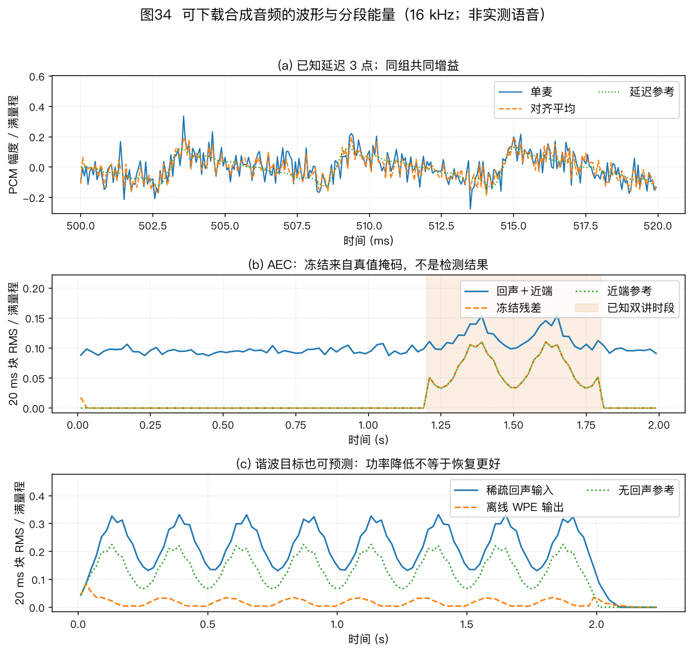

# 多麦克风阵列信号处理教程 · 导读与导航

本页是本书的导读入口。全书正文共 18 个文件：本页导读、15 章正文（其中第 12、13、16、17 章为四篇扩展专题）以及 2 篇附录。仓库另配 6 篇[源码研究手册](../codes/chapters/ch00/research/README.md)，集中讨论第三方开源实现与工程复现细节，不计入教程正文篇数。

15 章正文和 2 篇附录既可按顺序通读，也可按第 5 节的学习路径按需选读；每篇开头均提供上一篇、下一篇和返回本页的导航链接。

全书共配 88 张编号插图（各章分布见第 2 节与第 6 节）以及 1 张附录 B 房间仿真补充图，涵盖几何原理示意、受控仿真曲线与系统信号流框图。阅读插图时，建议结合图注中的阵列尺寸、采样率、信噪比等实验条件一起理解。

---

## 1. 这是一份什么样的教程

本书是一套从入门到工业实践的麦克风阵列信号处理教程。第 1～3 章建立声波传播模型与阵列几何直觉，第 4～9 章逐步推导并比较核心阵列处理算法，第 10～11 章把算法放回真实设备的实时处理链路，讨论时钟同步、通道标定、处理延迟、算力功耗预算和工程验收，第 12～13 章与第 16～17 章则进一步扩展到声学成像、分布式麦克风阵列、三维空间声场与可穿戴微阵列，以及条件目标说话人提取与多通道会议说话人日志。

阅读本书不需要预先学过阵列信号处理。正文推导会用到基础的单位换算、三角函数、复数运算和线性代数；遇到生疏的数学工具时，可随时查阅[附录 A §14.3](14_appendix-symbols-math.md#sec-14-3)补齐最小铺垫，再回到当前算例。读完主线后，各章的编号公式、失效边界和排错清单也可留在手边作为工程参考手册。

第一次阅读本书，可以先翻到本页[第 8 节](#sec-u-6d43c0086f)的图 34，点开“对齐与平均”那组音频对比听一听，再回到这里带着两个直观问题往下读：同一个声音到达不同麦克风早到了多久？把时差对齐再平均之后，哪些成分叠加得更整齐、哪些杂音被压低了？

全书主线从一个日常场景展开：你站在 3 米外对智能音箱说话，设备怎样从环境噪声、房间反射和自身扬声器播放声中提取你的清晰语音？如果旁边还有别人同时开口，或者你边说边走动，系统还会遇到多说话人分离与轨迹跟踪问题。下表按模块作用、交付输出和必需先验把这六项核心任务区分开来：

| 任务 | 在这个场景中解决什么 | 输出或必要信息 |
|---|---|---|
| 声源定位：估计波达方向（Direction of Arrival，DOA，也称到达方向） | 判断讲话声相对阵列来自哪个方向 | 方向角度或坐标估计；本身不直接输出增强语音 |
| 波束形成（Beamforming） | 利用多通道空间差异定向拾音、压低旁向干扰 | 多路加权合成后的单路或双耳音频；需要目标方向或空间统计量 |
| 声学回声消除（Acoustic Echo Cancellation，AEC） | 消除音箱自身播放后经房间耦合回麦克风的声音 | 减去估计回声后的残差音频；必须接入与实际播放同步的参考信号 |
| 加权预测误差去混响（Weighted Prediction Error，WPE） | 削弱声波经墙面多次反射形成的晚期混响拖尾 | 减去延迟历史线性预测项后的音频；需同时核查目标语音是否受损 |
| 语音分离（Speech Separation） | 将同时讲话的多个声源拆成独立音轨或提取指定说话人 | 多路分离音轨或目标音轨；需解决输出槽位排列与跨块身份衔接 |
| 声源追踪（Source Tracking） | 将含噪、漏检的方向观测串联成平滑连续的运动轨迹 | 随时间更新的方向、角速度状态与不确定度；需明确状态对应时刻 |

阅读上表时，重点看第三列“输出或必要信息”：定位与追踪交付的是空间角度和轨迹状态，波束形成、AEC、WPE 和分离交付的才是音频波形；而在实际产品链路中，并非每个场景都要把六个模块全部串起来，各模块的启用条件与参考信号取点关系将在[§10.1](10_engineering-practice.md#sec-10-1)集中梳理。

---

## 2. 18 个文件一览

| 编号 | 文件 | 配图 | 难度 | 建议学习单元 |
|---|---|---|---|---|
| 00 | `00_overview.md`（本页） | 图34 | 入门 | 导航与复现入口 |
| 01 | `01_problem-definition.md` | 图1 | 入门 | 问题定义、信噪比口径与双耳定位线索 |
| 02 | `02_basics-signal-model.md` | 图2～图7、图50，共 7 张 | 进阶 | 时延与流形；短时频谱与统计；波束度量（分三单元） |
| 03 | `03_array-geometry.md` | 图8～图10、图51～52，共 5 张 | 进阶 | 几何可观测性；通道标定与稀疏协同阵 |
| 04 | `04_doa-estimation.md` | 图11～图14、图33、图53～54，共 7 张 | 较难 | 时差与空间扫描；子空间法；宽带聚焦与分辨边界 |
| 05 | `05_beamforming.md` | 图15～图17、图55～56、图73，共 6 张 | 较难 | 线性约束解；稳健设计；时频掩码与双耳/相位接口 |
| 06 | `06_aec.md` | 图18～20、图26～32、图36～39、图57～58、图74，共 17 张，另引用图23 | 较难 | 参考与卷积；自适应更新；双讲控制与非线性处理（分四单元） |
| 07 | `07_wpe-dereverberation.md` | 图21、图24、图59、图75，共 4 张 | 进阶 | 延迟线性预测模型；迭代求解与多麦时间边界 |
| 08 | `08_speech-separation.md` | 图42～43、图60、图76，共 4 张，引用图23 | 进阶 | 统计盲分离；活动导引 GSS；深度掩码与跨块拼接 |
| 09 | `09_source-tracking.md` | 本章专属图22、图44、图61、图77，共 4 张，另引用图23 | 进阶 | 贝叶斯状态递推；多目标关联与轨迹生命周期管理 |
| 10 | `10_engineering-practice.md` | 图23、图25、图40、图45、图62～63、图78，共 7 张 | 进阶 | 模块级联依赖；硬件时钟与延迟；算力预算与评测（分三单元） |
| 11 | `11_selection-guide.md` | 图46、图47、图64、图79，共 4 张 | 入门 | 硬约束筛除、帕累托权衡、跨场景评分与验收规格 |
| 第12章（扩展专题Ⅰ） | `12_acoustic-imaging.md` | 图67～69、图80，共 4 张 | 较难 | 互谱矩阵、点扩散函数、反卷积源强图与声学计量校准 |
| 第13章（扩展专题Ⅱ） | `13_distributed-enhancement.md` | 图70～72，共 3 张 | 较难 | 节点线性压缩、分布式迭代更新、时钟偏移与丢包容错 |
| 第16章（扩展专题Ⅲ） | `16_spatial-wearable-arrays.md` | 图81～84，共 4 张 | 较难 | 球谐与参数化声场、双耳信号匹配、抗风跨模态与通透延迟 |
| 第17章（扩展专题Ⅳ） | `17_target-extraction-diarization.md` | 图85～88，共 4 张 | 较难 | 条件特征调制、近场距离气泡、空谱说话人日志与视听对齐 |
| 附录 A（文件 14） | `14_appendix-symbols-math.md` | 图48、图49、图65，共 3 张 | 查阅 | 全书统一符号表、术语词典与线性代数/概率/傅里叶基础 |
| 附录 B（文件 15） | `15_appendix-guide.md` | 图35、图41、图66，共 3 张编号图，另有房间题补充图 | 查阅 | 分阶段学习路径、文献挑战赛地图、故障排查与综合练习 |

上表最后一列给出了建议切分的学习单元，篇幅较长的第 2、6、10 章可分多次读完，每读完一个单元顺手用章末练习复算一遍。时间紧迫时，可先读本页、第 1 章和第 11 章理清问题边界与选型框架，再读第 2 章补齐共用信号模型；随后按具体任务选读第 4～9 章，工程落地配合第 10 章与附录 B 排错指南，学术研究则可结合第 4、9 章与附录 B 的前沿地图。

---

## 3. 各篇内容与学习目标

### [01 · 问题定义与双耳启示](01_problem-definition.md)

本章配图 1 张，面向零基础读者。全章从客厅远场语音交互切入，依次拆解环境背景噪声、房间混响、旁人语音干扰、麦克风自噪声与扬声器回声五类困难，明确声源定位、波束形成和声源追踪各自的输入与输出边界。

在评价口径上，本章先区分波形整体音量缩放与信噪比改善，剖析硅麦器件手册 $\mathrm{dB(A)}$ 计权指标对低频 $1/f$ 自噪声的掩盖效应，再对比三类阵列收益指标：空间互不相关同方差噪声下看白噪声增益（White Noise Gain，WNG），各向同性弥散声场下看指向性指数（Directivity Index，DI），特定方向强干扰下看零陷抑制深度，并引出任意半正定空间相干矩阵的特征分解平方根噪声着色。

随后，本章从人类听觉的双耳时间差（ITD）、双耳声级差（ILD）和头相关传递函数（HRTF）谱形线索出发，讲清几何绕射模型、心理声学辨别阈值与机器阵列高频相位混叠之间的异同，并对照 AES69（SOFA）球面俯仰角与球谐余纬角的坐标约定。

读完本章，读者应能说明同步多麦克风相对单麦克风多出了哪些空间可观测信息，独立手算理想空间白噪声下的四麦平均增益、空间相关噪声着色矩阵与一阶差分低频自噪声预算，并辨析双耳听觉线索与机器阵列流形的对应关系。

### [02 · 基础：声音到达阵列时发生了什么](02_basics-signal-model.md)

本章配图 7 张，建立全书后续章节共用的物理与数学基础，建议通读一遍并在后续查阅符号时随时回翻：

- **传播时延（§2.1）**：声波到达不同阵元存在先后时间差。以 $16\ \mathrm{kHz}$ 采样率为例，相邻两个采样点间隔 $62.5\ \mu\mathrm{s}$，声波在 $343\ \mathrm{m/s}$ 声速下传播约 $2.14\ \mathrm{cm}$；要分辨更细的角度变化，往往需要通过互相关插值或频域相位斜率估计亚采样时差，并保证多通道采样时钟同步。
- **近场球面波与远场平面波（§2.2）**：声源离阵列足够远时，球面波前在阵列孔径范围内可近似为平面波；远近场分界尺度同时取决于阵列孔径大小与声波波长。
- **频域相位与导向矢量（§2.3）**：时域上的传播时延对应频域上的线性相位旋转。等幅远场模型把各阵元相对参考点的复相位排列成导向矢量，作为后续空间扫描与波束形成的核心几何描述；近场或带散射挡板时则进一步引入幅度变化与实测传递响应。
- **房间脉冲响应与混响（§2.4）**：室内声波经墙面反射形成直达声、早期反射和密集晚期混响三段结构，常用混响时间 $T_{60}$（声能衰减 $60\ \mathrm{dB}$ 所需时间）与直达混响比（Direct-to-Reverberant Ratio，DRR）刻画房间声学环境。
- **短时频谱与空间协方差（§2.5）**：通过加窗分帧的短时傅里叶变换（Short-Time Fourier Transform，STFT）将多路时域波形转为时频复数谱，再跨时间帧统计多通道空间协方差矩阵，并辨析逐帧频域相乘近似与完整线性卷积的边界。
- **阵列方向图与性能界（§2.6）**：系统定义波束方向图的主瓣宽度、旁瓣级、零陷、空间混叠栅瓣条件、DI 与 WNG，并引入衡量无偏参数估计方差下限的克拉美－罗下界（Cramér–Rao Lower Bound，CRLB）。

读完本章，读者应能从几何时延一路推导出频域导向矢量，读懂空间协方差矩阵对角线与非对角线元素的物理含义，并掌握波束方向图各项核心指标的判读方法。

### [03 · 阵列几何形态](03_array-geometry.md)

本章配图 5 张，聚焦“麦克风怎么摆，以及摆法决定了哪些物理上限”。

全章从双麦克风单一基线的正横（broadside）与端射（endfire）方向特性讲起，逐步横向对比均匀线阵、圆阵、平面方阵、球阵、螺旋阵与分布式阵列。共线阵列的阵元排在同一条轴线上，无法区分绕轴旋转一周的圆锥面方位角（前后/上下镜像模糊），并且在端射方向附近时延对角度的变化率趋近于零，同样的时延测量误差会被放大成更大的角度误差。

围绕几何选型，本章梳理出四条核心规律：阵列孔径与波长之比决定空间分辨能力；圆阵与平面阵可在水平面各方位维持更均衡的有效孔径；设备外壳与刚性挡板会改变散射声场与阵列流形；增加阵元数量虽能提升理想 WNG 与统计稳健性，但阵元间距过小时低频差分处理容易受通道失配与自噪声制约，间距过大时高频又会出现空间混叠。本章还介绍了利用阵元位置差构造虚拟差分协同阵（如 6 麦嵌套阵扩展出 23 个连续虚拟滞后）的稀疏阵思路，以及阵元位置与通道固定时延的标定方法。

读完本章，读者应能分析给定几何形态的可观测方向范围、有效孔径和无空间混叠频带，并根据设备外形尺寸与覆盖角度要求筛选合适的阵列拓扑。

### [04 · 声源定位 DOA 估计](04_doa-estimation.md)

本章配图 7 张，系统讲解如何根据多通道同步观测估计声源相对阵列的波达方向，按原理脉络分为四大方法家族：

- **两阶段时差解算法**：先用广义互相关相位变换（Generalized Cross-Correlation with Phase Transform，GCC-PHAT）在频域白化幅度、提取相位斜率对应的麦间到达时间差，再通过 Chan 闭式算法或泰勒级数迭代解算声源坐标，并用几何精度稀释（Geometric Dilution of Precision，GDOP）量化阵元摆位对定位误差的放大效应。本章还结合受控混响实验剖析了 $T_{60}$、DRR 与分析窗长对相关峰尖锐度的耦合影响。
- **空间扫描谱估计**：可控响应功率（Steered Response Power，SRP-PHAT）在候选空间网格上累加各麦对的相关响应寻找峰值，配合由粗到细的分层搜索降低网格评估开销；窄带与宽带扫描部分对比了常规延迟求和扫描（Bartlett）与最小方差自适应扫描（Capon）对邻近角度响应的区分能力。
- **子空间高分辨方法**：多重信号分类（Multiple Signal Classification，MUSIC）利用信号子空间与噪声子空间的正交性构造尖锐谱峰，但在强相干多径反射下信号协方差矩阵会发生秩亏损，均匀线阵需借助空间平滑恢复满秩；旋转不变子空间法（Estimation of Signal Parameters via Rotational Invariance Techniques，ESPRIT）则利用平移不变子阵结构直接求解角度特征根，省去网格扫描。
- **宽带聚焦、稀疏重构与深度学习方法**：针对宽带语音介绍相干信号子空间聚焦变换（辨析酉聚焦与非酉聚焦对噪声白化特性的影响），并讨论稀疏表示以及基于深度神经网络（Deep Neural Network，DNN）的数据驱动定位特征学习及其跨阵列、跨房间泛化条件。章末结合 [§4.10 四麦分数采样时差](04_doa-estimation.md#sec-4-10) 综合算例与 CRLB 方差下界串联全章概念。

读完本章，读者应能根据阵列拓扑、声源个数、室内混响强度和算力预算合理选型，并从物理与线性代数两个层面解释多径反射拖宽互相关峰、相干声源导致子空间法失效的根源。

### [05 · 波束形成 Beamforming](05_beamforming.md)

本章配图 6 张，讨论如何对多通道信号作空时或空频线性加权，在尽量无失真保留目标方向语音的同时压低背景噪声与旁向干扰。

全章先按声场特性区分三类典型设计：面对各通道独立的传感器自噪声，等权延迟求和波束形成器（Delay-and-Sum Beamformer，DSB）达到线性 WNG 上界 $M$；面对低频近似各向同性的弥散噪声场，超指向波束能在小孔径上显著提高指向性指数（DI），但往往伴随低频 WNG 急剧下降（例如双麦端射间距取 $0.05\lambda$ 时可获 $6.0\ \mathrm{dB}$ DI，WNG 却降至约 $-10.6\ \mathrm{dB}$，间距减半还会再付约 $6\ \mathrm{dB}$ 自噪声放大代价）；面对特定方向的强干扰，最小方差无失真响应（Minimum Variance Distortionless Response，MVDR）利用干扰加噪声协方差矩阵自动在干扰方向形成深零陷。

在此基础上，本章依次展开多线性约束最小方差（Linearly Constrained Minimum Variance，LCMV，含主瓣导数平坦度约束）、将约束优化拆分为固定主支路与阻塞对消支路的广义旁瓣对消器（Generalized Sidelobe Canceller，GSC）、折中降噪量与语音失真的多通道维纳滤波（Multichannel Wiener Filter，MWF）及对角加载稳健化策略，并进一步讨论频间相位一致性、保留双耳方位线索的双耳波束形成、后置谱增益滤波、球谐域波束设计以及时频掩码驱动的神经波束形成。

读完本章，读者应能熟练计算 WNG 与 DI 的折中曲线，完整推导 MVDR 闭式解，说清对角加载如何控制自噪声放大，并理解时频掩码与统计波束形成器的接口分工。

### [06 · 声学回声消除 AEC](06_aec.md)

本章配图 17 张（另引用系统链路总图 23），深入剖析全双工语音交互中的声学回声消除问题：设备扬声器播放的声音经功放、喇叭和房间多径反射耦合回自身麦克风，系统如何利用播放参考信号将这部分回声干净减除而不损伤近端说话人语音。

在线性自适应滤波主线上，本章从归一化最小均方（Normalized Least Mean Squares，NLMS）的基本更新出发，详细拆解长房间回声路径必备的分区块频域自适应滤波（Partitioned-Block Frequency-Domain Adaptive Filtering，PBFDAF，阐明其作为分块频域多抽头 NLMS 精确实现的重叠保留与梯度约束机制），并横向对比子带滤波（含跨子带混叠交叉项）、针对稀疏冲激响应分配步长的改进比例算法（Improved Proportionate NLMS，IPNLMS）、复用多帧历史观测加速有色信号收敛的仿射投影算法（Affine Projection Algorithm，APA）以及显式维护状态不确定度的频域卡尔曼滤波（Frequency-Domain Kalman Filter，FDKF）。

在工程控制上，本章重点剖析参考信号采集取点（播放数字增益与声学路径卷积不可随意交换顺序、参考延迟超窗失效与静音切换后的残余回声尾部）、近端与远端同时发声时的双讲检测（Double-Talk Detection，DTD）及冻结策略、功放与微型扬声器非线性失真带来的线性消除上限，以及线性滤波结合残余回声抑制或神经网络的混合架构。

在系统集成与评测上，本章进一步梳理 AEC 与多麦波束形成的先后级联条件（配合 §10.1）和公开工业实现 WebRTC AEC3，并强调必须联合核查远端单讲回声返回损失增强（Echo Return Loss Enhancement，ERLE）、双讲稳定性与近端语音保真度。

读完本章，读者应能正确规划硬件回声参考取点与延迟对齐缓冲区，排定位移、非线性与双讲导致的收敛异常，并为不同产品形态设计完整的 AEC 验收方案。

### [07 · 去混响 WPE](07_wpe-dereverberation.md)

本章配图 4 张，讨论在没有干净参考信号的盲观测条件下，如何利用跨帧线性预测削弱房间晚期混响拖尾。

加权预测误差（WPE）算法在短时频域中跳过紧邻当前的若干帧（称为保护延迟 $\Delta$），仅用更早的历史观测帧线性预测当前帧中的晚期混响分量并将其减去，同时引入时变语音方差加权避免高能量直达声主导滤波器拟合。保护延迟 $\Delta$ 的核心作用是保护直达声与对语音清晰度有益的早期反射不被当作混响误消；在多麦克风阵列中，还需考虑不同阵元的到达时间差对有效保护间隔的影响。

本章完整推导单通道与多通道离线迭代及在线递推 WPE 的目标函数与闭式步，对比已知冲激响应条件下的多通道逆滤波（MINT，揭示近似公共零点引发的后路径噪声放大与正则化折中）、倒谱滤波与谱减法去混响各自的物理前提，并结合帧长、预测阶数与保护延迟给出防止周期性谐波语音被过度削弱的调参准则。

读完本章，读者应能独立推导多通道 WPE 迭代更新方程，合理设置保护延迟 $\Delta$ 与预测阶数，并同时从混响拖尾衰减和目标语音保真两方面检验去混响效果。

### [08 · 语音分离](08_speech-separation.md)

本章配图 4 张（另引用图 23），聚焦多人重叠讲话（“鸡尾酒会问题”）的分离方法，讲清统计独立性、说话人活动先验与深度时频掩码三条技术路线如何衔接阵列波束形成：

- **统计盲源分离（[§8.3](08_speech-separation.md#sec-8-3)）**：从频域逐频独立成分分析的排列模糊讲起，推导利用源谱跨频共变结构免除逐频排列对齐的独立向量分析（IVA / OverIVA）、结合非负矩阵分解低秩源谱模型的独立低秩矩阵分析（ILRMA）以及多通道非负矩阵分解（MNMF），并说明投影回参考通道（projection back）恢复物理尺度的原理。
- **活动导引源分离（[§8.4](08_speech-separation.md#sec-8-4)）**：详解会议转写系统常用的导引源分离（Guided Source Separation，GSS），如何利用说话人分段活动标注约束空间混合模型聚类，估计目标与干扰时频掩码并驱动 MVDR 波束形成。
- **深度学习分离与连续流拼接（[§8.6](08_speech-separation.md#sec-8-6)）**：涵盖置换不变训练（PIT）、时频实掩码与复数掩码的表示边界、时域编解码分离网络、目标说话人提取，以及长录音分块连续语音分离（CSS）中利用相邻块重叠区恢复槽位顺序、极性与幅度一致性的工程方法。模块级联位置与术语索引分别见 [§8.2](08_speech-separation.md#sec-8-2)、§10.1 与[附录 A §14.2](14_appendix-symbols-math.md#sec-14-2)。

读完本章，读者应能按声源数量、空间秩假设与先验条件区分三类分离框架，复算 IVA、ILRMA 与 GSS 核心步骤，并处理分块流式分离中的跨块排列与极性衔接。

### [09 · 声源追踪 Source Tracking](09_source-tracking.md)

本章配图 4 张（另引用图 23），讨论当说话人走动、停顿或多人交错时，如何把带有随机起伏、野点和漏检的逐帧方向观测融合为时间上连续可靠的运动轨迹。

声学目标追踪面临四项特有挑战：语音天然时断时续（停顿期无有效声源观测）、室内反射易产生虚假方向野点、场内说话人数目随时增减，以及笛卡尔坐标运动与阵列角度观测之间往往呈非线性关系。围绕这些难点，本章先详解卡尔曼滤波（Kalman Filter，KF）的预测—新息门控—更新递推闭环（包括跨 $\pm 180^\circ$ 角度周期边界的卷绕处理与相关观测噪声的影响），再介绍处理非线性非高斯后验的粒子滤波（Particle Filter，PF）及重采样机制，以及在静止与机动模式间平滑切换的交互多模型（Interacting Multiple Model，IMM）。

针对多说话人场景与在线系统状态管理，本章剖析候选轨迹起始、连续命中确认与超时退役的生命周期规则（区分信号帧中心物理时刻与整帧处理就绪时刻），对比概率假设密度（Probability Hypothesis Density，PHD）、标记多伯努利（Labeled Multi-Bernoulli，LMB）与检测前追踪（Track-Before-Detect，TBD）各自解决的子问题，并在 §9.4 给出追踪器向自适应波束反馈导向角时的限速、静默保持与重捕获设计准则。

读完本章，读者应能搭建从多麦音频时差观测、马氏距离门控到轨迹状态输出的完整追踪链路，并为移动拾音系统合理配置轨迹确认、保持与波束跟随参数。

### [10 · 工程实现、评测与产业实践](10_engineering-practice.md)

本章配图 7 张，把前九章的算法放回真实硬件与嵌入式实时系统，解决“仿真跑通之后，上板落地还会遇到什么问题”。

在系统架构上，本章通过图 23 与 §10.1 梳理 AEC、WPE、DOA、波束形成、后置降噪与自动增益控制（Automatic Gain Control，AGC）的级联次序与信号取点依赖，并按算法前瞻窗、帧移缓冲、计算耗时、非抢占调度排队和后端解码逐项核算端到端延迟关键路径。在硬件与通道层，本章剖析定点与浮点样本动态范围、麦克风灵敏度与相位失配、多设备采样率偏移（Sampling Rate Offset，SRO，如 $100\ \mathrm{ppm}$ 晶振频偏如何令双麦相加随时间发生周期性抵消），以及单个麦克风通道故障后的协方差与导向矢量降维重构。

在资源与验收层，[§10.4](10_engineering-practice.md#sec-10-4) 明确界定每秒乘加数（MACs）、实时率（处理耗时除以新增音频时长）、峰值内存与电池续航（$\mathrm{Wh}$ 除以整机平均功率）的核算口径；[§10.5](10_engineering-practice.md#sec-10-5) 则系统对比波形失真比、可懂度、感知语音质量、自动语音识别词错率（WER）、多目标追踪误差与主观听测的适用边界，并剖析噪声谱估计失配与分块 AGC 跳变等常见工程隐患。

读完本章，读者应能独立编制延迟、时钟同步、通道标定与算力功耗四张工程预算表，并为具体产品任务制定自洽的客观与主观验收指标体系。

### [11 · 总结与选型指南](11_selection-guide.md)

本章配图 4 张，定位为全书主线收官与工程决策手册：

- **需求结构化（§11.1～§11.3）**：从交付输出形式、空间覆盖范围、工作频带、主导干扰类型、目标运动速度和硬件成本功耗六大维度定义工程问题，梳理各前端模块的启用与裁剪条件，串起阵列几何与后续算法性能的制约关系。
- **候选筛除与多场景权衡（§11.4）**：通过智能音箱、车载免提、会议室拾音和可穿戴设备四类典型案例，演示如何先用延迟、内存与功耗硬约束筛除不可行方案，再在非支配候选集（帕累托前沿）上权衡目标保真、干扰抑制与白噪声增益，并区分固定场景权重总分与最坏场景保障值。
- **可测规格书编写（§11.5～§11.6）**：示范如何把模糊的“降噪效果好”转化为带测试声场条件、统计区间、失败判定规则与待测硬件验证项的可执行验收规格书，并配成套练习巩固全流程决策。

读完本章，读者应能针对具体产品需求独立拟定麦克风阵列几何方案、算法链路与量化验收标准。

### [12 · 扩展专题Ⅰ：声学成像与噪声源诊断](12_acoustic-imaging.md)

本专题（第 12 章，配图 4 张）面向工业异响定位、风洞气动声学测试与环境噪声源诊断，建议在读完第 2、3、5 章后选读。与语音前端输出单路增强波形不同，声学成像的目标是在候选空间网格上定量绘制声源辐射强度分布图。

全章从同步多通道频域快拍构造互谱矩阵（Cross-Spectral Matrix，CSM）出发，阐明常规波束扫描图为何等于真实源强分布与阵列点扩散函数（Point Spread Function，PSF）的空间卷积——扫描图上的亮斑宽度与旁瓣伪影并不直接等于各网格点的真实声源功率。随后逐步推导并对比声源映射反卷积算法（DAMAS）、非负最小二乘（NNLS）、相干源清理算法（CLEAN-SC）与协方差矩阵拟合（CMF），剖析相干声源、网格外声源、互谱对角线自噪声删除与传声器幅度相位校准误差的影响，并严格区分数字均方值、声压均方值（$\mathrm{Pa}^2$）与辐射声功率（$\mathrm{W}$）的物理量纲换算及区域积分条件。

### [13 · 扩展专题Ⅱ：分布式麦克风协同增强](13_distributed-enhancement.md)

本专题（第 13 章，配图 3 张）面向多台智能终端、多机位会议拾音器或无线传感器网络在受限通信带宽下协同增强同一目标声源的场景，建议在读完第 2、5、10 章后选读。

各节点拥有本地麦克风子阵，但受链路带宽与功耗限制，无法把全部原始多通道波形集中上传，只能向邻居或汇聚节点广播低维线性压缩信号。本专题以集中式多通道维纳滤波（MWF）为性能参照，推导跨节点线性压缩达到集中式最优解的代数条件（揭示即便远端压缩信号中目标分量恰好相消，其携带的相关干扰观测仍可帮助本地节点抵消噪声），继而剖析分布式自适应节点特定信号估计（Distributed Adaptive Node-specific Signal Estimation，DANSE 及其拓扑无关形式 TI-DANSE）在顺序更新、同步更新与有限步松弛迭代下的收敛行为。

围绕真实无线链路，本专题进一步讨论传输量化误差、压缩系数版本切换后的统计量坐标变换、节点间采样率偏移（如 $100\ \mathrm{ppm}$ 频偏）补偿以及网络丢包时的补零与本地回退策略（完整无线实验复现指引见[专题 §13.13](13_distributed-enhancement.md#sec-13-13)）。

### [16 · 扩展专题Ⅲ：空间声场采集、参数化编码与可穿戴阵列](16_spatial-wearable-arrays.md)

本专题（第 16 章，配图 4 张）面向全景声录制、扩展现实头显、智能眼镜、真无线耳机与数字助听器，建议在读完第 1、2、5 章后选读。与交付单路增强波形的桌面阵列不同，全景声采集与可穿戴设备需要在受限孔径和头部散射条件下保留三维方位线索与自然听觉包围感。

全章从一阶全景声（FOA）ACN/SN3D 约定、正四面体编码均衡与头部追踪三维声场逆旋转出发，推导方向性音频编码（DirAC）的有功声强与扩散度参数化分析；随后展开非规则阵列双耳信号匹配（BSM-LS 与高频幅度最小二乘 MagLS）及用参考麦克风混合抑制背景噪声头中坍缩的解析折中，并剖析 Corcos 湍流风噪模型、气导与耳道闭塞内麦跨模态 MVDR 自语音融合，以及耳机通透模式（Hear-Through）的百微秒梳状滤波延迟边界（配套练习 `E16-01`～`E16-18` 与 `wearable_audio` 见[专题 §16.11](16_spatial-wearable-arrays.md#sec-16-11)）。

### [17 · 扩展专题Ⅳ：条件目标说话人提取、多通道日志与远场多模态前端](17_target-extraction-diarization.md)

本专题（第 17 章，配图 4 张）面向个人目标说话人提取与多人重叠会议转写，建议在读完第 2、5、8 章后选读。面对无条件盲分离槽位缺少身份锚点、同方向远近声源重叠与多人抢话等工程难题，系统需要融合声纹、近场距离、说话人活动与视觉唇动线索驱动前端提取。

全章先推导条件特征仿射调制（FiLM）与交叉注意力注入、消除目标沉默段零除零奇异性的双态训练损失及单人段零重叠清擦音旁路准则，再给出利用球面波曲率区分同向远近声源的三麦正横声学距离气泡闭式解与孔径四次方（$d^4$）底噪边界。随后定量拆解说话人日志误差率（DER）三分量与空谱联合目标说话人语音活动检测（TS-VAD）对导引源分离（GSS）的排他门控，分析视听异构帧率对齐、相机管线滞后截断与唇部遮挡回退，并对比模块化级联（`TS-VAD→GSS→ASR`）与联合识别架构（`SOT`、`DiCoW`）的选型依据（配套练习 `E17-01`～`E17-16` 与 `tse_audio` 见[专题 §17.8～§17.10](17_target-extraction-diarization.md#sec-17-8)）。

### [14 · 附录 A：符号、术语、数学](14_appendix-symbols-math.md)

本篇（配图 3 张）是全书的随手查阅工具书，无需按顺序从头通读：

- **§14.1 全局符号表**：统一规定全书标量、列向量、矩阵、转置与共轭转置、频率变量及常用物理常数的记法。
- **§14.2 中英术语词典**：按信号与数学基础、房间声学、自适应滤波与盲分离、波束形成与阵列度量、定位与追踪、硬件与系统评测六大主题分组解释核心概念。
- **§14.3～§14.4 数学工具铺垫与复算练习**：用直观语言和手算小例子串讲复数与欧拉公式、分贝（$10\log_{10}$ 与 $20\log_{10}$ 的口径区分）、线性卷积与循环卷积边界、随机变量期望与空间协方差矩阵、最小二乘与广义加权最小二乘（白化变换）、特征值分解及奇异值截断与吉洪诺夫正则化，并配有 20 道代码复算练习巩固矩阵维度、共轭符号与数值秩判据。

### [15 · 附录 B：路径、地图、前沿、排错、练习、复现](15_appendix-guide.md)

本篇（配 3 张编号图与 1 张房间仿真补充图）汇集进阶学习与实战排错资源：

- **§15.1～§15.3 学习规划、领域地图与前沿方向**：整理分阶段学习计划，汇总经典教材、核心期刊会议、公开数据集与国际挑战赛脉络，并评述神经波束形成、跨阵列自适应（如变换平均拼接 TAC）、自监督空间表征、声学场景泛化失配等八个活跃研究方向。
- **§15.4～§15.5 工程排错指南与公式速查卡**：按“现象—可能根因—最小定位实验—修复方向”梳理常见失效案例（如分数时延插值高频滚降、同 DRR 下不同反射谱形的听感差异、极性接反与病态求逆等），并一页汇总核心编号公式及其成立前提。
- **§15.6～§15.7 综合练习与全书插图复现**：提供 17 道跨章书面综合分析题、15 道稳定编号代码实验题（含多源室内镜像法仿真定位实验）以及全书 88 张编号插图的一键复现说明。

---

## 4. 阅读顺序

1. 先读本页导读与第 1 章，明确远场拾音面临的五类干扰、三项空间任务与基本信噪比口径。

2. 精读第 2 章，掌握全书共用的时延、导向矢量、STFT 与空间协方差模型；遇到生疏符号随时翻阅附录 A。

3. 沿**阵列几何线**阅读第 3 章，理解阵元拓扑如何决定可观测方向与空间混叠上限，再结合 §11.1～§11.3 形成初步硬件几何方案。

4. 沿**空间处理线**串联第 4 章（声源定位）、第 9 章（声源追踪）和第 5 章（波束形成）；第 2、5、8 章引入的时频掩码则是估计目标与噪声空间协方差、连接深度学习与统计波束形成的桥梁。

5. 沿**时频干扰消除线**按需阅读第 6 章（回声消除 AEC）、第 7 章（去混响 WPE）和第 8 章（重叠语音分离），并通过 §10.1 与图 23 理清它们在整条前端链路中的先后位置与参考信号依赖。

6. 沿**工程落地线**阅读第 10 章核对时钟同步、实时延迟、算力功耗和客观/主观评测指标，最后在第 11 章汇总成完整的系统选型与验收规格。

需要做工业噪声源成像与声学计量诊断时，可在读完第 2、3、5 章后进入[扩展专题Ⅰ](12_acoustic-imaging.md)；需要设计多设备受限通信协同增强系统时，可在读完第 2、5、10 章后进入[扩展专题Ⅱ](13_distributed-enhancement.md)。关注全景声空间音频、智能眼镜与真无线耳机算法时，可在读完第 1、2、5 章后进入[扩展专题Ⅲ](16_spatial-wearable-arrays.md)；关注个人目标说话人提取与多人会议说话人日志时，可在读完第 2、5、8 章后进入[扩展专题Ⅳ](17_target-extraction-diarization.md)。

完成第 11 章后，工程读者可结合 §10.10 与 §15.4 制定板级联调与排错清单，研究读者可结合 §15.3 与 §15.6 第 16、17 题开展房间仿真基线搭建与论文系统复核。

---

## 5. 三条阅读路径

### 路径 A：零基础入门（能复现演示）

1. 先读本页和第 1 章，再浏览 [§11.1～§11.3](11_selection-guide.md#sec-11-1)，直观了解设计一套麦克风阵列系统需要提前明确哪些输入条件。

2. 按三个单元读完第 2 章。第一遍可先看图 2～图 7 及物理量解释，再回头细推公式；需要补复数或矩阵基础时查阅附录 A。读完后动手完成 [E01-01](01_problem-definition.md#sec-u-13bdf48a99)（检验多麦平均降噪为何依赖噪声空间相关性）与 [E01-02](01_problem-definition.md#sec-u-f277de1aa7)（区分整体音量变轻与信噪比改善）。

3. 第 3 章重点读几何对比表与算例。第 4 章读 [§4.2](04_doa-estimation.md#sec-4-2)、[§4.3](04_doa-estimation.md#sec-4-3) 并对照图 12、图 14，完成 [E04-01](04_doa-estimation.md#sec-u-10983698db) 核对交换通道次序后的时差正负号。第 5 章读 [§5.1](05_beamforming.md#sec-5-1)、[§5.2](05_beamforming.md#sec-5-2)、[§5.4](05_beamforming.md#sec-5-4)，先手算双麦目标方向响应，再通过 [E05-02](05_beamforming.md#sec-u-fd25e81d6c) 和图 16 体会对角加载的稳健性与干扰抑制折中。

4. 回声消除从 [§6.1](06_aec.md#sec-6-1) 的播放参考、卷积建模与 NLMS 更新读起，再看 [§6.6](06_aec.md#sec-6-6) 的阵列级联顺序与 [§6.8](06_aec.md#sec-6-8) 的开源实现（对照图 18）。

    去混响读 [§7.1](07_wpe-dereverberation.md#sec-7-1) 和 [§7.8](07_wpe-dereverberation.md#sec-7-8)，弄清保护延迟、预测阶数与帧长的配合关系（对照图 21、图 24）。语音分离读 [§8.1](08_speech-separation.md#sec-8-1) 与 [§8.4](08_speech-separation.md#sec-8-4)，了解多说话人分离目标与活动导引思路。声源追踪读 [§9.2](09_source-tracking.md#sec-9-2)，亲手走通一步卡尔曼预测与观测更新。

5. 阅读 [§10.1](10_engineering-practice.md#sec-10-1)、[§10.4](10_engineering-practice.md#sec-10-4) 和 [§10.6](10_engineering-practice.md#sec-10-6)，建立前端信号流、实时算力口径与房间仿真概念；最后完成附录 B 第 2、3、5、7、10、11、14 题，参照 [§15.4](15_appendix-guide.md#sec-15-4) 熟悉常见工程问题排查，并运行本页第 8 节的三组基础脚本核对计算结果。

### 路径 B：工程实现（形成可验证的前端方案）

1. 先按 [§11.1～§11.5](11_selection-guide.md#sec-11-1) 梳理产品任务、阵列安装空间、典型声学场景、模块启用条件和量化验收指标。

    算法部分聚焦工程关键环节：第 5 章重点看 MVDR、对角加载稳健化与后置滤波；第 6 章核对回声参考取点、双讲冻结控制以及 AEC 与波束形成的级联顺序；第 7 章结合目标房间的混响时间评估是否启用 WPE；第 8 章在确有多人同时讲话需求时选定分离方案。更换硬件外壳或阵列尺寸前，建议先读 [§15.3](15_appendix-guide.md#sec-15-3) 的跨阵列泛化讨论。

2. 精读第 10 章，沿关键路径逐项拆解端到端延迟，区分跨设备时钟同步与采样率偏移（SRO），统一客观评测、算力与整机功耗口径；随后对照 [§15.4](15_appendix-guide.md#sec-15-4) 排错表，完成 [§15.6](15_appendix-guide.md#sec-15-6) 的第 7、8、9、11、14、15 题。

    若项目涉及声学相机或异响源强定量诊断，加读[专题Ⅰ](12_acoustic-imaging.md)核对传声器校准与声学量纲；若涉及多设备窄带协同拾音，加读[专题Ⅱ](13_distributed-enhancement.md)核对信号压缩、迭代更新与网络时钟补偿；若涉及智能眼镜、真无线耳机或助听器，加读[专题Ⅲ](16_spatial-wearable-arrays.md)核对双耳匹配、抗风跨模态融合与通透延迟预算。

3. 阶段产出建议：结合目标硬件平台输出延迟预算、时钟同步预算与通道标定预算三张表；以 WebRTC AEC3 等成熟工业方案为参照，在目标样机上分别实测远端单讲回声衰减、双讲稳定性、近端语音保真度、实时算力占用与主观听感。

### 路径 C：研究复现与公开评测（长期）

1. 声源定位方向：先区分“阵列物理观测信息不足”与“估计算法未充分挖掘信息”。结合第 2 章 CRLB 与第 3 章几何可观测性，精读 [§4.6](04_doa-estimation.md#sec-4-6)、[§4.7](04_doa-estimation.md#sec-4-7)，对比空间平滑、宽带聚焦与深度定位模型在有限快拍、强相干反射和通道失配下的表现。

2. 波束形成与回声消除方向：重点厘清优化约束与状态递推关系。第 5 章对比相对传递函数（RTF）约束、球谐域处理、掩码估计驱动 MVDR 与端到端网络；第 6 章分析频域卡尔曼滤波与神经辅助混合架构各自建模的状态量；第 7 章核对在线 WPE 的历史帧索引、协方差递推与前瞻帧延迟。开展神经网络改进前，建议先固定一套可精确复算的解析信号处理基线。

3. 语音分离、目标提取与多源追踪方向：重点厘清多输出槽位与说话人身份的对应准则。第 8 章对比统计盲分离（IVA/ILRMA）、活动导引 GSS 与连续语音分离（CSS），并可接续[专题Ⅳ](17_target-extraction-diarization.md)研读条件目标说话人提取、空谱 TS-VAD 说话人日志及视听多模态融合；第 9 章区分无标签位置集合误差、目标个数估计误差与轨迹身份切换率；生成式扩散先验等前沿盲分离路线可进一步参考 [§15.3](15_appendix-guide.md#sec-15-3)。

4. 公开数据集与基准选择：根据研究任务选择匹配的公开评测集——例如 [CHiME-8 Task 1](https://www.chimechallenge.org/challenges/chime8/task1/) 聚焦多设备远场会议语音识别与说话人日志，[LibriCSS](https://github.com/chenzhuo1011/libri_css) 提供室内回放录制的连续重叠语音分离与识别基准，[STARSS23 v1.1.0](https://zenodo.org/records/7880637) 面向三维声事件检测与定位（上述基准入口核实于 2026-10-04）。不同评测集的通道配置、标注粒度与打分脚本各异，实验设计时应按 [§10.5](10_engineering-practice.md#sec-10-5) 与 [§10.6](10_engineering-practice.md#sec-10-6) 固定数据划分、参考信号与评测协议。

5. 结合 [§15.2](15_appendix-guide.md#sec-15-2) 检索核心文献，选读 §15.3 对应前沿方向，并完成 [§15.6](15_appendix-guide.md#sec-15-6) 的第 6、8、12、13、16、17 题（涵盖高分辨定位、稳健波束、盲分离、多源追踪、房间仿真与论文系统复现）。研读 CHiME 等挑战赛系统报告时，可将参赛系统的多模块级联框图与本书图 23 对照拆解；声源反卷积成像、分布式阵列、三维空间可穿戴阵列与多通道会议目标提取/日志课题则分别延伸阅读[专题Ⅰ](12_acoustic-imaging.md)、[专题Ⅱ](13_distributed-enhancement.md)、[专题Ⅲ](16_spatial-wearable-arrays.md)与[专题Ⅳ](17_target-extraction-diarization.md)，并在公开数据集上建立一套包含解析基线与深度学习基线的完整可复现实验记录。

---

## 6. 插图地图：88 张编号图在哪篇

下表按编号顺序列出全书 88 张插图的文件名、所在章节、图形类型与核心物理结论，方便检索与对照复算：

| 图 | 文件 | 所在文档 | 类型 | 内容 |
|---|---|---|---|---|
| 图1 | fig01_binaural | 01 | 几何示意＋曲线 | 双耳时间差（刚性球头绕射与无遮挡双点对比）、声级差与双工理论（Duplex Theory，亦译双重理论）的适用条件 |
| 图2 | fig02_dsin_geometry | 02 | 几何示意 | 远场平面波到达相邻阵元的路程差直角三角形 |
| 图3 | fig03_near_far_field | 02 | 几何示意 | 近场球面波曲率与远场平面波近似的分界判据 |
| 图4 | fig04_delay_phase | 02 | 示意＋曲线 | 时域传播时延与频域线性相位旋转的对应关系（互相关时延估计铺垫） |
| 图5 | fig05_room_acoustics | 02 | 示意＋曲线 | 房间冲激响应三段结构、混响时间 $T_{60}$、临界距离与直达混响比（DRR） |
| 图6 | fig06_stft_cov | 02 | 仿真＋矩阵热图 | 分帧短时语谱图、多通道空间协方差矩阵幅相结构与特征值分布 |
| 图7 | fig07_beampattern_anatomy | 02 | 波束方向图教学 | 主瓣、旁瓣、零陷、半功率主瓣宽度与空间混叠栅瓣的读图方法 |
| 图8 | fig08_geometries | 03 | 阵列布局示意 | 均匀线阵、圆阵、球阵、螺旋阵与分布式阵列的拓扑对比 |
| 图9 | fig09_tradeoffs | 03 | 解析曲线 | （a）独立同方差空间白噪声下的理想增益 $\mathrm{WNG}_{\mathrm{dB}}=10\log_{10}M$；（b）通道数 $M$、无序麦对数 $M(M-1)/2$ 与协方差元素数 $M^2$ 的规模增长阶数 |
| 图10 | fig10_sparse_array | 03 | 集合图解 | 有序阵元位置差构成的虚拟差分协同阵：6 麦嵌套阵生成 23 个连续有符号虚拟滞后 |
| 图11 | fig11_doa_spectrum | 04 | 空间谱仿真 | 每阵元 SNR 20 dB、400 快拍、已知双源（$K=2$）条件下 Bartlett、Capon（相对加载 $\eta=10^{-6}$）与 MUSIC 的空间谱对比 |
| 图12 | fig12_gcc_phat | 04 | 示意＋仿真 | GCC-PHAT 亚采样时延估计：真实时差约 0.933 采样点，经 16 倍网格插值定位于 0.9375 点（58.59375 μs，对应约 30.16°） |
| 图13 | fig13_gcc_reverb | 04 | 受控混响实验 | 在 16 kHz、64 ms 分析帧与固定混响尾能量模型下（每组 150 次试验，附 95% Wilson 区间与四分位距），展示 $T_{60}$ 与 DRR 对时延估计的耦合影响 |
| 图14 | fig14_srp_grid | 04 | 几何＋网格扫描 | 粗网格示意与 90×68 细网格 SRP-PHAT 空间响应热图，标出单麦对等时差双曲线轨迹的交汇峰 |
| 图15 | fig15_wng_di | 05 | 解析曲线对比 | 半径 4 cm 六元均匀圆阵上延迟求和与超指向波束（相对加载 $10^{-6}$）随频率变化的 WNG 与 DI 权衡 |
| 图16 | fig16_beampattern | 05 | 方向图对比 | 单位目标响应约束下的三种典型波束图：半波长间距 DSB 与 MVDR（20° 干扰零陷）及 $0.2\lambda$ 小间距超指向波束（几何与干扰设定不同，仅对比各自响应形态） |
| 图17 | fig17_gsc | 05 | 系统框图 | 广义旁瓣对消器（GSC）三支路结构：固定参考波束、目标阻塞矩阵与多路自适应对消器 |
| 图18 | fig18_aec | 06 | 框图＋收敛仿真 | NLMS 线性回声消除过程：单讲稳态窗（$0.45<t<0.8\ \mathrm{s}$）内 25 ms 分块 ERLE 均值约 29.23 dB，双讲时段冻结滤波器更新 |
| 图19 | fig19_aec_landscape | 06 | 仿真＋分类图谱 | （a）功放/扬声器未建模非线性失真对线性 AEC 造成的性能上限平台；（b）四类回声处理方法的建模假设与作用环节划分 |
| 图20 | fig20_aec_pipeline | 06 | 系统框图 | 经典纯信号处理 AEC 链路与“线性自适应滤波＋神经网络残余抑制”混合链路对比 |
| 图21 | fig21_wpe | 07 | 语谱与指标仿真 | 同一色标下对比干声、混响输入与 WPE 输出语谱图，统计补偿 10 ms 直达延迟后的静音帧拖尾能量占比与活跃帧谱域误差 |
| 图22 | fig22_tracking | 09 | 轨迹仿真 | 单说话人粒子滤波轨迹跟踪与有效粒子数演化，以及双目标概率假设密度（PHD）空间强度分布示意 |
| 图23 | fig23_pipeline | 10；06、08、09 引用 | 系统总框图 | 语音前端多模块级联关系：播放参考主干与定位、GSS、盲分离三条支路的信号取点及启用控制 |
| 图24 | fig24_wpe_frames | 07 | 帧结构示意 | WPE 时频帧预测窗结构：跳过紧邻的保护延迟 $\Delta$ 帧，仅利用更早历史帧预测晚期混响 |
| 图25 | fig25_latency_budget | 10 | 延迟瀑布条 | 实时语音前端端到端延迟拆解示意（帧长、帧移、前瞻窗、计算与调度缓冲） |
| 图26 | fig26_aec_problem | 06 | 物理过程示意 | 声学回声形成机理：扬声器播放信号经房间冲激响应卷积拖尾后与近端人声、环境噪声在麦克风处叠加 |
| 图27 | fig27_aec_concept | 06 | 原理框图 | 自适应滤波器在线拟合回声路径并相减抵消，配合双讲检测（DTD）控制步长与冻结 |
| 图28 | fig28_aec_nlms | 06 | 收敛曲线仿真 | NLMS 抽头权重逐步逼近真实房间冲激响应的过程，展示大步长快收敛与稳态失调误差的折中 |
| 图29 | fig29_aec_erle_freeze | 06 | 双讲控制仿真 | 对比双讲时段继续更新导致的滤波器发散与利用双讲标志冻结权重后的近端语音保护效果 |
| 图30 | fig30_aec_delay_dtd | 06 | 参考对齐仿真 | 纯传播延迟（300 点）超出滤波器长度（128 抽头）导致失效（ERLE 约 2 dB），经 300 点参考对齐后单讲 ERLE 恢复至约 28 dB |
| 图31 | fig31_aec_nonlinear | 06 | 非线性对比仿真 | 对比纯线性声学路径与含双曲正切（$\tanh$）软削波失真路径下线性自适应滤波器的残差平台 |
| 图32 | fig32_aec_hybrid_select | 06 | 框图＋选型树 | 线性 AEC 与神经网络后置抑制的协同分工及不同硬件条件下的选型流程 |
| 图33 | fig33_gcc_two_ways | 04 | 等价性核验 | 两条 128 点序列经 256 点零填充 FFT 互谱逆变换与时域直接滑动乘加所得线性互相关曲线逐点重合 |
| 图34 | fig34_audio_examples | 00 | 合成音频波形与能量 | 直接读取随仓 16 kHz WAV 展示（a）双麦时延对齐平均、（b）AEC 双讲冻结与（c）离线 WPE 对周期谐波目标的影响 |
| 图35 | fig35_audio_counterexamples | 15 | 典型失效对照 | 展示强空间相关噪声、麦克风极性接反与病态矩阵直接求逆三类失效现象的波形对比 |
| 图36 | fig36_nonlinear_echo | 06 | 谐波失真示意 | 500 Hz 纯音经三次非线性模型产生 1500 Hz 三次谐波，解释线性滤波器为何无法消除新增谐波频率 |
| 图37 | fig37_aec_subband | 06 | 代数结构图解 | 两子带 Haar 滤波器组下，单采样点延迟回声路径产生的跨子带耦合项与纯对角子带近似的建模误差 |
| 图38 | fig38_aec_four_methods | 06 | 内部状态图解 | 小规模算例下分别剖析 IPNLMS 比例步长权重、RLS 逆相关矩阵与卡尔曼状态增益矩阵的内部结构 |
| 图39 | fig39_aec_pbfdaf_flow | 06 | 算法流程图 | 分区块频域自适应滤波（PBFDAF）完整闭环：历史频域块乘累加、重叠保留截取有效残差、冻结门控与时域有限长梯度投影 |
| 图40 | fig40_clock_drift | 10 | 时钟频偏分析 | 两路采集时钟相差 100 ppm 时样本偏移的线性累积、单频相加幅度拍频包络与双音平均功率损耗 |
| 图41 | fig41_interpolation_error | 15 | 插值频响对比 | 线性分数延迟插值引起的高频幅度滚降：对比两次半采样线性插值串联与精确整采样移位的频响差异 |
| 图42 | fig42_gss_flow | 08 | 系统框图 | 导引源分离（GSS）数据流：多通道谱输入归一化、说话人活动时间掩码约束聚类、原始复谱协方差估计与 MVDR 波束合成 |
| 图43 | fig43_css_overlap | 08 | 跨块拼接对照 | 连续语音分离（CSS）相邻窗口槽位翻转时，利用窗口重叠区相关性匹配恢复说话人音轨连续性 |
| 图44 | fig44_tracking_audio | 09 | 音频追踪实算 | 从移动声源双麦 WAV 提取 GCC-PHAT 角度观测、执行新息门控与卡尔曼滤波，并区分帧中心物理时刻与整帧就绪时刻 |
| 图45 | fig45_agc_blocks | 10 | 分块状态对比 | 对比 10 ms 与 100 ms 分块自动增益控制（AGC）的块均方根电平测量及整块结束后的阶梯增益更新轨迹 |
| 图46 | fig46_selection_pareto | 11 | 多目标选型图 | 四组候选方案的两步筛选：先按延迟与功耗红线剔除超标方案，再在帕累托前沿上按业务权重比较优劣 |
| 图47 | fig47_selection_audio_tradeoff | 11 | 滤波器阶数权衡 | 三音混合信号经 3 抽头与 9 抽头 FIR 滤波后，对比 500/1500 Hz 目标保留度、3500 Hz 干扰抑制量与群延迟补偿误差 |
| 图48 | fig48_fft_frequencies | 14 | 频点索引图解 | 8 点离散傅里叶变换（DFT）双边有符号频率排列与实信号单边非负频率索引（含唯一奈奎斯特频点位置） |
| 图49 | fig49_fft_block_boundary | 14 | 分块卷积对照 | 对比补零重叠相加的精确分块线性卷积与未补零直接逐块循环卷积在 512 点块边界处的时域混叠伪影 |
| 图50 | fig50_stft_convolution | 02 | 逐帧近似边界 | 对比 4 点 Hann 窗逐帧频域乘积与精确时域线性卷积：即便用 8 点 FFT 消除循环卷绕，单帧有限窗长仍会漏掉跨帧卷积分量 |
| 图51 | fig51_near_planar_sensitivity | 03 | 几何敏感度曲线 | 对比三种法向高度下近共面阵列的垂直方向余弦扰动放大倍数与上下镜像方向的时差区分裕度 |
| 图52 | fig52_hexagon_multifrequency | 03 | 多频流形解歧义 | 六元均匀圆阵在两个入射方向上的双频流形投影：8 kHz 单频相干度达 1（发生空间混叠），联合 4 kHz（相干度降至 1/9）即可区分真实方向 |
| 图53 | fig53_focus_noise | 04 | 宽带聚焦协方差 | 说明非酉聚焦矩阵虽能对齐目标导向矢量，却会把空间白噪声扭曲为有色噪声；配合噪声预白化方可恢复子空间正交性 |
| 图54 | fig54_coherent_frequency_rank | 04 | 聚焦满秩重构 | 双频相干源在单频及未聚焦跨频平均下信号子空间秩均为 1，经酉置换聚焦对齐后等权跨频平均恢复为满秩 2 |
| 图55 | fig55_derivative_constraints | 05 | 主瓣展宽权衡 | 在目标方向施加一阶/二阶导数零约束拓宽主瓣平坦区时，对比指向角偏差下的目标保真收益与白噪声增益下降代价 |
| 图56 | fig56_omlsa_probability | 05 | 软掩码增益曲线 | 对数谱幅度估计（OM-LSA）中无语音先验概率、语音存在后验概率与最小增益下限的对数域几何加权关系 |
| 图57 | fig57_affine_projection_geometry | 06 | 参数空间几何 | 二维抽头空间中的仿射投影（APA）几何图解：对比单观测超平面投影（NLMS）、双观测交点投影与正则化阻尼更新 |
| 图58 | fig58_affine_projection_learning | 06 | 投影阶数权衡 | 强自相关有色参考输入下，对比 NLMS 与 2 阶、4 阶 APA 在无噪与含噪环境中的收敛速度及稳态噪声放大代价 |
| 图59 | fig59_mint_noise_tradeoff | 07 | 多路逆滤波正则 | 当两路冲激响应存在近似公共零点时，精确多通道逆滤波（MINT）剧烈放大传感器噪声，引入正则化可在残余反射与噪声增益间取得平衡 |
| 图60 | fig60_mask_representation | 08 | 掩码表示边界 | 对比 $[0,1]$ 有界实掩码、无界实掩码与复数掩码：同频反相抵消时恢复目标需大于 1 的增益，正交干扰叠加时恢复目标相位必须引入复数旋转 |
| 图61 | fig61_tracking_information | 09 | 可观测性与信息量 | 纯方位观测下的距离—速度同比例缩放模糊，以及时间相关观测噪声使连续两次测量的 Fisher 信息量低于独立噪声假设 |
| 图62 | fig62_engineering_limits | 10 | 实时系统边界 | 展示噪声底平滑跟踪滞后、有限长截断逆滤波残余能量以及单线程非抢占调度中的长任务阻塞排队现象 |
| 图63 | fig63_noise_mismatch | 10 | 噪声谱失配对比 | 对比背景噪声突发跳变与目标语音泄漏进入噪声统计窗导致的维纳滤波失配，并与已知真实噪声方差的基准输出对照 |
| 图64 | fig64_selection_scenarios | 11 | 跨场景鲁棒选型 | 当测试集由单音与双音两类场景按不同比例组成时，对比固定比例加权误差、比例不确定区间最坏误差与单场景最坏误差 |
| 图65 | fig65_weighted_noise | 14 | 噪声方差加权 | 双通道不等方差独立噪声下，对比等权平均、精确按方差反比加权（BLUE）与权重反置三种线性无偏组合的输出误差 |
| 图66 | fig66_equal_drr_response | 15 | 同 DRR 谱选择性 | 两条直达混响比（DRR）完全相同但反射抽头极性相反的短冲激响应，对同一双音激励呈现出截然不同的梳状滤波增减益 |
| 图67 | fig67_imaging_psf | 12 | 点扩散函数成像 | 两网格手算与 441 点球面网格波束扫描图：说明阵列点扩散函数（PSF）的旁瓣耦合为何会令多源扫描峰值偏离真实源位 |
| 图68 | fig68_imaging_model_checks | 12 | 反卷积模型检验 | 对比 DAMAS 单向与双向扫描次序差异、相干声源破坏功率可加性导致的反演偏差，以及利用完整互谱矩阵相干剥离的 CLEAN-SC |
| 图69 | fig69_imaging_calibration | 12 | 声学计量校准 | 对比阵元幅度校准误差、互谱对角线删除后的孔径归一化因子与协方差矩阵拟合（CMF）加权范数对声源定量精度的影响 |
| 图70 | fig70_distributed_compression | 13 | 节点压缩对比 | 对比单节点本地滤波、全通道集中式 MWF、精确统计线性压缩与使用过期压缩矩阵时的目标失真及传输量化影响 |
| 图71 | fig71_distributed_updates | 13 | 分布式迭代轨迹 | 展示双节点在受限本地求解步数下交替广播压缩信号、缓存接收系数并逐步逼近集中式滤波解的演化过程 |
| 图72 | fig72_distributed_transport | 13 | 时钟补偿与丢包 | 对比分布式节点间采样率偏移经线性相位补偿前后的输出误差，以及无线丢包时段补零静音与回退本地单节点滤波的表现 |
| 图73 | fig73_phase_reference | 05 | 频间相位与波形 | 两组各频点幅度谱完全相同但频间相对相位不同的双音信号：解析总功率相等，但时域峰值因子与波形包络显著不同，并对比同步采样参考下的量化误差 |
| 图74 | fig74_reference_timing | 06 | 播放增益与回声尾 | 说明时变播放音量增益位于房间卷积前后不可交换，并展示远端信号刚转入静音时房间残余回声尾部易被误判为近端活动的现象 |
| 图75 | fig75_prediction_delays | 07 | 多麦到达与保护窗 | 说明多麦克风各自不同的直达传播时延会缩短部分通道的有效保护间隔，对比统一历史帧起点与按通道到达对齐后的目标保真度 |
| 图76 | fig76_css_polarity_gain | 08 | 跨块极性与尺度对齐 | 连续语音分离（CSS）相邻分块在说话人槽位顺序排定后，通过重叠区最小二乘拟合消除块间反相（极性翻转）与幅度跳变 |
| 图77 | fig77_tracking_lifecycle | 09 | 轨迹生命周期与双时钟 | 基于双麦实算观测演示候选轨迹建档、连续命中确认与超时退役的状态机转换，并对比帧中心物理时刻与整帧处理完毕时刻的龄期计数 |
| 图78 | fig78_channel_failure | 10 | 故障通道降维重构 | 当已知某只麦克风失效时，对比直接将坏麦置零沿用旧权重与同步剔除观测向量、导向矢量和协方差矩阵对应行列后重算权重的目标保真效果 |
| 图79 | fig79_selection_evidence | 11 | 多维验收证据核对 | 同一阵列上联合核对干扰抑制比、白噪声增益（WNG）与目标复响应误差，并将尚未完成样机实测的指标明确列为证据不足 |
| 图80 | fig80_imaging_objectives | 12 | 成像拟合准则对比 | 同一合法互谱矩阵在二维非负源强空间上的等值线对比：常规扫描功率最小二乘拟合取最小于 $(16/17,0)$，而完整互谱矩阵 Frobenius 拟合精确命中 $(1,0)$ |
| 图81 | fig81_foa_intensity_diffuseness | 16 | 声场参数分析 | 一阶全景声（FOA）双平面波干涉下的有功声强幻象声像、扩散度映射与开球径向模态零陷边界 |
| 图82 | fig82_bsm_ls_vs_magls | 16 | 双耳匹配对比 | 高频双耳信号匹配中复最小二乘（BSM-LS）相位冲突凹坑与幅度最小二乘（MagLS）恢复，及参考混合保相干 |
| 图83 | fig83_own_voice_fusion | 16 | 跨模态融合对比 | 湍流风噪与高频骨导衰减下，对比耳内朴素逆均衡的底噪放大与气导/耳内跨模态 MVDR 自语音融合 |
| 图84 | fig84_hear_through_comb | 16 | 梳状滤波分析 | 真无线耳机通透模式（Hear-Through）下，耳道被动漏声与 2 ms 延迟重放相干叠加产生的周期性梳状陷波 |
| 图85 | fig85_tse_conditioning_modes | 17 | 条件提取分析 | 条件目标说话人提取的 FiLM 特征调制、目标沉默段双态能量地板损失与单人独白段零重叠旁路保护 |
| 图86 | fig86_nearfield_distance_bubble | 17 | 近场波束权衡 | 三麦正横球面波声学距离气泡对同方向远场干扰的径向抑制，以及孔径缩水引发的 $d^4$ 底噪放大边界 |
| 图87 | fig87_diarization_tsvad_gss | 17 | 日志与分离闭环 | 多人重叠会议的说话人日志误差率（DER）三分量拆解、空谱联合 TS-VAD 后验与 GSS 排他乘积掩码 |
| 图88 | fig88_av_asynchrony_occlusion | 17 | 视听对齐对比 | 远场视听多模态前端的音视频异构帧率映射、摄像头正滞后对词首辅音的截断与唇部遮挡置信度回退 |

上表中的几何示意图重点看坐标系、波前投影与正负号约定；受控仿真曲线重点看横纵轴物理量、极值或拐点位置以及图注列出的信噪比、快拍数和阵列间距；系统框图则重点顺着箭头核对每一路输入、参考和状态反馈来自哪里。

---

## 7. 十处跨文档联系

阅读各章时，可以用下面十条线索把分散在不同章节的概念串成一张完整的知识网：

1. **定位—追踪—波束闭环**：第 4 章估计单帧方向，第 9 章滤除野点并平滑出连续运动轨迹，第 5 章据此实时更新导向矢量定向拾音，完整反馈回路见 §9.4 与图 23。
2. **前端模块级联与参考信号依赖**：AEC、WPE、波束形成与分离谁先谁后、各自从哪个节点取参考信号，集中梳理于 §10.1 和图 23。
3. **导向矢量贯穿全书**：第 2 章 §2.3 从传播时延定义导向矢量后，第 4 章空间扫描、第 5 章约束波束、第 8 章导引分离与第 12 章声学成像全部以它为空间几何基础。
4. **空间协方差与对角加载**：第 2 章 §2.5 引入样本空间协方差矩阵，第 4、5、6、8 章反复对其作特征分解或求逆；正的对角加载能改善病态矩阵条件数并抑制自噪声放大，但无法凭空补出阵列几何原本不可观测的方向维度（详见[附录 A E14-03](14_appendix-symbols-math.md#sec-u-3899a8c1b7)）。
5. **WNG 与 DI 的物理权衡**：第 2 章 §2.6 建立定义，第 5 章推导超指向与稳健波束的折中曲线，第 11 章将其转化为硬件孔径与麦克风选型约束；第 16 章（[§16.8～§16.9](16_spatial-wearable-arrays.md#sec-16-8)）与第 17 章（[§17.3](17_target-extraction-diarization.md#sec-17-3)）进一步揭示可穿戴微孔径阵列的湍流风噪放大与气导/耳内跨模态融合，以及近场距离气泡二阶差分的孔径四次方（$d^4$）底噪边界。
6. **室内混响的多模块应对**：第 2 章 §2.4 建立房间冲激响应模型，第 4 章分析多径对相关峰的展宽，第 5 章讨论波束对混响场的抑制上限，第 6 章用长分区滤波器覆盖回声尾，第 7 章用跨帧线性预测专门削弱晚期混响。
7. **时频掩码充当统计桥梁**：第 2 章介绍语音时频稀疏性，第 5 章和第 8 章利用神经网络或空间聚类估计出的软掩码分别统计目标协方差与干扰加噪声协方差以驱动稳健 MVDR 波束形成，第 17 章（[§17.5](17_target-extraction-diarization.md#sec-17-5)）进一步利用空谱联合 TS-VAD 构造目标排他乘积掩码 $m_{k,t}^{\mathrm{tar}}$，剥离重叠语音帧对目标协方差的污染。
8. **波形相减与时频相乘的配合**：第 6 章 [§6.1](06_aec.md#sec-6-1) 依靠已知播放参考估计回声复数波形并直接相减；第 5 章 [§5.7](05_beamforming.md#sec-5-7) 在仅有功率统计时用实数增益缩放幅度谱；第 8 章 [§8.6](08_speech-separation.md#sec-8-6) 的复数掩码则同时调整幅度与相位。
9. **硬件几何决定算法上限**：第 3 章证明的镜像模糊、孔径分辨率与空间混叠频率上限，直接制约第 4 章定位、第 9 章三维追踪与第 10 章结构设计。
10. **通道同步与标定排错**：第 10 章 §10.2 从硬件时钟树与产线校准正向讲起，附录 B §15.4 则从算法异常现象反向倒查同步漂移与通道失配。

---

<a name="sec-u-6d43c0086f"></a>

## 8. 动手复现

[`codes/`](../codes/chapters/README.md) 目录提供与各章公式一一对应的小规模教学实现，`scripts/` 目录包含全部插图的生成脚本。建议先运行基础脚本核对时延符号、矩阵维度、线性约束残差和边界输入，再进一步复现各章的完整实验曲线。各算法在仓库中的实现范围汇总于[算法覆盖表](../codes/chapters/ch00/COVERAGE.md)，所引用的第三方开源仓库版本与许可证说明记录于[第三方记录](../codes/chapters/ch00/THIRD_PARTY.md)。

如果从网页直接进入本页，请先按 [README 的快速开始](../README.md#快速开始) 创建 Python 虚拟环境并安装 `requirements.txt` 中的固定版本依赖。以下命令均在仓库根目录执行（Windows 环境请将 `.venv/bin/python` 替换为 `.venv\Scripts\python`）：

```bash
.venv/bin/python codes/chapters/ch00/cross_chapter/ch02_05_baselines.py
.venv/bin/python codes/chapters/ch00/cross_chapter/ch06_09_baselines.py
.venv/bin/python codes/chapters/ch10/examples/ch10_engineering_baselines.py
```

这三组脚本直接向终端打印关键中间量与结果。第一次运行时，可对照下表逐项核对核心输出的物理意义与手算关系：

| 输出 | 怎样核对 | 验证的核心性质 |
|---|---|---|
| `STFT round-trip maximum error` | 双精度浮点下接近机器零（本机约为 $8.9\times10^{-16}$，末位随平台微调） | 在满足完美重建条件的窗函数与帧移下，未改谱的“分析—逆变换”往返无损恢复原波形 |
| `GCC-PHAT tau12 (samples): 3.0` | 第 1 路脉冲位于零基下标 23，第 2 路位于下标 20；$3/16000\ \mathrm{s}=187.5\ \mu\mathrm{s}$ | 验证第 1 路比第 2 路晚到 3 个采样点时的时差正负号约定；交换输入通道次序后符号反号 |
| `DSB target response`、`MVDR target response` | 复数内积实部为 1、虚部处于浮点舍入量级，可用 $\vec w^H\vec a$ 独立手算核对 | 验证波束权重在指定导向矢量方向精确满足无失真单位响应约束 $\vec w^H\vec a=1$ |
| `matched-noiseless ERLE` | 回声由已知三抽头滤波器生成，无近端人声与背景噪声干扰 | 检验自适应滤波器在理想无噪匹配条件下能否收敛到真实冲激响应（对应数值收敛上限） |
| `WPE known one-tap predictor` | 已知一抽头自回归序列，相对对角加载取 $10^{-6}$；29 个有效帧平均谱功率由约 $1.708\times10^{-2}$ 降至 $1.708\times10^{-14}$ | 验证跨帧线性预测方程及对角加载引入的微小正则化残差，推导见 [§7.2](07_wpe-dereverberation.md#sec-7-2) |
| `PIT permutation: (1, 0)` | 两路输出按交换次序 `(1, 0)` 与参考配对后，平均尺度不变信号失真比（Scale-Invariant Signal-to-Distortion Ratio，SI-SDR）约 40.0 dB | 验证置换不变准则在单段内找出最优输出槽位配对的能力，定义见 [§8.1](08_speech-separation.md#sec-8-1) |
| `Kalman state` | 更新后角度约 $-178.66^\circ$、角速度约 $2.16^\circ/\mathrm{s}$；由 $179^\circ+2\times1=181^\circ$ 卷绕至 $-179^\circ$，与观测 $-178^\circ$ 相减得新息 $+1^\circ$ | 验证跨越 $\pm 180^\circ$ 分支切割线时的角度周期卷绕与新息计算，避免误判为大幅度跳变（见 [§9.2](09_source-tracking.md#sec-9-2)） |
| 工程例子的 `Schedule` | 连续 5 帧处理耗时依次为 6、7、18、18、4 ms，帧移周期为 10 ms；共发生 3 次超期，最大排队等待 16 ms | 用确定性帧耗时序列直观展示单线程实时流处理中的超时积压与缓冲等待计算 |

核对完基础输出后，可运行单元测试套件检验正常输入、退化边界与异常输入处理；若想针对某一章单独调试，可按[代码地图](../codes/chapters/README.md)定位对应模块与测试文件：

```bash
.venv/bin/python -m unittest discover -s tests -p 'test_codes*.py' -v
```

需要从头重新生成音频或重绘插图时，可参照[构建说明](../scripts/README.md)与附录 B [§15.7](15_appendix-guide.md#sec-15-7) 操作（附录 B 房间仿真练习需在固定版本 `pyroomacoustics` 独立环境中生成）。此外，全书共配 423 道稳定编号代码练习（`E01-01` 至 `E17-16`）：其中第 1～13 章与附录 A、B 的 389 道汇总于[章节代码练习与音频实验](../codes/chapters/ch00/research/05_exercises_and_audio.md)，第 16、17 章的 34 道分别见[专题Ⅲ §16.11](16_spatial-wearable-arrays.md#sec-16-11)与[专题Ⅳ §17.10](17_target-extraction-diarization.md#sec-17-10)，每道题均给出明确输入、运行入口与可核查数值结果。

<a id="audio-assets"></a>

仓库配套音频分为两类：除表格末行的 DEMAND 为真实自然环境多通道录音摘录外，其余 31 套均为受控数学模型生成的确定性合成音频（用于隔离单一物理因素、精确对比解析理论值与 16 位脉冲编码调制（Pulse-Code Modulation，PCM）量化读回值）。试听前请先调低耳机或扬声器音量；网页音频播放器默认不自动播放。下表列出全部 32 套音频资产的清单入口、文件数量与观察重点：

| 资产与清单 | WAV 数量 | 音频内容与观察重点 |
|---|---|---|
| [主合成清单](../codes/chapters/ch00/audio/MANIFEST.json) | 27 组、109 个 | 覆盖多麦对齐平均、AEC 双讲控制、WPE 去混响、已知混合矩阵分离及时钟漂移/极性反相等典型实验（完整分组见实验手册） |
| [双耳时间差与声级差](../codes/chapters/ch01/binaural_audio/MANIFEST.json) | 5 个 | 独立控制左右耳纯时间差（ITD）、纯声级差（ILD）以及两类线索同向叠加或反向冲突的双声道对比 |
| [方向谱形与源谱权重](../codes/chapters/ch01/spectral_audio/MANIFEST.json) | 4 个 | 同一对双抽头 FIR 滤波器分别激励等幅双音与倾斜双音，对比不受源谱影响的逐频声级差与受源谱加权影响的全带声级差 |
| [数字扫频与路径辨识](../codes/chapters/ch02/sweep_audio/MANIFEST.json) | 4 个 | 指数扫频激励信号与完整、含噪、截断三种响应，检验频域反卷积恢复已知有限长冲激响应（161 点非零区间）的精度与泄漏 |
| [已知方向基线与固定时延](../codes/chapters/ch03/baseline_audio/MANIFEST.json) | 6 个 | 四个已知训练方向与一个留出检验方向的双麦相位观测，演示同时反演三维基线向量与通道固定硬件时延 |
| [有限窗STFT卷积](../codes/chapters/ch02/stft_audio/MANIFEST.json) | 3 个 | 同一信号下对比未改谱 STFT 往返重建、精确时域线性卷积与逐帧频域乘积近似之间的跨帧残差 |
| [多频几何观测](../codes/chapters/ch03/geometry_audio/MANIFEST.json) | 3 个 | 32 kHz 采样下六元均匀圆阵对两个入射方向的双频观测，演示消去公共源复幅度后联合多频相位消除空间混叠歧义 |
| [相干反射与有限假峰](../codes/chapters/ch04/reflection_audio/MANIFEST.json) | 4 个 | 同源直达声与强相干镜面反射叠加的双麦观测，展示纯相干合成相量如何偏离直达声真实方向 |
| [已知酉聚焦观测](../codes/chapters/ch04/focus_audio/MANIFEST.json) | 4 个 | 双频相干声源的四麦阵列观测，对比跨频直接平均的秩亏损与施加已知酉置换聚焦变换后的满秩恢复 |
| [导数约束三麦观测](../codes/chapters/ch05/derivative_audio/MANIFEST.json) | 4 个 | 含独立传感器噪声的三麦自由场双音观测，对比单点指向约束与加入主瓣导数平坦度约束时的目标保真与噪声放大折中 |
| [双耳波束形成](../codes/chapters/ch05/binaural_beamforming_audio/MANIFEST.json) | 4 个 | 在定向拾取目标并压低旁向干扰的同时，对比双耳 MVDR 与双耳 LCMV 对目标及背景声场耳间线索的保留程度 |
| [已知逐频相位](../codes/chapters/ch05/phase_audio/MANIFEST.json) | 3 个 | 保持各频点幅度相同而改变频间相对相位（同相、反相、正交）的三组双音信号，直观听辨与核对波形包络变化 |
| [有色参考APA](../codes/chapters/ch06/apa_audio/MANIFEST.json) | 6 个 | 强自相关有色参考激励 16 抽头回声路径，对比训练冻结后 NLMS、2 阶 APA 与 4 阶 APA 在留出测试段上的残差与噪声代价 |
| [播放增益与历史尾声](../codes/chapters/ch06/reference_audio/MANIFEST.json) | 6 个 | 演示扬声器音量跳变位于房间卷积前后时的残差差异，以及播放刚停止后 100 ms 室内残余回声尾部的延续过程 |
| [已知路径逆与正则](../codes/chapters/ch07/mint_audio/MANIFEST.json) | 6 个 | 良态与近似公共零点两类双通道稀疏冲激响应场景，对比精确多通道逆滤波（MINT）的噪声放大与正则化抑制效果 |
| [已知掩码表示](../codes/chapters/ch08/mask_audio/MANIFEST.json) | 6 个 | 在已知多音混合频点上对比有界实掩码、无界实掩码与复数掩码恢复目标幅度与相位的误差差异 |
| [GSS 教学链](../codes/chapters/ch08/gss_audio/MANIFEST.json) | 5 个 | 展示从说话人活动时间段约束、复高斯混合空间聚类掩码估计到 MVDR 波束增强的完整分步信号输出 |
| [自由场移动声源](../codes/chapters/ch09/moving_audio/MANIFEST.json) | 3 个 | 按连续时变传播时延与球面距离衰减合成的移动声源多麦波形，配套精确逐时刻位置真值 |
| [PCM 观测到追踪](../codes/chapters/ch09/tracking_audio/MANIFEST.json) | 2 个 | 从连续运动双麦 WAV 直接重读计算逐帧 GCC-PHAT 时差、马氏门控筛选与卡尔曼轨迹状态 |
| [噪声估计失配](../codes/chapters/ch10/noise_audio/MANIFEST.json) | 6 个 | 同一带噪输入下对比前导段固定噪声谱、含目标语音污染的噪声谱与已知真实噪声方差三种维纳滤波输出 |
| [已知坏麦与约束重建](../codes/chapters/ch10/channel_audio/MANIFEST.json) | 6 个 | 当一只麦克风通道故障置零时，对比继续沿用原波束权重与同步缩减观测、导向矢量和协方差维度重算权重的输出差异 |
| [双场景选型](../codes/chapters/ch11/scenario_audio/MANIFEST.json) | 8 个 | 单音与双音两类测试场景分别通过 3 抽头与 9 抽头候选 FIR 滤波器，演示群延迟对齐后的多场景误差权衡 |
| [声学成像快拍对照](../codes/chapters/ch12/imaging_audio/MANIFEST.json) | 5 个 | 24 kHz 下对比多快拍正交相位编码消去互谱交叉项与完全同相相干叠加两类双源声场的互谱矩阵差异 |
| [分布式协同增强对照](../codes/chapters/ch13/distributed_audio/MANIFEST.json) | 17 个 | 双节点四通道场景下对比本地滤波、集中式滤波、线性压缩广播、16 位传输量化、100 ppm 频偏线性补偿与丢包回退 |
| [可穿戴跨模态与通透模式](../codes/chapters/ch16/wearable_audio/MANIFEST.json) | 6 个 | 16 kHz 双音受控场景下对比气导抗风、耳道闭塞朴素逆均衡底噪放大、气导/耳内跨模态 MVDR 融合，以及通透模式 2 ms 延迟梳状陷波 |
| [近场距离气泡对照](../codes/chapters/ch17/tse_audio/MANIFEST.json) | 6 个 | 正横同方向近场目标（0.4 m）与远场干扰（4.0 m）混合下，对比远场延迟求和失效、10 cm 线阵距离气泡提取与 2 cm 微孔径病态正则化 |
| [已知噪声权重](../codes/chapters/appendix_a/weighted_audio/MANIFEST.json) | 5 个 | 双通道不等方差噪声下对比等权平均、精确方差反比最优加权与权重反置三种组合的降噪效果 |
| [同DRR不同频谱](../codes/chapters/appendix_b/response_audio/MANIFEST.json) | 5 个 | 两条反射总能量相等（同 DRR）但抽头正负号相反的短冲激响应，展示梳状滤波谱形差异对双音信号的实际增强或抵消 |
| [已知到达与历史索引](../codes/chapters/ch07/delay_audio/MANIFEST.json) | 6 个 | 多麦到达时延不同时，对比共用同一历史预测起点与按各通道到达时刻对齐历史起点对目标信号的保护效果 |
| [既定槽位极性与增益](../codes/chapters/ch08/css_audio/MANIFEST.json) | 4 个 | 连续语音分离（CSS）相邻两块在说话人槽位顺序排定且共享同一采样时钟下，演示重叠区线性回归修正块间反相与增益跳变 |
| [六位置房间题](../codes/chapters/appendix_b/room_audio/MANIFEST.json) | 18 个 | 镜像源法生成的六个室内声源位置（各含干声、仅直达声与完整混响三路音频），配合 SRP-PHAT 定位误差分析 |
| [DEMAND 真实摘录与派生](../codes/chapters/ch02/real_audio/MANIFEST.json) | 4 个 | 真实河流环境（NRIVER）前 10 秒 16 通道同步录音摘录，以及单麦、双麦平均与 16 麦平均三条派生音频 |

每套合成资产内的各条 WAV 均采用统一的共同导出增益（不做单文件峰值归一化），因此音量大小的变化直接反映真实的幅度增减。除主清单包含的 109 个 WAV 外，其余 30 套专题合成资产（共 170 个 WAV）与 4 个真实录音文件各自独立存放、独立校验。无需重新生成文件即可运行以下只读校验命令核对完整性：

```bash
.venv/bin/python codes/chapters/ch00/examples/generate_audio_samples.py --check
.venv/bin/python codes/chapters/ch02/examples/prepare_real_recordings.py --check
```

其中真实环境录音取自公开数据集 [DEMAND v1.0 官方记录](https://zenodo.org/records/1227121) 的 NRIVER 河流场景前 10 秒 16 通道同步片段（CC BY-SA 3.0 许可，核实于 2026-10-04；截取范围、通道顺序与派生处理说明见[数据清单](../codes/chapters/ch02/real_audio/MANIFEST.json)与[署名及修改记录](../codes/chapters/ch02/real_audio/ATTRIBUTION.txt)）。点开单麦、双麦平均与 16 麦平均三条音频对比试听，能直观感受到真实自然风声水流在不同频段的空间相关性如何影响多麦平均降噪幅度。

下面结合图 34 及其对应的九条合成音频，带你先读懂全书三类最具代表性的处理现象（窄屏设备可点击[打开图34原图](../figures/fig34_audio_examples.png)放大查看）：



阅读图 34 时，**请先注意子图 `(a)` 与子图 `(b)(c)` 之间横、纵坐标轴的物理量切换**：

- **子图 `(a)` 看毫秒级瞬时波形**：横轴是局部放大的时间窗口（$500.0$～$520.0\ \mathrm{ms}$，跨度仅 $20\ \mathrm{ms}$），纵轴是带正负号的瞬时归一化波形 `PCM 幅度 / 满量程`，用来逐个波峰波谷核对相位对齐精度与高频随机毛刺；
- **子图 `(b)` 与 `(c)` 切换为秒级短时能量包络**：横轴扩展到整段 $0$～$2.0\ \mathrm{s}$（或 $2.2\ \mathrm{s}$）的完整时长，纵轴切换为非负的 `20 ms 块 RMS / 满量程`（每 $20\ \mathrm{ms}$ 计算一次均方根幅度）。之所以切换坐标，是因为自适应滤波收敛、双讲切换与混响拖尾演化跨越数百毫秒至数秒，用分块均方根包络才能一眼看清能量消长趋势。

结合三幅子图的曲线特征与下方对应的九条音频（每组第一条“观察参照”用于对比目标结构，并非输入给算法的先验信号），可以分别读出三条关键结论：

**(a) 双麦时延对齐与平均（配置详见[音频手册§3](../codes/chapters/ch00/research/05_exercises_and_audio.md#sec-u-560a2e89d2)）。** 图 `(a)` 中蓝色实线（`单麦`）叠加了明显的高频随机毛刺；绿色点线（`延迟参考`）是晚到 3 个采样点的干净目标波形；橙色虚线（`对齐平均`）在补偿两麦 3 个采样点的传播时差并等权平均后，不仅过零点与波峰位置紧贴绿色参考，单麦上的随机噪声尖峰幅度也明显收窄：

- [观察参照：延迟后的目标](../codes/chapters/ch01/audio/spatial_reference.wav)
- [展示输入：单麦](../codes/chapters/ch01/audio/spatial_mic1.wav)
- [处理输出：对齐平均](../codes/chapters/ch01/audio/spatial_aligned.wav)

**(b) AEC 收敛与双讲权重冻结（配置详见[音频手册§4](../codes/chapters/ch00/research/05_exercises_and_audio.md#sec-u-0f3ea05cf9)）。** 图 `(b)` 中蓝色实线（`回声 + 近端`）在 $0$～$1.2\ \mathrm{s}$ 远端单讲期维持在约 $0.10$ 的块均方根水平，进入浅橙色阴影标出的 $1.2$～$1.8\ \mathrm{s}$ 已知双讲时段后因叠加近端语音而升至约 $0.15$。

重点看橙色虚线（`冻结残差`）：它在开头几十毫秒内迅速从初值跌落到接近 $0.00$，说明自适应滤波器已准确抵消线性回声；而在 $1.2$～$1.8\ \mathrm{s}$ 双讲阴影区内，由于及时冻结了滤波器权重更新，橙色虚线与绿色点线（`近端参考`，非播放参考 `aec_far.wav`）几乎完全重合，既没有发散也没有把近端说话人当作回声抵消掉：

- [观察参照：干净近端](../codes/chapters/ch06/audio/aec_near.wav)
- [展示输入：麦克风混合](../codes/chapters/ch06/audio/aec_microphone.wav)
- [处理输出：已知双讲冻结残差](../codes/chapters/ch06/audio/aec_frozen.wav)

**(c) WPE 线性预测与周期谐波目标自消风险（配置详见[音频手册§5](../codes/chapters/ch00/research/05_exercises_and_audio.md#sec-u-1958d3c7fa)）。** 图 `(c)` 中绿色点线（`无回声参考`）在 $0$～$2.0\ \mathrm{s}$ 呈规律起伏并在 $2.0\ \mathrm{s}$ 准时归零；蓝色实线（`稀疏回声输入`）因叠加 $40\ \mathrm{ms}$ 与 $80\ \mathrm{ms}$ 延迟反射副本，有声段峰值抬高到约 $0.33$，且在 $2.0\ \mathrm{s}$ 停音后拖出一条衰减尾巴。再看橙色虚线（`离线 WPE 输出`）：它虽然压低了 $2.0\ \mathrm{s}$ 之后的混响拖尾，但在 $0$～$2.0\ \mathrm{s}$ 有声段内却一路跌到 $0.04$ 以下，远低于绿色无回声参考！

原因在于这段合成目标是强周期性谐波信号，相隔几十毫秒的历史帧依然能线性预测当前帧的目标本身，导致离线 WPE 把目标谐波连同反射一起减掉了。这幅子图直观提醒我们：**输出总能量变小不等于去混响更好**，必须同时核查停音后的拖尾衰减与有声段的目标保真度：

- [观察参照：无回声合成目标](../codes/chapters/ch07/audio/wpe_dry.wav)
- [展示输入：稀疏回声](../codes/chapters/ch07/audio/wpe_reverberant.wav)
- [处理输出：离线 WPE](../codes/chapters/ch07/audio/wpe_output.wav)

更多工程反例与进阶框图可对照附录 B 图 35（强相关噪声、极性接反、病态求逆）及第 6 章图 36～39（非线性谐波残留、子带交叉项、IPNLMS/RLS/卡尔曼内部状态与 PBFDAF 分区频域流程，配套音频见研究手册第 15～18 节）。想要进一步对照工业级开源代码实现，可继续阅读[源码研究手册](../codes/chapters/ch00/research/README.md)：

- [空间处理与追踪](../codes/chapters/ch00/research/01_spatial_and_tracking.md)：宽带定位、球谐域处理、声学成像反卷积与多目标数据关联源码剖析；
- [AEC、WPE 与语音分离](../codes/chapters/ch00/research/02_aec_wpe_separation.md)：自适应步长与双讲控制、在线 WPE 跨帧状态、盲源分离及深度分离系统剖析；
- [工业部署与评测](../codes/chapters/ch00/research/03_industrial_deployment.md)：实时音频接口、异步重采样、嵌入式定点固件、推理引擎与公开评测打分器剖析。

外部参考仓库的精确提交哈希与归档校验摘要分别固定在[Git 源码清单](../codes/chapters/ch00/SOURCES.lock.json)与[归档源码清单](../codes/chapters/ch00/ARCHIVE_SOURCES.lock.json)中（本地核验状态对应 [SOURCE_STATUS.json](../codes/chapters/ch00/SOURCE_STATUS.json) 与 [ARCHIVE_SOURCE_STATUS.json](../codes/chapters/ch00/ARCHIVE_SOURCE_STATUS.json)），读者可按需拉取至本地 Git 忽略目录对照研读，各项目代码、预训练权重与公开数据集请分别遵守其原始许可证。

---

## 9. 常见问题

**图片看不到怎么办？**

请保持仓库原有目录结构并在仓库内打开文档；插图采用相对路径引用，单独拷贝某个 Markdown 文件到其他文件夹会导致相对路径失效。

**先读哪篇？**

建议先读本页导读，再读第 1 章明确问题与信噪比口径、浏览第 11 章建立选型全局观，随后精读第 2 章打牢信号模型，再按第 5 节的三条学习路径推进。

**公式看不懂怎么办？**

先翻阅第 2 章与附录 A 核对符号定义和复数、矩阵基础运算；遇到抽象推导时先结合配图建立几何直觉——例如第 4 章定位看图 11、图 12，第 5 章波束权衡看图 15、图 16，第 7 章 WPE 预测窗看图 24、图 21，第 8 章 GSS 数据流与跨块拼接看图 42、图 43，再回头逐行对照正文的小规模数字算例手算一遍。

**想跑实验怎么办？**

先按本页第 8 节运行三组基础脚本与单元测试，确认本地环境与公式符号约定一致，再尝试重绘全书插图或利用固定版本 `pyroomacoustics` 搭建室内镜像源仿真；进阶练习与公开数据集入口详见附录 B 的 §15.1 与 §15.6。

**不同实验的绝对数值能直接比高低吗？**

阵列孔径、阵元数、房间混响时间、输入信噪比、测试数据集和评价指标变体（如绝对提升与相对降幅、整体能量比与分量信噪比）不同时，不能直接拿两个分数的绝对值排高低。正确做法是先在各自固定的实验条件下解读参数变化趋势，横向对比不同算法时则严格对齐同一测试集、同一阵列输入、同一预处理与同一打分脚本。

---

## 附录：下一步清单

- [ ] 读完本页导读，从第 5 节选定一条最贴合当前目标的学习路径。
- [ ] 阅读第 1 章和第 11 章，明确远场语音前端的核心任务与工程选型维度。
- [ ] 精读第 2 章，对照图 7 掌握主瓣、旁瓣、零陷、主瓣宽度与空间混叠栅瓣的读图方法。
- [ ] 动手完成 E01-01、E01-02、E04-01 和 E05-02，亲手算清噪声空间相关性、音量缩放与信噪比、麦间时差正负号以及对角加载的稳健性折中。
- [ ] 按第 2 节切分的学习单元推进第 4～9 章；每学完一类算法，先手算章末锚点算例，再跑代码印证。
- [ ] 对照第 8 节说明复现并浏览 `figures/` 目录下的 88 张编号插图。
- [ ] 运行 `codes/chapters/` 下的三组基础脚本，并结合 `codes/chapters/ch00/COVERAGE.md` 选读一个感兴趣的开源参考实现。
- [ ] 完成附录 B 综合练习（入门阶段建议先做第 2、3、5、7、10、11、14 题，进阶阶段再做第 6、8、12、13、16、17 题）。
- [ ] 对照附录 B §15.4 演练常见异常排查，并按第 10 章模板试着编制一份延迟、时钟同步与通道标定预算表。

需要进一步动手演练四篇扩展专题的读者，声学成像的 20 道配套代码题与合成快拍音频实验见[扩展专题Ⅰ](12_acoustic-imaging.md)及[实验手册第 47 节](../codes/chapters/ch00/research/05_exercises_and_audio.md#sec-47-1)；分布式麦克风协同增强的 27 道配套代码题与多节点音频实验见[扩展专题Ⅱ](13_distributed-enhancement.md)及[实验手册第 48 节](../codes/chapters/ch00/research/05_exercises_and_audio.md#sec-48-1)。空间声场与可穿戴阵列的 18 道配套代码题及跨模态/通透合成音频实验（`wearable_audio`）见[扩展专题Ⅲ §16.11](16_spatial-wearable-arrays.md#sec-16-11)；条件目标说话人提取与多通道会议说话人日志的 16 道配套代码题及近场距离气泡合成音频实验（`tse_audio`）见[扩展专题Ⅳ §17.8～§17.10](17_target-extraction-diarization.md#sec-17-8)。
