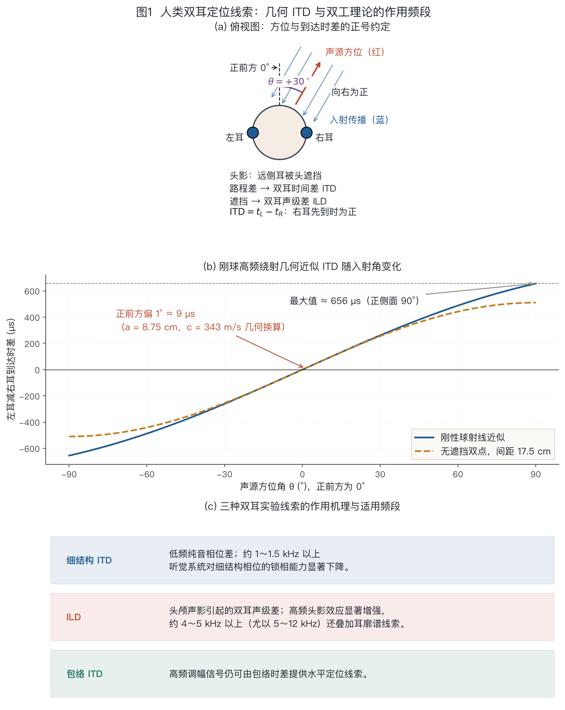

🌐 **简体中文** ｜ [English](../chapters_en/01_problem-definition.md)

> 本篇是本书正文第 1 章；正文与扩展专题共 16 章（第 0～15 章，其中第 0 章为数学基础，第 12～15 章为四篇扩展专题），另有附录 A、B。本篇可独立阅读，前后篇见下方导航。
>
> 导读首页：[00_overview.md](00_overview.md) ｜ 上一篇：[00_math-foundations.md](00_math-foundations.md) ｜ 下一篇：[02_basics-signal-model.md](02_basics-signal-model.md)

---

## 1. 从一个生活场景出发：问题定义

本章从客厅里的远场语音交互出发，先理清声源定位、波束形成和声源追踪各自输入什么信号、交付什么结果，再通过一步步手算回答两个核心问题：把多只麦克风录到的波形加起来取平均，为什么能压低随机底噪？如果时延没对齐或者噪声彼此相关，为什么有时不仅降不了噪，反而会损伤目标语音或放大底噪？随后我们以人类双耳听觉为参照，剖析双耳时间差、双耳声级差与方向相关谱形各自携带的空间信息，看看机器麦克风阵列能够借鉴到哪一步、又在哪些地方遵循不同的物理规律。

读完本章，你将能够区分全向声压型与指向性声压梯度型传声器并核算声学过载点（AOP）与 `dBFS–SPL` 换算，独立推算理想空间白噪声下的四麦平均增益及成立条件，分清整体音量大小、未中心化均方功率、中心化方差与分量信噪比（SNR），核算硅麦器件手册 $\mathrm{dB(A)}$ 指标掩盖的低频 $1/f$ 自噪声代价，并辨析几何传播模型预测与人类心理声学实验阈值之间的本质区别。

### 1.1 任务定义与理想阵列收益

#### 1.1.1 客厅里的远距离语音问题

想象你坐在客厅沙发上，对 3 米外的智能音箱说一句“今天天气怎么样”。近讲通话时你的嘴唇离手机麦克风只有几厘米，直达语音远强于周围杂音；而一旦拉开到 3 米距离，你的直达声在传播途中明显衰减，音箱要想听清这句话，必须同时面对五类性质截然不同的干扰：

1. **环境背景噪声**：空调风声、窗外车流声或冰箱嗡鸣声，从四面八方持续进入麦克风。
2. **房间混响**：你发出的同一个音节经墙壁、地板、桌面和天花板反复反射后分批到达麦克风，迟到的反射声拖出长长的尾巴，叠在后面的音节上使咬字变糊。
3. **旁向干扰说话人**：家人交谈声或电视机里的新闻播报声。它们同样具备自然语音的谐波与共振峰结构，单靠“检测有没有人声”无法区分谁才是真正的唤醒者。
4. **麦克风自噪声**：传感器振膜热运动与前置放大电路自身产生的电子底噪。即便把音箱放进完全隔音的消声室，自噪声依然存在；如果后续算法为了对消干扰而采用幅值很大的正负相减权重，还会把这层底噪显著放大。
5. **设备自身播放回声**：如果音箱此刻正在播放音乐，扬声器发出的声音会直接耦合或经房间反射灌入自身麦克风，强度往往比 3 米外的人声高出十几到几十分贝。与外部电视声不同，音箱内部能够拿到自己即将播放的数字音频作为已知参考信号。

面对这团混杂的声场，单只麦克风只能记录某一个空间点上的声压随时间的变化，把来自各个方向的声音全部叠成一条一维波形；而人类之所以能在嘈杂聚会中听清对面朋友说话，很大程度上得益于左右两只耳朵在空间上相隔一段距离。受此启发，机器可以使用**一组同步采样的麦克风**在空间不同位置同时观测声场：同一个声源到达各阵元的传播时间、幅度衰减和散射频响会随方向规律变化（至于 3 米距离上的球面波前能否近似成平直的平面波，则要联合阵列尺寸与声波波长一起判断，我们将在 §2.2 给出定量分界）。

这里特意强调**同步采样**，是因为空间时差信息极其细微——声波在空气中每秒跑约 $343\ \mathrm{m}$，传播约 $2.14\ \mathrm{cm}$ 只需要 $62.5\ \mu\mathrm{s}$（恰好等于 $16\ \mathrm{kHz}$ 采样率下的 1 个采样点间隔）。只有当所有麦克风共享同一个采样时钟基准、相同样本下标严格对应同一物理时刻时，通道间的样本错位才真实反映声波的传播路程差；如果多路采集之间存在未校准的时钟偏移或缓冲错位，硬件引入的假时差就会直接污染方向判断，甚至在相加时把高频目标语音抵消掉（本章练习 E01-05 将亲手算出仅差 1 个采样点对高低频的不同损耗）。

#### 1.1.2 空间处理的三项任务

拿到一组同步多通道录音后，围绕“空间方向”通常要完成三项彼此衔接但目标不同的任务：

| 任务 | 直观参照 | 核心要回答的问题 |
|---|---|---|
| **声源定位** | 闭上眼睛判断是谁在哪个方位喊你 | 声源相对于阵列处在哪个方向角（或空间坐标）？ |
| **波束形成** | 把听觉注意力聚焦到目标说话人方向 | 怎样组合多路信号，才能保住目标方向声音并压低其他方向干扰？ |
| **声源追踪** | 边听边转头跟随在屋里走动的说话人 | 目标正在怎样移动？停顿或被遮挡时当前方向估计还可靠吗？ |

对照上表，如果把一段四通道同步录音送入系统，这三个模块的输入、输出与评价标准各有分工：

- **声源定位**读入多路同步音频，通过分析通道间的时间差、相位差或空间谱，输出一个或多个候选方向角（近场或分布式阵列配置下还可估计距离）。定位算法常会给每个候选角度算出一个空间谱峰高或相关得分，用来给候选方向排序；需要注意这个原始得分衡量的是相位对齐吻合度，并不是经过概率校准的“该方向存在声源的真实概率”。
- **波束形成**读入多路音频，按照指定目标方向（可由定位模块提供，也可预先固定在正前方）对各通道施加相应的时延补偿与复数/实数加权求和，输出一条目标方向更突出、旁向噪声更弱的音频流。
- **声源追踪**以定位模块连续各帧输出的方向观测为输入，结合目标运动模型递推更新角度与角速度状态；当说话人短暂闭嘴停顿导致观测缺失，或室内反射造成个别帧角度跳变时，追踪器负责平滑轨迹、维持短时预测，并在多人走动交错时理清“当前观测属于哪条历史轨迹”。

在实际系统中，定位与追踪常用来为波束形成提供实时指向角，但三者的验收指标绝不能混为一谈：评价定位要量角度误差，评价波束要看目标保真度与噪声抑制量，评价追踪还要额外统计轨迹漏跟与身份切换；波束输出的声音更响，并不说明定位角度找得更准。

同时，单纯依靠空间方向选择也有明确的物理边界。如果目标说话人与电视机恰好排在相对阵列的同一条视线上，两者到达各麦克风的传播时差几乎一模一样，仅靠空间波束便无法将它们拆开；此外，任何物理阵列的尺寸都是有限的，它的空间接收区就像手电筒光束一样具有一定张角（即 §2.6 将详述的主瓣宽度），并非只接收某一条零宽度几何射线上的声音，紧挨目标角度的邻近干扰仍会有一部分漏进输出。

至于设备自身播放的音乐回声、同一说话人的晚期房间混响拖尾，以及同方向或近方向的多人重叠语音，则分别需要借助播放参考信号的**声学回声消除（Acoustic Echo Cancellation，AEC）**、跨帧线性预测去混响和语音分离来解决，这些方法将在第 6～8 章逐一展开。

#### 1.1.3 传声器物理特性与人声语音频带

把多只麦克风装进设备之前，先要看清单个传感器本身的物理响应机理、动态范围边界，以及人声语音所占据的频率范围。

1. **声压型（全向）与声压梯度型（指向性）传声器**：商用微机电系统（Micro-Electro-Mechanical Systems，MEMS）硅麦绝大多数属于**声压型传声器（pressure microphone）**——振膜背面是密闭（仅留微小静压平衡孔的）背腔，正面感受单点标量声压随时间的变化。只要封装尺寸远小于声波波长，声压型传声器对来自四面八方的声波几乎等灵敏，呈现**全向（omnidirectional）**响应；正因单个 MEMS 硅麦天然不挑方向，设备才需要把多颗硅麦拉开间距组成阵列，靠后续时延加权合成空间指向性。另一类**声压梯度型传声器（pressure-gradient microphone）**允许声波同时到达振膜前后两面，驱动力正比于振膜两侧的声压差，天然呈现按 $\cos\theta$ 变化的双向“8 字形”指向（把声压型与声压梯度型分量按比例叠加，便可构成单一振膜的心形或超心形话筒）；但其物理差分机制在低频天然滚降，且极易受近嘴气流喷麦、风噪与低频近讲效应影响，在紧凑消费电子阵列中远不如全向 MEMS 硅麦普及。
2. **灵敏度标定、数字满刻度换算与声学过载点（AOP）**：声学上以人耳听阈 $p_0 = 20\ \mu\mathrm{Pa}$ 为 $0\ \mathrm{dB\ SPL}$ 基准，有效声压 $1\ \mathrm{Pa}$ 恰好对应 $20\log_{10}(1/20\times10^{-6}) \approx 93.98\ \mathrm{dB\ SPL}$（工程惯例记为 $94\ \mathrm{dB\ SPL}$）。模拟驻极体或模拟硅麦的灵敏度以 $\mathrm{dBV/Pa}$ 标称，而数字脉冲密度调制（PDM）或 $\mathrm{I^2S}$ 硅麦则直接以数字满刻度分贝（$\mathrm{dBFS}$）标称在 $94\ \mathrm{dB\ SPL}$、$1\ \mathrm{kHz}$ 下的输出电平。例如一颗常见数字硅麦的标称灵敏度为 $S_{\mathrm{dBFS}} = -26\ \mathrm{dBFS}\ @\ 94\ \mathrm{dB\ SPL}$，那么任意声压级 $L_{\mathrm{SPL}}$ 与数字电平 $L_{\mathrm{dBFS}}$ 的换算关系为

    $$
    L_{\mathrm{dBFS}} = L_{\mathrm{SPL}} - 94 + S_{\mathrm{dBFS}}, \qquad
    L_{\mathrm{SPL,FS}} = 94 - S_{\mathrm{dBFS}}.
    $$

    代入 $S_{\mathrm{dBFS}} = -26\ \mathrm{dBFS}$ 立刻算出数字满刻度 $0\ \mathrm{dBFS}$ 对应 $L_{\mathrm{SPL,FS}} = 120\ \mathrm{dB\ SPL}$；若该硅麦标称信噪比为 $65\ \mathrm{dB(A)}$，则其等效输入自噪声底（Equivalent Input Noise，EIN）为 $94 - 65 = 29\ \mathrm{dB(A)\ SPL}$。硬件选型时还必须核对**声学过载点（Acoustic Overload Point，AOP）**——行业通常将其定义为总谐波失真（Total Harmonic Distortion，THD）达到 $10\%$ 时的声压级（商用硅麦常见 $120\text{～}135\ \mathrm{dB\ SPL}$）。智能音箱大音量播歌时，机身内部扬声器耦合到相邻麦克风的近场声压极高：一旦峰值声压逼近甚至超过 AOP，振膜或前置放大电路就会产生剧烈非线性削波，此时第 6 章的线性声学回声消除器将因模型假设被破坏而直接失效。
3. **人声语音频带与采样率基准**：全书算例反复用到 $16\ \mathrm{kHz}$ 采样率以及 $1\ \mathrm{kHz}$、$4\ \mathrm{kHz}$、$7\ \mathrm{kHz}$ 等代表频点，它们直接锚定在人类发声的物理频谱上：成人浊音基频大约落在 $85\text{～}255\ \mathrm{Hz}$（男声偏低、女声与童声偏高），决定元音音色与主要语言可懂度的声道共振峰集中在 $0.3\text{～}3.4\ \mathrm{kHz}$，而区分“s/sh/f”等清辅音与摩擦音的细节能量则延伸至 $4\text{～}8\ \mathrm{kHz}$。按奈奎斯特采样定理，传统窄带电话采用 $8\ \mathrm{kHz}$ 采样（覆盖至 $4\ \mathrm{kHz}$），智能音箱与语音识别前端主流采用 $16\ \mathrm{kHz}$ 宽带采样（覆盖至 $8\ \mathrm{kHz}$，本书绝大多数教学算例采用该基准），而专业视频会议、空间音频与可穿戴通透设备则常采用 $48\ \mathrm{kHz}$ 全带采样。

#### 1.1.4 先分清音量、功率与信噪比

在讨论阵列“降了多少分贝噪声”之前，我们先要把波形幅度、均方功率、方差和信噪比的数学账算清楚。本书在数字时域中统一使用序列的**均方值（mean square）**来度量信号平均功率：对于长度为 $N$ 的实数采样序列 $u[0], u[1], \ldots, u[N-1]$，把每个样本平方后求和再除以样本点数 $N$，记为

$$
P_u = \frac{1}{N}\sum_{n=0}^{N-1}u[n]^2. \tag{1-1}
$$

式(1-1)中 $n$ 是离散样本下标（从 $0$ 到 $N-1$），$N$ 是统计窗口内的总样本数。如果 $u[n]$ 是模数转换后归一化到 $[-1, 1]$ 的无量纲数字幅度，算出的 $P_u$ 也是无量纲数字均方功率；只有结合传声器灵敏度与声压级校准常数后，才能换算成物理声压平方（$\mathrm{Pa}^2$）或声功率（$\mathrm{W}$）。

细心的读者会问：式(1-1)为什么没有先减去样本均值？记这段长度为 $N$ 的记录的样本均值为 $\bar u = \frac{1}{N}\sum_{n=0}^{N-1} u[n]$，如果我们按相同分母 $N$ 计算先减均值的**中心化样本方差** $V_N$，把平方项逐项展开就能看清两者的精确关系：

$$
\begin{aligned}
V_N &= \frac{1}{N}\sum_{n=0}^{N-1}\bigl(u[n]-\bar u\bigr)^2 \\
&= \frac{1}{N}\sum_{n=0}^{N-1}
\bigl(u[n]^2 - 2\bar u\,u[n] + \bar u^2\bigr) \\
&= \frac{1}{N}\sum_{n=0}^{N-1}u[n]^2
- 2\bar u\left(\frac{1}{N}\sum_{n=0}^{N-1}u[n]\right) + \bar u^2 \\
&= P_u - 2\bar u^2 + \bar u^2 = P_u - \bar u^2.
\end{aligned}
$$

恒等式 $P_u = V_N + \bar u^2$ 在工程上有两层非常实在的含义。第一，真实驻极体或硅麦（MEMS 麦克风）及模数转换电路往往带有微小的**直流偏置（DC offset）**，哪怕在完全安静的屋子里，录下来的波形也会整体悬浮在零线略偏上或略偏下的常数值 $\bar u \neq 0$ 处；如果不先做去均值或隔直高通滤波就直接按式(1-1)算功率，人耳根本听不见的直流分量 $\bar u^2$ 就会虚增底噪功率读数。

第二，即便理论随机噪声模型的总体数学期望为零（$\mathbb{E}[u[n]]=0$，此时总体均方等于总体方差），截取一段有限长度 $N$ 的样本时，样本均值 $\bar u$ 通常也不会恰好等于零（见练习 E01-04）。

在受控仿真实验里，我们可以把干净目标语音分量 $s[n]$ 和加性噪声分量 $v[n]$ 分开保存，在同一个时间窗口 $[0, N-1]$ 上分别按式(1-1)算出目标功率 $P_s$ 与噪声功率 $P_v$。由此定义功率意义下的**信噪比（Signal-to-Noise Ratio，SNR）**以及经过算法处理后的信噪比改善倍数 $G$（分贝标度与功率/幅度对数换算见[第 0 章 §0.2](00_math-foundations.md#sec-0-2)）：

$$
\begin{aligned}
\mathrm{SNR} &= \frac{P_s}{P_v}, &
\mathrm{SNR}_{\mathrm{dB}} &= 10\log_{10}\frac{P_s}{P_v}, \\
G_{\mathrm{dB}} &= 10\log_{10}G, &
G &= \frac{\mathrm{SNR}_{\mathrm{out}}}
{\mathrm{SNR}_{\mathrm{in}}}.
\end{aligned} \tag{1-2}
$$

使用式(1-2)时要留意分子与分母的物理前提：只有当输入目标功率 $P_{s,\mathrm{in}}$、输入噪声功率 $P_{v,\mathrm{in}}$ 和输出噪声功率 $P_{v,\mathrm{out}}$ 全部严格大于零时，$\mathrm{SNR}_{\mathrm{in}}$、$\mathrm{SNR}_{\mathrm{out}}$ 与改善倍数 $G$ 才是良定义的正常正数。遇到以下三类退化边界时必须分别处理：

- **纯静音输入段（$P_{s,\mathrm{in}}=0$）**：此时输入信噪比为零，不能拿它去做改善倍数 $G$ 的分母——这也是第 10 章评测语音算法时必须先划分有声段与静音段的原因。
- **目标反相抵消（$P_{s,\mathrm{out}}=0$ 且 $P_{v,\mathrm{out}}>0$）**：输入原本含有目标语音，但处理后目标由于通道反相被完全抵消而噪声仍在，此时线性 $\mathrm{SNR}_{\mathrm{out}}=0$，对数域按极限记为 $-\infty\ \mathrm{dB}$。
- **无噪声纯对齐检验（$P_v=0$）**：分母为零时信噪比无定义，应直接比较处理前后的目标幅度或均方功率保留比例，而不套用除零的信噪比公式（如练习 E01-05）。

在日常真实录音中，我们手里往往只有叠加后的混合波形 $x[n]=s[n]+v[n]$，单看混合波形的总功率 $P_x$ 并不能直接拆出 $P_s$ 和 $P_v$（平方展开还会多出目标与噪声的交叉乘积项，练习 E01-07 将详细拆解）。

先看一个极简数字例子建立直觉：假设单只麦克风上的目标功率 $P_s=1$、噪声功率 $P_v=1$，此时线性 $\mathrm{SNR}=1/1=1$，对应 $10\log_{10}1=0\ \mathrm{dB}$。如果某种处理保持目标功率 $P_s=1$ 不变，而把噪声功率压低到 $0.25$，线性 $\mathrm{SNR}$ 就提高到 $4$，即 $10\log_{10}4\approx 6.02\ \mathrm{dB}$；反过来，如果只是把音量旋钮拧小一半，让目标和噪声的幅度同时乘以 $0.5$，两者的功率会双双降为原来的四分之一（$0.25$ 与 $0.25$），听起来声音变轻了，但比值 $\mathrm{SNR}=0.25/0.25=1$（$0\ \mathrm{dB}$）分毫未变。

#### 1.1.5 器件手册的 dBA 信噪比与低频自噪声陷阱

选配硬件传感器时，还要特别留意商用麦克风数据手册里的信噪比定义。翻开硅麦（MEMS 麦克风）规格书，常会看到“$\mathrm{SNR}=65\ \mathrm{dB(A)}$”这样的标称指标：它的分子固定为 $1\ \mathrm{kHz}$、$94\ \mathrm{dB\ SPL}$（有效声压 $1\ \mathrm{Pa}$）标准正弦参考声源功率，分母则是把消声暗室里测得的传感器自噪声功率谱密度先乘上国际标准 IEC 61672-1 的 **A 计权滤波器（A-weighting）** 功率权重，再在音频带（标准全带为 $20\ \mathrm{Hz}$～$20\ \mathrm{kHz}$）积分得到的计权底噪功率。

A 计权曲线模仿人耳在安静环境下的等响度感受，以 $1\ \mathrm{kHz}$ 为 $0\ \mathrm{dB}$ 基准，对低频能量做了大幅度衰减。对照下表列出的 IEC 61672-1 关键频点权重可以看到，在 $100\ \mathrm{Hz}$ 处功率权重仅剩约 $0.0122$（滤掉了近 $98.8\%$ 的底噪功率），在 $50\ \mathrm{Hz}$ 处更是只剩约 $0.00094$，几乎完全掩盖了硅麦专用集成电路（ASIC）晶体管与振膜泄气孔声阻在低频段急剧抬升的 **$1/f$ 闪烁噪声（flicker noise）**：

| 频率 $f$ | A 计权相对增益 $A(f)$ | 线性功率权重 $g_{\mathrm{A}}^2(f)$ | 计入标称底噪的功率比例 |
|---|---|---|---|
| $50\ \mathrm{Hz}$ | $-30.27\ \mathrm{dB}$ | $0.000939$ | 约 $0.094\%$ |
| $100\ \mathrm{Hz}$ | $-19.14\ \mathrm{dB}$ | $0.012182$ | 约 $1.22\%$ |
| $200\ \mathrm{Hz}$ | $-10.85\ \mathrm{dB}$ | $0.082298$ | 约 $8.23\%$ |
| $500\ \mathrm{Hz}$ | $-3.25\ \mathrm{dB}$ | $0.473405$ | 约 $47.3\%$ |
| $1000\ \mathrm{Hz}$ | $0.00\ \mathrm{dB}$ | $1.000000$ | $100\%$（归一化基准） |
| $2500\ \mathrm{Hz}$ | $+1.27\ \mathrm{dB}$ | $1.339883$ | 约 $134\%$ |

对于单只麦克风直接给人耳试听，这种计权基本符合听感；可一旦把麦克风装进小孔径阵列做差分或超指向波束形成（定量推导见第 3 章算例 3-1 与第 5 章 §5.3），情况就会发生反转。间距 $d$ 远小于声波波长时，相邻麦克风相减虽然能抵消后方干扰，却也会让低频目标语音按正弦规律剧烈衰减；后端为了拉平目标语音频响，必须给低频补上反比于 $f^2$ 的高额均衡功率增益，叠加传感器原有的 $1/f$ 低频闪烁底噪后，输出低频自噪声会按 $1/f^3$ 急剧抬升。因此，做小孔径阵列低频噪声预算时必须向器件厂商索取未计权的自噪声功率谱密度曲线，不能只看单个 $\mathrm{dB(A)}$ 标称值——本章练习 E01-11 将亲手复算一款在 $50\ \mathrm{Hz}$～$8\ \mathrm{kHz}$ 宽带语音网格上按 A 计权总底噪功率核算占优约 $1.59\ \mathrm{dB}$（在 $20\ \mathrm{Hz}$～$20\ \mathrm{kHz}$ 全音频带下约占优 $1.91\ \mathrm{dB}$）的硅麦，装入 $1\ \mathrm{cm}$ 差分阵后反而令语音频带自噪声恶化约 $5\ \mathrm{dB}$ 的反转实例。

#### 1.1.6 三类阵列收益与白噪声增益

多麦克风阵列把噪声压低了多少，高度依赖噪声在空间是怎么分布的。面对不同的声场假设，工程上使用三把不同的尺子来衡量阵列收益：

| 输入噪声或干扰的空间假设 | 对应的核心评价指标 | 这个指标能告诉我们什么 |
|---|---|---|
| 各通道零均值、等功率、跨通道互不相关的噪声 | **白噪声增益（White Noise Gain，WNG）** | 在理想独立底噪下阵列相对单麦的 SNR 改善倍数；更常用来监控波束器是否放大了传感器自噪声 |
| 来自四面八方等强度的理想各向同性弥散噪声场 | **指向性指数（Directivity Index，DI）** | 把全空间球面（或圆周）各方向入射噪声积分平均后，目标方向相对背景声场的增益改善（单位 dB） |
| 来自某一个特定方向角的强点源干扰 | **干扰方向响应 / 零陷深度** | 波束方向图在该特定干扰角度上压低了多少分贝；仅代表该角度的抑制深度，不代表其他角度同样安静 |

读这张表时，最容易混淆的概念是 WNG 里的“白”。信号处理里常说的“时间白噪声”是指单路信号在所有频率上功率谱平坦；而白噪声增益（WNG）要求的则是**空间白（spatially white）**——也就是完成目标对齐之后，不同麦克风通道之间的噪声互不相关（跨通道乘积的数学期望为零），且各通道噪声功率相等。

这是跨通道的空间统计条件，与单路噪声在时间上是不是白噪声属于截然不同的概念：哪怕你生成一段频谱绝对平坦的时间白噪声，只要把它原封不动复制四份送进四个通道，四路噪声在空间上就是 $100\%$ 完全相关的，求平均一点也降不了噪；反之，四只麦克风各自独立的电路低频热噪声即便频谱并不平坦，只要彼此统计独立、功率相同，就满足某频点上的空间白假设。

在实际室内环境中，声波经墙壁多次反射后的晚期混响常被近似当作各向同性弥散场，因而可用 DI 大致衡量阵列对混响背景的抑制能力；第 5 章（§5.3、§5.4）将会看到，小孔径超指向波束为了在低频把 DI 做高，往往要让相邻通道做剧烈相减，导致 WNG 跌成负数（即放大传感器自噪声），而在特定干扰方向形成的深零陷也必须连同目标方向保真度和指向偏差敏感度一起评估。

#### 1.1.7 从求和到平均：四麦的 6 dB 怎样得到

现在我们亲手推算最经典的阵列增益基准。假设目标声源处于远场，各麦克风灵敏度一致，且我们已经精确补偿了声波到达各阵元的时间差。对齐之后的第 $m$ 路观测信号（$m=1,\ldots,M$，$M$ 为麦克风总数）可以写成

$$
x_m[n] = s[n] + v_m[n],
$$

其中各路的目标分量已经对齐成同一个波形 $s[n]$（均方功率记为 $P_s=\mathbb{E}[s[n]^2]>0$）；其实即便声源处在近场，只要把传播时延和球面距离衰减都补偿到位，使各通道目标分量恢复成同一波形 $s[n]$，下面的代数推导同样成立。设各通道加性噪声 $v_m[n]$ 满足零均值（$\mathbb{E}[v_m[n]]=0$）、等功率（$\mathbb{E}[v_m[n]^2]=P_v>0$）以及跨通道互不相关（当 $m\ne \ell$ 时，$\mathbb{E}[v_m[n]v_\ell[n]]=0$；数学期望与二阶统计量的基本性质见[第 0 章 §0.6](00_math-foundations.md#sec-0-6)）。单只麦克风上的输入信噪比为 $\mathrm{SNR}_{\mathrm{in}}=P_s/P_v$。

**第一步：先看把 $M$ 路信号直接相加。** 记直接求和输出为 $z[n]$，再除以通道数 $M$ 的等权平均输出为 $y[n]$：

$$
\begin{aligned}
z[n] &= \sum_{m=1}^{M}x_m[n] = M s[n] + \sum_{m=1}^{M}v_m[n], \\
y[n] &= \frac{z[n]}{M} = s[n] + \frac{1}{M}\sum_{m=1}^{M}v_m[n].
\end{aligned} \tag{1-3}
$$

先算直接求和 $z[n]$ 中目标与噪声各自的功率：

- **目标同相叠加**：$M$ 个完全相同的 $s[n]$ 相加变成 $M s[n]$，幅度变为原来的 $M$ 倍，平方后的目标功率变为 $\mathbb{E}\bigl[(M s[n])^2\bigr]=M^2 P_s$。
- **不相关噪声按功率相加**：把噪声和 $\sum_{m=1}^{M}v_m[n]$ 平方展开，既包含每一路自身的平方项 $v_m[n]^2$，也包含不同通道两两相乘的交叉项 $v_m[n]v_\ell[n]$（$m\ne\ell$）。例如双麦（$M=2$）时，$(v_1+v_2)^2 = v_1^2 + v_2^2 + 2v_1 v_2$。对总和的平方取数学期望：

$$
\begin{aligned}
\mathbb{E}\!\left[\left(\sum_{m=1}^{M}v_m[n]\right)^2\right]
&= \sum_{m=1}^{M}\mathbb{E}\bigl[v_m[n]^2\bigr] \\
&\quad + \sum_{m=1}^{M}\sum_{\substack{\ell=1\\\ell\ne m}}^{M}
\mathbb{E}\bigl[v_m[n]v_\ell[n]\bigr] \\
&= M P_v + 0 = M P_v.
\end{aligned}
$$

因为跨通道互不相关，全部 $M(M-1)$ 个交叉项在总体期望下均归零，只剩下 $M$ 个对角平方项，所以直接求和后的噪声功率只增至 $M P_v$，而目标功率增至 $M^2 P_s$。

**第二步：再除以 $M$ 取等权平均。** 将求和信号 $z[n]$ 整体除以正数 $M$ 得到 $y[n]$，目标分量与噪声分量的功率同步除以 $M^2$：输出目标功率回到与单麦一致的 $M^2 P_s / M^2 = P_s$，输出噪声功率则缩小为 $M P_v / M^2 = P_v / M$。代入式(1-2)，立刻得到等权对齐平均的理论输出信噪比与改善量：

$$
\begin{aligned}
\mathrm{SNR}_{\mathrm{out}} &= \frac{P_s}{P_v/M} \\
&= M\,\mathrm{SNR}_{\mathrm{in}}, \quad
G_{\mathrm{dB}} = 10\log_{10}M.
\end{aligned} \tag{1-4}
$$

请注意式(1-4)是在总体二阶矩（数学期望 $\mathbb{E}[\cdot]$）意义下先求功率之比得到的理论增益；如果对许多段有限长度短录音各自算出单段信噪比再取算术平均，由于有限样本交叉项随机起伏且比值与对数都是非线性运算，得到的会是另一个统计量。以每路目标功率 $P_s=1$、噪声功率 $P_v=1$ 的四麦克风阵列（$M=4$）为例，我们可以把单麦、四路直接求和与四路等权平均放在一张表里逐列比对：

| 处理方式 | 输出目标功率 | 输出噪声功率 | 输出 SNR（线性比） | 相对单麦 SNR 改善 |
|---|---|---|---|---|
| 单只麦克风基准 | 1 | 1 | 1 | 0.00 dB |
| 四路对齐直接求和 $z[n]$ | 16 | 4 | 4 | 6.02 dB |
| 四路对齐等权平均 $y[n]$ | 1 | 0.25 | 4 | 6.02 dB |

对比表格后两行可以看到：直接求和与等权平均的**输出信噪比完全相同**（线性比都是 $4$，即 $10\log_{10}4 \approx 6.02\ \mathrm{dB}$）。工程中之所以普遍采用等权平均（权重 $1/M$），是因为它能保持目标语音原有的幅度尺度不变，既方便与单麦输入做公平对比，也能防止多路直接累加导致定点表示削波溢出。按照同样的规律，若空间白噪声假设继续成立，8 只麦克风平均可改善 $10\log_{10}8 \approx 9.03\ \mathrm{dB}$——也就是说**麦克风数量每翻一倍，理想空间白噪声增益固定增加 $10\log_{10}2 \approx 3.01\ \mathrm{dB}$**。

更进一步，我们还能用初等配方法证明：在保持目标无失真的所有线性加权方案中，等权平均 $w_m = 1/M$ 已经达到空间白噪声增益的理论上界。设我们对已对齐的 $M$ 路信号施加实数权重 $w_1,\ldots,w_M$ 求和得 $y[n] = \sum_{m=1}^{M}w_m x_m[n]$，其中输出目标项为 $\bigl(\sum_{m=1}^{M}w_m\bigr)s[n]$、输出噪声项为 $\sum_{m=1}^{M}w_m v_m[n]$。要想让目标语音原样通过，权重之和必须满足无失真约束 $\sum_{m=1}^{M}w_m = 1$；此时单位方差空间白噪声（$P_v=1$）的输出功率为 $\sum_{m=1}^{M}w_m^2$。考察每个权重偏离平均值 $1/M$ 的平方和，不跳步展开中间项并代入 $\sum_{m=1}^{M}w_m = 1$：

$$
\begin{aligned}
0 &\le \sum_{m=1}^{M}\left(w_m-\frac{1}{M}\right)^2 \\
&= \sum_{m=1}^{M}
\left(w_m^2 - \frac{2}{M}w_m + \frac{1}{M^2}\right) \\
&= \sum_{m=1}^{M}w_m^2 - \frac{2}{M}\sum_{m=1}^{M}w_m
+ M\cdot\frac{1}{M^2} \\
&= \sum_{m=1}^{M}w_m^2 - \frac{2}{M}\cdot 1 + \frac{1}{M}
= \sum_{m=1}^{M}w_m^2 - \frac{1}{M}.
\end{aligned}
$$

移项即得 $\sum_{m=1}^{M}w_m^2 \ge \frac{1}{M}$，当且仅当每一路权重都取 $w_m = \frac{1}{M}$ 时等号成立（第 2 章与第 5 章把权重推广到频域复数向量后，用柯西—施瓦茨不等式同样会导出完全一致的上界）。换句话说，在等幅对齐、单位目标响应与同方差空间白噪声条件下，任何线性波束形成器的线性 WNG 都不会超过阵元数 $M$，而最朴素的延迟求和（等权平均）恰好达到这一理论最高值。

反过来，哪怕权重满足 $\sum_{m=1}^{M}w_m = 1$ 保住了目标，只要为了抵消旁向干扰而采用一正一负的大权重（例如双麦取 $w_1=2, w_2=-1$，练习 E01-09 将具体复算），平方和 $\sum_{m=1}^{M}w_m^2$ 就会远大于 $1$，输出自噪声反而比单只麦克风还要吵得多。如果各通道噪声不再像电子热噪声那样彼此独立，而是像空调风声或房间混响那样存在空间相关性，仿真时就不能简单给各路喂入独立白噪声，而需要依据各麦对之间的相关程度做线性混合（即空间噪声着色），且任何物理合法的相关结构都必须满足任意线性加权输出功率非负这一底线（本章练习 E01-01 会用初等配方法导出四麦等相关系数的精确下界 $\rho \ge -1/3$，而将其写成复空间相干矩阵平方根分解并与 Cholesky 奇异边界对照的完整推导，将在引入矩阵记号后的[第 2 章 §2.5.2](02_basics-signal-model.md#sec-2-5-2) 与[第 0 章 §0.3.3](00_math-foundations.md#sec-0-3-3) 展开）。想进一步了解远场麦克风阵列如何服务于语音识别系统的读者，可参阅 Kumatani、McDonough 与 Raj 的综述论文 [《Microphone Array Processing for Distant Speech Recognition: From Close-Talking Microphones to Far-Field Sensors》（IEEE Signal Processing Magazine，29(6)，127–140，2012）](https://doi.org/10.1109/MSP.2012.2205285)（[CMU 课程页面公开副本](https://course.ece.cmu.edu/~ece792/handouts/KumataniEtAl12.pdf)）。

### 1.2 双耳听觉的三类定位线索

在正式推导任意几何的麦克风阵列之前，先看看大自然演化出的“双通道接收机”——人类的左右双耳——非常有助于建立物理直觉。从声学结构看，双耳好比架在球形刚性障板（头部）两侧、外加复杂非对称波导（耳廓）的两只传感器；与此同时，人类听觉还会调动转头运动、先验记忆与脑干神经核团协同判别方位。我们先借图 1 把双耳时间差、双耳声级差和方向相关谱形三类物理线索拆开看清（窄屏设备可点击[打开图 1 原图](../figures/fig01_binaural.png)放大阅读）：



读图 1 时，可以顺着 `(a) → (b) → (c)` 从几何模型逐步过渡到听觉感知边界：

- **子图 `(a)` 俯视几何与正负号约定**：画面中央为俯视的头部截面，两侧蓝点代表左耳与右耳；竖直向上的黑色箭头定义正前方为 $0^\circ$，顺时针向右偏转为正方位角（紫色圆弧标出示例声源位于右前方 $\theta=+30^\circ$，红色外向箭头指向声源，平行的蓝色斜箭头表示迎面传来的远场平面波）。由于声源偏右，波前先触达迎风侧的右耳，而远侧的左耳落在头部的“声影区”内——声波既要多走一段绕头路程才能到达左耳（形成双耳时间差 $\mathrm{ITD}=t_L-t_R>0$），其高频能量还会被头部遮挡削弱（形成双耳声级差 $\mathrm{ILD}$）。
- **子图 `(b)` 两种几何模型下的 ITD 理论曲线**：横轴为声源方位角 $\theta$（单位：$^\circ$，范围 $-90^\circ$～$+90^\circ$），纵轴为左耳减右耳到达时差（单位：$\mu\mathrm{s}$），统一取等效头半径 $a=8.75\ \mathrm{cm}$、声速 $c=343\ \mathrm{m/s}$。对比蓝色实线（刚性球头射线绕行近似）与橙色虚线（拿掉头部、仅在空气中保留间距 $17.5\ \mathrm{cm}$ 的无遮挡双点）可以读出三点特征：第一，在正前方 $\theta=0^\circ$ 附近两条曲线几乎重合且呈近似直线，偏离 $1^\circ$ 产生约 $9\ \mu\mathrm{s}$ 的物理时差（红箭标注）；第二，随着角度往侧面增大，无遮挡双点的橙色虚线按正弦规律趋缓，在正右方 $+90^\circ$ 停在约 $510\ \mu\mathrm{s}$，而蓝色实线因为声波无法穿颅直行、必须贴着球面弧线绕行，时差继续拉大到约 $656\ \mu\mathrm{s}$；第三，整幅曲线关于原点奇对称，左侧声源（$\theta<0^\circ$）先到左耳，时差取负值。
- **子图 `(c)` 三种听觉线索的作用条件对照**：自上而下用蓝、红、绿三栏并列展示纯音细结构 ITD、双耳声级差（ILD）和调制高频包络 ITD。它专门用来破除“低频只看时间差、高频只看声级差”的机械二分印象：虽然人耳对纯音逐周期相位的锁相上限在特定实验下约为 $1.4\ \mathrm{kHz}$，但高频声音一旦带有慢变化的强弱包络，听觉依然能从包络起伏中读取时间差；同理，低频在近场或散射条件下也可能产生声级差。

#### 1.2.1 双耳时间差：把几何模型算清楚

**双耳时间差（Interaural Time Difference，ITD）**衡量同一个声波波前到达左右两耳的时间先后。按照图 1(a) 的坐标系，将正前方定为 $\theta=0^\circ$、向右偏转为正，记声波到达左耳与右耳的时刻分别为 $t_L$ 和 $t_R$，定义 $\tau = t_L - t_R$：当声源在右侧（$\theta>0^\circ$）时，右耳先听到、左耳后听到（$t_L > t_R$），因此 $\tau > 0$；当声源在对称的左侧时，$\tau < 0$。

为什么有头部遮挡时，声波多走的路程会写成 $a\sin\theta + a\theta$？我们可以把经典的 **Woodworth 刚性球头高频射线模型**（Woodworth，*Experimental Psychology*，1938；Woodworth 与 Schlosberg，1954）一步步画出来算清楚。把头部看作球心在原点 $O$、半径为 $a$ 的刚性球，右耳 $R$ 与左耳 $L$ 位于水平直径两端，坐标分别为 $(a, 0)$ 与 $(-a, 0)$。考虑右前方入射的远场平面波（$0 \le \theta \le \pi/2$，朝向声源的单位方向向量为 $(\sin\theta, \cos\theta)$，平直波前与该方向垂直）：

1. **迎风侧直线超前段 $a\sin\theta$**：右耳 $R$ 处在朝向声源的受照半球面上，平面波沿直线直接照射到右耳。以穿过球心 $O$ 的等相位波前平面为基准，右耳 $R$ 在声源方向上的几何投影超前了 $a\sin\theta$，因此波前触达右耳之后，还要再往前平推 $a\sin\theta$ 的直线距离，才会抵达过球心 $O$ 的基准波前。
2. **背风侧贴球面切点绕行弧长 $a\theta$**：在左耳所在的另一侧，有一条平行入射声线刚好与球面相切于切点 $T$。因为球半径 $OT$ 垂直于入射方向，**切点 $T$ 恰好落在过球心 $O$ 的同一个基准波前平面上**。同时，切点半径 $OT$ 与左耳半径 $OL$ 之间的圆心角正好等于方位角 $\theta$（弧度）。声波到达切点 $T$ 后无法穿过刚性头颅，只能贴着球面圆弧爬行（绕射）到阴影区里的左耳 $L$，这段球面圆弧的长度正是半径乘以圆心角弧度，即 $a\theta$。

把从右耳波前到切点波前的直线段 $a\sin\theta$，加上从切点贴球面绕到左耳的弧长段 $a\theta$，就得到总路程差 $\Delta d = a(\theta + \sin\theta)$；再除以声速 $c$（并利用左右奇对称推广到前半平面 $-\pi/2 \le \theta \le \pi/2$），便得到 Woodworth 球头时差公式：

$$
\tau_{\mathrm{球头}}(\theta)
= \frac{a}{c}\bigl(\theta+\sin\theta\bigr). \tag{1-5}
$$

使用式(1-5)手算时千万注意单位统一：$a$ 用米（$\mathrm{m}$），声速 $c$ 用米每秒（$\mathrm{m/s}$），括号里单独出现的角度 $\theta$ **必须换算成弧度（$\mathrm{rad}$）**，这样分子 $a\theta$ 才是以米为单位的弧长，除出来的结果单位才是秒（$\mathrm{s}$）。

我们代入成年人常用等效头半径 $a = 8.75\ \mathrm{cm} = 0.0875\ \mathrm{m}$ 与室温声速 $c = 343\ \mathrm{m/s}$ 复算图 1(b) 上的两个关键刻度：

- **正右方极值（$\theta = 90^\circ = \pi/2\ \mathrm{rad}$）**：此时 $\sin(\pi/2)=1$（波前从右耳平推一个半径 $a$ 到球心切点），再贴着后脑或前额绕行四分之一圆周 $\frac{\pi}{2}a$ 到左耳，总时差为

    $$
    \begin{aligned}
    \tau_{\mathrm{球头}}(90^\circ)
    &= \frac{0.0875}{343}\left(\frac{\pi}{2}+1\right) \\
    &\approx 0.000655815\ \mathrm{s} \approx 656\ \mu\mathrm{s}.
    \end{aligned}
    $$

- **正前方微偏一度（$\theta = 1^\circ$）**：先把角度换成弧度 $\theta = \pi/180 \approx 0.0174533\ \mathrm{rad}$，此时 $\sin 1^\circ \approx 0.0174524$，代入式(1-5)算得球头时差约为 $8.9045\ \mu\mathrm{s}$（即图 1(b) 标注的约 $9\ \mu\mathrm{s}$）。这个数字代表正前方每偏转 $1^\circ$ 对应的物理传播时差增量；至于人耳能不能听出这约 $9\ \mu\mathrm{s}$ 的差别，则要靠心理声学辨别实验去实测，不能单从几何公式直接断言听觉分辨力。

作为对照，如果我们把中间的头部拿走，只在自由空间空气里放两只相距 $d = 2a = 17.5\ \mathrm{cm}$ 的点麦克风，声波不再需要贴球面绕弧长 $a\theta$，从球心基准波前到左麦也变成直线投影 $a\sin\theta$，两段 $a\sin\theta$ 合起来就是自由场双点时差公式：

$$
\tau_{\mathrm{双点}}(\theta) = \frac{2a}{c}\sin\theta. \tag{1-6}
$$

代入同样的 $2a = 0.175\ \mathrm{m}$ 和 $\theta = 90^\circ$，自由场双点的最大时差只有 $0.175 / 343 \approx 510\ \mu\mathrm{s}$，比球头绕射少了约 $146\ \mu\mathrm{s}$。而在靠近正前方的微小角度下，由于一阶泰勒近似 $\sin\theta \approx \theta$，式(1-5)与式(1-6)都退化为 $\frac{2a}{c}\theta$，这正是图 1(b) 中蓝、橙两条线在 $0^\circ$ 附近几乎贴在一起、越往两侧分叉越大的几何原因。

需要指出，Woodworth 公式本质上是波长远小于头尺寸时的高频几何声学射线近似（小角度极限约为 $\frac{2a}{c}\sin\theta$）。当频率降至长波散射区（$\kappa a = 2\pi f a / c \ll 1$，对成人头半径大致对应 $f \lesssim 500\ \mathrm{Hz}$）时，Kuhn（*JASA*，62(1)，157–167，1977）利用刚性球面波散射展开证明，低频有效双耳时间差收敛于

$$
\tau_{\mathrm{LF}}(\theta) \approx \frac{3a}{c}\sin\theta,
$$

其小角度系数比高频射线极限 $\frac{2a}{c}\sin\theta$ 恰好高出 $3/2$（$1.5$ 倍）——代入 $a=8.75\ \mathrm{cm}$、$c=343\ \mathrm{m/s}$，在 $\theta=90^\circ$ 处可达约 $765\ \mu\mathrm{s}$，高于高频 Woodworth 射线模型的 $656\ \mu\mathrm{s}$ 与无遮挡自由场双点的 $510\ \mu\mathrm{s}$（完整的球散射级数复算见第 3 章练习 E03-17）。关于低频与高频过渡段以及实际耳道偏离球体正对径的精细声学修正，可进一步参阅 [Aaronson 与 Hartmann（JASA，135(2)，817–823，2014）](https://doi.org/10.1121/1.4861243)。

#### 1.2.2 声级差、细结构与包络要分别判断

除了到达先后，两耳听到的响度强弱也不同。**双耳声级差（Interaural Level Difference，ILD）**度量左右两耳接收声压级的差值。当波长比头部直径短得多（中高频段）时，头部就像一堵挡音墙，在远侧耳处投下明显的“声影”，使远耳声级显著低于近耳；而在波长远大于头尺寸的低频段，声波轻松绕过头部，两耳声级差随之大幅减小。因此，远场双耳 ILD 主要源于头部的频率相关散射与遮挡，而不是自由空间里那十几厘米微不足道的球面距离衰减差。

在正负号约定上，本书统一取**“右耳声级减左耳声级”**：右耳更强时 $\mathrm{ILD} > 0$，左耳更强时 $\mathrm{ILD} < 0$。这样规定后，右侧声源（$\theta>0^\circ$）同时对应正的 $\mathrm{ITD}=t_L-t_R>0$、正的 $\mathrm{ILD}=L_R-L_L>0$ 与正的右减左相位差 $\mathrm{IPD}>0$，符号直觉高度一致；过渡到第 2 章阵列模型（§2.1.1、§2.3）时只需留心一个对应关系——以左麦（麦 1）为参考看右麦（麦 2）的相对到达时延写作 $\tau_{21}=t_2-t_1=-\mathrm{ITD}$，因此在右侧声源下 $\tau_{21}<0$（右麦早到），而频域导向相位因子 $e^{-\mathrm{j}2\pi f\tau_{21}}=e^{+\mathrm{j}2\pi f\,\mathrm{ITD}}$ 依然给出正的相位超前（阅读外部文献时需留心部分论文采用左减右；本章练习 E01-08 将亲手复算幅度比、功率比与通道增益对 ILD 的影响）。

早在 1907 年，瑞利勋爵（Lord Rayleigh）就在经典论文[《On our perception of sound direction》](https://doi.org/10.1080/14786440709463595)中指出，人耳在低频主要依赖双耳相位/时间差定位，在高频则主要依赖双耳强度差定位，后世称之为听觉定位的**双工理论（Duplex Theory，亦译双重理论）**。不过，现代心理声学实验表明，这两类线索绝不是在某个固定频率上截然切换的机械开关。要把实验证据读准，先得区分声波里的两种时间尺度：**细结构（fine structure）**是指载波逐个周期毫秒、亚毫秒级的快速正负振荡；**包络（envelope）**则是指整团声音幅度强弱随时间较慢的起伏轮廓——一段 $4\ \mathrm{kHz}$ 的高频声虽然载波周期极短，却完全可以披上一层每秒起伏几十次的慢包络。下表汇总了图 1(c) 三栏对应的核心实验认识与常见误读：

| 实验观察对象 | 实验支持的准确结论 | 应当避免的过度推广 |
|---|---|---|
| 耳机播放的纯音细结构 ITD | 在受控辨别任务下，人类对纯音逐周期相位时差的敏感上限最高接近 $1.4\ \mathrm{kHz}$ | 误以为一切声音的所有时间差线索到了 $1.4\ \mathrm{kHz}$ 都会彻底失效 |
| 不同入射方向的双耳声级差（ILD） | 头部散射遮挡在中高频产生显著声级差，近距离声源在低频同样存在明显声级差 | 误以为低于某个固定频率时物理上绝对不存在声级差 |
| 带有慢幅度包络的高频调制声 | 即使载波高达数千赫兹，两耳包络起伏的先后时差依然能引起清晰的侧向偏移感 | 把包络时差可用倒推成高频纯音载波相位也能被神经锁相 |

为什么文献里会给出“约 $1.4\ \mathrm{kHz}$”这个数字？我们可以打开 [Brughera、Dunai 与 Hartmann（JASA，2013，§II.A–B，pp. 2840–2843）](https://pmc.ncbi.nlm.nih.gov/articles/PMC3663869/)（[作者机构库正式排版副本](https://riunet.upv.es/server/api/core/bitstreams/f65b9337-1b1e-4013-9020-8338ac77ad6b/content)）看看实验是怎么做的：研究者通过耳机向受试者播放 $70\ \mathrm{dB\ SPL}$、时长 $500\ \mathrm{ms}$（首尾各带 $100\ \mathrm{ms}$ 平滑渐入渐出包络以消除开关咔嗒声线索）、左右耳声级严格相等的纯音，采用心理物理学标准的**双区间强迫选择任务（two-interval forced-choice，2IFC）**——每次试验先后播放两段纯音，比如第一段带 $+\Delta\mathrm{ITD}/2$（略偏右 $+10\ \mu\mathrm{s}$），第二段带 $-\Delta\mathrm{ITD}/2$（略偏左 $-10\ \mu\mathrm{s}$，两段之间的总时差变化量为 $\Delta\mathrm{ITD}=20\ \mu\mathrm{s}$），受试者必须判断第二段声音比第一段往左移了还是往右移了。

测试过程采用“三对一错”的**自适应阶梯程序（adaptive staircase procedure）**：就像动态调难度的视力表一样，受试者连续答对 3 次就把时差 $\Delta\mathrm{ITD}$ 缩小一档，只要答错 1 次就把时差调大一档。为什么文献说这套规则锁定的是约 $79.4\%$ 正确率对应的阈值？设受试者在阶梯平衡点处的单次独立辨别正确率为 $p$，连续 3 次全部答对（触发降难度）的概率为 $p^3$；当上下折返达到统计平衡时，降难度与升难度的发生概率各占一半，即 $p^3 = 0.5$，两边开三次方立得 $p = 0.5^{1/3} \approx 0.7937$（约 $79.4\%$）。

实验结果显示，受试者群体之间个体差异很大，其中最敏锐的两位听者在 $1400\ \mathrm{Hz}$ 仍能跑出收敛阈值，但频率升到 $1450\ \mathrm{Hz}$ 后阶梯一路发散、再大的相位差也无法稳定分辨——这就是纯音细结构上限“接近 $1.4\ \mathrm{kHz}$”的具体实验条件。

而在高频包络方面，[Bernstein 与 Trahiotis（JASA，2003）](https://doi.org/10.1121/1.1570431) 设计了著名的 **$4\ \mathrm{kHz}$ 高频转置刺激（transposed stimuli）**：他们先把低频声波做半波整流与低通平滑（模仿内耳耳蜗对低频波形的神经放电包络），再把这层慢起伏包络调制到 $4\ \mathrm{kHz}$ 高频纯音载波上送入双耳。实验证实，尽管 $4\ \mathrm{kHz}$ 载波本身的快速细结构早已超出听神经锁相能力，受试者依然能敏锐捕捉两耳慢包络的微小时间差来判断左右偏向。

理解了人耳的神经锁相极限，再对照**机器麦克风阵列**就能看清两者的差异：电子模数转换器对 $2\ \mathrm{kHz}$ 甚至 $8\ \mathrm{kHz}$ 的正弦波采样并无“神经锁相衰减”限制，机器在高频面临的主要障碍是周期重复引发的**相位绕圈歧义（即第 2、3 章将深入讨论的空间混叠，spatial aliasing）**。定义一个单频分量上的**双耳相位差（Interaural Phase Difference，IPD）**为右通道相位减左通道相位。在两通道幅度谱均非零的纯延迟模型下，时差 $\tau = t_L - t_R$ 产生的右减左相位差为 $2\pi f\tau$（弧度），而复数相位每隔整圈 $2\pi$（即 $360^\circ$）就回到原地、无法区分。

拿 $f = 2\ \mathrm{kHz}$ 的持续纯音算一笔账：它的一个完整周期是 $T = 1/2000 = 0.0005\ \mathrm{s} = 500\ \mu\mathrm{s}$。

- 先看 $\tau_1 = +100\ \mu\mathrm{s}$ 与 $\tau_2 = +600\ \mu\mathrm{s}$：两者相差整整一个周期 $500\ \mu\mathrm{s}$，算出的右减左相位分别是 $360^\circ \times 2000 \times 0.0001 = 72^\circ$ 和 $432^\circ \equiv 72^\circ\ (\bmod\ 360^\circ)$，单看 $2\ \mathrm{kHz}$ 相位完全一样。不过放到间距 $17.5\ \mathrm{cm}$ 的自由场双麦上，物理允许的最大时差只有 $\pm 510\ \mu\mathrm{s}$（式(1-6)），$+600\ \mu\mathrm{s}$ 超出了物理几何范围，可以直接排除。
- 再看具有实质歧义的一对候选：**$\tau_1 = +450\ \mu\mathrm{s}$（右前方大角度）与 $\tau_2 = -50\ \mu\mathrm{s}$（左前方小角度）**。这两个时差全都合法地落在 $[-510, +510]\ \mu\mathrm{s}$ 物理范围内，同时又恰好相差一个周期 $500\ \mu\mathrm{s}$。在 $2\ \mathrm{kHz}$ 下，前者相位是 $+324^\circ$，后者相位是 $-36^\circ$，绕一圈后完全重合（$324^\circ - 360^\circ = -36^\circ$），单靠 $2\ \mathrm{kHz}$ 单一频率无法区分声源是在右边还是左边。由于自然语音是包含众多频率的宽带信号，如果同一个声源同时含有 $1\ \mathrm{kHz}$ 分量，在相同传播路程差下，$+450\ \mu\mathrm{s}$ 在 $1\ \mathrm{kHz}$ 处的相位为 $+162^\circ$，而 $-50\ \mu\mathrm{s}$ 为 $-18^\circ$，两个候选便得以清晰区分。

由此可见，机器阵列消解高频相位混叠主要依靠三条途径：缩小阵元间距以压缩合法时差范围、联合宽带多个频点的相位斜率共同约束，或者采用不等间距的非均匀阵列（详见 §2.6、§3.2，并可在学完第 4 章后结合 [E04-16 纯音与多频对照](04_doa-estimation.md#e04-16) 及[音频实验手册第 26 节](../codes/chapters/ch00/research/05_exercises_and_audio.md#26-纯音的时差歧义与宽频相位约束) 试听验证）。此外还要注意，一旦外壳散射或传感器滤波本身引入了附加相移，通道间相位差就不再是单纯的 $2\pi f\tau$，不能直接把任意观测 IPD 除以 $2\pi f$ 当成几何传播时差（见练习 E01-10 与 [§2.3](02_basics-signal-model.md#sec-2-3)）。

#### 1.2.3 方向相关频谱与头相关传递函数

如果只靠左右两耳的一维时间差和声级差，定位不仅在正中矢状面（$\theta=0^\circ$，此时两耳对称、$\mathrm{ITD}=\mathrm{ILD}=0$）存在前后与上下歧义，而且在任意偏侧方位角 $\theta\ne 0^\circ$ 下都存在一般的**混淆锥（cone of confusion）**——以两耳连线（耳间轴）为对称轴的每一个圆锥面上，所有空间方向对近似球对称头部产生的 ITD 相同、ILD 也近乎一致。那人类又是怎么分辨声音来自头顶、面前还是脑后的呢？答案藏在耳廓凹凸不平的褶皱以及头肩部的精细反射与衍射里：来自不同仰角和前后方位的声波在进入耳道前发生微小的多径干涉，使某些特定频段增强形成**谱峰**、另一些频段相消形成**谱谷**，就像给不同方向盖上了独特的“频谱指纹”。Hebrank 与 Wright（*JASA*，56(6)，1829–1834，1974）及 Blauert（*Spatial Hearing*，MIT Press，1997）的经典研究表明，中平面仰角判断主要依赖 $4\text{～}16\ \mathrm{kHz}$ 频段内的耳廓频谱线索，尤其是随仰角升高而向高频移动的耳甲腔反射谱谷。

声学上用**头相关传递函数（Head-Related Transfer Function，HRTF）**完整刻画这一空间滤波过程：它定义为特定空间位置的点声源传到左耳（或右耳）入口处的复数频率响应，除以移走人体后自由场球心参考点处的频率响应。因为左、右耳的一对复数 HRTF 同时完整记录了各频率的幅度变化与相位延迟，所以前面讲的 ITD、ILD 和这里的方向谱形并不是三股彼此孤立的信号，而是同一对双耳传递函数在相位、宽带能量和精细谱轮廓三个切面上的体现。

利用单耳或双耳谱形判断方向有一个天然难点：耳朵实际收到的频谱等于**声源自身频谱乘以传播传递函数**。如果观测到某个频率能量很弱，究竟是耳廓方向滤波切出了谱谷，还是声源自己本来就没发这个频率？单一纯音只占一根谱线，根本无法勾勒谱峰谱谷轮廓；只有当声源具备较宽频带时，系统才能跨频观察谱形，或者在有效频点上做左右通道复数比值来约去未知的共同声源谱（本章练习 E01-10 将用一对双抽头滤波器把“逐频复比消去源谱”与“全带声级差仍受源谱牵制”算得清清楚楚）。在真实听觉中，大脑正是把双耳 ITD、ILD、宽带 HRTF 谱形以及微小的转头动态变化结合起来，才化解了前后与上下混淆（系统综述可参阅 [Middlebrooks 与 Green，Annual Review of Psychology，1991](https://doi.org/10.1146/annurev.ps.42.020191.001031)）。工程中读取公开实测 HRTF 数据库（如国际音频工程协会 AES69 / SOFA 标准格式）涉及的三维球面坐标系、俯仰角与球谐余纬角对照，将在引入三维方向向量后的[第 3 章 §3.1](03_array-geometry.md#sec-3-1) 统一展开。

#### 1.2.4 双耳线索怎样对应机器阵列

在混响房间里，直达声到达几毫秒至几十毫秒后，墙壁反射声就会从别的角度接踵而至，按理说反射方向会严重干扰定位；但日常交谈时我们依然觉得声音是从说话人嘴里发出来的。心理声学把这种现象归纳为**优先效应（precedence effect）**：当两段相似声音以适当的短时间间隔先后到达双耳时，听觉系统的方位判断主要由最先到达的直达声主导（原始实验见 [Wallach、Newman 与 Rosenzweig，1949](https://doi.org/10.2307/1418275)，作用时窗与任务边界综述见 [Brown、Stecker 与 Tollin，2015](https://pmc.ncbi.nlm.nih.gov/articles/PMC4310855/)）。当然，优先效应并不意味着人耳把反射声彻底抹掉了——早期反射依然会增加声音的响度感与空间丰满度，而拖得太长的晚期混响照样会降低听觉语言可懂度。

把双耳听觉的五大现象映射到工程麦克风阵列，刚好勾勒出本书后续章节的技术脉络：

| 双耳听觉现象或观测量 | 机器麦克风阵列中的对应问题 | 对应章节 |
|---|---|---|
| 双耳到达时间差（ITD） | 估计任意麦克风对之间的到达时间差（TDOA），再联立阵列几何解算方向 | §4.2 |
| 头部与耳廓的散射遮挡 | 智能音箱圆柱壳体、屏幕边框与桌面反射同样会改变各方向幅相响应 | §3.2 |
| 方向相关传递函数（HRTF） | 标定或建模目标方向到各阵元的复响应向量（导向矢量）与全方向阵列流形 | §3.4、§10.2 |
| 短延迟反射下的优先效应 | 区分有益的直达声/早期反射与有害的晚期混响拖尾，用保护延迟设计去混响 | §2.4、§7.1 |
| 嘈杂聚会中的鸡尾酒会效应 | 融合空域自适应波束形成与时频域语音分离，持续跟踪并提取目标说话人 | 第 5 章、§8.1、第 15 章 |

沿着上表对比可以发现：阵列的物理几何与腔体结构决定了传感器**能观测到多少空间差异**，而信号处理与机器学习算法则决定了**如何把这些差异提炼成清晰的目标输出**。

在动手设计算法前，工程上还要先问清“增强后的音频是给机器听还是给人耳听”：语音识别前端通常把多只麦克风合成为单声道音频；而助听器、AR/VR 眼镜等双耳穿戴设备则需要交付左、右两路输出——如果简单地把同一条单路波束输出同时送入左右耳机，两耳非零频点的复数比值恒等于 $1$（$\mathrm{ILD}=0\ \mathrm{dB}$、$\mathrm{IPD}=0$），佩戴者就会丧失所有空间方位感，感觉声音全部集中在头颅正中。

保留耳间线索的双耳波束形成将在[第 5 章 §5.5](05_beamforming.md#sec-5-5) 展开；面向智能眼镜与真无线耳机的非规则阵列双耳信号匹配（BSM）、气导与耳道闭塞跨模态自语音融合及通透模式百微秒延迟约束，则将在[第 14 章](14_spatial-wearable-arrays.md#sec-14-5) 深入推导。下一章（第 2 章），我们将从最基础的声传播时延出发，把这些物理现象正式写成严谨的阵列信号数学模型。

### 1.3 本章练习

本章练习 E01-01～E01-03 对应跨章脚本 [`exercises_spatial.py`](../codes/chapters/ch00/cross_chapter/exercises_spatial.py)，E01-04～E01-11 对应本章脚本 [`chapter01_experiments.py`](../codes/chapters/ch01/chapter01_experiments.py)。两套脚本均无需联网下载外部数据，直接在仓库根目录运行即可：

```bash
.venv/bin/python -m codes.chapters.ch00.cross_chapter.exercises_spatial
.venv/bin/python -m codes.chapters.ch01.chapter01_experiments
```

第一条命令是第 1～5 章共用的空间处理验证脚本（学习本章时只需核对开头打印的 E01-01～E01-03）；第二条命令专门运行本章的 E01-04～E01-11。本章所有算例与随仓试听 WAV 均基于显式给定的确定性数学模型生成（采用统一导出增益 $1$，用于隔离物理机制，不等同于真实房间录音或主观听测），中间步骤按双精度浮点完整保留，展示数值按所列有效位数四舍五入，完整 16 位 PCM 量化明细与复现步骤见[章节代码练习与音频实验](../codes/chapters/ch00/research/05_exercises_and_audio.md)。

<a id="e01-01"></a>

#### E01-01：四只麦不一定得到 6 dB

目标分量已经等幅对齐，四路零均值噪声的功率均为 $\mathbb{E}[v_m^2]=1$，任意两路不同通道噪声的相关系数均为 $\rho$（即当 $m\ne\ell$ 时，$\mathbb{E}[v_m v_\ell]=\rho$）。对四路观测信号取等权平均，分别计算 $\rho=0$、$0.5$、$1$ 时的输出噪声功率与相对单麦的 SNR 改善量，并解释为什么四路完全相同的噪声无法靠平均消除。

**参考答案**：四路等权平均后的噪声分量为 $v_{\mathrm{out}}=(v_1+v_2+v_3+v_4)/4$。先看分子括号里四项之和的平方展开：共有 $4$ 个自身平方项 $v_m^2$；从 $4$ 路里任取不同两路共有 $\binom{4}{2}=6$ 对，每一对在乘法分配律中出现 $v_m v_\ell$ 与 $v_\ell v_m$ 两次，合起来共有 $12$ 个交叉乘积项。对平方结果取数学期望，代入每项自身均方为 $1$、每项交叉期望为 $\rho$，得到

$$
\begin{aligned}
P_{v,\mathrm{out}}
&= \mathbb{E}\!\Bigl[
\bigl((v_1+v_2+v_3+v_4)/4\bigr)^2\Bigr] \\
&= \frac{4\times 1 + 12\rho}{16}
= \frac{1+3\rho}{4}.
\end{aligned} \tag{1-7}
$$

由于目标已经对齐，等权平均后的目标功率保持 $P_s$ 不变，相对单麦的信噪比改善倍数为 $G = 1/P_{v,\mathrm{out}}$，取 $10\log_{10}G$ 逐行填入下表：

| 噪声相关系数 $\rho$ | 输出噪声功率 $P_{v,\mathrm{out}}$ | 相对单麦 SNR 改善量 |
|---|---|---|
| $0$ | $0.250$ | $6.02\ \mathrm{dB}$ |
| $0.5$ | $0.625$ | $2.04\ \mathrm{dB}$ |
| $1$ | $1.000$ | $0.00\ \mathrm{dB}$ |

观察表格末行：当 $\rho=1$ 时，四只麦克风录到的零均值等功率噪声波形一模一样（$v_1=v_2=v_3=v_4$），加起来除以 $4$ 得到的还是同一条噪声波形，幅度与功率丝毫不减。这说明多麦克风平均降噪靠的是不同通道噪声在相加时彼此随机抵消，单纯堆砌麦克风数量并不会自动降低强相关干扰。

**扩展思考：相关系数 $\rho$ 能随便取负数吗？** 光看代数式(1-7)，似乎 $\rho$ 越小输出噪声越低，但物理上**任何实信号线性组合的均方功率都绝不可能是负数**，这直接给 $\rho$ 卡出了严格的上下界：

1. 先看四路噪声直接相加 $(v_1+v_2+v_3+v_4)$ 的均方功率：由上面的展开可知和的均方期望为 $4(1+3\rho)\ge 0$，两边除以 $4$ 立得 $\rho \ge -1/3$。如果直接代入 $\rho=-0.4$，式(1-7)会算出违背物理的负功率 $P_{v,\mathrm{out}}=-0.05$，说明自然界根本不存在四路两两相关系数都等于 $-0.4$ 的随机噪声。
2. 再看任意两路噪声相减 $(v_1-v_2)$ 的均方功率，逐项展开平方期望：

    $$
    \begin{aligned}
    \mathbb{E}\bigl[(v_1-v_2)^2\bigr]
    &= \mathbb{E}[v_1^2] - 2\mathbb{E}[v_1 v_2] + \mathbb{E}[v_2^2] \\
    &= 1 - 2\rho + 1 = 2(1-\rho) \ge 0,
    \end{aligned}
    $$

    两边除以 $2$ 立得上界 $\rho \le 1$。

3. 反过来，对任意实权重 $w_1,w_2,w_3,w_4$，展开加权和 $\sum_{m=1}^{4}w_m v_m$ 的均方功率可整理为

    $$
    \mathbb{E}\!\left[\left(\sum_{m=1}^{4}w_m v_m\right)^2\right]
    = (1-\rho)\sum_{m=1}^{4}w_m^2
    + \rho\left(\sum_{m=1}^{4}w_m\right)^2.
    $$

    结合正文证明过的均值平方不等式（记权重和为 $S_w = \sum_{m=1}^{4}w_m$，则 $4\sum_{m=1}^{4}w_m^2 \ge S_w^2$），只要 $-1/3 \le \rho \le 1$，上式对一切权重都保证非负（第 2 章 §2.5 与[附录 A §16.3](16_appendix-symbols-math.md#sec-16-3) 将把这一物理非负要求总结为空间协方差矩阵的半正定性）。

例如在合法区间内取 $\rho=-0.2$，式(1-7)给出 $P_{v,\mathrm{out}}=0.1$，SNR 改善高达 $10\ \mathrm{dB}$——这并不违背四麦 WNG 的 $6.02\ \mathrm{dB}$ 上界，因为负相关噪声已经不再是空间白噪声；若取到临界点 $\rho=-1/3$，理想模型中四路噪声之和恒等于零，但实际工程里只要混入微小的独立麦克风自噪声或幅度失配，这种脆弱的精确全抵消就会立刻打破。此外，实际房间弥散声场的通道相关性会随频率与麦间距剧烈变化（§2.6），不能把整段宽带语音简化成单一固定常数 $\rho$。

<a id="e01-02"></a>

#### E01-02：更轻的声音是否一定更干净

对长度为 4 的序列 $[0,1,0,-1]$ 整体乘以缩放系数 $0.5$，计算缩放前后的均方功率比与电平变化（dB）。如果一段带噪语音里的目标分量与噪声分量同时乘以 $0.5$，信噪比会提高吗？

**参考答案**：先按式(1-1)逐点平方求平均：原序列逐点平方为 $[0,1,0,1]$，均方功率为 $(0+1+0+1)/4 = 0.5$；整体乘以 $0.5$ 后序列变为 $[0, 0.5, 0, -0.5]$，逐点平方和为 $0.25 + 0.25 = 0.5$，均方功率降为 $0.5 / 4 = 0.125$。

两者均方功率之比为 $0.125 / 0.5 = 0.25$，对应的数字电平变化为 $10\log_{10}0.25 = 20\log_{10}0.5$（约为 $-6.02\ \mathrm{dB}$；注意这里表示数字均方功率下降约 $6\ \mathrm{dB}$，不是物理声压级 $\mathrm{dB\ SPL}$）。如果混合信号里的目标与噪声同时乘以 $0.5$，分子 $P_s$ 与分母 $P_v$ 双双变为原来的 $0.25$ 倍，相除时缩放因子约掉，输出信噪比完全不变。因此，试听对比不同算法输出的音频时必须维持统一的导出增益尺度；若把每条输出各自峰值归一化到满量程，算法对整体幅度的真实衰减或放大就会被掩盖。

<a id="e01-03"></a>

#### E01-03：噪声较大的麦应当占多少权重

两路信号中的目标分量已经对齐且幅度相同，零均值加性噪声跨通道互不相关，噪声均方功率分别为 $P_{v_1}=1$ 与 $P_{v_2}=4$。现用实权重 $w_1, w_2$ 作线性组合 $y = w_1 x_1 + w_2 x_2$，并施加目标无失真约束 $w_1 + w_2 = 1$。先计算等权平均（$w_1=w_2=0.5$）时的输出噪声功率，再求使输出噪声功率达到最小的权重分配。

**参考答案**：约束 $w_1 + w_2 = 1$ 保证了目标分量相加后仍为 $(w_1+w_2)s = s$。因为两路噪声零均值且互不相关，交叉项期望为零，输出噪声功率等于各路噪声功率乘以对应权重的平方：

- 若直接做**等权平均**（$w_1=w_2=0.5$），输出噪声功率为 $0.5^2\times 1 + 0.5^2\times 4 = 0.25 + 1.00 = 1.25$，反而比直接丢掉第二路、只用第一只干净麦克风（噪声功率为 $1$）还要差。
- 现在代入约束 $w_2 = 1 - w_1$，用初等配方法寻找最优权重：

$$
\begin{aligned}
P_{v,\mathrm{out}} &= w_1^2 \cdot 1 + (1-w_1)^2 \cdot 4 \\
&= 5w_1^2 - 8w_1 + 4 \\
&= 5(w_1 - 0.8)^2 + 0.8.
\end{aligned}
$$

因为平方项 $5(w_1 - 0.8)^2 \ge 0$，当且仅当 $w_1 = 0.8$、$w_2 = 1 - 0.8 = 0.2$ 时，输出噪声功率取到全局最小值 $0.8$（代回验算：$0.8^2\times 1 + 0.2^2\times 4 = 0.64 + 0.16 = 0.8$）。

这个小算例揭示了一条重要的工程直觉：**底噪较大的那只麦克风并非毫无利用价值**——只要按噪声方差的反比（$1:1/4 = 4:1$）给它分配较小的权重 $0.2$，双麦组合依然能把噪声压到比单用最好那只麦克风更低的 $0.8$。汇报分贝收益时则必须写清比较基准：最优加权相对等权平均改善了 $10\log_{10}(1.25/0.8)\approx 1.94\ \mathrm{dB}$，相对单独使用第一路麦克风则改善了 $10\log_{10}(1/0.8)\approx 0.97\ \mathrm{dB}$。第 5 章将要推导的最小方差无失真响应（Minimum Variance Distortionless Response，MVDR）波束形成器，正是把这种“守住目标单位响应、按噪声统计结构最小化输出方差”的思想推广到了频域复数权重与任意空间相关噪声。

<a id="e01-04"></a>

#### E01-04：短记录里的交叉项为什么不能丢

给定两路长度为 4 的确定性序列 $v_1=[1,1,-1,-1]$、$v_2=[1,-1,1,-1]$。先取全部 4 个样本，再只截取前 3 个样本，分别按式(1-1)直接计算（不减样本均值）各路均方 $P_1, P_2$、逐样本乘积均值 $C_{12}$ 以及两路等权平均序列的输出均方。

**参考答案**：对任意窗口长度 $N$，将两路平均序列 $\bigl(v_1[n]+v_2[n]\bigr)/2$ 逐点平方求和除以 $N$，无需任何统计近似即可得到精确代数恒等式：

$$
\begin{aligned}
P_{\mathrm{平均}} &= \frac{P_1+P_2+2C_{12}}{4}, \\
C_{12} &= \frac{1}{N}\sum_{n=0}^{N-1}v_1[n]v_2[n].
\end{aligned} \tag{1-8}
$$

式(1-8)中的 $C_{12}$ 是未去均值的样本交叉二阶矩（注意截取前 3 点时样本均值 $\bar v_1 = \bar v_2 = 1/3 \ne 0$，因此 $C_{12}$ 不等于中心化样本协方差）。将两个截取窗口逐项代入核对：

| 截取窗口 | 逐样本乘积 $v_1[n]v_2[n]$ | $P_1, P_2$ | 交叉项 $C_{12}$ | 等权平均序列 | 平均输出均方 |
|---|---|---|---|---|---|
| 全部四点（$N=4$） | $[1,-1,-1,1]$ | $1, 1$ | $0$ | $[1,0,0,-1]$ | $2/4=0.5$ |
| 前三点（$N=3$） | $[1,-1,-1]$ | $1, 1$ | $-1/3$ | $[1,0,0]$ | $1/3$ |

代回式(1-8)验算：四点窗口给出 $\bigl(1+1+2\times 0\bigr)/4 = 0.5$（比第一路降低 $10\log_{10}(1/0.5)\approx 3.01\ \mathrm{dB}$）；三点窗口由于多出一个未抵消的负乘积，给出 $\bigl(1+1+2\times(-1/3)\bigr)/4 = 1/3$（比第一路降低 $10\log_{10}3 \approx 4.77\ \mathrm{dB}$）。这道题清楚表明：处理有限长观测窗口时，绝不能以“理论上两路不相关”为由在手算中直接扔掉 $2C_{12}$；截取窗口稍微一变，有限样本交叉项就会明显改变单段能量读数（反过来，四点窗口算出 $C_{12}=0$ 也只代表正交，并不证明两个随机过程统计独立）。

<a id="e01-05"></a>

#### E01-05：差一个采样点，为什么高频损失更大

设采样率 $f_s = 16000\ \mathrm{Hz}$，两路无噪等幅正弦目标信号分别为 $s[n]$ 和晚到 1 个采样点的 $s[n-1]$（残余未对齐时差为 $1/f_s = 62.5\ \mu\mathrm{s}$）。若不做时延补偿直接将两路等权平均，分别计算频率 $f = 1\ \mathrm{kHz}$ 和 $f = 4\ \mathrm{kHz}$ 时目标幅度与均方功率的变化。

**参考答案**：记数字角频率为 $\Omega_{\mathrm{d}} = 2\pi f / f_s$（单位：$\mathrm{rad}/\text{样本}$），令单频余弦目标为 $s[n] = \cos(\Omega_{\mathrm{d}} n)$。利用余弦和差化积恒等式，把 $\alpha = \Omega_{\mathrm{d}} n$ 与 $\beta = \Omega_{\mathrm{d}}(n-1)$ 的半角差 $\frac{\alpha-\beta}{2} = \frac{\pi f}{f_s}$ 和半角和 $\frac{\alpha+\beta}{2} = \Omega_{\mathrm{d}}(n - 0.5)$ 代入，直接平均输出化简为

$$
\begin{aligned}
y[n] &= \frac{1}{2}\Bigl[\cos(\Omega_{\mathrm{d}} n)
+ \cos\bigl(\Omega_{\mathrm{d}}(n-1)\bigr)\Bigr] \\
&= \cos\!\left(\frac{\pi f}{f_s}\right)
\cos\!\left(\Omega_{\mathrm{d}}\left(n-\frac{1}{2}\right)\right).
\end{aligned} \tag{1-9}
$$

式(1-9)右边第二个余弦因子表示输出波形相对第一路整体推迟了半个采样点；第一个余弦因子 $\cos(\pi f/f_s)$ 则是目标幅度的保留比例（在 $1\ \mathrm{kHz}$ 和 $4\ \mathrm{kHz}$ 处均为正数），平方后的均方功率保留比例为 $\cos^2(\pi f/f_s)$：

| 目标频率 $f$ | 半角差 $\pi f/f_s$ | 幅度保留比例 | 功率保留比例 | 目标电平损失 |
|---|---|---|---|---|
| $1\ \mathrm{kHz}$ | $\pi/16$ | $0.9808$ | $0.9619$ | $-0.17\ \mathrm{dB}$ |
| $4\ \mathrm{kHz}$ | $\pi/4$ | $0.7071$ | $0.5000$ | $-3.01\ \mathrm{dB}$ |

同样的 $62.5\ \mu\mathrm{s}$（1 个采样点）未对齐误差，在 $1\ \mathrm{kHz}$ 处只相当于十六分之一个周期，幅度几乎未受影响（仅降 $0.17\ \mathrm{dB}$）；到了 $4\ \mathrm{kHz}$ 却占到了四分之一个周期（两路相差 $90^\circ$ 正交），目标功率减半（$-3.01\ \mathrm{dB}$），如果频率升到 $8\ \mathrm{kHz}$ 奈奎斯特频率（$\pi f/f_s = \pi/2$）则会反相完全归零。要修复这个问题，在实时因果系统里不能“预知未来把晚到的第二路往前搬”，而是把先到的第一路缓存延迟 1 个采样点变成 $s[n-1]$，此时两路同相相加恢复原幅度，仅付出 1 个采样点的共同处理延迟。

**配套音频对比**：随仓 `alignment_error` 音频组合成了时长 $2\ \mathrm{s}$ 的 $1\ \mathrm{kHz}$ 与 $4\ \mathrm{kHz}$ 双音叠加信号（每音峰值幅度 $0.18$）：

- 两路未对齐输入：[`alignment_array.wav`](../codes/chapters/ch02/audio/alignment_array.wav)
- 未做补偿直接平均（高频明显变闷）：[`alignment_unaligned.wav`](../codes/chapters/ch02/audio/alignment_unaligned.wav)
- 延迟先到通道对齐后平均：[`alignment_aligned.wav`](../codes/chapters/ch02/audio/alignment_aligned.wav)
- 带相同 1 点共同延迟的干净参考：[`alignment_reference.wav`](../codes/chapters/ch02/audio/alignment_reference.wav)

对比第二条与第三条音频可清楚听出未对齐平均里 $4\ \mathrm{kHz}$ 高音明显减弱；从 16 位 PCM 文件稳态区间 $[0.1, 1.9)\ \mathrm{s}$ 读回测得 $1\ \mathrm{kHz}$ 与 $4\ \mathrm{kHz}$ 幅度衰减分别为 $-0.17\ \mathrm{dB}$ 与 $-3.01\ \mathrm{dB}$（对齐后与参考逐样本一致），与式(1-9)预测吻合（详见[音频实验手册](../codes/chapters/ch00/research/05_exercises_and_audio.md)）。

<a id="e01-06"></a>

#### E01-06：有头部与没有头部，时差能差多少

利用式(1-5)球头模型与式(1-6)自由场无遮挡双点模型，取 $a=0.0875\ \mathrm{m}$（双点间距 $2a=0.175\ \mathrm{m}$）、声速 $c=343\ \mathrm{m/s}$，分别计算方位角 $0^\circ$、$1^\circ$、$30^\circ$、$90^\circ$ 处的理论 ITD，说明左侧负角度的符号规律，并换算球头正侧面最大时差在 $16\ \mathrm{kHz}$ 采样率下折合多少个采样点间隔。

**参考答案**：代入前先将角度乘以 $\pi/180$ 化为弧度：例如 $\theta=30^\circ=\pi/6\ \mathrm{rad}$，$\sin 30^\circ=0.5$，球头模型按 $(0.0875/343)(\pi/6 + 0.5)$ 算出约 $261.122\ \mu\mathrm{s}$，自由场双点模型按 $(0.175/343)\times 0.5$ 算出约 $255.102\ \mu\mathrm{s}$。四个角度的计算结果汇总如下：

| 声源方位角 $\theta$ | 刚性球头 ITD（式(1-5)） | 无遮挡双点 ITD（式(1-6)） |
|---|---|---|
| $0^\circ$ | $0.000\ \mu\mathrm{s}$ | $0.000\ \mu\mathrm{s}$ |
| $1^\circ$ | $8.905\ \mu\mathrm{s}$ | $8.904\ \mu\mathrm{s}$ |
| $30^\circ$ | $261.122\ \mu\mathrm{s}$ | $255.102\ \mu\mathrm{s}$ |
| $90^\circ$ | $655.815\ \mu\mathrm{s}$ | $510.204\ \mu\mathrm{s}$ |

由于 $\theta$ 与 $\sin\theta$ 都是奇函数，当声源移到左侧负角度 $-\theta$ 时，两个公式算出的 ITD 数值大小不变、符号变为负号。在 $f_s = 16\ \mathrm{kHz}$ 下，球头 $90^\circ$ 处的 $655.815\ \mu\mathrm{s}$ 折合 $0.000655815 \times 16000 \approx 10.493$ 个采样间隔——它并不是整数，直观说明了真实物理空间中的声传播时延是连续变化的，工程上若只按整数采样点移位，最大会留下半个采样点的残余对齐误差（这正是第 2 章与第 4 章需要引入分数时延滤波与互相关插值的原因）。

同时，$90^\circ$ 处两模型相差约 $146\ \mu\mathrm{s}$ 也提醒我们，麦克风装在带腔体障板的音箱表面与悬空架设在支架上，必须选用与之匹配的物理阵列流形。

<a id="e01-07"></a>

#### E01-07：混合总功率能告诉我们多少信噪比

先固定长度为 4 的目标序列 $s=[1,-1,1,-1]$，分别叠加三种已知的干扰序列：$v=[1,1,-1,-1]$、$v=s$、$v=-s$。对每种组合计算 $P_s$、$P_v$、逐点乘积均值 $C_{sv}$ 与混合波形 $x=s+v$ 的总均方功率 $P_x$：当三种情况的分量信噪比都是 $0\ \mathrm{dB}$ 时，混合波形的总功率一定相同吗？

反过来，如果只给你观测到的混合波形 $x=[2,0,-2,0]$，甲方案声明 $s=x/2$、$v=x/2$，乙方案声明 $s=3x/4$、$v=x/4$：两种分解相加都能还原出同一个 $x$ 吗？它们算出的信噪比一样吗？

**参考答案**：

**第一步：把混合波形的平方完整展开。** 对同一组 $N$ 个实数样本直接按式(1-1)展开平方，得到混合总均方功率恒等式：

$$
\begin{aligned}
P_x &= \frac{1}{N}\sum_{n=0}^{N-1}\bigl(s[n]+v[n]\bigr)^2
= P_s + P_v + 2C_{sv}, \\
C_{sv} &= \frac{1}{N}\sum_{n=0}^{N-1}s[n]v[n].
\end{aligned} \tag{1-10}
$$

式(1-10)中的 $C_{sv}$ 是当前样本段上目标与干扰之间的未中心化交叉二阶矩（注意它衡量的是同一通道内目标与干扰的相关程度，不同于 E01-04 中两个噪声通道之间的交叉项 $C_{12}$）。只有当 $C_{sv}=0$ 时，混合总功率才恰好等于目标功率与噪声功率之和。

**第二步：分量 SNR 完全相同，混合总功率却可以差异极大。** 三种情况下的 $s$ 与 $v$ 逐点平方全都是 $[1,1,1,1]$，因此均有 $P_s = P_v = 1$，真实分量信噪比均为 $1/1 = 1$（即 $0\ \mathrm{dB}$），但交叉项 $C_{sv}$ 截然不同：

| 干扰分量 $v$ | 逐点乘积 $s[n]v[n]$ | 交叉项 $C_{sv}$ | 混合波形 $x=s+v$ | 混合总均方 $P_x$ |
|---|---|---|---|---|
| $[1,1,-1,-1]$ | $[1,-1,-1,1]$ | $0$ | $[2,0,0,-2]$ | $1+1+0=2$ |
| $v=s$（同相叠加） | $[1,1,1,1]$ | $1$ | $[2,-2,2,-2]$ | $1+1+2=4$ |
| $v=-s$（反相抵消） | $[-1,-1,-1,-1]$ | $-1$ | $[0,0,0,0]$ | $1+1-2=0$ |

看表格最后一行：当干扰恰好与目标反相时，混合波形被抵消成全零（$P_x=0$），输出完全静默——但这并不是“把噪声滤干净了”，而是目标和干扰相互完全抵消了。

**第三步：只看同一条混合波形，分量分解根本不唯一。** 对观测波形 $x=[2,0,-2,0]$，总功率为 $P_x = (4+0+4+0)/4 = 2$：

- 按甲方案 $s=v=[1,0,-1,0]$，有 $P_s = P_v = 0.5$、$C_{sv} = 0.5$，代入式(1-10)验算得 $0.5 + 0.5 + 2\times 0.5 = 2$，此时 $\mathrm{SNR} = 0.5/0.5 = 1$（$0\ \mathrm{dB}$）；
- 按乙方案 $s=[1.5,0,-1.5,0]$、$v=[0.5,0,-0.5,0]$，逐点相加同样精确等于 $[2,0,-2,0]$，此时 $P_s = 4.5/4 = 1.125$、$P_v = 0.5/4 = 0.125$、$C_{sv} = 1.5/4 = 0.375$，混合总功率依然是 $1.125 + 0.125 + 2\times 0.375 = 2$，线性信噪比达到 $1.125/0.125 = 9$，换算成分贝为 $10\log_{10}9 \approx 9.54\ \mathrm{dB}$。

这道题说明了语音增强评测的一项基本原则：**单凭处理前后的混合总能量变化，无法唯一算出真实的信噪比改善**——在仿真评测中必须依托独立保存的干净目标参考或线性系统分解分量来算（详见第 10 章 §10.5），而在仅有真实混合录音的现场测试中则只能谨慎结合有声段/纯噪声段统计与多维听测来佐证。

<a id="e01-08"></a>

#### E01-08：左右相差一半幅度，ILD 是多少

采用本章“右耳减左耳”的符号约定。在同一时间窗口和同一幅度标定下，测得右通道均方根幅度为 $A_R = 0.4$，左通道均方根幅度为 $A_L = 0.2$。先分别从幅度比和功率比两条路径计算 ILD；再计算两路同时乘以 $0.5$、以及仅将右通道乘以 $0.5$ 后的 ILD；最后结合随仓五条合成双声道音频检验：右耳先听到与右耳更响必须同时出现吗？

**参考答案**：

**第一步：打通均方根幅度比与均方功率比。** 记左、右通道的均方功率为 $P_L, P_R$，对应的均方根（Root Mean Square，RMS）幅度定义为 $A_L = \sqrt{P_L}$、$A_R = \sqrt{P_R}$。当左右两路共享同一个正参考幅度 $A_0$（且 $A_L > 0, A_R > 0$）时，两通道电平分别为 $L_L = 20\log_{10}(A_L/A_0)$ 与 $L_R = 20\log_{10}(A_R/A_0)$；相减时未知参考 $A_0$ 自动抵消，给出声级差定义：

$$
\mathrm{ILD} = L_R - L_L
= 20\log_{10}\frac{A_R}{A_L}
= 10\log_{10}\frac{P_R}{P_L}. \tag{1-11}
$$

注意硬件上左右麦克风必须具备一致的灵敏度标定，算出的数字电平差才真实代表空间接收声级差。

**第二步：核对 $20\log_{10}$ 与 $10\log_{10}$ 的系数一致性。** 代入幅度比 $A_R/A_L = 0.4/0.2 = 2$，按幅度公式算得 $\mathrm{ILD} = 20\log_{10}2$（约 $+6.02\ \mathrm{dB}$）；再换算成均方功率 $P_R = 0.4^2 = 0.16$、$P_L = 0.2^2 = 0.04$，功率比为 $0.16/0.04 = 4$，按功率公式算得 $10\log_{10}4 \approx +6.02\ \mathrm{dB}$，两条路径结果完全一致（初学者最常犯的笔误是拿幅度比直接套用 $10\log_{10}2 \approx 3.01\ \mathrm{dB}$，漏掉了平方带来的因子 $2$）。

**第三步：区分双通道共同缩放与单侧增益失配。** 若左右两路同时乘以 $0.5$，RMS 变为 $0.2$ 和 $0.1$，比值仍为 $2$，$\mathrm{ILD}$ 保持 $+6.02\ \mathrm{dB}$ 不变；若仅把右通道乘以 $0.5$，两路 RMS 都变成 $0.2$，$\mathrm{ILD}$ 立刻归零（$0\ \mathrm{dB}$）。更一般地，若左右通道硬件前放或独立自动增益控制（AGC）各自乘上了不同的正增益 $g_L, g_R$，观测到的声级差就会额外引入一项 $20\log_{10}(g_R/g_L)$ 的偏差——这就是双耳设备与麦克风阵列严禁对各通道独立跑单路 AGC 的原因。

**第四步：独立操控时间差与声级差并试听读回。** 仓库构造了一个时长 $2\ \mathrm{s}$（采样率 $f_s = 16000\ \mathrm{Hz}$）的四正弦合成源 $s[n]$（叠加 $500$、$800$、$1300$、$2400\ \mathrm{Hz}$ 四个频率，每音峰值幅度均为 $0.08$，首尾各带 $20\ \mathrm{ms}$ 线性淡入淡出，范围外样本补零），按以下纯延迟加固定增益模型生成五条双声道 PCM16 文件：

$$
\begin{aligned}
x_L[n] &= g_L s[n-d_L], &
x_R[n] &= g_R s[n-d_R], \\
\tau &= \frac{d_L-d_R}{f_s}, &
f_s &= 16000\ \mathrm{Hz}.
\end{aligned} \tag{1-12}
$$

这里固定右声道延迟 $d_R = 0$，左声道整数延迟 $d_L$ 取 $0$ 或 $8$ 个采样点（$8/16000 = 0.0005\ \mathrm{s} = +500\ \mu\mathrm{s}$）；每条文件均完整保留 $32008$ 帧双声道样本以容纳 $8$ 点延迟尾部（请佩戴分清左右耳的耳机从低音量开始试听）：

| 双声道试听样本（左声道在前、右声道在后） | 左路延迟 $d_L$ | 增益 $g_L, g_R$ | 解析 ITD | 解析 ILD |
|---|---|---|---|---|
| [参考：同相同幅](../codes/chapters/ch01/binaural_audio/reference.wav) | $0$ | $1, 1$ | $0\ \mu\mathrm{s}$ | $0.00\ \mathrm{dB}$ |
| [仅改变时间差](../codes/chapters/ch01/binaural_audio/itd_only.wav) | $8$ | $1, 1$ | $+500\ \mu\mathrm{s}$ | $0.00\ \mathrm{dB}$ |
| [仅改变声级差](../codes/chapters/ch01/binaural_audio/ild_only.wav) | $0$ | $0.5, 1$ | $0\ \mu\mathrm{s}$ | $+6.02\ \mathrm{dB}$ |
| [两种线索同向](../codes/chapters/ch01/binaural_audio/consistent.wav) | $8$ | $0.5, 1$ | $+500\ \mu\mathrm{s}$ | $+6.02\ \mathrm{dB}$ |
| [两种线索相反](../codes/chapters/ch01/binaural_audio/conflicting.wav) | $8$ | $1, 0.5$ | $+500\ \mu\mathrm{s}$ | $-6.02\ \mathrm{dB}$ |

表中“同向”表示右耳既先听到（$+500\ \mu\mathrm{s}$）又更响（$+6.02\ \mathrm{dB}$）；最后一行“相反”则故意让右耳先听到（$+500\ \mu\mathrm{s}$）、左耳却高出 $6.02\ \mathrm{dB}$，戴耳机对比试听能鲜明体会到时间线索与响度线索相互拉扯的听觉感受。从 16 位 PCM 文件稳态区间读回互相关估计与均方功率比（增益 $1$ 通道理论均方为 $0.0128$、增益 $0.5$ 通道为 $0.0032$），五条音频实测 ITD 均为 $0\ \mu\mathrm{s}$ 或 $+500\ \mu\mathrm{s}$、实测 ILD 均为 $0.00\ \mathrm{dB}$ 或 $\pm 6.02\ \mathrm{dB}$，与上表解析值吻合（参数与校验摘要见[双耳线索独立清单](../codes/chapters/ch01/binaural_audio/MANIFEST.json)，参考实现与音频说明见 [`binaural_cues.py`](../codes/chapters/ch01/core/binaural_cues.py) 与[音频实验手册](../codes/chapters/ch00/research/05_exercises_and_audio.md)）。

<a id="e01-09"></a>

#### E01-09：保持目标不变，为什么自噪声还会被放大

设双麦已对齐输入为 $x_1 = s + v_1$、$x_2 = s + v_2$，目标功率 $P_s > 0$；两路自噪声零均值、跨通道互不相关（$\mathbb{E}[v_1 v_2]=0$）且均为单位功率（$\mathbb{E}[v_1^2]=\mathbb{E}[v_2^2]=1$）。分别采用两组实权重 $(w_1, w_2) = (0.5, 0.5)$ 与 $(w_1, w_2) = (2, -1)$ 作加权求和，计算各自的目标响应、输出噪声功率、线性 WNG 与对数 $\mathrm{WNG}_{\mathrm{dB}}$，并解释为什么引入负权重不会让噪声功率相减变小。

**参考答案**：

**第一步：核对目标无失真条件。** 加权输出写为 $y = (w_1+w_2)s + w_1 v_1 + w_2 v_2$。因为 $0.5 + 0.5 = 1$ 且 $2 + (-1) = 1$，两组权重都精确保持目标分量 $s$ 原样输出，输出目标功率同为 $P_s$。

**第二步：展开平方求输出噪声功率。** 将输出噪声 $(w_1 v_1 + w_2 v_2)$ 平方后取数学期望，由于 $\mathbb{E}[v_1 v_2]=0$，交叉项 $2w_1 w_2 \mathbb{E}[v_1 v_2]$ 为零，只剩两项权重平方之和：

$$
\begin{aligned}
P_{v,\mathrm{out}} &= \mathbb{E}\bigl[(w_1 v_1 + w_2 v_2)^2\bigr]
= w_1^2 + w_2^2, \\
\mathrm{WNG} &= \frac{P_s/1}{P_s/(w_1^2+w_2^2)}
= \frac{1}{w_1^2+w_2^2}, \\
\mathrm{WNG}_{\mathrm{dB}} &= 10\log_{10}\mathrm{WNG}.
\end{aligned} \tag{1-13}
$$

将两组权重分别代入式(1-13)对比：

| 权重组合 $(w_1, w_2)$ | 目标幅度响应 $w_1+w_2$ | 输出噪声功率 $w_1^2+w_2^2$ | 线性 WNG | $\mathrm{WNG}_{\mathrm{dB}}$ |
|---|---|---|---|---|
| $(0.5, 0.5)$ | $0.5+0.5=1$ | $0.5^2+0.5^2=0.5$ | $1/0.5=2$ | $+3.01\ \mathrm{dB}$ |
| $(2, -1)$ | $2-1=1$ | $2^2+(-1)^2=5$ | $1/5=0.2$ | $-6.99\ \mathrm{dB}$ |

**第三步：看懂负号为什么只抵消相干分量、却叠加独立噪声。** 在 $(2, -1)$ 这组权重里，目标分量在两只麦克风上波形完全相同，所以 $2s - 1s = s$ 能精确抵消掉多出来的那一倍目标；但两只麦克风各自的电子热噪声 $v_1$ 与 $v_2$ 是彼此独立的随机波形，把 $v_2$ 翻转极性变成 $-v_2$ 并不会使其与 $v_1$ 反向抵消，平方算能量时 $(-1)^2$ 仍为 $+1$，再加上被权重 $2$ 平方放大到 $4$ 倍的第一路底噪，总输出自噪声增大到单麦的 $5$ 倍。

对应的 $\mathrm{WNG}_{\mathrm{dB}} \approx -6.99\ \mathrm{dB}$ 中，负号代表输出信噪比相对单麦恶化了近 $7\ \mathrm{dB}$（而非功率变成负数）。这正是第 5 章小孔径差分与超指向波束形成最核心的物理代价：用大幅值正负权重做空域相减抑制外部干扰时，必然伴随着传感器独立自噪声的剧烈放大。

<a id="e01-10"></a>

#### E01-10：源谱改变，双耳声级差会怎样改变

练习 E01-08 只使用了与频率无关的常数增益和整点延迟；现在在采样率 $f_s = 16000\ \mathrm{Hz}$ 下，固定左右通道的一对两抽头有限冲激响应（Finite Impulse Response，FIR）滤波器 $h_L=[1, 0.5]$、$h_R=[1, -0.5]$（样本下标从 $0$ 起算，对应 $y_L[n]=s[n]+0.5s[n-1]$ 与 $y_R[n]=s[n]-0.5s[n-1]$），先后送入两条 $1\ \mathrm{kHz} + 7\ \mathrm{kHz}$ 双音输入源：

- **等幅源谱 `flat`**：$1\ \mathrm{kHz}$ 与 $7\ \mathrm{kHz}$ 正弦峰值幅度均为 $(0.1, 0.1)$；
- **倾斜源谱 `tilted`**：两音峰值幅度改为 $(0.12, 0.04)$（低频更强、高频更弱）。

请完成三项求解：（1）推导左右通道的频率响应 $H_L(f), H_R(f)$，并计算 $1\ \mathrm{kHz}$ 与 $7\ \mathrm{kHz}$ 两处的逐频右减左声级差 $\mathrm{ILD}(f)$ 与相位差 $\mathrm{IPD}(f)$；（2）分别计算 `flat` 与 `tilted` 两种源谱下的全频带输出均方功率与全带总 $\mathrm{ILD}$，说明为何逐频线索不随源谱变化而全带总 $\mathrm{ILD}$ 会显著偏移；（3）指出逐频复数比约去源谱时的两类零点失效边界。

**参考答案**：

**第一步：由欧拉公式与时移性质写出双抽头频率响应。** 记数字角频率 $\Omega_{\mathrm{d}} = 2\pi f / f_s$（单位：$\mathrm{rad}/\text{样本}$）。按本书前向傅里叶核 $e^{-\mathrm{j}\Omega_{\mathrm{d}} n}$（复数相量与欧拉公式复习见[第 0 章 §0.2.1](00_math-foundations.md#sec-0-2-1)），时域推迟 1 个采样点 $s[n-1]$ 在频域对应乘以相位因子 $e^{-\mathrm{j}\Omega_{\mathrm{d}}}$。记输入源在频率 $f$ 处的复数谱为 $S(f)$，左、右输出复数谱为 $Y_L(f), Y_R(f)$，对完整卷积做傅里叶变换可得

$$
\begin{aligned}
H_L(f) &= 1 + 0.5e^{-\mathrm{j}\Omega_{\mathrm{d}}}, &
H_R(f) &= 1 - 0.5e^{-\mathrm{j}\Omega_{\mathrm{d}}}, \\
Y_L(f) &= S(f)H_L(f), &
Y_R(f) &= S(f)H_R(f), \\
|H_L(f)|^2 &= 1.25 + \cos\Omega_{\mathrm{d}}, &
|H_R(f)|^2 &= 1.25 - \cos\Omega_{\mathrm{d}}.
\end{aligned} \tag{1-14}
$$

式(1-14)最后一行功率增益只需把复数乘以自身共轭一步展开即可核实：

$$
\begin{aligned}
|H_L(f)|^2
&= \bigl(1+0.5e^{-\mathrm{j}\Omega_{\mathrm{d}}}\bigr)
\bigl(1+0.5e^{\mathrm{j}\Omega_{\mathrm{d}}}\bigr) \\
&= 1 + 0.25 + 0.5\bigl(e^{-\mathrm{j}\Omega_{\mathrm{d}}}
+ e^{\mathrm{j}\Omega_{\mathrm{d}}}\bigr) \\
&= 1.25 + \cos\Omega_{\mathrm{d}},
\end{aligned}
$$

而 $H_R(f)$ 只是把 $+0.5$ 换成 $-0.5$，使交叉余弦项变号为 $1.25 - \cos\Omega_{\mathrm{d}}$（由于 $|\cos\Omega_{\mathrm{d}}|\le 1$，两路功率增益在所有频率上均严格大于零，最小为 $0.25$、最大为 $2.25$）。

**第二步：在声源与通道响应均非零的频点上约去共同源谱。** 只要当前频点有真实的声源能量且左右传递响应均不为零（即 $S(f)\ne 0$ 且 $H_L(f)\ne 0, H_R(f)\ne 0$），将右耳输出复谱除以左耳输出复谱定义双耳复比 $B_{RL}(f)$，分子分母中未知的共同源谱 $S(f)$ 便干净约去，只留下纯通道传递函数之比：

$$
\begin{aligned}
B_{RL}(f) &= \frac{Y_R(f)}{Y_L(f)} = \frac{H_R(f)}{H_L(f)}, \\
\mathrm{ILD}(f) &= 20\log_{10}|B_{RL}(f)|, \quad
\mathrm{IPD}(f) = \arg B_{RL}(f).
\end{aligned} \tag{1-15}
$$

式(1-15)中 $\mathrm{ILD}(f)$ 为逐频右减左声级差（$\mathrm{dB}$），$\mathrm{IPD}(f)$ 为取在主值区间 $[-\pi, \pi)$ 内的逐频右减左相位差（$\mathrm{rad}$；注：$Y_R/Y_L$ 与互谱 $Y_R Y_L^*$ 仅相差正实因子 $|Y_L|^2$，故两者主值辐角完全相等）。把 $B_{RL}(f)$ 的分子与分母同乘分母共轭因子 $(1 + 0.5e^{\mathrm{j}\Omega_{\mathrm{d}}})$ 作复数有理化：

$$
\begin{aligned}
B_{RL}(f)
&= \frac{\bigl(1-0.5e^{-\mathrm{j}\Omega_{\mathrm{d}}}\bigr)
\bigl(1+0.5e^{\mathrm{j}\Omega_{\mathrm{d}}}\bigr)}
{|1+0.5e^{-\mathrm{j}\Omega_{\mathrm{d}}}|^2} \\
&= \frac{0.75 + \mathrm{j}\sin\Omega_{\mathrm{d}}}
{1.25 + \cos\Omega_{\mathrm{d}}}.
\end{aligned}
$$

由于分母 $1.25 + \cos\Omega_{\mathrm{d}} > 0$ 且分子实部恒为正数 $0.75 > 0$（一般象限须用双参数 `atan2` 保留实虚部正负号），逐频相位差直接闭式化简为 $\mathrm{IPD}(f) = \arctan(\sin\Omega_{\mathrm{d}} / 0.75)$。代入 $f_1 = 1\ \mathrm{kHz}$（$\Omega_{\mathrm{d}}=\pi/8$）与 $f_2 = 7\ \mathrm{kHz}$（$\Omega_{\mathrm{d}}=7\pi/8$）：两者的余弦值互为相反数（$\pm 0.9239$），左右功率增益正好对调、逐频 ILD 正负颠倒；正弦值完全相等（$0.3827$），给出完全相同的逐频相位差 $+27.03^\circ$：

| 频率 $f$ | 左功率增益 $\lvert H_L(f)\rvert^2$ | 右功率增益 $\lvert H_R(f)\rvert^2$ | 解析逐频 ILD | 解析逐频 IPD（右减左） |
|---|---|---|---|---|
| $1\ \mathrm{kHz}$ | $2.1739$ | $0.3261$ | $-8.24\ \mathrm{dB}$ | $+27.03^\circ$ |
| $7\ \mathrm{kHz}$ | $0.3261$ | $2.1739$ | $+8.24\ \mathrm{dB}$ | $+27.03^\circ$ |

由于这对滤波器并非纯延迟系统，这里算出的相位差不再满足纯延迟关系 $2\pi f\tau$，不能直接除以 $2\pi f$ 去换算单一几何时差。

**第三步：全频带总声级差依然受声源频谱加权牵制。** 在整周期稳态窗内，$1\ \mathrm{kHz}$ 与 $7\ \mathrm{kHz}$ 正交，按帕塞瓦尔能量可加关系，记单频输入均方功率为 $P_{s,k} = A_{f_k}^2/2$，则左路全带均方功率为 $P_L = P_{s,1}|H_L(f_1)|^2 + P_{s,2}|H_L(f_2)|^2$，右路同理：

- **等幅源谱 `flat`**：每音输入均方功率均为 $0.1^2/2 = 0.005$，得 $P_L = P_R = 0.005\times(2.1739 + 0.3261) = 0.0125$，全带声级差为 $10\log_{10}(P_R/P_L) = 0.00\ \mathrm{dB}$；
- **倾斜源谱 `tilted`**：两音输入均方功率变为 $0.12^2/2 = 0.0072$ 与 $0.04^2/2 = 0.0008$，左、右滤波器丝毫未动，只因声源将更多能量集中到左路占优的 $1\ \mathrm{kHz}$ 上，全带功率变为

$$
\begin{aligned}
P_L &= 0.0072\times 2.1739 + 0.0008\times 0.3261 \approx 0.01591, \\
P_R &= 0.0072\times 0.3261 + 0.0008\times 2.1739 \approx 0.00409,
\end{aligned}
$$

对应的全带声级差偏移至 $10\log_{10}(P_R / P_L) \approx \mathbf{-5.90\ \mathrm{dB}}$。可见声源改变音色后，逐频传递比 $H_R(f)/H_L(f)$ 保持不变，宽带汇总的总声级差却会大幅偏移（也不能把各频点的分贝值直接算术平均充当全带声级差）。

**配套音频对比**：佩戴耳机对比试听第二条与第四条输出，可直观听出同一对滤波器在改变源谱后声像明显左移（四条 16 位 PCM 文件稳态读回测得全带 ILD 分别为 $0.00\ \mathrm{dB}$ 与 $-5.90\ \mathrm{dB}$，逐频 ILD 与 IPD 均保持在 $\mp 8.24\ \mathrm{dB}$ 与 $+27.03^\circ$，完整量化核验见 [`spectral_cues.py`](../codes/chapters/ch01/core/spectral_cues.py) 与[音频实验手册](../codes/chapters/ch00/research/05_exercises_and_audio.md)）：

- 等幅源谱单声道输入：[`flat_source.wav`](../codes/chapters/ch01/spectral_audio/flat_source.wav)
- 等幅源谱双声道滤波输出（全带 ILD 约 $0\ \mathrm{dB}$）：[`flat_stereo.wav`](../codes/chapters/ch01/spectral_audio/flat_stereo.wav)
- 倾斜源谱单声道输入：[`tilted_source.wav`](../codes/chapters/ch01/spectral_audio/tilted_source.wav)
- 倾斜源谱双声道滤波输出（全带 ILD 约 $-5.90\ \mathrm{dB}$）：[`tilted_stereo.wav`](../codes/chapters/ch01/spectral_audio/tilted_stereo.wav)
- 资产校验清单：[`MANIFEST.json`](../codes/chapters/ch01/spectral_audio/MANIFEST.json)

**第四步：零点失效边界。** 式(1-15)靠双通道相除约去源谱有两处天然失效点：其一是**声源频谱零点（$S(f)=0$）**，两耳接收谱同为零时相除退化为无意义的 $0/0$，必须确认该频点能量显著高于噪声底才能求比；其二是**通道传输零点（$H_L(f)=0$ 或 $H_R(f)=0$）**，例如把抽头换成 $h_L=[1, 1]$、$h_R=[1, -1]$，则在奈奎斯特频率（$\Omega_{\mathrm{d}}=\pi$）处左响应归零（$\mathrm{ILD}\to+\infty$），在直流（$\Omega_{\mathrm{d}}=0$）处右响应归零（$\mathrm{ILD}\to-\infty$），同时丧失相位基准。此外，即便测准了双通道复比 $B_{RL}(f)$，反推空间方位角仍离不开预先标定好的阵列流形（见 §3.4）。

<a id="e01-11"></a>

#### E01-11：硅麦 dBA 信噪比陷阱与差分低频自噪声预算

工程选型常遇到“标称 $\mathrm{dB(A)}$ 更高的硅麦装上小孔径阵列反而更吵”的反转现象（实现函数见 [`spatial_coherence_and_dba.py`](../codes/chapters/ch01/core/spatial_coherence_and_dba.py) 中的 `iec61672_a_weighting` 与 `differential_1f_noise_budget`）：设甲款硅麦（`Mic A`）具有平坦未计权自噪声功率谱密度 $S_A(f) = S_0$；乙款硅麦（`Mic B`）高频热噪声减半，但带有拐点频率 $f_{\mathrm{c}} = 1000\ \mathrm{Hz}$ 的 $1/f$ 闪烁噪声，未计权谱为 $S_B(f) = 0.5\,S_0(1 + 1000/f)$。请依次完成以下核算：（1）计算两款硅麦在 $100\ \mathrm{Hz}$ 处的未计权底噪比；（2）在 $16\ \mathrm{kHz}$ 宽带语音对应的 $[50, 8000]\ \mathrm{Hz}$ 网格（步长 $10\ \mathrm{Hz}$，共 $796$ 个频点）上计算两款的 A 计权总底噪功率比，并与 IEC 61672-1 标准的 $[20, 20000]\ \mathrm{Hz}$ 全音频带结果对照；（3）将两只同类硅麦组成间距 $d = 1\ \mathrm{cm}$ 的端射一阶差分阵（声速 $c = 343\ \mathrm{m/s}$），推导无失真均衡后的输出自噪声谱，并对比 $[100, 4000]\ \mathrm{Hz}$ 语音频带内连续渐近积分与 $10\ \mathrm{Hz}$ 离散网格求和下的乙款相对甲款底噪代价。

**参考答案**：

**第一步：IEC 61672-1 标准 A 计权与端射一阶差分均衡公式。** 国际标准 IEC 61672-1 规定 A 计权幅频传递由四个极点频率 $f_1 = 20.598997\ \mathrm{Hz}$、$f_2 = 107.65265\ \mathrm{Hz}$、$f_3 = 737.86223\ \mathrm{Hz}$、$f_4 = 12194.217\ \mathrm{Hz}$ 确定，并在 $1000\ \mathrm{Hz}$ 处精确归一化为 $0\ \mathrm{dB}$（其中 $R_{\mathrm{A}}(1000) \approx 0.7944$，对应分贝补偿常数 $-20\log_{10}R_{\mathrm{A}}(1000) \approx +2.000\ \mathrm{dB}$）。

对于间距为 $d$ 的端射双麦一阶后向零陷差分器（详见第 3 章算例 3-1 与第 5 章 §5.3），设轴向目标平面波先后到达第 1、2 麦的相位差为 $\phi_{\mathrm{d}} = 2\pi f d / c$（后方 $180^\circ$ 干扰相位差为 $-\phi_{\mathrm{d}}$）：对第 2 麦补偿后向延迟 $e^{-\mathrm{j}\phi_{\mathrm{d}}}$ 后与第 1 麦相减，后方干扰精确归零，而前向目标复增益 $g_{\mathrm{tar}} = 1 - e^{-\mathrm{j}2\phi_{\mathrm{d}}}$ 的模平方为 $|g_{\mathrm{tar}}|^2 = 4\sin^2\phi_{\mathrm{d}}$。与此同时，两路互不相关的同谱传感器自噪声相减后功率谱翻倍为 $2 S_{vv}(f)$。为恢复前向目标单位无失真响应，将差分输出除以 $g_{\mathrm{tar}}$，输出自噪声功率谱即除以 $4\sin^2\phi_{\mathrm{d}}$，消去公因子 $2$ 得

$$
\begin{aligned}
R_{\mathrm{A}}(f)
&= \frac{f_4^2 f^4}{(f^2+f_1^2)
\sqrt{(f^2+f_2^2)(f^2+f_3^2)}(f^2+f_4^2)}, \\
A(f) &= 20\log_{10}R_{\mathrm{A}}(f)
- 20\log_{10}R_{\mathrm{A}}(1000), \\
S_{vv,\mathrm{out}}(f)
&= \frac{S_{vv}(f)}{2\sin^2(2\pi f d/c)}.
\end{aligned} \tag{1-16}
$$

式(1-16)分母 $2\sin^2(2\pi f d/c)$ 正是该双麦端射一阶差分器的单频线性白噪声增益 $\mathrm{WNG}(f)$（注意在空间混叠频点 $f = k c/(2d)$ 处 $\sin(2\pi f d/c)=0$，目标与后方零陷重合，逆均衡奇异发散）。

**第二步：核算标称 $\mathrm{dB(A)}$ 胜出而差分实战恶化的反转账本。** 代入 $S_A(f)=S_0$ 与 $S_B(f)=0.5 S_0(1+1000/f)$ 逐项复算：

- **$100\ \mathrm{Hz}$ 单频未计权底噪与差分放大**：在 $100\ \mathrm{Hz}$ 处，$S_B(100)/S_A(100) = 0.5\times(1+10) = 5.5$，乙款底噪比甲款高出 $+7.40\ \mathrm{dB}$；同时 $d = 0.01\ \mathrm{m}$ 差分阵在 $100\ \mathrm{Hz}$ 处的线性白噪声增益为 $2\sin^2(2\pi/343) \approx 0.000671$（即 $-31.73\ \mathrm{dB}$，自噪声功率被放大约 $1490$ 倍），而在 $1000\ \mathrm{Hz}$ 处升至 $0.06637$（$-11.78\ \mathrm{dB}$），跨越 1 个十倍频程（频率提升 10 倍，约 3.32 个倍频程）正好相差约 $20\ \mathrm{dB}$。
- **宽带语音网格与全音频带下的 A 计权标称假象**：在 $16\ \mathrm{kHz}$ 语音系统关注的 $[50, 8000]\ \mathrm{Hz}$ 网格（步长 $10\ \mathrm{Hz}$、$796$ 点）上，因 $1\text{～}8\ \mathrm{kHz}$ 高权重频段内乙款谱密度趋近 $0.5 S_0$，而低频 $1/f$ 峰值被 A 计权大幅压掉，乙款的 A 计权总底噪功率仅为甲款的 $0.6926$ 倍——按总计权功率比折算，乙款标称 `SNR (dBA)` 反而比甲款**高出 $+1.59\ \mathrm{dB}$**（若按标准 $[20, 20000]\ \mathrm{Hz}$ 全音频带积分，乙款高频段更宽、A 计权底噪比为 $0.6434$，标称优势进一步扩大到 **$+1.91\ \mathrm{dB}$**，例如甲款标 `65.0 dB(A)` 时，乙款可标约 `66.9 dB(A)`）。
- **$[100, 4000]\ \mathrm{Hz}$ 语音频带差分输出总底噪**：当 $2\pi f d/c \ll 1$ 时，$\sin(2\pi f d/c) \approx 2\pi f d/c$，公共几何系数在比值中约去，甲、乙两款的连续渐近积分均可手算出精确有理数：

$$
\begin{aligned}
I_A &= \int_{100}^{4000} f^{-2}\,\mathrm{d}f
= \frac{1}{100} - \frac{1}{4000} = \frac{39}{4000}, \\
I_B &= 0.5\int_{100}^{4000}
\bigl(f^{-2} + 1000 f^{-3}\bigr)\,\mathrm{d}f \\
&= 0.5\left[\frac{39}{4000}
+ 500\left(\frac{1}{10^4} - \frac{1}{1.6\times 10^7}\right)\right]
= \frac{1911}{64000}, \\
\frac{I_B}{I_A} &= \frac{1911/64000}{39/4000}
= \frac{1911}{624} = \frac{49}{16} = 3.0625.
\end{aligned}
$$

取对数得连续渐近恶化量为 $10\log_{10}(49/16) = 20\log_{10}(7/4) \approx +4.86\ \mathrm{dB}$；若在 $100$～$4000\ \mathrm{Hz}$ 的 $391$ 个 $10\ \mathrm{Hz}$ 离散频点上直接按式(1-16)精确 $\sin^2$ 分母求和，由于左端点 $100\ \mathrm{Hz}$ 处 $f^{-3}$ 比 $f^{-2}$ 更陡峭、离散端点权重大于连续积分，实算功率比达到 $3.179$（恶化 **$+5.02\ \mathrm{dB}$**）。手册标称领先 $1.6\text{～}1.9\ \mathrm{dB(A)}$ 的乙款硅麦，装上 $1\ \mathrm{cm}$ 差分阵后实际输出底噪反而恶化约 $5\ \mathrm{dB}$，里外偏差近 $7\ \mathrm{dB}$。本章及跨章的全部合成试听样本汇总在[章节代码练习与音频实验](../codes/chapters/ch00/research/05_exercises_and_audio.md)中，建议边听边对照手算表巩固直觉。

---

> 📄 本篇信息：配图 1 张 ｜ [回首页](00_overview.md)
