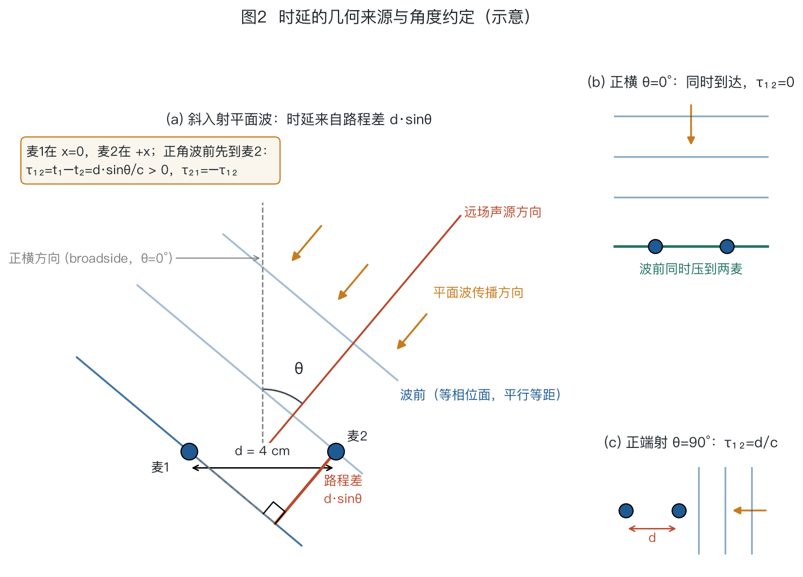
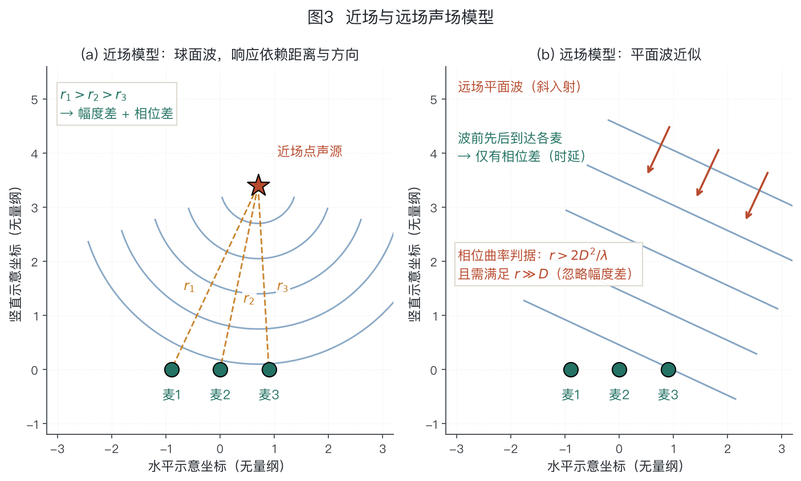
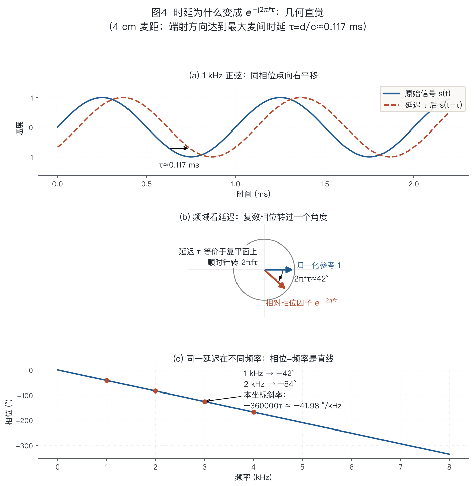
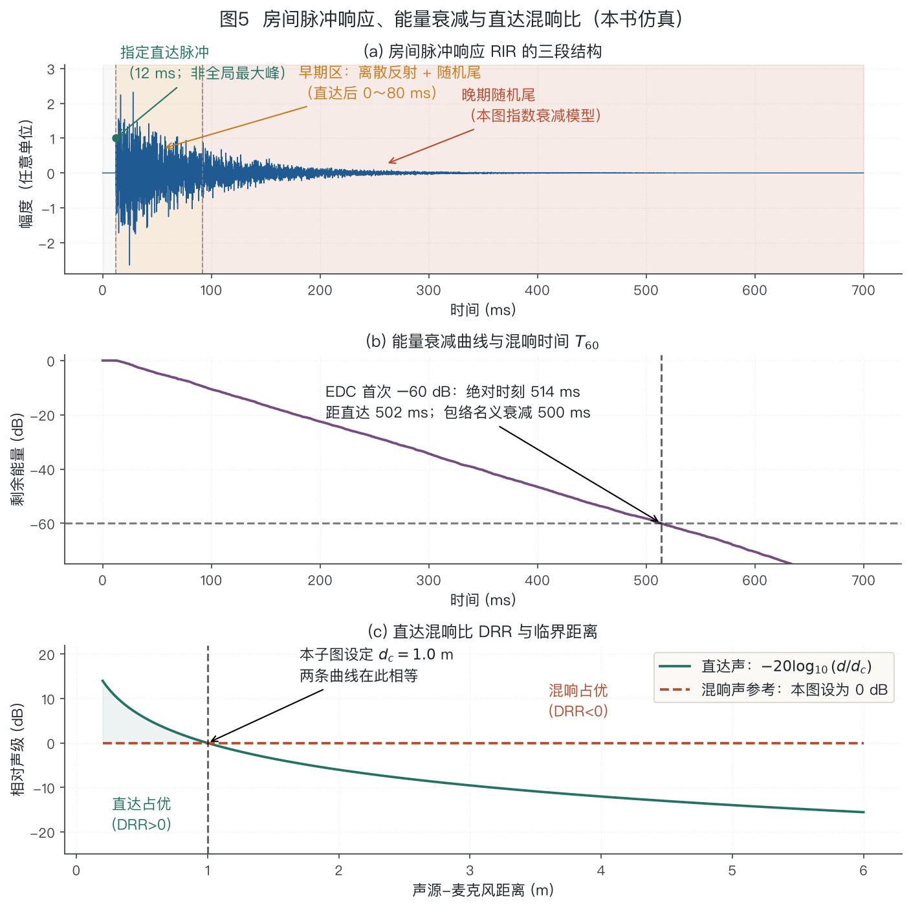
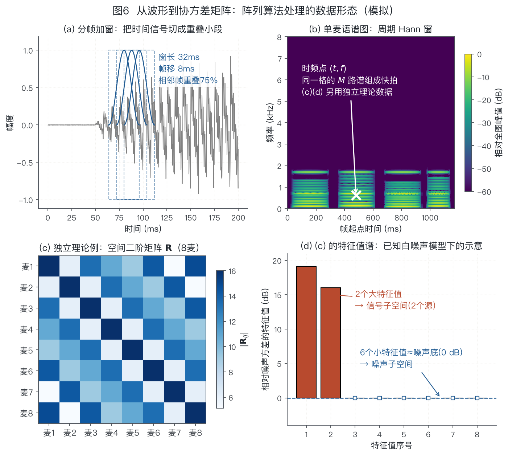
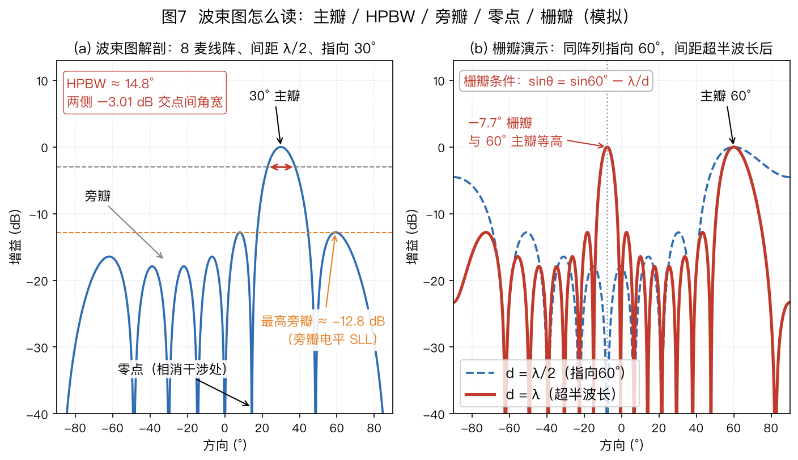
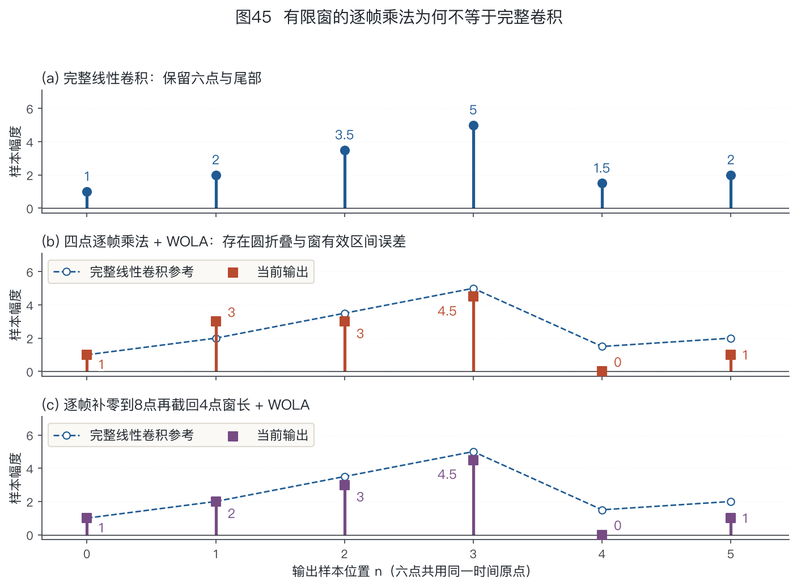

🌐 **简体中文** ｜ [English](../chapters_en/02_basics-signal-model.md)

> 本篇是本书正文第 2 章；正文与扩展专题共 16 章（第 0～15 章，其中第 0 章为数学基础，第 12～15 章为四篇扩展专题），另有附录 A、B。本篇可独立阅读，前后篇见下方导航。
>
> 导读首页：[00_overview.md](00_overview.md) ｜ 上一篇：[01_problem-definition.md](01_problem-definition.md) ｜ 下一篇：[03_array-geometry.md](03_array-geometry.md)

---

## 2. 基础：声音到达阵列时发生了什么

### 2.1 核心事实：同一声音，到达各麦克风有先有后

麦克风阵列能够辨别方向、增强语音，物理起点只有一个事实：同一个声源发出的声波到达不同麦克风时存在微小的路程差。本章沿着“几何路程差 → 传播时延 → 频域复数相位 → 多通道统计矩阵 → 波束图指标”的主线，先把自由场直达声写成可复算的线性代数模型，再引入房间反射与短时频谱组织方式，讲清每一步理想化成立的条件与实际录音中的变化。

#### 2.1.1 先固定坐标与时差的正负

本书算例统一取声速 $c\approx343\ \mathrm{m/s}$，对应约 $20\ ^\circ\mathrm{C}$ 干空气中的常用声速；环境温度、湿度和气体成分变化时，声速也会随之改变，精密计算可参阅 [Cramer 1993 给出的湿空气声速公式及适用范围，JASA 93(5)](https://doi.org/10.1121/1.405827)。

先看两只相距 $d=4\ \mathrm{cm}$ 的麦克风。当声音沿两麦连线方向传来时，波前先到达近端麦克风、再到达远端麦克风，时差幅值达到最大，约为 $0.04/343\approx0.1166\ \mathrm{ms}$；当声音垂直于两麦连线传来时，波前同时到达两只麦克风，时差为零。这个到达时刻之差称为**到达时间差（Time Difference of Arrival，TDOA）**。

推导阵列公式最容易出错的地方是时差与相位的正负号，因此我们在动笔前先固定一套几何与符号约定（三角恒等式与三维方向投影复习见[第 0 章 §0.1](00_math-foundations.md#sec-0-1)）：把麦 1 放在原点 $x=0$，麦 2 放在 $x=d>0$；垂直于两麦连线的正横方向（broadside）定为 $\theta=0^\circ$，正角从 $+y$ 轴顺时针偏向 $+x$ 轴（即偏向麦 2 一侧）。设单位向量 $\vec u(\theta)$ 从阵列指向声源，则声波的实际传播方向为 $-\vec u(\theta)$。两麦到达时刻的有向差统一记为 $\tau_{ij}=t_i-t_j$。

按照这套约定，当声源位于正角方向（$\theta>0^\circ$）时，麦 2 离声源更近，波前先到麦 2、后到麦 1，故 $t_2<t_1$，从而 $\tau_{21}=t_2-t_1<0$、$\tau_{12}=t_1-t_2>0$。在平面波近似下，麦 1 比麦 2 多走的有向路程差为 $d\sin\theta$，除以声速 $c$ 即得带符号的麦对时差：

$$\begin{aligned}
\tau_{12}&=t_1-t_2=\frac{d\sin\theta}{c},\\
\tau_{21}&=t_2-t_1=-\frac{d\sin\theta}{c}\text{。}
\end{aligned}$$

式中 $d$ 为两麦间距（单位 $\mathrm{m}$），$\theta$ 为声源方位角，$c$ 为声速（单位 $\mathrm{m/s}$）。若只关心时差大小，可写 $|\tau_{12}|=d|\sin\theta|/c$；一旦代入需要辨别左右方向的公式，就必须保留正负号。

在本节的水平面内，$\theta=0^\circ$ 对应正横方向，两麦同时收到波前，时差为零；沿两麦连线的**端射方向**（endfire）对应 $\theta=\pm90^\circ$，此时路程差幅值等于整个麦距 $d$，时差幅值达到最大。

后文凡未另行声明的水平方位角均沿用这一约定；三维空间中的俯仰角统一记作 $\phi_{\mathrm{el}}$（从水平面朝 $+z$ 为正），阵元自身的位置角与球谐坐标极角则在各自使用处单独说明。部分文献习惯从阵列轴线起算角度，此时公式写作 $\Delta\tau=d\cos\theta/c$；两种起算零点相差 $90^\circ$，跨文献对照公式前应先核对角度零点与正方向。

读图 2 时可按三个子图依次对照几何关系：

- **子图 (a) 斜入射平面波**：麦 1 位于左侧 $x=0$，麦 2 位于右侧 $x=4\ \mathrm{cm}$。灰色竖直虚线标出正横方向 $\theta=0^\circ$，红色射线指向右上方正角 $\theta$ 处的远场声源，蓝色平行斜线为等相位波前，橙色箭头标明波前朝左下方传播。过麦 1 向麦 2 所在的传播射线作垂线，垂足与麦 1、麦 2 构成以 $d$ 为斜边的直角三角形，麦 2 到垂足的红色实线段正是麦 1 比麦 2 多走的路程差 $d\sin\theta$，由此读出 $\tau_{12}=d\sin\theta/c>0$、$\tau_{21}=-\tau_{12}<0$。
- **子图 (b) 正横入射（$\theta=0^\circ$）**：波前呈水平直线，向下传播时同时压到两只麦克风，路程差为零，$\tau_{12}=0$。
- **子图 (c) 正端射入射（$\theta=90^\circ$）**：波前呈竖直直线，从右侧麦 2 沿基线向左传向麦 1，路程差拉满为整个间距 $d$，时差达到正端射极值 $\tau_{12}=d/c$。

#### 2.1.2 采样、同步与声速失配

实际数字系统并非直接观测连续时间波形，而是每隔固定采样周期记录一个离散样本。以常见的 $16\ \mathrm{kHz}$ 采样率为例，相邻两个采样点的时间间隔为 $1/16000=62.5\ \mathrm{\mu s}$，声音在这段时间里已经传播了约 $343\times62.5\times10^{-6}\approx2.14\ \mathrm{cm}$。对于间距 $4\ \mathrm{cm}$ 的双麦阵列，最大物理时差不过约 $116.6\ \mathrm{\mu s}$，还不到两个采样间隔。如果只在整数采样点上寻找互相关峰值，整个半空间只能切出寥寥几个粗糙方向，因此工程定位系统必须采用亚采样 TDOA 估计——例如对互相关峰值做抛物线或 sinc 插值、对相关序列零填充上采样，或者直接在频域拟合跨通道相位斜率（详见 §4.2）；同样地，在时域补偿非整数采样延迟时也不能简单用相邻两点线性插值代替高阶分数时延滤波器，否则高频段会出现严重衰减并破坏相消零陷（章末练习 E02-20 将定量对比两点线性插值与加窗 sinc FIR 的差异）。

多路麦克风能够比较微秒级时差，还要求所有通道共享严格同步的采样时钟。单台一体式设备通常由同一晶振驱动多通道模数转换器（Analog-to-Digital Converter，ADC）；而手机、笔记本拼成的分布式阵列则各自使用独立晶振。若两台设备的采样时钟存在 $50\ \mathrm{ppm}$（百万分之五十）的相对频率偏差，运行 $1$ 小时（$3600\ \mathrm{s}$）就会累积 $50\times10^{-6}\times3600=0.18\ \mathrm{s}$ 的时间漂移，比微秒级的声学传播时差大出三个数量级以上，因此跨设备协同必须引入时钟同步或在线采样率偏移补偿（详见 §10.2）。

即便在同一块电路板上共用了硬件时钟，前置模拟滤波、驱动缓冲或排线次序的差异仍可能引入固定通道延迟；仅做单麦幅度灵敏度校准无法消除这些时间与相位偏差，上线前仍须用同一已知声源核对各通道的时延与相位一致性。

环境声速与算法设定值不一致，也会直接折算成系统性的角度偏差。例如在 $0\ ^\circ\mathrm{C}$ 干空气中真实声速约为 $331\ \mathrm{m/s}$，当声源位于 $\theta=60^\circ$ 时，两麦真实时差为 $\tau_{12}=d\sin 60^\circ/331$；若算法仍按默认的 $343\ \mathrm{m/s}$ 反推角度，就会算得

$$\begin{aligned}
\hat\theta&=\arcsin\!\left(\frac{343}{331}\sin 60^\circ\right)\\
&\approx63.8^\circ\text{，}
\end{aligned}$$

系统性地引入约 $3.8^\circ$ 的偏向端射误差。工作温差较大的车载或户外设备，通常需要读取温度传感器更新声速 $c$，或在标定流程中联合估计有效声速。

本节的路程差公式均假定波前为直线（三维中为平面）。当说话人走近阵列时，波前弯曲与阵元间的距离衰减差逐渐显现，这就需要先厘清近场与远场的适用范围。

### 2.2 近场与远场

#### 2.2.1 球面波与平面波各省略了什么

点声源在自由空间激发出向外扩散的同心球面波。按照阵列孔径与声源距离的相对大小，声场建模通常分为两档近似：

- **近场模型**（声源距阵列较近）：波前（即相位相同的等相位面）保持明显的球面弯曲，各麦克风到声源的距离显著不同，收到的信号在**到达时间和幅度上都有差别**；
- **远场模型**（声源距离远大于阵列孔径）：截取到阵列局部的一小片球面几乎平坦，可近似为平面波，各麦克风收到的幅度基本相等，信号差异只剩下由入射方向决定的**相对时延**。

#### 2.2.2 从路程误差推导相位容限

什么时候可以把球面波放心地简化为平面波？阵列文献常引用夫琅禾费距离（Fraunhofer distance）$r_F=2D^2/\lambda$（其中 $D$ 为阵列最大孔径，$\lambda=c/f$ 为声波波长）作为检查波前**相位曲率**的参考尺度。要正确使用这个公式，最好亲手推一遍它的几何来源，看清里面隐含了哪些前提。

考虑一个中心对称的线阵或平面孔径，设点声源位于过阵列中心的法线上、距离中心为 $r$，最外侧阵元到阵列中心的距离记作半孔径 $a$（中心对称阵列有 $a=D/2$）：

1. **写出精确球面路程差**：平面波沿法线垂直入射时，中心与边缘阵元本应同时收到波前；而真实球面波到达中心路程为 $r$，到达最远边缘阵元的斜边路程由勾股定理给出为 $\sqrt{r^2+a^2}$，边缘比中心多走了 $\Delta r=\sqrt{r^2+a^2}-r$。
2. **在 $r\gg a$ 下作一阶泰勒展开**：提取 $r$ 并应用 [第 0 章 §0.1.2 式(0-5)](00_math-foundations.md#sec-0-1-2) 的一阶二项展开（令 $x=(a/r)^2\ll1$，$\sqrt{1+x}\approx1+x/2$），得 $\Delta r \approx a^2/(2r)$。
3. **代入 $\lambda/16$ 相位误差容限**：路程误差 $\Delta r$ 折算成相位误差是 $2\pi\Delta r/\lambda$。工程上常取 $\Delta r\le\lambda/16$（对应相位误差不超过 $2\pi/16=\pi/8=22.5^\circ$）作为相位近似平坦的检验标准，解不等式即得

    $$\begin{aligned}
    \frac{a^2}{2r}\le\frac{\lambda}{16}
    \quad\Longrightarrow\quad r\ge\frac{8a^2}{\lambda}\text{。}
    \end{aligned}$$

    当阵列关于中心对称、代入 $a=D/2$ 时，右端便化为熟悉的 $r\ge 2D^2/\lambda=r_F$；若阵列参考点不在几何中心，则应直接保留参考点到最远阵元的距离 $a$，按 $8a^2/\lambda$ 核算。

为什么示例容限常选 $\lambda/16$（$22.5^\circ$）？以最坏情形下的两只边缘等幅阵元同相相加为例：若其中一路偏了 $\pi/8$ 弧度，归一化相干和的幅度为 $|1+e^{\mathrm{j}\pi/8}|/2=\cos(\pi/16)\approx0.9808$，折合分贝仅下降约 $0.17\ \mathrm{dB}$（连续均匀孔径上的整体损耗更小，约 $0.06\ \mathrm{dB}$，见[第 0 章 §0.1.2](00_math-foundations.md#sec-0-1-2)），对常规延迟求和主瓣几乎没有影响。这一 $\lambda/16$ 标准最早广泛用于孔径天线与波场测量（参见 [ETSI ETR 273-1-1 条款 7.2.3.1，第 76 页](https://www.etsi.org/deliver/etsi_etr/200_299/2730101/01_60/etr_2730101e01p.pdf) 的同构几何推导）。如果算法需要在干扰方向形成很深的相消零陷，允许的相位误差更苛刻，所需过渡距离就会比 $2D^2/\lambda$ 更大。

如果不做泰勒近似，直接对 $\sqrt{r^2+a^2}\le r+\lambda/16$（其中 $r\ge 0$）两边平方并移项，精确解为 $r \ge \max\!\left(0,\; \frac{8a^2}{\lambda} - \frac{\lambda}{32}\right)$（当半孔径极小、满足 $a\le\lambda/16$ 时，哪怕 $r\to 0$ 路程差也不超过 $\lambda/16$，故物理距离下界与 $0$ 取最大）。但要注意，$r_F$ 只检查了正横法线方向的相位弯曲，并未替代经典的另外两项远场条件 $r\gg D$ 与 $r\gg\lambda$，也没有检查 $1/r_m$ 带来的阵元间幅度差。举两个具体尺寸对比即可看清：

- 对孔径 $D=7\ \mathrm{cm}$ 的小型圆阵，在 $1\ \mathrm{kHz}$（$\lambda=0.343\ \mathrm{m}$）下套公式算出 $r_F=2\times0.07^2/0.343\approx2.86\ \mathrm{cm}$。但声源贴到 $3\ \mathrm{cm}$ 处根本不满足 $r\gg D$，近端麦与远端麦的距离相差数倍，幅度衰减差异极大，不能因为 $r>2.86\ \mathrm{cm}$ 就把贴嘴近讲当成远场平面波。
- 反过来，对孔径 $D=1.26\ \mathrm{m}$ 的大型会议线阵，在 $1\ \mathrm{kHz}$ 下 $r_F=2\times1.26^2/0.343\approx9.26\ \mathrm{m}$；在几米宽的普通会议室里，说话人其实始终处于该线阵的近场球面波区，直接套用平面波导向矢量就会产生明显的相位曲率失配。

因此，夫琅禾费距离不是声场发生突变的物理分界线；采用远场平面波模型前，应按最高工作频率同时核对相位曲率尺度、距离孔径比 $r/D$、电距离 $r/\lambda$ 以及各阵元的幅度比（章末 E02-09 将对相位误差与幅度比逐项列数比较）。

在近讲耳机、手机通话等贴嘴场景中，还要把**辐射菲涅耳近场（radiating Fresnel near field）**与**声学反应近场（reactive near field）**区分开来。按照经典孔径波场划分（Balanis，*Antenna Theory: Analysis and Design*，第 2 章），对电大孔径通常将辐射菲涅耳区的内界取在 $0.62\sqrt{D^3/\lambda} \le r < 2D^2/\lambda$；而对声学小尺寸单极点源，质点振速同时包含按 $1/r$ 衰减的行波分量与按 $1/r^2$ 衰减的近场惯性分量，两者的反应近场分界由无量纲电距离 $\kappa r = 2\pi r/\lambda = 1$（即 $r \approx \lambda/(2\pi) = c/(2\pi f)$）划定：例如在男声基频 $150\ \mathrm{Hz}$ 处反应近场半径宽达约 $36\ \mathrm{cm}$，而在 $1\ \mathrm{kHz}$ 处收缩至约 $5.5\ \mathrm{cm}$。当声源进入 $\kappa r \lesssim 1$ 的反应近场后，声压与质点振速出现显著的正交相位差，声压梯度随 $1/r^2$ 的抬升速度远超标量声压的 $1/r$——这正是声压梯度型话筒和贴嘴一阶差分阵列在近距离拾音时低频显著增强的**近讲效应（proximity effect）**物理根源（第 5 章 §5.3 将进一步结合差分阵列讨论）。

图 3 直观对比了这两种传播模型：

- **子图 (a) 近场球面波模型**：红色星号标出阵列右上方偏轴处的近场点声源，蓝色同心圆弧为球面波前，橙色虚线标出声源到三只绿色麦克风的传播路径 $r_1>r_2>r_3$。由于距离与入射张角同时变化，三路信号既有非线性曲率时延差，又有按 $1/r_m$ 变化的幅度差，阵列响应同时依赖距离与方向。
- **子图 (b) 远场平面波模型**：当声源足够遥远时，到达阵列局部的蓝色波前拉直为一组正交于红色传播箭头的平行线，波前依次扫过三只麦克风，各路幅度近似相等，通道间只留下由入射角决定的线性时延（相位差）。这正是下一节远场向量模型的物理前提。

### 2.3 信号模型：把“声音有先有后”写成数学

在把多通道信号写成矩阵方程之前，我们先统一全书的数学记号，避免后续阅读时混淆标量、向量与矩阵：

> **符号约定（全书通用）**
>
> - **标量、向量与矩阵**：标量用普通斜体，如 $s$、$\tau$、$\theta$、$\sigma^2$；列向量带头顶箭头，如 $\vec{x}$、$\vec{a}$、$\vec{w}$（零向量记 $\vec{0}$）；矩阵用大写正粗体，如 $\mathbf{R}$、$\mathbf{C}$、$\mathbf{\Gamma}$、$\mathbf{I}$。语音与频谱分析文献习惯用大写斜体 $X(f)$、$X(f_k,\ell)$ 表示单个频点或时频格上的复数谱值，它们仍是单个复标量而非矩阵。
> - **虚数单位、转置与共轭**：虚数单位统一用正体 $\mathrm{j}$（$\mathrm{j}^2=-1$）；单个复数取共轭标星号（如 $X_2^*$），实向量或矩阵转置用上标 $^\top$，复向量或矩阵先转置再逐元素取共轭（共轭转置／厄米转置）用上标 $^H$；数学期望记为 $\mathbb{E}[\cdot]$，估计值加尖帽 $\hat{\ }$，标量模长记 $|\cdot|$，向量二范数记 $\|\cdot\|$。
> - **频率、波数与离散索引**：连续频率记为 $f$（单位 $\mathrm{Hz}$），模拟角频率记为 $\omega=2\pi f$（单位 $\mathrm{rad/s}$），波数记为 $\kappa=\omega/c=2\pi f/c$（单位 $\mathrm{rad/m}$）。离散时间采样下标用 $n$，因此本章把加性噪声记作 $v_m(t)$、$v_m[n]$ 与频域 $\vec v$，避免与采样下标 $n$ 冲突（部分无需采样下标 $n$ 的后续章节亦沿用文献常见的 $\vec n$ 记噪声向量，均在首次出现处指明）。
> - **DFT 频点映射与符号索引**：STFT 频点下标记作 $k$，帧下标记作 $\ell$。实信号单边谱的 $0\le k\le\lfloor N/2\rfloor$ 对应物理频率 $f_k=kf_s/N$；完整 $N$ 点 DFT 的高半区 $k>N/2$ 对应负频率 $(k-N)f_s/N$。代入复指数 $e^{-\mathrm{j}2\pi f\tau}$ 时必须使用以 $\mathrm{Hz}$ 计的 $f$ 或正确映射后的 $f_k$，切勿直接把无量纲数组下标 $k$ 代入。同一字母在不同专题中偶有固定惯例（如 $\lambda$ 既可指波长也可指矩阵特征值），均以所在节定义为准，数学工具与符号总表可随时查阅[第 0 章 §0.8](00_math-foundations.md#sec-0-8) 与[附录 A 符号表](16_appendix-symbols-math.md#sec-16-1)。

有了这套记号，我们分三小步把 §2.1 的几何时差变成多通道频域方程：先写每只麦克风的时域波形，再把时移变成频域相位旋转，最后把 $M$ 路信号竖着排成列向量。

#### 2.3.1 时域：每个麦克风的相对时移

在自由场、远场单声源条件下，设第 $m$ 只麦克风的三维或二维坐标为 $\vec r_m$（$m=1,2,\dots,M$），把麦 1 选作参考阵元，各麦相对麦 1 的有向到达时延定义为 $\tau_{m1}=t_m-t_1$。由 §2.1 的平面波几何，位移向量 $\vec r_m-\vec r_1$ 在声源方向单位向量 $\vec u$ 上的内积 $(\vec r_m-\vec r_1)^\top\vec u$ 表示第 $m$ 麦相对麦 1 **朝声源方向靠近了多少米**；靠近得越多，声音到达得越早，因此相对到达时延带一个负号：

$$\tau_{m1}=-\frac{(\vec r_m-\vec r_1)^\top\vec u}{c}\text{。}$$

我们可以亲手把 §2.1 的双麦坐标代进去验算一遍，确认向量内积与三角函数完全吻合：在水平面内，麦 1 位于 $\vec r_1=[0,0]^\top$，麦 2 位于 $\vec r_2=[d,0]^\top$，两麦相对位置向量为 $\vec r_2-\vec r_1=[d,0]^\top$；方位角 $\theta$ 从 $+y$ 轴偏向 $+x$ 轴，所以指向声源的单位向量为 $\vec u(\theta)=[\sin\theta,\cos\theta]^\top$。按分量相乘再相加算出点积：

$$\begin{aligned}
(\vec r_2-\vec r_1)^\top\vec u(\theta)
&=d\cdot\sin\theta+0\cdot\cos\theta=d\sin\theta\text{，}
\end{aligned}$$

代回上式立刻得到 $\tau_{21}=-(d\sin\theta)/c$，与 §2.1 从直角三角形读出的结果完全一致。对于阵元沿 $+x$ 轴依次排列的均匀线阵（Uniform Linear Array，ULA），只要 $\theta>0^\circ$，就有 $m>1$ 时 $\tau_{m1}<0$，即越靠右的麦克风越早收到波前。

以麦 1 收到直达声的时刻作为参考基准，第 $m$ 只麦克风录到的连续时间波形可以写为

$$x_m(t) = s(t - \tau_{m1}) + v_m(t)\text{。}$$

逐项认清式中的物理量：

- $x_m(t)$ 是第 $m$ 路麦克风实际采集到的波形，下标 $m\in\{1,\dots,M\}$ 标明通道序号，$t$ 为连续时间；
- $s(t)$ 是麦 1 处的理想直达目标波形，声源到麦 1 的公共传播延迟与公共距离衰减已经一并吸收进 $s(t)$ 中，因此在等幅远场近似下它不带通道下标 $m$，其余通道的目标分量都表现为它的平移副本 $s(t-\tau_{m1})$；
- $\tau_{m1}$ 是第 $m$ 麦相对麦 1 的有向到达时延（单位 $\mathrm{s}$），随声源方向变化，可正可负，且参考麦自身恒有 $\tau_{11}=0$；
- $v_m(t)$ 是第 $m$ 路叠加的环境背景噪声与电路自噪声。

在时域里，关键方向信息 $\tau_{m1}$ 嵌在未知波形 $s(t-\tau_{m1})$ 的自变量括号内部，没法把未知方向和未知声源直接拆开。一旦做傅里叶变换进入频域，括号里的时移就会跳出来，变成乘在频谱外面的复数相位因子。

#### 2.3.2 频域：用变量代换得到相位因子

本书统一采用前向连续傅里叶变换（复数相量、欧拉公式与傅里叶时频分析基础见[第 0 章 §0.2](00_math-foundations.md#sec-0-2)；记角频率 $\omega=2\pi f$，核因子亦可写作 $e^{-\mathrm{j}\omega t}$）：

$$\begin{aligned}
X(f)&=\int_{-\infty}^{\infty}
x(t)e^{-\mathrm{j}2\pi ft}\,\mathrm{d}t\text{。}
\end{aligned}$$

在此约定下，由[第 0 章 §0.2.1 式(0-9)](00_math-foundations.md#sec-0-2-1)的积分变量代换 $u'=t-\tau$ 可直接得出：时域延迟 $\tau$ 秒对应频域乘上一枚复指数因子：

$$\begin{aligned}
s(t-\tau)\ \xrightarrow{\mathcal{F}}\ 
S(f)\,e^{-\mathrm{j}2\pi f\tau}
=S(f)\,e^{-\mathrm{j}\omega\tau}\text{。}
\end{aligned}$$

当某路麦克风比参考麦晚到（$\tau>0$）时，指数相位 $-2\pi f\tau$ 为负；当它比参考麦早到（$\tau<0$）时，负负得正，指数相位 $-2\pi f\tau$ 自然为正。不妨再拿单频实余弦波 $s(t)=\cos(2\pi ft)$ 直接验算一次：延迟 $\tau$ 后的波形为

$$\begin{aligned}
s(t-\tau)&=\cos\bigl(2\pi f(t-\tau)\bigr)
=\cos(2\pi ft - 2\pi f\tau)\\
&=\operatorname{Re}\!\bigl\{e^{-\mathrm{j}2\pi f\tau}
e^{+\mathrm{j}2\pi ft}\bigr\}\text{，}
\end{aligned}$$

直观印证了在本书标准信号处理约定（前向核 $e^{-\mathrm{j}2\pi ft}$、逆变换合成核 $e^{+\mathrm{j}2\pi ft}$）下，“晚到 $\tau>0$ 必然对应负指数相位滞后 $e^{-\mathrm{j}2\pi f\tau}$”。查阅采用 $e^{-\mathrm{j}\omega t}$ 简谐时间因子（逆核取负号）的物理声学专著时，须留意其延迟因子与导向矢量指数上的正负号与本书整体反转。

从几何上看，由欧拉公式 $e^{\mathrm{j}\phi}=\cos\phi+\mathrm{j}\sin\phi$ 可知，$e^{-\mathrm{j}2\pi f\tau}$ 的模长恒为 $\sqrt{\cos^2(2\pi f\tau)+\sin^2(2\pi f\tau)}=1$，它是**复平面单位圆上一支长度为 1 的旋转箭头**：在正频率 $f>0$ 下，正延迟 $\tau>0$ 让频谱相量顺时针转过 $2\pi f\tau$ 弧度，负延迟 $\tau<0$（提前到达）则让相量逆时针转过 $2\pi f|\tau|$ 弧度。我们可以用整周期延迟做一个极简自检：当延迟恰好等于一个周期 $\tau=1/f$ 时，相位转角为 $-2\pi f(1/f)=-2\pi$，箭头绕单位圆顺时针转满整整一圈回到起点，对应正弦波向右平移一个周期后与自身完全重合。

图 4 用 $d=4\ \mathrm{cm}$ 双麦在端射方向的最大时差幅值 $\tau=d/c=0.04/343\approx0.1166\ \mathrm{ms}$，把时域平移、复平面旋转与跨频相位斜率三件事串在一起：

- **子图 (a) 时域波形平移**：蓝色实线是周期为 $1\ \mathrm{ms}$ 的 $1\ \mathrm{kHz}$ 原始正弦波 $s(t)$，红色虚线是延迟 $\tau\approx0.117\ \mathrm{ms}$ 后的波形 $s(t-\tau)$。黑色水平箭头连接两条波形的同一相位下降沿，清楚显示正时延 $\tau>0$ 使整条波形沿时间轴**向右推迟**。这对应声源在麦 2 侧正端射方向时，麦 1 相对麦 2 晚收到声音的情形（$\tau=\tau_{12}=+d/c>0$）。
- **子图 (b) 复平面相量旋转**：把参考谱值的相位选作 $0^\circ$ 基准（指向右侧正实轴的蓝色单位箭头 $1$），在 $f=1\ \mathrm{kHz}$ 下，正延迟 $\tau=+0.1166\ \mathrm{ms}$ 对应的相位因子 $e^{-\mathrm{j}2\pi f\tau}$ 从正实轴**顺时针旋转** $2\pi\times1000\times0.1166\times10^{-3}$ 弧度（即约 $0.733\ \mathrm{rad}$，折合 $42^\circ$），落到第四象限的红色箭头位置。反过来，若像 §2.3.3 那样改以麦 1 为参考看麦 2，同一声源下麦 2 提前到达，相对时延变成 $\tau_{21}=-0.1166\ \mathrm{ms}<0$，代入 $e^{-\mathrm{j}2\pi f\tau_{21}}$ 后相位为 $+42^\circ$，红色箭头就会对称地**逆时针转到第一象限**。看懂这一顺一逆的对应关系，后续读任何波束与定位公式都不会再搞反符号。
- **子图 (c) 跨频率的相位直线**：固定同一个物理时延 $\tau=0.1166\ \mathrm{ms}$，把频率从 $0$ 扫到 $8\ \mathrm{kHz}$，未缠绕相位 $\phi(f)=-\omega\tau=-2\pi f\tau$ 是一条过原点的直线。以 $\mathrm{rad}$ 和 $\mathrm{Hz}$ 计时，直线斜率为 $-2\pi\tau$；换成图上的度和 $\mathrm{kHz}$ 单位，斜率为 $-360\times1000\tau\approx-41.98\ ^\circ/\mathrm{kHz}$，因此在 $1\ \mathrm{kHz}$ 处为 $-42^\circ$、在 $2\ \mathrm{kHz}$ 处翻倍为 $-84^\circ$、在 $3\ \mathrm{kHz}$ 处约为 $-126^\circ$。第 4 章 §4.2 的广义互相关相位变换（GCC-PHAT）正是利用这条跨频线性相位关系来稳健估计时延；同时也要留意，实际复数谱只能观测主值区间 $[-180^\circ,180^\circ)$ 内的缠绕相位，高频段相位一旦越过 $\pm180^\circ$ 就会发生折叠，噪声与房间反射还会进一步扰动这条直线。

#### 2.3.3 多通道：导向矢量与维度检查

把上面的频域时移性质用到第 $m$ 路麦克风（$m=1,\dots,M$），在物理频率 $f$ 处就有标量方程：

$$\begin{aligned}
X_m(f)&=e^{-\mathrm{j}2\pi f\tau_{m1}(\theta)}\,S(f)
+V_m(f)\text{。}
\end{aligned}$$

式中 $X_m(f)$、$S(f)$、$V_m(f)$ 分别是第 $m$ 路观测、参考麦处目标声源和第 $m$ 路加性噪声在频率 $f$ 处的复数谱值，三者都是单个复标量；$e^{-\mathrm{j}2\pi f\tau_{m1}(\theta)}$ 也是模长为 $1$ 的复标量。结合 $\tau_{m1}=-(\vec r_m-\vec r_1)^\top\vec u/c$，记位移投影 $d_{m1}=(\vec r_m-\vec r_1)^\top\vec u(\theta)$，第 $m$ 路相对麦 1 的相位因子可等价写成两种常用形式：

$$\begin{aligned}
a_m(f,\theta)&=e^{-\mathrm{j}2\pi f\tau_{m1}(\theta)}\\
&=e^{+\mathrm{j}(2\pi f/c)d_{m1}}
=e^{+\mathrm{j}\kappa d_{m1}}\text{。}
\end{aligned}$$

现在把 $m=1,2,\dots,M$ 共 $M$ 个通道的标量方程从上到下竖着摞成一列，记列向量 $\vec x(f)$、$\vec a(f,\theta)$ 与 $\vec v(f)$，并把所有通道共用的标量源谱 $S(f)$ 提到列向量右边：

$$\begin{aligned}
\begin{bmatrix}X_1(f)\\X_2(f)\\\vdots\\X_M(f)\end{bmatrix}
&=\begin{bmatrix}
e^{-\mathrm{j}2\pi f\tau_{11}(\theta)}\\
e^{-\mathrm{j}2\pi f\tau_{21}(\theta)}\\
\vdots\\
e^{-\mathrm{j}2\pi f\tau_{M1}(\theta)}
\end{bmatrix}S(f)
+\begin{bmatrix}V_1(f)\\V_2(f)\\\vdots\\V_M(f)\end{bmatrix}\text{。}
\end{aligned}$$

在固定频点讨论空间处理时，通常省去显式频点自变量 $(f)$，并用小写斜体 $s$ 记该频点的标量源谱 $S(f)$，便得到全书出镜率最高的窄带远场阵列观测模型：

$$\vec{x} = \vec{a}(\theta)\,s + \vec{v}\text{。}\tag{2-1}$$

逐项核对式(2-1)的物理含义、维度与量纲：

- $\vec{x}\in\mathbb{C}^{M\times1}$ 是 $M$ 通道观测谱列向量，$M$ 为麦克风总数；
- $\vec{a}(\theta)\in\mathbb{C}^{M\times1}$ 称为**导向矢量（steering vector）**，它的第 $1$ 个分量因 $\tau_{11}=0$ 恒为 $1$，其余分量完整记录了 $\theta$ 方向平面波到达各麦相对麦 1 的相位差；
- $s\in\mathbb{C}$ 是参考麦处的目标声源复谱（$1\times1$ 标量）；$M\times1$ 列向量 $\vec a(\theta)$ 右乘标量 $s$ 后仍为 $M\times1$ 列向量，恰好与噪声列向量 $\vec{v}\in\mathbb{C}^{M\times1}$ 维度一致、可以直接相加；
- 导向矢量 $\vec a(\theta)$ 无量纲，在等幅远场假设下每个分量模长均为 $1$（因此 $\|\vec a(\theta)\|_2^2=M$），而 $\vec x$、$s$、$\vec v$ 采用完全相同的幅度单位与傅里叶归一化约定。

声源定位算法通过拿不同候选方向的 $\vec a(\theta)$ 去匹配观测 $\vec x$ 来寻找未知的 $\theta$；波束形成器则利用目标方向的 $\vec a(\theta_0)$ 设计线性权重，把各路错开的相位重新对齐叠加。

**数值算例：3 麦均匀线阵的导向矢量**

- **输入与设定**：3 麦 ULA 的麦 1、麦 2、麦 3 沿 $+x$ 轴依次放在 $x=0,0.04,0.08\ \mathrm{m}$（间距 $d=0.04\ \mathrm{m}$），声速 $c=343\ \mathrm{m/s}$，远场单频声源位于水平方位角 $\theta=+30^\circ$，频率 $f=1000\ \mathrm{Hz}$，以麦 1 为参考求 $\vec a(f,\theta)$。
- **逐步代入与中间数字**：正角声源更靠近右侧麦克风，麦 2、麦 3 相对麦 1 的到达时延分别为

    $$\begin{aligned}
    \tau_{21}&=-\frac{0.04\sin 30^\circ}{343}=-\frac{0.02}{343}
    \approx-58.31\ \mathrm{\mu s},\\
    \tau_{31}&=2\tau_{21}\approx-116.62\ \mathrm{\mu s}\text{。}
    \end{aligned}$$

    代入 $a_m=e^{-\mathrm{j}2\pi f\tau_{m1}}$，相邻阵元的相位递增量（使用未舍入时延计算）为

    $$\begin{aligned}
    \Delta\phi&=-2\pi\times1000\times\left(-\frac{0.02}{343}\right)\\
    &=\frac{40\pi}{343}\approx+0.3664\ \mathrm{rad}
    \approx+20.99^\circ\text{。}
    \end{aligned}$$

- **最终结果**：三通道导向矢量为

    $$\begin{aligned}
    \vec a(1\ \mathrm{kHz},30^\circ)
    &=\begin{bmatrix}
    1 & e^{+\mathrm{j}0.3664} & e^{+\mathrm{j}0.7327}
    \end{bmatrix}^\top\text{。}
    \end{aligned}$$

- **物理检验与边界**：麦 2 比麦 1 早收到声音 $58.31\ \mathrm{\mu s}$，麦 3 早收到 $116.62\ \mathrm{\mu s}$；在本书 $e^{-\mathrm{j}2\pi ft}$ 傅里叶约定下，“更早到达”必然表现为相对参考麦的**正相位超前**。一旦声源走入近场，或房间墙壁带来多条反射波，通道间就不再只是这组单位模长的纯几何时移，而需要引入下一节的房间脉冲响应模型。

### 2.4 房间声学：混响到底是怎么来的

在真实房间里说话，麦克风除了收到沿直线传来的直达声，还会陆续收到经天花板、桌面和四壁弹射回来的无数条反射波。房间脉冲响应描述这些反射如何叠加进录音，混响时间刻画尾音衰减的快慢，直达混响比衡量直达声与反射声的能量对比。下面依次建立这三个核心概念，并说明仿真与实测方法。

#### 2.4.1 房间脉冲响应与早晚反射

当房间几何、温湿度以及声源和麦克风的位置都固定不变时，把声源到第 $m$ 只麦克风的声学传播通道视为线性时不变（Linear Time-Invariant，LTI）系统，该系统对理想单位冲激的响应就称为**房间脉冲响应（Room Impulse Response，RIR）**。

在离散时间采样下，令 $u[n]$ 表示声源端发出的原始数字序列，$h_m[q]$ 表示声源到第 $m$ 只麦克风、长度为 $Q$ 个采样点的离散 RIR，$v_m[n]$ 表示第 $m$ 路麦克风处的加性噪声（这里改用字母 $v$ 记噪声，避免与采样时刻下标 $n$ 重名），则第 $m$ 路录音序列是声源序列与离散 RIR 的线性卷积再加上噪声：

$$\begin{aligned}
x_m[n]&=\sum_{q=0}^{Q-1}h_m[q]\,u[n-q]+v_m[n]\text{。}
\end{aligned}\tag{2-2}$$

读式(2-2)时可以把它拆成一串回声副本的叠加：$h_m[q]$ 中每一个非零抽头，都代表一条延迟了 $q$ 个采样点、幅度乘上滤波系数 $h_m[q]$ 的传播路径。这里要注意区分式(2-2)的声源激励 $u[n]$ 与式(2-1)的参考麦目标信号 $s(t)$：$u[n]$ 位于声源端，直达传播延迟与距离衰减包含在 $h_m[q]$ 的直达抽头位置和幅度里；而 §2.3 的 $s(t)$ 已经把到麦 1 的直达传播吸收了进去，两者物理参考点不同，不能直接互换。

我们可以做一次退化情形核验，把式(2-2)走回到自由场模型式(2-1)：当房间四壁全吸收、没有任何反射时，第 $m$ 路脉冲响应只剩单一非零直达抽头 $h_m[q]=\alpha_m\delta[q-q_m]$，代入式(2-2)只留下一项延迟副本 $x_m[n]=\alpha_m u[n-q_m]+v_m[n]$。回到连续时间记直达传播延迟为 $\tau_m$，定义麦 1 处的直达波形为参考基准 $s(t)=\alpha_1 u(t-\tau_1)$，并在远场等幅近似 $\alpha_m/\alpha_1\approx1$ 下记相对时延 $\tau_{m1}=\tau_m-\tau_1$，便有 $x_m(t)=s(t-\tau_{m1})+v_m(t)$，做傅里叶变换即严格回到式(2-1)。章末练习 E02-13 会用 4 点声源与 3 点 RIR 把全部 6 个卷积输出样本逐点算出来。

日常生活中在空房间里拍一下手，确实能听见清脆的直达声和随后拖长的尾音，但拍手录音并不等于严格的 RIR：拍手声本身有一定的持续时间和非平坦频谱，扬声器或人手辐射指向性、麦克风频响也会一并混入录音。工程上要测出可用于定量计算的 RIR，通常会播放一段频带受控的已知测试信号（如本节末介绍的指数正弦扫频），再通过反卷积提取脉冲响应。

按照反射波到达的先后顺序与声学作用，一条典型的室内 RIR 可如图 5(a) 分为三段：

1. **直达声（direct sound）**：声波沿直线最短路径直接到达麦克风的脉冲。只要直达路径未被障碍物完全遮挡，它的到达时刻之差就携带着真实的声源几何方向。
2. **早期反射（early reflections）**：紧跟在直达声之后几十毫秒内到达、由墙面或桌面经一两次反射形成的稀疏脉冲，图上仍能分辨出独立的尖峰。建筑与厅堂声学常用早期与晚期能量比来评价清晰度，例如音乐明晰度指标 $C_{80}$ 与语言清晰度指标 $C_{50}$ 分别把直达声到达后 $80\ \mathrm{ms}$ 与 $50\ \mathrm{ms}$ 选作早期能量积分上限（定义见 [Lee 等，JASA 2018，引言与式(1)](https://doi.org/10.1121/1.5040480)）。图 5(a) 标在直达声后 $80\ \mathrm{ms}$（绝对时刻 $92\ \mathrm{ms}$）处的竖线正是借用这一常用教学分界，并非声场在 $80\ \mathrm{ms}$ 发生突变的普适物理常数。早期反射与直达声高度相干，人耳听感上常能融合增响，但对依赖双麦相位差的定位算法而言，强早期反射会扭曲相位斜率、造成方向估计偏移。
3. **晚期混响（late reverberation）**：声波在室内历经多次反射后交织而成的密集衰减尾音。在空间维度上，充分混合的晚期混响常可近似为从四面八方均匀入射的各向同性弥散声场，§2.6 的指向性指数（DI）便建立在这一空间统计模型之上；但在时间维度上，晚期混响仍是原语音拖长的线性滤波尾音，保留着跨帧时间相关性，绝非时间白噪声——第 7 章的加权预测误差（WPE）去混响算法正是利用这种跨帧线性可预测性来剥离晚期尾音。

读图 5 时，把三幅子图横纵轴上的物理量对照起来看最清楚：

- **子图 (a) 房间脉冲响应波形**：横轴为时间（$\mathrm{ms}$），纵轴为归一化脉冲幅度。直达声脉冲位于 $12\ \mathrm{ms}$ 处（归一化主峰幅度为 $1$），其后紧跟四条清晰可辨的离散早期反射尖峰，随后过渡为随时间指数衰减的密集晚期随机反射尾；$92\ \mathrm{ms}$（即直达后 $80\ \mathrm{ms}$）处的虚线标出早期反射与晚期混响的示意分界。在强反射或视线受阻的实际房间里，直达抽头也未必永远是整条 RIR 幅度最高的峰。
- **子图 (b) 剩余能量衰减曲线与 $T_{60}$**：单条 RIR 波形正负剧烈起伏，无法直接从波形包络精确读出衰减斜率，因此纵轴画的是从当前时刻 $t$ 向无穷远反向积分得到的剩余声能分贝值（下节即将给出 Schroeder 反向积分式），横轴仍为时间（$\mathrm{ms}$）。曲线从直达声起点的 $0\ \mathrm{dB}$ 平滑下降到 $-60\ \mathrm{dB}$ 水平虚线所跨越的衰减时长，就定义了混响时间 $T_{60}$。
- **子图 (c) 直达混响比与临界距离**：横轴为声源到麦克风的距离 $d$（$\mathrm{m}$），纵轴为相对混响声参考（$0\ \mathrm{dB}$ 红色水平虚线）的声级（$\mathrm{dB}$）。绿色实线按 $-20\log_{10}(d/d_c)$ 刻画自由扩散直达声随距离平方反比的衰减规律；在本子图设定临界距离 $d_c=1.0\ \mathrm{m}$ 的归一化条件下，$d<1.0\ \mathrm{m}$ 的绿色阴影区直达声占优（$\mathrm{DRR}>0\ \mathrm{dB}$），$d=1.0\ \mathrm{m}$ 处两者能量相等（$\mathrm{DRR}=0\ \mathrm{dB}$），而越过 $1.0\ \mathrm{m}$ 后混响能量反超直达声（$\mathrm{DRR}<0\ \mathrm{dB}$）。

#### 2.4.2 混响时间：从吸声量算衰减

声源停止发声后，室内声能衰减 $60\ \mathrm{dB}$（即剩余能量降为初始值的百万分之一）所需的时间称为**混响时间**，记作 $T_{60}$（见图 5(b)）。建筑与声学实测须按场所类型选用国际标准，演出厅堂对应 [ISO 3382-1:2009](https://www.iso.org/standard/40979.html)，普通房间对应 [ISO 3382-2:2008](https://www.iso.org/standard/36201.html)。

工程估算最常用的是赛宾（Sabine）公式；其历史原始文献见 Wallace C. Sabine 所著 *Collected Papers on Acoustics*（Harvard University Press, 1922；[原书书目与目录](https://books.google.com/books/about/Collected_Papers_on_Acoustics.html?id=G25LAAAAMAAJ)）首篇论文“Reverberation”。赛宾公式写作：

$$\begin{aligned}
T_{60}&=\frac{0.161\,V}{A},\\
A&=\sum_i S_i\alpha_i\text{。}
\end{aligned}\tag{2-3}$$

式中 $V$ 为房间体积（单位 $\mathrm{m^3}$）；$S_i$ 与 $\alpha_i$ 分别为第 $i$ 块内表面的面积（单位 $\mathrm{m^2}$）与能量吸声系数（无量纲，理想全反射为 $0$，理想全吸收为 $1$）；求和得到的 $A$ 称为等效吸声面积（单位 $\mathrm{m^2}$）。实际墙体、玻璃、地毯和家具的吸声系数都会随频带、入射角分布和测量方法变化，因此 $A$ 一般小于房间内表面总面积 $S=\sum_i S_i$，工程中也常按倍频程逐频带核算 $T_{60}$。

我们可以先用一组示意参数感受它的量级：设矩形房间长 $5\ \mathrm{m}$、宽 $4\ \mathrm{m}$、高 $2.8\ \mathrm{m}$，则体积 $V=5\times4\times2.8=56\ \mathrm{m^3}$；若墙面、地板、天花板与室内陈设折合的等效吸声面积为 $A=18\ \mathrm{m^2}$，代入式(2-3)即得 $T_{60}=0.161\times56/18\approx0.50\ \mathrm{s}$。同一尺寸的房间只要铺上厚地毯或挂上吸声帘使 $A$ 增大，混响时间就会相应缩短。

式(2-3)里的常数 $0.161$ 是怎么来的？下面在理想扩散声场与弱吸收假设下，先算出各向同性扩散场每秒打到单位墙面上的声能流，再一步打通平均自由程、赛宾公式与下一节的临界距离：

1. **扩散场假设与半球余弦能流积分**：设室内混响声能密度 $E(t)$（单位 $\mathrm{J/m^3}$）在各处近似均匀且向全空间 $4\pi$ 立体角等概率传播，则每单位立体角携带的能量密度为 $E/(4\pi)$。取墙面上一小块微元，以其内法线为极轴 $\vartheta=0$ 建立球坐标 $(\vartheta,\varphi)$：只有朝向墙面的入射半球（$0\le\vartheta\le\pi/2$，$0\le\varphi<2\pi$）会把能量送到墙上，与法线成 $\vartheta$ 角的声线法向分速度为 $c\cos\vartheta$，立体角微元为 $\mathrm{d}\Omega=\sin\vartheta\,\mathrm{d}\vartheta\,\mathrm{d}\varphi$。对入射半球积分，立得单位面积墙面每秒接收的入射声能流 $J_{\mathrm{in}}$（单位 $\mathrm{W/m^2}$）：

    $$\begin{aligned}
    J_{\mathrm{in}}
    &=\int_0^{2\pi}\!\!\int_0^{\pi/2}\frac{E}{4\pi}
    (c\cos\vartheta)\sin\vartheta\,
    \mathrm{d}\vartheta\,\mathrm{d}\varphi\\
    &=\frac{E c}{4\pi}\cdot2\pi
    \int_0^{\pi/2}\sin\vartheta\cos\vartheta\,\mathrm{d}\vartheta
    =\frac{E c}{4}\text{。}
    \end{aligned}$$

2. **每秒撞墙率与平均自由程**：房间内表面总面积为 $S$，总声能为 $E V$，因此室内声能每秒撞击墙面的总通量为 $J_{\mathrm{in}} S = E c S/4$，除以总声能即得单条声线每秒平均撞墙次数 $\frac{J_{\mathrm{in}} S}{E V}=\frac{cS}{4V}$（等价于凸房间内声线相邻两次撞墙的**平均自由程** $\ell_{\mathrm{mfp}}=4V/S$；例如边长为 $L_0$ 的立方体房间有 $\ell_{\mathrm{mfp}}=4L_0^3/(6L_0^2)=2L_0/3$）。
3. **每秒能量损失率**：声线每撞一次边界面就被吸收掉平均比例 $\bar\alpha=A/S$ 的能量，于是单位时间内声能的相对损失率为 $\frac{cS\bar\alpha}{4V}=\frac{cA}{4V}$。
4. **建立微分方程求解**：房间总声能的变化率满足一阶常微分方程

    $$\begin{aligned}
    \frac{\mathrm{d}E(t)}{\mathrm{d}t}&=-\frac{cA}{4V}\,E(t)\\
    \Longrightarrow\quad E(t)&=E_0\,e^{-\frac{cA}{4V}t}\text{。}
    \end{aligned}$$

5. **代入 $60\ \mathrm{dB}$ 衰减定义**：能量比的分贝定义为 $10\log_{10}(E(t)/E_0)$，衰减 $60\ \mathrm{dB}$ 对应 $E(T_{60})/E_0=10^{-6}$（即能量降为百万分之一，切勿误用幅度比的 $10^{-3}$）。令 $e^{-\frac{cA}{4V}T_{60}}=10^{-6}$，两边取自然对数得 $\frac{cA}{4V}T_{60}=6\ln10$，移项整理并将 $c=343\ \mathrm{m/s}$ 代入：

    $$\begin{aligned}
    T_{60}&=\frac{24\ln10}{c}\frac{V}{A}
    \approx\frac{55.262}{343}\frac{V}{A}\\
    &\approx0.161\,\frac{V}{A}\text{。}
    \end{aligned}$$

可以看到，分子中的 $24\ln10$ 由 $60\ \mathrm{dB}$ 对应的 $6\ln10$ 与半球能流积分里的几何因子 $4$ 相乘得来；写成严格带量纲形式时，常数 $0.161$ 带有单位 $\mathrm{s/m}$。

上述第 3、4 步把每次碰撞后的剩余比例连续化为一阶损失，隐含了平均吸声系数 $\bar\alpha\ll1$ 的弱吸收前提。当室内铺设大量强吸声材料、$\bar\alpha$ 不再很小时，每次撞墙后能量乘上 $(1-\bar\alpha)$，经过 $N_c=\frac{cS}{4V}t$ 次碰撞后的剩余因子 $(1-\bar\alpha)^{N_c}$ 等于指数形式 $e^{N_c\ln(1-\bar\alpha)}$，由此得到艾林（Eyring）混响时间公式（见 [Eyring 1930 原论文](https://doi.org/10.1121/1.1915175)）：

$$T_{60}=\frac{-0.161\,V}{S\ln(1-\bar\alpha)}\text{。}$$

做两个边界检验即可看清两者的关系：当 $\bar\alpha\to0^+$ 时，利用一阶泰勒近似 $-\ln(1-\bar\alpha)\approx\bar\alpha$，分母 $S\bar\alpha=A$，艾林公式自动退化回赛宾公式；而形式上令 $\bar\alpha\to1^-$ 时，$-\ln(1-\bar\alpha)\to+\infty$，艾林公式合理地趋向零混响，赛宾公式却仍给出虚高的正值 $0.161V/S$（当然全吸声消声室中早已不存在各向同性扩散场）。

需要补充的是，当室内吸声材料在三个正交轴向上分布极不均匀——例如扁平会议室的顶棚铺设强吸声矿棉板、地面铺厚地毯，而四面玻璃或粉刷墙几乎全反射（这也是章末练习 E02-19 讨论的典型场景）——赛宾与艾林公式因依赖全域平均吸声系数均会明显偏离实测；此时 Fitzroy（*JASA*，31(7)，893–897，1959；参见 Kuttruff，*Room Acoustics*）按 $x,y,z$ 三对平行表面面积 $S_x,S_y,S_z$ 与各自平均吸声系数 $\bar\alpha_x,\bar\alpha_y,\bar\alpha_z$ 给出面积加权修正：

$$\begin{aligned}
T_{60} &= \frac{0.161\,V}{S^2}
\biggl[\frac{S_x}{-\ln(1-\bar\alpha_x)} \\
&\quad + \frac{S_y}{-\ln(1-\bar\alpha_y)}
+ \frac{S_z}{-\ln(1-\bar\alpha_z)}\biggr]\text{。}
\end{aligned}$$

#### 2.4.3 直达混响比与临界距离

混响时间 $T_{60}$ 只告诉我们尾音拖多长，没有直接告诉我们在麦克风位置上直达声和混响声谁更强。为此定义**直达混响比（Direct-to-Reverberant Ratio，DRR）**，比较同一声源到达麦克风处的直达声能量 $E_d$（即 $E_{\mathrm{direct}}$）与混响声能量 $E_r$（即 $E_{\mathrm{reverberant}}$）：

$$\begin{aligned}
\mathrm{DRR}&=10\log_{10}\frac{E_d}{E_r}
\ \text{(dB)}\text{。}
\end{aligned}$$

$\mathrm{DRR}>0\ \mathrm{dB}$ 表示直达声能量大于混响能量，$\mathrm{DRR}<0\ \mathrm{dB}$ 表示混响能量占优。汇报或比较 DRR 数字时，直达声积分窗与混响积分窗的分界、测量频带和幅度参考必须保持一致；有限分贝值要求分子与分母均严格为正（纯自由场无反射时混响能量为零，$\mathrm{DRR}$ 趋向 $+\infty\ \mathrm{dB}$；直达路径完全消失而仅有混响时趋向 $-\infty\ \mathrm{dB}$）。

随着说话人远离麦克风，直达声能量按距离平方反比迅速衰减（距离每翻一倍下降约 $6\ \mathrm{dB}$），而理想稳态扩散场中的晚期混响能量密度在室内各处近似均匀。直达声能量密度与混响声能量密度恰好相等（即 $\mathrm{DRR}=0\ \mathrm{dB}$）的距离称为**临界距离（critical distance）**，记作 $d_c$。对全向辐射声源，它与房间体积和混响时间满足：

$$d_c\approx0.057\sqrt{\frac{V}{T_{60}}}\ \text{(m)}\text{。}\tag{2-4}$$

若声源本身具有辐射指向性——例如人嘴朝正前方辐射的声强高于球面平均声强，记目标方向相对全向源的声强倍率为指向性因子 $Q$（全向源 $Q=1$）——只需把 $Q$ 乘入根号内的分子，写成 $d_c\approx0.057\sqrt{QV/T_{60}}$。

直接复用上一节由半球余弦积分导出的墙面入射能流 $J_{\mathrm{in}}=E_r c/4$，临界距离公式的四步推导就水到渠成了：

1. **求直达声能量密度 $E_d$**：设全向声源辐射总声功率为 $W$（单位 $\mathrm{W}$），在半径 $r$ 的球面上均匀摊开后，直达声强为 $I_d=W/(4\pi r^2)$；在局部行波近似下除以声速 $c$，得到直达声能量密度 $E_d=I_d/c=W/(4\pi r^2 c)$（若声源指向性因子为 $Q$，则分子乘上 $Q$）。
2. **由稳态功率平衡求混响能量密度 $E_r$**：单位面积墙面接收能流为 $E_r c/4$，全房间等效吸声面积为 $A$，因此墙面每秒吸收的总声功率为 $P_{\mathrm{abs}}=(E_r c/4)A$。当声源持续发声达到稳态平衡时，注入功率等于吸收功率，即 $W=E_r cA/4$，解得稳态混响能量密度 $E_r=4W/(cA)$。
3. **令 $r=d_c$ 处两种能量密度相等**：由 $E_d(d_c)=E_r$，两边消去公共因子 $W$ 与 $c$（这也顺带证明在线性声学范围内，把说话音量调大或调小会同比例改变直达声和混响声，不会改变两者的比值 $\mathrm{DRR}$ 与 $d_c$）：

    $$\begin{aligned}
    \frac{W}{4\pi d_c^2c}&=\frac{4W}{cA}
    \quad\Longrightarrow\quad d_c^2=\frac{A}{16\pi}\text{。}
    \end{aligned}$$

4. **代入赛宾公式消去 $A$**：由式(2-3)解出 $A=0.161V/T_{60}$，代回上式再开平方：

    $$\begin{aligned}
    d_c&=\sqrt{\frac{0.161\,V}{16\pi\,T_{60}}}
    =\sqrt{0.003203\,\frac{V}{T_{60}}}\\
    &\approx0.057\sqrt{\frac{V}{T_{60}}}\ \text{(m)}\text{。}
    \end{aligned}$$

常数 $0.057$ 正是 $\sqrt{0.161/(16\pi)}\approx0.0566$ 保留两位有效数字的结果；式中 $V$ 按 $\mathrm{m^3}$、$T_{60}$ 按 $\mathrm{s}$ 代入，算出的 $d_c$ 即以 $\mathrm{m}$ 为单位。

**综合算例：把同一个房间的声学量串起来复算**

仍取 $5\ \mathrm{m}\times4\ \mathrm{m}\times2.8\ \mathrm{m}$ 的矩形房间（$V=56\ \mathrm{m^3}$），六个内表面总面积由 $2\times(5\times4+5\times2.8+4\times2.8)$ 算得 $S=90.4\ \mathrm{m^2}$；等效吸声面积取 $A=18\ \mathrm{m^2}$，对应面积加权平均吸声系数 $\bar\alpha=18/90.4\approx0.1991$。将这组理想模型参数分别代入上述公式，结果汇总如下表：

| 要计算的声学量 | 代入算式 | 计算结果 |
|---|---|---:|
| 赛宾混响时间（Sabine $T_{60}$） | $0.161\times56/18$ | $0.5009\ \mathrm{s}$ |
| 艾林混响时间（Eyring $T_{60}$） | $-0.161\times56/[90.4\ln(1-18/90.4)]$ | $0.4492\ \mathrm{s}$ |
| 全向声源临界距离（$Q=1$） | $\sqrt{18/(16\pi)}$ | $0.5984\ \mathrm{m}$ |
| 指向性声源临界距离（$Q=4$） | $\sqrt{4\times18/(16\pi)}$ | $1.1968\ \mathrm{m}$ |

（注：前两行保留四位小数仅为方便严格复核常数 $0.161$ 的算术结果；若改用未舍入常数 $24\ln 10/343\approx0.161114$ 则分别得 $0.5012\ \mathrm{s}$ 与 $0.4495\ \mathrm{s}$，实际物理预测精度至多为两到三位有效数字。）

读这张表可以得出三点清晰的工程认识：

- **第一、二行对比**：由于 $-\ln(1-\bar\alpha)\approx0.2220>\bar\alpha\approx0.1991$，在相同吸声面积下艾林公式给出的预测衰减比一阶赛宾近似略快；两者都建立在理想扩散场前提上，实际房间哪个更准仍取决于吸声材料分布与频带。
- **第三、四行对比与房间常数 $R$ 修正**：表中 $d_c$ 直接由赛宾稳态平衡式 $\sqrt{QA/(16\pi)}$ 算出（若改用舍入常数 $0.057$ 复算，末位会有微小舍入差）。全向声源离麦克风约 $0.60\ \mathrm{m}$ 时混响能量就已追平直达声；当声源在目标方向具有 $Q=4$ 的指向性聚焦时，$d_c$ 扩大为 $\sqrt{4}=2$ 倍（约 $1.20\ \mathrm{m}$）。若进一步采用 Hopkins–Stryker / Eyring 能量记账（计入直达声首次撞墙即损失比例 $\bar\alpha$、仅剩 $W(1-\bar\alpha)$ 注入混响场，见 Beranek 与 Kuttruff 专著），稳态混响密度写作 $E_r=4W(1-\bar\alpha)/(cS\bar\alpha)=4W/(cR)$，其中**房间常数（room constant）** $R=\frac{S\bar\alpha}{1-\bar\alpha}$，相应临界距离变为 $d_c=\sqrt{QR/(16\pi)}$；代入本例参数（$S=90.4\ \mathrm{m^2}, A=18\ \mathrm{m^2}, \bar\alpha\approx0.1991$）得 $R\approx22.48\ \mathrm{m^2}$，全向临界距离增至 $0.669\ \mathrm{m}$（较赛宾模型 $0.598\ \mathrm{m}$ 高约 $11.7\%$）。
- **距离与拾音边界**：临界距离 $d_c$ 只是 $\mathrm{DRR}=0\ \mathrm{dB}$ 的声学参考点，不意味着说话人退到 $d_c$ 以外算法就会失效。例如在图 5(c) 设定 $d_c=1.0\ \mathrm{m}$ 的理想曲线上，$3\ \mathrm{m}$ 处的 $\mathrm{DRR}=-20\log_{10}(3/1)\approx-9.5\ \mathrm{dB}$，此时混响声能已是直达声的近 $9$ 倍，这正是客厅智能音箱和会议室远距离拾音必须联用波束形成（抑制非目标方向反射）与去混响（剥离晚期尾音）的根本原因。

**扩散场假设的低频失效界线：施罗德频率（Schroeder frequency）**

上面推导赛宾公式、临界距离乃至后文 §2.6.8 的球面 $\operatorname{sinc}$ 弥散噪声模型，都建立在“房间内存在足够多重叠的简正模式、声场充分混合扩散”的统计声学前提上。频率降低到一定程度后，波长接近房间边长，室内不再是均匀弥散场，而是由稀疏分离的离散驻波共振峰（**模态区，modal regime**）主导——在波腹与波节之间仅移动半米，声压就能起伏十几分贝。声学家 M. R. Schroeder（1954、1962；回顾见 [Schroeder 1996，JASA 99(5)](https://doi.org/10.1121/1.414868)）以“平均相邻三个简正模式的半功率带宽彼此重叠”为界定义模态区与统计**扩散区（diffuse regime）**的分界频率：单模态 $-3\ \mathrm{dB}$ 带宽为 $\Delta f_{-3\mathrm{dB}}=\frac{6\ln 10}{2\pi T_{60}}\approx\frac{2.20}{T_{60}}$，三维矩形室的 Weyl 渐近模态密度为 $\frac{\mathrm{d}N}{\mathrm{d}f}\approx\frac{4\pi V f^2}{c^3}$，令重叠度 $M_{\mathrm{ov}}=\Delta f_{-3\mathrm{dB}}\cdot\frac{\mathrm{d}N}{\mathrm{d}f}=3$ 并解出 $f$：

$$\begin{aligned}
\frac{6\ln 10}{2\pi T_{60}}\cdot\frac{4\pi V f^2}{c^3} &= 3 \\
\Longrightarrow\quad f_{\mathrm{Sch}}
&= \sqrt{\frac{c^3}{4\ln 10}}\sqrt{\frac{T_{60}}{V}} \\
&\approx 2000\sqrt{\frac{T_{60}}{V}}\ \text{(Hz)}\text{，}
\end{aligned}$$

式中房间体积 $V$ 按 $\mathrm{m^3}$、混响时间 $T_{60}$ 按 $\mathrm{s}$ 代入（取标准空气声速 $c=343\ \mathrm{m/s}$ 时精确系数 $\sqrt{c^3/(4\ln 10)}\approx 2093$，文献惯例按 Schroeder 1962/1996 取整写作 $2000$）。拿上面刚算过的 $5\ \mathrm{m}\times4\ \mathrm{m}\times2.8\ \mathrm{m}$ 房间（$V=56\ \mathrm{m^3}$，最低轴向驻波模态为 $c/(2\times5)=34.3\ \mathrm{Hz}$）验算：按赛宾 $T_{60}\approx0.50\ \mathrm{s}$ 代入，施罗德频率约为 $f_{\mathrm{Sch}}\approx2000\sqrt{0.50/56}\approx\mathbf{189\ \mathrm{Hz}}$（按艾林 $0.45\ \mathrm{s}$ 约 $179\ \mathrm{Hz}$）。这提醒我们：在中小客厅、卧室与车厢（$V$ 仅数立方米时 $f_{\mathrm{Sch}}$ 可达 $300\text{～}500\ \mathrm{Hz}$）中，人声基频所在低频段恰好落在 $f_{\mathrm{Sch}}$ 以下的模态区，此时切勿盲目套用赛宾衰减或各向同性扩散相干假设。

回到图 5(b) 的衰减曲线，我们再把实测与仿真中从单条脉冲响应提取 $T_{60}$ 的标准工具——**[Schroeder 反向能量积分](https://doi.org/10.1121/1.1909343)**（backward energy integration，亦称能量衰减曲线 Energy Decay Curve，EDC）——明确写出来。设脉冲响应在直达声到达时刻 $t_0$ 之后持续衰减，将时刻 $t\ge t_0$ 之后尚未释放完的瞬时平方能量向后累加，并以 $t_0$ 处的总能量归一化换算成分贝：

$$\begin{aligned}
E_{\mathrm{rem}}(t)&=\int_t^{\infty}h^2(\tau)\,\mathrm{d}\tau,\\
D(t)&=10\log_{10}\frac{E_{\mathrm{rem}}(t)}
{E_{\mathrm{rem}}(t_0)}\text{。}
\end{aligned}$$

由于被积函数 $h^2(\tau)\ge0$，随时间 $t$ 推移积分下限右移，$D(t)$ 必然是一条单调不增的平滑下降曲线，消除了原始 RIR 波形过零振荡带来的读数困难（离散求和形式与多组参数复算详见章末 E02-11 式(2-18)）。在图 5(b) 的合成样例中，指数包络的名义 $T_{60}$ 设为 $500\ \mathrm{ms}$，直达声位于 $t_0=12\ \mathrm{ms}$；叠加 $4$ 条离散早期反射与指数衰减晚期尾后，EDC 在绝对时刻 $506\ \mathrm{ms}$（即距直达声 $494\ \mathrm{ms}$）处首次降至 $-60\ \mathrm{dB}$，紧贴名义包络衰减 $500\ \mathrm{ms}$（测量混响时间必须扣除声波到达前的 $12\ \mathrm{ms}$ 传播静音段，从直达起点算起）。

真实房间录音中往往存在环境底噪，衰减曲线往往还没跌满 $60\ \mathrm{dB}$ 就撞上了水平噪声底。因此 [ISO 3382-2:2008 §3.5、§6](https://www.iso.org/standard/36201.html)（定义亦可对照 [ISO 26101-2:2024 §3.1 注 2 公开预览](https://cdn.standards.iteh.ai/samples/80878/f518546e15e14344a88592ebc8222e9b/ISO-26101-2-2024.pdf)）规定工程实测通常截取信噪比充足的中间线性段——例如 $-5\text{～}-25\ \mathrm{dB}$ 区间拟合斜率外推得到 $T_{20}$，或截取 $-5\text{～}-35\ \mathrm{dB}$ 区间外推得到 $T_{30}$——以此避开直达峰跳变与末端底噪平台。

#### 2.4.4 仿真与实测房间脉冲响应

算法研发阶段既需要在已知真值的可控房间里做仿真，也需要在真实样机房间里做实测，两者的标准方法各有讲究：

- **几何镜像法仿真**：最经典的合成方法是 Allen 与 Berkley 提出的**镜像声源法（Image-Source Method）**（见 [Allen 与 Berkley 1979 原论文](https://doi.org/10.1121/1.382599)），它把声波经墙面的每一次镜面反射等效为墙外对称位置处一个虚拟镜像声源的自由场直达辐射，再把成百上千个镜像源按各自距离与反射次数叠加成完整 RIR。开源库 `pyroomacoustics` 提供了现成的实现（本书代码与附录房间实验采用 [pyroomacoustics 0.10.0 发布版](https://pypi.org/project/pyroomacoustics/0.10.0/)）。配置镜像法时要注意区分墙面的**能量吸声系数** $\alpha$ 与**声压幅度反射系数** $\beta=\sqrt{1-\alpha}$；而且由赛宾公式反推的墙面参数和有限反射阶数只是输入配置，生成 RIR 后仍应重算 Schroeder 曲线核验实际衰减时间。
- **指数正弦扫频实测**：要测量一间真实房间的 RIR，工业界广泛采用 Farina 提出的**指数正弦扫频（Exponential Sine Sweep，ESS）**方法（见 [Farina 2000，AES Convention Paper 5093 原作者全文 §2](https://www.angelofarina.it/Public/papers/134-AES00.PDF) 与 [AES 正式出版记录](https://aes.org/publications/elibrary-page/?id=10211)）：扬声器播放一段瞬时频率随时间按指数规律上升的正弦扫频信号（时间常数 $L_s=T_s/\ln(f_2/f_1)$），麦克风同步录下含混响的完整响应（必须留够扫频停止后的混响拖尾），再用配套逆滤波器做反卷积即可恢复线性 RIR——因指数扫频能量谱呈粉红斜率（每倍频程衰减 $3\ \mathrm{dB}$），时域反褶匹配逆滤波器需乘上指数衰减包络 $e^{-t/L_s}$（随时间每下降一个倍频程幅度减半，即 $-6\ \mathrm{dB/oct}$ 包络加权，使逆滤波器频谱呈 $+3\ \mathrm{dB/oct}$ 以抵消扫频的 $-3\ \mathrm{dB/oct}$ 斜率并白化总响应）。在系统近似时不变、未发生放大器或麦克风削波且扫频足够长的前提下，扬声器的第 $k$ 阶谐波失真脉冲在反卷积结果中会自动提前到线性主脉冲左侧的精确负时间偏移 $\Delta t_k = L_s\ln k$ 处（因此同时测量谐波与混响时需满足 $L_s\ln 2 > T_{60}$，避免二次谐波拖尾侵入线性响应；同步相位精化公式见 Novak、Lotton 与 Simon，*JAES*，63(10)，786–798，2015）。章末 E02-17 会从 4 点手算一路推到 $16\ \mathrm{kHz}$ 扫频音频，定量演示正则化反卷积、后加噪声、截断尾部与 16 位 PCM 量化的影响。

如果应用场景不允许播放扫频测试音，也可以研究从自然说话声中盲估 $T_{60}$ 或 DRR，但两者的可辨识机理不同：例如双麦空间相干度可直接反映直达－弥散能量比，却不能仅凭单频或宽带能量比直接算出 $T_{60}$，后者还必须借助语音停顿处的能量衰减斜率或参数化混响尾模型。关于上游仿真与测量工具的具体函数接口差异及高精度环境声速模型索引，可进一步查阅[空间处理研究手册](../codes/chapters/ch00/research/01_spatial_and_tracking.md)。

理解了声波从声源经过房间到达各路麦克风的物理过程后，下一步就是把采集到的多通道离散波形整理成算法可以直接处理的数据结构。

### 2.5 数据怎么组织：STFT、快拍与协方差矩阵

后面的定位、波束形成、去混响与语音分离算法，几乎都在同一套三维数据结构上工作：先把每路麦克风的连续波形变换成短时频谱（STFT），再在每个时频格上取出多通道快拍（snapshot），最后沿时间帧统计空间协方差矩阵。下面把这三步的数学定义、近似条件与计算细节逐一拆开。

#### 2.5.1 从波形到逐频点的短时谱

语音是典型的宽带非平稳信号，整段录音直接做一次全局傅里叶变换会丢失声源与音素随时间的变化。**短时傅里叶变换（Short-Time Fourier Transform，STFT）**把每路波形切成前后重叠的短帧，每帧乘上一条平滑分析窗后再做快速傅里叶变换（Fast Fourier Transform，FFT），从而得到“频率 × 时间帧”的二维复数网格。网格上的每一个复数同时携带幅度与相位；图 6(b) 这样的语谱图只把幅度或功率映射成颜色深浅，决定空间方向的跨通道相位差依然保存在复数数组内部。

帧长与帧移随下游任务而异：语音增强与波束形成常用 $32\ \mathrm{ms}$ 窗长配 $8\ \mathrm{ms}$ 帧移（$75\%$ 重叠），而自动语音识别（Automatic Speech Recognition，ASR）前端如 [Kaldi 官方 MFCC 特征提取示例](https://kaldi-asr.org/doc/feat.html)常采用 $25\ \mathrm{ms}$ 帧长配 $10\ \mathrm{ms}$ 帧移。跨论文复现实验时，务必先对齐采样率、窗函数类型、窗长与帧移。

设实分析窗 $g[q]$ 的长度为 $N_w$ 个采样点，帧移为 $H$ 个采样点，FFT 点数为 $N\ge N_w$。先写出不在信号两端补零、帧索引从 $\ell=0$ 起算的前向分析式（本书前向 FFT 统一不除以 $N$）：

$$\begin{aligned}
z_{m,\ell}[q]&=x_m[\ell H+q]\,g[q],\\
X_m[k,\ell]&=\sum_{q=0}^{N_w-1}z_{m,\ell}[q]\,
e^{-\mathrm{j}2\pi kq/N},\\
f_k&=\frac{kf_s}{N},\qquad 0\le k\le\lfloor N/2\rfloor\text{。}
\end{aligned}\tag{2-5}$$

式中 $x_m[\cdot]$ 为第 $m$ 路实采样序列，$z_{m,\ell}[q]$ 为第 $\ell$ 帧乘窗后的帧内样本（$q=0,\dots,N_w-1$），$X_m[k,\ell]\in\mathbb{C}$ 为第 $k$ 个频点、第 $\ell$ 帧的短时复谱。完整 $N$ 点 DFT 的频点下标为 $k=0,\dots,N-1$；由于实信号的负频率谱与正频率谱共轭对称，实际存储常只保留单边非负频点 $0\le k\le\lfloor N/2\rfloor$。

若使用完整双边 DFT 数组，高半区 $k>N/2$ 对应的有符号物理频率是 $(k-N)f_s/N<0$；当 $N$ 为偶数时，$k=N/2$ 是正负频率共用的奈奎斯特（Nyquist）频点 $\pm f_s/2$。若开启居中边界延拓或末尾补齐，只需先在输入序列两端补零扩展，再套用同一个求和式。

本书教学代码默认取 $N_w=N$，仅在专门比较帧内补零（$N>N_w$）时才区分两个长度。周期 Hann 窗定义为 $g[q]=\tfrac12-\tfrac12\cos(2\pi q/N_w)$（$q=0,\dots,N_w-1$）；章末 E02-12 会用 4 点序列把乘窗、FFT 与重叠相加分母里的每一个数字亲手算出来。

STFT 的核心作用，是把一条宽带时延滤波问题拆解成许多并行的**近似窄带**问题。由于固定时延 $\tau$ 引起的相位旋转 $-2\pi f_k\tau$ 正比于频率 $f_k$，第 $k$ 个频点必须代入该频点自己的导向矢量 $\vec a(f_k,\theta)$。

为什么说它是“近似”窄带？因为有限窗长 $N_w$ 对应的每个频点本质上是一个具有一定主瓣带宽的带通滤波器：若该子带内包含偏离中心频率 $f_k$ 达 $\Delta f$（$|\Delta f|\le B$）的频率成分，全部用中心频率相位 $-2\pi f_k\tau$ 代替所产生的最大相位近似误差为 $2\pi B|\tau|$ 弧度（例如 $B=125\ \mathrm{Hz}$、$|\tau|=0.5\ \mathrm{ms}$ 时，最大偏差为 $\pi/8=22.5^\circ$）。注意这里的有效带宽 $B$ 由分析窗长度 $N_w$ 决定；固定窗长只把 FFT 补零拉长，只能加密频点采样网格，并不会缩窄原分析窗的主瓣。

更进一步看时域卷积与短时频谱乘法的关系：无限长离散时间傅里叶变换能把线性时不变卷积精确变成逐频相乘；而在有限窗长 STFT 下，Avargel 与 Cohen（[2007，*IEEE TASLP* 15(4)，1305–1319，§II 式(7)～(11)](https://webee.technion.ac.il/Sites/People/IsraelCohen/Publications/TASL_May2007.pdf)；*IEEE SPL* 14(8)，537–540）证明，精确的 STFT 域 LTI 卷积一般需要同时包含跨帧与跨频带耦合的**跨带滤波表示**：

$$
X_m[k,\ell] = \sum_{k'}\sum_{p} H_m[k,k',p]\,S[k',\ell-p] + V_m[k,\ell]\text{。}
$$

通道冲激响应长度 $Q$ 相对于窗长 $N_w$ 的大小直接决定了可以在哪一层级截断该精确展开：

- **卷积传递函数（Convolutive Transfer Function，CTF）模型**：忽略跨频带项（仅保留 $k'=k$），但在每个子带 $k$ 内沿时间帧维保留 $P$ 抽头跨帧卷积，即得 CTF 模型（见 [Talmon、Cohen 与 Gannot 2009，IEEE TASLP 17(4)](https://doi.org/10.1109/TASL.2008.2009576)）：

  $$
  X_m[k,\ell] \approx \sum_{p=0}^{P-1} H_m[k,p]\,S[k,\ell-p] + V_m[k,\ell]\text{，}
  $$

  其中 $H_m[k,p]$ 为第 $k$ 个子带的第 $p$ 帧脉冲响应，所需帧阶数大致按 $P \approx \lceil (Q + N_w - 1)/H \rceil$ 随混响长度 $Q$ 与帧移 $H$ 增长。当室内混响长度远超单帧窗长（例如 $T_{60}=0.5\ \mathrm{s}$ 而窗长仅 $32\ \mathrm{ms}$）时，第 7 章的加权预测误差（WPE）去混响与第 6 章的频域子带回声消除本质上都在 CTF 框架下对跨帧长尾进行线性建模与抵消。
- **乘性传递函数（Multiplicative Transfer Function，MTF）近似**：当窗长远大于主路径冲激响应跨度（$N_w \gg Q$），可进一步舍去 $p>0$ 的跨帧拖尾，退化为单帧复数乘法 $X_m[k,\ell] \approx H_m[k]\,S[k,\ell] + V_m[k,\ell]$。第 2～5 章的自由场窄带导向模型 $\vec x \approx \vec a(f_k,\theta)\,s + \vec v$ 正是 MTF 近似的特例。章末 E02-14（含 `framewise_mtf.wav` 试听对照）将用 4 点窗逐样本拆解 MTF 逐帧乘法相对完整线性卷积的误差来源。

**数值算例：1 秒四麦录音的 STFT 网格规模**

- **输入与设定**：4 麦阵列，采样率 $f_s=16\ \mathrm{kHz}$，录音时长 $1\ \mathrm{s}$（每通道 $16000$ 个采样点），分析窗长 $32\ \mathrm{ms}$，帧移 $8\ \mathrm{ms}$，实信号单边 FFT 不额外补零。
- **逐步代入与中间数字**：
  - 窗长采样点数 $N_w=16000\times0.032=512$ 点，取 $N=512$；
  - 帧移采样点数 $H=16000\times0.008=128$ 点，相邻帧重叠率为 $(512-128)/512=75\%$；
  - 不在信号两端补零、仅截取完整覆盖窗（`center=False`）时，总帧数为 $\lfloor(16000-512)/128\rfloor+1=121+1=122$ 帧；
  - 每帧实数单边 FFT 输出 $\lfloor 512/2\rfloor+1=257$ 个频点（覆盖 $0\text{～}8\ \mathrm{kHz}$），相邻频点网格间距为 $f_s/N=16000/512=31.25\ \mathrm{Hz}$。

这里的 $31.25\ \mathrm{Hz}$ 是离散频点网格间距，能否分辨两条紧邻正弦谱线还受窗函数主瓣宽度制约（经典窗函数主瓣与旁瓣对照见 [Harris 1978](https://doi.org/10.1109/PROC.1978.10837)）。

实际工程代码还要留意信号两端的补零策略。本书 [`spectral.py`](../codes/chapters/ch02/core/spectral.py) 的默认设置 `center=True` 会在两端各补半窗（各 $256$ 个零），并在末端补齐完整帧，因此同一段 $1\ \mathrm{s}$ 信号会得到 $126$ 帧；显式设为 `center=False` 时才得到上面手算的 $122$ 帧（外部库如 [SciPy STFT 的 `boundary` 与 `padded` 参数](https://docs.scipy.org/doc/scipy/reference/generated/scipy.signal.stft.html)同样分开控制两端延拓与尾帧补齐）。

在信号首尾补零会增加时间帧数，而在单帧内部把 $512$ 点补零做 $1024$ 点 FFT 只会加密频率轴网格，切勿把这两种“补零”混为一谈。按上述不补端点的 $122$ 帧设定，这段 $1\ \mathrm{s}$ 四麦录音共展开成 $257\times122=31354$ 个时频格，每个格子里装着一个 $4\times1$ 复数向量——这就是下一小节在每个频点上累积 $122$ 次统计平均的原始材料。

#### 2.5.2 从多通道快拍到空间二阶矩

固定频点下标 $k$、取第 $\ell$ 帧，把全部 $M$ 只麦克风在该时频点 $(f_k,\ell)$ 上的复数谱值按通道顺序排成一个 $M\times1$ 列向量 $\vec x(f_k,\ell)$，就称为一个**快拍（snapshot）**，好比阵列在某一瞬间、某一窄频带上拍下的一张“空间相位快照”（见图 6(b) 白色叉号标出的格子）。

单张快拍随机起伏很大，且携带的矩阵秩至多为 $1$。固定频点 $f_k$，收集某一段时间内的 $L$ 个快拍（将选入平均的快拍重新记为 $\ell=1,\dots,L$），计算它们共轭外积的算术平均，便得到样本**空间二阶矩矩阵**（阵列信号处理文献统称为样本**空间协方差矩阵**；复内积空间、秩一外积与厄米特征分解详见[第 0 章 §0.3](00_math-foundations.md#sec-0-3)）：

$$\begin{aligned}
\vec x_\ell&=\vec x(f_k,\ell),\\
\hat{\mathbf R}_{xx}(f_k)
&=\frac1L\sum_{\ell=1}^{L}\vec x_\ell\vec x_\ell^H\text{。}
\end{aligned}\tag{2-6}$$

在不引起歧义时，$\hat{\mathbf R}_{xx}(f_k)$ 也常简记为 $\hat{\mathbf R}(f_k)$。需要注意，式(2-6)直接对 $\vec x_\ell\vec x_\ell^H$ 求平均，并未减去这 $L$ 帧的样本均值 $\bar{\vec x}=\frac1L\sum_{\ell=1}^L\vec x_\ell$。哪怕底层随机过程的**总体均值**为零，有限 $L$ 帧抽样的**样本均值** $\bar{\vec x}$ 一般也不会恰好等于零向量。若采用相同分母 $L$ 定义中心化样本协方差矩阵 $\hat{\mathbf C}_L$，两者之间恒满足：

$$\begin{aligned}
\hat{\mathbf C}_L
&=\frac1L\sum_{\ell=1}^{L}
(\vec x_\ell-\bar{\vec x})(\vec x_\ell-\bar{\vec x})^H,\\
\hat{\mathbf R}_{xx}
&=\hat{\mathbf C}_L+\bar{\vec x}\bar{\vec x}^{H}\text{。}
\end{aligned}\tag{2-7}$$

将上式第一行按矩阵分配律展开成四项并代入 $\frac1L\sum_{\ell=1}^L\vec x_\ell=\bar{\vec x}$：

$$\begin{aligned}
\hat{\mathbf C}_L
&=\frac1L\sum_{\ell=1}^{L}\bigl(
\vec x_\ell\vec x_\ell^H-\vec x_\ell\bar{\vec x}^H
-\bar{\vec x}\vec x_\ell^H+\bar{\vec x}\bar{\vec x}^H\bigr)
=\hat{\mathbf R}_{xx}-\bar{\vec x}\bar{\vec x}^H\text{，}
\end{aligned}$$

移项即得式(2-7)第二行（与第 1 章标量恒等式 $P_u=V_N+\bar u^2$ 完全同构）。仅当本批快拍恰好满足 $\bar{\vec x}=\vec 0$ 时，$\hat{\mathbf R}_{xx}$ 与 $\hat{\mathbf C}_L$ 才相等；若在独立同分布且均值未知模型下求无偏中心化协方差，则需把分母换作 $L-1$（即 $\frac{L}{L-1}\hat{\mathbf C}_L$）。拿两帧实快拍 $\vec x_1=[1,0]^\top$、$\vec x_2=[1,2]^\top$ 随手核对即可一目了然：样本均值为 $\bar{\vec x}=[1,1]^\top$，均值外积 $\bar{\vec x}\bar{\vec x}^H=\begin{bmatrix}1&1\\1&1\end{bmatrix}$，从而未中心化矩阵 $\hat{\mathbf R}_{xx}=\begin{bmatrix}1&1\\1&2\end{bmatrix}$（满秩 $2$），而中心化矩阵 $\hat{\mathbf C}_L=\begin{bmatrix}0&0\\0&1\end{bmatrix}$ 与无偏 $\hat{\mathbf C}_{L-1}=\begin{bmatrix}0&0\\0&2\end{bmatrix}$ 的秩均为 $1$——选用哪一种矩阵由信号模型决定，切不可只看谁碰巧满秩可逆。

先拿单帧双麦快拍 $\vec x=[1,2\mathrm{j}]^\top$ 算一次外积，看清这个 $M\times M$ 矩阵里每个位置装的是什么：

$$\begin{aligned}
\vec x\vec x^H
&=\begin{bmatrix}1\\2\mathrm{j}\end{bmatrix}
\begin{bmatrix}1 & -2\mathrm{j}\end{bmatrix}
=\begin{bmatrix}1&-2\mathrm{j}\\2\mathrm{j}&4\end{bmatrix}\text{。}
\end{aligned}$$

注意行向量取共轭转置时，$2\mathrm{j}$ 变成了 $-2\mathrm{j}$。主对角线上的 $1$ 和 $4$ 分别是两路复谱的模平方 $|X_1|^2$、$|X_2|^2$，代表各通道自身的瞬时能量，永远是非负实数；非对角线上的右上角元素 $X_1X_2^*=-2\mathrm{j}$ 与左下角元素 $X_2X_1^*=+2\mathrm{j}$ 互为复共轭（满足 $\mathbf R^H=\mathbf R$，即**厄米矩阵**），它们的辐角正好保存着两路信号之间的相对相位差。

不同阵列算法代入同一套外积公式的数据各不相同：Capon 波束扫描与 MUSIC 定位通常直接在混合观测上统计 $\hat{\mathbf R}_{xx}$；而 [§5.4 的最小方差无失真响应（MVDR）波束形成器](05_beamforming.md#sec-5-4)理想上需要仅含干扰与噪声的 $\hat{\mathbf R}_{vv}$（文献亦常记作 $\hat{\mathbf R}_{nn}$），若直接用含目标语音的混合协方差 $\hat{\mathbf R}_{xx}$ 替代则称为最小功率无失真响应（MPDR）。

再看多声源总体空间二阶矩的结构与成立前提。设当前频点有 $K$ 个远场声源，把它们的导向矢量按列拼成 $M\times K$ 导向矩阵 $\mathbf A=[\vec a(\theta_1),\dots,\vec a(\theta_K)]$，源谱排成 $K\times1$ 向量 $\vec s$，加性噪声为 $\vec v$，即 $\vec x=\mathbf A\vec s+\vec v$。记源二阶矩 $\mathbf R_{ss}=\mathbb{E}[\vec s\vec s^H]$、噪声二阶矩 $\mathbf R_{vv}=\mathbb{E}[\vec v\vec v^H]$ 以及 $K\times M$ 源—噪声互相关矩阵 $\mathbf C_{sv}=\mathbb{E}[\vec s\vec v^H]$，对 $\vec x\vec x^H$ 取数学期望并完整展开四项：

$$\begin{aligned}
\mathbf R_{xx}=\mathbb{E}[\vec x\vec x^H]
&=\mathbf A\mathbf R_{ss}\mathbf A^H+\mathbf R_{vv}\\
&\quad+\mathbf A\mathbf C_{sv}
+\mathbf C_{sv}^H\mathbf A^H\text{。}
\end{aligned}$$

教科书最熟悉的干净分解式是信号项 $\mathbf A\mathbf R_{ss}\mathbf A^H$ 与白噪项 $\sigma^2\mathbf I$ 直接相加，它其实同时依赖两条统计假设：第一，源与噪声二阶不相关，即 $\mathbf C_{sv}=\mathbf 0$，从而消去后面两项交叉项；第二，当前频点的噪声跨通道等功率且互不相关，即满足**空间白噪声**假设 $\mathbf R_{vv}=\sigma^2\mathbf I$（注意“空间白”只要求同一频点上跨麦克风通道不相关，噪声功率 $\sigma^2(f)$ 随频率起伏即时间上有色并不违背空间白假设）。这两条假设彼此独立——噪声满足 $\mathbf R_{vv}=\sigma^2\mathbf I$ 并不能自动推出 $\mathbf C_{sv}=\mathbf 0$，章末 E02-15 就专门构造了一个空间白噪声因与源负相关而彻底抹平信号特征值的精确反例。

读图 6 时，按 `(a) → (b) → (c) → (d)` 的顺序就能把阵列信号处理的完整数据流串起来：

- **子图 (a) 分帧加窗**：横轴为时间（$\mathrm{ms}$），纵轴为波形幅度。灰色曲线是一段采样率 $16\ \mathrm{kHz}$、时长 $1.2\ \mathrm{s}$ 的单通道合成谐波波形（随机种子 `6001`）的前 $200\ \mathrm{ms}$；蓝色虚线框与钟形曲线展示 $32\ \mathrm{ms}$（$512$ 点）周期 Hann 窗每隔 $8\ \mathrm{ms}$（$128$ 点）向右滑动一次，相邻两帧重叠 $75\%$。
- **子图 (b) 单麦语谱图与快拍取点**：横轴为帧起点时间（$\mathrm{ms}$），纵轴为单边物理频率（$0\text{～}8\ \mathrm{kHz}$），颜色以全图最大谱幅为基准画 $20\log_{10}(|S|/\max|S|)$（显示范围 $-60\text{～}0\ \mathrm{dB}$，属于相对数字电平而非校准声压级）。图中白色叉号标出零起点第 $\ell=60$ 帧（$480\ \mathrm{ms}$）、第 $k=20$ 频点（$625\ \mathrm{Hz}$）；把全部 $M$ 只麦克风在同一时频格 $(k,\ell)$ 上的复数谱抽出来排成一列，就是一张空间快拍 $\vec x(f_k,\ell)$。
- **子图 (c) 空间协方差矩阵模值 $|\mathbf R_{xx}|$**：为了纯粹展示子空间结构，`(c)(d)` 采用一组独立的 8 麦半波长均匀线阵理论算例——两个互不相干远场源分别位于 $-20^\circ$（功率 $10$）和 $30^\circ$（功率 $5$），源对角矩阵为 $\mathbf R_{ss}=\operatorname{diag}(10,5)$，叠加方差为 $1$ 且与源不相关的空间白噪声 $\mathbf I_8$，得到信号项 $\mathbf A\mathbf R_{ss}\mathbf A^H$ 与白噪项 $\mathbf I_8$ 之和。仔细看 `(c)` 的色块分布：主对角线 $i=j$ 颜色最深，全等于单麦总功率 $10+5+1=16$；沿着每一条与主对角线平行的斜线（即固定阵元序号差 $i-j$），颜色也完全一致，呈现整齐的**斜纹（Toeplitz 常对角）结构**。这是因为均匀线阵中任意一对下标差相同的麦克风（如麦 1 与麦 2、麦 2 与麦 3）拥有完全相同的物理基线向量 $(i-j)d$，平稳远场波在它们之间产生的互相关 $R_{ij}$ 只取决于间距差 $i-j$，与阵元绝对位置无关（图中只画了模长 $|R_{ij}|$，决定方向的复数相位保存在非对角元素辐角中）。
- **子图 (d) 特征值谱与子空间划分**：将 `(c)` 的 $8\times8$ 厄米矩阵做特征分解，把从大到小排列的 $8$ 个实特征值按相对噪声方差的分贝值 $10\log_{10}(\lambda_m/1)$ 绘出。可以看到，前 $K=2$ 根红色柱显著高出 $0\ \mathrm{dB}$，它们对应的特征向量张成二维**信号子空间**；后 $M-K=6$ 个噪声特征值整齐平齐在 $0\ \mathrm{dB}$ 噪声底线上（即精确等于白噪声方差 $1$），对应特征向量张成六维**噪声子空间**。第 4 章 MUSIC 算法正是利用“真实源导向矢量与噪声子空间正交”来精确定位；同时也要记住，只有窄带远场模型准确、$K<M$、导向矩阵列满秩、源间不完全相干（$\mathbf R_{ss}$ 满秩）、$\mathbf C_{sv}=\mathbf 0$ 且噪声空间白时，大特征值个数才严格等于声源数 $K$，室内强早期相干反射或快拍不足都会让这条分界变得模糊。

在实际有限数据上用式(2-6)估计 $\hat{\mathbf R}_{xx}(f_k)$ 时，还有两个直接影响算法成败的统计与代数边界：

1. **快拍数不足导致的秩亏（奇异）**：式(2-6)是 $L$ 个秩一外积矩阵 $\vec x_\ell\vec x_\ell^H$ 的和，由线性代数秩不等式可知

    $$\operatorname{rank}(\hat{\mathbf R}_{xx})\le \min(M,L)\text{。}$$

    若未减均值，只要参与平均的快拍数 $L<M$，$M\times M$ 矩阵 $\hat{\mathbf R}_{xx}$ 就必然秩亏、不可逆；若像 $\hat{\mathbf C}_L$ 那样先减去了同一批样本的均值，由于 $\sum_{\ell=1}^L(\vec x_\ell-\bar{\vec x})=\vec 0$ 消耗了一个自由度，矩阵秩至多为 $L-1$，此时 $L\le M$ 就必然不可逆。

2. **高度重叠帧的相关性与病态求逆**：即便帧数 $L\ge M$，由于相邻 STFT 帧常有 $75\%$ 重叠，相邻快拍携带大量重复样本，有效独立观测数远少于表面帧数 $L$，小特征值仍可能剧烈抖动甚至接近零，导致 Capon 或 MVDR 中的 $\hat{\mathbf R}^{-1}$ 数值放大。因此工程上不存在“凑够 $L\ge 2M$ 帧就必然稳健”的经验口诀，必须结合条件数监控与正则化处理。

应对快拍不足与病态求逆主要有两类手段。第一类是**线性收缩估计（shrinkage）**（与 §5.4 的对角加载同源），记单通道平均能量为 $\bar\sigma_x^2=\operatorname{tr}\hat{\mathbf R}_{xx}/M$，把样本协方差向各向同性球面矩阵拉近：

$$\begin{aligned}
\hat{\mathbf R}_{\mathrm{shrink}}(f_k)
&=(1-\rho)\,\hat{\mathbf R}_{xx}(f_k)
+\rho\,\bar\sigma_x^2\mathbf I\text{，}
\end{aligned}\tag{2-8}$$

式中收缩系数 $\rho\in[0,1]$ 在样本统计量与空间白先验之间权衡。设原半正定矩阵特征值为 $\lambda_i\ge0$，收缩后的特征值变为 $(1-\rho)\lambda_i+\rho\bar\sigma_x^2$：只要数据非全零（$\bar\sigma_x^2>0$）且取 $\rho>0$，所有特征值都被垫高了一个严格为正的地板值，从而保证矩阵严格正定可逆；若输入本身全为零，迹为零，收缩结果也保持零矩阵而不会人为引入能量。

第二类手段是利用语音稀疏性，给每个时频点乘上估计出的目标或噪声**时频掩码（mask）**权重，分别累积纯净目标协方差或纯干扰噪声协方差（详见 §8.4）。掩码能大幅减少目标语音泄漏进噪声矩阵，但在静音或强干扰段也会显著压缩有效快拍数，因此掩码协方差估计在工程中几乎总是与加载或收缩联用。

**空间相关噪声的矩阵着色与半正定边界**：反过来，在仿真中从标准空间白噪声 $\vec z$（$\mathbb{E}[\vec z\vec z^H]=\mathbf I_M$）合成给定单位对角**空间相干矩阵** $\mathbf\Gamma(f)$ 的多通道弥散或方向性噪声（球面与柱面合成见 [Habets 等，JASA 124(5)，2008](https://doi.org/10.1121/1.2987429)），需要找到着色矩阵 $\mathbf C$ 使 $\vec v=\mathbf C\vec z$ 满足 $\mathbf C\mathbf C^H=\mathbf\Gamma(f)$。因任意复权重输出功率非负，合法的 $\mathbf\Gamma(f)$ 必须是厄米半正定（PSD）矩阵；按[第 0 章 §0.3.3](00_math-foundations.md#sec-0-3-3)的谱定理分解 $\mathbf\Gamma=\mathbf U\mathbf\Lambda\mathbf U^H$ 并取厄米平方根 $\mathbf C=\mathbf\Gamma^{1/2}=\mathbf U\mathbf\Lambda^{1/2}\mathbf U^H$，即可满足 $\mathbb{E}[\vec v\vec v^H]=\mathbf\Gamma$。相比仅支持严格正定矩阵的下三角 Cholesky 分解（在零频弥散声场 $\mathbf\Gamma(0)=\vec 1\vec 1^\top$ 秩为 $1$，或第 1 章 E01-01 四麦负相关下界 $\rho=-1/3$ 处会因零主元中断），厄米平方根 $\mathbf\Gamma^{1/2}$ 在任意秩亏 PSD 边界依然唯一成立；而出现突破数值容差的负特征值（如四麦 $\rho=-0.4$ 得 $\lambda_{\min}=-0.2$）时，实现应显式拒绝非物理相干矩阵（参考实现见 [`spatial_coherence_and_dba.py`](../codes/chapters/ch01/core/spatial_coherence_and_dba.py)）。

#### 2.5.3 STFT 合成：NOLA 与实谱端点

在频域做完波束加权或掩码增强后，最终还要把短时谱还原成可播放的时域实波形。本书 [`spectral.py`](../codes/chapters/ch02/core/spectral.py) 将多通道 STFT 固定组织为 `通道数 × 频点数 × 帧数`（即 $M\times F\times L$），再由 [`covariance.py`](../codes/chapters/ch03/core/covariance.py) 沿帧维累积 $F$ 个 $M\times M$ 空间二阶矩矩阵。当频谱未经修改时，对第 $m$ 路、第 $\ell$ 帧做逆实数 FFT 恢复出的帧内序列正是 $z_{m,\ell}[q]=x_m[\ell H+q]g[q]$。合成器再乘上同一条合成窗 $g[q]$，对所有覆盖采样时刻 $n$ 的重叠帧求和并逐点归一化（即加权重叠相加，Weighted Overlap-Add，WOLA）：

$$\begin{aligned}
q_\ell&=n-\ell H,\qquad
D_g[n]=\sum_\ell g^2[q_\ell],\\
\hat x_m[n]
&=\frac{1}{D_g[n]}\sum_\ell g[q_\ell]\,z_{m,\ell}[q_\ell]\text{。}
\end{aligned}\tag{2-9}$$

式中 $q_\ell=n-\ell H$ 是全局样本 $n$ 落在第 $\ell$ 帧内部的局部坐标（超出 $[0,N_w-1]$ 窗区间时 $g$ 与 $z$ 均取零）。把 $z_{m,\ell}[q_\ell]=x_m[n]g[q_\ell]$ 代入分子，立刻看出分子等于 $x_m[n]\sum_\ell g^2[q_\ell]=x_m[n]D_g[n]$；因此只要所有待保留样本位置上的窗平方和分母严格满足 $D_g[n]>0$，就能精确还原原波形。这一重构前提称为**非零重叠相加（Nonzero Overlap-Add，NOLA）**条件（对照说明见 [SciPy NOLA 与重构文档](https://docs.scipy.org/doc/scipy/reference/generated/scipy.signal.check_NOLA.html)）。在浮点程序里，分母虽大于零但过小仍会引起除零放大，因此本书 `istft` 设置了数值下限保护（默认要求 $D_g[n]>10^{-12}$，尺度与窗幅度平方一致）。

开启 `center=True` 会在两端补半窗，让原始首尾样本落进窗函数的非零中心区，从而在离线处理中精确对齐原序列长度；但在实时流式系统中，算延迟时绝不能因为离线能对齐就把算法延迟记成零，而必须把凑齐首帧样本的等待时间、窗长、帧移以及硬件缓冲块大小如实计入端到端延迟。

一旦算法修改了单边频谱，逆变换前还要满足**实信号共轭对称端点约束**：实序列的直流项（DC，$k=0$）必须为纯实数；当 FFT 长度 $N$ 为偶数时，奈奎斯特项（Nyquist，$k=N/2$）的负频率伙伴就是它自己，也必须为纯实数（当 $N$ 为奇数时不存在 Nyquist 点，末尾频点 $k=(N-1)/2$ 仍是普通正频点，必须完整保留复数虚部）。本书合成接口与 [NumPy `irfft` 端点约定](https://numpy.org/doc/stable/reference/generated/numpy.fft.irfft.html)一致，直接忽略 DC 与偶数 Nyquist 频点上被人为写入的虚部（章末 E02-12 会对比偶／奇长度端点的逆变换差异）。即便每一帧单独看都满足实谱端点约束，修改过频谱的相邻重叠帧在共享采样点上仍可能给出彼此矛盾的波形值；章末 E02-18 将用三帧算例展示 WOLA 如何按最小二乘折中合成，以及重分析后频谱为何会发生改变。

#### 2.5.4 协方差递推：初始化与有效权重

在离线文件处理中，可以直接按式(2-6)对整段帧做批量平均；而在实时流式系统（如在线波束形成或声源追踪）中，声源和环境噪声随时变化，通常改用带遗忘因子的**指数移动平均（Exponential Moving Average，EMA）**逐帧递归更新空间协方差。固定频点 $f_k$，设第 $\ell$ 帧的非负时频掩码权重为 $q_\ell\ge0$（不加掩码时取 $q_\ell=1$），遗忘因子为 $\alpha\in(0,1)$，从零矩阵 $\mathbf S_0=\mathbf 0$、累计权重 $b_0=0$ 出发，递推公式写作：

$$\begin{aligned}
\mathbf S_\ell&=\alpha\,\mathbf S_{\ell-1}
+(1-\alpha)\,q_\ell\,\vec x_\ell\vec x_\ell^H,\\
b_\ell&=\alpha\,b_{\ell-1}+(1-\alpha)\,q_\ell,\qquad
\hat{\mathbf R}_\ell=\frac{\mathbf S_\ell}{b_\ell}\text{。}
\end{aligned}$$

为什么除了矩阵状态 $\mathbf S_\ell$ 之外，还要同步递推标量权重和 $b_\ell$？试想无掩码（$q_\ell\equiv1$）且从零矩阵启动时，第 $1$ 帧未归一化的 $\mathbf S_1=(1-\alpha)\vec x_1\vec x_1^H$ 只有真实尺度的 $(1-\alpha)$ 倍；除以 $b_\ell=1-\alpha^\ell$ 正好消除零初始化带来的启动偏小效应（章末 E02-05 用前三步手算验证这一校正，E02-07 则推导帧移改变时如何调整 $\alpha$ 以维持相同的物理遗忘时间常数 $\tau_{\mathrm{ema}}=-\Delta t_{\mathrm{upd}}/\ln\alpha$）。只要初始状态 $\mathbf S_0$ 选为零矩阵或合法厄米半正定矩阵，且权重非负，非负凸组合就保证每一步 $\hat{\mathbf R}_\ell$ 在代数上保持厄米半正定。

在掩码加权批量或流式统计中，如果某个频点上所有帧的掩码权重全为零（$b_\ell=0$），说明该频点当前没有任何有效观测，此时应显式报告统计量缺失并回退到上一有效状态或固定波束，而不能在分母直接加上一个小常数 $\varepsilon$ 伪造出全零矩阵。当掩码不全为零但整体数值极小时，先将该频点掩码除以自身最大值做尺度归一化再累加，既完全不改变 $\hat{\mathbf R}$ 的比值结果，又能防止双精度浮点下溢（详见 E02-06）。

此外，浮点累加产生的极小非厄米舍入尾数可通过 $\frac12(\hat{\mathbf R}+\hat{\mathbf R}^H)$ 对称化清除。记矩阵迹均值为 $\bar\sigma_R^2=\operatorname{tr}(\hat{\mathbf R})/M$；需要加载时采用无量纲相对尺度 $\alpha_{\mathrm{load}}\bar\sigma_R^2\mathbf I$（或式(2-8)的收缩形式），即可使加载强度自动跟随输入信号能量尺度缩放。在部署在线协方差估计时，应同步设计语音活动门控、条件数监控与奇异回退策略（可运行的流式对照见 [`ch02_05_baselines.py`](../codes/chapters/ch00/cross_chapter/ch02_05_baselines.py)）。

#### 2.5.5 真实录音：交叉项为何不能随意省去

理论推导常假设“各路噪声互不相关，平均 $M$ 路就能让噪声功率降为 $1/M$”。在真实声学环境里，这个假设往往并不成立。我们用公开的 [DEMAND 多通道环境噪声数据库](https://zenodo.org/records/1227121)中的 `NRIVER`（河岸流水声）真实同步录音做一次实测检验：截取其 $16\ \mathrm{kHz}$ 采样版本的前 $10\ \mathrm{s}$（即每通道样本区间 `[0, 160000)`，共 $N_{\mathrm{sig}}=160000$ 点），分别对通道 $1\text{～}2$ 和通道 $1\text{～}16$ 做等权算术平均 $y[n]=\frac1M\sum_{m=1}^M x_m[n]$（原始数据与派生音频遵循 CC BY-SA 3.0 许可，采集几何与处理记录详见[真实录音说明](../codes/chapters/ch02/real_audio/README.md)）。

将 16 位有符号 PCM 整数除以 $32768$ 换算为满刻度归一化浮点序列后，直接计算未减均值的跨通道样本二阶矩 $R_{ij}=\frac{1}{N_{\mathrm{sig}}}\sum_{n=0}^{N_{\mathrm{sig}}-1}x_i[n]x_j[n]$。把等权平均信号的均方功率拆成对角项与非对角交叉项之和：

$$\begin{aligned}
\frac{1}{N_{\mathrm{sig}}}\sum_{n=0}^{N_{\mathrm{sig}}-1}y^2[n]
&=\frac{1}{M^2}\sum_{i=1}^{M}\sum_{j=1}^{M}R_{ij}\\
&=\frac{1}{M^2}\sum_{i=1}^{M}R_{ii}
+\frac{1}{M^2}\sum_{i\ne j}R_{ij}\text{。}
\end{aligned}$$

末行第一项 $\frac{1}{M^2}\sum_{i=1}^M R_{ii}$ 对应仅保留各通道自身功率的独立预测，第二项 $\frac{1}{M^2}\sum_{i\ne j}R_{ij}$ 则是跨通道相关交叉项。如果错误地假定各通道环境噪声跨通道二阶交叉项全为零（只保留第一项对角线均值，不额外假定各麦增益相等），预测功率与包含全部交叉项的真实平均功率对比如下：

| 参与平均的通道 | 仅对角项预测功率 | 保留交叉项的实际平均功率 | 相对仅对角预测的偏差（dB） |
|---|---:|---:|---:|
| 通道 1～2（$M=2$） | $5.653\times10^{-6}$ | $6.684\times10^{-6}$ | $+0.73$ |
| 通道 1～16（$M=16$） | $6.857\times10^{-7}$ | $1.810\times10^{-6}$ | $+4.21$ |

表中功率单位为数字满刻度幅度平方（$\mathrm{FS}^2$，未经声压级校准故不写作 $\mathrm{Pa}^2$）。

读表立刻看出一个关键现象：河水声并非各麦克风独立的电路底噪，而是具有空间延展与传播相关性的真实声场，紧凑阵列各麦之间的互相关项 $R_{ij}$（$i\ne j$）显著为正。只平均 2 路时，忽略交叉项低估了约 $0.73\ \mathrm{dB}$；把全部 16 路叠在一起时，共有 $16\times15=240$ 个正交叉项累加，实际残留噪声功率比“独立降噪 $1/M$”的乐观预测高出 **$4.21\ \mathrm{dB}$**（功率约为预测值的 $2.64$ 倍）。这说明：面对真实环境噪声（包括扩散混响、远处交通声、水流声），不能把麦克风电路白噪声的“$10\log_{10}M$ 降噪规律”照搬过去；练习 R01 的逐步计算、10 个连续 $1\ \mathrm{s}$ 子段波动与试听文件详见[真实河流录音实验](../codes/chapters/ch00/research/05_exercises_and_audio.md#12-r01真实河流录音中的通道相关项)。

#### 2.5.6 语音信号会改变哪些估计条件

前面推导的模型对任意窄带信号都成立，而真实人声有三条独特的时频秉性，直接塑造了后续章节的算法形态：

1. **宽带跨度与基音谐波结构**：人声既包含几百赫兹的浊音基频与密集谐波，也包含延伸到数千赫兹的清辅音与摩擦音。浊音强烈的周期性会让普通时域互相关函数产生一排难以区分的周期旁峰，因此第 4 章的 TDOA 定位需要做频域白化加权（GCC-PHAT，见 §4.2）。
2. **短时近似平稳、长时剧烈非平稳**：人说话时声道形状在 $20\text{～}30\ \mathrm{ms}$ 内相对稳定，跨越音节与停顿时能量和频谱则剧烈跳变，这正是 STFT 选几十毫秒帧长、协方差用在线遗忘或掩码门控更新的物理依据。
3. **时频域近似稀疏性（W-disjoint orthogonality）**：即使两三个人同时开口说话，摊开到精细的“频率 × 时间帧”网格上后，大多数单个时频格往往仍由其中某一位说话人占主导。第 8 章的时频掩码分离与空间聚类方法正是借这一特性从混合语音中提取噪声或单人协方差（见 §8.4）；不过强房间混响会把前一个音节的能量拖进后续帧，削弱这种时频稀疏性。

此外，宽带语音横跨低频与高频：在低频段波长很长，小尺寸阵列相位差微弱、主瓣很宽；到了高频段（例如 $4\ \mathrm{cm}$ 间距在 $4.3\ \mathrm{kHz}$ 以上、$3\ \mathrm{cm}$ 间距在 $5.7\ \mathrm{kHz}$ 以上），相邻麦克风间距又会超过半波长，引发空间混叠。如何在分辨率、混叠与噪声放大之间定量权衡，就需要下一节的四项波束评价指标。

### 2.6 怎么衡量一个波束好不好：先学会读波束图

评价一个阵列波束的好坏，不能只笼统说“指向性强”，而要分开回答四个互不替代的问题：目标方向的主峰有多窄（半功率波束宽度 HPBW）、非目标方向的最高泄漏有多大（旁瓣电平 SLL）、在四面八方涌来的弥散混响场里能提高多少信噪比（指向性指数 DI），以及麦克风自身的电路底噪进入输出后会被抑制还是放大（白噪声增益 WNG）。

先写出单个频点上的线性空间滤波公式。设权重列向量为 $\vec w\in\mathbb{C}^{M\times1}$，观测快拍为 $\vec x\in\mathbb{C}^{M\times1}$，则波束输出标量 $y$ 与阵列对三维方向 $\Omega$ 入射平面波的复空间响应 $B(f,\Omega)$ 分别为：

$$\begin{aligned}
y&=\vec w^H\vec x,\\
B(f,\Omega)&=\vec w^H\vec a(f,\Omega)\text{。}
\end{aligned}\tag{2-10}$$

当权重对目标方向 $\Omega_0$ 满足**无失真约束** $\vec w^H\vec a(f,\Omega_0)=1$ 时，来自 $\Omega_0$ 的参考麦目标分量通过波束后保持单位增益且零附加相移（注意：画图时把曲线最高点除以其最大值归到 $0\ \mathrm{dB}$ 只是绘图归一化，不能单凭图上峰值在 $0\ \mathrm{dB}$ 就断定权重本身满足 $\vec w^H\vec a=1$）。举个最简单的两麦例子：当两麦目标信号已同相（$\vec a=[1,1]^\top$），取等权平均 $\vec w=[1/2,1/2]^\top$，则目标响应 $B=\frac12+\frac12=1$ 保持不变；若两麦叠加方差均为 $\sigma^2$ 且跨通道二阶不相关的白噪声，输出噪声方差变为 $\sigma^2\bigl((1/2)^2+(1/2)^2\bigr)=\sigma^2/2$，目标功率不变而噪声功率减半，信噪比提升 $10\log_{10}2\approx3.01\ \mathrm{dB}$。

把固定频率下 $|B(f,\Omega)|$ 随方向变化的增益曲线画出来，就是**波束图（beampattern）**。读图 7(a) 时先认准波束图上的四个解剖要素：

- **主瓣（main lobe）**：围绕设计指向角（图中为 $30^\circ$）隆起的最高主峰，各阵元信号在此方向同相叠加；
- **半功率波束宽度（HPBW）**：主瓣两侧增益从峰值跌落约 $3.01\ \mathrm{dB}$（功率减半）处的两个交点之间的张角，即图中的红色水平双箭头；
- **旁瓣（side lobes）**：主瓣两侧交替起伏的次级局部波峰，源于有限孔径截断产生的空间频率振铃，来自旁瓣方向的干扰会按相应衰减漏进输出；
- **零点（nulls）**：多路信号相位恰好成对抵消、使 $|B(f,\Omega)|=0$（分贝图上向下尖锐深陷）的方向；需要注意，单频波束图上的零点只代表该频率处相消，宽带干扰在其他频率上的零点位置会发生偏移。

对比图 7 的左右两幅子图可以直观看到阵元间距跨越半波长前后的变化：

- **子图 (a) 无混叠波束图解剖**：横轴为水平入射方向（$-90^\circ\text{～}90^\circ$），纵轴为归一化增益（$\mathrm{dB}$）。8 麦均匀线阵取半波长间距 $d=\lambda/2$、等权延迟求和指向 $\theta_0=30^\circ$，主瓣准确对准 $30^\circ$，红色双箭头测得两侧 $-3.01\ \mathrm{dB}$ 交点间宽度约为 $14.8^\circ$（下节窄主瓣公式近似为 $14.7^\circ$），右侧橙色虚线标出可见角域最高旁瓣约为 $-12.8\ \mathrm{dB}$，主瓣两侧分布着清晰的相消零点。
- **子图 (b) 超半波长间距引发的栅瓣**：同一 8 麦线阵改指 $\theta_0=60^\circ$。蓝色虚线保持 $d=\lambda/2$，全角域只有 $60^\circ$ 一个 $0\ \mathrm{dB}$ 主峰；红色实线把间距拉大一倍至 $d=\lambda$，虽然 $60^\circ$ 主瓣本身变窄了，但在 $\theta\approx-7.7^\circ$ 处出现了一座与主瓣同样高达 $0\ \mathrm{dB}$ 的伪主峰——即**栅瓣（grating lobe）**，阵列在该频率上彻底失去了区分 $60^\circ$ 与 $-7.7^\circ$ 的能力。

#### 2.6.1 半功率波束宽度：主瓣有多宽

**半功率波束宽度（Half-Power Beamwidth，HPBW）**定义为目标主瓣左右两侧功率降到峰值功率一半（$1/2$）处的两个方向角之差。在分贝刻度上，功率减半是 $10\log_{10}(0.5)\approx-3.01\ \mathrm{dB}$；若按幅度比计算，功率减半对应幅度变为 $1/\sqrt{2}\approx0.7071$，换算分贝同样是 $20\log_{10}(1/\sqrt{2})\approx-3.01\ \mathrm{dB}$。因此“半功率点”与“$-3\ \mathrm{dB}$ 点”指的是同一个位置（幅度减半则是 $-6.02\ \mathrm{dB}$，对应功率降为 $1/4$）。

常规延迟求和扫描定位时，两个等强声源的角间距一旦小于 HPBW，两座主瓣就会融合成单峰而难以分辨。对于阵元数为 $M$、相邻间距为 $d$、指向 $\theta_0$ 的等权均匀线阵，当阵元数较多且不靠近端射时，其主瓣宽度（单位 $\mathrm{rad}$）可用经典的窄主瓣公式近似：

$$\begin{aligned}
\mathrm{HPBW}&\approx\frac{0.886\,\lambda}{Md\cos\theta_0}\text{。}
\end{aligned}\tag{2-11}$$

式(2-11)里的常数 $0.886$ 与分母 $Md$ 从何而来？把阵元位置取为 $md$（$m=0,1,\dots,M-1$），记波数 $\kappa=2\pi/\lambda$，等权指向 $\theta_0$ 时权重为 $w_m=\frac1M e^{+\mathrm{j}\kappa md\sin\theta_0}$；对来自 $\theta$ 方向的平面波，相邻阵元补偿后的残余相位差记为 $\psi=\kappa d(\sin\theta-\sin\theta_0)$。代入式(2-10)并将 $u=-\psi=\kappa d(\sin\theta_0-\sin\theta)$ 代入[第 0 章 §0.2.1 式(0-8)](00_math-foundations.md#sec-0-2-1)的一般等比求和 $A_M(u)=\sum_{m=0}^{M-1}e^{-\mathrm{j}mu}$（两个负号恰好抵消，给出与第 0 章及[第 5 章式(5-5)](05_beamforming.md#sec-5-2)严格一致的复阵因子 $\frac{1}{M}A_M(-\psi)$），在 $\psi\notin 2\pi\mathbb{Z}$ 时立得：

$$\begin{aligned}
B(\psi)&=\frac{1}{M}\sum_{m=0}^{M-1}e^{\mathrm{j}m\psi}
=e^{\mathrm{j}(M-1)\psi/2}\,
\frac{\sin(M\psi/2)}{M\sin(\psi/2)}\text{。}
\end{aligned}$$

取模后相位前因子模长为 $1$，幅度响应 $|B(\psi)|=|\sin(M\psi/2)|/|M\sin(\psi/2)|$ 就是著名的离散**狄利克雷核（Dirichlet kernel）**。当 $M$ 较大且考察主瓣附近的小相位差 $|\psi|\ll1$ 时，分母满足小角近似 $M\sin(\psi/2)\approx M\psi/2$；令 $x=M\psi/2$，半功率点要求 $|\sin x/x|=1/\sqrt{2}$，数值求根得 $x_{3\mathrm{dB}}\approx1.39156$，故单侧相位半宽为 $\psi_{3\mathrm{dB}}=2x_{3\mathrm{dB}}/M$。再在 $\theta_0$ 处作一阶微分 $\Delta\psi\approx\kappa d\cos\theta_0\,\Delta\theta$，左右两侧双边角宽总和即为

$$\begin{aligned}
\mathrm{HPBW}=2\Delta\theta
&\approx\frac{2\psi_{3\mathrm{dB}}}{(2\pi d/\lambda)\cos\theta_0}\\
&=\frac{2\times1.39156}{\pi}\,\frac{\lambda}{Md\cos\theta_0}
\approx\frac{0.886\,\lambda}{Md\cos\theta_0}\text{。}
\end{aligned}$$

把这条推导看透后，式(2-11)的物理规律与失效边界就一目了然：

- **电尺寸与转向影响**：阵列总长相对于波长越大（即频率越高、波长 $\lambda$ 越短，或孔径越大），主瓣越尖锐；而波束从正横（$\cos 0^\circ=1$）转向端射（$\theta_0\to\pm90^\circ$，$\cos\theta_0\to0$）时，有效投影孔径缩水，主瓣显著展宽。拿图 7(a) 的 8 麦、$d=\lambda/2$、$\theta_0=30^\circ$ 验算：由 $0.886/(4\cos 30^\circ)$ 算得约 $0.2558\ \mathrm{rad}$（约 $14.7^\circ$），与精确数值交点 $14.8^\circ$ 吻合极好。
- **$Md$ 与物理孔径 $(M-1)d$ 的区别**：狄利克雷核分母给出的是 $Md$，而首末两只麦克风之间的物理跨度是 $D_{\mathrm{phys}}=(M-1)d$；大阵元数下两者接近，但对 3、4 麦小阵列计算时不能混写。
- **低频宽主瓣时切勿直接套用近似式**：式(2-11)依赖窄主瓣小角展开。例如物理跨度 $7\ \mathrm{cm}$ 的小阵列在 $1\ \mathrm{kHz}$（$\lambda=0.343\ \mathrm{m}$）下，$0.886\lambda/0.07\approx4.34\ \mathrm{rad}\approx249^\circ$，已超出线阵 $[-90^\circ,90^\circ]$ 的整个可视角域。遇到低频小孔径或大转向角时，必须回到精确阵因子检查两侧是否真的存在 $-3.01\ \mathrm{dB}$ 交点（详见第 3 章算例 3-4）；若希望厘米级小阵列在低频依然具备指向性，则需要改用第 5 章 §5.3 的差分或超指向加权。

#### 2.6.2 旁瓣电平：其他方向漏进多少

**旁瓣电平（Side Lobe Level，SLL）**定义为可见角度范围内最高旁瓣峰值相对于主瓣峰值的分贝比值。对于等权延迟求和的均匀线阵，当阵元数 $M$ 足够大且第一旁瓣落在可见角域内时，主瓣与近旁瓣附近的狄利克雷核趋近于连续矩形孔径的 $\sin x/x$（即归一化 $\operatorname{sinc}(x/\pi)$）；对 $\lvert\sin x/x\rvert$ 求导令 $\tan x=x$，第一旁瓣极值落在 $x\approx4.4934$，幅度比约为 $\lvert\sin(4.4934)/4.4934\rvert\approx0.2172$，换算成分贝即为教科书熟知的渐近值 $20\log_{10}0.2172\approx-13.26\ \mathrm{dB}$（功率比约为 $10^{-13.26/10}\approx0.047$）。

从傅里叶对偶直觉看，各阵元取相等权重相当于在空间孔径上截了一扇生硬的矩形窗，频谱或角谱上必然伴随 sinc 振铃；若改用中间大、两端小的锥削窗（如汉明窗或切比雪夫窗）给阵元加权，就能把旁瓣显著压低，代价是主瓣宽度展宽。如果希望主瓣不盲目变宽、只在强干扰来向上精准压低响应，则可采用 §5.4 的自适应 MVDR 波束形成在干扰方向自动置零。

在阵元数很少的紧凑阵列上，实际 SLL 不能盲目照搬 $-13.26\ \mathrm{dB}$ 的大阵列极限。例如图 7(a) 的 8 麦半波线阵指向 $30^\circ$ 时，可见最高旁瓣约为 $-12.8\ \mathrm{dB}$；若换成 4 麦半波线阵指向正横 $\theta_0=0^\circ$，令 $u=\sin\theta$，精确狄利克雷核幅度 $\bigl|\frac{\sin(2\pi u)}{4\sin(\pi u/2)}\bigr|$ 由二倍角公式化简为 $|\cos(\pi u/2)\cos(\pi u)|$，在第一旁瓣区间 $1/2<|u|<1$ 内令 $z=\cos(\pi|u|/2)$，函数 $z(2z^2-1)$ 的极值落在 $z=1/\sqrt{6}$ 处，最大旁瓣幅度为 $2/(3\sqrt{6})\approx0.2722$，即精确 SLL 为 $20\log_{10}[2/(3\sqrt{6})]\approx-11.30\ \mathrm{dB}$；再退到 2 麦半波线阵指向正横时，可见角域内主瓣一路单调降到端射零点，根本不存在旁瓣。

#### 2.6.3 指向性指数：弥散场中的目标方向优势

在室内晚期混响等四面八方均匀来声的环境中，单看某一个方向的旁瓣高低不够全面，我们需要衡量目标方向功率响应相对于全空间平均功率响应的倍数——这就是**指向性指数（Directivity Index，DI）**（注意局部湍流引起的麦克风风噪主要表现为阵元间低相关的非声学压力脉动，不能当作声学弥散场套用 DI）。在三维各向同性球面弥散声场假设下，DI 定义为：

$$\begin{aligned}
\mathrm{DI}&=10\log_{10}\frac{|B(\Omega_0)|^2}
{\frac{1}{4\pi}\int_{4\pi} |B(\Omega)|^2\,\mathrm{d}\Omega}\text{。}
\end{aligned}\tag{2-12}$$

式中 $\Omega=(\theta,\phi_{\mathrm{el}})$ 表示三维空间方向，$\Omega_0$ 为目标方向，球面立体角微元等于 $\cos\phi_{\mathrm{el}}\,\mathrm{d}\theta$ 与 $\mathrm{d}\phi_{\mathrm{el}}$ 的乘积（全空间的立体角总和为 $4\pi$）。分母先算功率响应 $|B(\Omega)|^2$ 在整个球面上的积分，再除以 $4\pi$ 就是全空间平均功率响应（注意这里必须先取模平方 $|B(\Omega)|^2$ 再积分，反映各方向互不相干的声功率相加，不能先积分复数 $B(\Omega)$ 再平方）。只有波束图绕阵列轴旋转对称（如均匀线阵）时，二重球面积分才能化简为一维角度积分（具体一维积分与二维圆周积分的数值对比见章末 E02-10）。

当分子与分母均为正有限值时，$\mathrm{DI}=0\ \mathrm{dB}$ 表示目标方向功率增益恰好等于球面平均功率增益（理想单麦全向响应恒有 $\mathrm{DI}=0\ \mathrm{dB}$）；$\mathrm{DI}$ 越大，说明波束把接收灵敏度越集中地收拢在目标方向周围，对各向同性混响的抑制能力越强。第 5 章 §5.3 的超指向波束形成正是以最大化球面弥散场 DI 为设计准则。

#### 2.6.4 白噪声增益：不相关通道底噪怎样进入输出

每一颗驻极体或硅麦（MEMS）传感器及其前置放大电路都会产生热噪声与电底噪。评估这类内部底噪时，通常将当前频点各通道的自噪声建模为等方差 $\sigma^2$、跨通道互不相关的空间白噪声，即 $\mathbf R_{vv}=\sigma^2\mathbf I$（若硬件共用劣质电源纹波引入了跨通道相关电干扰，则需先实测底噪协方差验证）。**白噪声增益（White Noise Gain，WNG）**定义为阵列输出端的目标—白噪功率比相对于单只参考麦克风输入信噪比的提升倍数；沿用第 1 章式(1-13)，线性比值记为 $\mathrm{WNG}$，分贝值记为 $\mathrm{WNG}_{\mathrm{dB}}$：

$$\begin{aligned}
\mathrm{WNG}&=\frac{|\vec w^H\vec a(\theta_0)|^2}{\|\vec w\|_2^2},\\
\mathrm{WNG}_{\mathrm{dB}}&=10\log_{10}\mathrm{WNG}\text{。}
\end{aligned}\tag{2-13}$$

推导只需两步：单麦参考目标功率为 $|s|^2$、底噪功率为 $\sigma^2$，输入信噪比为 $|s|^2/\sigma^2$；经过权重 $\vec w\ne\vec 0$ 后，输出目标功率为 $|\vec w^H\vec a(\theta_0)|^2|s|^2$，输出白噪功率由二次型 $\vec w^H(\sigma^2\mathbf I)\vec w$ 化为 $\sigma^2\|\vec w\|_2^2$，输出信噪比除以输入信噪比便约去公共因子 $|s|^2/\sigma^2$，直接留下式(2-13)。

在满足无失真约束 $\vec w^H\vec a(\theta_0)=1$ 时，分子恒为 $1$，线性白噪声增益简化为权重二范数平方的倒数 $\mathrm{WNG}=1/\|\vec w\|_2^2$：

- 若某种算法算出的权重幅度很大、正负剧烈相消，导致 $\|\vec w\|_2^2>1$，就有 $\mathrm{WNG}<1$、即 $\mathrm{WNG}_{\mathrm{dB}}<0\ \mathrm{dB}$——负分贝值并不是功率变成了负数，而是警告我们**波束输出端的电路底噪反而比单只麦克风更吵了**，同时对阵元幅相失配与位置误差也会变得极度敏感；
- 反过来，对等幅远场导向矢量（$\|\vec a(\theta_0)\|_2^2=M$），由柯西—施瓦茨不等式 $|\vec w^H\vec a|^2\le\|\vec w\|_2^2\|\vec a\|_2^2$ 及 $\|\vec a\|_2^2=M$ 可知，线性 $\mathrm{WNG}$ 的理论最大值就是阵元数 $M$（分贝上限为 $10\log_{10}M$），当且仅当 $\vec w\propto\vec a(\theta_0)$——即等权延迟求和（DSB）——时取到上限。

DI 与 WNG 在紧凑阵列设计中构成一对经典的跷跷板（系统性推导可参阅 [Bitzer 与 Simmer 2001，《Superdirective Microphone Arrays》§2.2.3、§2.2.5](https://doi.org/10.1007/978-3-662-04619-7_2)）：在厘米级小孔径低频段强行用相减产生高指向性（高 DI），必然伴随大权重范数与低 WNG；工程选型永远要把 DI 与 WNG 摆在一起联合约束（详见 §5.3 与图 15）。

#### 2.6.5 分辨率尺度与空间混叠

常规波束扫描的主瓣角宽量级约为 $\lambda/D$，它刻画了线性非自适应孔径的瑞利分辨尺度，但并不是所有定位算法都无法逾越的绝对物理极限：第 4 章的 MUSIC、ESPRIT 等子空间方法只要在模型准确、信噪比与快拍数充足的条件下利用特征结构，就能分辨出角间距小于 $\lambda/D$ 的两个声源，因而称为**超分辨（super-resolution）**定位，代价是对相干反射与阵列失配更为敏感。

与主瓣分辨率相对的另一道硬几何约束是**空间混叠（spatial aliasing，波束图上表现为栅瓣）**。当阵元间距相对波长过大时，两个截然不同的物理方向会在所有麦克风上留下模 $2\pi$ 完全一致的离散相位序列。回到图 7(b) 的 8 麦线阵：目标指向 $\theta_0=60^\circ$，当间距从 $\lambda/2$ 翻倍至 $d=\lambda$ 时，代入栅瓣等相位条件 $\sin\theta-\sin\theta_0=\pm\lambda/d$，取负号分支得

$$\begin{aligned}
\sin\theta&=\sin 60^\circ-1\approx0.8660-1=-0.1340\\
\Longrightarrow\quad\theta&=\arcsin(-0.1340)\approx-7.7^\circ\text{，}
\end{aligned}$$

正好算出图 7(b) 中 $-7.7^\circ$ 处那座与主瓣等高的栅瓣。对于消费电子常见的 $d=2\text{～}4\ \mathrm{cm}$ 麦距，按半波长条件 $f\le c/(2d)$ 换算，全视场无混叠频率上限分别约为 $343/(2\times0.04)\approx4.29\ \mathrm{kHz}$ 至 $343/(2\times0.02)\approx8.58\ \mathrm{kHz}$。这与时域采样的奈奎斯特（Nyquist）定理完全同构：时间采样要求采样率 $f_s\ge 2f_{\max}$ 以防频谱折叠，空间阵列采样则常用 $d\le\lambda/2$ 作为均匀线阵的全视场无栅瓣安全线。

**为什么 $d \le \lambda/2$ 是安全线**（三步推导）：

1. 相邻两麦对来自 $\theta$ 方向的平面波，相位差为 $\psi = 2\pi d\sin\theta/\lambda$（正横方向起算）；
2. 相位以 $2\pi$ 为周期，因此 $\psi$ 与 $\psi+2\pi$ 不可区分。当 $\frac{2\pi d}{\lambda}(\sin\theta-\sin\theta_0)=2\pi$，即 $\sin\theta-\sin\theta_0=\frac{\lambda}{d}$ 时，另一个方向与指向方向产生相同的阵元相位序列，波束图上出现等高栅瓣；
3. $\sin$ 的取值范围是 $[-1,1]$，所以 $|\sin\theta-\sin\theta_0|\le2$。当 $d<\lambda/2$ 时，$\lambda/d>2$，上式在可见范围内无解。反之，$d>\lambda/2$ 只表示不再保证全视场无栅瓣；某个特定转向是否出现可见等高栅瓣，还要检查上式是否有可见解。

等号边界可直接代入核对：$d=\lambda/2$、$\theta=+90^\circ$ 与 $\theta_0=-90^\circ$ 时，$\sin\theta-\sin\theta_0=2=\lambda/d$，两个端射方向的相邻阵元相位分别为 $+\pi$ 与 $-\pi$（相差整整 $2\pi$）。因此若把可视角域取为包含两端射的闭区间 $[-90^\circ,90^\circ]$，严格无歧义要求 $d<\lambda/2$；工程口诀“半波长安全线”默认排除了这对正负端射边界退化。

**波数向量 $\vec k$ 空间（k-space）的统一视角**：把一维线阵推广到任意二维平面阵或三维球阵时，引入沿声波传播方向的**波数向量（wave vector）** $\vec k = -\kappa\vec u = -\frac{2\pi}{\lambda}\vec u$（单位 $\mathrm{rad/m}$），导向分量可统一写作 $a_m(\vec k)=e^{-\mathrm{j}\vec k^\top(\vec r_m-\vec r_1)}$。所有物理可传播的远场平面波在波数空间里都落在半径为 $\kappa=\omega/c$ 的**色散球面** $\|\vec k\|_2=\omega/c$ 上（即“可见区”）。在规则空间网格上布设麦克风，相当于在空间域以阵元格点采样连续声压场——按多维傅里叶对偶，波束图 $B(\vec k)$ 必然在波数空间的**倒易格点（reciprocal lattice）**上周期延拓复制：只要某个相邻复制主峰的波数平移向量落进色散球面内部，可见角域就会长出等高栅瓣（系统阐述见 Johnson & Dudgeon 1993 / Van Trees 2002）。这一视角把一维均匀线阵 $d<\lambda/2$ 与第 3 章 §3.2.2 六麦正六边形圆环 $d<\lambda/\sqrt{3}$ 统一成了同一条空间采样定理。

#### 2.6.6 精度理论下界：克拉美－罗下界

前面讲的主瓣宽度衡量“能不能分开两个源”，而在单声源定位中我们还会问：给定麦克风坐标、信噪比和观测帧数，任何无偏角度估计器的误差方差最少还有多大？回答这个问题的统计标尺就是**克拉美－罗下界（Cramér–Rao Lower Bound，CRLB，文献与代码中亦常简记为 CRB）**。初次阅读若觉得统计推导偏重，只需先记住式(2-14)分母里五个物理因子的定性规律，学到第 4 章评估 DOA 算法精度时再回头细嚼。

写具体的 CRLB 公式前必须交代清楚信号与噪声模型，因为改换假设会改变前面的常数（圆对称复高斯分布与统计估计基础见[第 0 章 §0.6](00_math-foundations.md#sec-0-6)，完整矩阵推导参见 [Stoica 与 Nehorai 1989 经典论文](https://doi.org/10.1109/29.17564)）：这里采用**单声源、窄带远场、确定性未知源信号**模型——即共有 $L_{\mathrm{snap}}$ 个统计独立的快拍，每帧目标源复幅度 $s_\ell$ 视为未知确定性干扰参数（不能把幅度波动冒充方向信息）；阵列为间距 $d$ 的 $M$ 元均匀线阵；加性噪声为各阵元方差同为 $\sigma^2$ 的圆对称复高斯白噪声；单阵元线性信噪比定义为 $\mathrm{SNR}=\frac{1}{L_{\mathrm{snap}}\sigma^2}\sum_{\ell=1}^{L_{\mathrm{snap}}}|s_\ell|^2$。

为什么未知源复幅度会让角度信息投影到正交补空间？在全参数 $(\theta, s_1, \dots, s_{L_{\mathrm{snap}}})$ 的分块费希尔信息矩阵中，观测均值沿 $\vec a(\theta)$ 方向的伸缩或旋转完全可被未知复幅度 $s_\ell$ 吸收；对干扰参数 $\{s_\ell\}$ 作**分块 Schur 补消元**（推导工具见[第 0 章 §0.3.5](00_math-foundations.md#sec-0-3-5) 与 [§0.6.2](00_math-foundations.md#sec-0-6-2)），即等价于将导向导数 $\vec a'=\partial\vec a/\partial\theta$ 正交投影到与 $\vec a$ 垂直的子空间 $\vec a'_\perp = \bigl(\mathbf I - \frac{\vec a\vec a^H}{M}\bigr)\vec a'$ 上，给出有效角度费希尔信息 $J_\theta = 2 L_{\mathrm{snap}}\,\mathrm{SNR}\,\|\vec a'_\perp\|_2^2$（因子 $2$ 来自圆对称复高斯噪声实部与虚部两路独立信息）。对均匀线阵 $x_m=md$（$m=0,1,\dots,M-1$），记 $\mathbf D_m=\operatorname{diag}(0,1,\dots,M-1)$、$\bar m=(M-1)/2$ 与 $\eta(\theta)=\frac{2\pi d}{\lambda}\cos\theta$，直接展开投影步步可得：

$$\begin{aligned}
\vec a'(\theta) &= \mathrm{j}\eta(\theta)\mathbf D_m\vec a(\theta), \\
\frac{\vec a^H\vec a'}{M} &= \mathrm{j}\eta(\theta)\frac{1}{M}\sum_{m=0}^{M-1} m
= \mathrm{j}\eta(\theta)\bar m, \\
\vec a'_\perp &= \left(\mathbf I - \frac{\vec a\vec a^H}{M}\right)\vec a'
= \mathrm{j}\eta(\theta)(\mathbf D_m - \bar m\mathbf I)\vec a(\theta), \\
\|\vec a'_\perp\|_2^2 &= \eta^2(\theta)\sum_{m=0}^{M-1}(m-\bar m)^2
= \eta^2(\theta)\frac{M(M^2-1)}{12}\text{。}
\end{aligned}$$

将 $\|\vec a'_\perp\|_2^2$ 代入 $J_\theta = 2 L_{\mathrm{snap}}\,\mathrm{SNR}\,\|\vec a'_\perp\|_2^2$ 并取倒数，即得方位角 $\theta$（以弧度计）的无偏估计方差下界：

$$\begin{aligned}
\eta(\theta)&=\frac{2\pi d}{\lambda}\cos\theta,\\
G_\theta&=M(M^2-1)\eta^2(\theta),\\
\mathrm{CRLB}(\theta)&=\frac{6}{L_{\mathrm{snap}}\,\mathrm{SNR}\,G_\theta}\text{。}
\end{aligned}\tag{2-14}$$

逐项拆解式(2-14)里的物理意义：

- 相位梯度因子 $\eta(\theta)$ 对 $\kappa d\sin\theta$ 求导得到 $\eta(\theta)=\frac{2\pi d}{\lambda}\cos\theta$，它是相邻两麦相位差随入射角 $\theta$ 变化的一阶灵敏度；当声源转向端射（$\theta\to\pm90^\circ$，$\cos\theta\to0$）时，角度微变几乎不再引起时延与相位变化，$\eta(\theta)\to0$，导致 $\mathrm{CRLB}(\theta)\to\infty$，印证了线阵在端射方向测角精度的严重退化。
- $M(M^2-1)$ 来自离散阵元序号绕阵列几何中心的二阶中心矩恒等式 $\sum_{m=0}^{M-1}(m-\frac{M-1}{2})^2=\frac{M(M^2-1)}{12}$（无论阵元从 $0$ 还是从 $1$ 编号，去中心后平方和完全相同）。这里要特别区分两种“增加麦克风数量”的情形：若**固定阵元间距 $d$** 往外扩充阵元（物理孔径同步变大），$M(M^2-1)d^2$ 按 $M^3d^2$ 增长，方差下界按 $1/M^3$ 迅速下降；若**固定总物理孔径 $D=(M-1)d$** 在内部加密阵元，代入 $d=D/(M-1)$ 后 $M(M^2-1)d^2=\frac{M(M+1)}{M-1}D^2$ 只按 $MD^2$ 线性增长，切不可在固定外壳尺寸下误报 $M^3$ 精度收益。
- **确定性模型与随机源模型的低信噪比差异**：式(2-14)对应确定性（条件）未知源模型（Stoica 与 Nehorai，1989）。若改将源信号建模为零均值圆对称复高斯随机过程（非条件／随机源模型，见 Stoica 与 Nehorai，*IEEE TASSP*，38(10)，1783–1795，1990；Van Trees，*Optimum Array Processing*，2002，§8.4），单源均匀线阵的精确 CRLB 会在式(2-14)基础上额外乘上因子 $\bigl(1 + \frac{1}{M\cdot\mathrm{SNR}}\bigr)$：在阵列输出高信噪比区（$M\cdot\mathrm{SNR}\gg 1$）两者几乎重合，而在极低信噪比区（$M\cdot\mathrm{SNR}\ll 1$）随机源方差下界会转为按 $1/\mathrm{SNR}^2$ 快速恶化。
- **局部曲率与全局空间混叠的区别**：CRLB 只计算真实角度附近对数似然函数的局部二阶曲率（费希尔信息），无法检查全局是否存在空间混叠。例如 4 麦线阵取 $d=\lambda$ 时，$\theta=+30^\circ$ 与 $\theta=-30^\circ$ 的导向矢量完全相同，都是 $[1,-1,1,-1]^\top$；代入 $L_{\mathrm{snap}}=100$、$\mathrm{SNR}=10$ 到式(2-14)依然会算出一个看似很小的局部标准差下界 $\approx0.105^\circ$，但任何算法在 $[-90^\circ,90^\circ]$ 内都无法区分 $-30^\circ$ 与 $+30^\circ$。因此引用 CRLB 前，必须先确认搜索角域内导向流形单值可辨识。

#### 2.6.7 算例 2-1：复算 CRLB 的五个因子与观测预算对比

下面用一组桌面小型阵列的典型数字亲手走通式(2-14)，并对比信噪比、快拍数与入射角变化对测角下界的定量影响：

- **输入与设定**：$M=6$ 麦均匀线阵，相邻间距 $d=1.4\ \mathrm{cm}=0.014\ \mathrm{m}$（首末麦物理跨度为 $(6-1)\times1.4=7.0\ \mathrm{cm}$），声速 $c=343\ \mathrm{m/s}$，频率 $f=1\ \mathrm{kHz}$（波长 $\lambda=0.343\ \mathrm{m}$），基准条件取正横方向 $\theta=0^\circ$（$\cos 0^\circ=1$）、独立快拍数 $L_{\mathrm{snap}}=100$、单阵元 $\mathrm{SNR}=10\ \mathrm{dB}$；另比较 $0\ \mathrm{dB}$、$20\ \mathrm{dB}$、$1000$ 快拍及偏角 $60^\circ$ 四种变体。
- **逐步代入与中间数字**：$10\ \mathrm{dB}$ 对应线性比值 $\mathrm{SNR}=10$，分母五个乘积因子依次为：

    1. 独立快拍数 $L_{\mathrm{snap}}=100$；
    2. 线性信噪比 $\mathrm{SNR}=10$；
    3. 阵元位置方差项 $M(M^2-1)=6\times(36-1)=210$；
    4. 电尺寸平方项 $(2\pi d/\lambda)^2=(0.028\pi/0.343)^2\approx0.06577$；
    5. 方向投影项 $\cos^2 0^\circ=1$。

    将五项相乘得 $L_{\mathrm{snap}}\,\mathrm{SNR}\,G_\theta\approx1.381\times10^4$，代入式(2-14)：

    $$\begin{aligned}
    \mathrm{CRLB}(0^\circ)
    &\approx\frac{6}{100\times10\times210\times0.06577}\\
    &\approx4.344\times10^{-4}\ \mathrm{rad}^2\text{。}
    \end{aligned}$$

- **观测预算横向对比**（对方差开平方并乘 $180/\pi$ 换算为角度标准差下界）：

    | 观测条件 | 方差下界 $\mathrm{CRLB}$（$\mathrm{rad}^2$） | 标准差下界（°） | 物理缩放关系 |
    |---|---:|---:|---|
    | $100$ 快拍、$10\ \mathrm{dB}$、$0^\circ$（基准） | $4.344\times10^{-4}$ | $1.19$ | 基准条件 |
    | $100$ 快拍、$0\ \mathrm{dB}$、$0^\circ$ | $4.344\times10^{-3}$ | $3.78$ | SNR 降 $10\ \mathrm{dB}$，标准差扩大 $\sqrt{10}$ 倍 |
    | $100$ 快拍、$20\ \mathrm{dB}$、$0^\circ$ | $4.344\times10^{-5}$ | $0.38$ | SNR 升 $10\ \mathrm{dB}$，标准差缩为 $1/\sqrt{10}$ |
    | $1000$ 快拍、$10\ \mathrm{dB}$、$0^\circ$ | $4.344\times10^{-5}$ | $0.38$ | 独立快拍增 $10$ 倍，与升 $10\ \mathrm{dB}$ 代数等价 |
    | $100$ 快拍、$10\ \mathrm{dB}$、$60^\circ$ | $1.738\times10^{-3}$ | $2.39$ | $\cos^2 60^\circ=1/4$，方差增 $4$ 倍、标准差翻倍 |

- **物理说明与失效边界**：信噪比提高 $10\ \mathrm{dB}$ 与独立快拍数扩大 $10$ 倍在代数上等价，但攒够 $10$ 倍平稳快拍需要更长观测窗口（移动声源可能早已换位）；在真实房间里，重叠帧相关性会减少有效独立快拍数，早期反射与通道相位失配还会引入此式未计入的系统偏差。

#### 2.6.8 算例 2-2：同一阵列的 DI 与 WNG

本例采用 $M=4$ 元半波长均匀线阵（间距 $d=\lambda/2$，物理孔径 $1.5\lambda$），使用指向正横 $\theta_0=0^\circ$ 的等权延迟求和（DSB，$w_m=1/4$），核对为何在这一特殊间距下两项指标恰好都等于约 $6\ \mathrm{dB}$。

这个例子用同一组权重比较 WNG 与 DI：

- **WNG 的 dB 值**：正横目标方向各麦同相，$\vec a(0^\circ)=[1,1,1,1]^\top$，$\vec w=[1/4,1/4,1/4,1/4]^\top$，满足 $\vec w^H\vec a=1$ 且 $\|\vec w\|_2^2=4\times(1/16)=1/4$，达到线性上限 $\mathrm{WNG}=4$，故 $\mathrm{WNG}_{\mathrm{dB}} = 10\log_{10}4 \approx$ **6.02 dB**（约 **6 dB**）；
- **DI**：把 4 元半波线阵的 DSB 波束图代入式(2-12)在整个三维球面上积分（逐项积分过程详见 E02-10），同样得到 $\mathrm{DI} = 10\log_{10}4 \approx$ **6.02 dB**（约 **6 dB**）。

    为什么在 $d=\lambda/2$ 时，三维各向同性弥散场的 $\mathrm{DI}$ 会与电路白噪声的 $\mathrm{WNG}_{\mathrm{dB}}$ 精确相等？正如[第 0 章 §0.7](00_math-foundations.md#sec-0-7) 与第 5 章 §5.1 所证（经典推导与混响室实测见 [Cook、Waterhouse、Berendt、Edelman 与 Thompson，JASA 27(6)，1072–1077，1955](https://doi.org/10.1121/1.1908122)），三维球面各向同性声场在间距为 $r_{mn}$ 的两只全向麦之间产生的空间相干系数为 $\operatorname{sinc}(2r_{mn}/\lambda)$。当阵元间距取半波长 $d=\lambda/2$ 时，相距 $q=|m-n|$ 个间隔的两麦满足 $2r_{mn}/\lambda=q$，相干系数恰为 $\operatorname{sinc}(q)$：对任意不同阵元（非零整数 $q\ne0$）都有 $\operatorname{sinc}(q)=0$。也就是说，在该单一频点上，球面弥散噪声在半波长线阵上的空间协方差矩阵恰好退化为单位阵 $\mathbf I_M$，与跨通道独立白噪声拥有同比例的二阶空间统计结构。

    定义注：本例与 §5.1、[第 0 章 §0.7](00_math-foundations.md#sec-0-7)、[附录 A](16_appendix-symbols-math.md#sec-16-1) 统一采用归一化定义 $\operatorname{sinc}(x)=\sin(\pi x)/(\pi x)$（在 $x=0$ 处取连续极限 $1$），因此非零整数点直接写作 $\operatorname{sinc}(q)=0$；若对照采用未归一化 $\sin x/x$ 的文献，同一零点对应自变量 $q\pi$。还要注意，在乘用车座舱或顶棚贴满吸声矿棉板、地面铺厚地毯的扁平会议室里，竖直反射被强烈吸收，残余噪声主要贴着水平面往返传播而更接近二维柱面弥散场，其空间相干函数变为零阶贝塞尔函数 $J_0(\kappa d)$（章末练习 E02-19 将完整推导两者相干零点偏移及三维超指向权重放入扁平座舱时的漏噪代价）。

量级结论：在本例的半波间距与三维各向同性弥散场二阶统计下，4 元等权 DSB 的 $\mathrm{WNG}_{\mathrm{dB}}$ 和 $\mathrm{DI}$ 均约为 $6\ \mathrm{dB}$。一旦到低频段（$d\ll\lambda/2$），相邻麦上的弥散噪声变得高度相关（$\operatorname{sinc}(2d/\lambda)\approx1$），等权 DSB 的 $\mathrm{WNG}_{\mathrm{dB}}$ 仍保持 $6\ \mathrm{dB}$，而 $\mathrm{DI}$ 会跌向 $0\ \mathrm{dB}$；若此时改用超指向权重强行拉高 $\mathrm{DI}$，$\mathrm{WNG}_{\mathrm{dB}}$ 就会反过来大幅跌落。

以上四项指标均建立在远场平面波流形之上；当说话人贴近阵列、进入 §2.2 所述的近场区时，导向矢量、扫描网格和待估参数都需要把距离维度显式纳入进来。

### 2.7 近场模型：球面导向、距离信息与模型选择

远场平面波模型把到达阵列的波前看作平面，相对时延只由方向决定（水平面定位求单个方位角 $\theta$，三维空间定位求 $(\theta,\phi_{\mathrm{el}})$），无法单靠相对相位差反推声源离阵列有多远。当声源走近阵列、波前呈现显著球面弯曲时，各麦克风到声源的**真实距离**同时改变了传播相位与接收幅度，使阵列不仅能测向，还能在一定条件下估计距离。

#### 2.7.1 参考麦归一化的球面导向

在自由场点声源、各向同性全向麦克风假设下，设声源位于三维坐标 $\vec p$，第 $m$ 只麦克风位于 $\vec r_m$，记声源到第 $m$ 麦的欧氏距离为 $r_m=\|\vec p-\vec r_m\|_2>0$。球面波从声源传到第 $m$ 麦，声压复包络与距离成反比衰减，并携带绝对传播相位 $-2\pi f r_m/c$，即正比于

$$\frac{e^{-\mathrm{j}2\pi f r_m/c}}{r_m},\qquad
r_m=\|\vec p-\vec r_m\|_2\text{。}$$

与 §2.3 的远场模型保持同一归一化基准——仍把麦 1 处的直达声选作参考（将公共因子 $\frac{1}{r_1}e^{-\mathrm{j}2\pi f r_1/c}$ 吸收进参考麦目标谱 $s$ 中）——便得到以位置向量 $\vec p$ 为自变量的**近场球面波导向矢量** $\vec a(f,\vec p)$：

$$\begin{aligned}
\phi_m&=\frac{2\pi f}{c}(r_m-r_1),\\
a_m(f,\vec p)&=\frac{r_1}{r_m}e^{-\mathrm{j}\phi_m}\text{。}
\end{aligned}\tag{2-15}$$

核对式(2-15)与远场导向的两点本质差别：

1. **相位项 $\phi_m$** 由精确距离差 $r_m-r_1$（单位 $\mathrm{m}$）乘波数 $\kappa=2\pi f/c$ 算出，保留了球面波前的弯曲曲率，不再简化为线性投影 $-(\vec r_m-\vec r_1)^\top\vec u$；
2. **幅度项 $r_1/r_m$** 是无量纲距离反比因子，离声源比麦 1 更近的阵元幅度大于 $1$，更远的阵元幅度小于 $1$，仅参考麦自身恒有 $a_1(f,\vec p)=1$。

实际硬件若存在外壳散射或阵元指向性差异，通道间还会叠加设备方向响应比 $G_m(f,\Omega_m)/G_1(f,\Omega_1)$，标定与测距时不能把壳体引起的幅相差误算成几何距离比。

#### 2.7.2 距离信息与不可辨识情况

近场阵列凭什么能测出距离 $r$？把阵列几何中心选作坐标原点，令声源位于 $\vec p=r\vec u$（$r=\|\vec p\|_2$ 为中心到声源的距离，$\vec u$ 为单位方向向量），第 $m$ 只麦克风相对中心的坐标记作 $\vec q_m$。由余弦定理 $r_m^2=\|r\vec u-\vec q_m\|_2^2=r^2-2r\vec u^\top\vec q_m+\|\vec q_m\|_2^2$，在 $\|\vec q_m\|_2/r\ll1$ 下套用[第 0 章 §0.1.2 式(0-5)](00_math-foundations.md#sec-0-1-2)的二阶二项展开：

$$\begin{aligned}
r_m&=r-\vec u^\top\vec q_m
+\frac{\|\vec q_m\|_2^2-(\vec u^\top\vec q_m)^2}{2r}\\
&\quad+O\!\left(\frac{\|\vec q_m\|_2^3}{r^2}\right)\text{。}
\end{aligned}\tag{2-16}$$

式(2-16)把球面传播路程干净地拆成了三层物理效应：

- **零阶项 $r$**：所有阵元共有的中心传播距离，在相对参考麦相减时完全抵消，不提供相对相位差；
- **一阶项 $-\vec u^\top\vec q_m$**：只依赖方向单位向量 $\vec u$ 的平面波线性投影项，正是远场测向的信息来源；
- **二阶曲率项 $\frac{\|\vec q_m\|_2^2-(\vec u^\top\vec q_m)^2}{2r}$**：记阵元垂直于声源视线方向的横向位移为 $\vec q_{m,\perp}$，分子 $\|\vec q_m\|_2^2-(\vec u^\top\vec q_m)^2$ 恰好等于横向位移平方 $\|\vec q_{m,\perp}\|_2^2$。当声源位于中心法线（$\vec u^\top\vec q_m=0$）且边缘半孔径为 $D/2$ 时，它直接退化回 §2.2 推导过的夫琅禾费路程差 $D^2/(8r)$。声源越近（$r$ 越小）、横向孔径越大，二阶相位弯曲越明显，算法便能通过拟合这项曲率反推出距离 $r$。

这个展开还顺手揭示了一个常被忽略的几何退化情形：如果是一条直线阵，且点声源恰好位于线阵延长线外侧的**端射方向**（所有 $\vec q_m$ 都与 $\vec u$ 平行），那么横向位移恒为零（$\|\vec q_m\|_2^2-(\vec u^\top\vec q_m)^2=0$），真实路程差精确等于一阶线性项，**球面相位曲率精确为零**。此时仅靠相位无法从曲率分辨远近，但近端麦与远端麦的幅度比 $r_1/r_m$ 依然显著偏离 $1$（章末 E02-09 在 $0.2\ \mathrm{m}$ 端射下算出最右麦幅度高达中心麦的 $2$ 倍，而相位曲率误差却严格为 $0^\circ$）。这也提醒我们：孔径太小或距离过远导致 $D^2/(r\lambda)\ll1$ 时，球面流形退化为平面流形，单阵列测距会变得高度病态，工程上若需远距离稳健定位三维坐标，常改用多组空间分离的子阵列交叉定位。

#### 2.7.3 模型选择需要同时检查相位和幅度

综合 §2.2 与本节分析，在决定算法采用远场平面导向 $\vec a(f,\theta)$ 还是近场球面导向 $\vec a(f,\vec p)$ 时，应按目标频带的**最高工作频率**（最短波长 $\lambda_{\min}$）依次核对三件事：半孔径距离比是否满足 $r\gg a$、曲率相位差是否落在算法允许的容限内（如常规波束参考 $r>2D^2/\lambda_{\min}$，深零陷自适应波束则要求更严），以及最近阵元与最远阵元的幅度比 $r_{\max}/r_{\min}$ 是否接近 $1$。任一条件不满足时，就应切换为式(2-15)的球面波流形，并把第 4 章的定位搜索网格从纯角度维扩展到“角度 × 距离”或三维空间坐标网格（如 §4.3 的可控响应功率 SRP-PHAT 直接按空间候选点坐标计算精确距离差）。

进一步利用球面波二次曲率在正横同方向上保留近处说话人、零陷远处干扰的“声学距离气泡”闭式设计与孔径四次方（$d^4$）底噪边界，详见[第 15 章 §15.3](15_target-extraction-diarization.md#sec-15-3)。

至此，本章已经把阵列信号处理的物理语言与数学底座全部搭好：从几何时延与复数相位出发，建立了远近场导向模型与室内混响模型，明确了 STFT 分帧重构与空间协方差统计的工程细节，并给出了衡量波束优劣的四把标尺。下一章我们将聚焦麦克风的物理排布，探讨线阵、圆阵、平面阵、球阵与稀疏阵各自的几何能力边界与校准方法。

### 本章练习

本章共设 20 道分级练习，建议先动笔手算关键中间数字，再运行配套脚本对照核验（本章所有合成测试音频均由数学模型精确生成，采用统一导出增益 $1$，用于隔离物理机制，不等同于真实房间语音录音；完整 16 位 PCM 量化明细与复现步骤见[章节代码练习与音频实验](../codes/chapters/ch00/research/05_exercises_and_audio.md)）：

- **E02-01～E02-06**：由 [`exercises_spatial.py`](../codes/chapters/ch00/cross_chapter/exercises_spatial.py) 统一复算，训练 STFT 帧数与 NOLA 重构、通道相位符号及掩码／递归协方差归一化；
- **E02-07～E02-08**：分别由 [`spatial_precision_exercises.py`](../codes/chapters/ch00/cross_chapter/spatial_precision_exercises.py) 与 [`spatial_model_exercises.py`](../codes/chapters/ch00/cross_chapter/spatial_model_exercises.py) 复算，核对遗忘时间常数与单边谱帕塞瓦尔（Parseval）功率换算；
- **E02-09～E02-20**：统一入口为 [`chapter02_experiments.py`](../codes/chapters/ch02/chapter02_experiments.py)，依次检验近场幅相误差、三维与二维声场 DI 积分、房间衰减与 DRR 分离、四点 STFT 与端点约定、短 RIR 相消干涉、有限窗 MTF 卷积近似、源噪相关反例、窗函数双归一化、扫频反卷积辨识、STFT 一致性投影、球面与柱面弥散场相干失配，以及分数时延插值滤波器对比。

#### E02-01：同一段录音为什么有两种帧数？

对 $8\ \mathrm{kHz}$、$1\ \mathrm{s}$ 的信号，取窗长 $256$ 点、帧移 $64$ 点，分别使用 `center=False` 和 `center=True`。再对其中同一个 $256$ 点窗做 $256$ 点与 $512$ 点实 FFT。哪些输出数量改变，哪些物理信息没有增加？

**参考答案**：窗长为 $8000\times0.032=256$ 点（$32\ \mathrm{ms}$），帧移为 $8000\times0.008=64$ 点（$8\ \mathrm{ms}$），相邻帧重叠率 $(256-64)/256=75\%$。不居中补零（`center=False`）时共有 $\lfloor(8000-256)/64\rfloor+1=122$ 帧；居中补零（`center=True`）在首尾各补 $128$ 个零，总长度变为 $8256$ 点，共有 $\lfloor(8256-256)/64\rfloor+1=126$ 帧。

对同一帧做 $256$ 点与 $512$ 点实数单边 FFT，输出频点数分别为 $256/2+1=129$ 与 $512/2+1=257$，频点网格间距分别为 $8000/256=31.25\ \mathrm{Hz}$ 与 $8000/512=15.625\ \mathrm{Hz}$。帧内补零只加密连续频谱的采样网格，不增加真实观测时长或窗函数主瓣分辨率；信号两端补零多出来的 $4$ 帧也只是边界延拓，并未录到新的声学样本。

#### E02-02：用复数协方差检查通道顺序。

各路功率为 $2$，麦 1 相位超前麦 2 为 $30^\circ$。构造两帧 $\vec x$ 和 $-\vec x$，使样本均值为零，计算二阶矩、特征值和交换通道后的非对角相位。

**参考答案**：可取 $\vec x=\sqrt{2}\,[e^{\mathrm{j}\pi/6},1]^\top$。$\vec x$ 与 $-\vec x$ 的外积完全相同，两帧平均后对角元为 $R_{11}=R_{22}=2$，右上角互谱元为 $R_{12}=2e^{\mathrm{j}\pi/6}=\sqrt{3}+\mathrm{j}$，左下角为 $R_{21}=R_{12}^*=\sqrt{3}-\mathrm{j}$。矩阵行列式为 $4-|R_{12}|^2=0$，迹为 $4$，特征值为 $0$ 和 $4$。

若硬件接线或音频数组把两路通道顺序对调，而代码中麦克风坐标未同步对调，$R_{12}$ 就会变成共轭值 $\sqrt{3}-\mathrm{j}$，辐角从 $+30^\circ$ 反号为 $-30^\circ$，导致定位方向左右镜像翻转。

调用第三方互功率谱接口时同样要先核对共轭位置：例如 [SciPy 的 `csd(x, y)` 文档](https://docs.scipy.org/doc/scipy/reference/generated/scipy.signal.csd.html)定义为 $X^*Y$，而本书式(2-6)组装协方差第 $1$ 行第 $2$ 列采用 $X_1X_2^*$。用 8 点单位脉冲自检最直观：令麦 1 脉冲在样本 $1$、麦 2 脉冲在样本 $0$，则第 $1$ 频点上有 $X_1=e^{-\mathrm{j}\pi/4}$、$X_2=1$；$X_1X_2^*$ 与 $X_1^*X_2$ 互为共轭，直接做逆 DFT 时相关峰分别落在循环滞后 $+1$（下标 $1$）与 $-1$（下标 $7$）。无论共轭写在哪一边，组出的矩阵都是厄米半正定的，单查特征值非负无法发现通道或共轭反号，必须用已知时延脉冲验算一次符号。

#### E02-03：窗重叠足够，为什么首点仍可能无法恢复？

用固定种子 `20260922` 从均值为零的高斯分布抽取 $8\ \mathrm{kHz}$、$1\ \mathrm{s}$ 的样本，周期 Hann 窗长 $256$ 点、帧移 $64$ 点，完成 STFT/iSTFT 往返。比较居中与不居中两种边界处理。

**参考答案**：开启 `center=True` 并在逆变换后裁回原长度时，双精度往返最大绝对重构误差小于 $10^{-12}$。若改用 `center=False`（不在左端补半窗），原始首样本 $n=0$ 只被第 $0$ 帧周期 Hann 窗的左端点 $g[0]=0$ 覆盖，式(2-9)的分母在该点满足 $D_g[0]=0$，违反了 [SciPy NOLA 条件](https://docs.scipy.org/doc/scipy/reference/generated/scipy.signal.check_NOLA.html)，因此本书合成器会直接报错提示端点不可逆，而不会用零静默掩盖首样本丢失。这也说明判断完美重构不能只看“帧重叠率达到了 $75\%$”，还必须逐点核对保留区间内的窗平方和分母；若实时流式系统不允许未来前瞻补零，则需在流启动帧设计专门的非零边界窗或丢弃首半窗过渡样本。

#### E02-04：掩码总和非零，协方差就可逆吗？

两通道的三帧快拍为 $[1,0]^\top$、$[0,1]^\top$、$[1,1]^\top$。按 $\sum_t q_t\vec x_t\vec x_t^H/\sum_t q_t$ 计算加权二阶矩，分别取掩码 $[1,0,1]$ 和 $[1,0,0]$。再将第一组权重全部乘 $2$，结果是否改变？

**参考答案**：第一组掩码保留首、末两帧，外积相加再除以权重和 $2$；第二组只保留首帧，分别得到

$$\mathbf R_A=\begin{bmatrix}1&1/2\\1/2&1/2\end{bmatrix},\qquad
\mathbf R_B=\begin{bmatrix}1&0\\0&0\end{bmatrix}\text{。}$$

$\mathbf R_A$ 的行列式为 $1/4$、秩为 $2$（满秩可逆）；$\mathbf R_B$ 的行列式为 $0$、秩为 $1$（奇异不可逆）。将第一组权重整体乘 $2$ 变为 $[2,0,2]$，分子与分母同乘 $2$ 抵消，$\mathbf R_A$ 保持不变（跨越极大数量级时的浮点下溢与缩放保护详见 [E02-06](#e02-06)）。

可用有效权重集中度指标 $L_w=(\sum_t q_t)^2/\sum_t q_t^2$ 辅助观察掩码覆盖的帧数规模：两组分别为 $L_w=2$ 与 $L_w=1$。不过 $L_w$ 大并不保证矩阵满秩——哪怕 $100$ 帧掩码全为 $1$，只要这 $100$ 帧快拍向量彼此共线，加权协方差依然是秩一奇异矩阵；而当掩码全为零时没有任何有效观测，代码应明确拒绝输出而非在分母硬加微小数伪造结果。

#### E02-05：递归协方差启动时为何偏小？

固定快拍 $\vec x=[1,2]^\top$，从零矩阵开始，使用 $\mathbf S_t=0.5\mathbf S_{t-1}+0.5\vec x\vec x^H$。计算前三步的矩阵和累计权重，再按累计权重归一化。

**参考答案**：单帧外积 $\mathbf Q=\vec x\vec x^H$ 等于二阶矩阵 $\begin{bmatrix}1&2\\2&4\end{bmatrix}$。从 $\mathbf S_0=\mathbf 0$ 出发，第 $1$ 步为 $0.5\mathbf Q$，第 $2$ 步为 $(0.5^2+0.5)\mathbf Q=0.75\mathbf Q$，第 $3$ 步为 $(0.5^3+0.5^2+0.5)\mathbf Q=0.875\mathbf Q$：

| 步数 $t$ | 累计权重 $b_t=1-2^{-t}$ | 未归一化状态 $\mathbf S_t$ | 权重归一化结果 $\mathbf S_t/b_t$ |
|---:|---:|---|---|
| 1 | $0.500$ | $0.500\mathbf Q$ | $\mathbf Q$ |
| 2 | $0.750$ | $0.750\mathbf Q$ | $\mathbf Q$ |
| 3 | $0.875$ | $0.875\mathbf Q$ | $\mathbf Q$ |

可以看到，未归一化状态 $\mathbf S_t$ 在启动初期的缓慢爬升纯粹源于零矩阵初始化带来的权重总和不足（$b_t<1$），并非真实输入信号功率在变大。除以递推累计权重 $b_t$ 即可在每一步恢复无偏尺度 $\mathbf Q$（当然，尺度校正不会增加独立空间方向，本题始终输入同一个 $\vec x$，归一化后仍是秩一矩阵 $\mathbf Q$）。一旦系统引入跳帧、VAD 暂停或非均匀掩码，就应同步递推 $b_t=\alpha b_{t-1}+(1-\alpha)q_t$，而不能继续套闭式公式 $1-2^{-t}$。

#### E02-06：掩码很小，是否意味着没有数据？

沿用 [E02-04](#e02-04) 的三帧 $[1,0]^\top$、$[0,1]^\top$、$[1,1]^\top$，把 [E02-04](#e02-04) 的正比例缩放推广到跨多数量级的未归一化软掩码：令时频帧权重为 $q_t=c\,[1,0,1]$，分别取 $c\in\{10^{-4},1,10^4\}$ 验证归一化加权二阶矩与无失真 MVDR 权重的不变性，并进一步分析在极端双精度尺度（如配套脚本 [`exercises_spatial.py`](../codes/chapters/ch00/cross_chapter/exercises_spatial.py) 检验的 $c\in\{10^{-200},1,10^{200}\}$）下直接累加为何会失效，以及全零掩码为何必须另行处理。

**参考答案**：对任意严格正的尺度因子 $c>0$，加权外积和 $c\begin{bmatrix}2&1\\1&1\end{bmatrix}$ 与权重总和 $2c$ 相除后公共比例 $c$ 在代数上严格约消，在常规尺度 $c\in\{10^{-4},1,10^4\}$ 下均直接回到与 [E02-04](#e02-04) 完全相同的 $\hat{\mathbf R}=\begin{bmatrix}1&1/2\\1/2&1/2\end{bmatrix}$，进而使下游无失真权重 $\vec w_{\mathrm{MVDR}}=\hat{\mathbf R}^{-1}\vec a/(\vec a^H\hat{\mathbf R}^{-1}\vec a)$ 也严格不变（即便省略分母 $2c$，$c$ 亦会在 MVDR 分子与分母中约去）。

然而，代数尺度不变性在 IEEE 754 `float64` 极端指数边界处会被浮点下溢与上溢打破：当 $c\le 10^{-200}$ 时，直接对权重求平方（例如计算 [E02-04](#e02-04) 的有效权重集中度 $L_w=(\sum_t q_t)^2/\sum_t q_t^2$）会使 $c^2=10^{-400}$ 低于 `float64` 最小正次正规数（约 $5\times 10^{-324}$）而直接下溢为 `0.0`，产生 `0/0` 的 `NaN`；反之当 $c\ge 10^{200}$ 时，$c^2=10^{400}$ 会上溢为 `inf`。若程序再武断写死绝对门限（如“当 $\sum_t q_t<10^{-3}$ 时判为无语音”），还会把未归一化的低幅有效软掩码（如 $c=10^{-4}$ 或 $10^{-200}$）误判为空帧；而真正的全零掩码（$q_t\equiv 0$）不含任何有效快拍，代码必须显式拒绝求解并回退上一有效状态，不能在分母直接加上微小数伪造全零矩阵。工程上由对数似然转换软掩码时，应先在对数域减去最大值执行 `log-sum-exp` 归一化，并在加权累加前先将各帧权重除以峰值 $q_{\max}=\max_t q_t$（正如 [`spatial_covariance`](../codes/chapters/ch03/core/covariance.py) 与 `exercises_spatial.py` 在 $c\in\{10^{-200},1,10^{200}\}$ 上所验证的，先按 $q_{\max}$ 缩放即可零误差还原 $\hat{\mathbf R}$ 并严格拒绝对全零掩码求值）。

#### E02-07：同一个遗忘因子，为什么换帧移后响应变慢？

每次实际更新采用 $\mathbf S_t=\alpha\mathbf S_{t-1}+(1-\alpha)\mathbf Q_t$，$\mathbf Q_t$ 是当前快拍外积。固定 $\alpha=0.98$，比较更新间隔 $\Delta t_{\mathrm{upd}}=8\ \mathrm{ms}$ 和 $16\ \mathrm{ms}$ 时，旧状态的贡献衰减到初始值 $1/e$ 所需的时间常数 $\tau_{\mathrm{ema}}$。若希望两者都具有 $\tau_{\mathrm{ema}}=0.4\ \mathrm{s}$ 时间常数，应各取多大的 $\alpha$？

**参考答案**：先把离散更新步数换算成物理秒数。注意 $\Delta t_{\mathrm{upd}}$ 是相邻两次协方差递推之间的物理时间间隔（仅在每帧都更新时才有 $\Delta t_{\mathrm{upd}}=H/f_s$）。经过 $k$ 次更新后，初始状态的残留权重为 $\alpha^k$。在时间 $t=k\,\Delta t_{\mathrm{upd}}$ 处令离散衰减与连续指数包络 $\alpha^{t/\Delta t_{\mathrm{upd}}}=e^{-t/\tau_{\mathrm{ema}}}$ 对齐，两边取自然对数消去 $t$，即得时间常数换算式 $\tau_{\mathrm{ema}}=-\Delta t_{\mathrm{upd}}/\ln\alpha$，反解遗忘因子则为 $\alpha=e^{-\Delta t_{\mathrm{upd}}/\tau_{\mathrm{ema}}}$：

| 实际更新间隔 $\Delta t_{\mathrm{upd}}$ | 固定 $\alpha=0.98$ 的时间常数 $\tau_{\mathrm{ema}}$ | 保持 $\tau_{\mathrm{ema}}=0.4\ \mathrm{s}$ 所需的 $\alpha=e^{-\Delta t_{\mathrm{upd}}/\tau_{\mathrm{ema}}}$ |
|---:|---:|---:|
| $0.008\ \mathrm{s}$ | $0.3960\ \mathrm{s}$ | $0.9802$ |
| $0.016\ \mathrm{s}$ | $0.7920\ \mathrm{s}$ | $0.9608$ |

当帧移从 $8\ \mathrm{ms}$ 翻倍到 $16\ \mathrm{ms}$ 时，每秒执行递推的次数减半；若仍沿用旧的 $\alpha=0.98$，每次遗忘比例不变但更新变稀，历史记忆拖尾就会从约 $0.40\ \mathrm{s}$ 拉长一倍到约 $0.79\ \mathrm{s}$，导致波束跟不上移动说话人。因此调整 STFT 帧移或开启隔帧更新时，必须按 $\alpha=e^{-\Delta t_{\mathrm{upd}}/\tau_{\mathrm{ema}}}$ 同步重算遗忘因子（若遇到 VAD 冻结暂停递推，冻结期间状态保持不变，不按墙钟时间衰减）。此外，稳态指数权重 $q_k=(1-\alpha)\alpha^k$（$k\ge0$）满足 $\sum_{k=0}^\infty q_k=1$ 与 $\sum_{k=0}^\infty q_k^2=(1-\alpha)/(1+\alpha)$，对应 $\alpha=0.98$ 的渐近权重集中度 $L_w=(1+\alpha)/(1-\alpha)=99$；由于重叠 STFT 帧高度相关，不能把 $L_w=99$ 直接等同于 $99$ 个统计独立快拍。

#### E02-08：为什么单边频谱模方之和不等于信号功率？

取四个实样本 $x=[1,0,-1,0]$，不加窗、不减均值。使用 NumPy 默认的未归一化正向 DFT，得到 `rfft(x)=[0, 2, 0]`。求原四个样本的均方值；再把 FFT 补零到八点，检查均方值是否改变。

**参考答案**：

1. **先在时域算出基准真值**：四个样本的均方值为 $(1^2+0^2+(-1)^2+0^2)/4=0.5$（这里“功率”指离散序列均方值；若样本已经声压校准为 $\mathrm{Pa}$，则单位为 $\mathrm{Pa}^2$）。
2. **补回单边谱省略的负频率能量**：实序列完整 $4$ 点 DFT 为 $[0,2,0,2]$，而 `rfft` 利用共轭对称只保存了非负频点 $[0,2,0]$。因此换算能量时，有负频率伙伴的内部正频点必须乘权重 $2$；直流项（$k=0$）以及偶数长度下的奈奎斯特项（$k=N/2$）没有伙伴，权重只能取 $1$。设原始样本数为 $N_x$，补零后的 FFT 点数为 $N\ge N_x$，单边谱为 $X_+[k]$，由未归一化 DFT 的帕塞瓦尔（Parseval）恒等式可得能量 $E_x$ 与原序列均方功率 $P_x$：

    $$\begin{aligned}
    E_x&=\sum_{n=0}^{N_x-1}|x[n]|^2
    =\frac{1}{N}\sum_{k=0}^{\lfloor N/2\rfloor}c_k|X_+[k]|^2,\\
    P_x&=\frac{1}{N N_x}\sum_{k=0}^{\lfloor N/2\rfloor}c_k|X_+[k]|^2,\qquad
    c_k=\begin{cases}
    1,&k\in\mathcal{E},\\
    2,&k\notin\mathcal{E}\text{，}
    \end{cases}
    \end{aligned}\tag{2-17}$$

    其中自共轭端点集在 $N$ 为奇数时为 $\mathcal{E}=\{0\}$，在 $N$ 为偶数时为 $\mathcal{E}=\{0,N/2\}$。代入本题 $N_x=N=4$，加权和为 $1\times0^2+2\times2^2+1\times0^2=8$，除以 $N N_x=16$ 得 $P_x=8/16=0.5$。

3. **五组典型序列与补零对照**（表中“加权模方和”指 $\sum_k c_k|X_+[k]|^2$）：

    | 输入序列与操作 | 原长度 $N_x$ | FFT 长度 $N$ | 加权模方和 | 原样本均方值 $P_x$ |
    |---|---:|---:|---:|---:|
    | $[1,0,-1,0]$，不补零 | 4 | 4 | 8 | $0.5000$ |
    | $[1,1,1,1]$，纯直流 DC | 4 | 4 | 16 | $1.0000$ |
    | $[1,-1,1,-1]$，纯 Nyquist | 4 | 4 | 16 | $1.0000$ |
    | $[1,0,-1,0]$，尾部补 4 个零 | 4 | 8 | 16 | $0.5000$ |
    | $[1,-1,0]$，奇数长度 FFT | 3 | 3 | 6 | $0.6667$ |

把 $[1,0,-1,0]$ 尾部补 $4$ 个零做 $8$ 点实 FFT，单边谱变为 $[0,1+\mathrm{j},2,1-\mathrm{j},0]$，加权模方和为 $2\times(2+4+2)=16$，除以 $N N_x=8\times4=32$ 依然精确等于原样本均方值 $0.5$（若误除以 $N^2=64$，算出的 $0.25$ 就变成了把后面补的 $4$ 个零也当成静音时长摊薄后的均方值）。最后一行 $N=3$ 为奇数，不存在 Nyquist 频点，单边谱 $[0,1.5+\mathrm{j}\sqrt{3}/2]$ 的末项模方为 $3$，权重仍须取 $c_1=2$ 才得 $6/(3\times3)=2/3$。此外，功率谱密度（PSD）带有“每 $\mathrm{Hz}$”量纲，矩形窗不减均值时的单边周期图为 $S_{xx}[k]=c_k|X_+[k]|^2/(f_s N_x)$，乘上频点间距 $f_s/N$ 求和即回到式(2-17)（参见 [NumPy `rfft` 约定](https://numpy.org/doc/stable/reference/generated/numpy.fft.rfft.html)与 [SciPy `periodogram` 单边谱说明](https://docs.scipy.org/doc/scipy/reference/generated/scipy.signal.periodogram.html)）。

#### E02-09：相位误差很小，能否忽略幅度差？

三个全向麦克风位于 $x=[-0.1,0,0.1]\ \mathrm{m}$，以中心麦为参考。声速 $343\ \mathrm{m/s}$、频率 $1\ \mathrm{kHz}$；声源距中心分别为 $0.2\ \mathrm{m}$ 和 $2\ \mathrm{m}$，并分别位于正横 $0^\circ$ 与正端射 $90^\circ$。比较真实球面导向与等幅平面导向。

**参考答案**：正横 $\theta=0^\circ$ 时，左、右两侧阵元到声源的距离均为 $\sqrt{r^2+0.1^2}$，中心麦距离为 $r$；正端射 $\theta=90^\circ$（声源在 $+x$ 轴外侧 $r>0.1\ \mathrm{m}$）时，左、中、右三麦距离依次为 $[r+0.1,\,r,\,r-0.1]$。按式(2-15)，第 $m$ 麦相对中心麦的真实幅度比为 $r/r_m$，球面波相位减去平面波相位的未缠绕误差为 $-360f\,[r_m-r+x_m\sin\theta]/c$（单位为度）：

| 声源距离与方向 | 左／中／右幅度比 $r/r_m$ | 左／中／右未缠绕相位误差（°） |
|---|---|---|
| $0.2\ \mathrm{m}$，$0^\circ$ | $0.894427$ ／ $1$ ／ $0.894427$ | $-24.776814$ ／ $0$ ／ $-24.776814$ |
| $2\ \mathrm{m}$，$0^\circ$ | $0.998752$ ／ $1$ ／ $0.998752$ | $-2.622269$ ／ $0$ ／ $-2.622269$ |
| $0.2\ \mathrm{m}$，$90^\circ$ | $0.666667$ ／ $1$ ／ $2.000000$ | $0$ ／ $0$ ／ $0$ |
| $2\ \mathrm{m}$，$90^\circ$ | $0.952381$ ／ $1$ ／ $1.052632$ | $0$ ／ $0$ ／ $0$ |

第一行正横 $0.2\ \mathrm{m}$ 处，两侧距离为 $\sqrt{0.05}\approx0.2236068\ \mathrm{m}$，多走的路程差为 $0.0236068\ \mathrm{m}$，相位误差达 $-360\times1000\times0.0236068/343\approx-24.78^\circ$。最值得注意的是第三行（$0.2\ \mathrm{m}$，$90^\circ$ 端射）：三只麦与声源共线，真实距离 $0.3,0.2,0.1\ \mathrm{m}$ 减去中心距离 $0.2\ \mathrm{m}$ 恰好就是平面波线性投影 $\mp0.1\ \mathrm{m}$，因此**相位曲率误差严格为 $0^\circ$**；然而最右麦距声源仅 $0.1\ \mathrm{m}$，接收幅度达到中心麦的 $2$ 倍、最左麦的 $3$ 倍。这印证了 §2.7 的结论：判断远近场模型必须同时检查相位曲率与幅度比，不能仅凭相位误差为零就套用等幅平面波模型。

#### E02-10：球面平均与水平圆周平均为何得到不同 DI？

取 4 元半波长均匀线阵，正横指向，等权 $w_m=1/4$。令 $u$ 为入射方向在阵列轴上的方向余弦，归一化响应为 $B(u)=\tfrac14\sum_{m=0}^{3}e^{\mathrm{j}\pi mu}$，目标响应 $B(0)=1$。请分别计算三维球面各向同性声场与二维水平圆周各向同性声场下的平均功率响应与指向性指数（DI），与 $\mathrm{WNG}_{\mathrm{dB}}$ 对照，并解释两者数值不同的几何原因。

**参考答案**：

- **三维球面各向同性声场**：线阵波束绕阵列轴旋转对称，球面立体角积分换元到轴向方向余弦 $u\in[-1,1]$ 后具有均匀密度 $\frac12\,\mathrm{d}u$，因此全空间平均功率响应为

    $$\begin{aligned}
    \overline{P}_{\mathrm{3D}}
    &=\frac12\int_{-1}^{1}|B(u)|^2\,\mathrm{d}u\\
    &=\frac{1}{16}\sum_{m=0}^{3}\sum_{n=0}^{3}
    \frac12\int_{-1}^{1}e^{\mathrm{j}\pi(m-n)u}\,\mathrm{d}u\\
    &=\frac{4}{16}=\frac14\text{。}
    \end{aligned}$$

    式中 $m=n$ 的 $4$ 个对角项积分各为 $1$，而 $m\ne n$ 的非对角项积分为 $\frac{\sin[\pi(m-n)]}{\pi(m-n)}=0$，故三维指向性指数 $-10\log_{10}\overline{P}_{\mathrm{3D}}$ 等于 $10\log_{10}4\approx6.020600\ \mathrm{dB}$，与电路白噪声增益 $\mathrm{WNG}_{\mathrm{dB}}=10\log_{10}4$（即约 $6.020600\ \mathrm{dB}$）完全相等。

- **二维水平圆周各向同性声场**：若假设噪声只从水平面 $360^\circ$ 均匀入射（方位角 $\theta\in[0,2\pi)$ 均匀分布），将 $|B(\sin\theta)|^2$ 在 $[0,2\pi)$ 上积分再除以 $2\pi$，算得圆周平均功率 $\overline{P}_{\mathrm{2D}}\approx0.168327$，换算得 $\mathrm{DI}_{\mathrm{2D}}\approx7.7385\ \mathrm{dB}$。原因在于水平圆周上均匀分布的 $\theta$ 在端射 $\theta=\pm90^\circ$ 附近变化缓慢（$\mathrm{d}u=\cos\theta\,\mathrm{d}\theta\to0$），把更多积分权重压在了本例响应为零的端射区域，从而拉低了分母平均功率。阅读论文中的 DI 曲线时，务必先确认作者积分的是三维球面还是二维水平圆周。

#### E02-11：相同的混响时间，直达混响比可以不同吗？

使用同一个数学合成声源和明确分开的 RIR 分量。直达抽头在 $12\ \mathrm{ms}$；随机反射尾从直达后 $20\ \mathrm{ms}$ 开始。反射尾使用同一固定高斯序列，乘幅度包络 $\exp[-3\ln(10)t/T_{60}]$，再按目标能量归一化。比较三组名义参数：$(T_{60},\mathrm{DRR})=(0.2\ \mathrm{s},0\ \mathrm{dB})$、$(0.6\ \mathrm{s},0\ \mathrm{dB})$、$(0.6\ \mathrm{s},6\ \mathrm{dB})$。

**参考答案**：

1. **先用 5 点短序列手算一次反向累积**：取 $h=[1,0,0.5,0,0.25]$，首点为直达声、其余为反射。逐点平方得 $[1,0,1/4,0,1/16]$；从右往左反向累加剩余能量得 $[21/16,\,5/16,\,5/16,\,1/16,\,1/16]$，除以首点总能量 $21/16$ 后归一化序列为 $[1,\,5/21,\,5/21,\,1/21,\,1/21]$。直达能量 $E_d=1$，反射总能量 $E_r=1/4+1/16=5/16$，故 $\mathrm{DRR}=10\log_{10}(16/5)$，约为 $5.051500\ \mathrm{dB}$。若在 $h$ 前端补两个零表示传播静音，整条曲线只整体右移 $2$ 点，相对于直达起点的衰减形状丝毫不变。
2. **核对指数混响尾模型中的 DRR 与 Schroeder 曲线**：对长度为 $N_h$ 的离散脉冲响应 $h[n]$，离散 Schroeder 剩余能量 $E[n]$ 与以起点 $n_0$（要求 $E[n_0]>0$）归一化的分贝衰减曲线 $D[n]$ 定义为

    $$\begin{aligned}
    E[n]&=\sum_{q=n}^{N_h-1}|h[q]|^2,\\
    D[n]&=10\log_{10}\frac{E[n]}{E[n_0]}\text{。}
    \end{aligned}\tag{2-18}$$

    反射尾幅度包络 $\exp[-3\ln(10)t/T_{60}]$ 平方后变为功率包络 $\exp[-6\ln(10)t/T_{60}]=10^{-6t/T_{60}}$，因此 $T_{60}$ 独立控制尾音衰减斜率，而缩放整条反射尾的总体乘子则独立控制 $E_r/E_d$（$0\ \mathrm{dB}$ 对应 $E_r=E_d$，$6\ \mathrm{dB}$ 对应 $E_r=10^{-0.6}E_d\approx0.251189E_d$）。在 $f_s=16\ \mathrm{kHz}$、尾长 $1.2\ \mathrm{s}$、固定高斯种子 `2026092802` 下，两种归一化起点的 $-60\ \mathrm{dB}$ 交点对比如下：

| 名义 $T_{60}$（s）／ DRR（dB） | 整条 RIR 首次 $-60\ \mathrm{dB}$ 距直达（ms） | 仅反射尾独立归一化首次 $-60\ \mathrm{dB}$ 距尾起点（ms） |
|---|---:|---:|
| $0.2$ ／ $0$ | $209.7500$ | $199.6875$ |
| $0.6$ ／ $0$ | $587.6250$ | $600.6250$ |
| $0.6$ ／ $6$ | $550.1875$ | $600.6250$ |

对比最后两行最能说明问题：两行采用完全相同的 $0.6\ \mathrm{s}$ 指数尾形状，只是第三行把反射尾总能量压低了 $6\ \mathrm{dB}$。因此单把反射尾拿出来做自身归一化（右列），首次到达 $-60\ \mathrm{dB}$ 的时间完全一致（均为 $600.6250\ \mathrm{ms}$）；但若把强直达声也算进分母 $E[n_0]$（中列），第三行在跨过直达抽头瞬间先往下跳了一大截台阶，剩余混响跌到总能量 $-60\ \mathrm{dB}$ 的时刻便提前到了 $550.1875\ \mathrm{ms}$——这也解释了为何 ISO 3382 标准测量规定避开直达跳变、从 $-5\ \mathrm{dB}$ 开始向下拟合斜率 $\beta$（$T_{60}=-60/\beta$）。

读者可结合四条配套合成音频直接试听“衰减快慢”与“混响强弱”的听感差异（试听时请保持同一播放音量，详见[房间衰减音频说明](../codes/chapters/ch00/research/05_exercises_and_audio.md#24-分开比较衰减时间与直达混响比)）：[延迟对齐的干参考](../codes/chapters/ch07/audio/room_decay_dry.wav)、[短衰减／0 dB DRR](../codes/chapters/ch07/audio/room_decay_short_drr0.wav)、[长衰减／0 dB DRR](../codes/chapters/ch07/audio/room_decay_long_drr0.wav)与[长衰减／6 dB DRR](../codes/chapters/ch07/audio/room_decay_long_drr6.wav)。

#### E02-12：四点 STFT 如何乘窗、变换和恢复？

取一帧 $x=[1,2,3,4]$，周期 Hann 窗 $g=[0,1/2,1,1/2]$，FFT 长度为 $4$，正向不归一化。求加窗帧与单边复谱，再检查帧移 $2$ 的重叠合成。

**参考答案**：逐点相乘得加窗帧 $z=[0,1,3,2]$。代入 $4$ 点 DFT 定义（旋转因子 $e^{-\mathrm{j}\pi kq/2}$）：直流项 $Z[0]=0+1+3+2=6$；正频点 $Z[1]=0+1(-\mathrm{j})+3(-1)+2(\mathrm{j})=-3+\mathrm{j}$；奈奎斯特项 $Z[2]=0-1+3-2=0$，即 `rfft(z)=[6, -3+1j, 0]`。对它直接做单帧 `irfft` 还原出的是加窗序列 $z=[0,1,3,2]$，首点原值 $x[0]=1$ 已被 $g[0]=0$ 抹去。

再把输入延长为 $6$ 点序列 $[1,2,3,4,5,6]$，观察起点为 $0$ 和 $2$ 的两帧如何重叠合成：第 $2$ 帧截出 $[3,4,5,6]$ 乘窗得 $[0,2,5,3]$；按式(2-9)再次乘合成窗累加后，$6$ 个位置上的分子依次为 $[0,1/2,3,2,5,3/2]$，窗平方和分母 $D_g[n]$ 依次为 $[0,1/4,1,1/2,1,1/4]$。例如在中间共享点 $n=3$ 处，两帧窗系数皆为 $1/2$，分子 $(1/2)^2x[3]+(1/2)^2x[3]=x[3]/2$ 除以分母 $1/4+1/4=1/2$ 精确恢复 $x[3]=4$；而在未做左端补零延拓的左端点 $n=0$ 处，$D_g[0]=0$，与 E02-03 中 `center=False` 首样本不可恢复的现象完全同源。

**扩问：若人为给单边谱端点加上虚部，逆实 FFT 会输出什么？** 取矩形窗排除乘窗干扰：$4$ 点偶数长度下，`irfft([4+9j, 0, 0], n=4)` 输出 `[1, 1, 1, 1]`，`irfft([0, 0, 4+9j], n=4)` 输出 `[1, -1, 1, -1]`，人为塞进 DC 和 Nyquist 的虚部 $9\mathrm{j}$ 被完全忽略，因为这两个频点自共轭、合法实信号谱只能为实数；而若换成奇数长度 `n=5`，`irfft([0, 0, 1j], n=5)` 的末项 $k=2$ 不是 Nyquist 点，它与负频率 $k=3$ 的 $-\mathrm{j}$ 共轭配对，逆变换会忠实生成实正弦波 $x[n]=-\frac25\sin(4\pi n/5)$（五点数值约为 $[0,-0.2351,0.3804,-0.3804,0.2351]$）——若在奇数长度下误把末项也强行取实部，整条非零波形就会被清零。

#### E02-13：一条反射怎样改变六个输出样本？

取声源数字序列 $u=[1,2,0,-1]$，离散 RIR 为 $h=[1,0,0.5]$，边界外输入为零。它包含单位直达抽头和延迟两点、幅度为 $0.5$ 的反射。求完整卷积；不要裁掉尾部。

**参考答案**：按式(2-2)，每点输出为直达声与延迟两点衰减反射之和 $x[n]=u[n]+0.5\,u[n-2]$，完整线性卷积长度为 $4+3-1=6$ 点：

| 采样时刻 $n$ | 直达分量 $u[n]$ | 反射分量 $0.5\,u[n-2]$ | 叠加输出 $x[n]$ |
|---:|---:|---:|---:|
| 0 | $1$ | $0$ | $1$ |
| 1 | $2$ | $0$ | $2$ |
| 2 | $0$ | $0.5$ | $0.5$ |
| 3 | $-1$ | $1$ | $0$ |
| 4 | $0$ | $0$ | $0$ |
| 5 | $0$ | $-0.5$ | $-0.5$ |

观察表中 $n=3$ 这一行：直达声当前值为 $-1$，而两点前峰值 $2$ 传过来的早期反射恰好是 $+1$，两者发生**相消干涉**使 $x[3]=0$。这也直接体现在总能量上：直达序列平方和能量为 $1+4+0+1=6$，反射序列单独算能量为 $0.25\times6=1.5$，但叠加输出的总能量却是 $1+4+0.25+0+0+0.25=5.5<6$——因为两路确定性序列相干叠加时存在负交叉项 $2\sum_n u[n](0.5u[n-2])=2\times(-1)=-2$，满足 $6+1.5-2=5.5$。切记“能量可直接相加”只对正交或统计不相关分量成立，相干早期反射既可能增强也可能抵消直达声。

#### E02-14：FFT 补零后，逐帧乘法（MTF）就等于完整卷积吗？

取声源 $u=[1,2,3,4]$、滤波器 $h=[1,0,1/2]$，边界外信号为零。它们的完整线性卷积长度为 $4+3-1=6$。为比较同一段输出，将源尾部补两个零，保留六点 $[1,2,3,4,0,0]$。

分析窗和合成窗都用四点周期 Hann 窗 $g=[0,1/2,1,1/2]$，帧移两点，帧起点取 $-2,0,2,4$（负起点表示 `center=True` 在序列左端补零延拓）。分别计算：完整时域线性卷积、每帧四点 FFT 乘以滤波器频响后的循环卷积、每帧补零到八点后的帧内线性卷积；后两者只截取每帧前四点按式(2-9)加权重叠合成。

**参考答案**：

1. **算出完整时域卷积真值**：由 $x[n]=u[n]+\frac12 u[n-2]$，六点完整卷积依次为 $[1,2,3.5,5,1.5,2]$（例如 $n=3$ 处为 $4+2/2=5$，末尾两点 $1.5,2$ 来自声源结束后的反射拖尾）。
2. **核对未滤波往返**：四帧截出与乘窗结果见下表；保留的六点区间上窗平方和分母 $D_g[n]=[1,1/2,1,1/2,1,1/2]$ 处处为正，因此不乘滤波器时能精确恢复补尾原序列 $[1,2,3,4,0,0]$。

    | 帧起点 $b$ | 截出的四点源序列 | 乘分析窗后 $z_b$ |
    |---:|---|---|
    | $-2$ | $[0,0,1,2]$ | $[0,0,1,1]$ |
    | $0$ | $[1,2,3,4]$ | $[0,1,3,2]$ |
    | $2$ | $[3,4,0,0]$ | $[0,2,0,0]$ |
    | $4$ | $[0,0,0,0]$ | $[0,0,0,0]$ |

3. **对比帧内四点循环卷积与八点补零卷积**：四点 DFT 直接乘 $H[k]$ 等价于帧内模 $4$ 循环卷积 $v_4[q]=z[q]+\frac12 z[(q-2)\bmod 4]$，帧尾反射会折叠回帧头；把 $z$ 与 $h$ 都补零到八点后再乘，足以容纳 $4+3-1=6$ 点帧内线性卷积，但常规 STFT 合成只取回每帧前四点 $v_8[q]=z[q]+\frac12 z[q-2]$（帧内负下标处取零），丢掉了溢到第 $5,6$ 点的帧尾反射：

    | 帧起点 $b$ | 四点循环卷积 $v_4$ | 八点线性卷积前四点 $v_8$ |
    |---:|---|---|
    | $-2$ | $[0.5,0.5,1,1]$ | $[0,0,1,1]$ |
    | $0$ | $[1.5,2,3,2.5]$ | $[0,1,3,2.5]$ |
    | $2$ | $[0,2,0,1]$ | $[0,2,0,1]$ |
    | $4$ | $[0,0,0,0]$ | $[0,0,0,0]$ |

4. **乘合成窗重叠相加对比**：在 $n=1$ 处，四点法分子为 $1\times\frac12+2\times\frac12=1.5$，除以分母 $1/2$ 得 $3$（循环回绕污染）；八点法分子为 $\frac12+\frac12=1$，除以 $1/2$ 恢复正确的 $2$。然而在 $n=3$ 处，四点法与八点法的分子均为 $2.5\times\frac12+2\times\frac12=2.25$，除以 $1/2$ 都只得到 $4.5$，比真值 $5$ 少了 $0.5$。三组六点输出汇总如下：

    | 计算路径 | 六点输出结果 |
    |---|---|
    | 完整时域线性卷积（真值） | $[1,2,3.5,5,1.5,2]$ |
    | 四点帧内 FFT 乘法再合成 | $[1,3,3,4.5,0,1]$ |
    | 八点补零帧内乘法取前四点再合成 | $[1,2,3,4.5,0,1]$ |

为什么帧内补零消除了循环回绕，结果仍不等于完整线性卷积？把起点为 $b$ 的一帧拆开对比：先做完整卷积再截窗得到 $w_b[q]$，先截窗再做线性卷积得到 $v_b[q]$，两者在窗内位置 $q\in\{0,1,2,3\}$ 上的差值为

$$\begin{aligned}
w_b[q]&=g[q]\sum_{p=0}^{Q-1}h[p]\,u[b+q-p],\\
v_b[q]&=\sum_{p=0}^{Q-1}h[p]\,u[b+q-p]\,g[q-p],\\
w_b[q]-v_b[q]&=\sum_{p=0}^{Q-1}h[p]\,u[b+q-p]\,
\bigl(g[q]-g[q-p]\bigr)\text{。}
\end{aligned}\tag{2-19}$$

症结就在 $g[q]-g[q-p]\ne0$（窗外 $g$ 取零）：延迟了 $p$ 点的反射原本来自较早的源样本 $u[b+q-p]$，先卷积再加窗乘的是当前位置窗值 $g[q]$，而先加窗再滤波乘的却是旧位置窗值 $g[q-p]$。例如 $b=0,q=2$ 时，$w_0[2]=g[2](u[2]+\frac12 u[0])=1\times3.5=3.5$，而 $v_0[2]=g[2]u[2]+\frac12 g[0]u[0]=3+0=3$——源首点 $u[0]=1$ 早已被 $g[0]=0$ 抹掉，后续再对 FFT 补零也无法恢复（工程上若要在频域精确实现长 FIR 线性卷积，需采用保留完整 $N_w+Q-1$ 非零卷积尾的重叠相加法或分区块频域自适应滤波，第 6 章 [§6.2.1](06_aec.md#sec-6-2-1) 将详细展开）。

读图 45 时可沿着横轴输出样本位置 $n=0,1,2,3,4,5$（六点共用同一时间原点）与纵轴无量纲样本幅度，自上而下逐幅核对三组结果（未滤波 STFT/iSTFT 恒等往返已在参考实现与上文第 2 步验证精确还原补零源序列 $[1,2,3,4,0,0]$）：

- **子图 `(a)` 完整时域线性卷积基准**：蓝色圆点针状图给出保留六点与反射尾部的真实线性卷积 $[1,2,3.5,5,1.5,2]$，其中 $n=2,3$ 处叠加了早期反射，$n=4,5$ 处完整保留声源停止后的两点拖尾。
- **子图 `(b)` 逐帧 4 点 FFT 乘积 + WOLA**：蓝色空心圆虚线为完整线性卷积参考，红色实心方块针状图为逐帧 4 点循环乘法加权重叠相加输出 $[1,3,3,4.5,0,1]$，在 $n=1$ 处因单帧尾部圆折叠回帧头而异常升高至 $3$。
- **子图 `(c)` 每帧补零至 8 点、截回原 4 点支撑长 + WOLA**：紫色实心方块针状图输出 $[1,2,3,4.5,0,1]$；帧内补零至 8 点消除了 $n=1$ 处的单帧圆折叠（恢复真值 $2$），但因截回 4 点合成窗支撑并受制于式(2-19)截窗与滤波不可交换，在 $n=2,3,4,5$ 处仍与完整线性卷积相差 $[-0.5,-0.5,-1.5,-1.0]$。

**配套音频对比**：随仓合成音频在 $16\ \mathrm{kHz}$ 下将 2 秒四频和弦短音送入直达 $1$ 加延迟 $320$ 点（$20\ \mathrm{ms}$）、幅度 $0.5$ 的单次反射滤波（$512$ 点周期 Hann 窗、$128$ 点帧移、`center=True`）：

- [未滤波 STFT 往返](../codes/chapters/ch02/stft_audio/stft_roundtrip.wav)（补尾原源的无滤波重构对照，相对原源浮点误差 $<10^{-16}$）
- [完整时域卷积](../codes/chapters/ch02/stft_audio/full_convolution.wav)（真实滤波目标基准 $x_{\mathrm{full}}[n]$）
- [逐帧乘法近似](../codes/chapters/ch02/stft_audio/framewise_mtf.wav)（单帧 MTF 乘法近似输出 $\hat x[n]$）
- [STFT 卷积指标清单](../codes/chapters/ch02/stft_audio/MANIFEST.json)（记录三份 WAV 的参数与浮点/PCM 误差指标）

以完整时域卷积 $x_{\mathrm{full}}[n]$ 为共同参考，在全区间 $N=32320$ 点上定义均方误差（MSE）与无量纲相对误差能量 $\varepsilon_E$：

$$\begin{aligned}
e[n]&=\hat x[n]-x_{\mathrm{full}}[n],\qquad
\mathrm{MSE}=\frac1N\sum_{n=0}^{N-1}e^2[n],\\
\varepsilon_E&=\frac{\sum_{n=0}^{N-1}e^2[n]}
{\sum_{n=0}^{N-1}x_{\mathrm{full}}^2[n]}\text{。}
\end{aligned}\tag{2-20}$$

由于 $320$ 点反射延迟已占 $512$ 点分析窗长的 $62.5\%$，逐帧 MTF 乘法近似相对完整卷积的 $\mathrm{MSE}\approx6.30\times10^{-4}$、相对误差能量高达 $\varepsilon_E\approx17.9\%$（未滤波往返相对完整卷积的 $\mathrm{MSE}\approx7.07\times10^{-4}$ 则源于其未叠加反射分量），清晰量化了超过短窗极限后 MTF 近似向 CTF 过渡的必要性（详见 [`stft_convolution.py`](../codes/chapters/ch02/core/stft_convolution.py) 与[音频实验手册](../codes/chapters/ch00/research/05_exercises_and_audio.md)）。

#### E02-15：噪声为空间白噪声，为何仍看不到源特征值？

取固定频点上的两麦模型 $\vec x=\vec a s+\vec v$，其中导向矢量 $\vec a=[1,1]^\top$。设三个实随机变量 $s,\xi_1,\xi_2$ 相互独立，各自以 $1/2$ 概率等可能取 $-1$ 或 $+1$（零均值、单位方差）。将两路噪声构造为

$$\begin{aligned}
v_1&=-\frac{s}{2}+\frac{\xi_1}{2}+\frac{\xi_2}{\sqrt{2}},\\
v_2&=-\frac{s}{2}+\frac{\xi_1}{2}-\frac{\xi_2}{\sqrt{2}}\text{。}
\end{aligned}$$

求噪声二阶矩 $\mathbf R_{vv}$、源—噪声互相关 $\mathbf C_{sv}$ 与混合观测二阶矩 $\mathbf R_{xx}$，并与遗漏交叉项的结果对比。

**参考答案**：

1. **枚举全部 8 种等概率总体状态**：三个二值变量共有 $2^3=8$ 种组合，每种精确占概率 $1/8$（这是离散总体的精确数学期望，不存在有限快拍抽样误差）。令辅助量 $a=(-s+\xi_1)/2$、$b=(s+\xi_1)/2$，则每行噪声为 $[a+\xi_2/\sqrt{2},\,a-\xi_2/\sqrt{2}]^\top$，混合观测为 $[b+\xi_2/\sqrt{2},\,b-\xi_2/\sqrt{2}]^\top$：

    | $s$ | $\xi_1$ | $\xi_2$ | $a=(-s+\xi_1)/2$ | $b=(s+\xi_1)/2$ |
    |---:|---:|---:|---:|---:|
    | $-1$ | $-1$ | $-1$ | $0$ | $-1$ |
    | $-1$ | $-1$ | $1$ | $0$ | $-1$ |
    | $-1$ | $1$ | $-1$ | $1$ | $0$ |
    | $-1$ | $1$ | $1$ | $1$ | $0$ |
    | $1$ | $-1$ | $-1$ | $-1$ | $0$ |
    | $1$ | $-1$ | $1$ | $-1$ | $0$ |
    | $1$ | $1$ | $-1$ | $0$ | $1$ |
    | $1$ | $1$ | $1$ | $0$ | $1$ |

2. **验证噪声确实是空间白噪声**：由独立零均值可知 $\mathbb{E}[s\xi_1]=0$、$\mathbb{E}[s\xi_2]=0$ 且 $\mathbb{E}[\xi_1\xi_2]=0$。两路噪声各自的方差均为 $(-1/2)^2+(1/2)^2+(1/\sqrt{2})^2=1/4+1/4+1/2=1$；跨通道协方差为 $\mathbb{E}[v_1v_2]=1/4+1/4-1/2=0$。因此 $\mathbf R_{vv}=\mathbb{E}[\vec v\vec v^H]=\mathbf I_2$，严格满足等功率、跨通道二阶不相关的空间白定义。
3. **算出非零的源—噪声交叉项**：由于 $v_1,v_2$ 中都含有 $-s/2$，有 $\mathbb{E}[sv_1]=\mathbb{E}[sv_2]=-1/2$，即 $\mathbf C_{sv}=[-1/2,-1/2]$。写出多源模型 $\vec x=\mathbf A\vec s+\vec v$ 的完整总体二阶矩展开式：

    $$\begin{aligned}
    \mathbf C_{sv}&=\mathbb{E}[\vec s\vec v^H],\\
    \mathbf R_{xx}&=\mathbf A\mathbf R_{ss}\mathbf A^H+\mathbf R_{vv}
    +\mathbf A\mathbf C_{sv}+\mathbf C_{sv}^H\mathbf A^H\text{。}
    \end{aligned}\tag{2-21}$$

    本题 $K=1$、$\mathbf R_{ss}=[1]$，纯信号项 $\vec a\vec a^H$ 为全 $1$ 矩阵 $\mathbf J=\begin{bmatrix}1&1\\1&1\end{bmatrix}$；而两项交叉项 $\vec a\mathbf C_{sv}$ 与 $\mathbf C_{sv}^H\vec a^H$ 各等于 $-\frac12\mathbf J$，合起来正好是 $-\mathbf J$。代入式(2-21)得

    $$\mathbf R_{xx}=\mathbf J+\mathbf I_2-\mathbf J=\mathbf I_2\text{。}$$

直接从混合表达式 $x_1=s/2+\xi_1/2+\xi_2/\sqrt{2}$、$x_2=s/2+\xi_1/2-\xi_2/\sqrt{2}$ 验算，同样立刻看出方差各为 $1$、互相关为 $0$，即 $\mathbf R_{xx}=\mathbf I_2$，两个特征值全等于噪声底 $1,1$，没有任何高于噪声底的信号特征值。反之，如果只看到 $\mathbf R_{vv}=\mathbf I_2$ 就盲目套用遗漏交叉项的和式 $\vec a\vec a^H+\mathbf R_{vv}$（即矩阵 $\begin{bmatrix}2&1\\1&2\end{bmatrix}$），就会错算出特征值 $3$ 和 $1$。这道构造性反例清楚证明：子空间特征值判源必须同时满足“空间白噪声”与“源噪二阶不相关”两项独立前提。

#### E02-16：Hann 窗校正幅度和校正功率，为什么不能用同一个因子？

取八点周期 Hann 窗，正向 DFT 不归一化。比较两种输入：单位幅度、恰在内部频点 $k_0=2$ 的余弦，以及八点各自取 $\pm1$ 的全部 $256$ 种等权序列。分别计算窗的相干增益、功率因子和等效噪声带宽，再检查纯音幅度与噪声平均功率应该怎样归一化。

**参考答案**：对长度为 $N$ 的实窗 $g[q]$（要求窗系数和 $\sum_q g[q]\ne0$），定义相干增益 $G_g$、非相干功率因子 $U_g$ 与以 DFT 频点间隔为单位的等效噪声带宽（ENBW，详细定义见 [Harris 1978，§II～IV](https://doi.org/10.1109/PROC.1978.10837)）：

$$\begin{aligned}
G_g&=\frac1N\sum_{q=0}^{N-1}g[q],\qquad
U_g=\frac1N\sum_{q=0}^{N-1}g^2[q],\\
\mathrm{ENBW}_{\mathrm{bins}}
&=\frac{N\sum_q g^2[q]}{\bigl(\sum_q g[q]\bigr)^2}
=\frac{U_g}{G_g^2}\text{。}
\end{aligned}\tag{2-22}$$

1. **算出八点周期 Hann 窗的三个常数**：记 $a=(2-\sqrt{2})/4$、$b=(2+\sqrt{2})/4$，八点窗系数为 $g=[0,a,1/2,b,1,b,1/2,a]$。利用 $a+b=1$ 与 $a^2+b^2=3/4$，得 $\sum_q g[q]=4$、$\sum_q g^2[q]=1+2\times\frac14+2\times\frac34=3$。因此 $G_g=4/8=1/2$，$U_g=3/8=0.375$，$\mathrm{ENBW}_{\mathrm{bins}}=(3/8)/(1/4)=1.5$（折合物理带宽为 $1.5\,f_s/N$），可见 $G_g^2=1/4\ne U_g=3/8$。
2. **纯音峰值幅度按 $G_g$ 同相累加**：输入 $x[q]=\cos(2\pi\times2q/8)=[1,0,-1,0,1,0,-1,0]$（原均方值为 $0.5$），乘窗后 $z=[0,0,-1/2,0,1,0,-1/2,0]$，在 $k=2$ 处 $Z[2]=(-1/2)(-1)+1(1)+(-1/2)(-1)=2$。必须除以窗系数和 $\sum_q g[q]=NG_g=4$ 并乘单边双倍系数 $2$，才由 $2|Z[2]|/(NG_g)=4/4=1$ 恢复真实余弦幅度 $1$。
3. **平稳白噪声能量按 $U_g$ 平方累加**：枚举 $\vec\xi\in\{-1,1\}^8$ 全部 $256$ 条等概率序列，总体满足 $\mathbb{E}[\vec\xi\vec\xi^\top]=\mathbf I_8$。每条序列原均方值恒为 $1$，乘窗后每点平方为 $g^2[q]\xi_q^2=g^2[q]$，加窗均方值恒为 $\frac1N\sum_q g^2[q]=U_g=3/8$：

    | 输入对象 | 原始均方值 | 加窗均方值 | 用 $U_g=3/8$ 校正 | 误用 $G_g^2=1/4$ 校正 |
    |---|---:|---:|---:|---:|
    | 八点 $k_0=2$ 单位幅度余弦 | $0.5$ | $0.1875$ | $0.5$ | $0.75$ |
    | $256$ 种等概率 $\pm1$ 序列总体 | $1$ | $0.375$ | $1$ | $1.5$ |

误拿相干增益平方 $G_g^2$ 去校正噪声功率，会把白噪声功率系统性高估 $\mathrm{ENBW}_{\mathrm{bins}}=1.5$ 倍（约 $+1.76\ \mathrm{dB}$）。因此读孤立正弦谱峰幅度用 $\sum_q g[q]$，算宽带噪声功率谱密度则按 [SciPy `periodogram` 归一化约定](https://docs.scipy.org/doc/scipy/reference/generated/scipy.signal.periodogram.html)除以 $f_s\sum_q g^2[q]$（对一般非平稳短序列，除以 $U_g$ 得到的是窗平方加权均方值，例如 E02-12 的 $[1,2,3,4]$ 原均方值为 $7.5$，加窗校正后为 $28/3\approx9.333$）。

#### E02-17：已知测试信号，怎样反推未知的路径？

E02-13 和 E02-14 已知脉冲响应 $h$ 求输出 $x$；本题反过来模拟房间声学测量（已知激励系统辨识；第 7 章 MINT 则是已知多条路径反求声源，未知量恰好对调）：

1. 给定两抽头测试激励 $u=[1,1/2]$ 与真实三抽头路径 $h=[1,0,1/2]$（对应完整线性卷积输出 $x=[1,1/2,1/2,1/4]$），请计算 4 点 DFT 下的无正则逐频除法结果，再推导加入吉洪诺夫（Tikhonov）正则参数 $\varepsilon=1/4$ 后的 4 点循环空间反卷积解与已知三抽头有限支撑约束下的时域正则解，说明为何两者不同；
2. 若激励换成在奈奎斯特频点存在零点的 $u=[1,1]$（输出 $[1,1,1/2,1/2]$），对比 4 点逐频直接相除与三抽头时域卷积矩阵反演的可辨识性；
3. 结合 $16\ \mathrm{kHz}$ 指数正弦扫频（ESS）配套音频，分析反卷积中保留完整混响尾、后加测量噪声与 16 位 PCM 量化的误差机理。

**参考答案**：

1. **四点无噪分数例子与逐频除法**：把 $u=[1,1/2]$ 和 $h=[1,0,1/2]$ 补零到 $4$ 点做未归一化 DFT：

    | 四点 DFT 频点 $k$ | 激励谱 $U[k]$ | 输出谱 $X[k]$ | 真实路径谱 $H[k]$ |
    |---:|---|---|---|
    | 0 | $3/2$ | $9/4$ | $3/2$ |
    | 1 | $1-\mathrm{j}/2$ | $1/2-\mathrm{j}/4$ | $1/2$ |
    | 2 | $1/2$ | $3/4$ | $3/2$ |
    | 3 | $1+\mathrm{j}/2$ | $1/2+\mathrm{j}/4$ | $1/2$ |

    逐频核对均有 $X[k]=U[k]H[k]$，且四个 $U[k]$ 全非零，因此无噪时直接相除 $X[k]/U[k]$ 并做逆 DFT 即精确还原 $[1,0,1/2,0]$。

2. **后加测量噪声与 Tikhonov 正则化反卷积**：设输出端混入加性测量噪声 $V[k]$，即 $X[k]=U[k]H[k]+V[k]$。直接相除得到 $H[k]+V[k]/U[k]$——一旦某个频点激励微弱（$|U[k]|\ll1$），测量噪声就会被剧烈放大。为抑制弱激励频点的除零放大，在每个频点引入惩罚路径谱幅度的吉洪诺夫（Tikhonov）正则化准则：

    $$\begin{aligned}
    \widehat H[k]&=\mathop{\arg\min}_{z\in\mathbb{C}}
    \Bigl(|U[k]z-X[k]|^2+\varepsilon|z|^2\Bigr),\\
    \widehat H[k]&=\frac{U^*[k]X[k]}{|U[k]|^2+\varepsilon}\text{。}
    \end{aligned}\tag{2-23}$$

    展开目标函数并令梯度为零即得式(2-23)（$\varepsilon\ge0$ 与 $|U[k]|^2$ 同量纲，后续扫频采用无量纲相对参数 $\varepsilon=\rho\max_k|U[k]|^2$）。将 $X[k]=U[k]H[k]+V[k]$ 代回式(2-23)，便可把收缩偏差与噪声增益清晰拆开：

    $$\begin{aligned}
    \widehat H[k]&=\gamma_k H[k]
    +\frac{U^*[k]V[k]}{|U[k]|^2+\varepsilon},\\
    \gamma_k&=\frac{|U[k]|^2}{|U[k]|^2+\varepsilon}\text{。}
    \end{aligned}\tag{2-24}$$

    代入无噪表中的例子与 $\varepsilon=1/4$，四个 $|U[k]|^2$ 依次为 $9/4,5/4,1/4,5/4$，收缩因子 $\gamma_k$ 依次为 $9/10,5/6,1/2,5/6$，故 $\widehat H=[27/20,5/12,3/4,5/12]$；做 $4$ 点逆 DFT 算得 $\widehat h=[11/15,\,3/20,\,19/60,\,3/20]$。注意第 $4$ 个抽头变成了非零的 $3/20$，因为逐频无约束求逆默认允许 $4$ 点循环空间里的全部四个抽头自由取值。

3. **加入有限非零长度先验与频谱零点辨析**：若确知真实路径只有前 $3$ 个非零抽头，时域完整线性模型写作 $\vec x=\mathbf T_u\vec h$：

    $$\mathbf T_u=\begin{bmatrix}
    1&0&0\\
    1/2&1&0\\
    0&1/2&1\\
    0&0&1/2
    \end{bmatrix}\text{。}$$

    解三维正则正规方程 $(\mathbf T_u^\top\mathbf T_u+\frac14\mathbf I_3)\vec h=\mathbf T_u^\top\vec x$ 给出精确有理数解 $\vec h=[67/84,\,3/28,\,8/21]^\top$，与上面四抽头解直接截去末项并不相同。再看在 Nyquist 频点有零点的激励 $u=[1,1]$：$4$ 点逐频无正则除法在 $k=2$ 处遇到 $0/0$ 无法直接相除（$[1,-1,1,-1]$ 落在循环零空间里），但在已知三抽头有限支撑约束下，卷积矩阵 $\mathbf T_u$ 前三行构成行列式为 $1$ 的下三角阵，满列秩可逆，由完整输出 $[1,1,1/2,1/2]$ 依然能一步步唯一解出 $h_0=1,h_1=0,h_2=1/2$（参考实现见 [`deconvolution.py`](../codes/chapters/ch02/core/deconvolution.py)）。

4. **数字扫频长序列音频验证（完整尾部、噪声与量化影响）**：按 §2.4.4 介绍的指数正弦扫频（ESS，见 [Farina 2000 §2](https://www.angelofarina.it/Public/papers/134-AES00.PDF)；同步相位修正见 Novak 等，2015），瞬时频率 $f(t)=f_1\exp[t\ln(f_2/f_1)/T_s]$ 的积分相位与离散扫频序列写为：

    $$\begin{aligned}
    L_s&=\frac{T_s}{\ln(f_2/f_1)},\qquad
    \varphi(t)=2\pi f_1 L_s\left(e^{t/L_s}-1\right),\\
    u[n]&=A_s\,a[n]\sin\varphi(n/f_s)\text{。}
    \end{aligned}\tag{2-25}$$

    其中匹配逆滤波器在时域反褶的基础上乘以指数包络 $e^{-t/L_s}$（每倍频程幅度减半，即 $-6\ \mathrm{dB/oct}$ 加权以白化粉红扫频谱），使第 $k$ 阶谐波失真严格分离到线性主脉冲左侧 $\Delta t_k=L_s\ln k$ 处。下面的配套音频实验并不实现 Farina 的时域反褶谐波分离滤波器，而是对纯线性两抽头 FIR 路径直接施加式(2-23)的逐频循环 Tikhonov 正则求逆，以单独隔离尾部截断、后加噪声与 16 位 PCM 量化三类误差。实验在 $f_s=16\ \mathrm{kHz}$ 下生成 $2\ \mathrm{s}$（$32000$ 点）从 $f_1=100\ \mathrm{Hz}$ 扫到 $f_2=6000\ \mathrm{Hz}$ 的测试信号（幅度 $A_s=0.2$，首尾 $10\ \mathrm{ms}$ 渐变），送入两抽头路径 $h[0]=0.8, h[160]=0.25$（完整响应含 $160$ 点反射尾共 $32160$ 点），配套四份合成 WAV 音频（[扫频激励](../codes/chapters/ch02/sweep_audio/sweep_source.wav)、[完整响应](../codes/chapters/ch02/sweep_audio/sweep_complete.wav)、[加噪响应](../codes/chapters/ch02/sweep_audio/sweep_noisy.wav)与[截尾响应](../codes/chapters/ch02/sweep_audio/sweep_cut.wav)，参数与校验见[扫频音频独立清单](../codes/chapters/ch02/sweep_audio/MANIFEST.json)）。在 $N_{\mathrm{FFT}}=65536$ 点全区间上定义相对误差能量 $\varepsilon_h$：

    $$\begin{aligned}
    \varepsilon_h&=\frac{\sum_{n=0}^{N_{\mathrm{FFT}}-1}|\widehat h[n]-h[n]|^2}
    {\sum_{n=0}^{N_{\mathrm{FFT}}-1}|h[n]|^2}\text{。}
    \end{aligned}\tag{2-26}$$

    下表精选四组关键对照（完整 12 组浮点与 PCM16 诊断明细见[音频实验手册](../codes/chapters/ch00/research/05_exercises_and_audio.md)）：

    | 实验条件 | 相对正则 $\rho$ | 浮点完整 IR 误差 $\varepsilon_h$ | PCM16 读回误差 $\varepsilon_h$ | 核心物理结论 |
    |---|---:|---:|---:|---|
    | 完整尾部、无后加噪声 | $0$ | $1.37\times10^{-23}$ | $0.423$ | 阻带（$6\text{～}8\ \mathrm{kHz}$）微弱谱分母放大 16 位量化误差 |
    | 完整尾部、无后加噪声 | $10^{-8}$ | $0.131$ | $0.133$ | 微小正则即可抑制阻带除零放大 |
    | 完整尾部、后加噪声（$\sigma=0.003$） | $0$ ／ $10^{-4}$ | $1.07\times10^5$ ／ $0.249$ | $6.60\times10^4$ ／ $0.249$ | 无正则彻底淹没于噪声；$\rho=10^{-4}$ 压稳误差但引入带限收缩 |
    | 截断 $160$ 点尾部 | $0$ ／ $10^{-6}$ | $290$ ／ $0.264$ | $301$ ／ $0.264$ | 提前停录破坏线性卷积尾，无正则放大数百倍（约 $300$ 倍） |

    由此可见，实测 RIR 既要留够长于 $T_{60}$ 的尾音录制时长，也必须加入与测量噪声水平匹配的带内正则化，并将评价频带限定在扬声器真实有效激励的频段之内。

#### E02-18：每帧都能逆变换，为何仍不是一致的 STFT？

E02-12 检查了单帧 DC 与 Nyquist 必须为实数。本题让每一帧的实谱端点都完全合法，进一步检验**相邻重叠帧是否对共享的时域采样点提出了自相矛盾的要求**。取四点矩形窗 $g=[1,1,1,1]$、帧移 $H=2$、`center=True`，原序列长度保留 $4$ 点，边界外补零（共有起点为 $-2,0,2$ 的三帧，保留区间上 $D_g[n]\equiv 2$，严格满足 NOLA）。现人为指定三帧的单边复谱 $Y_\ell[k]$（$k=0,1,2$）：

| 帧起点 | 指定的单边谱 $[Y_\ell[0],Y_\ell[1],Y_\ell[2]]$ | 单帧逆实 FFT 还原出的四点序列 |
|---:|---|---|
| $-2$ | $[0,0,0]$ | $[0,0,0,0]$ |
| $0$ | $[0,2,0]$ | $[1,0,-1,0]$ |
| $2$ | $[0,0,0]$ | $[0,0,0,0]$ |

请指出帧间冲突发生在哪些采样点，用式(2-9)算出 WOLA 合成波形 $\widehat x$ 与重新 STFT 分析得到的一致谱 $P(Y)$，并验证原谱能量与投影分量及冲突残差满足勾股定理。

**参考答案**：

1. **定位帧间冲突**：中间帧完整 $4$ 点 DFT 为 $[0,2,0,2]$，单帧逆变换为 $[1,0,-1,0]$，三帧各自的 DC 与 Nyquist 全为实数。但看全局采样点 $n=0$：它在起点 $-2$ 的帧内处于局部下标 $q=2$，被要求等于 $0$；同时在起点 $0$ 的帧内处于局部下标 $q=0$，又被要求等于 $1$。同理，$n=2$ 在中间帧被要求等于 $-1$，在末帧又被要求等于 $0$。不存在任何一条四点实序列能同时满足这三帧的频谱规定。
2. **WOLA 合成执行最小二乘折中**：代入式(2-9)，合成器在 $n=0$ 处算出 $(0+1)/2=1/2$，在 $n=2$ 处算出 $(-1+0)/2=-1/2$，输出折中波形 $\widehat x=[1/2,0,-1/2,0]$（恰为最小化逐帧平方误差 $(x[0]-0)^2+(x[0]-1)^2$ 的最小二乘解）。
3. **重做一次 STFT 分析，频谱已发生改变**：对合成出的真实波形 $\widehat x=[1/2,0,-1/2,0]$ 按同一套窗和帧移重新计算 STFT：

    | 帧起点 | 从 $\widehat x$ 截出的四点帧 | 重新分析得到的单边谱 $P(Y)$ |
    |---:|---|---|
    | $-2$ | $[0,0,1/2,0]$ | $[1/2,-1/2,1/2]$ |
    | $0$ | $[1/2,0,-1/2,0]$ | $[0,1,0]$ |
    | $2$ | $[-1/2,0,0,0]$ | $[-1/2,-1/2,-1/2]$ |

可以看到，中间帧正频点从原先指定的 $2$ 缩小到了 $1$，原本指定全零的两侧帧反而泄漏出了 $\pm1/2$。记正向 STFT 算子为 $\mathcal{S}$、满足完美重构 $\mathcal{T}\mathcal{S}x=x$ 的配套 WOLA 合成算子为 $\mathcal{T}$，复合操作 $P(Y)=\mathcal{S}(\mathcal{T}Y)$ 满足幂等投影律：

$$\begin{aligned}
P(Y)&=\mathcal{S}(\mathcal{T}Y),\\
P(P(Y))&=P(Y),\\
Y&=P(Y)\quad\text{时称 }Y\text{ 满足 STFT 一致性}\text{。}
\end{aligned}\tag{2-27}$$

因为 $\mathcal{T}Y=\widehat x$ 已经是一条合法实波形，第二轮再做 $\mathcal{S}(\mathcal{T}P(Y))$ 就不会再变了。按 E02-08 的完整双边 DFT 能量配对权重 $c=[1,2,1]$ 定义两幅单边谱的平方距离：

$$\begin{aligned}
D(Y,Z)&=\sum_\ell\sum_{k=0}^{2}
c_k|Y_\ell[k]-Z_\ell[k]|^2\text{。}
\end{aligned}\tag{2-28}$$

原指定谱能量为 $D(Y,0)=2\times2^2=8$，投影后一致谱能量为 $D(P(Y),0)=1+2+1=4$，被正交投影滤除的不一致冲突能量也是 $D(Y,P(Y))=1+2+1=4$，恰好满足勾股定理 $8=4+4$（经典最小二乘合成推导见 [Griffin 与 Lim 1984，§II 式(4)～(6)](https://doi.org/10.1109/TASSP.1984.1164317)及[论文全文](https://dub.ucsd.edu/CATbox/Reader/GriffinLimMSTFT.pdf)，亦可对照 [SciPy `istft` 文档说明](https://docs.scipy.org/doc/scipy/reference/generated/scipy.signal.istft.html)；配套验证代码位于 [`stft_consistency.py`](../codes/chapters/ch02/core/stft_consistency.py)，第 8 章还将利用这一致性投影改进神经网络语音分离输出）。

#### E02-19：球面弥散场与柱面弥散场的相干零点差多少？

取间距 $d=4\ \mathrm{cm}=0.04\ \mathrm{m}$ 的两只理想全向麦克风，声速 $c=343\ \mathrm{m/s}$，记波数 $\kappa=2\pi f/c$。分别推导三维球面各向同性弥散声场与二维水平柱面各向同性弥散声场的双麦空间相干函数，求两者首个过零频率；再将按三维球面弥散场设计的双麦前端射（$\theta_0=+90^\circ$，导向矢量 $\vec a(f)=[1,e^{\mathrm{j}\kappa d}]^\top$）超指向波束放入扁平座舱的二维柱面弥散场中，核算低频极限与 $500\ \mathrm{Hz}$、$3282.0\ \mathrm{Hz}$、$4287.5\ \mathrm{Hz}$ 三处的预测与真实噪声功率及指向性指数（参考实现见 [`diffuse_and_fractional.py`](../codes/chapters/ch02/core/diffuse_and_fractional.py)）。

**参考答案**：

1. **球面积分与圆周积分闭式结果**：完整球面与圆周积分步骤见[第 0 章 §0.7.1–§0.7.2 式(0-59)～(0-60)](00_math-foundations.md#sec-0-7-1)（三维 $\operatorname{sinc}$ 模型奠基文献为 [Cook 等，JASA 27(6)，1955](https://doi.org/10.1121/1.1908122)）：以两麦连线为极轴取 $u=\cos\vartheta\in[-1,1]$ 得三维球面相干，沿水平圆周 $\alpha\in[0,2\pi)$ 平均得二维柱面相干：

    $$\begin{aligned}
    \Gamma_{\mathrm{3D}}(f,d)
    &=\frac{1}{2}\int_{-1}^{1}e^{\mathrm{j}\kappa d u}\,\mathrm{d}u
    =\frac{\sin(\kappa d)}{\kappa d}
    =\operatorname{sinc}\!\left(\frac{2fd}{c}\right),\\
    \Gamma_{\mathrm{2D}}(f,d)
    &=\frac{1}{2\pi}\int_0^{2\pi}
    e^{\mathrm{j}\kappa d\cos\alpha}\,\mathrm{d}\alpha
    =J_0(\kappa d)\text{。}
    \end{aligned}\tag{2-29}$$

    在低频 $\kappa d\ll1$ 处作二阶泰勒展开，三维为 $1-(\kappa d)^2/6+O((\kappa d)^4)$，二维为 $1-(\kappa d)^2/4+O((\kappa d)^4)$——因为扁平座舱顶棚与地毯吸走了高俯仰反射，声能集中在水平面（$\mathbb{E}[\cos^2\alpha]=1/2$ 大于三维球面的 $\mathbb{E}[\cos^2\vartheta]=1/3$），跨麦退相关比球面模型更快。

2. **首个相干零点偏移 $23.45\%$**：三维模型首次过零点落在 $\kappa d=\pi$，即半波长频率 $f_{0,\mathrm{3D}}=c/(2d)=343/0.08$，精确等于 **4287.5 Hz**（此时二维相干已是显著负值 $J_0(\pi)\approx\mathbf{-0.3042}$）；二维模型首次过零点落在 $J_0$ 的第一正根 $j_{0,1}\approx2.4048\ \mathrm{rad}$，由 $f_{0,\mathrm{2D}}=c\,j_{0,1}/(2\pi d)$ 算得约为 **3282.0 Hz**，比三维半波零点整整提前了 $23.45\%$（此时三维相干仍为正值 $\sin(j_{0,1})/j_{0,1}\approx\mathbf{+0.2794}$）。

3. **扁平座舱中的超指向漏噪与 DI 虚高**：对满足无失真约束 $\vec w^H\vec a=1$ 的任意双麦权重 $\vec w$，记二阶相干矩阵为 $\mathbf{\Gamma}_{\mathrm{3D}}$ 与 $\mathbf{\Gamma}_{\mathrm{2D}}$，该权重在二维柱面场中的实际归一化输出噪声功率与真实二维指向性因子分别为：

    $$\begin{aligned}
    P_{\mathrm{out,2D}}(\vec w)
    &=\vec w^H\mathbf{\Gamma}_{\mathrm{2D}}\vec w,\\
    Q_{\mathrm{2D}}(\vec w)
    &=\frac{|\vec w^H\vec a|^2}
    {\vec w^H\mathbf{\Gamma}_{\mathrm{2D}}\vec w}\text{。}
    \end{aligned}\tag{2-30}$$

    在低频极限 $\kappa d\to0^+$ 下，任意一阶端射无失真方向图可写为 $B(\vartheta)=\alpha+(1-\alpha)\cos\vartheta$（$B(0)=1$）：由 $\mathbb{E}_{\mathrm{3D}}[\cos^2\vartheta]=1/3$ 与 $\mathbb{E}_{\mathrm{2D}}[\cos^2\alpha]=1/2$，其三维与二维输出噪声功率分别为 $P_{\mathrm{3D}}(\alpha)=\alpha^2+\frac{1}{3}(1-\alpha)^2$ 与 $P_{\mathrm{2D}}(\alpha)=\alpha^2+\frac{1}{2}(1-\alpha)^2$。令导数为零立得：三维最优取 $\alpha=1/4$（超心形零点 $\arccos(-1/3)\approx109.47^\circ$，$P_{\mathrm{out,3D}}=1/4$，$Q_{\mathrm{3D}}=4$，$\mathrm{DI}_{\mathrm{3D}}=6.02\ \mathrm{dB}$），但将其放入二维柱面场时实际功率为 $P_{\mathrm{2D}}(1/4)=\frac{1}{16}+\frac{9}{32}=\frac{11}{32}=\mathbf{0.34375}$，比预期漏入 **$+1.38\ \mathrm{dB}$** 额外混响噪声，真实二维 DI 降至 $10\log_{10}(32/11)\approx\mathbf{4.64\ \mathrm{dB}}$；反过来，直接最小化 $P_{\mathrm{2D}}(\alpha)$ 得二维最优 $\alpha=1/3$（零点 $\arccos(-1/2)=120^\circ$，$P_{\mathrm{out,2D}}=1/3$，$Q_{\mathrm{2D}}=3$，即 $4.77\ \mathrm{dB}$，且白噪声放大更温和）。在有限频率下由闭式解 $\vec w_{\mathrm{SD,3D}}=\mathbf{\Gamma}_{\mathrm{3D}}^{-1}\vec a/(\vec a^H\mathbf{\Gamma}_{\mathrm{3D}}^{-1}\vec a)$（推导见[第 0 章 §0.5.2](00_math-foundations.md#sec-0-5-2) 与[第 5 章 §5.3](05_beamforming.md#sec-5-3)）核验三个特征频点：

    | 频率（Hz） | $\Gamma_{\mathrm{3D}}$ ／ $\Gamma_{\mathrm{2D}}$ | 三维预测 DI（dB） | 二维实测 DI（dB） | 二维漏噪增量（dB） | 二维最优 DI（dB） |
    |---:|---|---:|---:|---:|---:|
    | $500.0$ | $+0.9778$ ／ $+0.9667$ | $5.98$ | $4.60$ | $+1.38$ | $4.74$ |
    | $3282.0$ | $+0.2794$ ／ $0.0000$ | $4.18$ | $2.91$ | $+1.27$ | $3.01$ |
    | $4287.5$ | $0.0000$ ／ $-0.3042$ | $3.01$ | $1.86$ | $+1.15$ | $1.86$ |

    观察 $4287.5\ \mathrm{Hz}$（$\kappa d=\pi$，$\vec a=[1,-1]^\top$）这一行：三维模型以为两麦噪声互不相关，给出 $\vec w_{\mathrm{SD,3D}}=[1/2,-1/2]^\top$ 并预测 $3.01\ \mathrm{dB}$ 增益；殊不知二维柱面场此刻呈负相关（$J_0(\pi)\approx-0.3042$），两麦相减反而把负相关混响同相叠加成了 $(1-J_0(\pi))/2\approx0.6521$，真实增益仅剩 $1.86\ \mathrm{dB}$。因此车载与扁平会议室固定超指向设计应先用空场实测相干矩阵校准先验，而不宜盲目写死三维 $\operatorname{sinc}$ 模型。

#### E02-20：半采样线性插值为什么会毁掉高频波束与零陷？

在 $f_s=16\ \mathrm{kHz}$ 采样下，设双通道时域对齐时通道 1 恰需整数延迟 $M_0$ 个采样点，而通道 2 需延迟 $M_0+0.5$ 个采样点。若对通道 2 直接采用相邻两点半采样线性插值 $y[n]=\frac12 x[n]+\frac12 x[n-1]$：（1）用四点序列手算它在直流、$4\ \mathrm{kHz}$（$f_s/4$）与 $8\ \mathrm{kHz}$（Nyquist）处的幅频响应；（2）计算两通道做等权延迟求和（DSB）的目标增益损失，以及做两麦相减阻塞矩阵时的零陷残差；（3）改用因果直流归一化 $8$ 抽头汉明（Hamming）加窗 sinc 分数时延 FIR 滤波器（中心延迟 $D=3.5$ 点，通道 1 同步取整数延迟 $3$ 点对齐群延迟），对比 $1,4,6,8\ \mathrm{kHz}$ 下的修复效果与偶对称滤波器在 Nyquist 处的结构边界。

**参考答案**：

1. **半采样两点线性插值的频率响应与四点手算**：记数字角频率 $\Omega_{\mathrm{d}}=2\pi f/f_s\in[0,\pi]$，一般分数延迟 $\eta\in[0,1]$ 的两点线性插值传递函数及 $\eta=0.5$ 时的半角余弦分解，与抽头数为 $K_{\mathrm{tap}}=2M_h$、总延迟 $D=(M_h-1)+\eta$ 的因果直流归一化加窗 sinc 滤波器并列写作：

    $$\begin{aligned}
    H_{\mathrm{lin}}(\Omega_{\mathrm{d}};\eta)
    &=(1-\eta)+\eta e^{-\mathrm{j}\Omega_{\mathrm{d}}},\\
    H_{\mathrm{lin}}(\Omega_{\mathrm{d}};0.5)
    &=e^{-\mathrm{j}\Omega_{\mathrm{d}}/2}
    \cos\!\left(\frac{\Omega_{\mathrm{d}}}{2}\right),\\
    h_{\mathrm{wsinc}}[n]
    &=\frac{w[n]\,\operatorname{sinc}(n-D)}
    {\sum_{q=0}^{K_{\mathrm{tap}}-1}w[q]\,\operatorname{sinc}(q-D)}\text{。}
    \end{aligned}\tag{2-31}$$

    因子 $\cos(\Omega_{\mathrm{d}}/2)$ 直接揭示了原因：半采样线性插值的相位 $e^{-\mathrm{j}\Omega_{\mathrm{d}}/2}$ 虽然完全准确，幅度却被乘上了随频率单调衰减的余弦低通因子。用四点序列补零滤波核 $h_{\mathrm{lin},4}=[1/2,1/2,0,0]$ 直接手算验证：四点 DFT 为 $[1,\,0.5-0.5\mathrm{j},\,0,\,0.5+0.5\mathrm{j}]$。对直流 $x=[1,1,1,1]$ 输出 $[1,1,1,1]$（幅度 $1$，$0\ \mathrm{dB}$）；对四分之一采样率 $4\ \mathrm{kHz}$ 余弦 $x=[1,0,-1,0]$ 稳态循环输出 $[0.5,0.5,-0.5,-0.5]$，其对应正弦包络峰值幅度缩为 $1/\sqrt{2}\approx\mathbf{0.7071}$（恰在 $\pm 45^\circ$ 相位处采样得到 $\pm 0.5$，均方根比同样为 $0.5/(1/\sqrt{2})=1/\sqrt{2}$，即 **$-3.01\ \mathrm{dB}$**）；对 $8\ \mathrm{kHz}$ 交替序列 $x=[1,-1,1,-1]$ 相邻两点相加恒得 $[0,0,0,0]$，幅度完全归零（**$-\infty\ \mathrm{dB}$ 凹口**）。

2. **整数通道与半采样通道混合对齐的高频性能退化**：通道 1 幅度保持 $1$，将滤波器响应 $H(\Omega_{\mathrm{d}})$ 乘上理想群延迟补偿 $e^{+\mathrm{j}D\Omega_{\mathrm{d}}}$ 记作 $\tilde H$，则双麦等权 DSB 目标幅度降为 $\frac12|1+\tilde H|$，而原本应当精确抵消的干扰阻塞相减残差高达 $|1-\tilde H|$。对比两点线性插值与 $8$ 抽头汉明加窗 sinc（前半对称系数约为 $[-0.00733,0.03248,-0.13734,0.61219]$，后半镜像对称）：

    | 频率（kHz） | 线性插值 DSB（dB） | 线性插值阻塞残差（dB） | 8 抽头 sinc DSB（dB） | 8 抽头 sinc 阻塞残差（dB） |
    |---:|---:|---:|---:|---:|
    | $1$ | $-0.08$ | $-34.33$ | $+0.02$ | $-44.89$ |
    | $4$ | $-1.38$ | $-10.67$ | $+0.02$ | $-48.66$ |
    | $6$ | $-3.21$ | $-4.19$ | $-0.97$ | $-13.47$ |
    | $8$ | $-6.02$ | $0.00$ | $-6.02$ | $0.00$ |

3. **工程启示与 Type-II 对称滤波器边界**：在语音高频核心区 $4\ \mathrm{kHz}$ 处，两点线性插值已使相消零陷退化到仅剩 **$-10.67\ \mathrm{dB}$**，而仅用 $8$ 抽头因果汉明加窗 sinc（并将整数参考通道同步推迟 $M_h-1=3$ 个采样点以严格对齐群延迟）就把零陷重新压深到了 **$-48.66\ \mathrm{dB}$**（改善近 $38\ \mathrm{dB}$；若扩至 $16$ 抽头，连 $6\ \mathrm{kHz}$ 零陷也深达 $-45.14\ \mathrm{dB}$）。同时注意表格最后一行 $8\ \mathrm{kHz}$（$\Omega_{\mathrm{d}}=\pi$）：任何偶数长度且满足 $h[n]=h[K_{\mathrm{tap}}-1-n]$ 的对称（Type-II）线性相位 FIR 在半采样 $\eta=0.5$ 时，交替求和 $\sum_{n=0}^{K_{\mathrm{tap}}-1}(-1)^n h[n]$ 成对相消恒等于 $0$。因此高保真宽带时域波束器除了选用足够阶数的加窗 sinc 或拉格朗日（Lagrange）分数时延滤波器外，还总是留出略低于 $f_s/2$ 的抗混叠过渡防护带。

---

> 📄 本篇信息：配图 7 张 ｜ [回首页](00_overview.md)
