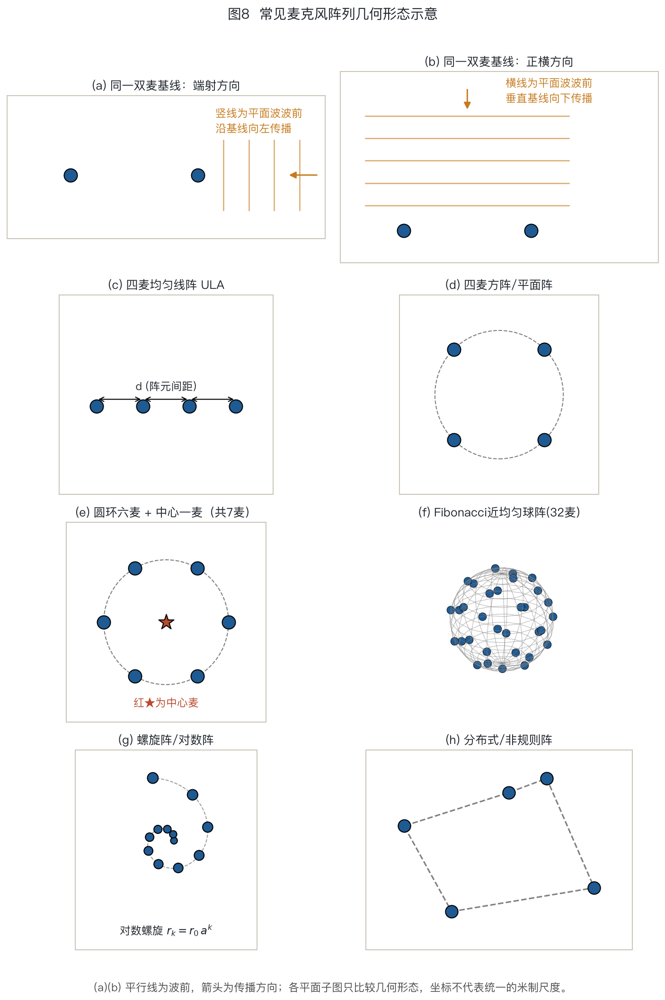
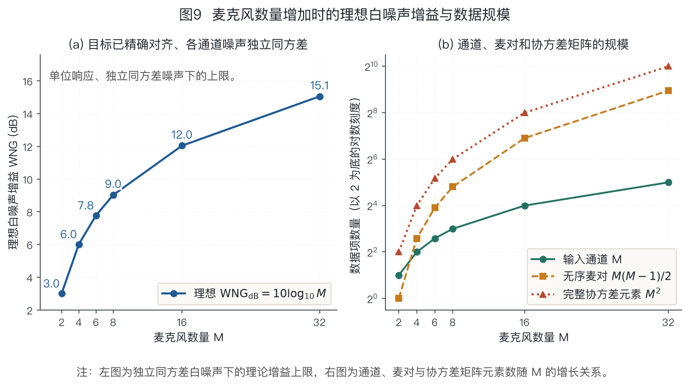
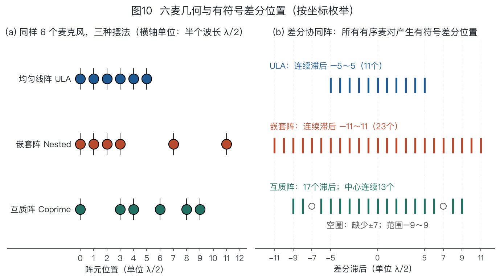
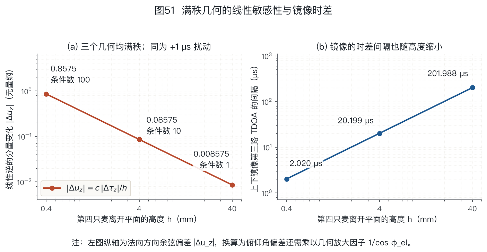
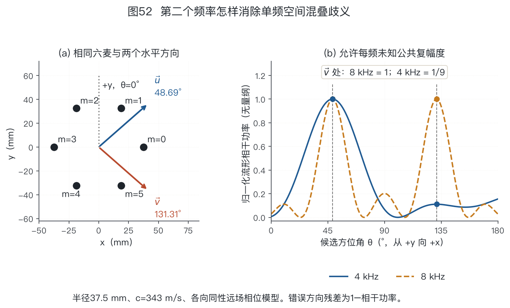

> 本篇是本书正文第 3 章；正文与扩展专题共 16 章（第 0～15 章，其中第 0 章为数学基础，第 12～15 章为四篇扩展专题），另有附录 A、B。本篇可独立阅读，前后篇见下方导航。
>
> 导读首页：[00_overview.md](00_overview.md) ｜ 上一篇：[02_basics-signal-model.md](02_basics-signal-model.md) ｜ 下一篇：[04_doa-estimation.md](04_doa-estimation.md)

---

## 3. 阵列几何形态

麦克风阵列该摆成一条直线、一个圆环、一块平面，还是分布在整个房间？本章围绕三个核心工程问题展开：麦克风摆在什么位置，哪些三维方向能够产生可区分的声学观测，以及实际硬件的通道与位置误差会怎样破坏这些几何差异。读完本章后，读者应能从任意三维阵元坐标手算出相对时延与导向矢量，分清三维几何镜像与窄带空间混叠，并能在明确噪声和频带前提下定量比较不同阵列方案。

| 记号或缩写 | 本章含义与单位 |
|---|---|
| $\vec r_m$、$\vec u$ | 第 $m$ 只麦克风的三维坐标（单位 $\mathrm{m}$）；从阵列指向声源的单位方向向量（无量纲） |
| $c,f,\lambda,\kappa$ | 声速（$\mathrm{m/s}$，算例取 $343\ \mathrm{m/s}$）、频率（$\mathrm{Hz}$）、波长 $\lambda=c/f$（$\mathrm{m}$）、波数 $\kappa=2\pi f/c$（$\mathrm{rad/m}$） |
| $\theta,\phi_{\mathrm{el}}$ | 水平方位角从 $+y$ 朝 $+x$ 为正；俯仰角从水平面朝 $+z$ 为正；代入三角函数时按弧度计 |
| 延迟求和（Delay-and-Sum Beamforming，DSB） | 按目标方向补偿传播相位后对多路信号做等权平均 |
| 白噪声增益（White Noise Gain，WNG） | 目标功率增益除以权重范数平方，衡量独立同方差传感器底噪下的信噪比倍率 |
| 到达时间差（Time Difference of Arrival，TDOA） | 两麦到达时刻的有向差 $\tau_{ij}=t_i-t_j$（单位 $\mathrm{s}$） |
| 半功率波束宽度（Half-Power Beamwidth，HPBW） | 主瓣两侧功率降到峰值一半（约 $-3.01\ \mathrm{dB}$）的交点间角宽；可视角域无交点时不强报数值 |

本章沿用第 2 章前向傅里叶核 $e^{-\mathrm{j}2\pi ft}$。音频通道、坐标矩阵行号与导向矢量分量必须严格按同一阵元顺序排列；除第 3.4 节与挡板讨论外，自由场公式默认各通道采样同步、全向且幅相响应一致。

### 3.1 形态总览

图 8 汇总了工业产品与学术研究中最常见的八种几何图景。读图时注意各平面子图旨在对比拓扑排布而非共用同一米制比例尺，我们按从简到繁的顺序逐幅看清它们的设计意图：

- **子图 (a) 与 (b) 同一双麦基线的端射与正横工作方向**：两幅子图画的是完全相同的两只蓝色麦克风（间距固定为 $4$ 个示意单位），唯一的区别是橙色平面波从哪个方向传来。(a) 中竖直波前沿基线连线从右向左传播，先后扫过右麦与左麦，属于**端射（endfire）**工作方式——TWS 耳机柄和手机上下双麦常将连线对准嘴部，配合延时相减抑制后方噪声；(b) 中水平波前垂直于基线从上向下传播，同时到达两麦，属于**正横（broadside）**工作方式——笔记本屏幕边框与平板电脑常把两麦左右排开，让正前方用户落在正横主轴上。这直观说明“端射／正横”描述的是目标方向相对基线的几何关系，而不是两套不同的双麦硬件。
- **子图 (c) 四麦均匀线阵（Uniform Linear Array，ULA）**：四只麦克风按相等间距 $d$ 排在同一直线上。在给定阵元数和无混叠间距下，它把全部阵元集中在单一轴向上以换取最大的轴向孔径，条形音箱与电视机顶盒广泛采用；代价是只能分辨绕阵列轴的一维张角，无法区分上下俯仰与前后镜像。
- **子图 (d) 四麦方阵／平面阵**：四只麦克风构成二维正方形（图中灰色虚线外接圆提示它同时也可看作 4 麦均匀圆阵）。因为同时拥有水平横向和纵向两条正交基线，它能够联合估计两个平面方向余弦；但只要阵列平面上下两侧都开放，上半空间与下半空间的对称镜像点仍会产生完全相同的到达时差。
- **子图 (e) 六麦均匀圆阵加中心麦（$6+1$ 麦 UCA）**：六只蓝色阵元沿圆周每隔 $60^\circ$ 均匀分布，圆心再放一颗红色星号标记的中心参考麦。它在水平面 $360^\circ$ 各方位上的投影孔径均衡，没有线阵的端射盲区，是桌面智能音箱与圆盘会议麦克风的经典构型。
- **子图 (f) 32 麦斐波那契（Fibonacci）近均匀球阵**：阵元按确定性球面螺旋网格铺满三维球壳，基线同时张满 $x,y,z$ 三个维度，在全空间 $4\pi$ 立体角内都没有平面镜像死角，常用于球谐声场录制、机器人听觉头与声学相机。
- **子图 (g) 12 麦对数螺旋阵（$r_k=r_0 a^k$）**：阵元沿极半径指数增长的螺旋线向外展开。内圈短基线负责保证高频段不发生空间混叠，外圈大跨度基线负责在低频段收窄主瓣，且非周期排布能够打散规则网格的高频周期栅瓣，是声学成像阵列（详见第 12 章）的主力形态。
- **子图 (h) 分布式／非规则阵**：五个节点散布在房间尺度的不规则坐标上（灰色虚线标出阵列凸包）。跨度达数米的超长基线提供了极高的空间几何灵敏度与抗遮挡空间分集，但各节点往往拥有独立采样时钟与悬殊的直达混响比，必须配合第 10、13 章的跨设备时钟同步与分布式协同算法使用。

还要澄清一个初学者常有的误解：裸露的全向麦克风摆成圆阵或线阵后，硬件本身并不会自动“长出波束主瓣”——几何位置只决定了不同方向声波在各通道间留下的时延差，真正的指向性主瓣与零陷是由后端信号处理权重合成出来的；同一套物理阵列换一组权重，就能变出截然不同的空间响应。

#### 从坐标得到方向响应

为了把上述几何形态统一纳入同一套公式，我们先交代阵元编号与坐标构造。

> **阵元下标约定（$0,\dots,M-1$ 与 $1,\dots,M$ 的对应）**
>
> 本章阵元坐标（如均匀线阵 $x_m=md$、圆阵位置角 $2\pi m/M$、§3.3 的整数稀疏网格 $p_m$）以及全书配套 Python 数组采用**零起点下标 $m=0,1,\dots,M-1$**，与第 1～2 章及第 4～5 章部分正文推导采用的 **$1$ 起点下标 $m=1,2,\dots,M$**（线阵坐标 $(m-1)d$）仅相差平移代换 $m'=m-1$：零起点的参考阵元 $m=0$ 即对应 $1$ 起点的“麦 1”，$m=1$ 对应“麦 2”，最末阵元 $m=M-1$ 对应“麦 $M$”。两种记法下，阵列均包含 $M$ 只麦克风与 $M-1$ 段相邻间隔，均匀线阵首末两麦之间的物理总孔径恒为 $(M-1)d$。

在此约定下，沿 $+x$ 轴排列的均匀线阵坐标写作 $\vec r_m=(md,0,0)^\top$（$m=0,\dots,M-1$）。水平面半径为 $r$ 的 $M$ 麦均匀圆阵可写作 $\vec r_m=(r\cos\alpha_m,r\sin\alpha_m,0)^\top$，其中 $\alpha_m=2\pi m/M$ 是阵元自身在极坐标下从 $+x$ 轴逆时针量起的位置角（注意区分阵元安装角 $\alpha_m$ 与本书从 $+y$ 轴顺时针量起的声源方位角 $\theta$）。由余弦定理或半角正弦可知，均匀圆阵相邻两麦的直线弦长为 $2r\sin(\pi/M)$；当 $M$ 为偶数时存在过圆心的对径麦对，最大两点间距恰为直径 $2r$，而当 $M$ 为奇数时最大麦距为 $2r\sin\bigl(\frac{M-1}{2M}\pi\bigr)<2r$。

接着把三维空间中的声源方向角 $(\theta,\phi_{\mathrm{el}})$ 一步步拆解成单位方向向量 $\vec u=[u_x,u_y,u_z]^\top$ 的三个直角坐标分量（三维球面坐标投影与余弦定理复习见[第 0 章 §0.1](00_math-foundations.md#sec-0-1)）：

1. **先做竖直方向分解**：声源射线从水平 $xy$ 平面向上抬起俯仰角 $\phi_{\mathrm{el}}\in[-90^\circ,90^\circ]$，由于 $\vec u$ 长度为 $1$，它在竖直 $+z$ 轴上的高度分量就是 $u_z=\sin\phi_{\mathrm{el}}$，落回水平 $xy$ 平面上的投影（“影子”）长度为 $\cos\phi_{\mathrm{el}}\ge0$。
2. **再在水平面内分解影子**：本书水平方位角 $\theta$ 以正横 $+y$ 轴为 $0^\circ$、顺时针偏向 $+x$ 轴为正，因此这段长为 $\cos\phi_{\mathrm{el}}$ 的水平影子对 $\theta$ 角的对边落在 $+x$ 轴上，得 $u_x=\cos\phi_{\mathrm{el}}\cdot\sin\theta$；邻边落在 $+y$ 轴上，得 $u_y=\cos\phi_{\mathrm{el}}\cdot\cos\theta$。可以随手平方相加验证模长：前两项平方和 $u_x^2+u_y^2=\cos^2\phi_{\mathrm{el}}$，再加上 $u_z^2=\sin^2\phi_{\mathrm{el}}$ 恒等于 $1$。

写出 $\vec u$ 之后，以第 $0$ 只麦克风 $\vec r_0$ 为参考，三维任意几何阵列的相对传播时延 $\tau_{m0}=t_m-t_0$ 与自由场远场导向矢量第 $m$ 个分量直接由内积给出：

$$\begin{aligned}
\vec u&=\begin{bmatrix}
\sin\theta\cos\phi_{\mathrm{el}}\\
\cos\theta\cos\phi_{\mathrm{el}}\\
\sin\phi_{\mathrm{el}}
\end{bmatrix},\\
\tau_{m0}&=-\frac{(\vec r_m-\vec r_0)^\top\vec u}{c},\\
a_m(f,\vec u)&=e^{-\mathrm{j}2\pi f\tau_{m0}}\text{。}
\end{aligned}\tag{3-1}$$

参考麦自身恒有 $\tau_{00}=0$、$a_0=1$；当 $(\vec r_m-\vec r_0)^\top\vec u>0$ 时，第 $m$ 麦比参考麦更靠近声源，声音先到（$\tau_{m0}<0$），对应正的导向超前相位。用 §2.3 手算过的水平面参数做一次快速核对：取线阵间距 $d=0.04\ \mathrm{m}$、$\theta=30^\circ$、$\phi_{\mathrm{el}}=0^\circ$，则 $\vec u=[0.5,\sqrt{3}/2,0]^\top$，第 $1$ 麦相对参考麦投影为 $0.04\times0.5=0.02\ \mathrm{m}$，算出 $\tau_{10}=-0.02/343\approx-58.31\ \mathrm{\mu s}$，$1\ \mathrm{kHz}$ 处导向相位为 $+20.99^\circ$，与第 2 章完全一致。

此外，将整座阵列在空间做刚体平移（所有 $\vec r_m$ 同加常向量 $\vec r_{\mathrm{shift}}$）时，$\vec r_m-\vec r_0$ 保持不变，远场相对导向矢量也完全不变；改选另一只麦克风作参考，也只是给整列 $\vec a(f,\vec u)$ 同乘一个公共相位因子，不改变跨通道相对信息。

#### 算例 3-1 双麦耳机的差分——1 cm 间距怎么做心形指向

无线蓝牙耳机（TWS）的耳柄长度只有几厘米，如果把两颗间距仅 $d=1\ \mathrm{cm}$ 的理想全向麦克风沿嘴部方向一前一后排开（端射布置），在 $1\ \mathrm{kHz}$ 语音中频处波长 $\lambda=34.3\ \mathrm{cm}$，孔径连波长的三十分之一都不到——要是照搬第 2 章的等权延迟求和（DSB），全空间响应几乎是一个毫无方向区分度的圆球。微小设备究竟怎么靠 $1\ \mathrm{cm}$ 间距做出“保留前方说话声、抑制后方噪声”的心形波束？答案就是第 5 章 §5.3 将系统展开的**一阶差分麦克风阵列（Differential Microphone Array，DMA）**。

在动笔算之前先想明白一个问题：如果直接把前麦 $x_1(t)$ 与乘了实增益 $g$ 的后麦 $x_2(t)$ 相减，写成 $y(t)=x_1(t)-g\,x_2(t)$，能不能抑制后方保留前方？不能！因为前方来声在后麦产生滞后相位 $-\Delta\phi$，后方来声在后麦产生超前相位 $+\Delta\phi$，而实系数 $g$ 下复共轭模长 $|1-ge^{-\mathrm{j}\Delta\phi}|$ 与 $|1-ge^{+\mathrm{j}\Delta\phi}|$ 恒相等，前后幅度响应永远完全对称（注意前后对称未必都是“8 字形”：只有取等增益 $g=1$ 且小间距时，正横同相相消为零才呈 8 字形；若取 $g=0$ 就是单麦全向圆，取 $g=0.5$ 时正横仍剩幅度 $|1-0.5|=0.5$，章末 E03-05 专门复算这三档差异）。

要打破前后对称、精确抵消后方噪声，关键动作是在后麦通道上**人为串入一段等于麦间传播时间 $\tau_0=d/c$ 的电延迟**，然后再与前麦相减：

$$\begin{aligned}
y(t)&=x_1(t)-x_2(t-d/c),\\
Y(f)&=X_1(f)-e^{-\mathrm{j}2\pi fd/c}X_2(f)\text{。}
\end{aligned}\tag{3-2}$$

式中 $x_1$ 为靠近嘴部的前麦，$x_2$ 为远离嘴部的后麦，第二行直接由 §2.3.2 的傅里叶时移性质写出。下面分五步把 $d=0.01\ \mathrm{m}$、$c=343\ \mathrm{m/s}$、$f=1000\ \mathrm{Hz}$ 下的目标增益、后方零陷、底噪代价与失配敏感度全部算清：

1. **算单程端射传播时延与相位角**：本算例用 $\Delta\tau>0$ 记声波走完一段麦距 $d$ 的时间大小，

    $$\begin{aligned}
    \Delta\tau&=\frac{d}{c}=\frac{0.01}{343}
    \approx29.15\ \mathrm{\mu s}\text{，}
    \end{aligned}$$

    在 $f=1\ \mathrm{kHz}$ 下折合单程相位角为

    $$\begin{aligned}
    \Delta\phi&=2\pi f\Delta\tau
    =\frac{2\pi\times1000\times0.01}{343}\\
    &\approx0.1832\ \mathrm{rad}\approx10.50^\circ\text{。}
    \end{aligned}$$

2. **看后方来声（$180^\circ$）：声学抢跑恰好被电延迟追平**：从正后方传来的干扰声先到达后麦 $x_2$，再花 $\Delta\tau=d/c$ 传到前麦 $x_1$，即 $x_1(t)=x_2(t-d/c)$。而式(3-2)偏偏又给后麦 $x_2$ 补上了同样长的电延迟 $d/c$！两路信号在减法器入口处波形一模一样，相减后理想输出恒为 $y(t)=0$，在正后方形成精确的相消零陷。

3. **看前方来声（$0^\circ$）：提取半角公因子算剩余幅度**：从正前方嘴部传来的目标语音先到达前麦 $x_1$，晚 $\Delta\tau$ 才到后麦 $x_2$；接着后麦信号又被电延迟往后推迟了一个 $\Delta\tau$，两路一共错开了双倍时间 $2\Delta\tau$（即双倍相位角 $2\Delta\phi\approx21.0^\circ$）。设单麦输入目标谱幅度归一化为 $1$，则输出复响应为 $1-e^{-\mathrm{j}2\Delta\phi}$。不要跳步，提出半角中心相位因子 $e^{-\mathrm{j}\Delta\phi}$ 凑出欧拉正弦式：

    $$\begin{aligned}
    1-e^{-\mathrm{j}2\Delta\phi}
    &=e^{-\mathrm{j}\Delta\phi}
    \bigl(e^{+\mathrm{j}\Delta\phi}-e^{-\mathrm{j}\Delta\phi}\bigr)\\
    &=e^{-\mathrm{j}\Delta\phi}\,(2\mathrm{j}\sin\Delta\phi)\text{。}
    \end{aligned}$$

    由于 $|e^{-\mathrm{j}\Delta\phi}|=1$ 且 $|\mathrm{j}|=1$，取模后（对未舍入的 $\Delta\phi$ 计算，且 $\Delta\phi\in(0,\pi)$）直接得到前方输出幅度：

    $$\begin{aligned}
    |Y|&=2\sin\Delta\phi
    \approx2\sin(0.18318\ \mathrm{rad})\approx0.3643\text{。}
    \end{aligned}$$

    换算成分贝为 $20\log_{10}0.3643\approx\mathbf{-8.77\ \mathrm{dB}}$（约 **$-8.8\ \mathrm{dB}$**）：前方语音虽然保留了下来，但因为 $1\ \mathrm{cm}$ 间距在 $1\ \mathrm{kHz}$ 下相位张角只有 $21^\circ$，两个相近箭头相减损耗了近九成分贝电平。

4. **算输出信噪比代价：为什么独立底噪“相减”反而让噪声功率翻倍？** 初学者最容易犯的直觉错误是以为“两路相减也会把底噪减掉”。设两颗麦克风各自的内部电路自噪声为 $v_1(t)$ 与 $v_2(t)$，均值为零、方差同为 $\sigma_v^2$ 且跨通道统计独立（故任意时延下互相关 $\mathbb{E}[v_1(t)v_2(t-d/c)]=0$）。经过式(3-2)减法器后，输出底噪为 $v_{\mathrm{out}}(t)=v_1(t)-v_2(t-d/c)$，计算其均方功率：

    $$\begin{aligned}
    \mathbb{E}\bigl[v_{\mathrm{out}}^2(t)\bigr]
    &=\mathbb{E}\bigl[v_1^2(t)\bigr]
    -2\mathbb{E}\bigl[v_1(t)v_2(t-d/c)\bigr]
    +\mathbb{E}\bigl[v_2^2(t-d/c)\bigr]\\
    &=\sigma_v^2-0+\sigma_v^2=2\sigma_v^2\text{。}
    \end{aligned}$$

    因为独立噪声交叉项为零，$(-1)^2=+1$，**两路独立噪声无论是相加还是相减，输出噪声功率都严格相加翻倍**，即底噪抬高 $10\log_{10}2\approx+3.01\ \mathrm{dB}$！一边是目标语音跌了 $8.77\ \mathrm{dB}$，一边是电路底噪涨了 $3.01\ \mathrm{dB}$，合起来输出白噪声信噪比整整损失了 $8.77+3.01\approx\mathbf{11.78\ \mathrm{dB}}$（约 **$-11.8\ \mathrm{dB}$**）。这就是小间距差分阵列在低频白噪声增益（WNG）低下的物理根源：频率越低、麦距越小，$\Delta\phi$ 越趋近于零，目标相减损耗越剧烈。

5. **看通道幅度失配最先破坏什么**：后方理想零陷全靠“$1-1=0$”。假如后麦灵敏度仅比前麦高了 $1\%$（即真实幅度比为 $1.01$，约 $+0.086\ \mathrm{dB}$ 的微小出厂公差），后方干扰相减后就不再为零，而是留下绝对幅度 $|1-1.01|=0.01$（相对单麦输入为 $20\log_{10}0.01=-40\ \mathrm{dB}$）。在绘制将前方主瓣峰值归为 $0\ \mathrm{dB}$ 的标准波束图时，还必须除以失配后的前方实际增益：

    $$\begin{aligned}
    |B_{\mathrm{front}}|
    &=|1-1.01\,e^{-\mathrm{j}2\Delta\phi}|\approx0.3663,\\
    20\log_{10}\frac{0.01}{|B_{\mathrm{front}}|}
    &\approx20\log_{10}\frac{0.01}{0.3663}
    \approx-31.28\ \mathrm{dB}\text{。}
    \end{aligned}$$

    注意区分这两个分贝数字的分母：$-40\ \mathrm{dB}$ 是相对单麦输入的绝对残差，而 **$-31.3\ \mathrm{dB}$** 才是归到前方主瓣后的真实波束零陷深度！仅仅 $1\%$ 的增益偏差就把无穷深零陷填浅到了约 $-31\ \mathrm{dB}$，足见微型差分阵列对麦克风配对与产线校准的严苛要求（章末 E03-14 提供可试听的失配与补偿合成音频）。

最后把前后两点推广到整圈水平角度，看清“心形线”的名字从何而来。令 $\beta\in[0^\circ,180^\circ]$ 表示来波方向与前端射轴的夹角（正前方 $\beta=0^\circ$，正横 $\beta=90^\circ$，正后方 $\beta=180^\circ$；注意区分轴夹角 $\beta$ 与正横起算角 $\theta$），并记无量纲电尺寸参数 $p=2\pi fd/c=\Delta\phi$。后麦相对前麦的自然传播滞后为 $(d/c)\cos\beta$，叠加上固定电延迟 $d/c$ 后总相位差为 $p(1+\cos\beta)$，代入式(3-2)并用同样的半角正弦化简（在 $\sin p\ne0$ 的非退化频点上向正前方幅度归一化）：

$$\begin{aligned}
B(f,\beta)&=1-e^{-\mathrm{j}p(1+\cos\beta)},\\
\frac{|B(f,\beta)|}{|B(f,0)|}
&=\frac{|\sin[p(1+\cos\beta)/2]|}{|\sin p|}
\xrightarrow{p\to0^+}\frac{1+\cos\beta}{2}\text{。}
\end{aligned}\tag{3-3}$$

当低频电尺寸 $p\to0^+$ 时，分子分母同取小角近似 $\sin x\approx x$，$p$ 上下约去，归一化波束形状稳定收敛到与频率无关的标准心形曲线 $(1+\cos\beta)/2$：在 $\beta=0^\circ,90^\circ,180^\circ$ 三处取值依次为 $1,0.5,0$（在 $1\ \mathrm{kHz}$ 下精确代入式(3-3)为 $1,0.5021,0$，已极为贴近理想心形）。同时，该差分器两路复权重 $w_1=1$、$w_2=-e^{+\mathrm{j}p}$ 的模长均为 $1$，权重范数平方 $\|\vec w\|_2^2=1^2+1^2=2$，代入第 2 章式(2-13)立刻得到正前方线性白噪声增益 $G(f)$ 及其分贝形式：

$$\begin{gathered}
G(f)=\frac{|B(f,0)|^2}{2}=\frac{(2\sin p)^2}{2}=2\sin^2 p,\\
\mathrm{WNG}_{\mathrm{dB}}(f)=10\log_{10}G(f)\text{。}
\end{gathered}\tag{3-4}$$

将 $1\ \mathrm{kHz}$ 下的 $p\approx0.18318$ 代入式(3-4)，算得 $10\log_{10}(2\sin^2 0.18318)\approx-11.78\ \mathrm{dB}$，与上面第 4 步逐项核算的 $\mathrm{WNG}_{\mathrm{dB}}$ 分毫不差。如果在后端串接一个低频提升均衡器（乘实数增益 $1/|B(f,0)|$）把前方语音电平拉回 $0\ \mathrm{dB}$，分子与分母会同时乘上该均衡系数的平方而相互抵消，$\mathrm{WNG}_{\mathrm{dB}}$ 丝毫不会改善。

回到三维空间看双麦基线的能力上限：两只麦克风只能提供一个独立的标量时延观测。只有事先把声源限制在已知平面的一侧单值半圆内，一个时延才能唯一反解出一个角度；一旦放开到三维空间，所有与基线夹角 $\beta$ 相同的射线绕基线旋转一圈构成一个圆锥面，锥面上无穷多个方向产生完全相同的双麦时延，称为**锥面模糊（cone of confusion）**。要解开三维模糊、改善各向均匀性，就必须增加阵元并拓展阵列维数。

下表对比了六类主流多麦克风几何形态的方向覆盖范围、核心优缺点与常见载体。阅读表格时请注意区分三列信息：“覆盖”指纯几何布局可分辨的角度空间，“优缺点”指出该几何在子空间定位——如多重信号分类（Multiple Signal Classification，MUSIC）或借助旋转不变技术估计信号参数（Estimation of Signal Parameters via Rotational Invariance Techniques，ESPRIT，算法详见 §4.6）——及波束增强中的物理特性，而“典型应用”仅列举常见产品形态，不代表脱离尺寸与频带后的绝对优劣排名：

| 形态 | 覆盖 | 优点 | 缺点 | 典型应用 |
|---|---|---|---|---|
| **均匀线阵（ULA）** | 单侧一维 $\pm90^\circ$ | 具阵元平移不变与 Toeplitz 结构；同麦数同间距下单轴孔径最大 | 三维存在绕轴锥面模糊；靠近端射时 $\mathrm{d}\tau/\mathrm{d}\theta\to0$，测角误差急剧放大 | 条形音箱、长条会议终端 |
| **均匀圆阵（UCA）** | 水平 $360^\circ$ 全方位 | 水平各方位有效投影孔径均衡，无端射死角，适合环视寻向 | 有限阵元仅具离散旋转对称；单层共面圆环仍有上下半空间镜像歧义 | 桌面智能音箱、圆盘会议麦 |
| **方阵／平面阵** | 单侧半空间 | 两条非共线基线可联合估计三维方位角与俯仰角 | 阵列平面两侧对称镜像方向时延相同，需靠机身挡板或半空间先验消歧 | 墙面或屏幕嵌入式一体机 |
| **球阵（刚性／开放球）** | 全空间 $4\pi$ 立体角 | 三维各方向几何灵敏度均匀，可直接展开为正交球谐模式 | 体积与通道成本高；刚性球需散射流形，开放球在球贝塞尔零点处病态 | 机器人听觉头、全景声录制 |
| **螺旋阵／对数阵** | 视是否共面而定 | 兼顾内圈防混叠与外圈窄主瓣，非周期排布压低高频周期栅瓣 | 缺少平移不变结构，宽带权重设计较复杂 | 声学相机成像、宽带研究 |
| **分布式／非规则阵** | 视节点三维张角而定 | 米级跨度提供高空间分集，显著提升抗遮挡与近场三维定位精度 | 节点常带独立晶振漂移、悬殊路径损耗与丢包，依赖时钟同步与自标定 | 大型多节点会议室、机器人网 |

结合具体场景读这张表，选型脉络就很清晰：如果桌面音箱只需定位围坐在四周的人声**水平 $360^\circ$ 方位**，平面均匀圆阵就能胜任；如果无人机或吊装设备还需要分辨声音来自上方还是下方，任何单层共面阵列（无论加多少颗共面麦克风）都无法靠纯时延打破平面上下镜像，必须引入非共面的高度阵元或利用机身刚性挡板的声影差异。

#### 几何秩、镜像与相位歧义

为什么线阵有锥面模糊、平面阵有上下镜像、非共面阵才能唯一锁定三维方向？用线性代数里**基线矩阵的秩**一算就能彻底看透。把其余 $M-1$ 只麦克风相对参考麦 $\vec r_0$ 的三维基线向量 $\vec b_m^\top=(\vec r_m-\vec r_0)^\top$（$m=1,\dots,M-1$）逐行叠成 $(M-1)\times3$ 几何基线矩阵 $\mathbf G$，并把测得的 $M-1$ 个有向到达时差排成列向量 $\vec\tau=[\tau_{10},\dots,\tau_{M-1,0}]^\top$（属于 $\mathbb{R}^{M-1}$），式(3-1)的第二行就变成了一组关于三维方向向量 $\vec u$ 的线性方程组外加单位球面约束：

$$\mathbf G\vec u=-c\vec\tau,\qquad
\|\vec u\|_2=1\text{。}\tag{3-5}$$

矩阵 $\mathbf G$ 的秩 $\operatorname{rank}(\mathbf G)$ 直接决定了这组纯时延方程锁住了几个空间自由度：

- **共线阵列（$\operatorname{rank}(\mathbf G)=1$）**：所有基线平行于同一条轴（如 $x$ 轴），方程组只锁住轴向分量 $u_x$。只要 $|u_x|<1$，剩下的 $u_y^2+u_z^2=1-u_x^2>0$ 在三维单位球面上切出一个半径为 $\sqrt{1-u_x^2}$ 的圆环，这就是锥面模糊（仅在端射极限 $u_x=\pm1$ 时圆环缩成单点）。往同一条直线上塞再多麦克风，行向量依然彼此共线，$\operatorname{rank}(\mathbf G)$ 永远是 $1$。
- **非共线平面阵列（$\operatorname{rank}(\mathbf G)=2$）**：比如铺在 $xy$ 水平面上的圆阵或方阵，所有基线的第 $3$ 列全为零（$b_{m,z}=0$）。方程组能唯一解出水平面内的两个方向余弦 $(u_x,u_y)$；只要 $u_x^2+u_y^2<1$，单位球约束 $u_z^2=1-u_x^2-u_y^2$ 就给出上下对称的正负两个实数解 $u_z=\pm\sqrt{1-u_x^2-u_y^2}$。例如水平面阵列测得 $u_x=0.3,u_y=0.4$，立刻有 $u_z=\pm\sqrt{0.75}\approx\pm0.866$，上半球和下半球的这两个镜像方向在平面内任意多只麦克风上留下的时延分毫不差（完整时延核对见 E03-10）。
- **三维非共面阵列（$\operatorname{rank}(\mathbf G)=3$）**：至少有一只麦克风跳出原平面（提供非零法向基线分量），使 $\mathbf G$ 满列秩为 $3$，此时在无噪有向 TDOA 下能唯一解出 $\vec u=-\mathbf G^{\dagger}(c\vec\tau)$。

但工程设计绝不能止步于“数学上满秩唯一”，还要紧接着追问**数值稳定性**：如果把第四只麦克风只垫高离水平面 $0.4\ \mathrm{mm}$，代数上 $\operatorname{rank}(\mathbf G)$ 依然等于 $3$，但第 $3$ 行的基线极短，矩阵条件数暴增，测量时延里只要混入 $1\ \mathrm{\mu s}$ 的微小抖动，无约束线性逆算出的法向分量就会剧烈失真甚至冲出 $[-1,1]$ 的物理合法范围（章末 E03-16 与图 51 对 $40\ \mathrm{mm}$、$4\ \mathrm{mm}$、$0.4\ \mathrm{mm}$ 三档高度做了完整的条件数与误差放大剖析）。此外，式(3-5)假定我们已经拿到了未折叠的真实时差 $\vec\tau$；如果只在单一高频点观测模 $2\pi$ 缠绕的复数相位，哪怕 $\operatorname{rank}(\mathbf G)=3$ 也仍可能遭遇窄带空间混叠，§3.2.2 将专门给出整周相位判据。

除了空间维数不足带来的全局模糊，同一阵列在不同入射角上的**局部测角灵敏度**也相差悬殊。回到麦 1 在 $x=0$、麦 2 在 $x=d$ 的线阵，有向时差 $\tau_{12}=d\sin\theta/c$ 对角度的导数在端射 $\theta\to\pm90^\circ$ 时趋于零——这与第 2 章式(2-14) CRLB 在 $\cos\theta\to0$ 处发散是同一个几何事实。下面用一道具体算例看看同一个 $10\ \mathrm{\mu s}$ 时延误差在正横与端射附近会造成多大反差。

#### 算例 3-2 端射灵敏度——同一个 10 μs 误差在不同方向的影响

沿用有向时差 $\tau_{12}=t_1-t_2=\frac{d}{c}\sin\theta$（其中 $\theta$ 按弧度代入求导），对 $\theta$ 求一阶微分并反解小角度扰动近似：

$$\begin{aligned}
\frac{\mathrm{d}\tau_{12}}{\mathrm{d}\theta}
&=\frac{d}{c}\cos\theta,\\
\delta\theta&\approx\frac{c\,\delta\tau_{12}}{d\cos\theta}\text{。}
\end{aligned}\tag{3-6}$$

式(3-6)清楚指出：**同样大小的时延测量误差 $\delta\tau_{12}$，换算成角度误差时必须除以投影余弦因子 $\cos\theta$**。

- **输入与口径**：取间距 $d=4\ \mathrm{cm}=0.04\ \mathrm{m}$ 的双麦基线（与 §4.4 算例一致），声速 $c=343\ \mathrm{m/s}$，设亚采样 TDOA 估计存在 $\delta\tau_{12}=10\ \mathrm{\mu s}$ 的误差（在 $16\ \mathrm{kHz}$ 采样下仅相当于 $0.16$ 个采样周期），分别核算正横 $\theta=0^\circ$ 与近端射 $\theta=85^\circ$ 处的测角偏差。
- **方向一：正横方向（$\theta=0^\circ$）**：此时 $\cos 0^\circ=1$，正弦曲线斜率最陡，一阶近似非常准确：

    $$\begin{aligned}
    \delta\theta&\approx\frac{343\times10\times10^{-6}}{0.04}
    =0.08575\ \mathrm{rad}\approx4.91^\circ\text{。}
    \end{aligned}$$

    即 $10\ \mathrm{\mu s}$ 时差误差在正横附近引起约 **$4.9^\circ$**（约 $5^\circ$）的角度误差（精确代入 $\arcsin(0.08575)\approx4.92^\circ$，两者几乎重合）。

- **方向二：近端射方向（$\theta=85^\circ$）**：这里绝不能再盲目套一阶微分式（若硬套 $4.91^\circ/\cos 85^\circ\approx56.4^\circ$ 会严重失真），因为 $d=4\ \mathrm{cm}$ 的最大物理时延上限为 $\tau_{\max}=0.04/343\approx116.62\ \mathrm{\mu s}$，而真实角 $\theta=85^\circ$ 对应的真实时延 $\tau_{12}=(0.04/343)\sin 85^\circ$（约 $116.17\ \mathrm{\mu s}$）已经紧贴物理时延上限！此时正负两个方向的误差呈现极度不对称的非线性行为：
  - 若测量误差为 $+10\ \mathrm{\mu s}$，观测时延变为 $126.17\ \mathrm{\mu s}>\tau_{\max}$，导致 $c\hat\tau_{12}/d\approx1.082>1$，跳出了反正弦函数 $[-1,1]$ 的实数定义域，根本不存在对应的物理实角度（工程代码中应显式记录越界标志，见章末 E03-02）；
  - 若测量误差为 $-10\ \mathrm{\mu s}$，先算得观测时延 $\hat\tau_{12}=116.1743-10=106.1743\ \mathrm{\mu s}$，再精确代入反正弦函数：

      $$\begin{aligned}
      \hat\theta&=\arcsin\!\left(
      \frac{343\times106.1743\times10^{-6}}{0.04}\right)\\
      &\approx65.57^\circ\text{，}
      \end{aligned}$$

      角度一下子从 $85^\circ$ 跌到了 $65.6^\circ$，偏差高达 **$19.4^\circ$**，是正横方向同样时差误差的四倍！

- **工程启示与边界**：正因为线阵在端射附近存在“正偏越界、负偏放大数倍”的几何压缩效应，条形音箱若要求覆盖更宽的房间视角，要么拉大间距提高信噪比压低 $\delta\tau_{12}$，要么改用圆阵或多轴折线阵把边缘方向重新拉回高灵敏度投影区。

### 3.2 四条设计规律

面对产品外壳与预算约束，筛选麦克风排布时可按以下四条规律依次排查：先定孔径与工作频带的电尺寸，再匹配目标覆盖角域，接着评估机身挡板散射，最后核算阵元数量带来的信噪比与计算开销。随后两道算例将把圆阵与线阵的关键数字逐一算清。

#### 3.2.1 先看孔径、方向、挡板和麦数

1. **常规波束的角分辨尺度由孔径波长比决定（量级约 $\lambda/D$）**：直径 $7.5\ \mathrm{cm}$ 的桌面小圆阵在 $1\ \mathrm{kHz}$ 时孔径还不到四分之一波长，等权主瓣宽逾半周；要到 $4\ \mathrm{kHz}$ 以上主瓣才收窄到几十度量级（见下节算例 3-3）。高频虽然增大了电尺寸 $D/\lambda$，却同时把阵列推向空间混叠区并放大毫米级位置误差，因此孔径设计必须在低频分辨率与高频防混叠之间统筹兼顾。
2. **圆阵与线阵服务于不同的方向分布**：均匀线阵把全部孔径押在正横轴附近，一旦声源偏到端射两侧，投影孔径与测角灵敏度同步缩水；均匀圆阵则在水平 $360^\circ$ 各方位保持均衡的有效投影孔径，三维球阵进一步补齐俯仰覆盖。远距离语音识别到底选线阵还是圆阵，取决于设备摆放位置、房间混响与说话人方位分布，不能脱离应用场景孤立排名（系统综述参见 [Kumatani、McDonough 与 Raj 2012，《Microphone Array Processing for Distant Speech Recognition》，IEEE Signal Processing Magazine](https://course.ece.cmu.edu/~ece792/handouts/KumataniEtAl12.pdf)）。
3. **刚性机身与挡板效应必须写进阵列流形**：实际麦克风很少悬空挂在自由场里，而是嵌在音箱圆柱壳体、屏幕边框或机器人头壳上。以半径为 $a$ 的刚性球壳对径平齐嵌麦为例，空气质点法向速度在刚性表面被迫归零，气流绕行球体产生的偶极附加质量使低频段（$\kappa a\ll1$）跨麦有效时延相对自由场直径 $2a$ 整整放大到 $1.5$ 倍，而在高频段（$\kappa a\gg1$）则过渡为沿球面爬行的伍德沃思（Woodworth）弧线绕射并伴随背面声影衰减（章末练习 E03-19 将推导这一频变散射偏差及自由场反推越界角）。工程上应采用对应的刚性球／柱解析散射流形或消声室实测流形，不能把挡板简单折算成与频率和角度无关的固定倍数“虚拟自由场孔径”。
4. **麦克风数量受边际收益与硬件代价双重制约**：增加阵元数 $M$ 能提供更多干扰置零自由度并压低电路底噪——在目标同相、各通道自噪声独立同方差的理想基准下，等权 DSB 的线性白噪声增益为 $\mathrm{WNG}=M$，分贝值为 $\mathrm{WNG}_{\mathrm{dB}}=10\log_{10}M$，即**麦数每翻一倍，白噪声信噪比仅提升约 $3.01\ \mathrm{dB}$**（从 2 麦升到 4 麦涨 $3\ \mathrm{dB}$，从 4 麦升到 8 麦再涨 $3\ \mathrm{dB}$，从 8 麦堆到 16 麦才再涨 $3\ \mathrm{dB}$）。与此同时，ADC 接口、PCB 布线以及 $O(M^2)$ 规模的协方差矩阵更新与求逆开销却在加速增长。

#### 3.2.2 算例 3-3：6 麦圆环的数字

桌面智能音箱最常见的一类构型是 6 麦均匀圆环。我们取直径 $D=7.5\ \mathrm{cm}$（半径 $r=3.75\ \mathrm{cm}=0.0375\ \mathrm{m}$）、声速 $c=343\ \mathrm{m/s}$ 的理想自由场全向 6 麦圆环，按四步走通它的几何间距、空间混叠频率与真实波束宽度：

1. **第 1 步：算相邻麦距**。6 只麦克风每隔 $2\pi/6=\pi/3$（$60^\circ$）均匀分布在圆周上，顺次连线恰好构成一个内接正六边形。相邻两麦与圆心组成顶角 $60^\circ$ 的等腰三角形，故相邻弦长恰好等于半径：

    $$\begin{aligned}
    d&=2r\sin\!\left(\frac{\pi}{6}\right)
    =2\times0.0375\times0.5\\
    &=0.0375\ \mathrm{m}=3.75\ \mathrm{cm}\text{。}
    \end{aligned}$$

2. **第 2 步：从相邻弦长保守检查到正六边形层间距精确混叠边界**。如果先借用相邻两麦的半波长充分条件 $d\le\lambda/2$ 做快速保守估算，对应的频率尺度为

    $$\begin{aligned}
    f_{\mathrm{check}}&=\frac{c}{2d}=\frac{343}{2\times0.0375}\\
    &\approx4573\ \mathrm{Hz}\approx4.6\ \mathrm{kHz}\text{。}
    \end{aligned}$$

    这意味着 $4.6\ \mathrm{kHz}$ 以下连任意一对相邻麦的相位差都不会超过 $\pm\pi$，自然不会发生空间混叠。但在 $16\ \mathrm{kHz}$ 采样（最高频率 $8\ \mathrm{kHz}$）下，圆环真正的单侧无混叠上限其实是 **$5.28\ \mathrm{kHz}$** 而非 $4.6\ \mathrm{kHz}$！这个精确临界值 $d<\lambda/\sqrt{3}\approx0.577\lambda$（严格证明见 [Tucker、Zhao、Ahmad 与 Potter 2022，*Alias-Free Arrays*，IEEE Signal Processing Letters §V-B](https://doi.org/10.1109/LSP.2022.3224834) 及[公开全文](https://pmc.ncbi.nlm.nih.gov/articles/PMC9757818/)）背后的几何图景非常直观，画一下六个顶点坐标就能立刻明白：

    按 §3.1 的极角公式，$\alpha_m=m\pi/3$（$m=0,\dots,5$），6 只麦克风的平面 $(x,y)$ 坐标依次是 $(d,0)$、$(\frac12 d,\frac{\sqrt{3}}{2}d)$、$(-\frac12 d,\frac{\sqrt{3}}{2}d)$、$(-d,0)$、$(-\frac12 d,-\frac{\sqrt{3}}{2}d)$、$(\frac12 d,-\frac{\sqrt{3}}{2}d)$。请看它们的纵坐标 $y$：全部 6 颗麦克风整整齐齐地落在 $y=-\frac{\sqrt{3}}{2}d$、$y=0$、$y=+\frac{\sqrt{3}}{2}d$ **三条水平平行线上，相邻两层平行线之间的垂直层间距正是 $d_\perp=\frac{\sqrt{3}}{2}d$**！

    当我们在水平面比较正前方 $\theta=0^\circ$（$\vec u=[0,1,0]^\top$）与正后方 $\theta=180^\circ$（$\vec v=[0,-1,0]^\top$）这一对相反方向时，方向差向量 $\vec u-\vec v=[0,2,0]^\top$ 的 $x$ 分量为零，各麦横坐标 $x_m$ 完全不起作用，整座 6 麦圆环沿 $y$ 轴投影退化成了一条间距为 $d_\perp=\frac{\sqrt{3}}{2}d$ 的三层均匀线阵！要求这条等效线阵在闭方向域内不出现整周相位重合，层间距必须严格小于半波长：

    $$\begin{aligned}
    d_\perp=\frac{\sqrt{3}}{2}d<\frac{\lambda}{2}
    \quad\Longleftrightarrow\quad
    d<\frac{\lambda}{\sqrt{3}}\approx0.577\lambda\text{。}
    \end{aligned}$$

    代入本例 $d=0.0375\ \mathrm{m}$，由 $f_*=c/(\sqrt{3}d)$ 即 $343/(\sqrt{3}\times0.0375)$ 算得临界混叠频率约为 $5280.8\ \mathrm{Hz}$（约 $5.28\ \mathrm{kHz}$）！更一般地，记第 $m$ 麦相对参考麦的基线为 $\vec b_m=\vec r_m-\vec r_0$，任意几何阵列在波长 $\lambda$ 下把两个允许方向 $\vec u\ne\vec v$ 混成同一条归一化导向矢量，当且仅当对所有 $m=1,\dots,M-1$ 每一条基线上的路程差投影都是波长的整数倍：

    $$\begin{aligned}
    \frac{\vec b_m^\top(\vec u-\vec v)}{\lambda}&\in\mathbb{Z}
    \qquad(m=1,\dots,M-1)\text{。}
    \end{aligned}\tag{3-7}$$

    式中 $\mathbb{Z}$ 为整数集。在临界点 $\lambda_*=\sqrt{3}d$ 处，上述 $\theta=0^\circ$ 与 $180^\circ$ 在三层上的路程差除以 $\lambda_*$ 恰为整数 $-1,0,+1$，六维导向矢量完全重合；章末 E03-09 还会在 $8\ \mathrm{kHz}$ 下显式构造出一对同在水平面内却让全部 6 个通道相位一模一样的方向（另需注意，单层平面圆环在低频以下依然存在 §3.1 所述的上下半空间平面镜像，那属于三维基线秩为 $2$ 的时延镜像，与这里的窄带空间混叠不是同一回事）。

3. **第 3 步：核算孔径与波长之比**。圆环最大外径孔径为 $D=2r=7.5\ \mathrm{cm}=0.075\ \mathrm{m}$，取语音低频段 $1\ \mathrm{kHz}$ 与中高频段 $4\ \mathrm{kHz}$ 对比电尺寸：

    - 在 $1\ \mathrm{kHz}$ 处：波长 $\lambda=343/1000=0.343\ \mathrm{m}=34.3\ \mathrm{cm}$，孔径波长比 $D/\lambda=0.075/0.343\approx0.219$——**整座圆环只有约五分之一波长大**；
    - 在 $4\ \mathrm{kHz}$ 处：波长 $\lambda=343/4000=0.08575\ \mathrm{m}$（约 $8.58\ \mathrm{cm}$），孔径波长比 $D/\lambda=0.075/0.08575\approx0.875$——阵列直径已接近一个完整波长。

4. **第 4 步：精确计算圆环自身的等权波束宽度**。$\lambda/D$ 在 $1\ \mathrm{kHz}$ 与 $4\ \mathrm{kHz}$ 下分别约为 $4.57\ \mathrm{rad}$ 与 $1.14\ \mathrm{rad}$，这只是粗略量级参考，绝不能把均匀线阵的 $0.886\lambda/D$ 公式硬套到圆环上。按 §3.1 的 6 麦圆环坐标（不含中心第 7 麦），记波数 $\kappa=2\pi f/c$，对水平入射角 $\theta$、目标指向 $\theta_0=0^\circ$ 做等权延迟求和，把 $6$ 路相对目标方向的残余相位因子相加求平均：

    $$\begin{aligned}
    \vec u_\theta&=(\sin\theta,\cos\theta,0)^\top,\\
    \psi_m&=\kappa\,\vec r_m^\top(\vec u_\theta-\vec u_{\theta_0}),\\
    B(f,\theta;\theta_0)
    &=\frac1M\sum_{m=0}^{M-1}e^{\mathrm{j}\psi_m}\text{。}
    \end{aligned}\tag{3-8}$$

    在目标方向 $\theta=\theta_0$ 上每项 $\psi_m=0$，总响应恒为 $B=1$。从 $\theta_0=0^\circ$ 向左右两侧扫描，用二分法精确求解最近的半功率点 $|B(f,\theta;0^\circ)|^2=1/2$（严格对应 $10\log_{10}(1/2)\approx-3.0103\ \mathrm{dB}$），数值求根结果如下表（复算脚本见章末 E03-08）：

| 频率（kHz） | 电尺寸 $D/\lambda$ | 6 麦圆环精确 HPBW（°） | 物理表现与工程判断 |
|---:|---:|---:|---|
| $1$ | $0.219$ | $220.23$ | 左右半功率点位于 $\pm110.12^\circ$，主瓣跨过半圆，低频方向选择性极弱 |
| $4$ | $0.875$ | $47.31$ | 主瓣收窄至四十余度，已具备清晰的水平方向聚焦能力 |

注意 $1\ \mathrm{kHz}$ 下圆环在 $360^\circ$ 全方位扫描，单侧半宽 $110.12^\circ$ 乘 $2$ 得 $220.23^\circ>180^\circ$ 完全合理（不可与仅在 $[-90^\circ,90^\circ]$ 单侧区间定义的线阵混为一谈）。

那么遇到高于 $5.28\ \mathrm{kHz}$ 的语音高频段该怎么办？工程上常用两条思路：一是定位时利用宽带语音在多个频点联合评分，二是波束增强时结合低频定位角计算高频权重。做多频联合判向时有一个关键代数细节：**说话人在不同频点上的原始发声复幅度本来就各不相同且未知**，因此不能要求候选方向在每个频点预测相同的绝对谱值，而必须先在每个频点将各通道主频相量除以参考通道相量（或在多通道上作最小二乘正交投影，见章末 E03-17 式(3-19)）以消去未知公共源复幅度，只汇总跨通道相对流形的归一化拟合残差。

E03-17 与图 52 将用 6 麦圆环合成双频音频演示：$8\ \mathrm{kHz}$ 单频完全重合的一对混叠方向，在补入 $4\ \mathrm{kHz}$ 频点后残差立刻拉开为 $0$ 与 $8/9$；同时也给出一个 $2\ \mathrm{kHz}$ 与 $4\ \mathrm{kHz}$ 倍频关系下依然共同混叠的线阵反例，提醒读者宽带消歧取决于实际频点组合而非简单数频点个数。

#### 3.2.3 算例 3-4：ULA 主瓣宽度计算

再拿一条紧凑型 4 麦均匀线阵检验第 2 章窄主瓣近似公式在低频与高频的适用边界。取 $M=4$、相邻间距 $d=3\ \mathrm{cm}=0.03\ \mathrm{m}$、等权 DSB 指向正横 $\theta_0=0^\circ$。首末两只麦克风之间的物理总跨度为 $(M-1)d=3\times3=9\ \mathrm{cm}$；而第 2 章式(2-11)在正横 $\cos 0^\circ=1$ 下的窄主瓣近似（单位 $\mathrm{rad}$）写作：

$$\mathrm{HPBW}\approx\frac{0.886\,\lambda}{Md}\text{。}\tag{3-9}$$

注意分母来自狄利克雷核尺度 $Md=4\times3=12\ \mathrm{cm}$，比物理跨度 $9\ \mathrm{cm}$ 大一截。分别在 $1\ \mathrm{kHz}$ 和 $8\ \mathrm{kHz}$ 下核算：

- **在 $1\ \mathrm{kHz}$ 处（近似式彻底失效）**：波长 $\lambda=0.343\ \mathrm{m}$。如果闭着眼睛往式(3-9)里代数字，由 $0.886\times0.343/0.12\approx2.532\ \mathrm{rad}$ 会算出约 $145.1^\circ$——但这并不是该阵列的真实 HPBW！我们直接把端射极限 $\theta=90^\circ$（相邻相位差 $\psi=2\pi d/\lambda$，即 $0.06\pi/0.343\approx0.5495\ \mathrm{rad}$）代进 §2.6.1 推导过的精确狄利克雷核（复等比级数求和见[第 0 章 §0.2](00_math-foundations.md#sec-0-2)）：

    $$\begin{aligned}
    \bigl|B(90^\circ)\bigr|
    &=\left|\frac{\sin(4\times0.5495/2)}
    {4\sin(0.5495/2)}\right|\approx0.8208\text{，}
    \end{aligned}$$

    换算成分贝是 $20\log_{10}0.82077\approx-1.72\ \mathrm{dB}$（严格高于半功率门限 $-3.01\ \mathrm{dB}$）！也就是说，从正横 $0^\circ$ 一直扫到左右端射 $\pm90^\circ$，波束增益最多只往下掉了 $1.72\ \mathrm{dB}$，整个可视区间内**根本不存在半功率交点**（代码应如实返回“无交点”，而不能强填 $145.1^\circ$ 或 $180^\circ$）。

- **在 $8\ \mathrm{kHz}$ 处（进入窄主瓣近似有效区，但需同步查栅瓣）**：波长 $\lambda=343/8000=0.042875\ \mathrm{m}$（约 $4.29\ \mathrm{cm}$），代入式(3-9)估算得

    $$\begin{aligned}
    \mathrm{HPBW}&\approx\frac{0.886\times0.042875}{0.12}\\
    &\approx0.3166\ \mathrm{rad}\approx18.14^\circ\text{。}
    \end{aligned}$$

    对精确离散阵因子做二分求根，真实半功率宽度为 **$18.73^\circ$**，式(3-9)仅小了约 $3.2\%$，主瓣已相当尖锐。但别忘了检查空间混叠：此时 $d/\lambda=0.03/0.042875\approx0.700>0.5$，已超出半波长安全线！之所以当前指向正横 $\theta_0=0^\circ$ 时没长出栅瓣，只是因为栅瓣条件 $\sin\theta=\pm\lambda/d\approx\pm1.429$ 落在了 $[-1,1]$ 可视范围之外；一旦把波束转向 $\theta_0=60^\circ$，$\sin\theta=\sin 60^\circ-1.429\approx-0.563$ 就会在 $\theta\approx-34.3^\circ$ 处冒出一座等高栅瓣（详见 E03-08）。“频率高、主瓣窄”与“全视场无混叠”是两笔必须分开核对的账。

图 9 把第 4 条设计规律中的“信噪比收益”与“数据规模增长”画在一起供选型对照：

- **子图 (a) 理想白噪声增益随麦数 $M$ 的对数增长**：横轴为麦克风数量 $M$，纵轴为目标精确对齐、传感器底噪独立同方差下的等权 DSB 白噪声增益 $\mathrm{WNG}_{\mathrm{dB}}=10\log_{10}M$（单位 $\mathrm{dB}$）。曲线一开始爬升很快（从 1 麦到 4 麦就拿到 $6\ \mathrm{dB}$），越往右越平缓，直观体现了“麦数翻倍才涨 $3\ \mathrm{dB}$”的边际递减规律。
- **子图 (b) 多通道数据项规模的增长**：横轴同样为 $M$，纵轴采用以 $2$ 为底的对数坐标，对比三种核心数据结构的规模——原始输入通道数 $M$（一次线性增长）、GCC-PHAT 等互相关算法遍历的无序麦克风对数 $M(M-1)/2$（二次增长），以及频域自适应波束与子空间算法维护的完整空间协方差矩阵元素数 $M^2$（二次增长，若直接做稠密矩阵求逆或特征分解则计算量按 $O(M^3)$ 增长）。

既然在固定麦克风数量 $M$ 下，均匀线阵一旦把间距拉大超过半波长就会招来栅瓣，有没有办法用同样少的几颗麦克风，既拉大总孔径、又不掉进周期栅瓣陷阱？这就引出了下一节的非均匀稀疏阵列与差分协同阵设计。

### 3.3 稀疏阵列与差分协同阵

#### 3.3.1 协同阵的概念：从麦的位置到麦对的间距

回顾均匀线阵的两难处境：如果只有 $M=6$ 只麦克风，为了守住半波长无混叠间距 $d=\lambda/2$，只能把它们紧挨着放在 $\{0,1,2,3,4,5\}\,(\lambda/2)$ 上，最大物理跨度被死死锁在 $5\,(\lambda/2)$。仔细想想，均匀线阵其实存在大量“间距冗余”：间距为 $1$ 的相邻麦对重复测了 $5$ 次（$1-0,2-1,3-2,4-3,5-4$），间距为 $2$ 的麦对重复测了 $4$ 次，而大于 $5$ 的长基线一次都没测到！

**稀疏阵列（sparse array）**的核心巧思，就是打破等间距排布，把省下来的阵元挪到更远的位置上，用更少的物理麦克风凑齐从小到大的各种基线间距（早期一维至三维稀疏阵设计可参阅 [Pumphrey 1993，JASA](https://doi.org/10.1121/1.406821)；更广义的平面压缩感知连续位置稀疏设计见 [Yan 与 Yang 2016，IET MAP](https://doi.org/10.1049/iet-map.2015.0775)）。本节聚焦子空间定位中最经典的**半波长整数网格稀疏线阵**：预先设定单位间距为 $d_0=\lambda/2$ 的整数标尺，只挑选其中一部分整数刻度安放物理麦克风。

为什么二阶统计量关心的是“麦对的位置差”而不是单只麦的绝对位置？回到第 2 章的窄带远场信号模型：对来自方向 $\vec u$ 的平面波，第 $i$ 路信号携带空间相位因子 $e^{\mathrm{j}\kappa \vec r_i^\top\vec u}$，第 $j$ 路携带 $e^{\mathrm{j}\kappa \vec r_j^\top\vec u}$。当我们计算空间协方差矩阵第 $(i,j)$ 个元素 $R_{ij}=\mathbb{E}[X_i X_j^*]$ 时，对第 $j$ 路取复共轭正好把指数上的加号变成了减号，两路指数相乘立刻变成**位置坐标相减**：

$$\begin{aligned}
e^{\mathrm{j}\kappa \vec r_i^\top\vec u}
\cdot\bigl(e^{\mathrm{j}\kappa \vec r_j^\top\vec u}\bigr)^*
&= e^{\mathrm{j}\kappa (\vec r_i-\vec r_j)^\top\vec u}\text{。}
\end{aligned}$$

这个指数减法就是整个协同阵理论的钥匙！它说明平稳非相干源的互相关相位只取决于有序麦对的位置差 $\vec r_i-\vec r_j$。把阵列中全部 $M\times M$ 个有序麦对（含自身配对 $i=j$）的整数位置差 $p_i-p_j$ 收集起来去重，得到的集合就称为**差分协同阵（difference co-array）**。

拿同样使用 $M=6$ 只物理麦克风的两种摆法一算（位置单位均为 $\lambda/2$，对照图 10）：

- **6 麦均匀线阵** $\{0,1,2,3,4,5\}$：两两相减得到的有符号滞后集合只有 $\{0,\pm1,\pm2,\pm3,\pm4,\pm5\}$，共 **$11$ 个**连续整数滞后；
- **6 麦嵌套阵（nested array）** $\{0,1,2,3,7,11\}$：前四只麦密集排成内层步长 $1$ 的子阵，后两只麦按步长 $4$ 跨出去，两两相减竟然不漏一格地铺满了 $\{0,\pm1,\pm2,\dots,\pm11\}$，整整 **$23$ 个**连续整数滞后！

初学协同阵时务必把下面三个物理概念严格区分开，切忌张冠李戴：

1. **虚拟滞后数不等于独立物理通道数**：这 $23$ 个连续滞后是从 $6\times6=36$ 个二阶相关项里整理出来的滞后索引，硬件并没有多录到 $23$ 路独立波形；利用单侧连续滞后 $0,1,\dots,L$（均匀例 $L=5$，嵌套例 $L=11$）构造出的虚拟均匀线阵协方差矩阵维数是 $L+1$（即均匀例 $6\times6$，嵌套例 $12\times12$）。在源互不相干、信噪比与快拍充足的前提下，协同阵子空间方法正是借这颗 $12\times12$ 虚拟矩阵突破“最多分辨 $M-1=5$ 个源”的传统物理阵元数限制，但可分辨源数绝不等于有符号差集总数 $23$。
2. **分清物理孔径、双侧差集跨度与虚拟 ULA 孔径**：嵌套阵 $\{0,1,2,3,7,11\}$ 的首末物理跨度本来就是 $L=11$（单位 $\lambda/2$），双侧有符号差集从 $-11$ 到 $+11$ 跨度为 $2L=22$，而重排得到的 $12$ 维虚拟 ULA 对应的单侧孔径依然是 $L=11$——协同阵的贡献是把物理跨度 $11$ 中间空缺的整数刻度在二阶统计域里填满，消除稀疏大间距的栅瓣，而不是凭空把孔径变长了一倍。
3. **固定相同物理孔径比较常规波束**：图 10 的均匀阵跨度为 $5$、嵌套阵跨度为 $11$，若直接比主瓣宽度其实是拿不同孔径作弊。如果我们固定相同的总物理跨度 $0.11\ \mathrm{m}$、同样用 $6$ 只麦克风在 $4\ \mathrm{kHz}$ 自由场正横方向做等权 DSB（每路权重 $1/6$，独立同方差底噪），按式(3-8)求得的精确半功率宽度对比如下（复算入口见[`chapter03_experiments.py`](../codes/chapters/ch03/chapter03_experiments.py)）：

| 同孔径六麦布局（$x$ 坐标，单位 $\mathrm{m}$） | 精确 HPBW（°） | 线性 WNG | $\mathrm{WNG}_{\mathrm{dB}}$（dB） |
|---|---:|---:|---:|
| 等间距 ULA：$0, 0.022, 0.044, 0.066, 0.088, 0.11$ | $33.867$ | $6$ | $7.782$ |
| 嵌套稀疏阵：$0, 0.01, 0.02, 0.03, 0.07, 0.11$ | $33.869$ | $6$ | $7.782$ |

可以看到，一旦锁死总物理孔径 $0.11\ \mathrm{m}$ 并采用简单等权 DSB，两者的常规主瓣宽度几乎分毫不差（均约 $33.87^\circ$），$\mathrm{WNG}$ 也完全相同；稀疏嵌套阵的真正威力不在于改窄等权 DSB 主瓣，而在于第一行等间距 ULA 因间距 $2.2\ \mathrm{cm}$ 在更高频段会同时失守无混叠条件，而第二行嵌套阵保留了 $1\ \mathrm{cm}$ 短基线并在二阶统计域填平了全部滞后空隙。

#### 3.3.2 物理协方差怎样给出虚拟滞后

现在把“从物理协方差矩阵提取虚拟均匀阵统计量”的数学步骤一步步写出来。固定单个频点，假设远场有 $K$ 个零均值、**两两互不相关**的声源（第 $k$ 个源在参考麦处的功率记为 $P_k>0$，方向记为 $\vec u_k$），各通道幅相响应理想一致，传感器加性白噪声方差同为 $\sigma_v^2$ 且与所有声源不相关。记基线差 $\vec b_{ij}=\vec r_i-\vec r_j$、波数 $\kappa=2\pi f/c$，则总体空间协方差矩阵元素 $R_{ij}=\mathbb{E}[X_i X_j^*]$ 与有限样本下的同滞后平均估计量 $\hat r[\ell]$ 分别为：

$$\begin{aligned}
R_{ij}&=\sum_{k=1}^{K}P_k\,
e^{\mathrm{j}\kappa\vec b_{ij}^\top\vec u_k}
+\sigma_v^2\delta_{ij},\\
\hat r[\ell]&=\frac{1}{N_\ell}
\sum_{(i,j):\,p_i-p_j=\ell}\hat R_{ij}\text{。}
\end{aligned}\tag{3-10}$$

式中克罗内克符号 $\delta_{ij}$ 在对角线 $i=j$ 处为 $1$、非对角线 $i\ne j$ 处为 $0$；无量纲整数 $p_i$ 为第 $i$ 只麦克风在半波长网格上的刻度（对应物理坐标 $x_i=p_i\lambda/2$，故 $\kappa x_i=\pi p_i$），$N_\ell$ 为满足 $p_i-p_j=\ell$ 的有序麦对个数（即滞后 $\ell$ 的重数，章末 E03-01 逐一核对重数之和恒等于 $M^2$）。

观察第一行：独立白噪声方差 $\sigma_v^2$ 只落在零滞后 $\ell=0$（主对角线）上，而每个源的贡献只依赖整数滞后 $\ell=p_i-p_j$！因此把所有满足 $p_i-p_j=\ell$ 的样本协方差元素加起来除以 $N_\ell$，就得到了虚拟滞后序列 $\hat r[\ell]$（注意不同麦对可能共用同一只麦克风并基于同一批时间快拍，噪声误差未必独立，不能简单断言平均后估计方差严格缩为 $1/N_\ell$；若两个声源完全相干，交叉项 $e^{\mathrm{j}\pi(p_i\sin\theta_1-p_j\sin\theta_2)}$ 同时依赖 $p_i$ 与 $p_j$ 各自的值而不再只依赖 $p_i-p_j$，同滞后元素本身就不再相等，详见 E03-07 反例）。

为了让读者一眼看清怎么把一颗**小尺寸物理协方差矩阵 $\mathbf R_{xx}$ 变成更大维数的虚拟常对角（Toeplitz）矩阵 $\mathbf T$**，我们亲手算完一个 3 麦变虚拟 4 麦的锚点例子：

- **输入与口径**：3 只物理麦克风摆在半波长整数刻度 $\{p_0,p_1,p_2\}=\{0,1,3\}$ 上（即第 $2$ 格空缺，省掉了一颗麦）。远场有两个单位功率（$P_1=P_2=1$）、互不相关的声源，分别位于正横 $\theta_1=0^\circ$（$\sin 0^\circ=0$）与 $\theta_2=+30^\circ$（$\sin 30^\circ=1/2$），各麦叠加方差 $\sigma_v^2=0.1$ 的独立白噪声。
- **第 1 步：写出三维物理导向矢量并算出 $3\times3$ 物理协方差 $\mathbf R_{xx}$**：在半波长网格上，第 $m$ 个导向分量为 $a_m(\theta)=e^{\mathrm{j}\pi p_m\sin\theta}$。代入刻度 $\{0,1,3\}$：
  - 对 $\theta_1=0^\circ$：$\vec a(0^\circ)=[1,\,1,\,1]^\top$；
  - 对 $\theta_2=30^\circ$：相位依次为 $0,\pi/2,3\pi/2$，代入欧拉公式 $e^{\mathrm{j}\pi/2}=\mathrm{j}$ 与 $e^{\mathrm{j}3\pi/2}=-\mathrm{j}$，得 $\vec a(30^\circ)=[1,\,\mathrm{j},\,-\mathrm{j}]^\top$。

  把两个外积与白噪声对角阵相加，算出真实的 $3\times3$ 物理总体协方差矩阵（行、列对应物理位置 $0,1,3$）：

  $$\begin{aligned}
  \mathbf R_{xx}
  &=\vec a(0^\circ)\vec a(0^\circ)^H+\vec a(30^\circ)\vec a(30^\circ)^H+0.1\mathbf I_3\\
  &=\begin{bmatrix}1&1&1\\1&1&1\\1&1&1\end{bmatrix}
  +\begin{bmatrix}
  1&-\mathrm{j}&\mathrm{j}\\
  \mathrm{j}&1&-1\\
  -\mathrm{j}&-1&1
  \end{bmatrix}
  +0.1\mathbf I_3\\
  &=\begin{bmatrix}
  2.1 & 1-\mathrm{j} & 1+\mathrm{j}\\
  1+\mathrm{j} & 2.1 & 0\\
  1-\mathrm{j} & 0 & 2.1
  \end{bmatrix}\text{。}
  \end{aligned}$$

- **第 2 步：按位置差 $\ell=p_i-p_j$ 查表抽出连续滞后 $r[-3]$～$r[+3]$**：
  - 零滞后 $\ell=0$（对角元 $0-0,1-1,3-3$）：$r[0]=2.1$；
  - 滞后 $\ell=+1$（来自 $p_1-p_0=1-0$，即第 $2$ 行第 $1$ 列 $R_{10}$）：$r[1]=1+\mathrm{j}$；
  - 滞后 $\ell=+2$（来自 $p_2-p_1=3-1$，即第 $3$ 行第 $2$ 列 $R_{21}$）：$r[2]=0$；
  - 滞后 $\ell=+3$（来自 $p_2-p_0=3-0$，即第 $3$ 行第 $1$ 列 $R_{20}$）：$r[3]=1-\mathrm{j}$；
  - 负滞后由共轭对称 $r[-\ell]=r[\ell]^*$ 自动给出：$r[-1]=1-\mathrm{j}$，$r[-2]=0$，$r[-3]=1+\mathrm{j}$。

- **第 3 步：按 $T_{\alpha\beta}=r[\alpha-\beta]$（$\alpha,\beta\in\{0,1,2,3\}$）拼成 $4\times4$ 虚拟 Toeplitz 矩阵 $\mathbf T$**：

  $$\mathbf T=\begin{bmatrix}
  r[0] & r[-1] & r[-2] & r[-3]\\
  r[1] & r[0] & r[-1] & r[-2]\\
  r[2] & r[1] & r[0] & r[-1]\\
  r[3] & r[2] & r[1] & r[0]
  \end{bmatrix}=\begin{bmatrix}
  2.1 & 1-\mathrm{j} & 0 & 1+\mathrm{j}\\
  1+\mathrm{j} & 2.1 & 1-\mathrm{j} & 0\\
  0 & 1+\mathrm{j} & 2.1 & 1-\mathrm{j}\\
  1-\mathrm{j} & 0 & 1+\mathrm{j} & 2.1
  \end{bmatrix}\text{。}$$

- **结果检验与关键边界**：看！尽管物理刻度 $2$ 上根本没有装麦克风，依靠 $p_2-p_1=3-1=2$ 补出的 $r[2]=0$，记四维虚拟导向矢量 $\vec v_1=[1,1,1,1]^\top$ 与 $\vec v_2=[1,\mathrm{j},-1,-\mathrm{j}]^\top$，这颗 $4\times4$ 矩阵 $\mathbf T$ 精确等于虚拟 4 麦均匀线阵 $\{0,1,2,3\}$ 的两源外积和 $\vec v_1\vec v_1^H+\vec v_2\vec v_2^H$ 加上白噪阵 $0.1\mathbf I_4$，其特征值为 $4.1,4.1,0.1,0.1$，清晰分出二维信号子空间与二维噪声子空间！同时也要牢记：在有限快拍抽样下，直接把样本平均 $\hat r[\ell]$ 填进 $\mathbf T$ **并不保证矩阵仍然半正定**（章末 E03-07 用单帧快拍 $[1,0,1]^\top$ 算出了负特征值 $-1/3$），实际送入子空间分解前通常还需执行 [Pal 与 Vaidyanathan 2010 原论文第 IV 节](https://doi.org/10.1109/TSP.2010.2049264)提出的协同阵空间平滑构造（式(3-16)）以严格恢复厄米半正定性。

对照图 10 的左右两栏，三种 6 麦线阵的“物理阵元位置”与“有符号差分滞后”关系一目了然（横轴单位均为半波长 $\lambda/2$）：

- **第一行（均匀线阵 $\{0,1,2,3,4,5\}$）**：左栏 6 颗阵元紧挨排列，右栏差分协同阵仅覆盖 $-5$～$+5$ 共 $11$ 个连续滞后；
- **第二行（嵌套阵 $\{0,1,2,3,7,11\}$）**：左栏同样只用 6 颗阵元，右栏差分协同阵无空洞地铺满 $-11$～$+11$ 共 $23$ 个连续滞后，可直接构造 $12\times12$ 虚拟协方差；
- **第三行（互质阵 $\{0,3,4,6,8,9\}$）**：左栏由互质步长子阵并集构成，右栏总跨度覆盖 $-9$～$+9$ 共 $17$ 个滞后，但注意观察 $\pm7$ 两格是空的（存在**滞后孔洞 hole**）！因此在不引入额外矩阵补全假设的前提下，直接可用的无洞连续中心段只有 $-6$～$+6$ 共 $13$ 个滞后，对应 $7\times7$ 虚拟矩阵（逐项核对见 E03-13）。

#### 3.3.3 代价与边界：差分空缺、宽带和混响

嵌套阵（[Pal 与 Vaidyanathan 2010](https://doi.org/10.1109/TSP.2010.2049264)）与互质阵（[Vaidyanathan 与 Pal 2010](https://doi.org/10.1109/TSP.2010.2089682)）在雷达与窄带阵列理论中大放异彩，但搬到室内语音麦克风阵列时，必须看清三道现实门槛：

1. **高度依赖二阶非相干统计与足够快拍**：协同阵把物理一阶快拍升阶到了二阶相关域，不仅要求足够多的平稳快拍来压低滞后平均方差，而且室内强早期反射与直达声相干，会直接破坏式(3-10)“同滞后元素相等”的前提；
2. **固定物理间距与宽带语音波长的矛盾**：物理麦克风一旦焊死在电路板上，毫米坐标就固定了，只有在一个特定设计频率 $f_0$ 下它才恰好对应半波长整数网格；偏离 $f_0$ 的其他语音频点需要配合宽带聚焦或稀疏网格重构；
3. **密布子阵的物理互耦**：嵌套阵内层阵元挤得很近，硬件声学散射与走线串扰往往比外层稀疏阵元更强。

此外还要区分“单机稀疏阵”与“多机分布式阵”：前者仍在同一块刚性支架或共享 ADC 时钟下省阵元扩孔径；后者由多台物理分离的设备拼成，除了几何非均匀外，首要矛盾是独立晶振漂移与未知节点位置。这也把我们带入本章最后一个核心主题——硬件失配与阵列校准。

### 3.4 阵列校准：麦克风个个不一样时怎么办

前面三节的推导都假定每颗麦克风的增益和相位响应完全相同、安装坐标分毫不差，且不存在壳体散射与电路串扰。实际量产硬件总带有制造公差与装配偏差，一旦真实阵列流形偏离算法手里的名义导向矢量，MUSIC 谱峰就会偏移展宽，超指向与差分波束的零陷也会被迅速填平。本节依次把通道复增益误差、跨通道互耦和阵元位置误差写进数学模型，讲清哪些参数能标定出来、哪些存在本征不可辨识歧义，以及工程产线如何实施验收。

#### 3.4.1 增益相位自校准：利用未知声源的多位置观测

讨论通道幅相校准前，必须先分清**有校准源的已知方向标定**与**边定位边估计的未知方向自校准**：前者在消声室或工装治具里播放已知方向信号，直接求通道复增益；后者试图同时估计未知声源方向与未知通道复增益，动笔写优化算法前必须先做**可辨识性检查**——如果两套截然不同的“方向 + 通道相位”参数组合能产生一模一样的无噪麦克风数据，哪怕交替最小化迭代得再收敛、残差再接近零，也不可能凭空分出真假。

先固定单个频点写出多场景窄带观测模型。设依次录制 $q=1,\dots,Q$ 个单声源场景，每个场景取 $t=1,\dots,T$ 帧快拍，通道下标为 $m=0,\dots,M-1$。记各场景真实方向向量为 $\boldsymbol{\theta}\in\mathbb{R}^Q$，参考点未知源复谱矩阵为 $\mathbf S\in\mathbb{C}^{Q\times T}$，待估通道复增益向量为 $\vec g\in\mathbb{C}^M$，观测快拍与加性噪声分别为 $\vec x_{qt},\vec n_{qt}\in\mathbb{C}^M$。假设各场景期间通道复增益保持恒定，将参数化形式与未归一化复数最小二乘代价函数 $J$ 写在一起：

$$\begin{aligned}
g_m(f)&=[1+\Delta g_m(f)]\,e^{\mathrm{j}\Delta\phi_m(f)},\\
\vec x_{qt}
&=\operatorname{diag}(\vec g)\,\vec a(\theta_q)\,s_{qt}
+\vec n_{qt},\\
J&=\sum_{q,t,m}|e_{qtm}|^2,\qquad
e_{qtm}=x_{qtm}-g_m a_m(\theta_q)s_{qt}\text{。}
\end{aligned}\tag{3-11}$$

式中 $\Delta g_m(f)>-1$ 为无量纲相对幅度偏差，$\Delta\phi_m(f)$ 为相位偏差（单位 $\mathrm{rad}$），对角阵 $\operatorname{diag}(\vec g)$ 表示各通道独立乘上各自的复增益（跨通道串扰留到下节处理）。首先看最明显的尺度模糊：把全部 $g_m$ 同乘一个非零复常数 $c_0$，同时把全部源谱 $s_{qt}$ 同除以 $c_0$，乘积 $g_m s_{qt}$ 丝毫不变。因此相对校准统一把第 $0$ 路选作参考基准，固定 $g_0=1$（即消除相对幅相失配，绝对声压级灵敏度另由声校准器标定；若所有通道本来就只差同一个公共非零复常数，归一化导向流形并未失配）。

**关键警示：固定 $g_0=1$ 后，均匀线阵依然存在本征的“方向正弦—通道线性相位斜率”不可辨识歧义！** 对间距为 $d$ 的均匀线阵，导向分量为 $a_m(\theta)=e^{\mathrm{j}\kappa md\sin\theta}$（波数 $\kappa=2\pi f/c$）。任选一个使所有偏移后正弦值仍落在 $[-1,1]$ 内的实常数 $\delta$，构造另一套假方向 $\theta'_q$ 与假通道复增益 $g'_m$：

$$\begin{aligned}
\sin\theta'_q&=\sin\theta_q+\delta,\qquad
g'_m=g_m\,e^{-\mathrm{j}\kappa md\delta},\\
g'_m a_m(\theta'_q)
&=g_m\,e^{-\mathrm{j}\kappa md\delta}
\cdot e^{\mathrm{j}\kappa md(\sin\theta_q+\delta)}\\
&=g_m a_m(\theta_q)\text{。}
\end{aligned}$$

请仔细看这三行恒等式：第 $0$ 路参考通道依然满足 $g'_0=g_0 e^0=1$，所有通道的幅度 $|g'_m|=|g_m|$ 也丝毫未变；仅仅给各通道相位加上一条与阵元序号 $m$ 成正比的线性相位斜坡 $-\kappa md\delta$，就严丝合缝地把全部 $Q$ 个场景的方向正弦值集体平移了 $\delta$！用一组四麦具体数字验算：$d=0.04\ \mathrm{m}$、$f=1\ \mathrm{kHz}$、$c=343\ \mathrm{m/s}$，三个真实方向为 $[-40^\circ,0^\circ,35^\circ]$；取 $\delta=0.15$，偏移后的三个假方向变为 $[-29.524^\circ,8.627^\circ,46.351^\circ]$（全部合法落在 $[-60^\circ,60^\circ]$ 内），同时第 $1$ 路增益相位仅偏转了 $-\kappa d(0.15)\approx-6.297^\circ$，两套参数在双精度下生成的逐帧观测最大差异仅约 $7.0\times10^{-16}$（纯机器舍入量级）。

换到多个频点能不能解开这道锁？答案完全取决于硬件通道误差属于哪一类物理机制：

- 若逐频独立允许任意未知的 $g_m(f)$，每个频点都可以各自乘上自己的 $e^{-\mathrm{j}2\pi f md\delta/c}$ 吸收同一个 $\delta$，加再多频点也解不开；
- 若通道未知相位本身就来自前置电路或排线的**固定物理时间延迟** $\epsilon_m$，即 $g_m(f)=h_m e^{-\mathrm{j}2\pi f\epsilon_m}$，那么假延迟 $\epsilon'_m=\epsilon_m+md\delta/c$ 同样在所有频率上同时抵消方向偏移；
- 只有物理上确信同一个未知复增益在两个不同频率 $f_1\ne f_2$ 上保持常数不变时，令两频补偿相位整周相等 $(f_2-f_1)md\delta/c\in\mathbb{Z}$，最小非零周期 $c/(d|f_2-f_1|)$（如 $d=0.04\ \mathrm{m}$、$|f_2-f_1|=1\ \mathrm{kHz}$ 时为 $8.575>2$）才能排除非零 $\delta$。

因此，在一般宽带阵列实测校准中（经典实测方案参见 [Sachar、Silverman 与 Patterson 2005，IEEE TSAP](https://doi.org/10.1109/TSA.2004.834459)），要么直接采用已知方向的受控标定声源，要么在自校准中引入只修幅度不修相位的约束（如 [Tashev 2004，ICME §2–3](https://www.microsoft.com/en-us/research/wp-content/uploads/2004/06/2004-ivantash-icme.pdf)假定坐标与相位准确、仅在线自校准幅度增益）或提供外部独立相位锚（早期方向与幅相联合特征结构分析见 [Weiss 与 Friedlander 1990](https://doi.org/10.1007/BF01201215)）。

**先走通方向已知时的单通道最小二乘标定**。当校准声源方向已知且参考信号 $z_i$（$i=1,\dots,Q$，由可靠参考源与已知几何相位算出）信噪比充足时，待标定通道实测复谱满足 $y_i=g z_i+n_i$，最小化残差平方和即得闭式复增益估计：

$$\begin{aligned}
\hat g&=\underset{g\in\mathbb{C}}{\arg\min}
\sum_{i=1}^{Q}|y_i-g z_i|^2,\\
\hat g&=\frac{\sum_{i=1}^Q z_i^* y_i}{\sum_{i=1}^Q |z_i|^2}\text{。}
\end{aligned}\tag{3-12}$$

把单项模方 $|y_i-g z_i|^2$ 展开为 $|y_i|^2-2\operatorname{Re}(g^* z_i^* y_i)+|g|^2|z_i|^2$，在激励总能量 $\sum_i|z_i|^2>0$ 时配方法立刻给出第二行（注意分子中参考项必须取共轭 $z_i^*$，章末 E03-12 用两组复数手算 $\hat g=0.94+0.5\mathrm{j}$）。

还要注意区分两个向量：**拟合残差** $\vec r=\vec y-\hat g\vec z$ 因最小二乘最优性恒满足正交条件 $\vec z^H\vec r=0$，而有限样本下的**真实测量噪声** $\vec n=\vec y-g\vec z$ 一般并不满足 $\vec z^H\vec n=0$，因此绝不能拿“拟合残差与输入正交”来证明 $\hat g$ 已经等于无偏物理真值；此外，若把本身混有强噪声的参考麦 $X_0$ 直接当作精确无噪的 $z_i$ 代入分母，分母多出的参考噪声功率会导致估计增益系统性偏向零（即统计学中的含误差变量衰减偏差，章末 E03-15 用 4 个观测算出真值 $2$ 被低估为 $1.6$ 且训练残差反而更小）。

本书 [`self_calibration_demo.py`](../codes/chapters/ch03/examples/self_calibration_demo.py) 与 [`calibration.py`](../codes/chapters/ch03/core/calibration.py) 提供了一个把上述可辨识性原理落到代码里的受锚自校准演示：4 麦均匀线阵依次录制 $3$ 个未知单源场景（每场景 $48$ 帧，角度限于无空间混叠的 $[-60^\circ,60^\circ]$），固定 $g_0=1$ 并额外给定第 $1$ 路相对第 $0$ 路的外部独立测量相位锚以锁死线性相位斜率，再交替消元源复谱、搜索场景方向、更新通道增益幅度。

在仓库根目录下直接运行 `.venv/bin/python -m codes.chapters.ch03.examples.self_calibration_demo` 即可复现两组鲜明对照：在随机种子 `307`、复高斯噪声均方根 $0.005$ 下，给定正确相位锚 $0^\circ$ 时 21 轮收敛，三个真实方向 $[-40^\circ,0^\circ,35^\circ]$ 恢复为 $[-39.994^\circ,-0.012^\circ,34.997^\circ]$（目标值由 $0.011823$ 降至 $0.011719$）；而对完全无噪的同一份数据故意把外部相位锚设错为 $+5^\circ$，算法同样顺利收敛且目标残差低至 $1.1\times10^{-28}$，估计出的三个方向却整体偏到了 $[-49.631^\circ,-6.840^\circ,27.031^\circ]$——再一次用数字证明：**拟合残差极小只能说明模型自洽，不能证明外部锚点正确**。

#### 3.4.2 互耦补偿：把串音矩阵抵消掉

单通道复增益 $\operatorname{diag}(\vec g)$ 只刻画各路自己的幅相偏差；当紧凑电路板上的模拟走线或共享电源在通道间产生线性电串扰，且串扰系数近似不随声波入射角变化时，可用 $M\times M$ 频率相关耦合矩阵 $\mathbf C(f)$ 描述，此时实际阵列流形变为 $\mathbf C(f)\vec a(f,\theta)$（若偏差源于音箱外壳声学绕射与声影，响应本身随入射方向 $\theta$ 改变，则应直接存储方向相关的实测流形 $\vec a_{\mathrm{meas}}(f,\theta)$，不能硬塞进固定矩阵 $\mathbf C(f)$）。

已知可逆耦合矩阵 $\mathbf C$ 时，能不能直接在接收端左乘精确逆矩阵 $\mathbf C^{-1}$ 把串音消掉？动笔前必须先看清**噪声是在串扰之前还是串扰之后混进来的**。设进入耦合网络前的理想无串扰信号向量为 $\vec s$，耦合前声学环境噪声为 $\vec n_{\mathrm{pre}}$，耦合后 ADC 读出端底噪为 $\vec n_{\mathrm{post}}$：

$$\begin{aligned}
\vec x&=\mathbf C(\vec s+\vec n_{\mathrm{pre}})
+\vec n_{\mathrm{post}},\\
\mathbf C^{-1}\vec x
&=\vec s+\vec n_{\mathrm{pre}}
+\mathbf C^{-1}\vec n_{\mathrm{post}}\text{。}
\end{aligned}\tag{3-13}$$

对比式(3-13)右端两项噪声：精确左乘 $\mathbf C^{-1}$ 只是把前置噪声还原回原有的 $\vec n_{\mathrm{pre}}$，却把后置读出底噪乘上了 $\mathbf C^{-1}$！一旦通道间耦合很强使 $\mathbf C$ 接近奇异（最小奇异值 $\sigma_{\min}\ll1$），$\mathbf C^{-1}$ 在弱奇异向量方向上的增益 $1/\sigma_{\min}$ 就会把后置电路底噪放大几十乃至上百倍（还要注意矩阵条件数 $\sigma_{\max}/\sigma_{\min}$ 只衡量各模态相对反差，绝对噪声放大看的是奇异值本身：例如 $0.01\mathbf I$ 条件数为 $1$，求逆照样把后置噪声幅度放大 $100$ 倍）。

工程上抑制逆矩阵底噪放大的标准做法是引入二范数惩罚参数 $\eta>0$ 的吉洪诺夫（Tikhonov）正则化最小二乘：

$$\begin{aligned}
J(\vec v)&=\|\mathbf C\vec v-\vec x\|_2^2+\eta\|\vec v\|_2^2,\\
\hat{\vec s}&=\underset{\vec v}{\arg\min}\,J(\vec v),\\
(\mathbf C^H\mathbf C+\eta\mathbf I)\hat{\vec s}
&=\mathbf C^H\vec x\text{。}
\end{aligned}\tag{3-14}$$

数值实现时直接求解式(3-14)末行的正定线性方程组即可，无需显式求逆。放到奇异值分解下看最透彻（奇异值分解与吉洪诺夫正则化见[第 0 章 §0.3](00_math-foundations.md#sec-0-3)）：精确逆把奇异值 $\sigma$ 映射为 $1/\sigma$，而式(3-14)将其替换为有界滤波因子 $\sigma/(\sigma^2+\eta)$——在小奇异值方向压住了底噪爆炸，代价是该模态上的目标信号传递系数从 $1$ 缩水为 $\sigma^2/(\sigma^2+\eta)$。拿双通道强串扰矩阵 $\mathbf C=\begin{bmatrix}1&0.9\\0.9&1\end{bmatrix}$ 一算即明（完整手算见 E03-11）：其共模与差模特征值分别为 $1.9$ 和 $0.1$（条件数 $19$）；面对单位方差独立后置底噪，精确逆使每通道输出噪声方差飙升至约 $50.14$，改取 $\eta=0.01$ 正则化后噪声方差降回约 $12.64$，同时差模有效信号幅度也被压缩到了 $0.5$。

#### 3.4.3 位置自标定：有锚测绘、无锚边走边建图

结构件装配公差或分布式设备随手摆放带来的**阵元位置误差**，在高频段会直接转化成显著的导向相位失配。以 $8\ \mathrm{kHz}$ 为例，声波波长仅 $\lambda=343/8000\approx4.29\ \mathrm{cm}$；远场平面波下，决定相对相位偏差的是**相对基线位置误差在声源方向 $\vec u$ 上的内积投影**。设第 $m$ 麦与参考麦的安装坐标误差分别为 $\Delta\vec r_m$ 与 $\Delta\vec r_0$，记相对基线位置误差为 $\delta\vec b_m=\Delta\vec r_m-\Delta\vec r_0$（单位 $\mathrm{m}$），由式(3-1)立得相对导向相位偏差（单位 $\mathrm{rad}$）：

$$\begin{aligned}
\Delta\phi_m
&=\frac{2\pi f}{c}\,\delta\vec b_m^\top\vec u\text{。}
\end{aligned}\tag{3-15}$$

核对几个具体数字就能建立工程量感：若某只麦克风沿 $+x$ 轴装偏了 $2\ \mathrm{mm}$（参考麦未偏），当声源从 $+y$ 正横方向（$\theta=0^\circ$）入射时，误差与射线垂直，内积投影为零，相位偏差为 $0^\circ$；当声源从 $\theta=30^\circ$ 入射时，投影为 $1\ \mathrm{mm}$，$8\ \mathrm{kHz}$ 下相位偏约 $8.4^\circ$；当声源沿 $+x$ 端射（$\theta=90^\circ$）入射时，投影拉满 $2\ \mathrm{mm}$，$8\ \mathrm{kHz}$ 下相位偏差由 $2\pi\times0.002/0.042875$ 算得约 $0.293\ \mathrm{rad}$（约 $16.8^\circ$，近 $17^\circ$）。

标定麦克风三维坐标在工程上分为两条路线：

- **有锚点几何标定（anchor-based calibration）**：在消声室或房间内若干已知方位／已知坐标处依次播放标定声源，利用测得的多通道 TDOA 反解各麦克风坐标。即便通道间还夹杂着未知的固定硬件采集延迟 $\delta_t$，只要标定声源方向跨越足够多的三维张角——当方向 $\vec u_q$ 改变时几何投影 $-\vec u_q^\top\vec b/c$ 随之改变，而固定电路延迟 $\delta_t$ 恒定不变——就能通过线性最小二乘把三维基线 $\vec b$ 与固定延迟 $\delta_t$ 同时拆解出来！不过这里存在一个容易忽略的秩退化条件：哪怕选了四个线性独立的三维方向使方向矩阵 $\mathbf U$ 满秩为 $3$，只要这四个标定声源处于**同一个俯仰角**（例如绕音箱水平转一圈且高度不变，$u_{q,z}\equiv\text{常数}$），高度坐标 $b_z$ 列就会与固定延迟常量列线性相关，导致四列增广矩阵降秩而无法拆开高度与固定时延（完整增广矩阵推导、留出方向复测与 $500\ \mathrm{Hz}$ 合成音频验证见章末 E03-18 式(3-20)、式(3-21)）。
- **无锚点几何自标定（self-calibration）**：在未知声源位置下同时反推声源轨迹与麦克风坐标。由欧氏几何距离差的不变性可知，没有任何外部锚点时，纯内部距离或时差观测永远无法区分整套“阵列 + 声源”在房间里的刚体平移、刚体旋转与手性镜像（若仅用远场方向观测还无法确定整体缩放尺度），代码固定参考麦在原点、第 1 麦在 $+x$ 轴、第 2 麦在 $+xy$ 半平面，只是选定一套局部内部坐标系输出代表解。此外还要看清接收机同步前提：基于已知绝对传播时间的到达时间（Time of Arrival，TOA）求解器不能直接搬给发声时刻未知的 TDOA 数据；针对“接收通道硬件同步、声源发声时刻未知”的最小代数求解框架可参阅 [Zhayida 等 2016，《An Automatic System for Acoustic Microphone Geometry Calibration based on Minimal Solvers》§2、§5～6](https://arxiv.org/abs/1610.02392)（上游代码接口核对见[空间算法源码研究](../codes/chapters/ch00/research/01_spatial_and_tracking.md)），而跨设备异步节点还必须联立 §10.2 的时钟偏移与漂移估计。

#### 3.4.4 失配灵敏度表：先坏哪、坏多少

为了便于硬件立项与产线制定公差预算，下表把五类典型失配的示例量级、最先受损的算法环节、定量后果及工程对策汇总在一处（表中数字用于直观对照不同失配的物理放大规律，具体产品验收门限须按自身阵列尺寸与目标频带另行核算）：

| 失配类型 | 示例量级 | 首先受影响的量 | 按该示例计算 | 可采取的措施 |
|---|---|---|---|---|
| 增益失配 | $1\%$（约 $0.1\ \mathrm{dB}$） | 差分／超指向零陷 | 后方相对单麦残差 $-40\ \mathrm{dB}$，归到前方主瓣约 $-31\ \mathrm{dB}$ | 受控声场测相对增益并补偿 |
| 相位失配 | $2^\circ$（高频段） | 高频指向与零陷 | $8\ \mathrm{kHz}$ 下等效 $0.24\ \mathrm{mm}$ 路程差，MUSIC 谱峰偏移、旁瓣抬高 | 按频点测量并补偿相对复响应 |
| 位置误差 | 投影误差 $2\ \mathrm{mm}$ | 高频导向矢量 | $8\ \mathrm{kHz}$ 约 $17^\circ$、$1\ \mathrm{kHz}$ 约 $2^\circ$；两路相减残余约 $-29\ \mathrm{dB}$ | 有锚／无锚三维位置标定 |
| 耦合与散射 | 随壳体与频率变 | 零陷深度与旁瓣 | 偏离自由场平面波流形，不能仅靠固定孔径倍数近似 | 实测流形或正则化逆补偿 |
| 时钟漂移 | 相对频偏 $50\ \mathrm{ppm}$ | TDOA 系统性漂移 | 运行 $1\ \mathrm{h}$ 累积 $0.18\ \mathrm{s}$ 时移，彻底淹没微秒级时差 | 硬件共时钟或在线同步补偿 |

阅读和使用这张对比表时，建议重点把握四条工程脉络：

1. **看分母口径，切勿混读零陷分贝值**：第一行增益失配中，$-40\ \mathrm{dB}$ 是后方残留除以单麦原始输入幅度；而归一化波束图的零陷深度还要除以失配后自身衰减的前方主响应（算例 3-1 中为 $0.3663$），实际波束零陷只有约 $-31\ \mathrm{dB}$。
2. **看频率依赖性，区分高频几何误差与低频声孔极点失配**：第三行 $2\ \mathrm{mm}$ 位置投影误差造成的相位偏差随频率线性增长（$1\ \mathrm{kHz}$ 约 $2^\circ$，$8\ \mathrm{kHz}$ 飙升至约 $17^\circ$）；与之相反，MEMS 麦克风进声孔密封泡棉微漏气会抬高一阶高通截止频率 $f_c$，引入随频率降低而剧增的相位失配 $\arctan(f_c/f)$——在 $1\ \mathrm{kHz}$ 灵敏度抽检时电平差不足 $0.03\ \mathrm{dB}$ 极易漏检，到了 $100\ \mathrm{Hz}$ 却会爆发出逾 $24^\circ$ 相位差并使微型差分心形波束前后翻转（完整模型与产线双频筛查算例见章末 E03-20）。硬件芯片提供的补偿原语也各有边界：例如 [ADI SigmaStudio 离线麦克风匹配模块](https://wiki.analog.com/resources/tools-software/sigmastudio/toolbox/adialgorithms/offlinemicrophonematch)仅做双通道宽带电平对齐；[TI TAC5x1x 音频编解码器应用说明 SLAAEH6（2024，§1 与图 1-1）](https://www.ti.com/lit/pdf/SLAAEH6)支持在 2 路模拟 ADC 与 4 路数字脉冲密度调制（Pulse Density Modulation，PDM）候选输入中经多路选择器（Mux）选出 4 路同步通道，并提供通道增益微调与按调制器时钟周期步进的整数延迟补偿——这类纯时间延迟补偿产生的相位随频率线性变化，适合抵消采样管线或声孔路径差，却不能替代低频高通极点等弯曲相频失配校准。
3. **看分布式时钟漂移的双重计数口径**：第五行 $50\ \mathrm{ppm}$ 指两节点实际采样率的相对差（若两颗独立晶振各自标称容差均为 $\pm50\ \mathrm{ppm}$，一快一慢极端组合下相对误差可达 $100\ \mathrm{ppm}$）。在标称 $16\ \mathrm{kHz}$ 下运行 $1$ 小时（$3600\ \mathrm{s}$），相同物理时刻下两节点多采或少采了 $16000\times3600\times50\times10^{-6}=2880$ 个采样点，除以标称采样率折合 $0.18\ \mathrm{s}$；反过来若比较两节点数组里同一个采样下标 $n=57600000$ 对应的真实物理时刻，时间差为 $n|1/f_1-1/f_2|=0.18/1.00005\approx0.179991\ \mathrm{s}$。
4. **可追溯的产线标定闭环**：量产设备的阵列标定通常遵循“受控声场测流形 → 补偿参数带元数据落盘写入设备 → 用未参与拟合的留出方向复测主瓣、旁瓣与零陷”三步闭环。落盘的标定文件不能只是一串裸复数，还应绑定设备序列号、通道顺序、坐标系与单位、参考麦编号、采样率、频率网格、温湿度与原始校验摘要；固件加载时一旦发现通道数或频率网格不匹配应立即拒绝套用，防止错位参数把好阵列越修越歪。

本书 [`geometry.py`](../codes/chapters/ch03/core/geometry.py) 统一实现了遵循 §2.1 与式(3-1)符号约定的平面波及球面波导向矢量计算核，配套单元测试逐一锁死正角 $\tau_{21}<0$、正导向超前相位及近场距离衰减关系，供读者在接入实测阵列流形前快速排查坐标轴与共轭符号错误。至此，阵列硬件排布与校准的几何地基已经打牢；从下一章开始，我们将正式进入多通道信号处理的核心算法篇，从最经典的 GCC-PHAT 一步步解开声源定位（DOA 估计）的全貌。

### 本章练习

本章共设 20 道分级练习（除特别注明外，算例均取声速 $c=343\ \mathrm{m/s}$，先保留双精度中间量计算再对表格末位舍入；配套合成 WAV 均由确定性数学声场模型生成，用于核验几何相位、差分失配与基线反演边界）：

- **E03-01～E03-06**：由 [`exercises_spatial.py`](../codes/chapters/ch00/cross_chapter/exercises_spatial.py) 复算，检验协同阵滞后重数、端射越界判定、三维方位角起算转换、球面波近似误差、双麦相减对称性与相对复增益校准；
- **E03-07**：由独立脚本 [`coarray_covariance_exercise.py`](../codes/chapters/ch03/coarray_covariance_exercise.py) 与补充实验联合复算，对比虚拟 Toeplitz 重排、有限样本非半正定反例、空间平滑与相干源失效；
- **E03-08～E03-20**：统一复算入口为 `.venv/bin/python -m codes.chapters.ch03.chapter03_experiments`，覆盖精确半功率求根、正六边形空间混叠与多频消歧、三维平面镜像与近共面条件数、互耦正则求逆、带噪参考衰减偏差、有锚基线与固定时延联合标定、刚性球壳散射角度偏差，以及 MEMS 进声孔密封微漏气低频极点失配。

#### E03-01：差分位置相同，观测次数也相同吗？

对位置 $\{0,1,2,3,4,5\}$ 和 $\{0,1,2,3,7,11\}$，枚举全部有序麦对，包括同一麦与自身配对。计算每个差分滞后的重数，并检查重数之和。位置单位为半波长。

**参考答案**：两种 6 麦布局各自包含 $6\times6=36$ 个有序麦对，零滞后 $\ell=0$（即 $i=j$）的重数均为 $6$。均匀线阵 $\{0,1,2,3,4,5\}$ 的有符号滞后覆盖 $-5\text{～}5$ 共 $11$ 个位置，重数呈三角形对称分布：$1,2,3,4,5,6,5,4,3,2,1$（总和为 $36$）。

嵌套阵 $\{0,1,2,3,7,11\}$ 的有符号滞后无间断覆盖 $-11\text{～}11$ 共 $23$ 个位置；正滞后 $1\text{～}11$ 的重数依次为 $3,2,1,2,1,1,1,1,1,1,1$，负滞后对称，全部重数之和仍为 $6+2\times15=36$。虽然重数大于 $1$ 的滞后可以在式(3-10)中取平均，但不同麦对往往共用同一颗麦克风且基于同一批快拍，误差并非相互独立；由单侧连续滞后 $0\text{～}11$ 构造的虚拟协方差矩阵维数为 $12\times12$，切不可把有符号差集长度 $23$ 误当成 $23$ 路独立录音或 $22$ 个可分辨声源。

#### E03-02：把越界时延与大角度误差分开

麦 1 位于 $x=0$、麦 2 位于 $x=d=4\ \mathrm{cm}$，声速 $343\ \mathrm{m/s}$；本题观测 $\tau_{12}=-\tau_{21}=d\sin\theta/c$，真角取 $0^\circ$ 和 $85^\circ$。分别给真实时延加、减 $10\ \mathrm{\mu s}$，用完整反正弦反算；若反正弦输入超出 $[-1,1]$，应如何记录？

**参考答案**：正横 $0^\circ$ 的真实时延为 $0\ \mathrm{\mu s}$，加、减 $10\ \mathrm{\mu s}$ 后精确代入 $\arcsin(c\hat\tau_{12}/d)$ 分别得 $+4.92^\circ$ 与 $-4.92^\circ$。近端射 $85^\circ$ 的真实时延约为 $116.17\ \mathrm{\mu s}$（最大物理时延上限为 $0.04/343\approx116.62\ \mathrm{\mu s}$）：减去 $10\ \mathrm{\mu s}$ 后反解得 $65.57^\circ$（单次负误差造成近 $20^\circ$ 偏移）；加上 $10\ \mathrm{\mu s}$ 后达到 $126.17\ \mathrm{\mu s}$，归一化比值超出 $+1$，实数域内无解。

工程代码将越界观测显式标记为 `valid=false`（角度置 `null`），而不在无提示下直接截断为 $90^\circ$；即便下游追踪器为了连续输出采用端射夹限恢复，也必须保留越界诊断标志以便门控降权。

#### E03-03：同一方向为什么会有两个方位角数字？

已知方向单位向量 $\vec u=[-1/2,-1/\sqrt{2},1/2]^\top$。按本书约定——方位角零点为 $+y$、正角转向 $+x$——反算方位角与俯仰角，并将角度重新代回方向向量。再与从 $+x$ 朝 $+y$ 计角的常见数学约定比较。

**参考答案**：对照式(3-1)的 $u_x=\sin\theta\cos\phi_{\mathrm{el}}$、$u_y=\cos\theta\cos\phi_{\mathrm{el}}$、$u_z=\sin\phi_{\mathrm{el}}$，由 $u_z=1/2$ 得俯仰角 $\phi_{\mathrm{el}}=\arcsin(1/2)=30^\circ$；水平方位角满足 $\tan\theta=u_x/u_y$，调用象限感知反正切 $\theta=\operatorname{atan2}(u_x,u_y)$ 代入 $(-1/2,-1/\sqrt{2})$ 得约 $-144.74^\circ$（代回式(3-1)双精度重构最大绝对误差小于 $10^{-14}$）。

若改用极坐标常见的“从 $+x$ 轴逆时针朝 $+y$ 轴起算”方位角 $\alpha$，同一向量满足 $\alpha=\operatorname{atan2}(u_y,u_x)\approx-125.26^\circ$；两套角通过 $\theta=90^\circ-\alpha$（模 $360^\circ$ 折回主值区间）一一换算。调用 [NumPy `atan2(y, x)` 函数](https://numpy.org/doc/2.0/reference/generated/numpy.atan2.html)时务必看清前纵后横的参数次序，本书约定传入的是 `(u_x, u_y)`。

#### E03-04：球面波何时足够接近平面波？

三只麦位于 $(-0.05,0)$、$(0,0)$、$(0.05,0)\ \mathrm{m}$，中心麦作参考，声速为 $343\ \mathrm{m/s}$。声源方向为本书方位角 $30^\circ$，距中心分别为 $0.2,0.5,2,20\ \mathrm{m}$。用真实距离差与平面投影分别计算相对时延，比较三通道时延误差的均方根，并换算为 $4\ \mathrm{kHz}$ 的相位误差。

**参考答案**：声源平面坐标为 $(r\sin 30^\circ,r\cos 30^\circ)=(r/2,\sqrt{3}r/2)$，第 $m$ 麦真实距离为 $d_m=\sqrt{r^2-2rx_m\sin 30^\circ+x_m^2}$，球面波相对时延为 $(d_m-r)/343$，平面波近似时延为 $-x_m\sin 30^\circ/343$（例如 $r=0.2\ \mathrm{m}$ 时真实相对路程差约为 $[29.129,0,-19.722]\ \mathrm{mm}$，平面投影为 $[25,0,-25]\ \mathrm{mm}$）。将包含参考麦零误差在内的三通道时延差平方平均再开方（RMS），并乘 $360f$ 换算为 $4\ \mathrm{kHz}$ 未缠绕相位误差：

| 声源距离 $r$（m） | 三通道时延误差均方根（μs） | $4\ \mathrm{kHz}$ 未缠绕相位误差均方根（°） |
|---:|---:|---:|
| $0.2$ | $11.28$ | $16.24$ |
| $0.5$ | $4.47$ | $6.44$ |
| $2$ | $1.12$ | $1.61$ |
| $20$ | $0.11$ | $0.16$ |

同时在 $r=0.2\ \mathrm{m}$ 近距离处，按中心麦归一化的幅度比 $r/d_m$ 约为 $[0.8729,1,1.1094]$；随着距离拉远到 $2\ \mathrm{m}$ 以上，相位曲率偏差与幅度差同步收敛到平面波近似。

#### E03-05：前后对称为什么不一定是 8 字形？

两个理想全向麦间距 $1\ \mathrm{cm}$，声速 $343\ \mathrm{m/s}$，频率 $1\ \mathrm{kHz}$。先计算不加电延迟的 $y=x_1-gx_2$，分别取 $g=0,0.5,1$，比较前端射、后端射和正横的幅度。再令 $g=1$，给后路增加 $d/c$ 延迟，比较两个端射方向。

**参考答案**：记单程电尺寸角 $p=2\pi fd/c\approx0.18318\ \mathrm{rad}$。不加电延迟时，前、后端射的复响应分别为 $1-ge^{-\mathrm{j}p}$ 与 $1-ge^{+\mathrm{j}p}$，模平方同为 $1+g^2-2g\cos p$；正横两麦同相，幅度为 $|1-g|$（均相对单麦输入幅度统计，不做峰值归一化）：

| 实增益 $g$ | 前端射幅度 | 后端射幅度 | 正横幅度 |
|---:|---:|---:|---:|
| $0$ | $1.0000$ | $1.0000$ | $1.0000$ |
| $0.5$ | $0.5165$ | $0.5165$ | $0.5000$ |
| $1$ | $0.1829$ | $0.1829$ | $0.0000$ |

可见三行全都前后对称，但只有 $g=1$ 在正横处相消出零点呈 8 字形；再给 $g=1$ 的后路补上电延迟 $d/c$ 后，前端射幅度翻倍至 $|1-e^{-\mathrm{j}2p}|=2\sin p\approx0.3643$，后端射精确相消为 $0$，才由对称 8 字形变成单侧指向的心形。

#### E03-06：方向误差还是通道相位误差？

两只同步麦克风位于 $x_1=0$、$x_2=d=8.575\ \mathrm{cm}$，声速为 $343\ \mathrm{m/s}$，频率为 $1\ \mathrm{kHz}$。按 §2.3 的约定，麦 1 是参考通道；麦 2 有未知但在两次观测间不变的相对复增益 $g$。用两个方向已知的窄带校准声源，分别置于 $+30^\circ$ 与 $-30^\circ$，测得两麦复谱之比 $q_\theta=X_2/X_1$ 分别为 $1.2e^{\mathrm{j}75^\circ}$ 和 $1.2e^{-\mathrm{j}15^\circ}$。

求两次理想导向比与通道复增益 $g$；若漏做校准把 $g$ 当作 $1$，仅凭 $+30^\circ$ 观测相位反推角度会偏多少？最后说明为何单条未知方向观测无法同时分开方向与相位误差。

**参考答案**：

1. **算理想几何相位比**：$1\ \mathrm{kHz}$ 波长为 $0.343\ \mathrm{m}$，故麦距恰为四分之一波长 $d=\lambda/4=0.08575\ \mathrm{m}$，相对相位为 $\psi(\theta)=2\pi fd\sin\theta/c=(\pi/2)\sin\theta$。在 $\pm30^\circ$ 处几何相位分别为 $+45^\circ$ 与 $-45^\circ$，理想导向比 $a_2/a_1$ 分别为 $e^{\mathrm{j}45^\circ}$ 与 $e^{-\mathrm{j}45^\circ}$（未知的源复幅度在比值 $X_2/X_1$ 中已自动约掉）。
2. **求通道复增益与漏标测角偏差**：由 $q_\theta=g\,(a_2/a_1)$，两次观测分别给出 $1.2e^{\mathrm{j}(75^\circ-45^\circ)}$ 与 $1.2e^{\mathrm{j}(-15^\circ+45^\circ)}$，算出的复增益完全一致：$g=1.2e^{\mathrm{j}30^\circ}\approx1.03923+0.6\mathrm{j}$。若漏做校准，把 $+30^\circ$ 时测到的总相位 $75^\circ$ 全当成几何相位 $90^\circ\sin\hat\theta$，就会解出 $\sin\hat\theta=75/90=5/6$、即 $\hat\theta\approx56.44^\circ$，比真实方向整整偏出 **$26.44^\circ$**！
3. **单条未知方向观测的不可辨识性**：如果不知道声源在哪里，只拿到 $q=1.2e^{\mathrm{j}75^\circ}$ 这一个复数，那么“真方向 $30^\circ$ + 通道相移 $30^\circ$”与“真方向 $0^\circ$ + 通道相移 $75^\circ$”都会给出分毫不差的 $1.2e^{\mathrm{j}75^\circ}$。在无噪理想模型下，已知一个方向即可定出固定双麦相对复增益 $g$，第二个已知方向则用于交叉检验“$g$ 不随入射角改变（无显著壳体散射失配）”这一物理前提。

#### E03-07：从三麦协方差构造虚拟四阵元统计量

物理位置为 $p=\{0,1,3\}$，单位为半波长。两个互不相关的远场窄带源分别在 $0^\circ$ 和 $+30^\circ$，各有单位功率；独立通道噪声功率为 $0.1$。按 $a_m(\theta)=e^{\mathrm{j}\pi p_m\sin\theta}$、$R_{ij}=\mathbb{E}[X_iX_j^*]$ 和 $\ell=p_i-p_j$，先算有符号滞后 $r[0],r[\pm1],r[\pm2],r[\pm3]$，再按 $T_{ij}=r[i-j]$ 写出连续位置 $0,1,2,3$ 的虚拟 Toeplitz 矩阵，检查共轭对称、特征值与物理通道数。

**参考答案**：

1. **总体统计量重构**：按 §3.3.2 逐步推导，两源三维物理导向矢量为 $[1,1,1]^\top$ 与 $[1,\mathrm{j},-\mathrm{j}]^\top$，物理总体协方差给出 $r[0]=2.1$、$r[1]=1+\mathrm{j}$、$r[2]=0$、$r[3]=1-\mathrm{j}$ 及共轭负滞后，拼成 $4\times4$ 厄米 Toeplitz 矩阵：

    $$\mathbf T=\begin{bmatrix}
    2.1&1-\mathrm{j}&0&1+\mathrm{j}\\
    1+\mathrm{j}&2.1&1-\mathrm{j}&0\\
    0&1+\mathrm{j}&2.1&1-\mathrm{j}\\
    1-\mathrm{j}&0&1+\mathrm{j}&2.1
    \end{bmatrix}\text{。}$$

    它精确等于两个彼此正交、范数平方皆为 $4$ 的四维虚拟导向矢量外积和加上 $0.1\mathbf I_4$，因此四个特征值依次为 $4.1,4.1,0.1,0.1$（注意四维只是二阶滞后索引长度，物理采集通道依然只有三路）。

2. **有限样本直接填表失去半正定性的反例**：改取单帧物理快拍 $\vec x=[1,0,1]^\top$，物理样本外积 $\vec x\vec x^H$ 特征值为 $2,0,0$（合法半正定）；但按同滞后平均得到 $\hat r[0]=2/3,\hat r[\pm3]=1$、其余滞后为 $0$，直接填入 $4\times4$ Toeplitz 矩阵后特征值变为 $5/3,2/3,2/3,-1/3$，出现了负特征值 $-1/3$！为在有限样本下严格保证半正定，可采用 [Pal 与 Vaidyanathan 2010 第 IV 节](https://doi.org/10.1109/TSP.2010.2049264)的协同阵空间平滑（亦见 [doatools `CoarrayACMBuilder1D` 实现](https://github.com/morriswmz/doatools.py/blob/9469db201e0418aef6b97583ef54b6fec2769502/doatools/estimation/coarray.py)），对 $\mathbf T$ 的四列 $\vec t_q$ 求外积平均：

    $$\begin{aligned}
    \mathbf R_{\mathrm{ss}}
    &=\frac14\sum_{q=0}^{3}\vec t_q\vec t_q^H
    =\frac14\mathbf T\mathbf T^H\text{。}
    \end{aligned}\tag{3-16}$$

    对任意向量 $\vec v$，二次型 $\vec v^H\mathbf R_{\mathrm{ss}}\vec v$ 等于非负范数平方 $\frac14\|\mathbf T^H\vec v\|_2^2\ge0$，上述单帧反例经平滑后特征值平方非负化为 $25/36,1/9,1/9,1/36$（注意量纲也从电压平方 $\mathrm{V}^2$ 变成了四次方 $\mathrm{V}^4$）。

3. **相干源失效反例**：另在三麦均匀位置 $p=\{0,1,2\}$ 上放 $0^\circ$ 与 $30^\circ$ 两个播放**完全相同波形**的无噪相干源，两路导向和 $[1,1,1]^\top+[1,\mathrm{j},-1]^\top$ 使合成快拍固定正比于 $\vec v=[2,1+\mathrm{j},0]^\top$，总体协方差 $\mathbf R=\vec v\vec v^H$ 中同属滞后 $+1$ 的两个元素分别为 $R_{10}=2+2\mathrm{j}$ 与 $R_{21}=0$，已不再相等，不能直接套用式(3-10)。

#### E03-08：精确半功率宽度与孔径近似相差多少？

比较两个阵列：四麦 ULA 的坐标为 $(0,0),(0.03,0),(0.06,0),(0.09,0)\ \mathrm{m}$；六麦圆环的半径为 $0.0375\ \mathrm{m}$，坐标按 $r(\cos m\pi/3,\sin m\pi/3)$，$m=0,\dots,5$。均使用等权 DSB、指向 $\theta_0=0^\circ$，全向理想通道、远场水平入射。分别在 ULA 的 $1,8\ \mathrm{kHz}$ 和圆环的 $1,4\ \mathrm{kHz}$ 求主峰两侧最近的半功率交点（ULA 扫描 $[-90^\circ,90^\circ]$，圆环整周扫描），并检查 ULA 在 $8\ \mathrm{kHz}$ 转向 $60^\circ$ 时是否有等高栅瓣。

**参考答案**：对每个候选方向按式(3-8)计算功率响应 $|B|^2$，从主峰向左右两侧寻找首次跨过 $1/2$ 的括号区间并用二分法求根（全视场不跨过 $1/2$ 时如实记为“无交点”）：

| 阵列构型 | 频率（kHz） | 精确二分求根 HPBW（°） | 线阵窄主瓣式(3-9)近似（°） |
|---|---:|---:|---|
| 四麦 ULA（$d=3\ \mathrm{cm}$） | $1$ | 无交点 | $145.10$（超出小角适用条件，无效） |
| 四麦 ULA（$d=3\ \mathrm{cm}$） | $8$ | $18.73$ | $18.14$（相对精确值偏小约 $3.2\%$） |
| 六麦圆环（$r=3.75\ \mathrm{cm}$） | $1$ | $220.23$ | 不适用线阵公式 |
| 六麦圆环（$r=3.75\ \mathrm{cm}$） | $4$ | $47.31$ | 不适用线阵公式 |

四麦 ULA 在 $1\ \mathrm{kHz}$ 端射处功率仍有 $0.673663$（约 $-1.7156\ \mathrm{dB}>-3.0103\ \mathrm{dB}$），故不存在半功率点；在 $8\ \mathrm{kHz}$ 下因 $\lambda/d\approx1.42917$，正横指向 $\theta_0=0^\circ$ 时无可见栅瓣，一旦转向 $\theta_0=60^\circ$，由 $\sin\theta=\sin 60^\circ-\lambda/d\approx-0.56314$ 立刻在 $\theta\approx-34.27^\circ$ 处出现一座 $0\ \mathrm{dB}$ 等高栅瓣。

#### E03-09：六个通道一起比较，仍会有完全相同的相位吗？

沿用 E03-08 的六麦圆环、参考麦为 $(r,0)$。先求 $f_*=c/(\sqrt{3}r)$，检查在临界频率下的水平 $\theta=0^\circ$ 与 $180^\circ$。再在 $8\ \mathrm{kHz}$ 构造两个不同水平方向，使完整六维相对导向相同。

**参考答案**：

1. **临界混叠频率核验**：按算例 3-3 第 2 步的层间距推导，由 $343/(\sqrt{3}\times0.0375)$ 得临界频率 $f_*\approx5280.83\ \mathrm{Hz}$（波长 $\lambda_*=\sqrt{3}r$）。此时 $\theta=0^\circ$ 与 $180^\circ$ 的方向差为 $(0,2,0)^\top$，六只麦克风纵坐标 $y_m\in\{0,\pm\sqrt{3}r/2\}$ 给出的路程差整周数依次为 $[0,1,1,0,-1,-1]\in\mathbb{Z}^6$，严格满足式(3-7)，证明等号处确有空间混叠。
2. **在 $8\ \mathrm{kHz}$ 显式构造水平混叠方向对**：在 $8\ \mathrm{kHz}$ 下 $\lambda=343/8000=0.042875\ \mathrm{m}<\lambda_*$，只需让两方向的 $y$ 分量差缩减为 $2b=\lambda/(\frac{\sqrt{3}}{2}r)$，令

    $$\begin{aligned}
    b&=\frac{\lambda}{\sqrt{3}r}\approx0.66010381,\qquad
    a=\sqrt{1-b^2}\approx0.75117439,\\
    \vec u&=(a,b,0)^\top,\qquad\qquad\ \ \,
    \vec v=(a,-b,0)^\top\text{。}
    \end{aligned}$$

    这两个水平单位方向对应的本书方位角分别为 $\operatorname{atan2}(a,b)\approx48.69221^\circ$ 与 $\operatorname{atan2}(a,-b)\approx131.30779^\circ$。由于 $\vec u-\vec v=(0,2b,0)^\top$，六条基线的路程差除以 $8\ \mathrm{kHz}$ 波长依然精确等于整数 $[0,1,1,0,-1,-1]$，完整六维导向矢量在双精度下完全重合！而且即便像图 8(e) 那样在圆心 $(0,0,0)$ 再加第 $7$ 颗全向中心麦，因参考麦 $(r,0,0)$ 到圆心的基线沿 $x$ 轴、与 $\vec u-\vec v$ 正交（整周数为 $0$），第 $7$ 通道同样给出完全相同的相位，单靠中心加麦并不能消除这对 $8\ \mathrm{kHz}$ 水平空间混叠。

#### E03-10：平面阵增加一只麦，什么时候能分清上下？

三只麦位于 $(0,0,0),(0.04,0,0),(0,0.04,0)\ \mathrm{m}$，以第一只为参考。候选方向为 $(0.3,0.4,\sqrt{0.75})$ 与 $(0.3,0.4,-\sqrt{0.75})$。分别计算相对到达时延。然后增加第四只麦 $(0,0,0.04)\ \mathrm{m}$，重复计算。

**参考答案**：前三只麦共处 $z=0$ 水平面，两条非零基线在两候选方向上的内积投影恒为 $0.012\ \mathrm{m}$ 与 $0.016\ \mathrm{m}$（与 $u_z$ 正负无关），算得相对时延同为 $[-34.9854,-46.6472]\ \mathrm{\mu s}$；此时 $\operatorname{rank}(\mathbf G)=2$，无法区分上下半球。加入非共面的第四只麦 $(0,0,0.04)\ \mathrm{m}$ 后，第三条竖直基线的内积投影变为 $\pm0.04\sqrt{0.75}\ \mathrm{m}$，相对时延立刻分化为 $-100.9942\ \mathrm{\mu s}$ 与 $+100.9942\ \mathrm{\mu s}$，基线矩阵升至满秩 $\operatorname{rank}(\mathbf G)=3$，有向时差唯一锁定上下方向（实际求解时若因测量噪声出现 $\hat u_x^2+\hat u_y^2>1$，应显式报告违反单位球面约束而不可对负数静默清零；非共面消除的是宽带时延镜像，高频窄带下仍须另查式(3-7)确认无空间混叠）。

#### E03-11：互耦矩阵可逆，为什么补偿后噪声仍然很大？

已知 $\mathbf C=\begin{bmatrix}1&0.9\\0.9&1\end{bmatrix}$，观测 $\vec x=\mathbf C\vec s+\vec n$，其中 $\vec n$ 是混合**之后**加入的独立单位方差噪声，$\mathbb{E}[\vec n\vec n^H]=\mathbf I_2$。比较精确逆与式(3-14)中 $\eta=0.01$ 的正则化解。

**参考答案**：对称矩阵 $\mathbf C$ 在正交共模向量 $[1,1]^\top/\sqrt{2}$ 与差模向量 $[1,-1]^\top/\sqrt{2}$ 上的特征值分别为 $\lambda_+=1.9$ 与 $\lambda_-=0.1$（条件数 $19$）。

- **直接左乘精确逆 $\mathbf C^{-1}$**：共模与差模增益分别为 $1/1.9$ 与 $1/0.1=10$；由正交对称性转回物理通道，每路输出后置噪声方差暴涨至 $\frac12\bigl[(1/1.9)^2+10^2\bigr]\approx50.13850$（若噪声在耦合前混入即 $\mathbf C(\vec s+\vec n)$，精确逆后每路方差则仍保持 $1$）。
- **采用 $\eta=0.01$ 正则化求逆**：按式(3-14)，两模态滤波系数变为 $1.9/(1.9^2+0.01)\approx0.524862$ 与 $0.1/(0.1^2+0.01)=5$，每通道输出后置噪声方差大幅回落至 $\frac12(0.524862^2+5^2)\approx12.63774$；与此同时，共模信号传递系数为 $1.9\times0.524862\approx0.997238$，而差模信号传递系数变为 $0.1\times5=0.5$（差模幅度减半），清晰体现了降噪与差模保真度之间的折中。

#### E03-12：从两次复数观测手算一个通道标定系数

可靠的已知输入为 $\vec z=[1,2\mathrm{j}]^\top$，真实通道增益为 $g=1+0.5\mathrm{j}$。两次观测分别加入误差 $\vec n=[0.1,-0.2\mathrm{j}]^\top$，因此测得 $\vec y=[1.1+0.5\mathrm{j},-1+1.8\mathrm{j}]^\top$。按式(3-12)估计增益，求两个残差和残差平方和；再解释 $\vec z=\vec 0$ 时如何处理。

**参考答案**：校准输入总能量为 $\vec z^H\vec z=|1|^2+|2\mathrm{j}|^2=1+4=5$；注意式(3-12)分子第 $2$ 项必须取复共轭 $z_2^*=-2\mathrm{j}$：

$$\begin{aligned}
\sum_{i=1}^2 z_i^* y_i
&=(1)(1.1+0.5\mathrm{j})
+(-2\mathrm{j})(-1+1.8\mathrm{j})\\
&=1.1+0.5\mathrm{j}+3.6+2\mathrm{j}=4.7+2.5\mathrm{j}\text{，}
\end{aligned}$$

故 $\hat g=(4.7+2.5\mathrm{j})/5=0.94+0.5\mathrm{j}$。拟合预测值 $\hat g\vec z$ 为 $[0.94+0.5\mathrm{j},-1+1.88\mathrm{j}]^\top$，拟合残差为 $\vec r=\vec y-\hat g\vec z=[0.16,-0.08\mathrm{j}]^\top$，残差平方和为 $0.16^2+0.08^2=0.032$。对比两个内积可进一步加深理解：原始测量噪声与输入的内积由 $0.1+(-2\mathrm{j})(-0.2\mathrm{j})$ 算得 $\vec z^H\vec n=-0.3\ne0$，正是它造成了估计偏差 $\hat g-g=(\vec z^H\vec n)/5=-0.06$；而拟合残差恒满足正规方程正交性 $\vec z^H\vec r=0.16+(-2\mathrm{j})(-0.08\mathrm{j})=0$。当 $\vec z=\vec 0$ 时激励能量为零、分母为零，代码必须直接拒绝标定。

#### E03-13：互质阵有 17 个滞后，为什么虚拟矩阵不能直接取 9 维？

图 10 的互质阵位置为 $\{0,3,4,6,8,9\}$，单位为某个固定设计频率的半波长。枚举全部 $36$ 个有序麦对，求不同滞后集合、重数、缺失位置与连续中心段。和六麦 ULA、六麦嵌套阵比较物理跨度及可直接填成的连续虚拟矩阵维数。

**参考答案**：枚举两两之差可得正滞后集合为 $\{1,2,3,4,5,6,8,9\}$（重数依次为 $2,2,3,2,2,2,1,1$），连同对称负滞后与重数为 $6$ 的零滞后，共有 $1+2\times8=17$ 个不同有符号滞后（重数总和为 $6+2\times15=36$），其中 **$\pm7$ 缺失**！三种六麦构型横向对比如下：

| 六麦整数网格构型 | 物理跨度（网格单位） | 不同有符号滞后总数 | 无洞连续中心段 | 无补洞虚拟矩阵维数 |
|---|---:|---:|---|---:|
| 均匀阵：$0,1,2,3,4,5$ | $5$ | $11$ | $-5\text{～}5$ | $6$ |
| 嵌套阵：$0,1,2,3,7,11$ | $11$ | $23$ | $-11\text{～}11$ | $12$ |
| 互质阵：$0,3,4,6,8,9$ | $9$ | $17$ | $-6\text{～}6$ | $7$ |

要填满一颗 $9\times9$ 虚拟 Toeplitz 矩阵，必须备齐 $-8\text{～}8$ 的全部连续滞后，而互质阵在 $\pm7$ 处断开了，因此不引入额外稀疏补全假设时只能截取 $-6\text{～}6$ 构造 $7\times7$ 虚拟矩阵。

#### E03-14：1% 增益误差怎样变成后方残留？

本题配套生成四份 $16\ \mathrm{kHz}$、时长 $2\ \mathrm{s}$（$32000$ 点）、共同导出增益 $1$ 的可试听音频，对应算例 3-1 的 $d=1\ \mathrm{cm}$ 双麦一阶差分器：设共同基准传播延迟 $b=2\ \mathrm{ms}$、单程麦间延迟 $\tau=d/c$，前方信号 $F(t)$ 为 $[0.1,0.7)\ \mathrm{s}$ 内的 $1\ \mathrm{kHz}$ 纯音（幅度 $0.25$），后方干扰 $B(t)$ 为 $[0.9,1.5)\ \mathrm{s}$ 内的 $1.6\ \mathrm{kHz}$ 纯音（幅度 $0.25$，首尾均带 $10\ \mathrm{ms}$ 线性渐变）。后麦存在 $1\%$ 幅度正偏差（实际增益 $1.01$）：

$$\begin{aligned}
x_1(t)&=F(t-b)+B(t-b-\tau),\\
x_2(t)&=1.01\bigl[F(t-b-\tau)+B(t-b)\bigr]\text{。}
\end{aligned}$$

未校准差分输出直接算 $x_1(t)-x_2(t-\tau)$，已知增益补偿输出先除 $1.01$ 再算 $x_1(t)-x_2(t-\tau)/1.01$（试听前请先调低音量，且勿逐文件归一化）：

- 双通道原始输入：[播放双麦观测](../codes/chapters/ch03/audio/dma_calibration_array.wav)
- 理想前方差分参考：[播放目标参考](../codes/chapters/ch03/audio/dma_calibration_target.wav)
- $1\%$ 增益失配输出：[播放增益失配输出](../codes/chapters/ch03/audio/dma_calibration_mismatch.wav)
- 已知增益校正输出：[播放已知增益校正输出](../codes/chapters/ch03/audio/dma_calibration_corrected.wav)

**参考答案**：避开首尾渐变与传播过渡，分别取前段稳定窗 $[0.15,0.65)\ \mathrm{s}$（样本 $[2400,10400)$）与后段稳定窗 $[0.95,1.45)\ \mathrm{s}$（样本 $[15200,23200)$，各 $8000$ 点）拟合对应频率正余弦相量求幅度。在 $1\ \mathrm{kHz}$ 前段，理想差分增益比为 $2\sin(2\pi\times1000\tau)\approx0.364321$，乘输入幅度 $0.25$ 得目标输出幅度 $0.09108024$；在 $1.6\ \mathrm{kHz}$ 后段，未校准输出因 $|1-1.01|=0.01$ 漏出 $0.01\times0.25=0.0025$ 的清晰后方纯音残留（相对后方单麦输入为 $-40\ \mathrm{dB}$），而经 $1.01$ 增益校正后后段残留彻底归零：

| 评估文件与稳定评分区间 | 浮点生成纯音幅度 | WAV（PCM16）实读拟合幅度 |
|---|---:|---:|
| 目标参考 ／ 已知增益校正，前段 $1\ \mathrm{kHz}$ | $0.09108024$ | $0.09107869$ |
| $1\%$ 增益失配输出，前段 $1\ \mathrm{kHz}$ | $0.09156864$ | $0.09156944$ |
| $1\%$ 增益失配输出，后段 $1.6\ \mathrm{kHz}$ | $0.00250000$ | $0.00249743$ |
| 目标参考 ／ 已知增益校正，后段 $1.6\ \mathrm{kHz}$ | $0$（机器舍入量级） | $0$ |

#### E03-15：参考麦带噪时，残差更小为什么仍会标错？

把一个真实通道增益为 $g=2$ 的系统写成 $y_i=2s_i$；输出端暂不加噪声。校准者无法直接取得干净输入 $s_i$，只能测得混有独立误差 $e_i$ 的带噪参考 $z_i=s_i+e_i$。用下面四个等权观测按式(3-12)估计增益：

| 观测 $i$ | 干净输入 $s_i$ | 参考噪声 $e_i$ | 可用参考 $z_i$ | 输出 $y_i$ |
|---|---:|---:|---:|---:|
| $1$ | $1$ | $0.5$ | $1.5$ | $2$ |
| $2$ | $1$ | $-0.5$ | $0.5$ | $2$ |
| $3$ | $-1$ | $0.5$ | $-0.5$ | $-2$ |
| $4$ | $-1$ | $-0.5$ | $-1.5$ | $-2$ |

所有幅度采用相同的示意单位，通道增益无量纲。求最小二乘估计 $\hat g$、拟合残差及平方和，检查可用参考与拟合残差是否正交；再将真实增益 $2$ 直接乘可用参考 $\vec z$，比较两种预测的残差。若把这四个观测完整重复 $100$ 次，估计结果会改变吗？

**参考答案**：

1. **分子中的噪声交叉项相消，分母中的噪声能量却保留了下来**：本题满足 $\sum_i s_i e_i=0$、$\sum_i s_i^2=4$、$\sum_i e_i^2=1$，逐项代入式(3-12)得

    $$\begin{aligned}
    \vec z^H\vec y&=1.5\times2+0.5\times2\\
    &\quad+(-0.5)\times(-2)+(-1.5)\times(-2)=8,\\
    \vec z^H\vec z&=1.5^2+0.5^2+(-0.5)^2+(-1.5)^2=5,\\
    \hat g&=\frac{8}{5}=1.6\text{。}
    \end{aligned}$$

    倘若能拿到干净输入 $\vec s$，分子同样为 $8$、分母为 $4$，才能恢复真实增益 $2$。带噪参考让分母凭空多出了参考噪声能量 $\sum_i e_i^2=1$，而普通最小二乘默认自变量精确无噪，结果把真实增益 $2$ 系统性拉低到了 $1.6$。

2. **训练残差更小且与参考正交，并不等于恢复了真实物理增益**：用 $\hat g=1.6$ 乘带噪参考得预测值 $1.6\vec z=[2.4,0.8,-0.8,-2.4]^\top$，对应拟合残差与内积为

    $$\begin{aligned}
    \vec r&=\vec y-1.6\vec z=[-0.4,1.2,-1.2,0.4]^\top,\\
    \|\vec r\|_2^2&=0.16+1.44+1.44+0.16=3.2,\\
    \vec z^H\vec r&=1.5\times(-0.4)+0.5\times1.2\\
    &\quad+(-0.5)\times(-1.2)+(-1.5)\times0.4=0\text{。}
    \end{aligned}$$

    反过来，如果代入真实物理增益 $g=2$ 去乘带噪参考 $\vec z$，预测残差为 $\vec y-2\vec z=-2\vec e=[-1,1,-1,1]^\top$，残差平方和达到 $4>3.2$！原因很清楚：普通最小二乘最小化的是“用带噪参考 $z$ 线性预测 $y$”的均方误差，而不是结构参数 $y=gs$ 的辨识误差。

3. **单纯堆叠观测次数救不了含误差变量偏差**：把这四个观测原封不动重复 $100$ 次，分子变为 $800$、分母变为 $500$，比值依然停在 $800/500=1.6$。推广到一般零均值不相关总体：设 $z=s+e$、$y=gs$，其中 $\mathbb{E}[se^*]=0$，$P_s=\mathbb{E}[|s|^2]>0$，$P_e=\mathbb{E}[|e|^2]$，总体二阶矩之比为

    $$\begin{aligned}
    \mathbb{E}[z^*y]&=g\,\mathbb{E}[(s+e)^*s]=gP_s,\qquad
    \mathbb{E}[|z|^2]=P_s+P_e,\\
    g_{\mathrm{ratio}}
    &=\frac{\mathbb{E}[z^*y]}{\mathbb{E}[|z|^2]}
    =\frac{gP_s}{P_s+P_e}\text{。}
    \end{aligned}\tag{3-17}$$

    大样本下普通最小二乘收敛到总体比值 $g_{\mathrm{ratio}}$（注意总体期望之比不等于有限小样本下比值的数学期望）：本题 $P_s=1$、$P_e=0.25$，故 $g_{\mathrm{ratio}}=2/1.25=1.6$；唯有参考信噪比极高（$P_e\ll P_s$）或改用总体最小二乘／工具变量等显式建模参考噪声的方法，才能消除这一衰减偏差（若参考噪声与源信号或输出噪声相关，分子分母还会出现额外交叉项）。

#### E03-16：几何始终满秩，为什么靠近平面仍很敏感？

四只同步理想麦克风位于 $(0,0,0)$、$(0.04,0,0)$、$(0,0.04,0)$、$(0,0,h)\ \mathrm{m}$，以第一只为参考。真实声源方向为 $\vec u=(0.3,0.4,\sqrt{0.75})^\top$。分别取第四只麦的离面高度 $h=0.04,0.004,0.0004\ \mathrm{m}$，求基线矩阵 $\mathbf G$ 的秩、二范数条件数、第三条相对 TDOA，以及上下镜像方向在这条 TDOA 上的时间间隔。再保持前两条水平 TDOA 准确，仅给第三条 TDOA 加上 $+1\ \mathrm{\mu s}$ 固定误差预算，求**未施加单位长度约束的线性逆解**，检查法向分量 $u_z$ 的变化，并说明该向量能否直接充当物理方向。

**参考答案**：

1. **三档高度下基线矩阵全都满秩，但法向灵敏度相差百倍**：将三条相对基线逐行排成矩阵

    $$\mathbf G=\begin{bmatrix}
    0.04&0&0\\
    0&0.04&0\\
    0&0&h
    \end{bmatrix}\text{。}$$

    只要 $h>0$，对角阵 $\mathbf G$ 的秩恒为 $3$；三个奇异值就是 $0.04,0.04,h$（坐标统一以 $\mathrm{m}$ 计），在 $h\le0.04\ \mathrm{m}$ 下二范数条件数为 $\kappa_2(\mathbf G)=0.04/h$，依次为 $1,10,100$。前两条水平真 TDOA 固定为 $-0.04\times0.3/343\approx-34.9854\ \mathrm{\mu s}$ 与 $-0.04\times0.4/343\approx-46.6472\ \mathrm{\mu s}$；第三条真 TDOA 为 $\tau_z=-h\sqrt{0.75}/343$，上下镜像方向（$u_z\leftrightarrow-u_z$）在第三条 TDOA 上的正负差值为 $2h\sqrt{0.75}/343$：

    | 第四麦高度 $h$（mm） | 秩 $\operatorname{rank}(\mathbf G)$ | 条件数 $\kappa_2(\mathbf G)$ | 第三条真 TDOA（μs） | 上下镜像 TDOA 间隔（μs） |
    |---:|---:|---:|---:|---:|
    | $40$ | $3$ | $1$ | $-100.9942$ | $201.9884$ |
    | $4$ | $3$ | $10$ | $-10.0994$ | $20.1988$ |
    | $0.4$ | $3$ | $100$ | $-1.0099$ | $2.0199$ |

    高度每缩减 $10$ 倍，区分上下半球所需的物理时差裕量也随之缩减 $10$ 倍（直至 $h=0$ 时完全归零、矩阵降为秩 $2$）。

2. **无约束线性逆的法向误差放大计算**：记带误差观测为 $\hat{\vec\tau}=\vec\tau+\Delta\vec\tau$，其中 $\Delta\vec\tau=(0,0,10^{-6})^\top\ \mathrm{s}$。对式(3-5)的线性方程部分直接求逆并减去真值：

    $$\begin{aligned}
    \hat{\vec u}_{\mathrm{lin}}&=-c\mathbf G^{-1}\hat{\vec\tau},\\
    \Delta\vec u_{\mathrm{lin}}
    &=\hat{\vec u}_{\mathrm{lin}}-\vec u
    =-c\mathbf G^{-1}\Delta\vec\tau,\\
    \Delta u_{z,\mathrm{lin}}&=-\frac{c\,\Delta\tau_z}{h}\text{。}
    \end{aligned}\tag{3-18}$$

    这里 $\Delta\tau_z>0$ 表示第四麦到达时刻偏晚，故法向正投影减小，与式(3-1)符号一致。代入 $c\Delta\tau_z=0.343\ \mathrm{mm}$（由 $343\times10^{-6}\ \mathrm{m}$ 换算），三档高度下的法向偏移对比如下：

    | 第四麦高度 $h$（mm） | $+1\ \mathrm{\mu s}$ 引起的 $\Delta u_{z,\mathrm{lin}}$ | 无约束法向解 $\hat u_{z,\mathrm{lin}}$ | 无约束向量模平方 $\lVert\hat{\vec u}_{\mathrm{lin}}\rVert_2^2$ |
    |---:|---:|---:|---:|
    | $40$ | $-0.008575$ | $0.857450$ | $0.985220$ |
    | $4$ | $-0.085750$ | $0.780275$ | $0.858829$ |
    | $0.4$ | $-0.857500$ | $0.008525$ | $0.250073$ |

    在 $h=0.4\ \mathrm{mm}$ 近共面条件下，区区 $1\ \mathrm{\mu s}$ 时差扰动就让法向分量暴跌了 $0.8575$！

3. **为什么不能忽略单位球面约束 $\|\vec u\|_2=1$**：由于水平两条时差准确，无约束解满足 $\hat u_x=0.3,\hat u_y=0.4$，合法物理方向只允许 $\hat u_z=\pm\sqrt{1-0.3^2-0.4^2}$，即 $\pm\sqrt{0.75}\approx\pm0.866025$。而 $h=0.4\ \mathrm{mm}$ 时无约束解的模平方仅约 $0.250073\ll1$；若把误差反号改为 $-1\ \mathrm{\mu s}$，甚至会算出 $\hat u_{z,\mathrm{lin}}\approx1.723525>1$，连单个方向余弦都冲出了物理区间！同时也不能简单把 $\hat{\vec u}_{\mathrm{lin}}$ 粗暴除以自身模长归一化（那样会把原本准确的水平投影 $(0.3,0.4)$ 也拉偏），实际三维定位器必须按观测噪声协方差联合施加球面约束 $\|\vec u\|_2=1$ 求解。

读图 51 时可将左右两幅子图的几何标尺对照阅读：

- **子图 (a) 双对数坐标下的法向误差线性放大直线**：横轴为对数刻度的第四麦离面高度 $h\in\{0.4,4,40\}\ \mathrm{mm}$，纵轴绘制固定 $1\ \mathrm{\mu s}$ 第三时差扰动引起的无约束法向分量绝对变化 $|\Delta u_{z,\mathrm{lin}}|=c|\Delta\tau_z|/h$；在双对数坐标下曲线呈**斜率 $-1$ 的直线攀升**——随着高度从 $40\ \mathrm{mm}$ 缩减至 $0.4\ \mathrm{mm}$，二范数条件数从 $1$ 升至 $100$，$|\Delta u_{z,\mathrm{lin}}|$ 从 $0.008575$ 放大百倍至 $0.8575$，一旦叠加在真实斜入射 $u_z=\sqrt{0.75}\approx 0.8660$ 上（如 $-1\ \mathrm{\mu s}$ 扰动给出 $\hat u_{z,\mathrm{lin}}=1.7235$），便直接冲破 $|\hat u_z|\le 1$ 的单位方向余弦可行域。
- **子图 (b) 上下镜像物理时差裕量**：双对数坐标下绘制真实方向与平面镜像方向在第三条基线上的物理 TDOA 间隔 $2hu_z/c$（$\mathrm{\mu s}$），呈斜率 $+1$ 的直线从 $201.988\ \mathrm{\mu s}$ 缩减百倍至 $2.020\ \mathrm{\mu s}$。两幅子图共同提醒工程人员：检查三维阵列几何时，不能只看 $\operatorname{rank}(\mathbf G)=3$，必须同步核查最小方向基线与条件数。

#### E03-17：允许每频源幅不同，多频还能分开混叠方向吗？

沿用 E03-09 的六麦均匀圆环（半径 $r=0.0375\ \mathrm{m}$，参考麦位于 $(r,0,0)$），固定那对按 **$8\ \mathrm{kHz}$ 波长**构造出来的水平空间混叠方向（切换频率时保持这两个几何方向向量本身不变）：

$$\vec u=(a,b,0)^\top,\qquad\vec v=(a,-b,0)^\top,$$

其中 $b=(343/8000)/(\sqrt{3}r)\approx0.66010381$、$a=\sqrt{1-b^2}\approx0.75117439$。设每个频点只有单一远场声源，但源复幅度允许随频率自由变化且未知：先对候选方向逐频最小二乘消去公共未知复幅度，比较 $4\ \mathrm{kHz}$ 与 $8\ \mathrm{kHz}$ 下的归一化残差；再结合配套合成六声道音频核验浮点与 PCM16 实读残差；最后给出一个两频倍频关系下依然共同混叠的线阵反例。

**参考答案**：

1. **对比 $8\ \mathrm{kHz}$ 与 $4\ \mathrm{kHz}$ 的逐通道相位差整周数**：按圆周顺序 $m=0,\dots,5$ 排列六麦，方向差 $\vec u-\vec v=(0,2b,0)^\top$ 仅含 $y$ 分量，逐通道相对相位整周数为 $\vec b_m^\top(\vec u-\vec v)/\lambda_f$：

    | 频率 | 逐通道相位差（周） | 相对导向逐元素比值 $a_m(f,\vec u)/a_m(f,\vec v)$ |
    |---|---|---|
    | $8\ \mathrm{kHz}$ | $[0,1,1,0,-1,-1]$ | $[1,1,1,1,1,1]$ |
    | $4\ \mathrm{kHz}$ | $[0,1/2,1/2,0,-1/2,-1/2]$ | $[1,-1,-1,1,-1,-1]$ |

    在 $8\ \mathrm{kHz}$ 下每路相位差皆为整数周，两方向导向矢量完全相等；换到波长翻倍的 $4\ \mathrm{kHz}$ 后，四路通道变成了半周反相（$-1$），再也无法用同一个跨通道公共复数把 $\vec a(f,\vec v)$ 变成 $\vec a(f,\vec u)$。

2. **逐频消去未知公共源复幅度的归一化残差公式**：固定单个频点，记真实方向导向为 $\vec a_t$、候选方向导向为 $\vec a_c$（均为非零向量；任意非零源复幅度在分子分母归一化中自动约消）。按式(3-12)的向量形式求最优公共复系数 $\hat\beta$、归一化空间相干模值 $\rho_f$ 与归一化残差能量 $\epsilon_f$：

    $$\begin{aligned}
    \hat\beta&=\underset{\beta\in\mathbb{C}}{\arg\min}
    \|\vec a_t-\beta\vec a_c\|_2^2
    =\frac{\vec a_c^H\vec a_t}{\vec a_c^H\vec a_c},\\
    \rho_f&=\frac{|\vec a_c^H\vec a_t|}{\|\vec a_c\|_2\|\vec a_t\|_2},\\
    \epsilon_f&=\frac{\|\vec a_t-\hat\beta\vec a_c\|_2^2}
    {\|\vec a_t\|_2^2}=1-\rho_f^2\text{。}
    \end{aligned}\tag{3-19}$$

    代入本题 $\|\vec a_t\|_2^2=\|\vec a_c\|_2^2=6$：在 $4\ \mathrm{kHz}$ 检验错误候选 $\vec v$ 时，内积为 $\vec a_c^H\vec a_t=1-1-1+1-1-1=-2$，故 $\hat\beta=-2/6=-1/3$，相干模值取绝对值得 $\rho_f=|-1/3|=1/3$，相干功率为 $\rho_f^2=1/9$，归一化残差高达 $\epsilon_f=1-1/9=8/9$！而在 $8\ \mathrm{kHz}$ 下内积为 $6$，给出 $\hat\beta=1,\rho_f^2=1,\epsilon_f=0$：

    | 频率（kHz） | 候选方向 | 归一化相干功率 $\rho_f^2$ | 归一化残差 $\epsilon_f$ |
    |---:|---|---:|---:|
    | $4$ | 真实方向 $\vec u$ | $1$ | $0$ |
    | $4$ | 混叠候选 $\vec v$ | $1/9$ | $8/9$ |
    | $8$ | 真实方向 $\vec u$ | $1$ | $0$ |
    | $8$ | 混叠候选 $\vec v$ | $1$ | $0$ |

    

    读图 52 时可分两步对照这对方向的几何对称性与双频分辨力：

    - **子图 (a) 水平几何与混叠方向对**：在 $xy$ 水平面标出六颗圆环麦克风坐标以及关于 $+x$ 轴对称的真实方向 $\vec u$（方位角约 $48.69^\circ$）与假方向 $\vec v$（方位角约 $131.31^\circ$），两者在六条基线上的路程差投影恰好是 $8\ \mathrm{kHz}$ 波长的整数倍。
    - **子图 (b) 双频归一化空间相干扫描**：横轴为候选水平方位角 $0^\circ\text{～}180^\circ$，纵轴绘制式(3-19)的归一化相干功率 $\rho_f^2$。$8\ \mathrm{kHz}$ 曲线在真方向 $\vec u$ 与假方向 $\vec v$ 两处同时升至满分 $1$（单频完全混叠），而 $4\ \mathrm{kHz}$ 曲线在假方向 $\vec v$ 处压低到了 $1/9\approx0.111$，干净利落地解开了 $8\ \mathrm{kHz}$ 的单频歧义。

3. **六声道合成音频复算与量化残差核对**：配套[音频生成入口](../codes/chapters/ch03/examples/generate_geometry_audio.py)与[连续双音源及相量测量核](../codes/chapters/ch03/core/geometry_audio.py)构造了 $32\ \mathrm{kHz}$、时长 $2\ \mathrm{s}$（每通道 $64000$ 点）、共同导出增益 $1$ 的三份 WAV（源信号 $F(t)$ 在 $[0.1,1.9)\ \mathrm{s}$ 内叠加幅度各为 $0.08$ 的 $4\ \mathrm{kHz}$ 与 $8\ \mathrm{kHz}$ 正弦，首尾带 $20\ \mathrm{ms}$ 线性渐变，共同基准传播延迟 $b_0=2\ \mathrm{ms}$，各麦按精确解析时刻 $t-b_0+\vec r_m^\top\vec u/c$ 求值；试听前请调低音量，注意普通双声道声卡可能会对六声道做下混）：

    - [圆心源参考：单声道](../codes/chapters/ch03/geometry_audio/geometry_reference.wav)
    - [方向 $\vec u$：六声道观测](../codes/chapters/ch03/geometry_audio/geometry_u.wav)
    - [方向 $\vec v$：六声道观测](../codes/chapters/ch03/geometry_audio/geometry_v.wav)

    截取避开首尾渐变与传播边界的稳定窗 $[4800,59200)$（即 $[0.15,1.85)\ \mathrm{s}$，共 $54400$ 点；注意 $8\ \mathrm{kHz}$ 整周等价仅指稳定纯音相位，首尾渐变包络仍存在真实传播时移），同时最小二乘拟合 $4\ \mathrm{kHz}$ 与 $8\ \mathrm{kHz}$ 正余弦得到六通道实测复相量 $z_m=C_m-\mathrm{j}D_m$，再对错误候选 $\vec v$ 计算归一化残差 $\sum_m|z_m-\hat\beta a_m|^2/\sum_m|z_m|^2$（完整中间量存于[独立音频清单](../codes/chapters/ch03/geometry_audio/MANIFEST.json)，可在仓库根目录运行 `.venv/bin/python -m codes.chapters.ch03.examples.generate_geometry_audio --check` 只读核验）：

    | 频率（kHz） | 理想解析残差 | 合成浮点残差 | PCM16 实读残差 |
    |---:|---:|---:|---:|
    | $4$ | $8/9$ | $0.88888889$ | $0.88886442$ |
    | $8$ | $0$ | $\approx1.6\times10^{-24}$ | $\approx3.9\times10^{-9}$ |

    其中 $4\ \mathrm{kHz}$ PCM 分子约为 $0.03412802$、六通道该频相量能量分母约为 $0.03839507$；$8\ \mathrm{kHz}$ PCM 残差约 $3.9\times10^{-9}$ 与正确候选 $\vec u$ 自身的量化残差（$4\ \mathrm{kHz}$ 约 $3.46\times10^{-9}$、$8\ \mathrm{kHz}$ 约 $3.91\times10^{-9}$）处于同一 16 位整数量化底噪量级。

4. **为什么“用了两个频点”仍可能解不开混叠（倍频线阵反例）**：另取相邻间距 $d=0.1\ \mathrm{m}$ 的四麦均匀线阵 $x_m=0.1m\ \mathrm{m}$，考虑关于正横对称的两个方向 $\sin\theta_\pm=\pm0.8575$（即 $\theta_\pm\approx\pm59.03703^\circ$），相邻两麦的路程差为 $0.1\times(0.8575+0.8575)=0.1715\ \mathrm{m}$。在 $2\ \mathrm{kHz}$ 下波长恰为 $343/2000=0.1715\ \mathrm{m}$，第 $m$ 麦相位差为整数 $m$ 周；再加一个倍频 $4\ \mathrm{kHz}$（波长 $0.08575\ \mathrm{m}$），第 $m$ 麦相位差变成整数 $2m$ 周——两个频点上的归一化残差 $\epsilon_f$ 照样同时为零！只有补入破坏整周公倍关系的频点（如 $1\ \mathrm{kHz}$ 下相位差为 $m/2$ 周，导向比 $[1,-1,1,-1]$ 使 $\rho_f=0,\epsilon_f=1$），才能真正消解空间混叠。

#### E03-18：已知方向能把麦克风位置与固定时延分开吗？

两只理想全向麦克风中，参考麦 0 位于原点，待标定麦 1 位于未知三维基线 $\vec b=(b_x,b_y,b_z)^\top$（单位 $\mathrm{m}$），且麦 1 的采集通道比麦 0 多出一段在各场景中恒定不变的固定相对时延 $\delta_t$（$\delta_t>0$ 表示额外滞后，采样时钟本身无频率漂移）。声速已知为 $c=343\ \mathrm{m/s}$。现依次从外部已知的 $+x,-x,+y,+z$ 四个远场方向播放标定声源，测得有向到达时差 $\tau_q=t_{1,q}-t_{0,q}$ 如下表（表中数据由真值 $\vec b=(0.04,0.03,0.02)^\top\ \mathrm{m}$ 与 $\delta_t=20\ \mathrm{\mu s}$ 合成，反演时仅使用方向、时差和声速）：

| 已知训练方向 | 观测 $\tau_q$（μs） |
|---|---:|
| $+x$ | $-96.6180758$ |
| $-x$ | $136.6180758$ |
| $+y$ | $-67.4635569$ |
| $+z$ | $-38.3090379$ |

请完成以下分析与计算：（1）建立同时包含未知三维基线与固定时延的线性标定方程，反解四个未知参数，并用未参加拟合的留出方向 $(0.6,0.8,0)^\top$ 预测时差；（2）若把四个训练方向换成水平方位 $0^\circ,90^\circ,180^\circ,270^\circ$、共同俯仰角 $30^\circ$，检查方向矩阵与增广矩阵的秩，说明能否唯一分开高度与固定时延；（3）结合 $500\ \mathrm{Hz}$ 合成音频核验 PCM16 相位反演结果。

**参考答案**：

1. **增广线性标定模型与相反方向消元手算**：在第 $q$ 个已知单位方向 $\vec u_q$ 下，给式(3-1)叠加上恒定的硬件相对延迟 $\delta_t$，并把 $\delta_t$ 乘上声速折算成等效路程偏置 $\ell_t=c\delta_t$（单位 $\mathrm{m}$）。为与前文的麦克风观测谱 $\vec x$ 严格区分，我们将四个待估长度参数排成四维标定参数向量 $\vec p_{\mathrm{cal}}=(b_x,b_y,b_z,\ell_t)^\top$（属于 $\mathbb{R}^4$）：

    $$\begin{aligned}
    \tau_q&=-\frac{\vec u_q^\top\vec b}{c}+\delta_t,\qquad
    \ell_t=c\delta_t,\\
    \vec p_{\mathrm{cal}}&=(b_x,b_y,b_z,\ell_t)^\top,\qquad
    \mathbf D=[-\mathbf U,\vec 1_Q],\\
    \mathbf D\vec p_{\mathrm{cal}}&=c\vec\tau\text{。}
    \end{aligned}\tag{3-20}$$

    式中 $\mathbf U\in\mathbb{R}^{Q\times3}$ 的第 $q$ 行为 $\vec u_q^\top$，$\vec 1_Q$ 为 $Q$ 维全 $1$ 列向量；设计矩阵 $\mathbf D$ 完全无量纲，条件数不随时间单位（秒或微秒）选择而变。观察前两行相反方向 $\tau_{+x}=-b_x/c+\delta_t$ 与 $\tau_{-x}=+b_x/c+\delta_t$，相加直接消去位置项解出 $\delta_t$，相减消去延迟项解出 $b_x$（以未舍入双精度值代入）：

    $$\begin{aligned}
    \delta_t&=\frac{\tau_{+x}+\tau_{-x}}{2}=20\ \mathrm{\mu s},\qquad
    \ell_t=c\delta_t=0.00686\ \mathrm{m},\\
    b_x&=\frac{c}{2}(\tau_{-x}-\tau_{+x})=0.04\ \mathrm{m},\\
    b_y&=c(\delta_t-\tau_{+y})=0.03\ \mathrm{m},\qquad
    b_z=c(\delta_t-\tau_{+z})=0.02\ \mathrm{m}\text{。}
    \end{aligned}$$

    对应四行增广矩阵为

    $$\mathbf D=\begin{bmatrix}
    -1&0&0&1\\
    1&0&0&1\\
    0&-1&0&1\\
    0&0&-1&1
    \end{bmatrix}\text{，}$$

    其秩为 $\operatorname{rank}(\mathbf D)=4$，二范数条件数约为 $3.23$。用解出的参数预测留出方向 $(0.6,0.8,0)^\top$：路程投影为 $0.6\times0.04+0.8\times0.03=0.048\ \mathrm{m}$，代入 $-0.048/343+20\ \mathrm{\mu s}$ 算得预测时差约为 $-119.9416910\ \mathrm{\mu s}$。反过来，倘若漏建 $\delta_t$ 项而强设 $\delta_t=0$ 做三参数位置拟合，正负成对的 $x$ 轴虽能抵消偏置保持 $0.04\ \mathrm{m}$，只测单侧的 $y,z$ 坐标则会把 $c\delta_t=6.86\ \mathrm{mm}$ 吞进去，算成错误的 $(0.04,0.02314,0.01314)\ \mathrm{m}$！

2. **共同俯仰角 $30^\circ$ 下的增广矩阵秩亏损**：当四个方向共享俯仰角 $30^\circ$ 时，每个方向的竖直分量恒为 $u_{q,z}=\sin 30^\circ=1/2$：

    $$\mathbf U=\begin{bmatrix}
    0&\sqrt{3}/2&1/2\\
    \sqrt{3}/2&0&1/2\\
    0&-\sqrt{3}/2&1/2\\
    -\sqrt{3}/2&0&1/2
    \end{bmatrix}\text{。}$$

    尽管方向矩阵本身满秩 $\operatorname{rank}(\mathbf U)=3$，但在增广矩阵 $\mathbf D=[-\mathbf U,\vec 1_4]$ 中，第 $3$ 列恒为 $-1/2$，恰为第 $4$ 列全 $1$ 向量的 $-1/2$ 倍，导致增广秩跌为 $\operatorname{rank}(\mathbf D)=3<4$！例如把真实高度 $b_z$ 抬高 $10\ \mathrm{mm}$、同时把 $\ell_t$ 增加 $5\ \mathrm{mm}$（即假基线 $(0.04,0.03,0.03)\ \mathrm{m}$ 配假延迟 $20+5000/343\approx34.5772595\ \mathrm{\mu s}$），所有共同俯仰 $30^\circ$ 方向上的增量 $-(1/2)\times10+5=0\ \mathrm{mm}$ 恒为零，哪怕在同一俯仰圈上加密到一百个方位角也无法分开 $b_z$ 与 $\delta_t$。同理，若训练与留出方向的时差测量全都带上了同一个系统计时偏置，留出残差也依然为零，区分采集链路延迟与校准参考偏置仍需依赖[第 10 章](10_engineering-practice.md#sec-10-2)的独立硬件时间基准。

3. **超定最小二乘求解核与 $500\ \mathrm{Hz}$ 音频复算**：一般 $Q\ge4$ 个独立方向带测量误差时，采用等权最小二乘反求 $\hat{\vec p}_{\mathrm{cal}}$：

    $$\begin{aligned}
    \hat{\vec p}_{\mathrm{cal}}
    &=\underset{\vec v\in\mathbb{R}^4}{\arg\min}
    \|\mathbf D\vec v-c\vec\tau\|_2^2,\\
    \hat{\vec b}&=\hat{\vec p}_{\mathrm{cal},1:3},\qquad
    \hat\delta_t=\frac{\hat p_{\mathrm{cal},4}}{c},\\
    \hat{\vec\tau}&=\mathbf D\hat{\vec p}_{\mathrm{cal}}/c,\qquad
    \vec r_\tau=\vec\tau-\hat{\vec\tau}\text{。}
    \end{aligned}\tag{3-21}$$

    本书[基线与固定时延联合反求核](../codes/chapters/ch03/core/baseline_calibration.py)先严格校验实数有限输入、单位方向向量、正声速及增广满秩 $\operatorname{rank}(\mathbf D)=4$，再直接对 $\mathbf D$ 调用正交分解最小二乘 `lstsq`（不构造 $\mathbf D^\top\mathbf D$，对秩亏损输入显式报错而绝不返回伪逆代表解；配套[独立数学单元测试](../tests/test_codes_ch03_baseline_calibration.py)覆盖精确四方程、同俯仰零空间与超定残差）。

    配套[音频生成入口](../codes/chapters/ch03/examples/generate_baseline_audio.py)与[连续源相量测量核](../codes/chapters/ch03/core/baseline_audio.py)进一步生成了六份 $16\ \mathrm{kHz}$、$32000$ 点、共同导出增益 $1$ 的 $500\ \mathrm{Hz}$ 正弦合成 WAV（幅度 $0.2$，活动窗 $[0.1,1.9)\ \mathrm{s}$ 带 $20\ \mathrm{ms}$ 首尾渐变，共同基准延迟 $b_0=2\ \mathrm{ms}$；试听前请调低音量）：

    - [源参考：单声道](../codes/chapters/ch03/baseline_audio/baseline_source.wav)
    - [$+x$训练：双声道](../codes/chapters/ch03/baseline_audio/baseline_train_px.wav)
    - [$-x$训练：双声道](../codes/chapters/ch03/baseline_audio/baseline_train_nx.wav)
    - [$+y$训练：双声道](../codes/chapters/ch03/baseline_audio/baseline_train_py.wav)
    - [$+z$训练：双声道](../codes/chapters/ch03/baseline_audio/baseline_train_pz.wav)
    - [留出方向：双声道](../codes/chapters/ch03/baseline_audio/baseline_heldout.wav)

    在稳定整数周期窗 $[2400,29600)$（共 $27200$ 点、恰含 $850$ 个 $500\ \mathrm{Hz}$ 完整周期）内拟合双通道复相量 $z_m=C_m-\mathrm{j}D_m$，在已知 $|\tau|<1\ \mathrm{ms}$（半周期以内无相位缠绕）的先验下由 $\tau=-\operatorname{Arg}(z_1 z_0^*)/(2\pi\times500)$ 提取时差并代入式(3-21)，理想／合成浮点与 PCM16 实读反求结果对比如下（完整中间数据见[独立音频清单](../codes/chapters/ch03/baseline_audio/MANIFEST.json)）：

    | 反求参数 | 理想真值 ／ 合成浮点反求 | PCM16 实读反求 |
    |---|---:|---:|
    | $b_x$（mm） | $40$ | $39.99737$ |
    | $b_y$（mm） | $30$ | $30.00100$ |
    | $b_z$（mm） | $20$ | $20.00016$ |
    | $\delta_t$（μs） | $20$ | $19.99965$ |

    在留出方向 $(0.6,0.8,0)^\top$ 上，理想真值时差为 $-119.9416910\ \mathrm{\mu s}$，由四组 PCM16 训练音频反求出的参数预测为 $-119.9397665\ \mathrm{\mu s}$，留出双声道 PCM16 自身实测为 $-119.9396273\ \mathrm{\mu s}$（留出观测减预测残差约 $+0.0001392\ \mathrm{\mu s}$，预测减理想真值约 $+0.0019245\ \mathrm{\mu s}$）。

#### E03-19：刚性外壳为什么会让自由场导向矢量算偏角度？

将两只理想全向麦克风对径平齐嵌入半径 $a=5\ \mathrm{cm}=0.05\ \mathrm{m}$（物理直径 $2a=10\ \mathrm{cm}$）的刚性球壳表面：参考麦 $0$ 位于 $(-a,0,0)$，麦 $1$ 位于 $(+a,0,0)$，声速 $c=343\ \mathrm{m/s}$。水平面远场平面波从方位角 $\theta\in\{20^\circ,30^\circ,45^\circ,60^\circ\}$ 入射。分别推导低频瑞利（Rayleigh）散射极限（$\kappa a\ll1$）与高频伍德沃思（Woodworth）爬行波绕射（$\kappa a\gg1$）下的跨麦到达时差 $\tau_{10}$，求误按自由场孔径 $2a$ 反推方位角时的系统偏差及反正弦越界临界角（球谐精确模求和验证见 [`baffle_and_vent.py`](../codes/chapters/ch03/core/baffle_and_vent.py)）。

**参考答案**：

1. **从刚性边界条件看低频 $1.5$ 倍孔径扩展与高频弧长绕射**：在本书前向傅里叶核 $e^{-\mathrm{j}2\pi ft}$（单频时间因子 $e^{+\mathrm{j}2\pi ft}$）下，刚性球面 $r=a$ 处要求总声压径向导数 $\partial p_{\mathrm{tot}}/\partial r=0$。球谐展开中第 $n$ 阶向外散射径向权重 $b_n(\kappa a)$ 由第二类球汉克尔函数导数给出为 $-\mathrm{j}/[(\kappa a)^2 h_n^{(2)\prime}(\kappa a)]$（乘球谐因子 $4\pi\mathrm{j}^n$ 后即[§5.8](05_beamforming.md#sec-5-8)刚性球径向函数 $b_n^{\mathrm{rigid}}$）：在低频 $\kappa a\ll1$ 时，单极项 $b_0\to1$，而偶极项 $(2\cdot1+1)\mathrm{j}\,b_1(\kappa a)$ 趋近 $+\mathrm{j}\frac32\kappa a$（自由场无球体时仅为 $+\mathrm{j}\kappa a$）——声波被迫绕开刚性球壳流动时附加上了 $+\frac12$ 偶极质量，使对径双麦的低频相位斜率与等效时差恒定放大到自由场的 **$1.5$ 倍**（截断亥姆霍兹精确级数在 $\theta=30^\circ$、$20\ \mathrm{Hz}$ 处算得比值 $1.500157$，到 $200\ \mathrm{Hz}$ 因低阶球面驻波微升至 $1.514823$）。而在高频 $\kappa a\gg1$ 时，迎声侧麦 $1$ 直接被照亮（提前 $a\sin\theta/c$），背声侧麦 $0$ 则需波前绕球面爬过弧长 $a\theta$（推迟 $a\theta/c$），总时差与自由场反推公式对比如下：

    $$\begin{aligned}
    \tau_{10,\mathrm{LF}}^{\mathrm{sphere}}(\theta)
    &\approx-\frac{3a\sin\theta}{c}
    =1.5\,\tau_{10}^{\mathrm{free}}(\theta)
    \qquad(\kappa a\ll1),\\
    \tau_{10,\mathrm{HF}}^{\mathrm{Woodworth}}(\theta)
    &\approx-\frac{a(\theta+\sin\theta)}{c}
    \qquad(\kappa a\gg1),\\
    \hat\theta_{\mathrm{free}}(\tau_{10})
    &=\arcsin\!\left(-\frac{c\,\tau_{10}}{2a}\right)\text{。}
    \end{aligned}\tag{3-22}$$

    式中高频绕射式适用于 $\theta\in[-\pi/2,\pi/2]$（按弧度代入 $\theta+\sin\theta$），其相对自由场时差的扩张倍数为 $\frac12(1+\theta/\sin\theta)$：从正横 $\theta\to0^\circ$ 处的 $1.0000\times$ 平滑增至端射 $90^\circ$ 处的 $(1+\pi/2)/2\approx\mathbf{1.2854\times}$。

2. **自由场导向反推的系统性偏大与反正弦越界**：若算法无视刚性音箱外壳，仍拿物理直径 $2a=0.10\ \mathrm{m}$ 的自由场公式反推角度，四个真实方位角下的时差与反推结果汇总如下：

    | 真实角 $\theta$ | 自由场 $\tau_{10}^{\mathrm{free}}$（μs） | 低频实测 $\tau_{10,\mathrm{LF}}$（μs） | 低频自由场反推 $\hat\theta_{\mathrm{LF}}$ | 高频实测 $\tau_{10,\mathrm{HF}}$（μs） | 高频自由场反推 $\hat\theta_{\mathrm{HF}}$ |
    |---:|---:|---:|---|---:|---|
    | $20^\circ$ | $-99.714$ | $-149.571$ | $30.87^\circ$（偏大 $+10.87^\circ$） | $-100.741$ | $20.21^\circ$（偏大 $+0.21^\circ$） |
    | $30^\circ$ | $-145.773$ | $-218.659$ | $48.59^\circ$（偏大 $+18.59^\circ$） | $-149.213$ | $30.78^\circ$（偏大 $+0.78^\circ$） |
    | $45^\circ$ | $-206.154$ | $-309.230$ | 越界（自变量 $1.0607>1$） | $-217.566$ | $48.27^\circ$（偏大 $+3.27^\circ$） |
    | $60^\circ$ | $-252.486$ | $-378.728$ | 越界（自变量 $1.2990>1$） | $-278.895$ | $73.06^\circ$（偏大 $+13.06^\circ$） |

3. **临界越界角与宽带谱峰分裂警示**：低频瑞利极限下，只要真实角越过 $|\theta|>\arcsin(2/3)\approx\mathbf{41.8103}^\circ$，实测时差就会冲破自由场最大物理上限 $2a/c$；高频伍德沃思绕射下，解方程 $\theta+\sin\theta=2$ 得越界临界角为 $|\theta|>\mathbf{63.3726}^\circ$。更麻烦的是对同一位站在 $\theta=30^\circ$ 说话的人，未建模壳体散射的宽带定位器在低频段（$<400\ \mathrm{Hz}$）看到约 $48.6^\circ$，在高频段（$>3\ \mathrm{kHz}$）却看到约 $30.8^\circ$，造成跨频相位斜率弯曲与宽带谱峰弥散——这清楚证明圆柱／球形智能音箱必须采用精确散射流形或实测流形表，绝不能用一个固定虚拟孔径走天下。

#### E03-20：1 kHz 灵敏度配对合格，为什么 100 Hz 相位会差出 24.6°？

两颗间距 $d=2\ \mathrm{cm}=0.02\ \mathrm{m}$ 的微型 MEMS 麦克风组成一阶心形差分阵列（声速 $c=343\ \mathrm{m/s}$）。密封完好的前麦 0 声孔—背腔一阶高通截止频率为 $f_{c1}=25\ \mathrm{Hz}$；后麦 1 因泡棉密封垫圈存在微米级装配缝隙，等效声学漏气高通极点上移至 $f_{c2}=80\ \mathrm{Hz}$。

在本书前向核 $e^{-\mathrm{j}2\pi ft}$ 下，请依次分析：（1）写出因果一阶高通复频率响应，检验 $1\ \mathrm{kHz}$ 出厂灵敏度抽检能否发现异常；（2）计算 $100\ \mathrm{Hz}$ 处的通道相位失配，并与两麦最大物理传播相位对比；（3）核算该微漏气对 $100\ \mathrm{Hz}$ 一阶心形波束前后比（FBR）的破坏。

**参考答案**：

1. **因果一阶高通模型与 $1\ \mathrm{kHz}$ 抽检盲区**：将进声孔垫圈漏气与振膜泄压孔合并为一阶集总声学 RC 高通网络（左半平面稳定极点对应正频率变量 $\mathrm{j}f/f_c$），其复响应、幅频与正频率相频公式为：

    $$\begin{aligned}
    H_{\mathrm{LF}}(f;f_c)
    &=\frac{\mathrm{j}(f/f_c)}{1+\mathrm{j}(f/f_c)},\\
    \bigl|H_{\mathrm{LF}}(f;f_c)\bigr|
    &=\frac{1}{\sqrt{1+(f_c/f)^2}},\qquad
    \arg H_{\mathrm{LF}}(f;f_c)
    =\arctan\!\left(\frac{f_c}{f}\right),\\
    \Delta\phi_{\mathrm{vent}}(f)
    &=\arctan\!\left(\frac{f_{c2}}{f}\right)
    -\arctan\!\left(\frac{f_{c1}}{f}\right)\text{。}
    \end{aligned}\tag{3-23}$$

    产线常规单频灵敏度测试通常设在 $f=1000\ \mathrm{Hz}$：代入得 $|H_1(1000)|\approx0.999688$、$|H_2(1000)|\approx0.996815$，两麦相对电平差仅 **$-0.0250\ \mathrm{dB}$**，比常规 $\pm1\ \mathrm{dB}$（甚至严苛配对的 $\pm0.2\ \mathrm{dB}$）公差门槛小几十倍，单看 $1\ \mathrm{kHz}$ 幅度表根本不可能报警（此时相位差已悄然出现 $4.5739^\circ-1.4321^\circ=3.1418^\circ$）。

2. **$100\ \mathrm{Hz}$ 相位误差高达物理传播相位的 $11.7$ 倍**：到了语音基频所在的 $f=100\ \mathrm{Hz}$，前麦幅度为 $4/\sqrt{17}\approx0.970143$、相位为 $\arctan(1/4)\approx14.036243^\circ$；漏气后麦幅度跌至 $5/\sqrt{41}\approx0.780869$（相对前麦低 $-1.8851\ \mathrm{dB}$），相位则剧烈超前至 $\arctan(4/5)\approx38.659808^\circ$！利用反正切差角有理恒等式可直接手算精确相位失配：

    $$\begin{aligned}
    \Delta\phi_{\mathrm{vent}}(100\ \mathrm{Hz})
    &=\arctan\!\left(\frac{4}{5}\right)
    -\arctan\!\left(\frac{1}{4}\right)\\
    &=\arctan\!\left(\frac{4/5-1/4}{1+(4/5)(1/4)}\right)
    =\arctan\!\left(\frac{11}{24}\right)
    \approx\mathbf{24.623565}^\circ\text{！}
    \end{aligned}$$

    而 $d=2\ \mathrm{cm}$ 基线在 $100\ \mathrm{Hz}$ 下的最大物理声传播时差不过 $\tau_{\max}=0.02/343\approx58.31\ \mathrm{\mu s}$，折合最大几何传播相位 $\phi_p=720^\circ/343$ 仅约 **$2.099125^\circ$**！垫圈微漏气制造的寄生相移高达真实传播相位的 $24.623565^\circ/2.099125^\circ\approx\mathbf{11.7304\times}$（等效于凭空引入幅度达 $683.99\ \mathrm{\mu s}$ 的虚假超前时移），彻底淹没了低频方向相位。

3. **心形差分波束在 $100\ \mathrm{Hz}$ 发生前后翻转**：记单程电尺寸角 $\phi_p=4\pi/343\ \mathrm{rad}$，按算例 3-1 构造 $d=2\ \mathrm{cm}$ 一阶心形差分器 $Y=X_0-e^{-\mathrm{j}\phi_p}X_1$。理想配对时，正前方增益为 $2\sin\phi_p\approx0.073257$，正后方精确为零（前后比 $+\infty\ \mathrm{dB}$）；一旦后麦带入上述垫圈微漏气，正前方增益 $|H_1-H_2 e^{-\mathrm{j}2\phi_p}|$ 变为 **0.362053**，而原本应当置零的正后方泄漏 $|H_1-H_2|$ 高达 **0.416655**——**后方灵敏度反超前方灵敏度**，前后比 $20\log_{10}(0.362053/0.416655)$ 跌成负值 **−1.2201 dB**！因此搭载微型差分或超指向算法的耳机、智能眼镜与会议麦在产线终检时，除 $1\ \mathrm{kHz}$ 灵敏度外，必须增设 $100\text{～}125\ \mathrm{Hz}$ 低频相对幅相一致性门限以筛出密封不良品（更多跨章练习与合成音频说明见[实验总览](../codes/chapters/ch00/research/05_exercises_and_audio.md)及其中[双麦差分的增益失配与理想校正](../codes/chapters/ch00/research/05_exercises_and_audio.md#25-双麦差分的增益失配与理想校正)一节）。

---

> 📄 本篇信息：配图 5 张 ｜ [回首页](00_overview.md)
