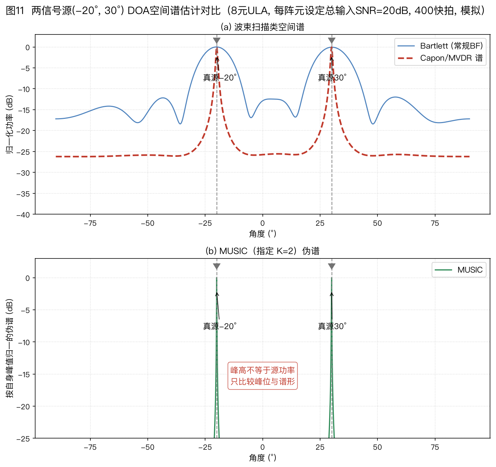
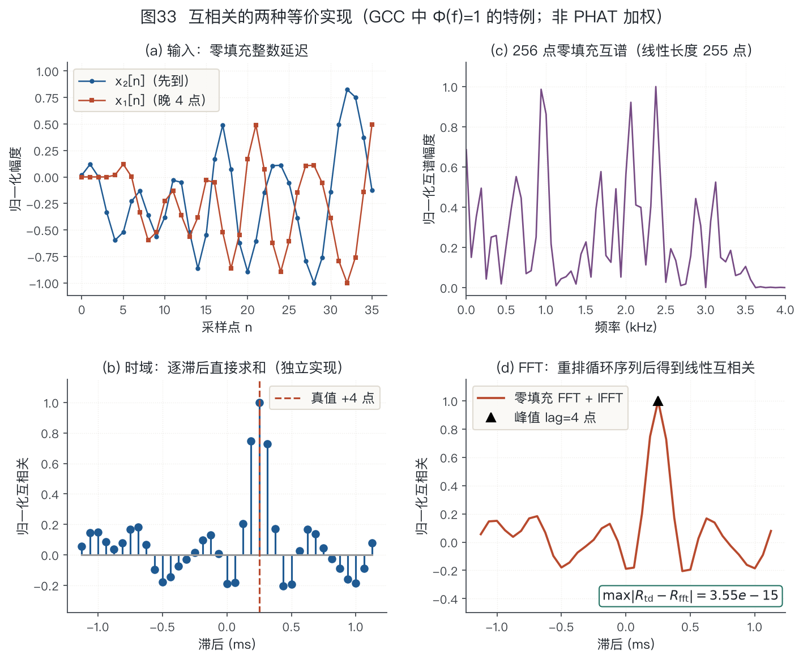
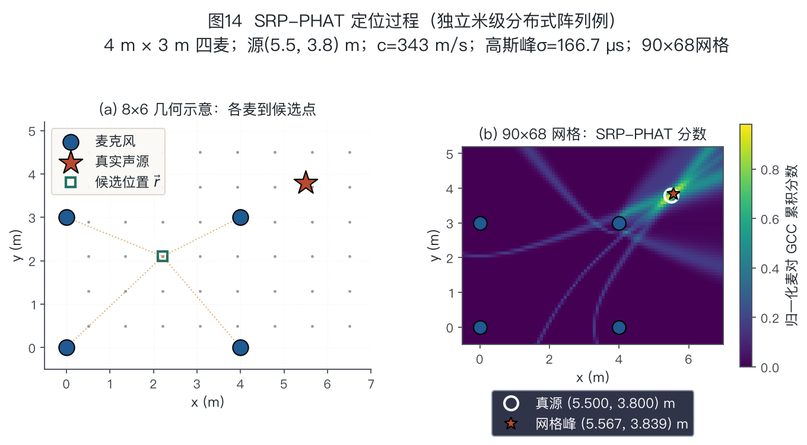
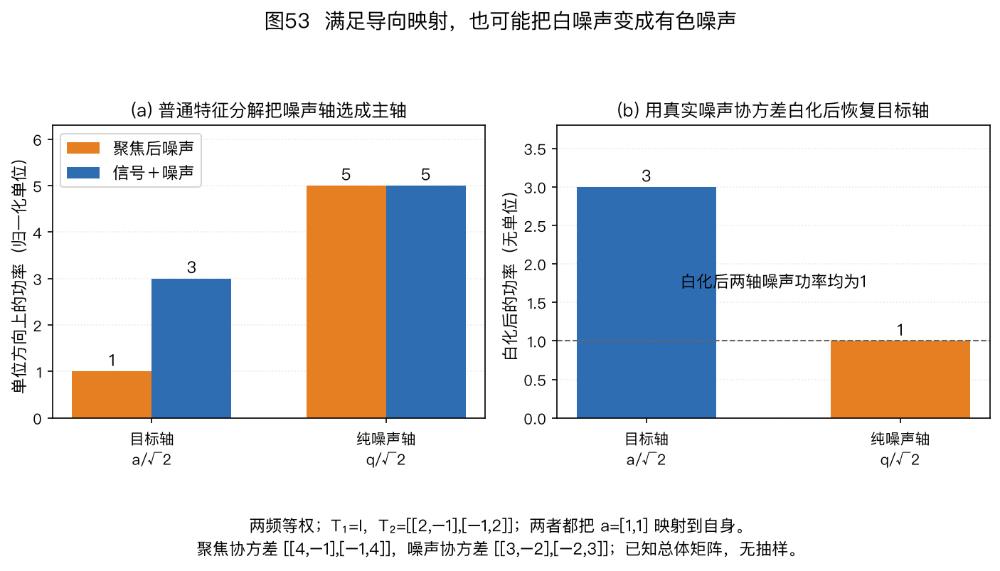
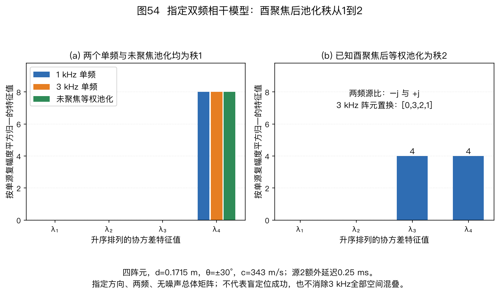

🌐 **简体中文** ｜ [English](../chapters_en/04_doa-estimation.md)

> 本篇是本书正文第 4 章；正文与扩展专题共 16 章（第 0～15 章，其中第 0 章为数学基础，第 12～15 章为四篇扩展专题），另有附录 A、B。本篇可独立阅读，前后篇见下方导航。
>
> 导读首页：[00_overview.md](00_overview.md) ｜ 上一篇：[03_array-geometry.md](03_array-geometry.md) ｜ 下一篇：[05_beamforming.md](05_beamforming.md)

---

## 4. 声源定位（波达方向，Direction of Arrival，DOA）

声源定位在工程上先要区分“找方向”和“定坐标”两件事：波达方向（Direction of Arrival，DOA）只给出声源相对阵列的角度，远场平面波模型就能支撑；完整的空间位置还包含声源到阵列的距离，通常依赖近场球面波曲率或多组分布式基线交会。本章从最直观的双麦克风互相关时差切入，逐步推到多麦网格扫描、几何方程解算、自适应空间谱、子空间分解，以及稀疏重构和学习式定位。为便于跨章节直接查阅，下表先汇总本章的核心缩写。

| 缩写 | 中文与英文全称 | 本章中的作用 |
|---|---|---|
| TDOA | 到达时间差，Time Difference of Arrival | 同一个声源到达两只麦克风的相对时间差 |
| GCC / PHAT | 广义互相关，Generalized Cross-Correlation；相位变换，Phase Transform | 在频域对互谱加权再作逆变换，从峰值提取时差 |
| SRP | 可控响应功率，Steered Response Power | 按候选几何位置汇总多组麦克风对的互相关响应 |
| ULA / SNR | 均匀线阵，Uniform Linear Array；信噪比，Signal-to-Noise Ratio | 基准线阵几何模型与信号相对噪声的功率比口径 |
| MUSIC | 多重信号分类，Multiple Signal Classification | 检验候选导向矢量与观测噪声子空间的正交性 |
| MVDR | 最小方差无失真响应，Minimum Variance Distortionless Response | 约束候选方向增益为 1 并最小化阵列总输出功率 |
| DRR / RIR | 直达混响比，Direct-to-Reverberant Ratio；房间脉冲响应，Room Impulse Response | 分别描述直达声与反射声的能量比，以及房间声学传播响应 |
| DFT / IDFT | 离散傅里叶变换，Discrete Fourier Transform；逆离散傅里叶变换，Inverse DFT | FFT（Fast Fourier Transform）与 IFFT 是快速计算它们的算法 |
| STFT | 短时傅里叶变换，Short-Time Fourier Transform | 把时域多通道波形切分为逐频点、逐时间帧的复数相量观测 |

本章统一把列向量记为带箭头的 $\vec a,\vec w,\vec x$，矩阵记为大写正粗体 $\mathbf A,\mathbf I$，空间协方差矩阵采用双下标 $\mathbf R_{xx},\mathbf R_{ss},\mathbf R_{nn}$（有限快拍样本估计加帽记作 $\hat{\mathbf R}_{xx}$），以区别于标量互相关函数 $R_{x_1x_2}(\tau)$ 与整数滞后相关序列 $R[l]$。矩阵的复共轭转置记为 $^H$，实转置记为 $^\top$，虚数单位记为正体 $\mathrm{j}$，数学期望记为 $\mathbb{E}[\cdot]$；$M$ 表示麦克风通道数，$K$ 表示声源数。涉及快拍统计、厄米矩阵特征分解和复向量求导时，可随时对照[第 0 章数学基础](00_math-foundations.md#sec-0-8)与[附录 A 的数学工具](16_appendix-symbols-math.md)。本章配套的多组合成 WAV 音频均由已知几何与解析信号模型生成，专用于核验时延符号、亚采样对齐与矩阵秩变化，不代表真实房间语音录音的盲定位性能。

### 4.1 总览：四大类思路

```
声源定位算法
├── 两阶段法：先从一对或多对麦克风估计到达时差，再按几何关系解位置（§4.2、§4.4）
│     └── 例：GCC-PHAT 估时差，再用多麦对几何方程解算
├── 空间扫描：逐一检查候选方向或位置，取响应最大的点（§4.3、§4.5）
│     └── 例：SRP-PHAT、Bartlett、Capon
├── 子空间法：比较候选方向与观测数据中信号、噪声子空间的关系（§4.6）
│     └── 例：MUSIC、ESPRIT；需要检查源数与阵列条件
└── 稀疏与学习方法：利用少数活动方向或带方向标签的数据（§4.7）
      └── 例：稀疏重构、学习式定位；需要检查先验或训练条件
```

为了在进入公式前先建立对“空间谱”的视觉直觉，图 11 在同一个双源窄带场景（真源位于 $-20^\circ$ 和 $30^\circ$，相隔 $50^\circ$）中并排画出 Bartlett、Capon 与 MUSIC 三种代表谱。仿真采用 $M=8$ 元半波长间距均匀线阵，每阵元总信号功率相对单阵元白噪声功率的输入信噪比为 $20\ \mathrm{dB}$，使用 $400$ 个独立快拍估计样本协方差 $\hat{\mathbf R}_{xx}$。其中 Capon 在样本协方差上施加无量纲相对对角加载 $\eta=10^{-6}$（令 $\delta_{\mathrm{rel}}$ 取 $\eta\operatorname{tr}(\hat{\mathbf R}_{xx})/M$，以 $\hat{\mathbf R}_{xx}+\delta_{\mathrm{rel}}\mathbf I$ 参与线性求解），MUSIC 则直接传入真实源数 $K=2$。

需要特别提醒的是：图 11 特意取了 $50^\circ$ 大角间隔、无混响自由场与高信噪比，目的只是看清三类谱的典型几何轮廓。一旦进入真实混响房间或两个声源靠得很近，谱峰展宽与融合会显著加剧；近距双源的分辨成功率测试将在 [§4.8.1](#sec-4-8-1) 用重复抽样实验单独检验。



读图 11 时，先区分上下两个子图的纵轴含义，切勿跨子图比较峰值的绝对高度：

- **图 11(a) 波束扫描类空间谱**：横轴为候选方位角（$-90^\circ$～$90^\circ$），纵轴为按各自最大值归一化后的输出功率（单位 dB），两条竖向灰虚线与顶部倒三角标出 $-20^\circ$ 与 $30^\circ$ 真实声源方位。蓝色实线 Bartlett 谱就是常规延迟求和波束在各方向的平均输出功率，受 $8$ 元线阵孔径限制，两个主瓣较宽，且在两峰之间及外侧留下了约 $-12$～$-18\ \mathrm{dB}$ 的起伏旁瓣；红色虚线 Capon/MVDR 谱在保持候选方向单位增益的同时自适应压低其余方向泄漏，不仅主峰明显收窄，还将非声源方向的背景平坦地压低到约 $-26\ \mathrm{dB}$。
- **图 11(b) MUSIC 伪谱**：纵轴画的是候选导向矢量向噪声子空间投影能量倒数的对数（按自身峰值归一到 $0\ \mathrm{dB}$）。绿色实线在 $-20^\circ$ 与 $30^\circ$ 处形成极细的针状尖峰，这是因为理想模型下真实导向矢量与噪声子空间正交，投影残差分母趋近于零。

把两张子图对照起来看：Capon 纵轴度量的是候选方向滤波后的物理输出功率（单位 dB），而 MUSIC 伪谱峰值只反映“正交吻合程度”，并不代表物理声源功率强弱。同时工程中绝不能单靠数谱峰个数来定声源数——强旁瓣、相干反射或少快拍扰动都可能制造假峰或把双峰融成单峰，源数 $K$ 必须先由专门准则估计。

#### 4.1.1 源数估计：确定信号子空间维数

MUSIC 与 ESPRIT 等子空间方法在求方向前，必须先回答“当前观测里共有几个独立信号维度”，即确定源数 $K$。在安静会议室的单人语音段中，如果把 $K$ 估少了，一部分真实信号特征向量会被误划进噪声子空间，破坏真实方向的正交性；如果把 $K$ 估多了，纯噪声特征向量混入信号子空间，又会在空白方位催生虚假谱峰。

此外，子空间维数还受阵列物理通道数硬约束：MUSIC 要求 $K<M$，否则噪声子空间维数 $M-K$ 变成零，根本无法构造正交投影检验；ESPRIT 同样要求 $K<M$ 以从全阵协方差中分离出信号子空间，且两个平移不变子阵各自的阵元数 $P$ 须满足 $K\le P\le M-1$（均匀线阵相邻错开 $1$ 元取最大重叠子阵 $P=M-1$ 时，理论源数上限同为 $M-1$；若子阵错开更大步长使 $P<M-1$，则可辨识源数上限降为 $P$），工程上通常还会留出更多阵元余量来抑制有限快拍误差。下面介绍两种最常用的源数估计思路。

**方法 1：特征值间隙（eigen-gap）**。固定窄带频点 $f_k$，对 $M\times M$ 样本协方差矩阵 $\hat{\mathbf R}_{xx}(f_k)$ 做厄米特征分解。当 $K$ 个声源互不相关且背景为空间白噪声（方差 $\sigma^2$）时，总体协方差 $\mathbf A\mathbf R_{ss}\mathbf A^H+\sigma^2\mathbf I$ 的前 $K$ 个大特征值同时包含信号贡献与噪声底 $\sigma^2$，而后 $M-K$ 个小特征值在总体期望意义下全都等于 $\sigma^2$（例如后文算例 4-4 的三麦无噪单源给出特征值 $3,0,0$，一眼就能从第一个间隙读出 $K=1$）。

按照样本特征值降序排列 $\hat\lambda_1\ge\hat\lambda_2\ge\cdots\ge\hat\lambda_M$，遇到有限快拍和加性噪声时，尾部噪声特征值会发生随机散开而不再严格相等。此时虽可检查相邻特征值的差值或比值寻找最大跳变位置，但当信噪比较低或快拍数很少时，信号特征值与噪声底拉不开明显台阶，人工设阈值很容易摇摆。

**方法 2：信息准则（AIC 与 MDL）**。为了免去手工调阈值，赤池信息准则（Akaike Information Criterion，AIC）和最小描述长度（Minimum Description Length，MDL）把源数选择建模为“数据拟合误差 + 模型复杂度惩罚”的最小化问题。核心直觉来自初等代数的**算术—几何平均不等式（AM-GM 不等式）**：对任意一组严格正实数，它们的算术均值 $a_k$ 永远大于或等于几何均值 $g_k$，且**当且仅当这组数彼此完全相等时才有 $a_k=g_k$（即 $\ln(a_k/g_k)=0$）**。对候选源数 $k\in\{0,1,\ldots,M-1\}$，算法把末尾 $M-k$ 个较小特征值暂当作白噪声特征值：若 $k<K$，尾部还混着突出的信号特征值，高低悬殊使 $\ln(a_k/g_k)$ 很大，说明“单一噪声方差解释尾部”严重失配；一旦 $k$ 恰好走到真实源数 $K$，尾部只剩平坦噪声特征值，$a_k/g_k$ 迅速贴近 $1$，失配项骤降。

然而只看似然失配项会出现单调过拟合：若继续把 $k$ 往大推（$k>K$ 直至 $k=M-1$），拟合项仍会微弱下降直至在 $k=M-1$ 处恒等于零！引入随自由参数个数递增的复杂度惩罚项后，$k>K$ 时微小的拟合改善抵不过新增参数罚分，总分反而回升，从而把最小值稳稳锁在真实源数附近。

Wax 与 Kailath 在 [1984 年 ICASSP 会议论文式(10)～(15)](https://doi.org/10.1109/ICASSP.1984.1172389)与 [1985 年 *IEEE TASSP* 期刊论文](https://doi.org/10.1109/TASSP.1985.1164557)（*Detection of signals by information theoretic criteria*）中系统给出了复高斯独立快拍、空间白噪声模型下的最大似然推导（引用时需注意两篇论文公式编号不同，扣除公共常数后的自由参数项均为 $p(k)=k(2M-k)$）。本章 [§4.9](#sec-4-9) 将逐步拆解这 $2Mk-k^2$ 个实自由度的由来，[E04-20](#e04-20) 则在同一组特征值上手算对比两准则的分歧。

两者的核心差别在于惩罚系数：MDL 的惩罚随 $\ln N$ 增长，大样本下具有统计相合性；AIC 惩罚较轻，小样本或弱源下更不易漏检，但高快拍下仍有固定非零的过估概率。工程实现时务必核对复数与实数高斯模型的系数差异、有效独立快拍数以及空间白噪声前提；有色噪声或事前人为加上的重度对角加载都会改变尾部特征值比例，导致信息准则误判源数。

信噪比高、快拍充足时，可以先观察特征值谱的台阶间隙作快速诊断；需要自动输出源数 $K$ 时可用 MDL 评分，并结合特征值落差交叉核验。

相干源场景还存在“去相关”与“估源数”耦合的实际难题：室内强反射与直达声完全相干时，信号协方差发生降秩，直接看原矩阵特征值会漏算声源；需要先做空间平滑恢复矩阵秩，而空间平滑切分子阵时又受候选源数上界约束。工程上可先设定物理上合理的源数上界 $K_{\max}$，对子阵长度与候选 $K$ 做联合检验，空间平滑恢复相干源秩的具体原理与孔径代价将在 [§4.6 相干源小节](#sec-4-6)详细展开。

> 子空间法必须先定源数 $K$，而双通道互相关时延估计不需要预设源数。下一节先从最基础的两只麦克风讲起。

### 4.2 GCC-PHAT：“对齐两段录音，找最吻合的错位”

#### 时延符号与时频两种计算

推导时延前，先把几何坐标和正负号钉牢。本章严格沿用第 2 章 §2.1～§2.3 的全书约定：双麦沿 $x$ 轴放置，麦克风 1 位于原点 $x=0$，麦克风 2 位于正向 $x=d>0$（本章正文推导沿用 $1$ 起点编号 $m=1,\dots,M$，线阵坐标为 $(m-1)d$，与第 3 章及代码练习中的零起点编号 $m'=0,\dots,M-1$ 仅差平移对应 $m'=m-1$）；以垂直于连线的正横方向（broadside，$+y$ 轴）为 $0^\circ$，朝麦克风 2（$+x$ 侧）偏转为正角 $\theta>0$。记 $\vec u$ 为从阵列指向声源的单位方向向量，则平面波沿 $-\vec u$ 方向传播，到达第 $i$ 只与第 $j$ 只麦克风的时间差定义为 $\tau_{ij}=t_i-t_j$。

在傅里叶前向核 $e^{-\mathrm{j}2\pi ft}$ 下，以麦克风 1 为参考的相对传播时延与窄带导向矢量第 $m$ 分量分别为

$$\begin{aligned}
\tau_{m1}&=-\frac{(\vec r_m-\vec r_1)^\top\vec u}{c},\\
a_m(f,\theta)&=e^{-\mathrm{j}2\pi f\tau_{m1}}
=e^{+\mathrm{j}2\pi f(\vec r_m-\vec r_1)^\top\vec u/c}\text{。}
\end{aligned}$$

当声源位于正角一侧（$\theta>0$）时，声波先到达靠右的麦克风 2、后到达靠左的麦克风 1，因此 $t_1>t_2$，对应 $\tau_{21}=t_2-t_1<0$、$\tau_{12}=t_1-t_2>0$。用一句话记牢物理图景：**$\tau_{12}>0$ 表示“声音到麦 1 比到麦 2 晚”**，理想无噪连续波形满足 $x_1(t)=x_2(t-\tau_{12})$。

怎样从两段录音里找出这个错位量？最朴素的想法就是把第二路离散序列 $x_2[n]$ 左右平移整数个采样点 $l$，每挪一格就和第一路 $x_1[n]$ 逐点相乘再累加，看停在哪一格时两条波形咬合得最紧：

$$\begin{aligned}
R[l]&=\sum_n x_1[n]x_2[n-l],\\
\hat\tau_{12}&=\frac{\arg\max_l R[l]}{f_s}\text{。}
\end{aligned}\tag{4-1}$$

式(4-1)中，整数滞后 $l$ 的单位是“采样点”，除以采样率 $f_s$ 后才换算成以秒为单位的到达时差估计 $\hat\tau_{12}$；当 $x_2[n-l]$ 把先到的 $x_2$ 往右推迟 $l>0$ 格后恰好与晚到的 $x_1[n]$ 对齐时，$R[l]$ 在正滞后 $l>0$ 处达到最大，与上面 $\tau_{12}>0$ 的定义严丝合缝。

为与 [第 0 章 §0.2](00_math-foundations.md#sec-0-2) 及 [附录 A](16_appendix-symbols-math.md) 式(16-2) 保持同一符号约定，若输入改成复数基带序列，时域互相关的第二项须取复共轭 $x_2^*[n-l]$。需要注意复相关本身是复数：例如有限支撑序列 $x_1=[0,\mathrm{j}]$、$x_2=[1,0]$ 在 $l=+1$ 处的复相关值为 $\mathrm{j}$，盲目取实部会把真峰抹成 $0$；只有当两路实音频保持已知同极性通道响应时，按式(4-1)搜索有符号实相关最大值才是自洽的，若允许未知公共复相位旋转则应改按模长 $|R[l]|$ 选峰。

直接在时域对长度为 $N$ 的两段序列遍历全部滞后，需要 $O(N^2)$ 次乘加运算。借助傅里叶变换的**相关定理**，时域滑动乘加等价于频域逐频点计算互功率谱 $X_1(f)X_2^*(f)$（先对第二路频谱取共轭，再与第一路频谱相乘）后做一次逆变换；再在互谱前乘上频域加权函数 $\Phi(f)$，就得到了广义互相关（Generalized Cross-Correlation，GCC）框架：

$$\begin{aligned}
G_\Phi(f)&=\Phi(f)X_1(f)X_2^*(f),\\
R_{x_1x_2}(\tau)&=\int_{-\infty}^{\infty}G_\Phi(f)
e^{+\mathrm{j}2\pi f\tau}\,\mathrm{d}f,\\
\hat\tau_{12}&=\arg\max_\tau R_{x_1x_2}(\tau)\text{。}
\end{aligned}\tag{4-2}$$

式(4-2)写成连续频率积分是为了看清物理结构：当实信号两路频谱及实偶权重 $\Phi(f)=\Phi(-f)$ 满足共轭对称 $G_\Phi(-f)=G_\Phi^*(f)$ 时，正负频率虚部精确对消，逆变换给出实值互相关曲线 $R_{x_1x_2}(\tau)$。为什么相位里恰好装着时延？把理想纯延迟关系 $x_1(t)=x_2(t-\tau_0)$ 变换到频域，有 $X_1(f)=X_2(f)e^{-\mathrm{j}2\pi f\tau_0}$，代入互谱得

$$X_1(f)X_2^*(f)=|X_2(f)|^2\,e^{-\mathrm{j}2\pi f\tau_0}\text{。}$$

可以看到，互谱相位 $\angle\{X_1(f)X_2^*(f)\}=-2\pi f\tau_0$ 是一条过原点的直线，对频率 $f$ 的斜率就是 $-2\pi\tau_0$（例如 $\tau_0=58.3\ \mu\mathrm{s}$ 时，$1\ \mathrm{kHz}$ 与 $2\ \mathrm{kHz}$ 处的互谱相位分别约为 $-0.366\ \mathrm{rad}$ 与 $-0.733\ \mathrm{rad}$）。当式(4-2)的逆变换扫描到 $\tau=\tau_0$ 时，核因子 $e^{+\mathrm{j}2\pi f\tau_0}$ 把这条负斜率相位全部扳平为 $0\ \mathrm{rad}$，所有频点同相叠加打出主峰！

但真实语音在低频共振峰处能量集中：普通互相关（$\Phi(f)=1$）保留了声源自身的功率谱包络 $|X_2(f)|^2$，会把时域相关峰显著拉宽。**相位变换（PHAT）**取 $\Phi(f)=1/|X_1(f)X_2^*(f)|$，把互谱幅度全部拉平为单位模长 $e^{-\mathrm{j}2\pi f\tau_0}$，让每个有效频点平等投票，在理想单径模型下能显著收窄相关主峰；不过 PHAT 并不会修复混响或强噪声污染的错误相位，反而可能把无语音弱频点的随机噪声放大到同等权重，因此工程实现必须在分母加入下限保护或频带筛选。

**离散 `ifft` 的圆周补零与正负滞后索引映射**。把式(4-2)落成代码时，初学者最容易在两处卡壳：一是为什么要补零，二是 `ifft` 算出来的数组下标怎样对应正负滞后 $l$。设两帧长度分别为 $N_1$ 和 $N_2$，直接做 $N$ 点 DFT/IDFT 计算的是周期为 $N$ 的**圆周互相关**；要让圆周相关不发生首尾回绕混叠，FFT 长度必须满足 $N_{\mathrm{fft}}\ge N_1+N_2-1$（常取不小于该值的 $2$ 的整数次幂，复杂度为 $O(N_{\mathrm{fft}}\log N_{\mathrm{fft}})$）。

第 2 章约定正变换带 $e^{-\mathrm{j}2\pi ft}$，离散实现时同样要核对频率轴的物理符号：若使用实信号单边谱接口（`rfft`），下标 $0\le k\le\lfloor N_{\mathrm{fft}}/2\rfloor$ 对应非负物理频率 $f_k=kf_s/N_{\mathrm{fft}}$；若使用完整双边 DFT（`fft`），后半段 $k>N_{\mathrm{fft}}/2$ 代表负频率 $(k-N_{\mathrm{fft}})f_s/N_{\mathrm{fft}}$，切忌把数组下标 $k$ 直接当作全正频率代入相位公式。

调用 `c = np.fft.ifft(G).real` 得到长度为 $N_{\mathrm{fft}}$ 的循环序列后，数组下标 $m=0,1,\ldots,N_{\mathrm{fft}}-1$ 按模 $N_{\mathrm{fft}}$ 排列：

- **非负滞后在数组头部**：下标 $m=0,1,\ldots,N_1-1$ 直接对应整数滞后 $l=0,+1,\ldots,+(N_1-1)$（麦 1 晚到或同时到达）；
- **负滞后卷绕在数组尾部**：负整数滞后 $l=-(N_2-1),\ldots,-2,-1$（麦 1 比麦 2 早到）在模 $N_{\mathrm{fft}}$ 下落在数组末尾 $m=N_{\mathrm{fft}}-(N_2-1),\ldots,N_{\mathrm{fft}}-1$；
- **重排与孔径裁剪**：把尾部切片 `c[-(N2-1):]` 拼到头部切片 `c[:N1]` 之前，就得到了沿 $l=-(N_2-1),\ldots,+(N_1-1)$ 单调排列的完整互相关序列，最后只保留满足物理最大时差 $|l|/f_s\le d/c$ 的区间参与搜峰。

这里还要分清“未加权互相关”与“PHAT 加权”在有限长度性质上的区别：对 $\Phi(f)=1$ 的普通互谱 $X_1[k]X_2^*[k]$，只要 $N_{\mathrm{fft}}\ge N_1+N_2-1$，频域补零再重排就能与时域有限和式(4-1)达到机器精度一致；而 PHAT 在频域除以互谱幅度 $|X_1[k]X_2^*[k]|$ 属于非线性谱白化，白化后的谱逆变换一般不再局限于 $N_1+N_2-1$ 点的有限非零区间，改变 $N_{\mathrm{fft}}$ 会轻微改变周期采样曲线的数值，对比不同实现时应写明所用的 FFT 长度与截取区间。



图 33 用 $\Phi(f)=1$ 的未加权互相关把这套“补零 + 频域共轭乘 + 尾部重排”流程完整演练了一遍：

- **图 33(a) 输入信号**：横轴为采样点 $n$（展示前 $36$ 点），两条序列全长均为 $N_1=N_2=128$ 点；蓝色圆点线 $x_2[n]$ 先到达，红色方块线 $x_1[n]$ 通过在开头补 $4$ 个零实现严格晚到 $4$ 个采样点。
- **图 33(b) 时域直接求和**：横轴换算为毫秒滞后（$16\ \mathrm{kHz}$ 下 $4$ 点对应 $+0.25\ \mathrm{ms}$），纵轴为归一化互相关值，蓝色针状图按式(4-1)逐个整数滞后独立相乘累加，红色虚线标出 $+4$ 点处的峰值 $1.0$。
- **图 33(c) 零填充互谱幅度**：线性互相关最短需要 $128+128-1=255$ 点，因此取 $N_{\mathrm{fft}}=256$ 点补零 FFT，画出单边频率 $0$～$4\ \mathrm{kHz}$ 上的归一化互谱模 $|X_1[k]X_2^*[k]|$。
- **图 33(d) FFT 逆变换重排结果**：对 $256$ 点互谱执行 `ifft` 并把负滞后尾部移到左侧后，棕色实线在 `lag = 4` 点处精确命中黑色三角峰值；右下角绿框标出它与图(b)时域直接求和在整个滞后轴上的最大绝对差 $\max|R_{\mathrm{td}}-R_{\mathrm{fft}}|$ 仅为 $3.55\times 10^{-15}$，完全处于双精度浮点舍入误差以内。

#### 8 点脉冲手算：时域与频域结果一致

为了亲手验证共轭位置和正负号绝无差错，我们用一组 $N=8$ 点的极简单脉冲序列同时走一遍时域式(4-1)和频域 DFT/IDFT，全程统一用整数滞后记号 $R[l]$。

**输入与口径**：取序列长度 $N=8$（采样下标 $n=0,1,\ldots,7$），令

- $x_1=[0,0,3,0,0,0,0,0]$，非零脉冲 $3$ 落在 $n=2$，表示麦 1 比麦 2 晚到 $2$ 个采样点；
- $x_2=[2,0,0,0,0,0,0,0]$，非零脉冲 $2$ 落在 $n=0$。

线性互相关按式(4-1)定义为 $R[l]=\sum_{n=0}^{7}x_1[n]x_2[n-l]$，下标越界处按 $0$ 处理。虽然一般长度 $8$ 的两序列做完整线性互相关需补零到 $8+8-1=15$ 点以上，但在本例考察的 $l=0,1,2$ 三点处，非零项读取的下标 $2-l\in\{2,1,0\}$ 全部落在 $0\ldots 7$ 内部，没有发生边界卷绕，因此 $8$ 点 DFT/IDFT 在这三点处与线性互相关精确相等。

**第一步：时域逐点代入**。因为 $x_1[n]$ 只在 $n=2$ 处取非零值 $3$，求和号退化为单项 $R[l]=3\,x_2[2-l]$：

| 试探滞后 $l$（采样点） | 读取的 $x_2$ 下标 $2-l$ | 代入乘积 | 互相关值 $R[l]$ |
|---:|---:|---|---:|
| $0$ | $2$ | $3\times 0$ | $0$ |
| $1$ | $1$ | $3\times 0$ | $0$ |
| $2$ | $0$ | $3\times 2$ | $6$ |

最大值出现在 $\hat l=+2$（$R[2]=6$），正确指示 $x_1$ 比 $x_2$ 晚到 $2$ 个采样点。

**第二步：频域 DFT 共轭相乘再作 IDFT**。记 $8$ 点旋转因子 $W_8=e^{-\mathrm{j}2\pi/8}$，DFT 为 $X[k]=\sum_{n=0}^{7}x[n]W_8^{kn}$（$k=0,\ldots,7$）。$x_2[n]$ 只有 $n=0$ 项非零，所以 $X_2[k]=2$ 对所有频点恒为常数 $2$；$x_1[n]$ 只有 $n=2$ 项非零，因此 $X_1[k]=3W_8^{2k}=3e^{-\mathrm{j}\pi k/2}$。把 $8$ 个频点逐项排开：

$$\begin{aligned}
X_1&=[3,-3\mathrm{j},-3,3\mathrm{j},
3,-3\mathrm{j},-3,3\mathrm{j}],\\
X_2^*&=[2,2,2,2,2,2,2,2],\\
G[k]&=X_1[k]X_2^*[k]\\
&=[6,-6\mathrm{j},-6,6\mathrm{j},
6,-6\mathrm{j},-6,6\mathrm{j}]\text{。}
\end{aligned}$$

接着记逆变换核 $E_l[k]=e^{+\mathrm{j}2\pi kl/8}$，按 $8$ 点 IDFT 公式 $r[l]=\frac{1}{8}\sum_{k=0}^{7}G[k]E_l[k]$ 逐个检验 $l=0,1,2$：

1. $l=0$ 时，$8$ 项之和 $(6-6\mathrm{j}-6+6\mathrm{j})\times 2=0$，正负实部与虚部成对抵消，故 $r[0]=0=R[0]$；
2. $l=1$ 时，乘积 $G[k]E_1[k]$ 等于 $6e^{-\mathrm{j}\pi k/2}e^{+\mathrm{j}\pi k/4}$，化简为 $6(e^{-\mathrm{j}\pi/4})^k$，$k=0,\ldots,7$ 恰好绕单位圆走完一整圈等比级数，和为零，故 $r[1]=0=R[1]$；
3. $l=2$ 时，乘积 $G[k]E_2[k]$ 化为 $6e^{-\mathrm{j}\pi k/2}e^{+\mathrm{j}\pi k/2}=6$，逆变换核把每个频点的延迟相位全部抵消，$8$ 个实数 $6$ 同相相加得 $r[2]=48/8=6=R[2]$。

**最终结果与边界说明**：时域滑动与频域逆变换在 $l=0,1,2$ 处给出完全一致的 $0,0,6$，峰值位置同为 $\hat l=+2$。若在本例上继续施加理想 PHAT 归一化，由于单脉冲互谱模 $|G[k]|=6$ 在全部频点本来就平坦，归一化谱 $\Psi[k]=G[k]/|G[k]|$ 由周期四元组 $[1,-\mathrm{j},-1,\mathrm{j}]$ 重复两次构成，只把 $l=2$ 处的峰值幅度从 $6$ 缩放到 $1$，其余格点仍为 $0$。只有当声源频谱本身高低不平（例如低频重、高频弱的语音）时，PHAT 拉平谱包络、锐化相关主峰的作用才会显现出来。

#### 频谱加权、弱频点与通道极性

在广义互相关式(4-2)中，更换频域权重 $\Phi(f)$ 就衍生出不同的经典时延估计器，它们的统计动机与工程取舍对比如下（系统推导与最大似然权重见 [Knapp 与 Carter, *IEEE TASSP*, 1976](https://doi.org/10.1109/TASSP.1976.1162830)）：

| 加权名称 | 频域权重 $\Phi(f)$ | 设计动机与适用边界 |
|---|---|---|
| 普通互相关（CC） | $1$ | 不改频谱幅度；在平稳加性白噪声且源谱平坦时表现稳健，但源谱集中在窄带或共振峰时主峰明显展宽 |
| Roth 处理器 | $1/(\hat G_{11}(f)+\varepsilon)$ | 用通道 1 的平滑自功率谱做逆滤波，相当于估计通道 1 到通道 2 的脉冲响应；结果随两通道排列顺序变化 |
| 平滑相干变换（SCOT） | $1/\sqrt{\hat G_{11}(f)\hat G_{22}(f)}$ | 用两路平滑自功率谱的几何均值作对称白化；必须注明 $\hat G_{11},\hat G_{22}$ 采用帧间递推还是 Welch 平均 |
| **相位变换（PHAT）** | $1/(\lvert X_1(f)X_2^*(f)\rvert+\varepsilon)$ | 直接消去互谱幅度、仅保留相位斜率，对室内语音包络起伏适应力强；但对低信噪比弱频点敏感，需配下限保护 |
| 最大似然加权（ML / Hannan–Thomson） | 由信噪谱与相干度决定 | 在已知零均值高斯信号与互不相关高斯噪声谱模型下逼近渐近方差下界；强混响相干多径下模型前提不再成立 |

对比 SCOT 与 PHAT 可以看清一个常见误区：如果只拿**单帧**瞬时谱直接代入而不做任何跨帧或跨频平滑，分母 $\sqrt{|X_1|^2|X_2|^2}$ 与 $|X_1X_2^*|$ 在代数上恒等，两者毫无差别；只有当 $\hat G_{11},\hat G_{22}$ 由多帧统计平均估计时，SCOT 与逐帧 PHAT 才会分化出不同的偏差—方差特性。

把 PHAT 写成工业或教学代码时，首先要明确**弱频点保护口径**。本书 [`doa.py::gcc_phat`](../codes/chapters/ch04/core/doa.py) 先将每路输入除以自身峰值以防止大动态范围乘法溢出，再把参数 `epsilon` 定义为相对当前麦对最大互谱幅值 $g_{\max}=\max_k|G[k]|$ 的无量纲下限，实际计算 $G[k]/\max(|G[k]|,\varepsilon g_{\max})$。这种“分母截断下限（floor）”只抑制低于 $\varepsilon g_{\max}$ 的微弱频点，不同于上表“分母统一加常数 $|G|+\delta$”，也不同于 [`srp_phat`](../codes/chapters/ch04/core/doa.py) 把弱频点直接置零的“硬门限（gate）”——后文 [§4.11](#sec-4-11) 的 E04-14 将用具体数字逐行对比这三种保护规则。

最后，工程现场最隐蔽的故障是**通道极性接反**。对任一通道乘以正的常数增益不会改变互谱相位与正峰位置；但若某只麦克风硬件焊反或驱动反相（相当于单路乘以 $-1$，相位整体翻转 $180^\circ$），整条实相关曲线都会上下翻转，真实时延处的正峰变成负谷，按有符号最大值搜峰就会跳到旁瓣错位点。遇到定位持续跳变时，应先排查通道极性与静音段：全零静音输入不存在可辨识的相关峰，`gcc_phat` 会直接抛出异常，而不是静默返回 $0^\circ$。

#### 从时延峰到角度：插值与图 12 的模型

拿到双麦时延估计 $\hat\tau_{12}$ 后，在平面波假设与选定的前半平面（方位角 $\theta\in[-90^\circ,90^\circ]$）内，由第 2 章 §2.1 的路程差关系 $c\tau_{12}=d\sin\theta$ 反解方位角：

$$\hat\theta=\arcsin\!\left(\frac{c\hat\tau_{12}}{d}\right)\text{。}
\tag{4-3}$$

在调用反正弦之前，必须先理解**物理可见域（visible region）**的含义：三维真实空间中，无论平面波从哪个物理方向入射，角度正弦永远满足 $|\sin\theta|\le 1$，这一区间 $|\sin\theta|\le 1$ 就称为阵列的**可见域**。代回时延关系，真实平面波的时差绝对值绝不可能超过端射走完间距 $d$ 所需的时间，即 $|\tau_{12}|\le\tau_{\max}=d/c$（无量纲比值 $|c\tau_{12}/d|\le 1$）。如果全局滞后轴搜到的峰值落在 $|c\hat\tau_{12}/d|>1$ 的“不可见域”，除极微小的浮点插值舍入越界可截断到 $\pm 1$ 外，明显超限说明当前帧由强反射野值或跨源错配主导，此时应标记该帧异常丢弃或预先把搜索窗裁剪在 $|\tau|\le d/c$ 内，绝不能把野值强行贴到 $\pm 90^\circ$ 端射角上（若外部文献把角度定义为相对阵列轴线的夹角，式(4-3)只需把 $\arcsin$ 换为 $\arccos$）。

即便 $|\hat\tau_{12}|\le\tau_{\max}$，双麦单基线在三维空间中仍有固有的几何模糊：一对麦克风只给出一个标量时差，三维空间中满足该时差的方向构成绕两麦连线旋转的圆锥面（混淆锥），投影到水平面也会留下前后对称镜像。因此必须联合多条不共线基线才能收紧到三维射线，且平面阵列在无半空间先验时仍保留上下镜像（见[§3.1 的几何可辨识性](03_array-geometry.md#sec-3-1)）。

在工程系统中实现式(4-3)时，还有两个绕不开的精度瓶颈：

1. **整数采样格点太粗，必须做亚采样插值**。在 $f_s=16\ \mathrm{kHz}$ 下，$1$ 个采样周期为 $T_s=62.5\ \mu\mathrm{s}$。对小间距 $d=4\ \mathrm{cm}$，滞后从 $0$ 格跳到 $1$ 格，角度就直接从 $0^\circ$ 跳到 $\arcsin(cT_s/d)\approx 32.4^\circ$，端射附近反正弦斜率更陡，整数格点无法直接用于定位。提高分辨率常用两条路径：一是在整数峰左右取三点做抛物线局部拟合（`gcc_phat(..., parabolic_interpolation=True)`）；二是在频域对偶数长 $N$ 互谱做 $Q$ 倍补零三角插值，将时延步长细化到 $1/(Qf_s)$。

    偶数长实序列的奈奎斯特频点拆分与尺度补偿缺一不可：①保留直流与原有正、负频率分量在两端对应位置；②把原偶数长度的奈奎斯特频点 $k=N/2$ 一分为二，在正负频率 $\pm N/2$ 处各放 $\frac{1}{2}G[N/2]$（单边 `irfft` 接口则把旧末端系数减半后再补零），防止原正负共用的奈奎斯特分量被重复计算两遍；③把逆变换输出整体乘以插值倍数 $Q$，抵消 `ifft` 除以 $QN$ 带来的幅度缩小，保证插值曲线在原整数格点上精确穿过原值（后文 [§4.11](#sec-4-11) 的 E04-12 将手算对比漏掉任一步的偏差）。

2. **麦克风相位失配会直接偏置 PHAT 峰位**。因为 PHAT 把幅度权重全部抹平、完全依赖通道间相位差定位，两只麦克风的模拟前端或腔体若存在未标定的相位响应差，就会直接折算成固定的虚假时差（详见 §10.2）。


下面结合图 12 的三个子图，把“波形错位 → 16 倍频域插值搜峰 → 几何换算角度”的数字链完整复算一遍（声源采用 $4096$ 点周期带限随机模型，有效频带 $300$～$6000\ \mathrm{Hz}$，按频域精确相位施加分数采样延迟后叠加标准差 $0.05$ 的独立高斯白噪声，GCC 计算取 $8192$ 点 FFT 并做 $Q=16$ 倍频域补零插值）：

- **图 12(a) 两路信号放大窗口**：横轴截取 $2.0$～$2.45\ \mathrm{ms}$ 片段，纵轴为归一化幅度。设定间距 $d=4\ \mathrm{cm}$、真源方位 $\theta=30^\circ$，理论时差 $\tau_0=d\sin 30^\circ/c$ 为 $0.02/343\approx 58.309\ \mu\mathrm{s}$（折合 $16\ \mathrm{kHz}$ 下约 $0.933$ 个采样点）。图中蓝色圆点线（麦克风 2）波形整体靠左先到，红色方块线（麦克风 1）向右平移约 $58\ \mu\mathrm{s}$ 后到。
- **图 12(b) 16 倍细化网格上的 GCC-PHAT 曲线**：横轴为时延 $\tau$（单位 $\mu\mathrm{s}$），竖向灰色点线标出原始 $16\ \mathrm{kHz}$ 整数采样格点（间距 $62.5\ \mu\mathrm{s}$），绿色点划线与浅绿阴影框出可见域物理上限 $\pm d/c\approx\pm 116.6\ \mu\mathrm{s}$。若只在灰点线上挑整数峰，只能选到 $1$ 格（$62.5\ \mu\mathrm{s}\Rightarrow 32.4^\circ$）；经 $16$ 倍频域三角插值后，时延步长细化到 $\Delta\tau=62.5/16=3.90625\ \mu\mathrm{s}$，蓝色平滑曲线的红色三角峰值落在 $15$ 个细网格处，即 $\hat\tau_{12}=15\Delta\tau=58.59375\ \mu\mathrm{s}$（图中简标为 $58.6\ \mu\mathrm{s}$，合 $0.9375$ 个原始采样点），紧贴 $58.3\ \mu\mathrm{s}$ 真值竖线。
- **图 12(c) 平面波几何示意与亚采样角度反算**：子图 `(c)` 绘出自正横方向（broadside）起算的真值几何关系 $\theta=\arcsin(c\tau_0/d)=\arcsin(0.5)=30^\circ$（双麦间距 $d=4\ \mathrm{cm}$）；将子图 `(b)` 测得的亚采样内插峰值 $0.9375$ 个采样点代入式(4-3)，得到

$$\begin{aligned}
\tau_{\mathrm{est}}&=58.59375\times 10^{-6}\ \mathrm{s},\\
\hat\theta&=\arcsin(343\,\tau_{\mathrm{est}}/0.04)
\approx 30.16^\circ\text{，}
\end{aligned}$$

相对图 `(c)` 标示的 $30^\circ$ 真值仅偏高约 $0.16^\circ$，直观展示了频域插值突破整数采样格点量化的效果。当然，单帧残余误差仍随信号有效带宽、窗长、信噪比与房间反射波动；双麦 GCC 更大的结构性局限在于每帧通常只提取一个主峰，遇到多说话人同时发声或强反射多峰时，不同麦克风对各自挑出的峰值很难正确配对。

#### 混响实验：同时说明衰减时间和直达混响比

进入真实房间后，墙壁与桌面的多次反射会把一连串延迟衰减副本叠加到直达声上，抬高 GCC-PHAT 的背景起伏，甚至长出高于直达声的伪峰。初学者常以为“混响时间 $T_{60}$ 越长，GCC-PHAT 定位就一定越差”，但如果不说明直达混响比（DRR）有没有跟着变，单报一个 $T_{60}$ 其实无法判断定位趋势。

为了看清 $T_{60}$（反射尾拖得多长）与 DRR（直达声总能量相对全部反射总能量有多强）各自扮演的角色，图 13 设计了一组两因素拆解实验：采样率取 $16\ \mathrm{kHz}$，固定每路房间冲激响应的直达脉冲能量为 $1$（麦 2 比麦 1 晚 $9$ 点，即真实时差 $\tau_{12}=-9$ 点，约 $-0.5625\ \mathrm{ms}$），再为两通道独立生成长度为 $1.1T_{60}$ 的指数衰减随机反射尾，分别将整条反射尾的总能量精确归一化到目标 $\mathrm{DRR}\in\{+6,\,0,\,-6\}\ \mathrm{dB}$，并遍历 $T_{60}\in\{0.1,\,0.4,\,0.8\}\ \mathrm{s}$ 共 $3\times 3=9$ 组条件。每组条件按确定性种子规则（第 $k=0,\ldots,149$ 次使用种子 $2000+17k$ 生成反射尾与取帧位置，加 $1000$ 生成带限源，完整卷积后截取 $1024$ 点即 $64\ \mathrm{ms}$ 观测帧，不另加传感器白噪声）重复 $150$ 次试验；互谱分母加固定小量 $10^{-12}$ 防止除零，估计峰落在 $-9\pm 1$ 点内判为成功（完整逐次记录见 [`figure13_gcc_reverb.json`](../codes/chapters/ch04/reports/figure13_gcc_reverb.json)）。九组条件在 $150$ 次试验中的命中次数统计如下：

| 目标 DRR | $T_{60}=0.1\ \mathrm{s}$ | $T_{60}=0.4\ \mathrm{s}$ | $T_{60}=0.8\ \mathrm{s}$ |
|---|---:|---:|---:|
| $+6\ \mathrm{dB}$ | $150$ | $150$ | $150$ |
| $0\ \mathrm{dB}$ | $149$ | $148$ | $150$ |
| $-6\ \mathrm{dB}$ | $50$ | $57$ | $68$ |

看到表格最后一行，很多读者会惊讶：为什么固定 $\mathrm{DRR}=-6\ \mathrm{dB}$ 时，$T_{60}$ 从 $0.1\ \mathrm{s}$ 拉长到 $0.8\ \mathrm{s}$，命中次数反而从 $50/150$（$33.3\%$）上升到了 $68/150$（$45.3\%$）？难道房间越混响反而越好定位吗？

先从多径互谱 $X_1(f)X_2^*(f)$ 的交叉项机制看清**能量摊薄效应**：上表最后一行人为把整条反射尾的总能量锁死在直达声的约 $4$ 倍（$\mathrm{DRR}=-6\ \mathrm{dB}$）。当 $T_{60}=0.1\ \mathrm{s}$ 时，这 $4$ 倍反射总能量全部拥挤在直达声身后短短 $0.11\ \mathrm{s}$ 区间内，单根早期反射抽头的幅度很大，极易在 PHAT 白化后打出高于直达声的尖锐假峰；反观 $T_{60}=0.8\ \mathrm{s}$ 时，同样这 $4$ 倍总能量被摊薄到 $8$ 倍长的衰减轴上，单个滞后点分到的反射幅度显著变矮，虽然先前时刻的源信号会通过长卷积尾抬高当前 $64\ \mathrm{ms}$ 帧的相关底噪，却没那么容易长出单根鹤立鸡群的篡位假峰。

再回到真实物理房间区分 **$T_{60}$ 与 $\mathrm{DRR}$ 的物理职责**：$T_{60}$ 刻画的是声源停发后混响声能衰减 $60\ \mathrm{dB}$ 的斜率，主要由房间体积和壁面吸声决定；而 $\mathrm{DRR}$ 取决于声源到阵列的距离相对临界距离 $r_c$ 的远近。同一个 $T_{60}=0.6\ \mathrm{s}$ 的会议室，说话人站在 $0.4\ \mathrm{m}$ 近讲时直达声占绝对主导，GCC-PHAT 稳如磐石；退到 $3.5\ \mathrm{m}$ 远场后直达声按距离平方衰减而混响场近乎均匀，$\mathrm{DRR}$ 跌成负分贝，定位才急剧恶化。上述合成实验采用两通道独立随机尾隔离“尾长与尾总能量”两个因素（未包含低频扩散相干与几何镜像早反射），清晰证明**汇报混响定位指标时绝不能只写 $T_{60}$ 而漏报 $\mathrm{DRR}$ 或声源距离**。

工程上对抗低 $\mathrm{DRR}$ 混响主要有三项措施：一是优先抓取音节起始瞬态帧（onset），在壁面反射尚未建立前锁定高 $\mathrm{DRR}$ 直达波前；二是在多帧滑窗上做直方图投票或送入第 9 章卡尔曼门控追踪器滤除反射跳变；三是在每个时频点利用扩散场空间相干先验盲估**相干扩散比（Coherent-to-Diffuse Ratio，CDR）**，在逆变换或空间投票前直接压低混响主导频点的权重（双麦无方向闭式解将在章末 [E04-27](#e04-27) 完整推导）。


对照这一物理图景逐一读图 13 的三个子图：

- **图 13(a) $\mathrm{DRR}=0\ \mathrm{dB}$ 单帧相关曲线**：横轴为时延（$-4$～$4\ \mathrm{ms}$），竖向黑虚线标出直达声真峰（$-0.5625\ \mathrm{ms}$），每条曲线按各自最大绝对值归一到 $1.0$。可以看到绿实线（$T_{60}=0.1\ \mathrm{s}$）在 $0$～$0.5\ \mathrm{ms}$ 处冒出了接近 $0.4$ 的强反射旁峰，而红点线（$T_{60}=0.8\ \mathrm{s}$）的反射能量被摊平为更均匀的低幅波动。
- **图 13(b) $150$ 次命中率与 $95\%$ Wilson 置信区间**：横轴为 $T_{60}$，纵轴为真峰 $\pm 1$ 点正确率。$\mathrm{DRR}=+6\ \mathrm{dB}$（绿圆点实线）与 $0\ \mathrm{dB}$（蓝方块虚线）始终贴近 $100\%$，一旦降到 $\mathrm{DRR}=-6\ \mathrm{dB}$（红三角点线），正确率便断崖式跌落到 $33\%$～$45\%$，直观显示 DRR 是决定主峰能否保住的首要因素。
- **图 13(c) 峰值对比度统计**：纵轴画主峰与整条搜索网格 $|g|$ 中位数之比（$\max g/(\operatorname{median}|g|+10^{-12})$），实心标记与阴影带分别给出 $150$ 次的中位数与四分位区间（IQR）。三条曲线按 $\mathrm{DRR}=+6,0,-6\ \mathrm{dB}$ 从高（约 $31$～$38$）到中（约 $13$～$18$）再到低（约 $6$～$8$）严格分层，且同一 DRR 下长 $T_{60}$ 因反射能量摊薄而呈现略高的主峰对比度。

> 单对麦克风在低 DRR 或多声源下极易被单个反射假峰带偏。第 4.3 节引入 SRP-PHAT，不在单麦对上过早做“硬挑峰”，而是把所有麦克风对的整条相关响应投射到空间网格上联合投票。

### 4.3 SRP-PHAT：跨麦对累积空间响应

双麦 GCC-PHAT 只看一对通道，一旦某面墙的反射恰好盖过直达峰就会报错。可控响应功率（Steered Response Power，SRP）换了一个视角：对空间网格中的每一个候选位置 $\vec r$，先按几何关系算出“假定声源就在 $\vec r$，第 $(i,j)$ 对麦克风应当出现多大的到达时间差 $\tau_{ij}(\vec r)$”，再去读取各麦对在该预测时延处的 GCC-PHAT 值并累加起来，取总分最高的位置作为声源估计：

$$\hat{\vec p}=\arg\max_{\vec r}\sum_{i<j}
R^{\mathrm{PHAT}}_{x_ix_j}\!\big(\tau_{ij}(\vec r)\big)\text{。}
\tag{4-4}$$

式中预测到达时差为 $\tau_{ij}(\vec r)=(d_i(\vec r)-d_j(\vec r))/c$，其中 $d_m(\vec r)=\|\vec r_m-\vec r\|$ 表示候选点 $\vec r$ 到麦克风 $m$ 的距离；固定一对麦克风的非退化距离差时，平面上满足同一 $\tau_{ij}$ 的点组成下文 §4.4 要讲的双曲线（等时差线）。

为什么式(4-4)明明是在对两两不同的麦克风对 $i<j$ 求互相关之和，算法名字却叫“可控响应**功率**”？把频域延迟求和波束形成器的输出功率展开，两者的代数等价关系就一目了然了。设第 $m$ 路频谱经单位模白化后记为 $\tilde X_m(f)=X_m(f)/|X_m(f)|$（对非零频点），将波束转向候选位置 $\vec r$（时延补偿因子为 $e^{+\mathrm{j}2\pi ft_m(\vec r)}$，满足 $t_i(\vec r)-t_j(\vec r)=\tau_{ij}(\vec r)$），记波束输出谱为 $Y(f,\vec r)$。把它的模平方拆成 $M$ 个对角自乘项与 $M(M-1)$ 个非对角交叉项：

$$\begin{aligned}
|Y(f,\vec r)|^2
&=\left|\sum_{m=1}^M\tilde X_m(f)
e^{+\mathrm{j}2\pi ft_m(\vec r)}\right|^2\\
&=\sum_{m=1}^M|\tilde X_m(f)|^2
+2\sum_{1\le i<j\le M}\operatorname{Re}\!\Big\{
\tilde X_i(f)\tilde X_j^*(f)\\
&\qquad\qquad\qquad\qquad\cdot
e^{+\mathrm{j}2\pi f\tau_{ij}(\vec r)}\Big\}\text{。}
\end{aligned}$$

看右边两项：第一项 $\sum_{m=1}^M|\tilde X_m(f)|^2$ 是各通道自身的白化能量和，**完全不含候选坐标 $\vec r$**，改变搜索位置时它只是一个平移整张响应图的常数底，不会移动任何峰值；把它减掉并沿频率积分（或对离散频点求和），剩下的第二项恰好就是各麦对 $R^{\mathrm{PHAT}}_{x_ix_j}(\tau_{ij}(\vec r))$ 之和的 $2$ 倍，只差一个正常数因子 $2$（系统推导见 [DiBiase, Brown University 博士论文, 2000](https://www.glat.info/ma/av16.3/2000-DiBiaseThesis.pdf)）。去掉对角自功率项不仅省算力，还顺带消除了不提供方向信息的通道自噪声基底。

#### 几何预测与离散实现的对应

当候选点 $\vec r$ 恰好落在真实声源处时，全部 $B=M(M-1)/2$ 个麦克风对都会在各自预测时差处同时读到直达主峰，同相累加出显著高分；而在偏离真源的错误位置，即便个别麦对碰巧踩中反射旁峰，其余麦对的预测时差也对不上，总分难以抬高。这一“先保留整条相关曲线、到空间网格上再联合投票”的机制，正是 SRP-PHAT 在混响和多源场景下比“先逐麦对挑单个峰、再代几何方程（§4.4）”更稳健的原因。搜索网格既可设为近场二维/三维坐标，也可退化为远场一维方位角或二维球面方向；若想从响应图上提取多个声源，还需设定最小峰间距、峰显著度门限与跨帧轨迹关联规则（将峰值送入第 9 章追踪器时的时间戳与有效标志约定见[§9.4](09_source-tracking.md#sec-9-4)）。

本书教学接口 [`doa.py::srp_phat`](../codes/chapters/ch04/core/doa.py) 实现的是远场方位角扫描，它直接在传入的 $F$ 个非负频点和 $L$ 个 STFT 时间帧上按上文交叉项公式求和，无需先做 `irfft` 再插值查表。记第 $(i,j)$ 麦对在第 $k$ 个频点、第 $\ell$ 帧的互谱为 $G_{ij}(k,\ell)=X_i(k,\ell)X_j^*(k,\ell)$，实现按麦对峰值门限筛选后逐级平均：

$$\begin{aligned}
Q&=\begin{cases}
G/|G|,&|G|>\varepsilon g_{ij},\\
0,&\text{其余频点帧},
\end{cases}\\
g_{ij}&=\max_{k,\ell}|G_{ij}(k,\ell)|,\\
\overline Q_{ij}(k)&=\frac1L\sum_{\ell=1}^L Q_{ij}(k,\ell),\\
v_{ij}(k,\theta)&=e^{+\mathrm{j}2\pi f_k\tau_{ij}(\theta)},\\
C_{ij}(\theta)&=\frac1F\sum_{k=1}^F
\operatorname{Re}\{\overline Q_{ij}v_{ij}\},\\
S(\theta)&=\frac1B\sum_{i<j}C_{ij}(\theta)\text{。}
\end{aligned}\tag{4-5}$$

式(4-5)中分段式省略了 $Q$、$G$ 的 $(i,j,k,\ell)$ 下标，$C_{ij}(\theta)$ 求和号内省略了随 $k$ 变化的括号参数 $\overline Q_{ij}(k)$ 与 $v_{ij}(k,\theta)$：这里 $v_{ij}(k,\theta)$ 是候选方位 $\theta$ 的时差相位补偿因子，$C_{ij}(\theta)$ 是单个麦对跨频平均后的匹配得分，$S(\theta)$ 再对全部 $B$ 个麦对取平均。对照前面波束功率展开式要注意三处实现细节：第一，式(4-5)按麦对门限 $\varepsilon g_{ij}$ 置零弱频点，并采用“先逐帧 PHAT 归一化、再沿时间帧平均”的次序（若反过来先跨帧平均互谱再做 PHAT，大幅度帧会主导相位，本章练习 E04-14 给出具体反例）；第二，求和直接在所给单边频点上等权平均，未给内部正频点乘 $2$，因此数值尺度与完整双边 IFFT 相差常数比例（练习 E04-13 用两麦两频点亲手复算该尺度）；第三，分母固定为 $L$、$F$ 与 $B$，被门限置零的弱项仍计入分母。

当阵列升级到 $M=6$ 或 $8$ 时，有效麦对数 $B=M(M-1)/2$ 分别升至 $15$ 与 $28$：若改走时域查表路线，工程实现常预先算好形状为 `(候选格点数, 麦对数)` 的连续时延查找表 `tau_lut`，配合线性或三点抛物线插值避免整数采样舍入抖动，并结合粗细两级网格控制实时开销。此外，若整段输入全为零或仅有不含相位时差的直流分量，函数会报错拒绝；对一般非零输入，调用者仍须检查 $S(\theta)$ 是否真的形成可辨识尖峰，切勿盲信平坦数组上 `argmax` 返回的第一个下标。

#### 算例 4-1：SRP-PHAT 的六麦对累积

下面用四麦平面阵与两个候选位置，亲手走通“算距离 → 换算采样点时差 → 查相关峰累加得分”的全过程。

**输入与口径**：平面 $4$ 麦矩形阵位于 $\vec r_1=(0,0)$、$\vec r_2=(0.04,0)$、$\vec r_3=(0,0.03)$、$\vec r_4=(0.04,0.03)\ \mathrm{m}$（即 $4\ \mathrm{cm}\times 3\ \mathrm{cm}$）；真实点声源位于 $\vec p=(2.0,1.5)\ \mathrm{m}$。取声速 $c=343\ \mathrm{m/s}$，采样率 $f_s=16\ \mathrm{kHz}$，则 $1$ 个采样周期对应 $62.5\ \mu\mathrm{s}$，折算为声波传播路程 $c/f_s=0.0214375\ \mathrm{m}$（即 $343/16000\ \mathrm{m}\approx 2.14\ \mathrm{cm}$）。为隔离波形噪声、专注看几何累积，各麦对相关曲线统一采用理想全带无窗的归一化 $\operatorname{sinc}$ 峰模型：偏离真实时差 $\Delta\delta$ 个采样点时，相关取值为 $\sin(\pi\Delta\delta)/(\pi\Delta\delta)$（$\Delta\delta=0$ 时取 $1$）。

**第一步：由真源坐标算出各麦距离与真实时差**。按勾股定理 $d_i=\|\vec p-\vec r_i\|$ 计算真源到四只麦克风的距离：

| 麦克风 $i$ | 距离算式 | $d_i\ (\mathrm{m})$ |
|---:|---|---:|
| $1$ | $\sqrt{2^2+1.5^2}=\sqrt{6.25}$ | $2.500000$ |
| $2$ | $\sqrt{1.96^2+1.5^2}=\sqrt{6.0916}$ | $2.468117$ |
| $3$ | $\sqrt{2^2+1.47^2}=\sqrt{6.1609}$ | $2.482116$ |
| $4$ | $\sqrt{1.96^2+1.47^2}=\sqrt{6.0025}$ | $2.450000$ |

其中 $d_4=\sqrt{6.0025}=2.45\ \mathrm{m}$ 恰好开方除尽。将麦对 $(i,j)$ 的真实时差 $\tau_{ij}=(d_i-d_j)/c$ 折算为采样点数 $\delta_{ij}=f_s\tau_{ij}=(d_i-d_j)/0.0214375$：例如麦对 $(1,2)$ 有 $\delta_{12}=(2.500000-2.468117)/0.0214375$，即 $0.031883/0.0214375\approx +1.4873$ 点，物理含义是声波到麦 1 比到麦 2 多走约 $3.19\ \mathrm{cm}$，因此晚到约 $1.49$ 个采样点。

**第二步：计算候选点 A 与候选点 B 的预测时差及错位量**。考察两个候选位置：

- **候选点 A $=(2.0,1.5)\ \mathrm{m}$**（命中真源）：到四麦的距离与上表完全相同，六对预测时差 $\delta_{ij}(\vec r_A)$ 与真值逐对吻合，错位量全为 $0$；
- **候选点 B $=(0.5,0.5)\ \mathrm{m}$**（方向相近但距离缩近到阵列跟前的错误点）：到四麦距离依次为 $d_1=\sqrt{0.5}\approx 0.707107\ \mathrm{m}$、$d_2=\sqrt{0.46^2+0.5^2}\approx 0.679412\ \mathrm{m}$、$d_3=\sqrt{0.5^2+0.47^2}\approx 0.686222\ \mathrm{m}$、$d_4=\sqrt{0.46^2+0.47^2}\approx 0.657647\ \mathrm{m}$。

将全部 $6$ 个麦对在 A、B 两处的预测采样点时差及 B 相对真值的错位 $\Delta\delta_{ij}=\delta_{ij}(\vec r_B)-\delta_{ij}$ 汇总如下：

| 麦对 $(i,j)$ | 真值（即 A 的预测） | B 的预测 | B 的错位 $\Delta\delta_{ij}$ | B 的 $\operatorname{sinc}$ 得分 |
|---|---:|---:|---:|---:|
| $(1,2)$ | $+1.4873$ | $+1.2919$ | $-0.1954$ | $0.9384$ |
| $(1,3)$ | $+0.8342$ | $+0.9742$ | $+0.1400$ | $0.9681$ |
| $(1,4)$ | $+2.3324$ | $+2.3071$ | $-0.0252$ | $0.9990$ |
| $(2,3)$ | $-0.6530$ | $-0.3177$ | $+0.3354$ | $0.8250$ |
| $(2,4)$ | $+0.8451$ | $+1.0152$ | $+0.1701$ | $0.9531$ |
| $(3,4)$ | $+1.4981$ | $+1.3329$ | $-0.1652$ | $0.9557$ |

**最终结果与失效边界**：

- **候选点 A** 六对全部命中峰值 $1$，累积得分 $=6.0000$；
- **候选点 B** 用未舍入中间量累加六对 $\operatorname{sinc}$ 值，总分为 $5.6392$，低于 A；若换到另一象限的候选点 $(-1.0,1.5)\ \mathrm{m}$，多组预测时差跌出主瓣，六对贡献约 $0.12,0.83,0.10,0.05,0.86,0.12$，总分骤降到约 $2.08$。

这个手算揭示了两层工程事实：第一，正确位置能让所有基线同相叠加胜出；第二，本例阵列对角孔径只有 $\sqrt{4^2+3^2}=5\ \mathrm{cm}$，点 B 虽与真源相差近两米（从 $2.5\ \mathrm{m}$ 移到 $0.71\ \mathrm{m}$），但因两者相对阵列的方位角很接近（分别为 $\operatorname{atan2}(2,1.5)\approx 53.1^\circ$ 与 $45^\circ$），各麦对时差只偏了不到 $0.34$ 个采样点，总分达到峰值的 $94\%$——说明厘米级小阵列对径向距离不敏感，且必须在亚采样精度下插值相关曲线，否则整数采样舍入足以淹没细微差异。



要让距离维度也收窄成清晰交点，就需要拉大阵列孔径。图 14 展示了一个独立的米级分布式四麦定位算例（四麦位于 $(0,0),(4,0),(0,3),(4,3)\ \mathrm{m}$，真源位于 $(5.5,3.8)\ \mathrm{m}$，$c=343\ \mathrm{m/s}$，每麦对采用标准差 $\sigma_\tau=1/6000\ \mathrm{s}$（约 $166.7\ \mu\mathrm{s}$）的高斯相关峰模型以清晰呈现等时差带）：

- **图 14(a) 候选点几何示意**：横纵轴为平面米制坐标，四只蓝色圆点标出 $4\ \mathrm{m}\times 3\ \mathrm{m}$ 麦克风位置，红五角星标出真实声源，绿色方框给出稀疏示意网格（$8\times 6$ 灰点）上的一个试探点 $\vec r$，四条橙色点线直观表示“计算 $\vec r$ 到各麦距离并两两作差得预测时延 $\tau_{ij}(\vec r)$”。
- **图 14(b) $90\times 68$ 网格累积分数热力图**：在 $x\in[-0.5,7.0]\ \mathrm{m}$、$y\in[-0.5,5.2]\ \mathrm{m}$ 加密网格上逐点计算六对 GCC 平均值（右侧色标范围 $0$～$1$，代表归一化相关平均分而非物理声强）。图中每一条弯曲亮弧就是单个麦克风对的等时差双曲线带；六条亮带在右上角交会叠加，使白色圆圈真源 $(5.500,3.800)\ \mathrm{m}$ 附近突起唯一高亮峰。红色五角星标出的离散网格最高分点落在 $(5.5674,3.8388)\ \mathrm{m}$，距真源约 $0.0778\ \mathrm{m}$——注意它最大化的是六麦对时差高斯得分，并不一定恰好等于欧氏距离离真源最近的那个格点（本章练习 E04-13 专门复算了这两个目标的细微差别）。

**网格搜索的计算量与量化误区**：在预先算好各麦对 GCC 曲线后，空间查表累加的运算量按 $O(N_{\mathrm{grid}}M(M-1)/2)$ 随网格数增长；工程中常采用“粗网格全局定位 + 主峰邻域局部加密”的两级搜索降低开销。阅读网格步长 $\Delta$ 时还要避免一个常见误解：步长 $\Delta$ 并不是误差的“下限”——若真源恰好落在格点上，网格量化误差为 $0$；对覆盖真值的一维均匀网格，理想最近格点的最大量化偏差上界是 $\Delta/2$（练习 E04-10 给出了 $0$、$\Delta/4$ 与 $\Delta/2$ 三种位置对照），而有噪混响下若选错旁峰，实际误差则可能远超 $\Delta/2$。

> 当麦克风数量较多或需要高频刷新三维坐标时，全空间网格扫描代价不菲。如果各麦对的直达 TDOA 已经可靠提取并归属同一声源，也可以改走第 4.4 节的两阶段几何代数解算。

### 4.4 两阶段法的几何解算

两阶段法的思路是“先把声学问题变成几何距离差，再解代数方程”。一对麦克风测得到达时间差 $\tau_{ij}$，乘上声速 $c$ 就是声源到两只麦克风的有符号距离差 $c\tau_{ij}$。当距离差绝对值严格介于 $0$ 与麦间距 $\|\vec r_i-\vec r_j\|$ 之间时，平面上满足这一距离差的点构成双曲线的一支（三维空间中为双曲面的一叶）；距离差恰好为 $0$ 时退化为两麦连线的垂直平分线（或中垂面），绝对值达到麦间距时则退化为沿连线向外延伸的端射射线——回头看图 14(b)，那六条弯曲亮带正是六个麦对双曲线在有限相关峰宽下的直观显影。

以麦克风 $1$ 为公共参考，其余 $M-1$ 只麦克风相对参考麦的距离差组成非线性几何方程组（为什么 $M(M-1)/2$ 个麦对里只有 $M-1$ 个独立时差自由度，见本章练习 E04-10）：

$$\begin{aligned}
d_i(\vec p)&=\|\vec p-\vec r_i\|,\\
d_i(\vec p)-d_1(\vec p)&=c\tau_{i1},\\
i&=2,\ldots,M\text{。}
\end{aligned}\tag{4-6}$$

式(4-6)中 $\vec p$ 为待求声源坐标（远场极限下退化为单位方向向量 $\vec u$），$\vec r_i$ 为已标定的第 $i$ 只麦克风坐标，共有 $M-1$ 个独立方程。对一般近场位置求解，二维平面通常至少需要 $3$ 只不共线麦克风（$2$ 条双曲线相交），三维空间至少需要 $4$ 只麦克风，且共线或共面布置在无半空间先验时仍保留对称镜像；而下文介绍的 Chan 两步闭式线性化额外把参考距离 $R_1=\|\vec p-\vec r_1\|$ 当作第一阶段的独立未知数，因此二维至少需要 $4$ 只麦克风、三维至少需要 $5$ 只麦克风，并要求几何矩阵列满秩。

#### 算例 4-2：TDOA 几何解算数值例——两个时延怎么变成一个方向

在远场平面波条件下，式(4-6)的根号非线性完全退化为正交轴上的线性投影：每对与参考麦正交布置的基线直接给出三维单位方向向量 $\vec u$ 的一个**方向余弦**分量。下面用一组实测四位小数精度的时差把每一步算到底，保持前后数字口径完全一致。

**输入与口径**：三只麦克风共面布置在 $z=0$ 水平面上，成直角 L 形：参考麦 $\vec r_1=(0,0,0)$，$\vec r_2=(0.04,0,0)\ \mathrm{m}$，$\vec r_3=(0,0.04,0)\ \mathrm{m}$（直角边长均为 $d=4\ \mathrm{cm}=0.04\ \mathrm{m}$），声速取 $c=343\ \mathrm{m/s}$。观测得到相对麦克风 $1$ 的两组到达时间差为 $\tau_{21}=+0.0583\ \mathrm{ms}$、$\tau_{31}=+0.0825\ \mathrm{ms}$。求三维入射方向 $(\theta,\phi_{\mathrm{el}})$，并说明平面阵固有的镜像歧义。

**第一步：把时差折算为有符号路程差**。直接乘声速 $c$：

$$\begin{aligned}
c\tau_{21}&=343\times 0.0583\times 10^{-3}\ \mathrm{m}\\
&=0.0199969\ \mathrm{m}\approx 2.00\ \mathrm{cm},\\
c\tau_{31}&=343\times 0.0825\times 10^{-3}\ \mathrm{m}\\
&=0.0282975\ \mathrm{m}\approx 2.83\ \mathrm{cm}\text{。}
\end{aligned}$$

两个正值说明声波先到达原点的麦克风 $1$，到麦克风 $2$ 多走约 $2.00\ \mathrm{cm}$，到麦克风 $3$ 多走约 $2.83\ \mathrm{cm}$。

**第二步：求水平面内的两个方向余弦**。因为 $\vec u=[u_x,u_y,u_z]^\top$ 从原点指向声源，平面波沿 $-\vec u$ 传播，远场路程差满足 $c\tau_{i1}=-(\vec r_i-\vec r_1)^\top\vec u$，即 $c\tau_{21}=-du_x$、$c\tau_{31}=-du_y$：

$$\begin{aligned}
u_x&=-\frac{0.0199969}{0.04}=-0.4999225,\\
u_y&=-\frac{0.0282975}{0.04}=-0.7074375\text{。}
\end{aligned}$$

$u_x,u_y$ 同为负值，说明声源位于第三象限（$-x$、$-y$ 侧）。注意 $u_x,u_y$ 是三维单位方向向量在坐标轴上的投影余弦，**不能**把它们各自代入一维双麦反正弦公式当作两个独立的水平方位角。

**第三步：物理可见域检查与竖直分量 $u_z$**。三维单位向量满足 $u_x^2+u_y^2+u_z^2=1$，所以水平投影平方和必须落在单位圆盘内（$u_x^2+u_y^2\le 1$）。代入第二步数字：

$$\begin{aligned}
u_x^2+u_y^2&=(-0.4999225)^2+(-0.7074375)^2\\
&\approx 0.2499225+0.5004678=0.7503903\le 1\text{，}
\end{aligned}$$

满足物理相容条件，由此解出竖直方向余弦：

$$u_z=\pm\sqrt{1-0.7503903}\approx\pm 0.499610\text{。}$$

如果噪声、麦位标定误差或跨源错配导致算出的 $u_x^2+u_y^2>1$，说明两组 TDOA 已掉出三维平面波可见域，不能直接对负数开平方，而应先检查时差闭合残差或投影回单位圆盘内。这里的正负号无法由三只 $z=0$ 共面麦克风区分：上半球（$u_z>0$）与下半球（$u_z<0$）关于阵列平面对称的两个方向给出完全相同的 $\tau_{21},\tau_{31}$，正是第 3 章 §3.1 所讲的平面阵上下镜像模糊。若桌面阵列已知声源来自上半空间，则取 $u_z=+0.499610$。

**第四步：换算方位角 $\theta$ 与俯仰角 $\phi_{\mathrm{el}}$**。按本书坐标系（水平方位角 $\theta$ 自 $+y$ 正横轴起算、朝 $+x$ 顺时针为正，俯仰角 $\phi_{\mathrm{el}}$ 自水平面向上为正），三维单位向量各分量为 $u_x=\cos\phi_{\mathrm{el}}\sin\theta$、$u_y=\cos\phi_{\mathrm{el}}\cos\theta$、$u_z=\sin\phi_{\mathrm{el}}$。对比前两项可知 $\tan\theta=u_x/u_y$，调用二元反正切函数 [`atan2`](https://numpy.org/doc/2.0/reference/generated/numpy.atan2.html)（第一参数传分子 $u_x$，第二参数传分母 $u_y$）：

$$\begin{aligned}
\theta&=\operatorname{atan2}(u_x,u_y)\\
&=\operatorname{atan2}(-0.4999225,-0.7074375)
\approx -144.75^\circ,\\
\phi_{\mathrm{el}}&=\arcsin(u_z)
=\arcsin(0.499610)\approx 29.97^\circ\text{。}
\end{aligned}$$

（若外部软件采用从 $+x$ 轴逆时针向 $+y$ 量角的数学极角 $\varphi=\operatorname{atan2}(u_y,u_x)$，同一方向记为 $\varphi\approx -125.25^\circ$，二者满足 $\theta\equiv 90^\circ-\varphi\pmod{360^\circ}$，跨库传参前务必核对角度零点。）顺便指出，题设四位小数时差其实是由整洁参考方向 $\vec u_{\mathrm{ref}}=(-0.5,-\sqrt{2}/2,+0.5)^\top$（精确角 $\theta\approx -144.74^\circ$、$\phi_{\mathrm{el}}=30^\circ$，精确时差 $0.058309\ \mathrm{ms}$ 与 $0.082461\ \mathrm{ms}$）四舍五入到 $0.1\ \mu\mathrm{s}$ 档位得来的；仅这几十纳秒的读数舍入，就会让反解出的方位角和俯仰角各自偏移约 $0.02^\circ$～$0.03^\circ$。

**第五步：代回平面波方程自检与近场曲率误差评估**。将刚才解出的 $\vec u=(-0.4999225,-0.7074375,+0.499610)^\top$ 代回 $c\tau_{i1}=-\vec u\cdot\vec r_i$：

- 第一基线：$c\tau_{21}=0.4999225\times 0.04=0.0199969\ \mathrm{m}$，故 $\tau_{21}=0.0199969/343=+0.0583\ \mathrm{ms}$；
- 第二基线：$c\tau_{31}=0.7074375\times 0.04=0.0282975\ \mathrm{m}$，故 $\tau_{31}=0.0282975/343=+0.0825\ \mathrm{ms}$。

回代结果与给定输入分毫不差。那如果声源并不是无穷远，而是放在沿参考射线 $\vec u_{\mathrm{ref}}$ 距离原点 $L=2\ \mathrm{m}$ 处的近场点 $\vec p=2\vec u_{\mathrm{ref}}$（坐标约为 $(-1.0,-1.4142,1.0)\ \mathrm{m}$）呢？直接按式(4-6)球面波距离差计算，得到 $\tau_{21}\approx 0.059175\ \mathrm{ms}$、$\tau_{31}\approx 0.083036\ \mathrm{ms}$，分别比同方向的远场值（$0.058309\ \mathrm{ms}$ 与 $0.082461\ \mathrm{ms}$）偏大 $1.49\%$ 和 $0.70\%$；当距离拉远到 $L=10\ \mathrm{m}$ 时，两项相对偏差缩小到 $0.30\%$ 与 $0.14\%$。

这就解释了为什么厘米级小阵列在中远距离无需顾虑球面波曲率：本例直角阵孔径仅 $\sqrt{4^2+4^2}\approx 5.66\ \mathrm{cm}$，$2\ \mathrm{m}$ 处距离已达孔径的 $35$ 倍，远场平面波近似已相当准确；只有当声源凑近到几十厘米内或改用米级分布式大阵列时，才必须改解下面的近场距离差方程。

#### Chan 线性化与局部迭代

要直接解带根号的近场距离差方程组式(4-6) 求三维或二维位置 $\vec p$，工程上最常用的是 **Chan 两步闭式加权最小二乘**与 **Gauss–Newton 泰勒局部迭代**两条路线。

**路线 1：Chan 两步闭式线性化（[Chan & Ho, *IEEE TSP*, 1994](https://doi.org/10.1109/78.301830)）**。根号难解，最自然的代数办法就是移项平方消去二次项。记声源到参考麦 $1$ 的距离为 $R_1=\|\vec p-\vec r_1\|$，有符号距离差观测为 $b_i=c\tau_{i1}$（单位均为 $\mathrm{m}$，$i=2,\ldots,M$）。把式(4-6)改写为 $\|\vec p-\vec r_i\|=b_i+R_1$，两边同时平方展开：

$$\begin{aligned}
\|\vec p\|^2-2\vec r_i^\top\vec p+\|\vec r_i\|^2
&=b_i^2+2b_iR_1+R_1^2\text{。}
\end{aligned}$$

注意右边的 $R_1^2=\|\vec p-\vec r_1\|^2$ 按定义展开就是 $\|\vec p\|^2-2\vec r_1^\top\vec p+\|\vec r_1\|^2$！将它代入上式右边，非线性平方项 $\|\vec p\|^2$ 在等号两侧**精确对消**，移项除以 $2$ 后得到关于增广未知向量 $\vec\theta_1=[\vec p^\top,R_1]^\top$ 的纯线性方程：

$$\begin{aligned}
(\vec r_1-\vec r_i)^\top\vec p-b_iR_1&=h_i,\\
h_i&=\tfrac12(b_i^2+\|\vec r_1\|^2-\|\vec r_i\|^2)\text{。}
\end{aligned}\tag{4-7}$$

我们可以顺手用 $i=2$ 的整洁数核对一下式(4-7)的量纲：设 $\vec r_1=(0,0)$、$\vec r_2=(0.04,0)\ \mathrm{m}$、距离差取 $b_2=0.02\ \mathrm{m}$，右边 $h_2=\frac12(0.02^2+0-0.04^2)=-0.0006\ \mathrm{m}^2$，左边“坐标差（$\mathrm{m}$）$\times$ 位置（$\mathrm{m}$）$-$ 距离差（$\mathrm{m}$）$\times R_1$（$\mathrm{m}$）”同样是 $\mathrm{m}^2$，两边量纲完全匹配。把 $i=2,\ldots,M$ 共 $M-1$ 行方程竖着叠起来，就写成矩阵形式 $\mathbf G[\vec p^\top,R_1]^\top=\vec h$。

理解 Chan 算法有两个关键环节：

1. **第一阶段（无约束增广线性求解）的麦数门槛**：在二维平面（$\vec p=[p_x,p_y]^\top$）中，增广未知量 $(p_x,p_y,R_1)$ 共有 $3$ 个分量。若只有 $M=3$ 只麦克风，方程仅 $M-1=2$ 行，$\mathbf G$ 是 $2\times 3$ 欠定矩阵，无法直接求唯一最小二乘解。因此 Chan 第一阶段在二维至少需要 $M\ge 4$ 只麦克风（三维未知量为 $(p_x,p_y,p_z,R_1)$ 共 $4$ 个，至少需要 $M\ge 5$ 只麦克风），且麦克风不能退化排布导致 $\mathbf G$ 列秩亏。
2. **第二阶段（利用 $R_1^2=\|\vec p-\vec r_1\|^2$ 做加权平方修正）为什么必不可少**：第一阶段为了凑成线性方程，把 $R_1$ 与 $\vec p$ 当成彼此无关的自由变量硬解出初估 $(\hat{\vec p}^{(1)},\hat R_1^{(1)})$；有测量噪声时，$(\hat R_1^{(1)})^2$ 与 $\|\hat{\vec p}^{(1)}-\vec r_1\|^2$ 往往对不上。

    第二阶段把原点平移到参考麦 $\vec r_1$，记相对坐标 $\vec\delta=\vec p-\vec r_1$（二维记为 $[\delta_x,\delta_y]^\top$）：把第一阶段输出逐项平方拼成三维观测向量 $\vec y_2$，其三分量依次为 $(\hat\delta_x^{(1)})^2$、$(\hat\delta_y^{(1)})^2$ 与 $(\hat R_1^{(1)})^2$；而真实平方量满足 $\delta_x^2+\delta_y^2=R_1^2$，服从 $3\times 2$ 线性关系 $\mathbf G_2[\delta_x^2,\delta_y^2]^\top$（其中 $\mathbf G_2=[[1,0],[0,1],[1,1]]^\top$）。按误差传播矩阵对 $\vec y_2$ 再做一次加权最小二乘（WLS），解出最优 $[\widehat{\delta_x^2},\widehat{\delta_y^2}]^\top$ 后开平方，按第一阶段 $\hat\delta_x^{(1)},\hat\delta_y^{(1)}$ 的正负号恢复象限并加回 $\vec r_1$，即可在小噪声且误差协方差匹配时逼近近场定位的克拉美–罗下界（CRLB）。

**路线 2：泰勒级数局部线性化（Gauss–Newton 迭代）**。当麦克风数目恰好卡在最低几何门槛（如二维仅 $3$ 麦），或者先用粗网格 SRP-PHAT 拿到了一个靠谱的初始位置 $\vec p$、想在连续空间里进一步精修时，可以直接围绕当前估计点 $\vec p$ 对原根号方程做一阶泰勒展开。记实测距离差列向量为 $\vec z=[c\tau_{21},\ldots,c\tau_{M1}]^\top$，当前候选位置预测的距离差向量 $\vec h(\vec p)$ 第 $i-1$ 分量为 $d_i(\vec p)-d_1(\vec p)$（$i=2,\ldots,M$），定义残差为“实测减预测” $\boldsymbol\varepsilon=\vec z-\vec h(\vec p)$。一阶近似将 $\vec h(\vec p+\Delta\vec p)$ 展开为 $\vec h(\vec p)+\mathbf J\Delta\vec p$，导出线性最小二乘 $\mathbf J\Delta\vec p\approx\boldsymbol\varepsilon$ 的正规方程：

$$\begin{aligned}
(\mathbf J^\top\mathbf J)\,\Delta\vec p
&=\mathbf J^\top\boldsymbol\varepsilon,\\
\vec p_{\mathrm{new}}&=\vec p+\Delta\vec p\text{。}
\end{aligned}\tag{4-8}$$

务必留意残差的正负号约定：这里固定 $\boldsymbol\varepsilon=\vec z-\vec h(\vec p)$（实测减预测），因此更新式用**加号** $+\Delta\vec p$；若把残差反过来定义成 $\vec h(\vec p)-\vec z$，更新就必须改成减号。

雅可比矩阵 $\mathbf J=\partial\vec h/\partial\vec p$（实矩阵，尺寸 $(M-1)\times D$，二维 $D=2$，三维 $D=3$）的每一行是怎么算出来的？我们直接对欧氏距离 $d_i(\vec p)=\|\vec p-\vec r_i\|_2$（假设候选点不与麦克风重合，即 $\vec p\ne\vec r_i$）求关于第 $\alpha$ 个坐标分量 $p_\alpha$ 的偏导数：由复合函数链式法则，外层根号导数给出 $\frac{1}{2d_i(\vec p)}$，内层平方和 $\sum_{\beta=1}^D(p_\beta-r_{i,\beta})^2$ 的导数给出 $2(p_\alpha-r_{i,\alpha})$，因子 $2$ 约去后有

$$\begin{aligned}
\frac{\partial d_i(\vec p)}{\partial p_\alpha}
&=\frac{p_\alpha-r_{i,\alpha}}{\|\vec p-\vec r_i\|}\text{。}
\end{aligned}$$

把 $\alpha=1,\ldots,D$ 排成梯度行向量，正是从第 $i$ 只麦克风指向候选声源 $\vec p$ 的**单位视线向量** $\vec v_i(\vec p)$ 的转置！因为第 $i-1$ 个预测方程是两段距离相减 $h_{i-1}(\vec p)=d_i(\vec p)-d_1(\vec p)$（$i=2,\ldots,M$），两项偏导相减就得到了无量纲雅可比矩阵的第 $i-1$ 行：

$$\begin{aligned}
\vec v_i(\vec p)&=\frac{\vec p-\vec r_i}{\|\vec p-\vec r_i\|},\\
\mathbf J_{i-1,:}
&=\vec v_i^\top(\vec p)-\vec v_1^\top(\vec p)\text{。}
\end{aligned}\tag{4-9}$$

看式(4-9)的几何图景非常直观：只有当候选声源对麦克风 $i$ 和参考麦 $1$ 张开明显的夹角（$\vec v_i$ 与 $\vec v_1$ 不平行）时，这一行雅可比才有足够模长；如果声源跑得很远，所有视线向量几乎平行（$\vec v_i\approx\vec v_1$），$\mathbf J$ 在径向距离方向上就会退化趋零。

在数值求解与鲁棒性上，工程实现优先对 $\mathbf J$ 做 QR 分解或奇异值分解（SVD）直接解最小二乘（见练习 E04-16 的完整一步手算），避免显式拼 $\mathbf J^\top\mathbf J$ 求逆放大条件数，并可加入步长阻尼（Levenberg–Marquardt）防止初值偏远时一步跳飞。此外，由于所有 $b_i=c\tau_{i1}$ 都减去了同一个参考麦到达时间 $t_1$，各行观测噪声天生彼此相关；若能估计距离差误差协方差矩阵 $\mathbf C$，把等权最小二乘升级为白化残差下的广义最小二乘（GLS，见 [E04-21](#e04-21)）可获得更小总体定位方差，遇到混响错峰野点则需外加 RANSAC 或 Huber 稳健损失剔除异常行。

#### 几何误差放大与局部有效范围

同样的 $10\ \mu\mathrm{s}$ 时延测量误差，放在正横方向可能只偏几度，放到阵列端射方向却可能偏出几十度——这种由阵列几何与声源相对位置决定的误差放大倍数，统称为**几何精度因子（Geometric Dilution of Precision，GDOP）**。以最简单的双麦远场一维方位模型 $\tau=(d/c)\sin\theta$ 为例，在真值 $\theta$ 附近两边微分得 $\mathrm{d}\tau=\frac{d\cos\theta}{c}\mathrm{d}\theta$，反解出 $\mathrm{d}\theta=\frac{c}{d\cos\theta}\mathrm{d}\tau$；当 $\cos\theta$ 不接近零且时延标准差 $\sigma_\tau$ 较小时，一阶误差传播给出角度估计方差近似式：

$$\begin{aligned}
\operatorname{var}(\hat\theta)
&\approx\left(\frac{c}{d\cos\theta}\right)^2\sigma_\tau^2\text{。}
\end{aligned}\tag{4-10}$$

式(4-10)把几何放大的两个物理杠杆摆在了明面上：一是**孔径杠杆 $1/d$**，基线 $d$ 翻倍，同等时延抖动引起的角度标准差减半（例如 $d=4\ \mathrm{cm}$ 时，正横 $\theta=0^\circ$ 附近 $\sigma_\tau=10\ \mu\mathrm{s}$ 对应角度标准差 $(343/0.04)\times 10^{-5}\ \mathrm{rad}\approx 4.9^\circ$）；二是**方位余弦杠杆 $1/|\cos\theta|$**，$\theta=60^\circ$ 时 $\cos 60^\circ=0.5$，角度标准差比正横方向放大 $2$ 倍、方差放大 $4$ 倍；一旦逼近端射 $\theta\to\pm 90^\circ$，$\cos\theta\to 0$ 使一阶线性化彻底失效，有限时延误差必须改按式(4-3)反正弦与可见域截断直接评估（对照 §3.1 算例 3-2）。拉长分布式阵列基线固然能压低几何放大因子，但前提是各节点时钟严格同步、麦位精确标定且多径反射可控，单靠拉大间距并不能凭空换来厘米级精度。

> 两阶段几何法要求先把每个麦对的 TDOA 峰值准确归属到同一个声源；遇到多说话人同时发声时，跨麦对峰值组合爆炸。第 4.5 节回到频域空间协方差矩阵，用波束扫描直接在一张角度谱上观察多个候选源。

### 4.5 波束扫描类：Bartlett 与 Capon

与其先提取时延再解几何方程，波束扫描类方法直接在固定窄带频点 $f_k$ 上用 $L$ 个时间帧快拍 $\vec x_\ell=\vec x(f_k,\ell)$ 构造 $M\times M$ 样本空间协方差矩阵 $\hat{\mathbf R}_{xx}(f_k)$（定义为 $\frac{1}{L}\sum_{\ell=1}^{L}\vec x_\ell\vec x_\ell^H$，见第 2 章式(2-6)），然后把滤波器依次转向每一个候选方向 $\theta$，记录输出功率随方向的变化曲线。为简洁起见，下面两式省略固定的频点自变量 $f_k$，简记 $\vec a(\theta)=\vec a(f_k,\theta)$、$\hat{\mathbf R}_{xx}=\hat{\mathbf R}_{xx}(f_k)$。

**常规波束扫描（Bartlett 空间谱）**：对每个候选方向直接用固定导向矢量权重 $\vec w=\vec a(\theta)$（若要求单位功率归一化可除以 $M$，各方向模长 $\|\vec a(\theta)\|_2=\sqrt{M}$ 相同时不影响峰位）做延迟求和，计算输出平均功率的厄米二次型：

$$\begin{aligned}
P_B(\theta)&=\vec a^H(\theta)\hat{\mathbf R}_{xx}
\vec a(\theta)\text{。}
\end{aligned}\tag{4-11}$$

在 $\hat{\mathbf R}_{xx}$ 中，主对角元素是各通道自功率，非对角元素是通道间互功率（对照 §4.3 波束功率展开式可知，若把 $\hat{\mathbf R}_{xx}$ 换成频域 PHAT 白化互谱矩阵并扣掉对角项，Bartlett 扫描就过渡到了单频 SRP-PHAT）。因为权重 $\vec a(\theta)$ 只对齐当前候选方向、完全不顾其他方向有没有强声源，Bartlett 谱的角度分辨力受限于阵列常规波束主瓣宽度，强源旁瓣还会向邻近角度泄漏能量。

**自适应最小方差扫描（Capon / MVDR 空间谱）**：为了压低其他方向强源的旁瓣泄漏，[Capon（1969，式(18)）](https://epsc.wustl.edu/~ggeuler/reading/cam_noise_biblio/capon_1969-ieee-high-resolution_frequency-wavenumber_spectrum_analysis.pdf)在扫描每个候选方向 $\theta$ 时，临时为该方向量身求解一组复数滤波器权重 $\vec w\in\mathbb C^M$——既严格要求当前候选方向复响应无失真（$\vec w^H\vec a(\theta)=1$），又让阵列总输出功率 $\vec w^H\hat{\mathbf R}_{xx}\vec w$ 达到最小：

$$\begin{aligned}
\min_{\vec w\in\mathbb C^M}\;&\vec w^H\hat{\mathbf R}_{xx}\vec w,\\
\text{s.t.}\;&\vec w^H\vec a(\theta)=1\text{。}
\end{aligned}$$

假定 $\hat{\mathbf R}_{xx}$ 正定可逆，我们用复数拉格朗日乘子法与 Wirtinger 复梯度（将 $\vec w$ 与共轭变量 $\vec w^*$ 视为形式上独立的变量，对 $\vec w^*$ 求导，详见[第 0 章 §0.5](00_math-foundations.md#sec-0-5) 与[附录 A](16_appendix-symbols-math.md)）分三步把闭式解推出来：

1. **构造实值拉格朗日函数并对 $\vec w^*$ 求梯度**：引入复乘子 $\lambda$ 及其共轭项以保持目标函数为实数，写出

    $$\begin{aligned}
    L&=\vec w^H\hat{\mathbf R}_{xx}\vec w
    +\lambda(1-\vec w^H\vec a)
    +\lambda^*(1-\vec a^H\vec w)\text{。}
    \end{aligned}$$

    因为 $\vec w^H=(\vec w^*)^\top$，第一项对 $\vec w^*$ 求导得 $\hat{\mathbf R}_{xx}\vec w$，第二项 $-\lambda\vec w^H\vec a$ 求导得 $-\lambda\vec a$，第三项不含 $\vec w^*$ 导数为零。令梯度 $\nabla_{\vec w^*}L=\vec 0$ 即 $\hat{\mathbf R}_{xx}\vec w=\lambda\vec a$，左乘 $\hat{\mathbf R}_{xx}^{-1}$ 得 $\vec w=\lambda\hat{\mathbf R}_{xx}^{-1}\vec a$。

2. **代入线性约束定出乘子 $\lambda$**：利用厄米正定矩阵之逆仍为厄米正定的性质（$(\hat{\mathbf R}_{xx}^{-1})^H=\hat{\mathbf R}_{xx}^{-1}$），将 $\vec w$ 代入约束 $\vec w^H\vec a=1$，记正实数二次型 $q(\theta)=\vec a^H\hat{\mathbf R}_{xx}^{-1}\vec a>0$，得 $\lambda^*q(\theta)=1$，故 $\lambda=\lambda^*=1/q(\theta)$，最优自适应权重 $\vec w_o=\vec w_{\mathrm{opt}}$ 等于 $\hat{\mathbf R}_{xx}^{-1}\vec a(\theta)/q(\theta)$（第 5 章 §5.4 的式(5-8)～式(5-9)把这里的观测总协方差换成干扰加噪声协方差，得到同一代数形式的 MVDR 波束形成器）。

3. **代回目标函数化简最小输出功率**：把 $\vec w_o$ 代入总输出功率 $\vec w_o^H\hat{\mathbf R}_{xx}\vec w_o$，分子上的二次型消去一对互逆矩阵后恰好只剩标量 $q(\theta)$，与分母 $q^2(\theta)$ 约去一次，便得到著名的 Capon 空间谱公式：

$$\begin{aligned}
P_C(\theta)&=\frac{1}
{\vec a^H(\theta)\hat{\mathbf R}_{xx}^{-1}\vec a(\theta)}
\text{。}
\end{aligned}\tag{4-12}$$

式(4-12)为什么能把谱峰削尖？当扫描角 $\theta$ 偏离真实声源时，无失真约束只锁死当前空方向 $\theta$，优化器便动用剩余空间自由度在真实强源方向压低增益，使总输出功率 $P_C(\theta)$ 迅速跌落；而当扫描角 $\theta$ 恰好扫到某一个真实声源方向时，$\vec w^H\vec a(\theta)=1$ 强迫滤波器完整放行该声源（同时仍把其他方向的独立干扰源压下去），最小输出功率退回该声源功率加残余噪声，从而打出尖锐谱峰。

工程使用式(4-12)要注意两个前提：第一，快拍数 $L<M$ 时 $\hat{\mathbf R}_{xx}$ 必然奇异不可逆，$L$ 略大于 $M$ 时矩阵也常病态，且强相干反射会引发目标自相消，因此实际实现需要施加对角加载并采用线性方程求解代替显式矩阵求逆；第二，汇报加载参数必须写清口径——**绝对加载** $\hat{\mathbf R}_{xx}+\delta\mathbf I$ 中的 $\delta$ 带功率量纲，换用不同录音电平会改变等效正则强度；**相对加载**令 $\delta_{\mathrm{rel}}$ 取 $\eta\operatorname{tr}(\hat{\mathbf R}_{xx})/M$ 并求解 $\hat{\mathbf R}_{xx}+\delta_{\mathrm{rel}}\mathbf I$，无量纲系数 $\eta$（如图 11 取 $\eta=10^{-6}$）对信号整体幅度缩放保持不变。

#### 算例 4-3：Bartlett 与 Capon——同一个 $\hat{\mathbf{R}}_{xx}$，两种读法

下面在同一个 $2\times 2$ 空间协方差矩阵 $\hat{\mathbf R}_{xx}$ 上亲手算出 $0^\circ$ 与 $30^\circ$ 两个方向的谱值，直观看看 Capon 是怎样把偏离方向的泄漏压下去的。

**输入与口径**：取 $M=2$ 只麦克风，半波长间距 $d=\lambda/2$；单个窄带声源位于正横方向 $\theta=0^\circ$，信号功率归一化为 $1$，两通道叠加互不相关的空间白噪声，每通道方差 $\sigma^2=0.25$（单阵元输入信噪比 $10\log_{10}(1/0.25)\approx 6.02\ \mathrm{dB}$）。按第 2 章 §2.6 的半波距导向矢量公式，有 $\vec a(\theta)=[1,\,e^{+\mathrm{j}\pi\sin\theta}]^\top$。

**第一步：写出空间协方差矩阵 $\hat{\mathbf R}_{xx}$**。真源在 $\theta=0^\circ$ 时两麦同相，$\vec a_0=\vec a(0^\circ)=[1,1]^\top$，忽略有限快拍波动直接取理想协方差 $\hat{\mathbf R}_{xx}$，即 $\vec a_0\vec a_0^H+\sigma^2\mathbf I$——主对角元为信号功率 $1$ 加噪声功率 $0.25$，非对角元为两通道完全同相的信号互功率 $1$：

$$\hat{\mathbf R}_{xx}=
\begin{bmatrix}1.25 & 1\\ 1 & 1.25\end{bmatrix}\text{。}$$

**第二步：计算 Bartlett 谱在 $0^\circ$ 与 $30^\circ$ 的取值**。按式(4-11)代入二次型：

- **对准真源 $\theta=0^\circ$**：$\vec a(0^\circ)=[1,1]^\top$，$P_B(0^\circ)=1.25+1+1+1.25=\mathbf{4.5}$（其中两通道自功率之和为 $2.5$，同相互功率贡献 $2.0$）；
- **偏离到 $\theta=30^\circ$**：$\sin 30^\circ=0.5$，记 $\vec a_{30}=\vec a(30^\circ)=[1,+\mathrm{j}]^\top$，故 $\vec a_{30}^H=[1,-\mathrm{j}]$。先右乘得 $\hat{\mathbf R}_{xx}\vec a_{30}$ 为 $[1.25+\mathrm{j},\,1+1.25\mathrm{j}]^\top$，再左乘 $\vec a_{30}^H$ 展开为 $(1.25+\mathrm{j})-\mathrm{j}(1+1.25\mathrm{j})$，虚部精确抵消得 $P_B(30^\circ)=1.25+1.25=\mathbf{2.5}$（验证厄米二次型必为实数）。

Bartlett 在两个方向的功率比为 $4.5/2.5=1.8$（约 $2.55\ \mathrm{dB}$），偏开 $30^\circ$ 后输出功率仍高达峰值的 $55.6\%$，两麦常规主瓣相当宽缓。

**第三步：计算 Capon 谱在同样两个方向的取值**。二阶矩阵行列式为 $\det\hat{\mathbf R}_{xx}=1.25^2-1^2=0.5625$，由主对角互换、副对角变号写出逆矩阵：

$$\begin{aligned}
\hat{\mathbf R}_{xx}^{-1}
&=\frac{1}{0.5625}
\begin{bmatrix}1.25 & -1\\ -1 & 1.25\end{bmatrix}\text{。}
\end{aligned}$$

逐点代入式(4-12)：

- **对准真源 $\theta=0^\circ$**：二次型 $q(0^\circ)=(1.25-1-1+1.25)/0.5625=0.5/0.5625=8/9$，取倒数得 $P_C(0^\circ)=\mathbf{1.125}$（物理意义清晰：两麦同相平均把信号功率 $1$ 原样保留，把 $0.25$ 的独立白噪声减半为 $0.125$，总功率正好 $1+0.125=1.125$）；
- **偏离到 $\theta=30^\circ$**：先算 $\hat{\mathbf R}_{xx}^{-1}\vec a_{30}$ 等于 $[1.25-\mathrm{j},\,-1+1.25\mathrm{j}]^\top/0.5625$，再左乘 $[1,-\mathrm{j}]$ 得 $q(30^\circ)=2.5/0.5625=40/9$，取倒数得 $P_C(30^\circ)=9/40=\mathbf{0.225}$。

**最终结果与机理解读**：Capon 在 $0^\circ$ 与 $30^\circ$ 的谱值比拉大到 $1.125/0.225=\mathbf{5.0}$（约 $6.99\ \mathrm{dB}$），$30^\circ$ 处只剩峰值的 $20\%$。把 $30^\circ$ 处的最优权重 $\vec w_{\mathrm{opt}}$（即 $\hat{\mathbf R}_{xx}^{-1}\vec a_{30}/(40/9)$）写出来，即为 $[0.5-0.4\mathrm{j},\,-0.4+0.5\mathrm{j}]^\top$：它在 $30^\circ$ 满足 $\vec w_{\mathrm{opt}}^H\vec a_{30}=1$，而对 $0^\circ$ 真源方向的复响应被压成了 $\vec w_{\mathrm{opt}}^H[1,1]^\top=0.1-0.1\mathrm{j}$（功率增益仅 $|0.1-0.1\mathrm{j}|^2=0.02$）。注意它并没有在 $0^\circ$ 打出死零陷（那样权重模长会放大白噪声功率），而是在“压低 $0^\circ$ 强源泄漏”与“控制自身白噪声放大”之间取得了总输出功率最小的最优折中。

> Capon 虽比 Bartlett 锐利，仍是在估计物理输出功率。如果我们已经知道源数 $K$，能否干脆剥离噪声底、直接利用信号与噪声子空间的几何正交性？这正是第 4.6 节 MUSIC 与 ESPRIT 的出发点。

### 4.6 子空间类：MUSIC 与 ESPRIT

子空间类方法把 $M$ 维接收向量空间精确切分为 $K$ 维**信号子空间**与 $M-K$ 维**噪声子空间**（复内积空间、子空间正交投影与奇异值分解预备见[第 0 章 §0.3](00_math-foundations.md#sec-0-3)）。本节先在单个窄带频点上分别推导 MUSIC 的正交投影扫描与 ESPRIT 的平移子阵旋转不变解算，再讨论宽带语音怎样跨频率合并子空间以及室内强混响下怎样筛选直达路径证据。

#### 窄带方法一：MUSIC（多重信号分类，Schmidt, 1986）

**思想三步**：

1. 由窄带快拍估计 $M\times M$ 空间协方差矩阵 $\hat{\mathbf R}_{xx}$ 并作厄米特征分解：按特征值从大到小排序，前 $K$ 个较大特征值对应的正交归一特征向量张成**信号子空间**，记基矩阵为 $\mathbf E_s\in\mathbb C^{M\times K}$；其余 $M-K$ 个特征向量张成**噪声子空间**，记基矩阵为 $\mathbf E_n\in\mathbb C^{M\times(M-K)}$（$K$ 为已知或已估计的源数，且须满足 $K<M$）；

2. 利用理想阵列流形的核心几何性质——**每一个真实声源方向上的导向矢量都严格落在信号子空间内，因而与噪声子空间正交**；

3. 遍历候选方向 $\theta$，用候选导向矢量向噪声子空间的投影范数平方作分母构造伪谱：

    $$\begin{aligned}
    P_{\mathrm{MU}}(\theta)
    &=\frac{1}{\|\mathbf E_n^H\vec a(\theta)\|_2^2}\text{。}
    \end{aligned}\tag{4-13}$$

    分母展开即二次型 $\vec a^H(\theta)\mathbf E_n\mathbf E_n^H\vec a(\theta)$。正交检验的含义非常直接：候选导向矢量若属于信号子空间，它在理想噪声子空间上的投影为零，伪谱分母趋近于零从而打出尖峰；候选方向偏离真实声源时，投影能量大于零，伪谱保持有限值。

**第 2 步为什么成立**：把零均值窄带接收模型 $\vec x=\mathbf A\vec s+\vec v$ 的二阶统计写开。当源信号与传感器噪声互不相关，且背景噪声为各通道等功率、互不相关的空间白噪声（$\mathbf R_{nn}=\sigma^2\mathbf I$）时，$M\times M$ 总体空间协方差矩阵为

$$\begin{aligned}
\mathbf R_{xx}&=\mathbf A\mathbf R_{ss}\mathbf A^H
+\sigma^2\mathbf I\text{。}
\end{aligned}\tag{4-14}$$

式(4-14)中 $\mathbf A\in\mathbb C^{M\times K}$ 以真实方向导向列 $\vec a(\theta_1),\ldots,\vec a(\theta_K)$ 拼成，$\mathbf R_{ss}=\mathbb{E}[\vec s\vec s^H]$ 是 $K\times K$ 源协方差矩阵。为什么噪声特征向量一定和真实导向矢量垂直？按线性代数分三步核对即可看清（原始论述见 [Schmidt, *IEEE TAP*, 1986](https://doi.org/10.1109/TAP.1986.1143830)）：

1. **信号子空间满秩张成**：当 $K<M$、不同方向导向列线性无关（$\operatorname{rank}(\mathbf A)=K$）且各声源互不完全相干（$\mathbf R_{ss}$ 满秩正定，秩为 $K$）时，无噪信号协方差 $\mathbf R_{xx,0}=\mathbf A\mathbf R_{ss}\mathbf A^H$ 的秩恰好等于 $K$；它的列空间严格等于真实导向矢量张成的子空间 $\operatorname{span}(\mathbf A)$，拥有 $K$ 个严格正特征值与 $M-K$ 个零特征值。
2. **白噪声只平移特征值而不改变特征向量**：在厄米矩阵 $\mathbf R_{xx,0}$ 上加单位阵倍数 $\sigma^2\mathbf I$，对任意特征对 $(\lambda_i,\vec e_i)$ 都有 $(\mathbf R_{xx,0}+\sigma^2\mathbf I)\vec e_i$ 恒等于 $(\lambda_i+\sigma^2)\vec e_i$——全部 $M$ 个特征值同步向上平移 $\sigma^2$（前 $K$ 个大于 $\sigma^2$，后 $M-K$ 个全等于 $\sigma^2$），而**整套标准正交特征向量保持原封不动**。
3. **正交补导出零投影判据**：因为厄米矩阵不同特征值对应的特征子空间彼此正交，前 $K$ 列大特征向量张成的 $\operatorname{span}(\mathbf E_s)$ 等于 $\operatorname{span}(\mathbf A)$，于是与之互为正交补的后 $M-K$ 列噪声特征向量必然满足 $\mathbf E_n^H\mathbf A=\mathbf 0$，即对每一个真实声源方向 $\theta_k$ 恒有 $\mathbf E_n^H\vec a(\theta_k)=\vec 0$。

顺着这三步也能一眼看出两类破坏正交性的情况：一是相干多径让 $\mathbf R_{ss}$ 降秩，使信号项秩小于 $K$；二是有色噪声使 $\mathbf R_{nn}\ne\sigma^2\mathbf I$，噪声不再只平移特征值，此时若已知正定噪声协方差 $\mathbf R_{nn}$，必须先左乘白化矩阵同时变换观测协方差与全部候选导向矢量（本章练习 [E04-11](#e04-11) 对比了只白化矩阵而漏改导向矢量造成的角度偏移）。另外，合法的有限快拍样本协方差 $\hat{\mathbf R}_{xx}$ 必须是厄米半正定矩阵；本书 [`doa.py::music_spectrum`](../codes/chapters/ch04/core/doa.py) 与 `bartlett_spectrum` 会拒绝超出浮点舍入容差的负特征值矩阵以及无法区分信号与噪声的全零矩阵。

**算例 4-4：MUSIC 最小可算例——逐项验证正交性**

下面用一个无计算器也能口算到底的 $3\times 3$ 例子，亲手见证“匹配方向投影为零、错开方向投影非零”。

**输入与口径**：取 $M=3$ 元均匀线阵，阵元间距为半波长 $d=\lambda/2$；单个窄带声源位于正横方向 $\theta=0^\circ$，源功率归一化为 $\mathbb{E}[|s|^2]=1$，暂不加传感器噪声（$\sigma^2=0$）。

**第一步：写出导向矢量与总体协方差矩阵**。半波长间距下相邻阵元相位差为 $\psi=\frac{2\pi d}{\lambda}\sin\theta=\pi\sin\theta$，记 $\zeta=e^{+\mathrm{j}\pi\sin\theta}$，以麦 $1$ 为参考时导向矢量为 $\vec a(\theta)=[1,\zeta,\zeta^2]^\top$。单源无噪快拍 $\vec x=\vec a(\theta)s$ 的总体协方差 $\mathbf R_{xx}(\theta)=\vec a(\theta)\vec a^H(\theta)$ 具有托普利茨厄米结构：

$$\begin{aligned}
\mathbf R_{xx}(\theta)&=\begin{bmatrix}
1&\zeta^*&(\zeta^*)^2\\
\zeta&1&\zeta^*\\
\zeta^2&\zeta&1
\end{bmatrix},\\
\mathbf R_{xx}(0^\circ)&=\begin{bmatrix}
1&1&1\\1&1&1\\1&1&1
\end{bmatrix}\text{。}
\end{aligned}$$

当真源固定在 $\theta=0^\circ$ 时，声波同时到达三只麦克风，$\vec a(0^\circ)=[1,1,1]^\top$，$\zeta=1$，观测协方差就是下方的全 $1$ 矩阵。注意接下来第 2～5 步扫描不同候选角时，**观测矩阵始终固定为这张 $\mathbf R_{xx}(0^\circ)$**，改变的只是拿去试探的候选导向矢量 $\vec a(\theta)$。

**第二步：口算特征值并切分子空间**。两条基本性质立刻定出全部特征值：① 全 $1$ 矩阵 $\mathbf R_{xx}(0^\circ)$ 三列完全相同，秩为 $1$，故至多只有一个非零特征值；② 特征值之和等于矩阵的迹 $\operatorname{tr}(\mathbf R_{xx}(0^\circ))=1+1+1=3$。因此三个特征值必为 $\lambda_1=3$、$\lambda_2=\lambda_3=0$（此处 $\lambda_i$ 表示特征值，勿与波长 $\lambda$ 混淆；若叠加方差为 $\sigma^2=0.01$ 的空间白噪声，特征值就同步平移为 $3.01,0.01,0.01$）。已知 $K=1$，噪声子空间由满足 $\mathbf R_{xx}(0^\circ)\vec e=\vec 0$（三个分量之和为零）的两个单位正交列向量张成，直接取：

$$\begin{aligned}
\vec e_2&=\frac{1}{\sqrt2}
\begin{bmatrix}1\\-1\\0\end{bmatrix},\qquad
\vec e_3=\frac{1}{\sqrt6}
\begin{bmatrix}1\\1\\-2\end{bmatrix}\text{。}
\end{aligned}$$

口算即可验证：两列各自元素和均为 $0$，模长均为 $1$，且内积 $\vec e_2^H\vec e_3=(1-1+0)/\sqrt{12}=0$，故 $\mathbf E_n=[\vec e_2,\vec e_3]$ 构成噪声子空间的标准正交基。

**第三步：检验真源方向 $\theta=0^\circ$ 的噪声投影**。将 $\vec a(0^\circ)=[1,1,1]^\top$ 分别与 $\vec e_2,\vec e_3$ 作复内积：

$$\begin{aligned}
\vec a^H(0^\circ)\vec e_2&=\frac{1-1+0}{\sqrt2}=0,\\
\vec a^H(0^\circ)\vec e_3&=\frac{1+1-2}{\sqrt6}=0\text{。}
\end{aligned}$$

两项投影精确为零，式(4-13)分母 $|\vec a^H\vec e_2|^2+|\vec a^H\vec e_3|^2=0$，理想无噪模型下 $0^\circ$ 处的伪谱趋于无穷大。

**第四步：对照偏离方向 $\theta=30^\circ$ 的非零投影**。改试候选角 $\theta=30^\circ$，此时 $\psi=\pi\sin 30^\circ=\pi/2$，候选导向矢量为 $\vec a_{30}=\vec a(30^\circ)=[1,+\mathrm{j},-1]^\top$，共轭转置行向量为 $\vec a_{30}^H=[1,-\mathrm{j},-1]$。逐列作内积（留心第二项自带负号 $-\mathrm{j}$）：

$$\begin{aligned}
\vec a_{30}^H\vec e_2
&=\frac{1+(-\mathrm{j})(-1)}{\sqrt2}
=\frac{1+\mathrm{j}}{\sqrt2},\\
\big|\vec a_{30}^H\vec e_2\big|^2&=\frac{1+1}{2}=1,\\
\vec a_{30}^H\vec e_3
&=\frac{1-\mathrm{j}+2}{\sqrt6}=\frac{3-\mathrm{j}}{\sqrt6},\\
\big|\vec a_{30}^H\vec e_3\big|^2&=\frac{9+1}{6}=\frac53\text{。}
\end{aligned}$$

两项相加得分母 $=1+\frac53=\frac83\approx 2.667\ne 0$，因此 $P_{\mathrm{MU}}(30^\circ)=1/(8/3)=3/8=0.375$，与 $0^\circ$ 处的无穷大形成鲜明反差。（顺便自检：如果一开始**真实声源**就摆在 $30^\circ$，观测矩阵应改成外积 $\mathbf R_{xx}(30^\circ)=\vec a_{30}\vec a_{30}^H$，主对角仍为 $1$、非对角含 $\pm\mathrm{j}$ 且满足 $R_{nm}=R_{mn}^*$，特征值仍是 $3,0,0$，但噪声子空间基向量会跟着旋转，不能再拿 $0^\circ$ 的 $\vec e_2,\vec e_3$ 去套。）

**相干多径失效与前向空间平滑去相关**：在室内强反射下，为什么普通 MUSIC 会突然丢源甚至指歪方向？设反射声是直达声延迟 $3$ 个采样点并衰减一半的副本，即离散序列满足 $s_2[n]=0.5\,s_1[n-3]$。在完整傅里叶频点 $f$ 上（注意有限窗长 STFT 的跨帧卷积余项边界见[第 2 章 E02-16](02_basics-signal-model.md#sec-u-59870d19e1)），记复比例因子 $q(f)=0.5\,e^{-\mathrm{j}2\pi f(3/f_s)}$，便有 $S_2(f)=q(f)S_1(f)$。归一化 $\mathbb{E}[|S_1(f)|^2]=1$ 后，两路源谱的 $2\times 2$ 协方差矩阵为

$$\mathbf R_{ss}(f)=
\begin{bmatrix}1&q^*(f)\\q(f)&|q(f)|^2\end{bmatrix}\text{。}$$

它的第二行严格等于第一行乘以 $q(f)$，行列式为 $0$，**矩阵秩塌缩为 $1$**！代回式(4-14)可知，$\mathbf A\mathbf R_{ss}\mathbf A^H$ 只剩唯一一个非零特征值，主特征向量变成直达与反射导向的线性组合 $\vec a(\theta_1)+q(f)\vec a(\theta_2)$——既不再张成二维平面 $\operatorname{span}(\vec a(\theta_1),\vec a(\theta_2))$，也不单独对准直达声方向（后文 [E04-24](#e04-24) 算出双麦相干反射会把单源 MUSIC 峰值拉偏到两条路径中间的 $14.48^\circ$）。

面对均匀线阵（ULA）上的相干源，[Shan、Wax 与 Kailath（*IEEE TASSP*, 1985）](https://doi.org/10.1109/TASSP.1985.1164649)提出了经典的**前向空间平滑（Forward Spatial Smoothing）**来恢复源协方差的秩：把长度为 $M$ 的物理均匀线阵切成 $L$ 个连续重叠的平移子阵，每个子阵包含 $P=M-L+1$ 只麦克风（第 $l$ 个子阵取麦 $l\ldots l+P-1$，$l=1,\ldots,L$）。记第一个 $P$ 元子阵的导向矩阵为 $\mathbf A_P\in\mathbb C^{P\times K}$，第 $k$ 个源相邻阵元移位因子为 $d_k=e^{+\mathrm{j}2\pi d\sin\theta_k/\lambda}$，拼成对角阵 $\mathbf D=\operatorname{diag}(d_1,\ldots,d_K)$，则第 $l$ 个子阵的导向矩阵恰好是 $\mathbf A_P\mathbf D^{l-1}$。把这 $L$ 个 $P\times P$ 子阵协方差等权平均起来：

$$\begin{aligned}
\mathbf R_{\mathrm{sm}}
&=\frac{1}{L}\sum_{l=1}^{L}\mathbf R_{xx}^{(l)}\\
&=\mathbf A_P\!\left(\frac{1}{L}\sum_{l=1}^{L}
\mathbf D^{l-1}\mathbf R_{ss}(\mathbf D^{l-1})^H\right)
\mathbf A_P^H+\sigma^2\mathbf I_P\\
&=\mathbf A_P\overline{\mathbf R}_{ss}\mathbf A_P^H
+\sigma^2\mathbf I_P\text{。}
\end{aligned}$$

奥妙全在括号里的平滑源协方差 $\overline{\mathbf R}_{ss}$：哪怕原 $\mathbf R_{ss}=\vec c\vec c^H$ 是秩 $1$ 外积，只要 $K$ 个相干到达方向的相位因子互不相同，向量 $\mathbf D^{l-1}\vec c$ 随子阵序号 $l=1,\ldots,L$ 扫过范德蒙德（Vandermonde）线性无关方向，累加至少 $L\ge K$ 项就能把 $\overline{\mathbf R}_{ss}$ 的秩重新撑满到 $K$（练习 E04-04 用四麦切两个三麦子阵亲手算出了秩从 $1$ 恢复到 $2$ 的全过程）！

子阵长度 $P$ 的选择存在尖锐的孔径—秩折中：平滑后的矩阵缩小成了 $P\times P$，要在其上运行 MUSIC 仍必须留出至少 $1$ 维噪声子空间，即要求 $P=M-L+1>K$。把 $L\ge K$ 与 $M-L+1\ge K+1$ 联立消去 $L$ 就得到 $M\ge 2K$：前向空间平滑至多能分辨 $\lfloor M/2\rfloor$ 个完全相干源，代价是有效阵列孔径从 $(M-1)d$ 缩水为 $(P-1)d$。此外，MUSIC 对阵元幅相失配与间距超半波长造成的空间混叠同样敏感（练习 E04-03 验证了 $d=\lambda$ 时谱峰无法消解混叠；root-MUSIC 将 ULA 分母改写为单位圆多项式求根以省去网格扫描，其互倒数根对与重根特性见 [E04-23](#e04-23)）。

> **宽带非相干叠加（NormMUSIC）与频点筛选**：语音跨越数千赫兹带宽，最简单的宽带推广是在每个有效频点独立算出窄带 MUSIC 伪谱再跨频率平均。但不同频点的信噪比和分母接近零的程度相差悬殊，若把未归一化的伪谱直接相加，少数偶然产生极高峰值的频点就会独揽全局。`pyroomacoustics` 0.10.0 的 [`NormMUSIC`（`frequency_normalization=True`）](https://pyroomacoustics.readthedocs.io/en/pypi-release/pyroomacoustics.doa.normmusic.html)先将每个频点的伪谱除以各自最大值归一到 $[0,1]$，再沿频率取平均；工程使用时还应先按频点信噪比或峰背比剔除纯噪声频点，否则全平坦的噪声频点归一化后也会掺入满幅底噪。

#### 窄带方法二：ESPRIT（借助旋转不变技术估计信号参数，Estimation of Signal Parameters via Rotational Invariance Techniques）

MUSIC 虽然打破了常规波束宽度限制，仍需在候选角度网格上逐点计算投影分母。如果阵列天生具备**平移不变子阵结构**（最典型的就是均匀线阵），[Roy 与 Kailath（*IEEE TASSP*, 1989）](https://doi.org/10.1109/29.32276)提出的 ESPRIT 可以完全省去角度网格搜索，直接通过求解一个 $K\times K$ 小矩阵的特征值闭式反演全部声源方向。

先从单源建立几何直觉：把均匀线阵的前 $M-1$ 只麦克风看作子阵 $1$，后 $M-1$ 只麦克风看作整体沿线阵正向平移了 $\Delta d$ 的子阵 $2$。同一平面波到达子阵 $2$ 的每一只麦克风，都比子阵 $1$ 对应位置的麦克风固定多乘同一个空间相位因子 $e^{+\mathrm{j}2\pi\Delta d\sin\theta/\lambda}$——只要算出两段子阵接收向量之间的复数比例，取辐角就能直接解出 $\theta$。

推广到 $K$ 个非相干声源时，第一步必须从**同一个全阵 $M\times M$ 协方差矩阵 $\hat{\mathbf R}_{xx}$** 提取统一的信号子空间基 $\mathbf E_s\in\mathbb C^{M\times K}$，再用两张选行矩阵 $\mathbf J_1,\mathbf J_2\in\mathbb R^{P\times M}$ 从这张共同的 $\mathbf E_s$ 上截出两个长度为 $P$ 的平移子阵块（绝不能对两个子阵各自独立做特征分解，否则两套特征向量各自带着任意基旋转，根本无法比较）。

为什么无需知道具体混合基就能提取真实相位？当满秩与白噪前提成立时，$\mathbf E_s$ 与 $\mathbf A$ 张成同一列空间，必然存在唯一可逆的基变换矩阵 $\mathbf T\in\mathbb C^{K\times K}$ 使 $\mathbf E_s=\mathbf A\mathbf T$。记子阵 $1$ 导向为 $\mathbf A_1=\mathbf J_1\mathbf A$，子阵 $2$ 平移 $\Delta d$ 后导向为 $\mathbf A_2=\mathbf J_2\mathbf A=\mathbf A_1\mathbf D$（对角阵 $\mathbf D$ 第 $k$ 个对角元为 $\psi_k=e^{+\mathrm{j}2\pi\Delta d\sin\theta_k/\lambda}$）。由 $\mathbf E_{s1}=\mathbf A_1\mathbf T$ 解出 $\mathbf A_1=\mathbf E_{s1}\mathbf T^{-1}$ 并代入 $\mathbf E_{s2}=\mathbf A_1\mathbf D\mathbf T$，便得到不含 $\mathbf A_1$ 的子空间旋转不变方程：

$$\begin{aligned}
\mathbf D&=\operatorname{diag}(\psi_1,\ldots,\psi_K),\\
\mathbf E_{s1}&=\mathbf J_1\mathbf E_s=\mathbf A_1\mathbf T,\\
\mathbf E_{s2}&=\mathbf J_2\mathbf E_s=\mathbf A_1\mathbf D\mathbf T
=(\mathbf E_{s1}\mathbf T^{-1})\mathbf D\mathbf T,\\
\mathbf E_{s2}&=\mathbf E_{s1}\boldsymbol\Psi,\qquad
\boldsymbol\Psi=\mathbf T^{-1}\mathbf D\mathbf T\text{。}
\end{aligned}\tag{4-15}$$

看式(4-15)最后一行：未知的基混合矩阵 $\mathbf T$ 把对角阵 $\mathbf D$ 夹在中间做了一次**相似变换**！线性代数告诉我们，相似矩阵 $\boldsymbol\Psi=\mathbf T^{-1}\mathbf D\mathbf T$ 与对角阵 $\mathbf D$ 拥有完全相同的 $K$ 个特征值（尽管 $\mathbf T$ 一般不是酉矩阵，所以 $\boldsymbol\Psi$ 本身通常也不是酉矩阵，在非正交基下可呈上三角或一般稠密阵，本章练习 E04-15 专门用非正交 $\mathbf T$ 手算验证了这一点）。因此，只要要求 $\mathbf E_{s1}$ 列满秩（必要条件为子阵长度 $P\ge K$），从数据截块 $\mathbf E_{s1},\mathbf E_{s2}$ 解出 $K\times K$ 算子 $\boldsymbol\Psi$ 并求其特征值 $\hat\psi_1,\ldots,\hat\psi_K$，每个特征值的相位角就直接吐出一个声源方向：

$$\begin{aligned}
u_k&=\frac{\lambda\arg\hat\psi_k}{2\pi\Delta d},\\
\theta_k&=\arcsin(u_k)\text{。}
\end{aligned}\tag{4-16}$$

我们可以用 $M=3$、半波距 $\Delta d=d=\lambda/2$ 的最小单源例口算核对式(4-16)的符号：子阵 $1$ 取麦 $\{1,2\}$，子阵 $2$ 取麦 $\{2,3\}$，此时式(4-16)化简为 $\theta=\arcsin(\arg\Psi/\pi)$。真源在 $\theta=0^\circ$ 时 $\Psi=1$，$\arg\Psi=0\Rightarrow 0^\circ$；真源在 $\theta=30^\circ$ 时 $\Psi=e^{+\mathrm{j}\pi\sin 30^\circ}=+\mathrm{j}$，$\arg\Psi=+\pi/2\Rightarrow\arcsin(1/2)=+30^\circ$（千万不能给 $\arg\Psi$ 套绝对值，否则左右正负角就混为一谈；若把子阵次序对调成麦 $\{2,3\}$ 在前、麦 $\{1,2\}$ 在后，相位变共轭，式(4-16)右端须添负号）。

同时，主值支 $\arg\hat\psi_k\in(-\pi,\pi]$ 要求空间相位严格落在无混叠区间 $|2\pi\Delta d\sin\theta/\lambda|<\pi$ 内。一旦子阵位移 $\Delta d>\lambda/2$，大角度方向在可见域 $|\sin\theta|\le 1$ 内的真实相位就会超出 $\pm\pi$ 发生折叠（练习 E04-15 演示了 $\Delta d=\lambda$ 时 $40^\circ$ 真源如何折叠到约 $-20.93^\circ$）；即便是临界半波距 $\Delta d=\lambda/2$，两端射角 $\pm 90^\circ$ 也会同时映射到 $e^{\pm\mathrm{j}\pi}=-1$。

在有限快拍有噪观测下，$\mathbf E_{s2}$ 与 $\mathbf E_{s1}\boldsymbol\Psi$ 不再精确相等。单源时记两段子阵特征向量为 $\vec e_1,\vec e_2\in\mathbb C^P$，残差向量为 $\vec r=\vec e_2-\vec e_1\hat\Psi$，展开残差平方 $\|\vec r\|_2^2=\vec r^H\vec r$ 并对共轭标量 $\hat\Psi^*$ 求导置零得 $-\vec e_1^H\vec e_2+(\vec e_1^H\vec e_1)\hat\Psi=0$，只要 $\vec e_1\ne\vec 0$ 就有闭式解 $\hat\Psi=(\vec e_1^H\vec e_2)/(\vec e_1^H\vec e_1)$。多源时最小化 Frobenius 范数平方，得到最小二乘（LS）ESPRIT 估计器：

$$\begin{aligned}
\widehat{\boldsymbol\Psi}
&=\arg\min_{\boldsymbol\Psi}
\|\mathbf E_{s2}-\mathbf E_{s1}\boldsymbol\Psi\|_F^2\\
&=\mathbf E_{s1}^{\dagger}\mathbf E_{s2}\text{。}
\end{aligned}\tag{4-17}$$

式(4-17)中 $\|\cdot\|_F$ 为矩阵各元素模平方和的平方根，列满秩时左伪逆 $\mathbf E_{s1}^\dagger$（等于 $(\mathbf E_{s1}^H\mathbf E_{s1})^{-1}\mathbf E_{s1}^H$）通过 QR 或 SVD 求解；若希望对称地兼顾 $\mathbf E_{s1}$ 与 $\mathbf E_{s2}$ 两块上的有限快拍扰动，还可改用总体最小二乘（Total Least Squares，TLS）准则（见 [Roy 与 Kailath 原论文](https://doi.org/10.1109/29.32276)）。

编写或复用子阵截块代码时还要留心内存切片陷阱：若对共享底层数组的两个重叠子阵视图（如 `E_s[:-1]` 与 `E_s[1:]`）先后做原地行加权乘法，第一次原地写入就会污染另一块的共享行（例如某固定版本的外部库 `doatools` 默认行加权曾因重叠视图原地相乘，把精确八麦半波距模型的 $-5^\circ,10^\circ$ 真值算偏到约 $-6.51^\circ,11.53^\circ$，先复制子块再加权即恢复精确真值，详见[空间研究手册](../codes/chapters/ch00/research/01_spatial_and_tracking.md)）。此外，智能音箱广泛采用的均匀圆阵（UCA）虽无阵元域平移不变性，却可通过圆谐波 DFT 与圆柱贝塞尔均衡把阵元流形映射为范德蒙德相位模式波束空间，从而照样施行闭式 ESPRIT——章末练习 [E04-26](#e04-26) 将完整推导这一相位模式变换及其开放圆阵贝塞尔零点奇异边界。

#### E04-09：用两行子阵手算 ESPRIT 最小二乘解

给定三麦半波距线阵（$d=\lambda/2$）上的单源理想信号子空间向量 $\vec e=[1,\mathrm{j},-1]^\top$，截取 $\vec e_1=[e_1,e_2]^\top$、$\vec e_2=[e_2,e_3]^\top$；随后模拟有限快拍子空间扰动，仅把第三项改为 $-0.9+0.1\mathrm{j}$，前两项保持不变。分别手算两种情形下的 $\vec e_1^H\vec e_1$、$\vec e_1^H\vec e_2$、最小二乘解 $\hat\Psi$、残差范数 $\|\vec e_2-\vec e_1\hat\Psi\|_2$ 以及反演方位角。

**参考答案**：两种情形下第一子阵块均为 $\vec e_1=[1,\mathrm{j}]^\top$，因此分母同为 $\vec e_1^H\vec e_1=|1|^2+|\mathrm{j}|^2=2$。

- **无扰动理想向量**：分子 $\vec e_1^H\vec e_2$ 为 $1^*\cdot\mathrm{j}+(-\mathrm{j})(-1)=2\mathrm{j}$，得 $\hat\Psi=2\mathrm{j}/2=+\mathrm{j}$，残差为零向量，辐角 $\arg\hat\Psi=+\pi/2$，代入式(4-16)得 $\hat\theta=\arcsin((\pi/2)/\pi)=30^\circ$；
- **第三分量扰动后**：分子 $\vec e_1^H\vec e_2$ 为 $\mathrm{j}-\mathrm{j}(-0.9+0.1\mathrm{j})$，化简得 $0.1+1.9\mathrm{j}$，故 $\hat\Psi=0.05+0.95\mathrm{j}$。残差向量 $\vec r=\vec e_2-\vec e_1\hat\Psi$ 第 $1$ 分量为 $\mathrm{j}-(0.05+0.95\mathrm{j})=-0.05+0.05\mathrm{j}$，第 $2$ 分量为 $-0.9+0.1\mathrm{j}-\mathrm{j}\hat\Psi$，化简得 $0.05+0.05\mathrm{j}$，残差二范数为 $\sqrt{4\times 0.0025}=0.1$；旋转因子辐角约为 $\operatorname{atan2}(0.95,0.05)\approx 86.987^\circ$，反演方位角为 $\arcsin(86.987^\circ/180^\circ)\approx 28.90^\circ$。

顺便注意，扰动后 $|\hat\Psi|\ne 1$，若交换两子阵次序改解 $\vec e_2^\dagger\vec e_1$，新的最小二乘解分母变成 $\vec e_2^H\vec e_2=1+0.82=1.82$，不再简单等于原 $\hat\Psi$ 的复共轭，但辐角正好反号，反演公式同步添负号即可（复算代码入口见 [`exercises_spatial.py`](../codes/chapters/ch00/cross_chapter/exercises_spatial.py) 的 `E04-09` 与 [`doa.py::esprit_ula`](../codes/chapters/ch04/core/doa.py)）。

> 窄带 MUSIC 和 ESPRIT 每次只盯着一个频点。面对能量分布在几百到几千赫兹的宽带语音，怎样把不同频率的子空间拧成一股绳？下一小节对比宽带聚焦与投影检验。

#### 宽带聚焦：跨频率合并子空间信息

在宽带语音中，同一个物理入射角 $\theta$ 在不同频点 $f_j$ 上对应不同的波长 $\lambda_j=c/f_j$，因而导向矢量 $\vec a(f_j,\theta)$ 随频率不断伸缩旋转。前面专栏提到的 NormMUSIC 是在各频点各自求完伪谱后再作跨频非相干平均，一旦单频遇到相干反射降秩就束手无策。**相干信号子空间方法（Coherent Signal-Subspace Method，CSSM，[Wang 与 Kaveh, *IEEE TASSP*, 1985](https://doi.org/10.1109/TASSP.1985.1164667)）**换了一条“先对齐流形、再跨频平均协方差”的相干合并路线：选定一个参考频率 $f_0$，为每个工作频点 $f_j$ 设计 $M\times M$ **聚焦矩阵** $\mathbf T_j=\mathbf T(f_j)$，把频点 $f_j$ 的导向矢量映射到参考频率流形上，满足 $\mathbf T_j\vec a(f_j,\theta)\approx\vec a(f_0,\theta)$；随后将各频点样本协方差变换为 $\mathbf T_j\hat{\mathbf R}_{xx}(f_j)\mathbf T_j^H$ 并做跨频平均，最后只在参考频率 $f_0$ 上做一次特征分解和 MUSIC 搜索。

**为什么聚焦矩阵优先要求酉矩阵（正交 Procrustes 闭式构造）？** 初学者最容易忽略的一点是：聚焦矩阵在搬移信号导向矢量的同时，也在变换背景噪声！如果频点 $f_j$ 上原本是空间白噪声 $\sigma_j^2\mathbf I_M$，左乘 $\mathbf T_j$、右乘 $\mathbf T_j^H$ 后，噪声协方差就变成了 $\sigma_j^2\mathbf T_j\mathbf T_j^H$。倘若 $\mathbf T_j$ 不是酉矩阵（$\mathbf T_j\mathbf T_j^H\ne\mathbf I_M$），原本各向同性的白噪声就会被拉扯成空间有色噪声，甚至在某个纯噪声方向上放大出超过真实信号的最大特征值，导致普通 MUSIC 产生严重系统性偏置（后文 [E04-19](#e04-19) 与图 53 用一个 $2\times 2$ 精确算例展示了这一现象；若确需使用非酉聚焦，必须按聚焦后的总噪声协方差同步白化，参见 [TOPS 原论文 §II-C](https://www.researchgate.net/publication/3319689_TOPS_new_DOA_estimator_for_wideband_signals)）。

要让变换自动保持空间白噪声不变，只需强制聚焦矩阵满足酉约束 $\mathbf T_j\mathbf T_j^H=\mathbf I_M$，这就是 [Hung 与 Kaveh（*IEEE TASSP*, 1988）](https://doi.org/10.1109/29.1655)提出的**旋转信号子空间（Rotational Signal-Subspace，RSS）聚焦**。先由 Bartlett 或 SRP-PHAT 粗扫选出一组初始聚焦角 $\{\theta_1,\ldots,\theta_Q\}$，把它们在 $f_j$ 与参考频点 $f_0$ 处的导向矢量排成矩阵 $\mathbf A_j=\mathbf A(f_j)$ 与 $\mathbf A_0=\mathbf A(f_0)\in\mathbb C^{M\times Q}$，在酉矩阵群上最小化流形对齐残差——这在矩阵分析中称为**正交 Procrustes 问题**：

$$\begin{aligned}
\min_{\mathbf T_j\mathbf T_j^H=\mathbf I_M}\;
\|\mathbf A_0-\mathbf T_j\mathbf A_j\|_F^2\text{。}
\end{aligned}$$

因为酉变换不改变向量模长，$\|\mathbf T_j\mathbf A_j\|_F^2=\|\mathbf A_j\|_F^2$ 与 $\mathbf T_j$ 无关；记交叉矩阵 $\mathbf M_j=\mathbf A_j\mathbf A_0^H$（尺寸 $M\times M$），最小化上式等价于最大化交叉内积 $\operatorname{Re}\,\operatorname{tr}(\mathbf T_j\mathbf M_j)$。对 $\mathbf M_j=\mathbf U\boldsymbol\Sigma\mathbf V^H$ 做奇异值分解（$\sigma_i\ge 0$），令酉矩阵 $\mathbf Z=\mathbf V^H\mathbf T_j\mathbf U$（因 $\mathbf Z\mathbf Z^H=\mathbf I_M$，对角元满足 $|Z_{ii}|\le 1$），由矩阵迹的循环移位律有 $\operatorname{Re}\,\operatorname{tr}(\mathbf T_j\mathbf U\boldsymbol\Sigma\mathbf V^H)=\operatorname{Re}\,\operatorname{tr}(\mathbf Z\boldsymbol\Sigma)=\sum_{i=1}^M\sigma_i\operatorname{Re}(Z_{ii})\le\sum_{i=1}^M\sigma_i$，上界当 $\mathbf Z=\mathbf I_M$ 时达到，从而唯一锁定闭式最优酉聚焦矩阵（切勿将右端转置次序颠倒误写为 $\mathbf U\mathbf V^H$）：

$$\begin{aligned}
\mathbf A(f_j)\mathbf A^H(f_0)
&=\mathbf U\boldsymbol\Sigma\mathbf V^H,\\
\mathbf T_j&=\mathbf V\mathbf U^H\text{。}
\end{aligned}$$

一行就能验算酉性质：$\mathbf T_j\mathbf T_j^H$ 展开为 $(\mathbf V\mathbf U^H)(\mathbf U\mathbf V^H)$，化简即得 $\mathbf I_M$，白噪声经过它之后丝毫不变色！

与此同时，宽带聚焦还带来一个极有价值的副产品——**跨频平均去相干**。室内直达声与反射声存在固定传播时延差 $\Delta\tau$ 时，虽然在每一个单独频点 $f_j$ 上两路复比例 $e^{-\mathrm{j}2\pi f_j\Delta\tau}$ 固定、单频源协方差秩塌缩为 $1$，但只要这个复相位随频率 $f_j$ 旋转变化，把各频点聚焦到同一参考流形 $\mathbf A(f_0)$ 后再做跨频平均，多个不同相位的秩 $1$ 矩阵平均起来就能重新恢复满秩（后文 [E04-22](#e04-22) 与图 54 用双频延迟副本完整复算了秩从 $1$ 恢复到 $2$ 的过程；若两路信号零时差完全同相使比例不随频率变化，则仍需结合空间平滑）。

围绕“要不要依赖初始聚焦角”和“合并协方差还是合并子空间”，宽带子空间家族还有两条常见演进分支：

- **WAVES（加权信号子空间平均，[Di Claudio 与 Parisi, *IEEE TSP*, 2001](https://doi.org/10.1109/78.950774)）**：先用聚焦矩阵把各频点的信号子空间对齐到参考频率，再按信噪比特征值权重加权拼接并做一次总 SVD 提取噪声子空间，抑制低信噪比频点的拖累（聚焦矩阵本身既可用依赖粗扫初值的 RSS 构造，在特定几何与视场下也可用免初值的波束形成不变构造）；
- **TOPS（投影子空间正交性检验，[Yoon、Kaplan 与 McClellan, *IEEE TSP*, 2006](https://www.researchgate.net/publication/3319689_TOPS_new_DOA_estimator_for_wideband_signals)）**：彻底抛开固定参考频率聚焦初值，改为对每一个待测候选角 $\theta$ 实时构造对角频率变换阵，直接检验平移后的参考频点信号子空间与其余频点噪声子空间是否同时正交；它省去了粗扫初值，但仍依赖准确的源数 $K$ 与较高的单频信噪比。

#### 直达路径证据：秩一、高相干与正确方向的区别

空间平滑和宽带聚焦旨在“把塌缩的信号子空间秩撑回来”，而在强混响房间里做声源定位还有另一条完全不同的思路：**语音在时频平面上是稀疏起伏的，与其在混响浸透的所有时频格上硬做去相关，不如先把直达声占绝对主导的干净时频片段筛出来，只用它们投票定位**。走这条路线时，先要破除一个极具迷惑性的直觉误区。

**单频秩为 $1$ 或双麦相干度等于 $1$，并不代表该频点只含直达声！** 假设同一个声源沿直达路径 $\vec a$ 与单条强反射路径 $\vec b$ 同时到达阵列，在固定频点上反射相对直达的复增益为 $\beta$，公共源相量为 $S$，则接收向量合并为等效导向 $\tilde{\vec a}=\vec a+\beta\vec b$ 乘以 $S$。只要在这段观测内房间反射系数未变，无噪协方差 $\mathbf R_{xx,0}$ 等于 $\mathbb{E}[|S|^2]\tilde{\vec a}\tilde{\vec a}^H$，照样是**严格的秩 $1$ 矩阵**，双通道归一化相干系数模长也照样等于 $1$！

然而，这张秩 $1$ 矩阵的主特征向量指向合成复流形 $\tilde{\vec a}=\vec a+\beta\vec b$，压根不是直达声方向 $\vec a$，在非均匀或双麦等一般非范德蒙德几何上也无法靠空间平滑拆开。后文 [E04-24](#e04-24) 给出了精确数字反例：直达在 $0^\circ$、等幅反射在 $30^\circ$ 时，通道相干模为 $1$，即便叠加 $0.1\mathbf I_2$ 虚拟白噪对照项使特征值比高达 $61$，单源 MUSIC 仍会在 $14.48^\circ$ 打出高于真实路径的假峰——在单个频点、不变路径下，矩阵秩和模为 $1$ 的相干系数只能证明“信号来自同一个发声源”，根本分不清里面混没混固定早期反射。

正因如此，经典的混响直达筛选与首达估计方法都必须引入**跨频率、跨时间帧或扩散场相干先验结构**（源码索引见[空间研究手册的直达证据与 DP-RTF 条目](../codes/chapters/ch00/research/01_spatial_and_tracking.md#sec-u-1ca23edba5)）：

1. **直达占优检验（Direct-Path Dominance，DPD，[Nadiri 与 Rafaely, 2014](https://doi.org/10.1109/TASLP.2014.2337846)；[Rafaely 与 Alhaiany, 2018](https://arxiv.org/html/2310.03688v1)）**：主要面向球面麦克风阵列，先将观测变换到球谐波域（使空间导向矢量脱钩于频率、只取决于入射角），再在局部“时间帧 × 邻近频点”矩形窗内做平滑平均，计算局部相关矩阵最大奇异值与第二大奇异值之比。为什么这里奇异值比管用了？因为球谐域方向坐标已跨频对齐，若该时频块真的只有单一路径直达声，跨频平均后依然保持秩 $1$；反之若混有延迟反射声，反射相位随频率旋转（正如宽带聚焦去相干的道理），跨频平滑就会把第二奇异值顶起来、拉低奇异值比，从而把混响污染块筛掉。脱离球谐域方向对齐或省掉频率平滑，单帧外积天然秩 $1$，就退化回了失效情形。
2. **直达路径相对传递函数（Direct-Path RTF，DP-RTF，[Li、Girin、Horaud 与 Gannot, 2016](https://www.gipsa-lab.grenoble-inp.fr/~laurent.girin/papers/Li_et_al_TASLP_2016.pdf)）**：普通相对传递函数（RTF）描述两通道完整房间频率响应之比，包含全部混响尾；DP-RTF 则在固定 STFT 频点上改用跨时间帧的**卷积传递函数（Convolutive Transfer Function，CTF）**短滤波器近似长房间响应，利用两通道与同一未知源卷积的交换律交叉消元，单独回归出代表最先到达路径的**第 $0$ 帧首抽头系数比** $b_0/a_0$。只有当直达声与第一条强早反射的时间间隔相对于 STFT 分析窗长度足够可分，且源信号随时间帧具备功率起伏（非恒幅纯音）以保证回归矩阵满秩时，首抽头比才能可靠逼近纯直达相位差——后文 [E04-25](#e04-25) 将用五帧精确人工序列亲手消元算出首抽头比，并演示恒定单音如何令回归矩阵降秩不可解。
3. **双麦盲相干扩散比加权（Coherent-to-Diffuse Ratio，CDR，Schwarz & Habets, 2015）**：针对没有多环球阵的双麦或紧凑阵列，把晚期混响建模为已知实相干度 $\Gamma_{\mathrm{diff}}(f)=\operatorname{sinc}(2fd/c)$ 的三维各向同性扩散场、把直达声建模为单位模复相干度 $e^{\mathrm{j}\phi_s}$ 的平面波，利用 $|e^{\mathrm{j}\phi_s}|=1$ 即可在**完全无需预先知道声源方向**的前提下，从单频复观测相干系数 $\Gamma_x$ 闭式解出直达混响功率比 $\hat\rho=\widehat{\mathrm{CDR}}$ 并构造时频可靠性权重 $w_{\mathrm{CDR}}=\hat\rho/(\hat\rho+1)$（完整二次方程推导与精确有理数手算见章末 [E04-27](#e04-27)）。

> 从 GCC、SRP 到波束扫描和子空间法，我们依靠的都是明确的物理传播方程或二阶统计几何。如果观测快拍极少、希望直接利用“空间只有极少数方向在发声”的稀疏先验，或者干脆用神经网络从大量混响数据中直接学习方向映射，算法又该怎样建模？第 4.7 节展开这两条现代路线与工程实现边界。

### 4.7 稀疏重构、学习式定位与实现边界

前面几类方法都把声源定位建立在“逐点扫描响应”或“分解多快拍样本协方差”之上。当快拍数极少、甚至只有一个频域快拍时，我们可以引入“空间中同时发声的方向只有极少数”的**稀疏先验**；而当房间强混响与复杂非平稳噪声难以用解析传播方程完整刻画时，又可以借助带方向标签的数据训练**深度定位网络**。本节依次拆解这两条路线的核心模型、任务输出格式、近场波前曲率失配以及代码实现边界。

#### 稀疏与连续参数方法：角度网格从哪里来

**过完备字典与 $\ell_1$ 稀疏重构（LASSO）**：把感兴趣的角度可见域离散化为 $N_g=N_{\mathrm{grid}}\gg M$ 个密集的候选方向 $\{\theta_1,\theta_2,\ldots,\theta_{N_g}\}$，把每个候选方向的窄带导向矢量 $\vec a(\theta_g)$ 作为第 $g$ 列“模板原子”，拼成过完备流形字典矩阵 $\boldsymbol\Phi\in\mathbb C^{M\times N_g}$。由于同一时刻空间里只有少数 $K\ll N_g$ 个方向真的有声源发声，单快拍接收向量可写为 $\vec x=\boldsymbol\Phi\vec s+\vec v$，其中待求复系数向量 $\vec s\in\mathbb C^{N_g}$ 绝大多数分量为零，只有对应真实声源方向的少数格点非零。直接约束非零元个数 $\|\vec s\|_0\le K$ 是组合难解问题，工程上常将其松弛为凸的 $\ell_1$ 范数正则化（即复数 LASSO 或基追踪降噪问题）：

$$\begin{aligned}
\hat{\vec s}&=\arg\min_{\vec s\in\mathbb C^{N_g}}\;
\frac{1}{2}\|\vec x-\boldsymbol\Phi\vec s\|_2^2
+\mu\|\vec s\|_1,\\
\|\vec s\|_1&=\sum_{g=1}^{N_g}|s_g|\text{。}
\end{aligned}$$

式中第一项二次残差保证重构信号贴合阵列实测数据，第二项 $\ell_1$ 惩罚项（正则化参数 $\mu>0$ 控制稀疏力度）促使无关方向的微弱系数直接收缩为零，最后从 $|\hat s_g|$ 的非零支撑集读出波达方向。阅读稀疏定位文献时切忌给所有方法贴上同一组“单快拍、免源数”标签：例如经典的 [L1-SVD 方法（Malioutov 等, *IEEE TSP*, 2005）](https://doi.org/10.1109/TSP.2005.850882)先对多快拍数据矩阵做奇异值分解压缩到低维子空间，再用行联合稀疏范数（$\ell_{2,1}$ 混合范数）跨时间联合求解；**稀疏贝叶斯学习（Sparse Bayesian Learning，SBL）**则为每个网格方向赋予独立的先验方差超参数，通过迭代证据最大化自动剪枝无关网格。

稀疏方法在合适正则强度与信噪比下能给出比常规波束更窄的峰值，代价则是凸优化或迭代重加权的求解开销，以及固定字典固有的**网格失配（off-grid mismatch）**——当真实声源恰好落在两个相邻候选格点中间时，能量会分裂泄漏到两侧格点并引入量化偏差。

**无网格连续参数方法：FRIDA 与原子范数**。为了从根源上消除离散角度网格量化误差，无网格（gridless）方法直接在连续角度域中恢复参数：

- **FRIDA（有限新息率波达方向估计，[Pan 等, *ICASSP*, 2017](https://doi.org/10.1109/ICASSP.2017.7952744)；详见[作者扩展稿 §2.1.1 与 §4](https://dokmanic.ece.illinois.edu/assets/pdf/Pan2016tv.pdf)）**：在二维远场互不相关点源模型下，利用贝塞尔函数展开将任意已知平面麦克风排布的跨通道协方差映射为均匀采样的复指数和，再用零化滤波器从连续频率参数直接反解水平方位角（注意这里的“任意布局”限于二维远场平面，不自动涵盖近场距离或三维完整球面，且能否分辨超过物理通道数 $M$ 的声源取决于采用二阶协方差可见度分支还是原始时域分支）；
- **原子范数最小化（Atomic Norm Minimization，[Tang 等, *IEEE TIT*, 2013](https://doi.org/10.1109/TIT.2013.2277451)；[Yang 与 Xie, *IEEE TSP*, 2015](https://doi.org/10.1109/TSP.2015.2420541)）**：把连续角度区间上的全部导向矢量集合定义为无穷维“原子库”，在满足阵列结构条件（如均匀或部分观测线阵）时利用半正定托普利茨矩阵分解将连续稀疏恢复转化为半定规划（SDP）求解。两类连续方法虽摆脱了角度网格步长限制，但仍受最小源间隔、信噪比、阵列标定及半定规划算力开销制约。

> **无网格原子范数的最小分离度界（Minimum Separation Bound）**：摆脱离散角度网格，并不等于可以无限分辨任意紧邻的两个声源！记均匀线阵的归一化空间频率为 $u=(d/\lambda)\sin\theta\in[-1/2,1/2)$，连续凸原子范数恢复能够保证精确分离多源且不发生谱峰合并，必须满足两源归一化空间频率圆周间距下界：Candès 与 Fernandez-Granda（*CPAM*, 2014）对一般任意复相位源给出了确定性充分条件 $\Delta u_{\min}\ge 4/M$（后续精确极值分析进一步将其收紧至约 $2.52/M$，而一般凸松弛在 $\Delta u_{\min}<2/M$ 附近出现统计相变并发生峰值粘连）。换算回半波距 $d=\lambda/2$ 线阵正横附近，最小可保证分离角距仍反比于阵列孔径 $M$——凸连续优化消除了网格量化误差，但并未绕开有限孔径的物理衍射耦合下限。

#### 学习式定位：输入特征、输出形式与泛化

面对强混响与非平稳干扰，数据驱动定位改用带方向真值标注的多通道语音训练神经网络（如多层感知机 MLP、卷积网络 CNN 或时序循环/自注意力网络），直接从输入声学特征学习到目标方向的非线性映射。读懂一个学习式定位模型，不能只看网络骨干叫什么名字，必须先把**前端输入特征怎样构造**、**末端输出张量表达什么物理量**以及**跨房间/跨阵列泛化前提**拆开核对（各方法完整结构与复现实验见[空间处理研究手册](../codes/chapters/ch00/research/01_spatial_and_tracking.md)）：

| 路线 | 输入怎样形成 | 输出是什么 | 使用前要检查什么 |
|---|---|---|---|
| 多麦对时差特征分类（本书设计示例） | 把多个麦对的 GCC-PHAT 结果排成特征向量，输入多层感知机或卷积网络 | 预设角度类别的分数 | 类别间距限制输出角度；特征排列、网络和噪声条件须在目标数据上验证 |
| 球面空间响应图 | 把 SRP-PHAT 响应采样到二十面体网格，输入 icoDOA 卷积网络 | 由球面分数计算连续三维方向 | 与直接取同一张 SRP 图的峰作对照；其 60 种离散旋转对称不等于任意三维旋转 |
| 直达声麦间相位差 | 把多通道频谱输入 IPDnet，估计直达声的通道间相位差 | 多源相位差，再结合已知阵列几何换算位置 | 检查训练阵列、通道顺序及跨房间、跨阵列条件 |
| 多通道相位图分类 | 把多通道 STFT 相位图输入卷积网络，见 [Chakrabarty–Habets 2019 原论文 §II～IV](https://www.audiolabs-erlangen.de/resources/aps-w23/papers/sap_Chakrabarty2019.pdf) | 一个或多个离散方位类别 | 原论文的选取步骤给定活动源数；要说明类别间距和选取规则，不能称为已自动估出源数 |
| 声音事件联合定位 | 把连续帧的音频特征输入序列网络 | 活动强度与方向组成的 ACCDOA 向量 | 原始单轨格式每类每帧只容纳一个方向；同类同时多源须用多轨格式 |

顺着上表从上往下看清代表性设计的演进脉络：第一行把传统 GCC 特征送入分类器（早期代表作包括 [Xiao 等, *ICASSP* 2015](https://doi.org/10.1109/ICASSP.2015.7178484) 的 GCC 向量 MLP 分类与 [Zhao–Ritz, *APSIPA* 2021](https://www.apsipa.org/proceedings/2021/pdfs/0000974.pdf) 的共素阵 GCC-PHAT 二维图 CNN 分类），输出分辨率受离散角度类别步长限制。

第二行 **icoDOA**（[Díaz-Guerra、Miguel 与 Beltrán, *IEEE/ACM TASLP*, 2023](https://doi.org/10.1109/TASLP.2022.3224282)，官方复现源码见 [icoDOA 仓库](https://github.com/DavidDiazGuerra/icoDOA)，采用 AGPL-3.0 许可）针对经纬度平面展开在两极采样畸变的问题，改在正二十面体细分球面网格上采样 SRP-PHAT 响应并运行具备 $60$ 种离散旋转等变性的图/球面卷积，末端用球面 soft-argmax 回归连续三维方向（评估时务必与同一分辨率 SRP-PHAT 直接取峰作同数据对照）；第三行 **IPDnet**（[Wang、Yang 与 Li, *IEEE/ACM TASLP*, 2024](https://doi.org/10.1109/TASLP.2024.3507560)）则让网络专注于从混响频谱中剥离干净直达声的通道间相位差（IPD），再交回物理几何反解位置。

最后一行采用的**活动耦合笛卡尔波达方向表示（Activity-Coupled Cartesian DOA，ACCDOA，[Shimada 等, *ICASSP*, 2021](https://doi.org/10.1109/ICASSP39728.2021.9413609)）**巧妙地把“事件发没发生”与“在哪个方向”编码进了同一个笛卡尔向量的模长与方向中。跨代码库对接时务必先换算角度零点：若按外部基准常见的“自 $+x$ 轴逆时针朝 $+y$ 轴计角”，方位 $30^\circ$、活动置信强度 $0.9$ 的二维向量写为 $0.9(\cos 30^\circ,\sin 30^\circ)\approx(0.78,0.45)$；换成本书从 $+y$ 朝 $+x$ 计角，同一方向记为 $60^\circ$。注意向量模长 $0.9$ 代表声事件活动概率强度，绝不是声源到阵列的物理米制距离！所有学习式定位器在选型对比时，都必须锁死相同的训练房间覆盖度、信噪比、混响时间与阵列几何，防止把训练集记忆当成算法泛化优势。

#### 任务和数据：不同届 DCASE 的输出不能混用

工业界与学术界评测多源动态场景时，常采用 DCASE 国际挑战赛 Task 3 的**声事件定位与检测（Sound Event Localization and Detection，SELD）**基准，要求系统同时输出“什么声音类别、在哪些时间段活跃、处于什么空间方位（乃至距离）”。需要特别提醒的是，DCASE Task 3 的标注格式与评测输出几乎每年都在演进（例如 [2023 Task 3](https://dcase.community/challenge2023/task-sound-event-localization-and-detection-evaluated-in-real-spatial-sound-scenes) 使用的 STARSS23 数据集虽附带距离元数据，当届正式评测输出却只考方向不考距离），复现或引用时绝不能笼统只写“DCASE 基线”。

这些方法的源码也应分别阅读：例如 [IPDnet 官方目录](https://github.com/Audio-WestlakeU/FN-SSL/tree/76fcb281be92caf068c712dfb015e354f437260f/IPDnet)按固定阵列与可变阵列拆分网络定义，阅读时应先核对麦克风对排列顺序与直达相位标签约定，再看网络层。

DCASE2022 基线则通过多轨 multi-ACCDOA 输出配合辅助复制置换不变训练（ADPIT）解决“同一类别两个声源同时发声”的碰撞问题（见 [DCASE2022 官方基线](https://github.com/sharathadavanne/seld-dcase2022)）；模型输出的槽位轨号只服务于单帧集合匹配，不能直接当成第 9 章跨时间持久保持的说话人轨迹身份。

最小输出检查可以先做手算：设单轨二维 ACCDOA 网络输出预测向量 `(0.433, 0.25)`，按外部自 $+x$ 朝 $+y$ 计角约定，其方位角为 $\operatorname{atan2}(0.25,0.433)\approx 30^\circ$；换成本书从 $+y$ 朝 $+x$ 计角，用 $90^\circ$ 减去外部方位角，得到约 $60^\circ$。该向量模长 $\sqrt{0.433^2+0.25^2}\approx 0.5$，如果活动检测阈值设为 $0.6$，即便方向角算得再准，这一帧也会被判为未检出；同时若同一帧出现两个同类别声源，单轨向量就会发生矢量合成指向中间，必须升级为多轨格式。

换到 DCASE2025 基线时（见 [DCASE2025 输出层](https://github.com/partha2409/DCASE2025_seld_baseline/blob/42a48b6456b73be35ad0e1a9ffeb6ceef83ae0bd/model.py)），由于任务改为双声道视频音频（仅评水平方位与距离），每轨的第三个输出分量已不再是旧三维球面的竖直 $z$ 方向余弦，而是物理距离估计——若沿用旧代码把三个分量一起做欧氏单位归一化，就会把方向余弦和米制距离彻底搅混（各基线版本与许可证边界详见[空间处理研究文档](../codes/chapters/ch00/research/01_spatial_and_tracking.md)）。

> **近年 DCASE Task 3 输出格式的演进脉络**：
>
> - **2024 Task 3**：首次将[声源距离估计](https://dcase.community/challenge2024/task-audio-and-audiovisual-sound-event-localization-and-detection-with-source-distance-estimation)正式并入联合评测指标；
> - **2025 Task 3**：转向[常规视频中的双声道立体声音频](https://dcase.community/challenge2025/task-stereo-sound-event-localization-and-detection-in-regular-video-content)，因双麦连线无法区分前后与上下镜像，仅评测水平扇区方位角与距离；
> - **2026 Task 3**：进一步扩展为[语义声学成像（Semantic Acoustic Imaging）](https://dcase.community/challenge2026/task-semantic-acoustic-imaging-for-sound-event-localization-and-detection-from-spatial-audio-and-audiovisual-scenes)——开发集利用 $32$ 通道球阵生成算法派生的球面空间能量掩码作为训练参考，评测集则只给 $4$ 通道四面体阵列（或一阶 Ambisonics）音频（视听赛道另附视频），要求按帧输出类别、置信度以及由 `[x, y, intensity]` 像素三元组构成的稠密空间分布掩码（`distance` 可选）。可以看到，学习式定位的输出形态正从稀疏方向角逐步走向“方向 + 距离 + 像素级语义声学分布图”。

顺应稠密声图任务，**SAID（语义声学成像检测器，[2026 年作者预印本](https://arxiv.org/html/2609.31492v1)）**不再走“先用传统波束拼声图、再套图像目标检测框”的两步串联，而是直接把四通道频谱幅度与相位的正余弦投射到方向特征网格，再通过固定数量的**候选声源通道（槽位）**并行解码出每个潜在声源的二维空间能量掩码、活跃状态与事件类别（固定 $16$ 个候选声源通道代表解码器最大容量上限，而非保证同时分离 $16$ 个真实声源；张量接口与掩码压缩核验见[空间研究手册 SAID 专题](../codes/chapters/ch00/research/01_spatial_and_tracking.md#said-semantic-imaging)，这种语义能量图与物理声学成像的本质区别详见[扩展专题Ⅰ](12_acoustic-imaging.md#sec-u-88a0040394)）。

至于单靠音频为什么能估计**距离**，物理与统计线索主要有三条：①近场球面波前曲率引起的通道间精细时差变化（见下节算例）；②直达混响比（DRR）——在 §2.4.3 理想扩散场下，声源功率同时等比例缩放直达声与混响声，两者相除恰好消去未知的声源发声强度，使 DRR 随距离增大而单调下降（但实际仍受房间体积、吸声及指向性干扰）；③绝对声压级（强依赖说话人自身发声强度，单独使用极不可靠）。因此任何距离估计指标都必须指明评估数据集与距离范围。

#### 近场模型失配：角度相同，距离仍会改变导向矢量

当说话人凑近到桌面阵列几十厘米以内时，如果算法仍死守远场平面波假设，到底会差出多少？我们用一组三麦数字直接算出来。取 $M=3$ 元均匀线阵，阵元横坐标依次为 $x_1=-5\ \mathrm{cm},x_2=0,x_3=+5\ \mathrm{cm}$（纵坐标均为 $0$）；点声源位于距中心麦 $r=20\ \mathrm{cm}$、正横起算方位角 $\theta=30^\circ$ 处，平面坐标 $(r\sin 30^\circ,r\cos 30^\circ)$ 为 $(0.10000,0.17321)\ \mathrm{m}$。按勾股定理算出声源到三只麦克风的真实球面传播距离依次约为 $[0.22913,0.20000,0.18028]\ \mathrm{m}$，减去中心麦距离 $d_2=0.20000\ \mathrm{m}$，真实相对路程差为

$$\begin{aligned}
\boldsymbol\delta_{\mathrm{sph}}
&=[+29.13,\ 0,\ -19.72]\ \mathrm{mm}\text{。}
\end{aligned}$$

倘若误套远场平面波公式 $-x_m\sin 30^\circ$，预测路程差则是对称的 $[+25.00,\ 0,\ -25.00]\ \mathrm{mm}$！两相对比，三通道的路程模型误差依次高达 $+4.13\ \mathrm{mm}$、$0\ \mathrm{mm}$ 与 $+5.28\ \mathrm{mm}$，三通道均方根路程失配为

$$\sqrt{\frac{4.13^2+0^2+5.28^2}{3}}\approx 3.87\ \mathrm{mm}\text{，}$$

折合传播时延失配约 $11.3\ \mu\mathrm{s}$；在 $4\ \mathrm{kHz}$（波长 $\lambda\approx 85.75\ \mathrm{mm}$）处，这相当于约 $16.2^\circ$ 的均方根导向相位失配，足以让高分辨子空间谱峰偏位甚至自相消。

**锚点算法：角度 × 距离球面扫描。** 为把近场“角度 + 距离”联合定位落成可亲手复算的步骤，仍沿用上述三麦线阵，假定自由场单点声源、已知声速 $c=343\ \mathrm{m/s}$ 且通道严格同步（此处仅检验球面波几何时差，暂不引入 $1/d_m$ 球面幅度衰减线索）。对二维极坐标网格上的每个候选点 $(r,\theta)$：

1. 将极坐标候选点换算为平面直角坐标 $\vec p(r,\theta)=(r\sin\theta,\,r\cos\theta)$；

2. 计算候选点到第 $m$ 只麦克风的精确欧氏距离 $d_m(r,\theta)=\|\vec p(r,\theta)-[x_m,0]^\top\|$，并以中心麦 $m=2$ 为参考算出球面预测路程差 $\delta_m=d_m-d_2$；

3. 记实测相对路程差为 $\delta_m^{\mathrm{obs}}$，将路程差残差除以声速 $c$，计算三通道 TDOA 均方根失配函数：

    $$\begin{aligned}
    e_m&=\frac{\delta_m-\delta_m^{\mathrm{obs}}}{c},\\
    J&=\sqrt{\frac13\sum_{m=1}^3e_m^2}\text{，}
    \end{aligned}\tag{4-18}$$

    为书写紧凑，式(4-18)省略了 $e_m$、$\delta_m$、$J$ 对候选 $(r,\theta)$ 的显式括号参数。由于把中心参考麦 $m=2$ 恒等于零的项 $\delta_2-\delta_2^{\mathrm{obs}}=0$ 一并纳入了三通道平均，式中的分母为 3（若只对两只非参考外侧麦求均方根，分母改为 $2$，所有格点的 $J$ 统一乘以常数 $\sqrt{3/2}$，完全不改变最小点位置）。

实际 SRP 或宽带最大似然定位器（见 [Chen、Hudson 与 Yao, *IEEE TSP*, 2002](https://doi.org/10.1109/TSP.2002.800420)）会直接在多频复数谱上按球面导向矢量打分；式(4-18)的 $J$ 则把几何曲率匹配浓缩成了最直观的微秒级失配表。代入真值 $(0.20\ \mathrm{m},30^\circ)$ 产生的观测 $\boldsymbol\delta^{\mathrm{obs}}$，即 $[+29.13,0,-19.72]\ \mathrm{mm}$（相对时延约 $[+84.9,0,-57.5]\ \mu\mathrm{s}$），在候选角 $\{20^\circ,30^\circ,40^\circ\}\times$ 候选距离 $\{0.20,0.50,2.00\}\ \mathrm{m}$ 九宫格上逐点算出 $J$：

| 候选距离 $r$ | $\theta=20^\circ$ | $\theta=30^\circ$ | $\theta=40^\circ$ |
|---:|---:|---:|---:|
| $0.20\ \mathrm{m}$ | $18.6\ \mu\mathrm{s}$ | **$0.0\ \mu\mathrm{s}$** | $17.1\ \mu\mathrm{s}$ |
| $0.50\ \mathrm{m}$ | $18.6\ \mu\mathrm{s}$ | $6.8\ \mu\mathrm{s}$ | $19.7\ \mu\mathrm{s}$ |
| $2.00\ \mathrm{m}$ | $20.1\ \mu\mathrm{s}$ | $10.2\ \mu\mathrm{s}$ | $21.1\ \mu\mathrm{s}$ |

**结果与不可观测边界**：九宫格在 $(0.20\ \mathrm{m},30^\circ)$ 处唯一降为零，而在同方向 $\theta=30^\circ$ 把距离错设成 $2.00\ \mathrm{m}$ 时会产生 $10.2\ \mu\mathrm{s}$ 的曲率残差，证明近场波前曲率确实携带了距离信息。

但同时请看表格纵向变化：从 $0.20\ \mathrm{m}$ 到 $0.50\ \mathrm{m}$（跨度 $0.3\ \mathrm{m}$）失配跳了 $6.8\ \mu\mathrm{s}$，而从 $0.50\ \mathrm{m}$ 拉远到 $2.00\ \mathrm{m}$（跨度 $1.5\ \mathrm{m}$）失配只再增 $3.4\ \mu\mathrm{s}$！因为当 $r\to\infty$ 时，$d_m-d_2\to -x_m\sin\theta$，时差对距离 $r$ 的偏导数按 $O(1/r^2)$ 迅速衰减为零——距离一旦远超阵列孔径，距离维度的代价谷底就会变成一条平坦长槽，微小的时延噪声足以让距离估计在几米到无穷远之间剧烈漂移。此时系统必须诚实回报“距离不可观测，仅输出可靠方位角 DOA”，切忌把搜索网格的最大距离边界当成测距结果上报。

#### 可执行基线的输入、异常处理与外部实现边界

本书的原创 NumPy 基线位于 [`doa.py`](../codes/chapters/ch04/core/doa.py)：其中 `gcc_phat` 对应 §4.2，返回正值严格代表 $\tau_{12}=t_1-t_2$，支持物理最大时延裁剪与三点抛物线插值。

`srp_phat` 是式(4-5)的远场、非负频点直接求和实现，输入短时频谱张量形状固定为 `(通道, 频点, 帧)`；`bartlett_spectrum`、`capon_spectrum`、`music_spectrum` 与 `esprit_ula` 分别对应 §4.5 与 §4.6 的窄带空间谱及旋转不变解算，所需的平面波与球面波导向矢量统一由 [`geometry.py`](../codes/chapters/ch03/core/geometry.py) 生成（端到端最小复算脚本与单元测试见 [`ch02_05_baselines.py`](../codes/chapters/ch00/cross_chapter/ch02_05_baselines.py) 与 [`test_codes_doa_beam.py`](../tests/test_codes_doa_beam.py)）。

接入实际录音时还要固定 WAV 量化缩放口径、采样率、通道接线顺序、阵元米制坐标、角度零点、环境声速（随室温变化）以及帧中心时间戳；GCC 与 SRP 须明确记录有效工作频带、搜索网格步长与峰值显著度门限。

Capon/MVDR 使用线性方程组求解而非显式求逆；遇到快拍不足导致协方差奇异或条件数超限时，接口会明确报错，调用方应根据场景主动启用相对对角加载、扩大统计窗或平滑回退到 SRP-PHAT / Bartlett，绝不能把 `NaN` 当成角度送给下游波束或追踪器。

MUSIC 使用厄米特征分解 `eigh`，不要求观测协方差满秩可逆（因此无噪单源的秩 $1$ 理想协方差也能直接分解出精确正交的噪声子空间），但能否分解成功并不自动保证预设源数 $K$、空间白噪声或非相干前提成立。

在复用第三方开源库（如 `pyroomacoustics`、`doatools`、ODAS、SBL 或等长平行基线互谱合并加速算法 [SMP-PHAT](https://arxiv.org/html/2203.14409v1)）时，工程上务必先用已知解析解的小算例核对**张量轴序与角度约定**——例如本书麦克风坐标排成 `(通道, 空间维)`、STFT 排成 `(通道, 频点, 帧)`，而 `pyroomacoustics` 坐标采用 `(空间维, 通道)`、部分 SBL 代码采用 `(通道, 快拍, 频点)`，轴序接反往往不报语法错却输出乱码方向。

同时还要警惕**特定版本的实现缺陷**——例如本书在受控核验中发现 `pyroomacoustics` 0.10.0 的 `TOPS` 类存在筛选后参考频点下标错位（三麦真值在外部坐标 $30^\circ$ 时误落到 $49^\circ$），某固定 C 版 SMP-PHAT 在 `arm64` 编译下存在负时延转无符号查表下标越界（修正有符号索引转换后即与独立 DFT 对照吻合到 $2\times 10^{-4}$ 以内），而 SBL 迭代在 $-10\ \mathrm{dB}$ 低信噪比下即使达到超参数收敛阈值仍可能锁偏谱峰（各外部仓库的固定版本、许可证边界及逐项诊断脚本详见[空间处理研究手册](../codes/chapters/ch00/research/01_spatial_and_tracking.md)）。

### 4.8 定位算法总对比

学完全部四大家族后，下表把它们的输入输出、是否依赖源数先验、核心成立假设、典型失效模式与主导计算量放在同一平面上对照：

| 方法 | 主要输入与输出 | 是否预先给源数 | 主要模型条件 | 典型失败模式 | 主要计算项 |
|---|---|---|---|---|---|
| GCC-PHAT | 一对通道 → 一个主 TDOA | 否 | 同一主导源、带宽足够、通道同步 | 多源峰难配对；混响或低 SNR 选错峰 | FFT：$O(N\log N)$ |
| SRP-PHAT | 多麦对 GCC → 角度/位置响应图 | 找多个峰时需峰选择规则 | 几何与声速已知；搜索区覆盖真值 | 网格误差、宽峰、多径假峰 | GCC 查表扫描约 $O(N_{\mathrm{grid}}M^2)$，另算 GCC；逐频直接求和还要计入频点数 |
| Bartlett | 协方差 → 常规空间谱 | 否；找多峰需规则 | 导向模型已知 | 主瓣宽、旁瓣或失配形成假峰 | 建协方差 + 扫描；见下文 |
| Capon | 协方差与导向矢量 → 自适应空间谱 | 否；找多峰需规则 | 加载后协方差可稳定分解/求解、导向模型准确 | 少快拍、病态矩阵、相干多径、流形失配 | 分解 $O(M^3)$；每角求解约 $O(M^2)$，扫描约 $O(N_{\mathrm{grid}}M^2)$ |
| MUSIC/root-MUSIC | 噪声子空间 → 伪谱/多项式根 | 是 | $K<M$、源协方差满秩、白噪声或已白化 | 源数错误、相干源、有限快拍、标定误差 | 特征分解 $O(M^3)$，MUSIC 另需扫描 |
| ESPRIT | 两个平移子阵的信号子空间 → 参数 | 是 | 已知且准确的平移不变子阵结构 | 子阵几何失配、相干源、空间混叠 | 特征/奇异值分解，量级常为 $O(M^3)$ |
| 稀疏/连续参数法 | 字典或连续阵列模型 → 少量 DOA | 取决于正则与实现 | 稀疏源、阵列模型准确 | 网格失配或优化代价；连续法也有可辨识条件 | 随求解器、网格和迭代次数变化 |
| 学习型方法 | 多通道特征 → DOA/位置/活动 | 取决于输出格式 | 训练数据覆盖目标阵列、房间和源数 | 训练—测试失配、置信度失准 | 绑定到具体模型、硬件和批量大小报告 |

读懂这张总对比表，建议先纵向看**四层演进脉络**，再横向看**工程选型三道关口**：

- **纵向看方法怎样一步步演进**：第 1～2 行（GCC-PHAT → SRP-PHAT）立足宽带相位时差，从“单麦对硬挑一个峰再跨基线配对”升级到“保留整条相关曲线在空间网格上联合投票”，绕开了多说话人与强早反射下的错配死结；第 3～4 行（Bartlett → Capon）转向窄带空间协方差 $\hat{\mathbf R}_{xx}$ 的二次型扫描，Capon 靠无失真最小功率约束把旁瓣干扰压下去，换来比常规波束更窄的主峰，同时也背上了少快拍矩阵病态与相干自相消的包袱；第 5～6 行（MUSIC/root-MUSIC → ESPRIT）干脆将 $\hat{\mathbf R}_{xx}$ 正交切分为信号与噪声子空间，在已知源数 $K$ 且满足非相干白噪假设时突破常规主瓣宽度限制，ESPRIT 更借平移不变子阵省掉了全网格角度搜索；第 7～8 行（稀疏/连续参数法 → 学习型方法）则分别引入“空间稀疏先验”与“大规模混响标注数据先验”，换取少快拍或强混响下的定位能力，相应代价转移到了迭代优化耗时或跨阵列、跨房间的域泛化风险上。
- **横向看算力拆解与选型顺序**：表末列出的 $O(\cdot)$ 仅代表主导代数运算量级，不直接等于端到端延迟或内存占用。以第 3 行 Bartlett 的朴素稠密实现为例，$T$ 个快拍累加 $M\times M$ 外积 $\vec x\vec x^H$ 需 $O(TM^2)$ 次乘加，随后在 $N_{\mathrm{grid}}$ 个候选角逐点计算二次型 $\vec a^H\hat{\mathbf R}_{xx}\vec a$ 需 $O(N_{\mathrm{grid}}M^2)$ 次乘加，合起来就是 $O(TM^2+N_{\mathrm{grid}}M^2)$。做工程选型时，第一步永远先查**物理可观测性**（阵列孔径、GDOP、空间混叠上限频率与亚采样插值能力——几何丢掉的信息靠换算法救不回来）；第二步在无标注训练数据、嵌入式算力受限场景下优先以粗到细 **SRP-PHAT** 作稳健基线；只有当阵元幅相标定精细、快拍充足且源数 $K$ 可靠受控时，才进一步评估 Capon 或子空间类方法；而引入深度定位网络的前提，则是拥有覆盖目标阵列与声学环境的训练数据，并在同口径验证集上确证优于解析基线。

**克拉美–罗下界（Cramér–Rao Lower Bound，CRLB）的阅读口径**。CRLB 给出特定统计观测模型下任何无偏估计器都无法跌破的方差理论下限。对加性高斯白噪声中的宽带时延估计，Fisher 信息随线性信噪比、观测时长与信号均方根有效带宽的平方同步增长，因此时延方差下界与这三项成反比；再左乘、右乘阵列几何雅可比矩阵的伪逆，就把时延下界映射成了方位角方差下界（定性上孔径越大、越靠近正横方向，下界越低；越靠近端射方向，下界急剧抬头）。

引用具体 CRLB 公式时务必先核对模型前提：究竟是单通道已知波形还是双通道未知随机源、采用单边谱还是双边谱、幅度与初相是否已知——本章练习 E04-17 将从零推导一个完整单通道模型的局部时延 CRLB，并解释它与纯音全局周期歧义的区别。

**在线定位置信度与丢轨判据**：在真实产品链路里，每帧光吐出一个角度数字远远不够，下游波束形成与声源追踪（第 9 章）还急需知道“这一帧方向靠不靠谱、目标是不是已经停讲或跟丢了”。工程上常组合三项健康诊断特征：

1. **峰值显著度（峰背比）**：比较主峰高度与搜索网格背景尺度（例如图 13 采用的 $\max g/(\operatorname{median}|g|+10^{-12})$，或挖掉主峰邻域后的次峰比值），过滤平坦无方向响应；注意强单径镜面反射同样可能打出高峰背比，不能单凭峰背比高就断言必是直达声；
2. **帧间圆周一致性**：统计连续若干帧估计角的抖动幅度；方位角跨越 $\pm 180^\circ$ 接缝时必须先按圆周最短角差折算（避免把 $+179^\circ$ 与 $-179^\circ$ 算成相差 $358^\circ$），并区分静止声源的野点跳变与真实移动说话人的连续平滑位移；
3. **波束能量与语音活动存在性（VAD）**：结合转向该方向后的波束信噪比或语音活动概率，在静音段直接冻结角度更新，当连续缺测帧数超过验证集标定的容忍门限时通知追踪器释放旧轨迹、转入重捕获（参见第 9 章图 44 的能量与物理时差门控及图 77 的轨迹生命周期状态机）。

#### 4.8.1 双源分辨率：先规定成功，再重复抽样

章首图 11 只画了相隔 $50^\circ$ 的单次样本谱，回答不了“两个声源靠到多近时算法还能把它们双双认出来”。下面把附录 §17.6.2 第 6 题落成可复算的蒙特卡洛重复抽样试验：锁死阵列、网格与双峰匹配判据，只把两源角间隔依次收窄为 $50^\circ,15^\circ,8^\circ$，逐次统计成功分离次数。

**实验模型与配对抽样口径**。采用 $M=8$ 元半波长均匀线阵（正横为 $0^\circ$），两个互不相关的圆对称复高斯窄带源功率均为 $1$，对称放置在 $\pm\Delta\theta/2$（间隔 $\Delta\theta\in\{50^\circ,15^\circ,8^\circ\}$），无混响、无幅相失配。对比两组观测条件：

- **高信噪比充足快拍组（$20\ \mathrm{dB}$、$400$ 快拍）**：每通道独立复高斯白噪声方差为 $0.02$，两源总功率相对单麦噪声功率为 $2/0.02=100$（$20\ \mathrm{dB}$），每次抽取 $400$ 个独立快拍计算未中心化样本协方差 $\hat{\mathbf R}_{xx}$；
- **低信噪比少快拍组（$0\ \mathrm{dB}$、$64$ 快拍）**：单麦噪声方差升至 $2$（输入信噪比 $2/2=1$，即 $0\ \mathrm{dB}$），快拍数减至 $64$（注意两组同时改变了信噪比和快拍数两个因素）。

每组条件用 PCG64 生成器重复 $200$ 次独立试验（第 $t$ 次种子为 `SeedSequence([20260924, t])`）；在同一次试验 $t$ 内，Bartlett、相对加载 $\eta=10^{-6}$ 的 Capon 以及直接告知真实源数 $K=2$ 的 [MUSIC（Schmidt, 1986）](https://doi.org/10.1109/TAP.1986.1143830) 共享完全相同的源序列与八通道噪声抽样，构成严格的同输入配对比较。

**双峰选取与成功判据**。三条空间谱均在 $[-60^\circ,60^\circ]$ 的 $0.5^\circ$ 均匀网格上求值，按统一规则挑出最高的两个局部极大值峰（要求两峰间距不小于 $3^\circ$），将较小估计角配较小真角、较大估计角配较大真角：只有当**两个方向的绝对误差同时不超过 $3^\circ$** 时才记为一次“成功”；若整条谱只找到不到两个局部峰则记为“峰不足”（如双峰融合成单峰），找到两个峰但至少一个偏出 $3^\circ$ 记为“位置不匹配”，数值求解报错记为“算法异常”，全部失败情形均保留在 $200$ 次分母中：

| 配置 | 方法 | $50^\circ$：成功/200 | $15^\circ$：成功/200 | $8^\circ$：成功/200 |
|---|---|---:|---:|---:|
| 20 dB、400 快拍 | Bartlett | 200 | 200 | 0 |
| 20 dB、400 快拍 | Capon | 200 | 200 | 200 |
| 20 dB、400 快拍 | MUSIC，$K=2$ | 200 | 200 | 200 |
| 0 dB、64 快拍 | Bartlett | 200 | 197 | 0 |
| 0 dB、64 快拍 | Capon | 200 | 200 | 0 |
| 0 dB、64 快拍 | MUSIC，$K=2$ | 200 | 200 | 99 |

逐格拆看失败原因与统计区间（采用 [NIST/SEMATECH 统计手册 §7.2.4.1](https://itl.nist.gov/div898/handbook/prc/section2/prc241.htm) 的双侧 $95\%$ Wilson 二项比例区间）：在 $20\ \mathrm{dB}$、$400$ 快拍下，当两源缩近到 $8^\circ$（已小于 $8$ 元半波距线阵约 $14^\circ$ 的常规主瓣宽度）时，Bartlett 全部 $200$ 次（成功率 $0\%$，区间 $[0,1.9\%]$）因主瓣融合偏位而失败，而 Capon 与已知 $K=2$ 的 MUSIC 则实现 $200/200$ 全中（区间 $[98.1\%,100\%]$），清晰体现了自适应与子空间方法的超分辨优势。

然而一旦退到 $0\ \mathrm{dB}$、$64$ 快拍，$8^\circ$ 间隔下 Capon 也跌至 $0/200$（$199$ 次位置超差、$1$ 次单峰融合），Bartlett 在 $15^\circ$ 出现 $3$ 次超差（$197/200$，区间 $[95.7\%,99.5\%]$），即便预先给定精确源数 $K=2$ 的 MUSIC 在 $8^\circ$ 下也只成功 $99/200$（$49.5\%$，区间 $[42.6\%,56.4\%]$，其余 $101$ 次位置超差）。这张表直观说明：**离开信噪比、快拍数与源数先验空谈“某算法具有超分辨能力”是没有工程意义的**。

<a id="e04-08"></a>

#### E04-08：独立复算与改参

先手算 $20\ \mathrm{dB}$ 配置下的单麦噪声方差及 $99/200$ 对应的成功率百分比，再运行 [`doa_resolution_trials.py`](../codes/chapters/ch04/doa_resolution_trials.py) 复核上表九组方法—间隔组合的成功/失败分类计数与 Wilson 区间：

```bash
.venv/bin/python -m codes.chapters.ch04.doa_resolution_trials --snapshots 400 --snr-db 20
.venv/bin/python -m codes.chapters.ch04.doa_resolution_trials --snapshots 64 --snr-db 0
```

随后固定随机种子、角度与选峰规则，**每次只单独改动** `--snapshots`（例如固定 $0\ \mathrm{dB}$ 把快拍从 $64$ 提到 $400$）或 `--snr-db` 中的一个参数重跑，观察 $8^\circ$ 下 Capon 与 MUSIC 的恢复程度是由快拍数主导还是由信噪比主导。

**参考答案。** 两个单位功率独立源的总信号功率为 $1+1=2$，$20\ \mathrm{dB}$ 对应线性功率比 $10^{20/10}=100$，故单麦噪声方差为 $2/100=0.02$。$99/200$ 对应观察成功率 $49.5\%$（保留失败的 $101$ 次在分母 $200$ 中），双侧 $95\%$ Wilson 比例区间约为 $42.6\%$～$56.4\%$。每次只变动一个参数（单因素对照），才能把成功率变化准确归因于快拍量或信噪比。

### 4.9 MDL 源数估计：逐候选评分与数值例

本节把 §4.1.1 介绍的最小描述长度（MDL）源数估计落成一步不跳的公式与手算表。算法输入非常纯粹：只需固定频点上 $M\times M$ 样本空间协方差矩阵 $\hat{\mathbf R}_{xx}$ 的 $M$ 个实特征值，以及参与估计这张矩阵的独立快拍数 $N$；输出则是所选的信号子空间维数 $\hat K\in\{0,1,\ldots,M-1\}$。

**统计前提与样本满秩条件**。经典 Wax–Kailath MDL（[ICASSP 1984 原论文 §II～IV、式(10)～(15)](https://www.researchgate.net/profile/Mati-Wax/publication/3177764_Detection_of_signals_by_information_theoretic_criteria/links/56cacde408aee3cee54041cd/Detection-of-signals-by-information-theoretic-criteria.pdf)）假定接收快拍 $\vec x_n\in\mathbb C^M$（$n=1,\ldots,N$）独立同分布于已知零均值的圆对称复高斯分布，源与噪声互不相关，阵列流形 $\mathbf A$ 列满秩，源协方差 $\mathbf R_{ss}$ 正定（$K<M$），且空间噪声为未知正方差的白噪声 $\mathbf R_{nn}=\sigma^2\mathbf I$（$\sigma^2>0$）。在此前提下，总体协方差 $\mathbf R_{xx}$（即 $\mathbf A\mathbf R_{ss}\mathbf A^H+\sigma^2\mathbf I$）末尾恰好有 $M-K$ 个彼此相等的特征值 $\sigma^2$。

未中心化样本协方差 $\hat{\mathbf R}_{xx}$（定义为 $\frac{1}{N}\sum_{n=1}^N\vec x_n\vec x_n^H$）的秩至多为 $\min(M,N)$，因此快拍数 $N\ge M$ 是样本特征值全部严格为正的必要前提（若先估计并减去样本均值，秩上限降为 $N-1$，则需 $N>M$）。前面无噪算例含精确零特征值（如 $3,0,0$），不满足 $\sigma^2>0$ 的对数似然定义域，不能直接套入下式。

**第一步：尾部算术均值、几何均值与似然失配项**。把严格正的样本特征值按降序排成 $\hat\lambda_1\ge\cdots\ge\hat\lambda_M>0$。对每一个候选源数 $k\in\{0,1,\ldots,M-1\}$，把前 $k$ 个大特征值归入信号子空间，将剩余 $M-k$ 个较小特征值归入白噪声尾部，分别计算尾部的算术均值 $a_k$ 与几何均值 $g_k$：

$$\begin{aligned}
a_k&=\frac{1}{M-k}\sum_{i=k+1}^{M}\hat\lambda_i,\\
g_k&=\left(\prod_{i=k+1}^{M}\hat\lambda_i\right)^{1/(M-k)}\text{。}
\end{aligned}\tag{4-19}$$

其中算术均值 $a_k$ 恰好是候选阶数 $k$ 下未知白噪声方差 $\sigma^2$ 的最大似然估计，$a_k$ 与 $g_k$ 同具功率量纲，比值 $a_k/g_k\ge 1$ 无量纲。为什么似然拟合项会化简成 $\ln(a_k/g_k)$？在圆对称复高斯对数似然中，与候选模型协方差 $\mathbf R_k=\mathbf R_{xx}^{(k)}$ 相关的部分为 $-N\ln\det\mathbf R_k$ 减去 $N$ 倍迹项 $\operatorname{tr}(\mathbf R_k^{-1}\hat{\mathbf R}_{xx})$；代入最大似然特征值（前 $k$ 个取 $\hat\lambda_1,\ldots,\hat\lambda_k$，后 $M-k$ 个统取 $a_k$）及样本特征向量后，迹项恒等于常数 $M$，行列式对数变为 $\sum_{i=1}^k\ln\hat\lambda_i+(M-k)\ln a_k$。再减去所有候选 $k$ 共同拥有的常数基准 $N\sum_{i=1}^M\ln\hat\lambda_i$，负对数似然残差便化简为

$$\begin{aligned}
F_k&=N\left[(M-k)\ln a_k-\sum_{i=k+1}^{M}\ln\hat\lambda_i\right]\\
&=N(M-k)\ln\!\left(\frac{a_k}{g_k}\right)\text{。}
\end{aligned}$$

注意当候选走到最大阶 $k=M-1$ 时，尾部只剩唯一一个特征值 $\hat\lambda_M$，恒有 $a_{M-1}=g_{M-1}$，似然失配项必然归零——倘若不加模型复杂度惩罚，算法永远会盲目挑选最大的 $k=M-1$。

**第二步：逐项拆清实自由参数计数 $\nu_k=k(2M-k)+1$**。候选阶数 $k$ 的谱分解模型把 $\mathbf R_k$ 写为 $\sigma^2\mathbf I_M$ 加上信号和 $\sum_{i=1}^k(\lambda_i-\sigma^2)\vec u_i\vec u_i^H$，它到底含有多少个独立的**实数自由参数**？很多教材一笔带过，我们把账逐笔算清：

1. **特征值与噪声底（$k+1$ 个实参数）**：$k$ 个实信号特征值 $\lambda_1,\ldots,\lambda_k$ 加上 $1$ 个公共实噪声方差 $\sigma^2$，共 $k+1$ 个实自由度；
2. **复特征向量原始分量（$2Mk$ 个实参数）**：$k$ 列长度为 $M$ 的复特征向量 $\vec u_1,\ldots,\vec u_k\in\mathbb C^M$，每个复数含实部与虚部 $2$ 个实数，初始共有 $2Mk$ 个实参数；
3. **单位模长归一化约束（减去 $k$ 个实自由度）**：每列满足实等式 $\|\vec u_i\|_2^2=1$（$i=1,\ldots,k$），扣掉 $k$ 个实自由度；
4. **不同列两两复正交约束（减去 $k(k-1)$ 个实自由度）**：在 $1\le i<m\le k$ 中共有 $\binom{k}{2}=k(k-1)/2$ 对不同特征向量满足 $\vec u_i^H\vec u_m=0$，而每一个复内积等于零同时锁死了实部为零和虚部为零 **两个**独立实约束，因此共扣掉 $2\times\frac{k(k-1)}{2}=k(k-1)$ 个实自由度（第 3、4 两项合起来就是常说的“酉正交归一约束共减去 $k+k(k-1)=k^2$ 个实参数”）；
5. **单列全局相位不可观测性（再减去 $k$ 个实冗余）**：对任意第 $i$ 列乘以单位模复相位因子 $e^{\mathrm{j}\phi_i}$，秩一外积 $\vec u_i'\vec u_i'^H$（记 $\vec u_i'=e^{\mathrm{j}\phi_i}\vec u_i$）恒等于 $\vec u_i\vec u_i^H$ 丝毫不变，说明协方差矩阵根本无法辨识这 $k$ 个实相位角 $\phi_1,\ldots,\phi_k$，必须再扣掉 $k$ 个冗余实参数。

把五笔账合拢相加：

$$\nu_k=(k+1)+2Mk-k-k(k-1)-k=2Mk-k^2+1=k(2M-k)+1\text{。}$$

按 Rissanen 最小描述长度准则，复杂度惩罚项为 $\frac{1}{2}\nu_k\ln N$；舍去所有候选 $k$ 共同含有的常数项 $\frac{1}{2}\ln N$ 后，就得到了标准复高斯 MDL 评分公式（全部对数均取自然对数 $\ln$；注意实值高斯观测模型的似然系数与自由度计数与此不同，不能拿时域实数协方差直接套用）：

$$\begin{aligned}
\mathrm{MDL}(k)&=N(M-k)\ln\!\left(\frac{a_k}{g_k}\right)
+\frac{k(2M-k)}{2}\ln N,\\
\hat K&=\underset{0\le k<M}{\arg\min}\;\mathrm{MDL}(k)\text{。}
\end{aligned}\tag{4-20}$$

**算例 4-5：手算验证——为什么 MDL 选两个源而不是三个？**

给定四通道阵列（$M=4$）、独立快拍数 $N=100$，测得样本特征值降序为 $[9,\,4,\,1.1,\,0.9]$（任意统一功率单位）。以候选 $k=1$ 为例先手算一行：尾部留下 $4,1.1,0.9$ 三个特征值，算术均值 $a_1=(4+1.1+0.9)/3=2$，几何均值 $g_1=3.96^{1/3}\approx 1.582092$（因 $4\times 1.1\times 0.9=3.96$）；似然拟合项为 $300\ln(2/3.96^{1/3})\approx 70.319752$，复杂度惩罚项为 $\frac{1}{2}\times 7\ln 100=3.5\ln 100\approx 16.118096$，相加得 $86.437847$。用未舍入浮点中间量算完 $k=0,1,2,3$ 全部四行（统一保留六位小数）：

| 候选 $k$ | 算术均值 $a_k$ | 几何均值 $g_k$ | 似然拟合项 | 复杂度惩罚项 | $\mathrm{MDL}(k)$ 总分 |
|---:|---:|---:|---:|---:|---:|
| $0$ | $3.750000$ | $2.443343$ | $171.355476$ | $0.000000$ | $171.355476$ |
| $1$ | $2.000000$ | $1.582092$ | $70.319752$ | $16.118096$ | $86.437847$ |
| $2$ | $1.000000$ | $0.994987$ | $1.005034$ | $27.631021$ | **$28.636055$** |
| $3$ | $0.900000$ | $0.900000$ | $0.000000$ | $34.538776$ | $34.538776$ |

对比相邻两行的得失就能看懂 MDL 的决策逻辑：当候选从 $k=1$ 升到 $k=2$ 时，把大特征值 $4$ 从尾部摘出去使拟合失配骤降 $69.314718$，远超新增自由度付出的 $11.512925$ 惩罚代价；而继续从 $k=2$ 升到 $k=3$ 时，尾部 $1.1$ 与 $0.9$ 本就十分平坦，拆开它们仅换来 $1.005034$ 的微小拟合改善，却要多交 $6.907755$ 的复杂度罚分，总分反弹，因此准确锁定 $\hat K=2$。

如果在固定这组特征值的前提下仅把公式里的参数 $N$ 改成 $4$，四行总分变成 $6.854219,7.664820,8.357968,10.397208$，反而会选 $k=0$（注意这只是单改公式参数的敏感性演示；真实减少采样快拍时，特征值本身也会剧烈散开，见下方 E04-06）。

#### E04-05：复算 MDL，并检验哪些输入不成立

复算上表四行评分，再口算特征值全等于 $[1,1,1,1]$ 时的输出 $\hat K$。若把原特征值整体乘以极小正尺度 $10^{-200}$，所选源数是否会改变？若最小特征值恰好等于 $0$，能否随意加上一个小常数当作原 MDL 结果？

**参考答案**：原特征值选 $\hat K=2$；全为 $1$ 时所有候选拟合项均为 $0$，惩罚最小的 $\hat K=0$ 胜出。任意正比例缩放因子会在比值 $a_k/g_k$ 中精确约去，因此乘以 $10^{-200}$ 后理论评分与选择完全不变——本书 [`doa.py::mdl_source_count`](../codes/chapters/ch04/core/doa.py)（及 [`exercises_spatial.py`](../codes/chapters/ch00/cross_chapter/exercises_spatial.py) 的 `E04-05`）直接在对数域用最大值平移法（log-sum-exp）计算 $\ln a_k-\ln g_k$，避免了连乘下溢归零。含零或负特征值的秩亏输入违反 $\sigma^2>0$ 模型前提，函数会明确报错拒绝，不会静默加对角加载篡改特征谱。实际语音 STFT 处理中还要警惕三类模型违背：空间有色噪声拉斜尾部、强相干反射压塌信号秩、以及大重叠窗 STFT 使相邻帧强相关（帧数不再等于独立快拍数 $N$）。

#### 重复抽样：把模型失败与有限样本误差分开

固定一组特征值改 $N$ 只能看到公式里的代数权重变化。下面通过每次重新生成多通道随机快拍，把“快拍不足”“信噪比过低”“相干源降秩”与“空间有色噪声”四类因素彻底拆开检验。

#### E04-06：真正减少快拍后，MDL 会怎样变化？

取四麦半波长均匀线阵（$f=1000\ \mathrm{Hz}$，$c=343\ \mathrm{m/s}$，间距 $d=0.1715\ \mathrm{m}$），两个窄带声源位于 $-30^\circ$ 与 $+30^\circ$。每个圆对称标准复高斯样本由两份独立实标准正态变量构造为 $(u+\mathrm{j}v)/\sqrt2$。对比七种统计条件：白噪声条件固定每通道噪声方差为 $1$，独立双源每源功率设为 $p\in\{1,\,0.1\}$（阵列平均输入信噪比 $10\log_{10}(2p)$ 分别为 $3.01\ \mathrm{dB}$ 与 $-6.99\ \mathrm{dB}$）；完全相干双源令两源共用同一单位功率序列；无源有色噪声则不放任何声源，仅令四通道噪声协方差为 $\operatorname{diag}(9,4,1,1)$。

每次试验直接由已知零均值快拍计算 $\hat{\mathbf R}_{xx}=\frac{1}{N}\mathbf X\mathbf X^H$ 送入 `mdl_source_count`（按条件序号 $0\ldots 6$ 使用 PCG64 种子 `SeedSequence([20260922, 条件编号])` 各重复 $200$ 次，运行于 NumPy 2.5.3，双侧 $95\%$ Wilson 比例区间口径见 [NIST/SEMATECH 手册 §7.2.4.1](https://itl.nist.gov/div898/handbook/prc/section2/prc241.htm)）：

| 条件 | $N$ | 总体协方差特征值（降序） | 200 次中输出 $[0,1,2,3]$ 的次数 | 与物理源数相符的比例；95% 区间 |
|---|---:|---|---|---|
| 独立双源，$p=1$ | $100$ | $[5,5,1,1]$ | $[0,0,200,0]$ | 100.0%；[98.1%, 100.0%] |
| 独立双源，$p=1$ | $16$ | $[5,5,1,1]$ | $[4,19,163,14]$ | 81.5%；[75.5%, 86.3%] |
| 独立双源，$p=0.1$ | $100$ | $[1.4,1.4,1,1]$ | $[199,1,0,0]$ | 0.0%；[0.0%, 1.9%] |
| 独立双源，$p=0.1$ | $16$ | $[1.4,1.4,1,1]$ | $[192,7,1,0]$ | 0.5%；[0.1%, 2.8%] |
| 完全相干双源，$p=1$ | $100$ | $[9,1,1,1]$ | $[0,199,1,0]$ | 0.5%；[0.1%, 2.8%] |
| 无源、空间白噪声 | $100$ | $[1,1,1,1]$ | $[200,0,0,0]$ | 100.0%；[98.1%, 100.0%] |
| 无源、空间有色噪声 | $100$ | $[9,4,1,1]$ | $[0,0,200,0]$ | 0.0%；[0.0%, 1.9%] |

**参考答案与机理解读**：先口算核对第三列总体特征值——在 $\pm 30^\circ$ 半波距四麦阵上，两列导向矢量为 $[1,\mp\mathrm{j},-1,\pm\mathrm{j}]^\top$，各自范数平方为 $4$ 且内积恰好正交为零！因此独立双源信号项特征值为 $[4p,4p,0,0]$，加单位白噪声后即 $[1+4p,1+4p,1,1]$；而完全相干同相叠加时，接收信号合并为 $(\vec a_1+\vec a_2)s$，合成向量范数平方为 $8$，信号秩塌缩为 $1$，总体特征值变成 $[9,1,1,1]$。

对照第四列抽样计数，四类现象泾渭分明：① 第 $1\to 2$ 行仅把快拍数从 $100$ 减到 $16$，样本特征值涨落加剧，立刻出现 $23$ 次漏检（输出 $0$ 或 $1$）与 $14$ 次过检（输出 $3$）；② 第 $3,4$ 行源功率降到 $p=0.1$（总体谱 $1.4$ 与噪声底 $1.0$ 十分接近），$100$ 快拍提供的似然下降量抵不过 $\ln N$ 惩罚，几乎全判为 $0$；③ 第 $5$ 行物理上虽有两个声源，但总体信号子空间本来就只有 $1$ 维，MDL 忠实检出信号秩 $1$（$199/200$ 次）；④ 第 $7$ 行物理源数为 $0$，但有色噪声总体特征值 $[9,4,1,1]$ 打破了白噪声平坦尾部假设，导致 MDL $200$ 次全部把两个强噪声模态误认成两个声源（复算脚本见 [`mdl_repeated_trials.py`](../codes/chapters/ch04/examples/mdl_repeated_trials.py) 与 `exercises_spatial.py` 的 `E04-06`）。

### 4.10 四麦亚采样时差：从几何到可听信号

前面 §4.2 的 $8$ 点脉冲手算特意选了整数拍延迟，而在真实物理阵列上，绝大多数入射角对应的通道间时差都是非整数个采样点。下面用一组四通道合成 WAV 把“分数采样传播时差 → 相量抵消损耗 → 亚采样延迟对齐恢复”完整串联起来。

设四元均匀线阵沿 $x$ 轴排布在 $x=0,0.04,0.08,0.12\ \mathrm{m}$（$y=0$），正横为 $0^\circ$，远场声源位于 $\theta=30^\circ$，声速 $c=343\ \mathrm{m/s}$，采样率 $f_s=16\ \mathrm{kHz}$。平面波从 $+x$ 侧斜入射，最先到达最右侧的麦克风 $4$，最后到达原点的麦克风 $1$；相邻阵元时差大小为 $0.04\sin 30^\circ/343\approx 58.3090\ \mu\mathrm{s}$，折合 $0.932945$ 个采样点。若要将早到的麦 2～4 因果推迟、与最晚的麦 1 严格同相对齐，各通道的相对到达时差与所需因果补偿延迟如下：

| 麦克风 $m$ | 相对麦 $1$ 的到达时差 $\tau_{m1}$（$\mu\mathrm{s}$） | 对齐到麦 $1$ 所需因果延迟（采样点） |
|---:|---:|---:|
| $1$ | $0$ | $0$ |
| $2$ | $-58.309$ | $0.932945$ |
| $3$ | $-116.618$ | $1.865889$ |
| $4$ | $-174.927$ | $2.798834$ |

如果图省事把第三列的分数延迟直接四舍五入成整数 $0,1,2,3$ 点，高频分量仍会残留明显相位错位。配套音频以 $383\ \mathrm{Hz}$ 基频的六次谐波叠加固定种子宽带信号为源，采用线性插值模拟分数采样传播与对齐补偿（边界外补零），每通道加入独立白噪声后按同一公共增益导出为 `PCM16` 文件。

#### E04-07：算出时差并区分理想相量与实际 WAV

先手算核对上表四行时差；再单独考察第六次谐波频点 $f=6\times 383=2298\ \mathrm{Hz}$ 的理想无噪单音：若四通道不作任何时延补偿直接等权平均，合成幅度相对单通道衰减了多少分贝？理想对齐后幅度又是多少？最后读取下方四个 WAV 文件，在稳态窗口 $20$～$1980\ \mathrm{ms}$ 内计算未对齐平均与几何对齐平均相对无噪参考的逐样本均方误差（MSE）。

**参考答案。** 在 $f=2298\ \mathrm{Hz}$ 处，相邻阵元时差为 $\Delta\tau\approx 58.309\ \mu\mathrm{s}$，故相邻阵元的相位差 $\Delta\psi=2\pi f\Delta\tau$ 约为 $0.84191\ \mathrm{rad}$。未经对齐直接四麦等权平均，复相量模长 $\frac{1}{4}|\sum_{m=0}^{3}e^{\mathrm{j}m\Delta\psi}|$ 约为 $0.607893$，即高频幅度白白损失了 $20\log_{10}(0.607893)\approx -4.32345\ \mathrm{dB}$；而按表值精确补偿时差后，四个相量同相合一，目标幅度恢复为 $1$（$0\ \mathrm{dB}$）。

读取实际 `PCM16` 文件时，将有符号 $16$ 位整数除以 $32768$ 还原浮点幅度，取稳态切片 `320:31680`（对应 $20$～$1980\ \mathrm{ms}$，共 $31360$ 点，不额外拟合增益或时移），以无噪 [`fractional_reference.wav`](../codes/chapters/ch04/audio/fractional_reference.wav) 为基准直接求均方误差：未经对齐平均的 MSE 为 $0.004222704806$，而按几何分数延迟对齐后的 MSE 降至 $0.000082220157$，误差功率下降超过一个数量级（含宽带成分、两次线性插值频响损耗、传感器噪声及 `PCM16` 量化误差，复算入口见 `exercises_spatial.py` 的 `E04-07` 与[练习与音频实验第 14 节](../codes/chapters/ch00/research/05_exercises_and_audio.md#14-四麦分数采样时差)）：

- [无噪麦 1 参考](../codes/chapters/ch04/audio/fractional_reference.wav)
- [四通道阵列原始输入](../codes/chapters/ch04/audio/fractional_array.wav)
- [未经对齐的四麦平均](../codes/chapters/ch04/audio/fractional_unaligned.wav)
- [按已知几何延迟对齐后的四麦平均](../codes/chapters/ch04/audio/fractional_aligned.wav)

### 4.11 本章练习

本节汇集几何可辨识性、统计秩、数值插值与混响多径边界的复算练习。前面随正文展开的专题练习保留原位方便就近对照：ESPRIT 最小二乘练习 E04-09 位于 [§4.6 的 ESPRIT 小节](#sec-u-e9bdae6530)，双源分辨率重复试验 E04-08 位于 [§4.8.1](#sec-4-8-1)，MDL 源数估计练习 E04-05、E04-06 位于 [§4.9](#sec-4-9)，四麦亚采样时差音频练习 E04-07 位于 [§4.10](#sec-4-10)（正横与端射误差放大另可对照第 3 章 §3.1 算例 3-2）。建议先在纸上推算关键中间数字，再用对应脚本核对。

下面 E04-01～E04-04 四道基础题统一由 [`exercises_spatial.py`](../codes/chapters/ch00/cross_chapter/exercises_spatial.py) 复算，依次检验时延正负号、相干源降秩、超半波长混叠与子阵空间平滑。

#### E04-01：交换两段录音，延迟应怎样变化？

在 $f_s=16\ \mathrm{kHz}$ 下构造两路信号，使麦克风 $1$ 比麦克风 $2$ 晚到 $3$ 个采样点（采用前补零平移而非圆周循环移位）。分别对单脉冲输入和固定种子宽带随机序列运行 `gcc_phat`，再将两通道次序对调重算一次；同时检验全零静音输入会触发什么行为。

**参考答案**：麦 $1$ 晚到 $3$ 点对应 $\tau_{12}=+3/16000=+187.5\ \mu\mathrm{s}$，对调通道后变为 $-187.5\ \mu\mathrm{s}$（即 $+3$ 点与 $-3$ 点），单脉冲与宽带随机输入给出相同峰值位置；全零静音输入无有效互谱能量，`gcc_phat` 直接抛出异常拒绝，避免把搜索起点误报为有效方向。顺便检查物理可见域：$187.5\ \mu\mathrm{s}$ 的传播路程差为 $343\times 187.5\times 10^{-6}\approx 6.43\ \mathrm{cm}$，若双麦间距只有 $4\ \mathrm{cm}$，该时差已超出 $|c\tau_{12}/d|\le 1$，无法反解实数平面波角度（含噪双通道对齐实验另见[音频实验总览第 3 节](../codes/chapters/ch00/research/05_exercises_and_audio.md#3-对齐与平均)）。

#### E04-02：两个声源为什么可能只产生一个大特征值？

取四元半波长间距均匀线阵（$d=\lambda/2$），两个声源分别位于 $-30^\circ$ 与 $+30^\circ$，单源功率均为 $1$ 且无传感器噪声。分别写出两源互不相关（$\mathbf R_{ss}=\mathbf I_2$）与完全同相相干（$\mathbf R_{ss}=\vec 1\vec 1^\top$，全 $1$ 矩阵）时的 $4\times 4$ 总体协方差矩阵 $\mathbf R_{xx}$，并求各自的特征值。

**参考答案**：半波长间距下，$\mp 30^\circ$ 的两列导向矢量为 $\vec a_1=[1,-\mathrm{j},-1,+\mathrm{j}]^\top$ 与 $\vec a_2=[1,+\mathrm{j},-1,-\mathrm{j}]^\top$，各自模平方均为 $4$，且复内积 $\vec a_1^H\vec a_2=1-1+1-1=0$。两源互不相关时，$\mathbf R_{xx}=\mathbf A\mathbf A^H$，两个正交方向各自撑起特征值 $4$，全部特征值为 $[4,4,0,0]$（秩为 $2$）；完全同相相干时，阵列接收合并为单一合成向量 $(\vec a_1+\vec a_2)s=[2,0,-2,0]^\top s$，协方差 $\mathbf R_{xx}=(\vec a_1+\vec a_2)(\vec a_1+\vec a_2)^H$ 的范数平方集中到一维，特征值变为 $[8,0,0,0]$——物理声源仍是 $2$ 个，但二阶统计矩阵的秩已塌缩为 $1$。

#### E04-03：MUSIC 能消除由间距造成的歧义吗？

将四元均匀线阵的间距扩大为一整波长 $d=\lambda$，比较 $-30^\circ$ 与 $+30^\circ$ 两个方向的导向矢量；在真实单源的秩 $1$ 总体协方差上叠加 $0.1\mathbf I_4$ 白噪声后，分别计算这两个候选方向上的 MUSIC 伪谱值。

**参考答案**：当 $d=\lambda$ 时，相邻阵元相位差为 $\frac{2\pi\lambda}{\lambda}\sin(\pm 30^\circ)=\pm\pi$，而 $e^{-\mathrm{j}\pi}=e^{+\mathrm{j}\pi}=-1$，因此 $-30^\circ$ 与 $+30^\circ$ 具有**完全相同的导向矢量** $[1,-1,1,-1]^\top$！它们向噪声子空间的投影严格相等（均为 $0$；本书代码以 $10^{-15}$ 截断分母防除零，两处伪谱值同达约 $10^{15}$，该封顶值仅反映数值下限而非置信度）。这证明超分辨谱估计只能改善统计分辨力，绝不能凭空消除阵列几何本身的空间混叠；消歧必须靠缩减阵元间距、融合多频点信息、改用非均匀阵或引入已知半空间先验。

#### E04-04：空间平滑怎样恢复两维信号子空间？

沿用 E04-02 完全同相相干双源的无噪接收条件，从四麦线阵上截取麦 $\{1,2,3\}$ 与麦 $\{2,3,4\}$ 两个重叠三元子阵（子阵数 $L=2$，子阵长度 $P=3$），计算两个 $3\times 3$ 子阵协方差的等权平均矩阵 $\mathbf R_{\mathrm{sm}}$ 及其特征值，并对比平滑前后的有效孔径。

**参考答案**：由 E04-02 知全阵合成空间向量为 $[2,0,-2,0]^\top$，截取前三个阵元得子阵 $1$ 向量 $\vec u_1=[2,0,-2]^\top$，截取后三个阵元得子阵 $2$ 向量 $\vec u_2=[0,-2,0]^\top$。两块秩 $1$ 外积等权平均给出

$$\begin{aligned}
2\mathbf R_{\mathrm{sm}}&=\vec u_1\vec u_1^H+\vec u_2\vec u_2^H,\\
\mathbf R_{\mathrm{sm}}&=\begin{bmatrix}
2&0&-2\\0&2&0\\-2&0&2
\end{bmatrix}\text{。}
\end{aligned}$$

直接将正交向量 $[1,0,-1]^\top$、$[0,1,0]^\top$、$[1,0,1]^\top$ 右乘 $\mathbf R_{\mathrm{sm}}$，即可验证三个特征值分别为 $4,2,0$！原 $4\times 4$ 矩阵仅有一个非零特征值 $8$，经两子阵前向空间平滑（满足 $L=2\ge K=2$ 且 $P=3>K=2$，参见 [`doatools` 空间平滑文档](https://morriswmz.github.io/doatools.py/references/doatools.estimation.preprocessing.html)）后成功恢复出两个非零信号特征值与一维零特征值噪声空间，代价则是有效孔径从全阵的 $3d$ 缩减为子阵的 $2d$。

#### E04-10：麦对更多，就有同样多的独立时差吗？

三只麦克风观测同一次点声源发声事件，沿用 $\tau_{ij}=t_i-t_j$。若对三对麦克风各自独立搜峰，得到观测向量 $\vec z=[\hat\tau_{12},\hat\tau_{23},\hat\tau_{31}]^\top$ 取值 $[30,20,-40]^\top\ \mu\mathrm{s}$：检验这组数字是否满足同源几何闭合条件；若要求修正后的时差严格闭合且等权平方修正量最小，求投影结果；再推导以麦 $1$ 为公共参考时两组参考时差误差的相关系数。

**第一步：同源循环闭合检验**。真实的到达时间差绕三角形一周相加恒等于零：$(t_1-t_2)+(t_2-t_3)+(t_3-t_1)=0$。而题设实测和为 $30+20+(-40)=+10\ \mu\mathrm{s}\ne 0$，存在 $10\ \mu\mathrm{s}$ 闭合残差，说明至少有一对受到噪声扰动或误锁到了反射峰。

**第二步：最小二乘闭合投影**。设修正量为 $\vec d=[d_1,d_2,d_3]^\top$，使 $\vec z+\vec d$ 元素和为零，即约束 $d_1+d_2+d_3=-10\ \mu\mathrm{s}$。由柯西—施瓦茨不等式 $(d_1^2+d_2^2+d_3^2)(1^2+1^2+1^2)\ge(d_1+d_2+d_3)^2$，当且仅当三项均摊 $d_1=d_2=d_3=-10/3\ \mu\mathrm{s}$ 时平方和最小，投影后时差为 $[26.6667,\,16.6667,\,-43.3333]^\top\ \mu\mathrm{s}$（闭合只是同源必要条件，投影后仍须核对可见域 $|\tau_{ij}|\le d_{ij}/c$）。

**第三步：公共参考麦引入的误差相关性**。设三路独立到达时间测量误差 $e_1,e_2,e_3$ 零均值、标准差同为 $10\ \mu\mathrm{s}$。以麦 $1$ 为公共参考作差得 $e_{21}=e_2-e_1$、$e_{31}=e_3-e_1$：对角方差均为 $\operatorname{var}(e_{21})=200\ \mu\mathrm{s}^2$（两项各 $100$ 相加），而非对角互协方差 $\mathbb{E}[e_{21}e_{31}]=\mathbb{E}[e_1^2]$ 等于 $100\ \mu\mathrm{s}^2$，故误差协方差矩阵为

$$\begin{aligned}
\mathbf C_\tau&=\begin{bmatrix}200&100\\100&200\end{bmatrix}
\ \mu\mathrm{s}^2\text{，}
\end{aligned}$$

相关系数高达 $100/200=0.5$！一般地，$M$ 只麦克风虽然能拼出 $M(M-1)/2$ 个不重复麦对，但同源独立时差自由度只有 $M-1$ 个；多出来的冗余麦对可用于一致性排错，却不增加独立几何维数（TDOA 矩阵的秩与去噪代数详见 [Velasco 等, 2015, §IV](https://publications.idiap.ch/downloads/papers/2015/Velasco_IEEE_2015.pdf)）。

**附：网格量化误差小检验**。在格点 $\{0^\circ,2^\circ,4^\circ\}$（步长 $\Delta=2^\circ$）上，真值取 $2^\circ,2.5^\circ,3^\circ$ 时，最近格点绝对误差依次为 $0^\circ,0.5^\circ,1^\circ$，印证最近格点量化上界为 $\Delta/2=1^\circ$ 而非“至少偏 $2^\circ$”（复算入口见 [`spatial_precision_exercises.py`](../codes/chapters/ch00/cross_chapter/spatial_precision_exercises.py) 的 `E04-10`）。

<a id="e04-11"></a>

#### E04-11：已知有色噪声时，只把协方差白化够不够？

附录 A 的练习 E16-04 指出空间白化必须同步变换信号模型。本题在三元半波距均匀线阵（$a_m(\theta)=e^{+\mathrm{j}\pi m\sin\theta}$，$m=0,1,2$，自正横起算）上跑通完整 MUSIC 扫描，看看“只白化协方差矩阵、忘了改候选导向矢量”会把谱峰推偏到哪里。设待定位目标位于 $0^\circ$（$\vec a=[1,1,1]^\top$，功率为 $1$），另有一个已知统计特性的强方向性干扰源位于 $30^\circ$（$\vec b=[1,\mathrm{j},-1]^\top$，功率为 $9$）叠加每通道方差为 $1$ 的独立白噪声，把干扰并入**已知有色噪声协方差 $\mathbf R_{nn}$**，单目标源数固定取 $K=1$：

$$\begin{aligned}
\mathbf R_{nn}&=\mathbf I_3+9\vec b\vec b^H
=\begin{bmatrix}
10&-9\mathrm{j}&-9\\
9\mathrm{j}&10&-9\mathrm{j}\\
-9&9\mathrm{j}&10
\end{bmatrix},\\
\mathbf R_{xx}&=\vec a\vec a^H+\mathbf R_{nn}\text{。}
\end{aligned}$$

**第一步：诊断普通 MUSIC 为什么失效**。因为 $\|\vec b\|_2^2=3$，有色噪声 $\mathbf R_{nn}$ 沿 $\vec b$ 方向的特征值高达 $1+9\times 3=28$，其余两个正交方向特征值为 $1$；叠加目标后的 $\mathbf R_{xx}$ 三个特征值约为 $[1,\,3.630683,\,28.369317]$。若直接拿 $\mathbf R_{xx}$ 当白噪声模型取最大特征向量作 $K=1$ 信号子空间，主轴几乎完全被 $30^\circ$ 强干扰劫持。

**第二步：构造厄米白化矩阵并同步变换流形**。将正定噪声协方差特征分解为 $\mathbf R_{nn}=\mathbf U\boldsymbol\Lambda\mathbf U^H$，取厄米白化矩阵 $\mathbf W=\mathbf U\boldsymbol\Lambda^{-1/2}\mathbf U^H$（可对照 [`whiteningmat` 定义](https://www.mathworks.com/help/phased/ref/whiteningmat.html)），必须将数据协方差与搜索导向矢量放进同一个白化内积空间：

$$\begin{aligned}
\mathbf W\mathbf R_{nn}\mathbf W^H&=\mathbf I_3,\\
\mathbf R'_{xx}&=\mathbf W\mathbf R_{xx}\mathbf W^H\\
&=(\mathbf W\vec a)(\mathbf W\vec a)^H+\mathbf I_3,\\
\vec a'(\theta)&=\mathbf W\vec a(\theta),\\
P'(\theta)&=\frac{1}{\|\mathbf E_n'^H\vec a'(\theta)\|_2^2}\text{。}
\end{aligned}\tag{4-21}$$

利用秩一正交投影算子 $\mathbf P_b=\vec b\vec b^H/3$，本题无需数值分解就能手写出 $\mathbf W$：只需把 $\vec b$ 方向幅度压缩为 $1/\sqrt{28}$，正交补保持 $1$ 倍不变，即 $\mathbf W=\mathbf I_3+(1/\sqrt{28}-1)\mathbf P_b$。记 $q=(1-1/\sqrt{28})/3\approx 0.270339$，逐元素展开得

$$\begin{aligned}
\mathbf W&=\begin{bmatrix}
1-q&\mathrm{j}q&q\\
-\mathrm{j}q&1-q&\mathrm{j}q\\
q&-\mathrm{j}q&1-q
\end{bmatrix},\\
\mathbf W\vec a&=\begin{bmatrix}
1+\mathrm{j}q\\1-q\\1-\mathrm{j}q
\end{bmatrix}\text{。}
\end{aligned}$$

看右边：白化后的真实 $0^\circ$ 目标特征方向已变成 $[1+\mathrm{j}q,\,1-q,\,1-\mathrm{j}q]^\top$（模平方为 $75/28$，使 $\mathbf R'_{xx}$ 特征值恢复为 $[1,\,1,\,103/28\approx 3.678571]$），**不再是原来的全 $1$ 向量 $[1,1,1]^\top$**！

**第三步：在 $[-80^\circ,80^\circ]$（步长 $0.1^\circ$）上对比三条处理链**：

| 处理链 | 特征分解矩阵 | 搜索代入的导向 | 全局峰值方向 | 峰值处未截断投影分母 |
|---|---|---|---:|---:|
| 链 1：普通 MUSIC（误用白噪假设） | $\mathbf R_{xx}$ | $\vec a(\theta)$ | $29.1^\circ$ | 约 $0.001054$ |
| 链 2：只白化协方差、漏改导向 | $\mathbf R'_{xx}$ | $\vec a(\theta)$ | $-4.8^\circ$ | 约 $0.070026$ |
| 链 3：协方差与导向同步白化 | $\mathbf R'_{xx}$ | $\mathbf W\vec a(\theta)$ | **$0.0^\circ$** | 理论为 $0$（浮点 $<10^{-24}$） |

链 2 虽然把噪声底压平了，却拿未变形的旧尺子 $\vec a(\theta)$ 去量变形后的子空间，结果在 $-4.8^\circ$ 测出系统性偏差；只有链 3 同步左乘 $\mathbf W$ 才精准回到 $0.0^\circ$。工程上 $\mathbf R_{nn}$ 须从纯噪声/干扰段（目标静音段）估计，若误把含目标语音的 $\mathbf R_{xx}$ 当作 $\mathbf R_{nn}$ 白化，则会连目标自己一并抹平（复算代码见 [`spatial_model_exercises.py`](../codes/chapters/ch00/cross_chapter/spatial_model_exercises.py) 的 `E04-11`）。

---

以下 E04-12～E04-27 十六道进阶复算题共用单一命令行实验入口 [`chapter04_experiments.py`](../codes/chapters/ch04/chapter04_experiments.py)，不写磁盘文件，直接打印各题中间矩阵与核验数字：

```bash
.venv/bin/python -m codes.chapters.ch04.chapter04_experiments
```

#### E04-12：频谱补零为什么还要处理奈奎斯特点和幅度？

取两路完全相同的 $4$ 点脉冲 $x_1=x_2=[1,0,0,0]$，线性相关最短需 $7$ 点，故先做 $N=8$ 点 FFT：两路频谱全为 $1$，实信号单边非负半谱为 $H=[1,1,1,1,1]$（对应 $k=0,1,2,3,4$），$8$ 点逆变换在滞后 $0$ 处为 $1$、其余整数格点全为 $0$。现欲在频域补零把时延网格加密 $2$ 倍到 $16$ 点，并要求插值曲线在全部原整数格点上严格保持原值，推导实周期三角插值式并对比漏拆奈奎斯特点或漏乘尺度因子的后果。

**第一步：分清直流、内部共轭对与旧奈奎斯特频点**。在偶数 $N$ 点 DFT 中，$k=0$ 是直流项，$k=1,\ldots,N/2-1$ 与各自的负频共轭项成对出现（系数带因子 $2$），而唯独旧奈奎斯特频点 $k=N/2$ 正负频率重合，只出现一次！以原始采样周期为单位记连续插值位置为 $t$，偶数 $N$ 的实周期三角插值公式为

$$\begin{aligned}
Ng(t)&=H_0+H_{N/2}\cos(\pi t)\\
&\quad+2\sum_{k=1}^{N/2-1}
\operatorname{Re}\{H_ke^{+\mathrm{j}2\pi kt/N}\}\text{。}
\end{aligned}\tag{4-22}$$

将 $N=8$、$H_k=1$ 代入式(4-22)：$t=0$ 时 $g(0)=(1+2\times 3+1)/8=1$；$t=1$ 时余弦项配对相消得 $g(1)=0$；半格点 $t=0.5$ 时 $\cos(\pi\times 0.5)=0$，得

$$\begin{aligned}
8g(0.5)&=1+2\cos(\pi/8)+2\cos(\pi/4)+2\cos(3\pi/8),\\
g(0.5)&\approx 0.628417437\text{。}
\end{aligned}$$

**第二步：核对 `irfft` 补零实现的三组对照**。把半谱从长度 $5$（对应 $8$ 点）补零扩展到长度 $9$（对应 $16$ 点）时，原 $k=4$ 从边界奈奎斯特点变成了内部正频点，单边 `irfft` 会自动把内部频点翻倍（补上共轭负频伙伴），因此必须把旧奈奎斯特系数减半为 $H_4\leftarrow 1/2$；同时 $16$ 点逆变换除以 $16$ 而非 $8$，结果还须整体乘以插值倍数 $2$：

| 补零做法 | $t=0$（零滞后） | $t=1$（原第 $1$ 格点） | $t=2$（原第 $2$ 格点） |
|---|---:|---:|---:|
| 直接补零调 $16$ 点 `irfft`（不拆半、不乘 $2$） | $0.5625$ | $-0.0625$ | $+0.0625$ |
| 只乘倍数 $2$、漏将旧奈奎斯特点折半 | $1.1250$ | $-0.1250$ | $+0.1250$ |
| **旧奈奎斯特点折半并乘倍数 $2$** | **$1.0000$** | **$0.0000$** | **$0.0000$** |

只有第三行同时满足两项修正，在全部 $16$ 个半格点上与式(4-22)达到 $10^{-16}$ 浮点一致。

#### E04-13：直接空间求和与“最近格点”是同一个目标吗？

本题分两段独立复算：前半段手算式(4-5)远场单边频点直接求和尺度；后半段在图 14 的近场四麦网格上定量解释“为什么 SRP 最高分格点不一定是离真源欧氏距离最近的格点”。

**第一段：远场双麦双频点手算**。设双麦间距 $d=0.08575\ \mathrm{m}$，$c=343\ \mathrm{m/s}$，真源在 $\theta=30^\circ$，故真实时差 $\tau_{12}=d\sin 30^\circ/c=125\ \mu\mathrm{s}$。取两个无噪正频点 $f_1=1000\ \mathrm{Hz}$、$f_2=2000\ \mathrm{Hz}$，单位模互谱为 $e^{-\mathrm{j}2\pi f_k\tau_{12}}$。对候选角 $\{-30^\circ,0^\circ,30^\circ\}$（预测时差分别为 $-125,0,+125\ \mu\mathrm{s}$），乘补偿相位 $e^{+\mathrm{j}2\pi f_k\tau(\theta)}$ 取实部并对两频等权平均：

| 候选方向 | 时延差 $\tau(\theta)-\tau_{12}$ | $1000\ \mathrm{Hz}$ 实部 | $2000\ \mathrm{Hz}$ 实部 | 式(4-5)平均得分 |
|---|---:|---:|---:|---:|
| $-30^\circ$ | $-250\ \mu\mathrm{s}$ | $\cos(-\pi/2)=0$ | $\cos(-\pi)=-1$ | $-0.5$ |
| $0^\circ$ | $-125\ \mu\mathrm{s}$ | $\cos(-\pi/4)=\sqrt2/2$ | $\cos(-\pi/2)=0$ | $\sqrt2/4\approx 0.353553$ |
| $30^\circ$ | $0\ \mu\mathrm{s}$ | $1$ | $1$ | **$1.0$** |

注意 $-30^\circ$ 处的负分 $-0.5$ 源于去掉对角自功率项后的交叉余弦相消，与 `doa.py::srp_phat` 输出完全一致。

**第二段：图 14 近场网格上的两个最优目标对比**。沿用图 14 的四麦坐标 $(0,0),(4,0),(0,3),(4,3)\ \mathrm{m}$、真源 $(5.5,3.8)\ \mathrm{m}$ 以及 $90\times 68$ 均匀网格（$x\in[-0.5,7.0]\ \mathrm{m}$、$y\in[-0.5,5.2]\ \mathrm{m}$，含端点），每对高斯相关峰标准差 $\sigma_\tau=1/6000\ \mathrm{s}$。真源本身不在离散格点上：遍历全网格后，**SRP 分数最高格点**为 $(5.56741573,\,3.83880597)\ \mathrm{m}$（得分 $0.981787$，距真源欧氏距离约 $0.07779\ \mathrm{m}$），而**离真源欧氏距离最近的格点**却是左侧相邻格点 $(5.48314607,\,3.83880597)\ \mathrm{m}$（距真源仅 $0.04231\ \mathrm{m}$，但 SRP 得分掉到 $0.918963$）。

原因毫不神秘：SRP 评价的是各麦对**时差残差**，而几何雅可比在径向（远离阵列连线方向）和切向（方位角方向）的灵敏度极不对称——在右上角象限，沿径向外移 $7.8\ \mathrm{cm}$ 引起的各麦对时差变化微乎其微，而横向切偏一点就会显著拉大时差失配，因此“时差最吻合格点”与“欧氏最近格点”本就是两个不同的度量目标。

#### E04-14：PHAT与平均能交换次序吗？三种小量保护一样吗？

在同一麦对、同一频点上考察两帧实互谱 $G_1=+1$、$G_2=-9$（幅度相差 $9$ 倍且反相）：若按式(4-5)**先逐帧 PHAT 再跨帧平均**，两帧先变成 $+1$ 与 $-1$，平均得 $0$（两帧等权对消）；若改为**先跨帧平均互谱再做 PHAT**，先算 $(1-9)/2=-4$，归一化后得 $-1$（强能量第 $2$ 帧主导结果）。倘若所有正频点都处于前一种对消状态，输入信号虽有能量，`srp_phat` 在全部候选方向得分却恒为 $0$，提醒工程调用必须检查谱峰显著度而不能盲取首个最大下标。

接着在非负互谱模 $g=|G|\in\{1,\,0.01,\,0.001,\,0\}$（设最大模 $g_{\max}=1$，相对门限 $\varepsilon=0.01\Rightarrow\delta=0.01$）上对比三种常见的分母小量保护公式：

$$\begin{aligned}
Q_{\mathrm{add}}&=G/(|G|+\delta),\\
Q_{\mathrm{floor}}&=G/\max(|G|,\delta),\\
Q_{\mathrm{gate}}&=
\begin{cases}
G/|G|,&|G|>\delta,\\
0,&|G|\le\delta.
\end{cases}
\end{aligned}\tag{4-23}$$

| 互谱幅值 $g=\lvert G\rvert$ | 分母加常数 $\lvert Q_{\mathrm{add}}\rvert$（图 13 口径） | 分母设下限 $\lvert Q_{\mathrm{floor}}\rvert$（`gcc_phat` 口径） | 硬门限置零 $\lvert Q_{\mathrm{gate}}\rvert$（`srp_phat` 口径） |
|---:|---:|---:|---:|
| $1$ | $0.990099$ | $1$ | $1$ |
| $0.01$ | $0.5$ | $1$ | $0$ |
| $0.001$ | $0.090909$ | $0.1$ | $0$ |
| $0$ | $0$ | $0$ | $0$ |

看第二行 $g=0.01=\delta$ 最能分清三者性格：加常数压半为 $0.5$，设下限仍保留单位模 $1$，严格大于门限则直接清零为 $0$。此外若将单通道波形乘以 $-1$ 模拟极性接反，整条有符号互相关曲线反号，原正峰变负谷，必须在硬件标定阶段先行排除。

#### E04-15：换一套子空间基，ESPRIT方向为什么仍可不变？

取四元半波距均匀线阵（$d=\lambda/2$），两个声源位于 $-30^\circ$ 与 $+30^\circ$，真实导向列拼成 $\mathbf A\in\mathbb C^{4\times 2}$，相邻阵元移位对角阵为 $\mathbf D=\operatorname{diag}(-\mathrm{j},+\mathrm{j})$。故意选用非正交的可逆基变换矩阵

$$\mathbf T=\begin{bmatrix}1&1\\0&1\end{bmatrix},\qquad
\mathbf T^{-1}=\begin{bmatrix}1&-1\\0&1\end{bmatrix}$$

把两列混合为信号子空间基 $\mathbf E_s=\mathbf A\mathbf T$（注意非正交基不能直接写 $\mathbf E_s\mathbf E_s^H$ 作正交投影，但对 ESPRIT 完全合法），手算核验算子 $\boldsymbol\Psi$ 的特征值，并检验独立改基与超半波长混叠的后果。

**第一步：从同一张 $\mathbf E_s$ 截取两块**。令 $\mathbf E_{s1}$ 取前三行、$\mathbf E_{s2}$ 取后三行，由式(4-15)相似变换得

$$\begin{aligned}
\boldsymbol\Psi&=\mathbf T^{-1}\mathbf D\mathbf T
=\begin{bmatrix}-\mathrm{j}&-2\mathrm{j}\\0&+\mathrm{j}\end{bmatrix}
\text{。}
\end{aligned}$$

右上角 $-2\mathrm{j}\ne 0$ 说明 $\boldsymbol\Psi$ 已不是酉矩阵，但上三角矩阵的对角元直接给出特征值 $-\mathrm{j},+\mathrm{j}$，辐角 $-\pi/2,+\pi/2$ 代入式(4-16)照样精确还原 $-30^\circ,+30^\circ$（程序同时在 $\mathbf R_{xx}=\mathbf A\mathbf A^H+0.1\mathbf I_4$ 上调用 `esprit_ula` 复核一致）。

**第二步：为什么两子阵绝不能各自独立做特征分解**。倘若只把第二块乘上一个独立相位因子 $\mathrm{j}$，两块不再共享同一个 $\mathbf T$：单源 $+30^\circ$ 原本的移位因子 $+\mathrm{j}$ 会被篡改成 $(\mathrm{j})(\mathrm{j})=-1$，把估计角硬生生推到 $\pm 90^\circ$ 端射处。同理，代码在左乘行权矩阵前必须先各自复制子阵切片，避免原地覆写共享行。

**第三步：区分数值秩退化与空间相位混叠**。若输入退化协方差如 $\operatorname{diag}(0,0,1)$ 并设 $K=1$，前两行截出的子空间块全为零向量，`esprit_ula` 会因秩亏直接报错；而若阵列间距取 $d=\lambda$、真源在 $40^\circ$，协方差虽完全合法，相邻阵元真实相位 $2\pi\sin 40^\circ>\pi$ 超出主值区间 $(-\pi,\pi]$，主值辐角折叠为 $2\pi(\sin 40^\circ-1)$，按式(4-16)主值反解便落在混叠角

$$\begin{aligned}
\theta_{\mathrm{principal}}
&=\arcsin(\sin 40^\circ-1)
\approx -20.929098^\circ\text{。}
\end{aligned}$$

这种几何相位混叠无法靠矩阵条件数检查发现，必须在阵列设计与可见域声明阶段加以约束。

#### E04-16：距离差方程的一次Gauss–Newton更新

四只麦克风排成边长 $1\ \mathrm{m}$ 的正方形：$(0,0)$、$(1,0)$、$(0,1)$、$(1,1)\ \mathrm{m}$，以麦 $1$ 为参考，真实点声源位于 $(0.4,0.7)\ \mathrm{m}$（无噪精确几何距离差）。从正方形中心初值 $\vec p_0=(0.5,0.5)\ \mathrm{m}$ 出发，按式(4-8)～式(4-9)手算一步等权 Gauss–Newton 更新，并将新位置代回原根号方程核对真实非线性残差。

**第一步：计算实测距离差与初值残差**。真源到四麦的欧氏距离依次约为 $0.80622577$、$0.92195445$、$0.50000000$ 与 $0.67082039\ \mathrm{m}$，减去参考距离 $d_1$ 得实测距离差向量 $\vec z$，三分量依次约为 $0.11572867$、$-0.30622577$ 与 $-0.13540538\ \mathrm{m}$。初值 $\vec p_0=(0.5,0.5)\ \mathrm{m}$ 到四角等距，预测距离差全为 $0$，故初始残差 $\boldsymbol\varepsilon_0=\vec z-\vec 0=\vec z$。

**第二步：由单位视线向量拼出雅可比并解正规方程**。在 $\vec p_0=(0.5,0.5)\ \mathrm{m}$ 处，四个视线单位向量依次为 $\vec v_1=[1,1]^\top/\sqrt2$、$\vec v_2=[-1,1]^\top/\sqrt2$、$\vec v_3=[1,-1]^\top/\sqrt2$、$\vec v_4=[-1,-1]^\top/\sqrt2$；按式(4-9)减去 $\vec v_1^\top$，得

$$\begin{aligned}
\mathbf J&=\begin{bmatrix}
-\sqrt2&0\\0&-\sqrt2\\-\sqrt2&-\sqrt2
\end{bmatrix},\qquad
\mathbf J^\top\mathbf J=\begin{bmatrix}4&2\\2&4\end{bmatrix}\text{。}
\end{aligned}$$

计算右端项 $\mathbf J^\top\boldsymbol\varepsilon_0$ 约为 $[0.02782707,\,0.62456077]^\top\ \mathrm{m}$，由二阶逆矩阵公式解出位置修正量：

$$\begin{aligned}
\Delta\vec p&=\frac{1}{12}\begin{bmatrix}4&-2\\-2&4\end{bmatrix}
\begin{bmatrix}0.02782707\\0.62456077\end{bmatrix}\ \mathrm{m}\\
&\approx\begin{bmatrix}-0.09481777\\0.20354908\end{bmatrix}
\ \mathrm{m}\text{。}
\end{aligned}$$

**第三步：回代原根号方程检验**。加号更新给出 $\vec p_1=\vec p_0+\Delta\vec p$ 约为 $(0.40518223,\,0.70354908)\ \mathrm{m}$，一步即逼近真值 $(0.4,0.7)\ \mathrm{m}$；代回真实根号距离差方程后，非线性残差二范数从初始的 $0.35426257\ \mathrm{m}$ 大幅降至 $0.01392751\ \mathrm{m}$。

#### E04-17：指定完整模型后，怎样算一个局部时延CRLB？

考虑单通道已知波形的局部时延估计基准模型：接收 $8$ 个离散采样点（$n=0,1,\ldots,7$，采样率 $f_s=8000\ \mathrm{Hz}$），幅度、频率 $f_0=1000\ \mathrm{Hz}$ 与初相全部已知，唯一未知参数是连续时延 $\tau$（单位 $\mathrm{s}$），叠加方差 $\sigma^2=0.01$ 的独立同分布**实高斯**白噪声：

$$\begin{aligned}
y[n]&=s[n;\tau]+\epsilon[n],\qquad n=0,\ldots,7,\\
s[n;\tau]&=\cos\!\big[2\pi f_0(n/f_s-\tau)\big],\\
\epsilon[n]&\overset{\mathrm{iid}}{\sim}\mathcal N(0,0.01)\text{。}
\end{aligned}$$

在已锁定的真值分支 $\tau_0=0$ 邻域内推导 Fisher 信息与局部无偏方差下界，并说明它与全局整周期模糊的关系。

**第一步：由实高斯对数似然求 Fisher 信息**。略去与 $\tau$ 无关的常数，记残差 $r_n(\tau)=y[n]-s[n;\tau]$，对数似然函数为 $\ell(\tau)=-\frac{1}{2\sigma^2}\sum_{n=0}^7 r_n^2(\tau)$。对 $\tau$ 求导得得分函数 $\ell'(\tau)=\sigma^{-2}\sum_{n=0}^7 r_n(\tau)s'[n;\tau]$（其中 $s'[n;\tau]=\partial s[n;\tau]/\partial\tau$）。因各点噪声零均值且相互独立，平方取期望时交叉项全为零，立刻得到 Fisher 信息与局部 CRLB（参见 [TU Delft 估计与检测讲义 CRLB 章节](https://sps.ewi.tudelft.nl/Education/courses/et4386/Slides/2-crb-23.pdf)）：

$$\begin{aligned}
\mathcal I(\tau)&=\mathbb{E}\!\left[\ell'(\tau)^2\right]
=\frac{1}{\sigma^2}\sum_{n=0}^7\big(s'[n;\tau]\big)^2,\\
\operatorname{var}(\hat\tau)&\ge\mathcal I(\tau)^{-1}\text{。}
\end{aligned}\tag{4-24}$$

检查量纲：$s'[n;\tau]$ 单位为 $\mathrm{s}^{-1}$，$\sigma^2$ 无量纲，故 $\mathcal I(\tau)$ 单位为 $\mathrm{s}^{-2}$，倒数为 $\mathrm{s}^2$。

**第二步：代入 $8$ 个采样点求数值**。在 $\tau_0=0$ 处，$s'[n;0]=2\pi(1000)\sin(\pi n/4)$，$n=0,\ldots,7$ 恰好走完一整周期正弦平方，$\sum_{n=0}^7\sin^2(\pi n/4)=4$，代入得

$$\begin{aligned}
\mathcal I(0)&=\frac{(2\pi\times 1000)^2\times 4}{0.01}\\
&\approx 1.579136704\times 10^{10}\ \mathrm{s}^{-2}\text{，}
\end{aligned}$$

对应局部方差下界 $\mathcal I(0)^{-1}$ 约为 $6.332573978\times 10^{-11}\ \mathrm{s}^2$，局部标准差下界约为 $7.957747\ \mu\mathrm{s}$。

**第三步：分清局部曲率与全局周期模糊**。$1000\ \mathrm{Hz}$ 余弦每隔 $1\ \mathrm{ms}$ 严格重复一次，$\tau$ 平移 $1\ \mathrm{ms}$ 整数倍会产生一模一样的均值波形——CRLB 刻画的只是真值 $\tau_0=0$ 所在单峰谷底的**局部对数似然曲率**，并不能消除相隔整周期的全局多峰歧义；此外若连初相或幅度也未知，Fisher 信息矩阵变为多参数矩阵，下界还会随之抬升。

#### E04-18：纯音的两个相同延迟候选，宽带能否区分？

双麦间距取 $d=0.20\ \mathrm{m}$，$c=343\ \mathrm{m/s}$，采样率 $f_s=16\ \mathrm{kHz}$，物理可见域允许的最大时差为 $d/c\approx 583.09\ \mu\mathrm{s}$（折合 $\pm 9.329446$ 个采样点）。设真实时差为麦 $1$ 晚到 $2$ 点（$l=+2$，$\tau_{12}=+125\ \mu\mathrm{s}$，对应真方位约 $+12.378863^\circ$），同时考察另一个同样落在物理可见域内的候选滞后 $l=-6$（对应约 $-40.025240^\circ$），对比 $2\ \mathrm{kHz}$ 单频纯音与宽带多正弦信号在稳态窗内的 PHAT 得分。

**第一步：稳态纯音的整周期撞车**。在 $16\ \mathrm{kHz}$ 采样下，$2\ \mathrm{kHz}$ 纯音每周期恰好占 $16000/2000=8$ 个采样点！候选 $l=-6$ 与真值 $l=+2$ 相差整整 $8$ 点（一个完整周期），补偿相位相差 $2\pi$，因此稳态单频 PHAT 得分在 $-6$ 点与 $+2$ 点处**同为满分 $1$**，无论把时延插值网格加密多少倍都无法分开。

**第二步：用宽带多频点打破周期重合**。读取下方两段 $2\ \mathrm{s}$、无噪、公共增益为 $1$ 的双声道合成 WAV，截取完全处于稳态内部的一个 $1024$ 点整周期切片 `8192:9216`（不加窗）：纯音文件仅在频点下标 $k=128$（$2\ \mathrm{kHz}$）活动；宽带文件由下标 $k=20\ldots 384$（覆盖 $312.5$～$6000\ \mathrm{Hz}$，种子 `2026092804`）共 $365$ 条等幅随机相位正弦线叠加而成（试听说明见[音频实验总览第 26 节](../codes/chapters/ch00/research/05_exercises_and_audio.md#26-纯音的时差歧义与宽频相位约束)）：

- [纯 2 kHz 双通道](../codes/chapters/ch04/audio/doa_ambiguity_tone.wav)
- [宽带多正弦双通道](../codes/chapters/ch04/audio/doa_ambiguity_broadband.wav)

在各自活动频点上做 PHAT 补偿并跨频等权取实部平均，浮点与 `PCM16` 读回结果一致：

| 音频文件与有效频点数 | 混叠候选 $l=-6$ 得分 | 真值候选 $l=+2$ 得分 |
|---|---:|---:|
| 纯 $2\ \mathrm{kHz}$（$1$ 个活动频点） | $1$ | $1$ |
| 宽带多正弦（$365$ 个活动频点） | $-0.044266776$ | **$1$** |

在真值 $l=+2$ 处，全部 $365$ 个频点的延迟相位同时归零，一致投出 $+1$；而在错位 $8$ 点的 $l=-6$ 处，第 $k$ 个频点贡献 $\cos(2\pi\cdot 8k/1024)=\cos(2\pi k/128)$，$365$ 个频率正负相消后平均跌至 $-0.044266776$，一举消除了单频周期歧义。（顺带提醒：若对整段有限长纯音文件直接跑全长 GCC，首尾淡入淡出包络本身提供了微弱宽带瞬态边缘，会让 $+2$ 点略高于 $-6$ 点，切勿据此误以为稳态单频本身无歧义。）

<a id="e04-19"></a>

#### E04-19：导向精确对齐，聚焦后的噪声就仍是白的吗？

为验证 §4.6 宽带聚焦中“非酉变换会把空间白噪声染成有色噪声并误导特征分解”的结论，构造一个两麦、两频点的精确总体协方差算例：设正横单源在两个频点上的真实导向矢量同为 $\vec a=[1,1]^\top$，源功率均为 $1$，每通道独立白噪声方差均为 $1$，故两频点的单频总体协方差均为

$$\begin{aligned}
\mathbf R_{xx}&=\vec a\vec a^H+\mathbf I_2
=\begin{bmatrix}2&1\\1&2\end{bmatrix}\text{。}
\end{aligned}$$

取频点 $1$ 的聚焦阵为 $\mathbf T_1=\mathbf I_2$，频点 $2$ 的聚焦阵故意取非酉实对称阵

$$\mathbf T_2=\begin{bmatrix}2&-1\\-1&2\end{bmatrix}\text{。}$$

验证 $\mathbf T_2\vec a=\vec a$，手算两频等权跨频平均后的聚焦协方差与主特征向量，再用聚焦噪声协方差完成同步白化修正。

**第一步：分别写出聚焦信号项与聚焦噪声项**。对一般 $J$ 个频点（单频导向矩阵 $\mathbf A_j\in\mathbb C^{M\times K}$、源协方差 $\mathbf R_{ss,j}$、白噪声方差 $\sigma_j^2$、聚焦矩阵 $\mathbf T_j$），记聚焦流形 $\widetilde{\mathbf A}_j=\mathbf T_j\mathbf A_j$，跨频等权平均后的信号协方差、噪声协方差与总协方差分别为

$$\begin{aligned}
\mathbf R_{xx,s,f}&=\frac{1}{J}\sum_{j=1}^J
\widetilde{\mathbf A}_j\mathbf R_{ss,j}\widetilde{\mathbf A}_j^H,\\
\mathbf R_{nn,f}&=\frac{1}{J}\sum_{j=1}^J
\sigma_j^2\mathbf T_j\mathbf T_j^H,\\
\mathbf R_{xx,f}&=\mathbf R_{xx,s,f}+\mathbf R_{nn,f}\text{。}
\end{aligned}\tag{4-25}$$

代入本题 $J=2$、$M=2$：首先 $\mathbf T_2\vec a=[2-1,-1+2]^\top=[1,1]^\top=\vec a$，信号导向被**一分不差地精确保持**，故 $\mathbf R_{xx,s,f}=\vec a\vec a^H$；然而噪声项却变成了

$$\begin{aligned}
\mathbf T_2\mathbf T_2^H&=\begin{bmatrix}5&-4\\-4&5\end{bmatrix},\\
\mathbf R_{nn,f}&=\frac{1}{2}(\mathbf I_2+\mathbf T_2\mathbf T_2^H)
=\begin{bmatrix}3&-2\\-2&3\end{bmatrix},\\
\mathbf R_{xx,f}&=\vec a\vec a^H+\mathbf R_{nn,f}
=\begin{bmatrix}4&-1\\-1&4\end{bmatrix}\text{。}
\end{aligned}$$

**第二步：口算特征方向，看清主轴为何反转**。取与真实目标正交的向量 $\vec q=[1,-1]^\top$（$\vec a^H\vec q=0$）。检查 $\mathbf T_2$ 在这两个正交方向上的作用：$\mathbf T_2\vec a=1\cdot\vec a$，而 $\mathbf T_2\vec q=[3,-3]^\top=3\vec q$！也就是说，$\mathbf T_2$ 在保持目标方向单位增益的同时，把正交方向的噪声幅度放大了 $3$ 倍（功率放大 $9$ 倍），使两频平均后的正交噪声功率飙升到 $(1+9)/2=5$。

直接右乘检验：$\mathbf R_{xx,f}\vec a=3\vec a$，而 $\mathbf R_{xx,f}\vec q=5\vec q$——**最大特征值 $5$ 完全由被放大的正交纯噪声产生**，真实目标方向的总特征值反而只有 $3$！若照搬普通单源 MUSIC，就会把纯噪声方向 $\vec q$ 当成信号子空间，把真实目标 $\vec a/\sqrt2$ 扔进噪声子空间，彻底指反。

**第三步：按聚焦噪声协方差 $\mathbf R_{nn,f}$ 同步白化**。用单位正交投影 $\mathbf P_a=\vec a\vec a^H/2$、$\mathbf P_q=\vec q\vec q^H/2$ 写出 $\mathbf R_{nn,f}=\mathbf P_a+5\mathbf P_q$，只需构造白化矩阵

$$\mathbf W=\mathbf P_a+\frac{1}{\sqrt5}\mathbf P_q\text{，}$$

立刻满足 $\mathbf W\mathbf R_{nn,f}\mathbf W^H=\mathbf I_2$ 且 $\mathbf W\vec a=\vec a$；白化后的聚焦总协方差 $\mathbf W\mathbf R_{xx,f}\mathbf W^H$ 化简为 $\vec a\vec a^H+\mathbf I_2$，重新恢复特征值 $3$（沿 $\vec a$）与 $1$（沿 $\vec q$），并对候选导向同步左乘 $\mathbf W$ 即可准确找回 $0^\circ$。



对照图 53 的左右两个子图，可以把这场“噪声篡位与白化复位”看得清清楚楚：

- **图 53(a) 未白化的非酉聚焦功率柱状图**：横轴并列目标轴 $\vec a/\sqrt2$ 与正交纯噪声轴 $\vec q/\sqrt2$，橙色柱画聚焦后噪声功率 $\mathbf R_{nn,f}$，蓝色柱画信号加噪声总功率 $\mathbf R_{xx,f}$。在目标轴上，噪声功率为 $1$、加信号后总功率升至 $3$；但在纯噪声轴上，非酉矩阵 $\mathbf T_2$ 把橙色噪声柱直接顶到了 $5$（无信号叠加故蓝色柱同为 $5$），高于目标轴的 $3$，导致普通特征分解把纯噪声轴误选为主特征向量。
- **图 53(b) 经 $\mathbf W$ 同步白化后的功率柱状图**：水平灰色虚线标出白化后两轴的噪声底统一拉平为 $1$；此时目标轴总功率恢复为蓝色高柱 $3$，正交纯噪声轴回落为橙色矮柱 $1$，主特征方向顺利归位。这再次印证了 §4.6 采用正交 Procrustes 酉聚焦矩阵 $\mathbf T_j=\mathbf V\mathbf U^H$ 的工程价值——从源头保证 $\mathbf T_j\mathbf T_j^H=\mathbf I$，根本不给白噪声变色篡位的机会。

<a id="e04-20"></a>

#### E04-20：同一组特征值，AIC 与 MDL 为什么选不同源数？

沿用 §4.9 的圆对称复高斯、空间白噪声、独立快拍模型：设四通道阵列（$M=4$）、独立快拍数 $N=100$，测得样本特征值为 $[9,\,4,\,1.2,\,0.8]$（注意与算例 4-5 相比，末尾两个特征值从 $1.1,0.9$ 稍微拉开到了 $1.2,0.8$）。分别计算 $k=0,1,2,3$ 四个候选的 AIC 与 MDL 总分，解释为什么两个准则给出了不同的源数选择。

**第一步：共用同一似然失配项，对比两套复杂度惩罚**。记式(4-19)～式(4-20)中的负对数似然残差为 $F_k=N(M-k)\ln(a_k/g_k)$，实自由参数个数仍为 $\nu_k=k(2M-k)+1$。赤池信息准则定义为两倍负对数似然加两倍自由参数（见 [Wax–Kailath, ICASSP 1984, 式(14)～(15)](https://www.researchgate.net/profile/Mati-Wax/publication/3177764_Detection_of_signals_by_information_theoretic_criteria/links/56cacde408aee3cee54041cd/Detection-of-signals-by-information-theoretic-criteria.pdf)），略去与 $k$ 无关的常数 $+2$ 后为

$$\begin{aligned}
\mathrm{AIC}(k)&=2F_k+2k(2M-k)\text{，}
\end{aligned}\tag{4-26}$$

而 MDL 仍按式(4-20)取 $\mathrm{MDL}(k)=F_k+\frac{1}{2}k(2M-k)\ln N$（为公平对照，若把 MDL 乘以 $2$ 换到两倍负对数似然同一标尺，就是 $2F_k+k(2M-k)\ln N$——当 $N=100$ 时，$\ln 100\approx 4.605>2$，可见 MDL 对每增一个自由参数的惩罚比 AIC 重一倍多）。

**第二步：逐行手算核对**。以关键分界行 $k=2$ 为例，尾部剩 $1.2$ 与 $0.8$：$a_2=(1.2+0.8)/2=1.0$，$g_2=\sqrt{0.96}\approx 0.979796$，故 $F_2=-100\ln 0.96\approx 4.082199$（因 $200\ln(1/\sqrt{0.96})=-100\ln 0.96$）；AIC 惩罚为 $2\times 2\times(8-2)=24$，总分为 $2\times 4.082199+24=32.164399$；MDL 惩罚为 $6\ln 100\approx 27.631021$（即 $\frac{1}{2}\times 12\ln 100$），总分为 $31.713221$。其余各行用未舍入值计算汇总如下：

| 候选 $k$ | 算术均值 $a_k$ | 几何均值 $g_k$ | 共同失配量 $F_k$ |
|---:|---:|---:|---:|
| $0$ | $3.750000$ | $2.424619$ | $174.432642$ |
| $1$ | $2.000000$ | $1.565947$ | $73.396918$ |
| $2$ | $1.000000$ | $0.979796$ | $4.082199$ |
| $3$ | $0.800000$ | $0.800000$ | $0.000000$ |

| 候选 $k$ | AIC 惩罚 | $\mathrm{AIC}(k)$ 总分 | MDL 惩罚 | $\mathrm{MDL}(k)$ 总分 |
|---:|---:|---:|---:|---:|
| $0$ | $0$ | $348.865283$ | $0.000000$ | $174.432642$ |
| $1$ | $14$ | $160.793835$ | $16.118096$ | $89.515013$ |
| $2$ | $24$ | $32.164399$ | $27.631021$ | **$31.713221$** |
| $3$ | $30$ | **$30.000000$** | $34.538776$ | $34.538776$ |

**第三步：解释分歧原因**。从 $k=2$ 推到 $k=3$ 时，AIC 拟合项下降了 $2F_2\approx 8.164399$，大于惩罚增量 $30-24=6$，因此选 $\hat K_{\mathrm{AIC}}=3$；而 MDL 拟合项下降 $F_2\approx 4.082199$，抵不过更严厉的 $\ln N$ 惩罚增量 $6.907755$，因此稳稳留在 $\hat K_{\mathrm{MDL}}=2$。两个结果都没有算错（分别对应 [`doa.py`](../codes/chapters/ch04/core/doa.py) 中的 `aic_source_count` 与 `mdl_source_count`），只是体现了“宁可多留弱分量（AIC）”与“大样本严格相合、抑制过拟合（MDL）”两种统计偏好；注意切勿拿 AIC 的 $30.0$ 与 MDL 的 $31.71$ 跨准则比大小，因二者标尺本来不同。

<a id="e04-21"></a>

#### E04-21：共用参考的相关误差，怎样改变一次位置更新？

沿用 E04-16 的四麦单位正方形 $(0,0),(1,0),(0,1),(1,1)\ \mathrm{m}$，将真实声源与线性化初值同时放在中心 $\vec p_0=(0.5,0.5)\ \mathrm{m}$（真实距离差全为 $0$）。设四只麦克风的独立到达距离测量误差 $e_1,\ldots,e_4$ 零均值、标准差同为 $\sigma=0.01\ \mathrm{m}$，以麦 $1$ 为公共参考构成距离差误差向量 $\vec\eta=[e_2-e_1,\,e_3-e_1,\,e_4-e_1]^\top$。给定一次实测残差向量 $\vec z=[0.02,\,-0.01,\,0.03]^\top\ \mathrm{m}$，对比等权最小二乘（LS）与广义最小二乘（GLS）的一步位置更新及各自的总体误差协方差。

**第一步：写出相关距离差误差协方差 $\mathbf C$ 及其逆**。对角元方差为 $\operatorname{var}(e_i-e_1)=2\sigma^2$，不同行互协方差为 $\mathbb{E}[(e_i-e_1)(e_j-e_1)]=\sigma^2$。记 $\vec 1=[1,1,1]^\top$，则

$$\begin{aligned}
\mathbf C&=\sigma^2(\mathbf I_3+\vec 1\vec 1^\top)\\
&=0.0001\begin{bmatrix}2&1&1\\1&2&1\\1&1&2\end{bmatrix}
\ \mathrm{m}^2\text{。}
\end{aligned}$$

矩阵 $\mathbf I_3+\vec 1\vec 1^\top$ 在 $\vec 1$ 方向特征值为 $4$、正交补特征值为 $1$，故逆矩阵 $\mathbf C^{-1}$ 为 $\sigma^{-2}(\mathbf I_3-\tfrac{1}{4}\vec 1\vec 1^\top)$。

**第二步：建立局部线性模型的 GLS 估计与误差协方差**。中心点雅可比仍为 $\mathbf J=-\sqrt2[[1,0],[0,1],[1,1]]^\top$，局部观测满足 $\vec z=\mathbf J\Delta\vec p+\vec\eta$。记残差 $\vec r=\vec z-\mathbf J\Delta\vec p$ 与二维信息矩阵 $\mathbf H=\mathbf J^\top\mathbf C^{-1}\mathbf J$，最小化马氏距离平方得到 GLS 闭式解及总体误差协方差：

$$\begin{aligned}
q(\Delta\vec p)&=\vec r^\top\mathbf C^{-1}\vec r,\\
\widehat{\Delta\vec p}_{\mathrm{GLS}}
&=\arg\min_{\Delta\vec p}\;q(\Delta\vec p),\\
\mathbf G&=\mathbf H^{-1}\mathbf J^\top\mathbf C^{-1},\\
\widehat{\Delta\vec p}_{\mathrm{GLS}}&=\mathbf G\vec z,\qquad
\mathbf V_{\mathrm{GLS}}=\mathbf H^{-1}\text{。}
\end{aligned}\tag{4-27}$$

（数值实现可先左乘对称白化阵 $\mathbf W$，取 $\sigma^{-1}(\mathbf I_3-\tfrac{1}{6}\vec 1\vec 1^\top)$ 使 $\mathbf W\mathbf C\mathbf W^\top=\mathbf I_3$，再用 QR/SVD 解普通最小二乘。）

**第三步：算出两张线性增益矩阵并代入 $\vec z$**。逐项化简等权增益 $\mathbf L=(\mathbf J^\top\mathbf J)^{-1}\mathbf J^\top$ 与加权增益 $\mathbf G$：

$$\begin{aligned}
\mathbf L&=\frac{1}{\sqrt2}\begin{bmatrix}
-2/3&1/3&-1/3\\1/3&-2/3&-1/3
\end{bmatrix},\\
\mathbf G&=\frac{1}{\sqrt2}\begin{bmatrix}
-1/2&1/2&-1/2\\1/2&-1/2&-1/2
\end{bmatrix}\text{。}
\end{aligned}$$

将 $\vec z=[0.02,-0.01,0.03]^\top\ \mathrm{m}$ 代入两者（例如 $\mathbf G\vec z$ 第一行为 $(-0.01-0.005-0.015)/\sqrt2=-0.03/\sqrt2\ \mathrm{m}$，第二行恰好相消为 $0$）：

| 估计器 | $\Delta p_x\ (\mathrm{m})$ | $\Delta p_y\ (\mathrm{m})$ | 更新后坐标 $(\mathrm{m})$ | 本次位置误差平方 $(\mathrm{m}^2)$ |
|---|---:|---:|---|---:|
| 等权 LS | $-0.018856181$ | $+0.002357023$ | $(0.481143819,\,0.502357023)$ | $0.000361111$ |
| 加权 GLS | $-0.021213203$ | $0.000000000$ | $(0.478786797,\,0.500000000)$ | $0.000450000$ |

**第四步：为什么单次误差更大并不推翻 GLS 最优性（Gauss–Markov 定理）**。在这一次特定残差输入上，GLS 的单点误差平方（$0.00045\ \mathrm{m}^2$）反而比等权 LS（$0.000361\ \mathrm{m}^2$）略大；但若对所有零均值、协方差为 $\mathbf C$ 的噪声求**总体二阶期望协方差**：

$$\begin{aligned}
\operatorname{Cov}_{\mathrm{LS}}&=\mathbf L\mathbf C\mathbf L^\top
=\frac{\sigma^2}{2}\begin{bmatrix}10/9&1/9\\1/9&10/9\end{bmatrix},\\
\operatorname{Cov}_{\mathrm{GLS}}&=\mathbf G\mathbf C\mathbf G^\top
=\frac{\sigma^2}{2}\mathbf I_2,\\
\operatorname{Cov}_{\mathrm{LS}}-\operatorname{Cov}_{\mathrm{GLS}}
&=\frac{\sigma^2}{18}
\begin{bmatrix}1&1\\1&1\end{bmatrix}\succeq 0\text{。}
\end{aligned}$$

差矩阵半正定（沿 $[1,1]^\top$ 对角方向严格大于零），证明在长期统计平均下 GLS 的方差严格更小——这也提醒做算法评测时，绝不能凭单帧或单个样本上的成败否定统计最优估计器。

<a id="e04-22"></a>

#### E04-22：两个完全相干源，酉聚焦后跨频平均能恢复两维吗？

用一组四麦双频点确定性模型亲手复算 §4.6 的“宽带聚焦跨频平均去相干”机理：设四元均匀线阵位于 $x_m=md$（$m=0,1,2,3$，间距 $d=0.1715\ \mathrm{m}$，$c=343\ \mathrm{m/s}$，采样率 $f_s=16\ \mathrm{kHz}$），两个完全相干的到达方向为 $-30^\circ$ 与 $+30^\circ$，工作频点取 $f_1=1000\ \mathrm{Hz}$（半波长间距）与 $f_3=3000\ \mathrm{Hz}$（$1.5$ 倍波长间距）。设声源 $1$ 为等幅的 $1\ \mathrm{kHz}$ 与 $3\ \mathrm{kHz}$ 双音余弦，声源 $2$ 是声源 $1$ 严格推迟 $4$ 个采样点（$0.25\ \mathrm{ms}$）的无噪副本。先手算单频与酉聚焦跨频平均后的相量协方差特征值，再与配套 `PCM16` 音频的稳态相量读回结果逐项比对。

**第一步：单频相干塌缩与未聚焦平均为何无效**。$4$ 点延迟对应 $\Delta\tau=4/16000=0.00025\ \mathrm{s}$，故两频点上源 $2$ 相对源 $1$ 的复比例因子分别为

$$q_1=e^{-\mathrm{j}2\pi(1000)(0.00025)}=-\mathrm{j},\qquad
q_3=e^{-\mathrm{j}2\pi(3000)(0.00025)}=+\mathrm{j}\text{。}$$

在每个单独频点上，两源协方差矩阵

$$\begin{aligned}
\mathbf R_{ss,1}&=\begin{bmatrix}
1&+\mathrm{j}\\-\mathrm{j}&1
\end{bmatrix},\qquad
\mathbf R_{ss,3}=\begin{bmatrix}
1&-\mathrm{j}\\+\mathrm{j}&1
\end{bmatrix}
\end{aligned}$$

行列式均为 $0$、秩均为 $1$。记 $1\ \mathrm{kHz}$ 下 $\mp 30^\circ$ 导向矢量为 $\vec a_-=[1,-\mathrm{j},-1,+\mathrm{j}]^\top$、$\vec a_+=[1,+\mathrm{j},-1,-\mathrm{j}]^\top$（两列模平方均为 $4$ 且正交）；到了 $3\ \mathrm{kHz}$，因相位乘 $3$，两方向的导向矢量恰好互换为 $\vec a_+$ 与 $\vec a_-$！于是去掉公共幅度与基准传播相位后，两频点的四通道接收相量分别为

$$\vec v_1=\vec a_- -\mathrm{j}\vec a_+,\qquad
\vec v_3=\vec a_+ +\mathrm{j}\vec a_-=+\mathrm{j}\vec v_1\text{。}$$

注意 $\vec v_3$ 竟然严格等于 $+\mathrm{j}\vec v_1$！如果不做宽带聚焦就直接把两频点的外积 $\vec v_j\vec v_j^H$ 跨频平均，由于 $\vec v_3\vec v_3^H=\vec v_1\vec v_1^H$（公因子 $+\mathrm{j}$ 与共轭 $-\mathrm{j}$ 相乘为 $1$），两张矩阵一模一样，平均后仍只有一个非零特征值 $\|\vec v_1\|_2^2=8$，秩照样卡死在 $1$。

**第二步：施加已知酉置换聚焦阵，跨频平均恢复秩 $2$**。为了让 $3\ \mathrm{kHz}$ 的流形回到 $1\ \mathrm{kHz}$ 的阵列坐标系，引入按零起点行下标 `[0, 3, 2, 1]` 重排四通道的酉置换矩阵 $\mathbf P$（满足 $\mathbf P\mathbf P^H=\mathbf I_4$）：逐分量核对可知 $\mathbf P\vec a_+=\vec a_-$、$\mathbf P\vec a_-=\vec a_+$，因此聚焦后的 $3\ \mathrm{kHz}$ 相量 $\vec v_3'=\mathbf P\vec v_3$ 变为 $\vec a_- +\mathrm{j}\vec a_+$！记 $c_-=1-\mathrm{j}$、$c_+=1+\mathrm{j}$，把 $\vec v_1=[c_-,c_-,-c_-,-c_-]^\top$ 与 $\vec v_3'=[c_+,-c_+,-c_+,c_+]^\top$ 作内积，恰好有 $\vec v_1^H\vec v_3'=0$，对两频点做等权跨频平均（记 $\mathbf A_1=[\vec a_-,\vec a_+]$）：

$$\begin{aligned}
\vec v_3'&=\mathbf P\vec v_3,\\
\overline{\mathbf R}_{ss}
&=\tfrac12(\mathbf R_{ss,1}+\mathbf R_{ss,3})=\mathbf I_2,\\
\mathbf R_{xx,\mathrm{avg}}
&=\tfrac12\big(\vec v_1\vec v_1^H+\vec v_3'(\vec v_3')^H\big)\\
&=\mathbf A_1\overline{\mathbf R}_{ss}\mathbf A_1^H\text{。}
\end{aligned}\tag{4-28}$$

因为 $q_1=-\mathrm{j}$ 与 $q_3=+\mathrm{j}$ 在跨频平均中把非对角相干交叉项精确对消成了 $\overline{\mathbf R}_{ss}=\mathbf I_2$，聚焦跨频平均协方差 $\mathbf R_{xx,\mathrm{avg}}=\mathbf A_1\mathbf A_1^H$ 的四个特征值变为 $[4,4,0,0]$，成功从秩 $1$ 恢复出完整的二维信号子空间！（反之，倘若两相干路径零时差使 $q(f)$ 不随频率变化，跨频平均便无法对消非对角元。）



结合图 54 的两个子图可以直观读出这一秩恢复过程（横轴为从小到大升序排列的四个特征值 $\lambda_1\le\lambda_2\le\lambda_3\le\lambda_4$，纵轴按单源复幅度平方归一化）：

- **图 54(a) 单频与未聚焦跨频平均**：不论是 $1\ \mathrm{kHz}$ 单频（蓝柱）、$3\ \mathrm{kHz}$ 单频（橙柱）还是未聚焦等权跨频平均（绿柱），前三个特征值 $\lambda_1,\lambda_2,\lambda_3$ 全躺在 $0$ 上，只有最大的 $\lambda_4=8$ 独自耸立，矩阵秩全为 $1$。
- **图 54(b) 已知酉置换聚焦后跨频平均**：对 $3\ \mathrm{kHz}$ 通道做 `[0, 3, 2, 1]` 酉重排对齐到 $1\ \mathrm{kHz}$ 流形后再等权跨频平均，$\lambda_1=\lambda_2=0$ 构成二维噪声子空间，而 $\lambda_3=4$ 与 $\lambda_4=4$ 两根等高蓝柱同时立起，矩阵秩恢复为 $2$。

**第三步：核对配套合成 WAV 的稳态相量特征值**。配套音频采用因果基准延迟 $b=12$ 点（源 $1$ 到第 $m$ 麦延迟 $12+4m$ 点，源 $2$ 含自身 $4$ 点延迟共 $16-4m$ 点；基准延迟仅在 $1\ \mathrm{kHz}$ 与 $3\ \mathrm{kHz}$ 各乘公共单位模相位 $+\mathrm{j}$ 与 $-\mathrm{j}$，外积中自动抵消），单频余弦幅度 $0.08$，全长 $32024$ 点（$16\ \mathrm{kHz}$ 含 $24$ 点传播尾，公共导出增益 $1$）。截取稳态窗口 `2400:29600`（$27200$ 点）做最小二乘正余弦相量投影（复相量取“余弦系数 $-\mathrm{j}\times$ 正弦系数”并除以已知幅度 $0.08$），浮点波形与 `PCM16`（除以 $32768$）实测特征值完全印证式(4-28)：

| 音频文件与取点方式 | 浮点波形正特征值 | `PCM16` 读回正特征值 | 相对阈值 $10^{-10}$ 下的数值秩 |
|---|---|---|---:|
| 原始四通道，稳态双频相量跨频平均 | $8.000000000$ | $8.000267686$ | $1$ |
| 已知分量酉聚焦四通道，同一稳态窗 | $4.000000000,\ 4.000000000$ | $4.000133843,\ 4.000283980$ | $2$ |

- [源 1 参考，单通道](../codes/chapters/ch04/focus_audio/focus_reference.wav)
- [源 2 的 4 点延迟副本，单通道](../codes/chapters/ch04/focus_audio/focus_delayed_source.wav)
- [两方向叠加的原始四通道阵列](../codes/chapters/ch04/focus_audio/focus_array.wav)
- [已知频率分量数学重组的聚焦四通道](../codes/chapters/ch04/focus_audio/focus_known_focused.wav)

只读校验脚本为 [generate_focus_audio.py](../codes/chapters/ch04/examples/generate_focus_audio.py)（加 `--check` 参数核对波形与相量而不改写文件），完整哈希与参数记录在[独立清单](../codes/chapters/ch04/focus_audio/MANIFEST.json)及[练习与音频实验手册](../codes/chapters/ch00/research/05_exercises_and_audio.md)。

<a id="e04-23"></a>

#### E04-23：三麦 root-MUSIC 多项式里，哪些根代表真实方向？

沿用算例 4-4 的三元半波距均匀线阵（真源在 $\theta=0^\circ$，无噪总体协方差）：单位信号特征向量为 $\vec 1/\sqrt3$，噪声子空间正交投影矩阵为

$$\begin{aligned}
\mathbf Q&=\mathbf E_n\mathbf E_n^H
=\mathbf I_3-\frac{1}{3}\vec 1\vec 1^\top\\
&=\frac{1}{3}\begin{bmatrix}
2&-1&-1\\-1&2&-1\\-1&-1&2
\end{bmatrix}\text{。}
\end{aligned}$$

记复变量 $z=e^{+\mathrm{j}\pi\sin\theta}$，候选导向矢量为 $\vec a(z)=[1,z,z^2]^\top$，推导 root-MUSIC 四次多项式、解析求全部四个根，并说明哪些根对应物理声源方向。

**第一步：利用单位圆上 $z^*=z^{-1}$ 化为多项式**。在单位圆 $|z|=1$ 上有 $\vec a^H(z)=[1,z^{-1},z^{-2}]$（注意 $z^*=z^{-1}$ 仅在单位圆上成立，随后延拓到整个复平面求根）。投影分母写为沿各条对角线合并同幂次的洛朗（Laurent）和 $\sum_{r=-2}^{2}c_rz^r$（其中 $c_r=\sum_{n-m=r}Q_{mn}$：主对角和 $c_0=2$，次对角和 $c_{\pm 1}=-2/3$，角点 $c_{\pm 2}=-1/3$）；通乘 $z^2$（$z=0$ 不在单位圆上，不增减单位圆零点）得到普通四次多项式并因式分解：

$$\begin{aligned}
p(z)&=\sum_{r=-2}^2c_rz^{r+2},\\
3p(z)&=6z^2-2(z+z^3)-(1+z^4),\\
p(z)&=-\frac{1}{3}(z-1)^2(z^2+4z+1)\text{。}
\end{aligned}\tag{4-29}$$

**第二步：解析求根并区分真源根与伴随废根**。令 $p(z)=0$ 解出四个根：单位圆上的二重根 $z_{1,2}=1$，以及一对互为共轭倒数的实根 $z_{3,4}=-2\pm\sqrt3$（数值约为 $-0.267949192$ 与 $-3.732050808$，满足 $z_3z_4=1$）。由于无噪投影二次型在单位圆上非负且在真源处取极小值 $0$，真实方向必然表现为单位圆上的**二重根**；而在有噪有限快拍下，该二重根会分裂成紧贴单位圆内外对称的一对共轭倒数根，常规 root-MUSIC 只在单位圆内 $|z|\le 1$ 挑最贴近单位圆的前 $K$ 个根，避免把同一方向的镜像根重复计算两遍。

已知 $K=1$，取紧靠（此处恰落在）单位圆的 $z=1$，辐角 $\arg(1)=0\Rightarrow\hat\theta=\arcsin(0/\pi)=0^\circ$；而圆内另一个根 $-2+\sqrt3\approx -0.268$ 远离单位圆，是由 $M-K=2$ 维噪声自由度带来的多余代数根，绝不能当成第二个声源。同时留意浮点多项式求根器遇到精确二重根 $(z-1)^2$ 时会产生约 $10^{-8}$ 量级的数值根分裂，测试时应结合回代残差与离单位圆距离判断，且半波距端点 $\pm 90^\circ$ 仍同映到 $z=-1$。

<a id="e04-24"></a>

#### E04-24：相干系数为1，MUSIC峰为什么仍偏离直达？

把 §4.6“单频秩 $1$、相干度为 $1$ 仍可能指偏方向”的直达路径反例完整算透：设单发声源沿 $0^\circ$ 直达路径与 $30^\circ$ 镜面反射路径同时到达双麦阵列，固定频率 $f=4000\ \mathrm{Hz}$、$c=343\ \mathrm{m/s}$、$f_s=16\ \mathrm{kHz}$，间距取该频点半波长 $d=c/(2f)=0.042875\ \mathrm{m}$，导向矢量为 $\vec a(\theta)=[1,\,e^{+\mathrm{j}\pi\sin\theta}]^\top$。设该频点两条路径等幅且同公共相位，归一化公共源功率 $\mathbb{E}[|S|^2]=1$，则接收向量 $\vec x=\vec vS$ 的各路径与合成流形为

$$\vec a=[1,1]^\top,\qquad
\vec b=[1,\mathrm{j}]^\top,\qquad
\vec v=\vec a+\vec b=[2,\,1+\mathrm{j}]^\top\text{。}$$

求无噪信号协方差的秩、双通道相干系数模、加入 $0.1\mathbf I_2$ 虚拟白噪声对照项后的特征值比，以及单源 MUSIC 伪谱的精确全局峰值角度。

**第一步：核对矩阵秩、通道相干度与特征值比**。无噪观测协方差 $\mathbf R_{xx,0}=\vec v\vec v^H$ 是秩 $1$ 外积（行列式为 $0$，迹为 $4+2=6$，特征值为 $0$ 和 $6$），再叠加 $0.1\mathbf I_2$ 白噪声对照项得 $\mathbf R_{xx}$：

$$\begin{aligned}
\mathbf R_{xx,0}&=\begin{bmatrix}
4&2-2\mathrm{j}\\2+2\mathrm{j}&2
\end{bmatrix},\\
\gamma_{12}&=\frac{|[\mathbf R_{xx,0}]_{12}|}
{\sqrt{[\mathbf R_{xx,0}]_{11}[\mathbf R_{xx,0}]_{22}}}
=\frac{\sqrt8}{\sqrt8}=1,\\
\mathbf R_{xx}&=\mathbf R_{xx,0}+0.1\mathbf I_2,\qquad
\operatorname{eig}(\mathbf R_{xx})=[0.1,\,6.1]\text{。}
\end{aligned}\tag{4-30}$$

看式(4-30)：无噪双通道归一化相干系数 $\gamma_{12}$ 等于满分 $1$，加噪对照项的大小特征值之比也高达 $6.1/0.1=61$——然而这两项高指标只说明“两麦收到的是同一个相干源的固定线性组合”，丝毫没有排除固定反射 $\vec b$ 的混入！

**第二步：精确推导单源 MUSIC 伪谱峰值位置**。单源 MUSIC 把单位主特征向量 $\vec v/\sqrt6$ 划入信号子空间，噪声正交投影阵为 $\mathbf Q=\mathbf I_2-\vec v\vec v^H/6$。记候选空间相位 $\psi=\pi\sin\theta$、候选导向 $\vec a(\theta)=[1,e^{+\mathrm{j}\psi}]^\top$，利用 $\|\vec a(\theta)\|_2^2=2$ 以及内积 $\vec v^H\vec a(\theta)$ 等于 $2+(1-\mathrm{j})e^{+\mathrm{j}\psi}$（极坐标下即 $2+\sqrt2 e^{\mathrm{j}(\psi-\pi/4)}$），展开投影分母 $E(\psi)$：

$$\begin{aligned}
E(\psi)&=\vec a^H(\theta)\mathbf Q\vec a(\theta)
=2-\tfrac16\big|2+(1-\mathrm{j})e^{+\mathrm{j}\psi}\big|^2\\
&=1-\tfrac{2\sqrt2}{3}\cos(\psi-\pi/4),\\
E_{\min}&=1-\tfrac{2\sqrt2}{3}\approx 0.057190958>0,\\
P_{\max}&=E_{\min}^{-1}=9+6\sqrt2\approx 17.4852814\text{。}
\end{aligned}\tag{4-31}$$

当且仅当 $\psi=\pi/4$ 时余弦取最大值 $1$、分母最小，反解出峰值方位角 $\hat\theta=\arcsin(1/4)\approx 14.477512^\circ$（伪谱峰值约 $17.49$），而真实直达角 $0^\circ$ 与真实反射角 $30^\circ$ 处的伪谱值都只有 $3.0$！

为什么峰值没有发散到无穷大，而是停在有限值 $17.49$ 并偏到 $14.48^\circ$？因为等幅双径叠加使两通道幅度变为 $2$ 和 $\sqrt2$（通道复比 $(1+\mathrm{j})/2$ 的模为 $1/\sqrt2\ne 1$），已经飞出了单平面波等幅流形 $|e^{+\mathrm{j}\psi}|=1$，于是 MUSIC 只能在单平面波流形上找一个相位最折中的近似角 $\psi=\pi/4$。

**第三步：核对配套相干反射合成 WAV**。独立生成的四段 $16\ \mathrm{kHz}$、`32012` 点 `PCM16` 合成音频（源幅度 $0.1$ 的 $4\ \mathrm{kHz}$ 余弦，保留完整 $12$ 点因果传播尾，公共增益 $1$，稳态评分窗 `[2400, 29600)` 共 $27200$ 点；注意单频复相量协方差秩为 $1$，而直接求两路实余弦波形的时域二阶矩因正余弦正交基张开反而满秩为 $2$，切勿混用两种表示）供读者复算核验（试听前请调低音量，参数与整数能量核对见[独立清单](../codes/chapters/ch04/reflection_audio/MANIFEST.json)及[练习与音频手册](../codes/chapters/ch00/research/05_exercises_and_audio.md#sec-u-ed41d4e99e)，运行 `chapter04_experiments` 的 `E04-24` 可打印矩阵、虚拟噪声对照项与伪谱数值）：

- [公共源参考](../codes/chapters/ch04/reflection_audio/reflection_reference.wav)
- [仅直达两麦观测](../codes/chapters/ch04/reflection_audio/reflection_direct.wav)
- [已知反射分量](../codes/chapters/ch04/reflection_audio/reflection_component.wav)
- [直达与反射叠加](../codes/chapters/ch04/reflection_audio/reflection_mixed.wav)

<a id="e04-25"></a>

#### E04-25：首CTF系数比怎样从交叉关系中求出？

为了亲手看懂 §4.6 介绍的 DP-RTF 怎样把“首达抽头比”从混响滤波器里剥离出来，我们在单个固定 STFT 频点上构造两条精确的两抽头（$Q=2$）帧域卷积传递函数（CTF），帧下标记为 $p$，滞后 $0,1$ 分别代表当前帧直达首段与延迟一帧的反射段：

$$[a_0,a_1]=[1,\,1/2],\qquad
[b_0,b_1]=[1+\mathrm{j},\,1/4-\mathrm{j}/2]\text{。}$$

设未知公共源帧序列在 $p=0,1,2,3$ 取值为 $[1,0,0,1]$（其余帧全为 $0$），两通道无噪帧域观测由线性卷积 $x_p=a_0s_p+a_1s_{p-1}$、$y_p=b_0s_p+b_1s_{p-1}$ 产生。利用跨通道交叉卷积关系消去未知源解出首系数比 $b_0/a_0$，与稳态整段 CTF 频率响应比对照，并检验持续恒幅单音下的秩退化。

**第一步：用卷积交换律消去未知公共源 $s_p$**。由 $x=a*s$ 与 $y=b*s$，交叉相卷恒有 $a*y=b*x$！展开两抽头等式 $a_0y_p+a_1y_{p-1}=b_0x_p+b_1x_{p-1}$，因 $a_0\ne 0$，两边同除以 $a_0$ 并把 $y_{p-1}$ 移到等号右侧，得到只含可观测量的三元复线性回归方程：

$$\begin{aligned}
\vec z_p&=[x_p,\,x_{p-1},\,y_{p-1}]^\top,\\
g_0&=b_0/a_0,\qquad g_1=b_1/a_0,\qquad g_2=-a_1/a_0,\\
y_p&=\vec z_p^\top\vec g\text{。}
\end{aligned}\tag{4-32}$$

特别注意式(4-32)末行写的是**普通转置** $\vec z_p^\top\vec g=g_0x_p+g_1x_{p-1}+g_2y_{p-1}$，绝不是共轭转置 $\vec z_p^H\vec g$（只有后续构造最小二乘正规方程时才会对设计矩阵取 $^H$）。

**第二步：逐帧列出观测序列并拼出 $3\times 3$ 回归方程**。保留帧 $4$ 的完整卷积尾，逐帧算出 $x_p,y_p$：

| 帧索引 $p$ | 源相量 $s_p$ | 通道 1 观测 $x_p$ | 通道 2 观测 $y_p$ |
|---:|---:|---:|---:|
| $0$ | $1$ | $1$ | $1+\mathrm{j}$ |
| $1$ | $0$ | $1/2$ | $1/4-\mathrm{j}/2$ |
| $2$ | $0$ | $0$ | $0$ |
| $3$ | $1$ | $1$ | $1+\mathrm{j}$ |
| $4$ | $0$ | $1/2$ | $1/4-\mathrm{j}/2$ |

取 $p=1,2,3$ 三帧拼成三行复线性方程组 $\mathbf Z\vec g=\vec y$：

$$\begin{aligned}
\mathbf Z&=\begin{bmatrix}
\tfrac12&1&1+\mathrm{j}\\
0&\tfrac12&\tfrac14-\tfrac12\mathrm{j}\\
1&0&0
\end{bmatrix},\\
\vec y&=\begin{bmatrix}
\tfrac14-\tfrac12\mathrm{j}\\0\\1+\mathrm{j}
\end{bmatrix},\\
\mathbf Z\vec g&=\vec y,\qquad
\det\mathbf Z=-\frac14-\mathrm{j}\ne 0\text{。}
\end{aligned}\tag{4-33}$$

非零行列式证明这三帧给出了满秩独立约束（$\mathbf Z$ 的三个奇异值约为 $1.88587826,0.96809022,0.56459234$，二范数条件数约 $3.34024770$）。

**第三步：高斯消元手算首抽头比**。由式(4-33)第 $3$ 行一眼读出首系数比 $g_0=1+\mathrm{j}$！第 $2$ 行给出 $\frac12 g_1+(\frac14-\frac12\mathrm{j})g_2=0$，移项得 $g_1=(-\frac12+\mathrm{j})g_2$；代入第 $1$ 行：

$$\begin{aligned}
\tfrac12(1+\mathrm{j})+\big[(-\tfrac12+\mathrm{j})
+(1+\mathrm{j})\big]g_2&=\tfrac14-\tfrac12\mathrm{j},\\
(\tfrac12+2\mathrm{j})g_2&=-\tfrac14-\mathrm{j},\\
g_2=-\tfrac12,\qquad
g_1&=\tfrac14-\tfrac12\mathrm{j}\text{。}
\end{aligned}$$

解出的首抽头比 $g_0=b_0/a_0=1+\mathrm{j}$（模为 $\sqrt2$，相位精确为 $45^\circ$），把延迟反射抽头 $a_1,b_1$ 干净地剥离了出去。

**第四步：对比整段 CTF 响应比，并验证恒定单音退化对照例**。若源帧按帧间角频率 $\omega=\pi/2\ \mathrm{rad/\text{帧}}$ 作稳态周期调制（$e^{-\mathrm{j}\omega}=-\mathrm{j}$），整段两抽头传递函数之比为

$$\begin{aligned}
\frac{B(\omega)}{A(\omega)}
&=\frac{b_0+b_1e^{-\mathrm{j}\omega}}
{a_0+a_1e^{-\mathrm{j}\omega}}
=\frac{(1+\mathrm{j})+(\frac14-\frac12\mathrm{j})(-\mathrm{j})}
{1+\frac12(-\mathrm{j})}\\
&=\frac{\frac12+\frac34\mathrm{j}}{1-\frac12\mathrm{j}}
=0.1+0.8\mathrm{j}\text{，}
\end{aligned}$$

模约 $0.806225775$、相位高达 $82.874983651^\circ$，已被反射抽头严重拉偏，绝不等于首抽头相位 $45^\circ$！更进一步，倘若源序列从 $-\infty$ 起就一直维持无包络起伏的稳态复指数 $s_p=e^{+\mathrm{j}\omega p}$，那么每一帧观测向量都只是上一帧乘上常数因子 $e^{+\mathrm{j}\omega}$，无论收集多少帧，设计矩阵 $\mathbf Z$ 的**秩永远等于 $1$**，根本无法唯一解出三个未知数 $\vec g$——这证明语音包络随时间的非平稳起伏，正是跨帧交叉回归能够可辨识首达系数的核心物理前提（`chapter04_experiments` 的 `E04-25` 同时输出五帧序列、消元解、整段响应比及持续单音秩退化对照例，详见[练习与音频手册](../codes/chapters/ch00/research/05_exercises_and_audio.md#sec-u-935768b998)）。

<a id="e04-26"></a>

#### E04-26：圆阵相位模式变换怎样导出范德蒙德ESPRIT？

智能音箱与会议全向麦广泛采用半径为 $r$ 的 $M$ 元开放均匀圆阵（Uniform Circular Array，UCA），阵元极角按 $\gamma_m=2\pi m/M$（$m=0,\ldots,M-1$，自 $+x$ 轴逆时针计角）均匀分布，无阵元域平移不变子阵。记水平面声源极角为 $\varphi$（与本书自 $+y$ 朝 $+x$ 计角 $\theta$ 满足 $\varphi=\pi/2-\theta$），波数 $\kappa=2\pi f/c$，圆阵第 $m$ 元窄带导向分量 $a_m(\varphi)$ 为 $e^{+\mathrm{j}\kappa r\cos(\varphi-\gamma_m)}$。试利用雅可比—安格尔（Jacobi–Anger）恒等式构造相位模式波束空间变换（Mathews & Zoltowski, *IEEE TSP*, 1994），在 $\kappa r=1.0$（如 $r=0.04\ \mathrm{m}$，$c=343\ \mathrm{m/s}$，$f\approx 1364.75\ \mathrm{Hz}$）、单源 $\theta=30^\circ$（$\varphi=60^\circ$）的无噪总体协方差上，对比 $M=8$ 与 $M=4$ 跑一阶模式 $n\in\{-1,0,+1\}$ 闭式 ESPRIT 的方位偏差，并求开放圆阵前两个贝塞尔零点奇异频率。

**第一步：雅可比—安格尔展开与阵元圆周 DFT 混叠项**。利用贝塞尔对称恒等式 $\mathrm{j}^{-\ell}J_{-\ell}(x)$ 等于 $\mathrm{j}^\ell J_\ell(x)$（$x=\kappa r$）将平面波相位展开为关于 $e^{+\mathrm{j}\ell\gamma_m}$ 的傅里叶级数，再用圆谐波行向量 $f_{n,m}=\frac{1}{M}e^{-\mathrm{j}n\gamma_m}$ 对 $m=0,\ldots,M-1$ 求离散圆周平均：

$$\begin{aligned}
e^{\mathrm{j}\kappa r\cos(\varphi-\gamma_m)}
&=\sum_{\ell=-\infty}^{\infty}\mathrm{j}^\ell
J_\ell(\kappa r)e^{-\mathrm{j}\ell\varphi}
e^{+\mathrm{j}\ell\gamma_m},\\
b_n(\varphi)=\frac{1}{M}\sum_{m=0}^{M-1}
e^{-\mathrm{j}n\gamma_m}a_m(\varphi)
&=\mathrm{j}^n J_n(\kappa r)e^{-\mathrm{j}n\varphi}
+\epsilon_n(\varphi)\text{。}
\end{aligned}\tag{4-34}$$

为什么会出现残余混叠项 $\epsilon_n(\varphi)$？因为在 $M$ 点均匀圆周采样上，仅当 $\ell-n=qM$（$q\in\mathbb Z$）时离散指数和等于 $1$，其余全部正交归零！把 $q=0$ 主项单独提出，所有满足 $\ell=n+qM$（$q\ne 0$）的高阶圆谐波全部折叠进第 $n$ 阶模式：

$$\begin{aligned}
\epsilon_n(\varphi)&=\sum_{q\ne 0}\mathrm{j}^{n+qM}
J_{n+qM}(\kappa r)e^{-\mathrm{j}(n+qM)\varphi}\text{。}
\end{aligned}\tag{4-35}$$

**第二步：贝塞尔均衡构造范德蒙德相位模式流形**。当阵元数 $M$ 足够大，使对全部 $|n|\le N_m$ 都有 $|J_{n\pm M}(\kappa r)|\ll |J_n(\kappa r)|$ 时，混叠余项可忽略。只要当前频点避开 $J_n(\kappa r)=0$，左乘径向均衡权重 $w_n=1/[\mathrm{j}^n J_n(\kappa r)]$（记波束空间变换矩阵 $\mathbf B_{\mathrm{pm}}=\mathbf W_r\mathbf F_h$，其中对角阵 $\mathbf W_r$ 对角元为 $w_{-N_m},\ldots,w_{N_m}$，注意 $\mathrm{j}^{-1}J_{-1}=(-\mathrm{j})(-J_1)=\mathrm{j}J_1$，故 $w_{-1}=w_{+1}=1/(\mathrm{j}J_1)$），就能把圆阵流形精准拉成关于 $e^{-\mathrm{j}\varphi}$ 的**范德蒙德指数列向量**：

$$\begin{aligned}
\tilde{\vec a}(\varphi)=\mathbf B_{\mathrm{pm}}\vec a(\varphi)
&\approx\big[e^{+\mathrm{j}N_m\varphi},\ldots,1,
\ldots,e^{-\mathrm{j}N_m\varphi}\big]^\top,\\
\tilde{\vec a}_2(\varphi)&=e^{-\mathrm{j}\varphi}
\tilde{\vec a}_1(\varphi)\text{。}
\end{aligned}\tag{4-36}$$

看式(4-36)第二行：记 $\mathbf B=\mathbf B_{\mathrm{pm}}$，对模式域协方差 $\mathbf R_{\mathrm{mode}}$（即 $\mathbf B\mathbf R_{xx}\mathbf B^H$）提取信号子空间，截取前 $2N_m$ 行作上子块、后 $2N_m$ 行作下子块，旋转不变性在波束空间里原原本本地复活了！单源 $N_m=1$（三阶模式 $n=-1,0,+1$）时直接由最小二乘特征值 $\hat\mu$ 求得极角 $\hat\varphi=-\arg\hat\mu$，再由 $\hat\theta=90^\circ-\hat\varphi$ 折算回 $(-180^\circ,180^\circ]$ 内的本书全圆周方位角。

**第三步：代入 $\kappa r=1.0$ 对比 $M=8$ 与 $M=4$ 的折叠偏差及奇异频点**。由幂级数算出 $J_0(1)\approx 0.765198$、$J_1(1)\approx 0.440051$（故均衡权 $w_0\approx 1.306852$、$w_{\pm 1}\approx -2.272466\mathrm{j}$），同时核对首阶混叠系数 $|J_7(1)|\approx 1.50\times 10^{-6}$ 与 $|J_3(1)|\approx 1.956\times 10^{-2}$：

| 圆阵阵元数 $M$ | $n=+1$ 主耦合阶 $n-M$ | 首混叠比 $\lvert J_{n-M}/J_1\rvert$ | 模式变换输出 $\hat\theta$ | 绝对偏差 $\lvert\hat\theta-30^\circ\rvert$ |
|---:|---:|---:|---:|---:|
| $8$ | $-7$ | $3.41\times 10^{-6}$ | $29.999830^\circ$ | $1.70\times 10^{-4}\text{ deg}$ |
| $4$ | $-3$ | $4.45\times 10^{-2}$ | $32.184900^\circ$ | **$2.184900^\circ$** |

当 $M=8>2\kappa r+2$ 时，$J_{\pm 7}(1)$ 已衰减六个数量级，闭式 UCA-ESPRIT 误差不足万分之二度；而减为 $M=4$ 时，$q=-1$ 折叠进来的 $\ell=-3$ 阶分量携带非零 $J_{-3}(1)=-J_3(1)$，即使在完全无噪的总体协方差上也造成了 $+2.18^\circ$ 的确定性混叠偏置！

此外，开放圆阵在贝塞尔零点 $z_{0,1}\approx 2.404826$（对应 $f_{0,1}=cz_{0,1}/(2\pi r)\approx 3281.99\ \mathrm{Hz}$）与 $z_{1,1}\approx 3.831706$（$f_{1,1}\approx 5229.33\ \mathrm{Hz}$）处出现 $J_n(\kappa r)=0$，直接求逆均衡会把传感器白噪声放大至无穷大——这正是工业智能音箱常把麦克风嵌在刚性圆柱或球壳表面（刚性散射场含汉克尔导数项而消除内部实零点）的重要声学原因（纯 NumPy 数值核见 [`uca_cdr.py`](../codes/chapters/ch04/core/uca_cdr.py)，运行 `chapter04_experiments` 的 `E04-26` 复算）。

<a id="e04-27"></a>

#### E04-27：双麦盲相干扩散比怎样闭式筛除混响频点？

在没有球面多环阵的双麦设备上，怎样不依赖任何预设声源方向就判断某个时频格“主要是直达声还是混响尾”？Schwarz 与 Habets（*Signal Processing*, 2015, 式(25)）提出的**无方向盲相干扩散比估计器（$\mathrm{CDR}_{\mathrm{nodir}}$）**给出了优雅的闭式解。设某频点三维各向同性扩散混响场的已知实相干度为 $\Gamma_n\in(-1,1)$，未知方向平面波直达声的理论复相干度为 $\Gamma_s=e^{\mathrm{j}\phi_s}$（满足单位模恒等式 $|\Gamma_s|^2=1$），直达与扩散混响功率之比为 $\gamma=\mathrm{CDR}>0$。推导由观测复相干系数 $\Gamma_x$ 反解 $\gamma$ 的闭式公式，并在 $\Gamma_n=1/2$、$\Gamma_s=\mathrm{j}$（真值 $\gamma=2$）上做全有理数手算核验。

**第一步：引入倒数变量 $u=1/\gamma$ 并利用 $|\Gamma_s|^2=1$ 消去未知相位 $\phi_s$**。直达与扩散场互不相关且双麦同功率时，观测复相干系数是两者的功率加权平均；移项提出倒数比 $u=1/\gamma>0$：

$$\begin{aligned}
\Gamma_x&=\frac{\gamma\Gamma_s+\Gamma_n}{\gamma+1}
\implies\Gamma_s=\Gamma_x+u(\Gamma_x-\Gamma_n)\text{。}
\end{aligned}\tag{4-37}$$

对式(4-37)右端等式两边同取模平方，左端 $|\Gamma_s|^2=1$ **瞬间消去了未知声源方向相位 $\phi_s$**！利用 $\Gamma_n$ 为实数将 $|\Gamma_x+u(\Gamma_x-\Gamma_n)|^2=1$ 按 $u$ 的幂次展开，得到二次方程 $au^2+2bu+c_0=0$：

$$\begin{aligned}
a&=|\Gamma_x-\Gamma_n|^2\ge 0,\\
b&=\operatorname{Re}\{\Gamma_x^*(\Gamma_x-\Gamma_n)\}
=|\Gamma_x|^2-\Gamma_n\operatorname{Re}\{\Gamma_x\},\\
c_0&=|\Gamma_x|^2-1\le 0\text{。}
\end{aligned}\tag{4-38}$$

看式(4-38)的符号结构：对单位圆盘内的合法相干观测 $|\Gamma_x|\le 1$，恒有 $a\ge 0$ 且 $c_0\le 0$，因此乘积 $-ac_0\ge 0$，判别式 $b^2-ac_0\ge b^2\ge 0$ **恒非负**，且非负物理根唯一取加号分支 $u=(-b+\sqrt{b^2-ac_0})/a$！对 $\gamma=1/u$ 作分子有理化（上下同乘 $b+\sqrt{b^2-ac_0}$，分母化为 $-ac_0/a=-c_0$），立刻得到无方向盲 CDR 闭式公式：

$$\begin{aligned}
\widehat{\mathrm{CDR}}_{\mathrm{nodir}}
&=\frac{b+\sqrt{b^2-ac_0}}{1-|\Gamma_x|^2}\text{。}
\end{aligned}\tag{4-39}$$

**第二步：精确有理数手算核验**。给定 $\Gamma_n=1/2$、$\Gamma_s=\mathrm{j}$、真值 $\gamma=2$：先由式(4-37)算出观测复相干 $\Gamma_x=(2\mathrm{j}+1/2)/3$，化简得 $\frac{1}{6}+\frac{2}{3}\mathrm{j}$，故 $\operatorname{Re}\{\Gamma_x\}=\frac{1}{6}$、$|\Gamma_x|^2=\frac{1+16}{36}=\frac{17}{36}$，且差值 $\Gamma_x-\Gamma_n=-\frac{1}{3}+\frac{2}{3}\mathrm{j}$。逐项代入式(4-38)～式(4-39)：

$$\begin{aligned}
a&=\frac{1+4}{9}=\frac{20}{36},\qquad
b=\frac{17}{36}-\frac{1}{12}=\frac{14}{36},\qquad
c_0=-\frac{19}{36},\\
\sqrt{b^2-ac_0}
&=\frac{\sqrt{196+380}}{36}=\frac{\sqrt{576}}{36}=\frac{24}{36},\\
\widehat{\mathrm{CDR}}_{\mathrm{nodir}}
&=\frac{14/36+24/36}{19/36}=\frac{38}{19}=\mathbf{2}\text{！}
\end{aligned}$$

在完全不知道直达相位是 $90^\circ$（$\Gamma_s=\mathrm{j}$）的前提下，式(4-39)精确还原出真值 $\gamma=2$，对应直达声时频可靠性权重 $w_{\mathrm{CDR}}=\gamma/(\gamma+1)=2/3$。

**第三步：检验纯混响、强直达与直流零间距三条物理边界**。在 [`uca_cdr.py::cdr_nodir`](../codes/chapters/ch04/core/uca_cdr.py) 中同步核验三组极限边界对照：① 当某频点完全被扩散混响淹没使 $\Gamma_x=\Gamma_n=1/2$ 时，$a=0$ 且 $b=\frac14-\frac14=0$，输出精确归零（$\widehat{\mathrm{CDR}}=0$，$w_{\mathrm{CDR}}=0$），自动剔除纯混响格点；② 当直达声占绝对主导使 $|\Gamma_x|\to 1^-$（如 $\Gamma_x=0.999\mathrm{j}$）时，分母 $1-|\Gamma_x|^2\to 0^+$，$\widehat{\mathrm{CDR}}\approx 999.125\gg 1$，权重 $w_{\mathrm{CDR}}\to 1$ 全额保留直达相位；③ 到了极低频或直流 $f\to 0$ 时，$\Gamma_n=\operatorname{sinc}(2fd/c)\to 1$ 与正横平面波相干度重合，直达声与扩散场在双麦上失去相干度差异，函数对 $|\Gamma_n|\ge 1$ 明确报错拒绝，工程上低频段须停止依赖双麦相干差筛选（运行 `chapter04_experiments` 的 `E04-27` 复算全部精确分数与边界对照）。

---

> 📄 本篇信息：配图 7 张 ｜ [回首页](00_overview.md)
