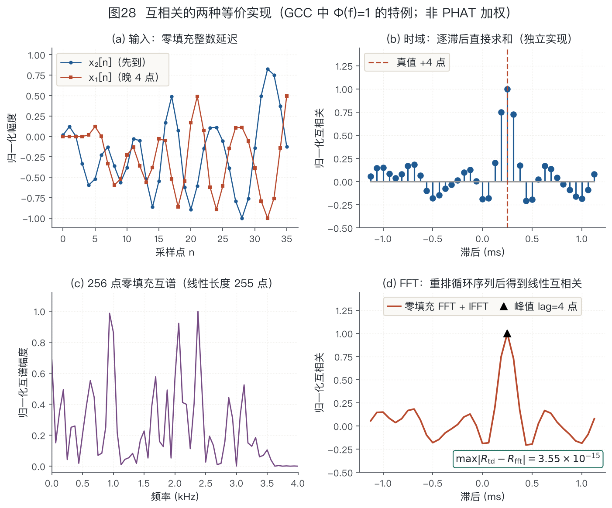
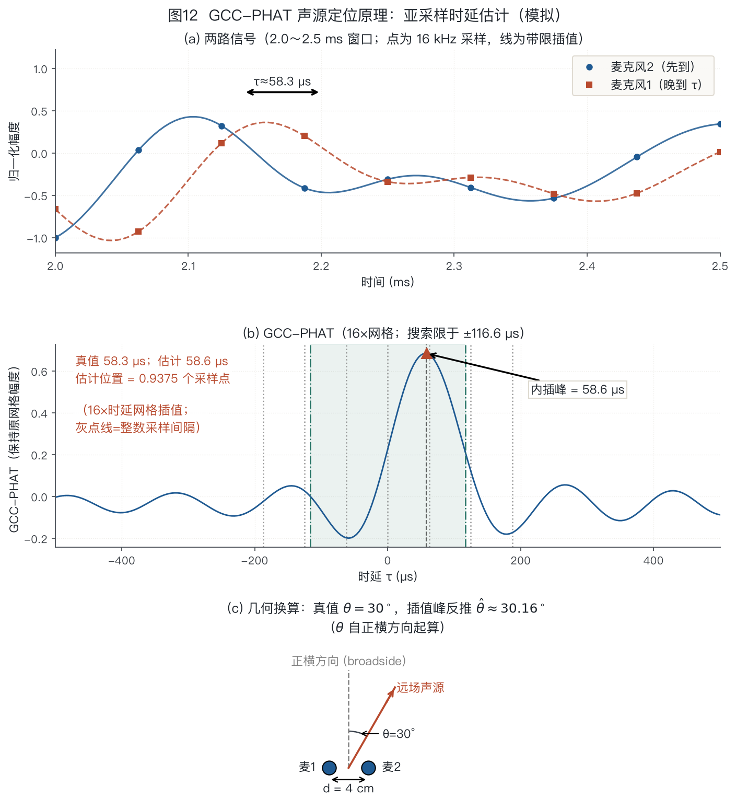
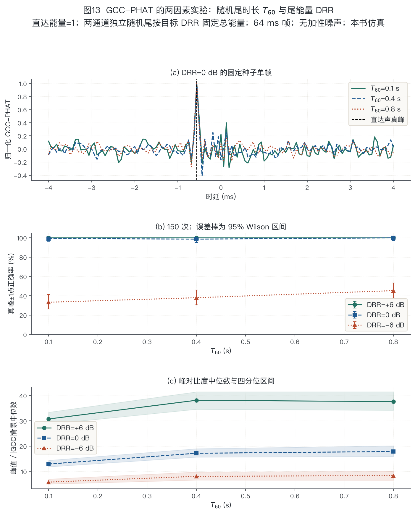
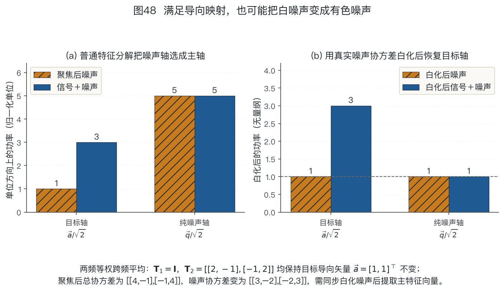
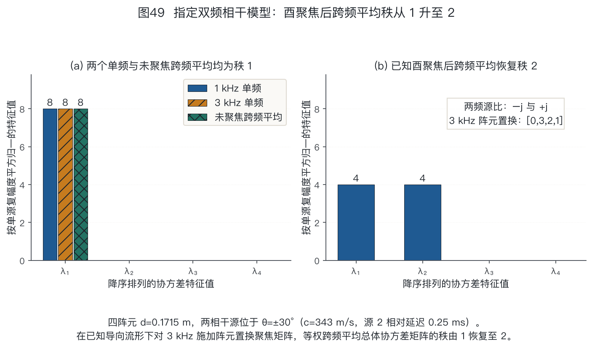

🌐 **简体中文** ｜ [English](../chapters_en/04_doa-estimation.md)

> 本篇是本书正文第 4 章；正文与扩展专题共 16 章（第 0～15 章，其中第 0 章为数学基础，第 12～15 章为四篇扩展专题），另有附录 A、B。本篇可独立阅读，前后篇见下方导航。
>
> 导读首页：[00_overview.md](00_overview.md) ｜ 上一篇：[03_array-geometry.md](03_array-geometry.md) ｜ 下一篇：[05_beamforming.md](05_beamforming.md)

---

## 4. 声源定位（波达方向，Direction of Arrival，DOA）

声源定位在工程上先要区分“找方向”和“定坐标”两件事：波达方向（Direction of Arrival，DOA）只给出声源相对阵列的角度，远场平面波模型就能支撑；完整的空间位置还包含声源到阵列的距离，通常依赖近场球面波曲率或多组分布式基线交会。本章从最直观的双麦克风互相关时差切入，逐步推到多麦网格扫描、几何方程解算、自适应空间谱、子空间分解与源数估计，以及稀疏重构和学习式定位。为便于跨章节直接查阅，下表先汇总本章的核心缩写。

| 缩写 | 中文与英文全称 | 本章中的作用 |
|---|---|---|
| TDOA | 到达时间差，Time Difference of Arrival | 同一个声源到达两只麦克风的相对时间差 |
| GCC / PHAT | 广义互相关，Generalized Cross-Correlation；相位变换，Phase Transform | 在频域对互谱加权再作逆变换，从峰值提取时差 |
| SRP | 可控响应功率，Steered Response Power | 按候选几何位置汇总多组麦克风对的互相关响应 |
| ULA / UCA | 均匀线阵，Uniform Linear Array；均匀圆阵，Uniform Circular Array | 两类基准几何阵列模型 |
| MUSIC | 多重信号分类，Multiple Signal Classification | 检验候选导向矢量与观测噪声子空间的正交性 |
| ESPRIT | 旋转不变子空间估计，Estimation of Signal Parameters via Rotational Invariance Techniques | 利用平移或相位模式不变性闭式求解多个声源方向 |
| MVDR | 最小方差无失真响应，Minimum Variance Distortionless Response | 约束候选方向增益为 1 并最小化阵列总输出功率 |
| DRR / RIR | 直达混响比，Direct-to-Reverberant Ratio；房间脉冲响应，Room Impulse Response | 分别描述直达声与反射声的能量比，以及房间声学传播响应 |
| DFT / IDFT | 离散傅里叶变换，Discrete Fourier Transform；逆离散傅里叶变换，Inverse DFT | FFT（Fast Fourier Transform）与 IFFT 是快速计算它们的算法 |
| STFT | 短时傅里叶变换，Short-Time Fourier Transform | 把时域多通道波形切分为逐频点、逐时间帧的复数相量观测 |

本章统一把列向量记为带箭头的 $\vec a,\vec w,\vec x$，矩阵记为大写正粗体 $\mathbf A,\mathbf I$，空间协方差矩阵采用双下标 $\mathbf R_{xx},\mathbf R_{ss},\mathbf R_{nn}$（有限快拍样本估计加帽记作 $\hat{\mathbf R}_{xx}$），以区别于标量互相关函数 $R_{x_1x_2}(\tau)$ 与整数滞后相关序列 $R[l]$。矩阵的复共轭转置记为 $^H$，实转置记为 $^\top$，虚数单位记为正体 $\mathrm{j}$，数学期望记为 $\mathbb{E}[\cdot]$；$M$ 表示麦克风通道数，$K$ 表示声源数；全章特征值默认按**降序** $\lambda_1\ge\lambda_2\ge\cdots\ge\lambda_M$ 排列。涉及快拍统计、厄米矩阵特征分解和复向量求导时，可随时对照[第 0 章数学基础](00_math-foundations.md#sec-0-8)与[附录 A 的数学工具](16_appendix-symbols-math.md)。

### 4.1 总览：四大类思路

```
声源定位算法
├── 两阶段法：先从一对或多对麦克风估计到达时差，再按几何关系解位置（§4.2、§4.4）
│     └── 例：GCC-PHAT 估时差，再用多麦对几何方程解算
├── 空间扫描：逐一检查候选方向或位置，取响应最大的点（§4.3、§4.5）
│     └── 例：SRP-PHAT、Bartlett、Capon
├── 子空间法：比较候选方向与观测数据中信号、噪声子空间的关系（§4.6）
│     └── 例：MUSIC、root-MUSIC、ESPRIT、宽带聚焦与 AIC/MDL 源数估计
└── 稀疏与学习方法：利用少数活动方向或带方向标签的数据（§4.7）
      └── 例：LASSO/SBL、原子范数、神经 SELD；需要检查先验或训练条件
```

为了在进入公式前先建立对“空间谱”的视觉直觉，图 11 在同一个双源窄带场景（真源位于 $-20^\circ$ 和 $30^\circ$，相隔 $50^\circ$）中并排画出 Bartlett、Capon 与 MUSIC 三种代表谱。仿真采用 $M=8$ 元半波长间距均匀线阵，每阵元总信号功率相对单阵元白噪声功率的输入信噪比为 $20\ \mathrm{dB}$，使用 $400$ 个独立快拍估计样本协方差 $\hat{\mathbf R}_{xx}$。其中 Capon 在样本协方差上施加无量纲相对对角加载 $\eta=10^{-6}$（令 $\delta_{\mathrm{rel}}=\eta\operatorname{tr}(\hat{\mathbf R}_{xx})/M$，以 $\hat{\mathbf R}_{xx}+\delta_{\mathrm{rel}}\mathbf I$ 参与线性求解），MUSIC 则直接传入真实源数 $K=2$。

需要特别提醒的是：图 11 特意取了 $50^\circ$ 大角间隔、无混响自由场与高信噪比，目的只是看清三类谱的典型几何轮廓。一旦进入真实混响房间或两个声源靠得很近，谱峰展宽与融合会显著加剧；近距双源的分辨成功率测试将在 [§4.8.1](#sec-4-8-1) 用重复抽样实验单独检验。


读图 11 时，先区分上下两个子图的纵轴含义，切勿跨子图比较峰值的绝对高度：

- **图 11(a) 波束扫描类空间谱**：横轴为候选方位角（$-90^\circ$～$90^\circ$），纵轴为按各自最大值归一化后的输出功率（单位 dB），两条竖向灰虚线与顶部倒三角标出 $-20^\circ$ 与 $30^\circ$ 真实声源方位。蓝色实线 Bartlett 谱就是常规延迟求和波束在各方向的平均输出功率，受 $8$ 元线阵孔径限制，两个主瓣较宽，且在两峰之间及外侧留下了约 $-12$～$-18\ \mathrm{dB}$ 的起伏旁瓣；红色虚线 Capon/MVDR 谱在保持候选方向单位增益的同时自适应压低其余方向泄漏，不仅主峰明显收窄，还将非声源方向的背景平坦地压低到约 $-26\ \mathrm{dB}$。
- **图 11(b) MUSIC 伪谱**：纵轴画的是候选导向矢量向噪声子空间投影能量倒数的对数（按自身峰值归一到 $0\ \mathrm{dB}$）。绿色实线在 $-20^\circ$ 与 $30^\circ$ 处形成极细的针状尖峰，这是因为理想模型下真实导向矢量与噪声子空间正交，投影残差分母趋近于零。

把两张子图对照起来看：Capon 纵轴度量的是候选方向滤波后的物理输出功率（单位 dB），而 MUSIC 伪谱峰值只反映“正交吻合程度”，并不代表物理声源功率强弱。同时工程中绝不能单靠数谱峰个数来定声源数——强旁瓣、相干反射或少快拍扰动都可能制造假峰或把双峰融成单峰。MUSIC 与 ESPRIT 等子空间方法在定位前必须先估计独立信号维数 $K<M$（待 §4.5～§4.6 定义空间协方差矩阵与特征分解后，[§4.6.1](#sec-4-6-1) 将系统推导特征值间隙、AIC 与 MDL 源数估计准则），而双通道互相关时延估计则不需要预设源数。下面先从最基础的两只麦克风讲起。

### 4.2 GCC-PHAT：“对齐两段录音，找最吻合的错位”

#### 时延符号与时频两种计算

推导时延前，先把几何坐标和正负号钉牢。本章严格沿用第 2 章 §2.1～§2.3 的全书约定：双麦沿 $x$ 轴放置，麦克风 1 位于原点 $x=0$，麦克风 2 位于正向 $x=d>0$（本章正文推导沿用 $1$ 起点编号 $m=1,\dots,M$，线阵坐标为 $(m-1)d$，与第 3 章及代码练习中的零起点编号 $m'=0,\dots,M-1$ 仅差平移对应 $m'=m-1$）；以垂直于连线的正横方向（broadside，$+y$ 轴）为 $0^\circ$，朝麦克风 2（$+x$ 侧）偏转为正角 $\theta>0$。记 $\vec u$ 为从阵列指向声源的单位方向向量，则平面波沿 $-\vec u$ 方向传播，到达第 $i$ 只与第 $j$ 只麦克风的时间差定义为 $\tau_{ij}=t_i-t_j$。

在傅里叶前向核 $e^{-\mathrm{j}2\pi ft}$ 下，以麦克风 1 为参考的相对传播时延与窄带导向矢量第 $m$ 分量分别为

$$\begin{aligned}
\tau_{m1}&=-\frac{(\vec r_m-\vec r_1)^\top\vec u}{c},\\
a_m(f,\theta)&=e^{-\mathrm{j}2\pi f\tau_{m1}}
=e^{+\mathrm{j}2\pi f(\vec r_m-\vec r_1)^\top\vec u/c}\text{。}
\end{aligned}$$

当声源位于正角一侧（$\theta>0$）时，声波先到达靠右的麦克风 2、后到达靠左的麦克风 1，因此 $t_1>t_2$，对应 $\tau_{21}=t_2-t_1<0$、$\tau_{12}=t_1-t_2>0$。用一句话记牢物理图景：**$\tau_{12}>0$ 表示“声音到麦 1 比到麦 2 晚”**，理想无噪连续波形满足 $x_1(t)=x_2(t-\tau_{12})$。

怎样从两段录音里找出这个错位量？最朴素的想法就是把第二路离散序列 $x_2[n]$ 左右平移整数个采样点 $l$，每挪一格就和第一路 $x_1[n]$ 逐点相乘再累加，看停在哪一格时两条波形咬合得最紧：

$$\begin{aligned}
R[l]&=\sum_n x_1[n]x_2[n-l],\\
\hat\tau_{12}&=\frac{\arg\max_l R[l]}{f_s}\text{。}
\end{aligned}\tag{4-1}$$

式(4-1)中，整数滞后 $l$ 的单位是“采样点”，除以采样率 $f_s$ 后才换算成以秒为单位的到达时差估计 $\hat\tau_{12}$；当 $x_2[n-l]$ 把先到的 $x_2$ 往右推迟 $l>0$ 格后恰好与晚到的 $x_1[n]$ 对齐时，$R[l]$ 在正滞后 $l>0$ 处达到最大，与上面 $\tau_{12}>0$ 的定义严丝合缝。

为与[第 0 章 §0.2](00_math-foundations.md#sec-0-2)及[附录 A](16_appendix-symbols-math.md)保持同一符号约定，若输入改成复数基带序列，时域互相关的第二项须取复共轭 $x_2^*[n-l]$。需要注意复相关本身是复数：例如有限支撑序列 $x_1=[0,\mathrm{j}]$、$x_2=[1,0]$ 在 $l=+1$ 处的复相关值为 $\mathrm{j}$，盲目取实部会把真峰抹成 $0$；只有当两路实音频保持已知同极性通道响应时，按式(4-1)搜索有符号实相关最大值才是自洽的，若允许未知公共复相位旋转则应改按模长 $|R[l]|$ 选峰。

直接在时域对长度为 $N$ 的两段序列遍历全部滞后，需要 $O(N^2)$ 次乘加运算。借助傅里叶变换的**相关定理**，时域滑动乘加等价于频域逐频点计算互功率谱 $X_1(f)X_2^*(f)$（先对第二路频谱取共轭，再与第一路频谱相乘）后做一次逆变换；再在互谱前乘上频域加权函数 $\Phi(f)$，就得到了广义互相关（Generalized Cross-Correlation，GCC）框架：

$$\begin{aligned}
G_\Phi(f)&=\Phi(f)X_1(f)X_2^*(f),\\
R_{x_1x_2}(\tau)&=\int_{-\infty}^{\infty}G_\Phi(f)
e^{+\mathrm{j}2\pi f\tau}\,\mathrm{d}f,\\
\hat\tau_{12}&=\arg\max_\tau R_{x_1x_2}(\tau)\text{。}
\end{aligned}\tag{4-2}$$

式(4-2)写成连续频率积分是为了看清物理结构：当实信号两路频谱及实偶权重 $\Phi(f)=\Phi(-f)$ 满足共轭对称 $G_\Phi(-f)=G_\Phi^*(f)$ 时，正负频率虚部精确对消，逆变换给出实值互相关曲线 $R_{x_1x_2}(\tau)$。为什么相位里恰好装着时延？把理想纯延迟关系 $x_1(t)=x_2(t-\tau_0)$ 变换到频域，有 $X_1(f)=X_2(f)e^{-\mathrm{j}2\pi f\tau_0}$，代入互谱得

$$X_1(f)X_2^*(f)=|X_2(f)|^2\,e^{-\mathrm{j}2\pi f\tau_0}\text{。}$$

可以看到，互谱相位 $\angle\{X_1(f)X_2^*(f)\}=-2\pi f\tau_0$ 是一条过原点的直线，对频率 $f$ 的斜率就是 $-2\pi\tau_0$（例如 $\tau_0=58.3\ \mu\mathrm{s}$ 时，$1\ \mathrm{kHz}$ 与 $2\ \mathrm{kHz}$ 处的互谱相位分别约为 $-0.366\ \mathrm{rad}$ 与 $-0.733\ \mathrm{rad}$）。当式(4-2)的逆变换扫描到 $\tau=\tau_0$ 时，核因子 $e^{+\mathrm{j}2\pi f\tau_0}$ 把这条负斜率相位全部扳平为 $0\ \mathrm{rad}$，所有频点同相叠加打出主峰。

但真实语音在低频共振峰处能量集中：普通互相关（$\Phi(f)=1$）保留了声源自身的功率谱包络 $|X_2(f)|^2$，会把时域相关峰显著拉宽。**相位变换（PHAT）**取 $\Phi(f)=1/|X_1(f)X_2^*(f)|$，把互谱幅度全部拉平为单位模长 $e^{-\mathrm{j}2\pi f\tau_0}$，让每个有效频点平等投票，在理想单径模型下能显著收窄相关主峰；不过 PHAT 并不会修复混响或强噪声污染的错误相位，反而可能把无语音弱频点的随机噪声放大到同等权重，因此工程实现必须在分母加入下限保护或频带筛选。

**离散 `ifft` 的圆周补零与正负滞后索引映射**。把式(4-2)落成代码时，设两帧长度分别为 $N_1$ 和 $N_2$，直接做 $N$ 点 DFT/IDFT 计算的是周期为 $N$ 的**圆周互相关**；要让圆周相关不发生首尾回绕混叠，FFT 长度必须满足 $N_{\mathrm{fft}}\ge N_1+N_2-1$（常取不小于该值的 $2$ 的整数次幂，复杂度为 $O(N_{\mathrm{fft}}\log N_{\mathrm{fft}})$）。使用实信号单边谱接口（`rfft`）时，下标 $0\le k\le\lfloor N_{\mathrm{fft}}/2\rfloor$ 对应非负物理频率 $f_k=kf_s/N_{\mathrm{fft}}$；使用双边 DFT（`fft`）时，后半段 $k>N_{\mathrm{fft}}/2$ 代表负频率 $(k-N_{\mathrm{fft}})f_s/N_{\mathrm{fft}}$。调用 `c = np.fft.ifft(G).real` 后：

- **非负滞后在数组头部**：下标 $m=0,1,\ldots,N_1-1$ 直接对应整数滞后 $l=0,+1,\ldots,+(N_1-1)$（麦 1 晚到或同时到达）；
- **负滞后卷绕在数组尾部**：负整数滞后 $l=-(N_2-1),\ldots,-2,-1$（麦 1 比麦 2 早到）在模 $N_{\mathrm{fft}}$ 下落在数组末尾 $m=N_{\mathrm{fft}}-(N_2-1),\ldots,N_{\mathrm{fft}}-1$；
- **重排与孔径裁剪**：把尾部切片 `c[-(N2-1):]` 拼到头部切片 `c[:N1]` 之前，就得到了沿 $l=-(N_2-1),\ldots,+(N_1-1)$ 单调排列的完整互相关序列，最后只保留满足物理最大时差 $|l|/f_s\le d/c$ 的区间参与搜峰。

这里还要分清“未加权互相关”与“PHAT 加权”在有限长度性质上的区别：对 $\Phi(f)=1$ 的普通互谱 $X_1[k]X_2^*[k]$，只要 $N_{\mathrm{fft}}\ge N_1+N_2-1$，频域补零再重排就能与时域有限和式(4-1)达到机器精度一致；而 PHAT 除以 $|X_1[k]X_2^*[k]|$ 属于非线性谱白化，逆变换一般不再局限于 $N_1+N_2-1$ 点的有限非零区间，改变 $N_{\mathrm{fft}}$ 会轻微改变周期采样曲线的数值，对比不同实现时应写明所用的 FFT 长度与截取区间。



图 28 用 $\Phi(f)=1$ 的未加权互相关把这套“补零 + 频域共轭乘 + 尾部重排”流程完整演练了一遍：

- **图 28(a) 输入信号**：横轴为采样点 $n$（展示前 $36$ 点），两条序列全长均为 $N_1=N_2=128$ 点；蓝色圆点线 $x_2[n]$ 先到达，红色方块线 $x_1[n]$ 通过在开头补 $4$ 个零实现严格晚到 $4$ 个采样点。
- **图 28(b) 时域直接求和**：横轴换算为毫秒滞后（$16\ \mathrm{kHz}$ 下 $4$ 点对应 $+0.25\ \mathrm{ms}$），纵轴为归一化互相关值，蓝色针状图按式(4-1)逐个整数滞后独立相乘累加，红色虚线标出 $+4$ 点处的峰值 $1.0$。
- **图 28(c) 零填充互谱幅度**：线性互相关最短需要 $128+128-1=255$ 点，因此取 $N_{\mathrm{fft}}=256$ 点补零 FFT，画出单边频率 $0$～$4\ \mathrm{kHz}$ 上的归一化互谱模 $|X_1[k]X_2^*[k]|$。
- **图 28(d) FFT 逆变换重排结果**：对 $256$ 点互谱执行 `ifft` 并把负滞后尾部移到左侧后，红色实线在 `lag = 4` 点处精确命中黑色三角峰值；右下角绿框标出它与图(b)时域直接求和在整个滞后轴上的最大绝对差 $\max|R_{\mathrm{td}}-R_{\mathrm{fft}}|$ 仅为 $3.55\times 10^{-15}$，完全处于双精度浮点舍入误差以内。

#### 8 点脉冲手算：时域与频域结果一致

为了亲手验证共轭位置和正负号绝无差错，我们用一组 $N=8$ 点的极简单脉冲序列同时走一遍时域式(4-1)和频域 DFT/IDFT，全程统一用整数滞后记号 $R[l]$。

**输入与口径**：取序列长度 $N=8$（采样下标 $n=0,1,\ldots,7$），令

- $x_1=[0,0,3,0,0,0,0,0]$，非零脉冲 $3$ 落在 $n=2$，表示麦 1 比麦 2 晚到 $2$ 个采样点；
- $x_2=[2,0,0,0,0,0,0,0]$，非零脉冲 $2$ 落在 $n=0$。

线性互相关按式(4-1)定义为 $R[l]=\sum_{n=0}^{7}x_1[n]x_2[n-l]$，下标越界处按 $0$ 处理。虽然一般长度 $8$ 的两序列做完整线性互相关需补零到 $8+8-1=15$ 点以上，但在本例考察的 $l=0,1,2$ 三点处，非零项读取的下标 $2-l\in\{2,1,0\}$ 全部落在 $0\ldots 7$ 内部，没有发生边界卷绕，因此 $8$ 点 DFT/IDFT 在这三点处与线性互相关精确相等。

**第一步：时域逐点代入**。因为 $x_1[n]$ 只在 $n=2$ 处取非零值 $3$，求和号退化为单项 $R[l]=3\,x_2[2-l]$：

| 试探滞后 $l$（采样点） | 读取的 $x_2$ 下标 $2-l$ | 代入乘积 | 互相关值 $R[l]$ |
|---:|---:|---|---:|
| $0$ | $2$ | $3\times 0$ | $0$ |
| $1$ | $1$ | $3\times 0$ | $0$ |
| $2$ | $0$ | $3\times 2$ | $6$ |

最大值出现在 $\hat l=+2$（$R[2]=6$），正确指示 $x_1$ 比 $x_2$ 晚到 $2$ 个采样点。

**第二步：频域 DFT 共轭相乘再作 IDFT**。记 $8$ 点旋转因子 $W_8=e^{-\mathrm{j}2\pi/8}$，DFT 为 $X[k]=\sum_{n=0}^{7}x[n]W_8^{kn}$（$k=0,\ldots,7$）。$x_2[n]$ 只有 $n=0$ 项非零，所以 $X_2[k]=2$ 对所有频点恒为常数 $2$；$x_1[n]$ 只有 $n=2$ 项非零，因此 $X_1[k]=3W_8^{2k}=3e^{-\mathrm{j}\pi k/2}$。把 $8$ 个频点逐项排开：

$$\begin{aligned}
X_1&=[3,-3\mathrm{j},-3,3\mathrm{j},
3,-3\mathrm{j},-3,3\mathrm{j}],\\
X_2^*&=[2,2,2,2,2,2,2,2],\\
G[k]&=X_1[k]X_2^*[k]\\
&=[6,-6\mathrm{j},-6,6\mathrm{j},
6,-6\mathrm{j},-6,6\mathrm{j}]\text{。}
\end{aligned}$$

接着记逆变换核 $E_l[k]=e^{+\mathrm{j}2\pi kl/8}$，按 $8$ 点 IDFT 公式 $r[l]=\frac{1}{8}\sum_{k=0}^{7}G[k]E_l[k]$ 逐个检验 $l=0,1,2$：

1. $l=0$ 时，$8$ 项之和 $(6-6\mathrm{j}-6+6\mathrm{j})\times 2=0$，正负实部与虚部成对抵消，故 $r[0]=0=R[0]$；
2. $l=1$ 时，乘积 $G[k]E_1[k]$ 等于 $6e^{-\mathrm{j}\pi k/2}e^{+\mathrm{j}\pi k/4}=6(e^{-\mathrm{j}\pi/4})^k$，$k=0,\ldots,7$ 恰好绕单位圆走完一整圈等比级数，和为零，故 $r[1]=0=R[1]$；
3. $l=2$ 时，乘积 $G[k]E_2[k]$ 化为 $6e^{-\mathrm{j}\pi k/2}e^{+\mathrm{j}\pi k/2}=6$，逆变换核把每个频点的延迟相位全部抵消，$8$ 个实数 $6$ 同相相加得 $r[2]=48/8=6=R[2]$。

**最终结果与边界说明**：时域滑动与频域逆变换在 $l=0,1,2$ 处给出完全一致的 $0,0,6$，峰值位置同为 $\hat l=+2$。若在本例上继续施加理想 PHAT 归一化，由于单脉冲互谱模 $|G[k]|=6$ 在全部频点本来就平坦，归一化只把 $l=2$ 处的峰值幅度从 $6$ 缩放到 $1$，其余格点仍为 $0$。只有当声源频谱本身高低不平（例如低频重、高频弱的语音）时，PHAT 拉平谱包络、锐化相关主峰的作用才会显现出来。

#### 频谱加权、弱频点保护与通道极性

在广义互相关式(4-2)中，更换频域权重 $\Phi(f)$ 就衍生出不同的经典时延估计器，它们的统计动机与工程取舍对比如下（系统推导见 [Knapp 与 Carter, *IEEE TASSP*, 1976](https://doi.org/10.1109/TASSP.1976.1162830)）：

| 加权名称 | 频域权重 $\Phi(f)$ | 设计动机与适用边界 |
|---|---|---|
| 普通互相关（CC） | $1$ | 不改频谱幅度；在平稳加性白噪声且源谱平坦时表现稳健，但源谱集中在窄带或共振峰时主峰明显展宽 |
| Roth 处理器 | $1/(\hat G_{11}(f)+\varepsilon)$ | 用通道 1 的平滑自功率谱做逆滤波，相当于估计通道 1 到通道 2 的脉冲响应；结果随两通道排列顺序变化 |
| 平滑相干变换（SCOT） | $1/\sqrt{\hat G_{11}(f)\hat G_{22}(f)}$ | 用两路平滑自功率谱的几何均值作对称白化；必须注明 $\hat G_{11},\hat G_{22}$ 采用帧间递推还是 Welch 平均 |
| **相位变换（PHAT）** | $1/(\lvert X_1(f)X_2^*(f)\rvert+\varepsilon)$ | 直接消去互谱幅度、仅保留相位斜率，对室内语音包络起伏适应力强；但对低信噪比弱频点敏感，需配下限保护 |
| 最大似然加权（ML / Hannan–Thomson） | $\dfrac{\lvert\gamma_{12}(f)\rvert^2}{\lvert G_{12}(f)\rvert\,(1-\lvert\gamma_{12}(f)\rvert^2)}$ | 在平稳零均值高斯信号与互不相关高斯噪声模型下渐近达到宽带 CRLB；强混响相干多径下模型前提不再成立 |

注意表中最大似然加权（ML）与 PHAT 之间清晰的代数关系：记两通道模平方相干度为 $|\gamma_{12}(f)|^2 = |G_{12}(f)|^2 / [G_{11}(f)G_{22}(f)]$，则 $\Phi_{\mathrm{ML}}(f)$ 恰好等于 PHAT 权重 $1/|G_{12}(f)|$ 乘上逐频信噪比置信因子 $|\gamma_{12}(f)|^2 / (1-|\gamma_{12}(f)|^2)$——相干度越高的频点投票权越重，纯噪声弱频点（$|\gamma_{12}|^2\to 0$）自动被压低权重；而 PHAT 相当于省去了相干度估计、对所有存活频点赋予相等权重。同时，如果只拿**单帧**瞬时谱直接代入 SCOT 而不做跨帧平滑，分母 $\sqrt{|X_1|^2|X_2|^2}$ 与 $|X_1X_2^*|$ 代数恒等，只有多帧统计平均时 SCOT 才与逐帧 PHAT 分化。

**Hannan–Thomson 最大似然权重推导**：采用 Knapp–Carter 含噪双通道模型 $x_1(t)=s(t-\tau)+n_1(t)$、$x_2(t)=\alpha s(t)+n_2(t)$（$\alpha>0$），其中 $s,n_1,n_2$ 为互不相关的平稳零均值高斯过程，且两路噪声功率谱严格为正（因而活动频点满足 $0<|\gamma_{12}(f)|^2<1$）。在频域复高斯模型 $[X_1(f),X_2(f)]^\top\sim\mathcal{CN}(\vec 0,\mathbf S(f;\tau))$ 下，令 $G_{12}^0(f)=|G_{12}(f)|=\alpha G_{ss}(f)$，谱密度矩阵为 $\mathbf S(f;\tau)=\begin{bmatrix}G_{11}&G_{12}^0e^{-\mathrm{j}2\pi f\tau}\\G_{12}^0e^{+\mathrm{j}2\pi f\tau}&G_{22}\end{bmatrix}$。其行列式 $\det\mathbf S(f;\tau)=G_{11}G_{22}(1-|\gamma_{12}|^2)>0$ 与 $\tau$ 无关（确保 $\mathbf S(f;\tau)\succ\mathbf 0$ 严格可逆；若无噪则 $|\gamma_{12}|\equiv 1$ 导致 $\det\mathbf S\equiv 0$ 奇异），求逆后非对角元为 $-\frac{G_{12}^0e^{-\mathrm{j}2\pi f\tau}}{G_{11}G_{22}(1-|\gamma_{12}|^2)}=-\Phi_{\mathrm{ML}}(f)e^{-\mathrm{j}2\pi f\tau}$。在时长 $T$、带宽 $B$（正频格间隔 $1/T$）上，Whittle 对数似然中依赖 $\tau$ 的项为

$$\begin{aligned}
\ell(\tau)&=-T\int_0^B\operatorname{tr}\!\big(\mathbf S^{-1}(f;\tau)\hat{\mathbf S}(f)\big)\,\mathrm{d}f\\
&=\mathrm{const}+2T\int_0^B\Phi_{\mathrm{ML}}(f)\operatorname{Re}\!\big\{\hat G_{12}(f)e^{+\mathrm{j}2\pi f\tau}\big\}\,\mathrm{d}f\text{，}
\end{aligned}$$

由实信号共轭对称性，右端积分恰等于 $T\int_{-B}^{B}\Phi_{\mathrm{ML}}(f)\hat G_{12}(f)e^{+\mathrm{j}2\pi f\tau}\,\mathrm{d}f$，因此最大化对数似然等价于在式(4-2)中取 $\Phi_{\mathrm{ML}}(f)=\frac{|\gamma_{12}(f)|^2}{|G_{12}(f)|(1-|\gamma_{12}(f)|^2)}$（§4.8 式 4-30 的宽带 CRLB 亦直接由 $\ell(\tau)$ 求二阶导导出）。

在多帧 PHAT 实现中，还必须区分**归一化次序**与**弱频点分母保护口径**：

- **PHAT 归一化与跨帧平均不可交换**：因为除以 $|G|$ 是非线性操作，“先逐帧 PHAT 归一化再跨帧平均”与“先跨帧平均互谱再做 PHAT”会给出截然不同的结果。例如两帧实互谱为 $G_1=+1$、$G_2=-9$ 时，先逐帧 PHAT 得 $+1$ 与 $-1$、跨帧平均为 $0$（等权对消）；而先平均互谱得 $-4$ 再归一化则输出 $-1$（由高能量帧主导）。
- **三种分母小量保护规则的差异**：设当前麦对最大互谱幅值为 $g_{\max}=\max|G|$、相对门限 $\delta=\varepsilon g_{\max}$，常见三种分母小量保护规则为

$$\begin{aligned}
Q_{\mathrm{add}}&=\frac{G}{|G|+\delta},\\
Q_{\mathrm{floor}}&=\frac{G}{\max(|G|,\delta)},\\
Q_{\mathrm{gate}}&=
\begin{cases}
G/|G|,&|G|>\delta,\\
0,&|G|\le\delta\text{。}
\end{cases}
\end{aligned}\tag{4-3}$$

取 $g_{\max}=1$、$\delta=0.01$ 在四个典型幅值 $g=|G|$ 上对比输出模长：

| 互谱幅值 $g=\lvert G\rvert$ | 加常数 $\lvert Q_{\mathrm{add}}\rvert$ | 设下限 $\lvert Q_{\mathrm{floor}}\rvert$ | 硬门限置零 $\lvert Q_{\mathrm{gate}}\rvert$ |
|---:|---:|---:|---:|
| $1$ | $0.990099$ | $1$ | $1$ |
| $0.01$ | $0.5$ | $1$ | $0$ |
| $0.001$ | $0.090909$ | $0.1$ | $0$ |
| $0$ | $0$ | $0$ | $0$ |

看第二行 $g=0.01=\delta$ 最能分清三者性格：加常数压半为 $0.5$，设下限仍保留单位模 $1$，硬门限则直接清零为 $0$。此外，工程现场最隐蔽的故障是**通道极性接反**：对任一通道乘以正增益不改变互谱相位与正峰位置；但单路乘以 $-1$ 会使整条有符号实相关曲线上下翻转、原正峰变负谷，必须先排查通道极性与全零静音异常（`gcc_phat` 会对全零输入直接抛出异常，不静默返回 $0^\circ$）。

#### 从时延峰到角度：插值、四麦亚采样对齐与图 12 模型

拿到双麦时延估计 $\hat\tau_{12}$ 后，在平面波假设与前半平面（方位角 $\theta\in[-90^\circ,90^\circ]$）内，由路程差关系 $c\tau_{12}=d\sin\theta$ 反解方位角：

$$\hat\theta=\arcsin\!\left(\frac{c\hat\tau_{12}}{d}\right)\text{。}\tag{4-4}$$

调用反正弦前必须核查**物理可见域（visible region）**：三维真实空间中平面波恒满足 $|\sin\theta|\le 1$，对应时差绝对值绝不超过端射渡越时间 $|\tau_{12}|\le\tau_{\max}=d/c$。若全局滞后轴峰值明显落在 $|c\hat\tau_{12}/d|>1$ 的不可见域，说明当前帧由强反射野值或跨源错配主导，应标记异常丢弃或预先裁剪搜索窗至 $|\tau|\le d/c$，绝不能把野值强行贴到 $\pm 90^\circ$ 端射角上（若外部文献以阵轴夹角计角，式(4-4)将 $\arcsin$ 换为 $\arccos$）。即便落在可见域内，单基线在三维空间仍存在绕基线轴旋转的混淆锥与水平前后镜像，须靠多条不共线基线收紧（见[§3.1 几何可辨识性](03_array-geometry.md#sec-3-1)）。

在工程系统中实现式(4-4)时，**整数采样格点过粗**与**通道相位失配**是两道主要精度瓶颈。在 $f_s=16\ \mathrm{kHz}$ 下，单采样周期 $T_s=62.5\ \mu\mathrm{s}$；对小间距 $d=4\ \mathrm{cm}$，滞后从 $0$ 格跳到 $1$ 格，角度就从 $0^\circ$ 直接跳到 $\arcsin(cT_s/d)\approx 32.4^\circ$。亚采样细化常用两条闭式路径：

1. **三点抛物线局部插值**：在离散相关序列内部整数峰 $l^*$ 及其左右紧邻格点 $R[l^*-1], R[l^*], R[l^*+1]$ 上拟合二次抛物线顶点，给出亚采样偏移量 $\Delta l$；
2. **频域 $Q$ 倍补零实周期三角插值**：对偶数 $N$ 点实序列的单边互谱 $H_k$（$k=0,\ldots,N/2$），因直流 $k=0$ 与旧奈奎斯特频点 $k=N/2$ 在双边谱中各仅出现一次，而内部正负共轭对 $k=1,\ldots,N/2-1$ 成对出现，以原采样周期为单位的连续三角插值曲线 $g(t)$ 与三点抛物线偏移式分别为

$$\begin{aligned}
\Delta l&=\frac{R[l^*-1]-R[l^*+1]}
{2\big(R[l^*-1]-2R[l^*]+R[l^*+1]\big)},\\
Ng(t)&=H_0+H_{N/2}\cos(\pi t)
+2\sum_{k=1}^{N/2-1}\operatorname{Re}\!\big\{H_k e^{+\mathrm{j}2\pi kt/N}\big\}\text{。}
\end{aligned}\tag{4-5}$$

用单边 `irfft` 实现 $Q$ 倍补零插值时，必须同步执行两项边界修正：① 将旧奈奎斯特系数折半 $H_{N/2}\leftarrow\tfrac{1}{2}H_{N/2}$ 后再补零（因为补零后该频点变成内部正频点，`irfft` 会自动添上共轭负频伙伴）；② 将逆变换输出整体乘以插值倍数 $Q$（抵消 `irfft` 除以 $QN$ 造成的幅度缩小）。以 $N=8$ 全 $1$ 单边谱 $H=[1,1,1,1,1]$ 做 $Q=2$ 倍补零（理论半格点 $g(0.5)\approx 0.628417437$）检验三组对照：

| 补零做法 | $t=0$（零滞后） | $t=1$（原第 $1$ 格点） | $t=2$（原第 $2$ 格点） |
|---|---:|---:|---:|
| 直接补零调 $16$ 点 `irfft`（不拆半、不乘 $2$） | $0.5625$ | $-0.0625$ | $+0.0625$ |
| 只乘倍数 $2$、漏将旧奈奎斯特点折半 | $1.1250$ | $-0.1250$ | $+0.1250$ |
| **旧奈奎斯特点折半并乘倍数 $2$** | **$1.0000$** | **$0.0000$** | **$0.0000$** |

只有第三行在全部 $16$ 个半格点上与式(4-5)达到 $10^{-16}$ 浮点一致，严格保持原整数格点取值。此外，PHAT 完全依赖相位斜率，硬件模拟前端或腔体若存在未标定相位差，会直接折算成固定偏置时差（详见 §10.2）。



结合图 12 复算“波形错位 → 16 倍频域插值搜峰 → 角度反算”完整数字链（$4096$ 点带限随机源 $300$～$6000\ \mathrm{Hz}$，频域精确施加分数延迟并叠加标准差 $0.05$ 高斯白噪，$8192$ 点 FFT 配 $Q=16$ 倍补零插值）：

- **图 12(a) 两路信号放大窗口**：截取 $2.0$～$2.5\ \mathrm{ms}$ 窗口，设定 $d=4\ \mathrm{cm}$、真源 $\theta=30^\circ$，理论时差 $\tau_0=d\sin 30^\circ/c=0.02/343\approx 58.309\ \mu\mathrm{s}$（折合 $16\ \mathrm{kHz}$ 下约 $0.933$ 个采样点）。蓝色圆点线（麦 2）先到，红色方块线（麦 1）向右平移约 $58\ \mu\mathrm{s}$ 后到。
- **图 12(b) 16 倍细化网格上的 GCC-PHAT 曲线**：竖向灰点线标出原始整数采样格点（间距 $62.5\ \mu\mathrm{s}$），绿点划线框出可见域上限 $\pm d/c\approx\pm 116.6\ \mu\mathrm{s}$。整数搜峰只能落到 $1$ 格（$62.5\ \mu\mathrm{s}\Rightarrow 32.4^\circ$）；$16$ 倍三角插值将步长细化至 $\Delta\tau=62.5/16=3.90625\ \mu\mathrm{s}$，红三角峰值落在第 $15$ 个细网格 $\hat\tau_{12}=15\Delta\tau=58.59375\ \mu\mathrm{s}$（图简标 $58.6\ \mu\mathrm{s}$，合 $0.9375$ 点），紧贴 $58.3\ \mu\mathrm{s}$ 真值竖线。
- **图 12(c) 平面波几何示意与角度反算**：将 $\tau_{\mathrm{est}}=58.59375\ \mu\mathrm{s}$ 代入式(4-4)得 $\hat\theta=\arcsin(343\,\tau_{\mathrm{est}}/0.04)\approx 30.16^\circ$，相对 $30^\circ$ 真值仅偏高约 $0.16^\circ$。

**四麦亚采样时差对照**：把上述单对分数延迟推到多通道阵列，以四元均匀线阵 $x=0,0.04,0.08,0.12\ \mathrm{m}$、远场 $\theta=30^\circ$、$c=343\ \mathrm{m/s}$、$f_s=16\ \mathrm{kHz}$ 为例，相邻阵元时差恰同为 $58.309\ \mu\mathrm{s}$（$0.932945$ 点）。若要将先到的麦 2～4 因果推迟至与最晚的麦 1 同相对齐，各通道相对到达时差与所需因果补偿延迟如下：

| 麦克风 $m$ | 相对麦 $1$ 的到达时差 $\tau_{m1}$（$\mu\mathrm{s}$） | 对齐到麦 $1$ 所需因果延迟（采样点） |
|---:|---:|---:|
| $1$ | $0$ | $0$ |
| $2$ | $-58.309$ | $0.932945$ |
| $3$ | $-116.618$ | $1.865889$ |
| $4$ | $-174.927$ | $2.798834$ |

若直接等权平均而不做亚采样对齐，高频谐波会因跨通道相位错开发生严重相消——章末练习 [E04-07](#e04-07) 给出了 $2298\ \mathrm{Hz}$ 谐波 $-4.32\ \mathrm{dB}$ 相量损耗手算及四段可试听合成 WAV 的稳态均方误差对照。

#### 混响实验与时频稀疏多源定位（DUET）

进入真实房间后，壁面反射会在直达声后叠加一连串延迟衰减副本，抬高 GCC-PHAT 背景起伏甚至长出篡位假峰。单报混响时间 $T_{60}$ 而不报直达混响比（DRR）无法判断定位趋势。图 13 用两因素拆解实验独立检验 $T_{60}$ 与 DRR 的联合作用：采样率 $16\ \mathrm{kHz}$，固定每路直达脉冲能量为 $1$（真实时差 $\tau_{12}=-9$ 点，即 $-0.5625\ \mathrm{ms}$），为两通道独立生成长度 $1.1T_{60}$ 的指数衰减随机反射尾，将整条反射尾总能量精确归一化到目标 $\mathrm{DRR}\in\{+6,\,0,\,-6\}\ \mathrm{dB}$，并遍历 $T_{60}\in\{0.1,\,0.4,\,0.8\}\ \mathrm{s}$ 共 $9$ 组条件。每组条件按确定性种子规则重复 $150$ 次试验（完整卷积后截取 $1024$ 点即 $64\ \mathrm{ms}$ 观测帧，无传感器白噪声），互谱分母按式(4-3)加常数规则加入固定小量 $10^{-10}$ 防止除零，估计峰落在 $-9\pm 1$ 点内判为成功（逐次记录见 [`figure13_gcc_reverb.json`](../codes/chapters/ch04/reports/figure13_gcc_reverb.json)）：

| 目标 DRR | $T_{60}=0.1\ \mathrm{s}$ | $T_{60}=0.4\ \mathrm{s}$ | $T_{60}=0.8\ \mathrm{s}$ |
|---|---:|---:|---:|
| $+6\ \mathrm{dB}$ | $150$ | $150$ | $150$ |
| $0\ \mathrm{dB}$ | $149$ | $148$ | $150$ |
| $-6\ \mathrm{dB}$ | $50$ | $57$ | $68$ |

表末行揭示了**固定 DRR 下的能量摊薄效应**：当反射尾总能量被锁死在直达声的约 $4$ 倍（$\mathrm{DRR}=-6\ \mathrm{dB}$）时，$T_{60}=0.1\ \mathrm{s}$ 把这 $4$ 倍能量全部挤压在直达声身后极短区间内，单根早期反射抽头幅度很高、极易打出高于直达声的伪峰；而 $T_{60}=0.8\ \mathrm{s}$ 将同等总能量摊薄到 $8$ 倍长的衰减轴上，单滞后点反射幅值变矮，不易篡位。但在同一物理房间内，说话人远离阵列时直达声按距离平方衰减而混响场近乎均匀，DRR 随距离急剧恶化，因此**汇报混响定位指标时必须同时给出 $T_{60}$ 与 $\mathrm{DRR}$（或声源距离）**。

工程上对抗低 DRR 混响主要有三项措施：优先抓取音节起始瞬态帧（onset）；在多帧滑窗上做直方图投票或送入第 9 章卡尔曼门控追踪器；或利用扩散场空间相干先验盲估**相干扩散比（CDR）**压低混响主导频点权重（见 §4.6 与 [E04-23](#e04-23)）。



逐一读图 13 的三个子图：

- **图 13(a) $\mathrm{DRR}=0\ \mathrm{dB}$ 单帧相关曲线**（采用独立示例种子 `seed=7`）：横轴为时延（$-4$～$4\ \mathrm{ms}$），黑虚线标出真峰 $-0.5625\ \mathrm{ms}$。绿实线（$T_{60}=0.1\ \mathrm{s}$）在 $0$～$0.5\ \mathrm{ms}$ 处冒出接近 $0.4$ 的强早反射旁峰，红点线（$T_{60}=0.8\ \mathrm{s}$）反射能量被摊平为更均匀的低幅起伏。
- **图 13(b) $150$ 次命中率与 $95\%$ Wilson 置信区间**：$\mathrm{DRR}=+6\ \mathrm{dB}$ 与 $0\ \mathrm{dB}$ 始终贴近 $100\%$，降至 $-6\ \mathrm{dB}$ 后断崖式跌落到 $33\%$～$45\%$，印证 DRR 是决定主峰存亡的首要因素。
- **图 13(c) 峰值对比度统计**：纵轴为 $\max g/(\operatorname{median}|g|+10^{-12})$，实心标记与阴影带为 $150$ 次中位数与四分位区间（IQR），三条曲线按 $\mathrm{DRR}=+6,0,-6\ \mathrm{dB}$ 严格分层。

**基于时频稀疏性的双麦多说话人定位（WDO / DUET）**：双麦 GCC-PHAT 每帧只提取一个全局主峰，遇到两名以上说话人同时发声往往束手无策。然而语音在 STFT 时频平面上具有很强的**窗不相交正交性（W-Disjoint Orthogonality，WDO）**——绝大多数活跃时频格 $(k,\ell)$ 只由**某一位**说话人主导。利用这一物理稀疏性，**DUET（Degenerate Unmixing Estimation Technique，[Yılmaz 与 Rickard, *IEEE TSP*, 2004](https://doi.org/10.1109/TSP.2004.828896)）**在每个活跃时频格直接计算两麦复谱比 $X_2(k,\ell)/X_1(k,\ell)=\hat a(k,\ell)e^{-\mathrm{j}2\pi f_k\hat\delta(k,\ell)}$，提取该格点的瞬时相对衰减 $\hat\alpha(k,\ell)=\hat a-\hat a^{-1}$ 与相对时延 $\hat\delta(k,\ell)=-\frac{1}{2\pi f_k}\arg\big(X_2(k,\ell)/X_1(k,\ell)\big)$（$f_k>0$，注意此处 $\hat\delta=\tau_{21}=-\tau_{12}$，且需满足阵元间距小于最短半波长以防相位卷绕），再以时频能量 $|X_1 X_2|^p f_k^q$ 为权重在二维 $(\alpha,\delta)$ 平面上累加平滑直方图——有几位同时发声的说话人，直方图上就会自然聚出几个清晰峰团，从而突破“两麦只能定一源”的瓶颈（弱混响、近距小间距双麦有效；强混响破坏 WDO 稀疏性后峰团会迅速弥散融合）。

> 单对麦克风在低 DRR 或多声源下极易被单个反射假峰带偏。第 4.3 节引入 SRP-PHAT，把所有麦克风对的整条相关响应投射到空间网格上联合投票。

### 4.3 SRP-PHAT：跨麦对累积空间响应

双麦 GCC-PHAT 只看一对通道，一旦某面墙的反射恰好盖过直达峰就会报错。可控响应功率（Steered Response Power，SRP）换了一个视角：对空间网格中的每一个候选位置 $\vec r$，先按几何关系算出第 $(i,j)$ 对麦克风的预测时差 $\tau_{ij}(\vec r)$，再去读取各麦对在该预测时延处的 GCC-PHAT 值并累加，取总分最高的位置作为声源估计：

$$\hat{\vec p}=\arg\max_{\vec r}\sum_{i<j}
R^{\mathrm{PHAT}}_{x_ix_j}\!\big(\tau_{ij}(\vec r)\big)\text{。}\tag{4-6}$$

式中近场预测到达时差为 $\tau_{ij}(\vec r)=(d_i(\vec r)-d_j(\vec r))/c$，其中 $d_m(\vec r)=\|\vec r_m-\vec r\|$ 表示候选点 $\vec r$ 到麦克风 $m$ 的距离；固定一对麦克风的非退化距离差时，平面上满足同一 $\tau_{ij}$ 的点组成下文 §4.4 要讲的双曲线（等时差线）。

为什么式(4-6)明明是在对两两不同的麦克风对 $i<j$ 求互相关之和，算法名字却叫“可控响应**功率**”？把频域延迟求和波束形成器的输出功率展开即可一目了然。设第 $m$ 路频谱经单位模白化后记为 $\tilde X_m(f)=X_m(f)/|X_m(f)|$，将波束转向候选位置 $\vec r$（时延补偿因子为 $e^{+\mathrm{j}2\pi ft_m(\vec r)}$，满足 $t_i(\vec r)-t_j(\vec r)=\tau_{ij}(\vec r)$），把输出功率 $|Y(f,\vec r)|^2$ 拆成 $M$ 个对角自乘项与 $M(M-1)$ 个非对角交叉项：

$$\begin{aligned}
|Y(f,\vec r)|^2
&=\left|\sum_{m=1}^M\tilde X_m(f)
e^{+\mathrm{j}2\pi ft_m(\vec r)}\right|^2\\
&=\sum_{m=1}^M|\tilde X_m(f)|^2
+2\sum_{1\le i<j\le M}\operatorname{Re}\!\Big\{
\tilde X_i(f)\tilde X_j^*(f)
e^{+\mathrm{j}2\pi f\tau_{ij}(\vec r)}\Big\}\text{。}
\end{aligned}$$

右边第一项 $\sum_{m=1}^M|\tilde X_m(f)|^2$ 完全不含候选坐标 $\vec r$，只是整张响应图的常数底；减掉它并沿频率积分，剩下的第二项恰好是各麦对 $R^{\mathrm{PHAT}}_{x_ix_j}(\tau_{ij}(\vec r))$ 之和的 $2$ 倍（系统推导见 [DiBiase, Brown University 博士论文, 2000](https://www.glat.info/ma/av16.3/2000-DiBiaseThesis.pdf)）。去掉对角自功率项既省算力，又消除了不含方向信息的通道自噪声基底。

#### 几何预测、离散实现与加速算法家族

当候选点 $\vec r$ 落在真实声源处时，全部 $B=M(M-1)/2$ 个麦克风对在各自预测时差处同时读到直达主峰、同相累加胜出；在错误位置，即便个别麦对碰巧踩中反射旁峰，其余麦对时差也对不上。这种“保留整条相关曲线、到空间网格再联合投票”的策略，正是 SRP-PHAT 在混响下比两阶段硬挑峰更稳健的原因（多峰提取后送入追踪器的接口约定见[§9.4](09_source-tracking.md#sec-9-4)）。

本书教学接口 [`doa.py::srp_phat`](../codes/chapters/ch04/core/doa.py) 实现远场方位角扫描，直接在传入的 $F$ 个非负频点与 $L$ 个 STFT 帧上按交叉项求和，其中远场预测到达时差由平面波投影给出 $\tau_{ij}(\theta)=-(\vec r_i-\vec r_j)^\top\vec u(\theta)/c$。记 $G_{ij}(k,\ell)=X_i(k,\ell)X_j^*(k,\ell)$：

$$\begin{aligned}
Q&=\begin{cases}
G/|G|,&|G|>\varepsilon g_{ij},\\
0,&\text{其余频点帧},
\end{cases}\qquad
g_{ij}=\max_{k,\ell}|G_{ij}(k,\ell)|,\\
\overline Q_{ij}(k)&=\frac1L\sum_{\ell=1}^L Q_{ij}(k,\ell),\qquad
\tau_{ij}(\theta)=-\frac{(\vec r_i-\vec r_j)^\top\vec u(\theta)}{c},\\
v_{ij}(k,\theta)&=e^{+\mathrm{j}2\pi f_k\tau_{ij}(\theta)},\qquad
C_{ij}(\theta)=\frac1F\sum_{k=1}^F
\operatorname{Re}\{\overline Q_{ij}v_{ij}\},\\
S(\theta)&=\frac1B\sum_{i<j}C_{ij}(\theta)\text{。}
\end{aligned}\tag{4-7}$$

对照波束功率展开式注意三点：① 式(4-7)采用“先逐帧 PHAT 归一化（硬门限置零弱项）、再沿帧平均”的次序；② 直接在给定单边频点等权平均，未给内部正频点乘 $2$；③ 分母固定为 $L,F,B$，被门限置零的弱项仍计入分母，调用方仍须核验谱峰显著度而非盲信平坦数组上的 `argmax`。

**SRP-PHAT 的三类经典加速思路**：朴素全网格扫描复杂度高达 $O(N_{\mathrm{grid}}B)$（查表）或 $O(N_{\mathrm{grid}}BF)$（逐频直接求和），在三维房间或大阵元数下实时开销巨大。现代工程主要采用三条加速路线：

1. **分层体积分支定界（H-SRP / Volumetric SRP）**：把搜索空间逐级划分为由粗到细的立体网格单元（voxel），在每个粗单元内利用各麦对时差上下界 $[\tau_{ij,\min},\tau_{ij,\max}]$ 计算该单元内可能达到的 SRP 得分上界，把上界低于当前最优候选的整个体素分支安全剪枝，再对存活单元继续细化，从而在不漏掉全局最优的前提下将搜索点数压缩一到两个数量级；
2. **奇异值分解低秩投影加速（SVD-PHAT，[Grondin 与 Glass, *ICASSP*, 2019](https://doi.org/10.1109/ICASSP.2019.8683253)）**：把全部 $N_{\mathrm{grid}}$ 个候选位置、全部 $B$ 对麦克风与 $F$ 个频点的复相位查找表排成大矩阵 $\mathbf W\in\mathbb C^{N_{\mathrm{grid}}\times BF}$。由于邻近候选点与相邻频点的导向相位高度相关，$\mathbf W$ 的有效数值秩 $K_{\mathrm{svd}}\ll\min(N_{\mathrm{grid}},BF)$。离线做一次截断 SVD 分解 $\mathbf W\approx\mathbf U\mathbf S\mathbf V^H$ 后，在线阶段只需把当前帧白化互谱长向量 $\vec y\in\mathbb C^{BF}$ 投影到 $K_{\mathrm{svd}}$ 维低维空间 $\vec z=\mathbf V^H\vec y$，再在 $K_{\mathrm{svd}}$ 维空间内用 $k$-d 树寻找与 $\vec z$ 内积最大的行（对应最高 SRP 得分），把实时运算量降至 $O(K_{\mathrm{svd}}(BF+N_{\mathrm{grid}}))$ 甚至次线性搜索；
3. **平行等距麦对互谱合并（SMP-PHAT，[Grondin 等, 2022](https://arxiv.org/html/2203.14409v1)）**：对规则几何阵列（如均匀线阵、矩形平面阵、立方体阵），大量不同麦克风对共享**完全相同的位移矢量** $\vec r_i-\vec r_j$，因而在远场平面波模型下拥有完全一致的预测时差 $\tau_{ij}(\theta)$。SMP-PHAT 先在频域把共享同一位移矢量的平行麦对白化互谱直接相加合并为一组等效互谱，再统一做 IFFT 查表累加，显著减少冗余逆变换与查表次数。

#### 算例 4-1：SRP-PHAT 的六麦对累积

**输入与口径**：平面 $4$ 麦矩形阵位于 $\vec r_1=(0,0)$、$\vec r_2=(0.04,0)$、$\vec r_3=(0,0.03)$、$\vec r_4=(0.04,0.03)\ \mathrm{m}$（即 $4\ \mathrm{cm}\times 3\ \mathrm{cm}$）；真实点声源位于 $\vec p=(2.0,1.5)\ \mathrm{m}$。取声速 $c=343\ \mathrm{m/s}$，采样率 $f_s=16\ \mathrm{kHz}$（单采样周期对应路程 $c/f_s=0.0214375\ \mathrm{m}$）。为隔离波形噪声，各麦对相关曲线采用理想归一化 $\operatorname{sinc}$ 峰模型：偏离真实时差 $\Delta\delta$ 个采样点时，相关取值为 $\sin(\pi\Delta\delta)/(\pi\Delta\delta)$（$\Delta\delta=0$ 时取 $1$）。

**第一步：由真源坐标算出各麦距离与真实时差**。按勾股定理 $d_i=\|\vec p-\vec r_i\|$ 算出四麦距离：

| 麦克风 $i$ | 距离算式 | $d_i\ (\mathrm{m})$ |
|---:|---|---:|
| $1$ | $\sqrt{2^2+1.5^2}=\sqrt{6.25}$ | $2.500000$ |
| $2$ | $\sqrt{1.96^2+1.5^2}=\sqrt{6.0916}$ | $2.468117$ |
| $3$ | $\sqrt{2^2+1.47^2}=\sqrt{6.1609}$ | $2.482116$ |
| $4$ | $\sqrt{1.96^2+1.47^2}=\sqrt{6.0025}$ | $2.450000$ |

将麦对 $(i,j)$ 的真实时差折算为采样点数 $\delta_{ij}=(d_i-d_j)/0.0214375$：例如 $\delta_{12}=(2.500000-2.468117)/0.0214375\approx +1.4873$ 点。

**第二步：对比候选点 A $(2.0,1.5)\ \mathrm{m}$（真源）与候选点 B $(0.5,0.5)\ \mathrm{m}$（同方向近距错位点）**。点 B 到四麦距离依次约为 $0.707107, 0.679412, 0.686222, 0.657647\ \mathrm{m}$，六对时差错位 $\Delta\delta_{ij}=\delta_{ij}(\vec r_B)-\delta_{ij}$ 与得分汇总如下：

| 麦对 $(i,j)$ | 真值（即 A 的预测） | B 的预测 | B 的错位 $\Delta\delta_{ij}$ | B 的 $\operatorname{sinc}$ 得分 |
|---|---:|---:|---:|---:|
| $(1,2)$ | $+1.4873$ | $+1.2919$ | $-0.1954$ | $0.9384$ |
| $(1,3)$ | $+0.8342$ | $+0.9742$ | $+0.1400$ | $0.9681$ |
| $(1,4)$ | $+2.3324$ | $+2.3071$ | $-0.0252$ | $0.9990$ |
| $(2,3)$ | $-0.6530$ | $-0.3177$ | $+0.3354$ | $0.8250$ |
| $(2,4)$ | $+0.8451$ | $+1.0152$ | $+0.1701$ | $0.9531$ |
| $(3,4)$ | $+1.4981$ | $+1.3329$ | $-0.1652$ | $0.9557$ |

**最终结果与失效边界**：候选点 A 六对满分得 $6.0000$；候选点 B 未舍入累加得 $5.6392$（虽与真源相距近两米，但因方位角接近且阵列对角孔径仅 $5\ \mathrm{cm}$，得分仍高达峰值的 $94\%$）；另一象限候选点 $(-1.0,1.5)\ \mathrm{m}$ 六对贡献约 $0.12,0.83,0.10,0.05,0.86,0.12$，总分骤降至 $2.08$。可见厘米级小阵列对径向距离不敏感，且必须依赖亚采样插值。


要让距离维度也收窄成清晰交点，需拉大阵列孔径。图 14 展示了米级分布式四麦定位算例（四麦位于 $(0,0),(4,0),(0,3),(4,3)\ \mathrm{m}$，真源位于 $(5.5,3.8)\ \mathrm{m}$，$c=343\ \mathrm{m/s}$，每麦对采用标准差 $\sigma_\tau=1/6000\ \mathrm{s}\approx 166.7\ \mu\mathrm{s}$ 的高斯相关峰模型）：

- **图 14(a) 候选点几何示意**：四蓝点标出 $4\ \mathrm{m}\times 3\ \mathrm{m}$ 麦克风，红五角星为真源，绿方框为稀疏示意网格上的候选点 $\vec r$，四条橙色点线示意计算距离差得预测时延 $\tau_{ij}(\vec r)$。
- **图 14(b) $90\times 68$ 网格累积分数热力图**：在 $x\in[-0.5,7.0]\ \mathrm{m}$、$y\in[-0.5,5.2]\ \mathrm{m}$ 加密网格上计算六对高斯相关均值（色标 $0$～$1$ 代表归一化相关均值而非物理声强）。六条等时差双曲线亮带在右上角交会，白色圆圈真源 $(5.500,3.800)\ \mathrm{m}$ 附近突起唯一高亮峰。红色五角星标出的离散网格最高分点落在 $(5.5674,3.8388)\ \mathrm{m}$，距真源约 $0.0778\ \mathrm{m}$——它最大化的是六麦对时差高斯得分，并不一定等于欧氏距离离真源最近的格点（[E04-12](#e04-12) 将专门复算两者的差别）。

**网格量化误差的边界**：步长 $\Delta$ 并非误差的“下限”——真源若恰落格点则量化误差为 $0$，在一维均匀网格 $\{0^\circ,2^\circ,4^\circ\}$（$\Delta=2^\circ$）上真值取 $2^\circ,2.5^\circ,3^\circ$ 时最近格点误差依次为 $0^\circ,0.5^\circ,1^\circ$，理想最近格点最大量化偏差上界为 $\Delta/2$；而混响选错旁峰时实际误差可远超 $\Delta/2$。

> 如果各麦对的直达 TDOA 已可靠提取并归属同一声源，也可改走第 4.4 节的两阶段几何代数解算。

### 4.4 两阶段法的几何解算

一对麦克风测得时差 $\tau_{ij}$ 乘声速 $c$ 即有符号距离差 $c\tau_{ij}$，在二维平面对应双曲线的一支（三维为双曲面一叶；零时差退化为中垂线，端射极限退化为射线）。以麦克风 $1$ 为公共参考，其余 $M-1$ 只麦克风相对参考麦的距离差组成非线性几何方程组（为什么 $M(M-1)/2$ 个麦对中只有 $M-1$ 个独立自由度，见 [E04-10](#e04-10)）：

$$\begin{aligned}
d_i(\vec p)&=\|\vec p-\vec r_i\|,\\
d_i(\vec p)-d_1(\vec p)&=c\tau_{i1},\\
i&=2,\ldots,M\text{。}
\end{aligned}\tag{4-8}$$

式(4-8)共有 $M-1$ 个独立方程：一般近场二维定位至少需 $3$ 只不共线麦克风、三维至少需 $4$ 只（共面仍留上下镜像）；而下文的 Chan 两步闭式法将参考距离 $R_1=\|\vec p-\vec r_1\|$ 增广为第一阶段独立未知数，故二维至少需 $4$ 麦、三维至少需 $5$ 麦且几何矩阵列满秩。

#### 算例 4-2：TDOA 几何解算数值例——两个时延怎么变成一个方向

**输入与口径**：三只麦克风共面布置在 $z=0$ 水平面上成直角 L 形：$\vec r_1=(0,0,0)$，$\vec r_2=(0.04,0,0)\ \mathrm{m}$，$\vec r_3=(0,0.04,0)\ \mathrm{m}$（$d=4\ \mathrm{cm}$），$c=343\ \mathrm{m/s}$。观测得相对麦 $1$ 的时差 $\tau_{21}=+0.0583\ \mathrm{ms}$、$\tau_{31}=+0.0825\ \mathrm{ms}$。求三维入射方向 $(\theta,\phi_{\mathrm{el}})$ 并说明平面镜像歧义。

**第一步：折算有符号路程差**。$c\tau_{21}=343\times 0.0583\times 10^{-3}=0.0199969\ \mathrm{m}\approx 2.00\ \mathrm{cm}$，$c\tau_{31}=343\times 0.0825\times 10^{-3}=0.0282975\ \mathrm{m}\approx 2.83\ \mathrm{cm}$。

**第二步：求水平面方向余弦**。远场满足 $c\tau_{i1}=-(\vec r_i-\vec r_1)^\top\vec u$，即 $c\tau_{21}=-du_x$、$c\tau_{31}=-du_y$：

$$\begin{aligned}
u_x&=-\frac{0.0199969}{0.04}=-0.4999225,\\
u_y&=-\frac{0.0282975}{0.04}=-0.7074375\text{。}
\end{aligned}$$

$u_x,u_y$ 是三维单位方向向量的坐标投影余弦，不能分别代入一维双麦反正弦公式。

**第三步：可见域检验与竖直分量 $u_z$**。检查单位圆盘条件 $u_x^2+u_y^2\approx 0.2499225+0.5004678=0.7503903\le 1$，相容，解得

$$u_z=\pm\sqrt{1-0.7503903}\approx\pm 0.499610\text{。}$$

若噪声导致 $u_x^2+u_y^2>1$，说明掉出三维可见域，不可直接对负数开方。正负号即 $z=0$ 共面阵的上下半球镜像模糊；桌面阵列已知上半空间时取 $u_z=+0.499610$。

**第四步：换算方位角 $\theta$ 与俯仰角 $\phi_{\mathrm{el}}$**。按本书坐标系（$u_x=\cos\phi_{\mathrm{el}}\sin\theta$、$u_y=\cos\phi_{\mathrm{el}}\cos\theta$、$u_z=\sin\phi_{\mathrm{el}}$）：

$$\begin{aligned}
\theta&=\operatorname{atan2}(u_x,u_y)=\operatorname{atan2}(-0.4999225,-0.7074375)\approx -144.75^\circ,\\
\phi_{\mathrm{el}}&=\arcsin(u_z)=\arcsin(0.499610)\approx 29.97^\circ\text{。}
\end{aligned}$$

（若外部软件自 $+x$ 逆时针量角，则 $\varphi=\operatorname{atan2}(u_y,u_x)\approx -125.25^\circ$，满足 $\theta\equiv 90^\circ-\varphi\pmod{360^\circ}$。）题设四位小数时差源于参考方向 $\vec u_{\mathrm{ref}}=(-0.5,-\sqrt{2}/2,+0.5)^\top$（精确角 $-144.74^\circ,30^\circ$）舍入至 $0.1\ \mu\mathrm{s}$ 档位，仅此读数舍入便引起约 $0.02^\circ$～$0.03^\circ$ 偏差。

**第五步：回代自检与近场曲率误差**。代回 $c\tau_{i1}=-\vec u\cdot\vec r_i$ 精确还原 $+0.0583\ \mathrm{ms}$ 与 $+0.0825\ \mathrm{ms}$。若将声源沿 $\vec u_{\mathrm{ref}}$ 置于近场 $L=2\ \mathrm{m}$ 处，按式(4-8)球面距离差得 $\tau_{21}\approx 0.059175\ \mathrm{ms}$、$\tau_{31}\approx 0.083036\ \mathrm{ms}$，仅比远场值偏大 $1.49\%$ 和 $0.70\%$（$L=10\ \mathrm{m}$ 时缩至 $0.30\%$ 与 $0.14\%$），印证厘米级小阵在中远距可安全采用平面波模型。

#### Chan 两步闭式加权法与局部迭代

**路线 1：Chan 两步闭式加权最小二乘（[Chan & Ho, *IEEE TSP*, 1994](https://doi.org/10.1109/78.301830)）**。记声源到参考麦 $1$ 的距离为 $R_1=\|\vec p-\vec r_1\|$，有符号距离差观测为 $b_i=c\tau_{i1}$（$i=2,\ldots,M$）。将式(4-8)写为 $\|\vec p-\vec r_i\|=b_i+R_1$ 并两边平方，再把 $R_1^2=\|\vec p\|^2-2\vec r_1^\top\vec p+\|\vec r_1\|^2$ 代入右端精确消去非线性项 $\|\vec p\|^2$，整理得关于增广未知向量 $\vec\xi_1=[\vec p^\top,R_1]^\top$ 的线性模型 $\mathbf G\vec\xi_1=\vec h$（其中 $(M-1)\times(D+1)$ 设计矩阵的第 $i-1$ 行为 $\mathbf G_{i-1,:}=[(\vec r_1-\vec r_i)^\top,-b_i]$，此处记作 $\vec\xi_1$ 以免与方位角 $\theta$ 符号碰撞）；小噪声下将 TDOA 误差线性化，并配合第二阶段平方约束修正，两阶段完整加权最小二乘方程为

$$\begin{aligned}
(\vec r_1-\vec r_i)^\top\vec p-b_iR_1&=h_i,\qquad
h_i=\tfrac12(b_i^2+\|\vec r_1\|^2-\|\vec r_i\|^2),\\
\hat{\vec\xi}_1&=(\mathbf G^\top\boldsymbol\Psi^{-1}\mathbf G)^{-1}\mathbf G^\top\boldsymbol\Psi^{-1}\vec h,\qquad
\boldsymbol\Psi=c^2\mathbf B\mathbf Q\mathbf B,\\
\mathbf G_2\begin{bmatrix}\delta_x^2\\\delta_y^2\end{bmatrix}&\approx\vec y_2,\qquad
\boldsymbol\Psi'=4\mathbf B'\operatorname{Cov}(\hat{\vec\xi}_1)\mathbf B'\text{。}
\end{aligned}\tag{4-9}$$

拆解式(4-9)两阶段的物理与代数要点：

1. **第一阶段加权阵 $\boldsymbol\Psi$ 与麦数门槛**：二维未知向量 $\vec\xi_1=[p_x,p_y,R_1]^\top$ 有 $3$ 个分量，故二维至少需 $M\ge 4$ 麦（三维至少 $M\ge 5$ 麦）。设含噪观测 $b_i=b_i^0+cn_i$（其中 $n_i$ 为 TDOA 测量误差，且真值满足 $b_i^0+R_1^0=d_i^0$），代入第一阶段方程残差得

    $$\psi_i=h_i-\mathbf G_{i-1,:}\vec\xi_1^0=c(b_i^0+R_1^0)n_i+\tfrac{1}{2}c^2n_i^2\approx cd_i^0n_i\text{，}$$

    写为向量 $\vec\psi\approx c\mathbf B\vec n$，其中 $\mathbf Q$ 为 $M-1$ 维 TDOA 测量误差协方差，对角阵 $\mathbf B=\operatorname{diag}(d_2^0,\ldots,d_M^0)$ 由各麦真实距离构成，立得误差协方差 $\boldsymbol\Psi=\mathbb{E}[\vec\psi\vec\psi^\top]\approx c^2\mathbf B\mathbf Q\mathbf B$。由于初始时不知 $d_i^0$，工程实现先以 $\boldsymbol\Psi\approx\mathbf Q$（或远场等距近似）求出初估 $\hat{\vec\xi}_1^{(0)}$，算出各麦初估距离拼成 $\hat{\mathbf B}$，再代入 $\hat{\boldsymbol\Psi}=c^2\hat{\mathbf B}\mathbf Q\hat{\mathbf B}$ 做一次精化更新，同时得到协方差估计 $\operatorname{Cov}(\hat{\vec\xi}_1)\approx(\mathbf G^\top\hat{\boldsymbol\Psi}^{-1}\mathbf G)^{-1}$。

2. **第二阶段二次约束与开方失效边界**：第一阶段把 $R_1$ 与 $\vec p$ 当作独立自由变量，有噪时往往违背 $R_1^2=\|\vec p-\vec r_1\|^2$。第二阶段记相对坐标 $\vec\delta=\vec p-\vec r_1=[\delta_x,\delta_y]^\top$，把第一阶段分量平方拼成观测 $\vec y_2=[(\hat\delta_x^{(1)})^2,\,(\hat\delta_y^{(1)})^2,\,(\hat R_1^{(1)})^2]^\top$，对应 $3\times 2$ 设计矩阵与小误差线性化关系为

    $$\begin{aligned}
    \mathbf G_2&=\begin{bmatrix}1&0\\0&1\\1&1\end{bmatrix}\in\mathbb R^{3\times 2},\\
    (\hat\delta_k^{(1)})^2-(\delta_k^0)^2&=2\delta_k^0 e_k+e_k^2\approx 2\delta_k^0 e_k\text{，}
    \end{aligned}$$

    同理由 $(\hat R_1^{(1)})^2-(R_1^0)^2\approx 2R_1^0 e_R$，记对角误差传播阵 $\mathbf B'=\operatorname{diag}(\hat\delta_x^{(1)},\hat\delta_y^{(1)},\hat R_1^{(1)})$，第二阶段残差满足 $\vec\psi'\approx 2\mathbf B'\vec e_1$，从而引入系数 $4$ 得到 $\boldsymbol\Psi'=4\mathbf B'\operatorname{Cov}(\hat{\vec\xi}_1)\mathbf B'$。按 $\boldsymbol\Psi'$ 求 WLS 解 $[\widehat{\delta_x^2},\widehat{\delta_y^2}]^\top$，开平方后按第一阶段符号恢复象限并加回 $\vec r_1$，小噪声下可逼近近场定位 CRLB。但须警惕**高噪声与近轴两类工程失效边界**：① 当声源贴近参考坐标轴使 $\hat\delta_x^{(1)}\to 0$ 或 $\hat\delta_y^{(1)}\to 0$ 时，$\mathbf B'$ 与 $\boldsymbol\Psi'$ 趋于奇异或严重病态（且二次误差项 $e_k^2$ 不再可忽略）；② 强噪声或近轴条件下 WLS 解可能给出负值 $\widehat{\delta_k^2}<0$（$k\in\{x,y\}$）导致实数开方失败。两类情形均须对 $\boldsymbol\Psi'$ 做正则化／伪逆处理，或直接回退至第一阶段解并改用下文 Levenberg–Marquardt（LM）迭代精修。

**路线 2：泰勒级数局部线性化（Gauss–Newton / Levenberg–Marquardt 迭代）**。当仅满足最低几何麦数（如二维 $3$ 麦）或已有粗网格初值 $\vec p$ 时，记实测距离差 $\vec z=[c\tau_{21},\ldots,c\tau_{M1}]^\top$、预测值 $h_{i-1}(\vec p)=d_i(\vec p)-d_1(\vec p)$、残差 $\boldsymbol\varepsilon=\vec z-\vec h(\vec p)$（实测减预测）。一阶泰勒展开 $\vec h(\vec p+\Delta\vec p)\approx\vec h(\vec p)+\mathbf J\Delta\vec p$ 导出 Gauss–Newton 正规方程；为防止初值偏远或病态时一步跳飞，工程常加阻尼因子 $\mu\ge 0$ 构成 Levenberg–Marquardt（LM）更新：

$$\begin{aligned}
(\mathbf J^\top\mathbf J+\mu\mathbf I)\,\Delta\vec p&=\mathbf J^\top\boldsymbol\varepsilon,\\
\vec p_{\mathrm{new}}&=\vec p+\Delta\vec p\text{。}
\end{aligned}\tag{4-10}$$

当 $\mu=0$ 时式(4-10)退化为无阻尼 Gauss–Newton（若将残差反过来定义为 $\vec h-\vec z$，更新式须改减号）。对距离 $d_i(\vec p)=\|\vec p-\vec r_i\|_2$（$\vec p\ne\vec r_i$）求坐标偏导即得从麦克风 $i$ 指向 $\vec p$ 的**单位视线向量** $\vec v_i(\vec p)$，两项相减即得 $(M-1)\times D$ 维雅可比矩阵第 $i-1$ 行：

$$\begin{aligned}
\vec v_i(\vec p)&=\frac{\vec p-\vec r_i}{\|\vec p-\vec r_i\|},\\
\mathbf J_{i-1,:}&=\vec v_i^\top(\vec p)-\vec v_1^\top(\vec p)\text{。}
\end{aligned}\tag{4-11}$$

远场下各视线向量趋于平行，$\mathbf J$ 在径向距离方向退化趋零。数值实现优先对 $\mathbf J$ 做 QR/SVD 求解；由于所有距离差共用参考麦 $t_1$ 使各行误差天生相关，已知误差协方差 $\mathbf C$ 时升级为广义最小二乘（GLS）可降低总体定位方差（完整一步手算与 Gauss–Markov 对照见 [E04-14](#e04-14)），强野点则配合 RANSAC 或 Huber 稳健损失剔除。

#### 几何误差放大（GDOP）与局部有效范围

同样 $10\ \mu\mathrm{s}$ 的时延抖动，在正横与端射引起的角度误差相差悬殊，称为**几何精度因子（Geometric Dilution of Precision，GDOP）**。对双麦远场模型 $\tau=(d/c)\sin\theta$ 微分得 $\mathrm{d}\theta=\frac{c}{d\cos\theta}\mathrm{d}\tau$，在 $\cos\theta$ 不接近零、$\sigma_\tau$ 较小时一阶误差传播给出

$$\operatorname{var}(\hat\theta)\approx\left(\frac{c}{d\cos\theta}\right)^2\sigma_\tau^2\text{。}\tag{4-12}$$

式(4-12)显露两根物理杠杆：**孔径杠杆 $1/d$**（$d=4\ \mathrm{cm}$ 正横处 $\sigma_\tau=10\ \mu\mathrm{s}$ 对应约 $4.9^\circ$ 标准差）与**方位余弦杠杆 $1/|\cos\theta|$**（$\theta=60^\circ$ 时标准差加倍、方差变 $4$ 倍；$\theta\to\pm 90^\circ$ 时线性化失效，须直接按式(4-4)与可见域评估）。在三维水平平面阵（如桌面圆阵、矩形阵）中，俯仰方向还存在严峻的**垂直精度衰减（VDOP）**：因为 $u_z=\sin\phi_{\mathrm{el}}=\sqrt{1-u_x^2-u_y^2}$，微分得 $\mathrm{d}\phi_{\mathrm{el}}=-(u_x\mathrm{d}u_x+u_y\mathrm{d}u_y)/(\sin\phi_{\mathrm{el}}\cos\phi_{\mathrm{el}})$——当声源贴近阵列所在水平面（$\phi_{\mathrm{el}}\to 0^\circ$）时，$\sin\phi_{\mathrm{el}}\to 0$ 导致俯仰角误差放大趋于无穷大。因此纯平面阵列只能可靠测量水平方位角，若需准确估计贴近地平面的俯仰角，必须在竖直方向拉出物理高度差（非共面三维阵）。

> 两阶段几何法要求先把各麦对 TDOA 归属同一声源；多说话人同时发声时跨麦对配对易组合爆炸。第 4.5 节回到频域空间协方差矩阵，用波束扫描在一张角度谱上同时观察多个候选源。

### 4.5 波束扫描类：Bartlett 与 Capon

波束扫描类方法直接在固定窄带频点 $f_k$ 上用 $L$ 个时间帧快拍 $\vec x_\ell=\vec x(f_k,\ell)$ 构造 $M\times M$ 样本空间协方差矩阵 $\hat{\mathbf R}_{xx}=\frac{1}{L}\sum_{\ell=1}^{L}\vec x_\ell\vec x_\ell^H$，再依次把滤波器转向每个候选方向 $\theta$，记录输出功率谱（下文省略固定频点参数 $f_k$）。

**常规波束扫描（Bartlett 空间谱）**：对每个候选方向用匹配导向矢量权重做延迟求和，未归一化形式取 $\vec w=\vec a(\theta)$（若要求**单位范数**权重 $\vec w=\vec a(\theta)/\sqrt M$ 以保持白噪声功率不变，则谱值除以 $M$；若要求**单位增益**权重 $\vec w=\vec a(\theta)/M$ 使 $\vec w^H\vec a(\theta)=1$，则输出功率谱除以 $M^2$；当各方向 $\|\vec a(\theta)\|_2=\sqrt M$ 相同时，这些常数归一化不改变峰位）：

$$P_B(\theta)=\vec a^H(\theta)\hat{\mathbf R}_{xx}\vec a(\theta)\text{。}\tag{4-13}$$

对照 §4.3 展开式可知，若把 $\hat{\mathbf R}_{xx}$ 换成 PHAT 白化互谱矩阵并扣掉对角项，Bartlett 扫描就过渡到了单频 SRP-PHAT。由于权重只对齐当前方向而不压制其他方向干扰，Bartlett 分辨力受限于常规主瓣宽度。

**自适应最小方差扫描（Capon / MVDR 空间谱）**：[Capon（1969，式(18)）](https://epsc.wustl.edu/~ggeuler/reading/cam_noise_biblio/capon_1969-ieee-high-resolution_frequency-wavenumber_spectrum_analysis.pdf)在扫描每个方向 $\theta$ 时，临时求解满足无失真约束 $\vec w^H\vec a(\theta)=1$ 且最小化总输出功率 $\vec w^H\hat{\mathbf R}_{xx}\vec w$ 的最优复权重：

$$\min_{\vec w\in\mathbb C^M}\;\vec w^H\hat{\mathbf R}_{xx}\vec w,\qquad \text{s.t.}\;\vec w^H\vec a(\theta)=1\text{。}$$

假定 $\hat{\mathbf R}_{xx}$ 正定可逆，按 Wirtinger 复梯度求驻点（完整四步拉格朗日推导见[第 0 章 §0.5.2](00_math-foundations.md#sec-0-5-2) 与[第 5 章 §5.4](05_beamforming.md#sec-5-4)）：令 $q(\theta)=\vec a^H(\theta)\hat{\mathbf R}_{xx}^{-1}\vec a(\theta)>0$，由 $\hat{\mathbf R}_{xx}\vec w=\lambda\vec a(\theta)$ 及约束 $\vec w^H\vec a(\theta)=1$ 得最优权重 $\vec w_o=\hat{\mathbf R}_{xx}^{-1}\vec a(\theta)/q(\theta)$；代回输出功率 $\vec w_o^H\hat{\mathbf R}_{xx}\vec w_o$ 约去一次 $q(\theta)$，即得 Capon 空间谱：

$$P_C(\theta)=\frac{1}{\vec a^H(\theta)\hat{\mathbf R}_{xx}^{-1}\vec a(\theta)}\text{。}\tag{4-14}$$

扫描角偏离真源时，优化器动用剩余自由度在真源方向压低响应使 $P_C(\theta)$ 骤降；扫到真源时，无失真约束迫使滤波器放行真源从而打出尖峰。快拍数 $L<M$ 时 $\hat{\mathbf R}_{xx}$ 奇异不可逆，实际实现须施加对角加载并用线性方程组求解代替显式求逆——汇报时务必区分带功率量纲的**绝对加载** $\hat{\mathbf R}_{xx}+\delta\mathbf I$ 与尺度不变的无量纲**相对加载** $\hat{\mathbf R}_{xx}+\eta\frac{\operatorname{tr}(\hat{\mathbf R}_{xx})}{M}\mathbf I$。

#### 算例 4-3：Bartlett 与 Capon——同一个 $\hat{\mathbf{R}}_{xx}$，两种读法

**输入与口径**：取 $M=2$ 半波距线阵（$\vec a(\theta)=[1,e^{+\mathrm{j}\pi\sin\theta}]^\top$），单源位于 $\theta=0^\circ$（功率 $1$），每通道独立白噪声方差 $\sigma^2=0.25$（输入信噪比 $6.02\ \mathrm{dB}$）。理想总体协方差为 $\hat{\mathbf R}_{xx}=\vec a_0\vec a_0^H+0.25\mathbf I=\begin{bmatrix}1.25&1\\1&1.25\end{bmatrix}$。

**计算 Bartlett 谱（式 4-13）**：$\theta=0^\circ$（$\vec a_0=[1,1]^\top$）得 $P_B(0^\circ)=\mathbf{4.5}$；$\theta=30^\circ$（$\vec a_{30}=[1,+\mathrm{j}]^\top$）得 $P_B(30^\circ)=1.25+1.25=\mathbf{2.5}$，峰谷比仅 $4.5/2.5=1.8$（$2.55\ \mathrm{dB}$）。

**计算 Capon 谱（式 4-14）**：$\det\hat{\mathbf R}_{xx}=1.25^2-1=0.5625$，$\hat{\mathbf R}_{xx}^{-1}=\frac{1}{0.5625}\begin{bmatrix}1.25&-1\\-1&1.25\end{bmatrix}$。

- $\theta=0^\circ$：$q(0^\circ)=0.5/0.5625=8/9\implies P_C(0^\circ)=\mathbf{1.125}$（信号 $1$ 加两麦平均白噪 $0.125$）；
- $\theta=30^\circ$：$q(30^\circ)=2.5/0.5625=40/9\implies P_C(30^\circ)=9/40=\mathbf{0.225}$。

Capon 峰谷比拉大到 $1.125/0.225=\mathbf{5.0}$（$6.99\ \mathrm{dB}$）。$30^\circ$ 处的最优权重 $\vec w_{\mathrm{opt}}=[0.5-0.4\mathrm{j},\,-0.4+0.5\mathrm{j}]^\top$ 在 $0^\circ$ 真源方向将复响应压至 $0.1-0.1\mathrm{j}$（功率增益 $0.02$），在压低 $0^\circ$ 泄漏与避免过度放大白噪声之间取得总功率最小折中。

> 如果已知或可估计源数 $K$，能否剥离噪声底、直接利用信号与噪声子空间的几何正交性？第 4.6 节系统展开子空间类算法与源数估计。

### 4.6 子空间类：MUSIC、ESPRIT、宽带聚焦与源数估计

子空间类方法把 $M$ 维接收空间正交切分为 $K$ 维**信号子空间**与 $M-K$ 维**噪声子空间**（复内积空间、正交投影与 SVD 预备见[第 0 章 §0.3](00_math-foundations.md#sec-0-3)）。本节依次推导窄带 MUSIC、空间平滑、root-MUSIC、LS/TLS-ESPRIT 与圆阵相位模式 ESPRIT，随后展开宽带聚焦、混响直达路径证据筛选，最后统一给出源数估计的 AIC/MDL 推导。

#### 窄带方法一：MUSIC、root-MUSIC 与前后向空间平滑

**MUSIC（多重信号分类，[Schmidt, *IEEE TAP*, 1986](https://doi.org/10.1109/TAP.1986.1143830)）思想三步**：

1. 对 $M\times M$ 样本协方差 $\hat{\mathbf R}_{xx}$ 做厄米特征分解并按特征值**降序**排列：前 $K$ 个特征向量张成**信号子空间** $\mathbf E_s\in\mathbb C^{M\times K}$，后 $M-K$ 个特征向量张成**噪声子空间** $\mathbf E_n\in\mathbb C^{M\times(M-K)}$（要求 $K<M$）；
2. 在理想流形与白噪前提下，每个真实导向矢量严格落在信号子空间内、与噪声子空间正交；
3. 遍历候选方向 $\theta$，以噪声子空间投影能量的倒数定义伪谱：

    $$P_{\mathrm{MU}}(\theta)=\frac{1}{\|\mathbf E_n^H\vec a(\theta)\|_2^2}\text{。}\tag{4-15}$$

**正交性成立的三步证明**：在零均值窄带模型 $\vec x=\mathbf A\vec s+\vec v$ 下，若源与噪声不相关且背景为空间白噪声 $\mathbf R_{nn}=\sigma^2\mathbf I$，总体协方差为

$$\mathbf R_{xx}=\mathbf A\mathbf R_{ss}\mathbf A^H+\sigma^2\mathbf I\text{。}\tag{4-16}$$

① 当 $K<M$、$\mathbf A$ 列满秩且各源非完全相干（$\mathbf R_{ss}$ 正定满秩）时，无噪信号项 $\mathbf A\mathbf R_{ss}\mathbf A^H$ 秩为 $K$，列空间严格等于 $\operatorname{span}(\mathbf A)$；② 叠加 $\sigma^2\mathbf I$ 只把全部特征值同步平移 $+\sigma^2$（前 $K$ 个大于 $\sigma^2$，后 $M-K$ 个全等于 $\sigma^2$），而不改变任何特征向量；③ 厄米矩阵不同特征子空间正交，故 $\operatorname{span}(\mathbf E_s)=\operatorname{span}(\mathbf A)\implies\mathbf E_n^H\mathbf A=\mathbf 0$。若存在有色噪声 $\mathbf R_{nn}\ne\sigma^2\mathbf I$，必须左乘白化阵 $\mathbf W=\mathbf R_{nn}^{-1/2}$ **同步变换**观测协方差与全部候选导向矢量（见 [E04-11](#e04-11)）。

**算例 4-4：MUSIC 最小可算例——逐项验证正交性**

**输入与口径**：$M=3$ 半波距线阵（$\zeta=e^{+\mathrm{j}\pi\sin\theta}$，$\vec a(\theta)=[1,\zeta,\zeta^2]^\top$），单源位于 $\theta=0^\circ$（功率 $1$、无噪 $\sigma^2=0$）。

1. **总体协方差**：$\vec a(0^\circ)=[1,1,1]^\top$，观测协方差为全 $1$ 矩阵 $\mathbf R_{xx}(0^\circ)=\vec 1\vec 1^\top$。注意第 2～4 步扫描不同候选角时，**观测矩阵始终固定为这张 $\mathbf R_{xx}(0^\circ)$**，只更换候选导向 $\vec a(\theta)$。
2. **特征值与噪声基**：全 $1$ 矩阵秩为 $1$、迹为 $3$，故降序特征值为 $\lambda_1=3,\ \lambda_2=\lambda_3=0$。取满足分量和为零的标准正交噪声基 $\vec e_2=\frac{1}{\sqrt 2}[1,-1,0]^\top$、$\vec e_3=\frac{1}{\sqrt 6}[1,1,-2]^\top$（$\mathbf E_n=[\vec e_2,\vec e_3]$）。
3. **检验真源 $0^\circ$**：$\vec a^H(0^\circ)\vec e_2=0$、$\vec a^H(0^\circ)\vec e_3=0$，分母精确为零，伪谱趋于无穷大。
4. **对照偏离方向 $30^\circ$**：$\vec a_{30}=[1,+\mathrm{j},-1]^\top$，算得 $\vec a_{30}^H\vec e_2=(1+\mathrm{j})/\sqrt 2$（模方 $1$）、$\vec a_{30}^H\vec e_3=(3-\mathrm{j})/\sqrt 6$（模方 $5/3$），分母为 $8/3$，故 $P_{\mathrm{MU}}(30^\circ)=3/8=0.375$。

**相干多径降秩与前后向空间平滑（FSS / FBSS）**：若反射声是直达声延迟副本 $S_2(f)=q(f)S_1(f)$，源协方差 $\mathbf R_{ss}=\begin{bmatrix}1&q^*\\q&|q|^2\end{bmatrix}$ 行列式为零、秩塌缩为 $1$，普通 MUSIC 彻底失灵（[E04-20](#e04-20) 给出双麦相干反射打出 $14.48^\circ$ 假峰的反例）。对均匀线阵，**前向空间平滑（FSS，[Shan、Wax 与 Kailath, *IEEE TASSP*, 1985](https://doi.org/10.1109/TASSP.1985.1164649)）**将 $M$ 元阵切为 $L$ 个重叠 $P$ 元子阵（$P=M-L+1$）。记对角相位步进阵 $\mathbf D=\operatorname{diag}(e^{+\mathrm{j}\psi_1},\ldots,e^{+\mathrm{j}\psi_K})$（$\psi_k=\frac{2\pi d}{\lambda}\sin\theta_k$），第 $l$ 个子阵流形满足 $\mathbf A^{(l)}=\mathbf A_P\mathbf D^{l-1}$（$l=1,\ldots,L$），各子阵协方差平均后得

$$\begin{aligned}
\mathbf R_{\mathrm f}&=\frac{1}{L}\sum_{l=1}^{L}\mathbf R_{xx}^{(l)}=\mathbf A_P\overline{\mathbf R}_{ss}\mathbf A_P^H+\sigma^2\mathbf I_P,\\
\overline{\mathbf R}_{ss}&=\frac{1}{L}\sum_{l=1}^{L}\mathbf D^{l-1}\mathbf R_{ss}\mathbf D^{-(l-1)}\text{。}
\end{aligned}$$

当全部 $K$ 个源完全相干（$\mathbf R_{ss}=\vec c\vec c^H$，$c_k\ne 0$）时，$\overline{\mathbf R}_{ss}=\frac{1}{L}\mathbf C_{\mathrm f}\mathbf C_{\mathrm f}^H$，其中 $\mathbf C_{\mathrm f}=[\vec c,\,\mathbf D\vec c,\,\ldots,\,\mathbf D^{L-1}\vec c]=\operatorname{diag}(\vec c)\mathbf V_L^\top$；只要 $L\ge K$ 且各源无空间混叠（$e^{+\mathrm{j}\psi_k}$ 互异），$L\times K$ 范德蒙德阵 $\mathbf V_L$ 列满秩，从而将源协方差恢复为满秩 $K$。再结合保留噪声子空间的条件 $P>K$，联立得前向平滑至少需要 $M\ge 2K$（至多分辨 $\lfloor M/2\rfloor$ 个完全相干源，孔径缩至 $(P-1)d$）。

利用均匀线阵的中心对称性，**前后向空间平滑（Forward-Backward Spatial Smoothing，FBSS，[Pillai 与 Kwon, *IEEE TASSP*, 1989](https://doi.org/10.1109/29.17496)）**引入反对角全 $1$ 的 $P\times P$ 置换阵 $\mathbf J$（满足 $\mathbf J\vec a_P^*(\theta)=e^{-\mathrm{j}(P-1)\psi}\vec a_P(\theta)$，即 $\mathbf J\mathbf A_P^*=\mathbf A_P\mathbf D^{-(P-1)}$），将前向平滑矩阵与其共轭倒序副本平均：

$$\mathbf R_{\mathrm{fb}}=\frac{1}{2}\big(\mathbf R_{\mathrm f}+\mathbf J\mathbf R_{\mathrm f}^*\mathbf J\big)\text{。}\tag{4-17}$$

将 $\mathbf R_{\mathrm f}$ 代入共轭倒序项展开：

$$\mathbf J\mathbf R_{\mathrm f}^*\mathbf J=\mathbf A_P\!\left(\frac{1}{L}\sum_{l=1}^{L}\mathbf D^{-(P+l-2)}\mathbf R_{ss}^*\mathbf D^{+(P+l-2)}\right)\!\mathbf A_P^H+\sigma^2\mathbf I_P\text{，}$$

等价于在 $\mathbf C_{\mathrm f}$ 旁再拼入 $L$ 列共轭倒序向量 $\mathbf D^{-(P+l-2)}\vec c^*$（总等效子阵数翻倍为 $2L$）。只要两源相对相位未落入使共轭倒序向量与前向列空间共线的孤立简并点（例如 [E04-04](#e04-04) 中相对相位为 $\pi/2$ 的特殊情形），只需满足 $2L\ge K$ 与 $P=M-L+1\ge K+1$，联立即可把最少阵元需求从 $2K$ 降至 **$M\ge\lceil 3K/2\rceil$**，最大可分辨完全相干源数从 $\lfloor M/2\rfloor$ 提升至 **$\lfloor 2M/3\rfloor$**，有效保留了更多物理孔径（例如 $M=4$ 解析 $K=2$ 相干源时，前向平滑需拆为 $P=3$ 损失一节孔径，而 FBSS 在非简并相位下甚至 $L=1,P=4$ 即可保满孔径恢复秩 $2$，见 [E04-04](#e04-04)）。

**root-MUSIC 多项式求根**：对于均匀线阵，可彻底免去角度网格扫描。令复变量 $z=e^{+\mathrm{j}\frac{2\pi d}{\lambda}\sin\theta}$，导向矢量为 $\vec a(z)=[1,z,\ldots,z^{M-1}]^\top$，记噪声正交投影阵 $\mathbf Q=\mathbf E_n\mathbf E_n^H$。利用单位圆 $|z|=1$ 上 $z^*=z^{-1}$，把 MUSIC 分母沿各条对角线合并同幂次并通乘 $z^{M-1}$ 延拓到复平面，得到 $2(M-1)$ 次共轭对称多项式：

$$\begin{aligned}
c_r&=\sum_{n-m=r}Q_{mn}\quad\big(-(M-1)\le r\le M-1\big),\\
p(z)&=z^{M-1}\sum_{r=-(M-1)}^{M-1}c_r z^r=0\text{。}
\end{aligned}\tag{4-18}$$

因系数满足共轭对称 $c_{-r}=c_r^*$，多项式根严格成共轭倒数对 $(z_i,1/z_i^*)$ 出现：无噪真源表现为单位圆上的二重根；有噪下分裂为紧贴单位圆内外的一对镜像根，常规 root-MUSIC 仅在单位圆内 $|z|\le 1$ 选最贴近单位圆的前 $K$ 个根反解角度（三麦解析因式分解与废根判别见 [E04-19](#e04-19)）。

> **宽带非相干叠加（NormMUSIC 与分母聚合）**：语音跨越多频点时，最简单的非相干宽带推广是先对各频点伪谱除以各自峰值归一再平均（如 `NormMUSIC`），但纯噪声平坦频点归一后仍会引入满幅底噪；另一种更稳健的做法是直接对噪声投影分母做跨频聚合 $P_{\mathrm{incoh}}(\theta)=\big[\sum_f\|\mathbf E_n^H(f)\vec a(f,\theta)\|_2^2\big]^{-1}$（高噪频点不人为抬权），工程上均宜配合高信噪比频点筛选。

#### 窄带方法二：ESPRIT（LS、TLS 与圆阵相位模式）

如果阵列具备**平移不变子阵结构**（如 ULA 前 $P$ 麦与平移 $\Delta d$ 后的后 $P$ 麦），[Roy 与 Kailath（*IEEE TASSP*, 1989）](https://doi.org/10.1109/29.32276)提出的 ESPRIT 无需网格扫描，直接通过 $K\times K$ 矩阵特征值闭式反演所有方向。关键前提是从**同一个全阵协方差 $\hat{\mathbf R}_{xx}$** 提取统一信号子空间 $\mathbf E_s\in\mathbb C^{M\times K}$，再用选行阵 $\mathbf J_1,\mathbf J_2\in\mathbb R^{P\times M}$ 截出两块（绝不可对两子阵各自独立做特征分解）。因满秩白噪下存在唯一可逆混合阵 $\mathbf T$ 使 $\mathbf E_s=\mathbf A\mathbf T$，且 $\mathbf A_2=\mathbf A_1\mathbf D$（$\mathbf D=\operatorname{diag}(\psi_1,\ldots,\psi_K)$，$\psi_k=e^{+\mathrm{j}2\pi\Delta d\sin\theta_k/\lambda}$），消去 $\mathbf A_1$ 立得旋转不变方程与角度反演式：

$$\begin{aligned}
\mathbf E_{s1}&=\mathbf J_1\mathbf E_s=\mathbf A_1\mathbf T,\qquad
\mathbf E_{s2}=\mathbf J_2\mathbf E_s=\mathbf A_1\mathbf D\mathbf T,\\
\mathbf E_{s2}&=\mathbf E_{s1}\boldsymbol\Psi,\qquad
\boldsymbol\Psi=\mathbf T^{-1}\mathbf D\mathbf T\text{。}
\end{aligned}\tag{4-19}$$

$$\begin{aligned}
u_k&=\frac{\lambda\arg\hat\psi_k}{2\pi\Delta d},\qquad
\theta_k=\arcsin(u_k)\text{。}
\end{aligned}\tag{4-20}$$

相似矩阵 $\boldsymbol\Psi=\mathbf T^{-1}\mathbf D\mathbf T$ 与对角阵 $\mathbf D$ 共享完全相同的 $K$ 个特征值（尽管非正交基下 $\boldsymbol\Psi$ 一般不是酉矩阵，见 [E04-13](#e04-13)）。主值支 $\arg\hat\psi_k\in(-\pi,\pi]$ 要求 $\Delta d\le\lambda/2$ 以免大角度发生空间相位折叠（不可对 $\arg\hat\psi_k$ 取绝对值，否则左右正负角混为一谈；子阵次序对调则相位变共轭，式(4-20)右端添负号）。

**最小二乘（LS）与总体最小二乘（TLS）ESPRIT**：有限快拍有噪时，$\mathbf E_{s1}$ 与 $\mathbf E_{s2}$ 均含扰动。LS-ESPRIT 假设仅 $\mathbf E_{s2}$ 含误差，最小化 $\|\mathbf E_{s2}-\mathbf E_{s1}\boldsymbol\Psi\|_F^2$；而 **TLS-ESPRIT** 对称地兼顾两子块扰动——无噪模型 $\mathbf E_{s2}=\mathbf E_{s1}\boldsymbol\Psi$ 等价于横向拼接阵 $\mathbf E=[\mathbf E_{s1},\,\mathbf E_{s2}]\in\mathbb C^{P\times 2K}$ 秩为 $K$ 且满足 $\mathbf E[\boldsymbol\Psi^\top,-\mathbf I_K]^\top=\mathbf 0$。对含噪 $\mathbf E$ 作奇异值分解 $[\mathbf E_{s1},\,\mathbf E_{s2}]=\mathbf U\boldsymbol\Sigma\mathbf V^H$（等价于对 $2K\times 2K$ 矩阵 $\mathbf E^H\mathbf E$ 特征分解），由 Eckart–Young–Mirsky 定理（[第 0 章 §0.3.4](00_math-foundations.md#sec-0-3-4)），保留前 $K$ 阶奇异三元组得到的最佳秩 $K$ 逼近 $[\hat{\mathbf E}_{s1},\,\hat{\mathbf E}_{s2}]$ 对应最小 Frobenius 范数总扰动，其精确 $K$ 维右零空间恰好由 $\mathbf V=\begin{bmatrix}\mathbf V_{11}&\mathbf V_{12}\\\mathbf V_{21}&\mathbf V_{22}\end{bmatrix}$ 的后 $K$ 列张成，即 $\hat{\mathbf E}_{s1}\mathbf V_{12}+\hat{\mathbf E}_{s2}\mathbf V_{22}=\mathbf 0$。当 $\mathbf V_{22}$ 可逆时解得：

$$\begin{aligned}
\widehat{\boldsymbol\Psi}_{\mathrm{LS}}&=\mathbf E_{s1}^{\dagger}\mathbf E_{s2},\\
\widehat{\boldsymbol\Psi}_{\mathrm{TLS}}&=-\mathbf V_{12}\mathbf V_{22}^{-1}\text{。}
\end{aligned}\tag{4-21}$$

编程截取重叠子阵（如 `E_s[:-1]` 与 `E_s[1:]`）时，若后续要对行施加原地加权缩放，务必先显式复制子块数组，避免共享底层内存的原地写入无意污染另一子阵。

**均匀圆阵相位模式 ESPRIT（UCA-ESPRIT）**：半径为 $r$ 的 $M$ 元开放均匀圆阵（阵元极角 $\gamma_m=2\pi m/M$，水平面声源数学极角 $\varphi=\pi/2-\theta$，波数 $\kappa=2\pi f/c$）的导向分量 $a_m(\varphi)=e^{+\mathrm{j}\kappa r\cos(\varphi-\gamma_m)}$ 在阵元域并无平移不变性。利用雅可比—安格尔（Jacobi–Anger）级数对圆周作离散圆谐波变换（行向量 $f_{n,m}=\frac{1}{M}e^{-\mathrm{j}n\gamma_m}$），并在避开柱贝塞尔零点 $J_n(\kappa r)=0$ 时乘以径向均衡权 $w_n=1/[\mathrm{j}^n J_n(\kappa r)]$（记 $\mathbf B_{\mathrm{pm}}=\mathbf W_r\mathbf F_h$），可将圆阵映射为具有范德蒙德平移结构的相位模式波束空间：

$$\begin{aligned}
b_n(\varphi)&=\frac{1}{M}\sum_{m=0}^{M-1}e^{-\mathrm{j}n\gamma_m}a_m(\varphi)
=\mathrm{j}^n J_n(\kappa r)e^{-\mathrm{j}n\varphi}+\epsilon_n(\varphi),\\
\epsilon_n(\varphi)&=\sum_{q\ne 0}\mathrm{j}^{n+qM}J_{n+qM}(\kappa r)e^{-\mathrm{j}(n+qM)\varphi},\\
\tilde{\vec a}(\varphi)&=\mathbf B_{\mathrm{pm}}\vec a(\varphi)
\approx\big[e^{+\mathrm{j}N_m\varphi},\ldots,1,\ldots,e^{-\mathrm{j}N_m\varphi}\big]^\top,\qquad
\tilde{\vec a}_2(\varphi)=e^{-\mathrm{j}\varphi}\tilde{\vec a}_1(\varphi)\text{。}
\end{aligned}\tag{4-22}$$

因为柱贝塞尔函数 $|J_\ell(\kappa r)|$ 在阶数 $|\ell|>\kappa r$ 后迅速衰减（参见[第 0 章 §0.7.2](00_math-foundations.md#sec-0-7-2)），取模式阶 $|n|\le N_m$（如一阶 $N_m=1$）时，经验条件 $M>2\kappa r+2$ 可将首阶圆周折叠混叠 $|J_{n\pm M}(\kappa r)|$ 压至极低；在模式域协方差 $\mathbf R_{\mathrm{mode}}=\mathbf B_{\mathrm{pm}}\mathbf R_{xx}\mathbf B_{\mathrm{pm}}^H$ 上即可直接施行旋转不变闭式求解。需注意：这里展示的是水平面 1D 径向均衡相位模式 ESPRIT，而 [Mathews 与 Zoltowski（*IEEE TSP*, 1994）](https://doi.org/10.1109/78.317861) 原文针对未知俯仰角的二维定位，利用柱贝塞尔递推恒等式在实值波束空间构造封闭方程，避开了未知俯仰角下 $J_n(\kappa r\sin\vartheta)$ 无法直接求逆的难题；此外，开放圆阵在 $J_n(\kappa r)=0$ 处存在奇异零频，商用智能音箱常借刚性圆柱或球壳散射加以消除（数值验证与 $M=8$ vs $M=4$ 混叠对照见 [E04-22](#e04-22)）。

#### 宽带聚焦：CSSM、RSS、WAVES 与 TOPS

语音跨越数千赫兹带宽，同一入射角在不同频点 $f_j$ 对应不同导向矢量。**相干信号子空间方法（CSSM，[Wang 与 Kaveh, *IEEE TASSP*, 1985](https://doi.org/10.1109/TASSP.1985.1164667)）**选定参考频率 $f_0$，用 $M\times M$ 聚焦矩阵 $\mathbf T_j$ 将各频点流形对齐至 $\mathbf T_j\mathbf A_j\approx\mathbf A_0$ 后再跨频平均协方差。记聚焦流形 $\widetilde{\mathbf A}_j=\mathbf T_j\mathbf A_j$，跨 $J$ 个频点等权平均后的总协方差与噪声协方差为

$$\begin{aligned}
\mathbf R_{xx,s,f}&=\frac{1}{J}\sum_{j=1}^J\widetilde{\mathbf A}_j\mathbf R_{ss,j}\widetilde{\mathbf A}_j^H,\\
\mathbf R_{nn,f}&=\frac{1}{J}\sum_{j=1}^J\sigma_j^2\mathbf T_j\mathbf T_j^H,\qquad
\mathbf R_{xx,f}=\mathbf R_{xx,s,f}+\mathbf R_{nn,f}\text{。}
\end{aligned}\tag{4-23}$$

**为何聚焦矩阵优先选用酉矩阵（RSS 正交 Procrustes 构造）？** 看式(4-23)第二行：如果 $\mathbf T_j$ 非酉（$\mathbf T_j\mathbf T_j^H\ne\mathbf I_M$），原本各向同性的空间白噪声会被拉扯成有色噪声，甚至在纯噪声方向放大出超过真实信号的最大特征值。图 48 直观展示了这一现象（两麦两频精确算例与白化阵 $\mathbf W$ 手算见 [E04-17](#e04-17)）：



读图 48 时对比左右两幅柱状图：图 48(a) 未白化的非酉聚焦虽精确保持了目标轴 $\vec a/\sqrt 2$ 的导向矢量（噪声功率 $1$、信号加噪声总功率 $3$），却在正交纯噪声轴 $\vec q/\sqrt 2$ 上将噪声功率放大到了 $5$，高于目标轴总功率 $3$，导致普通特征分解把纯噪声轴误判为信号主方向；图 48(b) 经聚焦噪声协方差 $\mathbf R_{nn,f}$ 同步白化后，两轴噪声底重新拉平为 $1$，目标轴总功率恢复为最高柱 $3$、正交噪声轴回落为 $1$，主特征方向顺利归位。

从源头杜绝白噪声变色的办法是强制酉约束 $\mathbf T_j\mathbf T_j^H=\mathbf I_M$，即 [Hung 与 Kaveh（*IEEE TASSP*, 1988）](https://doi.org/10.1109/29.1655)的**旋转信号子空间（RSS）聚焦**。由粗扫选定初始聚焦角矩阵 $\mathbf A_j,\mathbf A_0$，由于 $\mathbf T_j^H\mathbf T_j=\mathbf I_M$，展开正交 Procrustes 目标 $\|\mathbf A_0-\mathbf T_j\mathbf A_j\|_F^2=\|\mathbf A_0\|_F^2+\|\mathbf A_j\|_F^2-2\operatorname{Re}\operatorname{tr}(\mathbf T_j\mathbf A_j\mathbf A_0^H)$，最小化等价于最大化 $\operatorname{Re}\operatorname{tr}(\mathbf T_j\mathbf A_j\mathbf A_0^H)$。对交叉阵做奇异值分解 $\mathbf A(f_j)\mathbf A^H(f_0)=\mathbf U\boldsymbol\Sigma\mathbf V^H$，记酉矩阵 $\mathbf Z=\mathbf V^H\mathbf T_j\mathbf U$（满足对角元 $\operatorname{Re}(Z_{ii})\le|Z_{ii}|\le 1$），由迹循环律立得

$$\begin{aligned}
\operatorname{Re}\operatorname{tr}(\mathbf T_j\mathbf U\boldsymbol\Sigma\mathbf V^H)
&=\operatorname{Re}\operatorname{tr}\!\big((\mathbf V^H\mathbf T_j\mathbf U)\boldsymbol\Sigma\big)\le\sum_{i=1}^{M}\sigma_i,\\
\mathbf V^H\mathbf T_j\mathbf U&=\mathbf I_M\implies \mathbf T_j=\mathbf V\mathbf U^H\text{，}
\end{aligned}$$

等号在 $\mathbf T_j=\mathbf V\mathbf U^H$ 处精确取到（切勿将右端转置次序误写为 $\mathbf U\mathbf V^H$）。

验证 $\mathbf T_j\mathbf T_j^H=\mathbf V\mathbf U^H\mathbf U\mathbf V^H=\mathbf I_M$，白噪声丝毫不变色。同时，宽带聚焦还附带**跨频平均去相干**收益：存在固定时延差 $\Delta\tau$ 的直达声与反射声在单频上相干降秩为 $1$，但复相位因子 $e^{-\mathrm{j}2\pi f_j\Delta\tau}$ 随频率旋转，酉聚焦对齐流形后再跨频平均可消去非对角相干交叉项、恢复二维信号子空间（图 49；四麦双频完整手算与合成 WAV 核验见 [E04-18](#e04-18)）：



读图 49 抓住秩从 $1$ 恢复到 $2$ 的前后反差：图 49(a) 中，$1\ \mathrm{kHz}$ 单频（蓝柱）、$3\ \mathrm{kHz}$ 单频（橙柱）与未聚焦直接跨频平均（绿柱）均只有一个非零大特征值 $8$（其余三个特征值均为 $0$），矩阵秩卡死在 $1$；图 49(b) 对 $3\ \mathrm{kHz}$ 通道施加已知酉置换聚焦对齐至 $1\ \mathrm{kHz}$ 流形后再跨频平均，立即恢复出两个等高的非零特征值 $4,4$ 与两个零特征值，完整重建出二维信号子空间与二维噪声子空间（若两相干路径零时差使比例不随频率变化，则仍需结合空间平滑）。

围绕宽带子空间聚合，还有两条经典演进路线：

- **WAVES（加权信号子空间平均，[Di Claudio 与 Parisi, *IEEE TSP*, 2001](https://doi.org/10.1109/78.950774)）**：将聚焦后的各频点信号子空间按信噪比权重加权拼接后再做一次总 SVD，抑制低信噪比频点的拖累；
- **TOPS（投影子空间正交性检验，[Yoon、Kaplan 与 McClellan, *IEEE TSP*, 2006](https://doi.org/10.1109/TSP.2006.872581)）**：无需固定粗扫聚焦初值。在导向矢量约定 $a_m(f,\theta)=e^{-\mathrm{j}2\pi f\tau_{m1}(\theta)}$ 下，从参考频点 $f_0$ 平移至 $f_j=f_0+\Delta f_j$ 满足 $a_m(f_j,\theta)=e^{-\mathrm{j}2\pi\Delta f_j\tau_{m1}(\theta)}a_m(f_0,\theta)$。对每个候选角 $\theta$ 构造对角频率变换阵 $\boldsymbol\Phi(\Delta f_j,\theta)=\operatorname{diag}\!\big(e^{-\mathrm{j}2\pi\Delta f_j\tau_{11}(\theta)},\ldots,e^{-\mathrm{j}2\pi\Delta f_j\tau_{M1}(\theta)}\big)$，把参考频点信号子空间 $\mathbf E_s(f_0)\in\mathbb C^{M\times K}$ 投影到其余频点得 $\mathbf U_j(\theta)=\boldsymbol\Phi(\Delta f_j,\theta)\mathbf E_s(f_0)$，再与各频点噪声子空间 $\mathbf E_n(f_j)\in\mathbb C^{M\times(M-K)}$ 横向拼成 $K\times(J-1)(M-K)$ 维正交检验阵 $\mathbf D(\theta)$：

$$\begin{aligned}
\mathbf D(\theta)&=\big[\mathbf U_1^H(\theta)\mathbf E_n(f_1),\,\ldots,\,\mathbf U_{J-1}^H(\theta)\mathbf E_n(f_{J-1})\big],\\
P_{\mathrm{TOPS}}(\theta)&=\frac{1}{\sigma_{\min}\big(\mathbf D(\theta)\big)}\text{。}
\end{aligned}\tag{4-24}$$

须满足宽阵或方阵维数前提 $(J-1)(M-K)\ge K$（即频点数 $J\ge 1+\lceil K/(M-K)\rceil$），以保证 $\mathbf D(\theta)$ 在非真源方向具备满行秩 $K$。当 $\theta$ 命中任一真实声源方向 $\theta_k$ 时，存在与频点 $j$ 无关的公共非零向量 $\vec v_k\in\mathbb C^K$ 满足 $\mathbf U_j(\theta_k)\vec v_k=\vec a(f_j,\theta_k)$，从而对所有 $j=1,\ldots,J-1$ 同步满足 $\vec v_k^H\mathbf U_j^H(\theta_k)\mathbf E_n(f_j)=\vec 0^\top$，即 $\vec v_k^H\mathbf D(\theta_k)=\vec 0^\top$ 使 $\mathbf D(\theta_k)$ 发生行秩降秩（最小奇异值 $\sigma_{\min}\to 0$），打出尖峰（等价地亦可纵向堆叠 $[\mathbf E_n^H(f_1)\mathbf U_1(\theta);\ldots;\mathbf E_n^H(f_{J-1})\mathbf U_{J-1}(\theta)]=\mathbf D^H(\theta)$，不可将 $\mathbf E_n^H(f_j)\mathbf U_j(\theta)$ 横向拼接）；它省去聚焦初值，但仍依赖准确的源数 $K$ 与较高的单频信噪比。

#### 直达路径证据：DPD、DP-RTF 与双麦盲相干扩散比（CDR）

与“把塌缩的秩撑回来”不同，强混响下另一条高效思路是利用语音时频稀疏性，**先筛出直达声占绝对主导的干净时频格再定位**。首先要破除一个直觉误区：**单频秩为 $1$ 或双麦相干度等于 $1$，并不代表只含直达声。** 直达 $\vec a$ 与单条强反射 $\beta\vec b$ 同源于公共声源 $S$ 时，单频合成接收向量 $(\vec a+\beta\vec b)S$ 的外积照样严格秩 $1$、通道相干模照样为 $1$，但其主特征向量指向合成流形而非直达声方向（见 [E04-20](#e04-20)）。因此可靠的直达筛选必须引入跨频率、跨时间帧或扩散场相干先验：

1. **直达占优检验（DPD）**：[Nadiri 与 Rafaely（*IEEE/ACM TASLP*, 2014）](https://doi.org/10.1109/TASLP.2014.2337846)在球面阵列球谐波域（空间方向与频率解耦）做局部“时间帧 × 邻近频点”平滑，计算局部相关矩阵最大与次大奇异值之比——仅当单一路径直达声主导时跨频平均仍保秩 $1$（奇异值比高），混入延迟反射则相位随频率旋转顶起次大奇异值。随后 [Rafaely 与 Alhaiany（*Signal Processing* 143:42–47, 2018）](https://doi.org/10.1016/j.sigpro.2017.08.010)进一步提出了基于声场方向性（directivity）的快速 DPD 替代方案，无需跨频平滑与矩阵 SVD 即可显著降低算力。
2. **直达路径相对传递函数（DP-RTF，[Li、Girin、Horaud 与 Gannot, *IEEE/ACM TASLP*, 2016](https://www.gipsa-lab.grenoble-inp.fr/~laurent.girin/papers/Li_et_al_TASLP_2016.pdf)）**：在固定 STFT 频点上用跨时间帧的短**卷积传递函数（CTF）**近似长房间响应（$x_p=\sum_{q=0}^{Q-1}a_q s_{p-q}$，$y_p=\sum_{q=0}^{Q-1}b_q s_{p-q}$），利用两通道卷积交换律 $a*y=b*x$ 消去未知源 $s_p$，回归出代表首达直达声的第 $0$ 帧抽头比 $g_0=b_0/a_0$。以两抽头（$Q=2$）为例，两边同除以 $a_0$ 得到只含观测量的线性回归（注意取普通转置 $\vec z_p^\top\vec g$ 而非共轭转置）：

$$\begin{aligned}
\vec z_p&=[x_p,\,x_{p-1},\,y_{p-1}]^\top,\qquad
\vec g=[b_0/a_0,\,b_1/a_0,\,-a_1/a_0]^\top,\\
y_p&=\vec z_p^\top\vec g\text{。}
\end{aligned}\tag{4-25}$$

该方法要求直达声与首条强反射相对分析窗长度可分，且源包络随时间非平稳起伏以保证回归满秩（五帧手算消元与恒幅纯音秩退化反例见 [E04-21](#e04-21)）。
3. **双麦盲相干扩散比加权（$\mathrm{CDR}_{\mathrm{nodir}}$，[Andreas Schwarz 与 Walter Kellermann, *IEEE/ACM TASLP* 23(6):1006–1018, 2015, 式(25)](https://doi.org/10.1109/TASLP.2015.2418571)）**：对双麦紧凑阵，将三维各向同性扩散混响场建模为已知实相干度 $\Gamma_n(f)=\operatorname{sinc}(2fd/c)$（采用归一化定义 $\operatorname{sinc}(x)=\sin(\pi x)/(\pi x)$），将未知方向平面波直达声建模为单位模复相干 $\Gamma_s=e^{\mathrm{j}\phi_s}$。由观测复相干 $\Gamma_x=(\gamma\Gamma_s+\Gamma_n)/(\gamma+1)$ 移项并利用 $|\Gamma_s|^2=1$ 消去未知方位相位 $\phi_s$，即可完全盲方向闭式解出直达混响比 $\widehat{\mathrm{CDR}}_{\mathrm{nodir}}$ 及可靠性权重 $w_{\mathrm{CDR}}=\hat\gamma/(\hat\gamma+1)$：

$$\begin{aligned}
a&=|\Gamma_x-\Gamma_n|^2,\qquad
b=|\Gamma_x|^2-\Gamma_n\operatorname{Re}\{\Gamma_x\},\qquad
c_0=|\Gamma_x|^2-1,\\
\widehat{\mathrm{CDR}}_{\mathrm{nodir}}&=\frac{b+\sqrt{b^2-ac_0}}{1-|\Gamma_x|^2}\text{。}
\end{aligned}\tag{4-26}$$

完整二次方程推导、有理数手算及直流退化边界（$f\to 0$ 时 $\Gamma_n\to 1$ 失去区分度）见章末练习 [E04-23](#e04-23)。

#### 4.6.1 源数估计：特征值间隙、AIC 与 MDL

上文 MUSIC、ESPRIT 与 TOPS 都以已知独立源数 $K<M$ 为前提：估少 $K$ 会把真实信号特征向量误划入噪声子空间、破坏正交性；估多 $K$ 则让纯噪声混入信号子空间催生假峰（且 ESPRIT 须满足 $K\le P\le M-1$）。最直观的**特征值间隙（eigen-gap）**法观察样本协方差降序特征值 $\hat\lambda_1\ge\cdots\ge\hat\lambda_M$ 寻找信号与平坦噪声底 $\sigma^2$ 的跳变台阶，但低信噪比或少快拍下尾部噪声特征值随机散开，手工阈值极易摇摆。

为免去手工阈值，[Wax 与 Kailath（*ICASSP*, 1984, 式(10)～(15)](https://doi.org/10.1109/ICASSP.1984.1172389)；[*IEEE TASSP* 33(2):387–392, 1985](https://doi.org/10.1109/TASSP.1985.1164557)，引用时注意两篇论文公式编号不同）在零均值圆对称复高斯独立快拍（$N\ge M$ 保证样本特征值严格为正）、空间白噪声 $\mathbf R_{nn}=\sigma^2\mathbf I$（$\sigma^2>0$）假设下，推导出赤池信息准则（AIC）与最小描述长度（MDL）闭式评分。

**第一步：尾部算术/几何均值与最大似然失配项**。对候选源数 $k\in\{0,1,\ldots,M-1\}$，将末尾 $M-k$ 个较小特征值归入白噪声尾部，定义尾部算术均值 $a_k$ 与几何均值 $g_k$：

$$\begin{aligned}
a_k&=\frac{1}{M-k}\sum_{i=k+1}^{M}\hat\lambda_i,\\
g_k&=\left(\prod_{i=k+1}^{M}\hat\lambda_i\right)^{1/(M-k)}\text{。}
\end{aligned}\tag{4-27}$$

圆对称复高斯负对数似然与模型协方差 $\mathbf R_k$ 相关部分为 $N[\ln\det\mathbf R_k+\operatorname{tr}(\mathbf R_k^{-1}\hat{\mathbf R}_{xx})]$。固定特征向量为样本特征向量、前 $k$ 个特征值取 $\hat\lambda_1,\ldots,\hat\lambda_k$、后 $M-k$ 个同取 $\sigma^2$ 时，目标化为 $N\big[\sum_{i=1}^k(\ln\hat\lambda_i+1)+(M-k)\ln\sigma^2+\sigma^{-2}\sum_{i=k+1}^M\hat\lambda_i\big]$。对 $\sigma^2$ 求导置零立得最大似然噪声方差 $\hat\sigma^2=a_k$；代回后迹项精确化为常数：

$$\operatorname{tr}(\mathbf R_k^{-1}\hat{\mathbf R}_{xx})
=\sum_{i=1}^k\frac{\hat\lambda_i}{\hat\lambda_i}+\sum_{i=k+1}^M\frac{\hat\lambda_i}{a_k}
=k+(M-k)=M\text{。}$$

扣除与 $k$ 无关的公共常数 $N(M+\sum_{i=1}^M\ln\hat\lambda_i)$，负对数似然残差化简为非负的 AM–GM 偏差项 $F_k=N(M-k)\ln(a_k/g_k)$（当且仅当尾部特征值全等时为 $0$；在 $k=M-1$ 处因尾部仅剩 $1$ 项而恒为 $0$，若无复杂度惩罚必然过拟合）。

**第二步：逐项拆清实自由参数计数 $\nu_k=k(2M-k)+1$**。候选阶数 $k$ 的谱分解模型 $\mathbf R_k=\sigma^2\mathbf I_M+\sum_{i=1}^k(\lambda_i-\sigma^2)\vec u_i\vec u_i^H$ 的独立实自由度由五笔账构成：

1. **特征值与噪声底（$k+1$）**：$k$ 个实信号特征值加 $1$ 个公共噪声方差 $\sigma^2$；
2. **复特征向量原始分量（$2Mk$）**：$k$ 列 $M$ 维复向量各含实部与虚部；
3. **单位模长约束（$-k$）**：每列 $\|\vec u_i\|_2^2=1$ 扣去 $1$ 个实自由度；
4. **两两复正交约束（$-k(k-1)$）**：$\binom{k}{2}$ 对不同列满足 $\vec u_i^H\vec u_m=0$，每对锁死实部与虚部 $2$ 个实约束；
5. **单列全局相位不可观测性（$-k$）**：外积 $(e^{\mathrm{j}\phi_i}\vec u_i)(e^{\mathrm{j}\phi_i}\vec u_i)^H=\vec u_i\vec u_i^H$ 对 $k$ 个单列相位角完全不变。

五笔账合拢得 $\nu_k=(k+1)+2Mk-k-k(k-1)-k=k(2M-k)+1$。舍去各候选共同的常数项后，得到复高斯 AIC 与 MDL 评分公式（全部取自然对数 $\ln$；实值高斯模型系数与此不同，不可直接混套）：

$$\begin{aligned}
F_k&=N(M-k)\ln\!\left(\frac{a_k}{g_k}\right),\\
\mathrm{AIC}(k)&=2F_k+2k(2M-k),\\
\mathrm{MDL}(k)&=F_k+\frac{k(2M-k)}{2}\ln N,\qquad
\hat K=\underset{0\le k<M}{\arg\min}\;\mathrm{Score}(k)\text{。}
\end{aligned}\tag{4-28}$$

将 MDL 乘以 $2$ 换算到与 AIC 相同的两倍负对数似然标尺（$2F_k+k(2M-k)\ln N$）即可看清两者差别：当 $N\ge 8$ 时 $\ln N>2$，MDL 惩罚更重且大样本下严格相合；AIC 惩罚较轻，小样本或弱源下更不易漏检，但大样本下仍有固定非零过估概率。

**算例 4-5：手算验证 MDL 与 AIC 的决策分歧**

设 $M=4$、$N=100$，先在样本特征值 $[9,\,4,\,1.1,\,0.9]$ 上手算 MDL：以 $k=1$ 为例，尾部 $[4,1.1,0.9]$ 得 $a_1=2$、$g_1=3.96^{1/3}\approx 1.582092$，$F_1=300\ln(a_1/g_1)\approx 70.319752$，MDL 惩罚 $\frac{1}{2}\times 7\ln 100\approx 16.118096$，总分 $86.437847$。四行结果（未舍入中间量算完后保留六位小数）为：

| 候选 $k$ | 算术均值 $a_k$ | 几何均值 $g_k$ | 似然拟合项 $F_k$ | MDL 惩罚项 | $\mathrm{MDL}(k)$ 总分 |
|---:|---:|---:|---:|---:|---:|
| $0$ | $3.750000$ | $2.443343$ | $171.355476$ | $0.000000$ | $171.355476$ |
| $1$ | $2.000000$ | $1.582092$ | $70.319752$ | $16.118096$ | $86.437847$ |
| $2$ | $1.000000$ | $0.994987$ | $1.005034$ | $27.631021$ | **$28.636055$** |
| $3$ | $0.900000$ | $0.900000$ | $0.000000$ | $34.538776$ | $34.538776$ |

$k=1\to 2$ 时拟合失配骤降 $69.31$ 远超惩罚增量 $11.51$；$k=2\to 3$ 时拟合仅降 $1.01$ 抵不过惩罚增量 $6.91$，故锁定 $\hat K_{\mathrm{MDL}}=2$（若固定此特征值仅把公式参数改为 $N=4$，总分变为 $6.854219,7.664820,8.357968,10.397208$ 而选 $0$）。

再把末尾两特征值微拉开为 $[9,\,4,\,1.2,\,0.8]$（$N=100$），同场对照式(4-28)的 AIC 与 MDL：

| 候选 $k$ | 共同失配量 $F_k$ | AIC 惩罚 | $\mathrm{AIC}(k)$ 总分 | MDL 惩罚 | $\mathrm{MDL}(k)$ 总分 |
|---:|---:|---:|---:|---:|---:|
| $0$ | $174.432642$ | $0$ | $348.865283$ | $0.000000$ | $174.432642$ |
| $1$ | $73.396918$ | $14$ | $160.793835$ | $16.118096$ | $89.515013$ |
| $2$ | $4.082199$ | $24$ | $32.164399$ | $27.631021$ | **$31.713221$** |
| $3$ | $0.000000$ | $30$ | **$30.000000$** | $34.538776$ | $34.538776$ |

从 $k=2$ 到 $k=3$，AIC 拟合下降 $2F_2\approx 8.16$ 大于惩罚增量 $6$，因此选 $\hat K_{\mathrm{AIC}}=3$；MDL 拟合下降 $4.08$ 仍低于惩罚增量 $6.91$，稳稳守在 $\hat K_{\mathrm{MDL}}=2$（切勿拿 AIC 的 $30.0$ 与 MDL 的 $31.71$ 跨准则比大小）。此外，空间有色噪声、强相干降秩（须与空间平滑联合设源数上界 $K_{\max}$）以及高重叠 STFT 帧相关性都会打破独立白噪假设——详细重复抽样验证见章末练习 [E04-05](#e04-05) 与 [E04-06](#e04-06)。

> 从 GCC、SRP 到波束扫描和子空间法，我们依靠的都是明确的物理传播方程或二阶统计几何。面对极少快拍稀疏先验或强混响复杂声场，第 4.7 节展开稀疏重构、学习式定位与近场模型失配边界。

### 4.7 稀疏重构、学习式定位与近场模型失配

前面几类方法都把声源定位建立在“逐点扫描响应”或“分解多快拍样本协方差”之上。当快拍数极少、甚至只有一个频域快拍时，可以引入“空间中同时发声的方向只有极少数”的**稀疏先验**；而当房间强混响与复杂非平稳噪声难以用解析传播方程完整刻画时，又可以借助带方向标签的数据训练**深度定位网络**。本节依次拆解这两条现代路线、近场球面波前曲率失配以及工程实现注意事项。

#### 稀疏与无网格连续参数方法

**过完备字典与 $\ell_1$ 稀疏重构（LASSO）**：把感兴趣的角度可见域离散化为 $N_g=N_{\mathrm{grid}}\gg M$ 个密集候选方向 $\{\theta_1,\ldots,\theta_{N_g}\}$，拼成过完备流形字典矩阵 $\boldsymbol\Phi=[\vec a(\theta_1),\ldots,\vec a(\theta_{N_g})]\in\mathbb C^{M\times N_g}$。在含噪单快拍模型 $\vec y=\boldsymbol\Phi\vec s+\vec v$ 下，将组合难解的 $\|\vec s\|_0\le K$ 约束松弛为凸 $\ell_1$ 正则化（复数 LASSO）：

$$\hat{\vec s}=\arg\min_{\vec s\in\mathbb C^{N_g}}\;
\frac{1}{2}\|\vec y-\boldsymbol\Phi\vec s\|_2^2+\mu\|\vec s\|_1,\qquad
\|\vec s\|_1=\sum_{g=1}^{N_g}|s_g|\text{。}$$

阅读稀疏定位文献时切忌给所有方法贴上同一组“单快拍、免源数”标签：经典的 [L1-SVD（Malioutov 等, *IEEE TSP*, 2005）](https://doi.org/10.1109/TSP.2005.850882)先对多快拍数据矩阵做 SVD 压缩至低维子空间，再用 $\ell_{2,1}$ 行联合稀疏范数求解；**稀疏贝叶斯学习（Sparse Bayesian Learning，SBL，[Gerstoft 等, *IEEE SPL*, 2016](https://doi.org/10.1109/LSP.2016.2598550)）**则为每个网格方向赋予独立先验方差超参数 $\gamma_g\ge 0$（$\vec s\sim\mathcal{CN}(\vec 0,\boldsymbol\Gamma_{\mathrm{sbl}})$，$\boldsymbol\Gamma_{\mathrm{sbl}}=\operatorname{diag}(\gamma_1,\ldots,\gamma_{N_g})$），观测边缘协方差为 $\boldsymbol\Sigma_x=\sigma^2\mathbf I_M+\boldsymbol\Phi\boldsymbol\Gamma_{\mathrm{sbl}}\boldsymbol\Phi^H$。对边缘对数似然 $\mathcal L(\boldsymbol\gamma)=-\ln\det\boldsymbol\Sigma_x-\operatorname{tr}(\boldsymbol\Sigma_x^{-1}\hat{\mathbf R}_{xx})$ 求偏导置零，利用 $\partial\ln\det\boldsymbol\Sigma_x/\partial\gamma_g=\vec a_g^H\boldsymbol\Sigma_x^{-1}\vec a_g$ 与 $\partial\boldsymbol\Sigma_x^{-1}/\partial\gamma_g=-\boldsymbol\Sigma_x^{-1}\vec a_g\vec a_g^H\boldsymbol\Sigma_x^{-1}$ 得驻点条件 $\vec a_g^H\boldsymbol\Sigma_x^{-1}\hat{\mathbf R}_{xx}\boldsymbol\Sigma_x^{-1}\vec a_g=\vec a_g^H\boldsymbol\Sigma_x^{-1}\vec a_g$（代入 $\hat{\mathbf R}_{xx}=\frac{1}{L}\mathbf X\mathbf X^H$ 即分子为 $\|\vec a_g^H\boldsymbol\Sigma_x^{-1}\mathbf X\|_2^2/L$），由此导出 MacKay 定点更新 $\gamma_g^{\mathrm{new}}=\gamma_g\,\frac{\|\vec a_g^H\boldsymbol\Sigma_x^{-1}\mathbf X\|_2^2/L}{\vec a_g^H\boldsymbol\Sigma_x^{-1}\vec a_g}$，自动剪枝无关网格而无需手工调正则系数 $\mu$，且对相干多源具备较强适应力。上述网格稀疏方法仍共同面临**网格失配（off-grid mismatch）**——真实声源落在格点之间时会发生能量分裂与旁瓣泄漏（定量复算见 [E04-24](#e04-24)）。

**无网格连续参数方法：FRIDA 与原子范数**。为了从根源上消除离散角度网格量化误差，无网格（gridless）方法直接在连续角度域中恢复参数：

- **FRIDA（有限新息率波达方向估计，[Pan 等, *ICASSP*, 2017](https://doi.org/10.1109/ICASSP.2017.7952744)；[扩展稿](https://dokmanic.ece.illinois.edu/assets/pdf/Pan2016tv.pdf)）**：在二维远场互不相关点源模型下，利用贝塞尔展开将任意已知平面排布的跨通道协方差映射为均匀采样的复指数和，再用零化滤波器从连续频率参数直接反解水平方位角；
- **原子范数最小化（Atomic Norm Minimization，[Tang 等, *IEEE TIT*, 2013](https://doi.org/10.1109/TIT.2013.2277451)；[Yang 与 Xie, *IEEE TSP*, 2015](https://doi.org/10.1109/TSP.2015.2420541)）**：把连续角度上的全部导向矢量定义为无穷维原子库 $\mathcal A=\{\vec a(\theta):\theta\in[-90^\circ,90^\circ]\}$。沿用含噪观测 $\vec y$ 与去噪信号 $\vec x$ 的记号，对 $M$ 元均匀线阵（或部分观测线阵），借范德蒙德分解定理可将单快拍去噪原子范数优化 $\min_{\vec x}\frac{1}{2}\|\vec y-\vec x\|_2^2+\mu\|\vec x\|_{\mathcal A}$ 严格转化为半定规划（SDP，正则权 $\mu$ 统一位于正则项前）：

$$\min_{t\ge 0,\,\vec u\in\mathbb C^M,\,\vec x\in\mathbb C^M}\;
\frac{\mu}{2}\!\left(t+\frac{1}{M}\operatorname{tr}\big(\mathcal T(\vec u)\big)\right)
+\frac{1}{2}\|\vec y-\vec x\|_2^2,\qquad
\text{s.t.}\;\begin{bmatrix}\mathcal T(\vec u)&\vec x\\\vec x^H&t\end{bmatrix}\succeq\mathbf 0\text{，}$$

其中 $\mathcal T(\vec u)$ 是由首列 $\vec u$ 生成的 $M\times M$ 厄米托普利茨矩阵；求得最优 $\mathcal T(\vec u^*)$ 后，对其做 Vandermonde 分解或直接运行 root-MUSIC / ESPRIT 即可读出连续角度。

> **无网格原子范数的最小分离度界（Minimum Separation Bound）**：摆脱离散网格并不意味着可无限分辨紧邻双源。记均匀线阵归一化空间频率为 $u=(d/\lambda)\sin\theta\in[-1/2,1/2)$，对应离散频谱截断阶 $f_c$（阵元数 $M=2f_c+1$）。[Candès 与 Fernandez-Granda（*CPAM*, 2014）](https://doi.org/10.1002/cpa.21455)证明任意复相位源的精确无网格凸恢复充分条件为 $\Delta u_{\min}\ge 2/f_c=4/(M-1)$（大阵元下约 $4/M$）；[Fernandez-Granda（*Information and Inference*, 2016）](https://doi.org/10.1093/imaiai/iaw005)进一步收紧至 $1.26/f_c=2.52/(M-1)$（约 $2.52/M$），而在 $\Delta u_{\min}<2/(M-1)$ 附近凸松弛会出现峰值粘连。可见连续凸优化消除了网格量化误差，但并未突破有限孔径的物理衍射下限。

#### 学习式定位与神经 SELD 演进

面对强混响与非平稳干扰，数据驱动定位用带方向标签的多通道语音训练神经网络，直接学习从声学特征到声源方向的非线性映射。读懂一个学习式定位模型，必须先把**前端输入特征**、**网络骨干与输出张量**以及**跨房间/跨阵列泛化前提**拆开核对（详细结构与复现边界见[空间处理研究手册](../codes/chapters/ch00/research/01_spatial_and_tracking.md)）：

| 代表路线 / 里程碑 | 输入特征构造 | 网络与输出形态 | 使用前须核查的边界 |
|---|---|---|---|
| 多麦对 GCC 分类（[Xiao 等, 2015](https://doi.org/10.1109/ICASSP.2015.7178484)；[Zhao–Ritz, 2021](https://www.apsipa.org/proceedings/2021/pdfs/0000974.pdf)） | 多麦对 GCC-PHAT 向量或二维特征图 | MLP / CNN 离散角度分类分数 | 类别步长限制分辨率；阵列几何变化需重训 |
| 多通道相位图 CNN（[Chakrabarty–Habets, 2019](https://www.audiolabs-erlangen.de/resources/aps-w23/papers/sap_Chakrabarty2019.pdf)） | 多通道 STFT 相位谱图 | 离散方位后验概率 | 原论文选峰给定活动源数，不等同自动估源数 |
| **SELDnet**（[Adavanne 等, *IEEE JSTSP*, 2019](https://doi.org/10.1109/JSTSP.2018.2885636)） | 多通道频谱幅度与相位（或 FOA 声强矢量） | CRNN 双分支并行输出事件检测（SED）与笛卡尔 DOA | 奠基型端到端 SELD 基线；早年双分支难以解耦同类重叠源 |
| **SALSA / SALSA-Lite**（[Nguyen 等, *IEEE/ACM TASLP*, 2022](https://doi.org/10.1109/TASLP.2022.3173054)；[Nguyen 等, *ICASSP*, 2022](https://doi.org/10.1109/ICASSP43922.2022.9746132)） | 对数线性频谱 + 频点对齐的主特征向量 / 归一化 IPD | 与语谱图逐像素对齐的多通道空谱张量输入 CNN/Conformer | 保留物理频率—空间对应关系；高频超半波长混叠段需配合截断 |
| **CST-former**（[Shul 与 Choi, *ICASSP*, 2024](https://doi.org/10.1109/ICASSP48485.2024.10447181)） | FOA 谱 + 声强矢量 / 麦阵 SALSA-Lite 特征 | 通道—频率—时间三轴解耦自注意力 Transformer | 强混响多源重叠性能优异；算力与训练数据需求高于轻量 CRNN |
| **Cross3D / Neural-SRP**（[Díaz-Guerra 等, *TASLP*, 2021](https://doi.org/10.1109/TASLP.2020.3040031)；[Grinstein 等, *IEEE OJSP*, 2024](https://doi.org/10.1109/OJSP.2023.3340057)） | SRP-PHAT 三维空间图或成对神经特征映射至任意候选位置 | 因果 3D CNN 追踪或几何无关的神经 SRP 空间评分 | 衔接经典任意几何 SRP（§4.3）与神经定位；跨阵泛化仍须核验标定与混响覆盖 |
| **icoDOA**（[Díaz-Guerra 等, *TASLP*, 2023](https://doi.org/10.1109/TASLP.2022.3224282)） | 采样到正二十面体球面网格的 SRP-PHAT 响应图 | 球面卷积 + soft-argmax 连续三维方向 | 与同网格 SRP 直接取峰对照；60 种离散旋转对称不等于任意三维旋转 |
| **IPDnet**（[Wang 等, *TASLP*, 2024](https://doi.org/10.1109/TASLP.2024.3507560)） | 多通道 STFT 复谱 | 估计干净直达声通道间相位差（IPD），再几何反解 | 须核对麦克风对排列顺序与跨阵列泛化条件 |
| **ACCDOA / mACCDOA**（[Shimada 等, *ICASSP*, 2021](https://doi.org/10.1109/ICASSP39728.2021.9413609)；[Shimada 等, *ICASSP*, 2022](https://doi.org/10.1109/ICASSP43922.2022.9746384)） | 多通道空谱特征（常配 FOA 声强矢量或 SALSA-Lite） | 活动强度与方向耦合的三维矢量（多轨配 ADPIT） | 模长代表活动概率而非物理米制距离；单轨无法容纳同类双源 |

这条演进脉络背后有两条清晰的物理主线：一是**输入特征从原始复谱走向物理对齐的空谱表示**——对于一阶全景声（FOA，四面体阵编码为 $W,X,Y,Z$ 四通道，详见[第 14 章 §14.2](14_spatial-wearable-arrays.md#sec-14-2)），**伪声强（DOA 指向）矢量（pseudo-intensity vector）**$\vec I(k,\ell)\propto\operatorname{Re}\!\big\{W^*(k,\ell)[X(k,\ell),Y(k,\ell),Z(k,\ell)]^\top\big\}$ 在每个时频点沿 $+\vec u_s$ 指向声源（与沿 $-\vec u_s$ 传播的物理有功声强 $\frac{1}{2}\operatorname{Re}\{p\vec v^*\}$ 方向相反），与对数梅尔谱逐格对齐；对于一般开放麦克风阵，**SALSA** 及其轻量版 **SALSA-Lite** 则把归一化主特征向量或频率归一化通道相位差 $\operatorname{arg}(X_m X_1^*)/(2\pi f_k)$ 直接叠加到线性频谱通道上，使卷积核与 **CST-former** 的三轴注意力能够同步捕捉谐波结构和物理方向线索。

二是**输出表示从双分支解耦走向统一几何与语义声图**——单轨 ACCDOA 将活动概率编码为矢量模长、方向编码为矢量指向（例如外部自 $+x$ 逆时针计角输出 `(0.433, 0.25)` 对应方位 $\operatorname{atan2}(0.25,0.433)\approx 30^\circ$、换算本书自 $+y$ 顺时针计角为 $60^\circ$，模长 $0.5$ 若低于活动阈值 $0.6$ 则判为未检出）；多轨 **multi-ACCDOA** 配合辅助复制置换不变训练（ADPIT，[Shimada 等, *ICASSP*, 2022](https://doi.org/10.1109/ICASSP43922.2022.9746384)；[DCASE2022 官方基线](https://github.com/sharathadavanne/seld-dcase2022)）解决了同类同帧多源碰撞，但单帧槽位号不等于第 9 章跨时间持久的说话人轨迹身份。

**不同届 DCASE Task 3 的输出格式不可混用**：DCASE 国际挑战赛的 SELD 评测逐年演进，引用或复用基线代码前必须核对具体届次与通道定义：

- **2023 Task 3**：[STARSS23](https://dcase.community/challenge2023/task-sound-event-localization-and-detection-evaluated-in-real-spatial-sound-scenes) 虽附带距离元数据，正式评测只评方向；
- **2024 Task 3**：首次将[声源距离估计](https://dcase.community/challenge2024/task-audio-and-audiovisual-sound-event-localization-and-detection-with-source-distance-estimation)并入联合指标；
- **2025 Task 3**：转向[常规视频中的双声道立体声音频](https://dcase.community/challenge2025/task-stereo-sound-event-localization-and-detection-in-regular-video-content)，仅评水平扇区方位与距离——输出层第三分量改为米制距离而非三维竖直方向余弦 $z$，切忌沿用旧三维单位归一化把方向余弦和距离搅混；
- **2026 Task 3**：扩展为[语义声学成像（Semantic Acoustic Imaging）](https://dcase.community/challenge2026/task-semantic-acoustic-imaging-for-sound-event-localization-and-detection-from-spatial-audio-and-audiovisual-scenes)，用 $32$ 通道球阵派生球面能量掩码作训练参考，评测仅输入 $4$ 通道四面体阵（或 FOA）输出逐帧类别、置信度与稠密空间能量掩码。顺应这一任务，**SAID（[2026 年预印本](https://arxiv.org/html/2609.31492v1)）**直接把四通道频谱幅度与相位的正余弦投射到方向特征网格，由固定容量（如 $16$ 个）候选槽位并行解码二维空间能量掩码、活跃度与事件类别（模型结构与实现细节见[空间研究手册 SAID 专题](../codes/chapters/ch00/research/01_spatial_and_tracking.md#said-semantic-imaging)，与物理声学成像的区别见[第 12 章](12_acoustic-imaging.md#sec-u-88a0040394)）。

至于单靠音频估计**距离**的物理线索，主要依赖三条：① 近场球面波前曲率引起的精细时差变化（见下文算例）；② 直达混响比（DRR，同房间内与距离负相关但受房型和指向性调制）；③ 绝对声压级（强依赖说话人发声强弱，单独使用极不可靠）。所有学习式定位器对比都必须锁死相同训练房间、信噪比、混响时间与阵列几何。

#### 近场模型失配：角度相同，距离仍会改变导向矢量

当说话人凑近到桌面阵列几十厘米以内时，若算法仍死守远场平面波假设，误差有多大？取 $M=3$ 元均匀线阵，横坐标 $x_1=-5\ \mathrm{cm},x_2=0,x_3=+5\ \mathrm{cm}$（$y=0$）；点声源位于距中心麦 $r=20\ \mathrm{cm}$、方位角 $\theta=30^\circ$ 处，坐标 $(0.10000,0.17321)\ \mathrm{m}$。到三麦的真实球面距离约为 $[0.22913,0.20000,0.18028]\ \mathrm{m}$，相对中心麦的真实路程差为 $\boldsymbol\delta_{\mathrm{sph}}=[+29.13,\ 0,\ -19.72]\ \mathrm{mm}$。误套远场公式 $-x_m\sin 30^\circ$ 会预测对称的 $[+25.00,\ 0,\ -25.00]\ \mathrm{mm}$，三通道模型误差高达 $+4.13,0,+5.28\ \mathrm{mm}$，均方根路程失配为 $\sqrt{(4.13^2+0+5.28^2)/3}\approx 3.87\ \mathrm{mm}$（折合 $11.3\ \mu\mathrm{s}$ 时延失配；在 $4\ \mathrm{kHz}$ 处相当于约 $16.2^\circ$ 的均方根相位失配）。

**锚点算法：角度 × 距离球面扫描**。沿用上述三麦阵（$c=343\ \mathrm{m/s}$，仅检几何时差），对每个极坐标候选 $(r,\theta)$ 算出平面坐标 $\vec p(r,\theta)=(r\sin\theta,r\cos\theta)$、球面距离差 $\delta_m=d_m-d_2$ 及与实测 $\delta_m^{\mathrm{obs}}$ 的三通道 TDOA 均方根失配（包含中心参考麦 $m=2$ 恒为零的项，故分母为 $3$）：

$$\begin{aligned}
e_m&=\frac{\delta_m-\delta_m^{\mathrm{obs}}}{c},\qquad
J=\sqrt{\frac13\sum_{m=1}^3e_m^2}\text{。}
\end{aligned}\tag{4-29}$$

代入真值 $(0.20\ \mathrm{m},30^\circ)$ 产生的观测 $\boldsymbol\delta^{\mathrm{obs}}=[+29.13,0,-19.72]\ \mathrm{mm}$（相对时延 $[+84.9,0,-57.5]\ \mu\mathrm{s}$），在九宫格上算出 $J$（宽带近场最大似然定位详见 [Chen、Hudson 与 Yao, *IEEE TSP*, 2002](https://doi.org/10.1109/TSP.2002.800420)）：

| 候选距离 $r$ | $\theta=20^\circ$ | $\theta=30^\circ$ | $\theta=40^\circ$ |
|---:|---:|---:|---:|
| $0.20\ \mathrm{m}$ | $18.6\ \mu\mathrm{s}$ | **$0.0\ \mu\mathrm{s}$** | $17.1\ \mu\mathrm{s}$ |
| $0.50\ \mathrm{m}$ | $18.6\ \mu\mathrm{s}$ | $6.8\ \mu\mathrm{s}$ | $19.7\ \mu\mathrm{s}$ |
| $2.00\ \mathrm{m}$ | $20.1\ \mu\mathrm{s}$ | $10.2\ \mu\mathrm{s}$ | $21.1\ \mu\mathrm{s}$ |

**结果与不可观测边界**：九宫格在 $(0.20\ \mathrm{m},30^\circ)$ 唯一归零，但在同方向 $30^\circ$ 上从 $0.20\ \mathrm{m}$ 到 $0.50\ \mathrm{m}$ 失配跳了 $6.8\ \mu\mathrm{s}$，而从 $0.50\ \mathrm{m}$ 拉远到 $2.00\ \mathrm{m}$ 只再增 $3.4\ \mu\mathrm{s}$——因为时差对距离的偏导按 $O(1/r^2)$ 迅速衰减，距离一旦远超孔径，代价谷底退化为平坦长槽，此时系统必须诚实回报“距离不可观测、仅输出可靠 DOA”。

**逆距离 $\rho = 1/r$ 统一近场与远场参数化**：上述 $O(1/r^2)$ 灵敏度衰减也提示我们，直接以米制距离 $r\in[r_{\min},\infty)$ 作为优化坐标时，远场极限 $r\to\infty$ 会引起数值奇异、网格截断和雅可比矩阵退化。改用**逆距离（波前曲率）** $\rho = 1/r \ge 0$（单位 $\mathrm{m}^{-1}$），以阵列中心 $\vec r_0 = \vec 0$ 为参考、声源方向单位矢量为 $\vec u$，第 $m$ 麦到点声源 $\vec p = \vec u/\rho$ 的精确球面距离为

$$r_m(\theta,\rho) = \frac{1}{\rho}\sqrt{1 - 2\rho(\vec r_m^\top\vec u) + \rho^2\|\vec r_m\|_2^2},$$

扣除中心距离 $r_0 = 1/\rho$ 并作分子有理化与泰勒展开，得相对路程差：

$$\begin{aligned}
\Delta r_m(\theta,\rho) = r_m - r_0
&= \frac{-2(\vec r_m^\top\vec u) + \rho\|\vec r_m\|_2^2}{1 + \sqrt{1 - 2\rho(\vec r_m^\top\vec u) + \rho^2\|\vec r_m\|_2^2}} \\
&= -\vec r_m^\top\vec u + \frac{\rho}{2}\Bigl(\|\vec r_m\|_2^2 - (\vec r_m^\top\vec u)^2\Bigr) + O\bigl(\rho^2\|\vec r_m\|_2^3\bigr)\text{。}
\end{aligned}$$

有理化形式对全部 $\rho \ge 0$ 精确成立且完全消除 $1/\rho$ 数值相消：令 $\rho = 0$ 时它平滑退化为远场平面波路程差 $-\vec r_m^\top\vec u$，且关于 $\rho$ 的偏导在远场边界 $\rho = 0$ 处保持有限非零常数 $\frac{1}{2}\bigl(\|\vec r_m\|_2^2 - (\vec r_m^\top\vec u)^2\bigr)$，不存在 $r\to\infty$ 奇异性。因此，只需在紧致有界区域 $(\theta,\rho)\in[-\pi/2,\pi/2]\times[0,\rho_{\max}]$（$\rho_{\max}=1/r_{\min}$）内执行二维网格搜索或 Gauss–Newton 迭代，即可用同一套坐标无缝覆盖远场（$\rho=0$）与近场（$\rho>0$），并将本章远场 DOA 自然衔接到[第 12 章近场声学成像](12_acoustic-imaging.md#sec-12-2)与[第 15 章声学距离气泡](15_target-extraction-diarization.md#sec-15-3)。沿用上文 $3$ 麦线阵（$x_m\in\{-5,0,+5\}\ \mathrm{cm}$，$c=343\ \mathrm{m/s}$，$f=4\ \mathrm{kHz}$）核验曲率相位：在 $\theta=30^\circ$ 下，$\rho=0$ 对应精确平面波路程差 $[+25.00,0,-25.00]\ \mathrm{mm}$（曲率相位 $0^\circ$）；当声源移至 $r=0.50\ \mathrm{m}$（$\rho=2.0\ \mathrm{m}^{-1}$），精确路程差变为 $[+26.78,0,-23.03]\ \mathrm{mm}$，相对远场的曲率增量 $[+1.78,0,+1.97]\ \mathrm{mm}$（二次项 $\frac{1}{2}\rho x_m^2\cos^2 30^\circ=+1.875\ \mathrm{mm}$）在 $4\ \mathrm{kHz}$ 产生 $[+7.48^\circ,0^\circ,+8.27^\circ]$ 的曲率相位（均方根 $6.44^\circ$；正横 $\theta=0^\circ$ 下两外侧麦各产生 $+2.49\ \mathrm{mm}$ 与 $+10.47^\circ$ 曲率相位）。

#### 可执行基线与工程实现注意事项

本书原创纯 NumPy 基线位于 [`doa.py`](../codes/chapters/ch04/core/doa.py)（含 `gcc_phat`、`srp_phat`、`bartlett_spectrum`、`capon_spectrum`、`music_spectrum`、`esprit_ula`、`aic_source_count` 与 `mdl_source_count`）及 [`uca_cdr.py`](../codes/chapters/ch04/core/uca_cdr.py)，导向矢量统一由 [`geometry.py`](../codes/chapters/ch03/core/geometry.py) 生成（端到端基线见 [`ch02_05_baselines.py`](../codes/chapters/ch00/cross_chapter/ch02_05_baselines.py)）。工程落地或对接外部开源库（如 `pyroomacoustics`、`doatools`、ODAS 等）时须先过四道核对关：

1. **张量轴序与角度零点**：本书阵元坐标排成 `(通道, 空间维)`、STFT 排成 `(通道, 频点, 帧)`、方位角自 $+y$ 顺时针朝 $+x$；不少外部库采用 `(空间维, 通道)` 坐标或自 $+x$ 逆时针计角，接入前务必用已知解析解的小算例闭环核验；
2. **数值求解与退化保护**：Capon/MVDR 须用线性方程组求解而非显式求逆，遇奇异或病态协方差应主动加大相对对角加载或平滑回退至 SRP-PHAT / Bartlett，绝不向下游输出 `NaN`；MUSIC 使用 `eigh` 允许无噪秩亏输入，但能否分解成功不自动代表源数 $K$ 或白噪前提成立；
3. **有效频带与环境声速**：固定记录采样率、通道接线序、环境声速（随温度变化）、工作频带、网格步长与峰值显著度门限；
4. **外部库版本与接口核对**：复用外部开源定位实现前应核对其版本与几何约定（常见开源定位库的接口差异与复现说明见[空间处理研究手册](../codes/chapters/ch00/research/01_spatial_and_tracking.md)）。

### 4.8 定位算法总对比与分辨率边界

学完全部四大家族后，下表从输入输出、源数先验、模型条件、典型失效模式与主导计算量五个维度作系统横向对照：

| 方法 | 主要输入与输出 | 是否预先给源数 | 主要模型条件 | 典型失败模式 | 主要计算项 |
|---|---|---|---|---|---|
| GCC-PHAT | 一对通道 → 一个主 TDOA | 否 | 同一主导源、带宽足够、通道同步 | 多源峰难配对；混响或低 SNR 选错峰 | FFT：$O(N\log N)$ |
| SRP-PHAT | 多麦对 GCC → 角度/位置响应图 | 找多个峰时需峰选择规则 | 几何与声速已知；搜索区覆盖真值 | 网格误差、宽峰、多径假峰 | 查表 $O(N_{\mathrm{grid}}M^2)$；H-SRP/SVD-PHAT/SMP-PHAT 可大幅加速 |
| Bartlett | 协方差 → 常规空间谱 | 否；找多峰需规则 | 导向模型已知 | 主瓣宽、旁瓣或失配形成假峰 | 建协方差 $O(TM^2)$ + 扫描 $O(N_{\mathrm{grid}}M^2)$ |
| Capon | 协方差与导向矢量 → 自适应空间谱 | 否；找多峰需规则 | 加载后协方差可稳定求解、流形准确 | 少快拍、病态矩阵、相干多径、流形失配 | 分解 $O(M^3)$ + 扫描 $O(N_{\mathrm{grid}}M^2)$ |
| MUSIC/root-MUSIC | 噪声子空间 → 伪谱/多项式根 | 是 | $K<M$、源协方差满秩、白噪或已白化 | 源数错误、相干源、有限快拍、标定误差 | 特征分解 $O(M^3)$，MUSIC 另需扫描 |
| ESPRIT（ULA/UCA） | 平移/模式子阵信号子空间 → 参数 | 是 | 平移不变子阵或圆阵模式均衡成立 | 子阵几何失配、相干源、空间混叠、贝塞尔零点 | 特征/SVD 分解 $O(M^3)$ |
| 稀疏/连续参数法 | 字典或连续模型 → 少量 DOA | 取决于正则与实现 | 稀疏源、阵列模型准确、满足分离度界 | 网格失配、凸优化/SDP 开销、低 SNR 锁偏 | 随求解器、网格与迭代次数变化 |
| 学习型方法（SELD） | 多通道空谱特征 → DOA/距离/事件 | 取决于输出格式 | 训练数据覆盖目标阵列、房间和源数 | 训练—测试域失配、置信度失准 | 绑定具体骨干模型、硬件与批大小 |

**演进脉络与工程选型顺序**：纵向看，GCC→SRP 从单对硬挑峰进化为多对空间联合投票；Bartlett→Capon 用自适应无失真约束压低旁瓣；MUSIC/ESPRIT 剥离噪声底实现超分辨并借旋转不变省去扫描；稀疏与学习方法则引入空间稀疏先验或大规模混响数据先验。工程选型第一步永远先查**物理可观测性**（孔径、GDOP/VDOP、空间混叠上限与亚采样精度）；第二步在无标注训练数据、嵌入式算力受限下优先以粗到细/加速 **SRP-PHAT** 作稳健基线；只有当阵元幅相标定精细、快拍充足且源数受控时，才进一步启用 Capon 或子空间法；引入深度定位网络则须在同口径验证集上确证跨房间泛化优于解析基线。

**克拉美–罗下界（CRLB）的阅读口径**：对于平稳零均值高斯宽带随机源叠加互不相关高斯噪声的经典双通道时延估计模型（长观测时长 $T$、有效带宽 $B$、两通道模平方相干度 $|\gamma(f)|^2$），承接 §4.2 导出的 Whittle 对数似然 $\ell(\tau)=\mathrm{const}+2T\int_0^B\Phi_{\mathrm{ML}}(f)\operatorname{Re}\{\hat G_{12}(f)e^{+\mathrm{j}2\pi f\tau}\}\,\mathrm{d}f$，对 $\tau$ 求二次导会拉出因子 $(\mathrm{j}2\pi f)^2=-4\pi^2 f^2$；在真值 $\tau=\tau_0$ 处取负期望并代入 $\mathbb{E}[\hat G_{12}(f)e^{+\mathrm{j}2\pi f\tau_0}]=|G_{12}(f)|$（恰与 $\Phi_{\mathrm{ML}}(f)$ 分母中的 $|G_{12}(f)|$ 约去），即得宽带 Fisher 信息：

$$\mathcal I(\tau_0)=-\mathbb{E}\!\left[\left.\frac{\partial^2\ell}{\partial\tau^2}\right|_{\tau_0}\right]
=8\pi^2 T\int_0^B f^2\,\frac{|\gamma(f)|^2}{1-|\gamma(f)|^2}\,\mathrm{d}f\text{。}$$

取其倒数即得任意局部无偏估计器的 Knapp–Carter 宽带 CRLB：

$$\sigma_\tau^2\ge\left[8\pi^2 T\int_0^B f^2\,
\frac{|\gamma(f)|^2}{1-|\gamma(f)|^2}\,\mathrm{d}f\right]^{-1}\text{。}\tag{4-30}$$

式(4-30)直观表明：时延方差下界反比于观测时长 $T$、带内有效信噪比因子 $|\gamma|^2/(1-|\gamma|^2)$ 以及频率平方加权（即均方根有效带宽的平方），再经式(4-12)阵列几何雅可比映射为角度方差下界。引用 CRLB 时须核对单通道已知波形与双通道未知随机源的假设差异（已知波形单通道模型的局部 Fisher 信息完整手算见 [E04-15](#e04-15)）。

**在线定位置信度与丢轨判据**：向第 9 章追踪器或第 5 章波束器输出角度时，工程常组合三项诊断量：① **峰值显著度（峰背比）**（如 $\max g/(\operatorname{median}|g|+10^{-12})$，注意单径强镜面反射同样可能打出高峰背比）；② **帧间圆周一致性**（跨 $\pm 180^\circ$ 接缝须按圆周最短角差计算）；③ **波束能量与 VAD 门控**（静音段冻结角度更新，连续缺测超限后通知追踪器释轨重捕获，参见第 9 章图 39 与图 72）。

#### 4.8.1 双源分辨率：先规定成功，再重复抽样

章首图 11 只画了相隔 $50^\circ$ 的单次样本谱。下面用可复算的蒙特卡洛重复抽样试验定量检验近距双源分离边界：采用 $M=8$ 元半波距 ULA，两个互不相关的单位功率圆对称复高斯窄带源对称放置在 $\pm\Delta\theta/2$（$\Delta\theta\in\{50^\circ,15^\circ,8^\circ\}$），无混响无失配。对比两组观测条件：高信噪比充足快拍组（$20\ \mathrm{dB}$、$400$ 快拍，每通道噪声方差 $0.02$）与低信噪比少快拍组（$0\ \mathrm{dB}$、$64$ 快拍，噪声方差 $2$），每组以固定种子 `SeedSequence([20260924, t])` 同输入配对重复 $200$ 次试验。

三条空间谱在 $[-60^\circ,60^\circ]$ 的 $0.5^\circ$ 网格上求值，按统一规则挑出间距不小于 $3^\circ$ 的最高两个局部峰，仅当**两角绝对误差同时不超过 $3^\circ$** 时记成功（峰不足、超差或数值异常均保留在 $200$ 次分母中）：

| 配置 | 方法 | $50^\circ$：成功/200 | $15^\circ$：成功/200 | $8^\circ$：成功/200 |
|---|---|---:|---:|---:|
| 20 dB、400 快拍 | Bartlett | 200 | 200 | 0 |
| 20 dB、400 快拍 | Capon（$\eta=10^{-6}$） | 200 | 200 | 200 |
| 20 dB、400 快拍 | MUSIC，$K=2$ | 200 | 200 | 200 |
| 0 dB、64 快拍 | Bartlett | 200 | 197 | 0 |
| 0 dB、64 快拍 | Capon（$\eta=10^{-6}$） | 200 | 200 | 0 |
| 0 dB、64 快拍 | MUSIC，$K=2$ | 200 | 200 | 99 |

在 $20\ \mathrm{dB}$、$400$ 快拍下，当间距收窄至 $8^\circ$（小于 $8$ 元线阵约 $14^\circ$ 的常规主瓣宽度）时，Bartlett 全部 $200$ 次（$0\%$，$95\%$ Wilson 区间 $[0,1.9\%]$）主瓣融合失败，而 Capon 与已知 $K=2$ 的 MUSIC 实现 $200/200$（$[98.1\%,100\%]$）全中。一旦退到 $0\ \mathrm{dB}$、$64$ 快拍，$8^\circ$ 下 Capon 跌至 $0/200$（$199$ 次位置超差、$1$ 次单峰融合），Bartlett 在 $15^\circ$ 出现 $3$ 次超差（$197/200$），即便给定精确源数 $K=2$ 的 MUSIC 也仅成功 $99/200$（$49.5\%$，区间 $[42.6\%,56.4\%]$）——离开信噪比、快拍数与源数先验空谈“超分辨”没有工程意义（单因素改参复算见 [E04-08](#e04-08)）。

### 4.9 本章练习

本节按 `E04-01`～`E04-24` 顺序汇集全章全部 24 道可复算练习：其中 `E04-01`～`E04-07` 与 `E04-09` 由 [`exercises_spatial.py`](../codes/chapters/ch00/cross_chapter/exercises_spatial.py) 复算，`E04-08` 由 [`doa_resolution_trials.py`](../codes/chapters/ch04/doa_resolution_trials.py) 复算，`E04-10` 与 `E04-11` 分别由 [`spatial_precision_exercises.py`](../codes/chapters/ch00/cross_chapter/spatial_precision_exercises.py) 和 [`spatial_model_exercises.py`](../codes/chapters/ch00/cross_chapter/spatial_model_exercises.py) 复算，`E04-12`～`E04-24` 十三道进阶题共用单一命令行入口 [`chapter04_experiments.py`](../codes/chapters/ch04/chapter04_experiments.py)（`.venv/bin/python -m codes.chapters.ch04.chapter04_experiments`）。以下配套的多组合成 WAV 均由已知几何与解析信号模型生成，用于核验时延符号、亚采样对齐与矩阵秩变化；建议先在纸上推算关键中间数字，再用对应脚本核对。

<a id="e04-01"></a>

#### E04-01：交换两段录音，延迟应怎样变化？

在 $f_s=16\ \mathrm{kHz}$ 下构造两路信号，使麦克风 $1$ 比麦克风 $2$ 晚到 $3$ 个采样点（采用前补零平移而非圆周循环移位）。分别对单脉冲输入和固定种子宽带随机序列运行 `gcc_phat`，再将两通道次序对调重算一次；同时检验全零静音输入会触发什么行为，并核查 $d=4\ \mathrm{cm}$ 下的物理可见域。

**参考答案**：麦 $1$ 晚到 $3$ 点对应 $\tau_{12}=+3/16000=+187.5\ \mu\mathrm{s}$，对调通道后变为 $-187.5\ \mu\mathrm{s}$（即 $+3$ 点与 $-3$ 点），单脉冲与宽带随机输入给出相同峰值位置；全零静音输入无有效互谱能量，`gcc_phat` 直接抛出异常拒绝，避免把搜索起点误报为有效方向。物理可见域检查：$187.5\ \mu\mathrm{s}$ 的传播路程差为 $343\times 187.5\times 10^{-6}\approx 6.43\ \mathrm{cm}$，若双麦间距仅 $4\ \mathrm{cm}$，已超出 $|c\tau_{12}/d|\le 1$，无法反解实数平面波角度（含噪对齐对照另见[音频实验总览第 3 节](../codes/chapters/ch00/research/05_exercises_and_audio.md#3-对齐与平均)）。

<a id="e04-02"></a>

#### E04-02：两个声源为什么可能只产生一个大特征值？

取四元半波长间距均匀线阵（$d=\lambda/2$），两个声源分别位于 $-30^\circ$ 与 $+30^\circ$，单源功率均为 $1$ 且无传感器噪声。分别写出两源互不相关（$\mathbf R_{ss}=\mathbf I_2$）与完全同相相干（$\mathbf R_{ss}=\vec 1\vec 1^\top$）时的 $4\times 4$ 总体协方差矩阵 $\mathbf R_{xx}$，并求各自的降序特征值。

**参考答案**：半波长间距下，$\mp 30^\circ$ 的两列导向矢量为 $\vec a_1=[1,-\mathrm{j},-1,+\mathrm{j}]^\top$ 与 $\vec a_2=[1,+\mathrm{j},-1,-\mathrm{j}]^\top$，各自模平方均为 $4$ 且正交（$\vec a_1^H\vec a_2=0$）。两源互不相关时，$\mathbf R_{xx}=\mathbf A\mathbf A^H$ 的两个正交方向各自撑起特征值 $4$，降序特征值为 $[4,4,0,0]$（秩为 $2$）；完全同相相干时，接收合并为单一合成向量 $(\vec a_1+\vec a_2)s=[2,0,-2,0]^\top s$，协方差外积范数平方集中到一维，降序特征值变为 $[8,0,0,0]$——物理声源仍是 $2$ 个，但二阶统计矩阵秩已塌缩为 $1$。

<a id="e04-03"></a>

#### E04-03：MUSIC 能消除由间距造成的歧义吗？

将四元均匀线阵的间距扩大为一整波长 $d=\lambda$，比较 $-30^\circ$ 与 $+30^\circ$ 两个方向的导向矢量；在真实单源的秩 $1$ 总体协方差上叠加 $0.1\mathbf I_4$ 白噪声后，分别计算这两个候选方向上的 MUSIC 伪谱值。

**参考答案**：当 $d=\lambda$ 时，相邻阵元相位差为 $2\pi\sin(\pm 30^\circ)=\pm\pi$，而 $e^{-\mathrm{j}\pi}=e^{+\mathrm{j}\pi}=-1$，因此 $-30^\circ$ 与 $+30^\circ$ 具有**完全相同的导向矢量** $[1,-1,1,-1]^\top$。两方向向噪声子空间的投影严格相等（均为 $0$；代码以 $10^{-15}$ 截断分母防除零，两处伪谱同达约 $10^{15}$）。这证明超分辨谱估计只能改善统计分辨力，无法消除阵列几何本身的空间混叠；消歧必须靠缩减阵元间距、融合多频点信息或改用非均匀阵。

<a id="e04-04"></a>

#### E04-04：空间平滑怎样恢复两维信号子空间？

沿用 E04-02 完全同相相干双源的无噪接收条件，从四麦线阵上截取麦 $\{1,2,3\}$ 与麦 $\{2,3,4\}$ 两个重叠三元子阵（$L=2,P=3$），计算前向空间平滑矩阵 $\mathbf R_{\mathrm{sm}}$ 及其特征值并对比孔径代价；再额外检验式(4-17)的**前后向空间平滑（FBSS）**在不拆分子阵（$L=1,P=4$）时能否直接恢复秩 $2$。

**参考答案**：由 E04-02 知全阵合成向量为 $\vec v=[2,0,-2,0]^\top$，两三元子阵向量为 $\vec u_1=[2,0,-2]^\top$ 与 $\vec u_2=[0,-2,0]^\top$。等权平均得

$$\mathbf R_{\mathrm{sm}}=\frac{1}{2}\big(\vec u_1\vec u_1^H+\vec u_2\vec u_2^H\big)
=\begin{bmatrix}2&0&-2\\0&2&0\\-2&0&2\end{bmatrix}\text{。}$$

以正交向量 $[1,0,-1]^\top,[0,1,0]^\top,[1,0,1]^\top$ 右乘立得降序特征值 $[4,2,0]$，成功从秩 $1$ 恢复出两维信号子空间与一维噪声子空间，代价是有效孔径从全阵的 $3d$ 缩减为 $2d$。若改用式(4-17)的 FBSS 且不拆子阵（$L=1,P=4$），反向共轭向量 $\mathbf J\vec v^*=[0,-2,0,2]^\top$ 与 $\vec v$ 恰好正交，故 $\mathbf R_{\mathrm{fb}}=\frac{1}{2}(\vec v\vec v^H+(\mathbf J\vec v^*)(\mathbf J\vec v^*)^H)$ 直接给出降序特征值 $[4,4,0,0]$——不仅恢复满秩 $2$，还完整保住了 $3d$ 物理孔径（不过若两源相对相位恰为 $\pi/2$ 导致 $\mathbf J\vec v^*$ 与 $\vec v$ 共线，则仍须辅以子阵平移）。

<a id="e04-05"></a>

#### E04-05：复算 MDL，并检验哪些输入不成立

复算 §4.6.1 算例 4-5（$M=4,N=100$，特征值 $[9,4,1.1,0.9]$）的四行 MDL 评分，再口算特征值全等于 $[1,1,1,1]$ 时的输出 $\hat K$。若把原特征值整体乘以极小正尺度 $10^{-200}$，所选源数是否会改变？若最小特征值恰好等于 $0$，能否随意加上一个小常数当作原 MDL 结果？

**参考答案**：原特征值四行 MDL 评分依次为 $171.355476, 86.437847, \mathbf{28.636055}, 34.538776$，选 $\hat K=2$；全为 $1$ 时所有候选拟合项均为 $0$，惩罚最小的 $\hat K=0$ 胜出。任意正比例缩放因子会在比值 $a_k/g_k$ 中精确约去，因此乘以 $10^{-200}$ 后理论评分与选择完全不变（[`doa.py::mdl_source_count`](../codes/chapters/ch04/core/doa.py) 在对数域用最大值平移法计算 $\ln a_k-\ln g_k$，避免连乘下溢）。含零或负特征值的秩亏输入违反 $\sigma^2>0$ 模型前提，函数直接报错拒绝，不会静默加对角加载篡改特征谱。

<a id="e04-06"></a>

#### E04-06：真正减少快拍后，MDL 会怎样变化？

取四麦半波长均匀线阵（$f=1000\ \mathrm{Hz},c=343\ \mathrm{m/s},d=0.1715\ \mathrm{m}$），两个窄带声源位于 $-30^\circ$ 与 $+30^\circ$。对比七种统计条件：白噪声条件固定每通道方差为 $1$，独立双源每源功率 $p\in\{1,0.1\}$；完全相干双源令两源共用同一单位功率序列；无源有色噪声取四通道噪声协方差 $\operatorname{diag}(9,4,1,1)$。每次由零均值圆对称复高斯快拍计算 $\hat{\mathbf R}_{xx}=\frac{1}{N}\mathbf X\mathbf X^H$ 送入 `mdl_source_count`（各重复 $200$ 次，脚本 [`mdl_repeated_trials.py`](../codes/chapters/ch04/examples/mdl_repeated_trials.py)），核对总体特征值并解释四类失效机制。

**参考答案**：在 $\pm 30^\circ$ 半波距四麦阵上，两导向矢量范数平方均为 $4$ 且正交，故独立双源总体特征值为 $[1+4p,1+4p,1,1]$；完全相干同相叠加后信号秩塌缩为 $1$、范数平方集中为 $8$，总体特征值变为 $[9,1,1,1]$。$200$ 次重复抽样结果（附双侧 $95\%$ Wilson 区间）如下：

| 条件 | $N$ | 总体协方差特征值（降序） | 200 次中输出 $[0,1,2,3]$ 的次数 | 与物理源数相符的比例；95% 区间 |
|---|---:|---|---|---|
| 独立双源，$p=1$ | $100$ | $[5,5,1,1]$ | $[0,0,200,0]$ | 100.0%；[98.1%, 100.0%] |
| 独立双源，$p=1$ | $16$ | $[5,5,1,1]$ | $[4,19,163,14]$ | 81.5%；[75.5%, 86.3%] |
| 独立双源，$p=0.1$ | $100$ | $[1.4,1.4,1,1]$ | $[199,1,0,0]$ | 0.0%；[0.0%, 1.9%] |
| 独立双源，$p=0.1$ | $16$ | $[1.4,1.4,1,1]$ | $[192,7,1,0]$ | 0.5%；[0.1%, 2.8%] |
| 完全相干双源，$p=1$ | $100$ | $[9,1,1,1]$ | $[0,199,1,0]$ | 0.5%；[0.1%, 2.8%] |
| 无源、空间白噪声 | $100$ | $[1,1,1,1]$ | $[200,0,0,0]$ | 100.0%；[98.1%, 100.0%] |
| 无源、空间有色噪声 | $100$ | $[9,4,1,1]$ | $[0,0,200,0]$ | 0.0%；[0.0%, 1.9%] |

对照计数四类机理分明：① 快拍从 $100$ 减到 $16$，特征值随机涨落引发 $23$ 次漏检与 $14$ 次过检；② 低功率 $p=0.1$ 时似然下降量抵不过 $\ln N$ 惩罚，几乎全判为 $0$；③ 完全相干双源真实子空间秩就是 $1$，MDL 忠实检出 $1$（$199/200$）；④ 无源有色噪声打破平坦尾部假设，$200$ 次全被误判为 $2$ 个声源。

<a id="e04-07"></a>

#### E04-07：算出四麦亚采样时差并区分理想相量与实际 WAV

沿用 §4.2 四麦均匀线阵（$x=0,0.04,0.08,0.12\ \mathrm{m}$，$\theta=30^\circ$，$c=343\ \mathrm{m/s}$，$f_s=16\ \mathrm{kHz}$，相邻时差 $58.309\ \mu\mathrm{s}$ 即 $0.932945$ 点），考察第六次谐波频点 $f=6\times 383=2298\ \mathrm{Hz}$ 的理想无噪单音：若四麦不做对齐直接等权平均，合成幅度衰减了多少分贝？最后读取下方四段合成 WAV，在稳态窗口 $20$～$1980\ \mathrm{ms}$（切片 `320:31680`）内计算未对齐平均与分数延迟对齐平均相对无噪参考的逐样本均方误差（MSE）。

- [无噪麦 1 参考](../codes/chapters/ch04/audio/fractional_reference.wav) ｜ [四通道阵列原始输入](../codes/chapters/ch04/audio/fractional_array.wav) ｜ [未经对齐的四麦平均](../codes/chapters/ch04/audio/fractional_unaligned.wav) ｜ [按已知几何延迟对齐后的四麦平均](../codes/chapters/ch04/audio/fractional_aligned.wav)

**参考答案**：在 $f=2298\ \mathrm{Hz}$ 处，相邻阵元相位差 $\Delta\psi=2\pi f\Delta\tau\approx 0.84191\ \mathrm{rad}$。未经对齐直接等权平均的复相量模长为 $\frac{1}{4}|\sum_{m=0}^3 e^{\mathrm{j}m\Delta\psi}|\approx 0.607893$，幅度损失 $20\log_{10}(0.607893)\approx -4.32345\ \mathrm{dB}$；精确对齐后恢复为 $1$（$0\ \mathrm{dB}$）。在稳态切片（$31360$ 点，按 `PCM16` 除以 $32768$ 解码，不拟合增益或时移）上相对无噪参考算得：未对齐平均 MSE 为 $0.004222704806$，几何分数延迟对齐后降至 $0.000082220157$，误差功率下降超过一个数量级（含宽带成分、线性插值频响损耗、白噪声与量化误差，详见[音频实验第 14 节](../codes/chapters/ch00/research/05_exercises_and_audio.md#14-四麦分数采样时差)）。

<a id="e04-08"></a>

#### E04-08：双源分辨率独立复算与单因素改参

先手算 §4.8.1 中 $20\ \mathrm{dB}$ 配置下的单麦噪声方差及 $99/200$ 对应的成功率百分比，再运行 [`doa_resolution_trials.py`](../codes/chapters/ch04/doa_resolution_trials.py)（参数 `--snapshots 400 --snr-db 20` 与 `--snapshots 64 --snr-db 0`）复核 §4.8.1 表中计数，并做单因素对照（固定 $0\ \mathrm{dB}$ 将快拍由 $64$ 提到 $400$，或固定 $64$ 快拍将信噪比提到 $20\ \mathrm{dB}$），观察 $8^\circ$ 下 Capon 与 MUSIC 恢复的主导因素。

**参考答案**：两单位功率独立源总功率为 $1+1=2$，$20\ \mathrm{dB}$ 对应线性比 $100$，故单麦噪声方差为 $2/100=0.02$。$99/200$ 对应观察成功率 $49.5\%$（保留 $101$ 次失败在分母中），双侧 $95\%$ Wilson 区间约为 $42.6\%$～$56.4\%$。每次仅变动快拍数或信噪比中的一个参数，才能把 $8^\circ$ 分辨率恢复准确归因于样本协方差方差缩小还是信号—噪声特征值间隙拉大。

<a id="e04-09"></a>

#### E04-09：用两行子阵手算 ESPRIT 最小二乘解

给定三麦半波距线阵（$d=\lambda/2$）上的单源理想信号子空间向量 $\vec e=[1,\mathrm{j},-1]^\top$，截取 $\vec e_1=[e_1,e_2]^\top$、$\vec e_2=[e_2,e_3]^\top$；随后模拟有限快拍扰动，仅把第三项改为 $-0.9+0.1\mathrm{j}$。分别手算两种情形下的 $\vec e_1^H\vec e_1$、$\vec e_1^H\vec e_2$、最小二乘解 $\hat\Psi$、残差范数 $\|\vec e_2-\vec e_1\hat\Psi\|_2$ 以及反演方位角。

**参考答案**：两种情形下 $\vec e_1=[1,\mathrm{j}]^\top$，分母均为 $\vec e_1^H\vec e_1=2$。

- **无扰动理想向量**：$\vec e_1^H\vec e_2=\mathrm{j}+(-\mathrm{j})(-1)=2\mathrm{j}$，得 $\hat\Psi=+\mathrm{j}$，残差为零，由式(4-20)得 $\hat\theta=\arcsin((\pi/2)/\pi)=30^\circ$；
- **第三分量扰动后**：$\vec e_1^H\vec e_2=\mathrm{j}-\mathrm{j}(-0.9+0.1\mathrm{j})=0.1+1.9\mathrm{j}$，故 $\hat\Psi=0.05+0.95\mathrm{j}$。残差 $\vec r=\vec e_2-\vec e_1\hat\Psi=[-0.05+0.05\mathrm{j},\,0.05+0.05\mathrm{j}]^\top$，二范数为 $\sqrt{4\times 0.0025}=0.1$；辐角 $\operatorname{atan2}(0.95,0.05)\approx 86.987^\circ$，反演方位角 $\arcsin(86.987^\circ/180^\circ)\approx 28.90^\circ$。

扰动后 $|\hat\Psi|\ne 1$，若交换两子阵改解 $\vec e_2^\dagger\vec e_1$，分母变为 $\vec e_2^H\vec e_2=1.82$，不再等于原 $\hat\Psi$ 共轭，但辐角正好反号，反演式同步添负号即可。

<a id="e04-10"></a>

#### E04-10：麦对更多，就有同样多的独立时差吗？

三只麦克风观测同一次点声源发声事件（$\tau_{ij}=t_i-t_j$），三对独立搜峰测得 $\vec z=[\hat\tau_{12},\hat\tau_{23},\hat\tau_{31}]^\top=[30,20,-40]^\top\ \mu\mathrm{s}$。检验闭合条件并求最小二乘闭合投影；再设三路到达时间测量误差独立零均值、标准差均为 $10\ \mu\mathrm{s}$，推导以麦 $1$ 为公共参考时两组参考时差误差的相关系数。

**参考答案**：同源真实时差绕三角形一周恒满足 $(t_1-t_2)+(t_2-t_3)+(t_3-t_1)=0$，而实测和为 $30+20-40=+10\ \mu\mathrm{s}\ne 0$，存在 $10\ \mu\mathrm{s}$ 闭合残差。要求修正量满足 $d_1+d_2+d_3=-10\ \mu\mathrm{s}$ 且平方和最小，由柯西—施瓦茨不等式得三项均摊 $d_1=d_2=d_3=-10/3\ \mu\mathrm{s}$，投影结果为 $[26.6667,\,16.6667,\,-43.3333]^\top\ \mu\mathrm{s}$。以麦 $1$ 为公共参考作差得 $e_{21}=e_2-e_1$、$e_{31}=e_3-e_1$：方差均为 $\operatorname{var}(e_{21})=200\ \mu\mathrm{s}^2$，互协方差 $\mathbb{E}[e_{21}e_{31}]=\mathbb{E}[e_1^2]=100\ \mu\mathrm{s}^2$，相关系数达到 $100/200=0.5$。一般地，$M$ 只麦克风虽有 $M(M-1)/2$ 对，但同源独立时差自由度仅 $M-1$ 个（[Velasco 等, 2015, §IV](https://publications.idiap.ch/downloads/papers/2015/Velasco_IEEE_2015.pdf)）。

<a id="e04-11"></a>

#### E04-11：已知有色噪声时，只把协方差白化够不够？

在三元半波距 ULA（$a_m(\theta)=e^{+\mathrm{j}\pi m\sin\theta}$，$m=0,1,2$）上设 $0^\circ$ 目标（$\vec a=[1,1,1]^\top$，功率 $1$）叠加已知有色噪声 $\mathbf R_{nn}=\mathbf I_3+9\vec b\vec b^H$（$30^\circ$ 强干扰 $\vec b=[1,\mathrm{j},-1]^\top$ 功率 $9$ 加单位白噪），$\mathbf R_{xx}=\vec a\vec a^H+\mathbf R_{nn}$，固定 $K=1$。手写厄米白化阵 $\mathbf W$，并在 $[-80^\circ,80^\circ]$（步长 $0.1^\circ$）上对比普通 MUSIC、只白化协方差漏改导向、以及协方差与导向同步白化三条链的峰值方向。

**参考答案**：$\mathbf R_{nn}$ 沿 $\vec b$ 特征值为 $1+9\times 3=28$，叠加目标后 $\mathbf R_{xx}$ 降序特征值约为 $[28.369317,\,3.630683,\,1]$，普通 MUSIC 主轴被 $30^\circ$ 强干扰劫持。构造厄米白化阵 $\mathbf W=\mathbf R_{nn}^{-1/2}=\mathbf I_3+(1/\sqrt{28}-1)\vec b\vec b^H/3$（记 $q=(1-1/\sqrt{28})/3\approx 0.270339$）并同步变换协方差与候选导向：

$$\begin{aligned}
\mathbf W\mathbf R_{nn}\mathbf W^H&=\mathbf I_3,\qquad
\mathbf R'_{xx}=\mathbf W\mathbf R_{xx}\mathbf W^H=(\mathbf W\vec a)(\mathbf W\vec a)^H+\mathbf I_3,\\
\vec a'(\theta)&=\mathbf W\vec a(\theta),\qquad
P'(\theta)=\frac{1}{\|\mathbf E_n'^H\vec a'(\theta)\|_2^2}\text{。}
\end{aligned}\tag{4-31}$$

白化后目标方向变为 $\mathbf W\vec a=[1+\mathrm{j}q,\,1-q,\,1-\mathrm{j}q]^\top$（模方 $75/28$，$\mathbf R'_{xx}$ 降序特征值为 $[103/28\approx 3.678571,\,1,\,1]$），不再是原 $[1,1,1]^\top$。三条处理链对比：

| 处理链 | 特征分解矩阵 | 搜索代入导向 | 全局峰值方向 | 峰值未截断分母 |
|---|---|---|---:|---:|
| 链 1：普通 MUSIC（误用白噪假设） | $\mathbf R_{xx}$ | $\vec a(\theta)$ | $29.1^\circ$ | 约 $0.001054$ |
| 链 2：只白化协方差、漏改导向 | $\mathbf R'_{xx}$ | $\vec a(\theta)$ | $-4.8^\circ$ | 约 $0.070026$ |
| 链 3：协方差与导向同步白化 | $\mathbf R'_{xx}$ | $\mathbf W\vec a(\theta)$ | **$0.0^\circ$** | 理论 $0$（浮点 $<10^{-24}$） |

只白化协方差却拿未变形的旧尺子 $\vec a(\theta)$ 去量会产生 $-4.8^\circ$ 系统偏差，唯有同步左乘 $\mathbf W$ 才能准确归零（且 $\mathbf R_{nn}$ 须从纯噪声段估计）。

<a id="e04-12"></a>

#### E04-12：直接空间求和与“最近格点”是同一个目标吗？

分两段复算：① 远场双麦（$d=0.08575\ \mathrm{m},c=343\ \mathrm{m/s}$，真源 $30^\circ$，$\tau_{12}=125\ \mu\mathrm{s}$），在 $f_1=1000\ \mathrm{Hz}$ 与 $f_2=2000\ \mathrm{Hz}$ 上手算式(4-7)对候选角 $\{-30^\circ,0^\circ,30^\circ\}$ 的平均得分；② 在图 14 近场四麦均匀网格（四麦 $(0,0),(4,0),(0,3),(4,3)\ \mathrm{m}$，真源 $(5.5,3.8)\ \mathrm{m}$，$90\times 68$ 网格覆盖 $x\in[-0.5,7.0]\ \mathrm{m}$、$y\in[-0.5,5.2]\ \mathrm{m}$，$\sigma_\tau=1/6000\ \mathrm{s}$）上对比 SRP 最高分格点与欧氏最近格点。

**参考答案**：① 远场两频点单位模互谱补偿实部平均得：

| 候选方向 | 时延差 $\tau(\theta)-\tau_{12}$ | $1000\ \mathrm{Hz}$ 实部 | $2000\ \mathrm{Hz}$ 实部 | 式(4-7)平均得分 |
|---|---:|---:|---:|---:|
| $-30^\circ$ | $-250\ \mu\mathrm{s}$ | $\cos(-\pi/2)=0$ | $\cos(-\pi)=-1$ | $-0.5$ |
| $0^\circ$ | $-125\ \mu\mathrm{s}$ | $\cos(-\pi/4)=\sqrt2/2$ | $\cos(-\pi/2)=0$ | $\sqrt2/4\approx 0.353553$ |
| $30^\circ$ | $0\ \mu\mathrm{s}$ | $1$ | $1$ | **$1.0$** |

② 图 14 近场网格中，真源不在离散格点上：**SRP 最高分格点**位于 $(5.56741573,\,3.83880597)\ \mathrm{m}$（得分 $0.981787$，距真源 $0.07779\ \mathrm{m}$），而**欧氏最近格点**位于左侧 $(5.48314607,\,3.83880597)\ \mathrm{m}$（距真源仅 $0.04231\ \mathrm{m}$，得分却跌至 $0.918963$）。因为几何雅可比在径向不敏感而在切向敏感，沿径向外移引起的时差残差远小于横向微偏，“时差最吻合格点”与“欧氏最近格点”是两个不同的优化目标。

<a id="e04-13"></a>

#### E04-13：换一套子空间基，ESPRIT 方向为什么仍可不变？

取四元半波距 ULA，双源位于 $\mp 30^\circ$（$\mathbf D=\operatorname{diag}(-\mathrm{j},+\mathrm{j})$），用非正交可逆阵 $\mathbf T=\begin{bmatrix}1&1\\0&1\end{bmatrix}$ 构造混合基 $\mathbf E_s=\mathbf A\mathbf T$。手算式(4-19)算子 $\boldsymbol\Psi$ 及其特征值；解释为何两子阵绝不能各自独立作特征分解；并计算间距扩大为 $d=\lambda$、真源在 $40^\circ$ 时 ESPRIT 主值反解的混叠角。

**参考答案**：$\mathbf T^{-1}=\begin{bmatrix}1&-1\\0&1\end{bmatrix}$，相似变换给出上三角非酉算子

$$\boldsymbol\Psi=\mathbf T^{-1}\mathbf D\mathbf T=\begin{bmatrix}-\mathrm{j}&-2\mathrm{j}\\0&+\mathrm{j}\end{bmatrix}\text{。}$$

虽非酉阵，对角特征值仍精确为 $-\mathrm{j},+\mathrm{j}$，代入式(4-20)精确还原 $-30^\circ,+30^\circ$。若第二子阵单独乘额外相位 $\mathrm{j}$（两块不再共享同一 $\mathbf T$），$+30^\circ$ 移位因子被篡改为 $\mathrm{j}^2=-1$，角度错跳至 $\pm 90^\circ$。而当 $d=\lambda$、真源在 $40^\circ$ 时，相邻真实相位 $2\pi\sin 40^\circ>\pi$ 发生主值折叠，式(4-20)落入混叠角 $\theta_{\mathrm{principal}}=\arcsin(\sin 40^\circ-1)\approx -20.929098^\circ$——此类几何混叠无法靠条件数发现，必须在可见域设计阶段规避。

<a id="e04-14"></a>

#### E04-14：正方形四麦阵的 Gauss–Newton 更新与相关 TDOA 的 GLS 比较

四麦排成边长 $1\ \mathrm{m}$ 的正方形 $(0,0),(1,0),(0,1),(1,1)\ \mathrm{m}$，以麦 $1$ 为参考，从中心初值 $\vec p_0=(0.5,0.5)\ \mathrm{m}$ 出发：
1. **无噪非线性一步精修**：设真实声源在 $(0.4,0.7)\ \mathrm{m}$，按式(4-10)～式(4-11)手算一步无阻尼等权 Gauss–Newton 更新并回代检验非线性残差；
2. **相关误差下的 LS vs GLS**：现将真源与初值同置于 $(0.5,0.5)\ \mathrm{m}$，四麦独立距离测量误差标准差同为 $\sigma=0.01\ \mathrm{m}$，以麦 $1$ 为公共参考构成相关误差协方差 $\mathbf C=\sigma^2(\mathbf I_3+\vec 1\vec 1^\top)$。对实测残差 $\vec z=[0.02,-0.01,0.03]^\top\ \mathrm{m}$，对比等权 LS 与广义最小二乘（GLS）的一步更新及总体误差协方差。

**参考答案**：在中心 $\vec p_0=(0.5,0.5)\ \mathrm{m}$ 处，四麦单位视线向量为 $[\pm 1,\pm 1]^\top/\sqrt 2$，按式(4-11)拼出共用雅可比矩阵 $\mathbf J=-\sqrt 2\begin{bmatrix}1&0\\0&1\\1&1\end{bmatrix}$，正规阵 $\mathbf J^\top\mathbf J=\begin{bmatrix}4&2\\2&4\end{bmatrix}$。

1. **Gauss–Newton 一步更新**：真源距离差观测 $\vec z\approx[0.11572867,-0.30622577,-0.13540538]^\top\ \mathrm{m}$（初始残差范数 $0.35426257\ \mathrm{m}$），解得 $\Delta\vec p=(\mathbf J^\top\mathbf J)^{-1}\mathbf J^\top\vec z\approx[-0.09481777,\,0.20354908]^\top\ \mathrm{m}$，更新位置 $\vec p_1\approx(0.40518223,0.70354908)\ \mathrm{m}$，回代原根号方程后非线性残差大幅降至 $0.01392751\ \mathrm{m}$。
2. **相关误差 GLS 与 Gauss–Markov 最优性**：因 $\mathbf C^{-1}=\sigma^{-2}(\mathbf I_3-\tfrac{1}{4}\vec 1\vec 1^\top)$，记信息阵 $\mathbf H=\mathbf J^\top\mathbf C^{-1}\mathbf J$，GLS 闭式解与总体协方差为

$$\begin{aligned}
\mathbf G&=\mathbf H^{-1}\mathbf J^\top\mathbf C^{-1}
=\frac{1}{\sqrt 2}\begin{bmatrix}-1/2&1/2&-1/2\\1/2&-1/2&-1/2\end{bmatrix},\\
\widehat{\Delta\vec p}_{\mathrm{GLS}}&=\mathbf G\vec z,\qquad
\mathbf V_{\mathrm{GLS}}=\mathbf H^{-1}=\frac{\sigma^2}{2}\mathbf I_2\text{。}
\end{aligned}\tag{4-32}$$

对比等权增益 $\mathbf L=(\mathbf J^\top\mathbf J)^{-1}\mathbf J^\top=\frac{1}{\sqrt 2}\begin{bmatrix}-2/3&1/3&-1/3\\1/3&-2/3&-1/3\end{bmatrix}$ 代入 $\vec z$ 的结果：

| 估计器 | $\Delta p_x\ (\mathrm{m})$ | $\Delta p_y\ (\mathrm{m})$ | 更新后坐标 $(\mathrm{m})$ | 本次误差平方 $(\mathrm{m}^2)$ |
|---|---:|---:|---|---:|
| 等权 LS | $-0.018856181$ | $+0.002357023$ | $(0.481143819,\,0.502357023)$ | $0.000361111$ |
| 加权 GLS | $-0.021213203$ | $0.000000000$ | $(0.478786797,\,0.500000000)$ | $0.000450000$ |

虽然在此单个样本上 GLS 误差平方略高于 LS，但总体协方差满足 $\operatorname{Cov}_{\mathrm{LS}}-\operatorname{Cov}_{\mathrm{GLS}}=\frac{\sigma^2}{18}\begin{bmatrix}1&1\\1&1\end{bmatrix}\succeq\mathbf 0$，证实在长期统计平均下 GLS 方差严格更小——不能凭单次样本成败否定 Gauss–Markov 统计最优性。

<a id="e04-15"></a>

#### E04-15：指定完整模型后，怎样算一个局部时延 CRLB？

单通道接收 $8$ 点实序列（$n=0,\ldots,7$，$f_s=8000\ \mathrm{Hz}$）：已知余弦 $s[n;\tau]=\cos[2\pi f_0(n/f_s-\tau)]$（$f_0=1000\ \mathrm{Hz}$）叠加独立同分布实高斯白噪 $\epsilon[n]\sim\mathcal N(0,0.01)$。在 $\tau_0=0$ 邻域推导 Fisher 信息与局部标准差下界，并说明它与全局整周期模糊的区别。

**参考答案**：对数似然 $\ell(\tau)=-\frac{1}{2\sigma^2}\sum_{n=0}^7(y[n]-s[n;\tau])^2$，求导取平方期望得 Fisher 信息与局部 CRLB：

$$\mathcal I(\tau)=\frac{1}{\sigma^2}\sum_{n=0}^7\big(s'[n;\tau]\big)^2,\qquad
\operatorname{var}(\hat\tau)\ge\mathcal I(\tau)^{-1}\text{。}\tag{4-33}$$

在 $\tau_0=0$ 处 $s'[n;0]=2\pi(1000)\sin(\pi n/4)$，因 $\sum_{n=0}^7\sin^2(\pi n/4)=4$，代入得 $\mathcal I(0)=4(2000\pi)^2/0.01\approx 1.579136704\times 10^{10}\ \mathrm{s}^{-2}$，局部方差下界 $\approx 6.332574\times 10^{-11}\ \mathrm{s}^2$，局部标准差下界约为 $7.957747\ \mu\mathrm{s}$。须区分局部与全局：$1000\ \mathrm{Hz}$ 余弦每隔 $1\ \mathrm{ms}$ 严格重复，CRLB 仅刻画真值峰底的局部似然曲率，无法消除相隔整周期的全局多峰模糊。

<a id="e04-16"></a>

#### E04-16：纯音的两个相同延迟候选，宽带能否区分？

双麦间距 $d=0.20\ \mathrm{m}$，$c=343\ \mathrm{m/s}$，$f_s=16\ \mathrm{kHz}$（可见域上限 $\pm 9.329446$ 点）。真值时差为 $l=+2$ 点（$+125\ \mu\mathrm{s}\leftrightarrow +12.378863^\circ$），另取同样落在可见域内的候选 $l=-6$ 点（$-40.025240^\circ$）。在稳态整周期切片 `8192:9216`（$1024$ 点，不加窗）上对比两段合成双声道音频的活动频点 PHAT 得分：

- [纯 2 kHz 双通道](../codes/chapters/ch04/audio/doa_ambiguity_tone.wav)（仅 $k=128$ 活动） ｜ [宽带多正弦双通道](../codes/chapters/ch04/audio/doa_ambiguity_broadband.wav)（$k=20\ldots 384$ 共 $365$ 频点活动）

**参考答案**：$16\ \mathrm{kHz}$ 下 $2\ \mathrm{kHz}$ 纯音每周期恰占 $8$ 点，候选 $l=-6$ 与真值 $l=+2$ 相差一整周期（相位差 $2\pi$），因此纯音单频 PHAT 得分在两处均为满分 $1$。宽带多正弦在真值 $l=+2$ 处全部 $365$ 频点同相投出 $+1$，而在错位 $8$ 点的 $l=-6$ 处各频点按 $\cos(2\pi k/128)$ 正负相消，浮点与 `PCM16` 读回均一致降至 $-0.044266776$，彻底消除单频周期歧义（详见[音频实验总览第 26 节](../codes/chapters/ch00/research/05_exercises_and_audio.md#26-纯音的时差歧义与宽频相位约束)）。

<a id="e04-17"></a>

#### E04-17：导向精确对齐，聚焦后的噪声就仍是白的吗？

复算 §4.6 图 48 背后的精确 $2\times 2$ 算例：两麦正横单源在两频点导向同为 $\vec a=[1,1]^\top$、单频协方差均为 $\mathbf R_{xx}=\vec a\vec a^H+\mathbf I_2=\begin{bmatrix}2&1\\1&2\end{bmatrix}$。取 $\mathbf T_1=\mathbf I_2$ 与非酉聚焦阵 $\mathbf T_2=\begin{bmatrix}2&-1\\-1&2\end{bmatrix}$，验证 $\mathbf T_2\vec a=\vec a$，手算式(4-23)跨频平均后的总协方差 $\mathbf R_{xx,f}$、噪声协方差 $\mathbf R_{nn,f}$ 及主特征轴，并构造白化矩阵 $\mathbf W$ 恢复正确排序。

**参考答案**：直接检验 $\mathbf T_2\vec a=[1,1]^\top=\vec a$（信号导向完全不变），但对正交方向 $\vec q=[1,-1]^\top$ 有 $\mathbf T_2\vec q=3\vec q$（噪声功率放大 $9$ 倍）。代入式(4-23)得

$$\mathbf R_{nn,f}=\frac{1}{2}(\mathbf I_2+\mathbf T_2\mathbf T_2^H)=\begin{bmatrix}3&-2\\-2&3\end{bmatrix},\qquad
\mathbf R_{xx,f}=\vec a\vec a^H+\mathbf R_{nn,f}=\begin{bmatrix}4&-1\\-1&4\end{bmatrix}\text{。}$$

验证 $\mathbf R_{xx,f}\vec q=5\vec q$ 而 $\mathbf R_{xx,f}\vec a=3\vec a$：最大特征值 $5$ 来自被非酉变换放大的正交纯噪声轴，直接运行 MUSIC 会将信号与噪声主轴颠倒。令 $\mathbf P_a=\vec a\vec a^H/2$、$\mathbf P_q=\vec q\vec q^H/2$，取同步白化阵 $\mathbf W=\mathbf P_a+\frac{1}{\sqrt 5}\mathbf P_q$，立得 $\mathbf W\mathbf R_{nn,f}\mathbf W^H=\mathbf I_2$、$\mathbf W\mathbf R_{xx,f}\mathbf W^H=\vec a\vec a^H+\mathbf I_2$，降序特征值恢复为 $[3,1]$（沿 $\vec a,\vec q$），与图 48 完全一致。

<a id="e04-18"></a>

#### E04-18：两个完全相干源，酉聚焦后跨频平均能恢复两维吗？

复算 §4.6 图 49 背后的四麦双频模型（$d=0.1715\ \mathrm{m},c=343\ \mathrm{m/s},f_s=16\ \mathrm{kHz}$，相干双源位于 $\mp 30^\circ$，源 $2$ 相对源 $1$ 严格推迟 $4$ 点即 $0.25\ \mathrm{ms}$，工作频点 $f_1=1\ \mathrm{kHz}$ 与 $f_3=3\ \mathrm{kHz}$）：手算未聚焦与经行置换酉阵 $\mathbf P$（行序 `[0,3,2,1]`）聚焦后跨频平均的相量协方差特征值，并核对配套稳态合成 WAV（评分窗 `2400:29600`）的浮点与 `PCM16` 读回结果。

- [源 1 参考](../codes/chapters/ch04/focus_audio/focus_reference.wav) ｜ [源 2 延迟副本](../codes/chapters/ch04/focus_audio/focus_delayed_source.wav) ｜ [原始四通道阵列](../codes/chapters/ch04/focus_audio/focus_array.wav) ｜ [已知分量酉聚焦四通道](../codes/chapters/ch04/focus_audio/focus_known_focused.wav)

**参考答案**：$4$ 点延迟在 $1\ \mathrm{kHz}$ 与 $3\ \mathrm{kHz}$ 的复比例分别为 $q_1=-\mathrm{j}$ 与 $q_3=+\mathrm{j}$。记 $1\ \mathrm{kHz}$ 导向 $\vec a_-=[1,-\mathrm{j},-1,+\mathrm{j}]^\top$、$\vec a_+=\vec a_-^*$，在 $3\ \mathrm{kHz}$ 两方向导向恰互换，故接收相量满足 $\vec v_1=\vec a_--\mathrm{j}\vec a_+$、$\vec v_3=\vec a_++\mathrm{j}\vec a_-=+\mathrm{j}\vec v_1$——未聚焦直接跨频平均两外积相同，降序特征值仍为 $[8,0,0,0]$（秩 $1$）。施加酉置换 $\mathbf P$ 使 $\mathbf P\vec a_\pm=\vec a_\mp$，得聚焦后相量 $\vec v_3'=\mathbf P\vec v_3=\vec a_-+\mathrm{j}\vec a_+$（与 $\vec v_1$ 正交），跨频平均把非对角相干项精确抵消：

$$\begin{aligned}
\overline{\mathbf R}_{ss}&=\tfrac12(\mathbf R_{ss,1}+\mathbf R_{ss,3})=\mathbf I_2,\\
\mathbf R_{xx,\mathrm{avg}}&=\tfrac12\big(\vec v_1\vec v_1^H+\vec v_3'(\vec v_3')^H\big)
=\mathbf A_1\mathbf A_1^H\text{，}
\end{aligned}\tag{4-34}$$

降序特征值恢复为 $[4,4,0,0]$（秩 $2$）。稳态窗（$27200$ 点）最小二乘相量投影核验如下（完整参数见[独立清单](../codes/chapters/ch04/focus_audio/MANIFEST.json)）：

| 音频文件与取点方式 | 浮点波形正特征值 | `PCM16` 读回正特征值 | 数值秩 |
|---|---|---|---:|
| 原始四通道，稳态双频跨频平均 | $8.000000000$ | $8.000267686$ | $1$ |
| 已知分量酉聚焦四通道，同一稳态窗 | $4.000000000,\ 4.000000000$ | $4.000133843,\ 4.000283980$ | $2$ |

<a id="e04-19"></a>

#### E04-19：三麦 root-MUSIC 多项式里，哪些根代表真实方向？

沿用算例 4-4 的三元半波距线阵（真源 $0^\circ$，无噪投影阵 $\mathbf Q=\mathbf I_3-\frac{1}{3}\vec 1\vec 1^\top$），记 $z=e^{+\mathrm{j}\pi\sin\theta}$。按式(4-18)写出四次 root-MUSIC 多项式 $p(z)$、解析求全部四个根，并辨别真实声源根与噪声废根。

**参考答案**：对角线求和得 $c_0=2$、$c_{\pm 1}=-2/3$、$c_{\pm 2}=-1/3$，通乘 $z^2$ 因式分解得

$$p(z)=\sum_{r=-2}^2 c_r z^{r+2}=-\frac{1}{3}(z-1)^2(z^2+4z+1)\text{。}\tag{4-35}$$

四个根为单位圆上的二重根 $z_{1,2}=1$ 及互为倒数的实根 $z_{3,4}=-2\pm\sqrt 3$（约 $-0.267949$ 与 $-3.732051$）。已知 $K=1$，选取单位圆内 $|z|\le 1$ 最贴近单位圆的 $z=1\Rightarrow\hat\theta=\arcsin(0/\pi)=0^\circ$；而圆内另一实根 $-2+\sqrt 3\approx -0.268$ 远离单位圆，属 $M-K=2$ 维噪声自由度衍生的多余代数根，不可误判为第二个声源（浮点求根器在精确二重根处会出现约 $10^{-8}$ 级微分裂，须结合回代残差检验）。

<a id="e04-20"></a>

#### E04-20：相干系数为 1，MUSIC 峰为什么仍偏离直达？

单发声源沿 $0^\circ$ 直达（$\vec a=[1,1]^\top$）与 $30^\circ$ 镜面反射（$\vec b=[1,\mathrm{j}]^\top$）等幅同相到达双麦半波距阵（$f=4\ \mathrm{kHz},d=0.042875\ \mathrm{m}$），合成流形 $\vec v=\vec a+\vec b=[2,1+\mathrm{j}]^\top$。求无噪协方差秩、通道相干模、叠加 $0.1\mathbf I_2$ 虚拟白噪对照后的特征值比以及单源 MUSIC 全局假峰角度，并核对配套合成 WAV（[公共源参考](../codes/chapters/ch04/reflection_audio/reflection_reference.wav) ｜ [仅直达两麦](../codes/chapters/ch04/reflection_audio/reflection_direct.wav) ｜ [已知反射分量](../codes/chapters/ch04/reflection_audio/reflection_component.wav) ｜ [直达与反射叠加](../codes/chapters/ch04/reflection_audio/reflection_mixed.wav)，清单见 [`MANIFEST.json`](../codes/chapters/ch04/reflection_audio/MANIFEST.json)）。

**参考答案**：无噪协方差 $\mathbf R_{xx,0}=\vec v\vec v^H=\begin{bmatrix}4&2-2\mathrm{j}\\2+2\mathrm{j}&2\end{bmatrix}$ 严格秩 $1$（降序特征值 $[6,0]$），双通道相干系数模 $\gamma_{12}=\sqrt 8/\sqrt 8=1$；加 $0.1\mathbf I_2$ 虚拟白噪对照后 $\mathbf R_{xx}$ 降序特征值为 $[6.1,\,0.1]$，特征值比高达 $61$。记候选相位 $\psi=\pi\sin\theta$，单源 MUSIC 噪声投影阵 $\mathbf Q=\mathbf I_2-\vec v\vec v^H/6$ 给出投影分母与伪谱峰值：

$$\begin{aligned}
E(\psi)&=\vec a^H(\theta)\mathbf Q\vec a(\theta)=1-\tfrac{2\sqrt 2}{3}\cos(\psi-\pi/4),\\
E_{\min}&=1-\tfrac{2\sqrt 2}{3}\approx 0.057191,\qquad
P_{\max}=9+6\sqrt 2\approx 17.485281\text{。}
\end{aligned}\tag{4-36}$$

极小值落在 $\psi=\pi/4\Rightarrow\hat\theta=\arcsin(1/4)\approx 14.477512^\circ$（伪谱值 $17.49$），而真实 $0^\circ$ 与 $30^\circ$ 处伪谱值均仅为 $3.0$。因双径干涉使通道幅度比变为 $1/\sqrt 2\ne 1$、飞出等幅单平面波流形，峰值有限且明显偏离直达方向，证实在单频下“秩为 $1$、相干为 $1$”绝不代表无早期反射（单频复相量协方差秩为 $1$，切勿与实余弦时域二阶矩满秩为 $2$ 混淆）。

<a id="e04-21"></a>

#### E04-21：首 CTF 系数比怎样从交叉关系中求出？

固定单个 STFT 频点，设两条两抽头帧域 CTF 为 $[a_0,a_1]=[1,1/2]$、$[b_0,b_1]=[1+\mathrm{j},1/4-\mathrm{j}/2]$，未知源帧在 $p=0,1,2,3$ 取 $[1,0,0,1]$（其余为 $0$）。由卷积观测 $x_p,y_p$ 按式(4-25)在 $p=1,2,3$ 拼出 $3\times 3$ 方程消元解出首抽头比 $g_0=b_0/a_0$，与调制角频率 $\omega=\pi/2\ \mathrm{rad/\text{帧}}$ 下的整段响应比 $B(\omega)/A(\omega)$ 对照，并检验恒幅稳态复指数源 $s_p=e^{+\mathrm{j}\omega p}$ 下的设计矩阵秩。

**参考答案**：保留完整尾帧 $p=4$，算出五帧观测：$x=[1,1/2,0,1,1/2]$，$y=[1+\mathrm{j},1/4-\mathrm{j}/2,0,1+\mathrm{j},1/4-\mathrm{j}/2]$。取 $p=1,2,3$ 拼出满秩回归系统（$\det\mathbf Z=-1/4-\mathrm{j}\ne 0$，条件数约 $3.340248$）：

$$\mathbf Z=\begin{bmatrix}\tfrac12&1&1+\mathrm{j}\\0&\tfrac12&\tfrac14-\tfrac12\mathrm{j}\\1&0&0\end{bmatrix},\qquad
\vec y=\begin{bmatrix}\tfrac14-\tfrac12\mathrm{j}\\0\\1+\mathrm{j}\end{bmatrix},\qquad
\mathbf Z\vec g=\vec y\text{。}\tag{4-37}$$

由第 $3$ 行一眼读出首抽头比 $g_0=1+\mathrm{j}$（相位精确 $45^\circ$），回代解得 $g_2=-1/2$、$g_1=1/4-\mathrm{j}/2$，干净剥离了反射抽头。对照整段两抽头频率响应比 $B(\pi/2)/A(\pi/2)=[(1+\mathrm{j})+(1/4-\mathrm{j}/2)(-\mathrm{j})]/[1-\mathrm{j}/2]=0.1+0.8\mathrm{j}$，相位已拉偏至 $82.875^\circ$。而若源信号退化为无包络起伏的恒幅稳态复指数 $s_p=e^{+\mathrm{j}\omega p}$，相邻帧成比例，无论取多少帧设计矩阵秩恒为 $1$ 而不可解——证明语音包络的非平稳起伏正是跨帧交叉回归可辨识首达路径的物理前提。

<a id="e04-22"></a>

#### E04-22：圆阵相位模式变换怎样导出范德蒙德 ESPRIT？

考察半径 $r=0.04\ \mathrm{m}$ 的开放均匀圆阵（$c=343\ \mathrm{m/s}$），取 $\kappa r=1.0$（$f\approx 1364.75\ \mathrm{Hz}$）、单源 $\theta=30^\circ$（$\varphi=60^\circ$）的无噪总体协方差。利用式(4-22)对一阶模式 $n\in\{-1,0,+1\}$ 算出径向均衡权 $w_0,w_{\pm 1}$，对比 $M=8$ 与 $M=4$ 跑闭式相位模式 ESPRIT 的方位偏差，并求该开放圆阵前两个柱贝塞尔奇异零频。

**参考答案**：由幂级数算得 $J_0(1)\approx 0.765198$、$J_1(1)\approx 0.440051$，故均衡权 $w_0=1/J_0(1)\approx 1.306852$、$w_{\pm 1}=1/(\mathrm{j}J_1(1))\approx -2.272466\mathrm{j}$。核对首阶圆周折叠混叠 $|J_7(1)|\approx 1.50\times 10^{-6}$ 与 $|J_3(1)|\approx 1.956\times 10^{-2}$：

| 圆阵阵元数 $M$ | $n=+1$ 主耦合阶 $n-M$ | 首混叠比 $\lvert J_{n-M}/J_1\rvert$ | 模式变换输出 $\hat\theta$ | 绝对偏差 $\lvert\hat\theta-30^\circ\rvert$ |
|---:|---:|---:|---:|---:|
| $8$ | $-7$ | $3.41\times 10^{-6}$ | $29.999830^\circ$ | $1.70\times 10^{-4}\text{ deg}$ |
| $4$ | $-3$ | $4.45\times 10^{-2}$ | $32.184900^\circ$ | **$2.184900^\circ$** |

$M=8>2\kappa r+2$ 时误差不足万分之二度；减为 $M=4$ 时 $\ell=-3$ 阶混叠即便在无噪总体协方差上也造成 $+2.18^\circ$ 确定性偏置。开放圆阵前两个贝塞尔零点 $z_{0,1}\approx 2.404826$ 与 $z_{1,1}\approx 3.831706$ 对应奇异频点 $f_{0,1}\approx 3281.99\ \mathrm{Hz}$ 与 $f_{1,1}\approx 5229.33\ \mathrm{Hz}$，须改用刚性障板或避频工作（纯 NumPy 核见 [`uca_cdr.py`](../codes/chapters/ch04/core/uca_cdr.py)）。

<a id="e04-23"></a>

#### E04-23：双麦盲相干扩散比怎样闭式筛除混响频点？

在 §4.6 的双麦盲相干扩散比模型（[Schwarz 与 Kellermann, *IEEE/ACM TASLP* 23(6):1006–1018, 2015, 式(25)](https://doi.org/10.1109/TASLP.2015.2418571)）下：由 $\Gamma_x=(\gamma\Gamma_s+\Gamma_n)/(\gamma+1)$ 出发引入 $u=1/\gamma$ 并利用 $|\Gamma_s|^2=1$ 推导式(4-26)；随后在已知实扩散相干 $\Gamma_n=1/2$、直达相干 $\Gamma_s=\mathrm{j}$（真值 $\gamma=2$）上全有理数手算核验，并检验纯混响、高相干（$\Gamma_x=0.999\mathrm{j}$）与直流极限（$\Gamma_n=1$）三条边界。

**参考答案**：移项得 $\Gamma_s=\Gamma_x+u(\Gamma_x-\Gamma_n)$，两边取模平方并利用 $\Gamma_n\in\mathbb R$ 整理为二次方程 $au^2+2bu+c_0=0$（系数见式 4-26）。因 $|\Gamma_x|\le 1$ 保证 $a\ge 0,c_0\le 0$，判别式 $b^2-ac_0\ge b^2\ge 0$ 恒非负，唯一非负根为 $u=(-b+\sqrt{b^2-ac_0})/a$；对 $\gamma=1/u$ 分子有理化即得式(4-26)。代入 $\Gamma_n=1/2,\Gamma_s=\mathrm{j},\gamma=2$：观测复相干 $\Gamma_x=(2\mathrm{j}+1/2)/3=\frac{1}{6}+\frac{2}{3}\mathrm{j}$，故 $|\Gamma_x|^2=17/36$、$\Gamma_x-\Gamma_n=-\frac{1}{3}+\frac{2}{3}\mathrm{j}$，得

$$a=\frac{20}{36},\qquad b=\frac{14}{36},\qquad c_0=-\frac{19}{36},\qquad
\sqrt{b^2-ac_0}=\frac{24}{36},\qquad
\widehat{\mathrm{CDR}}_{\mathrm{nodir}}=\frac{14+24}{19}=\mathbf{2}\text{，}$$

对应可靠性权重 $w_{\mathrm{CDR}}=2/3$。三条边界核验：① 纯混响 $\Gamma_x=\Gamma_n=1/2$ 时 $a=b=0$，输出 $\widehat{\mathrm{CDR}}=0,w_{\mathrm{CDR}}=0$；② 强直达 $\Gamma_x=0.999\mathrm{j}$ 时输出 $\widehat{\mathrm{CDR}}\approx 999.125$（$w_{\mathrm{CDR}}\to 1$）；③ 直流极限 $f\to 0$ 时 $\Gamma_n=\operatorname{sinc}(2fd/c)\to 1$（归一化 $\sin(\pi x)/(\pi x)$）与正横平面波相干重合，失去可辨识性，`cdr_nodir` 对 $|\Gamma_n|\ge 1$ 明确报错拒绝。

<a id="e04-24"></a>

#### E04-24：$\ell_1$ 稀疏定位的离网格基底失配与 SELD 位置相关 $F_{20^\circ}$ 耦合

针对 §4.7 的两项现代定位边界完成可复算验证（入口见 [`chapter04_experiments.py`](../codes/chapters/ch04/chapter04_experiments.py) 的 `exercise_04_24`）：

1. **离网格基底失配（Off-Grid Basis Mismatch）**：取 $M=8$ 元半波长均匀线阵（$d=\lambda/2$），构建 $5^\circ$ 步长粗糙角度字典 $\mathcal G=\{-60^\circ,-55^\circ,\ldots,+60^\circ\}$（共 $N_g=25$ 列单位范数导向矢量 $\vec\phi(\theta)=\frac{1}{\sqrt{8}}[1,e^{\mathrm{j}\pi\sin\theta},\ldots,e^{\mathrm{j}7\pi\sin\theta}]^\top$）。对无噪单源分别置于**在格点** $\theta_{\mathrm{on}}=10.0^\circ$ 与**离格点** $\theta_{\mathrm{off}}=12.5^\circ$（恰在 $10^\circ$ 与 $15^\circ$ 中点），按[第 0 章 §0.5.3](00_math-foundations.md#sec-0-5-3) 的复数近端软阈值迭代（ISTA）求解复 LASSO $\min_{\vec s\in\mathbb C^{25}}\frac{1}{2}\|\vec y-\boldsymbol\Phi\vec s\|_2^2+\mu\|\vec s\|_1$（$\mu=0.02$，固定步长 $\alpha=1/\|\boldsymbol\Phi\|_2^2$，从零初值迭代 $1500$ 步），比较：(a) 恢复支撑稀疏度（以 $|s_g|>10^{-6}$ 计）；(b) 峰值权重与相邻 $10^\circ/15^\circ$ 格点间的能量分裂；(c) 相对拟合残差 $\|\vec y-\boldsymbol\Phi\vec s\|_2/\|\vec y\|_2$ 与虚假旁瓣泄漏。
2. **SELD 位置相关 $F_{20^\circ}$ 耦合**：设共有 $N_{\mathrm{ref}}=4$ 个真实声学事件，系统预测的全部 $4$ 个事件类别均与真值一致，在标准 DCASE SELD 空间门限 $T_{\mathrm{DOA}}=20^\circ$ 下四者的 DOA 误差为 $[5^\circ,12^\circ,19^\circ,24^\circ]$。按位置相关事件检测口径（类别匹配但角误差超过 $20^\circ$ 时同时记为 $1$ 次漏检 $\mathrm{FN}_{20^\circ}$ 与 $1$ 次虚警 $\mathrm{FP}_{20^\circ}$），计算位置相关 $F_{20^\circ}=\frac{2\,\mathrm{TP}_{20^\circ}}{2\,\mathrm{TP}_{20^\circ}+\mathrm{FP}_{20^\circ}+\mathrm{FN}_{20^\circ}}$、类别相关定位召回率 $LR_{\mathrm{CD}}$ 与平均定位误差 $LE_{\mathrm{CD}}$；再对比当第 $4$ 个事件角误差由 $24^\circ$ 改善至 $18^\circ$ 时各项指标的跳变。

**参考答案**：

1. **在格点与离格点 ISTA 精确对照**：字典谱范数平方 $L=\|\boldsymbol\Phi\|_2^2\approx 4.112507$，步长 $\alpha\approx 0.243161$；$1500$ 步迭代后两组解的 KKT 活动集与非活动集违约均低于 $10^{-15}$，达到严格全局最优：

| 真实声源角度 | 支撑原子数 | 峰值方向与权重 | $10^\circ / 15^\circ$ 能量占比 | 虚假旁瓣原子（方向与权重） | $\lVert\vec s\rVert_1$ | 相对残差 $\lVert\vec y-\boldsymbol\Phi\vec s\rVert_2/\lVert\vec y\rVert_2$ |
|---|---:|---:|---:|---|---:|---:|
| 在格点 $10.0^\circ$ | $1$ | $10^\circ$：$0.980000$（$100.00\%$） | $100.00\%$ / $0.00\%$ | 无（$0$ 个，$0.00\%$） | $0.980000$ | $0.020000$ |
| 离格点 $12.5^\circ$ | $4$ | $15^\circ$：$0.515831$（$50.90\%$） | $49.06\%$ / $50.90\%$ | $-5^\circ$（$0.010330$）、$+30^\circ$（$0.010922$） | $1.043479$ | $0.034898$ |

在格点时，由于 $\vec y=\vec\phi(10^\circ)$ 与字典单列精确对齐，满足 KKT 条件的解析解为唯一非零原子 $s_{10^\circ}=1-\mu=0.980000$、相对残差恰好等于 $\mu=0.020000$ 且零旁瓣泄漏。落到离格点 $12.5^\circ$ 后，支撑稀疏度由 $1$ 膨胀至 $4$：主能量分裂到相邻 $10^\circ$（$|s|=0.506397$，占 $\|\vec s\|_2^2$ 的 $49.06\%$）与 $15^\circ$（$|s|=0.515831$，占 $50.90\%$；因 $\sin\theta$ 为上凸函数，空间频率上 $12.5^\circ$ 略近于 $15^\circ$，相关系数 $0.954101>0.953217$），峰值权重几乎腰斩；同时在 $-5^\circ$ 与 $+30^\circ$ 渗出 $2$ 个虚假旁瓣原子（合计占 $\ell_1$ 权重的 $2.04\%$、$\ell_2^2$ 能量的 $0.0432\%$），相对残差攀升至 $0.034898$（为在格点的 $1.745$ 倍），$\|\vec s\|_1$ 反而膨胀至 $1.043479>1$。这也定量解释了 §4.7 为何需要引入无网格连续参数方法（FRIDA / 原子范数）。

2. **SELD 空间门限耦合**：改进前，误差 $[5^\circ,12^\circ,19^\circ,24^\circ]$ 中有 $3$ 个满足 $\le 20^\circ$，第 $4$ 个因 $24^\circ>20^\circ$ 同时记作 $1$ 个漏检与 $1$ 个虚警，故 $\mathrm{TP}_{20^\circ}=3,\mathrm{FP}_{20^\circ}=1,\mathrm{FN}_{20^\circ}=1$，得

$$\begin{aligned}
F_{20^\circ} &= \frac{2\times 3}{2\times 3+1+1}=\frac{6}{8}=75.0\%,\qquad
LR_{\mathrm{CD}}=\frac{4}{4}=100.0\%,\\
LE_{\mathrm{CD}} &= \frac{5^\circ+12^\circ+19^\circ+24^\circ}{4}=15.0^\circ\text{。}
\end{aligned}$$

当仅将第 $4$ 个事件角误差由 $24^\circ$ 修正 $6^\circ$ 至 $18^\circ$ 后，全部 $4$ 个事件落入门限内（$\mathrm{TP}_{20^\circ}=4,\mathrm{FP}_{20^\circ}=0,\mathrm{FN}_{20^\circ}=0$）：平均角误差 $LE_{\mathrm{CD}}$ 仅微降 $1.5^\circ$ 至 $13.5^\circ$、$LR_{\mathrm{CD}}$ 保持 $100.0\%$，但位置相关 $F_{20^\circ}$ 骤升 $+25.0$ 个百分点至 $100.0\%$——可见空间硬门限耦合会使单事件越界同时扣减精确率与召回率，评测 SELD 模型时须将 $F_{20^\circ}$ 与 $LE_{\mathrm{CD}},LR_{\mathrm{CD}}$ 联合解读。

---

> 📄 本篇信息：配图 7 张 ｜ [回首页](00_overview.md)
