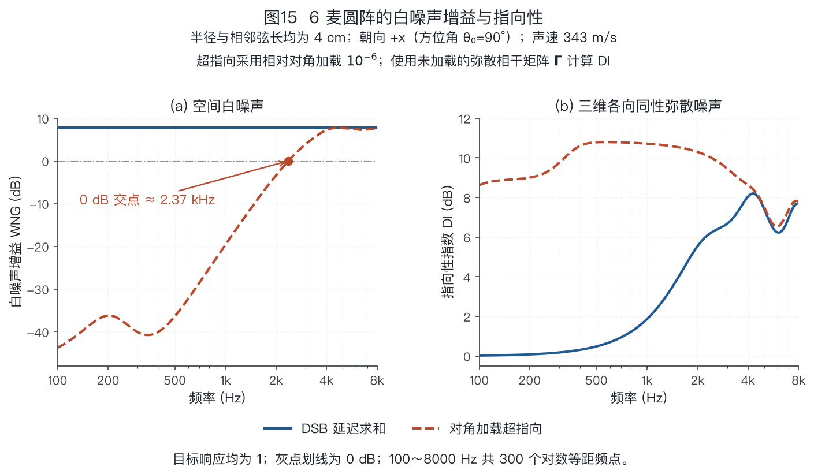
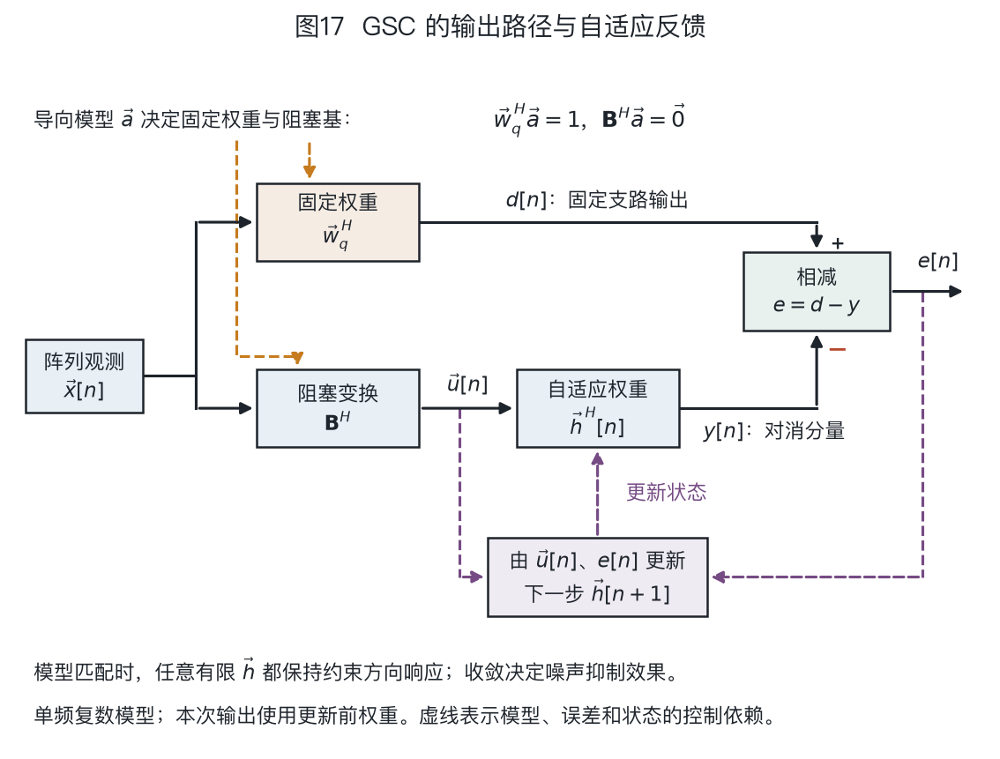
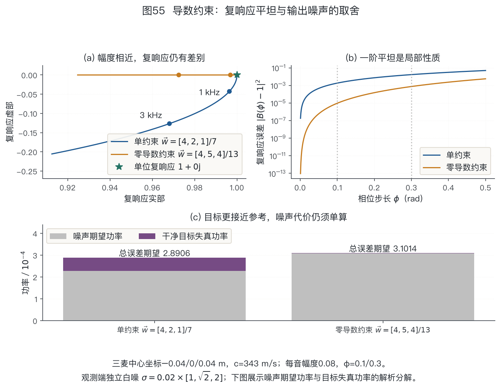
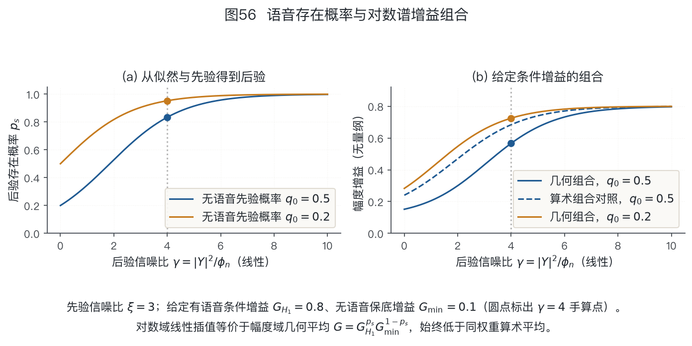
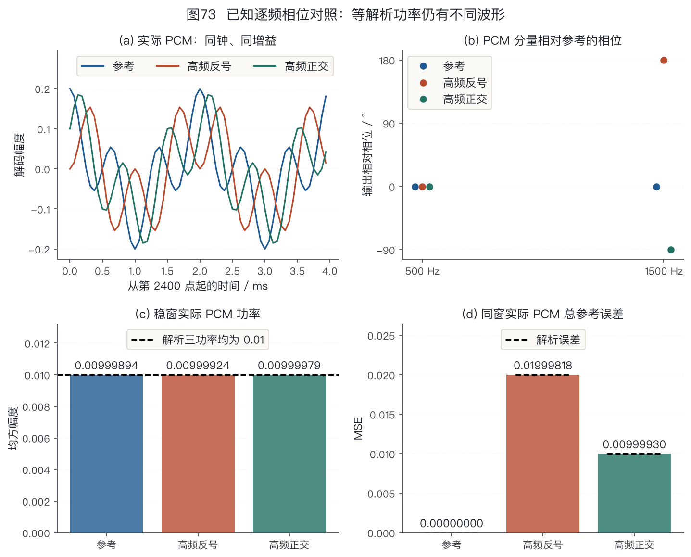

🌐 **简体中文** ｜ [English](../chapters_en/05_beamforming.md)

> 本篇是本书正文第 5 章；正文与扩展专题共 16 章（第 0～15 章，其中第 0 章为数学基础，第 12～15 章为四篇扩展专题），另有附录 A、B。本篇可独立阅读，前后篇见下方导航。
>
> 导读首页：[00_overview.md](00_overview.md) ｜ 上一篇：[04_doa-estimation.md](04_doa-estimation.md) ｜ 下一篇：[06_aec.md](06_aec.md)

---

## 5. 波束形成（Beamforming）

### 5.1 统一问题表述

先看一个可观察的声学现象：同一句话到达不同麦克风的时刻略有先后。若把各通道直接相加，高频成分可能因相位错开而相互抵消；若先把这段传播时差补齐再相加，期望方向的目标语音就能同相叠加保留下来，而偏离该方向的干扰与反射因相位未能对齐而被削弱。这就是波束形成最朴素的物理图景。

在短时傅里叶变换（STFT）频域中，把第 $n$ 帧、第 $k$ 个频点的 $M$ 路麦克风复数谱排成列向量 $\vec x(k,n)\in\mathbb C^{M\times1}$，同样长度的滤波器复权重列向量记为 $\vec w(k,n)\in\mathbb C^{M\times1}$。上标 $H$ 表示厄米共轭转置（先对各元素取复共轭，再转置为行向量；复内积与柯西—施瓦茨不等式见[第 0 章 §0.3](00_math-foundations.md#sec-0-3)），波束形成在该时频点的输出是一个标量复数谱值：

$$y(k,n) = \vec{w}^H(k,n)\,\vec{x}(k,n)\text{。}\tag{5-1}$$

本章沿用第 2 章的几何与相位符号约定：均匀线阵的麦 1 位于左端原点 $x_1=0$，麦 2 及后续阵元沿 $+x$ 轴等距排列，相邻间距为 $d$；方位角 $\theta$ 从正横 $+y$ 轴向 $+x$ 轴顺时针量起，正角声源位于 $+x$ 一侧，单位方向向量 $\vec u$ 从阵列指向声源。定义到达时刻差 $\tau_{ij}=t_i-t_j$，则正角远场平面波先到达右侧阵元，$\tau_{21}=-d\sin\theta/c$；以麦 1 为相位参考时，第 $m$ 支麦克风（$m=1,\ldots,M$，与等比级数求和及代码数组常用的零起点下标 $m'=m-1\in\{0,\ldots,M-1\}$ 仅差平移对应）的自由场导向矢量分量为

$$a_m(f,\theta)=e^{+\mathrm{j}2\pi f(m-1)d\sin\theta/c}\text{。}\tag{5-2}$$

后文固定单个时频点推导时省略 $(k,n)$ 或 $f$ 参数；同一式中的权重 $\vec w$、导向矢量 $\vec a$ 与空间协方差矩阵始终对应同一频点。由于式(5-1)固定写成共轭内积 $y=\vec w^H\vec x$，真正乘到第 $m$ 路观测谱 $x_m$ 上的复系数是 $w_m^*$：例如等权延迟求和取 $\vec w=\vec a/M$ 时，$w_m^*=a_m^*/M$ 恰好把 $a_m$ 的传播超前相位抵消掉。本章全部正负号与共轭方向均严格遵循这一约定。

本章前半部分围绕一类统一的约束优化问题展开：在期望方向 $\theta_0$ 保持单位无失真响应（$\vec{w}^H\vec{a}(\theta_0)=1$）的前提下，最小化某类噪声或干扰的输出功率。延迟求和波束形成器（Delay-and-Sum Beamformer，DSB）、超指向（Superdirective）波束形成、最小方差无失真响应（Minimum Variance Distortionless Response，MVDR）和线性约束最小方差（Linearly Constrained Minimum Variance，LCMV），本质上只是所假定的噪声空间相关模型或线性约束个数不同。多通道维纳滤波（Multichannel Wiener Filter，MWF）改为直接最小化波形谱均方误差，广义特征值（Generalized Eigenvalue，GEV）波束形成则最大化输出信噪比，二者不再强制无失真等式约束，将在后续小节单独推导。

本章高频出现的专业缩写汇总如下，具体定义随各节推导展开：

| 缩写 | 英文全称 | 本章用途 |
|---|---|---|
| SCM | Spatial Covariance Matrix | 描述各通道功率与通道间相关性的空间协方差矩阵 |
| RTF | Relative Transfer Function | 各麦克风相对于参考麦克风的目标传递函数比值 |
| VAD / SPP | Voice Activity Detection / Speech Presence Probability | 帧级语音活动判决／逐时频点语音存在概率 |
| INR | Interference-to-Noise Ratio | 定向干扰功率与单麦非相关背景白噪声功率之比 |
| LMS / NLMS | Least Mean Squares / Normalized LMS | 最小均方自适应更新／按输入能量归一化的自适应更新 |
| RLS | Recursive Least Squares | 递归最小二乘自适应更新 |
| ABM | Adaptive Blocking Matrix | 随观测统计在线调整的目标阻塞矩阵 |

工程声场中的干扰与背景通常拆解为三类典型空间相关模型来分析：

- **空间白噪声**：描述麦克风电子热噪声、前置放大器底噪以及互不相关的局部随机扰动，各通道零均值、互不相关且同方差，空间协方差矩阵为 $\mathbf R_{nn}=\phi_n\mathbf I$（此处“白”仅指空间通道间无相关性，不要求单个通道的时间频率谱平坦）。抗此类底噪及阵元失配的能力用白噪声增益（White Noise Gain，WNG）度量，本章把线性比值记为 $G_{\mathrm{WNG}}$，分贝值记为 $\mathrm{WNG}_{\mathrm{dB}}$。
- **各向同性弥散噪声**：描述封闭房间内经多次壁面反射后方向均匀混合的晚期混响或环境底噪，空间协方差写为 $\mathbf R_{\mathrm{diff}}=\phi_d\mathbf\Gamma$，其中 $\phi_d$ 为单麦弥散噪声功率谱，$\mathbf\Gamma$ 为无量纲归一化空间相干矩阵（对角元恒为 $1$）。阵列抑制此类弥散场的能力用线性的指向因数（directivity factor）$Q$ 与分贝形式的指向性指数（Directivity Index，DI）衡量。
- **定向点干扰**：描述竞争说话人、电视扬声器或局部机械噪声源。若单个点干扰来自方向 $\theta_i$、单麦功率为 $\phi_i$，其空间协方差贡献为秩一矩阵 $\phi_i\vec a(\theta_i)\vec a^H(\theta_i)$，自适应波束形成正是利用这些非对角相位相关项在 $\theta_i$ 方向压低响应。

为什么三维球面各向同性弥散场的空间相干系数恰好是 $\operatorname{sinc}$ 函数？我们可以用两行球面积分把它完整推出来（球面坐标立体角微元与声学特殊函数详见[第 0 章 §0.1](00_math-foundations.md#sec-0-1) 及[§0.7](00_math-foundations.md#sec-0-7)）。不妨将第 $i,j$ 两支麦克风的连线选作球坐标 $+z$ 轴，间距为 $d_{ij}$；来自极角（余纬角）$\vartheta\in[0,\pi]$、方位角 $\alpha\in[0,2\pi)$ 的单位平面波在两麦间产生的波程差为 $d_{ij}\cos\vartheta$，对应频域互谱因子 $e^{\mathrm{j}\kappa d_{ij}\cos\vartheta}$（波数 $\kappa=2\pi f/c$）。令无数个独立同功率平面波在单位球面立体角微元 $\mathrm{d}\Omega=\sin\vartheta\,\mathrm{d}\vartheta\,\mathrm{d}\alpha$（总立体角 $4\pi$）上均匀平均，并作换元 $u=\cos\vartheta$（$\mathrm{d}u=-\sin\vartheta\,\mathrm{d}\vartheta$），可得

$$\begin{aligned}
[\mathbf\Gamma]_{ij}
&=\frac{1}{4\pi}\int_0^{2\pi}\!\!\int_0^\pi
e^{\mathrm{j}\kappa d_{ij}\cos\vartheta}\sin\vartheta\,
\mathrm{d}\vartheta\,\mathrm{d}\alpha\\
&=\frac{1}{2}\int_{-1}^{1}e^{\mathrm{j}\kappa d_{ij}u}\,\mathrm{d}u
=\frac{\sin(\kappa d_{ij})}{\kappa d_{ij}}\\
&=\operatorname{sinc}\!\left(\frac{2fd_{ij}}{c}\right)\text{。}
\end{aligned}$$

本书统一采用归一化定义 $\operatorname{sinc}(x)=\sin(\pi x)/(\pi x)$，因 $\kappa d_{ij}=2\pi fd_{ij}/c=\pi(2fd_{ij}/c)$，两种写法完全衔接；阅读采用非归一化 $\sin x/x$ 的文献时注意自变量相差 $\pi$ 倍。

从上式可以直接读出频率与间距的物理效应：低频或极小间距（$fd_{ij}\ll c$）时 $[\mathbf\Gamma]_{ij}\to 1$，各麦收到的弥散噪声几乎同相，这正是紧凑阵列做差分消噪的依据；当麦距恰为半波长的整数倍（$d_{ij}=l\lambda/2$，$l\in\mathbb Z^+$）时 $[\mathbf\Gamma]_{ij}=0$，球面弥散噪声在两麦间不相关；高频大间距时非对角元振荡衰减，整个 $\mathbf\Gamma$ 趋近单位阵 $\mathbf I$。

需要注意，室外风噪源于麦克风防风罩附近的局部气压湍流，相关尺度远小于声波长，更接近空间白噪声而非各向同性声波场（可穿戴微孔径阵列的 Corcos 湍流风噪相干长度模型及气导与耳道内麦跨模态抗风融合详见[第 14 章 §14.8～§14.9](14_spatial-wearable-arrays.md#sec-14-8)）。

若声波主要限制在水平面内从各方位角等概率入射（**柱面各向同性弥散场**），把上述积分改为对水平方位角 $\alpha\in[0,2\pi)$ 平均，相干系数则变为第一类零阶贝塞尔函数 $J_0(2\pi fd_{ij}/c)$（参见 [Habets & Gannot, *JASA*, 2008](https://israelcohen.com/wp-content/uploads/2018/05/JASA_Nov2008.pdf)）。实际会议室由于吸音吊顶、桌面反射和空调出风口分布不均，空间相干性往往介于球面与柱面理想模型之间，建模时应优先核对实测静音段的互谱相干曲线。

有了 $\mathbf I$ 与 $\mathbf\Gamma$ 两套基准模型，任意权重 $\vec w$ 在期望导向 $\vec a$ 上的白噪声增益与指向因数统一定义为

$$\begin{aligned}
G_{\mathrm{WNG}}&=\frac{|\vec{w}^H\vec{a}|^2}{\vec{w}^H\vec{w}},\\
\mathrm{WNG}_{\mathrm{dB}}&=10\log_{10}G_{\mathrm{WNG}},\\
Q&=\frac{|\vec{w}^H\vec{a}|^2}{\vec{w}^H\mathbf{\Gamma}\vec{w}},\\
\mathrm{DI}&=10\log_{10}Q\text{。}
\end{aligned}\tag{5-3}$$

式(5-3)分子 $|\vec w^H\vec a|^2$ 是单位输入目标功率通过波束后的输出目标功率，分母分别是单位单麦白噪声功率或单位单麦弥散噪声功率下的波束输出噪声功率；因此 $G_{\mathrm{WNG}}$ 和 $Q$ 分别代表该波束相对于单支全向参考麦克风（假设 $|a_m|=1$）的**输出信噪比线性改善倍数**。当权重满足无失真约束 $\vec w^H\vec a=1$ 时，两个分子恒等于 $1$，$G_{\mathrm{WNG}}=1/\|\vec w\|_2^2$ 直接由权重向量二范数决定：权重模长越大，阵元底噪和通道幅相失配就被放大得越厉害。4 麦半波长线阵的具体数值可回看第 2 章算例 2-2，后文图 15 纵轴的 `WNG (dB)` 与 `DI (dB)` 即对应这里的 $\mathrm{WNG}_{\mathrm{dB}}$ 与 $\mathrm{DI}$。

#### 时域滤波与频域权重

本章核心推导写在窄带频域，每个频点各自求出一组复权重 $\vec{w}(k)$。处理宽带语音时，工程上既可以通过 STFT 将信号拆成一组子带逐频点相乘再重叠相加重建（§2.5），也可以直接在时域令每路麦克风通过一段有限冲激响应（Finite Impulse Response，FIR）滤波器后相加，后者称为**滤波求和（filter-and-sum）**结构。整数采样延迟的 DSB 相当于每路 FIR 只有一个非零抽头，而 §5.5 介绍的 Frost 波束形成器则是直接在时域自适应更新多抽头 FIR 权重的经典代表（[Frost, *Proc. IEEE*, 1972](https://doi.org/10.1109/PROC.1972.8817)）。

从逐频点独立求出的复权重 $\vec w(k)$ 回到可实现的时域因果系统时，有三处容易忽视的物理约束：首先，实数时域脉冲响应要求正负频率权重满足共轭对称；其次，有限 DFT 频率网格上的点乘只有在循环卷积无混叠条件下才逼近线性滤波（第 2 章练习 [E02-16](02_basics-signal-model.md#sec-u-59870d19e1) 给出了帧长与滤波器支撑不匹配时的反例）；再次，补偿“后到达阵元”的传播滞后在数学上需要超前时间，因果系统必须额外引入统一的建模基准延迟（参见 [Grimm 等, *EURASIP JASP*, 2016, §5.1](https://doi.org/10.1186/s13634-016-0375-6)）。

用一个简单的两麦离散例子即可看清因果基准延迟的作用：设采样率 $f_s=16\ \mathrm{kHz}$ 下 $x_1[n]=s[n]$、$x_2[n]=s[n-8]$。若强行要求当前时刻输出对齐到 $s[n]$，第二路就必须读取未来样本 $x_2[n+8]$，物理实时系统无法办到。只要给输出统一预留 $8$ 个采样点（$8/16000=0.5\ \mathrm{ms}$）的因果基准延迟，就能用已到达样本因果地算出 $y[n]=(x_1[n-8]+x_2[n])/2=s[n-8]$。

在离散时间傅里叶域中，$8$ 点共同延迟等价于给传递函数乘上线性相位因子 $e^{-\mathrm{j}8\Omega_{\mathrm{d}}}$（其中数字角频率 $\Omega_{\mathrm{d}}=2\pi f/f_s$，单位为 $\mathrm{rad/sample}$）。它丝毫不改变各频点的幅度增益与稳态功率谱，却把输出波形整体右移了 $8$ 点；因此评测时域波形均方误差（MSE）或信干噪比前，必须明确参考信号是否已扣除这段固定建模延迟，以免把单纯的时间平移误判为目标音色失真。至于时域 FIR 与频域 STFT 哪一种延迟更低、算力更省，取决于所需滤波器抽头长度、帧移大小及硬件向量指令集，需结合第 10 章的实时预算具体核算。

### 5.2 延迟求和波束形成器（Delay-and-Sum Beamformer，简称 DSB）：“合唱前先把大家对齐”

延迟求和波束形成器不依赖外部噪声统计，直接按照期望方向 $\theta_0$ 的导向矢量把各通道传播相位补齐后等权平均：

$$\vec{w}_{\mathrm{DSB}} = \frac{1}{M}\vec{a}(\theta_0)\text{。}\tag{5-4}$$

若只对齐相加而不除以 $M$，目标方向幅度会变成单通道的 $M$ 倍；式(5-4)除以 $M$ 是为了在各通道导向模长均为 $|a_m|=1$ 的自由场约定下满足单位响应 $\vec w_{\mathrm{DSB}}^H\vec a(\theta_0)=1$（因 $\frac{1}{M}\sum_{m=1}^M|a_m|^2=1$）。是否除以 $M$ 不影响输出信噪比，只改变绝对电平。若信号模型本身包含近场距离衰减或不等通道增益（即 $|a_m|\ne 1$），则单位无失真响应的空间匹配滤波权重应写为更一般的 $\vec a/(\vec a^H\vec a)=\vec a/\|\vec a\|_2^2$：例如当 $\vec a=[1,2]^\top$ 时，套用 $\vec a/2$ 会得到目标响应 $5/2$，除以 $\|\vec a\|_2^2=5$ 才能精确保持单位响应。

#### 双麦延迟求和手算

设两支全向麦克风相距 $d=4\ \mathrm{cm}$，远场窄带目标声源频率 $f=1\ \mathrm{kHz}$，入射角 $\theta_0=30^\circ$（从正横 $+y$ 轴量起），声速取 $c=343\ \mathrm{m/s}$。我们一步步核对相位补偿与信噪比增益：

1. **几何波程时延差**：$\Delta\tau=d\sin 30^\circ/c=0.02/343$，约为 $58.3\ \mu\mathrm{s}$；
2. **窄带传播相位差**：$\Delta\phi=2\pi f\Delta\tau$，代入 $f=1000\ \mathrm{Hz}$ 得约 $0.366\ \mathrm{rad}$（约 $21.0^\circ$）；
3. **写出导向矢量**：麦 2 位于 $+x$ 侧，$+30^\circ$ 声源先到达麦 2，故有符号到达时差 $\tau_{21}=t_2-t_1=-58.3\ \mu\mathrm{s}$；以麦 1 为参考，导向矢量为 $\vec a=[1,\ e^{+\mathrm{j}0.366}]^\top$；
4. **计算 DSB 权重并核验约束**：$\vec w_{\mathrm{DSB}}=\vec a/2$，即 $[0.5,\ 0.5e^{+\mathrm{j}0.366}]^\top$；代入共轭内积 $\vec w_{\mathrm{DSB}}^H\vec a$ 得 $\tfrac12(1+e^{-\mathrm{j}0.366}e^{+\mathrm{j}0.366})=1$；
5. **物理读法**：在 $y=\vec w^H\vec x$ 中，麦 2 频谱实际乘上共轭系数 $w_2^*=0.5e^{-\mathrm{j}0.366}$（对应时域把先到的麦 2 往后延迟 $58.3\ \mu\mathrm{s}$），恰好抵消其 $+0.366\ \mathrm{rad}$ 的超前相位，使两路目标信号严丝合缝地同相相加。

    再看白噪声下的信噪比账本：若对齐后直接相加（不除以 $2$），两路完全同相的目标幅度变成 $2$ 倍、功率变成 $2^2=4$ 倍；而两路互不相关的同方差白噪声因交叉项期望为零，功率只按方差相加变成 $2$ 倍，故输出信噪比提高到单麦的 $4/2=2$ 倍，即 $10\log_{10}2\approx 3.01\ \mathrm{dB}$。改用式(5-4)除以 $2$ 后，目标输出功率保持为 $1$，白噪声输出功率降为单麦的 $(0.5^2+0.5^2)=0.5$ 倍，输出信噪比改善同样是 $3.01\ \mathrm{dB}$。

#### 阵因子、主瓣与旁瓣

把波束固定指向 $\theta_0$ 后，来自任意测试方向 $\theta$ 的平面波通过这组权重会留下多大幅度？按下面四步可以把离散线阵的方向图解析地拆开：

1. 将波束固定对准 $\theta_0$ 并考察方向 $\theta$ 的入射波：第 $m$ 路（$m=1,\ldots,M$）先乘补偿因子 $a_m^*(f,\theta_0)$，再乘真实入射因子 $a_m(f,\theta)$。记相邻两麦之间的**残余相位差**为 $\psi=(2\pi d/\lambda)(\sin\theta-\sin\theta_0)$，为衔接等比级数零起点求和公式，作平移代换 $m'=m-1\in\{0,1,\ldots,M-1\}$（对应式(5-2)第 $m'+1$ 支麦，式(5-5)求和号中将哑指标简记回 $m=0,\ldots,M-1$），则该路相乘后留下公比因子 $(e^{\mathrm{j}\psi})^{m'}$；
2. 先对这 $M$ 项等比复指数直接求和，得到未归一化的阵因子 $B_{\mathrm{raw}}(\psi)$。当 $e^{\mathrm{j}\psi}\ne 1$（即 $\psi\ne 2\pi l$，$l\in\mathbb Z$）时，先套用有限等比数列求和公式 $\sum_{m=0}^{M-1}q^m=\frac{1-q^M}{1-q}$，再从分子提出半角因子 $e^{\mathrm{j}M\psi/2}$、从分母提出 $e^{\mathrm{j}\psi/2}$，利用欧拉差式 $e^{-\mathrm{j}\alpha}-e^{\mathrm{j}\alpha}$ 等于 $-2\mathrm{j}\sin\alpha$ 约去公因子 $-2\mathrm{j}$，便化为阵列几何中心相位乘实数正弦分式：

    $$\begin{aligned}
    B_{\mathrm{raw}}(\psi)&=\sum_{m=0}^{M-1}e^{\mathrm{j}m\psi}
    =\frac{1-e^{\mathrm{j}M\psi}}{1-e^{\mathrm{j}\psi}}\\
    &=\frac{e^{\mathrm{j}M\psi/2}(e^{-\mathrm{j}M\psi/2}
    -e^{\mathrm{j}M\psi/2})}{e^{\mathrm{j}\psi/2}
    (e^{-\mathrm{j}\psi/2}-e^{\mathrm{j}\psi/2})}\\
    &=e^{\mathrm{j}(M-1)\psi/2}\frac{\sin(M\psi/2)}{\sin(\psi/2)}\text{。}
    \end{aligned}\tag{5-5}$$

    式中前置相位 $e^{\mathrm{j}(M-1)\psi/2}$ 反映的是相位参考选在左端第 $0$ 支麦而非线阵几何中心 $(M-1)d/2$；若改以线阵中心为参考原点，该前置相位恒为 $1$，阵因子变为纯实偶函数。

3. 计入式(5-4)的 $1/M$ 权重系数后，**实际单位响应的波束**方向图为 $B_{\mathrm{DSB}}(\psi)=B_{\mathrm{raw}}(\psi)/M$。在刚好对准目标的 $\psi=0$（即 $\theta=\theta_0$）处，式(5-5)分子与分母同时趋于零，按洛必达法则或直接回到求和定义 $1+1+\cdots+1$ 可知未归一化阵因子极限为 $M$，实际 DSB 响应为 $M/M=1$。

    一旦入射角偏离 $\theta_0$，幅度响应 $|B_{\mathrm{DSB}}(\psi)|$（等于 $|\sin(M\psi/2)|/|M\sin(\psi/2)|$）随 $|\psi|$ 增大而迅速回落并交替起伏，依次形成包络最宽的主瓣、精确相消的零陷点（nulls）以及周期性衰减的旁瓣（sidelobes）。

4. 令分子 $\sin(M\psi/2)=0$ 且分母 $\sin(\psi/2)\ne 0$，立得阵因子的第一个正零点位于 $\psi = 2\pi/M$（$M\ge2$）；只有当该相位差落在物理可见范围 $\frac{2\pi d}{\lambda}|\sin\theta-\sin\theta_0|$ 之内时，才能在真实角度轴 $[-90^\circ,90^\circ]$ 上观测到这个主瓣边缘。反之，当间距过大（如 $d>\lambda/2$）使得某个非零整数 $l$ 满足 $\psi=2\pi l$ 落入可见角域时，分子与分母再次同时为零，所有阵元在错误方向上相差整数个波长而重新同相叠加，幅度回到 $1$——这就是第 2 章 §2.6 讨论的空间混叠栅瓣（grating lobe），绝不能因为分子 $\sin(M\pi l)=0$ 就误判为零陷。

    在正横 $\theta_0=0^\circ$ 附近作小角度近似 $\sin\theta\approx\theta$（弧度），主瓣两侧首零点跨度即“零点到零点”波束宽度约为 $\Delta\theta_{\mathrm{null}}\approx\frac{2\lambda}{Md}$，功率降为一半（幅度约为 $1/\sqrt{2}\approx0.707$，即 $-3\ \mathrm{dB}$）的半功率波束宽度在大阵元数连续孔径近似下约为 $\Delta\theta_{3\mathrm{dB}}\approx 0.886\lambda/(Md)$；波束斜指向 $\theta_0$ 时有效投影孔径缩短为 $\cos\theta_0$ 倍，上述宽度还需除以 $\cos\theta_0$（§2.6）。注意公式中的 $Md$ 来自 $M$ 项离散求和，而阵列的物理首尾跨度是 $D=(M-1)d$，阵元数较少或靠近端射时应直接用 $|B_{\mathrm{DSB}}(\psi)|^2=1/2$ 精确反解角度。例如正横双麦取小间距 $d=\lambda/8$ 时，全空间 $|\theta|\le 90^\circ$ 内 $|\psi|\le\pi/4$，最小归一化输出功率也有 $\cos^2(\pi/8)\approx 0.854$（$-0.69\ \mathrm{dB}$），整个角域内既无零点也无 $-3\ \mathrm{dB}$ 半功率点。

均匀加权等价于在空间阵元轴上截取矩形窗。随着阵元数 $M$ 增大，$\sin(M\psi/2)/[M\sin(\psi/2)]$ 逼近连续 $\operatorname{sinc}$ 谱，第一旁瓣峰值才渐近趋向熟知的 $-13.26\ \mathrm{dB}$；对常见中小规模线阵直接按式(5-5)复算，$M=3,4,8,16$ 的第一旁瓣峰值分别约为 $-9.54\ \mathrm{dB}$、$-11.30\ \mathrm{dB}$、$-12.80\ \mathrm{dB}$ 和 $-13.15\ \mathrm{dB}$（$M=2$ 在主瓣外单调变化，不存在旁瓣峰），设计小阵列时不宜盲目套用“第一旁瓣恒为 $-13\ \mathrm{dB}$”的渐近口诀。

若希望压低固定旁瓣，可改用中间阵元权重大、两端阵元权重小的空间窗函数（如汉宁窗或 Dolph–Chebyshev 窗），代价是主瓣展宽且白噪声增益略低于等权上限。经典 Dolph–Chebyshev 加权针对等间距对称正横线阵，在给定等波纹旁瓣电平约束下使首零点主瓣宽度达到最窄（[Dolph, *Proc. IRE*, 1946](https://doi.org/10.1109/JRPROC.1946.225956)）。工程调用库函数（如 [SciPy `chebwin`](https://docs.scipy.org/doc/scipy/reference/generated/scipy.signal.windows.chebwin.html)）时，注意库函数默认将窗系数峰值归一化为 $1$，赋给波束权重前必须再除以系数总和 $\sum_{m=1}^M w_m$，才能维持目标方向的单位无失真响应。

#### 白噪声增益上限

为什么在所有满足无失真约束 $\vec w^H\vec a=1$ 的线性波束形成器中，DSB 的抗白噪声与抗通道失配能力最强？利用柯西–施瓦茨不等式两步即可证出这个硬上限：

1. 对单位模导向矢量（$|a_m|=1$，$m=1,\ldots,M$），有 $\|\vec a\|_2^2=\vec a^H\vec a=M$。代入式(5-4)的 $\vec w_{\mathrm{DSB}}=\vec a/M$，权重范数平方为 $\|\vec w_{\mathrm{DSB}}\|_2^2=M/M^2=1/M$，故线性白噪声增益恰为 $G_{\mathrm{WNG}}=1/(1/M)=M$，分贝值为 $10\log_{10}M$（每将阵元数翻倍，白噪声增益提升约 $3.01\ \mathrm{dB}$）。
2. 对任意满足 $\vec w^H\vec a=1$ 的复权重向量 $\vec w$，由复内积柯西–施瓦茨不等式 $1=|\vec w^H\vec a|^2\le\|\vec w\|_2^2\|\vec a\|_2^2$ 及 $\|\vec a\|_2^2=M$，立得 $\|\vec w\|_2^2\ge 1/M$，从而 $G_{\mathrm{WNG}}=\frac{1}{\|\vec w\|_2^2}\le M$，当且仅当 $\vec w$ 与 $\vec a$ 共线（即 $\vec w=\vec a/M=\vec w_{\mathrm{DSB}}$）时取等号。只要各通道噪声满足互不相关同方差且阵列流形各通道幅度相等，任何试图通过调整幅相去形成深零陷或收窄低频主瓣的算法，都必然以牺牲一部分 $G_{\mathrm{WNG}}$ 为代价。

上述 $3.01\ \mathrm{dB}$ 增益成立的关键物理前提是**通道噪声互不相关**。读者可以直接播放本仓库随附的四份 $16\ \mathrm{kHz}$ 单声道合成对照音频（时长 $2\ \mathrm{s}$，共同导出增益 $1.0$，两路目标已对齐并按 $[0.5,0.5]^\top$ 平均，单通道高斯噪声标准差均为 $0.07$，建议先调低音量试听）：

- [对齐目标参考（无噪基准）](../codes/chapters/ch05/audio/correlation_reference.wav)：干净目标信号，全段零时延对齐；
- [单麦含噪观测](../codes/chapters/ch05/audio/correlation_single.wav)：单通道目标叠加标准差 $0.07$ 的零均值高斯噪声（理论噪声方差 $0.07^2=0.0049$）；
- [独立噪声两麦平均](../codes/chapters/ch05/audio/correlation_independent.wav)：两路噪声独立抽样后等权平均，总体噪声方差减半为 $0.00245$（理论信噪比提升 $3.01\ \mathrm{dB}$，听感底噪明显变轻）；
- [完全相同噪声两麦平均](../codes/chapters/ch05/audio/correlation_common.wav)：第一路噪声原样复制到第二路后再等权平均，由于噪声与目标一样完全同相，输出波形与单麦含噪观测逐样本一致（信噪比改善为 $0\ \mathrm{dB}$）。

总结 DSB 的工程定位：它在精确导向与空间白噪声下达到最高白噪声增益 $M$，无可逆矩阵病态问题，计算开销极小，常作为多麦系统的稳健保底基线和自适应算法的静态初值；但它的方向图完全由阵列孔径与频率固定，低频波长远大于孔径时几乎退化为全向拾音，且无法根据强竞争说话人的实际方位主动放置深零陷。

### 5.3 超指向的白噪声增益—指向性权衡

既然低频段弥散噪声在相邻麦克风之间高度相关（$[\mathbf\Gamma]_{ij}\to 1$），那么不再机械地等权相加，而是在期望方向保持无失真（$\vec w^H\vec a=1$）的前提下直接最小化球面弥散场的输出噪声功率 $\vec w^H\mathbf\Gamma\vec w$，就能最大化线性指向因数 $Q$（因对数单调递增，同时也就最大化了指向性指数 DI）。这就是**超指向（Superdirective）波束形成**——数学上等同于把噪声协方差取为理论弥散相干矩阵 $\mathbf\Gamma$ 的 MVDR 问题：

$$\begin{aligned}
\min_{\vec w}\;&\vec w^H\mathbf\Gamma\vec w,\\
\text{s.t.}\;&\vec w^H\vec a=1,\\
\vec w_{\mathrm{SD}}&=(\vec a^H\mathbf\Gamma^{-1}\vec a)^{-1}
\mathbf\Gamma^{-1}\vec a\text{。}
\end{aligned}\tag{5-6}$$

式(5-6)的闭式解由带线性等式约束的复二次型优化导出，完整四步拉格朗日推导将在 §5.4 展开（只需把那里的 $\mathbf R_{nn}$ 替换为 $\mathbf\Gamma$）。写普通矩阵逆 $\mathbf\Gamma^{-1}$ 要求 $\mathbf\Gamma$ 严格正定：在零频率极限 $f=0$ 或两支阵元空间重合时，所有通道传播相位完全一致，$\mathbf\Gamma=\vec 1\vec 1^\top$ 退化为秩一奇异矩阵，此时即便人工加正则使矩阵可逆，物理声场里也已经没有可提取的方向相位差。

在低频小间距极限 $d/\lambda\to 0$ 下，超指向究竟能把指向因数推到多高？经典阵列理论（Uzkov 定理）证明：对于三维球面各向同性弥散场中的 $M$ 元均匀线阵，端射方向（$\theta_0=\pm 90^\circ$）的最大可达指向因数趋近于阵元数的平方，即 $Q_{\max}=M^2$（$\mathrm{DI}_{\max}=20\log_{10}M\ \mathrm{dB}$），恰好是同阵元数半波长 DSB 线阵（$Q=M$）的 $M$ 倍！具体到最常见的**双麦端射阵（$M=2$）**，其超指向极限对应一阶超心形（hypercardioid）方向图，理论上界为 $Q_{\max}=2^2=4$（$\mathrm{DI}_{\max}\approx 6.02\ \mathrm{dB}$，即 $10\log_{10}4$）。

然而，获得这额外 $3\ \mathrm{dB}$ 弥散噪声抑制的代价是相邻通道必须做剧烈的反相相减：随着频率降低或间距缩短，$\mathbf\Gamma$ 的最小特征值按 $(\kappa d)^2$ 甚至更高幂次趋向零，导致权重范数 $\|\vec w_{\mathrm{SD}}\|_2$ 急剧膨胀、$G_{\mathrm{WNG}}$ 跌成深负分贝值，任何微小的麦克风热噪声、灵敏度公差和相位漂移都会被同步放大。因此工程设计从不裸用无约束的式(5-6)，而是加上 $\|\vec w\|_2^2\le\delta$ 的白噪声增益下限约束（或对角加载），在低频用受控差分换取指向性，在高频 $\mathbf\Gamma\approx\mathbf I$ 时自然平滑过渡回 DSB。

这里还藏着一个非常漂亮的**声学互易对偶关系——声对比度控制（Acoustic Contrast Control，简称 ACC）**。在车载个人声区（Personal Sound Zones）或定向扬声器阵列中，工程师的目标是调整 $M$ 个扬声器的复驱动权重 $\vec q$，使“亮区（听音区）”平均声势能 $\vec q^H\mathbf R_B\vec q$ 与“暗区（安静区）”平均声势能 $\vec q^H\mathbf R_D\vec q$ 的比值最大化（[Choi & Kim, *JASA*, 2002](https://doi.org/10.1121/1.1456926)）：

$$\begin{aligned}
\max_{\vec q}\;
&\frac{\vec q^H\mathbf R_B\vec q}
{\vec q^H\mathbf R_D\vec q}
\iff \mathbf R_B\vec q=\lambda_{\max}\mathbf R_D\vec q\text{。}
\end{aligned}$$

根据声学互易原理，在发射内积约定 $p(\vec u)\propto\vec q^H\vec a(\vec u)$（即第 $m$ 只扬声器馈入共轭滤波权 $q_m^*$）下把扬声器换成麦克风、把发射改成接收：若亮区缩减为期望方向上的单个远场参考点（$\mathbf R_B=\vec a\vec a^H$ 为秩一矩阵），暗区取为包围阵列的整个球面均匀积分（$\mathbf R_D=\mathbf\Gamma$），上述广义瑞利商最大化在相差一个无失真归一化标量的意义下，就精确退化为式(5-6)的超指向权重 $\vec q\propto\mathbf\Gamma^{-1}\vec a$！不仅如此，扬声器阵列在低频追求高声对比度时出现的驱动电流暴涨（array effort $\|\vec q\|_2^2$ 过大、振膜冲程饱和），在数学与物理上正是接收端超指向低频 $G_{\mathrm{WNG}}$ 恶化的镜像对偶；而多点亮区的一般 ACC 广义特征值方程，又与本章 §5.9 将要推导的最大信噪比 GEV 波束形成共享同一套矩阵代数。

#### 算例 5-1：超指向权重与白噪声增益

**输入与口径**：取双麦小间距线阵 $d=0.05\lambda$，记三维球面弥散噪声相干系数 $\rho=\operatorname{sinc}(0.1)=\sin(0.1\pi)/(0.1\pi)$（约为 $0.9836316$），二阶相干矩阵 $\mathbf\Gamma$ 主对角为 $1$、副对角为 $\rho$。中间步骤保留双精度浮点，展示时四舍五入至四位小数，按式(5-6)逐步手算正横与端射两种指向的权重、$\mathrm{WNG}_{\mathrm{dB}}$、$\mathrm{DI}$ 及失配偏差。

**第 1 步：检查 $\mathbf{\Gamma}$ 的病态程度**

$$\begin{aligned}
\det\mathbf\Gamma&=1-\rho^2\approx 0.0325,\\
\mathbf\Gamma^{-1}&\approx\frac{1}{0.0325}
\begin{bmatrix}1&-0.9836\\-0.9836&1\end{bmatrix}\\
&\approx\begin{bmatrix}30.80&-30.29\\-30.29&30.80\end{bmatrix}\text{。}
\end{aligned}$$

两麦间距仅为波长的二十分之一，弥散噪声相关系数高达 $\rho\approx0.9836$，导致行列式只有 $0.0325$，逆矩阵元素冲上 $30$ 量级（两个特征值分别为 $1+\rho\approx 1.9836$ 与 $1-\rho\approx 0.0164$，二范数条件数约为 $121$）。不过最终权重还要除以分母 $\vec a^H\mathbf\Gamma^{-1}\vec a$，权重究竟会不会爆炸，取决于导向矢量 $\vec a$ 落在对称和模还是反对称差模特征方向上。我们先看正横方向的退化反例，再看端射方向的差分放大。

**第 2 步：正横指向（$\theta_0=0^\circ$）的退化情形**

当目标位于正横 $\theta_0 = 0^\circ$ 时，$\vec{a}_0 = [1, 1]^\top$ 恰好是 $\mathbf{\Gamma}$ 对应大特征值 $1+\rho$ 的对称特征向量（$\mathbf{\Gamma}\vec{a}_0 = (1+\rho)\vec{a}_0$），于是 $\mathbf{\Gamma}^{-1}\vec{a}_0 = \vec{a}_0/(1+\rho)$ 与 $\vec a_0$ 完全共线，归一化后大因子整体约去：

$$\begin{aligned}
\vec w_{\mathrm{SD}}&=[0.5,\ 0.5]^\top=\vec w_{\mathrm{DSB}},\\
\mathrm{WNG}_{\mathrm{dB}}&\approx +3.01\ \mathrm{dB}\text{。}
\end{aligned}$$

对称双麦阵对正横来波没有阵元间相位差可资利用，任何反相相减都会把正横目标一并抵消，因此式(5-6)自动退化回等权 DSB（此时 $Q=2/(1+\rho)\approx 1.008$，$\mathrm{DI}\approx 0.04\ \mathrm{dB}$）。随着目标偏离正横，导向矢量开始投影到差模特征向量 $[1,-1]^\top$（小特征值 $1-\rho$）上，端射方向投影最强。

**第 3 步：端射指向（$\theta_0=90^\circ$）的权重求解**

端射传播相位差 $\psi=2\pi(0.05)\sin 90^\circ=0.1\pi$（约 $0.3142\ \mathrm{rad}$，即 $18^\circ$），导向矢量 $\vec a=[1,\ e^{+\mathrm{j}0.3142}]^\top$ 约为 $[1,\ 0.9511+0.3090\mathrm{j}]^\top$。代入式(5-6)分别算分子与分母：

- 分子：$\mathbf\Gamma^{-1}\vec a$ 两分量分别约为 $1.9869-9.3616\mathrm{j}$ 与 $-1.0033+9.5174\mathrm{j}$（模长接近 $9.6$，且两路虚部近乎等幅反号）；
- 分母：$\vec a^H\mathbf\Gamma^{-1}\vec a\approx 3.9737$（正实数，且由于无失真分子为 $1$，这个分母本身就是最终指向因数 $Q$！）；
- 相除得超指向权重：

$$\begin{aligned}
\vec w_{\mathrm{SD}}&\approx\begin{bmatrix}
0.5000-2.3559\mathrm{j}\\
-0.2525+2.3951\mathrm{j}
\end{bmatrix},\\
|w_1|&=|w_2|\approx 2.41\text{。}
\end{aligned}$$

**第 4 步：核验无失真约束背后的“大数相减”**

$$\begin{aligned}
w_1^*a_1&\approx 0.5000+2.3559\mathrm{j},\\
w_2^*a_2&\approx 0.5000-2.3559\mathrm{j},\\
\vec w_{\mathrm{SD}}^H\vec a&=w_1^*a_1+w_2^*a_2=1\text{。}
\end{aligned}$$

看清这一步的物理机制至关重要：单路加权后的目标信号模长高达 $2.41$，靠两路正负虚部 $\pm 2.3559\mathrm{j}$ 精确对消，才拼出幅度为 $1$ 的输出！用两个大数相减来提取微小相位差，一旦硬件通道稍有偏差，对消天平就会失衡。

**第 5 步：核算 $\mathrm{WNG}_{\mathrm{dB}}$ 与 $\mathrm{DI}$ 的得失账**

$$\begin{aligned}
\|\vec w_{\mathrm{SD}}\|_2^2&\approx 2(2.4084)^2\approx 11.60,\\
\mathrm{WNG}_{\mathrm{dB}}&=10\log_{10}(1/11.60)
\approx\mathbf{-10.6\ dB}\text{。}
\end{aligned}$$

同一端射指向下，DSB 的 $\mathrm{WNG}_{\mathrm{dB}}=+3.01\ \mathrm{dB}$（但 $\mathrm{DI}\approx 0.00\ \mathrm{dB}$）。超指向把独立阵元自噪声功率放大到了单麦的 $11.6$ 倍（恶化 $10.6\ \mathrm{dB}$），换来的是弥散场指向因数跃升至 $Q=\vec a^H\mathbf\Gamma^{-1}\vec a\approx 3.9737$，对应 $\mathrm{DI}=10\log_{10}3.9737\approx +5.99\ \mathrm{dB}$，已经紧贴双麦超心形的理论极限 $Q_{\max}=M^2=4$（$6.02\ \mathrm{dB}$）。

**第 6 步：量化通道增益失配的放大效应**

假设麦 2 存在常见的 $1\%$ 幅度灵敏度正偏差（约 $0.086\ \mathrm{dB}$，远优于消费级驻极体或普通 MEMS 麦克风未配对时的 $\pm 1\ \mathrm{dB}$ 公差），实际目标传递向量变为 $\vec a_{\mathrm{mis}}$ 取 $[1,1.01e^{+\mathrm{j}0.3142}]^\top$，则实际输出响应变为

$$\begin{aligned}
\vec w_{\mathrm{SD}}^H\vec a_{\mathrm{mis}}
&\approx 1.0050-0.0236\mathrm{j}\text{，}
\end{aligned}$$

复响应偏离理想值 $1$ 的误差模长为 $|0.0050-0.0236\mathrm{j}|\approx 2.41\%$。同样的 $1\%$ 单麦增益误差作用在 DSB 上只产生 $0.5\%$ 的响应偏差；超指向因权重范数膨胀了约 $4.8$ 倍，对器件公差的敏感度也同步放大了近 $5$ 倍（严格上界将在练习 E05-06 用柯西–施瓦茨不等式证出）。

**第 7 步：扫描归一化间距 $d/\lambda$（固定端射 $90^\circ$）**

| 阵元间距 $d$ | $0.5\lambda$ | $0.1\lambda$ | $0.05\lambda$ | $0.02\lambda$ | $0.01\lambda$ |
|---|---|---|---|---|---|
| 单通道权重模长 $\lvert w_i\rvert$ | $0.50$ | $1.24$ | $2.41$ | $5.98$ | $11.94$ |
| $\mathrm{WNG}_{\mathrm{dB}}$ | $+3.0\ \mathrm{dB}$ | $-4.9\ \mathrm{dB}$ | $-10.6\ \mathrm{dB}$ | $-18.5\ \mathrm{dB}$ | $-24.6\ \mathrm{dB}$ |
| $\mathrm{DI}$ | $+3.0\ \mathrm{dB}$ | $+5.9\ \mathrm{dB}$ | $+6.0\ \mathrm{dB}$ | $+6.0\ \mathrm{dB}$ | $+6.0\ \mathrm{dB}$ |

这张扫描表揭示了紧凑阵列选型最核心的边际递减律：从左往右看，当间距从 $0.5\lambda$ 缩小到 $0.1\lambda$ 时，$\mathrm{DI}$ 从 $3.0\ \mathrm{dB}$ 显著提升至 $5.9\ \mathrm{dB}$；但从 $0.05\lambda$ 继续缩减到 $0.01\lambda$ 时，由于 $Q$ 已被 $M^2=4$（$6.02\ \mathrm{dB}$）封顶，$\mathrm{DI}$ 几乎纹丝不动，而权重模长却按 $\propto\lambda/d$ 线性翻倍、白噪声输出功率按 $\propto(\lambda/d)^2$ 暴涨——间距每减半（或工作频率每降低一个倍频程），一阶端射超指向的 $\mathrm{WNG}_{\mathrm{dB}}$ 就再跌落约 $6\ \mathrm{dB}$！



**怎么读图 15**：图 15 把上述单频规律扩展为 $6$ 麦均匀圆阵（半径与相邻弦长均为 $4\ \mathrm{cm}$，坐标 $0.04[\cos(2\pi m/6),\sin(2\pi m/6)]\ \mathrm{m}$，波束朝 $+x$ 方向，对应自 $+y$ 参考轴顺时针量起的水平方位角 $\theta_0=90^\circ$，声速 $343\ \mathrm{m/s}$，$100$～$8000\ \mathrm{Hz}$ 共 $200$ 个等距频点）的宽带频率扫描。两幅子图的横轴均采用对数频率刻度，并用蓝色实线（DSB 延迟求和）与红色虚线（加入相对对角加载 $10^{-6}$ 的超指向，评分时仍代入未加载的真实物理弥散矩阵 $\mathbf\Gamma$）对照：

- **先看左子图 `(a) 空间白噪声`**：纵轴为 $\mathrm{WNG}_{\mathrm{dB}}$，灰色水平点划线标出 $0\ \mathrm{dB}$ 单麦基准。蓝色实线在全频带笔直地保持在 $10\log_{10}6\approx 7.78\ \mathrm{dB}$，印证了 DSB 在单位模导向下恒达最大白噪声增益；红色虚线在 $100\ \mathrm{Hz}$ 处深跌至 $-43.72\ \mathrm{dB}$（在 $300$～$400\ \mathrm{Hz}$ 附近因 $10^{-6}$ 相对对角加载与 $\mathbf\Gamma$ 高阶小特征值的量级交替而出现一处凹谷拐点），随后以陡峭斜率一路爬升，在约 $2.2\ \mathrm{kHz}$ 跨过 $0\ \mathrm{dB}$ 基准线（低于此线代表阵列输出底噪反而比单支麦克风更大），并在 $4\ \mathrm{kHz}$ 以上贴近蓝色实线。
- **再看右子图 `(b) 三维各向同性弥散噪声`**：纵轴为 $\mathrm{DI}$。蓝色实线在 $100\ \mathrm{Hz}$ 处仅有 $0.02\ \mathrm{dB}$（此时声波长 $3.43\ \mathrm{m}$ 远大于 $8\ \mathrm{cm}$ 阵径，DSB 几乎丧失空间分辨力），直到 $1\ \mathrm{kHz}$ 以上才快速爬升，在约 $4\ \mathrm{kHz}$ 达到峰值约 $8.2\ \mathrm{dB}$ 后因阵元间距逼近波长而出现空间旁瓣回落；反观红色虚线，在 $100\ \mathrm{Hz}$ 就已取得 $8.62\ \mathrm{dB}$ 的指向性指数，并在 $400$～$1500\ \mathrm{Hz}$ 语音频段维持超过 $10.5\ \mathrm{dB}$ 的平坦高指向性平台，高频段随 $\mathbf\Gamma\to\mathbf I$ 与 DSB 自然汇合。两张子图左右对照，便一目了然地呈现出“低频拿白噪声余量换取弥散场指向性”的物理天平。

在紧凑消费电子产品（如智能耳机、眼镜与小型音箱）中，常采用**差分麦克风阵列（Differential Microphone Array，简称 DMA）**来逼近低频超指向特性。需要注意，超指向是“给定弥散噪声矩阵最大化 $Q$”的优化准则，而 DMA 是“利用近距阵元信号相减、内部延迟与频响均衡来合成目标空间梯度方向图”的实现结构——只有在 $\kappa d\ll 1$ 低频近似且系数恰好匹配弥散场最优解时，两者才指向同一方向图。

**上线前的四项必检诊断量**：无论采用频域超指向还是后文的自适应 MVDR，求出权重 $\vec w(k)$ 后都应先过四道数值体检，再送入音频链路：

1. **白噪声增益余量**：计算 $G_{\mathrm{WNG}}=|\vec w^H\vec a|^2/\|\vec w\|_2^2$（精确无失真约束下即 $1/\|\vec w\|_2^2$）并按式(5-3)折算为 $\mathrm{WNG}_{\mathrm{dB}}$，结合麦克风信噪比指标（如 $65\ \mathrm{dB(A)}$ MEMS）与通道配对公差设定各频段允许的最低门限；
2. **协方差二范数条件数**：监测待求逆矩阵 $\mathbf{\Gamma}$ 或 $\hat{\mathbf{R}}_{nn}$ 的无量纲条件数 $\kappa_2=\lambda_{\max}/\lambda_{\min}$（注意与单位为 $\mathrm{rad/m}$ 的声波数 $\kappa$ 区分）。$\kappa_2$ 过大意味着微小统计扰动或有限字长舍入误差会在求逆后剧烈放大，需通过 §5.4 的对角加载或降阶子空间投影压回安全区间；
3. **动态范围与削波率**：当低频权重模长远大于 $1$ 时，非相干底噪、近讲喷麦气流或突发敲击声经加权叠加极易冲破定点或浮点 $[-1,1]$ 满刻度，须在代表性高声压测试集上核查峰值裕量与削波率；
4. **通道幅相失配扫描**：按器件手册公差、结构公差与温漂范围给导向矢量注入随机幅相扰动 $\vec a_{\mathrm{mis}}$，统计目标响应偏差 $|\vec w^H\vec a_{\mathrm{mis}}-1|$、零陷漂移及实际有效 WNG 的分位数分布。

#### 5.3.1 差分麦克风：从一阶心形到高阶设计

上一节指出了紧凑阵列靠通道相减换取低频指向性的规律。这一小节我们把一阶差分的指数项彻底拆开，看清心形、超心形与偶极子从哪里来，为什么差分器天生是一个 $+6\ \mathrm{dB/oct}$ 高通滤波器，以及为什么低频积分均衡和 MEMS 密封垫圈漏气会成为量产硬件最棘手的两道关卡。

**一阶差分与低频泰勒展开**：考察沿 $x$ 轴放置的端射双麦，间距为 $d$。为便于直接观察前后向抑制，本小节取麦 1 位于前端原点 $x=0$、麦 2 位于后端 $x=d$；把声源方向与前端轴线（$-x$ 方向，对应前文水平方位角 $\theta=-90^\circ$）的夹角记为端射轴向角 $\varphi\in[0,\pi]$，则正前方为 $\varphi=0$（$\theta=-90^\circ$）、正侧方为 $\varphi=90^\circ$（$\theta=0^\circ$）、正后方为 $\varphi=180^\circ$（$\theta=+90^\circ$）。平面波先到达前端麦 1、后到达后端麦 2 的物理传播时延差为 $\tau_p(\varphi)=t_2-t_1=(d/c)\cos\varphi$（水平面内满足 $\cos\varphi=-\sin\theta$）。令麦 1 减去经内部延迟 $\tau$ 和实数增益 $g$ 调整后的麦 2 信号 $y(t)=x_1(t)-g\,x_2(t-\tau)$，其以轴向夹角 $\varphi$ 为自变量的连续时间频率响应（模拟角频率 $\omega=2\pi f$，单位 $\mathrm{rad/s}$）为

$$\begin{aligned}
H(\omega,\varphi)&=1-g\,e^{-\mathrm{j}\omega[\tau+\tau_p(\varphi)]}\text{。}
\end{aligned}\tag{5-7}$$

要合成标准的一阶梯度方向图族，取等幅相减 $g=1$，并把内部延迟按端射渡越时间 $T=d/c$ 无量纲化为 $\tau=\alpha T$（$\alpha\ge 0$）。注意到 $\omega T=\omega d/c=\kappa d$，当满足小间距低频条件 $\kappa d\ll 1$ 时，对复指数作一阶泰勒展开 $e^{-z}\approx 1-z$，式(5-7)立刻化简为时空分离的乘积形式：

$$\begin{aligned}
1-e^{-\mathrm{j}\kappa d(\alpha+\cos\varphi)}
&\approx\mathrm{j}\kappa d(\alpha+\cos\varphi)\\
&=\mathrm{j}\frac{\omega d}{c}(\alpha+\cos\varphi)
\qquad(\kappa d\ll 1)\text{。}
\end{aligned}$$

这行极其简洁的近似式一口气把一阶 DMA 的四大物理与工程特性全部摊在了桌面上：

1. **角度形状由无量纲延迟比 $\alpha$ 决定**：将正前方 $\varphi=0$ 归一化为单位响应后，空间指向图为 $D(\varphi)=\frac{\alpha+\cos\varphi}{\alpha+1}$（“全向项 $\alpha$ + 偶极余弦项 $\cos\varphi$”，参见 [Elko & Pong, *ICASSP*, 1997](https://doi.org/10.1109/ICASSP.1997.599609)）。取 $\alpha=0$（零内部延迟纯相减）得到 $\cos\varphi$ 偶极 8 字形，零点在侧方 $\varphi=90^\circ$；取 $\alpha=1$（内部延迟恰等于麦间渡越时间 $\tau=d/c$）得到 $(1+\cos\varphi)/2$ 标准心形，零点精准落在正后方 $\varphi=180^\circ$；取 $\alpha=1/3$ 则零点移至 $\varphi=\arccos(-1/3)\approx 109.5^\circ$，恰好在三维球面各向同性弥散场中达到双麦理论最高指向因数 $Q_{\max}=4$（$\mathrm{DI}\approx 6.02\ \mathrm{dB}$），这就是大名鼎鼎的**一阶超心形**！
2. **天生 $+6\ \mathrm{dB/oct}$ 一阶高通斜率**：在固定方向（如正前方 $\varphi=0$）上，未均衡输出响应 $\mathrm{j}\frac{\omega d}{c}(1+\alpha)$ 与角频率 $\omega$ 成正比，即频率每升高一倍（一个倍频程 octave），幅度翻倍（$+6.02\ \mathrm{dB/oct}$，折合每十倍频程 $+20\ \mathrm{dB/dec}$），同时附带 $+\mathrm{j}$ 对应的 $+90^\circ$ 相位超前。反之，频率每降低一半，目标有效信号就衰减 $6\ \mathrm{dB}$。
3. **$1/(\mathrm{j}\omega)$ 均衡器剧烈放大低频传感器底噪**：为了让输出语音保持平坦的自然音色，差分后必须串接一个增益为 $H_{\mathrm{eq}}(\omega)$（即 $c/[\mathrm{j}\omega d(1+\alpha)]$）的积分型低频补偿均衡器（$-6\ \mathrm{dB/oct}$ 低频提升）。然而，两颗麦克风内部互不相关的热噪声与 $1/f$ 闪烁噪声并不会像远场声波那样在相减时抵消，而是按功率相加变成单麦的 $2$ 倍，再被 $|H_{\mathrm{eq}}(\omega)|^2\propto 1/\omega^2$ 在低频端急剧放大——频率每往下降一个倍频程，输出本底白噪声功率就暴涨 $6\ \mathrm{dB}$，与算例 5-1 第 7 步完全吻合！因此实用 DMA 均衡器必须在语音基频下限（如 $100$～$150\ \mathrm{Hz}$）设置增益封顶（shelving）与高通滚降，严禁向直流无限积分。
4. **MEMS 声孔与密封垫圈漏气的致命低频相移**：在智能音箱、TWS 耳机或会议麦壳体装配中，MEMS 麦克风贴装在 PCB 上，依靠橡胶密封垫圈（gasket）与壳体导音孔压紧耦合。若其中一颗麦克风的垫圈存在哪怕发丝级的压合缝隙或胶圈老化漏气（acoustic leak），声腔就多出一条声阻—声顺旁路，等效于在该通道前端串入一阶声学高通滤波器：即便在 $200\ \mathrm{Hz}$ 处幅度仅跌落零点几分贝，也会在 $100$～$500\ \mathrm{Hz}$ 频段额外引入 $3^\circ$～$15^\circ$ 的通道间相位差！回头看上面的展开式，间距 $d=1$～$2\ \mathrm{cm}$ 在 $200\ \mathrm{Hz}$ 时的真实空间相位差 $\kappa d$ 一共才 $2^\circ$～$4^\circ$（$0.036$～$0.073\ \mathrm{rad}$），垫圈微漏气带来的寄生相移比真实声程差还大，会直接把精心设计的后向心形零点彻底冲垮，甚至让低频主瓣反向指到后方。

    因此量产产线必须在低频耦合腔内逐台检测双麦相位一致性，仅靠 $1\ \mathrm{kHz}$ 单频灵敏度配对远远不够（一阶四类经典方向图的解析零点与 $Q$ 值、倍频程 $-6\ \mathrm{dB/oct}$ 白噪惩罚及 $5^\circ$ 垫圈漏气相移手算见章末练习 [E05-28](#e05-28)）。

**一阶心形 DMA 单频手算核验**：设端射双麦间距 $d=2\ \mathrm{cm}$、声速 $c=343\ \mathrm{m/s}$，单程渡越时间 $T=d/c\approx 58.31\ \mu\mathrm{s}$。取心形参数 $g=1,\ \tau=T$（即 $\alpha=1$），此时正后方（$\varphi=180^\circ,\ \tau_p=-T$）满足 $\tau+\tau_p=0$，对任意频率均有精确零响应 $H_b=1-e^0=0$。考察 $f=500\ \mathrm{Hz}$（$\kappa d\approx 0.1832\ \mathrm{rad}$）处的正前方响应（$\varphi=0,\ \tau_p=+T$）：

$$\begin{aligned}
H_f&=1-e^{-\mathrm{j}2\omega T},\\
|H_f|&=2|\sin(\omega T)|=2\sin(\kappa d)\approx 0.3643\text{。}
\end{aligned}$$

要把 $500\ \mathrm{Hz}$ 的前向目标幅度拉平到 $1$，均衡器幅度须乘以 $1/|H_f|\approx 2.745$。两路独立单位方差白噪声相减后的功率为 $1^2+1^2=2$，经均衡放大后输出噪声功率升至 $2/|H_f|^2\approx 15.07$，故 $\mathrm{WNG}_{\mathrm{dB}}=10\log_{10}(1/15.07)$，约为 $-11.78\ \mathrm{dB}$。若此时麦 2 仅有 $1\%$ 的灵敏度增益偏差（$g=1.01$），原本深度无限的后向零陷立刻抬升至 $|1-1.01|/|H_f|\approx 0.0274$，即相对前向仅剩约 $-31.2\ \mathrm{dB}$ 的抑制深度。一旦频率继续升高到 $\kappa d$ 接近 $\pi$（本例约 $8.58\ \mathrm{kHz}$），$\sin(\kappa d)\to 0$ 甚至使前向目标本身发生梳状相消，这决定了固定延迟 DMA 的高频工作上限。

**向高阶 DMA 推广时的权衡**：将多个一阶差分支路级联（例如三麦做二阶差分合成二阶超心形，理论三维弥散场极限跃升至 $Q_{\max}=3^2=9$、$\mathrm{DI}\approx 9.54\ \mathrm{dB}$），能够提供两个独立可调的后半空间零点以对抗多路反射。但 $N$ 阶差分的低频响应按 $(\mathrm{j}\kappa d)^N$（$+6N\ \mathrm{dB/oct}$）衰减，配套均衡器必须按 $1/\omega^N$ 抬升低频，导致白噪声输出功率按 $(\lambda/d)^{2N}$ 爆炸性增长（[Elko, *Differential Microphone Arrays*, 2004](https://doi.org/10.1007/1-4020-7769-6_2)）。下表汇总了调整 DMA 三项关键硬件与滤波器参数时的连锁影响：

| 设计变化 | 可能获得的能力 | 同时增加的风险 | 必须固定的比较条件 |
|---|---|---|---|
| 增加差分阶数 | 可配置更多零点和更细的空间变化 | 权重范数增大，低频自噪声和失配更易被放大 | 频率、间距、噪声场、目标图形与均衡器 |
| 减小阵元间距 | 在更高频率前维持 $\kappa d\ll1$ 近似 | 通道观测更相似，差分后的 WNG 可能降低 | 麦克风自噪声、标定残差与数值精度 |
| 增强低频均衡 | 补偿差分器的低频衰减 | 同时放大低频传感器噪声和风噪 | 最大增益、削波余量与 WNG 下限 |

从表格三行可以提炼出紧凑阵列的工程分频法则：切忌强求高阶差分覆盖全频带，通常在极低频退回一阶差分或 DSB 保底噪，在中频段启用二阶差分压混响，在高频段切换为常规波束。若引入神经网络辅助小间距阵列，工业界也普遍优先让网络预测受物理约束的零点位置、混合权重或正则化因子，再交由解析差分结构输出音频，从而保留明确的 WNG 下界与失配可控性；若直接由神经网络自由生成任意时域滤波抽头，则不再具备经典 DMA 的解析频响不变性，应归入 §5.9 的端到端神经滤波框架下评测。

至此，我们已经走完了不依赖在线噪声统计的两类固定/半固定方法：DSB 守住白噪声增益上限 $M$，超指向与 DMA 在预设弥散场下拿低频 WNG 换取指向性。如果房间里出现了方位未知的强竞争说话人或空调外机，固定波束图无法精准把零点对准干扰——这就自然引出了下一节利用实测噪声协方差矩阵自动调整权重的 MVDR 波束形成。

### 5.4 最小方差无失真响应

最小方差无失真响应（Minimum Variance Distortionless Response，简称 MVDR，也称 Capon 波束形成器）不再预先假定噪声来自各向同性弥散场，而是直接代入实测或估计得到的 $M\times M$ 噪声加干扰空间协方差矩阵 $\mathbf{R}_{nn}=\mathbb{E}[\vec n\vec n^H]$：在期望目标导向矢量 $\vec a(\theta_0)$ 上强制保持单位复响应的同时，把波束输出端的总噪声与干扰功率压到最低：

$$\begin{aligned}
\min_{\vec w}\;&\vec w^H\mathbf R_{nn}\vec w,\\
\text{s.t.}\;&\vec w^H\vec a(\theta_0)=1\text{。}
\end{aligned}\tag{5-8}$$

式(5-8)中的 $\mathbf{R}_{nn}$ 为厄米半正定矩阵（$\mathbf R_{nn}^H=\mathbf R_{nn}$），其第 $m$ 个对角元是第 $m$ 路麦克风在当前频点的噪声加干扰功率，第 $(i,j)$ 个非对角元记录第 $i,j$ 两路干扰之间的互功率与相位差（注意与第 4 章 §4.2 的时域标量互相关函数 $R_{x_1x_2}(\tau)$ 区分）。还要时刻牢记：“无失真”严格作用在传入的约束向量 $\vec a(\theta_0)$ 上；只有当 $\vec a(\theta_0)$ 与真实声学环境中的目标传递向量一致时，真实目标语音才不会受损。

**拉格朗日乘子法四步完整推导**：

**第 1 步：构造实值拉格朗日函数。** 因为 $\vec w^H\vec a=1$ 是一条复数等式约束（同时锁死了实部为 $1$、虚部为 $0$ 两个实自由度），引入复标量乘子 $\lambda\in\mathbb C$ 时，必须把原约束与它的共轭约束 $\vec a^H\vec w=1$ 成对写入目标函数，保证拉格朗日函数 $L(\vec w,\lambda)$ 恒为实数：

$$\begin{aligned}
L(\vec w,\lambda)&=\vec w^H\mathbf R_{nn}\vec w
+\lambda(1-\vec w^H\vec a)
+\lambda^*(1-\vec a^H\vec w)\text{。}
\end{aligned}$$

**第 2 步：利用 Wirtinger 复向量求导法则求驻点。** 记复向量实虚部分解 $\vec w=\vec u+\mathrm{j}\vec v$（$\vec u,\vec v\in\mathbb R^M$），实值函数 $L$ 取极值的充要条件是对全部实部与虚部偏导为零。Wirtinger 微积分将共轭偏导 $\partial/\partial\vec w^*$ 定义为 $\tfrac12(\partial_{\vec u}+\mathrm{j}\partial_{\vec v})$（详见附录 A），在该算子下可以把 $\vec w$ 与 $\vec w^*$ 看作彼此独立的形式变量，直接套用基本复向量求导恒等式（$\mathbf R_{nn}^H=\mathbf R_{nn}$）：

$$\begin{aligned}
\frac{\partial(\vec w^H\vec c)}{\partial\vec w^*}&=\vec c,\qquad
\frac{\partial(\vec c^H\vec w)}{\partial\vec w^*}=\vec 0,\\
\frac{\partial(\vec w^H\mathbf R_{nn}\vec w)}{\partial\vec w^*}
&=\mathbf R_{nn}\vec w\text{。}
\end{aligned}$$

将这三条规则逐项用于 $L(\vec w,\lambda)$：第一项二次型给出 $\mathbf R_{nn}\vec w$，第二项 $-\lambda(\vec w^H\vec a)$ 给出 $-\lambda\vec a$，第三项 $-\lambda^*(\vec a^H\vec w)$ 不含 $\vec w^*$ 故导数为 $\vec 0$。令总梯度为零，当 $\mathbf R_{nn}$ 严格正定可逆时立得

$$\begin{aligned}
\frac{\partial L}{\partial\vec w^*}
&=\mathbf R_{nn}\vec w-\lambda\vec a=\vec 0,\\
\vec w&=\lambda\mathbf R_{nn}^{-1}\vec a\text{。}
\end{aligned}$$

这一步给出了极其清晰的物理读法：**最优权重方向由“经逆噪声协方差压制后的导向矢量”$\mathbf R_{nn}^{-1}\vec a$ 决定**。如果某个方向存在强干扰，该方向对应的特征值很大，$\mathbf R_{nn}^{-1}$ 就会在那个特征子空间上大幅缩小权重投影。

顺带澄清一个常见术语混淆：严格意义上的空间白化矩阵是厄米平方根逆 $\mathbf R_{nn}^{-1/2}$（记 $\mathbf W_n=\mathbf R_{nn}^{-1/2}$，它满足 $\mathbf W_n\mathbf R_{nn}\mathbf W_n=\mathbf I$，在白化域内问题退化为普通空间匹配滤波 $\tilde{\vec w}\propto\mathbf R_{nn}^{-1/2}\vec a$）；再从白化域变换回阵元域乘上一次 $\mathbf R_{nn}^{-1/2}$，才合并成我们看到的 $\mathbf R_{nn}^{-1}\vec a$。

**第 3 步：代入无失真约束定出归一化乘子。** 将 $\vec w=\lambda\mathbf R_{nn}^{-1}\vec a$ 代回 $\vec w^H\vec a=1$（注意对标量 $\lambda$ 也要取共轭）：

$$\lambda^*\,\vec{a}^H\mathbf{R}_{nn}^{-1}\vec{a} = 1\text{。}$$

因为 $\mathbf R_{nn}$ 厄米正定，其逆矩阵 $\mathbf R_{nn}^{-1}$ 同样厄米正定；对任意非零导向矢量 $\vec a$，二次型 $q=\vec a^H\mathbf R_{nn}^{-1}\vec a>0$ 恒为严格正实数，故 $\lambda^*=1/q$ 本身就是正实数，$\lambda=\lambda^*=1/(\vec a^H\mathbf R_{nn}^{-1}\vec a)$。若快拍数少于通道数（$N<M$）导致采样协方差矩阵奇异，切忌不加区分地把 $\mathbf R_{nn}^{-1}$ 机械替换成 Moore–Penrose 伪逆 $\mathbf R_{nn}^+$——附录 A 练习 E16-05 用一个两通道反例严格证明了当真实无噪方向落在矩阵零空间时，伪逆会错失零噪声可行解。

**第 4 步：合成为 MVDR 闭式解并算出最小残留噪声功率。** 将正实数乘子 $\lambda$ 代回第 2 步，即得著名的 MVDR（Capon）闭式权重：

$$\begin{aligned}
\vec w_{\mathrm{MVDR}}
&=\frac{\mathbf R_{nn}^{-1}\vec a}
{\vec a^H\mathbf R_{nn}^{-1}\vec a}\text{。}
\end{aligned}\tag{5-9}$$

把式(5-9)代回目标函数 $\vec w^H\mathbf R_{nn}\vec w$，分子约掉一个二次型后得到最小输出噪声功率恰好为 $P_{n,\min}=1/q$（其中 $q=\vec a^H\mathbf R_{nn}^{-1}\vec a$）。

回顾第 4 章式(4-12)的 Capon 空间谱，那里用总观测协方差 $\mathbf R_{xx}$ 扫描所有候选角并把输出功率 $1/(\vec a^H\mathbf R_{xx}^{-1}\vec a)$ 当作方向能量指示器；而在波束形成中，倘若目标与噪声严格零均值不相关且导向精确匹配，即 $\mathbf R_{xx}=\mathbf R_{nn}+\phi_s\vec a\vec a^H$，可以验证（练习 E05-13）代入 $\mathbf R_{xx}$ 与代入纯噪声矩阵 $\mathbf R_{nn}$ 求出的权重向量完全相同，区别仅在于总输出功率为 $\phi_s+1/q$。一旦存在哪怕微小的 DOA 误差或混响失配，使用含目标的 $\mathbf R_{xx}$ 就会把真实目标当作强干扰压制（即“目标自消”），这也是工程上千方百计单独估计纯净 $\mathbf R_{nn}$ 的根本原因。

观察式(5-9)的两个极端特例能立刻建立直觉：当背景退化为空间白噪声 $\mathbf R_{nn}=\phi_n\mathbf I$ 时，$\phi_n$ 上下约消，MVDR 自动退化为 $\vec a/\|\vec a\|_2^2=\vec w_{\mathrm{DSB}}$；当背景变为纯弥散场 $\mathbf R_{nn}=\phi_d\mathbf\Gamma$ 时，MVDR 自动退化为式(5-6)的超指向波束形成。下一节的 LCMV（§5.5）则是把单条等式约束扩充为矩阵等式约束。

#### 算例 5-2：2 麦 MVDR 数值推导

**输入与口径**：取半波长双麦线阵 $d=\lambda/2$，期望目标位于正横 $\theta_0=0^\circ$；单一点干扰来自 $\theta_i=30^\circ$，单麦独立白噪声功率归一化为 $1$，干扰功率为 $10$（线性干噪比 $\mathrm{INR}=10$，即 $10\ \mathrm{dB}$）。下面不跳步手算式(5-9)的权重，并核查目标保真、干扰抑制与白噪声增益代价。

**第 1 步：写出目标与干扰的导向矢量**

间距 $d=\lambda/2$ 时传播相位系数为 $2\pi d/\lambda=\pi$：

- 目标方向（$\theta_0=0^\circ$）：$\psi_0 = \pi\sin 0^\circ = 0$，故 $\vec{a}_0 = [1,\ 1]^\top$；
- 干扰方向（$\theta_i=30^\circ$）：$\psi_i=\pi\sin 30^\circ=\pi/2$，故 $\vec a_i=[1,e^{+\mathrm{j}\pi/2}]^\top$，即 $[1,+\mathrm{j}]^\top$（麦 2 相对麦 1 超前 $90^\circ$）。

**第 2 步：构造干扰加噪声协方差矩阵 $\mathbf{R}_{nn}$**

点干扰与各通道独立白噪声互不相关，协方差直接相加：

$$\mathbf{R}_{nn} = 10\,\vec{a}_i\vec{a}_i^H + \mathbf{I}\text{。}$$

计算秩一外积 $\vec a_i\vec a_i^H=[1,+\mathrm{j}]^\top[1,-\mathrm{j}]$ 时务必盯紧右上角元素的共轭号（主对角为 $1$，右上为 $-\mathrm{j}$、左下为 $+\mathrm{j}$），乘以 $10$ 再加上单位阵得

$$\begin{aligned}
\mathbf R_{nn}&=\begin{bmatrix}
11 & -10\mathrm{j}\\ +10\mathrm{j} & 11
\end{bmatrix}\text{。}
\end{aligned}$$

矩阵每一项都有明确的账目：主对角元 $11 = 10 + 1$ 是每支麦克风收到的总干扰加噪声功率；副对角元 $\mp 10\mathrm{j}$ 编码了两路干扰的强相关性与 $90^\circ$ 相位差。

**第 3 步：求 $2\times2$ 逆矩阵 $\mathbf{R}_{nn}^{-1}$**

套用二阶矩阵求逆法则（主对角元素 $p,s$ 互换、副对角元素 $q,r$ 变号再除以行列式 $ps-qr$），先算行列式（注意 $(-10\mathrm{j})(+10\mathrm{j})=-100\mathrm{j}^2=+100$）：

$$\begin{aligned}
\det\mathbf R_{nn}&=11\times11-(-10\mathrm{j})(+10\mathrm{j})\\
&=121-100=21\text{。}
\end{aligned}$$

该矩阵的两个特征值分别为 $\lambda_1=1+10\times 2=21$（干扰加白噪子空间）和 $\lambda_2=1$（纯白噪正交子空间），二范数条件数 $\kappa_2=21/1=21$，远比算例 5-1 低频超指向的条件数 $121$ 良态。写出逆矩阵：

$$\begin{aligned}
\mathbf R_{nn}^{-1}&=\frac{1}{21}\begin{bmatrix}
11&+10\mathrm{j}\\-10\mathrm{j}&11
\end{bmatrix}\\
&\approx\begin{bmatrix}
0.5238&+0.4762\mathrm{j}\\
-0.4762\mathrm{j}&0.5238
\end{bmatrix}\text{。}
\end{aligned}$$

**第 4 步：代入式(5-9)求归一化权重**

- 分子：$\mathbf R_{nn}^{-1}\vec a_0$ 等于 $\tfrac{1}{21}[11+10\mathrm{j},11-10\mathrm{j}]^\top$，两分量分别约为 $0.5238+0.4762\mathrm{j}$ 与 $0.5238-0.4762\mathrm{j}$；
- 分母：$q=\vec a_0^H\mathbf R_{nn}^{-1}\vec a_0$ 化简为 $(11+11)/21=22/21\approx 1.0476>0$（正负虚部抵消；最小残留干扰加噪声总功率即为 $1/q=21/22\approx 0.9545$，甚至低于单麦纯白噪功率 $1$！）；
- 相除化简得精确有理分式与四位小数近似：

$$\begin{aligned}
\vec w_{\mathrm{MVDR}}&=\frac{1}{22}\begin{bmatrix}
11+10\mathrm{j}\\11-10\mathrm{j}
\end{bmatrix}\\
&\approx\begin{bmatrix}
0.5000+0.4545\mathrm{j}\\
0.5000-0.4545\mathrm{j}
\end{bmatrix}\text{。}
\end{aligned}$$

对比同指向 DSB 权重 $[0.5,0.5]^\top$：MVDR 保留了实部 $[0.5,0.5]^\top$ 来维持正横目标响应，同时自动长出了一对反号纯虚部 $[\pm\frac{5}{11}\mathrm{j}]^\top$（单路权重模长增至 $\sqrt{0.5^2+(5/11)^2}\approx 0.6757$），专门用来对冲 $+30^\circ$ 干扰。

**第 5 步：核查目标保真与干扰抑制量**

- **目标方向（$0^\circ$）**：$\vec w_{\mathrm{MVDR}}^H\vec a_0$ 展开为 $(0.5-5\mathrm{j}/11)+(0.5+5\mathrm{j}/11)=1$，正负虚部精确抵消，严格无失真；
- **干扰方向（$+30^\circ$）**：代入 $\vec a_i=[1,+\mathrm{j}]^\top$（注意 $\vec w^H$ 先取共轭），

$$\begin{aligned}
\vec w_{\mathrm{MVDR}}^H\vec a_i
&=\Big(\frac{1}{2}-\frac{5}{11}\mathrm{j}\Big)\cdot 1
+\Big(\frac{1}{2}+\frac{5}{11}\mathrm{j}\Big)(+\mathrm{j})\\
&=\Big(\frac{1}{2}-\frac{5}{11}\Big)(1+\mathrm{j})
=\frac{1+\mathrm{j}}{22}\\
&\approx 0.0455+0.0455\mathrm{j}\text{。}
\end{aligned}$$

干扰方向幅度增益 $|\vec w_{\mathrm{MVDR}}^H\vec a_i|$ 等于 $\sqrt2/22\approx 0.0643$，折合 $20\log_{10}(\sqrt 2/22)\approx \mathbf{-23.84\ dB}$！输入功率高达 $10$ 的强干扰被压制到输出功率仅剩 $10\times(\sqrt 2/22)^2=20/484\approx 0.0413$，而输出白噪声功率为 $\|\vec w_{\mathrm{MVDR}}\|_2^2=221/242\approx 0.9132$，两者相加 $0.0413+0.9132=0.9545=21/22$，与第 4 步预测的理论最小功率 $1/q$ 分毫不差。

为什么 MVDR 在 $+30^\circ$ 的响应是 $-23.84\ \mathrm{dB}$ 而不是精确的 $0$？因为式(5-8)优化的是**干扰功率与白噪声功率之和**：如果强行把 $+30^\circ$ 压到绝对零响应（相当于下一节算例的 LCMV），权重虚部必须从 $\pm 5/11\mathrm{j}$ 扩大到 $\pm 0.5\mathrm{j}$，白噪声功率就会从 $0.9132$ 涨到 $1.0000$，总输出噪声反而升至 $1.0000>0.9545$！MVDR 极其聪明地在“把干扰再压深一点”与“别把白噪声放大太多”之间停在了总功率最低的平衡点（练习 E05-05 将展示随 $\mathrm{INR}\to\infty$ 零陷如何渐近移向 $30^\circ$）。

**第 6 步：扫描五个典型方位的波束幅度与 WNG 代价**（记 $B(\theta)=\vec w_{\mathrm{MVDR}}^H\vec a(\theta)$）

| 测试角度 $\theta$ | 幅度增益 $20\log_{10}\lvert B(\theta)\rvert$ | 物理成因与读图要点 |
|---|---:|---|
| $0^\circ$ | **$0.00\ \mathrm{dB}$** | 无失真等式约束锁死单位响应 |
| $+30^\circ$ | **$-23.84\ \mathrm{dB}$** | 顺应 $\mathrm{INR}=10$ 形成深抑制谷（精确零点位于约 $+32.03^\circ$） |
| $+15^\circ$ | $-5.05\ \mathrm{dB}$ | 靠近深谷的过渡侧翼被连带压低 |
| $-30^\circ$ | $+2.61\ \mathrm{dB}$ | 没有干扰的另一侧未被惩罚，响应略高于 $0\ \mathrm{dB}$（幅度约 $1.35$） |
| $+45^\circ$ | $-8.62\ \mathrm{dB}$ | 越过零点后幅度回升 |

同时核算白噪声增益：$G_{\mathrm{WNG}}=1/\|\vec w_{\mathrm{MVDR}}\|_2^2$，等于 $242/221\approx 1.095$，即 $\mathrm{WNG}_{\mathrm{dB}}\approx +0.39\ \mathrm{dB}$，比同阵列 DSB 的 $+3.01\ \mathrm{dB}$ 让出了约 $2.62\ \mathrm{dB}$ 的白噪声余量，换来了对 $+30^\circ$ 强干扰近 $24\ \mathrm{dB}$ 的定向压制（该方向上 DSB 幅度响应为 $|\cos(\pi/4)|=1/\sqrt 2$，仅压低 $3.01\ \mathrm{dB}$）。注意 $-30^\circ$ 处出现了 $+2.61\ \mathrm{dB}$ 的超调：无失真约束只管住 $0^\circ$ 一点，并未禁止无噪声方向增益大于 $1$。


**怎么读图 16**：图 16 在上半平面极坐标（角度 $-90^\circ$～$+90^\circ$，$0^\circ$ 朝正上方，正角顺时针向右）中并排给出无量纲线性幅度子图 `(a)` 与截断在 $-40\ \mathrm{dB}$ 圆心的分贝幅度子图 `(b)`。读图时请抓准两条对比线索：

- **同孔径下的“对称固定 vs 自适应置零”（蓝色实线 vs 红色虚线）**：两者均采用 $8$ 麦半波长均匀线阵（$d=0.5\lambda$），目标均在 $0^\circ$。在线性子图 `(a)` 中只看得出两者主瓣都很窄；切到分贝子图 `(b)` 细节立刻显现：蓝色实线 DSB 左右严格对称，第一旁瓣约 $-12.8\ \mathrm{dB}$；红色虚线 MVDR（记 $\vec b=\vec a_{20^\circ}$，协方差取 $\mathbf R_{nn}=\mathbf I+10\vec b\vec b^H$）在 $+20^\circ$ 干扰方位把响应猛压至 $-50.74\ \mathrm{dB}$（已穿透 $-40\ \mathrm{dB}$ 截断圆心），代价是左侧 $-20^\circ$～$-90^\circ$ 无干扰半区的旁瓣比蓝色实线略微抬高了 $1$～$3\ \mathrm{dB}$。由于 $8$ 麦阵拥有 $7$ 个空间自适应自由度，它压制单个干扰所需的权重范数变化很小，主瓣几乎未变形。
- **不同孔径下的“跨几何对照”（绿色点线）**：绿色点线画的是另一套紧凑 $8$ 麦阵（$d=0.2\lambda$，总跨度仅为前两者的 $2/5$，配相对对角加载 $10^{-6}$）在球面弥散场下的超指向波束图。因为物理孔径显著缩小，其主瓣比 $d=0.5\lambda$ 阵列宽一圈，且在 $\pm 90^\circ$ 端射附近留有一对贴近底边的旁瓣；把它画在同一极坐标里是为了直观对比紧凑超指向与半波长阵列的波束形态差异，绝不能脱离孔径尺寸直接按主瓣宽窄给算法本身排高低。

**实现中的三个问题**：

1. **$\mathbf{R}_{nn}$ 从哪来**：经典流水线依靠语音活动检测（VAD）在纯噪声停顿段递推更新噪声协方差；当背景非平稳或存在重叠干扰时，现代远场语音前端（如 CHiME 系列挑战赛主流方案，详见 §8.4）普遍改用神经网络预测逐时频点的时频掩码（Time-Frequency mask，TF-mask），在整句话内对各帧外积加权统计纯净噪声协方差与目标协方差；
2. **病态与对角加载**：当统计窗口内有效快拍数不足、阵元间距很小或干扰个数较少时，采样协方差 $\hat{\mathbf{R}}_{nn}$ 的小特征值估计方差很大甚至退化为零，直接求解线性方程会导致权重范数失控；工程上将矩阵替换为对角加载形式 $\hat{\mathbf R}_{nn}+\varepsilon\mathbf I$，抬平小特征值地板并收紧权重二范数；
3. **混响中的约束对象**：式(5-2)的自由场导向矢量只刻画无反射直达声，而在真实混响房间中，目标语音经过墙面与桌面的早期强反射一并到达阵列，真实空间传递特性偏离平面波模型；此时应改用相对传递函数（Relative Transfer Function，RTF），即以某支参考麦克风为基准估计各通道对目标直达加早期反射的复传递比向量作为无失真约束列。

#### 对角加载、WNG 约束与正则化的关系

为什么在采样协方差矩阵对角线上加一个正数 $\varepsilon\mathbf I$，就能精准控制白噪声增益？我们可以用拉格朗日对偶把两者的数学等价条件一步写透（复变 Wirtinger 微积分与约束拉格朗日对偶见[第 0 章 §0.5](00_math-foundations.md#sec-0-5)）。在精确无失真约束 $\vec w^H\vec a=1$ 下，要求白噪声增益不低于 $G_{\min}$（即 $G_{\mathrm{WNG}}=1/\|\vec w\|_2^2\ge G_{\min}$）等价于施加二范数球约束 $\|\vec w\|_2^2\le\delta$（此处 $\delta=1/G_{\min}$ 表示权重二范数平方预算，可行性要求 $\delta\ge 1/\|\vec a\|_2^2=1/M$；注意勿与第 4 章表示绝对加载量的符号 $\delta$ 混淆）。为这一个凸二次不等式约束引入非负实拉格朗日乘子 $\varepsilon\ge 0$（即带功率量纲的绝对对角加载量，对应第 4 章的 $\delta$），增广拉格朗日函数为

$$\begin{aligned}
\mathcal L(\vec w,\lambda,\varepsilon)
&=\vec w^H(\hat{\mathbf R}_{nn}+\varepsilon\mathbf I)\vec w
-\varepsilon\delta\\
&\quad+\lambda(1-\vec w^H\vec a)+\lambda^*(1-\vec a^H\vec w)\text{。}
\end{aligned}$$

对比式(5-8)的拉格朗日函数可以一眼看出：固定乘子 $\varepsilon\ge 0$ 时，对 $\vec w^*$ 求导给出的最优解恰恰就是把 $\hat{\mathbf R}_{nn}$ 替换为绝对对角加载矩阵 $\hat{\mathbf R}_{nn}+\varepsilon\mathbf I$ 后的 MVDR 权重！由凸优化的 KKT 互补松弛条件 $\varepsilon(\|\vec w(\varepsilon)\|_2^2-\delta)=0$ 可知分两种情形：

- 若未加载（$\varepsilon=0$）求出的 MVDR 权重已经满足 $\|\vec w(0)\|_2^2\le\delta$，则约束未激活，最优乘子 $\varepsilon=0$，无需加载；
- 若未加载权重超出了范数预算（$\|\vec w(0)\|_2^2>\delta$），由于 $\|\vec w(\varepsilon)\|_2^2$ 随 $\varepsilon>0$ 单调连续递减并趋向 $1/M$，最优解必然落在球面边界 $\|\vec w(\varepsilon^\star)\|_2^2=\delta$ 上，唯一对应一个正加载量 $\varepsilon^\star>0$（参见 [Cox, Zeskind & Owen, *IEEE TASSP*, 1987](https://doi.org/10.1109/TASSP.1987.1165054)；[Li, Stoica & Wang, *IEEE TSP*, 2003](https://doi.org/10.1109/TSP.2003.812831)）。

需要注意，绝对加载量 $\varepsilon$ 与协方差元素同量纲（功率量纲）：若输入音频整体放大 $10$ 倍，$\hat{\mathbf R}_{nn}$ 放大 $100$ 倍，固定的绝对常数 $\varepsilon$ 就会失去原有的正则化比例。为实现尺度不变的工程调参，本书代码与对比表统一采用无量纲相对对角加载系数 $\alpha\ge 0$（对应第 4 章 Capon 谱中的无量纲相对加载符号 $\eta$，注意与递推协方差中的指数遗忘因子区分），按矩阵迹均值（即各通道平均功率）自适应定标：

$$\begin{aligned}
\hat{\mathbf R}_{nn,\mathrm{load}}
&=\hat{\mathbf R}_{nn}
+\alpha\,\frac{\operatorname{tr}(\hat{\mathbf R}_{nn})}{M}\mathbf I\text{。}
\end{aligned}\tag{5-10}$$

同一个固定 WNG 门限 $\delta$ 在不同频点、不同信噪比下对应的最优相对加载系数 $\alpha$ 并不相同：在线系统既可以用二分法/牛顿法在每个频点根据特征分解反解精确的 $\varepsilon^\star$（练习 E05-07 给出了完整的闭式反推算例），也可以按频段预设经验 $\alpha$。下表总结了相对加载系数 $\alpha$ 从小到大变化时各项核心指标的联动走向：

| $\alpha$ 取值 | 加载相对平均特征值的大小 | 白噪声增益 | 指向性/零陷深度 | 稳健性 | 适用场合 |
|---|---|---|---|---|---|
| 较小 | 只轻微抬高特征值 | 接近未加载解 | 接近未加载解 | 小快拍下求逆仍可能病态 | 快拍充足、标定较好的离线处理 |
| 中等（由验证集确定） | 小特征值被抬高 | 通常回升 | 通常变浅 | 对估计误差和轻微失配较稳 | 按 WNG 与目标失真联合调参 |
| 较大 | 加载项主导小特征值，继续增大时可主导整个矩阵 | 趋近 DSB 上限 | 深零陷逐渐变浅 | 解逐渐接近固定波束 | 稳健模式或诊断对照 |

顺着表格三行往下读，可以把 $\alpha$ 理解为连接“纯数据驱动 MVDR”（$\alpha\to 0$）与“纯几何固定 DSB”（$\alpha\to\infty$）的一枚连续旋钮：调大 $\alpha$ 会把所有小特征值垫高，压缩大、小特征值之比从而降低条件数并抬升 $\mathrm{WNG}_{\mathrm{dB}}$，但同时也削弱了逆矩阵对干扰方向的区分力度，使深零陷逐渐变浅。选参时切忌在加载后的矩阵 $\hat{\mathbf R}_{nn,\mathrm{load}}$ 上自评输出噪声，必须把加载求出的权重代回未加载的真实验证数据统计目标保真与干扰残留。

**真实多麦房间录音对照（LOCATA 公开数据集）**：为了看清上述公式在真实混响房间中的表现，本书[课程首页交互案例](00_overview.md#course-cases)基于 [LOCATA 挑战赛开发集](https://zenodo.org/records/3630471)任务 2 第 1 条 DICIT 阵列实录（同步 $15$ 麦、采样率 $48\ \mathrm{kHz}$，房间内扬声器 A 为目标说话人、扬声器 B 为竞争干扰说话人）构建了同时间轴、同导出增益的三路可试听对比：

1. **计算目标导向矢量**：读取光学动作捕捉系统测得的扬声器 A 与 $15$ 支麦克风的三维坐标，以第 $7$ 路麦克风为相位与幅度基准，由几何距离差除以 $343\ \mathrm{m/s}$ 构造单位模自由场导向矢量 $\vec a_A(k)$，供对齐相加（DSB）与加载 MVDR 共同使用。
2. **估计干扰加背景协方差并做相对加载**：截取 $3.48$～$3.94\ \mathrm{s}$ 内完全落入扬声器 B 单独发声区间的 $41$ 帧（对称 Hann 窗长 $1024$ 点、帧移 $512$ 点），逐频点计算 $15$ 路复谱外积均值作为 $\hat{\mathbf R}_{nn}(k)$（天然包含 B 的直达声、房间混响与环境底噪），再按式(5-10)取相对加载系数 $\alpha=0.1$ 代入式(5-9)求解 MVDR 权重。
3. **分频带平滑融合与时域重建**：在语音核心频带 $250$～$6000\ \mathrm{Hz}$ 采用加载 MVDR 权重，在 $125$～$250\ \mathrm{Hz}$ 与 $6000$～$8000\ \mathrm{Hz}$ 过渡带用升余弦窗将 MVDR 权重与 DSB 权重线性插值（因两组权重对 $\vec a_A$ 均满足单位响应，凸组合自动保持 $\vec w^H\vec a_A=1$），频带外退回 DSB，最后经共轭对称实谱逆变换与重叠相加输出波形。该设计在工作频带内的最低白噪声增益约为 $4.14\ \mathrm{dB}$（$15$ 麦等权上限为 $10\log_{10}15\approx 11.76\ \mathrm{dB}$）。
4. **独立时间窗分项核验**：避开训练统计所用的校准窗，另取两段互不重叠的单讲窗口，直接从发布的试听 PCM 波形积分 $300$～$3400\ \mathrm{Hz}$ 语音频带功率（统一以同窗口原始第 $7$ 路麦克风功率为 $0\ \mathrm{dB}$ 分母）：

| 单讲评分窗 | 对齐相加相对第 7 路 | MVDR 相对第 7 路 | MVDR 相对对齐相加 |
| --- | ---: | ---: | ---: |
| A（目标），$2.65$～$3.10\ \mathrm{s}$ | $-2.42\ \mathrm{dB}$ | $-3.28\ \mathrm{dB}$ | $-0.86\ \mathrm{dB}$ |
| B（干扰），$4.08$～$4.68\ \mathrm{s}$ | $-8.96\ \mathrm{dB}$ | $-16.38\ \mathrm{dB}$ | $-7.42\ \mathrm{dB}$ |

读这张实测表能学到两条课本理想模型之外的关键经验：第一，先看第二行干扰 B，对齐相加已压低 $8.96\ \mathrm{dB}$，加载 MVDR 进一步压低到 $-16.38\ \mathrm{dB}$，净多压制了 $-16.38-(-8.96)=-7.42\ \mathrm{dB}$；第二，再看第一行目标 A，明明施加了 $\vec w^H\vec a_A=1$，为什么输出功率还是比单麦降了 $2.42\ \mathrm{dB}$ 和 $3.28\ \mathrm{dB}$？因为自由场约束只保住了 A 的直达声，而第 $7$ 路单麦录音里原本还混有大量房间反射声与环境底噪，波束在压制非目标方向反射与底噪的同时，自然使单讲段总能量略微回落，且 MVDR 相对 DSB 对目标 A 的额外损耗仅为 $0.86\ \mathrm{dB}$（$4.90$～$5.70\ \mathrm{s}$ 的双讲重叠段可在网页端直接切换试听）。复算脚本 [`prepare_locata.py`](../scripts/course_home/prepare_locata.py) 直接调用本章基线函数，按 [`NOTICE.txt`](../assets/readme/cases/locata/NOTICE.txt) 准备好原始数据目录后即可只读核验 [`MANIFEST.json`](../assets/readme/cases/locata/MANIFEST.json)：

```bash
.venv/bin/python -m scripts.course_home.prepare_locata /path/to/extracted --check
```

#### 5.4.1 稳健波束形成方法

对角加载擅长压制小特征值求逆噪声与限制权重范数，但在实际工程系统中还会遭遇不同类型的物理模型失配。我们先把常见失配归纳为四类根源，再逐一对症拆解四类经典稳健波束形成算法：

- **A 类（导向矢量失配）**：前端 DOA 估计存在几度偏差、麦克风批次灵敏度/相位不一致、壳体衍射或近场球面波效应，使名义导向 $\vec a_0$ 偏离真实传递向量 $\vec a_{\mathrm{true}}$；
- **B 类（协方差估计误差）**：在线滑窗快拍数太少或噪声快速跳变，导致采样协方差 $\hat{\mathbf{R}}_{nn}$ 特征向量抖动、小特征值严重偏低；
- **C 类（相干干扰或强早期反射）**：镜像反射声与直达声高度相干，导致多源协方差秩亏损，干扰与目标相互耦合引发信号相消；
- **D 类（目标泄漏与自消）**：VAD 误判或掩码泄漏把真实目标语音混入了 $\hat{\mathbf R}_{nn}$，一旦叠加上哪怕很小的 A 类导向误差，优化器就会全力把真实目标当作“最强干扰”形成深零陷抵消掉。

针对这四类病根，除固定对角加载外，工业与学术界最常用的四条进阶加固路线如下：

**方法 1：最差情况范数球优化（Worst-Case Optimization）**。既然不知道真实目标导向 $\vec a_{\mathrm{true}}$ 偏到了哪里，不妨以名义导向 $\vec a_0$ 为球心画一个半径为 $\epsilon$ 的复欧氏不确定球 $\mathcal U=\{\vec a_0+\vec e:\|\vec e\|_2\le\epsilon\}$，要求球内所有导向 $\vec a=\vec a_0+\vec e$ 的幅度响应 $|\vec w^H\vec a|\ge 1$（[Vorobyov, Gershman & Luo, *IEEE TSP*, 2003](https://doi.org/10.1109/TSP.2002.806865)）。利用三角不等式与柯西–施瓦茨不等式，球内最坏幅度恰好是 $|\vec w^H\vec a_0|-\epsilon\|\vec w\|_2$；整体旋转权重相位使 $\vec w^H\vec a_0$ 为实数后，该非凸下界可严格化为凸二阶锥规划（SOCP）：在约束 $\operatorname{Re}(\vec w^H\vec a_0)$ 不小于 $1+\epsilon\|\vec w\|_2$ 下最小化 $\vec w^H\hat{\mathbf R}_{nn}\vec w$。

其拉格朗日对偶形式同样归结为自适应数据相关的对角加载，但与式(5-10)有两个本质区别：一是加载量由半径 $\epsilon$ 和当前 $\hat{\mathbf R}_{nn}$ 联合决定，二是求出的权重在名义方向上的响应 $\vec w^H\vec a_0=1+\epsilon\|\vec w\|_2>1$（不再等于 $1$！练习 [E05-19](#e05-19) 给出了纯白噪下的完整手算证明）。还需注意，该准则只保住幅度下界，球内不同误差向量仍会引起跨频点目标相位偏移。

**方法 2：特征空间投影波束形成（Eigenspace Beamforming）**。当含噪观测协方差 $\hat{\mathbf R}_{xx}$ 已明显分离出少数几个大特征值（对应目标加主导强干扰构成的信号加干扰子空间 $\mathbf U_s$）与一串近似相等的小特征值（噪声子空间 $\mathbf U_n$）时，先把名义导向矢量正交投影到主导子空间 $\tilde{\vec a}=\mathbf U_s\mathbf U_s^H\vec a_0$ 再求解权重，能有效滤除噪声子空间随机扰动并显著减轻小角度导向误差引起的目标自消（[Chang & Yeh, *IEEE TAP*, 1992](https://doi.org/10.1109/8.202711)）。其风险在于子空间维数截断阈值：低信噪比下目标特征值一旦掉进噪声特征值簇被误裁掉，目标信号就会在投影步直接丢失。

**方法 3：空间谱积分协方差重构（Covariance Matrix Reconstruction）**。针对 D 类“估计出的噪声协方差里总混有残余目标”的顽疾，可先在全空间网格计算 Capon 功率谱 $\hat P(\theta)$（即 $q_{xx}^{-1}(\theta)$，$q_{xx}=\vec a^H\hat{\mathbf R}_{xx}^{-1}\vec a$），挖除名义目标邻域 $\Theta_{\mathrm{tar}}$ 后，仅在补集 $\bar\Theta=\bar\Theta_{\mathrm{tar}}$ 上对 $\hat P(\theta)\vec a\vec a^H$ 积分重构 $\hat{\mathbf R}_{nn}$（即在 $\bar\Theta$ 上求 $\int\hat P\vec a\vec a^H\mathrm{d}\theta$）（[Gu & Leshem, *IEEE TSP*, 2012](https://doi.org/10.1109/TSP.2012.2194289)）。这种方法在强目标持续在线时表现突出，但每帧每频点需额外扫描角度网格并积分，且阵列流形校准不准时积分核本身也会引入偏差。

**方法 4：前后向空间平滑（Forward-Backward Spatial Smoothing）**。对于等间距均匀线阵上的 C 类相干干扰问题，严格沿用[第 4 章 §4.6](04_doa-estimation.md#sec-4-6) 的子阵记号，可将 $M$ 元线阵切分为 $L$ 个长度为 $P=M-L+1$ 的连续重叠子阵，对各子阵协方差取平均并叠加上翻转共轭的后向平滑项，恢复子阵协方差矩阵的满秩性（[Shan, Wax & Kailath, *IEEE TASSP*, 1985](https://doi.org/10.1109/TASSP.1985.1164649)；[Pillai & Kwon, *IEEE TASSP*, 1989](https://doi.org/10.1109/29.17496)）。代价是单子阵阵元数从 $M$ 缩减为 $P$（有效物理孔径从 $(M-1)d$ 缩减为 $(P-1)d$，主瓣展宽、空间自由度减少），且求出的 $P$ 维权重必须作用于子阵结构而非直接套回原 $M$ 通道；此外，房间内到达时间极短的早期反射往往有助于提升语音响度与可懂度，优先用 RTF 把早期反射并入目标向量通常比强行做空间平滑去相关更符合语音增强需求。

实际工程排障时，可对照下表从观测症状快速锁定主因与首选方案：

| 现象 | 主要误差来源 | 首选 | 备选/联合 | 验证重点 |
|---|---|---|---|---|
| DOA 偏差达到设备验证集中的高分位值时，目标响应下降 | A 导向失配 | 最差情况优化（$\epsilon$ 按 DOA 误差定） | 导数约束（LCMV，§5.5）降低主瓣内响应起伏 | 先测 DOA 误差分布和目标响应，再定 $\epsilon$ |
| 更换麦克风批次后结果变化明显 | A 通道不一致 | 通道标定 + 最差情况优化 | 对角加载 | 用批次间标定残差设置不确定集 |
| 噪声段含目标，自适应后目标衰减 | D 目标自消 | 改善 VAD/SPP 与协方差估计 | 特征空间投影 | 同时报目标响应和噪声降低量 |
| 快拍少、噪声时变，求逆病态 | B 估计误差 | 对角加载 + 协方差重构 | 减少约束或降阶 | 扫描加载量、WNG 与目标失真 |
| 相干源使依赖子空间的协方差处理退化 | C 相干 | 满足条件的子阵空间平滑 | 重新定义目标 RTF 约束 | 配套子阵维度，区分目标反射与干扰 |
| 低频 WNG 很低、权重范数很大 | 超指向固有 | WNG 约束/对角加载，分频段设计 | 降阶 DMA | 见算例 5-1 第 7 步 |

使用这张诊断表时有一条黄金准则：**永远不要只看噪声降了多少分贝**。任何过猛的正则化或错误的噪声统计都可能把目标和噪声一起压小（或者退化成全向直通），每次调整稳健参数后都必须同时摆出目标失真度、实际输出干噪比与 $\mathrm{WNG}_{\mathrm{dB}}$ 三组数字。

### 5.5 线性约束最小方差（Linearly Constrained Minimum Variance，简称 LCMV）：多约束推广

MVDR 只管住目标方向这一条等式。如果我们除了保护目标，还想在已知的电视机方位强制打下绝对零陷，或者令目标主瓣顶端一阶导数为零以拓宽容错角，只需把 $K_c$ 条线性约束按列拼成 $M\times K_c$ 复约束矩阵 $\mathbf C=[\vec c_1,\ldots,\vec c_{K_c}]$，对应的期望共轭响应排成列向量 $\vec{f}\in\mathbb C^{K_c\times1}$，联立为 $\mathbf{C}^H\vec{w}=\vec{f}$。在正定噪声加干扰协方差矩阵 $\mathbf R_{nn}$ 下最小化 $\vec w^H\mathbf R_{nn}\vec w$，即得到 LCMV 闭式解：

$$\begin{aligned}
\mathbf G&=\mathbf C^H\mathbf R_{nn}^{-1}\mathbf C,\\
\vec w_{\mathrm{LCMV}}&=\mathbf R_{nn}^{-1}\mathbf C
\mathbf G^{-1}\vec f\text{。}
\end{aligned}\tag{5-11}$$

调用式(5-11)时最容易触发的陷阱是**复共轭方向**：第 $k$ 条约束方程写的是 $\vec c_k^H\vec w=f_k$，而波束对该向量的实际输出复响应却是 $y_k=\vec w^H\vec c_k=(\vec c_k^H\vec w)^*=f_k^*$！当约束值只取实数 $1$ 或 $0$ 时，$f_k^*=f_k$ 会掩盖这一共轭反转；一旦需要指定非实数的复响应 $g_k$（如后文双耳波束形成保留左右耳传递函数相位），传入求解器的向量元素必须取共轭 $f_k=g_k^*$（练习 E05-04 用纯虚响应做了专门核验）。另外，当在线系统拿不到纯净无目标静音段时，有时也会将式(5-11)中的 $\mathbf R_{nn}$ 替换为总观测协方差 $\mathbf R_{xx}$；只要约束失配或快拍有限导致互相关项非零，含目标的 $\mathbf R_{xx}$ 依然面临目标自消风险，仍需配合对角加载与正则化。

**向量拉格朗日乘子推导**：与 §5.4 的单约束推导完全平行，仅将标量乘子替换为 $K_c\times1$ 复乘子列向量 $\vec\lambda$。把原向量约束与共轭转置约束成对写入实值拉格朗日函数：

$$\begin{aligned}
L(\vec w,\vec\lambda)&=\vec w^H\mathbf R_{nn}\vec w
+\vec\lambda^H(\vec f-\mathbf C^H\vec w)\\
&\quad+(\vec f^H-\vec w^H\mathbf C)\vec\lambda\text{。}
\end{aligned}$$

按 Wirtinger 法则对 $\vec w^*$ 求偏导并置零（注意第二项 $-(\mathbf C\vec\lambda)^H\vec w$ 不含 $\vec w^*$，第三项 $-(\vec w^H\mathbf C\vec\lambda)$ 对 $\vec w^*$ 的导数为 $-\mathbf C\vec\lambda$），得到驻点方程 $\mathbf R_{nn}\vec w-\mathbf C\vec\lambda=\vec0$，即 $\vec w=\mathbf R_{nn}^{-1}\mathbf C\vec\lambda$。将其左乘 $\mathbf C^H$ 代回约束 $\mathbf C^H\vec w=\vec f$：

$$\begin{aligned}
(\mathbf C^H\mathbf R_{nn}^{-1}\mathbf C)\vec\lambda&=\vec f
\implies \vec\lambda=\mathbf G^{-1}\vec f\text{，}
\end{aligned}$$

代回 $\vec w=\mathbf R_{nn}^{-1}\mathbf C\vec\lambda$ 便得到式(5-11)。

> **维度与自由度账本**：约束矩阵 $\mathbf C$ 维度为 $M\times K_c$（要求列满秩且 $K_c\le M$），故厄米正定 Gram 矩阵 $\mathbf G=\mathbf C^H\mathbf R_{nn}^{-1}\mathbf C$ 维度为 $K_c\times K_c$，除了求解 $M$ 阶线性方程组外还需一次 $K_c$ 阶小矩阵求逆。每增加一条线性独立的复等式约束，就消耗掉阵列 $1$ 个复空间自由度，留给算法根据 $\mathbf R_{nn}$ 自适应压制未知干扰的可调零空间维数降为 $M-K_c$；一旦 $K_c=M$，全部自由度耗尽，$\mathbf C$ 本身成为可逆方阵，式(5-11)中 $\mathbf R_{nn}^{-1}$ 前后完全约消为 $\vec w=(\mathbf C^H)^{-1}\vec f$，波束退化为与环境统计无关的定死滤波器。

工程中最常组合进 $\mathbf C$ 的三类线性约束是：

1. **期望方向单位响应**：$\vec a^H(\theta_0)\vec w=1$，保住主说话人直达声；
2. **已知强干扰硬零陷**：$\vec a^H(\theta_i)\vec w=0$，无需等待协方差收敛即可瞬间掐断固定方位干扰；
3. **主瓣导数平坦约束**：令复波束响应 $B(\theta)=\vec w^H\vec a(\theta)$ 在 $\theta_0$ 处对角度的一阶（乃至二阶）导数为零，即对角度求导记 $\dot{\vec a}_0=\vec a'(\theta_0)$ 并令 $\dot{\vec a}_0^H\vec w=0$，把尖锐的容错峰削成平坦台面以抵抗几度的 DOA 晃动。注意导数约束锁定的是选定相位参考点下的**复响应导数**，更换参考阵元会乘上随角度变化的相位因子，导数约束列须按链式法则重新求导（练习 [E05-18](#e05-18) 与 [E05-22](#e05-22) 给出了完整三麦手算与波形误差对比）。

当阵列从一维线阵扩展为电视声霸或大型会议屏上的 $M_x\times M_y$ 均匀矩形平面阵（总阵元数 $M=M_xM_y$）时，平面波导向矢量 $\vec a(\psi_x,\psi_y)$ 天然具有行列克罗内克（Kronecker）分解 $\vec a_x(\psi_x)\otimes\vec a_y(\psi_y)$。若将全阵权重约束为可分离结构 $\vec w=\vec w_x\otimes\vec w_y$，不仅能把稠密矩阵求逆开销从 $O(M^3)$ 骤降至 $O(M_x^3+M_y^3)$，而且在可分离噪声协方差 $\mathbf R_{nn}=\mathbf R_x\otimes\mathbf R_y$ 下与联合全阵 MVDR **逐元素精确等价**；但面对单个斜向点干扰时，两个一维因子的十字交叉零陷槽可能会额外牺牲白噪声增益或误伤同行、同列的旁观方向——完整定理与 $2\times 2$ 手算反例见章末练习 [E05-29](#e05-29)。

#### 算例 5-2 补充：LCMV 双约束

**输入与口径**：沿用算例 5-2 的半波长双麦线阵（$M=2,\ d=\lambda/2$，目标 $0^\circ$ 为 $\vec a_0=[1,1]^\top$，干扰 $30^\circ$ 为 $\vec a_i=[1,+\mathrm{j}]^\top$），但改为强制施加两条硬约束：目标增益为 $1$、干扰增益精确为 $0$。拼出 $2\times2$ 约束矩阵 $\mathbf{C}=[\vec{a}_0,\ \vec{a}_i]$ 与约束值 $\vec{f}=[1,\ 0]^\top$，取空间白噪声 $\mathbf{R}_{nn}=\mathbf{I}$ 手算式(5-11)。

**逐步代入**：在 $\mathbf{R}_{nn}=\mathbf{I}$ 下，$\mathbf G=\mathbf{C}^H\mathbf{C}$ 为

$$\begin{aligned}
\mathbf G&=\begin{bmatrix}1&1\\1&-\mathrm{j}\end{bmatrix}
\begin{bmatrix}1&1\\1&+\mathrm{j}\end{bmatrix}
=\begin{bmatrix}2&1+\mathrm{j}\\1-\mathrm{j}&2\end{bmatrix}\text{。}
\end{aligned}$$

行列式为 $\det\mathbf G=4-|1+\mathrm{j}|^2=4-2=2$，伴随求逆得 $\mathbf G^{-1}$ 第一列为 $\tfrac12[2,\,-(1-\mathrm{j})]^\top$。因 $\vec f=[1,0]^\top$ 仅提取第一列，故

$$\begin{aligned}
\vec w_{\mathrm{LCMV}}&=\mathbf C\mathbf G^{-1}\vec f
=\tfrac12\big[2\vec a_0-(1-\mathrm{j})\vec a_i\big]\\
&=\begin{bmatrix}0.5+0.5\mathrm{j}\\0.5-0.5\mathrm{j}\end{bmatrix}\text{。}
\end{aligned}$$

**核验结果与对比**：目标方向 $\vec w_{\mathrm{LCMV}}^H\vec a_0$ 为 $(0.5-0.5\mathrm{j})+(0.5+0.5\mathrm{j})=1$；干扰方向 $\vec w_{\mathrm{LCMV}}^H\vec a_i$ 为 $(0.5-0.5\mathrm{j})+\mathrm{j}(0.5+0.5\mathrm{j})=0$，实现了 $-\infty\ \mathrm{dB}$ 的绝对零陷！但正如前面自由度账本所预言的，$M=2$ 支麦配 $K_c=2$ 条约束把自由度用光了——即便把 $\mathbf R_{nn}$ 换成任何正定矩阵，求出的权重依然是这同一个 $[0.5+0.5\mathrm{j},\ 0.5-0.5\mathrm{j}]^\top$，权重范数平方增至 $\|\vec w_{\mathrm{LCMV}}\|_2^2=0.5+0.5=1$，$\mathrm{WNG}_{\mathrm{dB}}=0\ \mathrm{dB}$（比 DSB 低 $3.01\ \mathrm{dB}$，也低于算例 5-2 MVDR 的 $+0.39\ \mathrm{dB}$）。方向先验极准且干噪比极高时选硬零陷 LCMV；干扰方位未知或需兼顾底噪时选自适应 MVDR。

**双耳波束形成：为什么 BMVDR 会让背景空间感坍缩，而 BLCMV 能保住双耳线索？** 第 1 章讲过，人耳依靠双耳时间/相位差（ITD/IPD）和双耳声级差（ILD）感知声源方位与环境空间包围感。在智能眼镜、助听器与辅听耳机中，我们需要同时输出左耳谱 $Y_{\mathrm{L}}=\vec w_{\mathrm{L}}^H\vec x$ 和右耳谱 $Y_{\mathrm{R}}=\vec w_{\mathrm{R}}^H\vec x$：如果图省事把单声道波束输出直接复制给左右耳，所有声音都会缩进头中正中央。

设左、右耳对应的参考麦克风编号分别为 $\mathrm{L},\mathrm{R}$，以共同源参考定义的目标传递向量为 $\vec a$、已知竞争干扰传递向量为 $\vec b$，它们在左右参考麦上的分量记为 $a_{\mathrm{L}},a_{\mathrm{R}}$ 与 $b_{\mathrm{L}},b_{\mathrm{R}}$。**双耳 MVDR（BMVDR）**对左右两耳分别求解单约束最小方差问题，只要求保住目标在两耳各自的真实复声像 $\vec w_e^H\vec a=a_e$（$e\in\{\mathrm{L},\mathrm{R}\}$）。看似完美，但让我们算一下它对残留噪声做了什么：记 $q=\vec a^H\mathbf R_{nn}^{-1}\vec a$，满足单位响应的基准 MVDR 权重为 $\vec w_0=q^{-1}\mathbf R_{nn}^{-1}\vec a$；由于左右耳共用同一个 $\mathbf R_{nn}$，仅把约束右端从 $1$ 改成 $\vec a^H\vec w_e=a_e^*$，解立刻成比例写为 $\vec w_{\mathrm{L}}=a_{\mathrm{L}}^*\vec w_0$ 与 $\vec w_{\mathrm{R}}=a_{\mathrm{R}}^*\vec w_0$！这意味着左右耳总输出信号完全共线：$Y_{\mathrm{L}}=a_{\mathrm{L}}(\vec w_0^H\vec x)$、$Y_{\mathrm{R}}=a_{\mathrm{R}}(\vec w_0^H\vec x)$。对任意残留背景或未消净干扰 $\vec v$（协方差 $\mathbf R_{vv}$，只要基准输出功率 $\sigma_0^2=\vec w_0^H\mathbf R_{vv}\vec w_0>0$），两耳残留噪声的互功率谱与模平方耳间相干度（Magnitude-Squared Coherence，MSC）恒为

$$\begin{aligned}
\Phi_{\mathrm{LR}}&=\mathbb{E}[V_{\mathrm{L}}V_{\mathrm{R}}^*]
=a_{\mathrm{L}}a_{\mathrm{R}}^*\sigma_0^2,\\
\mathrm{MSC}_{v_{\mathrm{L}}v_{\mathrm{R}}}
&=\frac{|\Phi_{\mathrm{LR}}|^2}
{\Phi_{\mathrm{LL}}\Phi_{\mathrm{RR}}}\\
&=\frac{|a_{\mathrm{L}}|^2|a_{\mathrm{R}}|^2\sigma_0^4}
{(|a_{\mathrm{L}}|^2\sigma_0^2)(|a_{\mathrm{R}}|^2\sigma_0^2)}=1\text{！}
\end{aligned}$$

这就是双耳信号处理中著名的**耳间相干度坍缩现象**：自然房间里的弥散环境声在两耳间原本是弱相关的（中高频 $\mathrm{MSC}\ll 1$），给人带来开阔自然的听觉空间感；而单约束 BMVDR 强行把所有残留背景与旁瓣干扰的右／左复比都扭曲成了目标的 $a_{\mathrm{R}}/a_{\mathrm{L}}$（$\mathrm{MSC}\equiv 1$），使佩戴者觉得四面八方的残余噪声全部挤在目标说话人同一个方向上！要保住侧面干扰的真实方位感，**双耳 LCMV（BLCMV）**给定干扰缩放因子 $\eta\in(0,1)$，为每只耳朵再添一条线性约束（[Hadad, Doclo & Gannot, *IEEE/ACM TASLP*, 2016](https://sharongannot.group/wp-content/uploads/2021/04/2016030110.pdf)；双耳空间感知听辨评测见 [Gößling 等, *Trends in Hearing*, 2020](https://pmc.ncbi.nlm.nih.gov/articles/PMC7225838/)）：

$$\begin{aligned}
\vec w_e^H\vec a&=a_e,\qquad
\vec w_e^H\vec b=\eta b_e
\qquad(e\in\{\mathrm{L},\mathrm{R}\})\text{。}
\end{aligned}\tag{5-12}$$

只要 $\eta>0$ 且 $b_{\mathrm{L}},b_{\mathrm{R}}\ne 0$，干扰被衰减 $20\log_{10}(1/\eta)\ \mathrm{dB}$ 的同时，双耳输出右／左复比 $(\eta b_{\mathrm{R}})/(\eta b_{\mathrm{L}})$ 精确还原 $b_{\mathrm{R}}/b_{\mathrm{L}}$，双耳相位差与声级差得以完整保留（若取 $\eta=0$ 则退化为完全抹除干扰，复比呈 $0/0$ 无定义）。章末练习 [E05-25](#e05-25)～[E05-27](#e05-27) 用三麦闭式手算与四段双声道耳机试听音频把这一现象完整复现了出来。

当阵列装上镜框或入耳式耳塞时，非规则壳体散射下的双耳信号匹配（低频 BSM-LS 与高频幅度最小二乘 BSM-MagLS）以及用参考麦克风混合系数 $\beta$ 抑制扩散背景噪声“头中坍缩”的解析折中，将在[第 14 章 §14.5～§14.7](14_spatial-wearable-arrays.md#sec-14-5) 展开；若目标与干扰处于同一水平方位角而仅靠远近球面波曲率区分，对应的三麦正横声学距离气泡闭式解见[第 15 章 §15.3](15_target-extraction-diarization.md#sec-15-3)。

#### 5.5.1 多通道维纳滤波与秩一目标模型

前面各节都把“目标方向无失真”当作不可妥协的硬等式。但在强背景噪声频点上，宁可让目标语音轻微衰减一点点，往往能换来残余噪声更大幅度的下降，使整体波形误差更小。多通道维纳滤波（Multichannel Wiener Filter，简称 MWF）正是从最小化指定参考麦克风目标声像与波束输出之间的均方误差（MSE）出发（线性最小均方误差维纳滤波与秩一求逆引理分别见[第 0 章 §0.6](00_math-foundations.md#sec-0-6) 与[§0.3](00_math-foundations.md#sec-0-3)）；语音失真加权多通道维纳滤波（Speech Distortion Weighted MWF，简称 SDW-MWF）则进一步引入失真—降噪权衡参数 $\mu>0$，允许工程师连续调节目标失真与残余噪声的惩罚比重。

固定单个频点，令阵列观测为 $\vec x=\vec s+\vec n$。定义 $s_{\mathrm{out}}=\vec w^H\vec s$、$n_{\mathrm{out}}=\vec w^H\vec n$、$s_{\mathrm{ref}}=\vec e_r^H\vec s$，其中 $\vec e_r$ 是第 $r$ 个分量为 $1$、其余为 $0$ 的参考麦克风选择列向量（即以第 $r$ 支麦克风收到的干净目标分量 $s_r$ 为逼近目标，无需显式估计导向矢量！）。记输出残余噪声功率 $J_n=\mathbb{E}[|n_{\mathrm{out}}|^2]$（即 $\vec w^H\mathbf R_{nn}\vec w$），目标误差 $\Delta s=s_{\mathrm{out}}-s_{\mathrm{ref}}$，目标失真功率 $J_s=\mathbb{E}[|\Delta s|^2]$ 等于 $(\vec w-\vec e_r)^H\mathbf R_{ss}(\vec w-\vec e_r)$，这里 $\mathbf R_{ss}=\mathbb{E}[\vec s\vec s^H]$ 与 $\mathbf R_{nn}=\mathbb{E}[\vec n\vec n^H]$ 为未中心化二阶矩矩阵（零均值时即协方差矩阵）。最小化加权代价 $J(\vec w)=J_n+J_s/\mu$（等价于最小化 $J_s+\mu J_n$），按 Wirtinger 法则对 $\vec w^*$ 求导置零得驻点式 $(\mathbf R_{ss}+\mu\mathbf R_{nn})\vec w$ 等于 $\mathbf R_{ss}\vec e_r$，在 $\mathbf R_{ss}+\mu\mathbf R_{nn}$ 正定可逆时解出

$$\begin{aligned}
J(\vec w)&=J_n+J_s/\mu,\\
\vec w_{\mathrm{SDW}}
&=(\mathbf R_{ss}+\mu\mathbf R_{nn})^{-1}
\mathbf R_{ss}\vec e_r\text{。}
\end{aligned}\tag{5-13}$$

当 $\mu=1$ 时即为标准 MWF；调大 $\mu>1$ 会加重对残余噪声 $J_n$ 的惩罚，降噪更猛但目标语音更容易发闷失真；调小 $0<\mu<1$ 则优先保真目标音色。要把 $\mu=1$ 的分量之和 $J_s+J_n$ 等同于真实混合输出 $\vec w^H\vec x$ 相对 $s_{\mathrm{ref}}$ 的总均方误差 $\mathbb{E}[|\vec w^H\vec x-s_{\mathrm{ref}}|^2]$，还需要目标与噪声互二阶矩为零 $\mathbb{E}[\vec s\vec n^H]=\mathbf 0$（零均值且二阶不相关即可保证，无需强求统计独立）；否则真实混合 MSE 还会多出两倍实部交叉项 $2\operatorname{Re}\,c_{sn}$（$c_{sn}=\mathbb{E}[\Delta s\,n_{\mathrm{out}}^*]$），此时式(5-13)优化的仍是显式定义的分量加权代价（相关源对消行为另见练习 E05-09）。

考察参数极限能避免常见误解：当 $\mathbf R_{nn}$ 严格正定且 $\mathbf R_{ss}$ 固定有限时，若令 $\mu\to\infty$（无限惩罚噪声），式(5-13)给出 $\vec w_{\mathrm{SDW}}\to\vec 0$（直接关断输出以获得零噪声），而绝不是趋近 MVDR；反过来令 $\mu\to 0^+$（无限惩罚目标失真）才是消除目标失真项的方向，但当 $\mathbf R_{ss}$ 不满秩（例如单点源秩一矩阵）时不能直接把 $\mu=0$ 代入逆矩阵，而需借助秩一分解看清其极限。

只有秩一目标模型 $\mathbf R_{ss}=\phi_s\vec a\vec a^H$（单目标点源或确定性 RTF $\vec a=\vec s/s_r$）且满足参考麦归一化 $a_r=1$（即 $\vec e_r^H\vec a=1$）时，高维矩阵求逆才能精确拆解为“空间 MVDR 波束形成 + 单通道标量 Wiener 后置滤波”的两级串联：

$$\begin{aligned}
q&=\vec a^H\mathbf R_{nn}^{-1}\vec a,\\
G_\mu&=\frac{\phi_s q}{\mu+\phi_s q},\\
\vec w_{\mathrm{SDW}}&=G_\mu\vec w_{\mathrm{MVDR}}\text{。}
\end{aligned}\tag{5-14}$$

可先验证这一核心分解的两条等价代数路线：第一条用 Sherman–Morrison（Woodbury 秩一）求逆引理展开逆矩阵，再右乘 $\mathbf R_{ss}\vec e_r=\phi_s\vec a a_r^*=\phi_s\vec a$ 通分合并：

$$\begin{aligned}
(\mu\mathbf R_{nn}+\phi_s\vec a\vec a^H)^{-1}
&=\frac{1}{\mu}\mathbf R_{nn}^{-1}
-\frac{\phi_s\mathbf R_{nn}^{-1}\vec a\vec a^H\mathbf R_{nn}^{-1}}
{\mu(\mu+\phi_s q)},\\
\vec w_{\mathrm{SDW}}
&=\frac{\phi_s}{\mu+\phi_s q}\mathbf R_{nn}^{-1}\vec a
=\frac{\phi_s q}{\mu+\phi_s q}\cdot
\frac{\mathbf R_{nn}^{-1}\vec a}{q}\text{。}
\end{aligned}$$

第二条路线更简捷：将 $\mu\mathbf R_{nn}+\phi_s\vec a\vec a^H$ 右乘向量 $\mathbf R_{nn}^{-1}\vec a$ 直接化为 $(\mu+\phi_s q)\vec a$，两边左乘逆阵同样一步导出式(5-14)（要求 $\mathbf R_{nn}$ 正定）。注意这里的 $\phi_s q=\phi_s/(1/q)$ 物理意义极为直观：分母 $1/q$ 正是 §5.4 算出的 MVDR 输出噪声功率，分子 $\phi_s$ 是参考麦目标功率，因此 $\xi_{\mathrm{out}}=\phi_s q$ 就是 **MVDR 波束输出端的先验信噪比**，而 $G_\mu=\xi_{\mathrm{out}}/(\mu+\xi_{\mathrm{out}})$ 恰是作用在 MVDR 输出上的实标量参数化维纳增益！在这一秩一模型下，令 $\mu\to 0^+$ 立得 $G_\mu\to 1$，SDW-MWF 平滑收敛到无失真 $\vec w_{\mathrm{MVDR}}$（详见 [Grimm 等, *EURASIP JASP*, 2016, §2～§3](https://doi.org/10.1186/s13634-016-0375-6)）。

一旦在强晚期混响或多路径散射下目标二阶矩满秩（$\operatorname{rank}(\mathbf R_{ss})>1$），不再存在单一向量 $\vec a$ 满足 $\mathbf R_{ss}=\phi_s\vec a\vec a^H$，上述标量分解不再成立，必须直接求解式(5-13)的满秩线性方程组（练习 E05-01 与 [E05-20](#e05-20) 对比了误把秩一迹化简公式套用到满秩 $\mathbf R_{ss}$ 时产生的偏差；阅读 [Doclo 等, 2007, §2.3](https://hal.science/hal-00499178v1/document) 时还需留意其公式针对的是GSC下支路噪声抵消权重而非总阵列权重）。

#### 5.5.2 Frost 波束形成器：时域约束更新

如果硬件平台不允许做长窗 STFT 分帧，或者需要在每个采样点跟踪快速移动的干扰，怎样在时域直接在线求解 §5.5 的 LCMV 问题？Frost 在 1972 年给出了极其优雅的几何投影自适应算法（[Frost, *Proc. IEEE*, 1972](https://doi.org/10.1109/PROC.1972.8817)）。设每支麦克风后接一段 $J$ 抽头的时域 FIR 滤波器，第 $m$ 路第 $j$ 个抽头系数记为 $w_{m,j}$，将全部 $MJ$ 个抽头系数按抽头时刻分块排成列向量 $\vec w[l]\in\mathbb C^{MJ}$；同步地把当前时刻 $l$ 的 $M$ 路样本、前一时刻 $l-1$ 的 $M$ 路样本直至 $l-J+1$ 时刻样本排成 $MJ\times 1$ 观测向量 $\vec x[l]$，滤波求和输出仍写为 $y[l]=\vec w^H[l]\vec x[l]$。

假设各通道已预先补偿粗时延使目标同相到达，线性约束 $\mathbf C^H\vec w=\vec f$（例如约束每组 $M$ 个同抽头系数之和等于期望 FIR 脉冲响应 $f_j$）定义了 $MJ$ 维空间中的一个仿射超平面 $\mathcal F=\{\vec w:\mathbf C^H\vec w=\vec f\}$。

怎样一边沿着负梯度方向降低输出功率 $\mathbb{E}[|y[l]|^2]$，一边寸步不离可行超平面 $\mathcal F$？几何上，满足 $\mathbf C^H\vec w=\vec f$ 的任意权重都可唯一正交分解为两部分：垂直于约束零空间 $\mathcal N(\mathbf C^H)$ 的最小二范数静态特解 $\vec w_q=\mathbf C(\mathbf C^H\mathbf C)^{-1}\vec f$，以及躺在零空间 $\mathcal N(\mathbf C^H)$ 内的自由分量。记零空间正交投影矩阵 $\mathbf P=\mathbf I-\mathbf P_C$（记 $\mathbf G_C=\mathbf C^H\mathbf C$，投影项 $\mathbf P_C=\mathbf C\mathbf G_C^{-1}\mathbf C^H$），可以直接核验这组正交算子的四条基本恒等式：

$$\begin{aligned}
\mathbf P^H&=\mathbf P,\qquad \mathbf P^2=\mathbf P,\\
\mathbf C^H\mathbf P&=\mathbf 0,\qquad \mathbf C^H\vec w_q=\vec f\text{。}
\end{aligned}$$

有了 $\mathbf P$ 和 $\vec w_q$，Frost 自适应更新（此处 $\mu>0$ 表示 LMS 步长，与上一节 SDW 权衡系数区分）每来一帧样本走两步：

$$\begin{aligned}
\vec v[l]&=\vec w[l]-\mu\vec x[l]y^*[l],\\
\vec w[l+1]&=\mathbf P\vec v[l]+\vec w_q\text{。}
\end{aligned}\tag{5-15}$$

看清式(5-15)两行的几何分工：第一行对瞬时输出功率 $|y[l]|^2=\vec w^H[l]\vec x[l]\vec x^H[l]\vec w[l]$ 按 Wirtinger 法则求偏导 $\partial|y[l]|^2/\partial\vec w^*=\vec x[l]y^*[l]$，先迈出一步无约束 LMS 负梯度更新到中间点 $\vec v[l]$（此时 $\vec v[l]$ 通常已偏离可行超平面 $\mathcal F$）；第二行先用 $\mathbf P$ 把 $\vec v[l]$ 中一切垂直于零空间的越界分量彻底抹除，再重新加上基准点 $\vec w_q$，垂直拉回到超平面 $\mathcal F$ 上（因 $\mathbf C^H\mathbf P=\mathbf 0$，故 $\mathbf C^H\vec w[l+1]=\mathbf C^H\vec w_q=\vec f$）！

为什么代数上不化简写成只投影梯度项 $\vec w[l]-\mu\mathbf P\vec x[l]y^*[l]$？因为在有限精度浮点或定点处理器上，如果只投影增量，每次乘加微小的舍入误差会在成千上万步迭代中沿法向不断累积，使权重慢慢漂离 $\mathbf C^H\vec w=\vec f$；而式(5-15)每步对**完整中间向量** $\vec v[l]$ 重新做投影并加回 $\vec w_q$，相当于自带零漂移的闭环误差校正（练习 E05-10 将手算这一步完整数值）。

下表将 Frost 投影算法与下一节即将登场的广义旁瓣对消器（GSC）放在同一组维度下逐项对照：

|  | Frost（1972） | GSC |
|---|---|---|
| 域 | 时域 FIR 抽头 | 频域逐频点（TF-GSC）或时域皆可 |
| 约束实现方式 | 投影矩阵 $\mathbf{P}$，每步投影到约束可行集合 | 固定上支路 + 阻塞矩阵，下支路在约束零空间内自适应 |
| 自适应算法 | 原始 Frost 使用带投影的 LMS；也可研究其他受约束更新 | 下支路可使用 LMS、NLMS、RLS 等无约束更新 |
| 收敛与跟踪 | 由自适应算法、输入协方差特征值分布、步长和约束实现共同决定 | 还受阻塞矩阵、下支路输入统计和所选自适应算法影响；结构本身不保证比 Frost 更快 |
| 失配症状 | 目标泄漏进 LMS，实际目标不再满足设计约束 | 目标泄漏进阻塞矩阵下支路，被当作干扰对消 |
| 延迟 | 不含 STFT 分帧等待，但仍有滤波器群时延、约束对齐延迟、输入输出缓冲和硬件分块延迟 | 频域版另有窗、帧移、重叠相加和前瞻造成的等待；时域版仍有滤波与缓冲延迟 |

读这张对照表抓准一条主线即可：Frost 是“先在全空间更新、每步再用投影矩阵 $\mathbf P$ 把越界分量削掉”，而 GSC 是“预先用阻塞矩阵给零空间选好一组基底，把带约束优化彻底降维成无约束自适应滤波”，从而直接复用第 6 章成熟的 NLMS、APA 或 RLS 模块。

### 5.6 广义旁瓣对消器（GSC）：约束下的自适应对消

**广义旁瓣对消器（Generalized Sidelobe Canceller，简称 GSC）**由 Griffiths 与 Jim 于 1982 年提出（[Griffiths & Jim, *IEEE TAP*, 1982](https://doi.org/10.1109/TAP.1982.1142739)），它把上一节 Frost 算法中隐含在投影算子里的正交分解直接拆成了上下两条物理含义一目了然的并行支路。



**怎么读图 17**：图 17 展示了单频点复数域 GSC 的完整信号流与控制流，顺着实线与虚线分三层阅读最为清楚：

- **上下两条黑色实线是当前帧音频通路**：左侧阵列观测列向量 $\vec x[n]$ 一分为二。上方**固定主支路**通过满足约束的静态权重 $\vec w_q^H$（单约束下满足 $\vec w_q^H\vec a=1$，如 DSB）提取出含残留旁瓣干扰的目标参考信号 $d[n]$；下方**辅助阻塞支路**先乘阻塞变换 $\mathbf B^H$（满足 $\mathbf B^H\vec a=\vec 0$）把期望目标挡在门外，生成不含目标的 $(M-K_c)$ 维纯干扰参考向量 $\vec u[n]$，再通过当前帧自适应权重 $\vec h^H[n]$ 合成对消分量 $y[n]$，送入右侧绿色相减节点输出先验残差 $e[n]=d[n]-y[n]$。
- **左上角橙色虚线是几何先验配置流**：目标导向模型 $\vec a$（或约束矩阵 $\mathbf C$）同时决定 $\vec w_q$ 与 $\mathbf B$ 的结构系数，两者必须严格配套。
- **底部紫色虚线是跨帧状态反馈流**：先算完当前帧音频输出 $e[n]$，再用参考 $\vec u[n]$ 与残差 $e[n]$ 计算下一步权重 $\vec h[n+1]$ 写回自适应模块（即“先滤波输出、后更新状态”的因果顺序），紫色虚线绝不是另一条音频叠加通路。

#### 结构约束为何不依赖自适应收敛

为什么说只要空间约束模型准确，哪怕自适应滤波器 $\vec h$ 还在剧烈收敛途中甚至随便填一组乱数，GSC 对受约束方向的目标响应也丝毫不会变形？把上下两支路合写成一个等效总权重向量就一目了然了。令满列秩约束矩阵 $\mathbf C\in\mathbb C^{M\times K_c}$，上支路固定权重满足 $\mathbf C^H\vec w_q=\vec f$，下支路阻塞矩阵 $\mathbf B\in\mathbb C^{M\times(M-K_c)}$ 列满秩且列向量张成 $\mathbf C^H$ 的零空间（即 $\mathbf C^H\mathbf B=\mathbf 0$）：

$$\begin{aligned}
d&=\vec w_q^H\vec x,\qquad \vec u=\mathbf B^H\vec x,\\
e&=d-\vec h^H\vec u=(\vec w_q-\mathbf B\vec h)^H\vec x,\\
\vec w&=\vec w_q-\mathbf B\vec h,\\
\mathbf C^H\vec w&=\mathbf C^H\vec w_q
-(\mathbf C^H\mathbf B)\vec h=\vec f\text{。}
\end{aligned}\tag{5-16}$$

式(5-16)最后一行仅依赖代数正交性 $\mathbf C^H\mathbf B=\mathbf 0$，对**任意有限复向量** $\vec h\in\mathbb C^{M-K_c}$ 恒成立！也就是说，自适应收敛快慢只决定旁瓣干扰与背景噪声能不能压到统计最低点，而目标方向的无失真响应由正交阻塞结构本身在代数上严格保证。

**工程上怎样构造阻塞矩阵 $\mathbf B$？** 教材算例里常随手写出两麦 $[1,-1]^\top$，放到一般 $M$ 麦阵列或多约束下，工业界主要有三种标准构造法：

1. **预对齐后相邻成对差分矩阵（Cascaded Pairwise Difference）**：对最常见的单方向无失真约束（$K_c=1$），若前端已对各通道补偿完目标传播时延（或相位），使对齐后的等效目标导向变为全 $1$ 列向量 $\vec 1_M=[1,1,\ldots,1]^\top$，可直接采用稀疏双对角差分矩阵：

    $$\begin{aligned}
    \mathbf B_{\mathrm{diff}}&=\begin{bmatrix}
    1 & 0 & \cdots & 0\\
    -1 & 1 & \cdots & 0\\
    0 & -1 & \ddots & \vdots\\
    \vdots & \vdots & \ddots & 1\\
    0 & 0 & \cdots & -1
    \end{bmatrix}\in\mathbb R^{M\times(M-1)},\\
    \vec 1_M^\top\mathbf B_{\mathrm{diff}}&=\vec 0^\top\text{。}
    \end{aligned}$$

    每一列只做相邻两支麦克风相减，连复数乘法都不需要，极适合低功耗 MCU/DSP 定点实现；缺点是各列彼此非正交（$\mathbf B_{\mathrm{diff}}^\top\mathbf B_{\mathrm{diff}}$ 为三对角矩阵），会略微拉大下支路输入协方差 $\mathbf R_{uu}=\mathbf B^H\mathbf R_{nn}\mathbf B$ 的特征值分散度。

2. **酉 QR 分解或投影矩阵特征分解（通用多约束标准正交基）**：对任意满列秩约束矩阵 $\mathbf C\in\mathbb C^{M\times K_c}$（未预对齐、含导数约束或零陷约束皆适用），对 $\mathbf C$ 执行完整酉 QR 分解 $\mathbf C=\mathbf Q_1\mathbf R_1$（完整酉阵 $\mathbf Q=[\mathbf Q_1,\mathbf Q_2]$，其中 $\mathbf Q_1\in\mathbb C^{M\times K_c}$，$\mathbf Q_2\in\mathbb C^{M\times(M-K_c)}$），直接取后 $M-K_c$ 列令 $\mathbf B=\mathbf Q_2$（等价于取 Frost 投影矩阵 $\mathbf P$ 对应特征值 $1$ 的标准正交特征向量组）。

    此时既严格满足 $\mathbf C^H\mathbf B=\mathbf 0$，又具备列标准正交性 $\mathbf B^H\mathbf B=\mathbf I_{M-K_c}$，不会人为恶化下支路条件数，显著加快 LMS/NLMS 收敛。

3. **自适应阻塞矩阵（Adaptive Blocking Matrix，ABM）**：真实房间存在早期反射与说话人轻微晃动，固定几何算出的 $\mathbf B$ 难免漏进一小部分目标能量。实用会议系统常以固定上支路输出 $d[n]$ 为干净目标近似参考，在每路麦克风上挂接一个短抽头自适应滤波器，**仅在目标语音主导时段（高语音存在概率 SPP）**慢速追踪真实房间 RTF 以扣净目标，而在干扰主导时段冻结 ABM、放开下支路对消器 $\vec h$ 更新，靠双时间尺度门控防止上下两条自适应环路互抢信号。

#### 算例 5-3：GSC 怎样减掉一份干扰副本

**输入与口径**：取半波长双麦线阵（$M=2,\ d=\lambda/2$），期望目标位于正横 $\theta_0=0^\circ$（$\vec a(0^\circ)=[1,1]^\top$），单一点干扰来自 $\theta_i=60^\circ$。上支路采用等权 DSB $\vec w_q=[0.5,0.5]^\top$；下支路采用维度 $2\times1$ 的差分阻塞向量 $\mathbf B=[1,-1]^\top$，阻塞后仅剩 $1$ 路标量参考信号 $u$，故下支路自适应权重退化为单个复标量 $h$。我们先求总体解析对消系数，再拿一帧具体快拍复数账本逐项核验。

先算 $60^\circ$ 干扰的阵元间传播相位差 $\psi_{60}=\pi\sin 60^\circ=\tfrac{\sqrt3}{2}\pi$（约为 $2.7207\ \mathrm{rad}$，即 $155.88^\circ$），干扰导向 $\vec a_{60}=\vec a(60^\circ)$（即 $[1,e^{+\mathrm{j}2.7207}]^\top$）约为 $[1,\,-0.9127+0.4086\mathrm{j}]^\top$。

**第 1 步：核算上支路（DSB）漏进了多少旁瓣干扰**

上支路对正横目标满足 $\vec w_q^H\vec a(0^\circ)=1$；对 $60^\circ$ 干扰的残余复增益 $g_u$ 为

$$\begin{aligned}
g_u&=\vec w_q^H\vec a_{60}=\tfrac12(1+e^{+\mathrm{j}2.7207})\\
&\approx 0.0436+0.2043\mathrm{j},\\
|g_u|&=|\cos(\psi_{60}/2)|\approx 0.2089\quad(-13.60\ \mathrm{dB})\text{。}
\end{aligned}$$

也就是说，上支路输出 $d$ 里除了完整保留目标外，还混有幅度约为单麦 $20.9\%$ 的干扰尾巴。

**第 2 步：核算下支路如何彻底挡住目标并提取干扰参考**

先核验目标阻塞：$\mathbf B^H\vec a(0^\circ)=1-1=0$，正横目标在下支路里被清零。再算 $60^\circ$ 干扰通过阻塞矩阵的复增益 $g_\ell$：

$$\begin{aligned}
g_\ell&=\mathbf B^H\vec a_{60}=1-e^{+\mathrm{j}2.7207}\\
&\approx 1.9127-0.4086\mathrm{j},\\
|g_\ell|&=2|\sin(\psi_{60}/2)|\approx 1.9559\text{。}
\end{aligned}$$

因为 $60^\circ$ 来波在两麦间相位差达 $155.9^\circ$（接近反相），两麦相减反而使干扰近乎同相叠加，幅度放大到了单麦的 $1.96$ 倍！这丝毫不是坏事——下支路的职责本来就不是直接给人听，而是提供一份高信干比、无目标污染的纯净干扰参考副本。

**第 3 步：拿一帧具体复数快拍走通加减账**

设某一帧内目标复谱恰为 $s = 1$、干扰复谱恰为 $i = 1$，则两支麦克风收到的混合快拍为

$$\begin{aligned}
\vec x&=\vec a(0^\circ)+\vec a_{60}
\approx\begin{bmatrix}2.0000\\0.0873+0.4086\mathrm{j}\end{bmatrix}\text{。}
\end{aligned}$$

分别通过上下两条固定运算支路：

- 上支路输出：$d=\vec w_q^H\vec x=(x_1+x_2)/2$，数值约为 $1.0436+0.2043\mathrm{j}$，恰由目标项 $s=1$ 与干扰泄漏项 $g_u\cdot i=0.0436+0.2043\mathrm{j}$ 相加而成；
- 下支路参考：$u=\mathbf B^H\vec x=x_1-x_2$，数值约为 $1.9127-0.4086\mathrm{j}$，即纯干扰参考 $g_\ell\cdot i$（不含任何 $s$）。

**第 4 步：求解总体最小均方最优对消系数 $h_{\mathrm{opt}}$**

要从 $d=s+g_u i$ 中精准扣掉 $g_u i$，而手头的参考是 $u=g_\ell i$，由线性相消条件立得直接乘子应取 $h^*=g_u/g_\ell$。放到随机信号统计框架下：只要干扰功率 $\mathbb{E}[|i|^2]>0$、目标与干扰零均值不相关 $\mathbb{E}[i s^*]=0$ 且忽略阵元本底白噪，最小化总输出均方功率 $\mathbb{E}[|d-h^*u|^2]$ 的维纳–霍夫正规方程给出完全一致的闭式解：

$$\begin{aligned}
h_{\mathrm{opt}}&=\frac{\mathbb{E}[u d^*]}{\mathbb{E}[|u|^2]},\\
h_{\mathrm{opt}}^*&=\frac{g_u}{g_\ell}\text{。}
\end{aligned}\tag{5-17}$$

（注：式(5-17)分子 $\mathbb{E}[ud^*]$ 展开为 $g_\ell\mathbb{E}[is^*]+g_\ell g_u^*\mathbb{E}[|i|^2]$，正是靠 $\mathbb{E}[is^*]=0$ 消掉第一项后上下约去 $|g_\ell|^2\mathbb{E}[|i|^2]$ 才化为 $g_u/g_\ell$；切勿直接用单帧观测令 $h^*=d/u$，练习 E05-09 将证明单帧强行令残差为零会把目标一并抹掉！）代入本例数值计算 $g_u/g_\ell$：

$$\begin{aligned}
h_{\mathrm{opt}}^*&=\frac{0.0436+0.2043\mathrm{j}}
{1.9127-0.4086\mathrm{j}}\approx +0.1068\mathrm{j},\\
h_{\mathrm{opt}}&\approx -0.1068\mathrm{j}\text{。}
\end{aligned}$$

直接乘子 $h_{\mathrm{opt}}^*=+0.1068\mathrm{j}$ 恰好是一个纯虚数（几何上源于对称双麦中心参考下和波束 $\cos(\psi/2)$ 与差波束 $\mathrm{j}\sin(\psi/2)$ 天然相差 $90^\circ$ 相位）：它把下支路参考 $u$ 逆时针旋转 $90^\circ$ 并缩小到 $0.1068$ 倍，生成对消量与残差：

$$\begin{aligned}
h_{\mathrm{opt}}^*u&\approx(0.1068\mathrm{j})
(1.9127-0.4086\mathrm{j})\\
&\approx 0.0436+0.2043\mathrm{j},\\
e&=d-h_{\mathrm{opt}}^*u\approx 1.0000=s\text{！}
\end{aligned}$$

无论后续帧的干扰复谱 $i$ 跳变成 $0.5\mathrm{j}$、$-2$ 还是 $0.3+0.7\mathrm{j}$，由于上下支路的干扰分量始终保持同一个空间传递比 $g_u/g_\ell$，这一个固定复系数都能把 $60^\circ$ 干扰干净利落地彻底减光（等效合成总权重 $\vec w=\vec w_q-\mathbf B h_{\mathrm{opt}}$ 约为 $[0.5+0.1068\mathrm{j},\,0.5-0.1068\mathrm{j}]^\top$，在 $60^\circ$ 处精准打下零陷）。若再叠加上单麦独立白噪声或第二路独立方向干扰，$1$ 个自适应自由度就必须在多项噪声之间折中，回到与 MVDR 完全等价的最小方差解。

**第 5 步：在线系统如何用 NLMS 迭代逼近 $h_{\mathrm{opt}}$**

真实设备事先并不知道干扰在 $60^\circ$，自然算不出 $g_u$ 和 $g_\ell$；它只需在第 $l$ 帧先用旧权重算出先验残差 $e_l=d_l-h_l^*u_l$，再按复数归一化最小均方（NLMS，详见第 6 章 §6.2）做一步无约束递推：

$$\begin{aligned}
\Delta h_l&=\mu\frac{u_l e_l^*}{|u_l|^2+\varepsilon},\\
h_{l+1}&=h_l+\Delta h_l\text{。}
\end{aligned}\tag{5-18}$$

式中 $0<\mu<2$ 为归一化步长，$\varepsilon>0$ 防止静音帧除零。注意共轭位置：当定义 $e_l=d_l-h_l^*u_l$ 时，$\partial|e_l|^2/\partial h_l^*=-u_l^*e_l$（或对 $h_l$ 的共轭梯度方向为 $-u_le_l^*$），故负梯度增量写成 $+u_le_l^*$。在目标停顿或低 SPP 时段持续执行式(5-18)，$h_l$ 就会自动向 $-0.1068\mathrm{j}$ 收敛。

**第 6 步：定量诊断 GSC 的头号软肋——目标泄漏（Target Leakage）**

以上美妙对消全部建立在 $\mathbf B^H\vec a=0$ 的刀尖上。假如说话人稍微歪了一下头，实际方位偏到了 $\theta=2^\circ$，阻塞输出立刻漏进非零目标：

$$\begin{aligned}
\mathbf B^H\vec a(2^\circ)&=1-e^{+\mathrm{j}\pi\sin 2^\circ}\\
&\approx 0.0060-0.1094\mathrm{j},\\
|\mathbf B^H\vec a(2^\circ)|&\approx 0.1096
\quad(\text{功率比 }1.2\%)\text{。}
\end{aligned}$$

千万别小看这 $1.2\%$ 的功率泄漏！一旦此时没有外部竞争干扰（或者目标比干扰响得多）且未冻结式(5-18)的更新，自适应对消器看到下支路有 $0.1096s$、上支路有约 $1.0s$，就会拼命把 $|h|$ 放大到约 $1/0.1096\approx 9.1$ 倍，拿漏过来的这一丝目标去把上支路的正常语音活活抵消掉（练习 E05-16 用可试听音频展示了这种目标自消灾难）！

因此实用 GSC 必须配齐“三道保险”：① 结合下一节的语音存在概率（SPP）在目标发声帧冻结或大幅调小步长 $\mu$；② 给自适应权重施加范数限幅（leaky NLMS 或球面投影 $\|\vec h\|_2\le h_{\max}$），禁止 $|h|$ 异常暴涨；③ 在混响环境下引入前文介绍的 ABM。

最后总结 **LCMV 与 GSC 的严格等价边界**（[Breed & Strauss, *IEEE SPL*, 2002](https://doi.org/10.1109/LSP.2002.800506)）：当且仅当固定支路满足 $\mathbf C^H\vec w_q=\vec f$、阻塞矩阵列满秩且精确张成完备零空间 $\mathcal N(\mathbf C^H)$（无维数缺失）、且下支路在相同协方差矩阵 $\mathbf R_{nn}$ 上精确求解维纳方程 $\mathbf R_{uu}\vec h_{\mathrm{opt}}=\vec r_{ud}$（其中 $\vec r_{ud}=\mathbf B^H\mathbf R_{nn}\vec w_q$， $\mathbf R_{uu}=\mathbf B^H\mathbf R_{nn}\mathbf B$）时，GSC 合成权重 $\vec w_q-\mathbf B\vec h_{\mathrm{opt}}$ 才与式(5-11)的 $\vec w_{\mathrm{LCMV}}$ 逐元素相等。一旦引入有限步 NLMS 抖动、权重范数限幅或 ABM 失配，两者动态轨迹就会分开，验收时必须独立核验收敛速度与双讲目标保真度。

### 5.7 后置滤波

空间波束形成受限于阵元数与低频孔径，输出端往往仍残留各向同性弥散噪声、晚期混响以及从旁瓣漏入的干扰。**后置滤波（Post-filtering）**接在波束形成器输出之后，在每个时频点估计残留噪声功率谱并乘上一枚实数非负增益，把空间滤波与单通道谱增强结合起来。本节先比较三类经典多通道噪声谱与增益估计路线，再依次展开逐时频点语音存在概率（§5.7.1）、Wiener 后置滤波通用式（§5.7.2）与音乐噪声抑制（§5.7.3）。

- **Zelinski 多通道互谱法（1988）**：假设各通道已按目标方向精确补偿时延与幅度，使目标信号在各路完全同相同幅，同时假定各通道加性噪声互不相关且具有相同的自功率谱 $\phi_{n,\mathrm{in}}$。在这一理想模型下，各通道输入自功率谱的算术均值 $A$ 包含“目标功率 + 单麦噪声功率”，而不同通道间互功率谱实部的算术均值 $C$ 只保留“目标功率”（互不相关噪声的互谱期望为零）；两者相减即可无偏估计**单个输入通道**的噪声功率谱，再乘上波束权重的能量范数换算到波束输出端（[Zelinski, *ICASSP*, 1988](https://doi.org/10.1109/ICASSP.1988.197172)）：

    $$\begin{aligned}
    A&=\frac{1}{M}\sum_{i=1}^M\Phi_{ii},\\
    C&=\frac{2}{M(M-1)}\sum_{1\le i<j\le M}\operatorname{Re}\Phi_{ij},\\
    \hat\phi_{n,\mathrm{in}}&=A-C,\\
    \hat\Phi_{n,\mathrm{out}}&=\hat\phi_{n,\mathrm{in}}\|\vec w\|_2^2\text{。}
    \end{aligned}\tag{5-19}$$

    式(5-19)省略了公共频点下标 $k$（要求阵元数 $M\ge 2$），其中 $\Phi_{ii}$ 为第 $i$ 路输入自功率谱，$\Phi_{ij}$ 为第 $i,j$ 两路互功率谱。一个非常实用的代数性质是：只要 $\mathbf\Phi$ 由同一组非负权重快拍平均生成，$A-C$ 就恒等于所有成对通道差分信号功率的均值，因此哪怕快拍数很少，$\hat\phi_{n,\mathrm{in}}$ 也天然非负（完整恒等式证明见练习 E05-11）。必须留心最后一行换算：$\hat\phi_{n,\mathrm{in}}$ 只是单路输入端的噪声功率，只有当空间白噪声假设 $\hat{\mathbf R}_{nn}=\hat\phi_{n,\mathrm{in}}\mathbf I$ 成立时，通过权重 $\vec w$ 后的波束输出残留噪声功率 $\vec w^H(\hat\phi_{n,\mathrm{in}}\mathbf I)\vec w$ 才等于 $\hat\phi_{n,\mathrm{in}}\|\vec w\|_2^2$（仅在等权 DSB 下才简化为 $\hat\phi_{n,\mathrm{in}}/M$，参见 [Li & Akagi, *IWAENC*, 2005](https://www.iwaenc.org/proceedings/2005/papers/S02-05.pdf)）。若前端目标时延未对齐或通道灵敏度失配，目标自身的通道差就会混入 $A-C$，导致把目标语音误判为噪声而过度削波。

- **McCowan 弥散场相干修正法（2003）**：在真实会议室的低中频段，相邻麦克风上的混响与环境噪声具有显著正相干性，Zelinski 的“通道噪声互不相关”假设不再成立——正相关的噪声同时抬高了互谱均值 $C$，直接作差 $A-C$ 会系统性地低估残留噪声功率（算例 5-4 将手算这一偏差）。

    McCowan 与 Bourlard 引入 §5.1 的理论弥散场空间相干矩阵 $\mathbf{\Gamma}$（如球面各向同性 $\operatorname{sinc}$ 模型），利用已知非对角相干系数 $\Gamma_{ij}$ 联立自谱与互谱方程，把相干弥散噪声从目标互谱中剥离出来（[McCowan & Bourlard, *IEEE TSA*, 2003](https://doi.org/10.1109/TSA.2003.818212)；推导细节亦可对照其 [IDIAP 研究报告 RR-01-40](https://publications.idiap.ch/attachments/reports/2001/rr01-40.pdf)）。练习 E05-12 给出了双麦同功率模型的闭式解，并揭示了低频极限隐患：当极低频 $\Gamma_{12}\to 1$ 时，噪声与正横目标的空间相干结构趋于重合，分母 $1-\Gamma_{12}\to 0$ 使方程组丧失可辨识性，工程实现必须对接近 $1$ 的相干系数设置分母门限保护。

- **对数谱幅度（Log-Spectral Amplitude，LSA）与优化修正 LSA（Optimally Modified LSA，OM-LSA）**：人耳对响度的感知接近对数规律，直接最小化线性复谱均方误差（Wiener 准则）未必最贴合主观听感。Ephraim 与 Malah 提出的 LSA 准则改为最小化干净语音与估计语音**对数谱幅度**的均方误差（[Ephraim & Malah, *IEEE TASSP*, 1985](https://doi.org/10.1109/TASSP.1985.1164550)）；Cohen 与 Berdugo 进一步提出的 OM-LSA 将逐时频点的语音存在不确定性融入对数域条件期望，使无语音时频点平滑退向增益地板，大幅减轻了单通道与多通道后置滤波的音乐噪声（[Cohen & Berdugo, *Signal Processing*, 2001](https://israelcohen.com/wp-content/uploads/2018/05/sp_Nov2001.pdf)；多麦扩展见 [Habets & Cohen, *IWAENC*, 2006](https://webee.technion.ac.il/Sites/People/IsraelCohen/Publications/IWAENC2006_Habets.pdf)）。

#### 5.7.1 逐时频点语音存在概率（SPP）

传统语音活动检测（VAD）只给出一整帧“有话/无话”的 $0/1$ 硬判决，而宽带语音在谐波间隙与清辅音外频段存在大量纯噪声时频孔洞。**语音存在概率（Speech Presence Probability，SPP）**在每个频点 $k$、每帧 $n$ 上给出连续软概率 $\in[0,1]$。阅读经典文献与编写工程代码时，务必区分两个用途不同的概率量：控制噪声功率谱递归更新步长的概率 $p_n(k,n)$，以及合成对数谱增强增益的后验概率 $p_s(k,n)$——两者在 [Cohen & Berdugo (2001)](https://israelcohen.com/wp-content/uploads/2018/05/sp_Nov2001.pdf) 中采用不同的先验平滑与门限映射，不宜混作同一个变量。

怎样在说话人滔滔不绝、根本没有长段静音的条件下持续跟踪缓变背景底噪？**最小值控制递归平均（Minima-Controlled Recursive Averaging，MCRA）**抓住了一个语音学事实：哪怕在连续说话期间，每个子带的能量也会在音节过渡与谐波谷底处短暂回落到背景噪声水平。算法在每个频点维护一段滑窗内的平滑功率谱局部最小值，用当前平滑功率与该最小值的比值检验是否存在语音，进而算出更新概率 $p_n$，令噪声谱平滑因子随 $p_n$ 连续软调节——$p_n$ 低时快速跟随新底噪，$p_n$ 高时放慢更新以防语音能量污染噪声模板（[Cohen & Berdugo, *IEEE SPL*, 2002](https://israelcohen.com/wp-content/uploads/2018/05/SPL_Jan2002.pdf)）。后续的**改进型最小值控制递归平均（IMCRA）**进一步设计了两轮“粗筛除语音频点后再重算平滑与最小值”的机制，提升了弱语音边缘的噪声跟踪精度（[Cohen, *IEEE TSAP*, 2003](https://israelcohen.com/wp-content/uploads/2018/05/SAP_Sep2003.pdf)）。

除了服务后置滤波，经过时间帧对齐校准的逐频点概率 $p_n(k,n)$ 在多麦系统中还能反哺前级空间自适应模块：例如将 §5.6 频域 GSC 下支路的 NLMS 步长缩放为 $\mu(1-p_n)$，或者用 $(1-p_n)$ 加权更新 §5.4 MVDR 的噪声空间协方差矩阵，从而在双讲与连续语音下筑起防止目标泄漏的软门控防线。

#### 5.7.2 Wiener 后滤通用式、SPP 用途与 MWF 级联

得到波束输出端 $Y(k,n)=\vec w^H(k,n)\vec x(k,n)$ 的残留噪声功率谱估计 $\hat\Phi_{nn}=\vec w^H\hat{\mathbf R}_{nn}\vec w$ 与输出总功率谱 $\Phi_{yy}$ 后，带增益地板保护的实数 Wiener 型后置滤波按如下三步作用于同一波束输出端（省略公共时频索引 $(k,n)$）：

$$\begin{aligned}
r&=\hat\Phi_{nn}/\Phi_{yy},\\
G&=\max(1-r,G_{\min}),\\
\hat S&=GY\text{。}
\end{aligned}\tag{5-20}$$

式(5-20)中的临时标量 $r$ 代表当前时频点的估计噪声功率占比（当输出总功率 $\Phi_{yy}$ 为零或下溢时不可直接作除法，工程实现会设极小正分母保护或直接置为地板增益）；$G_{\min}\in[0,1]$ 为最小允许幅度增益（增益地板，如 $G_{\min}=0.1$ 对应最大压低 $-20\ \mathrm{dB}$）。之所以必须夹住下界 $G_{\min}>0$，是因为有限窗口估出的 $\hat\Phi_{nn}$ 偶尔会超过瞬时 $\Phi_{yy}$ 使 $1-r<0$，若放任增益在 $0$ 附近剧烈跳变，残余底噪就会碎裂成极其刺耳的随机水滴声（音乐噪声）。

还要分清式(5-20)与 OM-LSA 的数学差别：式(5-20)只靠 $p_n$ 间接改进了前端的 $\hat\Phi_{nn}$，增益公式本身仍是截断线性 Wiener 形式；而严格 OM-LSA 则显式引入语音存在假设 $H_1$（条件增益 $G_{H_1}$）与无语音假设（speech absence，$H_0$，赋地板增益 $G_{\min}$），在对数幅度域按后验存在概率 $p_s$ 加权求期望 $\ln G=p_s\ln G_{H_1}+(1-p_s)\ln G_{\min}$，取指数还原后得到的是**几何加权组合** $G=G_{H_1}^{p_s}G_{\min}^{1-p_s}$ 而非算术平均（练习 [E05-21](#e05-21) 将逐步手算这一后验推导与几何组合曲线）。

回头把“MVDR + 式(5-20)单通道 Wiener 后置滤波”的级联结构与前文的 SDW-MWF 放在一起对照：式(5-14)已经严格证明，在**理想秩一目标模型且统计矩阵完全一致**的前提下，MVDR 串联理论先验 Wiener 增益在代数上恰与联合优化的 MWF 完全等价！但在实际混响与短时估计条件下，两者各有长短：级联结构把空间无失真方向保护与单通道谱降噪解耦，调参直观且单通道模块算力极轻，只是前级导向误差与后级谱估计偏差会逐级叠加；满秩 SDW-MWF（式(5-13)）无需显式估计单方向导向矢量，能在一个优化目标里统筹空间与频谱权衡，但每频点都依赖可靠的满秩目标与噪声二阶矩估计。

#### 5.7.3 音乐噪声与三项调节参数

单通道与后置滤波调试中最常听到的瑕疵是**音乐噪声（musical noise）**：原本平稳的沙沙底噪，处理后变成了像风铃或水泡一样在时间和频率上随机闪烁的短促窄带纯音。其物理根源在于随机噪声的短时周期图方差很大，导致相邻帧、相邻频点的瞬时噪声占比 $r$ 忽高忽低——某几个孤立时频点碰巧估小了噪声，增益弹回接近 $1$，周围频点却被压到了很低的 $G_{\min}$，孤立留下的窄带能量经逆 STFT 重建就变成了短促正弦音调。

工程调音主要围绕以下三枚旋钮做受控折中：

1. **增益地板 $G_{\min}$**：适度抬高 $G_{\min}$（例如从 $-25\ \mathrm{dB}$ 提到 $-12\ \mathrm{dB}$）能保留一层均匀柔和的自然本底噪声（comfort noise），把闪烁的孤立谱峰“掩蔽”在底噪之下，听感反而比死寂中乱跳的水滴声自然得多；
2. **时频递归平滑与“判决引导（Decision-Directed）”先验信噪比**：利用前一帧增强输出幅度与当前帧瞬时估计做指数加权平均（Ephraim–Malah 判决引导法，典型平滑系数 $0.95$～$0.98$），能大幅抹平孤立噪声尖峰，但时间常数过大也会拖慢清音起振响应或留下语音尾音拖影；
3. **过减因子 $\alpha_{\mathrm{os}}$**：将抑制项改为 $1-\alpha_{\mathrm{os}}\hat\Phi_{nn}/\Phi_{yy}$（取 $\alpha_{\mathrm{os}}>1$）可激进地扣掉噪声功率波动的峰值包络，但必然伴随更明显的弱辅音啃噬与谐波损伤。调参时应在固定验证集上保持其余两项不变做单变量扫描，同步记录客观失真指标与主观盲听偏好。

#### 算例 5-4：残留噪声谱估计与逐点增益

**输入与口径**：设 $3$ 支麦克风已完成目标时延与幅度对齐，目标语音功率为 $\phi_s=3$，与噪声零均值不相关；每通道噪声自功率均为 $1$，但因低频混响弥散，任意两支麦克风之间的噪声互功率谱实部均为 $+0.3$（即真实噪声空间协方差矩阵为 $\mathbf R_{nn}=0.7\mathbf I+0.3\vec 1\vec 1^\top$，其中 $\vec 1=[1,1,1]^\top$）。波束固定采用等权平均 $\vec w=\vec 1/3$，增益地板取 $G_{\min}=0$。我们对比真实理想 Wiener 增益与忽略噪声相关性直接套用式(5-19) Zelinski 估计产生的偏差。

**第 1 步：算准真实波束输出功率与理想 Wiener 增益**

先看输入观测统计：每路输入自功率谱均为 $\Phi_{ii}=3+1=4$，任意两路互功率谱均为 $\Phi_{ij}=3+0.3=3.3$。将真实噪声协方差 $\mathbf R_{nn}$ 通过等权波束 $\vec w=\vec 1/3$（矩阵共 $3$ 个值为 $1$ 的主对角元和 $6$ 个值为 $0.3$ 的非对角元）：

$$\begin{aligned}
\Phi_{n,\mathrm{out}}&=\vec w^H\mathbf R_{nn}\vec w
=\frac{3\times 1+6\times 0.3}{9}\\
&=\frac{4.8}{9}=\frac{8}{15}\approx 0.5333\text{。}
\end{aligned}$$

因目标满足单位响应，波束输出端总功率谱为 $\Phi_{yy}=3+8/15=53/15\approx 3.5333$（注意不是单麦输入自功率 $4$！），故该时频点的真实理想 Wiener 增益为

$$\begin{aligned}
G_{\mathrm{true}}&=1-\frac{8/15}{53/15}
=\frac{45}{53}\approx 0.8491\text{。}
\end{aligned}$$

**第 2 步：核算套用独立噪声假设（Zelinski）引发的双重低估**

如果无视通道间 $+0.3$ 的噪声正相关性，直接代入式(5-19)：自谱均值 $A=4$ 减去互谱均值 $C=3.3$，把单麦输入噪声功率错估成 $\hat\phi_{n,\mathrm{in}}=4-3.3=0.7$（正相关的 $0.3$ 噪声被误当成了同相目标！）；接着再按独立噪声公式乘上 $\|\vec w\|_2^2=1/3$ 推算输出噪声，得到 $\hat\Phi_{n,\mathrm{out}}=0.7/3=7/30\approx 0.2333$，连真实输出噪声 $8/15\approx 0.5333$ 的一半都不到！代入式(5-20)求得实际后置滤波增益为

$$\hat G=1-\frac{7/30}{53/15}=\frac{99}{106}\approx 0.9340\text{。}$$

对比 $0.9340$ 与真实最优值 $0.8491$（可由练习 E05-03 代码直接复算）：由于独立噪声假设漏算了跨通道相干噪声，后置滤波器手软少压了残留噪声，这正是低频混响场必须改用 McCowan 相干修正的直观数字铁证。

顺带点破一个初学者常问的悖论：在**同一个时频点**上，实标量 $G$ 把目标幅度与噪声幅度同乘 $G$（功率同乘 $G^2$），该单点自身的窄带信噪比 $(G^2\phi_s)/(G^2\Phi_{n,\mathrm{out}})$ 约掉 $G^2$ 后仍为 $\phi_s/\Phi_{n,\mathrm{out}}$，为什么整段语音听起来信噪比却显著提高了？因为宽带后置滤波对高信噪比谐波峰赋接近 $1$ 的增益、对低信噪比谱谷赋接近 $G_{\min}$ 的深衰减，跨频点与跨帧积分后的**全局宽带总信噪比**因此大幅改善！

### 5.8 球谐域波束形成：以球阵为例

前面讨论的线阵对不同方位角的波束宽度随 $\cos\theta_0$ 伸缩，且存在前后锥面模糊。若希望在三维全空间内实现“无论朝哪个立体角转向，波束主瓣与旁瓣形状都保持不变”的全向可控拾音，最自然的几何载体是球面麦克风阵列，对应的数学语言则是将声压场投影到球面正交基——**球谐函数（Spherical Harmonics）**上。

动手写球谐代码前，第一件大事是把两套极易搞混的三维角度定义严丝合缝地对上。本节采用复数标准正交球谐基 $Y_n^m(\Omega)$（勒让德多项式、球贝塞尔函数与球面调和函数导引详见[第 0 章 §0.7](00_math-foundations.md#sec-0-7)），立体角记为 $\Omega=(\vartheta,\alpha)$：其中**极角（余纬角）**$\vartheta\in[0,\pi]$ 从正上方 $+z$ 轴往下量起，**数学方位角** $\alpha\in[0,2\pi)$ 在水平面内从 $+x$ 轴逆时针朝 $+y$ 轴量起，球面立体角微元为 $\mathrm{d}\Omega=\sin\vartheta\,\mathrm{d}\vartheta\,\mathrm{d}\alpha$。而本书第 3 章统一定义的阵列几何角采用从 $+y$ 轴顺时针朝 $+x$ 轴量起的方位角 $\theta$，以及从水平面往上量起的俯仰角 $\phi_{\mathrm{el}}\in[-\pi/2,\pi/2]$。两套坐标描述同一个指向声源的单位方向向量 $\vec u$，精确换算关系为

$$\begin{aligned}
\alpha&=(\pi/2-\theta)\bmod 2\pi,\\
\vartheta&=\pi/2-\phi_{\mathrm{el}},\\
\vec u&=\begin{bmatrix}
\sin\vartheta\cos\alpha\\
\sin\vartheta\sin\alpha\\
\cos\vartheta
\end{bmatrix}=\begin{bmatrix}
\cos\phi_{\mathrm{el}}\sin\theta\\
\cos\phi_{\mathrm{el}}\cos\theta\\
\sin\phi_{\mathrm{el}}
\end{bmatrix}\text{。}
\end{aligned}$$

用三个坐标轴口算核对一次最稳妥：指向正前方 $+y$ 时，几何角 $(\theta,\phi_{\mathrm{el}})=(0,0)$ 对应球谐角 $(\vartheta,\alpha)=(\pi/2,\pi/2)$，两式同给 $[0,1,0]^\top$；指向右侧 $+x$ 时，几何角 $(\pi/2,0)$ 对应 $(\pi/2,0)$，同给 $[1,0,0]^\top$；指向天顶 $+z$ 时，$\phi_{\mathrm{el}}=\pi/2,\ \vartheta=0$，同给 $[0,0,1]^\top$。调用科学计算库时切记核查参数签名：例如 [SciPy `scipy.special.sph_harm_y(n, m, theta, phi)`](https://docs.scipy.org/doc/scipy/reference/generated/scipy.special.sph_harm_y.html) 中的形式参数 `theta` 代表本节的余纬角 $\vartheta$、`phi` 代表方位角 $\alpha$，绝不能把本书的几何方位角 $\theta$ 按同名直接传进去！

设球阵半径为 $r$，连续声波波数为 $\kappa=2\pi f/c$（注意与离散 STFT 频点序号 $k$ 区分）。记 $\vec u_s=\vec u(\Omega_s)$，对于从立体角方向 $\Omega_s$ 入射的单位幅度远场平面波 $e^{+\mathrm{j}\kappa r\vec u_s\cdot\hat{\vec r}}$，利用球面波 Jacobi–Anger 展开式，球面位置 $\Omega$ 处的总声压 $p(\kappa,r,\Omega)$ 在截断阶数 $N$（$0\le n\le N,\ -n\le m\le n$）下展开为

$$\begin{aligned}
\int_{S^2} Y_n^{m*}(\Omega)Y_p^q(\Omega)\,\mathrm{d}\Omega
&=\delta_{np}\delta_{mq},\\
p(\Omega)&\approx\sum_{n=0}^N\sum_{m=-n}^n p_{nm}Y_n^m(\Omega),\\
p_{nm}&=b_n(\kappa r)Y_n^{m*}(\Omega_s),\\
b_n^{\mathrm{open}}(\kappa r)&=4\pi\mathrm{j}^n j_n(\kappa r)\text{。}
\end{aligned}\tag{5-21}$$

式(5-21)中 $\delta_{np}$ 为 Kronecker 符号，$j_n(\cdot)$ 为第一类 $n$ 阶球贝塞尔函数，$p_{nm}$ 为球面声压球谐系数；本书把因子 $4\pi\mathrm{j}^n$ 统一收进模态径向函数 $b_n(\kappa r)$ 内，将 $p_{nm}$ 除以非零径向项得到的 $\varphi_{nm}=p_{nm}/b_n(\kappa r)$（约等于 $Y_n^{m*}(\Omega_s)$）则是剥离了球体半径与频率依赖的纯方向系数（平面波幅度为 $S$ 时两类系数同乘 $S$）。例如取零阶 $n=0,m=0$，因常数基 $Y_0^0=1/\sqrt{4\pi}$，故 $p_{00}=\sqrt{4\pi}j_0(\kappa r)$，还原回空间域贡献恰好是与入射方向无关的全向项 $j_0(\kappa r)=\sin(\kappa r)/(\kappa r)$。

**开放球（Open Sphere）与刚性球（Rigid Sphere）径向函数的本质差异**：式(5-21)最后一行写出的 $b_n^{\mathrm{open}}(\kappa r)$ 假设麦克风靠细镂空支架悬置在空中，声波毫无阻碍地穿透球面。然而工业级球阵（如经典的 $32$ 麦 Eigenmike，$r=4.2\ \mathrm{cm}$）普遍把麦克风齐平嵌装在**实心刚性球壳**表面！此时入射平面波撞击球壳激发出向外辐射的散射声波，球壳表面 $r$ 处必须满足法向质点振速为零的硬边界条件 $\left.\frac{\partial p}{\partial r}\right|_{r}=0$。在本书 $e^{+\mathrm{j}2\pi ft}$ 时间谐波约定下，向外传播的散射波由第二类球汉克尔函数 $h_n^{(2)}(x)=j_n(x)-\mathrm{j}y_n(x)$（$x=\kappa r$）描述（若文献采用 $e^{-\mathrm{j}\omega t}$ 时间约定，则前置 $\mathrm{j}^n$ 变为 $(-\mathrm{j})^n$、$h_n^{(2)}$ 换为第一类 $h_n^{(1)}$，切勿跨约定混抄，参见 [Kumatani 等, *IEEE SPM*, 2012, p. 137](https://course.ece.cmu.edu/~ece792/handouts/KumataniEtAl12.pdf)），由法向导数为零立得刚性球径向函数并可借球贝塞尔朗斯基行列式（Wronskian，见 [NIST DLMF §10.49](https://dlmf.nist.gov/10.49#E3)）化简其模长：

$$\begin{aligned}
b_n^{\mathrm{rigid}}(\kappa r)
&=4\pi\mathrm{j}^n\!\left[j_n(\kappa r)
-\frac{j_n'(\kappa r)}{h_n^{(2)\prime}(\kappa r)}
h_n^{(2)}(\kappa r)\right]\\
&=\frac{4\pi\mathrm{j}^{n-1}}
{(\kappa r)^2 h_n^{(2)\prime}(\kappa r)}\text{。}
\end{aligned}$$

把 $b_n^{\mathrm{open}}$ 与 $b_n^{\mathrm{rigid}}$ 摆在一起对比，立刻就能明白为什么商用球阵几乎清一色做成实心刚性球：

- **开放球存在致命的内部特征频率零点**：因为 $j_0(\kappa r)=\sin(\kappa r)/(\kappa r)$，在 $\kappa r=\pi$（如 $r=4.2\ \mathrm{cm}$ 时对应 $f=c/(2r)\approx 4083\ \mathrm{Hz}$）处 $b_0^{\mathrm{open}}(\pi)=0$，高阶 $j_n(\kappa r)$ 也有无穷多个实零点！在这些频点上，无论你在开放球面上装多少支麦克风、几何排布多完美，球面声压对相应阶球谐模式都是彻底“失明”的，做逆径向补偿 $p_{nm}/b_n^{\mathrm{open}}$ 会直接除零并将传感器自噪声无限放大；
- **刚性球彻底消除了实轴零点**：由于球汉克尔函数导数 $h_n^{(2)\prime}(\kappa r)$ 在整个正实轴 $\kappa r>0$ 上恒不为零，模长 $|b_n^{\mathrm{rigid}}(x)|>0$（等于 $4\pi/[x^2|h_n^{(2)\prime}(x)|]$，$x=\kappa r$） **在所有正频率上处处严格大于零**，不仅消除了腔体奇异频点，球壳表面声压反射还带来了最高约 $+6\ \mathrm{dB}$ 的高频声压倍增收益！不过在低频端（$\kappa r\ll n$），无论开放球还是刚性球，高阶径向响应幅度依然按 $(\kappa r)^n$ 快速衰减，强行恢复高阶模态同样会损失白噪声增益。

在球谐模态域设计波束有两大天然优势：一是各阶模态正交解耦，二是借助三维旋转 Wigner-$D$ 矩阵即可在不重算径向滤波器的条件下把固定方向图平滑转向三维任意立体角（广泛用于高阶立体声 Higher-Order Ambisonics，简称 HOA，以及模态超指向与模态 MVDR）。同时，二维均匀圆阵也有一套完全平行的对应工具——**相位模式（Phase-Mode / 圆谐波）处理**：利用圆柱贝塞尔函数 $J_n(\kappa r)$ 对水平面圆环声压做方位角傅里叶展开；针对单环开放圆阵中 $J_n(\kappa r)=0$ 引起的零点病态，工程上常采用刚性圆柱障板或同心多环圆阵（Concentric Circular Microphone Array，CCMA）交错避开零点频带（详见 [Huang, Chen & Benesty, *IEEE/ACM TASLP*, 2018](https://doi.org/10.1109/TASLP.2018.2862826)）。

**球谐域波束形成五步实现规程**：

1. **按最高频率与半径定阶数预算**：给定工作上限频率 $f_{\max}$ 与球半径 $r$，算出无量纲尺度 $\kappa_{\max}r=2\pi f_{\max}r/c$。由于阶数 $n>\kappa r$ 的球贝塞尔函数呈指数衰减，声场有效截断阶数通常取 $N\approx\lceil\kappa r\rceil$。要独立解出从 $0$ 阶到 $N$ 阶的全部球谐系数，总未知模式数为 $\sum_{n=0}^N(2n+1)=(N+1)^2$——例如 $r=4.2\ \mathrm{cm}$ 在 $f=4\ \mathrm{kHz}$ 处 $\kappa r\approx 3.08$，取 $N=3$ 至少需要 $M\ge(3+1)^2=16$ 支麦克风。
2. **核验球面采样几何的条件数**：满足 $M\ge(N+1)^2$ 只是未知数不多于方程数的必要条件，绝非充分条件（练习 E05-15 将证明：把 $4$ 支麦全摆在赤道圈上，哪怕 $M=4=(1+1)^2$，对垂直 $z$ 偶极模式的采样列也是全零奇异的！）。阵元必须采用近似球面 $t$-设计、正多面体顶点或高斯积分网格均匀铺开，确保球谐采样矩阵满列秩且良态。
3. **带限幅保护的逆径向补偿**：先由离散球面正交加权或正则化最小二乘从 $M$ 路声压估出 $p_{nm}$，再除以 $b_n(\kappa r)$ 提取方向系数 $\varphi_{nm}$。针对低频段高阶 $|b_n(\kappa r)|\ll 1$ 的噪声放大，必须把理想逆 $1/b_n$ 替换为 Tikhonov 正则化形式 $b_n^*/(|b_n|^2+\beta^2)$，按设备 WNG 下限分频带激活高阶模态：极低频只开 $0,1$ 阶，随频率升高逐步解锁 $2,3$ 阶。
4. **模态域波束综合与特征波束正则**：在 $\varphi_{nm}$ 域内，既可按固定系数合成轴对称最大 DI 超心形并通过 Wigner-$D$ 矩阵转向任意目标方向，也可统计模态协方差矩阵求解球谐域 MVDR/LCMV，对病态高阶模态施加对角加载。
5. **端到端平面波闭环校准**：上线前输入已知方位的单频合成平面波，逐一核验实/复球谐基定义、Condon–Shortley 相位符号 $(-1)^m$、通道物理编号与 $(\vartheta,\alpha)$ 坐标映射，并画出全频段模态 $\mathrm{WNG}_{\mathrm{dB}}$ 与 $\mathrm{DI}$ 曲线。

围绕一阶全景声（FOA）工业标准 ACN/SN3D 通道约定、正四面体 A-format 到 B-format 编码均衡、头部追踪三维声场逆旋转解耦以及方向性音频编码（DirAC）的有功声强与扩散度参数化分析，将在[第 14 章 §14.2～§14.4](14_spatial-wearable-arrays.md#sec-14-2) 完整推导。

### 5.9 深度神经网络（Deep Neural Network，简称 DNN）波束形成

传统自适应波束形成在非平稳强噪声与重叠语音下最头疼的难题是“去哪里找干净的无目标帧估计 $\mathbf R_{nn}$、去哪里找无干扰帧估计 $\mathbf R_{ss}$”。深度神经网络恰恰擅长从时频语谱结构中分辨语音谐波与背景噪声：让神经网络逐时频点预测实数非负的目标掩码 $m_s(k,n)\in[0,1]$ 与噪声掩码 $m_n(k,n)\in[0,1]$，再把掩码作为统计权重送回本章前面的解析波束形成公式求解多麦线性滤波器，便构成了工业界远场语音识别与通话增强最主流的**掩码统计混合波束形成（Mask-based Beamforming）**范式。注意此处用作外积统计权重的掩码必须为实数非负标量，唯有如此才能保证加权外积和厄米半正定。一个可复现的处理顺序如下。

1. **掩码加权估计空间协方差矩阵（Spatial Covariance Matrix，SCM）**：固定频点 $k$（式内省略 $k$，帧下标记为 $n$），记多麦观测向量为 $\vec x_n=\vec x(k,n)\in\mathbb C^M$，分量 $v\in\{s,n\}$ 的掩码权重总和为 $W_v=\sum_n m_{v,n}$，加分母保护常数 $\epsilon>0$ 后计算

    $$\begin{aligned}
    D_v&=\max(W_v,\epsilon),\\
    \mathbf Q_v&=\sum_n m_{v,n}\vec x_n\vec x_n^H,\\
    \hat{\mathbf R}_{vv}&=\mathbf Q_v/D_v\text{。}
    \end{aligned}\tag{5-22}$$

    式(5-22)中的 $\mathbf Q_v$ 是未归一化的加权外积和，除以 $D_v$ 得到时间加权平均功率矩阵；极小正数 $\epsilon$ 仅用于防止静音或空掩码段除零崩溃，并不能让零掩码拥有统计依据。在实际工程接口中还需留意掩码缩放约定：例如本书通用函数 `masked_spatial_covariance()` 直接按式(5-22)计算，若整段掩码和 $W_v<\epsilon$，输出协方差会随掩码整体缩小；而双麦专用基线 `mask_mvdr_2x2()` 先在每个频点将目标掩码与干扰掩码各自除以帧间峰值归一化到 $[0,1]$ 再求外积，因此对非零掩码同乘一个正常数不会改变估计方向。

    当整段掩码全为零或协方差病态不可解时，在线系统绝不能输出随机噪声，必须显式设定回退策略（例如在估计前核查掩码有效样本量，低于门限时保持上一组已验证权重、退回 DSB 或直通参考麦）。此外，求和区间 $\sum_n$ 若跨整句双向汇总则属于离线批处理，实时流式通话须改用因果递推：将 $\alpha\hat{\mathbf R}_{vv}[n-1]$ 加上 $(1-\alpha)m_{v,n}\vec x_n\vec x_n^H$。

2. **从 SCM 提取 RTF 约束或求解广义特征值（GEV）与盲解析归一化（BAN）**：拿到 $\hat{\mathbf R}_{ss}$ 与 $\hat{\mathbf R}_{nn}$ 后有三条经典解析分支。第一条分支在秩一目标近似下提取 $\hat{\mathbf R}_{ss}$ 的主特征向量（或通过协方差相减/幂迭代估计）并除以参考麦分量得到估计相对传递函数 $\hat{\vec a}$，再代入式(5-9)求 MVDR 权重（或直接采用练习 [E05-20](#e05-20) 的 Souden 迹归一化公式保留参考麦复声像）；第二条分支彻底抛弃显式导向矢量，记 $q_s=\vec v^H\hat{\mathbf R}_{ss}\vec v$、$q_n=\vec v^H\hat{\mathbf R}_{nn}\vec v$，直接最大化估计信噪比 $q_s/q_n$，该广义瑞利商的极值条件即为广义特征值方程（瑞利商极值与广义特征值束见[第 0 章 §0.4](00_math-foundations.md#sec-0-4)，要求正定化后的 $\hat{\mathbf R}_{nn}$ 可逆）：

    $$\begin{aligned}
    \hat{\mathbf R}_{ss}\vec v
    &=\lambda_{\max}\hat{\mathbf R}_{nn}\vec v\text{。}
    \end{aligned}\tag{5-23}$$

    式(5-23)的最大广义特征向量 $\vec v=\vec w_{\mathrm{GEV}}$ 虽然在每个频点单独达到最高输出信噪比，但由于特征向量对任意非零复标量 $c\in\mathbb C\setminus\{0\}$ 均满足方程（$c\vec v$ 给出完全相同的瑞利商 $\lambda_{\max}$），不同频点求出的 $\vec v(k)$ 幅度与相位毫无关联——若直接逆变换回时域，频谱幅度将剧烈起伏扭曲！因此在汇报或部署 GEV 时，必须配套声明参考麦投影、单通道后置滤波或**盲解析归一化（Blind Analytic Normalization，BAN）**等尺度规则（[Warsitz & Haeb-Umbach, *IEEE TASLP*, 2007, §II～§III-A](https://doi.org/10.1109/TASL.2007.898454)）。

    BAN 究竟怎样在不知道导向矢量 $\vec a$ 的情况下把逐频幅度拉平？写出闭式公式并代入秩一模型就能一眼看透：在假定目标传递向量满足阵元平均单位增益 $\|\vec a\|_2^2=M$ 的前提下，Warsitz 与 Haeb-Umbach 定义实数非负缩放增益 $g_{\mathrm{BAN}}$ 并将最终权重定为 $\vec w_{\mathrm{GEV\text{-}BAN}}=g_{\mathrm{BAN}}\vec v$：

    $$\begin{aligned}
    g_{\mathrm{BAN}}&=\frac{\sqrt{\|\hat{\mathbf R}_{nn}\vec v\|_2^2/M}}
    {\vec v^H\hat{\mathbf R}_{nn}\vec v}\text{。}
    \end{aligned}$$

    我们立刻检验它在单点源 $\hat{\mathbf R}_{ss}=\phi_s\vec a\vec a^H$ 下的神奇消去过程：此时式(5-23)左端为 $\phi_s(\vec a^H\vec v)\vec a$，右端为 $\lambda_{\max}\hat{\mathbf R}_{nn}\vec v$，说明任意非零主广义特征向量必然与 $\hat{\mathbf R}_{nn}^{-1}\vec a$ 共线，即存在某个未知非零复数 $\gamma=|\gamma|e^{\mathrm{j}\psi_\gamma}$ 使得 $\vec v=\gamma\hat{\mathbf R}_{nn}^{-1}\vec a$！将其代入 $g_{\mathrm{BAN}}$：分子根号内 $\vec v^H\hat{\mathbf R}_{nn}^2\vec v/M$ 化为 $|\gamma|^2\|\vec a\|_2^2/M=|\gamma|^2$，开方得 $|\gamma|$；分母为 $|\gamma|^2(\vec a^H\hat{\mathbf R}_{nn}^{-1}\vec a)$。于是乘回 $\vec v$ 后 $|\gamma|$ 彻底约消：

    $$\begin{aligned}
    \vec w_{\mathrm{GEV\text{-}BAN}}&=g_{\mathrm{BAN}}\vec v
    =\frac{|\gamma|\gamma\hat{\mathbf R}_{nn}^{-1}\vec a}
    {|\gamma|^2\vec a^H\hat{\mathbf R}_{nn}^{-1}\vec a}\\
    &=e^{\mathrm{j}\psi_\gamma}
    \frac{\hat{\mathbf R}_{nn}^{-1}\vec a}
    {\vec a^H\hat{\mathbf R}_{nn}^{-1}\vec a}
    =e^{\mathrm{j}\psi_\gamma}\vec w_{\mathrm{MVDR}}\text{！}
    \end{aligned}$$

    看清这个结果的得与失：**BAN 在完全盲导向的条件下精确恢复出了无失真 MVDR 的幅度响应**（$|\vec w_{\mathrm{GEV\text{-}BAN}}^H\vec a|=1$，注意部分开源库如 `pb_bss` 省略了根号内的 $/M$，输出幅度相差 $\sqrt M$ 倍），但特征向量自带的任意单位模复相位 $e^{\mathrm{j}\psi_\gamma}$ 原封不动地留了下来，并不能恢复某个参考麦克风的真实相位响应。

3. **滤波与检查**：最后由 $Y=\vec w^H\vec x$ 合成增强频谱并逆变换输出（参见 [Erdogan 等, *Interspeech*, 2016](https://doi.org/10.21437/Interspeech.2016-552)；[Heymann, Drude & Haeb-Umbach, *ICASSP*, 2017](https://doi.org/10.1109/ICASSP.2017.7952140)）。上线时除评测信噪比和识别率外，还须监控 $\hat{\mathbf R}_{nn}$ 条件数、$\mathrm{WNG}_{\mathrm{dB}}$、掩码误分类泄漏以及麦克风物理接线顺序是否与网络训练一致——一旦训练未见过的混响或通道故障导致掩码把目标切给噪声，后端解析求逆不仅不会纠错，反而会忠实地放大掩码偏差。

**两麦小例子**：设某频点由掩码估得对角噪声协方差 $\hat{\mathbf R}_{nn}=\operatorname{diag}(2,1)$（第 1 麦噪声是第 2 麦的 $2$ 倍），估计目标 RTF 为 $\hat{\vec a}=[1,1]^\top$。代入式(5-9)得分子 $\hat{\mathbf R}_{nn}^{-1}\hat{\vec a}=[0.5,1]^\top$，分母为 $0.5+1=1.5$，故 $\vec w_{\mathrm{MVDR}}=[1/3,\ 2/3]^\top$——算法自动给低噪声的第 2 麦分配了双倍权重，既满足 $\vec w_{\mathrm{MVDR}}^H\hat{\vec a}=1/3+2/3=1$，记 $\vec w=\vec w_{\mathrm{MVDR}}$，又把输出噪声功率 $\vec w^H\hat{\mathbf R}_{nn}\vec w$ 压到了 $2/9+4/9=2/3$（低于等权 DSB 的 $3/4$ 与任一单麦）。反之，若目标掩码混入强干扰导致 $\hat{\vec a}$ 估偏，这套权重就只会去保护那个错误的 $\hat{\vec a}$。

**掩码尺度不变性与空掩码回退算例**：取四帧双麦复谱 $\vec x_1=\vec x_2=[1,1]^\top$（纯目标帧）与 $\vec x_3=\vec x_4=[1,-1]^\top$（正交纯干扰帧），目标掩码 $[1,1,0,0]$、干扰掩码 $[0,0,1,1]$。带 $10^{-6}$ 默认相对对角加载的双麦基线求得 $\vec w=[0.5,0.5]^\top$，四帧输出为 $[1,1,0,0]$，干扰被完全消除。若由于前端未归一化使目标掩码整体按比例缩小为 $10^{-3}[1,1,0,0]$，公共正比例因子在归一化协方差与 MVDR 分子分母中严格约消，输出权重与波形保持不变（工程实现中在加权累加前先将非零掩码除以帧间峰值 $\max_n m_{v,n}$ 预归一化，可防止低置信度长句外积累加发生浮点下溢）；但若目标掩码变为全零 $[0,0,0,0]$，算法触发无证据安全回退，直通第 1 支参考麦克风输出 $[1,1,1,1]$，避免用纯数值底噪拼出失控滤波器。

> **接收端 GEV 与发射端多点声对比度控制（ACC）的正则化对偶**：回看 §5.3 介绍的扬声器个人声区，当亮区与暗区分别由多点空间传递矩阵积分构成满秩协方差 $\mathbf R_B$ 与 $\mathbf R_D$ 时，最大化亮暗区声能比的 Choi–Kim 方程 $\mathbf R_B\vec q=\lambda_{\max}\mathbf R_D\vec q$ 在代数上与式(5-23)的接收端最大信噪比 GEV 波束形成**完全同构**（$\mathbf R_B\leftrightarrow\hat{\mathbf R}_{ss}$，$\mathbf R_D\leftrightarrow\hat{\mathbf R}_{nn}$）！更妙的是正则化也严格互易：发射端为防止低频扬声器驱动功率越界而施加阵列驱动能量约束 $\|\vec q\|_2^2\le E_{\max}$，记加载阵 $\mathbf M=\mathbf R_D+\varepsilon\mathbf I$，拉格朗日乘子恰好把方程修正为 $\mathbf R_B\vec q=\lambda_{\max}\mathbf M\vec q$——这与接收端 GEV/MVDR 通过对角加载 $\hat{\mathbf R}_{nn}+\varepsilon\mathbf I$ 守住白噪声增益下界 $G_{\mathrm{WNG}}$ 遵循同一条物理能量守恒边界。

除了“网络估掩码 + 解析求权重”的混合范式，近年也广泛研究直接由神经网络逐帧输出复数空间滤波权重或时域增强波形的全神经端到端波束形成（如结合下游自动语音识别联合微调，参见 [Gu 等, *IEEE/ACM TASLP*, 2023](https://doi.org/10.1109/TASLP.2022.3229261)）。全神经滤波器摆脱了二阶统计平稳假设，但也失去了硬性的无失真响应与白噪声增益解析边界，跨阵列几何泛化能力、未来帧前瞻延迟及端侧 NPU 算力内存开销都必须纳入验收红线。

#### 从逐频信噪比到复数波形参考

刚才在推导 GEV-BAN 时我们看到，实数功率归一化消不掉各频点独立的任意相位因子。这件事对最终重建出的时域波形究竟有什么影响？设某频点求得权重 $\vec w$，对应输出谱 $Y=\vec w^H\vec x$、目标复响应 $g=\vec w^H\vec a$；若将权重乘上任意非零复标量 $c=|c|e^{\mathrm{j}\psi_c}$，由于输出取厄米共轭内积，实际乘在信号谱上的因子是共轭 $c^*$：

$$\begin{aligned}
\widetilde{\vec w}&=c\vec w
\implies \widetilde Y=\widetilde{\vec w}^H\vec x=c^*Y,\qquad
\widetilde g=\widetilde{\vec w}^H\vec a=c^*g\text{。}
\end{aligned}$$

在同一个频点内，目标输出功率乘 $|c|^2$、噪声输出功率也乘 $|c|^2$，两者的比值（窄带输出 SNR）对任意 $c\ne 0$ 恒定不变！哪怕限制 $|c|=1$（如 $c=-1$ 或 $c=+\mathrm{j}$）使每个频点的输出功率都毫厘不差，只要不同谐波频点各自乘上了不一致的相位旋转 $c^*(k)$，逆变换加回时域后各谐波峰谷错位，合成波形就会面目全非，且无法用一个全局时间延迟来解释（练习 E05-14 对比了实数缩放的 MSE 差异，练习 [E05-23](#e05-23) 进一步用 $500\ \mathrm{Hz}$ 与 $1500\ \mathrm{Hz}$ 双音音频及图 73 展示了同功率不同相位的真实 PCM 波形畸变；窄带 SNR 准则与宽带波形失真的早期理论剖析另见 [Warsitz & Haeb-Umbach, *IWAENC*, 2006](https://www.iwaenc.org/proceedings/2006/pdf/A17.pdf)）。若手头已有可靠的参考麦目标 RTF $\vec a$ 且 $g=\vec w^H\vec a\ne 0$，则必须除以共轭 $\vec w/g^*$（而非 $\vec w/g$！）才能把复响应拉回实数 $1$。

统计协方差环节还有另一处极易混淆的细节：式(5-22)令同一帧的所有 $M$ 个麦克风通道**共享同一个标量掩码** $m_{v,n}$，这保持了原始观测向量 $\vec x_n$ 的跨通道幅度比与相位差；而部分分布式阵列文献先对每个通道单独乘上不同的掩码平方根 $\sqrt{m_{v,m,n}}$ 做逐通道预滤波，再计算外积平均——一旦各通道掩码不同，不仅单帧向量的通道幅度比被篡改，随帧变化的通道掩码甚至会把原本秩一的单点源协方差硬生生变成满秩矩阵！练习 [E05-24](#e05-24) 用 $2\times2$ 有理数矩阵把这一秩跳变机制拆解得清清楚楚。

#### 5.9.1 可执行基线与上线检查

本仓库 [`beamforming.py`](../codes/chapters/ch05/core/beamforming.py) 提供了 DSB、球面弥散相干矩阵、相对对角加载超指向/MVDR、多约束 LCMV、GSC 正交阻塞矩阵与单通道 Wiener 后置滤波增益的纯 NumPy 参考实现，统一遵循 $Y=\vec w^H\vec x$ 内积约定：`apply_beamformer()` 接收形状为 `(通道数, 频点数, 帧数)` 的复数 STFT 谱与 `(频点数, 通道数)` 的逐频权重，输出 `(频点数, 帧数)` 的单路复数谱；串联第 8 章掩码估计函数 `masked_spatial_covariance()` 与 `mask_mvdr_2x2()` 时，由于第 8 章接口采用 `(频点数, 通道数, 帧数)` 轴序（详见[第 8 章 §8.7](08_speech-separation.md#sec-8-7)），接入前只需显式调用 `spectra.swapaxes(0, 1)` 对齐维度。全部矩阵求解均通过线性方程组求解器 `np.linalg.solve` 替代显式矩阵求逆，对奇异未加载矩阵、线性相关的冗余约束列、非有限数值或带虚部的非法功率输入均主动抛出异常，配套回归测试见 [`test_codes_doa_beam.py`](../tests/test_codes_doa_beam.py)、[`test_codes_spatial_round3.py`](../tests/test_codes_spatial_round3.py) 及跨章串联脚本 [`ch02_05_baselines.py`](../codes/chapters/ch00/cross_chapter/ch02_05_baselines.py)。

把单频数学公式升级为可连续运行数千小时的产品级实时引擎时，还必须围绕状态机补齐一套工程护栏：固定记录 STFT 窗长、帧移、因果参考通道、协方差遗忘因子与权重更新周期；每次更新权重后实时核查条件数、$|\vec w^H\vec a-1|$、$\mathrm{WNG}_{\mathrm{dB}}$ 与输出峰值，一旦遇到长段静音、空掩码或矩阵病态，按预定优先级在“保持上一帧有效权重、增大对角加载、平滑退回 DSB”之间无咔嗒声切换；检测到双讲或高 SPP 目标活动时及时冻结噪声协方差与 GSC 自适应支路。

阅读或复用开源社区的波束形成代码（完整锁定提交与许可证清单见 [`SOURCES.lock.json`](../codes/chapters/ch00/SOURCES.lock.json)，逐函数源码对照与审计细节集中在[空间处理与追踪研究手册](../codes/chapters/ch00/research/01_spatial_and_tracking.md)）时，切忌只看函数名字相同就直接替换，最典型的是以下三处接口语义差异：

- **RTF 与 BAN 的归一化分工不同**：例如 [`pb_bss`](https://github.com/fgnt/pb_bss/blob/10acc347fc9ea21e3d312806a0bd751d0d0af183/pb_bss/extraction/beamformer.py) 的 `get_gev_vector` 搭配 `blind_analytic_normalization` 直接返回缩放后的权重向量（不含 $/M$ 因子），而 [`ESPnet`](https://github.com/espnet/espnet/blob/be79590bb2ff26ffb01bc825c5f68cb9418b7f0d/espnet2/enh/layers/beamformer.py) 的 `get_rtf` 在函数内部并未除以参考通道分量，调用方必须自行完成参考归一化并防范参考通道零点；
- **一般满秩 SDW-MWF 与秩一迹化简公式不可混用**：以双通道 $\mathbf R_{nn}=\mathbf I$、满秩目标 $\mathbf R_{ss}=\operatorname{diag}(2,1)$、$\mu=1$、第 1 麦为参考为例，式(5-13)满秩线性方程精确给出首通道权重 $2/(2+1)=2/3$；而 `pb_bss` 的 `get_wmwf_vector` 内部写死了秩一假设下的矩阵迹分母 $1+\operatorname{tr}(\mathbf R_{nn}^{-1}\mathbf R_{ss})$（此处等于 $1+2+1=4$），同一输入会算出 $2/4=1/2$（只有当目标确为秩一矩阵如 $\operatorname{diag}(2,0)$ 时两者才同为 $2/3$，详见练习 E05-01 与 `ESPnet` 的 `get_sdw_mwf_vector`）；
- **子带自适应、球谐编码与声学成像的目标各异**：BTK2.0 的子带 GSC 类维护跨帧滤波器组状态，[`sound_field_analysis`](https://appliedacousticschalmers.github.io/sound_field_analysis-py/reference.html)、[Politis 球阵工具箱](https://github.com/polarch/Spherical-Array-Processing)与 C 语言库 [SAF](https://github.com/leomccormack/Spatial_Audio_Framework) 围绕球谐径向编码设计，而 [Acoular](https://acoular.org/acoular/api_ref/generated/acoular.fbeamform.html) 的 DAMAS/CLEAN-SC（将在第 12 章详述）输出的是空间声功率热力图而非可播放的增强语音波形。

§5.7 的噪声估计也需要同样的接口甄别：MCRA 用滑窗局部最小值调节递归平滑，IMCRA 引入两阶段粗筛与最小值跟踪，OM-LSA 则在对数谱幅度域按语音存在概率做几何增益组合，三者不能笼统混称为“维纳滤波”。

Cohen 的[个人学术软件页](https://israelcohen.com/software/)介绍了 MATLAB 版 OM-LSA/IMCRA 参考程序；工程上若阅读开源实时通信库（如 WebRTC 音频处理模块中的分位数噪声估计与语音概率控制源码），则需注意其采用的是面向低复杂度定点通话的分位数跟踪近似，并非 IMCRA/OM-LSA 论文公式的逐项复刻。

### 5.10 波束形成算法总对比

走完固定几何波束、解析自适应优化、后置滤波、球谐模态与深度掩码混合框架后，我们把全章十种代表性方法放在同一张全景对照表里，从“优化什么、依赖什么输入、什么条件下保真目标、最怕什么失配、算力花在哪里”六个维度作系统横向对比：

| 方法 | 优化目标或固定规则 | 需要的统计量/先验 | 目标保持条件 | 主要失败模式 | 主要计算 |
|---|---|---|---|---|---|
| DSB | 导向后等权平均 | 导向矢量或时延 | 导向匹配 | 空间分辨率有限；混叠或导向误差 | 延迟/相位补偿与求和 |
| 超指向 | 在弥散场模型下最大化 DI | 阵列几何、弥散相干矩阵 | 精确模型与单位响应约束 | 低频 WNG、阵元失配、矩阵病态 | 每频点线性方程求解 |
| DMA | 小间距差分形成目标图形 | 间距、内部延迟、均衡器 | $\kappa d\ll1$ 近似及标定成立 | 自噪声和失配经差分、均衡放大 | 延迟、FIR 与求和 |
| MVDR | 无失真约束下最小输出噪声 | 噪声 SCM、导向矢量或 RTF | 约束向量等于真实目标传递向量 | SCM 误差、目标泄漏、导向失配 | SCM 估计与矩阵求解 |
| LCMV | 多个线性约束下最小输出功率 | SCM、全部约束向量与响应 | 约束模型匹配且可行 | 约束占用自由度、约束失配 | MVDR 外加小型约束矩阵求解 |
| GSC | 在约束零空间内自适应对消 | 固定支路、阻塞矩阵、噪声参考 | 固定支路满足约束且精确阻塞 | 目标泄漏到阻塞支路 | 阻塞变换与自适应滤波 |
| MWF | 最小化指定参考目标的MSE | 目标与噪声二阶矩、零交叉二阶矩、参考麦 | 允许参考目标失真 | 统计失配或参考目标选错 | 二阶矩估计与矩阵求解 |
| SDW-MWF | 最小化分量代价 $J_n+J_s/\mu$ | 两分量二阶矩、参考麦、$\mu>0$ | 不保证严格无失真 | 统计失配和失真—噪声权重不适当 | 二阶矩估计与矩阵求解 |
| 掩码 + MVDR/GEV | 网络估计 SCM，解析层求权重 | 多通道谱、训练得到的掩码 | MVDR 还需正确 RTF；GEV 需定尺度 | 掩码泄漏、训练分布和阵列变化 | 网络推理、SCM 与矩阵求解 |
| 端到端滤波 | 按训练损失直接估计权重或输出 | 训练数据与固定输入定义 | 由损失和结构决定，通常无硬保证 | 域外阵列、未知设备、目标失真 | 由模型、上下文和硬件决定 |

**怎么把这张全景大表读成工程选型路线图**：你可以按从上到下**三个演进台阶**来把握全部十行的内在逻辑：

- **第一台阶（前 3 行：纯几何固定设计——DSB、超指向、DMA）**：完全不需要在线估计环境协方差矩阵，上电即用、零收敛延迟。其中 DSB 达到白噪声增益理论上界 $G_{\mathrm{WNG}}=M$，适合中高频大孔径阵列或稳健基准通道；超指向与 DMA 则专门针对物理尺寸受限的小间距硬件（如耳机、眼镜、小型音箱），在低频拿 $\mathrm{WNG}_{\mathrm{dB}}$ 余量换取高达 $M^2$ 量级的理论指向因数，成败取决于麦克风配对精度、密封垫圈气密性与分频带对角加载。
- **第二台阶（第 4～8 行：二阶统计驱动的解析自适应——MVDR、LCMV、GSC、MWF、SDW-MWF）**：开始利用在线估计的 $\mathbf R_{nn}$ 与 $\mathbf R_{ss}$ 自动追着未知方位的强干扰打零陷。在这一族内部，再按“**硬保真还是软折中、批求逆还是流递推**”二分：MVDR/LCMV 施加硬等式约束保护期望方向，GSC 把硬约束转化成“静态主支路 + 阻塞零空间 NLMS 逐帧递推”以省去每帧矩阵求逆；而 MWF/SDW-MWF 放弃硬无失真约束，直接以参考麦目标声像为基准最小化加权均方误差，在秩一目标下等效于自动给 MVDR 串上了单通道维纳后置滤波。这一整族算法的先决条件都在第 3 列与第 5 列：**统计矩阵准不准、有没有混入目标导致自消**。
- **第三台阶（最后 2 行：深度学习赋能——掩码 + MVDR/GEV 与端到端神经滤波）**：正是为了解决第二台阶在非平稳噪声和重叠语音下“估不准 $\mathbf R_{nn}$ 和 $\mathbf R_{ss}$”的痛点，第 9 行由神经网络预测时频掩码，把最擅长的非线性时频分类交给 DNN，同时把无失真响应、WNG 正则化和任意阵列几何兼容性留给解析线性代数层——这也是当前工业界高可靠远场识别与会议系统的黄金组合；第 10 行进一步把滤波本身也交给网络，上限潜力高，但必须额外为跨设备几何泛化、语音相位保真与端侧算力买单。

上表“目标保持条件”列只说明算法在理想假设下的约束性质，并不是实际存在失配时的目标失真读数。若要公平量化不同算法压了多少噪声、伤了多少目标，必须先固定共同的物理参考基线。以参考麦选择向量 $\vec e_r$（第 $r$ 个分量为 $1$）为基准，线性空间滤波的**噪声降低量（Noise Reduction）**定义为

$$\begin{aligned}
\mathrm{NR}_{\mathrm{ref}}
&=10\log_{10}\frac{\vec e_r^H\mathbf R_{nn}\vec e_r}
{\vec w^H\mathbf R_{nn}\vec w}\text{。}
\end{aligned}\tag{5-24}$$

分子、分母要用同一频带和统计窗口：当单麦参考噪声功率与波束输出噪声功率均严格为正时，式(5-24)给出有限分贝值（若改以 DSB 输出 $\vec w_0=\vec w_{\mathrm{DSB}}$ 为基准，只需把分子替换为 $\vec w_0^H\mathbf R_{nn}\vec w_0$ 并注明口径）。切记：存在导向误差或目标泄漏时，把权重整体缩小一半就能让 $\mathrm{NR}_{\mathrm{ref}}$ 虚高 $6\ \mathrm{dB}$，因此汇报 $\mathrm{NR}_{\mathrm{ref}}$ 时必须同时摆出真实目标增益 $20\log_{10}|\vec w^H\vec a_{\mathrm{true}}|$ 或输出信干噪比改善量！

#### 同输入算例：零陷、WNG 与目标损伤

取四麦 ULA，横坐标为 $[0,0.04,0.08,0.12]\ \mathrm{m}$（相邻间距 $d=4\ \mathrm{cm}$），方位角从正横 $+y$ 轴起算，声速 $c=343\ \mathrm{m/s}$，固定在 $f=2\ \mathrm{kHz}$ 单频点横向对比四种方法。设系统**名义设计目标在 $0^\circ$，但说话人真实位置偏到了 $10^\circ$**，另有一路强点干扰位于 $40^\circ$；真实目标功率为 $1$、干扰功率为 $10$、各麦独立白噪声功率为 $1$，三者两两零均值不相关。

设计使用精确的干扰加噪声协方差 $\mathbf R_{in}=10\vec a_{40}\vec a_{40}^H+\mathbf I$（不含目标泄漏），四种方法输入**同一** $\mathbf R_{in}$ 与名义导向 $\vec a_0$：LCMV 额外施加硬零陷约束 $\vec w^H\vec a_{40}=0$；“加载 MVDR”按式(5-10)取相对加载系数 $\alpha=1$（即求解时对角线加 $11\mathbf I$，但最终评分仍代回真实物理声场 $\mathbf R_{in}$）。

参考单麦的输入信干噪比为 $10\log_{10}[1/(10+1)]\approx -10.41\ \mathrm{dB}$。下表逐列给出各方法在 $10^\circ$ 真实目标上的幅度增益 $20\log_{10}|\vec w^H\vec a_{10}|$、在 $40^\circ$ 干扰上的残余幅度 $|\vec w^H\vec a_{40}|$、名义单位响应下的名义白噪声增益 $10\log_{10}(1/\|\vec w\|_2^2)$（若折算 $10^\circ$ 真实有效 WNG，只需将名义 WNG 加上第一列真实目标分贝增益）。真实目标输出信干噪比按同一功率口径计算：

$$\begin{aligned}
P_s&=|\vec w^H\vec a_{10}|^2,\qquad
P_i=10|\vec w^H\vec a_{40}|^2,\\
P_{in}&=P_i+\|\vec w\|_2^2,\qquad
\mathrm{SINR}_{\mathrm{out}}=10\log_{10}(P_s/P_{in})\text{。}
\end{aligned}\tag{5-25}$$

| 方法 | 真实目标增益（dB） | 干扰幅度响应 $\lvert\vec w^H\vec a_{40}\rvert$ | 名义 WNG（dB） | 输出 SINR（dB） |
|---|---:|---:|---:|---:|
| DSB | $-0.35$ | $0.5241$ | $6.02$ | $-5.12$ |
| MVDR | $-1.90$ | $0.0175$ | $4.70$ | $2.76$ |
| 加载 MVDR | $-1.46$ | $0.1534$ | $5.27$ | $1.28$ |
| LCMV | $-1.96$ | $0$（解析约束） | $4.63$ | $2.66$ |

可先独立核对 DSB 行作为基准：正横设计给出四麦等权 $\vec w_{\mathrm{DSB}}=[1,1,1,1]^\top/4$，名义 WNG 为 $10\log_{10}4\approx 6.02\ \mathrm{dB}$；$40^\circ$ 干扰的相邻阵元相位步进 $\psi_{40}=2\pi fd\sin 40^\circ/c$ 约为 $0.9419\ \mathrm{rad}$，故干扰幅度响应为 $|\sum_{m=0}^3 e^{\mathrm{j}m\psi_{40}}/4|\approx 0.5241$，输出干扰加白噪总功率为 $P_{in}=10(0.5241)^2+1/4\approx 2.9973$，而 $10^\circ$ 真实目标功率为 $P_s\approx 0.9221$（$-0.35\ \mathrm{dB}$），代入式(5-25)即得 $-5.12\ \mathrm{dB}$。

再横向对比后三行，四组数字把本章所有核心权衡浓缩在了一起：① MVDR 把 $40^\circ$ 干扰猛压到 $0.0175$（$-35.1\ \mathrm{dB}$），使输出 SINR 比单麦飙升超过 $13\ \mathrm{dB}$ 达到 $+2.76\ \mathrm{dB}$，但也因为主瓣变陡，使偏在 $10^\circ$ 的真实目标衰减了 $1.90\ \mathrm{dB}$；② LCMV 虽然把干扰硬压成了绝对 $0$，但为了这最后一点抑制多付出了白噪声功率（名义 WNG 略降至 $4.63\ \mathrm{dB}$）并加重了 $10^\circ$ 目标衰减（$-1.96\ \mathrm{dB}$），最终输出 SINR（$2.66\ \mathrm{dB}$）反而略逊于 MVDR；③ 加载 MVDR 通过对角加载把名义 WNG 拉回 $5.27\ \mathrm{dB}$、把真实目标损伤减轻到 $-1.46\ \mathrm{dB}$，代价是干扰幅度放宽到了 $0.1534$。

表中数字不代表语音可懂度或宽带混响实机排名，它们精确展示的是同一套物理输入下“零陷深度—白噪声增益—失配目标损伤”三者此消彼长的定量铁律；完整未舍入复数权重可通过 [`beamformer_common_input_demo.py`](../codes/chapters/ch05/beamformer_common_input_demo.py) 一键复算。

#### 5.10.1 延伸阅读：Kumatani 等的远场语音阵列处理综述

若想进一步了解上述波束形成器如何与远场自动语音识别（ASR）声学模型协同工作，推荐精读 Kumatani、McDonough 与 Raj 发表在 *IEEE Signal Processing Magazine*（2012 年第 29 卷第 6 期第 127～140 页）上的经典综述 *Microphone Array Processing for Distant Speech Recognition: From Close-Talking Microphones to Far-Field Sensors*（[IEEE DOI](https://doi.org/10.1109/MSP.2012.2205285)；[CMU 课程托管 PDF](https://course.ece.cmu.edu/~ece792/handouts/KumataniEtAl12.pdf)）。

阅读该文第 137～139 页的球阵对比实验时，先看清它的物理实验条件：作者在混响时间 $T_{60}\approx 525\ \mathrm{ms}$ 的真实房间内通过扬声器重放 TIMIT 语料（采样率 $44.1\ \mathrm{kHz}$，每个方位 $37$ 名说话人共 $3241$ 词），对比了直径仅 $8.4\ \mathrm{cm}$ 的 $32$ 麦 Eigenmike 刚性球阵与长达 $1.26\ \mathrm{m}$ 的 $64$ 麦大型均匀线阵。以文中表 4（声源方位 $28^\circ$）与表 5（声源方位 $68^\circ$）同一第四轮声学自适应解码（`pass 4`）的词错误率（WER）对照：紧凑刚性球阵上，普通 DSB 与球谐域超指向的 WER 在 $28^\circ$ 分别为 $12.0\%$ 与 $10.2\%$，在靠近端射的 $68^\circ$ 分别为 $13.5\%$ 与 $9.7\%$；而 $1.26\ \mathrm{m}$ 大孔径线阵在 $28^\circ$ 取得了 $9.3\%$ 的更低错误率，一到 $68^\circ$ 大倾角就因线阵有效投影孔径按 $\cos\theta_0$ 缩水而退化至 $12.8\%$。这组真实房间重放数据生动印证了 §5.3 与 §5.8 的物理结论：紧凑刚性球阵依靠模态超指向在全向立体角上保持稳定性能，而大线阵在正横附近孔径优势明显、偏向端射则分辨率下降。

同时可以从该综述提炼出三条贯穿语音识别前端研发的工程准则：第一，最大化窄带 SNR 的 GEV 与锁死单位响应的 MVDR 准则不同，切忌忽略跨频尺度失真；第二，球谐/圆谐模态域正则化直接控制各阶空间导数能量，物理意义比盲目调阵元域对角加载更直观；第三，前端客观信噪比提升并不自动等价于后端识别率改善——过度激进的后置滤波或目标泄漏造成的谱空洞往往会让识别器产生更多插入或替换错误，前后端必须联合验收。

> **本章小结**：DSB 在单位模导向下提供最高白噪声增益 $M$ 的固定波束基线；超指向与 DMA 在预设弥散场下拿低频 WNG 换取最高达 $M^2$ 量级的指向性，并严格受制于器件配对与密封气密性；MVDR、LCMV、Frost 与 GSC 从不同代数与时频结构求解协方差驱动的约束最小方差问题，而 SDW-MWF 则放宽硬约束以最小化波形加权均方误差（秩一目标下分解为 MVDR 串联维纳增益）；后置滤波进一步利用时频语音存在概率压低残余噪声；球谐域方法结合刚性球散射模型赋予球阵三维全向转向能力；深度神经网络通过预测时频掩码大幅提升了非平稳场景下的协方差估计质量。任何波束形成方案选型与验收，都必须同时摆出真实目标响应保真度、$\mathrm{WNG}_{\mathrm{dB}}$、噪声抑制量、算法延迟与下游任务指标。

### 5.11 本章练习

1. **DSB 增益与 WNG 上限**：$4$ 麦均匀线阵（单位模导向矢量）采用 DSB 指向目标，白噪声增益是多少分贝？再用柯西–施瓦茨不等式证明：任何满足无失真约束（$\vec{w}^H\vec{a}=1$）的权重，其线性 $G_{\mathrm{WNG}}$ 都不超过 $4$。

    **参考答案**：

    $$\mathrm{WNG}_{\mathrm{dB}}=10\log_{10}4\approx 6.02\ \mathrm{dB}\text{。}$$

    对单位模导向矢量有 $\|\vec a\|_2=\sqrt 4=2$，由复内积柯西–施瓦茨不等式得

    $$\begin{aligned}
    1&=|\vec{w}^H\vec{a}|\le\|\vec{w}\|_2\|\vec{a}\|_2=2\|\vec{w}\|_2,\\
    G_{\mathrm{WNG}}&=1/\|\vec{w}\|_2^2\le 4\text{。}
    \end{aligned}$$

    等号当且仅当 $\vec{w}\propto\vec{a}$（即 $\vec w=\vec a/4=\vec w_{\mathrm{DSB}}$）时成立，完整两步见 §5.2。

2. **GSC 阻塞失配**：沿用算例 5-3 的半波长双麦阵，若说话人实际方位偏到 $2^\circ$（DOA 估计偏差 $2^\circ$），下支路会漏进多少目标功率？自适应对消器会如何处理这部分泄漏，输出会出现什么症状？

    **参考答案**：采用算例 5-3 的差分阻塞向量 $\mathbf B=[1,-1]^\top$，$\mathbf B^H\vec a(2^\circ)$ 等于 $1-e^{+\mathrm{j}\pi\sin 2^\circ}$，数值约为 $0.0060-0.1094\mathrm{j}$，模长约为 $0.1096$，相对单麦输入的目标功率泄漏比约为 $0.1096^2\approx 0.012$（即 $1.2\%$；若阻塞向量改按单位范数归一化，支路功率比须除以 $2$）。

    由于漏入下支路的这 $1.2\%$ 目标与固定上支路的目标完全相干，若未在目标发声段冻结更新，自适应对消器会大幅拉高权重模长去拟合上支路目标，导致目标语音被严重削弱甚至出现断续吞字；工程防护措施见 §5.6 第 6 步。

下面五道练习由 [`exercises_spatial.py`](../codes/chapters/ch00/cross_chapter/exercises_spatial.py) 复算权重、响应与功率，专门检验核心公式成立的前提条件。

#### E05-01：一般 MWF 为什么不能总用秩一公式？

设双通道噪声协方差为 $\mathbf R_{nn}=\mathbf I_2$，参考麦选择向量为 $\vec e_1=[1,0]^\top$，权衡参数 $\mu=1$。分别取满秩目标二阶矩 $\mathbf R_{ss}=\operatorname{diag}(2,1)$ 与秩一目标二阶矩 $\mathbf R_{ss}=\operatorname{diag}(2,0)$，对比式(5-13)的一般线性方程解与秩一假设下的矩阵迹化简公式 $\mathbf R_{ss}\vec e_1/d_{\mathrm{tr}}$（其中迹分母 $d_{\mathrm{tr}}=1+\operatorname{tr}\mathbf R_{ss}$）。

**参考答案**：直接代入式(5-13)的一般闭式解 $(\mathbf R_{ss}+\mathbf I_2)^{-1}\mathbf R_{ss}\vec e_1$，因两个对角通道彼此解耦，第 $1$ 通道权重仅由本通道信噪比决定，故两种输入均精确给出 $[2/(2+1),\ 0]^\top=[2/3,\ 0]^\top$。

而迹化简公式预设 $\mathbf R_{ss}$ 只有 $1$ 个非零特征值：代入满秩输入 $\operatorname{diag}(2,1)$ 时，迹分母把第 $2$ 通道的独立目标能量也算了进去，变成 $1+(2+1)=4$，得出错误权重 $[2/4,\ 0]^\top=[1/2,\ 0]^\top$；唯有代入真正的秩一输入 $\operatorname{diag}(2,0)$ 时，迹分母为 $1+2=3$，两者才一致给出 $[2/3,\ 0]^\top$。在强混响满秩声场下调用开源 MWF 接口前，务必确认底层是否写死了秩一迹化简。

#### E05-02：加载增强稳健性时，哪项抑制能力会改变？

取双麦目标导向 $\vec a=[1,1]^\top$、干扰导向 $\vec a_i=[1,+\mathrm{j}]^\top$，干扰加噪声协方差为

$$\begin{aligned}
\mathbf R_{nn}&=\begin{bmatrix}
11&-10\mathrm{j}\\+10\mathrm{j}&11
\end{bmatrix}\text{。}
\end{aligned}$$

按式(5-10)分别取相对加载量 $\alpha=0$ 与 $\alpha=1$（此处 $\operatorname{tr}(\mathbf R_{nn})/2=11$，故 $\alpha=1$ 对应加 $11\mathbf I_2$）求解 MVDR 权重，对比目标响应、干扰幅度响应与线性 $G_{\mathrm{WNG}}$。

**参考答案**：未加载（$\alpha=0$）时即为算例 5-2，权重 $\vec w=[11+10\mathrm{j},\,11-10\mathrm{j}]^\top/22$，目标响应为 $1$，干扰复响应为 $(1+\mathrm{j})/22$（幅度 $\sqrt 2/22\approx 0.06428$），权重范数平方为 $1/2+50/121=221/242$，故线性 $G_{\mathrm{WNG}}=242/221\approx 1.09502$。

加上 $11\mathbf I_2$（$\alpha=1$）后，主对角元翻倍至 $22$，求得权重虚部减半为 $\tfrac{1}{44}[22+10\mathrm{j},\,22-10\mathrm{j}]^\top$：目标响应仍为 $1$，线性 $G_{\mathrm{WNG}}$ 提升至 $1/(1/2+50/484)=242/146\approx 1.65753$，但干扰方向复响应回升至 $(6+6\mathrm{j})/22$，幅度涨到 $3\sqrt 2/11\approx 0.38569$（抑制深度从 $-23.84\ \mathrm{dB}$ 变浅至 $-8.28\ \mathrm{dB}$）。对角加载提升白噪声稳健性的每一分余量，都是从定向干扰抑制深度里换出来的。

#### E05-03：后滤器需要输入噪声还是输出噪声？

沿用算例 5-4：三路目标已对齐，每路目标功率为 $3$，真实噪声协方差为 $\mathbf R_{nn}=0.7\mathbf I_3+0.3\vec 1\vec 1^\top$，波束采用等权平均 $\vec w=\vec 1/3$。求理想波束输出端噪声功率与 Wiener 后置滤波增益；若误把非对角互谱全归入目标并按独立噪声模型换算到输出端，所得增益会偏高多少？

**参考答案**：真实波束输出残留噪声功率 $\Phi_{n,\mathrm{out}}=\vec w^H\mathbf R_{nn}\vec w$ 为 $0.7/3+0.3=8/15\approx 0.5333$（而非单麦输入噪声功率 $1$），波束输出总功率为 $3+8/15=53/15$，故真实 Wiener 后置滤波增益为 $G_{\mathrm{true}}=3/(53/15)=45/53\approx 0.8491$。

按独立噪声假设作差给出单麦噪声低估值 $4-3.3=0.7$，再乘 $\|\vec w\|_2^2=1/3$ 推算输出噪声仅得 $7/30$，代入同一输出总功率求得增益 $\hat G=1-(7/30)/(53/15)=99/106\approx 0.9340$。注意两点：一是单麦噪声估计必须经过波束权重二次型换算到波束输出端，不能直接拿单麦噪声除以波束输出总功率；二是增益越接近 $1$ 只代表衰减越少，此处源于漏算了通道间 $+0.3$ 的相干弥散噪声。

#### E05-04：复数约束为何要先取共轭？

取 $\mathbf R_{nn}=\mathbf I_2$、约束矩阵为单位阵 $\mathbf C=\mathbf I_2$，希望波束对两列基向量的实际输出复响应 $\vec w^H\mathbf C$ 恰好等于 $[1,\ +\mathrm{j}]$。分别计算将 $[1,\ +\mathrm{j}]^\top$ 原样作为 $\vec f$ 传入式(5-11)与先取共轭 $[1,\ -\mathrm{j}]^\top$ 传入时的权重及真实输出响应。

**参考答案**：因 $\mathbf C=\mathbf I_2$，式(5-11)直接给出 $\vec w=\vec f$。若原样传入 $\vec f=[1,\ +\mathrm{j}]^\top$，得 $\vec w=[1,\ +\mathrm{j}]^\top$，但按 $y=\vec w^H\vec x$ 算出对两列的实际输出响应却是 $\vec w^H\mathbf C=[1,\ -\mathrm{j}]$，虚部符号彻底反了！唯有先取共轭传入 $\vec f=[1,\ -\mathrm{j}]^\top$，求得 $\vec w=[1,\ -\mathrm{j}]^\top$，实际输出响应才是 $\vec w^H\mathbf C=[1,\ +\mathrm{j}]$。编写双耳 BLCMV 或任意复 RTF 约束单元测试时，务必包含非实数约束值以防漏写共轭。

#### E05-05：干扰方向的抑制为何不等于精确零陷？

沿用算例 5-2 的半波长双麦（目标 $0^\circ$ 为 $\vec a_0=[1,1]^\top$，干扰 $30^\circ$ 为 $\vec a_i=[1,+\mathrm{j}]^\top$，单麦独立白噪声方差为 $1$）。设线性干噪比为 $\beta>0$，即 $\mathbf R_{nn}=\beta\vec a_i\vec a_i^H+\mathbf I_2$。推导一般 $\beta$ 下的 MVDR 权重、$30^\circ$ 干扰方向复响应，并求 $[-90^\circ,90^\circ]$ 内真实精确零点的角度随 $\beta=1,10,100$ 的漂移轨迹。

**参考答案**：求 $2\times2$ 逆矩阵代入式(5-9)并约去公共因子，得到解析通式

$$\begin{aligned}
\gamma_\beta&=\frac{\beta}{2(\beta+1)},\qquad
\vec w(\beta)=\begin{bmatrix}
1/2+\mathrm{j}\gamma_\beta\\
1/2-\mathrm{j}\gamma_\beta
\end{bmatrix},\\
B(30^\circ)&=\vec w^H(\beta)\vec a_i
=\frac{1+\mathrm{j}}{2(\beta+1)}\text{。}
\end{aligned}$$

可见对任意有限干噪比 $\beta<\infty$，$30^\circ$ 处的幅度响应为 $\sqrt 2/[2(\beta+1)]>0$，永远不是绝对零点！那么真正的精确零点落在哪儿？记空间相位为 $\psi=\pi\sin\theta$，令 $w_1^*+w_2^*e^{\mathrm{j}\psi}=0$，因 $|w_1|=|w_2|$，商 $-w_1^*/w_2^*$ 恰好落在单位圆上，解出零点相位 $\psi_0=\pi-2\arctan[\beta/(\beta+1)]$，进而由 $\theta_{\mathrm{null}}=\arcsin(\psi_0/\pi)$ 算出下表（保留两位小数）：

| 线性干噪比 $\beta$ | $30^\circ$ 干扰处幅度响应（dB） | 真实精确零点位置 $\theta_{\mathrm{null}}$ |
|---:|---:|---:|
| $1$ | $-9.03$ | $44.82^\circ$ |
| $10$ | $-23.84$ | $32.03^\circ$ |
| $100$ | $-43.10$ | $30.21^\circ$ |

这组解析轨迹把 MVDR 的物理机制展现得淋漓尽致：干噪比低（$\beta=1$）时，算法优先把两路权重拉近 $[0.5,0.5]^\top$ 压白噪声，零点远在 $44.82^\circ$；随着干扰越来越强（$\beta=10\to 100\to\infty$），零点才一路滑向 $30^\circ$ 并在无穷大干噪比极限下与 LCMV 硬零陷重合。

#### E05-06：白噪声增益如何限制最坏导向误差？

设双麦名义导向为 $\vec a_0=[1,1]^\top$，对比两组均满足 $\vec w^H\vec a_0=1$ 的权重：等权平均 $\vec w_A=[0.5,0.5]^\top$ 与高增益差分权重 $\vec w_B=[2,-1]^\top$。若真实目标传递向量存在有界复欧氏扰动 $\vec a_{\mathrm{true}}=\vec a_0+\vec e$（$\|\vec e\|_2\le\epsilon=0.02$），推导目标复响应偏差 $|\vec w^H\vec a_{\mathrm{true}}-1|$ 的精确上界，并构造达到该上界的最坏扰动向量。

**第一步：用白噪声增益表示最坏复响应偏差。** 由 $\vec w^H\vec a_0=1$ 得响应偏差为 $\vec w^H(\vec a_0+\vec e)-1=\vec w^H\vec e$。应用柯西–施瓦茨不等式并代入名义单位响应下的 $G_{\mathrm{WNG}}=1/\|\vec w\|_2^2$：

$$\begin{aligned}
|\vec w^H\vec e|&\le\|\vec w\|_2\|\vec e\|_2
\le\epsilon\|\vec w\|_2
=\frac{\epsilon}{\sqrt{G_{\mathrm{WNG}}}}\text{。}
\end{aligned}$$

记误差上界 $r_w=\epsilon/\sqrt{G_{\mathrm{WNG}}}$，由反三角不等式立得真实目标幅度响应的可保证下界 $|1+\vec w^H\vec e|\ge\max(0,1-r_w)$。

**第二步：代入两组权重对比数值。** $\vec w_A$ 的范数平方为 $0.25+0.25=0.5$，而 $\vec w_B$ 的范数平方高达 $4+1=5$（相差 $10$ 倍）：

| 权重 | 线性 WNG | WNG／dB | 复响应误差上界 | 可保证的响应幅度下界 |
|---|---:|---:|---:|---:|
| A：等权平均 | $2.0$ | $3.0103$ | $0.014142$ | $0.985858$ |
| B：差分示例 | $0.2$ | $-6.9897$ | $0.044721$ | $0.955279$ |

**第三步：构造达到上界的最坏误差向量。** 沿权重自身反方向取共线扰动 $\vec e_{\mathrm{worst}}=-\epsilon\vec w/\|\vec w\|_2$，既有 $\|\vec e_{\mathrm{worst}}\|_2=\epsilon$，又使 $\vec w^H\vec e_{\mathrm{worst}}=-\epsilon\|\vec w\|_2$ 精确踩在实轴负向边界上（A 对应最坏扰动 $\vec e_{\mathrm{A}}\approx[-0.014142,-0.014142]^\top$，B 对应 $[-0.017889,+0.008944]^\top$；复算代码见 [`spatial_precision_exercises.py`](../codes/chapters/ch00/cross_chapter/spatial_precision_exercises.py)，鲁棒集合理论背景见 [Vorobyov, Gershman & Luo, *IEEE TSP*, 2003](https://doi.org/10.1109/TSP.2002.806865)）。这证明 $G_{\mathrm{WNG}}$ 不仅是抗电子底噪的指标，更是衡量波束对任意流形标定误差敏感度的精确几何标尺。

#### E05-07：给定白噪声增益要求，加载量至少应取多少？

将 E05-02 反过来做正向工程设计：双麦名义目标导向 $\vec a=[1,1]^\top$，干扰导向 $\vec b=[1,+\mathrm{j}]^\top$，未加载干扰加噪声协方差与加载矩阵分别为

$$\begin{aligned}
\mathbf R_{nn}&=\mathbf I_2+10\vec b\vec b^H
=\begin{bmatrix}11&-10\mathrm{j}\\+10\mathrm{j}&11\end{bmatrix},\\
\mathbf R_\varepsilon&=\mathbf R_{nn}+\varepsilon\mathbf I_2,
\qquad \varepsilon\ge 0\text{。}
\end{aligned}$$

若硬件规格书要求名义目标响应为 $1$ 且**线性白噪声增益至少达到 $G_{\mathrm{WNG}}\ge 1.6$**（约 $2.0412\ \mathrm{dB}$），不用网格盲搜，解析求出所需的最小绝对加载量 $\varepsilon^\star$、对应的相对加载系数 $\alpha^\star$，以及为此多放进来的干扰功率代价。

**第一步：写出带加载参数 $\varepsilon$ 的闭式权重与 $G_{\mathrm{WNG}}(\varepsilon)$。** 记加载后主对角元为 $h=11+\varepsilon$，伴随求逆得 $(h^2-100)\mathbf R_\varepsilon^{-1}$ 主对角为 $h$、右上为 $+10\mathrm{j}$、左下为 $-10\mathrm{j}$。代入式(5-9)约去行列式因子，归一化分母化简为 $2h$，得

$$\begin{aligned}
\vec w_\varepsilon&=\big[\tfrac12+5\mathrm{j}/h,\,
\tfrac12-5\mathrm{j}/h\big]^\top,\\
\|\vec w_\varepsilon\|_2^2&=\frac{1}{2}+\frac{50}{h^2},\\
G_{\mathrm{WNG}}(\varepsilon)&=\frac{1}{1/2+50/(11+\varepsilon)^2}\text{。}
\end{aligned}\tag{5-26}$$

**第二步：直接解二次不等式定出精确阈值。** 要求 $G_{\mathrm{WNG}}(\varepsilon)\ge 1.6$ 等价于权重范数平方不超过 $1/1.6=0.625$：

$$\begin{aligned}
\frac{1}{2}+\frac{50}{(11+\varepsilon)^2}\le 0.625
&\iff \frac{50}{(11+\varepsilon)^2}\le 0.125\\
&\iff (11+\varepsilon)^2\ge 400
\iff 11+\varepsilon\ge 20\iff \varepsilon\ge 9\text{。}
\end{aligned}$$

故最小绝对加载量恰为整数 $\varepsilon^\star=9$！若换算为式(5-10)的无量纲相对加载系数，因 $\operatorname{tr}(\mathbf R_{nn})/2=11$，对应 $\alpha^\star=9/11\approx 0.818182$（切记区分绝对加载 $9$ 与相对加载 $9/11$）。

**第三步：代回原始物理声场 $\mathbf R_{nn}$ 核算干扰残留代价。** 取 $\varepsilon^\star=9$ 时，$\vec w_9=[0.5+0.25\mathrm{j},\ 0.5-0.25\mathrm{j}]^\top$，干扰方向响应为 $\vec w_9^H\vec b=0.25+0.25\mathrm{j}$，功率增益 $|\vec w_9^H\vec b|^2=0.125$，在**未加载原始协方差** $\mathbf R_{nn}$ 下的真实输出总噪声功率为 $10\times 0.125+0.625=1.875$（注意绝不能用含人工惩罚项的 $\vec w_9^H\mathbf R_\varepsilon\vec w_9$ 充当真实物理噪声功率）：

| 绝对加载 $\varepsilon$ | 相对加载 $\alpha=\varepsilon/11$ | 线性 WNG | 干扰功率增益 $\lvert\vec w^H\vec b\rvert^2$ | 原协方差输出噪声功率 |
|---:|---:|---:|---:|---:|
| $0$ | $0.000000$ | $1.095023$ | $0.004132$ | $0.954545$ |
| $8$ | $0.727273$ | $1.566161$ | $0.112188$ | $1.760388$ |
| $9$ | $0.818182$ | $1.600000$ | $0.125000$ | $1.875000$ |
| $20$ | $1.818182$ | $1.811499$ | $0.229448$ | $2.846514$ |

同时核验极限可行域：当 $\varepsilon\to\infty$ 时，$\vec w_\varepsilon\to[0.5,0.5]^\top$，$G_{\mathrm{WNG}}$ 单调逼近双麦理论上限 $2$；若设计指标错误地填成 $G_{\mathrm{WNG}}\ge 2.1$，不等式右侧出现负数，在任何线性无失真波束下均无解（复算入口见 [`spatial_model_exercises.py`](../codes/chapters/ch00/cross_chapter/spatial_model_exercises.py)）。

以下练习 E05-08～E05-17（以及后文进阶题 E05-18～E05-24、E05-28、E05-29）统一由 [`chapter05_experiments.py`](../codes/chapters/ch05/chapter05_experiments.py) 提供精确可复算实现。

#### E05-08：GSC 的零空间解怎样等于 LCMV？

**题设**：三麦目标导向为 $\vec a=\vec 1=[1,1,1]^\top$，对角不等功率噪声协方差为 $\mathbf R_{nn}=\operatorname{diag}(1,2,4)$。取上支路固定权重 $\vec w_q=\vec 1/3$，下支路 $3\times2$ 阻塞矩阵取

$$\mathbf B=\begin{bmatrix}1&1\\-1&0\\0&-1\end{bmatrix}\text{。}$$

求使输出噪声功率最小的二元 GSC 最优系数 $\vec h_{\mathrm{opt}}$，验证合成权重等于单约束 MVDR/LCMV；再将 $\vec h$ 随意改成复向量 $[1+2\mathrm{j},\ -3\mathrm{j}]^\top$，检验目标响应是否变化。

**第一步：核验未收敛时的结构无失真性。** $\mathbf B$ 两列元素之和均为 $0$，即 $\mathbf B^H\vec a=\vec 0$，且 $\vec w_q^H\vec a=1$；由式(5-16)知对任意有限 $\vec h$（包括乱填的 $[1+2\mathrm{j},\ -3\mathrm{j}]^\top$），合成权重始终严格满足 $\vec w^H\vec a=1$。

**第二步：在二维零空间内解维纳正规方程。** 将 $\vec w=\vec w_q-\mathbf B\vec h$ 代入输出噪声功率 $\vec w^H\mathbf R_{nn}\vec w$ 并对 $\vec h^*$ 求导置零，得到 $2\times2$ 方程组 $\mathbf R_{uu}\vec h=\vec r_{ud}$：

$$\begin{aligned}
\mathbf R_{uu}&=\mathbf B^H\mathbf R_{nn}\mathbf B
=\begin{bmatrix}3&1\\1&5\end{bmatrix},\\
\vec r_{ud}&=\mathbf B^H\mathbf R_{nn}\vec w_q
=\begin{bmatrix}-1/3\\-1\end{bmatrix}\text{。}
\end{aligned}$$

联立 $3h_1+h_2=-1/3$ 与 $h_1+5h_2=-1$，消元解得 $h_1=-1/21,\ h_2=-4/21$，代回 $\vec w=\vec w_q-\mathbf B\vec h$ 立得

$$\begin{aligned}
\vec w&=[1/3,\,1/3,\,1/3]^\top
-[-5/21,\,1/21,\,4/21]^\top\\
&=[4/7,\,2/7,\,1/7]^\top\text{。}
\end{aligned}$$

**第三步：与直接闭式解交叉核验。** 直接按式(5-9)算 $\mathbf R_{nn}^{-1}\vec a=[1,\ 1/2,\ 1/4]^\top$ 并除以元素和 $7/4$，得到的正是同一个 $[4/7,\ 2/7,\ 1/7]^\top$，最小输出噪声功率从等权平均的 $7/9\approx 0.7778$ 降至 $4/7\approx 0.5714$。可见阻塞矩阵 $\mathbf B$ 的各列甚至不需要彼此正交，只要满列秩张满整个 $M-K_c=2$ 维零空间，最优阵元域合成权重就唯一不变。

#### E05-09：单快拍输出为零，为何不等于正确对消？

**题设**：先沿用算例 5-3 的单帧快拍（$60^\circ$ 干扰，$s=i=1$，$d\approx 1.0436379009+0.2042881165\mathrm{j}$，$u\approx 1.9127241981-0.4085762330\mathrm{j}$，$e=d-h^*u$），对比已知空间传递比系数与强行令该单帧输出功率 $|e|^2=0$ 的系数；再构造总体相关模型（$\vec a=[1,1]^\top$，阻塞列 $\vec b=\mathbf B=[1,-1]^\top$，$\vec w_q=\vec a/2$，$\mathbb{E}[|s|^2]=\mathbb{E}[|i|^2]=1$，互相关系数 $\mathbb{E}[is^*]=\rho\in[0,1]$），求解总体最小均方系数并解释相干相消。

**第一步：看清“单快拍过拟合”怎样抹杀目标。** 算例 5-3 由干扰空间传递比 $h^*=g_u/g_\ell$ 给出 $h\approx -0.1068047953\mathrm{j}$，精确输出 $e=1=s$；但若只盯着当前这一帧快拍强求 $|e|^2=0$，由于单标量方程 $d-h^*u=0$ 在 $u\ne 0$ 时总有解，直接算 $h_{\mathrm{single}}=(d/u)^*$（约为 $0.5-0.2136095907\mathrm{j}$）就会得出 $e_{\mathrm{single}}=0$——它利用这一帧里目标与干扰碰巧固定的相位关系，把干扰和目标同归于尽了！这正是自适应波束形成绝不能用过快步长在单帧内把总输出清零的原因。

**第二步：计算总体互相关系数 $\rho$ 引发的相干抵消。** 在正交双麦模型下，$d=s$（上支路已不含干扰！）、$u=2i$（下支路纯干扰）。代入式(5-17)的维纳解 $h_{\mathrm{opt}}=\mathbb{E}[ud^*]/\mathbb{E}[|u|^2]$：

$$\begin{aligned}
h_{\mathrm{opt}}&=\frac{\mathbb{E}[2i\cdot s^*]}{4\mathbb{E}[|i|^2]}
=\frac{2\rho}{4}=\frac{\rho}{2},\\
e&=d-h_{\mathrm{opt}}^*u=s-\rho i,\\
\mathbb{E}[|e|^2]&=1-2\rho^2+\rho^2=1-\rho^2\text{。}
\end{aligned}$$

| 目标与干扰相关系数 $\rho$ | 最优对消系数 $h_{\mathrm{opt}}$ | 实际混合输出总功率 $\mathbb{E}[\lvert e\rvert^2]$ | 单独测试目标导向响应 $\vec w^H\vec a$ |
|---:|---:|---:|---:|
| $0$ | $0$ | $1.00$ | $1$ |
| $0.5$ | $0.25$ | $0.75$ | $1$ |
| $1.0$ | $0.5$ | $0.00$ | $1$ |

**第三步：破解表末行的表面悖论。** 为什么最后一行（如早期镜面强反射 $\rho=1, i=s$）明明结构约束 $\vec w^H\vec a=1$ 依然纹丝不动，实际输出信号却变成了全零静音？因为此时总权重 $\vec w=[0.5-\rho/2,\ 0.5+\rho/2]^\top$ 在镜像方向 $\vec b$ 上打出了 $-\rho=-1$ 的响应，当反射声与直达声完全相干同波形到达时，$1\cdot s+(-1)\cdot s=0$ 把声音彻底相消了！这再次提醒我们：混响早期反射与直达声强相关，不能把早期反射当作独立干扰交给无门控 GSC 去对消。

#### E05-10：Frost 的一次投影究竟修正了什么？

**题设**：考察双麦两抽头（$M=2,\ J=2$，共 $4$ 个系数）时域 Frost 波束形成器，观测按“当前两路、前一时刻两路”排成 $4\times1$ 列向量。目标已对齐，要求当前时刻两路抽头之和为 $1$、前一时刻两路抽头之和为 $0$：

$$\begin{aligned}
\mathbf C&=\begin{bmatrix}1&0\\1&0\\0&1\\0&1\end{bmatrix},\qquad
\vec f=\begin{bmatrix}1\\0\end{bmatrix},\\
\vec w_0&=\begin{bmatrix}0.5\\0.5\\0\\0\end{bmatrix},\qquad
\vec x=\begin{bmatrix}1\\3\\2\\0\end{bmatrix}\text{。}
\end{aligned}$$

取步长 $\mu=0.1$，对比一步无约束 LMS 更新与式(5-15)的 Frost 投影更新；再另取复约束列验证共轭一致性。

**第一步：先走一步无约束 LMS，观察约束被破坏。** 当前输出为 $y=\vec w_0^\top\vec x=0.5\times 1+0.5\times 3=2$，迈出一步负梯度得中间向量

$$\begin{aligned}
\vec v&=\vec w_0-0.1\vec x\cdot 2
=[0.3,\,-0.1,\,-0.4,\,0]^\top\text{。}
\end{aligned}$$

检查两组抽头之和：$0.3+(-0.1)=0.2\ne 1$，$-0.4+0=-0.4\ne 0$，无约束梯度已经冲出了可行超平面。

**第二步：施加零空间投影 $\mathbf P$ 并加回静态特解 $\vec w_q$。** 因 $\mathbf C^\top\mathbf C=2\mathbf I_2$，静态特解 $\vec w_q=\mathbf C(\mathbf C^\top\mathbf C)^{-1}\vec f$ 恰等于 $[0.5,0.5,0,0]^\top=\vec w_0$，投影矩阵 $\mathbf P=\mathbf I_4-\tfrac12\mathbf C\mathbf C^\top$ 是由两个二阶差模投影块 $\tfrac12[[1,-1],[-1,1]]$ 拼成的分块对角阵。先算零空间分量 $\mathbf P\vec v=[0.2,\ -0.2,\ -0.2,\ 0.2]^\top$，再加上 $\vec w_q$ 得

$$\begin{aligned}
\vec w_1&=\mathbf P\vec v+\vec w_q
=[0.7,\,0.3,\,-0.2,\,0.2]^\top\text{。}
\end{aligned}$$

立刻核验：当前抽头和 $0.7+0.3=1$、前一抽头和 $-0.2+0.2=0$（$\mathbf C^\top\vec w_1=[1,0]^\top=\vec f$），单步更新后无需等待收敛即精确回到可行超平面！

**第三步：复数约束列的共轭核验。** 另取三维复约束列 $\mathbf C=[1,\ +\mathrm{j},\ 0]^\top$、$f=1$、初值 $\vec w_0=\mathbf C/2=[0.5,\ 0.5\mathrm{j},\ 0]^\top$、复快拍 $\vec x=[1,\ 2\mathrm{j},\ 1-\mathrm{j}]^\top$（步长仍取 $0.1$）。当前输出 $y=\vec w_0^H\vec x=0.5+1.0=1.5$，中间向量 $\vec v=\vec w_0-0.15\vec x$ 为 $[0.35,\,0.2\mathrm{j},\,-0.15+0.15\mathrm{j}]^\top$（此时 $\mathbf C^H\vec v=0.55\ne 1$）；经 $\mathbf P=\mathbf I_3-\tfrac12\mathbf C\mathbf C^H$ 投影并加回 $\vec w_q=\mathbf C/2$ 得

$$\begin{aligned}
\vec w_1&=\big[0.575,\,0.425\mathrm{j},\,
-0.15+0.15\mathrm{j}\big]^\top,\\
\mathbf C^H\vec w_1&=0.575+(-\mathrm{j})(0.425\mathrm{j})=1\text{，}
\end{aligned}$$

复共轭方向严丝合缝。

#### E05-11：Zelinski 噪声差式为什么不会因有限样本变负？

**题设**：给定三麦三快拍复数频谱矩阵（每列为一帧快拍）及其等权样本功率谱矩阵

$$\begin{aligned}
\mathbf X&=\begin{bmatrix}
1&\mathrm{j}&2\\2\mathrm{j}&1&0\\-1&2&\mathrm{j}
\end{bmatrix},\qquad
\mathbf\Phi=\frac{1}{3}\mathbf X\mathbf X^H\text{。}
\end{aligned}$$

先按式(5-19)计算单麦输入噪声功率估计 $\hat\phi_{n,\mathrm{in}}=A-C$，再推导成对通道差分平方和恒等式证明其有限样本非负性，最后构造无噪声失配反例检验其有偏性。

**第一步：直接由自谱与互谱实部均值计算。** 三路自功率谱分别为 $\Phi_{11}=2,\ \Phi_{22}=5/3,\ \Phi_{33}=2$，算术均值 $A=17/9$；三对上三角互谱实部依次为 $\operatorname{Re}\Phi_{12}=0$、$\operatorname{Re}\Phi_{13}=-1/3$ 与 $\operatorname{Re}\Phi_{23}=2/3$，算术均值 $C=(0-1/3+2/3)/3=1/9$。故式(5-19)给出 $\hat\phi_{n,\mathrm{in}}=17/9-1/9=16/9$。

**第二步：证明成对差分平方和非负恒等式。** 考察任意第 $i,j$ 两路信号的差值均方（对有限快拍非负加权平均 $\hat{\mathbb{E}}[\cdot]$ 同样逐字成立）：

$$\begin{aligned}
\hat{\mathbb{E}}\big[|x_i-x_j|^2\big]
&=\Phi_{ii}+\Phi_{jj}-2\operatorname{Re}\Phi_{ij}\ge 0\text{。}
\end{aligned}$$

对全部 $M(M-1)/2$ 对满足 $i<j$ 的下标求和时，每个对角自谱 $\Phi_{ii}$ 恰好与其余 $M-1$ 路配对出现 $M-1$ 次，两边同除以 $M(M-1)$ 立刻化为

$$\begin{aligned}
A-C&=\frac{1}{M(M-1)}\sum_{1\le i<j\le M}
\hat{\mathbb{E}}\big[|x_i-x_j|^2\big]\ge 0\text{。}
\end{aligned}$$

代入本题核对：三对差分均方分别为 $11/3,\ 14/3,\ 7/3$，相加得 $32/3$，除以 $3\times 2=6$ 恰为 $16/9$！因此只要自谱与互谱来自同一组非负权重时间平滑，Zelinski 输入噪声差式绝不会因样本少而算出负功率（若工程日志出现负数，说明对角元与非对角元误用了不同的平滑遗忘因子）。

**第三步：非负绝不等于无偏。** 考虑完全没有噪声（真实 $\phi_n=0$）、仅有单位功率目标的双麦情形：若第 2 麦存在幅度失配使响应变为 $[1,\ 0.8]^\top$，差式算出 $(1+0.64)/2-0.8=0.02>0$；若前端未对齐时延使响应变为 $[1,\ +\mathrm{j}]^\top$，差式更算出 $(1+1)/2-0=1$——失配与未对齐的目标能量被悉数误判成了背景噪声！此外，上述非负性仅针对输入差式 $A-C$，后续做相干性修正或扣减噪声求目标功率谱时仍可能出现负值，须另设地板保护。

#### E05-12：已知噪声相干系数，为什么仍可能难以估计？

**题设**：设双麦目标已精确对齐且同幅，目标与噪声零均值不相关；两通道噪声功率同为 $\phi_n$，已知实数弥散噪声相干系数为 $\rho$。记观测到的单麦自谱均值为 $A$、两麦互谱实部为 $C$，从线性方程组 $A=\phi_s+\phi_n$、$C=\phi_s+\rho\phi_n$ 反解未知功率 $(\phi_n,\phi_s)$，并考察 $\rho\to 1$ 时的病态放大。

**第一步：消去目标解出 McCowan 双麦闭式估计。** 两式相减消去 $\phi_s$ 得 $A-C=(1-\rho)\phi_n$，当 $\rho\ne 1$ 时立得

$$\begin{aligned}
\phi_n&=\frac{A-C}{1-\rho},\\
\phi_s&=\frac{C-\rho A}{1-\rho}\text{。}
\end{aligned}$$

**第二步：代入数值核验相干修正收益。** 取真实参数 $\phi_s=3,\ \phi_n=1,\ \rho=0.3$，则观测期望为 $A=4,\ C=3.3$。上式精确还原出 $\phi_n=(4-3.3)/(1-0.3)=1,\ \phi_s=3$（而忽略相关性的 Zelinski 估计把噪声低估为 $0.7$）。等权平均波束下的真实输出噪声功率为 $(1+\rho)\phi_n/2=0.65$，对应准确输出端 Wiener 后置滤波增益为 $3/(3+0.65)=60/73\approx 0.8219$。

**第三步：量化低频 $\rho\to 1$ 的误差放大与不可辨识边界。** 假设有限快拍统计使互谱 $C$ 产生了 $+0.01$ 的微小正波动，则噪声估计误差为 $\Delta\hat\phi_n=-0.01/(1-\rho)$：在中频 $\rho=0.3$ 时误差仅约 $-0.01429$；而到了极低频 $\rho=0.99$ 时，同一个 $+0.01$ 扰动被放大 $100$ 倍变成 $-1.0$，使噪声估计从 $1$ 直接跌成 $0$！当 $\rho=1$ 时两方程彻底退化为同一条 $\phi_s+\phi_n=A$，物理上噪声与目标具有完全相同的空间相干特征，任何分母截断保护都只能防止除零溢出而无法凭空分离两者；同时若观测波动出现 $C<\rho A$（如 $A=1,\ C=0,\ \rho=0.5$ 给出 $\hat\phi_s=-1$），必须对估计出的目标功率谱也施加非负截断。

#### E05-13：噪声协方差混入目标，一定会自消吗？

**题设**：设真实空间白噪声协方差为 $\mathbf I_2$，波束设计约束固定为 $\vec a=[1,1]^\top$。送入式(5-9)求逆的采样矩阵混入了功率为 $\eta\in\{0,1,10,100\}$ 的目标外积：对比“真实目标导向恰等于 $\vec a$”与“真实目标导向偏为 $\vec b=[1,+\mathrm{j}]^\top$”两种精确总体矩阵下的权重与输出。

**第一步：导向完全匹配时，混入秩一目标只给目标函数平移常数。** 对任意满足无失真约束 $\vec w^H\vec a=1$ 的可行权重 $\vec w$，总输出功率展开为

$$\begin{aligned}
\vec w^H(\mathbf I_2+\eta\vec a\vec a^H)\vec w
&=\|\vec w\|_2^2+\eta|\vec w^H\vec a|^2\\
&=\|\vec w\|_2^2+\eta\quad(\text{当 }\vec w^H\vec a=1)\text{。}
\end{aligned}$$

无论 $\eta$ 多大，使 $\|\vec w\|_2^2+\eta$ 最小的权重永远是同一个 $\vec w_{\mathrm{DSB}}=[0.5,0.5]^\top$（真实白噪声输出功率恒为 $0.5$，而含目标矩阵二次型为 $0.5+\eta$）。

**第二步：一旦存在导向失配，混入的目标立刻触发灾难性“目标自消”。** 当真实目标位于 $\vec b=[1,+\mathrm{j}]^\top$ 而约束仍死守 $\vec a=[1,1]^\top$ 时，待求逆矩阵变为 $\mathbf I_2+\eta\vec b\vec b^H$，代入式(5-9)求得

$$\begin{aligned}
\gamma_\eta&=\frac{\eta}{2(\eta+1)},\qquad
\vec w(\eta)=\big[1/2+\mathrm{j}\gamma_\eta,\,
1/2-\mathrm{j}\gamma_\eta\big]^\top,\\
\vec w^H(\eta)\vec b&=\frac{1+\mathrm{j}}{2(\eta+1)}\text{。}
\end{aligned}$$

| 混入目标信噪比 $\eta$ | 真实目标复响应 $\vec w^H\vec b$ | 真实白噪声输出功率 $\lVert\vec w\rVert_2^2$ |
|---:|---:|---:|
| $0$ | $0.5+0.5\mathrm{j}$ | $0.500000$ |
| $1$ | $0.25+0.25\mathrm{j}$ | $0.625000$ |
| $10$ | $(1+\mathrm{j})/22$ | $0.913223$ |
| $100$ | $(1+\mathrm{j})/202$ | $0.990148$ |

**第三步：对比 E05-05 看透矩阵优化的“盲目性”。** 仔细看上式与 E05-05 的公式——字母代数一模一样！矩阵求逆本身根本不知道 $\vec b$ 究竟是竞争说话人还是偏了几度的主人语音：信噪比越高（$\eta=100$），失配的真实目标反而被压得越狠（幅度暴跌超过 $43\ \mathrm{dB}$），白噪声还翻了一倍！真实混响房间里传递函数总有误差且快拍有限，因此工程上绝不能指望“导向精确匹配所以用 $\mathbf R_{xx}$ 代替 $\mathbf R_{nn}$ 也没事”。

#### E05-14：GEV、MVDR 与 MWF 的尺度怎样影响失真？

**题设**：设双通道噪声协方差 $\mathbf R_{nn}=\operatorname{diag}(2,1)$，单点源目标导向 $\vec a=[1,1]^\top$、功率 $\phi_s=3$，故秩一目标协方差为 $\mathbf R_{ss}=3\vec a\vec a^H$，以第 $1$ 麦目标为失真评分参考。将式(5-23)的 GEV 特征向量按“第 $2$ 分量固定为 $1$”定标记为 $\vec v$，横向对比 $\vec v$、$2\vec v$、MVDR 与普通 MWF（$\mu=1$）的输出 SNR、目标失真功率与总均方误差。

**第一步：解广义特征方程。** 验证 $\vec v=[1/2,\ 1]^\top$：$\mathbf R_{ss}\vec v=[4.5,\ 4.5]^\top$，$\mathbf R_{nn}\vec v=[1,\ 1]^\top$，故 $\mathbf R_{ss}\vec v=4.5\mathbf R_{nn}\vec v$，最大广义特征值（即线性最大输出 SNR）为 $\lambda_{\max}=4.5$。

**第二步：求 MVDR 与秩一 MWF。** 算得 $q=\vec a^H\mathbf R_{nn}^{-1}\vec a=0.5+1=3/2$（注意 $\phi_s q=3\times 1.5=4.5=\lambda_{\max}$！），故 $\vec w_{\mathrm{MVDR}}=[1/3,\ 2/3]^\top$；再由式(5-14)乘上标量 Wiener 因子 $G_1=\phi_s q/(1+\phi_s q)=4.5/5.5=9/11$，得 $\vec w_{\mathrm{MWF}}=[3/11,\ 6/11]^\top$。

**第三步：逐项拆解波形均方误差账本。** 记目标响应为 $g=\vec w^H\vec a$，则相对第 $1$ 麦目标的波形失真功率为 $J_s=3|g-1|^2$，输出噪声功率为 $J_n=\vec w^H\mathbf R_{nn}\vec w$，不相关假设下总 MSE 为 $J_s+J_n$：

| 权重方案 | 目标响应 $g$ | 输出噪声功率 $J_n$ | 目标失真功率 $J_s$ | 总均方误差 $J_s+J_n$ |
|---|---:|---:|---:|---:|
| $\vec v=[1/2,1]^\top$ | $3/2$ | $3/2$ | $3/4$ | $9/4\ (2.25)$ |
| $2\vec v=[1,2]^\top$ | $3$ | $6$ | $12$ | $18$ |
| MVDR $[1/3,2/3]^\top$ | $1$ | $2/3$ | $0$ | $2/3\ (\approx 0.6667)$ |
| MWF $[3/11,6/11]^\top$ | $9/11$ | $54/121$ | $12/121$ | $6/11\ (\approx 0.5455)$ |

四行数据的输出信噪比 $(3|g|^2)/J_n$ 全都等于 $4.5$，但总均方误差却天差地别：未做尺度归一化的 GEV 因幅度偏离 $1$ 产生了巨大的目标波形误差；而 MWF 故意让目标幅度收缩到 $9/11$（付出 $12/121$ 的微弱失真），换取噪声功率从 $2/3\approx 80.67/121$ 降到 $54/121$，从而获得了全场最低的总 MSE $6/11$。

#### E05-15：四支麦克风为何未必能采样四个一阶模式？

**题设**：考察零阶与一阶三维方向空间，选用未归一化的直观实基函数行向量 $[1,\ x,\ y,\ z]$（其中 $(x,y,z)$ 为阵元在单位球面上的笛卡尔坐标，张成与式(5-21) $n=0,1$ 相同的四维函数空间），每支麦克风对应 $4\times4$ 采样矩阵 $\mathbf A$ 的一行。对比“赤道均匀四点”$(1,0,0),(0,1,0),(-1,0,0),(0,-1,0)$ 与“正四面体四顶点”（系数 $1/\sqrt3$ 分别乘 $(1,1,1)$、$(1,-1,-1)$、$(-1,1,-1)$ 与 $(-1,-1,1)$）的秩与条件数。

**第一步：赤道平面四点出现垂直模态盲区。** 四个阵元全部躺在水平面 $z=0$ 上，采样矩阵第 $4$ 列全为零，Gram 矩阵为

$$\begin{aligned}
\mathbf A_{\mathrm{eq}}^\top\mathbf A_{\mathrm{eq}}
&=\operatorname{diag}(4,2,2,0)\text{。}
\end{aligned}$$

四个奇异值为 $2,\sqrt 2,\sqrt 2,0$，矩阵秩仅为 $3$（条件数无穷大）——无论麦克风多精密，平面圆环阵元都无法区分来自正上方 $+z$ 与正下方 $-z$ 的垂直偶极分量！

**第二步：正四面体顶点均匀张满三维空间。** 正四面体四顶点的各坐标分量之和均为 $0$、两两不同轴内积均为 $0$、每列平方和均为 $4\times(1/3)=4/3$，故 Gram 矩阵直接对角化：

$$\begin{aligned}
\mathbf A_{\mathrm{tet}}^\top\mathbf A_{\mathrm{tet}}
&=\operatorname{diag}(4,\ 4/3,\ 4/3,\ 4/3)\text{。}
\end{aligned}$$

四个奇异值为 $2$ 与三个 $2/\sqrt 3$，满秩为 $4$（在此实基尺度下二范数条件数为 $\sqrt 3$；若改按式(5-21)标准正交球谐基缩放后 $3$ 列乘 $\sqrt{3/(4\pi)}$、首列乘 $\sqrt{1/(4\pi)}$，采样矩阵本身即正交等距，条件数达到最优值 $1$！）。这正是经典一阶 Ambisonics（A-format 转 B-format）麦克风普遍做成正四面体胶囊阵列的几何原因。

#### E05-16：逐样本更新的 GSC 为什么需要冻结目标泄漏？

**题设与音频对照算例**：在 $16\ \mathrm{kHz}$ 采样率、时长 $2\ \mathrm{s}$（共 $32000$ 点）上逐样本运行确定性实数时域 GSC 链路。目标 $s[n]$ 由 $220/330/660\ \mathrm{Hz}$ 三音叠加（幅度 $0.16/0.10/0.07$），仅在 $[0.6,2.0)\ \mathrm{s}$ 发声；干扰 $i[n]$ 由 $440/880\ \mathrm{Hz}$ 双音叠加（幅度 $0.18/0.12$），仅在 $[0,0.5)\ \mathrm{s}$ 发声（各段首尾均设 $20\ \mathrm{ms}$ 线性淡入淡出）。设麦 2 对目标存在 $4\%$ 灵敏度负偏差：

$$\begin{aligned}
x_1&=s+i,\qquad x_2=0.96s+0.5i,\\
d&=(x_1+x_2)/2=0.98s+0.75i,\\
u&=(x_1-x_2)/2=0.02s+0.25i\text{。}
\end{aligned}$$

阻塞支路采用 $[0.5,-0.5]^\top$，通道增益失配使下支路漏入 $0.02s$。按式(5-18)逐样本执行实数 NLMS 更新（初值 $h=0$、步长 $\mu=0.1$、分母保护 $\varepsilon=10^{-8}$，先用旧权重输出 $e=d-hu$ 再更新权重），对比“全时段持续更新”与“仅在前 $8000$ 点（$0.5\ \mathrm{s}$ 干扰段）更新、随后冻结权重”两条链路的波形与可试听音频：

**第一步：手算预测两条链路的稳态收敛点。** 前 $0.5\ \mathrm{s}$ 仅有干扰时，$d=0.75i,\ u=0.25i$，NLMS 迅速向最优比值 $h=0.75/0.25=3$ 收敛（把干扰完全抵消）；到了 $0.6\ \mathrm{s}$ 以后仅有目标发声，$d=0.98s,\ u=0.02s$：若冻结在 $h=3$，目标输出保留 $0.98s-3(0.02s)=0.92s$（仅轻微衰减 $8\%$）；若继续放任更新，$h$ 就会一路狂飙向 $0.98/0.02=49$，把正常的目标语音抵消得干干净净！

**第二步：试听四份同增益发布音频核验现象**（建议调低音量按序对比）：

- 单声道干净目标参考 $s$：[目标参考](../codes/chapters/ch05/audio/gsc_reference.wav)
- 双声道阵列混合观测 $(x_1,x_2)$：[双麦输入](../codes/chapters/ch05/audio/gsc_array.wav)
- 未加门控持续自适应输出：[始终更新输出](../codes/chapters/ch05/audio/gsc_always_adapt.wav)（可清晰听到 $0.6\ \mathrm{s}$ 目标刚一开口就被迅速掐灭！）
- 干扰段后冻结权重输出：[门控冻结输出](../codes/chapters/ch05/audio/gsc_gate_frozen.wav)（前段干扰消除，后段目标平稳保留）

**第三步：核对稳态窗口客观读数。** 在纯目标稳态区间 $[16000,30000)$ 上（实跑 $8000$ 点后两链 $h\approx 3$，至 $16000$ 点持续更新链已飙升至 $h\approx 49$），不做任何增益或延迟补偿，直接读取 $16$ 位 PCM 波形计算投影增益 $g_p=\sum se/\sum s^2$ 与归一化均方根误差 $\sqrt{\sum(e-s)^2/\sum s^2}$（详细量化记录见[音频实验总览](../codes/chapters/ch00/research/05_exercises_and_audio.md#27-gsc-目标泄漏与更新冻结)）：

| 输出链路 | 目标投影增益 $g_p$ | 相对参考归一化误差 |
|---|---:|---:|
| 始终更新 | $0.0000$ | $1.0000$ |
| 门控冻结 | $0.9200$ | $0.0800$ |

#### E05-17：掩码非负、支持量和置信度是一回事吗？

**题设**：单频两帧双麦观测为正交基向量 $\vec x_1=[1,0]^\top,\ \vec x_2=[0,1]^\top$，代入式(5-22)计算加权协方差（保护下限取 $\epsilon=10^{-12}$）。先检验非法含负权重 $[2,-1]$ 的后果，再对比三组非负掩码 $[1,1]$、$[1,0]$ 与 $[10^{-300},10^{-300}]$ 的统计差异。

**第一步：为什么掩码绝不允许出现负数？** 若不拦截负掩码 $[2,-1]$，权重和为 $2+(-1)=1$，算出的矩阵为 $\operatorname{diag}(2,-1)$——沿方向 $\vec z=[0,1]^\top$ 的输出功率二次型为 $\vec z^H\hat{\mathbf R}_{vv}\vec z=-1<0$，违背物理功率非负公理并会导致后续 Cholesky 分解崩溃！反之，对任意实数非负掩码 $m_n\ge 0$ 及正分母 $D>0$，恒有

$$\begin{aligned}
\vec z^H\hat{\mathbf R}_{vv}\vec z
&=\frac{1}{D}\sum_n m_n|\vec x_n^H\vec z|^2\ge 0\text{，}
\end{aligned}$$

天然保证厄米半正定（本书 `masked_spatial_covariance()` 对负掩码输入直接报错拒绝）。

**第二步：区分权重总和、非零帧数与有效样本量 $N_{\mathrm{eff}}$。** 在加权统计中，仅看非零帧个数（正支持数）很容易被大量接近零的极小掩码欺骗；工程诊断常同时核算**权重总和** $W=\sum_n m_n$ 以及衡量样本分散度的 Kish **有效样本量** $N_{\mathrm{eff}}=\frac{(\sum_n m_n)^2}{\sum_n m_n^2}$（当 $K$ 帧权重均匀相等时 $N_{\mathrm{eff}}=K$；当权重集中于单帧时 $N_{\mathrm{eff}}\to 1$；实现时先除以最大权重再平方以防浮点下溢）：

| 权重 | 权重总和 | 正支持数 | 有效样本量 $N_{\mathrm{eff}}$ | 输出矩阵 |
|---|---:|---:|---:|---|
| $[1,1]$ | $2$ | $2$ | $2$ | $\mathbf I_2/2$ |
| $[1,0]$ | $1$ | $1$ | $1$ | $\operatorname{diag}(1,0)$（秩亏） |
| $[10^{-300},10^{-300}]$ | $2\times 10^{-300}$ | $2$ | $2$ | $10^{-288}\mathbf I_2$ |

看清第三行的警讯：虽然正支持数和尺度不变的 $N_{\mathrm{eff}}$ 都是漂亮的 $2$，但权重总和 $W=2\times 10^{-300}$ 远低于分母地板 $10^{-12}$（输出矩阵缩水至 $10^{-288}\mathbf I_2$），说明这两帧在物理上几乎全是静音或纯干扰，根本没有可信的目标观测证据！因此可靠的在线门控必须联合检验“权重总和 $W$ 超过最小能量门限”与“有效样本量 $N_{\mathrm{eff}}$ 足够支撑矩阵满秩（例如大于通道数 $M$）”，绝不能单凭某一项指标放行。

<a id="e05-18"></a>

#### E05-18：导数约束如何改变局部响应与噪声代价？

**题设**：对称三麦线阵坐标为 $[-d,0,d]$，本题以**中央第 $2$ 支麦克风**为相位参考原点，方位角 $\theta$ 仍从正横 $+y$ 轴量起。固定频率 $f>0$，定义无量纲空间相位步长 $\phi=2\pi fd\sin\theta/c$，则导向矢量 $\vec a(\phi)$ 为 $[e^{-\mathrm{j}\phi},1,e^{+\mathrm{j}\phi}]^\top$，名义目标方向为正横 $\phi=0$。设三通道独立不等功率噪声协方差为 $\mathbf R_{nn}=\operatorname{diag}(1,2,4)$，求单约束 MVDR、附加一阶复导数为零约束的 LCMV 以及等权 DSB 三组权重，对比它们的输出噪声功率、名义线性 WNG，以及在偏角 $\phi=0.2\ \mathrm{rad}$ 处的局部复响应。

**第一步：把一阶导数平坦条件写成 LCMV 的第二列约束。** 波束复响应为 $B(\phi)=\vec w^H\vec a(\phi)$，对 $\phi$ 求导得导向导数列 $\vec a'(\phi)$，其三分量依次为 $-\mathrm{j}e^{-\mathrm{j}\phi}$、$0$ 与 $+\mathrm{j}e^{+\mathrm{j}\phi}$，在 $\phi=0$ 处即 $\vec a'(0)=[-\mathrm{j},\ 0,\ +\mathrm{j}]^\top$。记缩放因子 $\kappa_d=2\pi fd/c$，由链式法则 $\partial_\theta B=\kappa_d\cos\theta\,\partial_\phi B$：在正横 $\theta=0^\circ$（$\cos 0^\circ=1$）且 $fd>0$ 时，令相位导数 $B'(0)=0$ 完全等价于角度导数为零（但在端射 $\theta=\pm 90^\circ$ 处 $\cos\theta=0$，角度一阶导数恒为零，需改看更高阶导数）。拼成 $3\times2$ 约束优化问题：

$$\begin{aligned}
\mathbf C&=[\vec a(0),\,\vec a'(0)]
=\begin{bmatrix}
1&-\mathrm{j}\\1&0\\1&+\mathrm{j}
\end{bmatrix},\qquad
\vec f=\begin{bmatrix}1\\0\end{bmatrix},\\
\min_{\vec w}\;&\vec w^H\mathbf R_{nn}\vec w,\qquad
\text{s.t.}\quad \mathbf C^H\vec w=\vec f\text{。}
\end{aligned}\tag{5-27}$$

直接消元比套大矩阵求逆更透明：第二行约束 $(+\mathrm{j})w_1+(-\mathrm{j})w_3=0$ 强制左右对称 $w_1=w_3=t\in\mathbb C$；代入第一行约束 $w_1+w_2+w_3=1$ 得中央权重 $w_2=1-2t$。

**第二步：展开复参数二次型求出全局唯一极小解。** 不预设权重为实数，令 $t=x+\mathrm{j}y$（$x,y\in\mathbb R$），代入 $\mathbf R_{nn}=\operatorname{diag}(1,2,4)$ 的输出噪声功率：

$$\begin{aligned}
P_n(t)&=|t|^2+2|1-2t|^2+4|t|^2
=5(x^2+y^2)+2\big[(1-2x)^2+4y^2\big]\\
&=13x^2-8x+2+13y^2,\\
x_{\mathrm{opt}}&=\frac{4}{13},\qquad y_{\mathrm{opt}}=0,\\
\vec w_D&=\frac{1}{13}[4,\ 5,\ 4]^\top,\qquad P_{n,D}=\frac{10}{13}\text{。}
\end{aligned}\tag{5-28}$$

对 $x,y$ 分别求导置零（$26x-8=0,\ 26y=0$）立刻定出唯一最优解！

**第三步：与单约束 MVDR、DSB 同表对比代价。** 单约束 MVDR 由 $\mathbf R_{nn}^{-1}\vec a(0)=[1,\ 1/2,\ 1/4]^\top$ 除以元素和 $7/4$ 得 $\vec w_V=[4,\ 2,\ 1]^\top/7$；等权 DSB 为 $\vec w_{\mathrm{DSB}}=[1,\ 1,\ 1]^\top/3$：

| 权重方案 | 实际输出噪声功率 $\vec w^H\mathbf R_{nn}\vec w$ | 权重范数平方 $\lVert\vec w\rVert_2^2$ | 名义线性 $G_{\mathrm{WNG}}$ |
|---|---:|---:|---:|
| 单约束 MVDR $\vec w_V$ | $4/7\approx 0.571429$ | $21/49$ | $7/3\approx 2.333333$ |
| 零导数 LCMV $\vec w_D$ | $10/13\approx 0.769231$ | $57/169$ | $169/57\approx 2.964912$ |
| 等权 DSB $\vec w_{\mathrm{DSB}}$ | $7/9\approx 0.777778$ | $1/3$ | $3$ |

读表发现一个很有启发性的现象：单约束 MVDR 为了躲开高噪声的第 $3$ 麦（方差为 $4$），给出了严重不对称的权重 $[4,2,1]^\top/7$，把实际输出噪声压到了最低的 $4/7$；加上零导数约束后，为了消除倾斜相位被迫恢复左右对称 $w_1=w_3=4/13$，实际输出噪声功率涨到了 $10/13$（多付出了噪声代价），但由于权重变得更均匀，衡量通道独立同方差扰动敏感度的名义 $G_{\mathrm{WNG}}$ 反而从 $2.333$ 升到了 $2.965$！

**第四步：展开波束方向图，看清“复响应平坦”与“幅度平坦”的微妙区别。** 将三组权重代入 $B(\phi)=\vec w^H\vec a(\phi)$（即 $w_1^*e^{-\mathrm{j}\phi}+w_2^*+w_3^*e^{+\mathrm{j}\phi}$）：

$$\begin{aligned}
B_V(\phi)&=\frac{2+5\cos\phi-3\mathrm{j}\sin\phi}{7},\\
B_D(\phi)&=\frac{5+8\cos\phi}{13},\\
B_{\mathrm{DSB}}(\phi)&=\frac{1+2\cos\phi}{3}\text{。}
\end{aligned}$$

在 $\phi=0$ 处求导：$B'_V(0)=-3\mathrm{j}/7\ne 0$，而 $B'_D(0)=B'_{\mathrm{DSB}}(0)=0$！代入小偏角 $\phi=0.2\ \mathrm{rad}$ 检验：$B_V(0.2)\approx 0.985762-0.085144\mathrm{j}$，而 $B_D(0.2)\approx 0.987733$（纯实数）。

注意：虽然单约束 $B_V(\phi)$ 的实部与模长误差都从二阶 $\mathcal O(\phi^2)$ 起步，但它的不对称权重引入了一阶纯虚部 $-\frac{3}{7}\mathrm{j}\phi$（等效于引入了随频率和偏角变化的群延迟偏移），导致复波形相减误差 $|B_V(\phi)-1|^2$ 按 $\mathcal O(\phi^2)$ 增长；而零导数约束彻底消除了这个一阶虚部，使 $|B_D(\phi)-1|^2$ 压低到四阶 $\mathcal O(\phi^4)$！



**怎么读图 55**：图 55 用三幅联动子图把本题的四步代数结论可视化了出来（对应练习 [E05-22](#e05-22) 的 $1\ \mathrm{kHz}$ 即 $\phi=0.1$ 与 $3\ \mathrm{kHz}$ 即 $\phi=0.3$ 两个频点）：

- **左上子图（复平面轨迹）**：横轴为复响应实部、纵轴为虚部，绿色五角星标出理想单位响应 $(1,0)$。橙色零导数约束曲线因左右权重对称，全程紧贴虚部为 $0$ 的实轴轻微左移；而蓝色单约束 MVDR 曲线一离开 $(1,0)$ 就因 $-\frac{3}{7}\mathrm{j}\phi$ 一阶项明显向下弯曲，在 $1\ \mathrm{kHz}$ 与 $3\ \mathrm{kHz}$ 两个圆点处虽然模长仍接近 $1$，复平面距离却被负虚部大幅拉开。
- **右上子图（复响应平方误差随相位步长变化）**：纵轴采用对数刻度画 $|B(\phi)-1|^2$，横轴为 $\phi\in[0,0.5]\ \mathrm{rad}$，两条竖直点线标出 $\phi=0.1$ 与 $\phi=0.3$。在靠近 $\phi=0$ 处，橙色曲线比蓝色曲线低两到三个数量级（$\phi^4$ 对 $\phi^2$），随偏角增大优势逐渐收窄，直观印证了“一阶导数平坦是局部性质”。
- **下方全宽堆叠柱状图（总误差期望账本）**：将两组权重用于 [E05-22](#e05-22) 噪声尺度 $0.02^2\operatorname{diag}(1,2,4)$ 下的双音信号，灰色柱代表期望输出噪声功率，紫色柱代表干净目标复波形失真功率。左边单约束 MVDR 留有一截明显的紫色目标失真柱，但灰色噪声柱更矮（总期望误差 $2.8906\times 10^{-4}$）；右边零导数约束几乎把紫色目标失真柱压成了薄线，却因灰色噪声柱垫高而使总期望误差略微升至 $3.1014\times 10^{-4}$——一眼看清“保目标音色”与“压总均方误差”之间的真实取舍。

<a id="e05-19"></a>

#### E05-19：最坏范数球约束为什么不保持名义单位响应？

**题设**：双麦名义导向为 $\vec a_0=[1,1]^\top$，空间白噪声协方差为 $\mathbf R_{nn}=\mathbf I_2$，真实目标导向落在欧氏不确定球 $\vec a_0+\vec e$（$\|\vec e\|_2\le\epsilon=0.2$）内。要求球内所有可能向量的最低幅度响应均不小于 $1$，不用数值凸优化器，手算最小输出噪声权重并核验名义响应与真实 $G_{\mathrm{WNG}}$。

**第一步：将球内最坏幅度化简为复平面圆盘边界。** 对任意非零权重 $\vec w$，当 $\vec e$ 遍历半径 $\epsilon$ 的球时，内积项 $\vec w^H\vec e$ 恰好遍历复平面上以原点为中心、半径为 $r=\epsilon\|\vec w\|_2$ 的实心圆盘（圆盘内任一点 $z$ 均可由共线向量 $\vec e=\vec w z^*/\|\vec w\|_2^2$ 取到）。记名义响应模长为 $b=|\vec w^H\vec a_0|$，则圆盘上离原点最近的点给出最坏幅度响应 $b_{\min}$，原鲁棒问题（[Vorobyov 等, *IEEE TSP*, 2003, §III](https://doi.org/10.1109/TSP.2002.806865)）等价写为

$$\begin{aligned}
b_{\min}&=\min_{\|\vec e\|_2\le\epsilon}
|\vec w^H(\vec a_0+\vec e)|=\max\{0,\,b-r\},\\
\min_{\vec w}\;&\|\vec w\|_2^2,\qquad
\text{s.t.}\quad |\vec w^H\vec a_0|-\epsilon\|\vec w\|_2\ge 1\text{。}
\end{aligned}\tag{5-29}$$

**第二步：利用柯西–施瓦茨不等式一步写出解析最优解。** 因 $\|\vec a_0\|_2=\sqrt 2$，对任意 $\vec w$ 有 $|\vec w^H\vec a_0|\le\sqrt 2\|\vec w\|_2$，代入约束得 $(\sqrt 2-\epsilon)\|\vec w\|_2\ge 1$。当 $\epsilon<\sqrt 2$ 时，令 $\vec w$ 与 $\vec a_0$ 同向（取实数 $\vec w=[t,t]^\top,\ t>0$）即可取满柯西–施瓦茨上界并使 $\|\vec w\|_2=\sqrt 2 t$ 达到全局最小：

$$t=\frac{1}{2-\sqrt 2\epsilon}\approx 0.582357835\text{。}$$

看清此时的名义响应：$\vec w^H\vec a_0=2t\approx 1.164715670>1$！为什么名义响应必须大于 $1$？因为如果名义响应还停在 $1$，最坏误差向量 $\vec e=[-\epsilon/\sqrt 2,-\epsilon/\sqrt 2]^\top$ 往回一拉，幅度就会跌到 $1-\epsilon/\sqrt 2<1$ 而违背约束！只有先把名义响应垫高到 $1.1647$，扣掉误差圆盘半径 $\epsilon\|\vec w\|_2=\sqrt 2\epsilon t\approx 0.1647$ 后，最坏点才刚好卡在 $1$ 上（当 $\epsilon\ge\sqrt 2$ 时误差球把零向量 $\vec 0$ 包了进去，任何有限权重对零向量响应均为 $0$，问题严格无解）。

**第三步：切勿误用无失真简写公式算 WNG。** 由于名义响应不再等于 $1$，计算名义方向白噪声增益必须回到式(5-3)的完整定义：

$$\begin{aligned}
G_{\mathrm{WNG}}&=\frac{|\vec w^H\vec a_0|^2}{\|\vec w\|_2^2}
=\frac{(2t)^2}{2t^2}=2\text{！}
\end{aligned}$$

若糊涂地照搬 $1/\|\vec w\|_2^2=1/(2t^2)\approx 1.4743$，算出的其实只是输出噪声功率 $0.6783$ 的倒数——在本题白噪声下，最坏球优化只是把等权 DSB 整体放大了 $2t\approx 1.1647$ 倍以提供幅度安全垫，波束形状与真实信噪比增益 $G_{\mathrm{WNG}}=2$ 丝毫未变。

<a id="e05-20"></a>

#### E05-20：Souden 权重怎样保留参考麦的复数声像？

**题设**：固定频点下阵列观测为 $\vec x=\vec b S+\vec n$，标量源谱 $S$ 与噪声零均值不相关，$\mathbb{E}[|S|^2]=\phi_s=3$。未经参考通道归一化的物理传递向量为 $\vec b=[2,\ 1+\mathrm{j}]^\top$，噪声协方差为 $\mathbf R_{nn}=\operatorname{diag}(2,1)$。此时第 $r$ 支参考麦上的真实目标复声像为 $S_{\mathrm{img},r}=b_r S$（而非裸源谱 $S$），秩一目标协方差为 $\mathbf R_{ss}=\phi_s\vec b\vec b^H$。Souden 迹归一化 MVDR 权重（[Souden, Benesty & Affes, *IEEE TASLP*, 2010, §III](https://doi.org/10.1109/TASL.2009.2025790)）定义为

$$\begin{aligned}
\vec w_{S,r}&=\frac{\mathbf R_{nn}^{-1}\mathbf R_{ss}\vec e_r}
{\operatorname{tr}(\mathbf R_{nn}^{-1}\mathbf R_{ss})}\text{。}
\end{aligned}\tag{5-30}$$

手算推导式(5-30)如何自动保留参考麦复声像 $b_r S$，分别求出选第 $1$ 麦与第 $2$ 麦为参考时的权重与输出，并与同参考 MWF 及满秩 $\mathbf R_{ss}$ 边界对照。

**第一步：推导秩一条件下参考麦共轭因子的精确还原。** 记正实数标量 $q_b=\vec b^H\mathbf R_{nn}^{-1}\vec b>0$。利用 $\vec b^H\vec e_r=b_r^*$ 以及秩一外积迹恒等式 $\operatorname{tr}(\mathbf A\vec u\vec v^H)$ 恒等于 $\vec v^H\mathbf A\vec u$，将 $\mathbf R_{ss}=\phi_s\vec b\vec b^H$ 代入式(5-30)分子与分母：

$$\begin{aligned}
\mathbf R_{ss}\vec e_r&=\phi_s\vec b(\vec b^H\vec e_r)
=\phi_s b_r^*\vec b,\\
\operatorname{tr}(\mathbf R_{nn}^{-1}\mathbf R_{ss})
&=\phi_s\vec b^H\mathbf R_{nn}^{-1}\vec b=\phi_s q_b,\\
\vec w_{S,r}&=\frac{b_r^*\mathbf R_{nn}^{-1}\vec b}{q_b},\qquad
\vec w_{S,r}^H\vec b=b_r\text{。}
\end{aligned}\tag{5-31}$$

式(5-31)把 Souden 公式的奥妙拆得一清二楚：无需人工先算 RTF 除法 $\vec a=\vec b/b_r$，矩阵右乘选择向量 $\vec e_r$ 自动在权重上挂上了共轭因子 $b_r^*$，经 $\vec w_{S,r}^H\vec x$ 再次取共轭后，波束输出的目标分量恰为 $(\vec w_{S,r}^H\vec b)S=b_r S$——即原汁原味保留了第 $r$ 支参考麦上的目标幅度与相位！

**第二步：代入数值对比选第 $1$ 麦与第 $2$ 麦为参考。** 本题 $\mathbf R_{nn}^{-1}\vec b=[1,\ 1+\mathrm{j}]^\top$，$q_b=2+|1+\mathrm{j}|^2=4$（也可直接写出 $\mathbf R_{ss}=3\vec b\vec b^H$，其对角元为 $12$ 与 $6$，故迹分母 $\operatorname{tr}(\mathbf R_{nn}^{-1}\mathbf R_{ss})$ 为 $12/2+6/1=12=\phi_s q_b$）：

| 参考麦 | 参考目标传递 $b_r$ | Souden 权重 $\vec w_{S,r}$ | 输出目标响应 $\vec w^H\vec b$ | 输出噪声功率 |
|---|---|---|---|---:|
| 第1麦 | $2$ | $[1/2,(1+\mathrm{j})/2]^\top$ | $2$ | $1$ |
| 第2麦 | $1+\mathrm{j}$ | $[(1-\mathrm{j})/4,1/2]^\top$ | $1+\mathrm{j}$ | $1/2$ |

注意两行输出的目标功率与噪声功率同比例相差 $|2|^2/|1+\mathrm{j}|^2=4/2=2$ 倍，故两行的输出信噪比完全相等（均为 $\phi_s q_b=12$），区别仅在于各自对齐到了所选参考麦克风的真实声像电平与相位。

**第三步：与同一参考麦（第 $2$ 麦）下的普通 MWF 对照。** 取 $r=2,\ \mu=1$，代入式(5-13)可得 $\vec w_{\mathrm{MWF}}=G\vec w_{S,2}$，其中标量维纳因子为 $G=\frac{\phi_s q_b}{1+\phi_s q_b}=\frac{12}{13}$：

$$\begin{aligned}
\vec w_{\mathrm{MWF}}&=\frac{1}{13}[3-3\mathrm{j},\,6]^\top,\\
\vec w_{\mathrm{MWF}}^H\vec b&=\frac{12}{13}(1+\mathrm{j})\text{。}
\end{aligned}$$

此时输出噪声功率降为 $(12/13)^2(1/2)=72/169$，相对第 $2$ 麦参考声像 $(1+\mathrm{j})S$ 的失真功率为 $3|1+\mathrm{j}|^2|12/13-1|^2=6/169$，总均方误差 $78/169=6/13\approx 0.4615$ 低于 Souden MVDR 的 $1/2=0.5$。

**第四步：满秩目标协方差边界核验。** 若将输入改为满秩矩阵 $\mathbf R_{ss}=\operatorname{diag}(2,1)$ 与 $\mathbf R_{nn}=\mathbf I_2$、选第 $1$ 麦为参考，式(5-30)因迹分母变为 $2+1=3$ 而给出 $\vec w=[2/3,\ 0]^\top$，相对第 $1$ 麦目标分量产生了 $2|2/3-1|^2=2/9$ 的失真功率——一旦失去秩一单点源前提，迹归一化便不再具备“参考麦无失真”性质（开源函数对照见[空间研究手册审计](../codes/chapters/ch00/research/01_spatial_and_tracking.md#beamformer-upstream-audit)）。

<a id="e05-21"></a>

#### E05-21：同一谱能量为何会得到不同的语音存在概率？

**题设**：考察单个时频点的复数观测谱值 $Y$。在**无语音假设（speech absence，$H_0$）**下，观测仅含噪声 $Y\sim\mathcal{CN}(0,\phi_n)$；在**语音存在假设（$H_1$）**下，目标与噪声独立叠加 $Y\sim\mathcal{CN}(0,\phi_n+\phi_s)$，其中 $\mathcal{CN}$ 表示零均值圆对称复高斯分布（$\phi_n>0,\ \phi_s\ge 0$）。定义无语音先验概率 $q_0=P(H_0)\in(0,1)$、先验信噪比 $\xi=\phi_s/\phi_n$、后验信噪比（归一化观测能量）$\gamma=|Y|^2/\phi_n$。固定 $\xi=3,\ \gamma=4$，对比 $q_0=0.5$ 与 $q_0=0.2$ 两种先验下的语音存在后验概率 $p_s=P(H_1\mid Y)$，并结合给定的存在条件增益 $G_{H_1}=0.8$ 与无语音增益地板 $G_{\min}=0.1$ 完成 OM-LSA 对数域增益组合。

**第一步：由复高斯似然比一步推出后验概率 $p_s$。** 圆对称复高斯分布在 $H_0$ 与 $H_1$ 下的概率密度函数分别为

$$f_0(Y)=\frac{e^{-\gamma}}{\pi\phi_n},\qquad
f_1(Y)=\frac{e^{-\gamma/(1+\xi)}}{\pi\phi_n(1+\xi)}\text{。}$$

两者相除消去 $\pi\phi_n$，得到似然密度比 $\ell=f_0(Y)/f_1(Y)$；再代入贝叶斯公式 $p_s=\frac{(1-q_0)f_1(Y)}{q_0 f_0(Y)+(1-q_0)f_1(Y)}$ 上下同除以 $(1-q_0)f_1(Y)$，即得 OM-LSA 的经典后验公式（[Cohen & Berdugo, *Signal Processing*, 2001, §2](https://israelcohen.com/wp-content/uploads/2018/05/sp_Nov2001.pdf)）：

$$\begin{aligned}
\ell&=(1+\xi)\exp\!\left(-\frac{\gamma\xi}{1+\xi}\right),\\
p_s&=\left[1+\frac{q_0}{1-q_0}\ell\right]^{-1}\text{。}
\end{aligned}\tag{5-32}$$

（当边界 $q_0\to 0$ 或 $q_0\to 1$ 时应直接回到未除约的贝叶斯分子分母求值，避免式(5-32)除以 $1-q_0=0$；当 $\xi=0$ 时 $\ell=1$，观测无法区分两假设，后验退回先验 $1-q_0$。）

**第二步：分离观测证据与先验赔率的贡献。** 在 $\xi=3,\ \gamma=4$ 下，似然密度比恒为 $\ell=4e^{-12/4}=4e^{-3}\approx 0.1991482735$。改变先验无语音概率 $q_0$：

- 当 $q_0=0.5$（等先验赔率 $q_0/(1-q_0)=1$）时，$p_s=1/(1+4e^{-3})\approx 0.8339252302$；
- 当 $q_0=0.2$（先验更倾向有语音，赔率降为 $1/4$）时，$p_s=1/(1+e^{-3})\approx 0.9525741268$。

同一个观测能量比 $\gamma=4$，仅因先验从 $0.5$ 调到 $0.2$，后验概率就相差近 $12$ 个百分点——在 OM-LSA 工程实现中，$q_0(k,n)$ 正是由帧间/频带局部能量活跃度动态调节的软门控入口。

**第三步：在对数幅度域求条件期望（几何组合）。** 当 $G_{H_1}>0,\ G_{\min}>0$ 时，令自然对数分量 $u=p_s\ln G_{H_1}$、$v=(1-p_s)\ln G_{\min}$，最小化对数谱幅度均方误差给出

$$\begin{aligned}
\ln G&=u+v=p_s\ln G_{H_1}+(1-p_s)\ln G_{\min},\\
G&=\exp(u+v)=G_{H_1}^{p_s}G_{\min}^{1-p_s}\text{。}
\end{aligned}\tag{5-33}$$

| 无语音先验 $q_0$ | 语音存在后验 $p_s$ | 式(5-33)几何组合增益 $G$ |
|---|---:|---:|
| $0.5$ | $0.8339252302$ | $0.5663821077$ |
| $0.2$ | $0.9525741268$ | $0.7248700496$ |

若单独取不确定中点 $p_s=0.5$ 检验组合性质，式(5-33)给出几何平均 $\sqrt{0.8\times 0.1}\approx 0.2828$，显著低于线性算术平均 $(0.8+0.1)/2=0.45$——对数域组合在半信半疑的过渡区压噪更果断，显著减轻了底噪毛刺。



**怎么读图 56**：图 56 将横轴统一取为后验信噪比 $\gamma=|Y|^2/\phi_n\in[0,10]$，竖直点线与实心圆点精准对应上面 $\gamma=4$ 的两组手算读数（代码入口见 [`chapter05_experiments.py`](../codes/chapters/ch05/chapter05_experiments.py)）：

- **左子图（从似然与先验得到后验 $p_s$）**：哪怕瞬时观测能量趋于零（$\gamma=0$），后验概率也并未归零（蓝线 $q_0=0.5$ 起点为 $0.2$，橙线 $q_0=0.2$ 起点为 $0.5$），因为高斯复包络即使在有语音时也有概率抽到过零小幅值；随着 $\gamma>6$，两条曲线双双饱和趋近 $1.0$。
- **右子图（给定条件增益的对数几何组合 vs 线性算术组合）**：蓝实线与橙实线展示式(5-33)的几何组合，蓝色虚线则画出同一 $q_0=0.5$ 下的线性算术平均 $p_s G_{H_1}+(1-p_s)G_{\min}$ 作对照。可以看到在中低信噪比区间（$\gamma\in[0,5]$），蓝实线始终位于蓝虚线下方，向增益地板 $0.1$ 收拢得更柔和深沉，到了高信噪比端又与算术平均平滑汇合于 $G_{H_1}=0.8$。

<a id="e05-22"></a>

#### E05-22：局部目标响应改善能保证波形总误差更小吗？

**题设**：把练习 [E05-18](#e05-18) 推导出的单约束 MVDR 权重 $\vec w_V=[4,2,1]^\top/7$ 与零导数 LCMV 权重 $\vec w_D=[4,5,4]^\top/13$ 直接用于三麦自由场合成双音信号（阵元坐标 $[-0.04,0,0.04]\ \mathrm{m}$，声速 $343\ \mathrm{m/s}$，采样率 $f_s=16\ \mathrm{kHz}$）。目标声源位于偏角 $\theta_s\approx 7.8439416794^\circ$（恰使 $1\ \mathrm{kHz}$ 相位步长为 $\phi=0.1\ \mathrm{rad}$、$3\ \mathrm{kHz}$ 为 $\phi=0.3\ \mathrm{rad}$），由幅度各为 $0.08$ 的 $1\ \mathrm{kHz}$ 与 $3\ \mathrm{kHz}$ 余弦波叠加（$2\ \mathrm{s}$ 活动段首尾设 $20\ \mathrm{ms}$ 线性淡入淡出）；加性高斯噪声在时间与通道间独立（PCG64 种子 `20260522`），总体协方差为 $0.02^2\operatorname{diag}(1,2,4)$。分别核算理论总体期望误差、单次浮点分量分解与真实 $16$ 位 PCM 读回总误差。

**第一步：对齐因果时间基准。** 连续源波形 $F(t)$ 为 $0.08A(t)[\cos(2000\pi t)+\cos(6000\pi t)]$，以中央第 $2$ 麦经过 $1$ 点共同因果基准延迟后的无噪信号 $F((n-1)/f_s)$ 为唯一评分参考（不做任何事后增益或延迟拟合）。左右阵元相对中央麦的传播时差为 $\delta\approx 0.2546479089$ 点（正角声源先到右麦，三路延迟依次为 $1+\delta,\ 1,\ 1-\delta$ 点，生成器直接在精确连续时间点采样从而消除分数延迟滤波器近似误差，总长 $32002$ 点、共同导出增益 $1.0$）。

**第二步：计算稳态窗口内的解析期望账本。** 固定截取稳态评分窗 $[2400,29600)$（共 $N=27200$ 点，恰含整数个周期使两频正交），每个余弦分量的稳态功率均为 $0.08^2/2=0.0032$。因此干净目标通过实权重后的复响应波形失真均方功率为

$$P_{\mathrm{err},s}=0.0032\Big(|B(0.1)-1|^2+|B(0.3)-1|^2\Big)\text{。}$$

注意单约束 $B_V(\phi)$ 含有非零虚部，波形逐点相减误差取决于完整的 $|B(\phi)-1|^2$ 而非仅幅度差！再将 E05-18 的归一化噪声代价（$4/7$ 与 $10/13$）乘上噪声尺度 $0.02^2=4\times 10^{-4}$，相加得到图 55 底部柱状图所画的总体期望均方误差：

| 固定权重方案 | 稳态目标失真均方 $P_{\mathrm{err},s}$ | 期望输出噪声功率 | 期望总均方误差 |
|---|---:|---:|---:|
| 单约束 MVDR $[4,2,1]^\top/7$ | $6.04855394\times 10^{-5}$ | $2.28571429\times 10^{-4}$ | $2.89056968\times 10^{-4}$ |
| 零导数 LCMV $[4,5,4]^\top/13$ | $2.44764789\times 10^{-6}$ | $3.07692308\times 10^{-4}$ | $3.10139956\times 10^{-4}$ |

零导数约束把目标复波形失真整整压低了近 $25$ 倍，但由于放进了更多第 $3$ 麦高方差噪声，在此噪声强度下总体期望总 MSE 反而略高约 $7.3\%$——回答了标题之问：局部目标保真度更优，并不自动保证任意信噪比下的含噪总 MSE 更小。

**第三步：区分总体期望、单次有限样本浮点实现与真实 PCM 读回评分。** 对单次生成的有限长信号（$N=27200$ 点），令目标失真序列为 $e_s[n]$、输出噪声序列为 $v_{\mathrm{out}}[n]$，实际样本总均方误差展开为

$$\begin{aligned}
\frac{1}{N}\sum_n\big(e_s[n]+v_{\mathrm{out}}[n]\big)^2
&=\frac{1}{N}\sum_n e_s[n]^2
+\frac{1}{N}\sum_n v_{\mathrm{out}}[n]^2\\
&\quad+\frac{2}{N}\sum_n e_s[n]v_{\mathrm{out}}[n]\text{。}
\end{aligned}$$

总体独立只保证第三项交叉均值的数学期望为零，单次 $27200$ 点抽样必然带有微小的非零样本交叉项！本仓库发布的四份可试听音频如下：

| 发布音频文件 | 通道数 | 信号内容与对比口径 |
|---|---:|---|
| [共同参考](../codes/chapters/ch05/derivative_audio/derivative_reference.wav) | $1$ | 无噪中央麦目标参考，固定 $1$ 点因果传播基准 |
| [三麦观测](../codes/chapters/ch05/derivative_audio/derivative_array.wav) | $3$ | 左、中、右三通道含噪观测 |
| [单约束输出](../codes/chapters/ch05/derivative_audio/derivative_single.wav) | $1$ | 固定权重 $[4,2,1]^\top/7$ 输出 |
| [导数约束输出](../codes/chapters/ch05/derivative_audio/derivative_constrained.wav) | $1$ | 固定权重 $[4,5,4]^\top/13$ 输出 |

**第四步：核对单次浮点分解表与 $16$ 位 PCM 整数精确账本。** 先看量化前同一次浮点记录的三项分解（三列之和精确等于末列浮点实际总 MSE）：

| 固定权重方案 | 浮点目标误差均方 | 浮点噪声均方 | 两倍样本交叉均值 | 浮点实际总 MSE |
|---|---:|---:|---:|---:|
| 单约束 MVDR | $6.04855394\times 10^{-5}$ | $2.25870120\times 10^{-4}$ | $-7.35962495\times 10^{-7}$ | $2.85619697\times 10^{-4}$ |
| 零导数 LCMV | $2.44764789\times 10^{-6}$ | $3.04879629\times 10^{-4}$ | $-2.44870813\times 10^{-7}$ | $3.07082406\times 10^{-4}$ |

再从已发布的单声道 WAV 文件直接读回 $16$ 位有符号整数样本（除以 $32768$ 解码，分母固定为 $27200\times 32768^2$）：

| 固定权重方案 | PCM 整数残差平方和 | 实际 PCM 总 MSE |
|---|---:|---:|
| 单约束 MVDR | $8342042475$ | $0.0002856298704$ |
| 零导数 LCMV | $8968847446$ | $0.0003070915476$ |

完整元数据与最小二乘复相量诊断记录在 [`MANIFEST.json`](../codes/chapters/ch05/derivative_audio/MANIFEST.json) 中，生成与只读校验命令如下（源码位于 [`derivative_audio.py`](../codes/chapters/ch05/core/derivative_audio.py) 与 [`generate_derivative_audio.py`](../codes/chapters/ch05/examples/generate_derivative_audio.py)）：

```bash
python -m codes.chapters.ch05.examples.generate_derivative_audio
python -m codes.chapters.ch05.examples.generate_derivative_audio --check
```

<a id="e05-23"></a>

#### E05-23：每个频点的信噪比相同，为什么波形仍会改变？

**题设**：§5.9 指出 GEV 特征向量（即使做完实数 BAN 功率归一化）在每个频点仍留有任意单位模相位自由度。为纯粹隔离跨频相位旋转对时域波形的破坏，构造无噪双音重合成对照算例：采样率 $16\ \mathrm{kHz}$、时长 $2\ \mathrm{s}$（$32000$ 点，首尾各 $320$ 点即 $20\ \mathrm{ms}$ 乘正弦平方包络淡入淡出，共同导出增益 $1.0$），基准信号由幅度各为 $0.1$ 的 $500\ \mathrm{Hz}$ 与 $1500\ \mathrm{Hz}$ 余弦波组成。保持 $500\ \mathrm{Hz}$ 权重不动，分别将 $1500\ \mathrm{Hz}$ 频点权重乘上 $c=-1$ 与 $c=+\mathrm{j}$，推导输出波形、证明不可由单一全局纯延迟补偿，并核验发布的真实 PCM 样本与图 73。

**第一步：盯准权重缩放 $c$ 到输出谱 $c^*$ 的共轭翻转。** 固定单个频点，记原权重 $\vec w$ 产生输出谱 $Y=\vec w^H\vec x$、目标响应 $g=\vec w^H\vec a$；将权重乘非零复标量 $c$ 后：

$$\begin{aligned}
\widetilde{\vec w}&=c\vec w,\\
\widetilde Y&=\widetilde{\vec w}^H\vec x=c^*Y,\\
\widetilde g&=\widetilde{\vec w}^H\vec a=c^*g\text{。}
\end{aligned}\tag{5-34}$$

因此当高频权重乘 $c=+\mathrm{j}$ 时，输出谱乘的是共轭 $c^*=-\mathrm{j}$（相位滞后 $\pi/2$ 而非超前 $\pi/2$）！同时当 $|c|=1$ 时，各频点的目标功率与噪声功率均乘 $|c|^2=1$，逐频功率与逐频信噪比纹丝不动。

**第二步：写出包络稳态段的三条实数合成波形。** 记余弦 $C_f(t)=\cos(2\pi ft)$（即 $\operatorname{Re}[e^{+\mathrm{j}2\pi ft}]$）、正弦 $S_f(t)=\sin(2\pi ft)$。对 $1500\ \mathrm{Hz}$ 分量：权重乘 $-1$ 使输出余弦翻号；权重乘 $+\mathrm{j}$ 使正频相量乘 $-\mathrm{j}$（实信号负频同步乘共轭 $+\mathrm{j}$），由实部恒等式 $\operatorname{Re}[-\mathrm{j}e^{+\mathrm{j}2\pi ft}]$ 等于 $S_f(t)$ 知余弦变成了正弦：

$$\begin{aligned}
s(t)&=0.1\big(C_{500}(t)+C_{1500}(t)\big),\\
y_F(t)&=0.1\big(C_{500}(t)-C_{1500}(t)\big),\\
y_Q(t)&=0.1\big(C_{500}(t)+S_{1500}(t)\big)\text{。}
\end{aligned}\tag{5-35}$$

**第三步：同功率下核算巨大的时域波形误差。** 在包络恒为 $1$ 的稳态窗 $[2400,29600)$（共 $27200$ 点、$1.7\ \mathrm{s}$，恰含 $850$ 个 $500\ \mathrm{Hz}$ 周期与 $2550$ 个 $1500\ \mathrm{Hz}$ 周期）内，正余弦均方均为 $1/2$ 且异频正交，故三条波形的总均方功率完全相等：$P_s=0.1^2/2+0.1^2/2=0.01$！但直接与参考 $s[n]$ 相减求误差均方 $P_e=\frac{1}{N}\sum_n(y[n]-s[n])^2$：翻号差值为 $-0.2C_{1500}$，正交差值为 $0.1(S_{1500}-C_{1500})$，立得

$$\begin{aligned}
P_{e,F}&=0.2^2\times\frac{1}{2}=0.02,\\
P_{e,Q}&=0.1^2\times\left(\frac{1}{2}+\frac{1}{2}\right)=0.01\text{。}
\end{aligned}\tag{5-36}$$

| 已知分量合成信号 | 稳态输出均方功率 | 相对参考误差均方 $P_e$ | 归一化均方误差 NMSE | NRMSE |
|---|---:|---:|---:|---:|
| 原相位参考 $s$ | $0.01$ | $0$ | $0$ | $0$ |
| 高频翻号 $y_F$ | $0.01$ | $0.02$ | $2$ | $\sqrt 2$ |
| 高频正交相位 $y_Q$ | $0.01$ | $0.01$ | $1$ | $1$ |

误差能量甚至达到了信号自身能量的 $1$ 倍和 $2$ 倍！

**第四步：严格证明该畸变不能解释为全局纯时延。** 假如存在某个常数延迟 $\tau$ 使 $y_F(t)=s(t-\tau)$，则保持 $500\ \mathrm{Hz}$ 零相位要求 $500\tau=l\in\mathbb Z$，从而 $1500\tau=3l$ 必为整数，绝不可能等于翻号所需的半整数 $m+1/2$；同理 $y_Q$ 要求 $1500\tau=m+1/4$，也与 $1500\tau=3l$ 矛盾。这证明跨频任意相位造成的是真正的**非线性相位群延迟色散**，事后对齐整段波形延迟也救不回来。

**第五步：试听发布样本并核对 $16$ 位 PCM 整数误差。** 三份 $32000$ 点单声道 WAV 如下：

| 发布音频文件 | 频谱相位设定 |
|---|---|
| [原相位参考](../codes/chapters/ch05/phase_audio/phase_reference.wav) | $500\ \mathrm{Hz}$ 与 $1500\ \mathrm{Hz}$ 双余弦同相叠加 |
| [高频翻号](../codes/chapters/ch05/phase_audio/phase_flip.wav) | 保留 $500\ \mathrm{Hz}$ 余弦，$1500\ \mathrm{Hz}$ 权重乘 $-1$（输出翻号） |
| [高频正交相位](../codes/chapters/ch05/phase_audio/phase_quadrature.wav) | 保留 $500\ \mathrm{Hz}$ 余弦，$1500\ \mathrm{Hz}$ 权重乘 $+\mathrm{j}$（输出变正弦） |

在同一个 $27200$ 点稳态窗内读取 $16$ 位有符号整数 $q[n]$（共用解码分母 $D=27200\times 32768^2=29205777612800$，参考整数能量 $E_s=292026771800$，详细复相量拟合见独立 [`MANIFEST.json`](../codes/chapters/ch05/phase_audio/MANIFEST.json)）：

| 实际 PCM 文件 | 输出整数平方和 $E_y$ | 整数误差平方和 $E_e$ | 实际 PCM NMSE $E_e/E_s$ |
|---|---:|---:|---:|
| 原相位参考 | $292026771800$ | $0$ | $0$ |
| 高频翻号 | $292035584600$ | $584062356400$ | $2.0000301781$ |
| 高频正交相位 | $292051763500$ | $292037208100$ | $1.0000357375$ |



**怎么读图 73**：图 73 用四宫格 `(a)`～`(d)` 把上述读回的真实 PCM 数据完整对上了账：

- **左上子图 `(a) 实际 PCM：同钟、同增益`**：截取从第 $2400$ 点起 $0$～$4.0\ \mathrm{ms}$（两个完整基频周期）的解码时域波形。蓝色参考波在 $t=0\ \mathrm{ms}$ 处双峰同相叠加直冲 $+0.20$；红色高频反号波在 $t=0\ \mathrm{ms}$ 处 $0.1-0.1=0$ 从零起步，波峰位置彻底错开；绿色高频正交波则呈现出左右不对称的倾斜峰谷。
- **右上子图 `(b) PCM 分量相对参考的相位`**：用正余弦最小二乘从 PCM 波形实测提取 $500\ \mathrm{Hz}$ 与 $1500\ \mathrm{Hz}$ 相对参考的相角。在 $500\ \mathrm{Hz}$ 处三色圆点全部稳稳落在 $0^\circ$；在 $1500\ \mathrm{Hz}$ 处，蓝点为 $0^\circ$、红点落在 $+180^\circ$、绿点精准落在 $-90^\circ$——用实测音频直观印证了式(5-34)“权重乘 $+\mathrm{j}$、输出转 $-90^\circ$”的共轭定律！
- **左下子图 `(c)` 与右下子图 `(d)`**：`(c)` 中三根功率柱（$0.00999894,\ 0.00999924,\ 0.00999979$，微小尾差源于 $16$ 位整数量化舍入）全部齐平地贴在解析黑虚线 $0.01$ 上；然而切到 `(d)` 的总参考误差 MSE，红柱高达 $0.01999818$、绿柱达 $0.00999930$，与黑色虚线解析值 $0.02$ 和 $0.01$ 严丝合缝。只看功率谱或窄带 SNR 根本发现不了这种跨频相位错乱！

只读校验与复算入口（生成源 [`phase_audio.py`](../codes/chapters/ch05/core/phase_audio.py)、发布脚本 [`generate_phase_audio.py`](../codes/chapters/ch05/examples/generate_phase_audio.py)）：

```bash
python -m codes.chapters.ch05.examples.generate_phase_audio --check
python -m codes.chapters.ch05.chapter05_experiments
```

<a id="e05-24"></a>

#### E05-24：逐通道掩码为什么可能改变协方差的秩？

**题设**：单频双通道两帧原始观测快拍完全相同，均为 $\vec x_1=\vec x_2=[1,1]^\top$。对比本章式(5-22)“全通道共享标量掩码”与部分分布式波束形成文献采用的“逐通道掩码平方根预滤波”（参见 [Middelberg 等, 2026 预印本 §3.1](https://arxiv.org/pdf/2607.26623)，其分母采用窗口帧数 $P=2$ 而非式(5-22)的权重总和），手算检验通道幅度比偏移与协方差矩阵的秩跳变。

**第一步：核算原始未加权观测二阶矩。** 两帧快拍完全共线，未中心化样本二阶矩为秩一矩阵（特征值为 $2$ 与 $0$）：

$$\begin{aligned}
\mathbf R_0&=\frac{1}{2}\sum_{n=1}^2\vec x_n\vec x_n^H
=\begin{bmatrix}1&1\\1&1\end{bmatrix}\text{。}
\end{aligned}\tag{5-37}$$

记第 $n$ 帧的逐通道非负掩码列向量为 $\vec m_n$，先做逐元素平方根预滤波 $\vec z_n=\sqrt{\vec m_n}\odot\vec x_n$，再求两帧外积平均 $\mathbf R_{\mathrm{pre}}$，即 $\tfrac12(\vec z_1\vec z_1^H+\vec z_2\vec z_2^H)$。

**第二步：第一组对照算例——跨帧固定的不等通道掩码篡改了 RTF 幅度比。** 令两帧均取 $\vec m_1=\vec m_2=[1,\ 1/4]^\top$，则预滤波向量变为 $\vec z_1=\vec z_2=\widetilde{\vec a}=[1,\ 1/2]^\top$，外积平均为

$$\begin{aligned}
\mathbf R_{\mathrm{pre}}&=\begin{bmatrix}
1&1/2\\1/2&1/4
\end{bmatrix}\text{。}
\end{aligned}\tag{5-38}$$

虽然 $\mathbf R_{\mathrm{pre}}$ 仍保持秩 $1$（特征值为 $5/4$ 与 $0$），但它的主特征向量（按首通道归一后为 $\widetilde{\vec a}=[1,\ 1/2]^\top$）已经不再是原始声场的真实导向 $\vec a=[1,1]^\top$！作为失配对照算例，若拿着这个伪 RTF $\widetilde{\vec a}$ 配单位噪声阵 $\mathbf R_{nn}=\mathbf I_2$ 去求无失真 MVDR 权重，算得 $\vec w=\widetilde{\vec a}/(5/4)=[4/5,\ 2/5]^\top$：它对预滤波信号满足 $4/5+(2/5)(1/2)=1$，但一旦作用回**未经预滤波的原始麦克风信号**，真实目标响应就变成了 $4/5+2/5=6/5=1.2$（偏高 $20\%$）！

**第三步：第二组对照算例——随帧交替的逐通道掩码直接把秩 $1$ 矩阵撑成满秩 $2$。** 令第 $1$ 帧取 $\vec m_1=[1,\ 1/4]^\top$、第 $2$ 帧反过来取 $\vec m_2=[1/4,\ 1]^\top$，则 $\vec z_1=[1,\ 1/2]^\top,\ \vec z_2=[1/2,\ 1]^\top$。写出两帧各自的外积并求平均：

$$\begin{aligned}
\mathbf R_1&=\vec z_1\vec z_1^H
=\begin{bmatrix}1&1/2\\1/2&1/4\end{bmatrix},\qquad
\mathbf R_2=\begin{bmatrix}1/4&1/2\\1/2&1\end{bmatrix},\\
\mathbf R_{\mathrm{alt}}&=\frac{\mathbf R_1+\mathbf R_2}{2}
=\begin{bmatrix}5/8&1/2\\1/2&5/8\end{bmatrix}\text{。}
\end{aligned}\tag{5-39}$$

检查式(5-39)的特征值：$5/8+1/2=9/8>0$ 与 $5/8-1/2=1/8>0$（行列式 $9/64\ne 0$），**矩阵的秩凭空从 $1$ 跳变成了 $2$**！明明两帧底层声源一模一样，仅仅因为逐通道掩码在帧间发生了相对波动，就把共线观测扭成了两个线性无关方向，使依赖“目标矩阵秩为 $1$”的下游公式前提失效。

**第四步：与共享标量掩码及两种分母口径对照。** 上述两组对照算例中，每帧两通道掩码的算术均值均为 $\bar m_n=(1+1/4)/2=5/8$。若让两通道共享标量权重 $\bar m_n=5/8$：按帧数 $P=2$ 作分母得 $\mathbf R_{\mathrm{scalar},P}=\frac{5}{8}\mathbf R_0$；按式(5-22)以权重总和 $5/8+5/8=5/4$ 作分母则得

$$\begin{aligned}
\mathbf R_{\mathrm{scalar},W}
&=\frac{(5/4)\mathbf R_0}{5/4}=\mathbf R_0\text{。}
\end{aligned}$$

共享标量掩码下两种分母只相差整体常数因子，矩阵秩稳稳保持为 $1$，且主特征向量始终忠实保留原始真实 RTF $[1,1]^\top$（复算入口见 [`chapter05_experiments.py`](../codes/chapters/ch05/chapter05_experiments.py) 中的 `channel_mask_prefilter_model()`）。

<a id="e05-25"></a>

#### E05-25：两耳都保留了目标，干扰的位置线索还在吗？

**题设**：三麦阵列的目标导向为 $\vec a=[1,1,1]^\top$，已知竞争干扰导向为 $\vec b=[1,-1,1]^\top$，左、右耳参考分别选第 $1$ 麦与第 $2$ 麦（即 $a_{\mathrm{L}}=1,a_{\mathrm{R}}=1$；$b_{\mathrm{L}}=1,b_{\mathrm{R}}=-1$，原始双耳对干扰的右／左复比为 $b_{\mathrm{R}}/b_{\mathrm{L}}=-1$，代表双耳声级差 $0\ \mathrm{dB}$、双耳相位差 $180^\circ$ 反相）。背景协方差固定取空间白噪声 $\mathbf R_{nn}=\mathbf I_3$（已知干扰通过线性约束处理，不并入 $\mathbf R_{nn}$）。分别手算只保护目标的双耳 BMVDR 与按式(5-12)附加干扰缩放约束 $\eta=1/3$ 的双耳 BLCMV 权重，核查干扰的双耳位置线索。

**第一步：单约束 BMVDR 把干扰双耳相位差抹成了同相。** 在 $\mathbf R_{nn}=\mathbf I_3$ 下，因 $a_{\mathrm{L}}=a_{\mathrm{R}}=1$，左右耳的单约束最小范数无失真解完全重合：$\vec w_{\mathrm{L}}=\vec w_{\mathrm{R}}=[1,1,1]^\top/3$！计算干扰通过两耳波束后的残余响应：左耳与右耳同为 $(1-1+1)/3=1/3$，干扰右／左复比从原始的 $-1$ 变成了 $+1$——虽然干扰功率在每只耳朵里都降到了原来的 $1/9$，但 $180^\circ$ 反相线索彻底消失，听起来干扰跟正前方目标叠在了同一个头中位置！

**第二步：双约束 BLCMV 在等量压低干扰的同时精确保住反相线索。** 按式(5-12)要求左耳干扰响应为 $+\eta b_{\mathrm{L}}=+1/3$、右耳干扰响应为 $+\eta b_{\mathrm{R}}=-1/3$。利用首尾对称性设 $p=w_1+w_3,\ q=w_2$：目标约束为 $p+q=1$，干扰约束为 $p-q=\pm 1/3$（左耳取正、右耳取负）。联立立即解得左耳 $(p,q)=(2/3,1/3)$、右耳 $(p,q)=(1/3,2/3)$；在固定和 $p$ 下最小化 $w_1^2+w_3^2$ 必取均分 $w_1=w_3=p/2$（实约束与实矩阵下添加任何虚部只会增大范数）：

| 双耳方案 | 左耳权重 $\vec w_{\mathrm{L}}$ | 右耳权重 $\vec w_{\mathrm{R}}$ | 干扰输出响应 $(Y_{\mathrm{L}},Y_{\mathrm{R}})$ | 干扰右／左复比 |
|---|---|---|---|---|
| 原始参考麦直通 | $[1,0,0]^\top$ | $[0,1,0]^\top$ | $(1,\ -1)$ | $-1$（反相） |
| 双耳 BMVDR | $[1,1,1]^\top/3$ | $[1,1,1]^\top/3$ | $(1/3,\ +1/3)$ | $+1$（坍缩至目标同相） |
| 双耳 BLCMV（$\eta=1/3$） | $[1,1,1]^\top/3$ | $[1,4,1]^\top/6$ | $(1/3,\ -1/3)$ | $-1$（完美保留反相） |

后两行在每只耳朵里的干扰残余功率一模一样（均为 $1/9$），单看单耳信干比完全无法区分，唯有检查双耳复数比才能看清空间听觉线索的存亡！

<a id="e05-26"></a>

#### E05-26：一个方向的复比保住了，背景也保住了吗？

**题设**：沿用上题 E05-25 求出的三组双耳权重，考察它们对三通道独立单位方差空间白噪声背景（$\mathbf R_{vv}=\mathbf I_3$）的作用。定义双耳背景互功率 $C_{\mathrm{LR}}$ 为 $\mathbb{E}[V_{\mathrm{L}}V_{\mathrm{R}}^*]$、各耳背景功率 $P_e=\mathbb{E}[|V_e|^2]=\|\vec w_e\|_2^2$，计算双耳归一化相干系数模长 $|C_{\mathrm{LR}}|/\sqrt{P_{\mathrm{L}}P_{\mathrm{R}}}$（平方即为 §5.5 的耳间相干度 $\mathrm{MSC}$）。

**参考答案**：

- **原始参考麦直通**：左、右耳分别取第 $1,2$ 支独立麦克风，$P_{\mathrm{L}}=P_{\mathrm{R}}=1,\ C_{\mathrm{LR}}=0$，耳间相干模长为 $0$（完全非相干，包围感最自然）；
- **双耳 BMVDR**：因 $\vec w_{\mathrm{L}}=\vec w_{\mathrm{R}}=[1,1,1]^\top/3$，$P_{\mathrm{L}}=P_{\mathrm{R}}=C_{\mathrm{LR}}=1/3$，耳间相干模长坍缩为 $1$（印证了 §5.5 的 $\mathrm{MSC}=1$ 定理）；
- **双耳 BLCMV（$\eta=1/3$）**：左耳背景功率仍为 $P_{\mathrm{L}}=1/3$，右耳背景功率升至 $P_{\mathrm{R}}=(1^2+4^2+1^2)/36=18/36=1/2$，两耳背景互功率 $C_{\mathrm{LR}}$（等于内积 $\vec w_{\mathrm{L}}^H\vec w_{\mathrm{R}}$）为 $6/18=1/3$，故耳间相干模长为

$$\begin{aligned}
\frac{|C_{\mathrm{LR}}|}{\sqrt{P_{\mathrm{L}}P_{\mathrm{R}}}}
&=\frac{1/3}{\sqrt{(1/3)(1/2)}}=\sqrt{\frac{2}{3}}
\approx 0.8165\quad(\mathrm{MSC}=2/3)\text{。}
\end{aligned}$$

这说明在有限阵元数（$M=3$）下，多加一条线性约束虽然完美恢复了特定点干扰 $\vec b$ 的双耳复比，但把全部自由度用得只剩 $1$ 个，不仅右耳多付出了白噪声功率（$1/2$ vs $1/3$），各向背景噪声的耳间相关性也依然高于原始参考麦。

<a id="e05-27"></a>

#### E05-27：把干扰完全消掉，还能评估干扰相位吗？

**题设**：在 E05-25 中，若把干扰缩放系数改为硬零陷 $\eta=0$，求左右耳权重并检查干扰右／左复比；再将干扰导向换成复向量 $\vec b=[1,+\mathrm{j},1]^\top$、恢复 $\eta=1/3$，检验右耳传入式(5-11)的共轭符号。最后通过本仓库四份双声道耳机合成音频验证听感差异。

**参考答案**：当 $\eta=0$ 时，左右耳求解完全相同的方程组 $p+q=1,\ p-q=0$，得 $\vec w_{\mathrm{L}}=\vec w_{\mathrm{R}}=[1,2,1]^\top/4$，两耳干扰输出双双归零，此时干扰右／左复比为 $0/0$（数学无定义——工程评测双耳相位误差 IPD 时必须先设残留能量门限，严禁对已被消成底噪的频点强算随机相角！）。

第二种情形下右参考麦干扰分量为 $b_{\mathrm{R}}=+\mathrm{j}$，期望右耳输出响应 $\vec w_{\mathrm{R}}^H\vec b$ 为 $\eta b_{\mathrm{R}}=+\mathrm{j}/3$；根据式(5-11)的 $\mathbf C^H\vec w=\vec f$ 约定，传入求解器的右端项必须取共轭 $f_{2,\mathrm{R}}=-\mathrm{j}/3$（若漏掉共轭误传 $+\mathrm{j}/3$，实际输出变成 $-\mathrm{j}/3$，幅度虽仍为 $1/3$，双耳相位却反了 $180^\circ$！）。

**戴上耳机试听四份同增益双声道对照音频**（采样率 $16\ \mathrm{kHz}$，每耳 $32000$ 点，声道顺序固定为左、右；请先调低音量，重点留意 $1500\ \mathrm{Hz}$ 干扰纯音在双耳间“反相宽阔 $\to$ 缩回正中 $\to$ 恢复反相变轻 $\to$ 彻底消失”的四步空间变化）：

- [原始左右参考麦直通](../codes/chapters/ch05/binaural_beamforming_audio/binaural_input.wav)
- [只约束目标：双耳 BMVDR](../codes/chapters/ch05/binaural_beamforming_audio/binaural_bmvdr.wav)
- [保留干扰复比：双耳 BLCMV（$\eta=1/3$）](../codes/chapters/ch05/binaural_beamforming_audio/binaural_blcmv.wav)
- [两耳均对干扰置零（$\eta=0$）](../codes/chapters/ch05/binaural_beamforming_audio/binaural_null.wav)

四段测试音频采用已知确定性正交纯音合成：$500\ \mathrm{Hz}$ 代表目标，$1500\ \mathrm{Hz}$ 代表侧面反相干扰，$750/1000/1250\ \mathrm{Hz}$ 分别注入三支麦克风模拟三路正交背景。读回真实 $16$ 位 PCM 波形在稳态窗 $[2400,29600)$ 内测得的 $1500\ \mathrm{Hz}$ 有符号余弦幅度：BMVDR 左右耳同为约 $+0.04000$（同相），BLCMV 左右耳分别约为 $+0.04000$ 与 $-0.04000$（精准反相），置零样本仅剩约 $2.8\times 10^{-7}$ 的整数量化底噪（完整浮点与整数能量账本见 [`MANIFEST.json`](../codes/chapters/ch05/binaural_beamforming_audio/MANIFEST.json)）。生成与只读校验命令如下：

```bash
python -m codes.chapters.ch05.examples.binaural_beamforming_demo
python -m codes.chapters.ch05.examples.binaural_beamforming_demo --check
```

<a id="e05-28"></a>

#### E05-28：一阶差分阵怎样合成频不变零陷并受限于低频均衡？

**题设**：紧凑端射双麦间距取 $d=1\ \mathrm{cm}$（$0.01\ \mathrm{m}$），声速 $c=343\ \mathrm{m/s}$，单程端射渡越时间 $\tau_0=d/c\approx 29.1545\ \mu\mathrm{s}$。以麦 1 为前向端射原点（轴向夹角 $\varphi=0^\circ$ 指向麦 1 前方，$\varphi=180^\circ$ 指向麦 2 后方），两麦平面波导向矢量 $\vec a(f,\varphi)$ 为 $[1,\,e^{-\mathrm{j}\kappa d\cos\varphi}]^\top$（$\kappa=2\pi f/c$）。考察一阶差分结构 $y=\vec w^H\vec x$，先取未均衡差分支路 $\vec w_{\mathrm{raw}}(f)$ 为 $[1,\,-e^{+\mathrm{j}\kappa d\alpha}]^\top$（内部延迟 $\tau_1=\alpha\tau_0$），再除以轴向复响应共轭 $B_{\mathrm{raw}}^*(f,0^\circ)$ 得到前向精确单位无失真权重 $\vec w_{\mathrm{DMA}}(f)$（参见 Elko & Pong, *ICASSP*, 1997）。推导一阶四类经典方向图的零陷角与球面弥散指向因数 $Q$，手算标准心形（$\alpha=1$）在 $200\ \mathrm{Hz}$ 与 $100\ \mathrm{Hz}$ 两个倍频程的白噪声增益，并量化麦 2 存在 $+5^\circ$ 密封垫圈漏气相移时后向零陷的退化程度。

**第一步：精确无失真均衡权重与低频频不变方向图族**。将 $\vec w_{\mathrm{raw}}$ 代入任意轴向角 $\varphi$ 的复响应并在 $\kappa d\ll 1$ 下作一阶泰勒展开：

$$\begin{aligned}
B_{\mathrm{raw}}(f,\varphi)
&=1-e^{-\mathrm{j}\kappa d(\alpha+\cos\varphi)}\\
&\approx\mathrm{j}\kappa d(\alpha+\cos\varphi),\\
\vec w_{\mathrm{DMA}}(f)
&=\frac{\vec w_{\mathrm{raw}}(f)}{B_{\mathrm{raw}}^*(f,0^\circ)},\\
D(\varphi)&=\lim_{\kappa d\to 0}
\vec w_{\mathrm{DMA}}^H\vec a(f,\varphi)
=\frac{\alpha+\cos\varphi}{\alpha+1}\text{。}
\end{aligned}\tag{5-40}$$

令 $D(\varphi_{\mathrm{null}})=0$ 得零陷角 $\varphi_{\mathrm{null}}=\arccos(-\alpha)$（要求 $0\le\alpha\le 1$）；再将 $D^2(\varphi)$ 在球面上求立体角积分 $\frac{1}{2}\int_0^\pi D^2\sin\varphi\,\mathrm{d}\varphi$，积分结果恰为 $(\alpha^2+1/3)/(\alpha+1)^2$，取倒数即得低频球面弥散指向因数闭式通式：

$$\begin{aligned}
Q(\alpha)&=\frac{(\alpha+1)^2}{\alpha^2+1/3}\text{。}
\end{aligned}\tag{5-41}$$

对 $\alpha$ 求导置零立得 $\alpha=1/3$ 达到双麦 Uzkov 上限 $Q_{\max}=4$！四类工程标准一阶模式精确参数对比如下：

| 一阶模式名称 | 延迟比 $\alpha$ | 零陷轴向角 $\varphi_{\mathrm{null}}$ | 球面指向因数 $Q$ | 指向性指数 $\mathrm{DI}$ |
|---|---:|---:|---:|---:|
| 偶极子（Dipole） | $0$ | $90.00^\circ$ | $3$ | $4.77\ \mathrm{dB}$ |
| 超心形（Hypercardioid） | $1/3$ | $109.47^\circ$ | **$4$** | **$6.02\ \mathrm{dB}$** |
| 超级心形（Supercardioid） | $1/\sqrt{3}$ | $125.26^\circ$ | $2+\sqrt{3}\approx 3.732$ | $5.72\ \mathrm{dB}$ |
| 心形（Cardioid） | $1$ | $180.00^\circ$ | $3$ | $4.77\ \mathrm{dB}$ |

**第二步：倍频程 $-6.02\ \mathrm{dB/oct}$ 低频白噪声放大手算**。取心形 $\alpha=1$，前向未均衡幅度 $|B_{\mathrm{raw}}(f,0^\circ)|$ 等于 $|1-e^{-\mathrm{j}2\kappa d}|=2|\sin(\kappa d)|$，而 $\|\vec w_{\mathrm{raw}}\|_2^2=1+1=2$，故均衡后精确线性白噪声增益为

$$\begin{aligned}
G_{\mathrm{WNG}}(f)&=\frac{1}{\|\vec w_{\mathrm{DMA}}(f)\|_2^2}
=\frac{|B_{\mathrm{raw}}(f,0^\circ)|^2}{2}
=2\sin^2(\kappa d)\text{。}
\end{aligned}\tag{5-42}$$

分别代入 $f_1=200\ \mathrm{Hz}$（$\kappa_1 d\approx 0.036637\ \mathrm{rad}$）与低一个倍频程的 $f_2=100\ \mathrm{Hz}$（$\kappa_2 d\approx 0.018318\ \mathrm{rad}$）：

- **$200\ \mathrm{Hz}$**：$|B_{\mathrm{raw}}|\approx 0.073257$（前向衰减 $-22.70\ \mathrm{dB}$），均衡后 $G_{\mathrm{WNG}}\approx 2.6833\times 10^{-3}$，即 $\mathrm{WNG}_{\mathrm{dB}}\approx -25.71\ \mathrm{dB}$；
- **$100\ \mathrm{Hz}$**：$|B_{\mathrm{raw}}|\approx 0.036635$（前向衰减 $-28.72\ \mathrm{dB}$），均衡后 $G_{\mathrm{WNG}}\approx 6.7105\times 10^{-4}$，即 $\mathrm{WNG}_{\mathrm{dB}}\approx -31.73\ \mathrm{dB}$！

频率减半使白噪声增益精确再跌 $6.02\ \mathrm{dB}$（传感器热噪声功率被额外放大 $4$ 倍）。

**第三步：$5^\circ$ 密封垫圈漏气相移如何冲垮后向零陷**。理想无失真下心形对后方 $180^\circ$ 恒有 $1-e^{-\mathrm{j}\kappa d(1-1)}=0$（$-\infty\ \mathrm{dB}$ 绝对零陷）。若 $200\ \mathrm{Hz}$ 处麦 2 橡胶密封圈微漏气引入 $\delta\phi=5^\circ\approx 0.087266\ \mathrm{rad}$ 的寄生相位超前，后方实际观测向量变为 $[1,\,e^{+\mathrm{j}(\kappa_1 d+\delta\phi)}]^\top$，代入均衡权重后的后向残留幅度跃升为

$$\begin{aligned}
|B_{\mathrm{leak}}(200\ \mathrm{Hz},180^\circ)|
&=\frac{|1-e^{+\mathrm{j}\delta\phi}|}{2\sin(\kappa_1 d)}
=\frac{\sin(\delta\phi/2)}{\sin(\kappa_1 d)}\\
&\approx\frac{0.043619}{0.036628}\approx\mathbf{1.1909}\text{！}
\end{aligned}\tag{5-43}$$

仅仅 $5^\circ$ 的装配相位公差，就让原本绝对归零的后向响应反超前向目标，达到 $+1.52\ \mathrm{dB}$！原因一目了然：$1\ \mathrm{cm}$ 双麦在 $200\ \mathrm{Hz}$ 的真实空间相位差 $\kappa_1 d\approx 2.10^\circ$ 还不到寄生相移的一半（纯 NumPy 实现见 [`dma_kronecker.py`](../codes/chapters/ch05/core/dma_kronecker.py)，运行 `chapter05_experiments` 的 `E05-28` 复算）。

<a id="e05-29"></a>

#### E05-29：平面阵克罗内克分解何时精确最优、何时误伤旁向？

**题设**：考察 $M_x\times M_y=2\times 2$ 均匀矩形平面阵（共 $M=4$ 支麦克风），水平与垂直空间相位记为 $(\psi_x,\psi_y)$，二维导向矢量 $\vec a(\psi_x,\psi_y)$ 由行列克罗内克积 $\vec a_x(\psi_x)\otimes\vec a_y(\psi_y)$ 给出，其中 $\vec a_x(\psi_x)=[1,\,e^{+\mathrm{j}\psi_x}]^\top$、$\vec a_y(\psi_y)=[1,\,e^{+\mathrm{j}\psi_y}]^\top$。正横期望目标位于 $(0,0)$，故 $\vec a_0=\vec 1_2\otimes\vec 1_2=[1,1,1,1]^\top$。第一部分在可分离噪声协方差 $\mathbf R_{nn}=\mathbf R_x\otimes\mathbf R_y$ 下证明克罗内克 MVDR 与联合 $4\times 4$ MVDR 精确等价并手算复权重；第二部分在空间白噪 $\mathbf I_4$ 加单个斜角点干扰 $(\psi_x,\psi_y)=(\pi/2,\pi/2)$ 上，对比双因子置零克罗内克波束与联合 $4\times 4$ LCMV 硬零陷波束的 $G_{\mathrm{WNG}}$ 及旁观方向 $(\pi/2,0)$ 误伤程度。

**第一步：可分离噪声下的精确克罗内克分解定理与有理数手算**。利用张量积求逆公式 $(\mathbf A\otimes\mathbf B)^{-1}$ 等于 $\mathbf A^{-1}\otimes\mathbf B^{-1}$ 以及混合乘积律 $(\mathbf A\otimes\mathbf B)(\vec c\otimes\vec d)$ 等于 $(\mathbf A\vec c)\otimes(\mathbf B\vec d)$，当 $\mathbf R_{nn}=\mathbf R_x\otimes\mathbf R_y$ 正定时，记 $q_x=\vec a_x^H\mathbf R_x^{-1}\vec a_x$、$q_y=\vec a_y^H\mathbf R_y^{-1}\vec a_y$，联合全阵式(5-9)严格分解为两个一维 MVDR 的张量积（参见 Yang 等, *IEEE SPL*, 2019）：

$$\begin{aligned}
\vec w_{\mathrm{joint}}
&=\frac{(\mathbf R_x^{-1}\vec a_x)\otimes(\mathbf R_y^{-1}\vec a_y)}
{q_x q_y}
=\vec w_x\otimes\vec w_y=\vec w_{\mathrm{kron}}\text{。}
\end{aligned}\tag{5-44}$$

对 $8\times 8$（$M=64$）平面阵，稠密求逆三次方运算量从 $64^3=262144$ 骤降至 $8^3+8^3=1024$，整整节省 $256$ 倍！给定二阶厄米阵 $\mathbf R_x=[[2,-\mathrm{j}],[\mathrm{j},2]]$ 与对角阵 $\mathbf R_y=\operatorname{diag}(1,3)$：手算得 $\mathbf R_x^{-1}\vec 1_2$ 为 $\tfrac13[2+\mathrm{j},\,2-\mathrm{j}]^\top$（分母 $q_x=4/3$），故 $\vec w_x=\tfrac14[2+\mathrm{j},\,2-\mathrm{j}]^\top$；$\mathbf R_y^{-1}\vec 1_2=[1,\,1/3]^\top$（$q_y=4/3$），故 $\vec w_y=\tfrac14[3,\,1]^\top$。张量相乘得

$$\begin{aligned}
\vec w_{\mathrm{kron}}
&=\tfrac{1}{16}\big[6+3\mathrm{j},\,2+\mathrm{j},\,
6-3\mathrm{j},\,2-\mathrm{j}\big]^\top\text{，}
\end{aligned}$$

与直接解 $4\times 4$ 方程逐分量完全相等，最小输出噪声功率同为 $(3/4)\times(3/4)=9/16$。

**第二步：单个斜角点干扰下的自由度耗散与“十字连坐”误伤**。现改设背景为空间白噪声 $\mathbf I_4$，另有一路强点干扰位于斜对角 $(\pi/2,\pi/2)$，其一维因子为 $\vec a_{x,i}=\vec a_{y,i}=[1,\,\mathrm{j}]^\top$，四维导向为 $\vec a_i=[1,\,\mathrm{j},\,\mathrm{j},\,-1]^\top$。因为二维可分离方向图恒满足乘积律 $B(\psi_x,\psi_y)=B_x(\psi_x)B_y(\psi_y)$，任何可分离权重若各自在 $x,y$ 子阵对干扰投影置零（$\vec w_x^H\vec a_{x,i}=0,\ \vec w_y^H\vec a_{y,i}=0$），两子阵唯一解 $\vec w_x=\vec w_y$ 均为 $\tfrac12[1+\mathrm{j},\,1-\mathrm{j}]^\top$（即便只令 $\vec w_x$ 置零而 $\vec w_y=\tfrac12[1,1]^\top$，也仍会把整条竖线 $\psi_x=\pi/2$ 全部抹零）。

反观联合 $4\times 4$ LCMV，只需在四维空间施加 $\mathbf C=[\vec a_0,\,\vec a_i]$ 两条约束（耗去 $2$ 个自由度，还剩 $2$ 个自由度压白噪声！）：由内积 $\vec a_0^H\vec a_i=2\mathrm{j}$ 得二阶 Gram 阵 $\mathbf G=[[4,2\mathrm{j}],[-2\mathrm{j},4]]$，解得联合权重 $\vec w_{\mathrm{joint}}$ 为 $\tfrac16[2+\mathrm{j},\,1,\,1,\,2-\mathrm{j}]^\top$。三套方案硬指标同台对账：

| 波束设计方案 | $(0,0)$ 目标 | $(\pi/2,\pi/2)$ 干扰 | 线性 $G_{\mathrm{WNG}}$ | 旁观角 $(\pi/2,0)$ 保留功率 |
|---|---:|---:|---:|---:|
| 双子阵置零克罗内克 | $1$ | $0$ | $1.00$（$0.00\ \mathrm{dB}$） | **$0$（完全误杀）** |
| 仅 $x$ 子阵置零克罗内克 | $1$ | $0$ | $2.00$（$3.01\ \mathrm{dB}$） | **$0$（整列连坐误杀）** |
| **联合 $4\times 4$ LCMV** | **$1$** | **$0$** | **$3.00$（$4.77\ \mathrm{dB}$）** | $2/9\approx 0.222$（正常透射） |

看最后两列：斜对角单点干扰使真实协方差 $\mathbf I_4+\phi_i\vec a_i\vec a_i^H$ 失去了克罗内克可分离性。可分离波束只能在二维角度平面上画贯穿整行或整列的“十字零陷槽”，不仅把同在 $\psi_x=\pi/2$ 列上的无辜旁观声源 $(\pi/2,0)$ 连坐抹零，还比联合全阵 LCMV 白白损失了 $1.76$～$4.77\ \mathrm{dB}$ 的白噪声增益；而联合全阵 LCMV 精准只在 $(\pi/2,\pi/2)$ 挖出一个局部点零陷，在旁观角 $\vec a_b=[1,1,\mathrm{j},\mathrm{j}]^\top$ 处保持功率 $|\vec w_{\mathrm{joint}}^H\vec a_b|^2$ 等于 $|(1+\mathrm{j})/3|^2=2/9$，并守住高达 $3$ 的白噪声增益（复算入口见 [`dma_kronecker.py`](../codes/chapters/ch05/core/dma_kronecker.py) 与 `chapter05_experiments` 的 `E05-29`）。

---

> 📄 本篇信息：配图 6 张 ｜ [回首页](00_overview.md)
