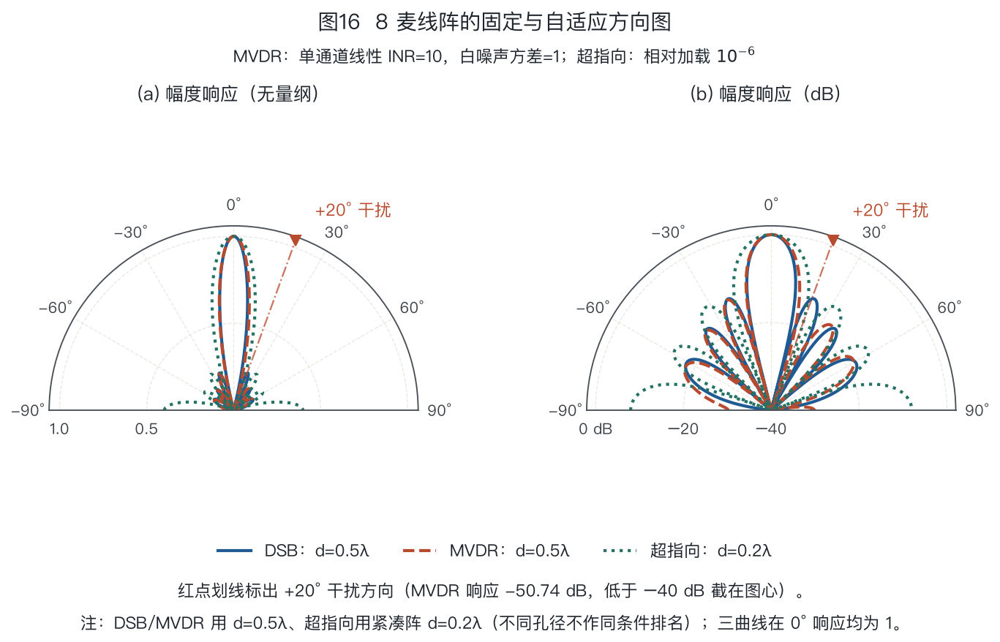
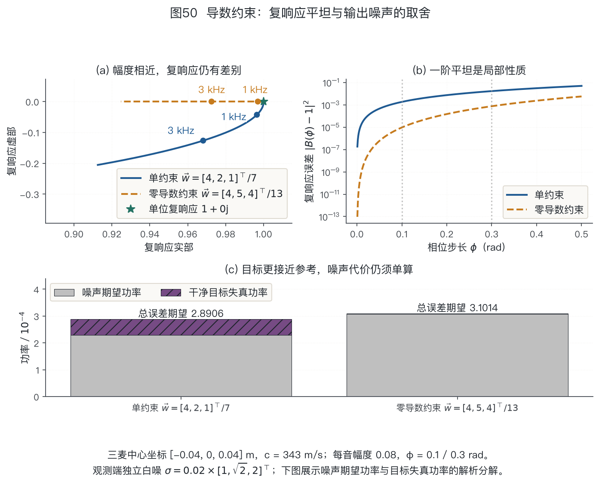
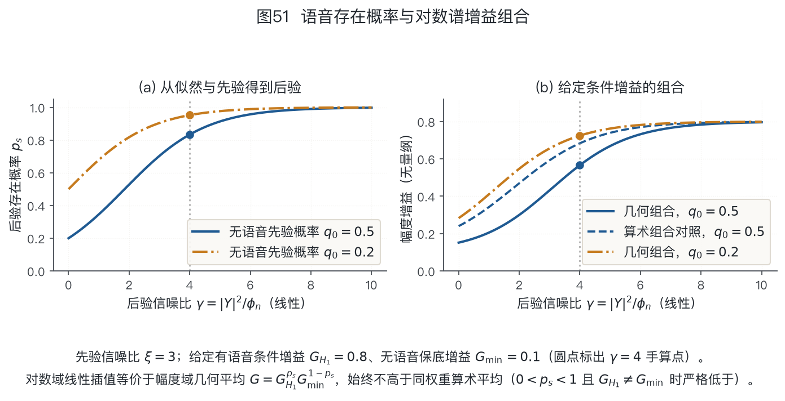

🌐 **简体中文** ｜ [English](../chapters_en/05_beamforming.md)

> 本篇是本书正文第 5 章；正文与扩展专题共 16 章（第 0～15 章，其中第 0 章为数学基础，第 12～15 章为四篇扩展专题），另有附录 A、B。本篇可独立阅读，前后篇见下方导航。
>
> 导读首页：[00_overview.md](00_overview.md) ｜ 上一篇：[04_doa-estimation.md](04_doa-estimation.md) ｜ 下一篇：[06_aec.md](06_aec.md)

---

## 5. 波束形成（Beamforming）

### 5.1 统一问题表述

先看一个可观察的声学现象：同一句话到达不同麦克风的时刻略有先后。若把各通道直接相加，高频成分可能因相位错开而相互抵消；若先把这段传播时差补齐再相加，期望方向的目标语音就能同相叠加保留下来，而偏离该方向的干扰与反射因相位未能对齐而被削弱。这就是波束形成最朴素的物理图景。

在短时傅里叶变换（STFT）频域中，把第 $n$ 帧、第 $k$ 个频点的 $M$ 路麦克风复数谱排成列向量 $\vec x(k,n)\in\mathbb C^{M\times1}$，同样长度的滤波器复权重列向量记为 $\vec w(k,n)\in\mathbb C^{M\times1}$。上标 $H$ 表示厄米共轭转置（复内积与柯西—施瓦茨不等式见[第 0 章 §0.3](00_math-foundations.md#sec-0-3)），波束形成在该时频点的输出是一个标量复数谱值：

$$y(k,n) = \vec{w}^H(k,n)\,\vec{x}(k,n)\text{。}\tag{5-1}$$

本章沿用第 2 章的几何与相位符号约定：均匀线阵的麦 1 位于左端原点 $x_1=0$，后续阵元沿 $+x$ 轴等距排列，相邻间距为 $d$；方位角 $\theta$ 从正横 $+y$ 轴向 $+x$ 轴顺时针量起，正角声源位于 $+x$ 一侧，单位方向向量 $\vec u$ 从阵列指向声源。定义到达时刻差 $\tau_{ij}=t_i-t_j$，则正角远场平面波先到达右侧阵元，$\tau_{21}=-d\sin\theta/c$；以麦 1 为相位参考时，第 $m$ 支麦克风（$m=1,\ldots,M$）的自由场导向矢量分量为

$$a_m(f,\theta)=e^{+\mathrm{j}2\pi f(m-1)d\sin\theta/c}\text{。}\tag{5-2}$$

后文固定单个时频点推导时省略 $(k,n)$ 或 $f$ 参数。由于式(5-1)固定写成共轭内积 $y=\vec w^H\vec x$，真正乘到第 $m$ 路观测谱 $x_m$ 上的复系数是 $w_m^*$：例如等权延迟求和取 $\vec w=\vec a/M$ 时，$w_m^*=a_m^*/M$ 恰好抵消 $a_m$ 的传播超前相位。本章全部正负号与共轭方向均严格遵循这一约定。

本章前半部分围绕统一约束优化展开：在期望方向 $\theta_0$ 保持单位无失真响应（$\vec{w}^H\vec{a}(\theta_0)=1$）的前提下最小化噪声或干扰输出功率——延迟求和（DSB）、超指向（Superdirective）、最小方差无失真响应（MVDR）与线性约束最小方差（LCMV）本质上只是假定的噪声空间相关模型或约束个数不同；多通道维纳滤波（MWF）改为最小化波形均方误差，广义特征值（GEV）波束形成则最大化输出信噪比，将在后续小节展开。本章高频缩写如下：

| 缩写 | 英文全称 | 本章用途 |
|---|---|---|
| SCM | Spatial Covariance Matrix | 描述各通道功率与通道间相关性的空间协方差矩阵 |
| RTF | Relative Transfer Function | 各麦克风相对于参考麦克风的目标传递函数比值 |
| MPDR / MVDR | Minimum Power / Minimum Variance Distortionless Response | 分别基于总观测 $\mathbf R_{xx}$ 与纯噪声 $\mathbf R_{nn}$ 的无失真波束 |
| VAD / SPP | Voice Activity Detection / Speech Presence Probability | 帧级语音活动判决／逐时频点语音存在概率 |
| INR | Interference-to-Noise Ratio | 定向干扰功率与单麦非相关背景白噪声功率之比 |
| LMS / NLMS / RLS | Least Mean Squares / Normalized LMS / Recursive Least Squares | 无约束自适应滤波递推更新算法 |
| ABM | Adaptive Blocking Matrix | 随观测统计在线调整的目标阻塞矩阵 |

工程声场中的干扰与背景通常拆解为三类空间相关模型：

- **空间白噪声**：麦克风电子热噪声、前置放大器底噪与局部非相关扰动，$\mathbf R_{nn}=\phi_n\mathbf I$（抗此类底噪及阵元失配的能力用白噪声增益 WNG 度量）；室外风噪源于麦克风防风罩附近的局部气压湍流，相关尺度远小于声波长，也更接近空间白噪声（Corcos 湍流风噪模型见[第 14 章 §14.8](14_spatial-wearable-arrays.md#sec-14-8)）。
- **各向同性弥散噪声**：封闭房间内经多次壁面反射后方向均匀混合的晚期混响或环境底噪，$\mathbf R_{\mathrm{diff}}=\phi_d\mathbf\Gamma$。如[第 0 章 §0.7.1](00_math-foundations.md#sec-0-7-1) 式(0-59) 球面积分所证，三维球面各向同性弥散场的归一化空间相干矩阵元素为 $[\mathbf\Gamma]_{ij}=\operatorname{sinc}(2fd_{ij}/c)$（采用归一化定义 $\operatorname{sinc}(x)=\sin(\pi x)/(\pi x)$）：低频小间距时 $[\mathbf\Gamma]_{ij}\to 1$（各麦高度同相，构成紧凑阵列差分消噪的物理基础），间距为半波长整数倍时 $[\mathbf\Gamma]_{ij}=0$，高频大间距时 $\mathbf\Gamma\to\mathbf I$。若声场限于水平面（二维柱面弥散场），相干系数换为第一类零阶柱贝塞尔函数 $J_0(2\pi fd_{ij}/c)$（[Habets & Gannot, *JASA*, 2008](https://israelcohen.com/wp-content/uploads/2018/05/JASA_Nov2008.pdf)）。
- **定向点干扰**：竞争说话人或局部声源，单点干扰贡献秩一协方差项 $\phi_i\vec a(\theta_i)\vec a^H(\theta_i)$，自适应波束正是利用这些非对角相位相关项在 $\theta_i$ 方向打下零陷。

沿用[第 2 章 §2.6.3～§2.6.4](02_basics-signal-model.md#sec-2-6-3) 的定义，任意权重 $\vec w$ 在期望导向 $\vec a$ 上的白噪声增益（WNG）与弥散场指向因数 $Q$（及指向性指数 DI）为

$$\begin{aligned}
G_{\mathrm{WNG}}&=\frac{|\vec{w}^H\vec{a}|^2}{\vec{w}^H\vec{w}},\qquad
\mathrm{WNG}_{\mathrm{dB}}=10\log_{10}G_{\mathrm{WNG}},\\
Q&=\frac{|\vec{w}^H\vec{a}|^2}{\vec{w}^H\mathbf{\Gamma}\vec{w}},\qquad
\mathrm{DI}=10\log_{10}Q\text{。}
\end{aligned}\tag{5-3}$$

当满足无失真约束 $\vec w^H\vec a=1$ 时，$G_{\mathrm{WNG}}=1/\|\vec w\|_2^2$ 直接由权重二范数决定：权重模长越大，阵元底噪和通道幅相失配就被放大得越厉害。

#### 时域滤波与频域权重

本章核心推导写在窄带频域。处理宽带语音时，工程既可用 STFT 逐频点加权再重叠相加（§2.5），也可在时域令每路通过多抽头 FIR 滤波器后相加，即**滤波求和（filter-and-sum）**结构（典型代表如 §5.5.2 的 [Frost, *Proc. IEEE*, 1972](https://doi.org/10.1109/PROC.1972.8817)）。

从逐频复权重回到可实现时域因果系统须满足三项物理约束：① 实脉冲响应要求正负频权重共轭对称；② 有限 DFT 点乘须满足线性卷积无圆周混叠（见[第 2 章 E02-14](02_basics-signal-model.md#e02-14)）；③ 补偿传播滞后须引入统一的**因果建模基准延迟**（[Grimm 等, *EURASIP JASP*, 2016, §5.1](https://doi.org/10.1186/s13634-016-0375-6)）。例如 $f_s=16\ \mathrm{kHz}$ 下 $x_1[n]=s[n]$、$x_2[n]=s[n-8]$ 时，预留 $8$ 点（$0.5\ \mathrm{ms}$）基准延迟即可因果算出 $y[n]=(x_1[n-8]+x_2[n])/2=s[n-8]$；在离散频率域这等价于乘线性相位 $e^{-\mathrm{j}8\Omega_{\mathrm{d}}}$（$\Omega_{\mathrm{d}}=2\pi f/f_s$），不改变稳态幅频响应但整体平移波形，评测波形 MSE 前须明确是否已扣除该固定延迟。

此外，真实斜入射角度往往对应非整数采样时差，宽带时域滤波求和在预对齐阶段通常采用**分数延迟 FIR 滤波器**（如加窗 $\operatorname{sinc}$ 滤波器或可在线连续调参的 Farrow 多项式插值结构），避免粗暴整数取整或二点线性插值带来的高频相消（参见[第 2 章 E02-20](02_basics-signal-model.md#e02-20)），或在各子带协同设计波束宽度随频率保持稳定的**恒定束宽（frequency-invariant）**滤波器组以防旁瓣声染色。

### 5.2 延迟求和波束形成器（Delay-and-Sum Beamformer，简称 DSB）：“合唱前先把大家对齐”

延迟求和波束形成器不依赖在线噪声统计，按期望导向 $\vec a(\theta_0)$ 对齐相位后等权平均：

$$\vec{w}_{\mathrm{DSB}} = \frac{1}{M}\vec{a}(\theta_0)\text{。}\tag{5-4}$$

在单位模导向（$|a_m|=1$）下式(5-4)满足 $\vec w_{\mathrm{DSB}}^H\vec a(\theta_0)=1$；若存在近场衰减或不等通道增益（$|a_m|\ne 1$），则单位无失真空间匹配权重应写为更一般的 $\vec a/\|\vec a\|_2^2$。

#### 双麦延迟求和手算

设两全向麦相距 $d=4\ \mathrm{cm}$，$f=1\ \mathrm{kHz}$，$\theta_0=30^\circ$，$c=343\ \mathrm{m/s}$：

1. 几何时延差 $\Delta\tau=d\sin 30^\circ/c=0.02/343\approx 58.3\ \mu\mathrm{s}$，传播相位差 $\Delta\phi=2\pi f\Delta\tau\approx 0.366\ \mathrm{rad}$（$21.0^\circ$）；
2. 麦 2 先到，$\tau_{21}=-58.3\ \mu\mathrm{s}$，导向矢量 $\vec a=[1,\,e^{+\mathrm{j}0.366}]^\top$；DSB 权重 $\vec w_{\mathrm{DSB}}=\vec a/2$，验证 $\vec w_{\mathrm{DSB}}^H\vec a=1$；
3. 在 $y=\vec w^H\vec x$ 中，麦 2 乘上 $w_2^*=0.5e^{-\mathrm{j}0.366}$（等效推迟 $58.3\ \mu\mathrm{s}$）实现两路同相相加；在两路独立同方差白噪声下，目标功率保持 $1$、噪声功率减半为 $0.5^2+0.5^2=0.5$，输出信噪比提升 $10\log_{10}2\approx 3.01\ \mathrm{dB}$。

#### 阵因子、旁瓣与白噪声增益上限

记相邻阵元残余相位差 $\psi=(2\pi d/\lambda)(\sin\theta-\sin\theta_0)$，如[第 2 章 §2.6.1～§2.6.5](02_basics-signal-model.md#sec-2-6-1) 有限等比级数所推，单位响应 DSB 的离散均匀线阵方向图为

$$B_{\mathrm{DSB}}(\psi)=e^{\mathrm{j}(M-1)\psi/2}\frac{\sin(M\psi/2)}{M\sin(\psi/2)}\text{。}\tag{5-5}$$

式(5-5)的核心工程特性汇总如下（详细推导与几何证明见[第 2 章 §2.6](02_basics-signal-model.md#sec-2-6)）：

- **主瓣与栅瓣**：首零点在 $\psi=2\pi/M$，大阵正横半功率波束宽度 $\Delta\theta_{3\mathrm{dB}}\approx 0.886\lambda/(Md\cos\theta_0)$；当 $d>\lambda/2$ 使 $\psi=2\pi l$（$l\ne 0$）落入可见角域时出现幅度回到 $1$ 的空间混叠栅瓣。小间距小阵元时应直接反解 $|B_{\mathrm{DSB}}(\psi)|^2=1/2$：例如正横双麦取 $d=\lambda/8$ 时，全空间 $|\theta|\le 90^\circ$ 最小归一化功率仍有 $\cos^2(\pi/8)\approx 0.854$（$-0.69\ \mathrm{dB}$），既无零点也无 $-3\ \mathrm{dB}$ 点。
- **有限 $M$ 第一旁瓣电平与窗函数加权**：仅当 $M\to\infty$ 时均匀加权第一旁瓣才趋近 $-13.26\ \mathrm{dB}$；对常见中小线阵直接按式(5-5)复算，$M=3,4,8,16$ 的第一旁瓣峰值依次为 $-9.54\ \mathrm{dB}$、$-11.30\ \mathrm{dB}$、$-12.80\ \mathrm{dB}$ 与 $-13.15\ \mathrm{dB}$（$M=2$ 无旁瓣峰）。若需压低旁瓣，可采用汉宁窗或等波纹最优主瓣的 **Dolph–Chebyshev 窗**（[Dolph, *Proc. IRE*, 1946](https://doi.org/10.1109/JRPROC.1946.225956)），但调用 [SciPy `chebwin`](https://docs.scipy.org/doc/scipy/reference/generated/scipy.signal.windows.chebwin.html) 时须将默认峰值归一化的窗系数再除以系数和 $\sum w_m$ 以保持目标单位响应。
- **白噪声增益硬上限 $G_{\mathrm{WNG}}\le M$**：对单位模导向（$\|\vec a\|_2^2=M$）与任意满足 $\vec w^H\vec a=1$ 的线性权重，由柯西—施瓦茨不等式 $1=|\vec w^H\vec a|^2\le M\|\vec w\|_2^2$ 立得 $G_{\mathrm{WNG}}=1/\|\vec w\|_2^2\le M$，当且仅当 $\vec w=\vec w_{\mathrm{DSB}}$ 取等号（见[第 2 章 §2.6.4](02_basics-signal-model.md#sec-2-6-4)）。任何试图挖零陷或收窄低频主瓣的算法，都必然以让渡一部分 $G_{\mathrm{WNG}}$ 为代价。

上述 $3.01\ \mathrm{dB}$ 增益的前提是**通道噪声互不相关**。读者可按序试听四份 $16\ \mathrm{kHz}$、$2\ \mathrm{s}$、同增益合成对照音频（目标已对齐、单通道噪声标准差 $0.07$，请先调低音量）：

- [对齐目标参考](../codes/chapters/ch05/audio/correlation_reference.wav) ｜ [单麦含噪观测](../codes/chapters/ch05/audio/correlation_single.wav) ｜ [独立噪声两麦平均（降噪 $3.01\ \mathrm{dB}$）](../codes/chapters/ch05/audio/correlation_independent.wav) ｜ [完全相同噪声两麦平均（改善 $0\ \mathrm{dB}$）](../codes/chapters/ch05/audio/correlation_common.wav)

总结 DSB 定位：在精确导向与空间白噪声下达最高 WNG 上限、零病态风险、算力极省，适合作为系统稳健保底基线；但低频孔径远小于波长时趋近全向，且无法针对未知强干扰放置零陷。

### 5.3 超指向的白噪声增益—指向性权衡

既然低频段弥散噪声在相邻麦克风间高度相关（$[\mathbf\Gamma]_{ij}\to 1$），在无失真约束 $\vec w^H\vec a=1$ 下直接最小化球面弥散场输出噪声功率 $\vec w^H\mathbf\Gamma\vec w$，就能最大化指向因数 $Q$（即最大化 DI）。这就是**超指向（Superdirective）波束形成**——数学上等同于噪声协方差取 $\mathbf\Gamma$ 的 MVDR（完整拉格朗日推导见 §5.4）：

$$\begin{aligned}
\min_{\vec w}\;&\vec w^H\mathbf\Gamma\vec w,\qquad
\text{s.t.}\;\vec w^H\vec a=1,\\
\vec w_{\mathrm{SD}}&=(\vec a^H\mathbf\Gamma^{-1}\vec a)^{-1}
\mathbf\Gamma^{-1}\vec a\text{。}
\end{aligned}\tag{5-6}$$

在零频率极限 $f\to 0$ 或阵元重合时 $\mathbf\Gamma\to\vec 1\vec 1^\top$ 退化为秩一奇异阵。在低频小间距极限 $d/\lambda\to 0$ 下，经典 **Uzkov 定理（1946）**证明：$M$ 元等距各向同性均匀线阵在三维球面弥散场**端射方向**（$\theta_0=\pm 90^\circ$）的最大可达指向因数趋近于 $Q_{\max}=M^2$（$\mathrm{DI}_{\max}=20\log_{10}M\ \mathrm{dB}$，例如双麦端射超心形达 $Q_{\max}=4\leftrightarrow 6.02\ \mathrm{dB}$）。其几何证明可用勒让德多项式直观勾勒：小间距下 $M$ 元端射线阵的各阶差分可合成关于 $\cos\varphi$ 的至多 $M-1$ 次多项式方向图，即展开为前 $M$ 阶勒让德多项式 $D(\varphi)=\sum_{n=0}^{M-1}c_n P_n(\cos\varphi)$；利用端射值 $P_n(1)=1$ 与正交性 $\frac{1}{2}\int_0^\pi P_n(\cos\varphi)P_m(\cos\varphi)\sin\varphi\,\mathrm{d}\varphi=\frac{1}{2n+1}\delta_{nm}$，由柯西—施瓦茨不等式得

$$Q=\frac{\left|\sum_{n=0}^{M-1}c_n\right|^2}{\sum_{n=0}^{M-1}\frac{|c_n|^2}{2n+1}}\le\sum_{n=0}^{M-1}(2n+1)=M^2\text{。}$$

需注意**正横方向的极限远低于 $M^2$**（对称双麦正横甚至只有 $Q=1$，见下方算例 5-1 第 2 步）。获取低频额外指向性的代价是相邻通道剧烈反相相减，使权重范数暴涨、$G_{\mathrm{WNG}}$ 跌成深负分贝，因此实用系统必加对角加载或 WNG 下限约束。

这里还藏着一条优雅的**声学互易对偶——发射端声对比度控制（ACC，[Choi & Kim, *JASA*, 2002](https://doi.org/10.1121/1.1456926)）**：车载个人声区调整 $M$ 个扬声器权重 $\vec q$ 最大化亮区与暗区声势能比 $\frac{\vec q^H\mathbf R_B\vec q}{\vec q^H\mathbf R_D\vec q}\iff\mathbf R_B\vec q=\lambda_{\max}\mathbf R_D\vec q$。当亮区退化为单远场点（$\mathbf R_B=\vec a\vec a^H$）、暗区为全向球面（$\mathbf R_D=\mathbf\Gamma$）时，精确退化为式(5-6)超指向权重；发射端低频驱动电流暴涨（array effort $\|\vec q\|_2^2$）正是接收端低频 WNG 恶化的互易镜像。

#### 算例 5-1：超指向权重与白噪声增益

**输入与口径**：双麦小间距线阵 $d=0.05\lambda$，三维球面弥散相干系数 $\rho=\operatorname{sinc}(0.1)\approx 0.9836316$，中间量保留双精度、展示四位小数。

1. **检查 $\mathbf\Gamma$ 病态程度**：$\det\mathbf\Gamma=1-\rho^2\approx 0.0325$，特征值 $1.9836$ 与 $0.0164$（条件数 $\kappa_2\approx 121$），$\mathbf\Gamma^{-1}\approx\begin{bmatrix}30.80&-30.29\\-30.29&30.80\end{bmatrix}$。
2. **正横指向（$\theta_0=0^\circ$）退化**：$\vec a_0=[1,1]^\top$ 恰为 $\mathbf\Gamma$ 的对称特征向量，$\vec w_{\mathrm{SD}}=[0.5,0.5]^\top=\vec w_{\mathrm{DSB}}$，$\mathrm{WNG}_{\mathrm{dB}}\approx +3.01\ \mathrm{dB}$，$Q=2/(1+\rho)\approx 1.008$（$\mathrm{DI}\approx +0.04\ \mathrm{dB}$）。
3. **端射指向（$\theta_0=90^\circ$）求解**：$\psi=0.1\pi\approx 0.3142\ \mathrm{rad}$，$\vec a=[1,\,0.9511+0.3090\mathrm{j}]^\top$；分母 $Q=\vec a^H\mathbf\Gamma^{-1}\vec a\approx 3.9737$，权重为 $\vec w_{\mathrm{SD}}\approx[0.5000-2.3559\mathrm{j},\,-0.2525+2.3951\mathrm{j}]^\top$（$|w_1|=|w_2|\approx 2.41$）。
4. **大数相减机理**：$w_1^*a_1\approx 0.5000+2.3559\mathrm{j}$ 与 $w_2^*a_2\approx 0.5000-2.3559\mathrm{j}$ 靠正负大虚部精确对消拼出单位响应 $1$。
5. **核算 $\mathrm{WNG}_{\mathrm{dB}}$ 与 $\mathrm{DI}$**：$\|\vec w_{\mathrm{SD}}\|_2^2\approx 11.60\implies\mathrm{WNG}_{\mathrm{dB}}\approx\mathbf{-10.6\ dB}$，换得 $Q\approx 3.9737\implies\mathrm{DI}\approx +5.99\ \mathrm{dB}$（紧贴双麦极限 $6.02\ \mathrm{dB}$）。对照同一端射指向下的 DSB：$\mathrm{WNG}_{\mathrm{dB}}=+3.01\ \mathrm{dB}$，$\vec w_{\mathrm{DSB}}^H\mathbf\Gamma\vec w_{\mathrm{DSB}}=(1+\rho\cos 0.1\pi)/2\approx 0.9677\implies Q\approx 1.033$，即 **$\mathrm{DI}\approx +0.14\ \mathrm{dB}$**。
6. **通道增益失配放大**：若麦 2 存在 $1\%$ 幅度正偏差（$\vec a_{\mathrm{mis}}=[1,1.01e^{+\mathrm{j}0.3142}]^\top$），超指向输出响应变为 $1.0050-0.0236\mathrm{j}$，偏离 $1$ 达 $2.41\%$（是 DSB 偏差 $0.5\%$ 的近 $5$ 倍，严格上界见 [E05-03](#e05-03)）。
7. **扫描 $d/\lambda$（固定端射 $90^\circ$）**：

| 阵元间距 $d$ | $0.5\lambda$ | $0.1\lambda$ | $0.05\lambda$ | $0.02\lambda$ | $0.01\lambda$ |
|---|---|---|---|---|---|
| 单通道权重模长 $\lvert w_i\rvert$ | $0.50$ | $1.24$ | $2.41$ | $5.98$ | $11.94$ |
| $\mathrm{WNG}_{\mathrm{dB}}$ | $+3.0\ \mathrm{dB}$ | $-4.9\ \mathrm{dB}$ | $-10.6\ \mathrm{dB}$ | $-18.5\ \mathrm{dB}$ | $-24.6\ \mathrm{dB}$ |
| $\mathrm{DI}$ | $+3.0\ \mathrm{dB}$ | $+5.9\ \mathrm{dB}$ | $+6.0\ \mathrm{dB}$ | $+6.0\ \mathrm{dB}$ | $+6.0\ \mathrm{dB}$ |

间距低于 $0.05\lambda$ 后 DI 已被 $6.02\ \mathrm{dB}$ 封顶，而间距每减半（或频率每降一倍频程），$\mathrm{WNG}_{\mathrm{dB}}$ 再暴跌约 $6\ \mathrm{dB}$。

**怎么读图 15**：图 15 展示 $6$ 麦均匀圆阵（半径与弦长均为 $4\ \mathrm{cm}$，波束朝 $+x$ 方向即 $\theta_0=90^\circ$，$c=343\ \mathrm{m/s}$）在 $100$～$8000\ \mathrm{Hz}$ 对数频率轴上的宽带扫描，对照 DSB（蓝实线）与施加 $10^{-6}$ 相对对角加载的超指向（红虚线，评分代入未加载真实 $\mathbf\Gamma$）：

- **左子图 `(a) 空间白噪声`**：DSB 笔直保持在 $10\log_{10}6\approx 7.78\ \mathrm{dB}$；红虚线在 $100\ \mathrm{Hz}$ 深跌至 $-43.72\ \mathrm{dB}$（$300$～$400\ \mathrm{Hz}$ 附近因相对加载与 $\mathbf\Gamma$ 高阶小特征值量级交替出现拐点），随后一路爬升，在约 **$2.37\ \mathrm{kHz}$（约 $2.4\ \mathrm{kHz}$）**跨过 $0\ \mathrm{dB}$ 单麦基准线，在 $4\ \mathrm{kHz}$ 以上贴近 DSB。
- **右子图 `(b) 三维各向同性弥散噪声`**：DSB 在 $100\ \mathrm{Hz}$ 仅 $0.02\ \mathrm{dB}$，至约 $4.27\ \mathrm{kHz}$ 达峰值约 $8.20\ \mathrm{dB}$ 后因空间旁瓣回落；超指向在 $100\ \mathrm{Hz}$ 即达 $8.62\ \mathrm{dB}$，在 $400$～$1500\ \mathrm{Hz}$ 语音核心区维持超 $10.5\ \mathrm{dB}$ 的高指向性平台，高频自然汇合于 DSB。

上线前应对求出的权重做四项部署前核查：① 白噪声增益余量 $\mathrm{WNG}_{\mathrm{dB}}$；② 待求逆矩阵二范数条件数 $\kappa_2=\lambda_{\max}/\lambda_{\min}$；③ 高声压下的峰值动态范围与削波率；④ 按器件与结构公差注入随机幅相失配扫描响应偏差与零陷漂移。

#### 5.3.1 差分麦克风：从一阶心形到高阶设计

在耳机、眼镜与小型音箱上，常采用**差分麦克风阵列（Differential Microphone Array，DMA）**直接利用近距阵元相减、内部延迟与频响均衡合成空间梯度方向图。考察沿 $x$ 轴间距为 $d$ 的端射双麦（前端麦 1 在 $x=0$，后端麦 2 在 $x=d$），声源与前端轴线夹角记为端射轴向角 $\varphi\in[0,\pi]$（正前 $\varphi=0$，正后 $\varphi=180^\circ$），传播时延差 $\tau_p(\varphi)=(d/c)\cos\varphi$。令 $y(t)=x_1(t)-g\,x_2(t-\tau)$，取 $g=1$、内部延迟 $\tau=\alpha T$（$T=d/c$，无量纲延迟比 $\alpha\in[0,1]$），在 $\kappa d\ll 1$ 下作一阶泰勒展开并归一化正前方响应，得到一阶 DMA 频率响应、低频频不变方向图及球面弥散指向因数闭式通式（[Elko & Pong, *ICASSP*, 1997](https://doi.org/10.1109/ICASSP.1997.599609)）：

$$\begin{aligned}
H(\omega,\varphi)&=1-g\,e^{-\mathrm{j}\omega[\tau+\tau_p(\varphi)]}
\approx\mathrm{j}\kappa d(\alpha+\cos\varphi)\quad(g=1,\,\kappa d\ll 1),\\
D(\varphi)&=\frac{\alpha+\cos\varphi}{\alpha+1},\qquad
\varphi_{\mathrm{null}}=\arccos(-\alpha),\qquad
Q(\alpha)=\frac{(\alpha+1)^2}{\alpha^2+1/3}\text{。}
\end{aligned}\tag{5-7}$$

其中指向因数 $Q(\alpha)$ 直接由轴对称球面平均功率积分（换元 $u=\cos\varphi,\ \mathrm{d}u=-\sin\varphi\,\mathrm{d}\varphi$）求倒数得到：

$$\begin{aligned}
\frac{1}{2}\int_0^\pi D^2(\varphi)\sin\varphi\,\mathrm{d}\varphi
&=\frac{1}{2(\alpha+1)^2}\int_{-1}^{1}(\alpha+u)^2\,\mathrm{d}u
=\frac{\alpha^2+1/3}{(\alpha+1)^2},\\
Q(\alpha)&=\frac{(\alpha+1)^2}{\alpha^2+1/3}\text{。}
\end{aligned}$$

式(5-7)清晰给出四类经典一阶模式的参数对照（由 $\mathrm{d}Q/\mathrm{d}\alpha=0$ 得超心形 $\alpha=1/3$ 达双麦 Uzkov 上限 $Q_{\max}=4$；而最大化前后半球功率比 $\mathrm{FBR}=\frac{\int_0^{\pi/2}D^2\sin\varphi\,\mathrm{d}\varphi}{\int_{\pi/2}^\pi D^2\sin\varphi\,\mathrm{d}\varphi}=\frac{\alpha^2+\alpha+1/3}{\alpha^2-\alpha+1/3}$ 求导置零立得**超级心形 $\alpha=1/\sqrt 3$**，线性前后功率比达 $7+4\sqrt 3\approx13.928$，换成分贝为 $10\log_{10}(7+4\sqrt3)\approx11.44\ \mathrm{dB}$）：

| 一阶模式名称 | 延迟比 $\alpha$ | 零陷轴向角 $\varphi_{\mathrm{null}}$ | 球面指向因数 $Q$ | 指向性指数 $\mathrm{DI}$ | 核心优化准则 |
|---|---:|---:|---:|---:|---|
| 偶极子（Dipole） | $0$ | $90.00^\circ$ | $3$ | $4.77\ \mathrm{dB}$ | 纯压力梯度，侧向零陷 |
| 超心形（Hypercardioid） | $1/3$ | $109.47^\circ$ | **$4$** | **$6.02\ \mathrm{dB}$** | 最大化三维球面弥散指向因数 $Q$ |
| 超级心形（Supercardioid） | $1/\sqrt 3$ | $125.26^\circ$ | $2+\sqrt 3\approx 3.732$ | $5.72\ \mathrm{dB}$ | 最大化前后半球功率比（FBR） |
| 心形（Cardioid） | $1$ | $180.00^\circ$ | $3$ | $4.77\ \mathrm{dB}$ | 正后方宽零陷（单向拾音） |

拆解一阶 DMA 工程落地的四项核心物理效应：

1. **$+6\ \mathrm{dB/oct}$ 高通斜率与均衡器底噪放大**：未均衡一阶权重 $\vec w_{\mathrm{raw}}=[1,\,-e^{+\mathrm{j}\omega\tau}]^\top$ 的范数平方恒为 $\|\vec w_{\mathrm{raw}}\|_2^2=2$，而前向响应 $H(\omega,0)\approx\mathrm{j}\kappa d(1+\alpha)$ 与频率成正比（$+6.02\ \mathrm{dB/oct}$）。代入式(5-3)得低频白噪声增益

    $$\begin{aligned}
    G_{\mathrm{WNG}}&=\frac{|H(\omega,0)|^2}{2}\approx\frac{1}{2}(1+\alpha)^2(\kappa d)^2\\
    &=2\pi^2(1+\alpha)^2\left(\frac{d}{\lambda}\right)^2\text{，}
    \end{aligned}$$

    因此配套 $1/(\mathrm{j}\omega)$ 低频积分均衡器将前向增益拉平为 $1$ 时，非相关自噪声输出功率按 $1/G_{\mathrm{WNG}}\propto(\lambda/d)^2$ 增长——频率每降一个倍频程底噪功率放大 $4$ 倍（$+6\ \mathrm{dB}$），必须在语音下限（如 $100$～$150\ \mathrm{Hz}$）设增益封顶与高通滚降。

2. **近场效应（Proximity Effect）与混响房间 DI 退化**：上述推导假定远场平面波；当人嘴靠近耳机或手持麦克风（$r\sim 10$～$20\ \mathrm{cm}$ 满足 $\kappa r\lesssim 1$）时，球面波声压梯度 $\frac{\partial}{\partial r}\big(\frac{e^{-\mathrm{j}\kappa r}}{r}\big)=-\big(\mathrm{j}\kappa+\frac{1}{r}\big)\frac{e^{-\mathrm{j}\kappa r}}{r}$ 除了远场项 $\mathrm{j}\kappa$ 外还多出与距离成反比的近场项 $1/r$，赋予近讲低频相对远场噪声额外 $\propto\sqrt{1+1/(\kappa r)^2}\sim 1/(\kappa r)$ 的低频抬升。这在耳机与近讲通话中既是天然抵消 $+6\ \mathrm{dB/oct}$ 高通滚降、拉开近讲语音与远场底噪信噪比的利器，也会造成声源远近移动时的低频音色变化；另一方面，在强混响房间内，如果早期强反射恰好从主瓣方向进入，实测有效指向性指数往往明显低于理论自由场 DI。
3. **MEMS 密封垫圈漏气相位失配**：$d=1$～$2\ \mathrm{cm}$ 在 $200\ \mathrm{Hz}$ 时的真实声程相位差 $\kappa d$ 仅 $2^\circ$～$4^\circ$，垫圈微漏气造成的一阶高通相移（$3^\circ$～$15^\circ$）比真实声程差还大，足以显著破坏后向零陷（[E05-16](#e05-16) 量化了 $5^\circ$ 漏气使后向响应超过名义前向单位响应 $+1.52\ \mathrm{dB}$ 的失效现象）。
4. **单频手算核验与高阶权衡**：取 $d=2\ \mathrm{cm}$、$c=343\ \mathrm{m/s}$、心形 $\alpha=1$（$T\approx 58.31\ \mu\mathrm{s}$），$500\ \mathrm{Hz}$ 处名义前向幅度 $|H_f|=2\sin(\kappa d)\approx 0.3643$，均衡后 $\mathrm{WNG}_{\mathrm{dB}}=10\log_{10}(|H_f|^2/2)\approx -11.78\ \mathrm{dB}$，$1\%$ 增益失配使后向零陷相对名义前向响应抬至 $-31.23\ \mathrm{dB}$；至 $\kappa d=\pi$（约 $8.58\ \mathrm{kHz}$）前向出现梳状相消决定高频上限。级联 $N$ 阶差分（如二阶超心形 $Q_{\max}=9\leftrightarrow 9.54\ \mathrm{dB}$）使未均衡低频前向幅度降为 $\mathcal O((\kappa d)^N)$，均衡为 $1$ 后白噪声输出功率随之按 $(\lambda/d)^{2N}$（$+6N\ \mathrm{dB/oct}$）急剧放大（系统矩阵与白噪声正则化设计见 [Elko, 2004](https://doi.org/10.1007/1-4020-7769-6_2) 与 [Benesty & Chen, Springer, 2013](https://doi.org/10.1007/978-3-642-33753-6)），故实用紧凑阵列普遍采用分频设计：极低频退回一阶或 DSB，中频启用高阶差分，高频切回常规波束。

**宽带频率不变波束形成（FIB）的综合方法**：无论 DSB 还是高阶分频设计，固定物理孔径 $D$ 的均匀线阵都面临宽带波束宽度随频率收缩的问题——正横半功率波束宽度 $\theta_{\mathrm{HPBW}}(f)\approx 0.886\,\lambda/(D\cos\theta_0)\propto c/(fD)$ 随频率 $f$ 成反比变窄。尽管正对轴向 $\theta_0$ 的直达目标响应恒为 $1$，任何落在主瓣边缘或旁瓣区的偏轴声源与混响在低频段仍落入宽主瓣而几乎无衰减，到高频段却因主瓣收窄被大幅压低，等效于对偏轴信号施加了一级随角度变化的**低通声染色滤波器**。工程上消除偏轴声染色、综合**宽带频率不变波束形成器（Frequency-Invariant Beamforming，FIB）**主要有两条经典路径：

1. **连续孔径缩放与孔径加权（Ward–Kennedy–Williamson 原理，*JASA* 97(2):1023–1034, 1995）**：要令自由场方向图在宽带内与频率无关，须保持各频点的有效电孔径乘积 $f\cdot D_{\mathrm{eff}}(f)=f_0 D_0$ 为常数。对沿 $x$ 轴分布的连续线孔径，取参考频率 $f_0$ 下的原型窗函数 $g(u)$（支撑于 $\lvert u\rvert\le D_0/2$）并按频率伸缩空间加权 $w(x,f)$，作换元 $u=(f/f_0)x$（满足 $\mathrm{d}u=(f/f_0)\,\mathrm{d}x$）即可证明预对齐宽带方向图严格与 $f$ 无关：

    $$w(x,f)=\frac{f}{f_0}\,g\!\left(\frac{f}{f_0}x\right),\qquad B(\theta,f)=\int w^*(x,f)\,e^{+\mathrm{j}\frac{2\pi f}{c}x\sin\theta}\,\mathrm{d}x=\int g^*(u)\,e^{+\mathrm{j}\frac{2\pi f_0}{c}u\sin\theta}\,\mathrm{d}u\text{。}$$

    离散到有限物理麦克风上时，该原理直接导出两类常用实现：其一是**时域 FIR 滤波求和**（将 $w(x_m,f)$ 在阵元坐标 $x_m$ 处采样为各通道独立 FIR 滤波器——外侧阵元自动呈现较窄低通截止以在高频退出工作，内侧阵元保持宽带，等效孔径随频率连续收缩）；其二是按倍频程划分并共享中心阵元的**谐波嵌套子阵**（参见[第 3 章 §3.3.3](03_array-geometry.md#sec-3-3-3)）。

2. **带白噪声增益下限的凸二阶锥规划（SOCP）宽带方向图匹配**：面向任意离散或不规则阵元几何，可在每个离散频点 $f_k$ 与角度网格 $\Theta$ 上直接极小化复方向图相对目标频不变原型 $B_{\mathrm{des}}(\theta)$ 的最大误差，并显式加入无失真与白噪声增益下限 $G_{\min}$ 约束：

    $$\min_{\vec w(f_k)}\;\max_{\theta\in\Theta}\;\lvert\vec w^H(f_k)\vec a(\theta,f_k)-B_{\mathrm{des}}(\theta)\rvert\qquad\text{s.t.}\;\vec w^H(f_k)\vec a(\theta_0,f_k)=1,\quad \lVert\vec w(f_k)\rVert_2^2\le\frac{1}{G_{\min}}\text{。}$$

    引入上镜图辅助变量 $t$ 后，逐角点误差 $\lvert\vec w^H(f_k)\vec a(\theta,f_k)-B_{\mathrm{des}}(\theta)\rvert\le t$ 与权重范数上界 $\lVert\vec w(f_k)\rVert_2\le 1/\sqrt{G_{\min}}$ 均化为标准二阶锥约束，可在多项式时间内求得全局最优解（凸锥优化基础见[第 0 章 §0.5.3](00_math-foundations.md#sec-0-5-3)，同类稳健 SOCP 波束见下文 §5.4.1）。该公式也清晰揭示了宽带频率不变设计的**低频物理孔径极限**：由于有效孔径不可能超过阵列的真实物理尺寸 $D$，当低频段电尺寸跌至 $D/\lambda\lesssim 0.5$ 以下时，物理孔径无法自然支撑窄主瓣 $B_{\mathrm{des}}(\theta)$；若强行逼近窄波束，求解器会退化为本节所述的超指向大数相减并令 WNG 急剧坍塌。因此在 $D/\lambda\lesssim 0.5$ 以下，任何可行 FIB 都必须在“放宽全频或低频主瓣宽度”与“让渡 WNG 余量”之间显式折中。

### 5.4 最小方差无失真响应（MVDR 与 MPDR）

最小方差无失真响应（MVDR / Capon 波束形成器）直接代入实测或估计的 $M\times M$ 噪声加干扰空间协方差矩阵 $\mathbf R_{nn}=\mathbb{E}[\vec n\vec n^H]$，在期望目标导向 $\vec a(\theta_0)$ 保持单位复响应的前提下最小化输出噪声功率：

$$\min_{\vec w}\;\vec w^H\mathbf R_{nn}\vec w,\qquad \text{s.t.}\;\vec w^H\vec a(\theta_0)=1\text{。}\tag{5-8}$$

**拉格朗日乘子法四步推导**（复变 Wirtinger 规则见[第 0 章 §0.5](00_math-foundations.md#sec-0-5)）：

1. 构造实值拉格朗日函数 $L(\vec w,\lambda)=\vec w^H\mathbf R_{nn}\vec w+\lambda(1-\vec w^H\vec a)+\lambda^*(1-\vec a^H\vec w)$；
2. 利用 $\partial(\vec w^H\vec c)/\partial\vec w^*=\vec c$、$\partial(\vec c^H\vec w)/\partial\vec w^*=\vec 0$、$\partial(\vec w^H\mathbf R_{nn}\vec w)/\partial\vec w^*=\mathbf R_{nn}\vec w$，令 $\partial L/\partial\vec w^*=\mathbf R_{nn}\vec w-\lambda\vec a=\vec 0$，正定可逆时得 $\vec w=\lambda\mathbf R_{nn}^{-1}\vec a$（注意严格白化矩阵为 $\mathbf R_{nn}^{-1/2}$，白化域匹配后再反变换回阵元域才合并为 $\mathbf R_{nn}^{-1}\vec a$）；
3. 代入约束 $\vec w^H\vec a=1$，记正实数二次型 $q=\vec a^H\mathbf R_{nn}^{-1}\vec a>0$，得 $\lambda^*q=1\implies\lambda=1/q$（$N<M$ 奇异时切忌盲用 Moore–Penrose 伪逆，见附录 A 练习 E16-05）；
4. 代回得 MVDR 闭式权重（最小输出残留噪声功率为 $P_{n,\min}=1/q$）：

$$\vec w_{\mathrm{MVDR}}=\frac{\mathbf R_{nn}^{-1}\vec a}{\vec a^H\mathbf R_{nn}^{-1}\vec a}\text{。}\tag{5-9}$$

**核心区分：MPDR 与 MVDR 及失配目标自消（Van Trees, *Optimum Array Processing*, 2002）**：当系统难以获得纯净无目标静音段、直接用含目标语音的**总观测协方差 $\mathbf R_{xx}$** 替换式(5-9)中的纯噪声协方差 $\mathbf R_{nn}$ 时，得到的波束形成器在标准阵列文献中称为**最小功率无失真响应（Minimum Power Distortionless Response，MPDR）**，即 $\vec w_{\mathrm{MPDR}}=\frac{\mathbf R_{xx}^{-1}\vec a}{\vec a^H\mathbf R_{xx}^{-1}\vec a}$。二者在理想条件与失配条件下的表现天壤之别：

- **导向精确匹配时完全等价**：若目标与噪声零均值不相关且名义约束 $\vec a$ 精确等于真实传递向量，即 $\mathbf R_{xx}=\mathbf R_{nn}+\phi_s\vec a\vec a^H$，则对任意可行权重 $\vec w^H\vec a=1$，总功率 $\vec w^H\mathbf R_{xx}\vec w=\vec w^H\mathbf R_{nn}\vec w+\phi_s$ 只相差常数 $\phi_s$。等价地，对 $\mathbf R_{xx}^{-1}$ 应用 Sherman–Morrison 引理（$q=\vec a^H\mathbf R_{nn}^{-1}\vec a$）立得

    $$\begin{aligned}
    \mathbf R_{xx}^{-1}\vec a&=\left(\mathbf R_{nn}^{-1}-\frac{\phi_s\mathbf R_{nn}^{-1}\vec a\vec a^H\mathbf R_{nn}^{-1}}{1+\phi_s q}\right)\vec a\\
    &=\frac{1}{1+\phi_s q}\mathbf R_{nn}^{-1}\vec a\text{，}
    \end{aligned}$$

    正标量 $(1+\phi_s q)^{-1}$ 在分子与分母中精确约去，故 $\vec w_{\mathrm{MPDR}}=\vec w_{\mathrm{MVDR}}$。

- **非共线导向形状失配可能导致强目标自消**：当真实目标导向 $\vec a_{\mathrm{true}}=\vec a+\Delta\vec a$ 与约束向量 $\vec a$ 不共线时，MPDR 把 $\mathbf R_{xx}$ 中携带强目标能量的 $\phi_s\vec a_{\mathrm{true}}\vec a_{\mathrm{true}}^H$ 视为待最小化的干扰项，在本节给定的强目标模型中，输入 SNR 增大可强化这一压制，使输出 SINR 反而下降；若失配只是公共复尺度 $\vec a_{\mathrm{true}}=c\vec a$，约束仍固定其真实响应为 $c$，不存在同样的空间自消机制（[E05-08](#e05-08) 完整手算了输入 SNR 升至 $100$ 时 MPDR 把失配目标压低超 $43\ \mathrm{dB}$ 的过程）。这正是工程上始终优先采用 VAD/SPP 或 DNN 掩码估计纯净 $\hat{\mathbf R}_{nn}$、而非直接拿 $\hat{\mathbf R}_{xx}$ 求逆的根本原因。

观察式(5-9)两个特例：$\mathbf R_{nn}=\phi_n\mathbf I$ 时退化为 DSB；$\mathbf R_{nn}=\phi_d\mathbf\Gamma$ 时退化为式(5-6)超指向。

#### 算例 5-2：2 麦 MVDR 数值推导

**输入与口径**：半波长双麦线阵（$d=\lambda/2$），目标 $0^\circ$（$\vec a_0=[1,1]^\top$），干扰 $+30^\circ$（$\vec a_i=[1,+\mathrm{j}]^\top$，功率 $10$），单麦白噪声方差 $1$（$\mathrm{INR}=10\ \mathrm{dB}$）。

1. **构造协方差与求逆**：$\mathbf R_{nn}=10\vec a_i\vec a_i^H+\mathbf I=\begin{bmatrix}11&-10\mathrm{j}\\+10\mathrm{j}&11\end{bmatrix}$，$\det\mathbf R_{nn}=121-100=21$（特征值 $21,1$，条件数 $21$），$\mathbf R_{nn}^{-1}=\frac{1}{21}\begin{bmatrix}11&+10\mathrm{j}\\-10\mathrm{j}&11\end{bmatrix}$。
2. **求解权重**：$\mathbf R_{nn}^{-1}\vec a_0=\frac{1}{21}[11+10\mathrm{j},\,11-10\mathrm{j}]^\top$，分母 $q=22/21$（最小残留噪声功率 $1/q=21/22\approx 0.9545$），得

$$\vec w_{\mathrm{MVDR}}=\frac{1}{22}\begin{bmatrix}11+10\mathrm{j}\\11-10\mathrm{j}\end{bmatrix}
\approx\begin{bmatrix}0.5000+0.4545\mathrm{j}\\0.5000-0.4545\mathrm{j}\end{bmatrix}\text{。}$$

3. **核验目标、干扰与 WNG**：目标方向 $\vec w_{\mathrm{MVDR}}^H\vec a_0=1$；干扰方向 $\vec w_{\mathrm{MVDR}}^H\vec a_i=(1+\mathrm{j})/22$，幅度 $\sqrt 2/22\approx 0.0643$（**$-23.84\ \mathrm{dB}$**），输出干扰功率 $0.0413$ 加输出白噪功率 $\|\vec w\|_2^2=221/242\approx 0.9132$ 恰等于 $0.9545=1/q$；$G_{\mathrm{WNG}}=242/221\approx 1.095$（$+0.39\ \mathrm{dB}$，比 DSB 让出 $2.62\ \mathrm{dB}$）。为何 $+30^\circ$ 不是精确 $0$？因为再加深零陷会推高白噪声使总功率升至 $1.00>0.9545$（精确零点在 $+32.03^\circ$，随 INR 漂移轨迹见 [E05-02](#e05-02)）。
4. **典型方位响应扫描**：$0^\circ\to 0.00\ \mathrm{dB}$，$+15^\circ\to -5.05\ \mathrm{dB}$，$+30^\circ\to -23.84\ \mathrm{dB}$，$+45^\circ\to -8.62\ \mathrm{dB}$，无干扰一侧 $-30^\circ\to +2.61\ \mathrm{dB}$（超调）。

**怎么读图 16**：上半平面极坐标并排展示线性幅度 `(a)` 与分贝幅度 `(b)`（$-40\ \mathrm{dB}$ 截断）。在同孔径 $8$ 麦半波距下，DSB（蓝实线）对称且首旁瓣 $-12.8\ \mathrm{dB}$，而 MVDR（红虚线，$\mathbf R_{nn}=\mathbf I+10\vec a_{20^\circ}\vec a_{20^\circ}^H$）在 $+20^\circ$ 干扰处将响应压低至 $-50.74\ \mathrm{dB}$，代价是无干扰左半区旁瓣略抬 $1$～$3\ \mathrm{dB}$；绿色点线为更紧凑 $8$ 麦阵（$d=0.2\lambda$）的超指向波束图，因物理孔径仅前者的 $2/5$ 而主瓣更宽，不可脱离孔径尺寸直接排优劣。

#### 对角加载、WNG 约束与 LOCATA 实录对照

在无失真约束 $\vec w^H\vec a=1$ 下施加白噪声增益下限 $G_{\mathrm{WNG}}\ge G_{\min}$（即 $\|\vec w\|_2^2\le\delta=1/G_{\min}$；对单位模导向 $\|\vec a\|_2^2=M$ 要求 $\delta\ge 1/M$，一般导向为 $\delta\ge 1/\|\vec a\|_2^2$），引入非负拉格朗日乘子 $\varepsilon\ge 0$ 写增广拉格朗日函数 $\mathcal L=\vec w^H(\hat{\mathbf R}_{nn}+\varepsilon\mathbf I)\vec w-\varepsilon\delta+\lambda(1-\vec w^H\vec a)+\lambda^*(1-\vec a^H\vec w)$，立即表明 **WNG 范数约束的对偶解等价于对角加载 MVDR**（[Cox, Zeskind & Owen, *IEEE TASSP*, 1987](https://doi.org/10.1109/TASSP.1987.1165054)）。由 KKT 互补松弛条件 $\varepsilon(\|\vec w\|_2^2-\delta)=0$：若未加载已满足 $\|\vec w(0)\|_2^2\le\delta$ 则 $\varepsilon^\star=0$；否则记 $\hat{\mathbf R}_{nn}=\sum_{m=1}^M\lambda_m\vec u_m\vec u_m^H$、$\alpha_m=|\vec u_m^H\vec a|^2$ 与 $S_k(\varepsilon)=\sum_{m=1}^M\alpha_m(\lambda_m+\varepsilon)^{-k}$，则 $\|\vec w(\varepsilon)\|_2^2=S_2/S_1^2$，求导得 $\frac{\mathrm{d}}{\mathrm{d}\varepsilon}(S_2/S_1^2)=2(S_2^2-S_1S_3)/S_1^3\le 0$（由柯西—施瓦茨不等式，只要 $\vec a$ 在至少两个不同特征值上非零即严格单调递减），随 $\varepsilon\to\infty$ 平滑降至 $1/\|\vec a\|_2^2$（单位模导向下即 $1/M\le\delta$），对严格预算 $\delta>1/\|\vec a\|_2^2$、约束激活且上述严格递减条件成立时，存在唯一有限正加载量 $\varepsilon^\star>0$ 使解恰好落在边界 $\|\vec w(\varepsilon^\star)\|_2^2=\delta$ 上（闭式反推算例见 [E05-04](#e05-04)）。

若 $\delta<1/\|\vec a\|_2^2$，问题不可行；若恰取等号，可行权重只有最小范数解 $\vec w=\vec a/\|\vec a\|_2^2$，一般须以 $\varepsilon\to\infty$ 的极限得到，不保证存在有限加载根。例如双麦算例的 $\|\vec w(\varepsilon)\|^2=1/2+50/(11+\varepsilon)^2$ 永远大于端点 $1/2$。

为保证尺度不变性，本书采用无量纲相对对角加载系数 $\alpha_{\mathrm{dl}}\ge 0$（对应第 4 章 Capon 谱中的无量纲加载符号 $\eta$，避免与 DMA 延迟比 $\alpha$ 及遗忘因子混淆）：

$$\hat{\mathbf R}_{nn,\mathrm{load}}=\hat{\mathbf R}_{nn}+\alpha_{\mathrm{dl}}\,\frac{\operatorname{tr}(\hat{\mathbf R}_{nn})}{M}\mathbf I\text{。}\tag{5-10}$$

$\alpha_{\mathrm{dl}}$ 是连接纯数据驱动 MVDR（$\alpha_{\mathrm{dl}}\to 0$）与纯几何 DSB（$\alpha_{\mathrm{dl}}\to\infty$）的连续旋钮：增大 $\alpha_{\mathrm{dl}}$ 降低条件数、抬升 $\mathrm{WNG}_{\mathrm{dB}}$，但使干扰零陷变浅；评测时必须将求出的权重代回**未加载真实物理协方差**评分。

**真实多麦房间录音对照（LOCATA 公开数据集）**：基于 [LOCATA 开发集](https://zenodo.org/records/3630471)任务 2 第 1 条 $15$ 麦 $48\ \mathrm{kHz}$ DICIT 阵列实录（扬声器 A 为目标、B 为竞争干扰，以第 $7$ 麦为基准），在 B 单独发声区间 $3.48$～$3.94\ \mathrm{s}$（$41$ 帧）估计 $\hat{\mathbf R}_{nn}$ 并取 $\alpha_{\mathrm{dl}}=0.1$，在 $250$～$6000\ \mathrm{Hz}$ 应用加载 MVDR（过渡带升余弦平滑至 DSB，最低 WNG 约 $4.14\ \mathrm{dB}$），在两段独立单讲测试窗内测得 $300$～$3400\ \mathrm{Hz}$ 带内功率（相对第 $7$ 麦 $0\ \mathrm{dB}$）：

| 单讲评分窗 | 对齐相加相对第 7 路 | MVDR 相对第 7 路 | MVDR 相对对齐相加 |
|---|---:|---:|---:|
| A（目标），$2.65$～$3.10\ \mathrm{s}$ | $-2.42\ \mathrm{dB}$ | $-3.28\ \mathrm{dB}$ | $-0.86\ \mathrm{dB}$ |
| B（干扰），$4.08$～$4.68\ \mathrm{s}$ | $-8.96\ \mathrm{dB}$ | $-16.38\ \mathrm{dB}$ | $-7.42\ \mathrm{dB}$ |

在这两个单讲评分窗内，MVDR 相对 DSB 的带内总功率在 B 窗下降 $7.42\ \mathrm{dB}$，在 A 窗下降 $0.86\ \mathrm{dB}$。这里计入了相应说话人的直达声、反射和底噪，不能仅凭总功率把 A 窗下降归为干净目标损失，也不能全部归为去混响或降噪；分量保真需要干净参考或额外模型证据（交互试听见[导读音频试听与复现总表](00_overview.md#audio-assets)）。

#### 5.4.1 稳健波束形成方法

工程失配归结为四类根源：**A 导向矢量失配**、**B 有限快拍协方差误差**、**C 相干干扰/强早反射**、**D 目标泄漏进 $\hat{\mathbf R}_{nn}$ 引发自消**。除固定对角加载外，四条经典加固路线如下：

1. **最差情况范数球优化（SOCP）与稳健 Capon 波束形成（RCB）**：设真实目标导向落在以名义导向 $\vec a_0$ 为球心的欧氏球 $\mathcal U=\{\vec a_0+\vec e:\|\vec e\|_2\le\epsilon\}$ 内，要求球内最坏幅度响应 $|\vec w^H\vec a|\ge 1$（[Vorobyov, Gershman & Luo, *IEEE TSP*, 2003](https://doi.org/10.1109/TSP.2002.806865)），转化为凸二阶锥规划 $\min\vec w^H\hat{\mathbf R}_{nn}\vec w\ \text{s.t.}\ \operatorname{Re}(\vec w^H\vec a_0)\ge 1+\epsilon\|\vec w\|_2$（注意名义响应大于 $1$，手算证明见 [E05-13](#e05-13)）。[Li, Stoica 与 Wang（*IEEE TSP*, 2003）](https://doi.org/10.1109/TSP.2003.812831)从同一球不确定集出发，通过最大化匹配功率导出**稳健 Capon 波束形成（RCB）**的数据相关自适应对角加载闭式迭代，严格证明了 **RCB 与 Vorobyov 最差情况 SOCP 的最优权重仅差一个正缩放标量**（归一化方向图与输出 SINR 相同，但绝对复响应随该标量缩放）。
2. **特征空间投影波束形成（[Chang & Yeh, *IEEE TAP*, 1992](https://doi.org/10.1109/8.202711)）**：将名义导向正交投影到主导信号加干扰子空间 $\tilde{\vec a}=\mathbf U_s\mathbf U_s^H\vec a_0$ 再求权重，抑制噪声子空间抖动与小角度自消；风险在于低信噪比下目标特征值误被裁入噪声子空间。
3. **空间谱积分协方差重构（[Gu & Leshem, *IEEE TSP*, 2012](https://doi.org/10.1109/TSP.2012.2194289)）**：在全空间计算 Capon 谱 $\hat P(\theta)=[\vec a^H(\theta)\hat{\mathbf R}_{xx}^{-1}\vec a(\theta)]^{-1}$，挖除目标扇区 $\Theta_{\mathrm{tar}}$ 后，仅在其补集 $\bar\Theta=\Theta\setminus\Theta_{\mathrm{tar}}$ 上积分重构纯净干扰加噪声协方差 $\hat{\mathbf R}_{nn}=\int_{\bar\Theta}\hat P(\theta)\vec a(\theta)\vec a^H(\theta)\,\mathrm{d}\theta$，同时配合二阶锥/二次约束二次规划（QCQP）在线校正目标导向矢量；离散网格求和实现时需注意角步长 $\Delta\theta$ 缩放与背景白噪声底噪项的归一化对齐。
4. **前后向空间平滑（FBSS）**：对均匀线阵上的 C 类相干干扰，按[第 4 章 §4.6](04_doa-estimation.md#sec-4-6) 式(4-17)切分子阵作前后向平滑恢复满秩（[Pillai & Kwon, 1989](https://doi.org/10.1109/29.17496)），代价是孔径缩减且权重须作用在子阵结构上；在语音增强中，更常优先用 RTF 将有益早期反射并入目标约束向量。

排障对照表（**黄金准则**：每次调参必须同时验收目标失真、输出 SINR 与 $\mathrm{WNG}_{\mathrm{dB}}$）：

| 观测症状 | 主因 | 首选方案 | 备选/联合 |
|---|---|---|---|
| DOA 偏差导致目标明显衰减 | A 导向失配 | 最差情况 SOCP / RCB（按误差分布定 $\epsilon$） | 导数约束 LCMV（§5.5）展宽平顶 |
| 换麦克风批次性能波动大 | A 通道失配 | 通道标定 + SOCP / RCB | 提高对角加载 |
| 噪声段混入目标后语音变闷自消 | D 目标泄漏 | 改进 VAD/SPP 与噪声估计 | 特征空间投影 / 谱积分重构 |
| 少快拍矩阵求逆病态 | B 估计误差 | 相对对角加载 + 协方差平滑 | 降阶或减少硬约束 |
| 低频 WNG 深负、底噪发响 | 超指向固有 | WNG 下限约束与分频加载 | 降阶 DMA |

### 5.5 线性约束最小方差（LCMV）：多约束、导数平坦与双耳保真

把 $K_c$ 条线性约束按列拼成满列秩矩阵 $\mathbf C=[\vec c_1,\ldots,\vec c_{K_c}]\in\mathbb C^{M\times K_c}$、共轭期望响应排成 $\vec f\in\mathbb C^{K_c\times 1}$，在 $\mathbf C^H\vec w=\vec f$ 下最小化 $\vec w^H\mathbf R_{nn}\vec w$，由向量拉格朗日乘子对 $\vec w^*$ 求导（$\mathbf R_{nn}\vec w=\mathbf C\vec\lambda\implies\vec\lambda=(\mathbf C^H\mathbf R_{nn}^{-1}\mathbf C)^{-1}\vec f$）得 LCMV 闭式解：

$$\begin{aligned}
\mathbf G&=\mathbf C^H\mathbf R_{nn}^{-1}\mathbf C,\\
\vec w_{\mathrm{LCMV}}&=\mathbf R_{nn}^{-1}\mathbf C\mathbf G^{-1}\vec f\text{。}
\end{aligned}\tag{5-11}$$

**共轭陷阱与自由度账本**：实际输出复响应为 $\vec w^H\vec c_k=f_k^*$，故指定非实数复响应 $g_k$ 时传入 $\vec f$ 须先取共轭 $f_k=g_k^*$（[E05-01](#e05-01) 专项核验）。每添一条独立约束就消耗 $1$ 个复自由度，留给自适应压噪的零空间维数降为 $M-K_c$；当 $K_c=M$ 时 $\vec w=(\mathbf C^H)^{-1}\vec f$ 彻底退化为与 $\mathbf R_{nn}$ 无关的固定滤波器。例如沿用算例 5-2 双麦阵施加双约束 $\mathbf C=[\vec a_0,\vec a_i],\ \vec f=[1,0]^\top$，不管 $\mathbf R_{nn}$ 取何正定阵均锁死为 $\vec w_{\mathrm{LCMV}}=[0.5+0.5\mathrm{j},\,0.5-0.5\mathrm{j}]^\top$，在 $+30^\circ$ 打出 $-\infty\ \mathrm{dB}$ 绝对零陷，但 $\mathrm{WNG}_{\mathrm{dB}}$ 降至 $0\ \mathrm{dB}$（低于算例 5-2 MVDR 的 $+0.39\ \mathrm{dB}$）。

**一阶导数平坦约束与局部复响应权衡（含图 50）**：工程中常将三类约束组合进 $\mathbf C$：期望方向单位响应、已知强干扰硬零陷、以及**主瓣一阶导数为零约束** $\dot{\vec a}_0^H\vec w=0$（抵御小角度 DOA 晃动）。以中心麦为相位原点的对称三麦线阵 $[-d,0,d]$ 为例，记无量纲空间相位步长 $\phi=2\pi fd\sin\theta/c$，导向矢量 $\vec a(\phi)=[e^{-\mathrm{j}\phi},1,e^{+\mathrm{j}\phi}]^\top$，在正横 $\phi=0$ 处的一阶导数列为 $\vec a'(0)=[-\mathrm{j},0,+\mathrm{j}]^\top$。设不等功率噪声 $\mathbf R_{nn}=\operatorname{diag}(1,2,4)$：

- 单约束 MVDR 为躲开高噪声的第 $3$ 麦给出非对称权重 $\vec w_V=[4,2,1]^\top/7$，输出噪声压至最低 $4/7\approx 0.5714$，但波束复响应 $B_V(\phi)=(2+5\cos\phi-3\mathrm{j}\sin\phi)/7$ 在 $\phi=0$ 处留有非零一阶虚部导数 $B'_V(0)=-3\mathrm{j}/7$（引发随偏角变化的群延迟色散，复响应误差 $|B_V(\phi)-1|^2$ 按 $\mathcal O(\phi^2)$ 增长）；
- 附加零导数约束 $\mathbf C=[\vec a(0),\vec a'(0)],\ \vec f=[1,0]^\top$ 强迫左右对称 $w_1=w_3$，二次型极小化得 $\vec w_D=[4,5,4]^\top/13$，波束响应变为纯实数 $B_D(\phi)=(5+8\cos\phi)/13$，一阶导数精确归零、复响应平方误差压低至四阶 $\mathcal O(\phi^4)$，代价是输出噪声升至 $10/13\approx 0.7692$（名义 $G_{\mathrm{WNG}}$ 反因权重变匀从 $2.333$ 升至 $2.965$）。

**怎么读图 50**：左上子图 `(a)` 在复平面上画出随偏角 $\phi$ 变化的复响应轨迹（绿星为理想 $(1,0)$）：橙色零导数曲线紧贴实轴平缓左移，蓝色单约束 MVDR 一离开 $(1,0)$ 即因 $-\frac{3}{7}\mathrm{j}\phi$ 向下弯曲（$1\ \mathrm{kHz}/\phi=0.1$ 与 $3\ \mathrm{kHz}/\phi=0.3$ 两圆点离 $(1,0)$ 明显偏远）；右上子图 `(b)` 对数纵轴印证小偏角下零导数误差比单约束低两到三个数量级（$\phi^4$ 对 $\phi^2$）；底部堆叠柱状图对比含噪双音总均方误差（[E05-14](#e05-14) 合成音频）：零导数约束几乎抹平紫色目标波形失真（缩减近 $25$ 倍），却因灰色噪声柱垫高使总期望 MSE 从 $2.8906\times 10^{-4}$ 略升至 $3.1014\times 10^{-4}$——清晰展示“局部目标音色保真”与“含噪总 MSE”之间的真实权衡。

此外，对于 $M_x\times M_y$ 均匀矩形平面阵，导向矢量可写为克罗内克积 $\vec a_x\otimes\vec a_y$：在可分离噪声协方差 $\mathbf R_x\otimes\mathbf R_y$ 下，可分离权重 $\vec w_x\otimes\vec w_y$ 与全阵联合 MVDR 精确等价且算力从 $O(M^3)$ 骤降至 $O(M_x^3+M_y^3)$；但遇单个斜向点干扰时，可分离波束会形成“十字零陷槽”，连带衰减同行或同列的其他方向（完整手算见 [E05-17](#e05-17)）。

**双耳波束形成（BMVDR 坍缩与 BLCMV）**：在智能眼镜与助听器中，需输出左右两耳复谱 $Y_{\mathrm{L}}=\vec w_{\mathrm{L}}^H\vec x$、$Y_{\mathrm{R}}=\vec w_{\mathrm{R}}^H\vec x$。若仅对左右耳分别保目标声像 $\vec w_e^H\vec a=a_e$（$e\in\{\mathrm{L},\mathrm{R}\}$），由于两耳共用同一 $\mathbf R_{nn}$，单约束 **BMVDR** 解必然共线：$\vec w_{\mathrm{L}}=a_{\mathrm{L}}^*\vec w_0$、$\vec w_{\mathrm{R}}=a_{\mathrm{R}}^*\vec w_0$，导致任意残留背景噪声的耳间模平方相干度恒坍缩为 $\mathrm{MSC}_{v_{\mathrm{L}}v_{\mathrm{R}}}\equiv 1$——所有残留环境声都缩进目标同一方位。为在压低干扰的同时保留干扰的空间方位感，**双耳 LCMV（BLCMV，[Hadad, Doclo & Gannot, *IEEE/ACM TASLP*, 2016](https://sharongannot.group/wp-content/uploads/2021/04/2016030110.pdf)）**给定缩放因子 $\eta\in(0,1)$ 附加第二条线性约束：

$$\vec w_e^H\vec a=a_e,\qquad \vec w_e^H\vec b=\eta b_e\qquad (e\in\{\mathrm{L},\mathrm{R}\})\text{。}\tag{5-12}$$

当 $\eta>0$ 且 $b_{\mathrm{L}},b_{\mathrm{R}}\ne 0$ 时，干扰衰减 $20\log_{10}(1/\eta)\ \mathrm{dB}$ 的同时精确保留双耳右/左复比 $b_{\mathrm{R}}/b_{\mathrm{L}}$（三麦手算与四段耳机试听见 [E05-18](#e05-18)～[E05-20](#e05-20)；面向非规则镜框/耳塞的双耳信号匹配 BSM 与参考混合折中见[第 14 章 §14.5～§14.7](14_spatial-wearable-arrays.md#sec-14-5)）。若改用均方误差准则（衔接下节 §5.5.1），**双耳多通道维纳滤波（BMWF）**及其部分噪声估计扩展（MWF-N，[Doclo 等, *Speech Communication*, 2007](https://hal.science/hal-00499178v1/document)；[Cornelis 等, *IEEE TASLP*, 2010](https://doi.org/10.1109/TASL.2009.2028374)）同样通过在目标项中混入一定比例的参考耳噪声分量，在噪声抑制与背景空间线索保真之间建立连续折中。

#### 5.5.1 多通道维纳滤波与秩一目标模型

当强噪声频点允许轻微语音衰减以换取更大总误差下降时，**语音失真加权多通道维纳滤波（SDW-MWF，[Doclo 等, *Speech Communication*, 2007](https://hal.science/hal-00499178v1/document)）**以第 $r$ 支参考麦的目标声像 $s_{\mathrm{ref}}=\vec e_r^H\vec s$ 为逼近对象（无需显式导向矢量），定义目标失真功率 $J_s=(\vec w-\vec e_r)^H\mathbf R_{ss}(\vec w-\vec e_r)$ 与输出噪声功率 $J_n=\vec w^H\mathbf R_{nn}\vec w$，最小化标准加权代价 $J(\vec w)=J_s+\mu J_n$（$\mu>0$；采用该标准写法可在 $\mu\to 0^+$ 趋近无失真时避免 $1/\mu$ 的表观奇异）。对 $\vec w^*$ 取 Wirtinger 复梯度置零得 $\partial J/\partial\vec w^*=\mathbf R_{ss}(\vec w-\vec e_r)+\mu\mathbf R_{nn}\vec w=\vec 0$，整理即得闭式解：

$$\begin{aligned}
J(\vec w)&=J_s+\mu J_n,\\
\vec w_{\mathrm{SDW}}&=(\mathbf R_{ss}+\mu\mathbf R_{nn})^{-1}\mathbf R_{ss}\vec e_r\text{。}
\end{aligned}\tag{5-13}$$

$\mu=1$ 且目标与噪声互二阶矩为零（$\mathbb{E}[\vec s\vec n^H]=\mathbf 0$）时即为标准最小均方误差 MWF；$\mu>1$ 加重降噪、$\mu<1$ 偏向保真；$\mu\to\infty$ 时 $\vec w_{\mathrm{SDW}}\to\vec 0$（关断输出而非趋近 MVDR）。唯有在**秩一目标模型** $\mathbf R_{ss}=\phi_s\vec a\vec a^H$（且参考麦归一 $a_r=1$，故 $\mathbf R_{ss}\vec e_r=\phi_s\vec a$）下，对 $(\mu\mathbf R_{nn}+\phi_s\vec a\vec a^H)^{-1}$ 应用 Sherman–Morrison 引理（[第 0 章 §0.3.5](00_math-foundations.md#sec-0-3-5)），高维求逆精确分解为“MVDR 波束 + 单通道标量参数化维纳后滤”串联（[Grimm 等, 2016](https://doi.org/10.1186/s13634-016-0375-6)）：

$$\begin{aligned}
(\mu\mathbf R_{nn}+\phi_s\vec a\vec a^H)^{-1}\phi_s\vec a
&=\left(\frac{1}{\mu}\mathbf R_{nn}^{-1}-\frac{\frac{\phi_s}{\mu^2}\mathbf R_{nn}^{-1}\vec a\vec a^H\mathbf R_{nn}^{-1}}{1+\frac{\phi_s}{\mu}q}\right)\phi_s\vec a\\
&=\frac{\phi_s}{\mu+\phi_s q}\mathbf R_{nn}^{-1}\vec a
=\frac{\phi_s q}{\mu+\phi_s q}\cdot\frac{\mathbf R_{nn}^{-1}\vec a}{q}\text{，}
\end{aligned}$$

即

$$\begin{aligned}
q&=\vec a^H\mathbf R_{nn}^{-1}\vec a,\qquad
G_\mu=\frac{\phi_s q}{\mu+\phi_s q},\\
\vec w_{\mathrm{SDW}}&=G_\mu\vec w_{\mathrm{MVDR}}\text{。}
\end{aligned}\tag{5-14}$$

其中 $\xi_{\mathrm{out}}=\phi_s q$ 恰是 MVDR 输出端先验信噪比，令 $\mu\to 0^+$ 得 $G_\mu\to 1$ 平滑收敛回无失真 MVDR。一旦强混响使目标协方差满秩（$\operatorname{rank}(\mathbf R_{ss})>1$），标量分解与秩一迹化简均不再成立，必须直接求解式(5-13)满秩方程（见 [E05-11](#e05-11)）。

#### 5.5.2 Frost 波束形成器：时域约束更新

若硬件不允许长窗 STFT 帧延迟，**Frost 算法（[Frost, *Proc. IEEE*, 1972](https://doi.org/10.1109/PROC.1972.8817)）**直接在时域对每路 $J$ 抽头 FIR 滤波器在线求解 LCMV。原始 Frost 针对实数时域信号，此处以复共轭统一写作以便同时涵盖复基带/子带推广：将 $M$ 通道 $J$ 抽头按时刻分块排成 $\vec w[l],\vec x[l]\in\mathbb C^{MJ}$，输出 $y[l]=\vec w^H[l]\vec x[l]$。

前端先对各通道做粗延迟与宽带分数延迟预对齐（Farrow 或加窗 $\operatorname{sinc}$ FIR）使期望目标同相到达，约束第 $j$ 组抽头系数和等于期望冲激响应 $f_j$ 时，对应的 $MJ\times J$ 块对角约束矩阵为

$$\mathbf C=\operatorname{blockdiag}(\vec 1_M,\ldots,\vec 1_M)
=\mathbf I_J\otimes\vec 1_M\in\mathbb R^{MJ\times J},\qquad
\mathbf C^H\vec w=\vec f\text{。}$$

记最小范数静态特解 $\vec w_q=\mathbf C(\mathbf C^H\mathbf C)^{-1}\vec f$ 与约束零空间正交投影阵 $\mathbf P=\mathbf I_{MJ}-\mathbf C(\mathbf C^H\mathbf C)^{-1}\mathbf C^H$（满足 $\mathbf P^H=\mathbf P,\ \mathbf P^2=\mathbf P,\ \mathbf C^H\mathbf P=\mathbf 0,\ \mathbf C^H\vec w_q=\vec f$），Frost 每步先走无约束梯度、再完整重投影以防有限字长舍入漂移（为区别于 §5.5.1 的失真权重 $\mu$，自适应步长记为 $\mu_{\mathrm{step}}>0$）：

$$\begin{aligned}
\vec v[l]&=\vec w[l]-\mu_{\mathrm{step}}\vec x[l]y^*[l],\\
\vec w[l+1]&=\mathbf P\vec v[l]+\vec w_q\text{。}
\end{aligned}\tag{5-15}$$

**均值收敛步长上界**：记 LCMV 最优解为 $\vec w_{\mathrm{opt}}$（满足 $\mathbf P\vec w_{\mathrm{opt}}+\vec w_q=\vec w_{\mathrm{opt}}$ 及 $\mathbf P\mathbf R_{xx}\vec w_{\mathrm{opt}}=\mathbf P\mathbf C\vec\lambda=\vec 0$），定义均值权重误差 $\vec v_e[l]=\mathbb{E}[\vec w[l]]-\vec w_{\mathrm{opt}}$（落在零空间内，故 $\mathbf P\vec v_e[l]=\vec v_e[l]$）。在标准独立假设下对式(5-15)取期望得均值误差递推：

$$\begin{aligned}
\vec v_e[l+1]&=\mathbf P(\mathbf I-\mu_{\mathrm{step}}\mathbf R_{xx})\vec v_e[l]
=(\mathbf P-\mu_{\mathrm{step}}\mathbf P\mathbf R_{xx}\mathbf P)\vec v_e[l],\\
0&<\mu_{\mathrm{step}}<\frac{2}{\lambda_{\max}(\mathbf P\mathbf R_{xx}\mathbf P)}\text{。}
\end{aligned}$$

在 $\mathbf R_{xx}\succ\mathbf 0$ 的前提下，约束零空间内的全部特征模态均满足 $\lambda_k(\mathbf P\mathbf R_{xx}\mathbf P)>0$，并按 $(1-\mu_{\mathrm{step}}\lambda_k)^l$ 衰减，因此保证全部零空间模态均值收敛（$|1-\mu_{\mathrm{step}}\lambda_k|<1$）的充要条件正是上式给出的步长上界。

单步实/复约束手算核验见 [E05-06](#e05-06)。下表对照 Frost 投影与下一节广义旁瓣对消器（GSC）：

| 维度 | Frost（1972） | GSC |
|---|---|---|
| 工作域与约束实现 | 时域 FIR（或复子带），每步用 $\mathbf P$ 投影回可行超平面 | 频域或时域皆可，用固定上支路 + 阻塞矩阵降维为无约束 |
| 自适应算法 | 投影 LMS（步长受限于 $2/\lambda_{\max}(\mathbf P\mathbf R_{xx}\mathbf P)$） | 下支路可任意复用 NLMS、APA、RLS |
| 失配风险 | 目标偏离预对齐后泄漏进 LMS | 目标泄漏进阻塞下支路触发目标自消 |
| 延迟构成 | 无 STFT 帧等待，但含预对齐、FIR 群延迟与硬件缓冲 | 频域版另含 STFT 窗与帧移延迟 |

### 5.6 广义旁瓣对消器（GSC）：约束下的自适应对消

**广义旁瓣对消器（Generalized Sidelobe Canceller，GSC，[Griffiths & Jim, *IEEE TAP*, 1982](https://doi.org/10.1109/TAP.1982.1142739)）**把 Frost 的正交分解显式拆为上下两条并行支路。

**怎么读图 17**：黑色实线为当前帧音频通路——输入 $\vec x[n]$ 上路经固定主支路 $\vec w_q^H$（满足 $\vec w_q^H\vec a=1$）输出含旁瓣干扰的目标参考 $d[n]$，下路经阻塞矩阵 $\mathbf B^H$（满足 $\mathbf B^H\vec a=\vec 0$）挡掉目标、生成 $(M-K_c)$ 维纯干扰参考 $\vec u[n]$，再经自适应权重 $\vec h^H[n]$ 合成对消量 $y[n]$，在相减节点输出先验残差 $e[n]=d[n]-y[n]$；左上橙虚线为几何先验配置流；底部紫虚线为“先输出 $e[n]$、后更新 $\vec h[n+1]$”的因果反馈流。

**结构无失真代数恒等式与三种阻塞矩阵构造**：对满列秩 $\mathbf C\in\mathbb C^{M\times K_c}$、满足 $\mathbf C^H\vec w_q=\vec f$ 与 $\mathbf C^H\mathbf B=\mathbf 0$（$\mathbf B\in\mathbb C^{M\times(M-K_c)}$ 满列秩）的 GSC，总等效权重对**任意有限** $\vec h$ 恒满足约束：

$$\begin{aligned}
d&=\vec w_q^H\vec x,\qquad \vec u=\mathbf B^H\vec x,\qquad
e=d-\vec h^H\vec u=(\vec w_q-\mathbf B\vec h)^H\vec x,\\
\vec w&=\vec w_q-\mathbf B\vec h,\qquad
\mathbf C^H\vec w=\mathbf C^H\vec w_q-(\mathbf C^H\mathbf B)\vec h=\vec f\text{。}
\end{aligned}\tag{5-16}$$

工程构造 $\mathbf B$ 常用三法：① **预对齐相邻差分矩阵 $\mathbf B_{\mathrm{diff}}$**（双对角实矩阵 $\pm 1$，零复数乘法，但列非正交略增下支路条件数）；② **完整酉 QR 分解后 $M-K_c$ 列**（$\mathbf B=\mathbf Q_2$，适用任意多约束且 $\mathbf B^H\mathbf B=\mathbf I$，加速收敛）；③ **自适应阻塞矩阵（ABM）**（在目标主导高 SPP 时段慢速追踪房间真实 RTF 扣净早期反射目标，干扰时段冻结 ABM 放开 $\vec h$ 更新）。

#### 算例 5-3：GSC 怎样减掉一份干扰副本

**输入与口径**：半波长双麦线阵，目标 $0^\circ$（$\vec a_0=[1,1]^\top$），干扰 $60^\circ$（$\psi_{60}=\frac{\sqrt 3}{2}\pi\approx 2.7207\ \mathrm{rad}$，$\vec a_{60}\approx[1,-0.9127+0.4086\mathrm{j}]^\top$）。取 $\vec w_q=[0.5,0.5]^\top$、$\mathbf B=[1,-1]^\top$，下支路退化为单标量复系数 $h$。

1. **上支路干扰泄漏**：$g_u=\vec w_q^H\vec a_{60}\approx 0.0436+0.2043\mathrm{j}$（$|g_u|\approx 0.2089\leftrightarrow -13.60\ \mathrm{dB}$）。
2. **下支路目标阻塞与干扰提取**：$\mathbf B^H\vec a_0=0$，而 $g_\ell=\mathbf B^H\vec a_{60}\approx 1.9127-0.4086\mathrm{j}$（$|g_\ell|\approx 1.9559$，提供纯净高信干比干扰参考）。
3. **单帧账本（$s=1,i=1$）**：$\vec x\approx[2.0000,\,0.0873+0.4086\mathrm{j}]^\top$，得 $d\approx 1.0436+0.2043\mathrm{j}$、$u\approx 1.9127-0.4086\mathrm{j}$。
4. **总体最小均方最优解**：当目标与干扰零均值不相关 $\mathbb{E}[is^*]=0$ 时，维纳正规方程给出

$$h_{\mathrm{opt}}=\frac{\mathbb{E}[ud^*]}{\mathbb{E}[|u|^2]},\qquad
h_{\mathrm{opt}}^*=\frac{g_u}{g_\ell}\approx +0.1068\mathrm{j}\implies h_{\mathrm{opt}}\approx -0.1068\mathrm{j}\text{。}\tag{5-17}$$

验证对消：$h_{\mathrm{opt}}^*u\approx 0.0436+0.2043\mathrm{j}\implies e=d-h_{\mathrm{opt}}^*u=1.0000=s$（切忌拿单帧强算 $h^*=d/u$，[E05-05](#e05-05) 证明单帧清零会把目标一并抹杀）。
5. **在线复数 NLMS 逼近**：第 $l$ 帧先算先验残差 $e_l=d_l-h_l^*u_l$，再做无约束步进（步长 $0<\mu_{\mathrm{step}}<2$）：

$$\Delta h_l=\mu_{\mathrm{step}}\frac{u_l e_l^*}{|u_l|^2+\varepsilon},\qquad h_{l+1}=h_l+\Delta h_l\text{。}\tag{5-18}$$

注意共轭位置：展开 $|e_l|^2=(d_l-h_l^*u_l)(d_l^*-h_l u_l^*)$，按 Wirtinger 法则（与 §5.4、§5.5.2 及第 0 章 §0.5.1 一致）有 $\partial|e_l|^2/\partial h_l^*=-u_l e_l^*$（而 $\partial|e_l|^2/\partial h_l=-u_l^*e_l$），故最速下降负共轭梯度增量正是 $+u_l e_l^*$。
6. **定量诊断目标泄漏**：若说话人偏到 $\theta=2^\circ$，下支路漏入 $\mathbf B^H\vec a(2^\circ)=1-e^{+\mathrm{j}\pi\sin 2^\circ}\approx 0.0060-0.1094\mathrm{j}$（功率比约 $1.2\%$）。若目标发声段未冻结更新，NLMS 会把 $|h|$ 拉高到约 $9.1$ 把主语音彻底消成静音（试听对比见 [E05-10](#e05-10)）。实用 GSC 必配三道保险：① 按高 SPP 冻结或缩步长；② 权重范数限幅（leaky NLMS / 球面投影）；③ 引入 ABM。

若 $\mathbf C^H\vec w_q=\vec f$、$\mathbf B$ 张满完备零空间 $\mathcal N(\mathbf C^H)$ 且下支路精确求解同协方差维纳方程 $\mathbf R_{uu}\vec h_{\mathrm{opt}}=\vec r_{ud}$ 时，GSC 合成权重与式(5-11)的 LCMV 逐元素严格等价（[Breed & Strauss, *IEEE SPL*, 2002](https://doi.org/10.1109/LSP.2002.800506)）。完备零空间保证这套参数化覆盖所有可行权重；某个固定实例即使用较少的阻塞列，也可能碰巧得到同一最优解，故不应把完备性称为每个实例同解的必要条件。当 $\mathbf R_{nn}\succ\mathbf 0$ 时，将 $\mathbf R_{uu}=\mathbf B^H\mathbf R_{nn}\mathbf B$ 与 $\vec r_{ud}=\mathbf B^H\mathbf R_{nn}\vec w_q$ 代入 $\vec w_{\mathrm{GSC}}=\vec w_q-\mathbf B\mathbf R_{uu}^{-1}\vec r_{ud}$，直接核验两条投影恒等式：

$$\begin{aligned}
\mathbf C^H\vec w_{\mathrm{GSC}}&=\vec f=\mathbf C^H\vec w_{\mathrm{LCMV}},\\
\mathbf B^H\mathbf R_{nn}\vec w_{\mathrm{GSC}}&=\vec r_{ud}-\mathbf R_{uu}\mathbf R_{uu}^{-1}\vec r_{ud}=\vec 0\\
&=(\mathbf B^H\mathbf C)\mathbf G^{-1}\vec f=\mathbf B^H\mathbf R_{nn}\vec w_{\mathrm{LCMV}}\text{。}
\end{aligned}$$

因此 $[\mathbf C,\,\mathbf R_{nn}\mathbf B]^H(\vec w_{\mathrm{GSC}}-\vec w_{\mathrm{LCMV}})=\vec 0$。若 $\mathbf C\vec\alpha+\mathbf R_{nn}\mathbf B\vec\beta=\vec 0$，左乘 $\mathbf B^H$ 得 $(\mathbf B^H\mathbf R_{nn}\mathbf B)\vec\beta=\vec 0\implies\vec\beta=\vec 0$，进而由 $\mathbf C$ 列满秩得 $\vec\alpha=\vec 0$；故 $M\times M$ 矩阵 $[\mathbf C,\,\mathbf R_{nn}\mathbf B]$ 非奇异，证得 $\vec w_{\mathrm{GSC}}=\vec w_{\mathrm{LCMV}}$ 恒成立。

### 5.7 后置滤波

空间波束形成受限于阵元数与低频孔径，输出端往往仍残留弥散噪声、晚期混响与旁瓣干扰。**后置滤波（Post-filtering）**接在波束输出之后，在每个时频点估计残留噪声功率谱并乘以实数非负增益。三类经典路线对比如下：

- **Zelinski 多通道互谱法（[Zelinski, *ICASSP*, 1988](https://doi.org/10.1109/ICASSP.1988.197172)）**：假定各通道已按目标对齐且通道加性噪声互不相关、同方差 $\phi_{n,\mathrm{in}}$。记输入自功率谱均值 $A$ 与互功率谱实部均值 $C$，则 $A-C$ 估计单路输入噪声功率。须特别留意：**Zelinski（1988）原论文直接采用输入谱比 $W_{\mathrm{Zel}}=C/A$ 作传递函数**，因未计入波束形成器自身带来的白噪声衰减因子 $\|\vec w\|_2^2$ 而容易过度抑制语音；现代工程（参见 Simmer/Marro 及 [Li & Akagi, *IWAENC*, 2005](https://www.iwaenc.org/proceedings/2005/papers/S02-05.pdf)）将单麦输入噪声按波束权重能量换算到波束输出端，得到输出端修正口径（要求 $M\ge 2$）：

    $$\begin{aligned}
    A&=\frac{1}{M}\sum_{i=1}^M\Phi_{ii},\qquad
    C=\frac{2}{M(M-1)}\sum_{1\le i<j\le M}\operatorname{Re}\Phi_{ij},\\
    \hat\phi_{n,\mathrm{in}}&=A-C,\qquad
    \hat\Phi_{n,\mathrm{out}}=\hat\phi_{n,\mathrm{in}}\|\vec w\|_2^2\text{。}
    \end{aligned}\tag{5-19}$$

    只要 $\mathbf\Phi$ 由同一组非负权重快拍平均生成，$A-C$ 天然非负（见 [E05-07](#e05-07)）；但前端未对齐或灵敏度失配会把目标误判成噪声。

- **McCowan 弥散场相干修正法（[McCowan & Bourlard, *IEEE TSAP*, 2003](https://doi.org/10.1109/TSA.2003.818212)）**：低中频弥散噪声在相邻阵元间呈正相关，Zelinski 会低估噪声。McCowan 引入理论弥散相干系数 $\Gamma_{ij}$ 联立方程剥离相关噪声；但极低频 $\Gamma_{ij}\to 1$ 时分母 $1-\Gamma_{ij}\to 0$ 丧失可辨识性，须设分母保护（闭式解与病态放大见 [E05-07](#e05-07)）。
- **对数谱幅度（LSA）与优化修正 LSA（OM-LSA）**：人耳响度感知近似对数律，[Ephraim 与 Malah（*IEEE TASSP*, 1985）](https://doi.org/10.1109/TASSP.1985.1164550)最小化对数谱幅度均方误差导出 LSA 增益；[Cohen 与 Berdugo（*Signal Processing*, 2001）](https://israelcohen.com/wp-content/uploads/2018/05/sp_Nov2001.pdf)进一步引入逐时频点语音存在不确定性提出 OM-LSA，大幅减轻音乐噪声（多麦扩展见 [Habets & Cohen, *IWAENC*, 2006](https://webee.technion.ac.il/Sites/People/IsraelCohen/Publications/IWAENC2006_Habets.pdf)）。

#### 5.7.1 逐时频点语音存在概率（SPP）与 MCRA

传统帧级 VAD 只能输出整帧 $0/1$ 硬判决，而**语音存在概率（SPP）**在每个时频格 $(k,n)$ 给出连续软概率。编写代码时须区分两类不同概率：控制噪声谱递归更新的概率 $p_n(k,n)$，以及合成对数域增益的后验概率 $p_s(k,n)$。

为在连续说话期间无需长静音段即可跟踪缓变底噪，**最小值控制递归平均（MCRA，[Cohen & Berdugo, *IEEE SPL*, 2002](https://israelcohen.com/wp-content/uploads/2018/05/SPL_Jan2002.pdf)）**在每个频点追踪滑窗平滑功率的局部最小值，由当前平滑功率与最小值的比值导出更新概率 $p_n(k,n)$，再用时变遗忘因子 $\tilde\alpha_d(k,n)$ 软调节噪声功率谱估计 $\hat\lambda_d(k,n)$：

$$\begin{aligned}
\tilde\alpha_d(k,n)&=\alpha_d+(1-\alpha_d)\,p_n(k,n),\\
\hat\lambda_d(k,n+1)&=\tilde\alpha_d(k,n)\hat\lambda_d(k,n)
+\big(1-\tilde\alpha_d(k,n)\big)|Y(k,n)|^2\text{。}
\end{aligned}\tag{5-20}$$

式中 $\alpha_d\in(0,1)$ 为基准平滑系数：语音活跃（$p_n\to 1$）时 $\tilde\alpha_d\to 1$ 自动冻结噪声模板，噪声主导（$p_n\to 0$）时 $\tilde\alpha_d\to\alpha_d$ 快速跟踪新底噪。后续 **IMCRA（[Cohen, *IEEE TSAP*, 2003](https://israelcohen.com/wp-content/uploads/2018/05/SAP_Sep2003.pdf)）**引入两轮粗筛进一步提升了弱语音边缘跟踪精度。经过帧对齐的 $1-p_n(k,n)$ 还可反哺前级 GSC 步长门控与 MVDR 噪声协方差更新。

#### 5.7.2 Wiener、LSA 与 OM-LSA 后置滤波（含图 51）

得到波束输出 $Y(k,n)=\vec w^H\vec x$ 的残留噪声功率谱估计 $\hat\lambda_d$（可取前级波束推算值 $\vec w^H\hat{\mathbf R}_{nn}\vec w$ 或 MCRA 跟踪值）与总功率谱 $\Phi_{yy}$ 后，带增益地板 $G_{\min}\in(0,1)$ 的单通道实数 Wiener 后置滤波为

$$\begin{aligned}
r&=\hat\lambda_d/\Phi_{yy},\qquad
G=\max(1-r,G_{\min}),\qquad
\hat S=GY\text{。}
\end{aligned}\tag{5-21}$$

对照式(5-14)可知：在理想秩一目标与一致统计下，MVDR 串联单通道 Wiener 后滤与联合 MWF 精确等价；实际工程中级联架构解耦清晰、算力极轻，而满秩 SDW-MWF 无需显式导向矢量。

转向对数谱幅度准则时，定义单时频点的**先验信噪比** $\xi(k,n)=\phi_s(k,n)/\hat\lambda_d(k,n)$ 与**后验信噪比** $\gamma(k,n)=|Y(k,n)|^2/\hat\lambda_d(k,n)$，记组合变量 $\nu=\frac{\xi}{1+\xi}\gamma$。在圆对称复高斯语音存在假设（$H_1$）下，Ephraim–Malah（1985）最小化 $\mathbb{E}[(\ln|S|-\ln|\hat S|)^2\mid Y,H_1]$ 给出 **LSA 条件增益 $G_{H_1}$**，并配合**判决引导（Decision-Directed，DD）先验信噪比递推**（典型平滑系数 $\alpha_{\mathrm{DD}}\in[0.95,0.98]$）抑制瞬时波动：

$$\begin{aligned}
G_{H_1}&=\frac{\xi}{1+\xi}\exp\!\left(\frac{1}{2}E_1(\nu)\right),\qquad
E_1(\nu)=\int_\nu^\infty\frac{e^{-t}}{t}\,\mathrm{d}t,\\
\hat\xi(k,n)&=\alpha_{\mathrm{DD}}\frac{|G(k,n-1)Y(k,n-1)|^2}{\hat\lambda_d(k,n-1)}
+(1-\alpha_{\mathrm{DD}})\max\!\big(\gamma(k,n)-1,\,0\big)\text{。}
\end{aligned}\tag{5-22}$$

进一步结合无语音假设 $H_0: Y\sim\mathcal{CN}(0,\hat\lambda_d)$（先验无语音概率 $q_0=P(H_0)\in(0,1)$，赋地板增益 $G_{\min}$）与语音存在假设 $H_1: Y\sim\mathcal{CN}(0,\hat\lambda_d+\phi_s)$（条件增益 $G_{H_1}$）：代入圆对称复高斯概率密度 $f(Y;\sigma^2)=\frac{1}{\pi\sigma^2}\exp(-|Y|^2/\sigma^2)$ 直接化简似然比 $\ell=f_0(Y)/f_1(Y)$：

$$\begin{aligned}
\ell=\frac{f_0(Y)}{f_1(Y)}
&=\frac{\hat\lambda_d+\phi_s}{\hat\lambda_d}
\exp\!\left[-|Y|^2\left(\frac{1}{\hat\lambda_d}-\frac{1}{\hat\lambda_d+\phi_s}\right)\right]\\
&=(1+\xi)\exp\!\left(-\gamma\frac{\xi}{1+\xi}\right)\text{。}
\end{aligned}$$

再由贝叶斯公式得后验存在概率 $p_s=P(H_1\mid Y)$。最小化全概率对数幅度均方误差 $\mathbb{E}[(\ln|S|-\ln|\hat S|)^2\mid Y]$ 形式上对应后验条件期望 $p_s\mathbb{E}[\ln|S|\mid Y,H_1]+(1-p_s)\mathbb{E}[\ln|S|\mid Y,H_0]$；但由于 $H_0$ 下 $S=0$ 使无约束 $\ln|S|$ 发散至 $-\infty$，OM-LSA 在 $H_0$ 下施加约束地板增益 $G_{H_0}=G_{\min}$，以 $\ln(G_{\min}|Y|)$ 替代 $H_0$ 条件项，从而得到 $\ln|\hat S|=p_s\ln(G_{H_1}|Y|)+(1-p_s)\ln(G_{\min}|Y|)$，整理为 $\ln G=p_s\ln G_{H_1}+(1-p_s)\ln G_{\min}$ 并取指数，即得 **OM-LSA 几何组合增益**（Cohen & Berdugo, 2001）：

$$\begin{aligned}
\ell&=(1+\xi)\exp\!\left(-\frac{\gamma\xi}{1+\xi}\right),\qquad
p_s=\left[1+\frac{q_0}{1-q_0}\ell\right]^{-1},\\
G&=G_{H_1}^{p_s}G_{\min}^{1-p_s}\text{。}
\end{aligned}\tag{5-23}$$

**手算检验与图 51 解读**：取 $\xi=3,\ \gamma=4$，则 $\nu=3$、似然比 $\ell=4e^{-3}\approx 0.199148$（按式(5-22)算得 $E_1(3)\approx 0.01305\implies G_{H_1}\approx 0.7549$）。为纯粹隔离概率与几何组合行为，图 51 固定条件增益 $G_{H_1}=0.8$、地板 $G_{\min}=0.1$：当 $q_0=0.5$ 时 $p_s\approx 0.833925,\ G\approx 0.566382$；当先验偏向有语音（$q_0=0.2$）时，同一观测能量 $\gamma=4$ 下后验跳升至 $p_s\approx 0.952574,\ G\approx 0.724870$。

**怎么读图 51**：横轴为后验信噪比 $\gamma\in[0,10]$（图中所标 $\phi_n$ 即本节残留噪声谱估计 $\hat\lambda_d$），竖直点线与实心圆点精准对应上述 $\gamma=4$ 手算值。左子图显示即便 $\gamma=0$ 后验也不归零（复高斯语音包络存在过零小幅概率），$\gamma>6$ 后迅速饱和趋近 $1$；右子图将式(5-23)几何组合（蓝/橙实线）与同权重算术平均 $p_s G_{H_1}+(1-p_s)G_{\min}$（蓝虚线）对照——由 AM–GM 不等式，几何组合增益**始终不高于**同权重算术平均（在 $0<p_s<1$ 且 $G_{H_1}\ne G_{\min}$ 时严格低于，而在 $p_s\to 0$ 或 $p_s\to 1$ 端平滑汇合），在中低信噪比过渡区向 $G_{\min}$ 收拢更柔和，从而显著减轻残留底噪毛刺（注意实机 OM-LSA 中 $G_{H_1}(\xi,\gamma)$ 亦随 $\gamma$ 动态变化）。

#### 5.7.3 音乐噪声与三项调节参数

随机噪声的短时周期图方差很大，导致相邻时频格的瞬时增益忽高忽低，孤立留下的窄带谱峰逆变换后化作刺耳闪烁的水泡音，即**音乐噪声（musical noise）**。工程调音主要围绕三枚旋钮权衡：① **适度抬高增益地板 $G_{\min}$**（如 $-12\ \mathrm{dB}$），以柔和均匀底噪掩蔽孤立毛刺；② **判决引导平滑 $\alpha_{\mathrm{DD}}$**（式 5-22，过大会拖慢清音起振）；③ **过减因子 $\alpha_{\mathrm{os}}>1$**（将式 5-21 改为 $1-\alpha_{\mathrm{os}}r$，压噪更猛但易啃噬弱辅音）。

#### 算例 5-4：残留噪声谱估计与逐点增益

**输入与口径**：三麦已对齐，目标功率 $\phi_s=3$，真实噪声协方差 $\mathbf R_{nn}=0.7\mathbf I+0.3\vec 1\vec 1^\top$，波束为等权平均 $\vec w=\vec 1/3$，$G_{\min}=0$。

1. **真实波束输出与理想 Wiener 增益**：输入自谱 $\Phi_{ii}=4$、互谱 $\Phi_{ij}=3.3$；真实输出噪声 $\Phi_{n,\mathrm{out}}=\vec w^H\mathbf R_{nn}\vec w=(3+6\times 0.3)/9=8/15\approx 0.5333$，输出总功率 $\Phi_{yy}=3+8/15=53/15$，故真实最优增益 $G_{\mathrm{true}}=1-(8/15)/(53/15)=45/53\approx 0.8491$。
2. **忽略相干性的 Zelinski 偏差**：套用式(5-19)得 $\hat\phi_{n,\mathrm{in}}=4-3.3=0.7$（正相关噪声被误判为目标），换算输出噪声仅 $0.7/3=7/30\approx 0.2333$（不到真实值的一半），算出偏高增益 $\hat G=1-(7/30)/(53/15)=99/106\approx 0.9340$，噪声抑制显著不足。

（注：单时频点乘以实标量 $G$ 不改变该点自身窄带信噪比，但对高信噪比谐波赋近 $1$、对低信噪比谱谷赋近 $G_{\min}$ 后，跨频点与跨帧积分的宽带总信噪比因此显著提升。）

### 5.8 球谐域波束形成：以球阵为例

要在三维全空间实现“朝任意立体角转向都不变窄、无前后镜像”的全向拾音，需将球面声压场投影到**球谐函数（Spherical Harmonics）**正交基上。

**坐标系精确换算桥**（与[第 0 章 §0.1.1](00_math-foundations.md#sec-0-1-1) 式(0-2) 完全一致）：复数标准正交球谐基 $Y_n^m(\Omega)$ 采用余纬角 $\vartheta\in[0,\pi]$（自 $+z$ 轴向下）与数学方位角 $\alpha\in[0,2\pi)$（自 $+x$ 轴逆时针朝 $+y$）；本书平面阵几何采用方位角 $\theta$（自 $+y$ 顺时针朝 $+x$）与俯仰角 $\phi_{\mathrm{el}}$，换算关系为 $\alpha=(\pi/2-\theta)\bmod 2\pi$、$\vartheta=\pi/2-\phi_{\mathrm{el}}$（调用 [SciPy `sph_harm_y(n, m, theta, phi)`](https://docs.scipy.org/doc/scipy/reference/generated/scipy.special.sph_harm_y.html) 时其 `theta` 为余纬角 $\vartheta$、`phi` 为方位角 $\alpha$，切勿同名误传）。

设球阵半径为 **$R$**（径向坐标记为 $r$ 以区分球半径 $R$），波数 $\kappa=2\pi f/c$。对立体角 $\Omega_s$ 入射的单位平面波，在截断阶数 $N$ 下球面声压球谐展开为

$$\begin{aligned}
\int_{S^2} Y_n^{m*}(\Omega)Y_p^q(\Omega)\,\mathrm{d}\Omega&=\delta_{np}\delta_{mq},\qquad
p(\Omega)\approx\sum_{n=0}^N\sum_{m=-n}^n p_{nm}Y_n^m(\Omega),\\
p_{nm}&=b_n(\kappa R)Y_n^{m*}(\Omega_s),\qquad
b_n^{\mathrm{open}}(\kappa R)=4\pi\mathrm{j}^n j_n(\kappa R)\text{。}
\end{aligned}\tag{5-24}$$

剥离频率与半径依赖的纯方向系数为 $\varphi_{nm}=p_{nm}/b_n(\kappa R)\approx Y_n^{m*}(\Omega_s)$。如[第 0 章 §0.7.3](00_math-foundations.md#sec-0-7-3) 式(0-63) 朗斯基行列式（Wronskian）所严格证明，悬空**开放球**在球贝塞尔零点 $j_n(\kappa R)=0$ 处（例如半径 $R=4.2\ \mathrm{cm}$ 的零阶零点 $\kappa R=\pi\Rightarrow f=c/(2R)\approx 4083\ \mathrm{Hz}$）出现致命声压驻波盲区；而商用球阵（如 $32$ 麦 Eigenmike）将麦克风嵌在实心**刚性球壳**表面，由硬边界条件 $\left.\frac{\partial p}{\partial r}\right|_{r=R}=0$（在 $e^{+\mathrm{j}\omega t}$ 时间约定下散射波取第二类球汉克尔函数 $h_n^{(2)}$）导出的径向函数

$$b_n^{\mathrm{rigid}}(\kappa R)=\frac{4\pi\mathrm{j}^{n-1}}{(\kappa R)^2 h_n^{(2)\prime}(\kappa R)}$$

在全部正频率上模长严格大于零，彻底根除了内部特征零点，还带来高频最高约 $+6\ \mathrm{dB}$ 的表面反射增益（但低频高阶仍按 $(\kappa R)^n$ 衰减，强行逆均衡同样损失 WNG）。二维均匀圆阵的平行工具为相位模式处理，单环开放圆阵的柱贝塞尔零点可通过刚性圆柱障板或同心多环圆阵（CCMA，[Huang, Chen & Benesty, *IEEE/ACM TASLP*, 2018](https://doi.org/10.1109/TASLP.2018.2862826)）规避。

**球谐域波束形成五步实现规程**：① 按上限频率定阶数 $N\approx\lceil\kappa_{\max}R\rceil$，至少需 $M\ge(N+1)^2$ 麦（如 $R=4.2\ \mathrm{cm}, f=4\ \mathrm{kHz}$ 处 $\kappa R\approx3.08$，按向上取整规则为 $N=4$，至少需 $25$ 麦；选择 $N=3$、$16$ 麦则须另给截断误差预算）；② 核验球面阵元采样矩阵条件数（满足 $M\ge(N+1)^2$ 绝非充分条件，见 [E05-09](#e05-09)）；③ 采用 Tikhonov 正则化逆径向补偿 $b_n^*/(|b_n|^2+\beta^2)$ 并按频带逐阶解锁高阶模态；④ 在 $\varphi_{nm}$ 域配合 Wigner-$D$ 旋转或模态 MVDR 合成波束；⑤ 用合成平面波闭环核验 Condon–Shortley 符号与 $(\vartheta,\alpha)$ 映射。一阶全景声（FOA）ACN/SN3D 标准、A-to-B 编码与头部追踪逆旋转详见[第 14 章 §14.2～§14.4](14_spatial-wearable-arrays.md#sec-14-2)。

### 5.9 深度神经网络（DNN）波束形成

传统自适应波束在非平稳强噪声与重叠语音下最难稳定估计 $\mathbf R_{nn}$ 与 $\mathbf R_{ss}$。**掩码统计混合波束形成（Mask-based Beamforming）**让神经网络预测实数非负时频掩码 $m_s(k,n), m_n(k,n)\in[0,1]$，再送回解析线性代数层求多麦权重，兼具 DNN 的时频判别力与解析波束的无失真/几何泛化优势。

固定频点 $k$，记分量 $v\in\{s,n\}$ 的掩码权重和 $W_v=\sum_n m_{v,n}$ 及保护地板 $\epsilon>0$，批处理掩码加权空间协方差矩阵（SCM）为

$$\begin{aligned}
D_v&=\max(W_v,\epsilon),\qquad
\mathbf Q_v=\sum_n m_{v,n}\vec x_n\vec x_n^H,\qquad
\hat{\mathbf R}_{vv}=\mathbf Q_v/D_v\text{。}
\end{aligned}\tag{5-25}$$

掩码必须为实数非负标量以保证 $\hat{\mathbf R}_{vv}$ 厄米半正定（[E05-12](#e05-12) 验证负掩码与有效样本量 $N_{\mathrm{eff}}$ 边界）。实时流式通话将批求和改为带遗忘因子 $\lambda_{\mathrm{f}}\in(0,1)$ 的因果递推 $\hat{\mathbf R}_{vv}[n]=\lambda_{\mathrm{f}}\hat{\mathbf R}_{vv}[n-1]+(1-\lambda_{\mathrm{f}})m_{v,n}\vec x_n\vec x_n^H$；空掩码或病态时须平滑回退至上一组有效权重、DSB 或参考麦直通。

#### 5.9.1 实用 RTF 估计（CS vs CW）与掩码波束的代数统一

拿到 $\hat{\mathbf R}_{xx},\hat{\mathbf R}_{ss},\hat{\mathbf R}_{nn}$ 后，混响房间中 MVDR 能否不自消的关键是**实用相对传递函数（RTF）估计**，工程与学术界有两条核心路线：

1. **协方差相减（Covariance Subtraction，CS）**：直接构造目标协方差估计 $\hat{\mathbf R}_{ss}^{\mathrm{CS}}=\hat{\mathbf R}_{xx}-\hat{\mathbf R}_{nn}$，提取其最大特征向量 $\vec v_{\max}$ 并除以第 $r$ 参考通道分量得 $\hat{\vec a}_{\mathrm{CS}}=\vec v_{\max}/v_{\max,r}$。缺点显而易见：有限快拍下相减结果可能失去半正定性，且若 $\hat{\mathbf R}_{nn}$ 估计存在空间有色残差，会直接偏置主特征向量。
2. **协方差白化（Covariance Whitening，CW / GEV-RTF，[Markovich-Golan & Gannot, *ICASSP*, 2015](https://doi.org/10.1109/ICASSP.2015.7178028)；[Gannot 等, *IEEE/ACM TASLP*, 2017](https://doi.org/10.1109/TASLP.2016.2647702)）**：先用噪声协方差的厄米平方根逆 $\hat{\mathbf R}_{nn}^{-1/2}$ 白化总观测协方差（或 $\hat{\mathbf R}_{ss}$），在白化域提取主特征向量 $\vec v_{\max}=\operatorname{PEV}(\cdot)$，再反白化回阵元域并按参考通道归一化：

$$\begin{aligned}
\tilde{\mathbf R}_{xx}&=\hat{\mathbf R}_{nn}^{-1/2}\hat{\mathbf R}_{xx}\hat{\mathbf R}_{nn}^{-H/2},\qquad
\vec v_{\max}=\operatorname{PEV}(\tilde{\mathbf R}_{xx}),\\
\hat{\vec d}&=\hat{\mathbf R}_{nn}^{1/2}\vec v_{\max},\qquad
\hat{\vec a}_{\mathrm{CW}}=\hat{\vec d}/\hat d_r\text{。}
\end{aligned}\tag{5-26}$$

验证白化域机理：当 $\mathbf R_{xx}=\phi_s\vec b\vec b^H+\mathbf R_{nn}$ 时，$\tilde{\mathbf R}_{xx}=\phi_s(\mathbf R_{nn}^{-1/2}\vec b)(\mathbf R_{nn}^{-1/2}\vec b)^H+\mathbf I_M$，任意空间有色噪声 $\mathbf R_{nn}$ 被精准拉平为单位白底 $\mathbf I_M$，唯一主特征向量严格共线于 $\mathbf R_{nn}^{-1/2}\vec b$，左乘 $\mathbf R_{nn}^{1/2}$ 即无偏复原 $\vec b$（且全程只在正定矩阵上操作，彻底避免了 CS 相减非半正定的病态）。

除了显式先估 RTF 再代式(5-9)，另外两条掩码波束主力路线是**广义特征值（GEV）+ 盲解析归一化（BAN，[Warsitz & Haeb-Umbach, *IEEE TASLP*, 2007](https://doi.org/10.1109/TASL.2007.898454)）**与 **Souden 迹归一化 MVDR（[Souden, Benesty & Affes, *IEEE TASLP*, 2010](https://doi.org/10.1109/TASL.2009.2025790)）**：

$$\begin{aligned}
\hat{\mathbf R}_{ss}\vec v&=\lambda_{\max}\hat{\mathbf R}_{nn}\vec v,\qquad
g_{\mathrm{BAN}}=\frac{\sqrt{\|\hat{\mathbf R}_{nn}\vec v\|_2^2/M}}{\vec v^H\hat{\mathbf R}_{nn}\vec v},\\
\vec w_{S,r}&=\frac{\hat{\mathbf R}_{nn}^{-1}\hat{\mathbf R}_{ss}\vec e_r}
{\operatorname{tr}(\hat{\mathbf R}_{nn}^{-1}\hat{\mathbf R}_{ss})}\text{。}
\end{aligned}\tag{5-27}$$

**五种现代掩码波束在秩一目标下的代数统一**：当目标协方差满足单点源秩一模型 $\mathbf R_{ss}=\phi_s\vec b\vec b^H$（记 $q_b=\vec b^H\mathbf R_{nn}^{-1}\vec b$，参考麦归一 RTF $\vec a=\vec b/b_r$，则 $\vec a^H\mathbf R_{nn}^{-1}\vec a=q_b/|b_r|^2$）时，下面五种方法**全部严格共线于同一最优空间方向 $\mathbf R_{nn}^{-1}\vec b$**，拥有完全相同的窄带最大输出信噪比 $\phi_s q_b$，唯一差别仅在于逐频点复数尺度因子。其中 GEV-BAN 的闭式因子可直接代算验证：令广义特征向量 $\vec v=c\mathbf R_{nn}^{-1}\vec b$（$c=|c|e^{\mathrm{j}\psi_\gamma}\ne 0$），因 $\mathbf R_{nn}\vec v=c\vec b$ 得分子 $\|\mathbf R_{nn}\vec v\|_2/\sqrt M=|c|\|\vec b\|_2/\sqrt M$、分母 $\vec v^H\mathbf R_{nn}\vec v=|c|^2 q_b$，从而

$$\begin{aligned}
\vec w_{\mathrm{BAN}}&=g_{\mathrm{BAN}}\vec v
=e^{\mathrm{j}\psi_\gamma}\frac{\mathbf R_{nn}^{-1}\vec b}{q_b}\cdot\frac{\|\vec b\|_2}{\sqrt M},\\
\vec w_{\mathrm{BAN}}^H\vec b&=e^{-\mathrm{j}\psi_\gamma}\frac{\|\vec b\|_2}{\sqrt M}\text{，}
\end{aligned}$$

故其对参考麦声像 $b_r S$ 的复响应为 $e^{-\mathrm{j}\psi_\gamma}\frac{\|\vec b\|_2/\sqrt M}{b_r}$（阵列均方根归一，仅当各通道幅度相等 $|b_m|=|b_r|$ 时模长才精确为 $1$，且权重含 $e^{+\mathrm{j}\psi_\gamma}$ 时输出响应带共轭相位 $e^{-\mathrm{j}\psi_\gamma}$）：

| 波束形成方法 | 闭式权重表达式（秩一 $\mathbf R_{ss}=\phi_s\vec b\vec b^H$） | 对参考声像 $b_r S$ 的复响应 | 跨频幅度与相位特性 |
|---|---|---|---|
| 裸 GEV（式 5-27） | $c\,\mathbf R_{nn}^{-1}\vec b$（任意非零复数 $c$） | 任意复数 | 幅度与相位均逐频失真 |
| GEV-BAN（式 5-27） | $e^{\mathrm{j}\psi_\gamma}\frac{\mathbf R_{nn}^{-1}\vec b}{q_b}\cdot\frac{\lVert\vec b\rVert_2}{\sqrt M}$ | $e^{-\mathrm{j}\psi_\gamma}\frac{\lVert\vec b\rVert_2/\sqrt M}{b_r}$（阵列均方根归一，各麦等幅时模为 $1$） | 盲恢复幅频响应，但不恢复参考麦相位 |
| CW-RTF MVDR（式 5-26 + 5-9） | $\frac{b_r^*\mathbf R_{nn}^{-1}\vec b}{q_b}$ | 精确为 $1$（对齐至 $b_r S$） | 保留参考麦完整幅度与相位 |
| Souden MVDR（式 5-27） | $\frac{b_r^*\mathbf R_{nn}^{-1}\vec b}{q_b}$ | 精确为 $1$（无需先算 $\vec b/b_r$ 除法） | 精确保留参考麦复声像（满秩时失效） |
| 秩一 SDW-MWF（式 5-13/5-14） | $\frac{\phi_s q_b}{\mu+\phi_s q_b}\cdot\frac{b_r^*\mathbf R_{nn}^{-1}\vec b}{q_b}$ | 实数维纳收缩 $G_\mu\in(0,1)$ | 无额外相位畸变，最小化加权参考 MSE |

注意 Souden 公式的妙处：$\mathbf R_{ss}\vec e_r=\phi_s b_r^*\vec b$ 自动把参考麦共轭因子 $b_r^*$ 挂到权重上，避免参考麦在个别频点遇零陷时直接除 $b_r$ 引发数值爆炸，且经 $\vec w_{S,r}^H\vec b=b_r$ 精确还原参考麦声像 $b_r S$（数值对照与满秩边界见 [E05-11](#e05-11)）。

**最小手算与掩码尺度边界**：① 设 $\hat{\mathbf R}_{nn}=\operatorname{diag}(2,1)$、$\hat{\vec a}=[1,1]^\top$，式(5-9)得 $\vec w_{\mathrm{MVDR}}=[1/3,2/3]^\top$，自动给低噪第 $2$ 麦双倍权重，输出噪声压至 $2/3$（低于 DSB 的 $3/4$）；② 四帧正交双麦 $[1,1]^\top,[1,1]^\top,[1,-1]^\top,[1,-1]^\top$ 上，非零目标掩码整体缩放 $10^{-3}$ 倍不改变权重（工程可在累加前除以帧间峰值防下溢），而全零掩码必须触发安全回退直通参考麦。此外，接收端 GEV 与 §5.3 发射端多点声对比度控制（ACC）在矩阵代数与对角加载能量约束上完全同构（$\mathbf R_B\leftrightarrow\hat{\mathbf R}_{ss},\ \mathbf R_D\leftrightarrow\hat{\mathbf R}_{nn}$）。

**端到端全神经空间滤波谱系**：除“掩码 + 解析波束”混合范式（[Heymann 等, *ICASSP*, 2016](https://doi.org/10.1109/ICASSP.2016.7471664)；[Erdogan 等, *Interspeech*, 2016](https://doi.org/10.21437/Interspeech.2016-552)）及其与后端 ASR 的可微端到端联合训练（[Heymann 等, *Beamnet*, *ICASSP*, 2017](https://doi.org/10.1109/ICASSP.2017.7953173)；[Boeddeker 等, *ICASSP*, 2017](https://doi.org/10.1109/ICASSP.2017.7952140)）外，近年全神经空间滤波架构沿四条主线演进：① 时域神经滤波求和网络 **FaSNet（[Luo 等, *ASRU*, 2019](https://doi.org/10.1109/ASRU46091.2019.9003849)）**与时频因果直接预测复波束权重的 **EaBNet（[Li 等, *ICASSP*, 2022](https://doi.org/10.1109/ICASSP43922.2022.9746432)）**（统一时/频全神经分离框架见 [Gu 等, *IEEE/ACM TASLP*, 2023](https://doi.org/10.1109/TASLP.2022.3229261)）；② 频时联合非线性空间滤波 **FT-JNF（[Tesch 与 Gerkmann, *IEEE/ACM TASLP*, 2023](https://doi.org/10.1109/TASLP.2022.3221046)）**用沿频率轴与时间轴交替扫描的双路径循环层突破线性空间滤波在非高斯/高度混响干扰下的自由度限制；③ 全带—子带复谱映射骨干 **TF-GridNet（[Wang 等, *IEEE/ACM TASLP*, 2023](https://doi.org/10.1109/TASLP.2023.3304482)）**常与多帧维纳或 MVDR 结合（多说话人端到端神经分离详见第 8 章）；④ 全神经窄带—跨带空间建模 **SpatialNet（[Quan 与 Li, *IEEE/ACM TASLP*, 2024](https://doi.org/10.1109/TASLP.2024.3357036)）**在各窄带独立建模通道间空间线索、再由跨带层整合全频语义，近年与 McNet 等架构已进一步向基于 Retention 或状态空间层（Mamba）的因果流式变体演进以适配端侧实时延迟与算力预算。全神经架构摆脱了二阶平稳与秩一假设，但不再具备硬性无失真与 WNG 解析边界，跨阵列几何泛化、前瞻延迟与端侧 NPU 预算须纳入上线红线。

#### 从逐频信噪比到复数波形参考（含图 68）

上表指出 GEV-BAN 虽能恢复幅频响应，却保留了逐频任意相位 $e^{\mathrm{j}\psi_\gamma}$。将某频点权重乘非零复数 $c$ 时，因内积共轭，输出谱实际乘的是共轭 $c^*$（$\widetilde{\vec w}=c\vec w\implies\widetilde Y=c^*Y$）：当 $|c|=1$ 时逐频功率与逐频 SNR 纹丝不动，但跨频点不一致的相位旋转会造成不可由全局纯延迟补偿的**非线性群延迟波形畸变**。图 68 以无噪 $500\ \mathrm{Hz}+1500\ \mathrm{Hz}$ 双余弦（幅度各 $0.1$，保持 $500\ \mathrm{Hz}$ 不动，将 $1500\ \mathrm{Hz}$ 权重分别乘 $-1$ 与 $+\mathrm{j}$）直观呈现了这一效应（详细推导与三段可试听合成 WAV 见 [E05-15](#e05-15)）：

**怎么读图 68**：`(a)` 展示同钟同增益解码波形，蓝色原相位参考在 $t=0$ 同相冲上 $+0.20$，红色**高频反号**波（$1500\ \mathrm{Hz}$ 权重乘 $-1$）从 $0$ 起步峰谷错开，绿色高频正交波（权重乘 $+\mathrm{j}$、输出乘 $-\mathrm{j}$ 使余弦变正弦）呈现不对称斜峰；`(b)` 实测提取 $1500\ \mathrm{Hz}$ 相对参考相角，按图中精度分别为 $0^\circ/+180^\circ/-90^\circ$，印证权重乘 $+\mathrm{j}$ 输出滞后 $90^\circ$ 的共轭律；`(c)` 与 `(d)` 并排对比揭示核心警示——解析稳态平均功率均为 $0.01$，相对参考的波形 MSE 分别为 $0$、$0.02$（NMSE $=2$）与 $0.01$（NMSE $=1$）。图中 PCM 实测值在这些解析值附近，量化后功率略有差别。因此若已知可靠 RTF $\vec a$ 且 $g=\vec w^H\vec a\ne 0$，必须除以共轭 $\vec w/g^*$ 拉回零相参考。此外，式(5-25)要求全通道共享标量掩码；若改做逐通道平方根掩码预滤波，通道幅度比会改变，掩码随帧变化时还可能抬高目标协方差的秩（见 [E05-12](#e05-12)）。

#### 5.9.2 可执行基线与上线检查

本书 [`beamforming.py`](../codes/chapters/ch05/core/beamforming.py) 提供 DSB、球面相干矩阵、相对加载超指向/MVDR、LCMV、GSC 正交阻塞与单通道 Wiener 后滤的纯 NumPy 实现（统一 $Y=\vec w^H\vec x$，STFT 轴序 `(通道, 频点, 帧)`；对接第 8 章 `(频点, 通道, 帧)` 接口前先 `swapaxes(0, 1)`，全部采用 `np.linalg.solve` 求解并主动拦截奇异/非厄米输入）。实时上线状态机须固定记录窗长、帧移、参考通道、遗忘因子与更新周期，实时监控条件数、$\mathrm{WNG}_{\mathrm{dB}}$ 与输出峰值，并在空掩码或双讲时平滑冻结或无咔嗒声退回 DSB。

复用第三方开源波束形成库时（常见开源库接口差异汇总见[空间处理与追踪研究手册](../codes/chapters/ch00/research/01_spatial_and_tracking.md)），上线前务必核对三处常见接口语义差异：

1. **核验 BAN 尺度与 RTF 归一化口径**：部分开源库的盲解析归一化省略了式(5-27)根号内的 $/M$ 因子（使输出幅度相差 $\sqrt M$ 倍），而部分 RTF 估计函数内部并未除以参考通道分量，调用方须自行完成参考归一并防范参考通道零点；
2. **核验 SDW-MWF 是否写死秩一迹简化**：一般满秩目标须按式(5-13)求解线性方程组 $(\mathbf R_{ss}+\mu\mathbf R_{nn})\vec w=\mathbf R_{ss}\vec e_r$；若底层函数用秩一迹分母 $\mu+\operatorname{tr}(\mathbf R_{nn}^{-1}\mathbf R_{ss})$ 替代，在强混响满秩声场下会产生系统性权重偏差（[E05-11](#e05-11) 给出精确反例）；
3. **区分语音增强波形输出与声学成像功率图**：球谐音频框架（如 `sound_field_analysis`、SAF）面向模态编码，声学成像库（如第 12 章的 Acoular DAMAS/CLEAN-SC）输出的是空间声功率热力图而非可播放增强语音，而实时通话库中的分位数噪声跟踪多为低复杂度近似而非完整 IMCRA/OM-LSA 复刻。

### 5.10 波束形成算法总对比

下表将全章十种代表性方法从优化准则、统计先验、目标保真、相位与流式延迟、主要失败模式及计算量六个维度统一对比：

| 方法 | 优化目标或固定规则 | 需要先验/统计量 | 目标保持条件 | 相位保真与流式延迟 | 主要失败模式 | 主要计算 |
|---|---|---|---|---|---|---|
| DSB | 导向后等权平均 | 导向矢量或时延 | 导向匹配 | 线性相位保真；零收敛延迟 | 分辨率低、混叠、导向误差 | 延迟/相移与求和 |
| 超指向 | 弥散场下最大化 DI | 几何与 $\mathbf\Gamma$ | 模型与单位响应准确 | 精确保相；可离线预计算权重 | 低频 WNG 恶化、阵元失配 | 每频点线性求解 |
| DMA | 小间距差分合成梯度图 | 间距、内部延迟、均衡 | $\kappa d\ll 1$ 与气密标定 | 一阶 $+90^\circ$ 可均衡；亚毫秒低延迟 | 自噪声与垫圈漏气放大 | 时域延迟、短 FIR |
| MVDR | 无失真下最小输出噪声 | 纯噪声 $\mathbf R_{nn}$、导向/RTF | 约束等于真实 RTF | 保参考麦相位；需滑窗/递推延迟 | 协方差误差、目标泄漏、失配 | SCM 估计与求解 |
| LCMV | 多约束下最小输出功率 | SCM、约束阵 $\mathbf C,\vec f$ | 约束模型匹配可行 | 可控多方向复相位；同 MVDR | 约束耗尽自由度、失配 | MVDR + 小阵求逆 |
| GSC | 零空间无约束自适应对消 | 固定支路、阻塞阵 $\mathbf B$ | 精确阻塞无泄漏 | 线性约束保相；时域可低延迟 | 目标泄漏进下支路自消 | 阻塞变换 + NLMS |
| MWF | 最小化参考目标 MSE | $\mathbf R_{ss},\mathbf R_{nn}$、参考麦 | 允许目标轻微衰减 | 秩一实缩放保相；同 MVDR | 统计失配、参考麦选错 | 二阶矩与线性求解 |
| SDW-MWF | 最小化 $J_s+\mu J_n$ | $\mathbf R_{ss},\mathbf R_{nn}$、$\mu>0$ | $\mu$ 连续折中失真 | 秩一实缩放保相；同 MVDR | 统计失配、$\mu$ 设定不当 | 二阶矩与线性求解 |
| 掩码 + MVDR/GEV | 网络估 SCM，解析层求权 | 多通道谱与训练掩码 | CW/Souden 保相；GEV-BAN 留相偏 | 批处理高延迟，因果流式中等延迟 | 掩码泄漏、域外阵列失配 | 网络推理 + 求解 |
| 端到端全神经滤波 | 损失驱动直接输出复谱/波形 | 训练数据与固定几何 | 由损失决定，无硬保证 | 复谱/时域网络直接建模相位；视帧前瞻 | 域外几何泛化、NPU 开销 | 深度网络前向推理 |

**工程选型三台阶**：第一台阶（DSB/超指向/DMA）纯几何无收敛延迟，按孔径与 WNG 余量取舍；第二台阶（MVDR/LCMV/GSC/MWF/SDW-MWF）靠在线二阶统计追打未知干扰，首要工程约束是防止目标泄漏；第三台阶（掩码解析混合 / 全神经空谱滤波）解决非平稳干扰与重叠语音下的统计估计难题，工业高可靠远场识别与会议仍广泛首选“因果掩码 + CW/Souden MVDR + WNG 保护”。

以参考麦 $\vec e_r$ 为基准，线性波束的**噪声降低量**定义为

$$\mathrm{NR}_{\mathrm{ref}}=10\log_{10}\frac{\vec e_r^H\mathbf R_{nn}\vec e_r}{\vec w^H\mathbf R_{nn}\vec w}\text{。}\tag{5-28}$$

汇报 $\mathrm{NR}_{\mathrm{ref}}$ 时务必同时摆出真实目标增益 $20\log_{10}|\vec w^H\vec a_{\mathrm{true}}|$ 与输出 SINR，防止靠整体缩小权重虚抬降噪分贝。

#### 同输入算例：零陷、WNG 与目标损伤

取四麦 ULA（$x=[0,0.04,0.08,0.12]\ \mathrm{m}$，$c=343\ \mathrm{m/s}$，$f=2\ \mathrm{kHz}$），名义设计指向 $0^\circ$、**真实目标偏至 $10^\circ$**（功率 $1$），点干扰位于 $40^\circ$（功率 $10$），单麦白噪方差 $1$（单麦输入 SINR $\approx -10.41\ \mathrm{dB}$）。四种方法共享精确 $\mathbf R_{in}=10\vec a_{40}\vec a_{40}^H+\mathbf I$ 与名义 $\vec a_0$（LCMV 加 $40^\circ$ 硬零陷；加载 MVDR 按式(5-10)取 $\alpha_{\mathrm{dl}}=1$，评分代回真实 $\mathbf R_{in}$），按同一口径计算输出 SINR（复算入口 [`beamformer_common_input_demo.py`](../codes/chapters/ch05/beamformer_common_input_demo.py)）：

$$\begin{aligned}
P_s&=|\vec w^H\vec a_{10}|^2,\qquad
P_i=10|\vec w^H\vec a_{40}|^2,\\
P_{in}&=P_i+\|\vec w\|_2^2,\qquad
\mathrm{SINR}_{\mathrm{out}}=10\log_{10}(P_s/P_{in})\text{。}
\end{aligned}\tag{5-29}$$

| 方法 | 真实目标增益（dB） | 干扰幅度响应 $\lvert\vec w^H\vec a_{40}\rvert$ | 名义 WNG（dB） | 输出 SINR（dB） |
|---|---:|---:|---:|---:|
| DSB | $-0.35$ | $0.5241$ | $6.02$ | $-5.12$ |
| MVDR | $-1.90$ | $0.0175$ | $4.70$ | $2.76$ |
| 加载 MVDR（$\alpha_{\mathrm{dl}}=1$） | $-1.46$ | $0.1534$ | $5.27$ | $1.28$ |
| LCMV（$40^\circ$ 零陷） | $-1.96$ | $0$（解析约束） | $4.63$ | $2.66$ |

四组数字浓缩了全章核心权衡：MVDR 将输出 SINR 提升超 $13\ \mathrm{dB}$ 至 $+2.76\ \mathrm{dB}$，但陡峭主瓣使 $10^\circ$ 失配目标衰减 $1.90\ \mathrm{dB}$；LCMV 硬置零多耗了白噪与目标余量，输出 SINR（$2.66\ \mathrm{dB}$）反略逊于 MVDR；加载 MVDR 换回更高 WNG（$5.27\ \mathrm{dB}$）与更轻目标损伤（$-1.46\ \mathrm{dB}$），代价是干扰零陷变浅。

#### 5.10.1 延伸阅读：Kumatani 等的远场语音阵列处理综述

推荐精读 Kumatani、McDonough 与 Raj（*IEEE SPM*, 2012, 29(6):127–140，[DOI](https://doi.org/10.1109/MSP.2012.2205285)；[托管 PDF](https://course.ece.cmu.edu/~ece792/handouts/KumataniEtAl12.pdf)）。该文表 4、5 所报声学模型自适应后的第 4 次解码结果，在 $T_{60}\approx 525\ \mathrm{ms}$ 房间重放 TIMIT 语料（$37$ 人 $3241$ 词）的对比实验生动印证了 §5.3 与 §5.8 的物理结论：直径仅 $8.4\ \mathrm{cm}$ 的 $32$ 麦 Eigenmike 刚性球阵采用球谐超指向，在 $28^\circ$ 与 $68^\circ$ 的识别 WER 稳稳维持在 $10.2\%$ 与 $9.7\%$（优于同阵 DSB 的 $12.0\%/13.5\%$）；而 $1.26\ \mathrm{m}$ 的 $64$ 麦大线阵虽在 $28^\circ$ 达到 $9.3\%$，一到近端射 $68^\circ$ 就因投影孔径缩水退化至 $12.8\%$。同时牢记：前端客观 SNR 提升不自动等价于后端 ASR 识别率改善，前后端必须联合验收。

> **本章小结**：DSB 守住白噪声增益上限 $M$；超指向与 DMA 在低频拿 WNG 换取指向性并受制于气密配对；MVDR/MPDR、LCMV、Frost 与 GSC 从不同结构求解约束最小方差，SDW-MWF 以加权 MSE 统一空间与频谱权衡；MCRA、LSA 与 OM-LSA 负责抑制残余底噪；刚性球谐域赋予三维全向转向；掩码统计（CS/CW/Souden/GEV）与全神经空谱滤波把波束形成推向强混响非平稳场景。验收任何波束形成器，都必须同时汇报目标失真、$\mathrm{WNG}_{\mathrm{dB}}$、噪声抑制量、延迟与下游任务指标。

### 5.11 本章练习

本节汇集全章 20 道可复算练习（`E05-01`～`E05-20`）：其中 `E05-01`～`E05-02` 对应 [`exercises_spatial.py`](../codes/chapters/ch00/cross_chapter/exercises_spatial.py)，`E05-03` 对应 [`spatial_precision_exercises.py`](../codes/chapters/ch00/cross_chapter/spatial_precision_exercises.py)，`E05-04` 对应 [`spatial_model_exercises.py`](../codes/chapters/ch00/cross_chapter/spatial_model_exercises.py)，`E05-05`～`E05-17` 统一由 [`chapter05_experiments.py`](../codes/chapters/ch05/chapter05_experiments.py) 复算，`E05-18`～`E05-20` 由 [`binaural_beamforming_demo.py`](../codes/chapters/ch05/examples/binaural_beamforming_demo.py) 复算。

#### E05-01：复数约束为何要先取共轭？

取 $\mathbf R_{nn}=\mathbf I_2$、约束矩阵 $\mathbf C=\mathbf I_2$，希望波束对两列基向量的实际输出复响应 $\vec w^H\mathbf C$ 恰好等于 $[1,\ +\mathrm{j}]$。分别计算将 $[1,\ +\mathrm{j}]^\top$ 原样作为 $\vec f$ 传入式(5-11)与先取共轭 $[1,\ -\mathrm{j}]^\top$ 传入时的权重及实际输出响应。

**参考答案**：因 $\mathbf C=\mathbf I_2$，式(5-11)直接得 $\vec w=\vec f$。若原样传入 $[1,+\mathrm{j}]^\top$，按 $y=\vec w^H\vec x$ 算出的实际输出响应为 $\vec w^H\mathbf C=[1,-\mathrm{j}]$，虚部反号；唯有先取共轭传入 $\vec f=[1,-\mathrm{j}]^\top$，实际输出响应才准确等于 $[1,+\mathrm{j}]$。编写双耳 BLCMV 或复 RTF 约束单元测试时必须包含非实数约束值以防漏写共轭。

#### E05-02：干扰方向的抑制为何不等于精确零陷？

沿用算例 5-2 半波长双麦（目标 $0^\circ$ 为 $\vec a_0=[1,1]^\top$，干扰 $30^\circ$ 为 $\vec a_i=[1,+\mathrm{j}]^\top$，单麦白噪方差 $1$），设线性干噪比 $\beta>0$，即 $\mathbf R_{nn}=\beta\vec a_i\vec a_i^H+\mathbf I_2$。推导一般 $\beta$ 下的 MVDR 权重、$30^\circ$ 干扰复响应及 $[-90^\circ,90^\circ]$ 内精确零点随 $\beta=1,10,100$ 的漂移轨迹。

**参考答案**：代入式(5-9)约去行列式因子得 $\gamma_\beta=\frac{\beta}{2(\beta+1)}$、$\vec w(\beta)=[1/2+\mathrm{j}\gamma_\beta,\ 1/2-\mathrm{j}\gamma_\beta]^\top$、干扰响应 $B(30^\circ)=\frac{1+\mathrm{j}}{2(\beta+1)}\ne 0$。令 $w_1^*+w_2^*e^{\mathrm{j}\pi\sin\theta}=0$ 解得精确零点 $\theta_{\mathrm{null}}=\arcsin\!\big(1-\frac{2}{\pi}\arctan\frac{\beta}{\beta+1}\big)$：

| 线性干噪比 $\beta$ | $30^\circ$ 干扰幅度响应（dB） | 真实精确零点位置 $\theta_{\mathrm{null}}$ |
|---:|---:|---:|
| $1$ | $-9.03$ | $44.82^\circ$ |
| $10$ | $-23.84$ | $32.03^\circ$ |
| $100$ | $-43.10$ | $30.21^\circ$ |

低干噪比时 MVDR 优先保白噪声余量，零点偏在 $44.82^\circ$；随 $\beta\to\infty$ 零点渐近移向 $30^\circ$ 并收敛为 LCMV 硬零陷。

#### E05-03：白噪声增益如何限制最坏导向误差？

双麦名义导向 $\vec a_0=[1,1]^\top$，对比等权平均 $\vec w_A=[0.5,0.5]^\top$ 与差分权重 $\vec w_B=[2,-1]^\top$。若真实导向满足 $\|\vec a_{\mathrm{true}}-\vec a_0\|_2\le\epsilon=0.02$，推导复响应偏差 $|\vec w^H\vec a_{\mathrm{true}}-1|$ 的精确上界，并构造达到上界的最坏扰动向量。

**参考答案**：由 $\vec w^H\vec a_0=1$ 与柯西—施瓦茨不等式得 $|\vec w^H\vec e|\le\epsilon\|\vec w\|_2=\epsilon/\sqrt{G_{\mathrm{WNG}}}$，最坏幅度下界为 $\max(0,1-\epsilon/\sqrt{G_{\mathrm{WNG}}})$，且当且仅当取反共线扰动 $\vec e_{\mathrm{worst}}=-\epsilon\vec w/\|\vec w\|_2$ 时取等号：

| 权重 | 线性 WNG | WNG（dB） | 复响应误差上界 | 响应幅度下界 | 最坏扰动 $\vec e_{\mathrm{worst}}$ |
|---|---:|---:|---:|---:|---|
| $\vec w_A=[0.5,0.5]^\top$ | $2.0$ | $3.0103$ | $0.014142$ | $0.985858$ | $[-0.014142,$ $-0.014142]^\top$ |
| $\vec w_B=[2,-1]^\top$ | $0.2$ | $-6.9897$ | $0.044721$ | $0.955279$ | $[-0.017889,$ $+0.008944]^\top$ |

$G_{\mathrm{WNG}}$ 不仅是抗电子底噪的指标，更是波束对流形失配敏感度的精确几何标尺。

#### E05-04：给定白噪声增益要求，加载量至少应取多少？

双麦名义目标 $\vec a=[1,1]^\top$、干扰 $\vec b=[1,+\mathrm{j}]^\top$，未加载协方差 $\mathbf R_{nn}=\mathbf I_2+10\vec b\vec b^H=\begin{bmatrix}11&-10\mathrm{j}\\+10\mathrm{j}&11\end{bmatrix}$，加绝对加载 $\mathbf R_\varepsilon=\mathbf R_{nn}+\varepsilon\mathbf I_2$（$\varepsilon\ge 0$）。若硬件规格要求线性白噪声增益 $G_{\mathrm{WNG}}\ge 1.6$（$2.0412\ \mathrm{dB}$），解析求出最小绝对加载量 $\varepsilon^\star$、对应式(5-10)的相对加载系数 $\alpha_{\mathrm{dl}}^\star$，以及在未加载原始协方差下的干扰代价。

**参考答案**：记 $h=11+\varepsilon$，代入式(5-9)得闭式权重与白噪声增益：

$$\vec w_\varepsilon=\big[\tfrac12+5\mathrm{j}/h,\ \tfrac12-5\mathrm{j}/h\big]^\top,\qquad
G_{\mathrm{WNG}}(\varepsilon)=\frac{1}{1/2+50/(11+\varepsilon)^2}\text{。}\tag{5-30}$$

要求 $\|\vec w_\varepsilon\|_2^2\le 1/1.6=0.625\iff(11+\varepsilon)^2\ge 400\iff\varepsilon\ge 9$，故最小绝对加载量 $\varepsilon^\star=9$，因 $\operatorname{tr}(\mathbf R_{nn})/2=11$，相对加载 $\alpha_{\mathrm{dl}}^\star=9/11\approx 0.818182$（对照 $\alpha_{\mathrm{dl}}=0, 9/11, 1, 20/11$ 均应代回未加载 $\mathbf R_{nn}$ 核算）：

| 绝对加载 $\varepsilon$ | 相对加载 $\alpha_{\mathrm{dl}}=\varepsilon/11$ | 线性 WNG | 干扰功率增益 $\lvert\vec w^H\vec b\rvert^2$ | 原协方差输出噪声功率 |
|---:|---:|---:|---:|---:|
| $0$ | $0.000000$ | $1.095023$ | $0.004132$ | $0.954545$ |
| $9$ | $0.818182$ | $1.600000$ | $0.125000$ | $1.875000$ |
| $11$ | $1.000000$ | $1.657534$ | $0.148760$ | $2.090909$ |
| $20$ | $1.818182$ | $1.811499$ | $0.229448$ | $2.846514$ |

当 $\varepsilon\to\infty$ 时 $G_{\mathrm{WNG}}\to 2$，若误设指标 $G_{\mathrm{WNG}}\ge 2.1$ 则严格无解。

#### E05-05：GSC 零空间等价 LCMV 与单快拍／相干相消边界

分两部分核验 GSC 的代数等价与统计边界：
1. **非正交阻塞阵的零空间等价性**：三麦目标 $\vec a=\vec 1$，$\mathbf R_{nn}=\operatorname{diag}(1,2,4)$，取 $\vec w_q=\vec 1/3$ 与非正交阻塞阵 $\mathbf B=\begin{bmatrix}1&1\\-1&0\\0&-1\end{bmatrix}$。求维纳最优 $\vec h_{\mathrm{opt}}$ 并验证合成权重与 MVDR/LCMV 相等；再随意改填 $\vec h=[1+2\mathrm{j},-3\mathrm{j}]^\top$ 检验目标响应。
2. **单快拍清零与相关干扰相消**：在算例 5-3 单帧（$s=i=1$）上对比总体传递比 $h_{\mathrm{opt}}$ 与令单帧 $|e|^2=0$ 的 $h_{\mathrm{single}}=(d/u)^*$；再设正交模型 $\vec a=[1,1]^\top,\ \vec b=\mathbf B=[1,-1]^\top,\ \mathbb{E}[|s|^2]=\mathbb{E}[|i|^2]=1,\ \mathbb{E}[is^*]=\rho\in[0,1]$，求总体最优 $h_{\mathrm{opt}}$ 与输出总功率 $\mathbb{E}[|e|^2]$。

**参考答案**：
1. $\mathbf B^H\vec a=\vec 0$ 保证对任意 $\vec h$（含 $[1+2\mathrm{j},-3\mathrm{j}]^\top$）恒有 $\vec w^H\vec a=1$。解 $\mathbf R_{uu}\vec h=\vec r_{ud}$（其中 $\mathbf R_{uu}=\begin{bmatrix}3&1\\1&5\end{bmatrix},\ \vec r_{ud}=[-1/3,-1]^\top$）得 $\vec h_{\mathrm{opt}}=[-1/21,\,-4/21]^\top$，合成权重 $\vec w=\vec w_q-\mathbf B\vec h_{\mathrm{opt}}=[4/7,\,2/7,\,1/7]^\top$（输出噪声 $4/7$），与直接求式(5-9)完全一致，可见 $\mathbf B$ 只需满列秩张满零空间而不必正交。
2. 算例 5-3 单帧强令 $e=0$ 得 $h_{\mathrm{single}}\approx 0.5-0.213610\mathrm{j}$，利用该帧偶发相位把目标与干扰同归于尽；在相关干扰模型下，$d=s,\ u=2i$，式(5-17)得 $h_{\mathrm{opt}}=\rho/2,\ e=s-\rho i,\ \mathbb{E}[|e|^2]=1-\rho^2$：当 $\rho=1$（如完全相干早期镜面反射 $i=s$）时，虽然结构约束 $\vec w^H\vec a=1$ 依然成立，但等效权重在镜像方向打出 $-1$ 响应使输出功率归零，证实无门控 GSC 会把相干早反射与直达声一起抵消。

#### E05-06：Frost 的一次投影究竟修正了什么？

双麦两抽头（$M=2,J=2$）时域 Frost 波束形成器，按“当前两路、前一时刻两路”排列，取 §5.5.2 块对角约束阵 $\mathbf C=\mathbf I_2\otimes\vec 1_2$、$\vec f=[1,0]^\top$、初值 $\vec w_0=[0.5,0.5,0,0]^\top$、输入 $\vec x=[1,3,2,0]^\top$、步长 $\mu_{\mathrm{step}}=0.1$，对比一步无约束 LMS 与式(5-15) Frost 投影结果；再另取复约束列 $\mathbf C=[1,+\mathrm{j},0]^\top, f=1, \vec w_0=\mathbf C/2, \vec x=[1,2\mathrm{j},1-\mathrm{j}]^\top$ 核验复共轭投影。

**参考答案**：实数情形当前输出 $y=2$，无约束 LMS 得 $\vec v=[0.3,-0.1,-0.4,0]^\top$（两抽头和分别为 $0.2,-0.4$，破坏约束）；经 $\mathbf P=\mathbf I_4-\frac{1}{2}\mathbf C\mathbf C^\top$ 投影并加回 $\vec w_q=\vec w_0$ 得 $\vec w_1=[0.7,\,0.3,\,-0.2,\,0.2]^\top$，精确恢复 $\mathbf C^\top\vec w_1=[1,0]^\top$。复数情形输出 $y=1.5$，无约束中间向量 $\vec v=[0.35,0.2\mathrm{j},-0.15+0.15\mathrm{j}]^\top$（$\mathbf C^H\vec v=0.55$），投影加回得 $\vec w_1=[0.575,\,0.425\mathrm{j},\,-0.15+0.15\mathrm{j}]^\top$，精确满足 $\mathbf C^H\vec w_1=1$。

#### E05-07：Zelinski 非负恒等式、McCowan 相干边界与 OM-LSA 概率增益组合

分三问剖析 §5.7 多通道后置滤波噪声估计与概率增益组合的代数性质与数值边界：
1. **Zelinski 非负性与失配偏差**：给定三麦三快拍 $\mathbf X=\begin{bmatrix}1&\mathrm{j}&2\\2\mathrm{j}&1&0\\-1&2&\mathrm{j}\end{bmatrix}$、$\mathbf\Phi=\frac{1}{3}\mathbf X\mathbf X^H$，求式(5-19)的 $\hat\phi_{n,\mathrm{in}}=A-C$，证明其恒等于成对通道差分均方的平均值（故必然非负），再构造无噪双麦失配反例 $[1,0.8]^\top$ 与 $[1,+\mathrm{j}]^\top$ 检验其有偏性。
2. **McCowan 相干修正与 $\rho\to 1$ 放大**：双麦对齐模型满足 $A=\phi_s+\phi_n,\ C=\phi_s+\rho\phi_n$（已知弥散相干 $\rho$）。反解 $(\phi_n,\phi_s)$，在 $\phi_s=3,\phi_n=1,\rho=0.3$ 上计算准确等权输出端 Wiener 增益，并比较互谱产生 $+0.01$ 扰动时 $\rho=0.3$ 与 $\rho=0.99$ 的噪声估计误差。
3. **OM-LSA 贝叶斯后验与几何／算术增益对比**：沿用 §5.7.2 式(5-23)与图 51 设定，取线性先验信噪比 $\xi=3$、后验信噪比 $\gamma=4$、给定条件增益 $G_{H_1}=0.8$ 与地板 $G_{\min}=0.1$，对四组先验无语音概率 $q_0\in\{0.5,\,0.2,\,0,\,1\}$ 分别计算语音存在后验 $p_s$、OM-LSA 几何组合增益 $G_{\mathrm{geo}}=G_{H_1}^{p_s}G_{\min}^{1-p_s}$ 与同权重算术混合 $G_{\mathrm{arith}}=p_s G_{H_1}+(1-p_s)G_{\min}$，并结合 AM–GM 不等式说明退化端点与内部区间的差异。

**参考答案**：
1. 自谱均值 $A=(2+5/3+2)/3=17/9$，互谱实部均值 $C=(0-1/3+2/3)/3=1/9$，得 $\hat\phi_{n,\mathrm{in}}=16/9$。对全部 $M(M-1)/2$ 对求和恒有 $A-C=\frac{1}{M(M-1)}\sum_{i<j}\hat{\mathbb{E}}[\lvert x_i-x_j\rvert^2]\ge 0$（本题三对差分均方为 $11/3,14/3,7/3$，除以 $6$ 恰为 $16/9$），保证同权平滑下绝不变负；但无噪失配 $[1,0.8]^\top$ 与未对齐 $[1,+\mathrm{j}]^\top$ 分别产生虚假噪声估计 $0.02$ 与 $1$。
2. 联立消元得 $\phi_n=\frac{A-C}{1-\rho}$、$\phi_s=\frac{C-\rho A}{1-\rho}$。代入 $\rho=0.3$（$A=4,C=3.3$）精准还原 $\phi_n=1,\phi_s=3$，等权输出噪声 $(1+0.3)/2=0.65$，输出 Wiener 增益 $3/3.65=60/73\approx 0.8219$。互谱扰动 $+0.01$ 造成 $\Delta\hat\phi_n=-0.01/(1-\rho)$：$\rho=0.3$ 时仅 $-0.0143$，而 $\rho=0.99$ 时放大 $100$ 倍达 $-1.0$（噪声估计直接归零）；$\rho=1$ 时方程退化不可辨识。
3. 组合变量 $\nu=\gamma\xi/(1+\xi)=3$，似然比 $\ell=(1+\xi)e^{-\nu}=4e^{-3}\approx 0.199148$。代回式(5-23)得四组结果（由 `chapter05_experiments.py` 的 `om_lsa_probability_combination()` 独立复算；此处直接给定 $G_{H_1}=0.8$ 以隔离概率与增益组合，不含完整 LSA 积分或 MCRA 状态递推）：

| 先验无语音概率 $q_0$ | 语音存在后验 $p_s$ | OM-LSA 几何增益 $G_{\mathrm{geo}}$ | 同权重算术混合 $G_{\mathrm{arith}}$ |
|---:|---:|---:|---:|
| $0.5$ | $0.833925$ | $0.566382$ | $0.683748$ |
| $0.2$ | $0.952574$ | $0.724870$ | $0.766802$ |
| $0$ | $1.000000$ | $0.800000$ | $0.800000$ |
| $1$ | $0.000000$ | $0.100000$ | $0.100000$ |

由加权 AM–GM 不等式，在内部区间 $0<p_s<1$（如 $q_0=0.5,0.2$）恒有严格不等式 $G_{\mathrm{geo}}<G_{\mathrm{arith}}$，使过渡区增益更柔和地向地板 $G_{\min}$ 收拢以抑制音乐噪声；仅在退化先验端点 $q_0=0$（$p_s=1$）与 $q_0=1$（$p_s=0$）处两者相等，分别锁死为 $G_{H_1}=0.8$ 与 $G_{\min}=0.1$。

#### E05-08：MPDR 协方差混入目标为何在导向失配时触发自消？

设真实空间白噪声为 $\mathbf I_2$，约束固定为 $\vec a=[1,1]^\top$，按 §5.4 MPDR 形式把含目标矩阵 $\mathbf I_2+\eta\vec a_{\mathrm{true}}\vec a_{\mathrm{true}}^H$（目标信噪比 $\eta\in\{0,1,10,100\}$）代入式(5-9)。对比导向精确匹配（$\vec a_{\mathrm{true}}=\vec a$）与失配（$\vec a_{\mathrm{true}}=\vec b=[1,+\mathrm{j}]^\top$）两种情形下的权重、真实目标响应与输出白噪声功率。

**参考答案**：匹配时目标功率对可行权重仅平移常数 $\eta$，权重恒为 DSB $[0.5,0.5]^\top$，白噪声功率恒为 $0.5$。失配时矩阵变为 $\mathbf I_2+\eta\vec b\vec b^H$，与 E05-02 干扰模型代数完全同构：$\vec w(\eta)=[1/2+\mathrm{j}\frac{\eta}{2(\eta+1)},\ 1/2-\mathrm{j}\frac{\eta}{2(\eta+1)}]^\top$，真实目标复响应 $\vec w^H\vec b=\frac{1+\mathrm{j}}{2(\eta+1)}$：

| 目标信噪比 $\eta$ | 真实目标复响应 $\vec w^H\vec b$ | 真实白噪声输出功率 $\lVert\vec w\rVert_2^2$ |
|---:|---:|---:|
| $0$ | $0.5+0.5\mathrm{j}$ | $0.500000$ |
| $1$ | $0.25+0.25\mathrm{j}$ | $0.625000$ |
| $10$ | $(1+\mathrm{j})/22$ | $0.913223$ |
| $100$ | $(1+\mathrm{j})/202$ | $0.990148$ |

输入信噪比越高（$\eta=100$），MPDR 导致的失配目标自消越严重（衰减超 $43\ \mathrm{dB}$），同时白噪声反升近一倍。

#### E05-09：四支麦克风为何未必能采样四个一阶球谐模式？

选用与式(5-24) $n=0,1$ 张成相同四维空间的未归一化实基 $[1,x,y,z]$，对比“赤道均匀四点”$(\pm 1,0,0),(0,\pm 1,0)$ 与“正四面体四顶点”$\frac{1}{\sqrt 3}(\pm 1,\pm 1,\pm 1)$（偶次负号）的 $4\times 4$ 采样矩阵 $\mathbf A$ 的 Gram 矩阵、秩、奇异值与条件数。

**参考答案**：赤道四点全部 $z=0$，第 $4$ 列全零，$\mathbf A_{\mathrm{eq}}^\top\mathbf A_{\mathrm{eq}}=\operatorname{diag}(4,2,2,0)$，奇异值 $[2,\sqrt 2,\sqrt 2,0]$，秩仅 $3$（条件数无穷大），存在彻底的垂直偶极盲区；正四面体四顶点满秩 $4$，$\mathbf A_{\mathrm{tet}}^\top\mathbf A_{\mathrm{tet}}=\operatorname{diag}(4,4/3,4/3,4/3)$，奇异值 $[2,2/\sqrt 3,2/\sqrt 3,2/\sqrt 3]$，在此实基尺度下条件数为 $\sqrt 3$（按式 5-24 标准正交球谐基缩放后条件数达最优值 $1$），这也是 FOA 胶囊阵列普遍采用正四面体布局的几何原因（衔接[第 14 章 §14.2](14_spatial-wearable-arrays.md#sec-14-2)）。

#### E05-10：逐样本更新的 GSC 为什么需要冻结目标泄漏？

在 $16\ \mathrm{kHz}$、$2\ \mathrm{s}$（$32000$ 点）时域 GSC 链路中：目标 $s[n]$ 仅在 $[0.6,2.0)\ \mathrm{s}$ 发声，干扰 $i[n]$ 仅在 $[0,0.5)\ \mathrm{s}$ 发声；麦 2 存在 $4\%$ 目标增益负偏差，使 $d=0.98s+0.75i$、阻塞输出 $u=0.02s+0.25i$。按式(5-18)逐样本执行实数 NLMS（初值 $h=0,\ \mu_{\mathrm{step}}=0.1,\ \varepsilon=10^{-8}$），预测并借助下方四段合成 WAV 在稳态窗 $[16000,30000)$ 上对比“全时段更新”与“干扰段后冻结”的投影增益 $g_p$ 与归一化均方根误差：

- [目标参考](../codes/chapters/ch05/audio/gsc_reference.wav) ｜ [双麦输入](../codes/chapters/ch05/audio/gsc_array.wav) ｜ [始终更新输出](../codes/chapters/ch05/audio/gsc_always_adapt.wav) ｜ [门控冻结输出](../codes/chapters/ch05/audio/gsc_gate_frozen.wav)

**参考答案**：前 $0.5\ \mathrm{s}$ 仅干扰时 $h$ 收敛至 $0.75/0.25=3$ 消除干扰；进入 $0.6\ \mathrm{s}$ 目标段后，冻结链保留 $0.98s-3(0.02s)=0.92s$，而始终更新链向 $0.98/0.02=49$ 迅速增至高增益并将目标几乎完全抵消。稳态窗 `PCM16` 实测结果（详见[音频实验总览第 27 节](../codes/chapters/ch00/research/05_exercises_and_audio.md#27-gsc-目标泄漏与更新冻结)）：始终更新链 $g_p=0.0000$、归一化误差 $1.0000$；门控冻结链 $g_p=0.9200$、归一化误差 $0.0800$。

#### E05-11：GEV、Souden MVDR 与 MWF 的参考声像、尺度失真与满秩边界

固定 $\mathbf R_{nn}=\operatorname{diag}(2,1)$ 与源功率 $\phi_s=3$，分两步核验 §5.9.1 的统一关系：
1. **尺度与总 MSE**：设 $\vec a=[1,1]^\top$、$\mathbf R_{ss}=3\vec a\vec a^H$（以第 $1$ 麦为参考），对比按第 $2$ 分量定标为 $1$ 的 GEV 特征向量 $\vec v$、$2\vec v$、MVDR 与普通 MWF（$\mu=1$）的输出 SNR 与参考 MSE。
2. **Souden 复数参考声像与满秩边界**：改设未归一化物理传递向量 $\vec b=[2,1+\mathrm{j}]^\top$（$\mathbf R_{ss}=3\vec b\vec b^H$），按式(5-27)分别求选第 $1,2$ 麦为参考的 Souden 权重 $\vec w_{S,r}$ 并与第 $2$ 麦普通 MWF 对照；最后改设满秩目标 $\mathbf R_{ss}=\operatorname{diag}(2,1)$、$\mathbf R_{nn}=\mathbf I_2$（参考麦 $1$），检验一般式(5-13)与秩一迹公式（及 Souden 迹归一）的差异。

**参考答案**：
1. 最大广义特征值（最大线性输出 SNR）均为 $\lambda_{\max}=\phi_s q=4.5$，但不同尺度的总均方误差 $J_s+J_n$ 悬殊：

| 权重方案 | 目标响应 $g$ | 输出噪声 $J_n$ | 目标失真 $J_s$ | 总 MSE $J_s+J_n$ |
|---|---:|---:|---:|---:|
| GEV $\vec v=[1/2,1]^\top$ | $3/2$ | $3/2$ | $3/4$ | $9/4\ (2.25)$ |
| $2\vec v=[1,2]^\top$ | $3$ | $6$ | $12$ | $18$ |
| MVDR $[1/3,2/3]^\top$ | $1$ | $2/3$ | $0$ | $2/3\ (\approx 0.6667)$ |
| MWF $[3/11,6/11]^\top$ | $9/11$ | $54/121$ | $12/121$ | $6/11\ (\approx 0.5455)$ |

2. 在 $\vec b=[2,1+\mathrm{j}]^\top$ 下，$q_b=4,\ \operatorname{tr}(\mathbf R_{nn}^{-1}\mathbf R_{ss})=12$：选第 $1$ 麦得 $\vec w_{S,1}=[1/2,(1+\mathrm{j})/2]^\top$（目标响应 $2$，输出噪声 $1$）；选第 $2$ 麦得 $\vec w_{S,2}=[(1-\mathrm{j})/4,1/2]^\top$（目标响应精确保住复声像 $1+\mathrm{j}$，输出噪声 $1/2$），同参考 MWF 乘以 $12/13$ 得总 MSE $6/13<1/2$。当改用满秩目标 $\mathbf R_{ss}=\operatorname{diag}(2,1),\ \mathbf R_{nn}=\mathbf I_2$ 时：一般式(5-13)精确给出 $[2/3,0]^\top$，而误套秩一迹分母 $1+\operatorname{tr}\mathbf R_{ss}=4$ 会错算出 $[1/2,0]^\top$；同时 Souden 迹归一算出 $[2/3,0]^\top$ 亦产生 $2/9$ 的参考麦目标失真，失去无失真性。

#### E05-12：掩码非负性、有效样本量与逐通道预滤波导致的秩跳变

分两步核验 §5.9 掩码统计的数学边界：
1. **掩码非负性与 Kish $N_{\mathrm{eff}}$**：对两帧正交观测 $\vec x_1=[1,0]^\top,\vec x_2=[0,1]^\top$ 代入式(5-25)（$\epsilon=10^{-12}$），说明为何拒绝负掩码 $[2,-1]$，并对比 $[1,1],[1,0],[10^{-300},10^{-300}]$ 三组掩码的权重总和 $W$、非零帧数与有效样本量 $N_{\mathrm{eff}}=(\sum m_n)^2/\sum m_n^2$。
2. **逐通道掩码平方根预滤波**：对两帧相同观测 $\vec x_1=\vec x_2=[1,1]^\top$（原秩 $1$），先做 $\vec z_n=\sqrt{\vec m_n}\odot\vec x_n$ 再求两帧平均外积：对比固定不等通道掩码 $\vec m_1=\vec m_2=[1,1/4]^\top$ 与随帧交替掩码 $\vec m_1=[1,1/4]^\top,\vec m_2=[1/4,1]^\top$ 对 RTF 与矩阵秩的破坏（参见 [Middelberg 等, 2026 预印本 §3.1](https://arxiv.org/pdf/2607.26623)）。

**参考答案**：
1. 负掩码 $[2,-1]$ 产生不定矩阵 $\operatorname{diag}(2,-1)$，违背功率非负公理导致求解崩溃；三组非负掩码对比中，$[1,0]$ 秩亏为 $\operatorname{diag}(1,0)$，而 $[10^{-300},10^{-300}]$ 虽然非零帧数与 $N_{\mathrm{eff}}$ 均为 $2$，但权重和 $W=2\times 10^{-300}\ll\epsilon$ 使输出缩为 $10^{-288}\mathbf I_2$（固定分母地板改变了数值归一化）。三组权重中，统一正缩放本应保留归一化协方差与 Kish 有效样本量，因此 $W$ 小不能单独解释为缺乏统计证据；活动证据须结合掩码标定与 $N_{\mathrm{eff}}$ 判断。
2. 固定不等通道掩码给出 $\widetilde{\vec a}=[1,1/2]^\top$（伪 RTF，若据此设计 MVDR $[4/5,2/5]^\top$ 作用回原始观测 $[1,1]^\top$ 会给出 $6/5=1.2$ 的 $20\%$ 增益失真）；随帧交替掩码则得出 $\mathbf R_{\mathrm{alt}}=\begin{bmatrix}5/8&1/2\\1/2&5/8\end{bmatrix}$，降序特征值为 $[9/8,1/8]$，**矩阵秩由 $1$ 增至 $2$**。而共享标量掩码（均值 $5/8$）始终保持秩 $1$ 且忠实还原原 RTF $[1,1]^\top$。

#### E05-13：最坏范数球约束为什么不保持名义单位响应？

双麦名义导向 $\vec a_0=[1,1]^\top$，白噪声 $\mathbf R_{nn}=\mathbf I_2$，不确定球 $\|\vec e\|_2\le\epsilon=0.2$。不用凸优化求解器，解析求解 §5.4.1 的最差情况优化问题并核验名义响应与真实 $G_{\mathrm{WNG}}$。

**参考答案**：球内最坏幅度响应为 $\max(0,|\vec w^H\vec a_0|-\epsilon\|\vec w\|_2)$，原问题化为

$$\min_{\vec w}\;\|\vec w\|_2^2,\qquad \text{s.t.}\;|\vec w^H\vec a_0|-\epsilon\|\vec w\|_2\ge 1\text{。}\tag{5-31}$$

由柯西—施瓦茨不等式 $|\vec w^H\vec a_0|\le\sqrt 2\|\vec w\|_2$，当 $\epsilon<\sqrt 2$ 时取共线实权重 $\vec w=[t,t]^\top$ 达全局最优：$t=1/(2-\sqrt 2\epsilon)\approx 0.582358$。此时名义响应为 $2t\approx 1.164716>1$（必须先把名义响应垫高，扣掉误差圆盘半径 $\epsilon\|\vec w\|_2\approx 0.164716$ 后最坏点才卡在 $1$；当 $\epsilon\ge\sqrt 2$ 时误差球包含零向量而无解）。计算名义 WNG 须回到式(5-3)完整定义 $G_{\mathrm{WNG}}=(2t)^2/(2t^2)=2$，切勿误套 $1/\|\vec w\|_2^2\approx 1.4743$。

#### E05-14：导数约束局部复响应与双音合成总波形误差权衡

沿用 §5.5 图 50 的三麦阵（$[-0.04,0,0.04]\ \mathrm{m}, f_s=16\ \mathrm{kHz}$）与 $\mathbf R_{nn}=\operatorname{diag}(1,2,4)$，将单约束 MVDR $\vec w_V=[4,2,1]^\top/7$ 与零导数 LCMV $\vec w_D=[4,5,4]^\top/13$ 用于偏角 $\theta_s\approx 7.8439^\circ$（使 $1\ \mathrm{kHz}$ 对应 $\phi=0.1\ \mathrm{rad}$、$3\ \mathrm{kHz}$ 对应 $\phi=0.3\ \mathrm{rad}$）的双音余弦（每频幅度 $0.08$，叠加方差 $0.02^2\operatorname{diag}(1,2,4)$ 白噪）。验证 $\phi=0.2\ \mathrm{rad}$ 处两法复响应，并对照稳态窗 $[2400,29600)$ 内的解析期望与配套合成 WAV（[共同参考](../codes/chapters/ch05/derivative_audio/derivative_reference.wav) ｜ [三麦观测](../codes/chapters/ch05/derivative_audio/derivative_array.wav) ｜ [单约束输出](../codes/chapters/ch05/derivative_audio/derivative_single.wav) ｜ [导数约束输出](../codes/chapters/ch05/derivative_audio/derivative_constrained.wav)，清单见 [`MANIFEST.json`](../codes/chapters/ch05/derivative_audio/MANIFEST.json)）实测总 MSE。

**参考答案**：在 $\phi=0.2\ \mathrm{rad}$ 处，$B_V(0.2)\approx 0.985762-0.085144\mathrm{j}$（带显著虚部相位偏置），而 $B_D(0.2)\approx 0.987733$（纯实数）。按每频稳态功率 $0.0032$ 计算干净失真 $P_{\mathrm{err},s}=0.0032(|B(0.1)-1|^2+|B(0.3)-1|^2)$ 并加期望噪声功率，与单次浮点及 `PCM16` 读回总 MSE 对比如下：

| 固定权重方案 | 期望目标失真均方 | 期望输出噪声功率 | 期望总 MSE | 浮点实际总 MSE | 实际 `PCM16` 总 MSE |
|---|---:|---:|---:|---:|---:|
| 单约束 MVDR $[4,2,1]^\top/7$ | $6.0486\times 10^{-5}$ | $2.2857\times 10^{-4}$ | $2.8906\times 10^{-4}$ | $2.8562\times 10^{-4}$ | $2.8563\times 10^{-4}$ |
| 零导数 LCMV $[4,5,4]^\top/13$ | $2.4476\times 10^{-6}$ | $3.0769\times 10^{-4}$ | $3.1014\times 10^{-4}$ | $3.0708\times 10^{-4}$ | $3.0709\times 10^{-4}$ |

零导数约束将目标复失真压低近 $25$ 倍，但因放进更多第 $3$ 麦高方差噪声，在此噪声强度下总 MSE 反略高约 $7.3\%$（浮点与期望的微差来自有限 $27200$ 点样本噪声实现及非零样本交叉项）。

#### E05-15：逐频信噪比相同，为何跨频相位旋转仍会破坏波形？

沿用 §5.9 图 68 的双音对照模型（$500\ \mathrm{Hz}$ 与 $1500\ \mathrm{Hz}$ 余弦，幅度各 $0.1$，稳态窗 $[2400,29600)$ 共 $27200$ 点），保持 $500\ \mathrm{Hz}$ 权重不动，将 $1500\ \mathrm{Hz}$ 权重分别乘 $c=-1$（**高频反号**）与 $c=+\mathrm{j}$（**高频正交相位**）。计算三条波形稳态功率、相对参考的误差均方 $P_e$ 与 NMSE，严格证明该畸变不能由任意全局纯延迟 $\tau$ 补偿，并试听三段合成 WAV（[原相位参考](../codes/chapters/ch05/phase_audio/phase_reference.wav) ｜ [高频反号](../codes/chapters/ch05/phase_audio/phase_flip.wav) ｜ [高频正交相位](../codes/chapters/ch05/phase_audio/phase_quadrature.wav)，清单见 [`MANIFEST.json`](../codes/chapters/ch05/phase_audio/MANIFEST.json)）。

**参考答案**：因输出取共轭 $\widetilde Y=c^*Y$，乘 $c=-1$ 得 $y_F=0.1(C_{500}-C_{1500})$，乘 $c=+\mathrm{j}$ 得输出乘 $-\mathrm{j}$ 使余弦变正弦 $y_Q=0.1(C_{500}+S_{1500})$。三条波形解析稳态功率同为 $0.01$，但误差均方与 `PCM16` 实测 NMSE 如下：

| 合成信号 | 解析稳态功率 | 解析误差均方 $P_e$ | 解析 NMSE | 实际 `PCM16` NMSE |
|---|---:|---:|---:|---:|
| 原相位参考 $s$ | $0.01$ | $0$ | $0$ | $0$ |
| 高频反号 $y_F$ | $0.01$ | $0.02$ | $2$ | $2.000030$ |
| 高频正交相位 $y_Q$ | $0.01$ | $0.01$ | $1$ | $1.000036$ |

**不可全局延迟补偿证明**：若存在常数时延 $\tau$ 使 $y(t)=s(t-\tau)$，保持 $500\ \mathrm{Hz}$ 零相移要求 $500\tau=l\in\mathbb Z$，从而 $1500\tau=3l$ 必为整数，绝不可能等于反号所需的半整数 $m+1/2$ 或正交所需的 $m+1/4$，证毕。

#### E05-16：一阶差分阵低频白噪声放大与 $5^\circ$ 密封垫圈漏气量化

取紧凑端射双麦 $d=1\ \mathrm{cm}$、$c=343\ \mathrm{m/s}$ 的标准一阶心形 DMA（$\alpha=1$，均衡前向精确单位响应）。推导均衡后的精确线性白噪声增益公式，分别手算 $200\ \mathrm{Hz}$ 与 $100\ \mathrm{Hz}$ 的 $\mathrm{WNG}_{\mathrm{dB}}$，并计算 $200\ \mathrm{Hz}$ 处麦 2 存在 $\delta\phi=+5^\circ$ 密封垫圈漏气相移时的后向 $180^\circ$ 残留幅度增益。

**参考答案**：心形未均衡前向幅度 $|B_{\mathrm{raw}}(f,0^\circ)|=2|\sin(\kappa d)|$、$\|\vec w_{\mathrm{raw}}\|_2^2=2$，故均衡后精确白噪声增益与 $180^\circ$ 漏气残留幅度分别为

$$G_{\mathrm{WNG}}(f)=2\sin^2(\kappa d),\qquad
|B_{\mathrm{leak}}(f,180^\circ)|=\frac{\sin(\delta\phi/2)}{\sin(\kappa d)}\text{。}\tag{5-32}$$

- **$200\ \mathrm{Hz}$**（$\kappa_1 d\approx 0.036637\ \mathrm{rad}\approx 2.10^\circ$）：$G_{\mathrm{WNG}}\approx 2.6833\times 10^{-3}\implies\mathrm{WNG}_{\mathrm{dB}}\approx -25.71\ \mathrm{dB}$；
- **$100\ \mathrm{Hz}$**（$\kappa_2 d\approx 0.018318\ \mathrm{rad}$）：$G_{\mathrm{WNG}}\approx 6.7105\times 10^{-4}\implies\mathrm{WNG}_{\mathrm{dB}}\approx -31.73\ \mathrm{dB}$（频率减半再跌 $6.02\ \mathrm{dB}$）；
- **$5^\circ$ 垫圈漏气（$200\ \mathrm{Hz}$）**：$|B_{\mathrm{leak}}|=\sin(2.5^\circ)/\sin(0.036637)\approx\mathbf{1.1909}$（相对名义前向单位响应为 $+1.52\ \mathrm{dB}$）；同一失配下实际前向幅度约为 $0.191$，因此实际后向/前向比约为 $15.90\ \mathrm{dB}$，原因在于 $5^\circ$ 寄生相移已是真实声程差 $2.10^\circ$ 的两倍多（纯 NumPy 核见 [`dma_kronecker.py`](../codes/chapters/ch05/core/dma_kronecker.py)）。

#### E05-17：平面阵克罗内克分解何时精确最优、何时“十字连坐”误伤旁向？

考察 $2\times 2$ 均匀矩形平面阵，导向 $\vec a(\psi_x,\psi_y)=\vec a_x(\psi_x)\otimes\vec a_y(\psi_y)$，正横目标 $(0,0)$。① 设可分离噪声 $\mathbf R_{nn}=\mathbf R_x\otimes\mathbf R_y$（$\mathbf R_x=\begin{bmatrix}2&-\mathrm{j}\\\mathrm{j}&2\end{bmatrix},\ \mathbf R_y=\operatorname{diag}(1,3)$），证明克罗内克 MVDR 与联合 $4\times 4$ MVDR 精确等价并手算复权重；② 改设白噪 $\mathbf I_4$ 加单个斜向点干扰 $(\pi/2,\pi/2)$，对比可分离置零波束与联合 $4\times 4$ LCMV 的 $G_{\mathrm{WNG}}$ 及旁观方向 $(\pi/2,0)$ 保留功率。

**参考答案**：
1. 利用 $(\mathbf A\otimes\mathbf B)^{-1}=\mathbf A^{-1}\otimes\mathbf B^{-1}$ 与混合乘积律，在可分离噪声下联合 MVDR 严格分解为两个一维 MVDR 之张量积（对 $8\times 8$ 阵把 $O(M^3)$ 求逆量压低 $256$ 倍，参见 [Yang 等, *ICASSP*, 2019](https://doi.org/10.1109/ICASSP.2019.8683768)；[Cohen、Benesty 与 Chen, *IEEE/ACM TASLP*, 2019](https://doi.org/10.1109/TASLP.2019.2895241)；专著 J. Benesty, I. Cohen & J. Chen, *Array Processing: Kronecker Product Beamforming*, Springer, 2019）：

$$\vec w_{\mathrm{joint}}=\frac{(\mathbf R_x^{-1}\vec a_x)\otimes(\mathbf R_y^{-1}\vec a_y)}{q_x q_y}=\vec w_x\otimes\vec w_y=\vec w_{\mathrm{kron}}\text{。}\tag{5-33}$$

算得 $\vec w_x=\frac{1}{4}[2+\mathrm{j},2-\mathrm{j}]^\top,\ \vec w_y=\frac{1}{4}[3,1]^\top$，张量积 $\vec w_{\mathrm{kron}}=\frac{1}{16}[6+3\mathrm{j},\,2+\mathrm{j},\,6-3\mathrm{j},\,2-\mathrm{j}]^\top$，最小输出噪声同为 $9/16$。
2. 面对单个斜向点干扰 $\vec a_i=[1,\mathrm{j},\mathrm{j},-1]^\top$，协方差不再可分离。可分离波束因 $B(\psi_x,\psi_y)=B_x(\psi_x)B_y(\psi_y)$ 只能形成贯穿整行或整列的“十字零陷槽”，而联合 $4\times 4$ LCMV 解得 $\vec w_{\mathrm{joint}}=\frac{1}{6}[2+\mathrm{j},1,1,2-\mathrm{j}]^\top$ 精准定点打零陷：

| 波束设计方案 | $(0,0)$ 目标 | $(\pi/2,\pi/2)$ 干扰 | 线性 $G_{\mathrm{WNG}}$ | 旁观角 $(\pi/2,0)$ 保留功率 |
|---|---:|---:|---:|---:|
| 双子阵置零克罗内克 | $1$ | $0$ | $1.00$（$0.00\ \mathrm{dB}$） | **$0$（完全衰减）** |
| 仅 $x$ 子阵置零克罗内克 | $1$ | $0$ | $2.00$（$3.01\ \mathrm{dB}$） | **$0$（整列连带衰减）** |
| **联合 $4\times 4$ LCMV** | **$1$** | **$0$** | **$3.00$（$4.77\ \mathrm{dB}$）** | $2/9\approx 0.222$（非零透射，约衰减 $6.53\ \mathrm{dB}$） |

#### E05-18：两耳都保留了目标，干扰的位置线索还在吗？

三麦目标导向 $\vec a=[1,1,1]^\top$、干扰导向 $\vec b=[1,-1,1]^\top$，左、右耳参考选第 $1,2$ 麦（原始干扰右/左复比 $b_{\mathrm{R}}/b_{\mathrm{L}}=-1$，反相），背景白噪 $\mathbf R_{nn}=\mathbf I_3$。分别手算双耳 BMVDR 与式(5-12)取 $\eta=1/3$ 的双耳 BLCMV 权重，比较干扰的左右耳输出与复比。

**参考答案**：BMVDR 左右耳解重合为 $[1,1,1]^\top/3$，两耳干扰输出同为 $+1/3$，右/左复比从 $-1$ 坍缩为 $+1$（干扰缩至正中与目标叠合）。BLCMV 施加 $w_1+w_2+w_3=1$ 与 $w_1-w_2+w_3=\pm 1/3$，解得左耳 $[1,1,1]^\top/3$、右耳 $[1,4,1]^\top/6$：

| 双耳方案 | 左耳权重 $\vec w_{\mathrm{L}}$ | 右耳权重 $\vec w_{\mathrm{R}}$ | 干扰输出 $(Y_{\mathrm{L}},Y_{\mathrm{R}})$ | 干扰右/左复比 |
|---|---|---|---|---|
| 原始参考麦直通 | $[1,0,0]^\top$ | $[0,1,0]^\top$ | $(1,\ -1)$ | $-1$（反相） |
| 双耳 BMVDR | $[1,1,1]^\top/3$ | $[1,1,1]^\top/3$ | $(1/3,\ +1/3)$ | $+1$（坍缩至目标同相） |
| 双耳 BLCMV（$\eta=1/3$） | $[1,1,1]^\top/3$ | $[1,4,1]^\top/6$ | $(1/3,\ -1/3)$ | $-1$（精确保留反相） |

#### E05-19：一个方向的复比保住了，背景也保住了吗？

沿用 E05-18 三组双耳权重，在三通道单位白噪背景 $\mathbf R_{vv}=\mathbf I_3$ 下，计算各耳背景功率 $P_e=\|\vec w_e\|_2^2$、双耳互功率 $C_{\mathrm{LR}}=\vec w_{\mathrm{L}}^H\vec w_{\mathrm{R}}$ 与归一化耳间相干模长 $|C_{\mathrm{LR}}|/\sqrt{P_{\mathrm{L}}P_{\mathrm{R}}}$。

**参考答案**：参考直通 $P_{\mathrm{L}}=P_{\mathrm{R}}=1,C_{\mathrm{LR}}=0$（相干模 $0$，保留了本例参考背景的零相干结构；自然感仍须听测）；BMVDR $P_{\mathrm{L}}=P_{\mathrm{R}}=C_{\mathrm{LR}}=1/3$（相干模坍缩为 $1$）；BLCMV 左耳 $P_{\mathrm{L}}=1/3$、右耳 $P_{\mathrm{R}}=1/2$、互功率 $C_{\mathrm{LR}}=1/3$，相干模为 $\frac{1/3}{\sqrt{(1/3)(1/2)}}=\sqrt{2/3}\approx 0.8165$（$\mathrm{MSC}=2/3$）。有限三麦阵加上干扰约束后自由度仅剩 $1$，保住点干扰线索的同时仍付出了一定右耳底噪与背景相关性代价。

#### E05-20：把干扰完全消掉，还能评估干扰相位吗？

在 E05-18 中：① 将干扰缩放改为硬零陷 $\eta=0$，求权重并检视右/左复比；② 将干扰导向换为复向量 $\vec b=[1,+\mathrm{j},1]^\top$、恢复 $\eta=1/3$，指出右耳传入式(5-11)的共轭符号；③ 戴上耳机试听下方四段同增益双声道合成音频（$500\ \mathrm{Hz}$ 目标、$1500\ \mathrm{Hz}$ 反相干扰、$750/1000/1250\ \mathrm{Hz}$ 正交背景，完整读数见 [`MANIFEST.json`](../codes/chapters/ch05/binaural_beamforming_audio/MANIFEST.json)）：

- [原始左右参考麦直通](../codes/chapters/ch05/binaural_beamforming_audio/binaural_input.wav) ｜ [双耳 BMVDR](../codes/chapters/ch05/binaural_beamforming_audio/binaural_bmvdr.wav) ｜ [双耳 BLCMV（$\eta=1/3$）](../codes/chapters/ch05/binaural_beamforming_audio/binaural_blcmv.wav) ｜ [双耳干扰置零（$\eta=0$）](../codes/chapters/ch05/binaural_beamforming_audio/binaural_null.wav)

**参考答案**：① $\eta=0$ 时左右耳同解得 $[1,2,1]^\top/4$，两耳干扰输出均归零，复比呈 $0/0$ 无定义——工程评估双耳相位误差（IPD）前必须设残留能量门限，不可对消成底噪的频点强算随机相角。② 当 $b_{\mathrm{R}}=+\mathrm{j}$ 时，期望右耳输出 $\vec w_{\mathrm{R}}^H\vec b=+\mathrm{j}/3$，故传入式(5-11)的约束元素须取共轭 $f_{2,\mathrm{R}}=-\mathrm{j}/3$。③ 稳态窗 `PCM16` 实测 $1500\ \mathrm{Hz}$ 有符号余弦幅度：BMVDR 左右耳同为约 $+0.04000$（同相缩中），BLCMV 为 $+0.04000$ 与 $-0.04000$（精准反相），置零样本仅剩约 $2.8\times 10^{-7}$ 量化底噪。

---

> 📄 本篇信息：配图 6 张 ｜ [回首页](00_overview.md)
