> 本篇是本书正文第 6 章；正文与扩展专题共 16 章（第 0～15 章，其中第 0 章为数学基础，第 12～15 章为四篇扩展专题），另有附录 A、B。本篇可独立阅读，前后篇见下方导航。
>
> 导读首页：[00_overview.md](00_overview.md) ｜ 上一篇：[05_beamforming.md](05_beamforming.md) ｜ 下一篇：[07_wpe-dereverberation.md](07_wpe-dereverberation.md)

---

## 6. 声学回声消除（Acoustic Echo Cancellation，AEC）

第 4、5 章和第 9 章讨论声源方向、波束和轨迹。本章转向设备自身播放声返回麦克风所形成的声学回声；混响拖尾和多说话人混合分别见第 7、8 章。

阅读时先区分三个信号量：**真实回声**是播放参考经物理声学与器件链路在麦克风处产生的分量，**估计回声**是自适应滤波器由参考信号生成的数字副本，**残差**是麦克风观测减去估计回声后的输出，其中还可能包含需要保留的近端语音与环境底噪。为隔离单一物理机制以便手算复核，本章各节算例与合成音频默认采用无量纲确定性序列或固定种子的数学合成信号；涉及真实设备录音之处会单独说明采样与评测条件。下表列出起步阶段的核心术语，频域与学习型方法在后续相应小节展开。

| 术语 | 本章含义 |
|---|---|
| 参考（reference） | 设备已知的播放数字信号；取点位置、纯延迟和采样时钟均须与实际播放链路核对 |
| 抽头（tap） | 有限冲激响应（Finite Impulse Response，FIR）滤波器的一个系数；$L$ 个抽头覆盖离散时延 $0$ 到 $L-1$ |
| 先验残差 | 用本次系数更新前的旧权重预测回声并相减得到的因果实际输出 |
| 后验残差 | 用本次更新后的新权重回看同一观测重算的拟合差，仅用于代数检查，不能替代已输出的先验残差 |
| 冻结 | 按接口约定暂停滤波器权重更新；参考历史缓存与预测协方差是否继续推进须按具体算法分别说明 |
| 双讲检测（DTD） | Double-Talk Detection；判断远端播放与近端人声是否同时存在，用于保护路径估计不被近端语音带偏 |
| 非线性处理（NLP） | Nonlinear Processing；接在线性抵消之后的频域残余回声抑制模块，不等同于物理扬声器非线性辨识 |

### 6.1 回声模型与基础自适应滤波

智能音箱放音乐或会议终端外放远端人声时，扬声器发出的声音既会直接传到本机麦克风，也会经过桌面、墙面反射以及机壳机械耦合被录进去。回声相对于近端说话人语音的强弱取决于播放音量、扬声器与麦克风间距、房间混响以及壳体隔振设计；一旦回声占优，远端通话方就会听到自己延迟返回的说话声，本机语音唤醒与识别率也会大幅下降。

与未知环境噪声不同，回声消除握有一项关键先验：设备自己保存着即将播放的数字参考信号 $x[n]$。真正未知的，只是 $x[n]$ 经过数模转换、功放、扬声器、房间声场和麦克风之后所经历的声学与电声变换。本节先建立线性离散卷积模型与基础自适应更新，后续小节依次展开长路径分块加速、扬声器非线性、双讲控制、神经网络残余抑制以及多麦克风阵列的模块级联顺序。

#### 6.1.1 回声从哪来：系统模型与四种场景

先把参考取点之后的播放与声学传播链路近似为因果、有限长、线性时不变（LTI）系统。约定离散时间下标为 $n$，信号延迟为减号，麦克风在第 $n$ 个采样时刻录到的离散序列 $d[n]$ 可写成三项之和：

$$\begin{aligned}
d[n]&=s[n]+y[n]+v[n],\\
y[n]&=\sum_{\ell=0}^{L-1}h[\ell]x[n-\ell].
\end{aligned}\tag{6-1}$$

式(6-1)中，$y[n]=(x*h)[n]$ 是真实回声分量，$*$ 表示离散线性卷积；$s[n]$ 是需要无损保留的近端说话人语音；$x[n]$ 是设备保存的远端播放参考序列；$h[\ell]$ 是长度为 $L$ 的线性回声路径冲激响应，$\ell=0,\ldots,L-1$ 为离散抽头时延索引；$v[n]$ 是环境背景噪声与电路底噪。

这里 $h[\ell]$ 表示从数字参考取点到麦克风输出之间的**线性等效路径**，涵盖数模转换器、功放与扬声器的小信号线性响应、房间声学传播（参见 §2.4）以及麦克风频响，因此不能与纯空气声学房间冲激响应直接画等号。滤波器需要覆盖的时长由目标设备的实测回声衰减决定：在 $16\ \mathrm{kHz}$ 采样率下，$1\ \mathrm{ms}$ 对应 $16$ 个抽头，$64\ \mathrm{ms}$ 对应 $1024$ 个抽头；超出 $L$ 个抽头未覆盖的晚期混响拖尾会留在残差中，交由后置残余回声抑制器处理。

物理世界中，微型扬声器大振幅削顶、功放动态压缩和壳体非线性谐振无法由单一线性卷积精确表达；人员走动、设备挪动与室温起伏又会让路径随时间缓慢或突然改变（若显式标出时变可记为 $h_n[\ell]$）。工程系统因此把 $h[\ell]$ 视为短时局部有效的线性近似，依靠在线自适应持续跟踪慢变，并把未建模的非线性与快变残余交给 §6.3 和 §6.5 的模块协同处理。

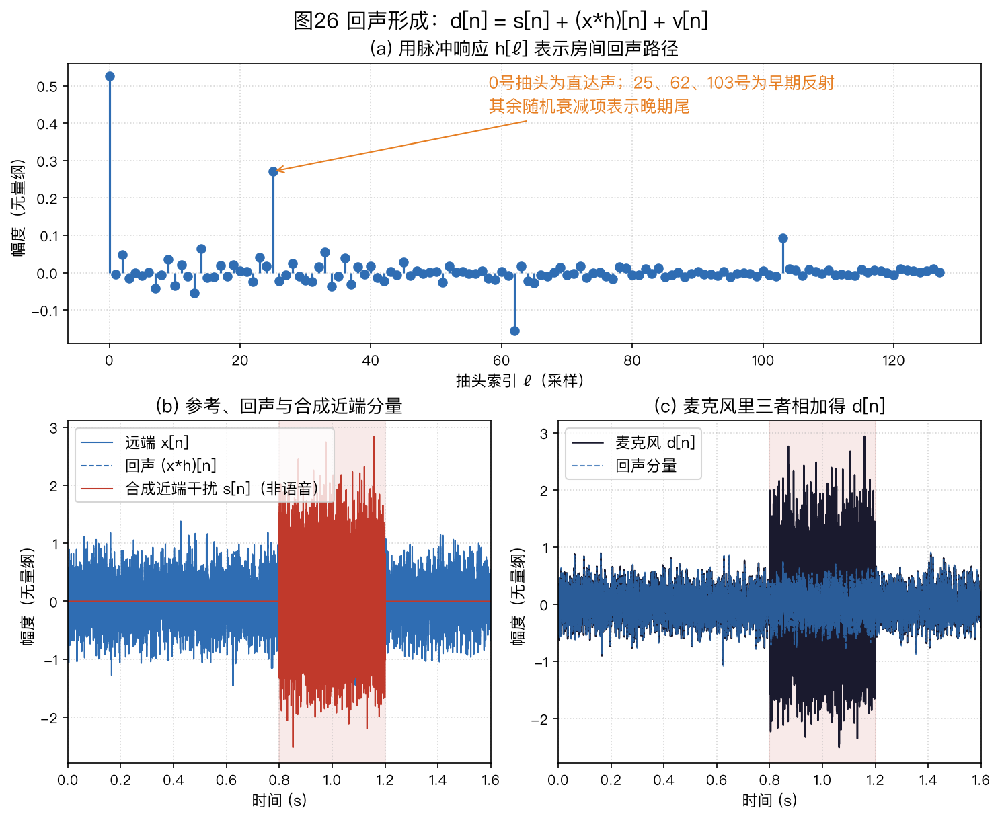

观察图26的三个子图，可以直观建立式(6-1)的时域物理图景：

- 图26（a）横轴为离散抽头索引 $\ell$（单位：采样），纵轴为无量纲路径系数 $h[\ell]$，依次呈现直达耦合主峰、若干离散早期反射峰以及按指数包络衰减的晚期混响尾声；
- 图26（b）横轴为时间（单位：$\mathrm{s}$），对比远端参考序列 $x[n]$、经图（a）路径卷积并拉长尾部的真实回声 $y[n]$，以及在 $0.8$～$1.2\ \mathrm{s}$ 区间人为注入的一段白高斯近端突发信号；
- 图26（c）展示三者在麦克风端叠加后的混合波形 $d[n]$，远端回声在单讲段完全淹没底噪，在 $0.8$～$1.2\ \mathrm{s}$ 则与近端突发混叠在一起。AEC 的任务正是利用已知参考 $x[n]$ 重构出 $y[n]$ 并从 $d[n]$ 中将它减除。

谈论任何 AEC 指标前，必须先指明系统处于哪一种通话活动场景，脱离场景孤立报出的衰减分贝数没有物理意义：

1. **远端单讲（Single-Talk Far-End，STFE）**：只有扬声器播放远端信号，$s[n]=0$，此时麦克风能量主要由回声构成，适合驱动滤波器收敛并测量回声衰减量；
2. **近端单讲（Single-Talk Near-End，STNE）**：只有本地用户在说话，远端参考静音，理想 AEC 应保持近端语音毫发无损地通过；
3. **双讲（Double-Talk，DT）**：远端播放与本地说话同时发生。残差 $e[n]$ 中包含强近端语音 $s[n]$，若滤波器盲目继续大步更新，系数就会被 $s[n]$ 带偏，后置抑制器也容易误伤近端字头，控制策略见 §6.4；
4. **双方沉默（idle）**：远端与近端均无有效活动。滤波器不应在微弱底噪激励下发生随机游走漂移，后置抑制与舒适噪声模块也不应制造突兀的静音切换（见 §6.8、§6.11）。

免提全双工通话要求同时压低远端单讲时的残余回声，并限制双讲时的近端语音失真。远端单讲且底噪远低于回声时，常用输入与输出功率之比近似回声返回损失增强（Echo Return Loss Enhancement，ERLE）；双讲段的评价口径与分量真值边界见 §6.7。

围绕上述模型，[Breining et al.（IEEE Signal Processing Magazine, 1999）](https://doi.org/10.1109/79.774933)将声学回声消除的工程挑战归纳为四点：

1. **冲激响应长**：会议室混响拖尾可达上百毫秒，时域 FIR 需要数千个抽头，不仅乘加运算量随 $L$ 增长，有色语音激励下的收敛速度也会明显变慢（§6.2 引入分区频域结构化解算力瓶颈）；
2. **器件非线性**：小型腔体扬声器与功放在高音量下产生谐波与互调失真，超出线性 FIR 的表达空间（见 §6.3）；
3. **双讲干扰**：近端语音 $s[n]$ 直接混入误差信号，既会放大在线更新的瞬时梯度波动，又会在与参考存在相关性时改变总体最优解（见 §6.4 与练习 E06-21 的严格区分）；
4. **声学路径时变**：人员走动、房门开合与室温变化都会持续改变等效路径 $h_n[\ell]$，要求算法在保护双讲的同时保持敏捷的跟踪能力。

> **边栏：室温变化如何悄悄搬动回声抽头。**
>
> 干燥空气中的声速随摄氏温度 $T$ 近似按 $c\approx 331+0.61\,T\ (\mathrm{m/s})$ 变化。室温每升高 $1\ ^\circ\mathrm{C}$，声速加快约 $0.18\%$；升高 $10\ ^\circ\mathrm{C}$（例如空调开启或设备机身发热），声速改变约 $1.8\%$。对一条固定长度 $1\ \mathrm{m}$ 的传播路径，声波飞行时间会从 $20\ ^\circ\mathrm{C}$ 时的 $1/343.2\approx 2.914\ \mathrm{ms}$ 缩短为 $30\ ^\circ\mathrm{C}$ 时的 $1/349.3\approx 2.863\ \mathrm{ms}$，提前约 $50.9\ \mu\mathrm{s}$，在 $16\ \mathrm{kHz}$ 采样率下相当于移动了 $0.81$ 个采样间隔。
>
> 更棘手的是，直达声与第 $1,2,\ldots$ 次墙面反射的几何路程各不相同：路程越长的晚期反射，绝对时延漂移越大，因此整条冲激响应发生的是“时间轴拉伸或压缩”，而非整体平移固定的 $50.9\ \mu\mathrm{s}$。[Elko, Diethorn & Gänsler（IWAENC 2003）](https://www.iwaenc.org/proceedings/2003/data/0025.pdf)与 [Frontiers in Signal Processing（2024）](https://www.frontiersin.org/journals/signal-processing/articles/10.3389/frsip.2024.1426082/full)的实测均表明，这种肉眼不可见的热漂移足以让出厂静态标定的固定滤波器彻底失效，说明在线自适应是声学回声消除不可省略的根基。

在进入推导前，还需要厘清两对容易混淆的物理概念：

第一对是**数字域波形相减（AEC）与空气声场物理相消（ANC / 车载 ICC）的本质分野**。AEC 在数字处理器内部用麦克风采样 $d[n]$ 减去估计副本 $\hat y[n]$，目的是不让本机播放声传回远端通话方，房间里的本地人耳依然听得到扬声器外放；只要副本相位误差超过 $60^\circ$，复数减法甚至可能令残余能量反超原回声（见练习 E06-04）。相比之下，主动噪声控制（Active Noise Control，ANC）通过次级扬声器向空气辐射反相声波，电子控制时延 $\tau_{\mathrm{elec}}$ 须严格小于主次声路飞行时差 $\tau_{\mathrm{acoust}}-\tau_{\mathrm{sec}}$（常为亚毫秒级），才能赶在主噪声波到达耳道前完成物理声压相消；而车载座舱通话增强（In-Car Communication，ICC）则是把前排驾驶员语音拾取放大后直接从后排扬声器实时播放出来。

按照国际电联车载座舱通信标准 **ITU-T P.1150**，同舱扩声的端到端增强延迟须严控在 $\Delta_{\mathrm{Rx}}<15\ \mathrm{ms}$（哈斯效应融合阈值之下）：一旦总环路延迟 $\tau_{\mathrm{loop}}$ 偏大，后排乘客耳中同时到达的空气直达人声与扬声器扩声就会发生间隔 $\Delta f=1/\tau_{\mathrm{loop}}$ 的周期性相长与相消干涉，产生刺耳的金属感梳状滤波（comb filtering）乃至闭环声反馈啸叫（定量复算见练习 [E06-44](#e06-44)），而这类已经在空气中叠加进入人耳的物理干涉是无法靠发送端数字 AEC 事后抹除的。而在入耳式耳机通透模式（Hear-Through）中，耳塞被动漏声与电声重放直接在鼓膜叠加，端到端延迟上限会进一步收紧至百微秒级（详见[第 14 章 §14.10](14_spatial-wearable-arrays.md#sec-14-10)）。

第二对是**波形减法与谱幅度乘法的分工**。线性 AEC 握有参考波形 $x[n]$，能够同时估计回声的幅度与相位并直接作波形相减，在近端语音与回声同频重叠时依然可以只剥离回声而保留语音。当缺少精确波形参考（例如抑制线性未建模残余或未知背景噪声）时，经典后置滤波（如 §5.7 维纳后置滤波与 §6.8 的传统 NLP）往往退而估计功率谱，再对混合时频系数乘以 $0$～$1$ 之间的实数标量增益——这会把同一时频格内的回声与近端语音按相同比例一并压低。至于多通道复数滤波、复数掩码或深度滤波（§6.5），则额外引入了跨通道或跨帧复数自由度，阅读时应按各自的数学算子准确区分。

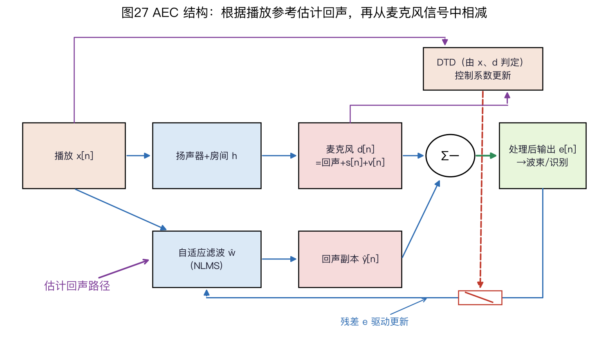

图27概括了单通道线性 AEC 的标准信号流：远端参考信号 $x[n]$ 一路经扬声器和房间物理链路变成真实回声进入麦克风，另一路送入横向自适应滤波器 $\hat{\vec w}[n]$ 合成估计回声 $\hat y[n]$；加法器执行 $e[n]=d[n]-\hat y[n]$ 完成数字相减，顶部的双讲检测（DTD）模块监测两路信号以控制滤波器在双讲期间暂停或放缓更新。

#### 6.1.2 线性自适应滤波：NLMS 回顾

为了在线追踪未知的 $h[\ell]$，我们维护一个长度为 $L$ 的实数自适应滤波器权重列向量 $\hat{\vec w}[n]\in\mathbb{R}^L$（分量为 $\hat w_0[n],\ldots,\hat w_{L-1}[n]$），并把当前时刻及过去 $L-1$ 个参考样本按**当前样本在前**的顺序排成列向量 $\vec x[n]=[x[n],x[n-1],\ldots,x[n-L+1]]^\top$。这样第 $0$ 个抽头恰好乘在最新样本 $x[n]$ 上，向量内积便与式(6-1)的离散卷积索引严格对齐。每一拍采样到来时，先用**更新前**的旧权重计算回声预测与先验残差：

$$\begin{aligned}
\hat y[n]&=\hat{\vec w}^{\top}[n]\vec x[n],\\
e[n]&=d[n]-\hat y[n].
\end{aligned}\tag{6-2}$$

在远端单讲（$s[n]=0$）、底噪微弱且参考信号频谱充分激励的前提下，$e[n]$ 直接反映了路径失配 $(\vec h-\hat{\vec w}[n])^\top\vec x[n]$，压低残差功率即可推动 $\hat{\vec w}[n]$ 逼近真实路径 $\vec h$。反之，若只在某一个孤立采样或单一频率参考上看到 $e[n]$ 很小，并不能证明全部 $L$ 个抽头都已收敛到真值。

工业界最常用的时域基线更新规则是**归一化最小均方（Normalized Least Mean Squares，NLMS）**算法：

$$\begin{aligned}
\Delta\vec w[n]
&=\mu\frac{e[n]\vec x[n]}
          {\|\vec x[n]\|^2+\varepsilon},\\
\hat{\vec w}[n+1]&=\hat{\vec w}[n]+\Delta\vec w[n].
\end{aligned}\tag{6-3}$$

式(6-3)中，$\|\vec x[n]\|^2=\vec x^\top[n]\vec x[n]$（即 $\sum_{\ell=0}^{L-1}x^2[n-\ell]$）是当前参考滑窗的瞬时能量，$\mu$ 是无量纲步长因子，$\varepsilon>0$ 是防止参考静音时分母趋零的正向正则地板（若手算例题人为取 $\varepsilon=0$，则必须在 $\|\vec x[n]\|^2=0$ 时显式跳过更新以避免 $0/0$）。

式(6-3)可以从瞬时平方误差一步步推导出来（向量梯度、超平面正交投影与迭代优化基础见[第 0 章 §0.5](00_math-foundations.md#sec-0-5)）：

1. **定义瞬时目标与梯度**：取当前时刻的先验残差平方 $J[n]=e^2[n]=(d[n]-\hat{\vec w}^\top[n]\vec x[n])^2$ 作为瞬时代价。将 $\vec x[n]$ 与 $d[n]$ 视为给定常数，对列向量 $\hat{\vec w}[n]$ 应用链式法则求偏导，得到瞬时梯度 $\nabla_{\hat{\vec w}}J[n]=2\,e[n]\,(-\vec x[n])$，整理即 $-2\,e[n]\vec x[n]$；
2. **沿负梯度最速下降（LMS）**：把常数因子 $2$ 吸收进正步长 $\mu'$，令权重沿负梯度方向前进一步，得到 $\hat{\vec w}[n+1]=\hat{\vec w}[n]+\mu'\,e[n]\vec x[n]$，这就是经典的最小均方（Least Mean Squares，LMS）算法；
3. **按输入能量归一化（NLMS）**：普通 LMS 的更新量与参考幅度平方成正比——音量调大 $10$ 倍，有效步长就暴涨 $100$ 倍而极易发散；音量调小时收敛又陷入停滞。令 $\mu'=\mu/(\|\vec x[n]\|^2+\varepsilon)$，用当前窗口能量除掉输入尺度的二阶变化，便得到式(6-3)的 NLMS。

    为了看清无量纲步长 $\mu$ 的几何尺度，假设 $\|\vec x[n]\|^2\gg\varepsilon$，把更新后的新权重 $\hat{\vec w}[n+1]$ 代回**同一时刻**的观测重算后验残差 $e'[n]$：

    $$\begin{aligned}
    e'[n]&=d[n]-\hat{\vec w}^{\top}[n+1]\vec x[n]\\
    &=d[n]-\bigl(\hat{\vec w}[n]+\Delta\vec w[n]\bigr)^{\top}\vec x[n]\\
    &=e[n]-\mu\,e[n]
      \frac{\|\vec x[n]\|^2}{\|\vec x[n]\|^2+\varepsilon}\\
    &=e[n]\left(1-\mu
      \frac{\|\vec x[n]\|^2}{\|\vec x[n]\|^2+\varepsilon}\right).
    \end{aligned}$$

    当 $\varepsilon\ll\|\vec x[n]\|^2$ 时，括号内近似为 $1-\mu$，即 $e'[n]\approx(1-\mu)\,e[n]$。由此可见：$0<\mu<2$ 保证单步后验残差的绝对值严格收缩（$|1-\mu|<1$）；$\mu=1$ 会把当前这一个样本的后验误差一步归零（在无噪且无双讲时对应投影到超平面 $\vec x^\top[n]\vec w=d[n]$ 上，但若有噪声或双讲则会把干扰全盘并入权重）；$\mu=1.8$ 会让后验误差变号并保留 $80\%$ 幅度（$e'[n]\approx -0.8\,e[n]$），$\mu=2$ 则是单步幅度不衰减的临界边界。实际语音有色、含噪且存在双讲切换，工程步长通常选在 $0.1$～$0.6$ 之间并配合双讲控制扫描标定。

#### 算例 6-1：NLMS 的一步手算

**输入与口径**：设 $L=3$ 抽头滤波器，当前参考回归向量 $\vec x[n]=[1,\ 0.5,\ -0.5]^\top$，初始权重全零 $\hat{\vec w}[n]=[0,\ 0,\ 0]^\top$，麦克风当前采样 $d[n]=0.8$，步长 $\mu=0.5$，在非零能量窗口上忽略极小正则项（取 $\varepsilon=0$）。按式(6-2)～式(6-3)逐步复算：

1. **计算先验预测与先验残差**：因初值为零，回声副本 $\hat y[n]=\hat{\vec w}^\top[n]\vec x[n]$ 展开为 $0\times 1+0\times 0.5+0\times(-0.5)=0$，因果输出的先验残差 $e[n]=d[n]-\hat y[n]=0.8$。
2. **计算窗口能量分母**：$\|\vec x[n]\|^2=1^2+0.5^2+(-0.5)^2=1+0.25+0.25=1.5$。
3. **计算权重增量并更新系数**：代入式(6-3)，更新方向严格平行于当前输入向量 $\vec x[n]$：

    $$\begin{aligned}
    \Delta\vec w[n]
    &=\frac{0.5\times 0.8}{1.5}\begin{bmatrix}1\\0.5\\-0.5\end{bmatrix}
    =\frac{4}{15}\begin{bmatrix}1\\0.5\\-0.5\end{bmatrix}
    \approx\begin{bmatrix}0.267\\0.133\\-0.133\end{bmatrix},\\
    \hat{\vec w}[n+1]&=\hat{\vec w}[n]+\Delta\vec w[n]
    =\begin{bmatrix}4/15\\2/15\\-2/15\end{bmatrix}
    \approx\begin{bmatrix}0.267\\0.133\\-0.133\end{bmatrix}.
    \end{aligned}$$

4. **回看同一观测的后验残差**：用精确分数代入检验后验预测：

    $$\begin{aligned}
    \hat y'[n]&=\hat{\vec w}^\top[n+1]\vec x[n]\\
    &=\frac{4}{15}\times 1+\frac{2}{15}\times 0.5
      +\left(-\frac{2}{15}\right)\times(-0.5)\\
    &=\frac{4+1+1}{15}=\frac{6}{15}=0.4,
    \end{aligned}$$

    故后验残差 $e'[n]=0.8-0.4=0.4=(1-0.5)\,e[n]$，恰好减半。

**换一组输入再验“减半”规律**：改取 $\vec x[n]=[0.8,-0.4,0.4]^\top$、$d[n]=0.6$、$\hat{\vec w}[n]=\vec 0$、$\mu=0.5$。此时窗口能量 $\|\vec x[n]\|^2=0.64+0.16+0.16=0.96$，权重增量为 $(0.5\times 0.6/0.96)\,\vec x[n]=0.3125\,\vec x[n]$，算出 $[0.25,-0.125,0.125]^\top$。代回同一输入得

$$\begin{aligned}
\hat y'[n]&=0.25\times 0.8+(-0.125)\times(-0.4)+0.125\times 0.4\\
&=0.2+0.05+0.05=0.3,
\end{aligned}$$

后验残差 $e'[n]=0.6-0.3=0.3$，依然精确等于 $(1-\mu)\,e[n]$。这说明单步后验缩放因子 $1-\mu$ 由正交投影结构决定，不依赖具体数字。但也要清醒看到：一步更新只消除了沿 $\vec x[n]$ 这一个一维方向上的误差分量，与 $\vec x[n]$ 正交的另外 $L-1$ 个子空间方向丝毫未动，必须靠后续不同方向的输入向量继续提供梯度才能辨识整条路径。

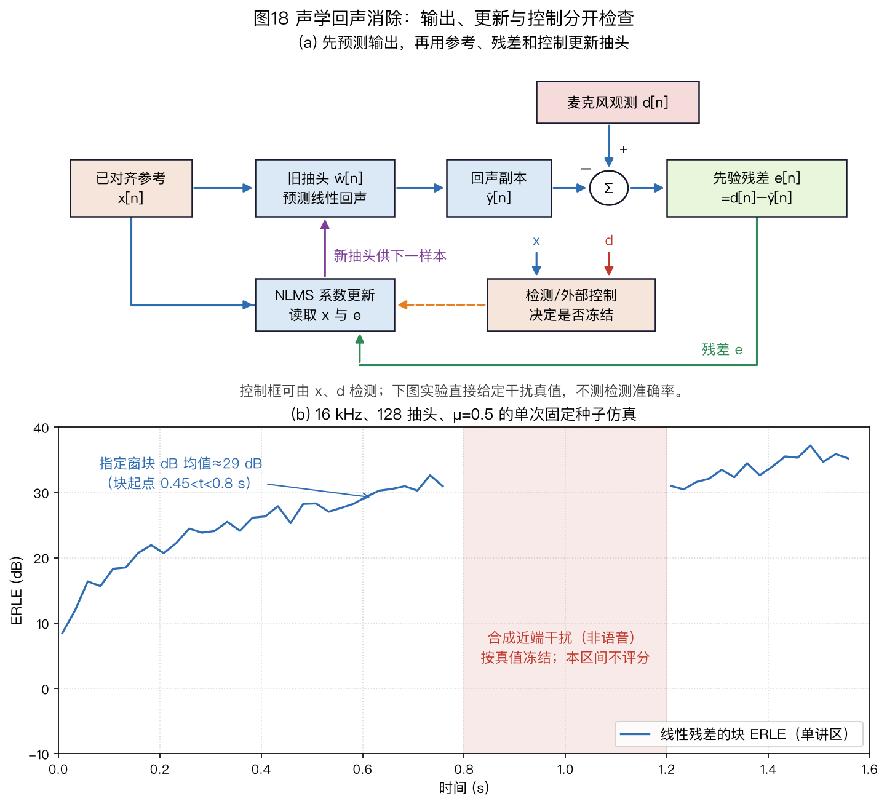

下面结合图18、图28与图29三组仿真图，把 NLMS 的因果顺序、系数失配与双讲保护串起来读透。先看图18的两个面板：

- **图18（a）**：按单拍计算的因果数据流排列——从已时间对齐的参考 $\vec x[n]$ 与麦克风观测 $d[n]$ 出发，先用旧权重算出 $\hat y[n]$ 与先验残差 $e[n]$，再由 DTD 开关决定是否把 $e[n]$ 送回权重更新支路；
- **图18（b）**：横轴为时间（单位：$\mathrm{s}$），纵轴为分块计算的 $\mathrm{ERLE}$（单位：$\mathrm{dB}$），仿真采用 $\mu=0.5$ 与当前样本在前的回归向量；图中标出的均值取自固定随机种子下 $0.45<t<0.8\ \mathrm{s}$ 远端单讲窗口内各数据块 $\mathrm{dB}$值的算术平均（注意逐块 $\mathrm{dB}$ 算术均值与整窗总能量之比的对数并非同一统计量，反例见练习 E06-31），粉色阴影段模拟双讲并冻结更新，该区间不计入 $\mathrm{ERLE}$。

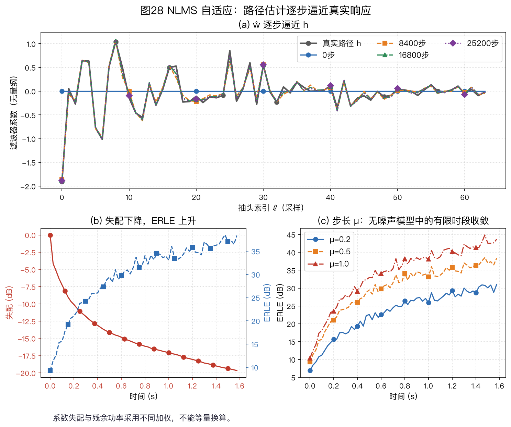

再看图28（无噪、无近端干扰的纯线性路径匹配实验）：

- 图28（a）横轴为抽头索引 $\ell$，纵轴为无量纲滤波器系数，随着迭代步数推进（从深蓝实线逐步演化至紫色点线），$\hat{\vec w}[n]$ 的波形轮廓逐步贴合灰色真实脉冲响应 $h[\ell]$；
- 图28（b）采用双纵轴同时绘制**归一化系数失配分贝值** $10\log_{10}(\lVert\hat{\vec w}[n]-\vec h\rVert_2^2 / \lVert\vec h\rVert_2^2)$（左纵轴红色实线，从 $0\ \mathrm{dB}$ 逐步降至约 $-20\ \mathrm{dB}$）与 $\mathrm{ERLE}$（右纵轴蓝色虚线，单位 $\mathrm{dB}$）。两条曲线整体趋势相反，但并非严格的等量镜像换算：记抽头误差向量为 $\tilde{\vec w}[n]=\vec h-\hat{\vec w}[n]$，在有色参考激励下，残余回声功率等于 $\tilde{\vec w}^\top[n]\mathbf R_{xx}\tilde{\vec w}[n]$，即由输入相关矩阵 $\mathbf R_{xx}$ 加权。举一个二抽头最小例子即可看明：设零均值回归向量的协方差矩阵为 $\mathbf R_{xx}=\operatorname{diag}(100,1)$，现有两组路径误差向量 $[0.1,0]^\top$ 与 $[0,0.1]^\top$；两者的欧氏范数同为 $0.1$（相对失配分贝值完全相同），但前者落在高能量方向上，产生的残余回声功率为 $100\times 0.1^2=1$，后者落在弱能量方向上，残余功率仅为 $1\times 0.1^2=0.01$，两者足足相差 $20\ \mathrm{dB}$；
- 图28（c）对比不同步长 $\mu$ 在有限观测时段内的收敛轨迹：无观测噪声时 $\mu$ 越接近 $1$ 下降越陡；但在真实含噪系统中，过大的 $\mu$ 会把底噪持续折算进权重，抬高稳态失调（misadjustment）。

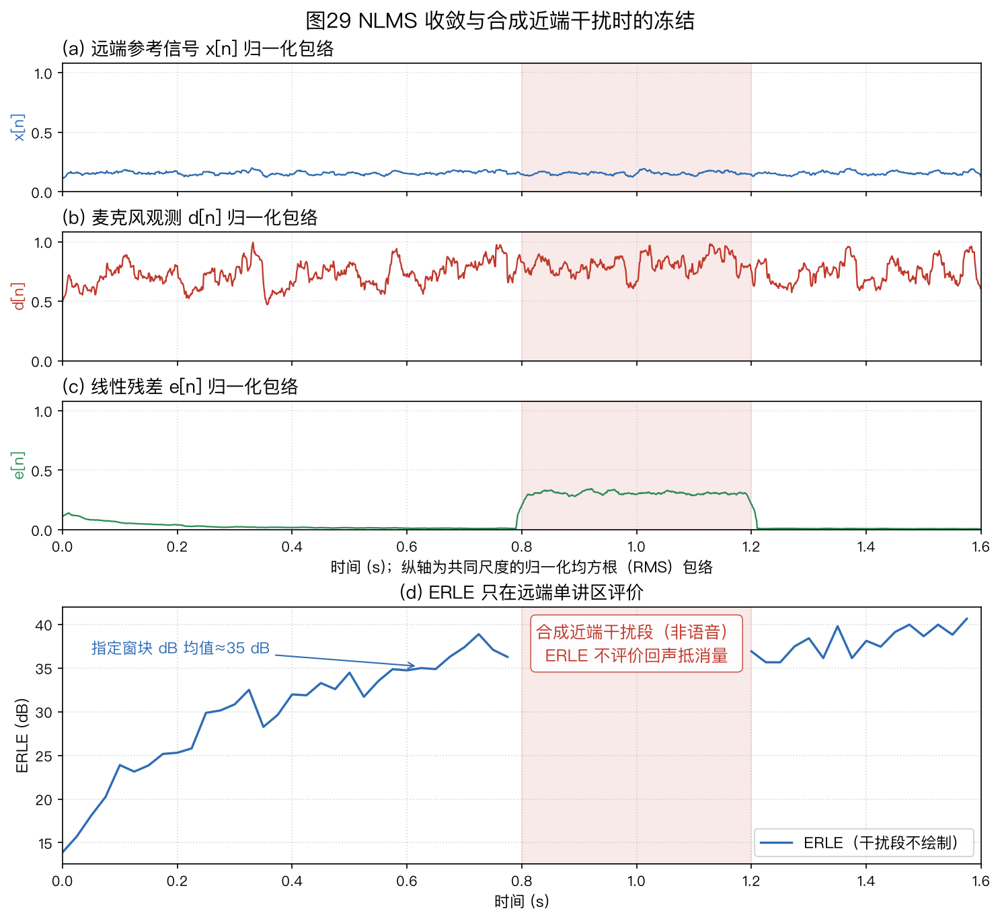

最后看图29。上方三行采用统一纵轴尺度绘制参考 $x[n]$、麦克风信号 $d[n]$ 与残差 $e[n]$ 的短时均方根包络；粉色阴影段人为注入白高斯近端干扰，并利用已知区间真值冻结滤波器权重。在粉色区间内，残差 $e[n]$ 的主要成分正是应当保留的近端信号，此时若仍拿麦克风输入与残差输出的总功率比去算 $\mathrm{ERLE}$，就会把“近端语音正常输出”误判成“回声抵消崩溃”，所以底部面板在该区间留空不画 $\mathrm{ERLE}$；待粉色段结束后，冻结得以保护的滤波器无需重新慢速收敛便立即恢复高抵消深度。

#### 步长、正则项与充分激励

工程调参中，$\mu$、$\varepsilon$ 与参考信号的频谱跨度共同决定了 NLMS 能否稳定收敛到真实物理路径。

步长 $\mu$ 控制“收敛速度”与“抗噪稳健性”的折中：调大 $\mu$ 能加快冷启动与路径突变后的重收敛，但观测含底噪或双讲漏检尚未冻结时，大步长会把更多干扰写进抽头。

正则项 $\varepsilon$ 则必须在物理量纲上与分母中的窗口能量 $\|\vec x[n]\|^2$ 保持一致（均为信号幅度的平方）：无论是取固定绝对能量地板，还是写成随平滑参考能量 $P_x$ 浮动的 $\varepsilon=\eta P_x$（此时比例系数 $\eta$ 才是无量纲数），若信号从 $[-1,1)$ 浮点表示切换为 16 位有符号整数 $[-32768,32767]$，能量尺度会放大 $32768^2\approx 1.07\times 10^9$ 倍，绝不能原封不动照搬同一个绝对常数 $\varepsilon$。标定时应依次扫描全零静音、低电平底噪播放与正常音量外放三档信号，确保静音期不发生除零乱跳、弱播放期又不因 $\varepsilon$ 过大而把有效步长压死。

**为什么窄带参考会让多抽头滤波器“学不全”路径？** 从算例 6-1 第 3 步已知，NLMS 每一拍只沿当前 $\vec x[n]$ 方向修正权重；要在长时平均意义下唯一确定全部 $L$ 个抽头，正规方程 $\mathbf R_{xx}\vec w=\vec r_{xd}$（其中 $\mathbf R_{xx}=\mathbb{E}[\vec x[n]\vec x^\top[n]]$）必须满秩且良态，这一条件称为**充分激励（persistent excitation）**。如果远端只播放一个频率不在 $0$ 或 $\pi$ 的稳态实正弦单音 $x[n]=A\cos(\Omega_0 n+\varphi)$，它在任意时刻的滞后序列都只能由 $\cos(\Omega_0 n)$ 和 $\sin(\Omega_0 n)$ 两个基函数线性张成，因此 $\operatorname{rank}(\mathbf R_{xx})=2$：一旦滤波器长度 $L\ge 3$，相关矩阵严格奇异，存在无穷多组完全不同的抽头都能把这条单音抵消为零，一旦远端换成宽带人声就会立刻漏出回声（见算例 6-5）。

即便参考不是离散纯单音，而是在一段连续窄带数字角频率区间 $[-b,b]\subset[-\pi,\pi]$（$b>0$）内具有平坦功率谱密度、带外功率严格为零的带限随机过程，相关矩阵虽然在数学上满秩，也会随着带宽变窄而迅速病态化。我们可以把这个经典的傅里叶对偶关系完整推出来：

设零均值平稳实过程 $x[n]$ 的方差归一化为 $r[0]=\mathbb{E}[x^2[n]]=1$。为了使逆离散时间傅里叶变换（IDTFT）在零滞后处积分为 $1$，其在数字角频率 $\Omega_{\mathrm{d}}\in[-b,b]$ 上的常数功率谱密度须取 $S_{xx}(\Omega_{\mathrm{d}})=\pi/b$（带外 $b<|\Omega_{\mathrm{d}}|\le\pi$ 处 $S_{xx}(\Omega_{\mathrm{d}})=0$）。按维纳—辛钦定理计算整数滞后 $k$ 处的自相关序列 $r[k]=\mathbb{E}[x[n]x[n-k]]$：

$$\begin{aligned}
r[k]&=\frac{1}{2\pi}\int_{-\pi}^{\pi}
      S_{xx}(\Omega_{\mathrm{d}})\,
      e^{\mathrm{j}\Omega_{\mathrm{d}} k}\,\mathrm{d}\Omega_{\mathrm{d}}\\
&=\frac{1}{2\pi}\int_{-b}^{b}\frac{\pi}{b}
  e^{\mathrm{j}\Omega_{\mathrm{d}} k}\,\mathrm{d}\Omega_{\mathrm{d}}\\
&=\frac{e^{\mathrm{j}kb}-e^{-\mathrm{j}kb}}{\mathrm{j}2kb}
=\frac{\sin(kb)}{kb}
=\operatorname{sinc}\!\left(\frac{kb}{\pi}\right),\quad k\neq 0,
\end{aligned}$$

且连续极限给出 $r[0]=1$。于是，一个 $L=3$ 抽头回归向量 $\vec x[n]=[x[n],x[n-1],x[n-2]]^\top$ 的 $3\times 3$ 实对称 Toeplitz 自相关矩阵（第 $(i,j)$ 元为 $r[i-j]$）显式写为：

$$\mathbf R_{xx}=\begin{bmatrix}
1 & \dfrac{\sin b}{b} & \dfrac{\sin(2b)}{2b} \\
\dfrac{\sin b}{b} & 1 & \dfrac{\sin b}{b} \\
\dfrac{\sin(2b)}{2b} & \dfrac{\sin b}{b} & 1
\end{bmatrix}.$$

从这个 $3\times 3$ 矩阵能一眼看穿窄带病态的根源：当通带半宽 $b$ 越缩越窄时，$\sin(kb)/(kb)\approx 1-(kb)^2/6$ 越来越逼近 $1$，矩阵的三列几乎退化成一模一样的 $[1,1,1]^\top$，相邻采样高度共线！具体代入三组带宽计算特征值：

- 宽带半带激励 $b=\pi/2$：$r[1]=2/\pi\approx 0.6366$，$r[2]=0$，最小特征值 $\lambda_{\min}\approx 0.0997$，二范数条件数 $\kappa_2(\mathbf R_{xx})=\lambda_{\max}/\lambda_{\min}$ 约为 $19$，三个特征方向都能顺畅收敛；
- 窄带激励 $b=\pi/8$：$r[1]\approx 0.9745$，$r[2]\approx 0.9003$，最小特征值骤降到 $\lambda_{\min}\approx 3.57\times 10^{-4}$，条件数飙升至约 $8134$；
- 极窄带激励 $b=\pi/32$：$r[1]\approx 0.9984$，$r[2]\approx 0.9936$，最小特征值仅剩 $\lambda_{\min}\approx 1.38\times 10^{-6}$，条件数高达约 $217\text{ 万}$！

虽然这三组矩阵的行列式都严格大于零（理论上可逆），但在条件数高达百万量级时，梯度下降在弱特征方向上的时间常数会被拉长百万倍，有限长语音片段上的微小观测噪声也会在高频差模方向上被剧烈放大。工程排障时先用白噪声或扫频宽带信号确认硬件通路与最大可达 ERLE，再换真实节目源检验收敛速度（见练习 E06-37、E06-38），依据正在于此。

最后辨析一个常见的初学者困惑：**单个单位脉冲 $x=[1,0,0,\ldots]$ 算不算充分激励？** 当这个非零样本依次滑过 $L$ 个抽头位置时，回归向量 $\vec x[n]$ 会先后取遍全部 $L$ 个标准正交基向量 $\vec e_0,\vec e_1,\ldots,\vec e_{L-1}$（其中 $\vec e_\ell$ 的第 $\ell$ 个分量为 $1$、其余为 $0$），样本相关矩阵之和恰为单位阵 $\mathbf I_L$，方向上一点也不缺失。然而每个基方向在整个时间轴上**只出现唯一一次**：若初值为零、步长取 $\mu=0.5$（忽略极小 $\varepsilon$），每个抽头就只在各自那唯一的一拍更新到真值的一半（$0.5\,h[\ell]$），脉冲滑出窗口后输入能量归零，算法按零能量保护停更，权重便永远停在真值一半处（见练习 E06-01）。可见，方向张满空间只是必要条件，自适应迭代还需要信号在各方向上**持续重复激励**才能把初始误差一步步磨平。

### 6.2 工程化自适应：频域、子带、比例、仿射投影、RLS 与卡尔曼

当房间混响较长或采样率升至 $48\ \mathrm{kHz}$ 时，直接运行逐样本时域 NLMS 会同时撞上“乘加计算量过高”与“有色语音收敛偏慢”两道墙。本节沿着工程演化的清晰脉络依次拆解六类改进方案：§6.2.1～§6.2.2 用分区块频域结构（PBFDAF）把长卷积拆短并借助 FFT 加速；§6.2.3 剖析子带分解为何会冒出跨带混叠耦合项；§6.2.4 用比例步长（IPNLMS）把更新份额向稀疏主峰集中；随后在[仿射投影专题](#sec-u-204b533044)中联立最近 $K$ 个观测方向消除局部相关性，在 §6.2.5 用递归最小二乘（RLS）维护指数加权历史相关矩阵的逆，并在 §6.2.6 引入同时刻画路径漂移与双讲观测不确定度的卡尔曼滤波（FDKF / PBFDKF）。

先算一笔时域基线的乘加账。对长度 $L$ 的时域 NLMS，每一拍采样的卷积预测 $\hat{\vec w}^\top[n]\vec x[n]$ 需 $L$ 次乘法，权重更新 $\Delta\vec w[n]$ 需 $L$ 次乘法；若朴素重算 $\|\vec x[n]\|^2$ 则再加 $L$ 次乘法，合计每样本约 $3L$ 次乘法。利用滑窗移位关系 $p_n=p_{n-1}+x^2[n]-x^2[n-L]$ 递推分母能量，可把能量项降为常数次运算（长时浮点运行需按零初值起步并定期重算真实平方和以消除舍入漂移），但滤波与更新两项仍刚性消耗 $2L$ 次乘法。例如取 $L=3$、输入序列依次为 $1,2,3,4$，前窗能量 $1^2+2^2+3^2=14$，移入 $4$、移出 $1$ 得 $14+4^2-1^2=29$，与直接重算 $2^2+3^2+4^2=29$ 完全一致，但预测和更新的 $2L$ 次乘加丝毫未减。

换成具体设备规格：窄带 $8\ \mathrm{kHz}$、$L=1024$（覆盖 $128\ \mathrm{ms}$）时，朴素口径约需 $3072\times 8000\approx 2458\text{ 万}$次乘法/秒，递推能量口径核心项也需约 $1638\text{ 万}$次/秒；到了高清会议终端常用的 $48\ \mathrm{kHz}$、$L=4096$（覆盖约 $85.3\ \mathrm{ms}$），单声道时域核心乘加就飙升至每秒近 $4\text{ 亿}$次，多麦克风并发时更是难以承受。这正是工业界普遍转向分区频域与子带架构的直接动因。

#### 6.2.1 PBFDAF：从长回声路径到逐块更新

如果直接用单块频域自适应滤波（FDAF）把一条 $4096$ 抽头的回声路径一次性变到频域，就必须攒够 $4096$ 个新采样才能做一次块卷积，仅成块等待时间在 $16\ \mathrm{kHz}$ 下就高达 $256\ \mathrm{ms}$，实时通话根本无法接受。**分区块频域自适应滤波（Partitioned-Block Frequency-Domain Adaptive Filtering，PBFDAF）**沿用多延迟块频域（Multidelay Block Frequency-Domain，MDF；[Soo & Pang, 1990](https://doi.org/10.1109/29.103078)）的分治思想：把总长 $L$ 的时域抽头切成 $P=\lceil L/N\rceil$ 个长度为 $N$ 的短分区，每次只等 $N$ 个新采样（如 $N=64$ 或 $128$，仅 $4$ 或 $8\ \mathrm{ms}$）就用长度 $2N$ 的快速傅里叶变换（Fast Fourier Transform，FFT）完成重叠保存（overlap-save）线性卷积。若 $L$ 不是 $N$ 的整数倍，末分区不足 $N$ 的尾部位置固定补零，这些补零位不代表新增可学习的物理抽头。

先把块号、分区号与频点索引定准。设负时间采样全为零，第 $m$ 块新到达的 $N$ 个参考样本记为行块 $b_m=[x[mN],\ldots,x[mN+N-1]]$；将上一块末尾的 $N$ 个历史样本与当前新块首尾相接，拼成长度 $2N$ 的重叠输入窗 $u_m=[b_{m-1},b_m]$，对其作 $2N$ 点正变换得到复频谱 $X(k,m)=\operatorname{FFT}_{2N}(u_m)$，其中 $k=0,\ldots,2N-1$ 为频点索引。与此同时，把长度为 $L$ 的时域路径第 $p$ 段 $h_p=[h[pN],\ldots,h[pN+N-1]]$（$p=0,\ldots,P-1$）在末尾补 $N$ 个零扩成 $[h_p,0_N]$，对应的频域自适应权重记为复数谱 $W_p(k,m)$。各分区与历史参考谱的配对关系如下表所示：

| 时域路径的位置 | 使用的参考谱 | 它在本块输出中代表什么 |
|---|---|---|
| $p=0$，抽头 $0,\ldots,N-1$ | $X(k,m)$ | 当前及紧邻的参考样本产生的直达与早反射回声 |
| $p=1$，抽头 $N,\ldots,2N-1$ | $X(k,m-1)$ | 延迟 $1$ 个分区的参考历史产生的回声 |
| $p=P-1$，最后 $N$ 个位置 | $X(k,m-P+1)$ | 长混响尾部；末分区不足 $N$ 处固定为零 |

这张表揭示了分区加速的核心机制：“第 $p$ 个频域分区”对应时域脉冲响应的第 $p$ 段抽头，与之相乘的恰好是 $p$ 块之前已经算好并保存在缓存里的参考频谱 $X(k,m-p)$。每来一块新数据，系统只需对最新拼接窗 $u_m$ 计算 $1$ 次 FFT，把旧谱沿延迟线向后平移一格即可直接复用，从而省去对历史参考块的重复变换。这也带来一条硬性状态纪律：**即使双讲期间冻结了权重更新，参考频谱历史移位也绝不能暂停**，否则下一块的回声预测就会与真实播放时间轴错位。

**先预测有效半块，再形成先验残差。** 第 $m$ 块到来时，先用更新前的旧权重在每个频点累加 $P$ 个分区的频域乘积 $Q_m(k)=\sum_{p=0}^{P-1}W_p(k,m)X(k,m-p)$，再经 $2N$ 点逆快速傅里叶变换（Inverse Fast Fourier Transform，IFFT）回到时域得到长度 $2N$ 的循环卷积序列 $q_m$。根据重叠保存原理，$q_m$ 的前 $N$ 点混有块首尾循环折回（wrap-around）伪影，必须丢弃；后 $N$ 点才精确等于线性卷积在当前块时刻的输出 $\hat y_m$。用块内局部下标 $r=0,\ldots,N-1$ 写出这一因果预测流程（前两行在固定频点上省略公共自变量 $k$，简写 $W_{p,m}=W_p(k,m)$、$X_{m-p}=X(k,m-p)$）：

$$\begin{aligned}
Q_m&=\sum_{p=0}^{P-1}W_{p,m}X_{m-p},\\
q_m&=\operatorname{IFFT}_{2N}(Q_m),\\
\hat y_m[r]&=q_m[N+r],\\
e_m[r]&=d_m[r]-\hat y_m[r].
\end{aligned}\tag{6-4}$$

只要每个分区的频域权重 $W_p(k,m)$ 确实由“前 $N$ 点合法抽头（末短分区仅前 $L-(P-1)N$ 点）、后半段补零”的时域序列变换而来，式(6-4)取出的后半块 $\hat y_m$ 在代数上就与长度 $L$ 的直接时域 FIR 卷积严格相等。

**构造误差谱时同样必须在前半块补零。** 拿到长度 $N$ 的有效先验残差 $e_m$ 后，必须在前 $N$ 个位置显式填零排成 $[0_N,e_m]$，再作变换得到 $E(k,m)=\operatorname{FFT}_{2N}([0_N,e_m])$。如果图省事直接拿观测谱减去完整循环卷积谱 $Q_m$，前半块被丢弃的循环折回项就会溜进频域误差并污染梯度（稍后 §6.2.2 将给出完整矩阵证明）。[Shynk（IEEE Signal Processing Magazine, 1992, §IV）](https://course.ece.cmu.edu/~ece792/handouts/Shynk92.pdf)系统对比了这类重叠保存有效区选择与梯度约束变体。

从渐近复杂度看，每块预测与相关运算都要遍历全部 $P=\lceil L/N\rceil$ 个分区：无时域梯度约束时，平均到每个新采样点的核心运算量约为 $O(\log N + L/N)$；若每块对全部 $P$ 个分区都执行一次“IFFT 回时域清零后半段、再 FFT 回频域”的合法抽头投影，则会额外增加约 $O((L/N)\log N)$ 的变换开销。具体常数因子还取决于实数半谱共轭对称复用、功率平滑方式与约束执行频率（参见 [KU Leuven DSP-CIS 讲义第 13 章](https://homes.esat.kuleuven.be/~dspuser/DSP-CIS/2018-2019/material/chapter13.pdf)）。

#### 算例 6-2：PBFDAF 选定核心算子的乘法计数

**输入与口径**：取滤波器总长 $L=1024$、块长 $N=128$、采样率 $8\ \mathrm{kHz}$，比较逐样本时域 NLMS 与分区数 $P=L/N=8$、FFT 长度 $2N=256$ 的 PBFDAF 在**选定核心算子**上的实数乘法次数（用于展示分块降阶的数量级原理，不等同于优化实数 FFT 库或整机程序的实测耗时）。

**时域 NLMS 基准**：每样本滤波 $L$ 次、更新 $L$ 次；朴素重算窗口能量再加 $L$ 次，共 $3L=3072$ 次实乘法/样本；采用滑窗递推能量时核心项为 $2L=2048$ 次实乘法/样本。

**PBFDAF 逐块分解**：每攒齐 $N=128$ 个新参考样本，每块需要依次执行的运算包括：

1. 对拼接参考块 $u_m$ 作 $1$ 次 $256$ 点正变换，此前 $7$ 个历史分区的频谱直接沿缓存移位复用；
2. 对 $8$ 个分区各做一次长度 $256$ 的逐频点复数乘法并累加，随后作 $1$ 次 $256$ 点 IFFT 取出后半块预测 $\hat y_m$；
3. 对零填充有效误差 $[0_{128},e_m]$ 作 $1$ 次 $256$ 点 FFT，再与 $8$ 个分区的共轭参考谱各做一次长度 $256$ 的逐点复乘形成频域更新方向；
4. 若启用逐分区严格时域梯度约束，每个分区还需作 $1$ 次 IFFT 清零后 $128$ 个非法位置、再作 $1$ 次 FFT 回到频域（共增加 $2P=16$ 次变换）；无约束版省去此步，轮流间歇约束版则按实际执行比例折算。

为了使纸面算术透明可复核，暂不折算实信号半谱共轭对称（工业实数 FFT 仅需存 $N+1=129$ 个独立频点，乘法约省一半），统一按完整 $2N=256$ 点复数变换 $4N\log_2(2N)=4\times 128\times 8=4096$ 次实乘法、每次 $256$ 点复乘 $256\times 4=1024$ 次实乘法核算：

- **无梯度约束核心项**：每块含 $3$ 次变换与 $2\times 8$ 次复谱相乘，共 $3\times 4096 + 16\times 1024 = 12288+16384=28672$ 次/块，折合每样本 $28672/128 = 224$ 次；
- **每块全分区约束核心项**：再加 $16$ 次变换 $16\times 4096=65536$ 次/块，合计 $94208$ 次/块，折合每样本 $94208/128 = 736$ 次。

若像本书教学代码那样每块对全部 $8$ 个分区的复频点显式重算模平方 $|X|^2=(\operatorname{Re} X)^2+(\operatorname{Im} X)^2$，还需外加 $2\times 256\times 8=4096$ 次实乘法/块（即 $32$ 次/样本），两项分别升至 $256$ 与 $768$ 次/样本（仍未计入求和、除法与步长缩放；且教学代码为便于对照观察，即便关闭约束也会额外执行 IFFT 导出候选系数）。仅对比上述核心乘加分项，$224$ 与 $736$ 相对朴素时域 NLMS 的 $3072$ 分别缩减至约 $1/13.7$ 与 $1/4.17$（相对递推能量版 $2048$ 则约为 $1/9.1$ 与 $1/2.8$）。注意这一缩减比针对的是**逐样本时域 NLMS**；若对比对象本身已是相同块长、分区数与约束策略的“频域多抽头 NLMS”，二者执行的就是同一套频域算子，不存在额外加速（参见 [MathWorks 频域自适应滤波文档](https://www.mathworks.com/help/dsp/ref/dsp.frequencydomainadaptivefilter-system-object.html)对分区与约束模式的分类）。

**块长与等待延迟的折中**。在 $N=128$、采样率 $8\ \mathrm{kHz}$ 下，凑齐一块新采样需 $128/8000=16\ \mathrm{ms}$；注意 $2N=256$ 点 FFT 的前半段取自已到齐的上一块历史，**并不需要额外再等 $16\ \mathrm{ms}$ 的未来数据**。端到端系统延迟还叠加了声卡播放/采集缓冲与线程调度开销。例如固定总路径长度 $L=4096$、采样率 $16\ \mathrm{kHz}$（总覆盖 $256\ \mathrm{ms}$），调整新块长度 $N$ 只改变“单块等待时长”与“分区遍历次数”之间的权衡：

| 新块 $N$（样本） | 分区 $P$ | FFT 点数 $2N$ | 每块新数据时长 | 状态/延迟解释 |
|---:|---:|---:|---:|---|
| 64 | 64 | 128 | 4 ms | 新数据凑块等待短，但需遍历 64 个分区的乘加与缓存 |
| 128 | 32 | 256 | 8 ms | 实时语音通信常用的延迟与算力折中点 |
| 256 | 16 | 512 | 16 ms | 分区数减半，但凑块等待拉长至 16 ms |

实际选型需把凑块时长放进整机声学环路延迟预算中实测，并非 $N$ 越大总耗时就一定越低。

#### 算例 6-3：两个样本一块，为什么要丢掉前半块

**输入与口径**：取最小分区尺寸 $N=2$、$P=2$（总长 $L=4$），设固定路径为 $h=[1,2\mid 3,4]$（竖线仅标出两个分区的切分位置），输入参考为 $x=[1,2,3,4]$，负时刻采样为零。先按式(6-1)直接做时域线性卷积作为真值基准：

- $y[0]=1\times 1=1$；
- $y[1]=1\times 2+2\times 1=4$；
- $y[2]=1\times 3+2\times 2+3\times 1=10$；
- $y[3]=1\times 4+2\times 3+3\times 2+4\times 1=20$，即前四拍真值输出为 $[1,4,10,20]$。

现在用重叠保存分区卷积逐块复算：

1. **第 $m=0$ 块（输出时刻 $n=0,1$）**：将两点历史零与新块 $[1,2]$ 拼成四点输入 $u_0=[0,0,1,2]$，与补零后的首分区 $[1,2,0,0]$ 作四点循环卷积得 $[0,0,1,4]$；此时前一块历史谱 $X_{-1}$ 为零，丢弃前两点 $[0,0]$，保留后两点得 $\hat y_0=[1,4]$，与真值前两拍完全吻合。
2. **第 $m=1$ 块（输出时刻 $n=2,3$）**：将上块 $[1,2]$ 与新块 $[3,4]$ 拼成 $u_1=[1,2,3,4]$。

    - 首分区支路（$p=0$）：若将 $u_1=[1,2,3,4]$ 与未补零的 $[1,2]$ 做完整五点线性卷积，结果为 $[1,4,7,10,8]$；在长度 $4$ 上做循环卷积时，第 $5$ 点末尾值 $8$ 会折回加到第 $0$ 点上（$1+8=9$），变成 $[9,4,7,10]$。可见第 $0$ 点已被循环混叠污染，第 $1$ 点虽未混叠但属于上一块时刻，把前两点 $[9,4]$ 一并丢弃，后两点 $[7,10]$ 干净无损。
    - 第二分区支路（$p=1$）：读取**上一块**输入 $u_0=[0,0,1,2]$ 与补零后的第二分区 $[3,4,0,0]$ 作四点循环卷积得 $[8,0,3,10]$（末尾 $2\times 4=8$ 折回到第 $0$ 点），同样丢弃前两点 $[8,0]$，取出有效后两点 $[3,10]$。
    - 两支路有效半块相加：$[7,10]+[3,10]=[10,20]$，与时域直接卷积真值丝毫不差！倘若第二分区误读当前块 $u_1$，或者误把循环卷积前两点留作输出，结果都会立即出错。

**PBFDAF 的频域更新式。** 记第 $m$ 块、频点 $k$ 处由零填充有效残差 $[0_N,e_m]$ 变换得到的先验误差谱为 $E_m=E(k,m)$，$\mu$ 为块步长，$\delta>0$ 为防止静音除零的功率地板。在固定频点 $k$ 上按全部 $P$ 个分区的参考功率总和作归一化，可得**投影前候选权重**更新式：

$$\begin{aligned}
R_m&=\delta+\sum_{q=0}^{P-1}|X_{m-q}|^2,\\
\Delta W_{p,m}&=\mu\frac{E_mX_{m-p}^*}{R_m},\\
\widetilde W_{p,m+1}&=W_{p,m}+\Delta W_{p,m}.
\end{aligned}\tag{6-5}$$

式(6-5)中，第 $p$ 个分区的分子必须乘以延迟了 $p$ 块的共轭参考谱 $X_{m-p}^*$（因为预测谱是 $\sum_p W_{p,m}X_{m-p}$，第 $p$ 分区权重对预测误差的敏感度方向由其配对输入 $X_{m-p}$ 的复共轭决定）；分母 $R_m$ 则汇总了同时参与当前频点预测的全部 $P$ 个历史块的能量（工业实现中也常对功率谱做跨块指数平滑）。

拿到式(6-5)的候选谱 $\widetilde W_{p,m+1}$ 后，无约束版本直接令 $W_{p,m+1}=\widetilde W_{p,m+1}$；而严格受约束版本则对每个分区独立执行一次跨频点投影：把全部 $2N$ 个频点的 $\widetilde W_{p,m+1}(k)$ 作 IFFT 回到时域，将后 $N$ 个循环相关非法位置（以及末短分区的补零位）强行置零，再作 FFT 得到下一块正式权重 $W_{p,m+1}(k)$。按工程调试顺序，单块完整闭环可归纳为六步：

1. 拼接上一块参考与当前新块形成 $u_m$，计算 $X_m$ 并压入 $P$ 级参考谱延迟线；
2. 用**本块更新前**的旧权重 $W_{p,m}$ 与 $X_m,\ldots,X_{m-P+1}$ 逐频相乘求和，经 IFFT 取出后半块作为回声预测 $\hat y_m$；
3. 计算有效先验残差 $e_m=d_m-\hat y_m$ 作为本块音频输出；
4. 在前半块补零构造 $[0_N,e_m]$ 并做 FFT 得 $E_m$，按式(6-5)算出各分区候选谱 $\widetilde W_{p,m+1}$；
5. 按所选策略执行（或轮流执行）时域合法抽头清零投影，提交为新权重 $W_{p,m+1}$；
6. 缓存当前时域参考块 $b_m$ 供下一块拼接使用（双讲冻结时仅跳过第 4、5 步，第 1～3 与第 6 步照常运行）。

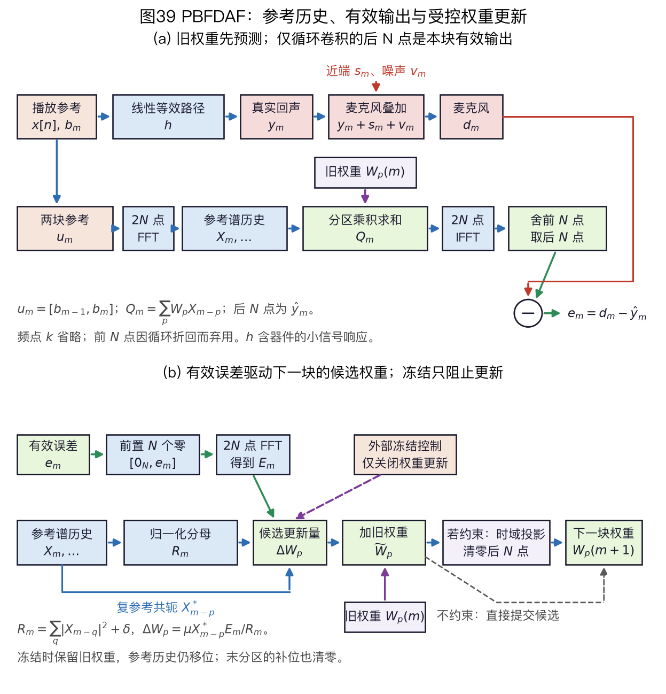

对照图39的两个子图，可以把“两处截断/补零”的位置与职责彻底分清：

- 图39（a）上半部为真实声学回声叠加近端与噪声的物理通道，下半部为 PBFDAF 的数字预测通道：参考谱历史 $X_m,\ldots,X_{m-P+1}$ 逐块右移，与旧权重 $W_p(m)$ 相乘累加并做 IFFT 后，在预测支路执行第一次裁剪——**丢弃前 $N$ 点循环混叠区**，只拿后 $N$ 点去减 $d_m$；
- 图39（b）展示误差回传与权重更新支路：有效残差 $e_m$ 先在前半块补 $0_N$ 再做 FFT 生成候选增量，若走上方梯度约束支路，则在时域执行第二次裁剪——**将候选权重后 $N$ 点非法抽头清零**后再变回频域；紫色虚线代表双讲冻结控制，它只切断权重写入，不阻断（a）中的参考移位与先验预测。

#### 6.2.2 频域多抽头 NLMS：抽头是什么，何时等于 PBFDAF

文献与开源讨论中常把某类频域算法称作“频域多抽头 NLMS”。遇到这个名称时，第一件事是追问：**它的“多抽头”究竟沿哪个维度排列？** 下面把最常见的两种数学结构拆开对比，并用矩阵代数严格导出重叠保存块梯度公式。

**第一种结构：固定频点上沿 $P$ 个参考块延迟排列。** 固定频点 $k$，把当前至过去 $P-1$ 块的参考谱排成 $P\times 1$ 复列向量 $\vec X_m(k)=[X(k,m),X(k,m-1),\ldots,X(k,m-P+1)]^\top$，把 $P$ 个分区的频域权重排成 $\vec W_m(k)=[W_0(k,m),\ldots,W_{P-1}(k,m)]^\top$（注意此处用实转置 $^\top$ 而非共轭转置 $^H$，以便频域预测内积直接写作 $\vec W_m^\top(k)\vec X_m(k)$）。于是式(6-5)在单频点上恰好合并成向量形式：

$$\begin{aligned}
\Delta\vec W_m(k)
&=\mu\frac{\vec X_m^*(k)E(k,m)}
          {\|\vec X_m(k)\|_2^2+\delta},\\
\widetilde{\vec W}_{m+1}(k)
&=\vec W_m(k)+\Delta\vec W_m(k),
\end{aligned}$$

其中上标 $*$ 表示逐元素取复共轭。例如在某频点取 $P=2$、$\vec X=[1,2]^\top$、$E=0.3$、$\mu=0.5$、$\delta=1$，分母为 $1^2+2^2+1=6$，两个分区的候选增量即 $0.5\times 0.3\times[1,2]^\top/6=[0.025,0.05]^\top$。

从表面形式看，它酷似“每个频点各自跑一条 $P$ 抽头复数 NLMS”。但它究竟为什么能优化时域有效残差，为什么不能省掉前半块补零和时域投影？下面用四步矩阵推导把底牌亮出来。

记 $\mathbf F\in\mathbb{C}^{2N\times 2N}$ 为标准正向 DFT 矩阵（第 $(k,r)$ 元为 $e^{-\mathrm{j}2\pi kr/(2N)}$；离散傅里叶矩阵与圆周卷积性质见[第 0 章 §0.2](00_math-foundations.md#sec-0-2)），其共轭转置满足正交关系 $\mathbf F^H\mathbf F=2N\,\mathbf I_{2N}$，因此带 $1/(2N)$ 归一化的逆变换矩阵满足关键恒等式：

$$\begin{aligned}
\mathbf F^{-1}&=\frac{1}{2N}\mathbf F^H,\\
\mathbf F^H&=2N\,\mathbf F^{-1},\qquad
(\mathbf F^{-1})^H=\frac{1}{2N}\mathbf F.
\end{aligned}$$

再定义两个实数选择与补零矩阵：取后半块矩阵 $\mathbf S=[\mathbf 0_{N\times N}\ \mathbf I_N]$（维度 $\mathbb{R}^{N\times 2N}$，左乘列向量时截取后 $N$ 点，而转置 $\mathbf S^\top$ 在前 $N$ 点补零），以及前半块补零矩阵 $\mathbf U=[\mathbf I_N\ \mathbf 0_{N\times N}]^\top$（维度 $\mathbb{R}^{2N\times N}$，把合法时域抽头 $\vec w_p\in\mathbb{R}^N$ 尾部补 $N$ 个零扩成 $2N$ 点，而 $\mathbf U^\top=[\mathbf I_N\ \mathbf 0_{N\times N}]$ 则截取前 $N$ 个合法抽头）。

在跨频点矩阵推导中，我们统一将沿全部 $2N$ 个频点竖排而成的整块频域列向量记作不带频点参数 $(k)$ 的带箭头向量 $\vec W_{p,m},\vec X_{m-p},\vec Q_m,\vec D_m,\vec E_m\in\mathbb{C}^{2N\times 1}$（以区别于前面固定单个频点 $k$、沿 $P$ 个分区排列的 $\vec X_m(k)\in\mathbb{C}^{P\times 1}$）。令 $\vec Q_m=\sum_{p=0}^{P-1}\vec W_{p,m}\odot\vec X_{m-p}$（$\odot$ 表示逐频点 Hadamard 乘积），则有效时域预测为 $\hat{\vec y}_m=\mathbf S\mathbf F^{-1}\vec Q_m$。将有效残差 $\vec e_m=\vec d_m-\hat{\vec y}_m$ 经 $\mathbf S^\top$ 在前半块补零后变到频域，正确的误差谱列向量为：

$$\begin{aligned}
\vec D_m&=\mathbf F\mathbf S^\top\vec d_m,\\
\mathbf C&=\mathbf F\mathbf S^\top\mathbf S\mathbf F^{-1},\\
\vec E_m&=\mathbf F\mathbf S^\top(\vec d_m-\mathbf S\mathbf F^{-1}\vec Q_m)\\
&=\vec D_m-\mathbf C\vec Q_m.
\end{aligned}\tag{6-6}$$

注意 $\mathbf S^\top\mathbf S$ 为对角分块阵 $\operatorname{diag}(\mathbf 0_N,\mathbf I_N)$，并不等于单位阵 $\mathbf I_{2N}$，因此式(6-6)第二行定义的频域投影矩阵 $\mathbf C$ 绝不是对角矩阵，而是把所有频点耦合在一起的循环卷积算子，所以 $\vec E_m$ **一般不等于** $\vec D_m-\vec Q_m$！用算例 6-3 的四点数据一验便知：设单分区真实抽头为 $[1,2]$、当前滤波器已精确收敛到 $[1,2]$，输入 $u_1=[1,2,3,4]$ 的四点循环卷积为 $q=[9,4,7,10]$，麦克风收到的真实有效输出恰好是 $\vec d=[7,10]^\top$。按式(6-6)计算，有效误差 $\vec e=[7,10]^\top-[7,10]^\top=[0,0]^\top$，补零变换得 $\vec E_m=\vec 0$，已收敛的滤波器稳稳停在真值上；若漏掉投影矩阵 $\mathbf C$ 而错误计算

$$\vec D_m-\vec Q_m=\mathbf F[0,0,7,10]^\top-\mathbf F[9,4,7,10]^\top
=\mathbf F[-9,-4,0,0]^\top\neq\vec 0,$$

前半块的循环折回垃圾值 $[-9,-4]$ 就会在完美匹配时凭空制造非零假梯度，把原本已经收敛准的抽头重新推偏！

现在把合法时域抽头 $\vec w_p\in\mathbb{R}^N$ 代入预测链路：$\vec W_{p,m}=\mathbf F\mathbf U\vec w_p$，与 $\vec X_{m-p}$ 逐点相乘即左乘对角阵 $\operatorname{diag}(\vec X_{m-p})$，再经 $\mathbf F^{-1}$ 和 $\mathbf S$ 得到第 $p$ 分区对本块有效输出的 $N\times N$ 线性映射矩阵：

$$\mathbf A_{p,m}=\mathbf S\mathbf F^{-1}
\operatorname{diag}(\vec X_{m-p})\mathbf F\mathbf U.$$

定义本块有效残差平方和目标 $J_m=\frac{1}{2}\|\vec e_m\|_2^2$，对实向量 $\vec w_p$ 求负梯度并逐步代入刚才的 $\mathbf F^H=2N\,\mathbf F^{-1}$ 与 $(\mathbf F^{-1})^H=\frac{1}{2N}\mathbf F$：

$$\begin{aligned}
\vec e_m&=\vec d_m-\sum_{p=0}^{P-1}\mathbf A_{p,m}\vec w_p,\\
J_m&=\frac{1}{2}\|\vec e_m\|_2^2,\\
-\nabla_{\vec w_p}J_m&=\mathbf A_{p,m}^H\vec e_m.
\end{aligned}\tag{6-7}$$

把最后一行 $\mathbf A_{p,m}^H\vec e_m$ 显式展开（注意矩阵乘积取共轭转置时顺序反转，对角阵取共轭转置即对角元逐个取复共轭，实矩阵 $\mathbf S,\mathbf U$ 的共轭转置即实转置）：

$$\begin{aligned}
\mathbf A_{p,m}^H\vec e_m
&=\bigl(\mathbf S\mathbf F^{-1}
  \operatorname{diag}(\vec X_{m-p})\mathbf F\mathbf U\bigr)^H\vec e_m\\
&=\mathbf U^\top\mathbf F^H
  \operatorname{diag}(\vec X_{m-p}^*)\,
  (\mathbf F^{-1})^H\mathbf S^\top\vec e_m\\
&=\mathbf U^\top\bigl(2N\,\mathbf F^{-1}\bigr)
  \operatorname{diag}(\vec X_{m-p}^*)
  \left(\frac{1}{2N}\mathbf F\right)\mathbf S^\top\vec e_m\\
&=\mathbf U^\top\mathbf F^{-1}
  \bigl(\vec X_{m-p}^*\odot(\mathbf F\mathbf S^\top\vec e_m)\bigr)\\
&=\mathbf U^\top\operatorname{IFFT}_{2N}(\vec X_{m-p}^*\odot\vec E_m).
\end{aligned}$$

推导水落石出：中间的缩放常数 $2N$ 与 $\frac{1}{2N}$ 恰好抵消，$\mathbf F\mathbf S^\top\vec e_m$ 正是式(6-6)前半块补零后的有效误差谱 $\vec E_m$，而左乘 $\mathbf U^\top$ 正是截取 IFFT 结果的**前 $N$ 个合法时域点**（当输入与误差均为实序列时，虚部严格抵消为零）！由此可以清晰界定各变体的数学身份：

- 若不做逐频点功率除法，仅对全部分区做合法抽头投影 $\mathbf U^\top$，FFT 算出的就是精确的**时域块 LMS 梯度**；
- 式(6-5)在投影前先给每个频点乘上对角预条件因子 $R_m(k)^{-1}$，加速了有色语音中弱能量频带的收敛；但由于频域合法抽头投影算子 $\mathbf G$（即 $\mathbf F\mathbf U\mathbf U^\top\mathbf F^{-1}$）会重新混合各个频点，且 $\mathbf G$ 与逐频对角矩阵 $\operatorname{diag}(\vec R_m)^{-1}$ 一般不可交换，受约束 PBFDAF 并非 $2N$ 条彼此绝缘的独立复数 NLMS。

下表汇总了五种易混叫法的模型结构与等价条件：

| 叫法或实现 | “抽头”与更新时刻 | 与本书 PBFDAF 的关系 |
|---|---|---|
| 逐样本时域 NLMS | $L$ 个样本级时延；每个样本的先验误差后立即更新 | 拟合同一条时域 FIR，但块内逐步改变权重，更新轨迹不同 |
| 时域块 LMS／共同标量归一变体 | $L$ 个样本级时延；整块误差由同一旧权重生成，块末更新 | 不做逐频预条件、保留时域投影的 FFT 实现精确计算同一块梯度 |
| 单分区频域块滤波（FDAF） | $P=1$；用单次长 FFT 覆盖整条路径 | 分区结构的 $P=1$ 特例；长路径时新样本凑块等待过长 |
| 分区重叠保存的频域多抽头 NLMS | 每频点含 $P$ 个参考**块**历史；按式(6-5)生成候选并投影 | 块长、FFT 缩放、有效区补零、分母与投影均一致时，逐块严格等价 |
| 普通加窗 STFT 同频跨帧滤波 | 每频点含多个分析**帧**历史；分析/合成窗与帧移另定 | 更新式外形相似，但忽略跨带项时一般不精确等于时域线性卷积 |

**接续算例 6-3：两块自适应更新如何剔除非法抽头。** 取 $N=P=2$（$L=4$）、$\mu=0.5$、$\delta=1$，初始权重与负时刻参考全零，给定测试序列 $x=[1,0,0,0]$、$d=[1,0,2,0]$（配套代码见 [`aec_partitioned_demo.py`](../codes/chapters/ch06/aec_partitioned_demo.py) 与测试 [`test_codes_aec_partitioned.py`](../tests/test_codes_aec_partitioned.py)）：

1. **第 $m=0$ 块**：重叠输入 $u_0=[0,0,1,0]$ 的四点 FFT 为 $X_0=[1,-1,1,-1]$；旧权重为零，有效误差 $e_0=[1,0]$ 补零变换得 $E_0=[1,-1,1,-1]=X_0$，各频点分母 $|X_0|^2+\delta=1+1=2$。按式(6-5)得首分区频域增量 $\Delta W_{0,0}=0.5\times X_0^*\odot E_0/2$，算得 $[0.25,0.25,0.25,0.25]$，IFFT 回时域恰为 $[0.25,0,0,0]$（后两点本就为零）；第二分区因 $X_{-1}=\vec 0$ 保持全零。
2. **第 $m=1$ 块**：新采样全零，但拼接输入为 $u_1=[1,0,0,0]$，故 $X_1=[1,1,1,1]$，历史谱 $X_0=[1,-1,1,-1]$ 仍在缓存中。先验预测为零，有效误差 $e_1=[2,0]$ 补零变换得 $E_1=[2,-2,2,-2]$，各频点分母为 $|X_1|^2+|X_0|^2+\delta=1+1+1=3$。

    - 首分区（$p=0$）：$X_1^*\odot E_1=[2,-2,2,-2]$，乘 $\mu/3=1/6$ 得增量 $[1/3,-1/3,1/3,-1/3]$，其四点 IFFT 为 $[0,0,1/3,0]$；叠加上一块的 $[0.25,0,0,0]$ 后，首分区候选时域序列变为 $[0.25,0,1/3,0]$！
    - 第二分区（$p=1$）：$X_0^*\odot E_1=[2,2,2,2]$，乘 $1/6$ 后作四点 IFFT 得候选序列 $[1/3,0,0,0]$。

3. **为什么要清零后半段？** 看首分区候选 $[0.25,0,1/3,0]$ 的第 $2$ 号位置（从 $0$ 起计，即第 $3$ 个元素 $1/3$）：它代表首分区内的滞后 $2$，而第二分区的合法首抽头 $[1/3,0,0,0]$ 同样代表整条路径的滞后 $2$！若不执行时域梯度约束把首分区后两点清零，同一个物理滞后就会被两个分区重复表达，且首分区的非法第 $2$ 号位在下一次块循环卷积中还会破坏重叠保存假设。执行逐分区后 $N$ 点清零后，两分区合法抽头拼接为 $[0.25,0\mid 1/3,0]$，恢复唯一的四抽头 FIR 物理含义。

#### 算例 6-4：逐频归一化为什么不等于时域 NLMS

**输入与口径**：取单分区 $N=2$、$P=1$、零初值、$\mu=\delta=1$，当前重叠保存输入 $u=[0,0,1,2]$，有效麦克风块 $d=[1,0]$（故有效先验误差 $e=[1,0]$，补零后为 $[0,0,1,0]$）。按正向 DFT 负指数 $e^{-\mathrm{j}2\pi kr/4}$、逆变换除以 $4$ 的标准约定，逐频点计算 $X(k)$、$E(k)$、功率分母 $|X(k)|^2+1$ 与候选增量 $\Delta W(k)=X^*(k)E(k)/(|X(k)|^2+1)$：

| $k$ | $X(k)$ | $E(k)$ | $\lvert X(k)\rvert^2+1$ | 候选更新量 $\Delta W(k)$ |
|---:|---:|---:|---:|---:|
| 0 | $3$ | $1$ | $10$ | $3/10$ |
| 1 | $-1+2\mathrm{j}$ | $-1$ | $6$ | $(1+2\mathrm{j})/6$ |
| 2 | $-1$ | $1$ | $2$ | $-1/2$ |
| 3 | $-1-2\mathrm{j}$ | $-1$ | $6$ | $(1-2\mathrm{j})/6$ |

以 $k=1$ 行复核共轭符号：四点加权和 $X(1)=0+0+1e^{-\mathrm{j}\pi}+2e^{-\mathrm{j}3\pi/2}$ 化简为 $-1+2\mathrm{j}$，取共轭得 $X^*(1)=-1-2\mathrm{j}$，乘以 $E(1)=e^{-\mathrm{j}\pi}=-1$ 得 $1+2\mathrm{j}$，再除以 $|{-1+2\mathrm{j}}|^2+1=5+1=6$，即 $(1+2\mathrm{j})/6$。

现在把最后一列四个频点作四点 IFFT：第 $0$ 点为 $\frac{1}{4}[3/10 + 1/6 - 1/2 + 1/6]=1/30$；第 $1$ 点乘相位因子 $[1,\mathrm{j},-1,-\mathrm{j}]$ 后，两共轭项 $(-2\pm\mathrm{j})/6$ 的虚部相消，实部求和 $\frac{1}{4}(3/10-2/6+1/2-2/6)$ 同样化简为 $1/30$；完整四点候选序列为 $[1/30,1/30,-2/15,11/30]$，清零后两点非法区后得到合法两抽头更新 $[1/30,\ 1/30]^\top$。

**对比时域块梯度**：如果不做逐频点不同分母的除法，直接算 $\operatorname{IFFT}(X^*\odot E)$，结果是 $[1,0,0,2]$，截取前两点合法抽头为 $[1,0]^\top$——无论外层再除以哪一个公共标量能量，第二个抽头的更新量都恒为 $0$！逐频功率预条件压低了强频点 $k=0$（除以 $10$）、放大了弱频点 $k=2$（仅除以 $2$），经时域投影耦合后直接旋转了参数空间的更新方向，从而激活了第 $1$ 号抽头。这正是频域预条件加速有色信号收敛的代数本质，也说明它与时域 NLMS 具有不同的更新轨迹。

#### 算例 6-5：预测残差很小，不一定辨识了路径

在 [`aec_partitioned_demo.py`](../codes/chapters/ch06/aec_partitioned_demo.py) 中固定随机种子 `2094`，设真实九抽头稀疏路径为 $h=[0,0,0.7,-0.2,0.08,0,0,0,0.05]$，以无噪直接线性卷积生成麦克风观测；教学 PBFDAF 配置为 $N=16$、$L=9$、$\mu=0.3$、$\delta=0.05$。分别用“标准正态宽带白噪声”与“周期为 $8$ 点的单音正弦”各训练 $4096$ 点，随后冻结权重，换用**同一段** $1024$ 点独立宽带白噪声作留出测试：

| 训练参考 | 训练末 1024 点先验残差均方 | 训练后相对路径误差 $\lVert\hat h-h\rVert_2/\lVert h\rVert_2$ | 冻结宽带留出残差均方 |
|---|---:|---:|---:|
| 宽带白噪声 | $4.03\times10^{-27}$ | $3.27\times10^{-16}$ | $7.52\times10^{-32}$ |
| 周期 8 点纯音 | $1.11\times10^{-8}$ | $0.868$ | $0.382$ |

看第二行数字：纯音训练末尾的先验残差均方已经压到 $1.11\times 10^{-8}$（换算成训练段功率比已超过 $70\ \mathrm{dB}$），看似“完美收敛”；然而此时滤波器的相对系数误差高达 $86.8\%$，一旦冻结换上宽带新信号，留出残差均方立刻暴涨到 $0.382$！原因与 §6.1.2 完全呼应：周期 $8$ 点的单音只在单一频率对上激励了二维子空间，其余正交频率方向上的抽头自由度根本未被观测约束。因此验收自适应滤波器时，绝不能只看同一段窄带训练录音的残差下降，必须包含宽带激励或更换节目源后的留出检验。

**第二种易混结构：普通加窗 STFT 域的同频跨帧滤波（CTF）。** 语音增强与神经网络前端常在常规加窗重叠短时傅里叶变换（Short-Time Fourier Transform，STFT）域工作。若在每个 STFT 频点上仅拿该频点自身过去若干帧的复数谱做线性组合（跨帧卷积传递函数近似，Convolutive Transfer Function，CTF），其更新方程虽然形似式(6-5)，但由于分析窗、合成窗及帧移下采样的存在，精确表示一条任意时域 FIR 通常还包含相邻频点之间的**跨频带耦合项**（完整推导参见 [Avargel & Cohen, *IEEE TASLP*, 2007, §II, 式(7)～(11)](https://webee.technion.ac.il/Sites/People/IsraelCohen/Publications/TASL_May2007.pdf)）。

用一个最简单的两点无重叠矩形窗 DFT 就能算出这个跨频带项：设真实回声路径仅为一拍延迟 $y[n]=x[n-1]$，记第 $m$ 帧（含采样 $2m$ 与 $2m+1$）的两个频点为 $X_{0,m}=x[2m]+x[2m+1]$ 与 $X_{1,m}=x[2m]-x[2m+1]$。反解出帧末与帧首样本 $x[2m-1]=\frac{1}{2}(X_{0,m-1}-X_{1,m-1})$、$x[2m]=\frac{1}{2}(X_{0,m}+X_{1,m})$，则当前帧真实输出 $[x[2m-1],x[2m]]$ 的零频点 $Y_{0,m}=x[2m-1]+x[2m]$ 精确等于：

$$\begin{aligned}
Y_{0,m}&=\frac{1}{2}(X_{0,m-1}-X_{1,m-1})
         +\frac{1}{2}(X_{0,m}+X_{1,m}).
\end{aligned}$$

可见输出零频点 $Y_{0,m}$ 一半来自零频点输入 $X_0$，另一半却来自高频点输入 $X_1$！只用同频点历史 $X_{0,m},X_{0,m-1}$ 无论如何调参都会漏掉 $X_1$ 的贡献（除非时域路径恰好只在整帧延迟 $2q$ 处非零）。

最后补充工业开源代码中的两处常见实现技巧：一是[SpeexDSP 的 `mdf.c`](https://gitlab.xiph.org/xiph/speexdsp/-/blob/8e29a256ef0235ebbe7fcb8417b5ac7731eb8307/libspeexdsp/mdf.c) 采用交替无约束 MDF（AUMDF），每块照常在频域更新全部 $P$ 个分区的权重，但每块只挑其中 $1$ 个或少数几个分区执行 IFFT/FFT 合法抽头清零投影，从而把第 4 步约束变换的均摊开销降低 $P$ 倍；二是[WebRTC AEC3 的 `adaptive_fir_filter.cc`](https://webrtc.googlesource.com/src/+/0467d2b91cc20b9b001c2bbb73d43ea6b2491f3e/modules/audio_processing/aec3/adaptive_fir_filter.cc) 与 [`refined_filter_update_gain.cc`](https://webrtc.googlesource.com/src/+/0467d2b91cc20b9b001c2bbb73d43ea6b2491f3e/modules/audio_processing/aec3/refined_filter_update_gain.cc) 在分区结构之上进一步结合误差谱、激励门限与放大器饱和标志动态计算逐频步长增益（源码阅读路径详见[研究手册 A02～A03](../codes/chapters/ch00/research/02_aec_wpe_separation.md)）。

#### 6.2.3 子带 AEC：分带、交叉项与可辨识性

除了重叠保存 FFT，降低长回声路径计算量并改善有色语音条件数的另一条经典路线是**子带自适应滤波（Subband AEC）**：先用分析滤波器组把全带参考 $x[n]$ 和麦克风信号 $d[n]$ 拆成若干个窄通带并做抽取降采样，在低采样率子带上运行短滤波器，最后把各子带残差经合成滤波器组拼回全带（评估总开销时须把分析/合成滤波器组的乘加和群延迟一并计入）。初学者最容易踏入的一个理论误区是以为：“只要分析—合成滤波器组满足完美重建（Perfect Reconstruction，PR），把每个子带单独配一个独立自适应滤波器就能无损抵消全带回声。”下面用能完整手算的两点正交 Haar 滤波器组证明：**临界采样（抽取倍数等于子带数）下，哪怕仅仅 $1$ 个采样点的奇数延迟，也会立刻引发跨子带混叠耦合！**

设块索引为 $m$，每块包含偶采样 $x[2m]$ 与奇采样 $x[2m+1]$（在子带速率上等价于 $2$ 倍抽取的两路多相分量 $x_0[m]=x[2m]$、$x_1[m]=x[2m+1]$）。定义两点正交 Haar 分析变换：

$$\begin{aligned}
u_0[m]&=\frac{x[2m]+x[2m+1]}{\sqrt{2}},\\
u_1[m]&=\frac{x[2m]-x[2m+1]}{\sqrt{2}}.
\end{aligned}\tag{6-8}$$

式(6-8)中，$u_0[m]$ 是两点局部低通和，$u_1[m]$ 是两点局部高通差，二阶 Haar 变换矩阵 $\mathbf H$（首行 $[1,1]/\sqrt{2}$、次行 $[1,-1]/\sqrt{2}$）满足正交对称性 $\mathbf H^\top=\mathbf H$ 且 $\mathbf H^2=\mathbf I_2$。因此不做任何中间修改时，合成公式 $[x[2m],x[2m+1]]^\top=\mathbf H[u_0[m],u_1[m]]^\top$（即 $x[2m]=(u_0[m]+u_1[m])/\sqrt{2}$，$x[2m+1]=(u_0[m]-u_1[m])/\sqrt{2}$）能够逐块完美重建原信号。

**用两行多相分解看清跨带耦合从何而来。** 设全带因果回声路径为长度 $L$ 的 FIR 滤波器 $d[n]=\sum_{\ell=0}^{L-1}h[\ell]x[n-\ell]$。把求和下标按偶数延迟 $\ell=2r$ 与奇数延迟 $\ell=2r+1$ 拆成两半，分别写出麦克风偶采样 $d[2m]$ 与奇采样 $d[2m+1]$ 的**两行多相分解**：

$$\begin{aligned}
d[2m]&=\sum_{r\ge 0}h[2r]\,x[2(m-r)]\\
     &\quad+\sum_{r\ge 0}h[2r+1]\,x[2(m-r-1)+1],\\
d[2m+1]&=\sum_{r\ge 0}h[2r]\,x[2(m-r)+1]\\
       &\quad+\sum_{r\ge 0}h[2r+1]\,x[2(m-r)].
\end{aligned}$$

观察这两行多相结构：

- 所有**偶数抽头** $h[2r]$ 把偶输入 $x[2(m-r)]$ 映射到偶输出 $d[2m]$、奇输入映射到奇输出，在两点块向量上对应标量单位阵 $h[2r]\mathbf I_2$，正交夹乘 $\mathbf H(h[2r]\mathbf I_2)\mathbf H^\top$ 后仍等于 $h[2r]\mathbf I_2$，不会产生跨子带泄漏；
- 所有**奇数抽头** $h[2r+1]$ 却颠倒了奇偶相位，而且第一行里的 $x[2(m-r-1)+1]$ 还跨过了两点块边界（读取了上一块 $m-r-1$ 的奇采样）！以最简单的一拍纯延迟路径 $d[n]=x[n-1]$（即仅 $h[1]=1$，其余为零）为例，多相式化为 $d[2m]=x[2m-1]$、$d[2m+1]=x[2m]$，在多相域写成块矩阵映射：

$$\begin{aligned}
\begin{bmatrix}d[2m]\\d[2m+1]\end{bmatrix}
&=\underbrace{\begin{bmatrix}0&0\\1&0\end{bmatrix}}_{\mathbf P_0}
  \begin{bmatrix}x[2m]\\x[2m+1]\end{bmatrix}
 +\underbrace{\begin{bmatrix}0&1\\0&0\end{bmatrix}}_{\mathbf P_1}
  \begin{bmatrix}x[2m-2]\\x[2m-1]\end{bmatrix},
\end{aligned}$$

其中右侧第二项列向量 $[x[2m-2],x[2m-1]]^\top$ 正是上一块 $m-1$ 的输入块（$\mathbf P_1$ 选出其奇采样 $x[2m-1]=x[2(m-1)+1]$）。将两边左乘 $\mathbf H$ 变到子带输出 $\vec v_m=\mathbf H[d[2m],d[2m+1]]^\top$（分量为 $[v_0[m],v_1[m]]^\top$），并利用 $\mathbf H^\top\mathbf H=\mathbf I_2$ 插入子带输入 $\vec u_m=\mathbf H[x[2m],x[2m+1]]^\top$，立即算出当前块与前一拍块的子带传递矩阵：

$$\mathbf G_0=\mathbf H\mathbf P_0\mathbf H^\top
=\frac{1}{2}\begin{bmatrix}1&1\\-1&-1\end{bmatrix},\qquad
\mathbf G_1=\mathbf H\mathbf P_1\mathbf H^\top
=\frac{1}{2}\begin{bmatrix}1&-1\\1&-1\end{bmatrix}.$$

展开分量即是：

$$\begin{aligned}
v_0[m]&=\frac{u_0[m-1]-u_1[m-1]}{2}
+\frac{u_0[m]+u_1[m]}{2},\\
v_1[m]&=\frac{u_0[m-1]-u_1[m-1]}{2}
-\frac{u_0[m]+u_1[m]}{2}.
\end{aligned}\tag{6-9}$$

看式(6-9)的两行：输出低带 $v_0[m]$ 与输出高带 $v_1[m]$ 同时包含非零的跨带项 $u_1$ 与 $u_0$！如果强行采用只让 $v_0$ 读 $u_0$、$v_1$ 读 $u_1$ 的**对角子带模型**，非对角元素被硬砍为零，一拍延迟路径就永远无法精确表达。这一经典现象最早由 [Gilloire & Vetterli（*IEEE Transactions on Signal Processing*, 1992）](https://doi.org/10.1109/78.149989)在临界采样子带自适应滤波理论中严格阐明：抽取导致的子带混叠在无修改直通时虽能由合成滤波器组抵消，但一旦各子带乘上互不相同的滤波系数或漏掉跨带耦合支路，混叠抵消条件就会破裂。

**用四点序列手算验证跨带耦合。** 取两块分段常数输入 $x=[1,1\mid 0,0]$：第 $0$ 块两点相等，故输入低带 $u_0[0]=\sqrt{2}$、输入高带 $u_1[0]=0$；第 $1$ 块输入全零，$u_0[1]=u_1[1]=0$。经一拍延迟后麦克风收到 $d=[0,1\mid 1,0]$，按式(6-8)算出麦克风高带输出依次为 $v_1[0]=(0-1)/\sqrt{2}=-1/\sqrt{2}$、$v_1[1]=(1-0)/\sqrt{2}=+1/\sqrt{2}$。

此时输入高带 $u_1[m]$ 自始至终恒等于 $0$！对角模型的高带滤波器面对全零输入只能输出全零，白白漏掉两拍高带回声；而全交叉模型按式(6-9)通过 $u_0\to v_1$ 交叉支路，$\frac{1}{2}(0-\sqrt{2})=-1/\sqrt{2}$ 与 $\frac{1}{2}(\sqrt{2}-0)=+1/\sqrt{2}$ 分毫不差地重构出全部高带回声。

**未知路径下的两带全交叉自适应更新。** 一般地，任意长度 $L$ 的时域因果 FIR 都可按上述多相左乘 $\mathbf H$、右乘 $\mathbf H^\top$ 的规则，精确映射为 $K=\lfloor L/2\rfloor+1$ 个 $2\times 2$ 子带矩阵卷积 $\vec v_m=\sum_{k=0}^{K-1}\mathbf G_k\vec u_{m-k}$（见 [`fir_crossband_matrices()`](../codes/chapters/ch06/core/aec_subband.py)）。当路径未知时，设待学习的 $2\times 2\times K$ 实数权重张量为 $W_{i,j,k}$（$i\in\{0,1\}$ 为输出带，$j\in\{0,1\}$ 为输入带，$k=0,\ldots,K-1$ 为块延迟），简记 $U_{j,k}=u_j[m-k]$。每到一块新数据，先用旧权重算出两路输出带的预测与先验误差，再用**汇总了两个输入带全部 $K$ 拍历史的公共能量分母 $D$** 同步更新四条子带支路（$0\le\mu<2$，$\varepsilon>0$）：

$$\begin{aligned}
\hat v_i&=\sum_{j=0}^{1}\sum_{k=0}^{K-1}W_{i,j,k}U_{j,k},\\
e_i&=v_i-\hat v_i,\\
D&=\varepsilon+\sum_{j=0}^{1}\sum_{k=0}^{K-1}U_{j,k}^2,\\
\Delta W_{i,j,k}&=\mu\frac{e_iU_{j,k}}{D},\\
W_{i,j,k}^{+}&=W_{i,j,k}+\Delta W_{i,j,k}.
\end{aligned}\tag{6-10}$$

接着刚才的 $x=[1,1\mid 0,0]$、$d=[0,1\mid 1,0]$ 手算式(6-10)（取 $K=2$、零初值、$\mu=1$、$\varepsilon=1$）：第 $0$ 块唯一非零输入为 $U_{0,0}=\sqrt{2}$，公共分母 $D=1+(\sqrt{2})^2=3$，先验误差 $\vec e=[1/\sqrt{2},-1/\sqrt{2}]^\top$，一步更新即得同带权重 $W_{0,0,0}=1/3$ 与**跨带权重** $W_{1,0,0}=-1/3$；第 $1$ 块历史项 $U_{0,1}=\sqrt{2}$ 非零，分母仍为 $3$，更新得 $W_{0,0,1}=W_{1,0,1}=1/3$，验证了高输出带确能从低输入带在线学出跨带耦合系数（见 [`aec_crossband_demo.py`](../codes/chapters/ch06/aec_crossband_demo.py)）。在该脚本的固定种子（`20260923`）留出对照中，用每值重复两次的分段常数高斯序列激励一拍延迟路径 $h=[0,1]$，训练 $1500$ 块后冻结测试 $500$ 块：真实回声均方约 $0.989129$，全交叉模型浮点残差均方收敛至 $0$，而砍掉非对角项的对角模型残差均方停留在约 $0.489674$（恰好漏掉一半高带能量）。

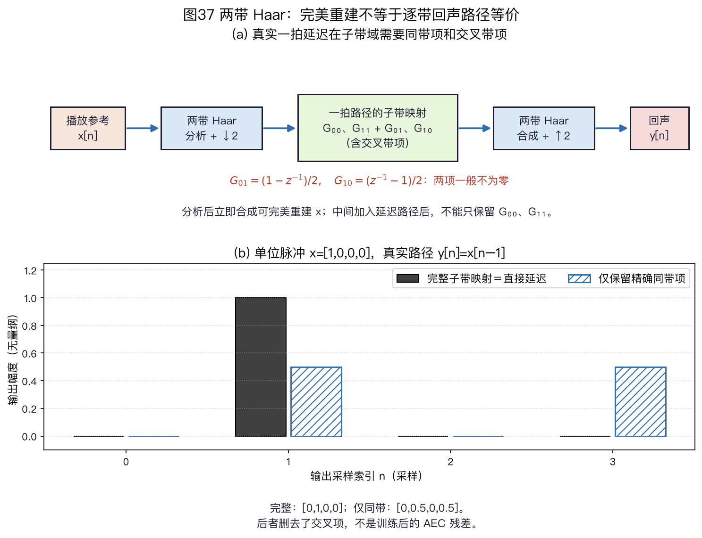

结合图37可把子带表示能力与工程折中做一收束：

- 图37（a）按横向五框链路依次画出“播放参考 $x[n]$ → 两带 Haar 分析 + $\downarrow 2$ → 一拍路径的子带映射（同时包含同带项 $G_{00},G_{11}$ 与交叉带项 $G_{01},G_{10}$）→ 两带 Haar 合成 + $\uparrow 2$ → 回声 $y[n]$”，并在中间模块下方标出 $G_{01}=(1-z^{-1})/2,\ G_{10}=(z^{-1}-1)/2$ 两项一般不为零——说明分析后立即合成虽能完美重建 $x[n]$，但中间插入延迟路径后不能只保留同带对角项 $G_{00},G_{11}$；
- 图37（b）横轴为输出采样索引 $n$，纵轴为无量纲幅度，对比单位脉冲输入 $x=[1,0,0,0]$ 经过一拍延迟路径时，“保留完整四路子带矩阵”精确合成 $[0,1,0,0]$，而“强行删去交叉项仅留同带对角项”则合成失真序列 $[0,0.5,0,0.5]$（配套试听见[两带 Haar 交叉项合成 WAV](../codes/chapters/ch00/research/05_exercises_and_audio.md#16-两带-haar-的交叉项音频)）。

工程上若不愿承担全交叉矩阵带来的额外自由度（本例无约束全交叉共有 $4K$ 个实参数，多于原时域 $L$ 个抽头）与跨带辨识病态问题，现代工业子带 AEC 通常采用两条改进路径：一是设计高阻带衰减的**过采样（oversampled）滤波器组**（抽取率小于子带数，把相邻通带交叠混叠压到噪声底以下，从而安全退回对角逐带更新）；二是采用归一化子带自适应滤波（Normalized Subband Adaptive Filter，NSAF；[Lee & Gan, *IEEE SPL*, 2004](https://doi.org/10.1109/LSP.2004.833445) 与 [EUSIPCO 2004](https://www.eurasip.org/Proceedings/Eusipco/Eusipco2004/defevent/papers/cr1587.pdf)），仅利用子带分解后的白化误差去直接更新单一一条**全带时域抽头向量**，从根源上避开子带合成混叠与额外参数膨胀。

#### 6.2.4 IPNLMS：均匀更新与比例更新如何混合

回声路径若只有少数明显非零的主峰抽头（如直达声与一两次强桌面反射，其余位置近似为零），把步长预算优先分给已显现出大幅度的抽头，往往能比所有抽头平均用力更快收敛；但在全零初值起步阶段，算法尚不知道强抽头落在何处，又必须保留均匀探索能力。

比例归一化最小均方（Proportionate Normalized Least-Mean-Square，PNLMS；[Duttweiler, *IEEE TSAP*, 2000](https://doi.org/10.1109/89.861368)）与改进比例归一化最小均方（Improved Proportionate Normalized Least-Mean-Square，IPNLMS；[Benesty & Gay, ICASSP 2002](https://cris.technion.ac.il/en/publications/an-improved-pnlms-algorithm/)）通过在更新方向上乘以依赖当前权重幅度的对角矩阵来实现这一思想。这里的收敛加速建立在路径稀疏前提之上；若房间混响稠密平缓，比例分配未必优于均匀 NLMS。

本书采用 [Benesty 等（EUSIPCO 2004，表 1）](https://www.eurasip.org/Proceedings/Eusipco/Eusipco2004/defevent/papers/cr1026.pdf)给出的线性混合参数化：用 $\kappa\in[-1,1]$ 控制“均匀更新”与“按权重绝对值比例更新”的配比，$\delta>0$ 防止加权能量分母为零，$\varepsilon_g>0$ 防止全零权重时比例项分母为零：

$$\begin{aligned}
g_l&=\frac{1-\kappa}{2L}
    +\frac{(1+\kappa)|\hat w_l|}
           {2\|\hat{\vec w}\|_1+\varepsilon_g},\\
\hat{\vec w}^{+}
   &=\hat{\vec w}
     +\mu\frac{e\mathbf G\vec x}
                {\vec x^{\top}\mathbf G\vec x+\delta}.
\end{aligned}\tag{6-11}$$

这里 $g_l$（$l=0,\ldots,L-1$）是分配给第 $l$ 个抽头的非负比例权重，$\mathbf G=\operatorname{diag}(g_0,\ldots,g_{L-1})$ 为对角加权矩阵，在时刻 $n$ 处省略了公共采样下标 $[n]$；$\mathbf G$ 仅旋转参数更新方向并重加权分母，不改变式(6-2)的线性回声预测卷积。

逐样本实现的计算顺序不可颠倒：先用**更新前**的旧权重 $\hat{\vec w}[n]$ 与当前回归向量 $\vec x[n]$ 算出先验回声与先验残差 $e[n]$；再由旧权重的绝对值和 $\ell_1$ 范数 $\|\hat{\vec w}[n]\|_1=\sum_{l=0}^{L-1}|\hat w_l[n]|$ 算出全部 $g_l$；接着求加权能量分母 $\vec x^\top[n]\mathbf G\vec x[n]+\delta$；最后一次性同步更新全部 $L$ 个抽头。

若双讲控制要求冻结本拍更新，则仅将最新参考样本移入历史滑窗并输出先验残差，不执行式(6-11)的系数写入。

当 $\kappa=-1$ 时，比例项消失，各抽头均分 $g_l=1/L$，将式(6-11)分子分母同乘 $L$ 后分母正则项变为 $L\delta$，故在满足 $\varepsilon_{\mathrm{NLMS}}=L\delta_{\mathrm{IPNLMS}}$ 时与式(6-3)的时域 NLMS 逐拍严格等价；当 $\kappa=1$ 时退化为纯比例项，一旦从全零初值 $\hat{\vec w}=\vec 0$ 起步就会因分子 $|\hat w_l|=0$ 而锁死在零点（见练习 E06-14），工程上常取 $\kappa\in[-0.5,0]$ 兼顾冷启动与稀疏跟踪。

**两抽头手算。** 设当前权重 $\hat{\vec w}=[0.8,0.2]^\top$、参考向量 $\vec x=[1,1]^\top$、麦克风采样 $d=1.2$、步长 $\mu=1$，先验残差为 $e=1.2-(0.8+0.2)=0.2$。先看忽略极小正则项（$\varepsilon_g\to 0,\delta\to 0$）的理想分配：取折中系数 $\kappa=0$ 时，$g_0=\frac{1}{4}+\frac{0.8}{2\times 1.0}=0.65$，$g_1=\frac{1}{4}+\frac{0.2}{2.0}=0.35$，加权分母 $\vec x^\top\mathbf G\vec x=0.65+0.35=1$，强弱两抽头分到的增量为 $[0.13,0.07]^\top$；而取均匀模式 $\kappa=-1$ 时，$g=[0.5,0.5]$，两抽头平分 $[0.10,0.10]^\top$。

**保留非零正则项的精确核对。** 保持同一组 $\hat{\vec w},\vec x,d,\mu$，显式计入 $\varepsilon_g=2$、$\delta=0.25$：

- 当 $\kappa=0$ 时，均匀项为 $1/4=0.25$，比例项分母为 $2\times(0.8+0.2)+2=4$，故 $g_0=0.25+0.8/4=0.45$、$g_1=0.25+0.2/4=0.30$。注意此时 $g_0+g_1=0.75\neq 1$（式(6-11)并不把 $g_l$ 二次强行归一成和为 $1$）；更新分母为 $0.45+0.30+0.25=1.0$，权重增量为 $0.2\times[0.45,0.30]^\top=[0.09,0.06]^\top$；
- 当 $\kappa=-1$ 时，$g=[0.5,0.5]$，分母为 $0.5+0.5+0.25=1.25$，增量为 $0.2\times[0.5,0.5]^\top/1.25=[0.08,0.08]^\top$，与取 $\varepsilon=L\delta=2\times 0.25=0.5$ 的标准 NLMS（$0.2\times[1,1]^\top/(2+0.5)=[0.08,0.08]^\top$）分毫不差。

配套实现 [`aec_ipnlms.py`](../codes/chapters/ch06/core/aec_ipnlms.py) 与演示 [`aec_ipnlms_subband_demo.py`](../codes/chapters/ch06/aec_ipnlms_subband_demo.py) 提供了完整的流式状态管理，图38将在本节末把 IPNLMS、RLS 与 Kalman 三类参数调控机制放在一起对比。

#### 仿射投影：用最近多个观测改变更新方向

理解了单方向 NLMS 之后，再看有色语音激励缓慢的几何症结：相邻采样高度相关时，连续几拍的回归向量 $\vec x[n],\vec x[n-1],\ldots$ 夹角很小，单步 NLMS 在相邻两个近似平行的超平面之间来回“之字形”折返，垂直于主特征方向的弱分量推进极慢。**仿射投影算法（Affine Projection Algorithm，APA；[Ozeki & Umeda, 1984](https://doi.org/10.1002/ecja.4400670503)；正则化形式参见 [Rey et al., EUSIPCO 2004, §2](https://www.eurasip.org/Proceedings/Eusipco/Eusipco2004/defevent/papers/cr1033.pdf)）**直接在每一次更新中联立最近 $K_n$（$K_n\le K$，启动初期只取已到达的真实采样数）个观测方程，一次性求出与这 $K_n$ 个局部方向同时相容的最小范数权重增量。

沿用当前样本在前的约定，记第 $i$ 拍回归列向量为 $\vec x_i\in\mathbb{R}^L$（分量为 $[x[i],x[i-1],\ldots,x[i-L+1]]^\top$），窗口最早观测时刻为 $i_{\mathrm{min}}=n-K_n+1$。把当前到过去的 $K_n$ 个回归列拼成 $L\times K_n$ 数据矩阵 $\mathbf U_n$，对应麦克风采样排成 $K_n\times 1$ 列向量 $\vec d_n$，并用本次更新前的**同一套旧权重** $\vec w_{n-1}$ 计算整窗误差向量 $\vec e_n^-$ 与 $K_n\times K_n$ 格拉姆（Gram）内积矩阵 $\mathbf G_n$：

$$\begin{gathered}
\mathbf U_n=[\vec x_n,\ldots,\vec x_{i_{\mathrm{min}}}],\\
\vec d_n=[d[n],d[n-1],\ldots,d[i_{\mathrm{min}}]]^\top,\\
\vec e_n^-=\vec d_n-\mathbf U_n^\top\vec w_{n-1},\\
\mathbf G_n=\mathbf U_n^\top\mathbf U_n.
\end{gathered}\tag{6-12}$$

这里有一处极易写错的实现细节：式(6-12)第 3 行里的 $\vec e_n^-$ 只有第 $0$ 个分量 $d[n]-\vec x_n^\top\vec w_{n-1}$ 是当前因果输出的先验残差，其余 $K_n-1$ 个历史分量都必须拿**当前最新旧权重 $\vec w_{n-1}$** 重新与历史回归列做内积算出，绝不能偷懒把过去几拍输出过的旧残差直接拼进来（练习 E06-35 手算对比了正确重算与错误拼接的偏差）。

**先推导无正则完全投影（最小范数约束解）。** 当 $K_n\le L$ 且 $\mathbf U_n$ 满列秩时，满足全部 $K_n$ 个窗口观测 $\mathbf U_n^\top(\vec w_{n-1}+\Delta\vec w)=\vec d_n$（即 $\mathbf U_n^\top\Delta\vec w=\vec e_n^-$）的增量 $\Delta\vec w$ 有无穷多个。APA 选择对旧权重改动最小（欧氏范数最小）的那一个：

$$\begin{aligned}
\min_{\Delta\vec w}\quad&\frac{1}{2}\|\Delta\vec w\|_2^2,\\
\text{满足}\quad&\mathbf U_n^\top\Delta\vec w=\vec e_n^-.
\end{aligned}\tag{6-13}$$

引入拉格朗日乘子向量 $\vec\alpha\in\mathbb{R}^{K_n}$，构造拉格朗日函数：

$$\mathcal L(\Delta\vec w,\vec\alpha)
=\frac{1}{2}\|\Delta\vec w\|_2^2
-\vec\alpha^\top(\mathbf U_n^\top\Delta\vec w-\vec e_n^-).$$

对 $\Delta\vec w$ 求梯度并令 $\Delta\vec w-\mathbf U_n\vec\alpha=\vec 0$，立得 $\Delta\vec w=\mathbf U_n\vec\alpha$（几何意义非常清楚：最小范数增量必然完全落在 $K_n$ 个回归列张成的子空间内）；将其代回等式约束 $\mathbf U_n^\top(\mathbf U_n\vec\alpha)=\vec e_n^-$，因 $\mathbf U_n$ 满列秩故 $\mathbf G_n=\mathbf U_n^\top\mathbf U_n$ 正定可逆，解得 $\vec\alpha=\mathbf G_n^{-1}\vec e_n^-$，即精确投影增量 $\Delta\vec w=\mathbf U_n\mathbf G_n^{-1}\vec e_n^-$。

**再推导对角加载正则化与核恒等式降维。** 真实有色语音的相邻回归列高度近似共线，$\mathbf G_n$ 接近奇异，直接求逆会把窗口内的底噪或近端干扰剧烈放大。引入与 $\mathbf G_n$ 同量纲（信号幅度平方）的正则常数 $\delta>0$ 与无量纲步长 $\mu$，将硬约束松弛为无约束岭回归目标：

$$\begin{gathered}
\begin{aligned}
J_\delta(\Delta\vec w)
&=\|\mathbf U_n^\top\Delta\vec w-\vec e_n^-\|_2^2\\
&\quad+\delta\|\Delta\vec w\|_2^2,
\end{aligned}\\
\Delta\vec w_\delta
=\arg\min_{\Delta\vec w}J_\delta(\Delta\vec w),\\
(\mathbf G_n+\delta\mathbf I_{K_n})\vec\alpha_{\delta,n}
=\vec e_n^-,\\
\vec w_n=\vec w_{n-1}+\mu\mathbf U_n\vec\alpha_{\delta,n}.
\end{gathered}\tag{6-14}$$

初看之下，对第一行目标 $J_\delta(\Delta\vec w)$ 求梯度令为零：

$$\begin{aligned}
\nabla_{\Delta\vec w}J_\delta
&=2\mathbf U_n(\mathbf U_n^\top\Delta\vec w_\delta-\vec e_n^-)
  +2\delta\Delta\vec w_\delta=\vec 0,\\
(\mathbf U_n\mathbf U_n^\top+\delta\mathbf I_L)
  \Delta\vec w_\delta&=\mathbf U_n\vec e_n^-,
\end{aligned}$$

左边居然是一个巨大的 $L\times L$ 矩阵（如 $1024\times 1024$）！它怎么能够严丝合缝地化简成式(6-14)第 3 行那个只有 $K_n\times K_n$（如 $2\times 2$ 或 $4\times 4$）的小方程呢？用两行矩阵乘法交换括号就能直接证出这个**核推入恒等式（push-through identity）**：考察 $L\times K_n$ 矩阵乘积，按分配律展开并重新结合括号：

$$\begin{aligned}
(\mathbf U_n\mathbf U_n^\top+\delta\mathbf I_L)\mathbf U_n
&=\mathbf U_n(\mathbf U_n^\top\mathbf U_n)+\delta\mathbf U_n\\
&=\mathbf U_n(\mathbf G_n+\delta\mathbf I_{K_n}).
\end{aligned}$$

由于 $\delta>0$ 且对称半正定阵加上严格正对角阵必正定，左边的 $L\times L$ 阵 $(\mathbf U_n\mathbf U_n^\top+\delta\mathbf I_L)$ 与右边的 $K_n\times K_n$ 阵 $(\mathbf G_n+\delta\mathbf I_{K_n})$ 都严格可逆！将上式左乘 $(\mathbf U_n\mathbf U_n^\top+\delta\mathbf I_L)^{-1}$、同时右乘 $(\mathbf G_n+\delta\mathbf I_{K_n})^{-1}$，立即移项证得：

$$(\mathbf U_n\mathbf U_n^\top+\delta\mathbf I_L)^{-1}\mathbf U_n
=\mathbf U_n(\mathbf G_n+\delta\mathbf I_{K_n})^{-1}.$$

两边再同时右乘 $\vec e_n^-$，左边正是 $\Delta\vec w_\delta$，右边正是 $\mathbf U_n\vec\alpha_{\delta,n}$（其中 $\vec\alpha_{\delta,n}$ 由式(6-14)第 3 行小维方程组解出）。借助这一恒等式，每拍求解复杂度从不可承受的 $O(L^3)$ 骤降为小矩阵形成的 $O(LK_n^2)$ 加小线性方程组求解的 $O(K_n^3)$（当 $K_n=1$ 时，$\mathbf G_n=\|\vec x_n\|_2^2$ 为标量，式(6-14)一字不差退化为 $\varepsilon=\delta$ 的时域 NLMS）。

把更新后的 $\vec w_n$ 代回同一窗口计算后验误差向量 $\vec e_n^+=\vec d_n-\mathbf U_n^\top\vec w_n$，可得：

$$\begin{aligned}
\vec e_n^+&=\vec e_n^--\mu\mathbf G_n\vec\alpha_{\delta,n}\\
&=\bigl[\mathbf I_{K_n}-\mu\mathbf G_n
  (\mathbf G_n+\delta\mathbf I_{K_n})^{-1}\bigr]\vec e_n^-.
\end{aligned}\tag{6-15}$$

设对称半正定矩阵 $\mathbf G_n$ 的特征值为 $\lambda_i\ge 0$，则沿第 $i$ 个特征向量的窗口误差缩放倍率为 $1-\mu\lambda_i/(\lambda_i+\delta)$：当 $\lambda_i>0$、$\delta>0$ 且 $0<\mu<2$ 时该倍率绝对值小于 $1$；而若窗口回归列线性相关导致某个 $\lambda_i=0$（即 $\mathbf U_n\vec v=\vec 0$），该特征方向倍率为 $1$，说明正则化 $\delta>0$ 只是保证了方程数值可解，并不会凭空替秩亏数据补出新的可辨识信息（见练习 E06-37）。

在状态管理上，[`APAState`](../codes/chapters/ch06/core/aec_affine_projection.py) 还有一个比单步 NLMS 更微妙的双讲窗口记忆效应：双讲冻结期间虽然跳过了权重更新，但含近端语音的麦克风采样 $d[n]$ 仍进入了长度 $K$ 的投影观测滑窗；一旦双讲刚结束立刻恢复更新，残留在窗口里的那几拍双讲大观测仍会在下一次求解 $\vec\alpha_{\delta,n}$ 时把权重拉偏！因此接口专门区分了清除历史投影观测窗但保留权重与 FIR 参考历史的 `reset_projection_history()`，以及彻底清零全部状态的 `reset()`（两者的定量对比见练习 E06-36）。

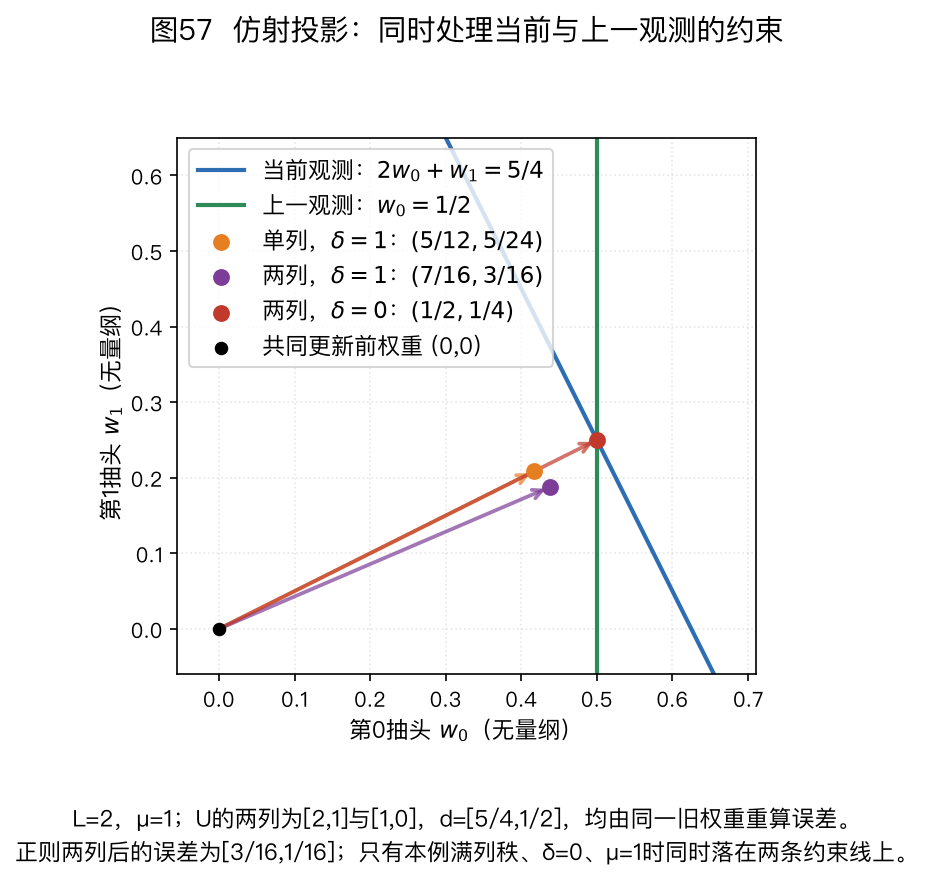

结合图57（对应练习 E06-34 的两抽头无噪几何算例），可以在二维权重平面 $(w_0,w_1)$ 上直观看到三种更新的轨迹差异：图中两条实线分别是当前观测超平面 $2w_0+w_1=5/4$ 与上一拍观测超平面 $w_0=1/2$，它们的唯一交点 $(0.5,0.25)$ 就是真实路径；从原点 $(0,0)$ 出发，$K=1$ 的单步 NLMS 只垂直朝当前这一条直线迈出 $[5/12,5/24]^\top$；无正则两列完全投影（$K=2,\delta=0,\mu=1$）联立两条直线一步直达真值交点；而加了正则阻尼（$K=2,\delta=1,\mu=1$）的更新落点 $[7/16,3/16]^\top$ 则稳健地收缩在原点与真值交点之间，限制了含噪时单步跳变幅度（有色参考含噪留出代价详见练习 E06-39 与图58）。

#### 6.2.5 RLS：用参考相关矩阵改变更新方向

NLMS 只看最近 $1$ 拍，APA 只看最近 $K$ 拍短窗，而**递归最小二乘（Recursive Least Squares，RLS）**则把从 $i=0$ 到当前时刻 $n$ 的全部历史观测按遗忘因子 $0<\lambda\le 1$ 作指数加权，每拍精确求出整段加权历史代价的最小二乘解，相当于用历史样本相关矩阵的逆对梯度做完全白化，从而摆脱输入谱条件数对收敛方向的束缚。

限于实数、已对齐单参考长度 $L$ 的因果 FIR 模型，为了保证启动初期（采样数尚少于 $L$ 或激励未满秩）正规方程处处严格正定可逆，我们在加权残差平方和之外显式加上对初始先验权重 $\vec w_{-1}$ 的二次惩罚项（$\delta>0$，与 [MathWorks `dsp.RLSFilter`](https://www.mathworks.com/help/dsp/ref/dsp.rlsfilter-system-object.html) 的初始逆协方差约定一致）：

$$\begin{aligned}
J_n(\vec w)={}&\sum_{i=0}^{n}\lambda^{n-i}
  (d[i]-\vec w^\top\vec x_i)^2\\
&+\lambda^{n+1}\delta\|\vec w-\vec w_{-1}\|_2^2.
\end{aligned}\tag{6-16}$$

对式(6-16)关于 $\vec w$ 求梯度并令 $\nabla_{\vec w}J_n(\vec w_n)=\vec 0$，整理出正规方程 $\mathbf R_n\vec w_n=\vec p_n$。把指数加权和拆为上一拍加权和乘 $\lambda$ 再加上当前第 $n$ 拍的新观测项，样本相关矩阵 $\mathbf R_n\in\mathbb{R}^{L\times L}$ 与互相关向量 $\vec p_n\in\mathbb{R}^L$ 满足秩 1 递推：

$$\begin{aligned}
\mathbf R_{-1}&=\delta\mathbf I_L,\\
\vec p_{-1}&=\delta\vec w_{-1},\\
\mathbf R_n&=\lambda\mathbf R_{n-1}+\vec x_n\vec x_n^\top,\\
\vec p_n&=\lambda\vec p_{n-1}+\vec x_n d[n],\\
\mathbf P_n&=\mathbf R_n^{-1},\\
\vec w_n&=\mathbf P_n\vec p_n.
\end{aligned}\tag{6-17}$$

若每拍对 $\mathbf R_n$ 直接求逆需 $O(L^3)$ 次运算。由于式(6-17)第 3 行是在已知可逆矩阵 $\mathbf A=\lambda\mathbf R_{n-1}$（其逆为 $\mathbf A^{-1}=\lambda^{-1}\mathbf P_{n-1}$）之上叠加一个秩 1 外积 $\vec x_n\vec x_n^\top$，我们可以直接套用[第 0 章 §0.3](00_math-foundations.md#sec-0-3) 与[附录 A](16_appendix-symbols-math.md) 的 **Woodbury（Sherman–Morrison）矩阵求逆引理**：

$$(\mathbf A+\vec u\vec v^\top)^{-1}
=\mathbf A^{-1}
-\frac{\mathbf A^{-1}\vec u\vec v^\top\mathbf A^{-1}}
      {1+\vec v^\top\mathbf A^{-1}\vec u}.$$

令 $\vec u=\vec v=\vec x_n$，并记中间向量 $\vec q_n=\mathbf P_{n-1}\vec x_n$（因 $\mathbf P_{n-1}$ 对称，有 $\vec x_n^\top\mathbf P_{n-1}=\vec q_n^\top$），逐步化简 $\mathbf P_n=\mathbf R_n^{-1}$：

$$\begin{aligned}
\mathbf P_n
&=(\lambda\mathbf R_{n-1}+\vec x_n\vec x_n^\top)^{-1}\\
&=\lambda^{-1}\mathbf P_{n-1}
  -\frac{\lambda^{-2}\vec q_n\vec q_n^\top}
        {1+\lambda^{-1}\vec x_n^\top\vec q_n}\\
&=\lambda^{-1}\left(\mathbf P_{n-1}
  -\frac{\vec q_n\vec q_n^\top}
        {\lambda+\vec x_n^\top\vec q_n}\right)\\
&=\lambda^{-1}(\mathbf P_{n-1}-\vec K_n\vec q_n^\top),
\end{aligned}$$

其中第三行把分式分子分母同乘 $\lambda$ 消去了繁分数，第四行定义了 $L\times 1$ 增益向量 $\vec K_n=\vec q_n/(\lambda+\vec x_n^\top\vec q_n)$。顺手右乘 $\vec x_n$ 验证一个极有用的代数恒等式：

$$\begin{aligned}
\mathbf P_n\vec x_n
&=\lambda^{-1}\left[\vec q_n
  -\vec q_n\frac{\vec x_n^\top\vec q_n}
                {\lambda+\vec x_n^\top\vec q_n}\right]
=\vec K_n.
\end{aligned}$$

将 $\mathbf P_n\vec x_n=\vec K_n$ 与 $\vec p_n=\lambda\vec p_{n-1}+\vec x_n d[n]$ 一并代入 $\vec w_n=\mathbf P_n\vec p_n$，权重递推水到渠成：

$$\begin{aligned}
\vec w_n
&=\mathbf P_n(\lambda\vec p_{n-1}+\vec x_n d[n])\\
&=(\mathbf P_{n-1}-\vec K_n\vec q_n^\top)\vec p_{n-1}
  +\vec K_n d[n]\\
&=\vec w_{n-1}
  -\vec K_n\vec x_n^\top(\mathbf P_{n-1}\vec p_{n-1})
  +\vec K_n d[n]\\
&=\vec w_{n-1}+\vec K_n(d[n]-\vec w_{n-1}^\top\vec x_n).
\end{aligned}$$

把整套因果计算顺序汇总，就得到每样本计算量与存储量均为 $O(L^2)$ 的标准 RLS 递推方程（本书教学代码 [`aec_rls.py`](../codes/chapters/ch06/core/aec_rls.py) 另附加了一次 $O(L^3)$ 的 Cholesky 正定性诊断以便拦截极端病态输入；复数频域推广时须先统一共轭内积约定）：

$$\begin{aligned}
\vec q_n&=\mathbf P_{n-1}\vec x_n,\\
\vec K_n&=\frac{\vec q_n}{\lambda+\vec x_n^\top\vec q_n},\\
\hat y_n^-&=\vec w_{n-1}^\top\vec x_n,\\
e_n^-&=d[n]-\hat y_n^-,\\
\vec w_n&=\vec w_{n-1}+\vec K_n e_n^-,\\
\mathbf P_n&=\lambda^{-1}(\mathbf P_{n-1}-\vec K_n\vec q_n^\top).
\end{aligned}\tag{6-18}$$

**两抽头锚点手算（递推路线与批量正规方程双路互验）。** 取 $L=2$、遗忘因子 $\lambda=1/2$、初始正则 $\delta=1$、零初值 $\vec w_{-1}=\vec 0$（故 $\mathbf P_{-1}=\mathbf I_2$）。依次送入两拍观测：$n=0$ 时 $\vec x_0=[1,0]^\top,d[0]=1$；$n=1$ 时 $\vec x_1=[1,1]^\top,d[1]=2$（对应连续参考采样 $x[-1]=0,x[0]=1,x[1]=1$）：

1. **第 $n=0$ 步递推**：$\vec q_0=\mathbf I_2[1,0]^\top=[1,0]^\top$，分母 $1/2+1=3/2$，增益 $\vec K_0=[2/3,0]^\top$；先验预测 $\hat y_0^-=0$、残差 $e_0^-=1$，故 $\vec w_0=[2/3,0]^\top$，逆相关阵由 $2\operatorname{diag}(1-2/3,1)$ 更新为 $\mathbf P_0=\operatorname{diag}(2/3,2)$。注意第二个对角元从 $1$ 膨胀到了 $2$——这是因为第 $0$ 拍参考没有激励第 $1$ 号抽头，而旧先验约束被遗忘因子 $\lambda=1/2$ 削弱了一半，不确定度随之翻倍！
2. **第 $n=1$ 步递推**：$\vec q_1=\mathbf P_0[1,1]^\top=[2/3,2]^\top$，分母 $1/2+(2/3+2)=19/6$，增益 $\vec K_1=[2/3,2]^\top/(19/6)=[4/19,12/19]^\top$；先验预测 $\hat y_1^-=2/3$、先验残差 $e_1^-=2-2/3=4/3$，更新权重与逆相关阵为：

    $$\begin{aligned}
    \vec w_1
    &=\begin{bmatrix}2/3\\0\end{bmatrix}
      +\frac{4}{3}\begin{bmatrix}4/19\\12/19\end{bmatrix}
    =\begin{bmatrix}18/19\\16/19\end{bmatrix},\\
    \mathbf P_1
    &=2\left(\operatorname{diag}(2/3,2)
      -\frac{1}{19}\begin{bmatrix}8&24\\24&72\end{bmatrix}\right)
    =\frac{1}{19}\begin{bmatrix}20&-16\\-16&28\end{bmatrix}.
    \end{aligned}$$

3. **独立批量正规方程复核**：回到式(6-17)直接累加两拍历史与先验项，$\vec p_1=\frac{1}{2}[1,0]^\top+[2,2]^\top=[5/2,2]^\top$，且

    $$\begin{aligned}
    \mathbf R_1
    &=\frac{1}{4}\mathbf I_2
      +\begin{bmatrix}1&0\\0&0\end{bmatrix}
      +\begin{bmatrix}1&1\\1&1\end{bmatrix}
    =\begin{bmatrix}7/4&1\\1&5/4\end{bmatrix},\\
    \mathbf R_1^{-1}
    &=\frac{16}{19}\begin{bmatrix}5/4&-1\\-1&7/4\end{bmatrix}
    =\frac{1}{19}\begin{bmatrix}20&-16\\-16&28\end{bmatrix}
    =\mathbf P_1,
    \end{aligned}$$

    其中行列式 $\det\mathbf R_1=\frac{35}{16}-1=\frac{19}{16}$，解出 $\mathbf R_1^{-1}\vec p_1=[18/19,16/19]^\top=\vec w_1$，两条路线精确吻合（见 [`aec_rls_demo.py`](../codes/chapters/ch06/aec_rls_demo.py)）。

#### RLS 的遗忘、双讲与工程边界

为了量化遗忘因子 $\lambda$ 的时间跨度，考察已接纳的最近 $J$ 次更新，由新到旧第 $j$ 个样本的权重为 $a_j=\lambda^j$（$j=0,\ldots,J-1$）。定义权重总和 $A_J$ 与基于平方和集中度的有效记忆样本数 $N_{\mathrm{eff},J}$（参见 [MathWorks 在线递归估计文档](https://www.mathworks.com/help/ident/ref/recursiveleastsquaresestimator.html)的时间尺度说明）：

$$\begin{aligned}
A_J&=\sum_{j=0}^{J-1}a_j,\\
N_{\mathrm{eff},J}&=\frac{A_J^2}{\sum_{j=0}^{J-1}a_j^2},\\
A_\infty&=\frac{1}{1-\lambda},\\
N_{\mathrm{eff},\infty}&=\frac{1+\lambda}{1-\lambda}.
\end{aligned}\tag{6-19}$$

当 $0<\lambda<1$ 且持续更新无穷多步时，等比级数求和给出后两行闭式极限：例如 $\lambda=0.99$ 时，$A_\infty=100$、$N_{\mathrm{eff},\infty}=199$；换算成物理秒数时必须乘上实际更新间隔（$16\ \mathrm{kHz}$ 逐采样更新 $100$ 次仅 $6.25\ \mathrm{ms}$，而 $10\ \mathrm{ms}$ 逐帧更新 $100$ 次则是 $1\ \mathrm{s}$，见练习 E06-15）。当 $\lambda=1$ 时无遗忘，有限步下 $A_J=N_{\mathrm{eff},J}=J$。

直接把标准全矩阵 RLS 搬进真实回声消除会遇到四道硬门槛：

- **双讲脆弱性**：近端语音 $s[n]$ 进入 $e_n^-$ 后会被 $\vec K_n$ 高效拟合进路径，必须搭配严密的双讲冻结；
- **静音协方差爆炸（windup）**：当远端静音 $\vec x_n=\vec 0$ 时，虽然 $\vec K_n=\vec 0$ 不改权重，但 $\mathbf P_n=\lambda^{-1}\mathbf P_{n-1}$ 每拍都被除以 $\lambda<1$ 呈指数膨胀，一旦重新出声就会产生剧烈超调，因此静音期必须暂停遗忘或给 $\mathbf P_n$ 设上界；
- **有限精度失正定**：式(6-18)最后一行是两个半正定矩阵相减，长时浮点舍入可能破坏对称性或产生负特征值（工程稳健变体需改用平方根 QR / Householder 分解递推）；
- **平方级内存与算力墙**：若 $L=4096$，单是一个双精度矩阵 $\mathbf P_n$ 就占 $4096^2\times 8=128\ \mathrm{MiB}$ 内存且每拍需上千万次乘加，因此全矩阵 RLS 仅适合短阶模块或离线对照，长路径高阶统计跟踪需转向下一小节的频域卡尔曼结构。

#### 6.2.6 Kalman：同时描述路径变化与观测不确定度

前面介绍的 NLMS、APA 和 RLS 都缺少一个区分“路径自己变了”与“近端有人说话了”的内生旋钮：它们的步长或遗忘因子一旦调大以跟踪路径突变，双讲时就会被近端语音带偏；一旦调小以抵抗双讲，路径变化时又跟不上。**卡尔曼路径估计与频域卡尔曼滤波（Frequency-Domain Kalman Filter，FDKF；[Enzner & Vary, *Signal Processing*, 2006](https://doi.org/10.1016/j.sigpro.2005.09.013) 及[作者状态空间 FDAF 综述页](https://homepages.ruhr-uni-bochum.de/gerald.enzner/StateSpaceFDAF.html)）**将未知的回声抽头显式建模为随机状态过程，用两套独立的二阶统计量把“路径自身漂移不确定度”与“麦克风观测干扰不确定度”彻底解耦。

为看清这两个噪声源的物理分工，先写出已对齐、实数、长度 $L$ 的时域状态空间方程：记 $\vec h_n\in\mathbb{R}^L$ 为第 $n$ 拍的真实回声路径，$a$ 为状态转移阻尼因子（常取 $a\lesssim 1$ 或 $a=1$），$\Delta\vec h_n$ 为零均值过程扰动向量，$s[n]$ 与 $v[n]$ 分别为近端语音与环境背景噪声：

$$\begin{aligned}
\vec h_n&=a\vec h_{n-1}+\Delta\vec h_n,\\
d[n]&=\vec x_n^\top\vec h_n+s[n]+v[n].
\end{aligned}\tag{6-20}$$

第一行描述路径的漂移或突变；第二行指出麦克风为何不等于回声副本。过程协方差 $\mathbf Q=\operatorname{Cov}(\Delta\vec h_n)$ 与观测干扰方差 $\Psi=\operatorname{Var}(s[n]+v[n])$ 分别刻画两个截然不同的物理过程，切勿将观测干扰方差 $\Psi$ 与前一节 RLS 的参考自相关矩阵 $\mathbf R_n$ 混为一谈。

同写为 $\mathbf P$ 的两个状态矩阵含义截然不同：式(6-17)与式(6-18)中的 $\mathbf P_n$ 是样本参考相关矩阵的逆 $\mathbf R_n^{-1}$；而记路径估计误差为 $\vec\delta_n=\vec h_n-\hat{\vec h}_n$，卡尔曼滤波式(6-21)～式(6-23)中的 $\mathbf P_n=\mathbb{E}[\vec\delta_n\vec\delta_n^\top]$ 则是路径估计误差协方差，唯有在本节后文指明的特定参数代换下，两套递推才会呈现相同的代数形式。

增大 $\mathbf Q$ 表示更不信任旧路径估计（如检测到设备挪动或房间门窗开合，需放开步长快速重收敛），增大 $\Psi$ 表示更不信任当前这一拍麦克风观测（如近端说话人开口双讲，需自动收紧步长保护已有路径）。当然，真实语音具有强短时相关性、人走动也不是平稳高斯白过程，式(6-20)是估计器用于分配二阶权重的工程工作模型（实数短 FIR 教学代码见 [`aec_kalman_matrix.py`](../codes/chapters/ch06/core/aec_kalman_matrix.py)）。

双讲期间，若观测噪声方差估计 $\Psi_m$ 随近端语音功率同步抬升，卡尔曼增益就会平滑压低，起到连续软门控作用；反之当路径突变时，先验残差幅度虽然飙升，但下文式(6-21)中的卡尔曼增益表达式本身并不直接含有先验残差，必须配合过程方差 $\Phi_m$ 抬升或协方差重置，才能迅速拉高增益完成重捕获。

下式是便于复算的逐频点**标量对角近似**递推（省略频点下标 $k$，记第 $m$ 块复路径系数估计为 $W_m$、误差方差为 $P_m\ge 0$、过程方差为 $\Phi_m\ge 0$、观测干扰方差为 $\Psi_m>0$）。假定已对齐参考谱 $X_m$ 已知，过程扰动与观测干扰均为零均值且彼此及与先验误差不相关；在此二阶矩条件下，下式给出的 $K_m$ 是仅使用当前复数新息（innovation，即先验预测误差 $E_m$）而不并入其共轭 $E_m^*$ 的最小均方误差复线性增益（若变量进一步服从联合圆对称（proper）复高斯分布，则同时达到条件均方最优；非圆对称（improper）复分布的广义增强滤波边界参见 [Dini & Mandic, SSPD 2010](https://www.commsp.ee.ic.ac.uk/~mandic/research/WL_Complex_Stuff/Dini_Mandic_Augmented_Kalman_Filter_Analysis_SSPD_2010.pdf)）：

$$\begin{aligned}
\hat W_m^-&=aW_{m-1},\\
P_m^-&=|a|^2P_{m-1}+\Phi_m,\\
E_m&=D_m-X_m\hat W_m^-,\\
K_m&=\frac{P_m^-X_m^*}{|X_m|^2P_m^-+\Psi_m},\\
W_m&=\hat W_m^-+K_mE_m,\\
P_m&=(1-K_mX_m)P_m^-.
\end{aligned}\tag{6-21}$$

逐行细读式(6-21)的物理闭环：前两行是**时间预测步**，误差方差乘 $|a|^2$ 并叠加过程方差 $\Phi_m$ 得到先验不确定度 $P_m^-$；第 3 行算出复数新息 $E_m$，总新息方差为 $S_m=|X_m|^2P_m^-+\Psi_m$。第 4 行算出卡尔曼增益 $K_m$，把分子分母同乘 $X_m$ 可知 $K_m X_m=|X_m|^2P_m^-/S_m\in[0,1)$，它恰好等于“由路径误差贡献的回声预测方差”占“总新息方差”的实数信噪比份额！

当远端单讲且底噪极小时（$\Psi_m\ll |X_m|^2P_m^-$），$K_m\approx X_m^*/|X_m|^2=1/X_m$，相当于步长 $\mu\to 1$ 的频域归一化更新；当双讲发生使 $\Psi_m\gg |X_m|^2P_m^-$ 时，$K_m\to 0$，更新自动软门控收缩，最后一行则将后验误差方差按比例 $(1-K_m X_m)$ 缩减。

**为什么不能直接拿当前帧残差模平方 $|E_m|^2$ 当作观测方差 $\Psi_m$？** 记路径先验误差 $\widetilde W_m^-=W_{\mathrm{true}}-\hat W_m^-$，由于新息 $E_m=X_m\widetilde W_m^-+S_m^{\mathrm{near}}+V_m$ 的总方差是 $S_m=|X_m|^2P_m^-+\Psi_m$，它把“路径尚未收敛造成的失配 $|X_m|^2P_m^-$”与“近端语音加底噪 $\Psi_m$”混在了一起！即便在已知 $P_m^-$ 与 $X_m$ 的单帧圆对称复高斯似然 $\ln S_m+|E_m|^2/S_m$ 下对 $\Psi_m\ge 0$ 求受限极大似然估计，解也是 $\hat\Psi_m=\max(0,|E_m|^2-|X_m|^2P_m^-)$——必须先扣掉路径不确定度贡献的预测误差底项，而且单帧功率起伏剧烈，实际系统必须结合跨帧平滑、双讲相干度与路径突变判据来稳健估计 $\Phi_m$ 与 $\Psi_m$。用两组最简数字一看便明：

- 固定 $X=1$、$P^-=1$：远端单讲设 $\Psi=0.01$ 时，$K=1/1.01\approx 0.990$，几乎全速吸收新息修正路径；双讲设 $\Psi=10$ 时，$K=1/11\approx 0.091$，增益自动压低到单讲时的约 $9.2\%$；
- 固定 $X=1$、$P^-=1$、$\Psi=1$：无论观测到的新息 $E$ 是 $0$ 还是突跳到 $10$，式(6-21)算出的 $K$ 都恒为 $1/2$；只有外部检测到路径突变并把先验方差调大至 $P^-=4$ 时，增益才会升至 $K=4/5=0.8$。

**完整一轮标量与复数共轭手算。** 取实数参数 $W_{m-1}=0.2$、$P_{m-1}=0.5$、$a=1$、$\Phi_m=0.1$、$X_m=2$、$D_m=1.4$、$\Psi_m=0.4$（可运行 [`aec_kalman_scalar_demo.py`](../codes/chapters/ch06/aec_kalman_scalar_demo.py) 逐项核对）：

1. **预测与新息**：$\hat W_m^-=0.2$，$P_m^-=0.5+0.1=0.6=3/5$；新息 $E_m=1.4-2\times 0.2=1.0$，新息方差 $S_m=2^2\times 0.6+0.4=2.8=14/5$；
2. **增益与后验状态**：

    $$\begin{aligned}
    K_m&=\frac{0.6\times 2}{2.8}
       =\frac{3}{7}\approx 0.4286,\\
    W_m&=0.2+\frac{3}{7}\times 1.0
       =\frac{22}{35}\approx 0.6286,\\
    P_m&=\left(1-\frac{6}{7}\right)\frac{3}{5}
       =\frac{3}{35}\approx 0.0857.
    \end{aligned}$$

    不提前舍入时，上例的精确分数使同一观测的后验残差降为 $1.4-2\times(22/35)=1/7\approx 0.1429$（若在双讲假设下把 $\Psi_m$ 从 $0.4$ 调高为 $4$，增益便从 $3/7$ 收缩至 $3/16$，后验权重仅微调至 $31/80$）。另注意两个极端边界：若错误地把初值不确定度设为 $P_0^-=0$ 且 $\Phi_m=0$，则对任意 $\Psi_m>0$ 都有 $K_m\equiv 0$，滤波器彻底“闭目塞听”、永远无法修正错误初值（见练习 E06-29）；而在复数频点上，取纯虚参考谱 $X=\mathrm{j}$、$P^-=\Psi=1$，式(6-21)因分子含共轭 $X^*=-\mathrm{j}$ 给出 $K=(-\mathrm{j})/(1+1)=-\mathrm{j}/2$（从而保证 $K X=(-\mathrm{j}/2)\mathrm{j}=+1/2>0$），一旦代码漏写共轭就会得出符号全反的 $+\mathrm{j}/2$ 导致发散！

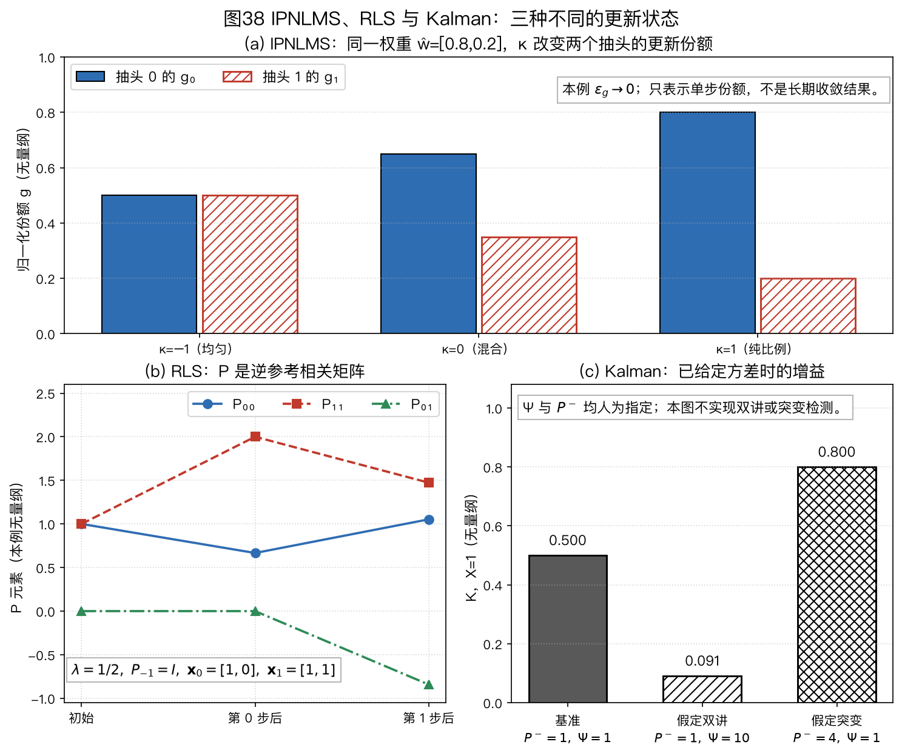

此时回看图38的三个子图，可以把 IPNLMS、RLS 与 Kalman 改变自适应更新的三条路线同屏对比：

- 图38（a）对应前述忽略正则项的两抽头 IPNLMS 手算（$\hat{\vec w}=[0.8,0.2]^\top$），展示 $\kappa$ 从 $-1$（等分 $[0.5,0.5]$）经 $0$（折中 $[0.65,0.35]$）到 $+1$（纯比例 $[0.8,0.2]$）时各抽头分得的更新份额 $g_l$；
- 图38（b）对应 §6.2.5 两抽头 RLS 手算，绘出逆相关矩阵从对角阵 $\mathbf P_0=\operatorname{diag}(2/3,2)$ 演化到含负非对角耦合项（如非对角元 $-16/19$）矩阵 $\mathbf P_1$ 的全过程；
- 图38（c）在固定标量参考 $X=1$（无量纲）下，用三根离散柱状图对比三组人为给定统计工况下的卡尔曼增益 $K=P^-/(P^-+\Psi)$（贝叶斯状态空间递推基础见[第 0 章 §0.6](00_math-foundations.md#sec-0-6)）：“基准”（$P^-=1,\Psi=1$）得 $K=0.500$，“假定双讲”（观测干扰方差增大为 $P^-=1,\Psi=10$）收缩至 $K\approx 0.091$，“假定突变”（先验路径方差增大为 $P^-=4,\Psi=1$）则放大至 $K=0.800$。

**从标量走向矩阵状态：对角近似丢掉了什么？为什么要用 Joseph 协方差更新式？** 在时域全矩阵模型下，设状态转移矩阵为 $\mathbf A\in\mathbb{R}^{L\times L}$、过程协方差为 $\mathbf Q$、标量观测干扰方差为 $\Psi$，完整实数卡尔曼递推写为：

$$\begin{aligned}
\hat{\vec h}_n^-&=\mathbf A\hat{\vec h}_{n-1},\\
\mathbf P_n^-&=\mathbf A\mathbf P_{n-1}\mathbf A^\top+\mathbf Q,\\
S_n&=\vec x_n^\top\mathbf P_n^-\vec x_n+\Psi,\\
\vec K_n&=\mathbf P_n^-\vec x_n/S_n,\\
e_n^-&=d[n]-\vec x_n^\top\hat{\vec h}_n^-,\\
\hat{\vec h}_n&=\hat{\vec h}_n^-+\vec K_n e_n^-,\\
\mathbf B_n&=\mathbf I_L-\vec K_n\vec x_n^\top,\\
\mathbf P_n&=\mathbf B_n\mathbf P_n^-\mathbf B_n^\top\\
           &\quad+\vec K_n\Psi\vec K_n^\top.
\end{aligned}\tag{6-22}$$

仔细看式(6-22)最后两行的 **Joseph 稳定协方差形式**，它既有清晰的物理账本，又有不可替代的数值价值：记先验路径误差 $\vec\delta_n^-=\vec h_n-\hat{\vec h}_n^-$、后验误差 $\vec\delta_n=\vec h_n-\hat{\vec h}_n$，以及总观测干扰 $u_n=s[n]+v[n]$，将 $e_n^-=\vec x_n^\top\vec\delta_n^-+u_n$ 代入 $\vec\delta_n=\vec\delta_n^--\vec K_n e_n^-$，立得 $\vec\delta_n=\mathbf B_n\vec\delta_n^--\vec K_n u_n$。由于先验路径误差与当前观测干扰不相关，**对于任意给定的增益向量 $\vec K_n$**（哪怕 $\vec K_n$ 因统计量估计有偏或双讲门控并非精确最优增益），后验误差的真实协方差都严格等于两项对称半正定二次型之和——第一项 $\mathbf B_n\mathbf P_n^-\mathbf B_n^\top$ 是被本次观测压缩后的剩余路径不确定度，第二项 $\vec K_n\Psi\vec K_n^\top$ 是顺着增益 $\vec K_n$ 新灌进权重的观测干扰方差！

唯有当 $\vec K_n$ 分毫不差取理论最优值 $\mathbf P_n^-\vec x_n/S_n$ 且浮点运算零舍入时，展开二次型才能代数相消简化为常见的 $(\mathbf I_L-\vec K_n\vec x_n^\top)\mathbf P_n^-$；在有限精度浮点运算下，简写式由两个矩阵相减极易丢失对称性甚至算出负特征值，而 Joseph 形式由两个合同二次型相加，天然保持实对称与半正定结构。

用两抽头手算（见 [`aec_kalman_matrix_demo.py`](../codes/chapters/ch06/aec_kalman_matrix_demo.py)）即可看明跨抽头非对角协方差的作用：设 $\mathbf A=\mathbf I_2,\mathbf Q=\mathbf 0,\Psi=1$，初态 $\hat{\vec h}^-=\vec 0$、$\mathbf P^-=\operatorname{diag}(1,4)$，首拍输入 $\vec x=[1,1]^\top,d=3$。代入式(6-22)得新息方差 $S=1+4+1=6$，增益 $\vec K=[1/6,2/3]^\top$，后验路径 $\hat{\vec h}=[1/2,2]^\top$，Joseph 更新给出后验协方差 $\mathbf P$ 的对角元为 $5/6$ 与 $4/3$、非对角元为 $-2/3$。尽管先验 $\mathbf P^-$ 是纯对角阵，但观测 $x_0 h_0+x_1 h_1\approx 3$ 把“两个抽头之和”绑在了一起，后验立刻生出负相关非对角元 $-2/3$！

若下一拍输入变为差模方向 $\vec x_{\mathrm{next}}=[-1,1]^\top$，完整矩阵算出的新息方差为 $[-1,1]\mathbf P[-1,1]^\top+1=(5/6+4/3+4/3)+1=9/2=4.5$（如实反映差模方向此前未被约束、不确定度很大）；若粗暴砍掉非对角元作对角近似，算出的新息方差仅剩 $(5/6+4/3)+1=19/6\approx 3.167$，低估了差模方向的不确定度。

顺便指出 **RLS 与时域矩阵 Kalman 的精确代数桥梁**：在式(6-22)中令静态转移 $\mathbf A=\mathbf I_L$、归一化单位观测方差 $\Psi=1$，并人为设定每拍先验协方差膨胀规则为 $\mathbf P_n^-=\lambda^{-1}\mathbf P_{n-1}$（等价于选取自适应过程噪声 $\mathbf Q_n=(\lambda^{-1}-1)\mathbf P_{n-1}$，$\lambda=1$ 时 $\mathbf Q_n=\mathbf 0$），则卡尔曼增益化为：

$$\begin{aligned}
\vec K_n
&=\frac{\lambda^{-1}\mathbf P_{n-1}\vec x_n}
       {1+\lambda^{-1}\vec x_n^\top\mathbf P_{n-1}\vec x_n}
=\frac{\mathbf P_{n-1}\vec x_n}
      {\lambda+\vec x_n^\top\mathbf P_{n-1}\vec x_n},
\end{aligned}$$

分子分母同乘 $\lambda$ 后与式(6-18)的 RLS 增益完全合一！

**分区块频域卡尔曼滤波（PBFDKF）母式。** 把上述矩阵状态推广到多分区、多播放声道频域（原始架构参见 [Kuech, Mabande & Enzner, ICASSP 2014](https://doi.org/10.1109/ICASSP.2014.6853806)），设包含各分区与声道频域权重的总状态向量为 $\vec w_m\in\mathbb{C}^M$，从状态到长度 $N$ 的**有效时域观测块** $\vec d_m\in\mathbb{R}^N$ 的重叠保存线性观测算子为 $\mathbf H_m\in\mathbb{C}^{N\times M}$（内含逐频相乘、IFFT 与截取后 $N$ 点有效区 $\mathbf S$），有效观测干扰协方差为 $\mathbf \Psi_m\succ\mathbf 0$，则未做分块对角简化的完整矩阵卡尔曼母式为：

$$\begin{aligned}
\hat{\vec w}_m^-&=\mathbf A\hat{\vec w}_{m-1},\\
\mathbf P_m^-&=\mathbf A\mathbf P_{m-1}\mathbf A^H+\mathbf Q,\\
\vec e_m^-&=\vec d_m-\mathbf H_m\hat{\vec w}_m^-,\\
\mathbf S_m&=\mathbf H_m\mathbf P_m^-\mathbf H_m^H+\mathbf \Psi_m,\\
\mathbf K_m&=\mathbf P_m^-\mathbf H_m^H\mathbf S_m^{-1},\\
\hat{\vec w}_m&=\hat{\vec w}_m^-+\mathbf K_m\vec e_m^-.
\end{aligned}\tag{6-23}$$

核对维度：$\mathbf P_m^-$ 为 $M\times M$，$\mathbf S_m$ 为 $N\times N$，增益矩阵 $\mathbf K_m$ 为 $M\times N$；由于读取的是实数时域有效块 $\vec d_m$，新息满足 $\vec e_m^-=(\vec e_m^-)^*$，而频域状态 $\vec w_m=\mathbf T\vec h$ 由实数合法 FIR 抽头经线性约束映射生成（误差协方差满足 $\mathbf P_w=\mathbf T\mathbf P_h\mathbf T^H$，故全部 DFT 频点受共轭对称与有限支撑约束，并非 $2M$ 个自由实参数，也不是彼此独立的圆对称复状态）。实际长路径上直接求式(6-23)密集矩阵开销过大，工业与学术界通过剪裁不同层级的非对角协方差块导出实用变体——例如 [Zhu et al.（Interspeech 2021, §2～3）](https://www.isca-archive.org/interspeech_2021/zhu21d_interspeech.pdf)在双声道 PBFDKF 中对比了仅保留同声道同分区对角块的 VD-PBFDKF 与额外保留同分区跨播放声道协方差块的 SD-PBFDKF（更多开源实现细节见[研究手册 A04](../codes/chapters/ch00/research/02_aec_wpe_separation.md#aec)）。

最后用一个单抽头双讲受控手算总结统计量失配的后果：设初态 $w^-=0,P^-=1,x=1,\Psi=0.1$，首拍单讲观测 $d[0]=1$ 给出 $K_0=1/1.1=10/11$，收敛到 $w_0=10/11\approx 0.909$、$P_0=1/11$。第二拍真实路径仍为 $1$，但叠加了幅度为 $2$ 的近端语音使 $d[1]=3$（新息 $e_1^-=3-10/11=23/11$）：

- 若观测方差估计漏检双讲、仍停在 $\Psi=0.1$，则增益高达 $K_1=(1/11)/(1/11+1/10)=10/21$，权重一步被拉偏至 $10/11+(10/21)(23/11)=440/231\approx 1.905$；
- 若准确捕获双讲能量将 $\Psi$ 抬升至 $10$，增益骤降为 $1/111$，后验权重稳在 $10/11+23/1221\approx 0.928$（理想硬冻结则保持 $10/11\approx 0.909$）。在 [`aec_rls_kalman_comparison.py`](../codes/chapters/ch06/aec_rls_kalman_comparison.py)（种子 `20260923`，$512$ 点两抽头序列）中，双讲段固定低 $\Psi$ 时先验回声估计均方误差达 $0.1341$，而在双讲段抬升 $\Psi$ 与理想冻结则分别压低至 $1.57\times 10^{-5}$ 与 $9.83\times 10^{-6}$（四法短路径残差试听另见[合成音频说明](../codes/chapters/ch00/research/05_exercises_and_audio.md#15-同源短路径-aec-的线性残差)）。

下表将 §6.1～§6.2 全部七类线性自适应结构放在同一张工程坐标系中做选型总结：

| 算法 | 每样本主要计算 | 收敛受什么影响 | 双讲更新控制 | 适用条件 |
|---|---|---|---|---|
| 时域 NLMS | $O(L)$；朴素约 $3L$，能量递推主要项约 $2L$ | 输入谱条件数、步长、路径变化 | 需外部冻结或连续步长控制 | 路径很短，或教学/极简验证 |
| 比例更新 | IPNLMS：$O(L)$，另有比例权重计算 | 稀疏路径初期更快；稠密尾声收益有限 | 仍需外部双讲控制 | 冲激响应具有显著稀疏主峰 |
| 仿射投影 APA | 直接实现约 $O(LK^2+K^3)$；小阶窗口解 | 投影阶数 $K$、列相关性、正则 $\delta$ 与噪声 | 冻结后窗口仍留双讲历史，需配清窗策略 | 小阶数（$K=2$～$4$）改善有色语音收敛 |
| 分区频域 | PBFDAF：无约束约 $O(\log N+L/N)$；逐分区约束另加 $O((L/N)\log N)$ | 逐频功率归一化、块长 $N$ 与梯度约束周期 | 需外部二值冻结或连续步长调节 | 中长混响路径且允许分块缓冲的实时设备 |
| 子带自适应 | 滤波器组分带/合成加低速短滤波 | 子带内谱平坦度、过采样率或跨带耦合 | 仍需双讲控制 | 前端已有现成过采样分析—合成滤波器组 |
| RLS | 标准全矩阵实现 $O(L^2)$（存储亦 $O(L^2)$） | 遗忘因子 $\lambda$、初始正则与静音保护 | 对双讲和静音极敏感，须严密门控 | 极低阶自适应模块或离线最小二乘基准 |
| 频域卡尔曼 FDKF | 频域分区滤波外另维护误差与噪声方差 | 过程方差 $\mathbf Q$ 与观测方差 $\mathbf \Psi$ 估计准确度 | 通过抬升 $\mathbf \Psi$ 天然支持逐频软门控 | 路径时变频繁、需精细平衡双讲与重收敛的终端 |

读这张总表可把握两条主线：在**计算架构横轴**上，长路径实时产品几乎都在“分区块频域（MDF / PBFDAF）”与“过采样子带”二者中择一落地；在**参数更新纵轴**上，则从固定步长逐频归一化一路演进到由过程方差与双讲观测方差联合驱动的频域卡尔曼软门控（FDKF / PBFDKF）。至此线性自适应主干已全部铺通；接下来 §6.3 与 §6.4 分别攻克线性模型之外的两块硬骨头——扬声器非线性失真与双讲检测。

### 6.3 非线性回声：模型失配与处理方法

**非线性从哪来**。微型扬声器的折环悬边与磁路在大振幅驱动下会偏离胡克定律与匀强磁场假设（悬边刚度随位移急剧变硬、音圈部分滑出磁隙导致力因子随位移下降），功放或数字播放链在大音量下会发生软饱和乃至硬削顶（clipping），轻薄塑料机壳与按键结构件也会在强声压激励下产生非线性叩击与二次辐射。Birkett & Goubran（WASPAA 1995）实测展示了免提终端中的非线性回声特性，Klippel（JAES 2006）则系统建立了动圈扬声器的大信号机电非线性模型。

**残差平台从哪里来**。式(6-2)的线性横向滤波器只能合成播放参考历史采样 $x[n],\ldots,x[n-L+1]$ 的线性组合。一旦功放或扬声器失真制造出该线性子空间无法张成的谐波与互调失真分量，哪怕线性路径抽头已经收敛到最小均方最优解，正交于参考子空间的非线性失真能量依然会原封不动留在残差 $e[n]$ 中，使 $\mathrm{ERLE}$ 曲线卡在一道水平“残差平台”上（练习 E06-06 将用单频正弦通过三次非线性给出解析积分与离散谱复算）。当然，非线性失配是否产生残余还取决于激励信号本身的取值集合：例如双极性二值序列 $x[n]\in\{-1,+1\}$ 恒满足 $x^3[n]=x[n]$，此时三次多项式退化为恒等线性映射，线性抽头仍可将其完全抵消；但在连续幅度的语音与音乐激励下，高次谐波与互调项便会充分暴露。

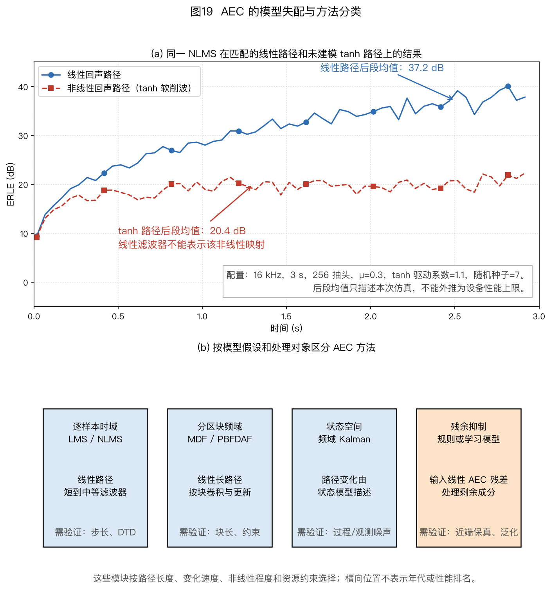

结合图19的两个面板可以把握整章算法的定位：

- 图19（a）横轴为时间（单位：$\mathrm{s}$），纵轴为 $\mathrm{ERLE}$（单位：$\mathrm{dB}$），在 $3\ \mathrm{s}$ 激励、$256$ 抽头、步长 $0.3$ 与驱动系数 $1.1$ 的受控仿真下对比纯线性回声路径与含非线性失真路径的收敛轨迹——线性路径随迭代持续攀升，而非线性路径迅速撞上由未建模谐波决定的残差平台；
- 图19（b）按“模型表达空间”与“信号处理对象”梳理本章方法版图：从逐样本时域 LMS/NLMS、分区块频域 MDF/PBFDAF、状态空间频域卡尔曼滤波（FDKF），一路延伸到显式非线性建模与后置残余抑制（横纵位置仅表示问题分类，不代表年代先后或通用性能排名）。注意图19（a）与下文图31（a）虽采用相近的抽头数和驱动系数，但随机种子、边界成形与具体路径实现各自独立，因此两图的平台分贝数仅用于印证各自实验设定下的失配机制，不宜跨图横向比大小。

> **`tanh` 软饱和映射的最小手算。**
>
> 图31采用归一化双曲正切映射 $y=\tanh(1.1x)/\tanh(1.1)$ 模拟功放与扬声器的对称奇次软饱和，分母归一化保证在锚点 $x=1$ 处恰好输出 $y=1$。代入两个代表性幅度复算：小幅度 $x=0.3$ 时，$y=\tanh(0.33)/\tanh(1.1)$（约 $0.3185/0.8005\approx 0.398$），相对参考对角线 $y=x$ 高出约 $+0.098$；大幅度过载 $x=1.5$ 时，$y=\tanh(1.65)/\tanh(1.1)$（约 $0.9289/0.8005\approx 1.160$），相对参考线显著压缩了约 $-0.340$。
>
> 对 $x$ 在原点求导可知小信号切线斜率为 $1.1/\tanh(1.1)\approx 1.374$，因此图中虚线 $y=x$ 是连接 $(0,0)$ 与 $(1,1)$ 的割线参考，而非原点切线。自适应线性滤波器在连续语音激励下会自动寻找使均方误差最小的最佳等效线性斜率，但只要映射存在非零曲率，最佳直线与真实S形曲线之间的弯曲偏差就会化作无法靠调大抽头数 $L$ 消除的非线性残差。

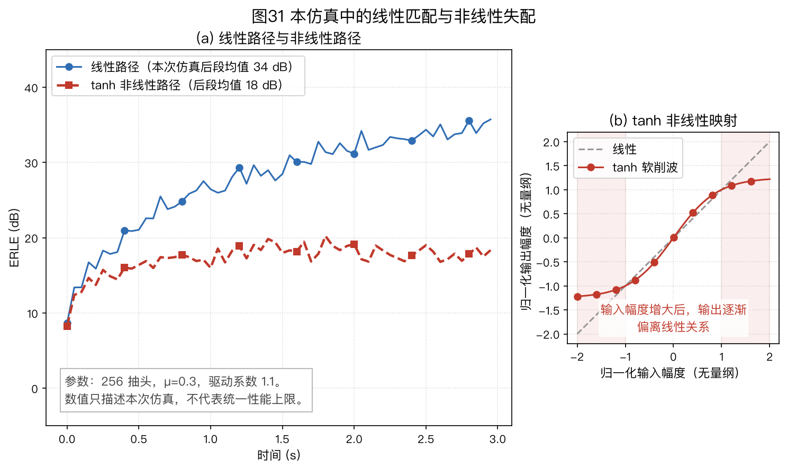

读图31时将左右两幅子图联动观察：图31（b）横轴为输入幅度 $x$、纵轴为输出幅度 $y$，直观画出归一化 $\tanh$ 曲线相对线性割线 $y=x$ 的小幅膨胀与大幅压缩曲率；图31（a）则展示同一非线性映射串入声学回声路径后，时域 NLMS 在后段统计窗口内的 $\mathrm{ERLE}$ 被牢牢压制在平台处，直观建立起“静态传递曲率 $\longrightarrow$ 线性抵消残差上限”的因果链条。

#### 显式建模非线性

既然线性组合不够用，第一条技术路线就是把已知播放参考的非线性基展开并入自适应预测器。最一般的无反馈截断展开是**二阶 Volterra（沃尔泰拉）滤波器**：在线性卷积之外加入历史采样之间的两两乘积。对实数输入，利用乘积对称性 $x[n-i]x[n-j]=x[n-j]x[n-i]$ 只保留上三角索引 $0\le i\le j<L$，并在固定时刻 $n$ 简记历史样本 $t_i=x[n-i]$，预测回声可写为：

$$\begin{aligned}
\hat y[n]&=\sum_{i=0}^{L-1}w_i t_i\\
&\quad+\sum_{0\le i\le j<L}q_{ij} t_i t_j.
\end{aligned}\tag{6-24}$$

式(6-24)虽然关于待估参数 $\{w_i,q_{ij}\}$ 仍然是线性的，但参数规模呈平方级膨胀：线性核占 $L$ 个抽头，上三角二阶核占 $L(L+1)/2$ 个系数（若由完整对称矩阵 $\mathbf H$ 改写，须把非对角对称项合并为 $q_{ij}=H_{ij}+H_{ji}=2H_{ij}$，对角项保持 $q_{ii}=H_{ii}$，不能直接丢弃下三角而漏乘因子 $2$）。当房间路径取 $L=256$ 时，单是二阶核就高达 $256\times 257/2=32896$ 个自适应权重，算力与双讲过拟合风险急剧升高；更致命的是，二阶二次型对单频正弦输入仅能衍生直流与二次谐波，面对对称削顶主导的三次谐波（如上文 $\tanh$ 奇对称饱和及练习 E06-06）依然束手无策（参见 [Stenger & Rabenstein, NSIP 1999](https://www.eurasip.org/Proceedings/Ext/NSIP99/Nsip99/papers/146.pdf)）。

为了避开跨时延交叉乘积的维数灾难，工程上更常按物理器件的前后级顺序采用**结构化级联模型**：静态无记忆非线性在前、线性动态传播在后的 $N\to L$ 结构称为 **Hammerstein（哈默斯坦）模型**；线性动态在前、静态非线性在后的 $L\to N$ 结构称为 **Wiener（维纳）模型**；而功放前级滤波、非线性限幅再加上房间声学传播则构成 $L\to N\to L$ 的 **Wiener–Hammerstein 模型**。以紧凑型免提设备最常用的广义 Hammerstein（幂滤波，power-filter）模型为例：先用 $Q$ 个已知无记忆非线性基函数 $\{\psi_q(\cdot)\}_{q=1}^{Q}$ 变换播放参考 $x[n]$，再让每一路非线性支路通过各自的 $L$ 抽头因果线性路径 $h_q[\ell]$ 求和输出：

$$\begin{aligned}
\hat y[n]&=\sum_{q=1}^{Q}\sum_{\ell=0}^{L-1}
           h_q[\ell]\,\psi_q(x[n-\ell]).
\end{aligned}$$

当功放无记忆失真 $g(x)=\sum_{q=1}^{Q}c_q\psi_q(x)$ 全部发生在同一条房间声学路径 $h[\ell]$ 之前时，上式退化为各支路共享空间脉冲响应形状的秩 $1$ 特例 $h_q[\ell]=c_q h[\ell]$；而保留独立的 $h_q[\ell]$ 则把问题转化为一个总参数量仅 $Q L$（例如取 $Q=3$ 阶奇次展开、$L=256$ 时仅需 $768$ 个系数，远少于二阶 Volterra 的 $32896$ 个）、且对参数完全线性的 $Q$ 通道多参考自适应滤波问题，可直接复用 §6.2 的分区频域框架求解。

**为什么非线性支路要选正交 Legendre（勒让德）基，而不能直接用幂级数基 $\{x,x^2,x^3,\ldots\}$？** 症结就在多支路参考之间的**强共线性与病态条件数**！不妨在归一化幅度区间 $x\in[-1,1]$ 上，假设输入服从均匀分布 $x\sim\mathcal U(-1,1)$，手算对比最常用的两路奇次幂基 $\psi_1(x)=x$ 与 $\psi_3(x)=x^3$：由于 $x$ 与 $x^3$ 在 $[-1,1]$ 上处处同号且在接近满幅 $\pm 1$ 时同步飙升，由偶次矩 $\mathbb{E}[x^{2k}]=1/(2k+1)$（积分 $\frac{1}{2}\int_{-1}^{1}x^{2k}\,\mathrm{d}x$）立知 $\mathbb{E}[x^2]=1/3$、$\mathbb{E}[x^6]=1/7$，而跨支路互相关高达 $\mathbb{E}[x\cdot x^3]=\mathbb{E}[x^4]=1/5$！算得两支路的归一化相关系数为：

$$\begin{aligned}
\rho_{1,3}
&=\frac{\mathbb{E}[x^4]}
       {\sqrt{\mathbb{E}[x^2]\,\mathbb{E}[x^6]}}
 =\frac{1/5}{\sqrt{(1/3)(1/7)}}
 =\frac{\sqrt{21}}{5}\approx 0.9165.
\end{aligned}$$

即便先把两支路各自除以其标准差归一化为单位方差，二者的 $2\times 2$ 相关矩阵条件数 $(1+\rho_{1,3})/(1-\rho_{1,3})$ 算得 $(5+\sqrt{21})/(5-\sqrt{21})\approx 22.96$（不作方差缩放的原矩阵对角元为 $1/3,1/7$、非对角元为 $1/5$，条件数约为 $27.73$）。更一般地，对任意奇次幂阶数 $p,q\in\{1,3,5,\ldots\}$，原始幂基二阶矩矩阵 $\mathbf R_{\mathrm{pow}}$ 的元素严格为 $\mathbb{E}[x^{p+q}]=\frac{1}{p+q+1}$——这恰好是一张**奇下标 Cauchy / Hilbert 型病态子矩阵**！一旦再加一路五次支路 $x^5$ 扩成三支路 $\{x,x^3,x^5\}$，原始相关矩阵条件数便从 $27.73$ 飙升至 **$849.58$**，即便做完单位方差归一化也高达 **$567.45$**，导致自适应梯度在各阶谐波支路之间剧烈拉锯、收敛极慢（精确特征多项式与坐标解耦复算见练习 [E06-43](#e06-43)）。

改用 $[-1,1]$ 上的**正交 Legendre 多项式基**（对称奇次失真取 $P_1,P_3,P_5,\ldots$，非对称含偶次失真再并入 $P_2,P_4,\ldots$）：

$$\begin{aligned}
P_1(x)&=x,\qquad
P_2(x)=\frac{1}{2}(3x^2-1),\\
P_3(x)&=\frac{1}{2}(5x^3-3x),\qquad
P_5(x)=\frac{1}{8}(63x^5-70x^3+15x).
\end{aligned}$$

它们在 $[-1,1]$ 上严格满足正交积分 $\int_{-1}^{1}P_p P_q\,\mathrm{d}x$ 等于 $\frac{2}{2q+1}\delta_{pq}$。看 $P_3(x)$ 与 $P_5(x)$ 的精妙之处：它们主动从高次幂 $x^3,x^5$ 中扣除了全部低阶奇次子空间的投影分量，使得在 $x\sim\mathcal U(-1,1)$ 下 $\mathbb{E}[P_1(x)P_3(x)]$ 化为 $(5/2)(1/5)-(3/2)(1/3)=0$，三支路未缩放相关矩阵直接对角化为 $\operatorname{diag}(1/3,1/7,1/11)$（条件数骤降至 $11/3\approx 3.67$），再乘尺度因子 $\sqrt{2q+1}$ 即化为条件数等于 $1$ 的标准单位阵！当然，真实语音的瞬时幅度更接近集中在零点附近的超高斯分布且存在时间相关性，Legendre 基在真实语音上并非绝对零相关，但剥离各阶多项式的主导共线成分后，依然能大幅压低多支路条件数并加快非线性 AEC 收敛（参见 Kuech & Kellermann, *Signal Processing*, 2006）。

对于功放前级滤波不可忽略的硬件，[Nollett & Jones（NSIP 1997）](https://www.iwaenc.org/proceedings/1997/nsip97/pdf/author/ns970521.pdf)进一步考察了 $L\to N\to L$ 的 Wiener–Hammerstein 结构：其实验室测试采用廉价有源 PC 扬声器在大音量（主要受功放硬削顶限制）下播放基频与幅度时变的合成元音，以 $30$ 抽头前滤波器加 $200$ 抽头后滤波器的 LNL 结构对照同总长 $230$ 抽头的线性 NLMS，稳态 $\mathrm{ERLE}$ 由 $11.1\ \mathrm{dB}$ 提升至 $19.5\ \mathrm{dB}$（改善 $8.4\ \mathrm{dB}$）。阅读这类文献数据时须注意实验边界：该组实物测试使用的是合成元音且未给出采样率与重复统计，原文另一组高斯白噪声仿真则采用 $15+43$ 抽头对照 $58$ 抽头，工程选型时仍须在目标扬声器与真实双讲语料上重新实测收益。

#### 改变参考取点

既然相当一部分非线性诞生在数字链路末端或模拟功放内部，另一条釜底抽薪的工程思路就是**把参考取点向扬声器物理末端前移**，让参考信号本身直接把已经发生的失真一并录进来，从而免去算法盲猜失真模型的负担：

- **扬声器端子电信号参考**：用额外模数转换通道直接分压采样功放输出端的模拟电压或音圈电流（参见 [Shah et al., *IEEE/ACM TASLP*, 2015](https://doi.org/10.1109/TASLP.2015.2425955)），可将数字限幅与模拟功放削顶完全纳入已知参考，但音圈驱动之后的悬边机械非线性与机壳共振仍留在未知路径侧；
- **机械振动参考**：在扬声器盆架或设备外壳贴装加速度计拾取结构振动，需要承担新增传感器、采集同步与底噪开销。

在软硬件协同设计中，改变参考取点、正交基显式非线性抵消与 §6.5 的深度神经网络（Deep Neural Network，DNN）残余抑制并非非此即彼的竞争关系，而是按硬件成本与算力预算分层组合；验收时只需坚持分别记录线性/显式模型抵消段输出与后置抑制最终输出即可。

### 6.4 双讲检测与自适应控制

一旦本地说话人与远端播放同时发声（双讲），先验残差 $e[n]=d[n]-\hat y[n]$ 里便同时混有路径失配回声与强近端语音 $s[n]$。此时若自适应滤波器照常大步更新，近端人声就会顺着梯度项 $e[n]\vec x[n]$ 涌入抽头，把原本已经收敛准的回声路径推偏。**双讲检测（Double-Talk Detection，DTD）**的任务正是实时感知双讲并降低步长或冻结更新：门限设得过于敏感，会把路径突变（如人走动或拿起电话）误判成双讲而锁死滤波器，造成长时回声泄漏；门限设得过于迟钝，则会在双讲初期漏检，引发系数污染与近端语音吞字。

这里要先从理论上分清“**单次在线更新的瞬时漂移**”与“**总体均方最优解的统计无偏性**”这两个常被混为一谈的概念。在线性零噪声模型 $d[n]=\vec x^\top[n]\vec h+s[n]$ 下，只要参考二阶矩矩阵 $\mathbf R_{xx}=\mathbb{E}[\vec x[n]\vec x^\top[n]]$ 可逆，且近端语音与整个参考回归向量满足正交条件 $\mathbb{E}[\vec x[n]s[n]]=\vec 0$，总体最小均方目标 $\min_{\vec w}\mathbb{E}[(d[n]-\vec x^\top[n]\vec w)^2]$ 的唯一最优解依然精确等于真实路径 $\vec h$（注意：对已去均值的零均值信号，不相关即保证 $\mathbb{E}[\vec x[n]s[n]]=\vec 0$；若信号含非零直流均值，由于交叉二阶矩等于协方差 $\operatorname{Cov}(\vec x,s)$ 加上均值乘积 $\mathbb{E}[\vec x]\mathbb{E}[s]$，仅协方差为零还不够）。

既然总体最优解无偏，为什么双讲不冻结还是会搞坏滤波器？原因在于在线算法每次只看有限样本的瞬时梯度 $e[n]\vec x[n]$，强近端语音 $s[n]$ 会令瞬时梯度方差暴涨数十乃至上百倍，有限步长下权重就会剧烈震荡偏离 $\vec h$；反之若近端信号与参考确实存在相关性（$\mathbb{E}[\vec x[n]s[n]]\neq\vec 0$），连总体正规方程的解本身都会有偏地把相关近端成分吸进抽头（理论起点参见 [Benesty & Gänsler, IWAENC 2001](https://www.iwaenc.org/proceedings/2001/main/data/benesty.pdf)，四点序列的批量正交与在线漂移复算见练习 [E06-21](#e06-21)，归一化分母引发的条件期望偏移见练习 E06-32）。

**常见 DTD 方法**（DTD = 双讲检测，double-talk detection；NCC = 归一化互相关，normalized cross-correlation）：

1. **Geigel 幅度比较**：设 $x_a[n]$ 为已经补偿纯延迟、送入长度 $L$ 自适应滤波器的参考序列。先检查滑窗峰值 $M[n]=\max_{0\le\ell<L}|x_a[n-\ell]|$ 是否高于参考活动门限；仅当参考处于活动状态时才计算幅度比 $\xi[n]=|d[n]|/M[n]$，高于判决阈值 $T$ 时判为双讲。当 $M[n]=0$ 时严禁强行相除，也不能把静音帧当成有效双讲证据。

    记参考活动门限为 $T_x>0$。在满足 $M[n]>T_x$ 的当前采样时刻 $n$，将 $M[n]$、$\xi[n]$ 简记为 $M$、$\xi$，判决统计量为：

    $$\begin{aligned}
    M&=\max_{0\le\ell<L}|x_a[n-\ell]|,\\
    \xi&=\frac{|d[n]|}{M}.
    \end{aligned}\tag{6-25}$$

    经典示例阈值 $T=0.5$ 源自早年电话网线路回声消除器“混合线圈（hybrid）至少提供 $6\ \mathrm{dB}$ 回声损耗”（$20\log_{10}(1/0.5)\approx 6.02\ \mathrm{dB}$）的硬件假设，绝不是声学空间免提设备的普适常数。在真实房间多径声场中，若干抽头的反射声会在同一采样时刻同相叠加，令单讲回声峰值轻松突破单个参考样本峰值的 $0.5$ 倍乃至 $1$ 倍。

    举一个两抽头纯远端单讲反例即可看破：令 $x_a[n]=x_a[n-1]=1$、真实声学路径 $h=[0.4,0.4]$、近端 $s[n]=0$，则麦克风纯回声高达 $d[n]=0.4+0.4=0.8$，窗口峰值 $M=1$，比值 $\xi=0.8>0.5$——明明近端鸦雀无声，Geigel 判据却持续误报双讲！反之当扬声器与麦克风隔音良好使回声很弱时，轻声插话的近端语音又极易漏检。因此 Geigel 法（[Duttweiler, *IEEE TCOM*, 1978](https://doi.org/10.1109/TCOM.1978.1094133)）仅适合作为极低算力的粗筛辅助，不宜独立承担声学 AEC 的双讲门控；

2. **互相关 / 归一化互相关（NCC）**（[Benesty, Morgan & Cho, *IEEE TSAP*, 2000](https://doi.org/10.1109/89.824701)；[Benesty & Gänsler, IWAENC 2001](https://www.iwaenc.org/proceedings/2001/main/data/benesty.pdf)）：原方法用播放参考回归向量 $\vec x[n]$ 与**麦克风观测 $d[n]$**（注意不是残差 $e[n]$！）构造二阶归一化统计量。为什么不能直接拿 $\vec x[n]$ 与残差 $e[n]$ 的相关性判双讲？因为一旦滤波器收敛到 $\hat{\vec w}\approx\vec h$，无论远端单讲还是不相关双讲都有 $\mathbb{E}[\vec x[n]e[n]]\approx\vec 0$——$\vec x$ 与 $e$ 的相关性升高提示的是“回声路径发生了失配”，单凭它既分不清双讲与路径突变，也无法在已收敛的双讲期及时报警。

    为了消除任意多抽头声学路径 $\vec h$ 与有色参考谱对阈值的影响，设零均值模型为 $d[n]=\vec h^\top\vec x[n]+s[n]$（$\vec h\neq\vec 0$，$s[n]$ 与 $\vec x[n]$ 正交），记正定参考自相关矩阵为 $\mathbf R_{xx}=\mathbb{E}[\vec x[n]\vec x^\top[n]]$（维度 $\mathbb{R}^{L\times L}$），互相关向量为 $\vec r_{xd}=\mathbb{E}[\vec x[n]d[n]]\in\mathbb{R}^L$（满足 $\vec r_{xd}=\mathbf R_{xx}\vec h$），麦克风总方差为 $\sigma_d^2=\mathbb{E}[d^2[n]]=\sigma_y^2+\sigma_s^2$（其中真实回声方差 $\sigma_y^2=\vec h^\top\mathbf R_{xx}\vec h$）。利用 $\mathbf R_{xx}^{-1}$ 作白化二次型：

    $$\begin{aligned}
    \vec r_{xd}^\top\mathbf R_{xx}^{-1}\vec r_{xd}
    &=(\mathbf R_{xx}\vec h)^\top\mathbf R_{xx}^{-1}
      (\mathbf R_{xx}\vec h)
     =\vec h^\top\mathbf R_{xx}\vec h=\sigma_y^2,
    \end{aligned}$$

    恰可精确还原未知回声功率，再除以 $\sigma_d^2$ 开方即得**完整向量型 Benesty NCC** 判决式：

    $$\begin{aligned}
    \nu&=\sqrt{\frac{\vec r_{xd}^\top\mathbf R_{xx}^{-1}\vec r_{xd}}
                    {\sigma_d^2}}
        =\sqrt{\frac{\sigma_y^2}{\sigma_y^2+\sigma_s^2}}.
    \end{aligned}$$

    看清这个分式的优良物理性质：无论声学回声路径 $\vec h$ 有多少个延迟抽头、增益大还是小，在无底噪的纯远端单讲期（$\sigma_s^2=0$）都有理论值 $\nu=1$；一旦近端说话人发声使 $\sigma_s^2>0$，分母增大便严格把 $\nu$ 拉低到 $(0,1)$ 区间内，实现与路径增益解耦的归一判决！退化到单抽头 $L=1$ 时，$\mathbf R_{xx}=\sigma_x^2$、$r_{xd}=h\sigma_x^2$，上式立即化为标量相关系数模 $|\rho_{xd}|=|h|\sigma_x/\sqrt{h^2\sigma_x^2+\sigma_s^2}$：例如取 $h=0.5,\sigma_x^2=1,\sigma_s^2=0.25$，得 $\nu=0.5/\sqrt{0.25+0.25}\approx 0.707$。在线实现时直接对 $L\times L$ 矩阵 $\mathbf R_{xx}$ 求逆开销太大，Benesty 等巧妙利用已收敛自适应滤波器自身的权重 $\hat{\vec w}[n]\approx\mathbf R_{xx}^{-1}\vec r_{xd}$ 替换其中一项，构造出每帧仅需一次内积 $\hat{\vec r}_{xd}^\top[n]\hat{\vec w}[n]$ 除以 $\hat\sigma_d^2[n]$ 的工程近似统计量 $\hat\nu^2[n]$（注意未收敛阶段可能略偏离 $[0,1]$）；

3. **频域 NCC**（Gänsler & Benesty, *Signal Processing*, 2001）：把向量互相关搬到频域逐频点或分频带平滑估计，可直接复用 PBFDAF 现成的频域参考谱与麦克风谱，省去时域大矩阵运算；

4. **相干函数法**：估计麦克风观测 $d$ 与参考 $x$ 在各频点上的短时幅度平方相干（Magnitude-Squared Coherence，MSC）并跨带聚合判决，物理本质与频域 NCC 同源：单讲线性回声接近 $1$，双讲或强噪声介入时显著跌落；

5. **双滤波器法**（又称主从/阴影滤波器法）：前台主滤波器采用保守步长稳定输出回声残差，后台阴影滤波器采用较大步长持续探索潜在的新路径。注意后台滤波器并非“天然免疫双讲”——双讲期若任由后台大步更新同样会被近端语音拉崩，因此后台也需结合能量与相干度实施受控更新。

    唯有当后台阴影滤波器在连续若干帧保持期内稳定展现出显著低于前台的远端单讲残差、且参考相干度达标时，控制逻辑才将后台权重拷贝扶正到前台，并施加门限与迟滞（hysteresis）防止两套系数反复横跳（三窗口判决复算见练习 [E06-44](#e06-44)）。

    工业界广泛使用的 WebRTC AEC3 正是将“精细主滤波器（`refined`）与粗略阴影滤波器（`coarse`）双向择优重置”作为线性段核心控制机制，其完整协作闭环将在 §6.8 详细拆解。

> **Geigel 判决的边界复算。** 若严格置身于早期电话线路回声场景：参考历史窗峰值 $M=1.0$，线路混合器将回声单抽头衰减 $6\ \mathrm{dB}$ 至 $|d|\approx 0.5$，此时阈值 $T=0.5$ 恰好卡在单讲上界。一旦搬到空气声学免提终端，强耦合多径叠加会让远端单讲 $|d|/M>0.5$ 频繁误触发冻结，而良好隔音腔体下的弱回声叠加轻声近端人声又会落在 $0.5$ 以下造成漏检，这正是现代声学 AEC 转向相干度、双滤波器与卡尔曼软门控的原因。

**从二值硬冻结走向连续软步长**。二值冻结相当于非 $0$ 即 $1$ 的硬开关，判决稍有迟滞就会带来突变顿挫。Mäder、Puder & Schmidt（*Signal Processing*, 2000）从最小化后验系数失配出发，推导出随各频带“残余路径失配回声功率”与“近端语音加底噪功率”之比在 $[0,1]$ 间连续平滑缩放的最优步长因子 $\alpha(k,m)$——这一思想与 §6.2.6 式(6-21)的频域卡尔曼增益软门控殊途同归，能够在双讲保护与慢变路径跟踪之间实现无感过渡。

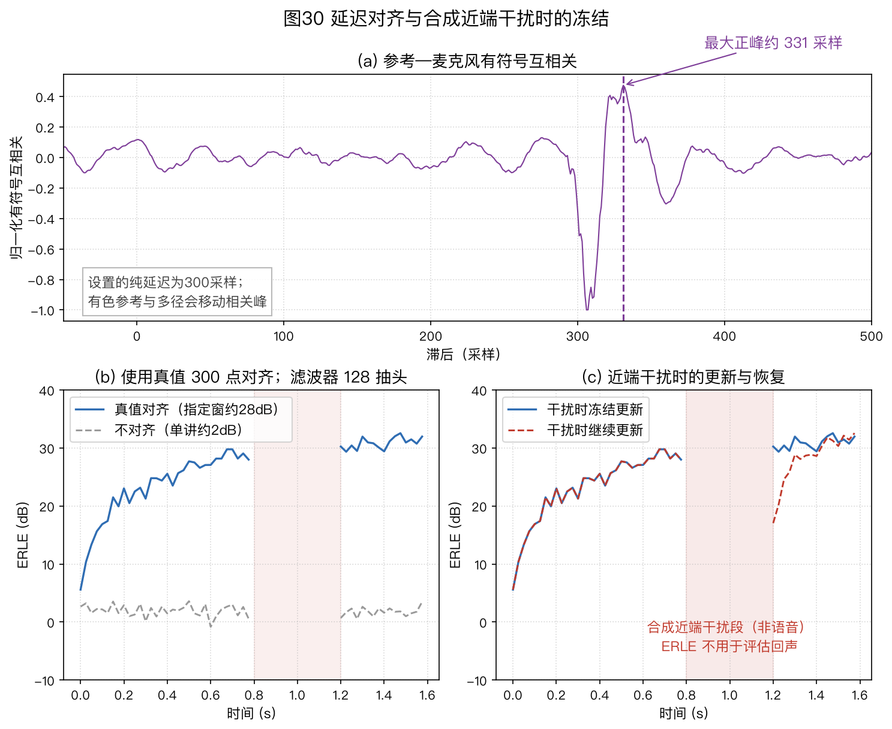

下面逐个子图拆读图30的时序对齐与双讲冻结仿真：

- 图30（a）横轴为滞后索引（单位：采样），纵轴为前 $4000$ 点参考与麦克风信号的**有符号样本互相关**。仿真预设的真实纯传播延迟为 $300$ 个采样，但图中最大正相关峰却落在约 $331$ 个采样处！这是因为有色参考信号自身的宽自相关主瓣与多径冲激响应中正负交替的反射抽头卷积叠加在了一起，把有符号相关极大值推离了脉冲响应起点 $300$（若路径主峰反相为负，只搜最大**正**峰甚至会彻底找错位置，见练习 E06-10；工程上常改用广义互相关 GCC-PHAT 白化谱幅度并搜索绝对值包络前沿）；
- 图30（b）直接采用已知纯延迟真值 $300$ 点补偿参考时轴，与“不做延迟补偿”同图比较 $128$ 抽头 NLMS 的远端单讲 $\mathrm{ERLE}$：由于 $300$ 点纯延迟早已超出 $128$ 抽头滤波器的覆盖跨度，未对齐支路几乎毫无抵消能力（仅约 $2\ \mathrm{dB}$），而对齐后抽头全部刀刃向内覆盖真实多径尾声，$\mathrm{ERLE}$ 跃升至约 $28\ \mathrm{dB}$；
- 图30（c）在收敛后的区间内注入一段白高斯近端突发干扰，对比“双讲期冻结权重”与“失控继续更新”两条残差轨迹：继续更新支路在干扰期内把随机干扰写进抽头，导致干扰结束后的远端恢复段出现明显的残余回声反扑与二次收敛拖尾。

**覆盖跨度的硬性几何条件。** 设参考到麦克风之间的纯固定延迟为 $D$ 个采样，纯延迟之后真实路径的非零混响尾声跨越相对索引 $0$ 到 $R$。若不做预对齐，长度 $L$ 的因果 FIR 滤波器要完整覆盖非零抽头区间，必须满足 $L\ge D+R+1$；提前将参考延迟 $D$ 点对齐后，滤波器仅需满足 $L\ge R+1$ 即可把宝贵算力全部用于拟合混响拖尾。反之，如果由于软件管线调度错误导致参考信号到达 AEC 的时刻**晚于**麦克风里的真实回声（即等效 $D<0$，残余路径落在负延迟非因果区），哪怕把因果 FIR 抽头加到一万阶也无法凭空预测未来尚未送达的参考样本，此时唯一出路是在参考缓冲或采集管线中修正时序（见练习 E06-24）。

在长时通话诊断中，还要把三种截然不同的延迟异常区分开来：固定管线偏移表现为相关峰位置恒定平移；独立晶振引起的采样率偏移（Sample Rate Offset，SRO）表现为相关峰滞后随时间呈线性斜率缓慢爬升；而蓝牙重连、声卡欠载（underrun）或播放路由切换则表现为延迟阶跃突跳——三者必须分别通过初始缓冲对齐、异步重采样跟踪与突变重搜来化解，绝不能指望靠盲目拉长 FIR 抽头一劳永逸（源码级处理详见[研究手册](../codes/chapters/ch00/research/02_aec_wpe_separation.md#aec)）。

#### 6.4.1 自动双讲检测的四状态实验

图30（c）使用的是已知区间真值硬冻结；要评估一个真实的自动双讲检测器，必须让检测器**只读取**对齐参考 $x[n]$ 与麦克风观测 $d[n]$，而把真实声源活动标签严格隔离在评分侧。本书教学模块 [`ncc_activity_states()`](../codes/chapters/ch06/core/double_talk.py) 将 $x[n]$ 与 $d[n]$ 切成互不重叠的 $B=160$ 点短帧（$16\ \mathrm{kHz}$ 下每帧 $10\ \mathrm{ms}$），先用帧内去均值均方根判断两路信号各自是否活跃，再按如下决策表输出四类运行标签：

| 参考活动 | 麦克风活动 | 相关条件 | 基线判决 |
|---|---|---|---|
| 否 | 否 | 不计算判决比值 | 静音 |
| 否 | 是 | 不计算双讲比值 | 近端单讲 |
| 是 | 否 | 不要求相关证据 | 远端单讲 |
| 是 | 是 | 绝对 NCC 不低于门限 | 远端单讲 |
| 是 | 是 | 绝对 NCC 低于门限 | 双讲 |

读这张五分支状态表时，特别留意第 2 行与第 3 行的边界语义：第 3 行“参考活跃但麦克风低于门限”对应扬声器音量极小或回声隔绝极佳的情形，此时远端确实在播放，归入“远端单讲”可避免误标为全局静音；第 2 行“当前帧参考不活跃但麦克风活跃”则仅代表**当前 $10\ \mathrm{ms}$ 短窗内**两路幅度的即时对比——当远端播放刚刚停止时，更早时刻播出的声音仍可能经房间混响延迟抽头继续到达麦克风形成“纯回声尾声”，此时短窗检测器虽会打出 `near_only` 操作标签，但房间里并没有任何真实近端人声（练习 [E06-41](#e06-41) 与 [E06-42](#e06-42) 将逐帧复算这一纯回声尾声现象，切勿把帧级操作标签直接当成干净近端语音真值）。

在参考与麦克风双双活跃的帧内，记去均值样本为 $\tilde x_b=x_b-\bar x$、$\tilde d_b=d_b-\bar d$（$b=0,\ldots,B-1$），本书教学基线采用零滞后标量绝对互相关 $c_{xd}$：

$$\begin{aligned}
P_x&=\sum_{b=0}^{B-1}\tilde x_b^2,\\
P_d&=\sum_{b=0}^{B-1}\tilde d_b^2,\\
c_{xd}&=\frac{\left|\sum_{b=0}^{B-1}\tilde x_b\tilde d_b\right|}
             {\sqrt{P_x P_d}}.
\end{aligned}\tag{6-26}$$

式(6-26)仅在 $P_x P_d>0$ 时计算，取绝对值保证了反相单抽头比例回声 $d_b=-h_0 x_b$ 同样给出 $c_{xd}=1$。将式(6-26)与上一小节的**完整向量型 Benesty NCC** 对照，立刻就能预判这个标量简化基线的理论软肋：式(6-26)只统计零滞后内积 $\sum_b\tilde x_b\tilde d_b$，没有乘 $\mathbf R_{xx}^{-1}$ 去汇总延迟抽头 $\ell\ge 1$ 上的回声能量！只要真实回声的主峰落在非零延迟抽头上，哪怕完全没有近端人声，零滞后标量 $c_{xd}$ 也会掉下来。

用可运行脚本 [`aec_dtd_demo.py`](../codes/chapters/ch06/aec_dtd_demo.py) 正反两面验证这一判断：固定 $16\ \mathrm{kHz}$ 与随机种子 `20260924` 生成独立高斯测试序列，设主抽头在零延迟处的两抽头路径为 $h=[0.6,0.25]$，依次拼接静音、远端单讲、近端单讲、双讲、远端恢复五个阶段（每阶段 $20$ 帧，共 $100$ 帧；参考与近端幅度系数分别为 $0.3$ 与 $0.22$，去均值均方根门限 $0.02$，$c_{xd}$ 门限 $0.85$）：

| 真值状态 | 预测静音 | 预测远端单讲 | 预测近端单讲 | 预测双讲 |
|---|---:|---:|---:|---:|
| 静音 | 20 | 0 | 0 | 0 |
| 远端单讲（含恢复段） | 0 | 40 | 0 | 0 |
| 近端单讲 | 0 | 0 | 20 | 0 |
| 双讲 | 0 | 0 | 0 | 20 |

在这条零延迟占优路径上，$100$ 帧分类计数全部落入对角线；将该帧级判决展开为同一帧 $160$ 个采样的冻结控制（注意这需要整帧 $10\ \mathrm{ms}$ 缓冲后回填控制，并非零前视逐样本因果判决），双讲段已知回声分量的残余均方根由不冻结时的 $0.1492$ 压低至 $0.0812$（随后在远端恢复段两条支路均能重新收敛至浮点精度，提醒我们不能只看通话结束时的末态抽头就断言双讲中途没有发生失真泄漏）。

现在揭晓刚才预判的**多径延迟反例**：保持纯远端单讲（近端输入严格为零），仅把回声路径改成延迟抽头占优的 $h=[0.1,0.75]$，再跑同一个单帧零滞后检测器——结果 $20$ 帧纯回声被 $100\%$ 误判成双讲，帧平均 $c_{xd}$ 跌至仅约 $0.1105$！原因一清二楚：高斯白参考相邻采样几乎正交，延迟一拍的主回声 $0.75\,x[n-1]$ 对零滞后分子 $\sum\tilde x[n]\tilde d[n]$ 不做贡献，却照常计入分母 $P_d$，使理论相关值跌至 $0.1/\sqrt{0.1^2+0.75^2}\approx 0.132$，远低于门限 $0.85$。这一反例生动说明了为什么工业双讲控制必须跨抽头（如向量/频域 NCC）、跨频带并结合路径突变监测来联合判决。

**学习型步长控制。** 除了解析统计量，也可以训练轻量神经网络根据参考谱、麦克风谱与新息谱联合预测逐帧逐频步长。例如 [Ivry et al.（ICASSP 2022）](https://israelcohen.com/wp-content/uploads/2022/04/Deep_Adaptation_Control_for_Acoustic_Echo_Cancellation.pdf)提出的深度变步长（Deep Variable Step-Size，DVSS）在原文第 4.1～4.3 节与表 4 的实验设定下（$16\ \mathrm{kHz}$ 采样率、$150\ \mathrm{ms}$ 路径，$100\ \mathrm{h}$ 合成与实录语料按 $80/10/10\ \mathrm{h}$ 划分，回声路径每 $4.5$～$5.5\ \mathrm{s}$ 随机突变，网络每 $8\ \mathrm{ms}$ 更新一次步长；以归一化路径失配降至 $-10\ \mathrm{dB}$ 以下且保持至下次突变为重收敛成功判据），将路径突变后的平均重收敛时间从固定微步长 NLMS 基线（$\mu=3\times 10^{-5}$，未挂载经典 DTD）的 $7.9\ \mathrm{s}$ 缩短至 $3.4\ \mathrm{s}$，达标成功率由 $58\%$ 提升至 $95\%$。

引用此类结果时须分清“路径重收敛达标率”与“双讲分类检出率”是两项不同指标，工程落地时应以“线性滤波 + 经典双滤波器/卡尔曼门控”作为公平对比基线并在目标终端上实测。

至此，§6.3 与 §6.4 分别厘清了非线性残差平台的成因与双讲自适应门控的边界：超出线性模型表达空间的非线性与混响残余，需要交给后置抑制器收尾；而双讲期间总输出天然包含应当保留的近端人声，不能再拿混合输入与总输出的功率比充当 $\mathrm{ERLE}$。接下来 §6.5～§6.7 依次讨论神经网络残余抑制、多麦克风阵列与 AEC 的级联顺序以及全双工评测体系。

### 6.5 学习型 AEC

**从微软 AEC Challenge 看评测与范式演进**。传统通信评测曾长期偏重远端单讲 $\mathrm{ERLE}$，但工业双讲体验往往坏在“回声压住了、近端人声也被切碎了”。微软自 2021 年起组织的公开 AEC Challenge 把大规模真实消费终端配对录音与众包双盲主观听测引入基准对比（各届规则、延迟上限与测试集划分互不相同，复现时须查阅对应年份原始报告）：

| 报告 | 可复核的设置 | 读取时的限定 |
|---|---|---|
| [ICASSP 2021 挑战报告（Sridhar et al.）](https://arxiv.org/pdf/2009.04972.pdf) | 公开真实多元设备播放环回与麦克风配对录音，引入 ITU-T P.808 众包主观听测 | 样本规模、参赛系统排名与分项得分须结合原文实验表按同届口径读取 |
| [2023 挑战报告（Cutler et al., *IEEE OJSP* 2024）](https://doi.org/10.1109/OJSP.2024.3376289) | 同时设立通用 AEC 与个性化 pAEC 赛道，联合考核主观语音质量与下游语音识别词错率 | 注册语音时长、帧级延迟预算与综合排名公式仅代表当届赛制约定 |

两届赛事呈现出一条清晰的工程共识：单靠能量衰减比 $\mathrm{ERLE}$ 远不足以刻画双讲语音自然度或下游识别可用性；而在参赛架构上，“解析线性滤波 + 轻量神经网络残余抑制”的混合式方案与纯端到端深度网络长期并存，选型关键在于实时帧延迟、端侧算力、跨设备泛化以及线上故障可解释性。

#### 混合式结构：线性估计加学习型残余抑制

为什么工业产品普遍偏爱“先跑线性自适应滤波器、再接神经网络后置滤波”的混合式架构？因为自适应滤波器直接利用已知参考波形 $x[n]$ 做因果减法，无需任何训练语料就能消除绝大部分线性回声，不仅大幅压缩了后端神经网络需要处理的动态范围，还保留了抽头权重、纯延迟与收敛状态等清晰的诊断探针；后端神经网络则专注对付线性模型啃不动的扬声器非线性谐波、快速路径扰动残余以及稳态/非稳态环境噪声。

用一个信号回声比（Signal-to-Echo Ratio，SER）低至 $-20\ \mathrm{dB}$ 的双讲时频格算一笔账，就能看穿“波形减法”与“实数谱增益乘法”的根本差别：$\mathrm{SER}=-20\ \mathrm{dB}$ 意味着该时频格内的回声功率高达近端人声功率的 $100$ 倍（幅度为 $10$ 倍）。

假设前置线性 AEC 的相位已经对齐，仅存在 $10\%$ 的幅度欠估计（真实回声复频谱为 $Y$，线性副本为 $\hat Y=0.9Y$），做完复数减法后残余回声降为 $Y-\hat Y=0.1Y$，残余回声能量骤降至原回声的 $|0.1|^2=1\%$（即线性段先替后端扛下了 $20\ \mathrm{dB}$ 衰减，把进入后滤波器的有效 $\mathrm{SER}$ 从绝望的 $-20\ \mathrm{dB}$ 拉回到了 $0\ \mathrm{dB}$；若副本同时带有相位误差 $\phi$ 与幅度比 $\alpha$，则残余能量比 $|1-\alpha e^{\mathrm{j}\phi}|^2$ 按复数余弦定理等于 $1+\alpha^2-2\alpha\cos\phi$）。

反过来想：如果不做前置波形相减，直接让一个实数掩码后滤波器给混合频谱 $S+Y$ 乘上同一个标量增益 $g\in[0,1]$，那么近端语音 $gS$ 与强回声 $gY$ 会被一视同仁地按同比例压低，该时频格内的信回比 $|gS|^2/|gY|^2=|S|^2/|Y|^2$ 纹丝不动——要想把回声压掉 $40\ \mathrm{dB}$，该格里的近端语音也会跟着灰飞烟灭！这正是混合式架构“先减法剥离线性主体、再乘法压制非线性残余”的物理根基。

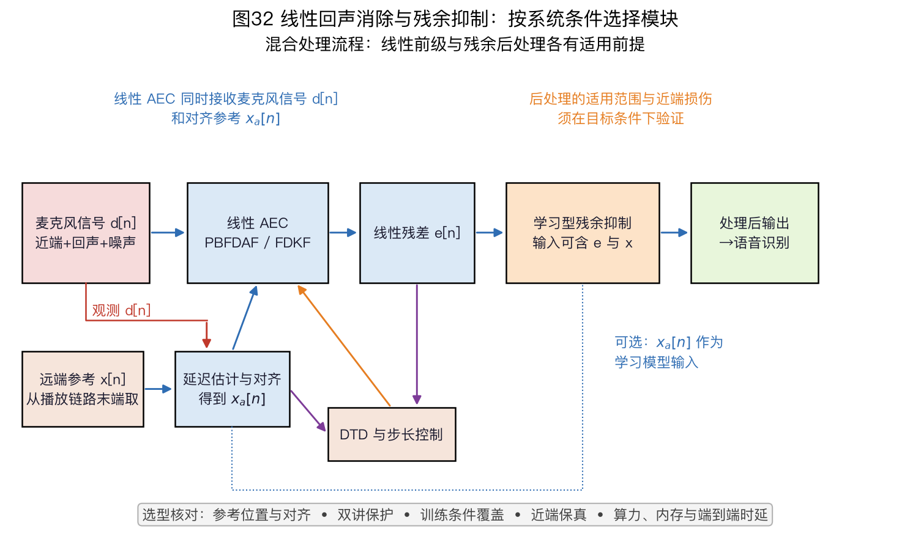

观察图32的混合式信号流框图：远端参考 $x[n]$ 经延迟对齐模块得到 $x_a[n]$，驱动线性自适应滤波器（可选用 NLMS、PBFDAF 或 FDKF）生成回声副本并从麦克风观测中减出先验残差 $e[n]$；自适应控制支路综合参考、麦克风或残差统计量调节更新步长；最后由学习型残余抑制网络综合线性残差 $e[n]$ 与对齐参考谱输出最终增强语音，验收时须在“线性残差”与“最终输出”两个节点分别挂表测量回声泄漏与近端失真。

在具体网络设计上，后置滤波器的输入特征常拼接残差谱、对齐参考谱、线性回声估计谱乃至各频带相干度，输出则为频带增益掩码或窄带复数滤波系数。三类有代表性的公开结构各有侧重：

- **PercepNet 混合后置抑制**（[Valin et al., ICASSP 2021](https://doi.org/10.1109/ICASSP39728.2021.9414140)）：在传统线性回声抵消之后，由轻量循环卷积网络预测 $32$ 个等效矩形带宽（ERB）三角频带的包络增益与基音梳状滤波强度，联合压制残余回声与背景噪声（原文第 4～5 节采用两帧前视，总算法延迟 $40\ \mathrm{ms}$），把高维逐频点掩码压缩到了契合人耳听觉分辨率的低维心理声学子带；
- **MDF + GRU 残余抑制**（[Ma et al., arXiv:2005.09237](https://arxiv.org/abs/2005.09237)）：前端运行多延迟块频域自适应滤波（MDF）剥离线性回声，后端以门控循环单元（GRU）读取线性残差与参考特征估计残余抑制掩码，体现了低算力嵌入式端常见的两段解耦设计；
- **DeepVQE 联合增强架构**（[Indenbom et al., Interspeech 2023](https://doi.org/10.21437/Interspeech.2023-1028)）：在单一网络内联合执行回声消除、降噪与去混响，并利用交叉注意力（cross-attention）在参考帧序列与麦克风帧之间实现软延迟对齐，减轻前端硬延迟跳变带来的失配压力。

与混合式相对，**纯端到端神经 AEC** 直接以原始麦克风信号和播放参考作为双路输入，把回声消除建模为有参考条件的语音分离问题，输出复数时频掩码或跨帧深度滤波（Deep Filtering）系数以同时修正幅度与相位。端到端结构省去了显式线性滤波与双讲门控设计，但在极低 $\mathrm{SER}$（如外放震耳欲聋而用户轻声插话）、训练未覆盖的新型微型扬声器失真以及线上异常排障（缺少显式抽头和收敛度探针）上挑战更大。

构建混合式或端到端训练数据时，通常先用 §2.4 的镜像源法批量合成不同房间体积与混响时间 $T_{60}$ 的脉冲响应，串联随机采样的 Wiener–Hammerstein 非线性曲线并在宽广的 $\mathrm{SER}$/$\mathrm{SNR}$ 区间内混合预训练，随后采集目标硬件的真实外放录音做域适应微调；微调收益必须在未参与训练的同机型独立留出录音上对比检验，防止网络死记固定测试房间的传递函数。

#### 神经卡尔曼：学习递推中的未知部分

前文 §6.2.6 指出，经典频域卡尔曼滤波（FDKF）的性能天花板卡在“过程噪声方差 $\Phi_m$ 与双讲观测噪声方差 $\Psi_m$ 难以在非平稳语音中精准解析估计”。所谓**神经卡尔曼（Neural Kalman）**正是保留状态空间递推骨架、改用小型神经网络从观测特征中在线推算未知统计量或卡尔曼增益——阅读文献时要仔细核对网络究竟替换了式(6-21)里的哪一个变量：

- **直接学习频域卡尔曼增益（NKF）**（[Yang et al., *IEEE/ACM TASLP* / arXiv:2207.11388](https://arxiv.org/pdf/2207.11388)）：保留线性重叠保存回声状态更新，由小型循环网络读取新息与参考历史直接输出复数卡尔曼增益，跳过显式噪声方差平滑公式；
- **联合学习非线性参考映射与状态演化（NeuralKalman）**（[indenbom / Haubner 系路线，ASRU 2023](https://doi.org/10.1109/ASRU57964.2023.10389780)，预印本见 [arXiv:2301.12363](https://arxiv.org/pdf/2301.12363) 原文第 2.2 节与图 1(b)）：用神经网络对播放参考做非线性特征变换以吸收扬声器失真，并同时预测状态转移因子与噪声统计量；
- **可微自适应滤波层（Deep Adaptive AEC）**（[Zhang et al., ICASSP 2022](https://doi.org/10.1109/ICASSP43922.2022.9746039)）：将频域自适应更新写成端到端可反向传播的计算图层，通过近端干净语音重建损失直接监督时变步长与非线性参考编码器（各类混合与深度自适应结构在收敛速度、双讲保真与算力上的横向剖析可参阅综述 [Seidel et al., *IEEE SPM*, 2024](https://doi.org/10.1109/MSP.2024.3449557)）。

从工程分层视角看，无论是用网络预测自适应步长、预测卡尔曼协方差，还是预测后置残余掩码，保留解析滤波骨架的核心价值都在于“物理因果可解释、冷启动零样本可用、出问题有中间残差可查”。

#### 个性化 AEC（personalized AEC，pAEC）

在开放办公区或家庭客厅开免提会议时，麦克风除了录进扬声器回声，还会录进旁边同事或家人的交谈人声。通用 AEC 会把房间里所有非回声人声都当作“近端目标”原样保留；而 **个性化回声消除（personalized AEC，pAEC；参见 [Cutler et al., *IEEE OJSP*, 2024](https://doi.org/10.1109/OJSP.2024.3376289)）** 则要求在消除扬声器回声的同时，只保留已注册主讲人的声音，将旁人干扰人声一并压制。

其实现架构与目标说话人提取（Target Speaker Extraction，TSE；详见 [§8.6](08_speech-separation.md#sec-8-6)、[第 15 章 §15.1～§15.2](15_target-extraction-diarization.md#sec-15-1) 及 [附录 B §17.3](17_appendix-guide.md#sec-17-3)，代表结构如 [GTCNN, Interspeech 2022](https://www.isca-archive.org/interspeech_2022/zhang22t_interspeech.pdf)）一脉相承：先从用户预先录制的数秒注册语音中提取固定维度的声纹嵌入向量 $\vec e_{\mathrm{enroll}}$，再将其通过特征线性调制（FiLM）或注意力层注入残余抑制网络（隐私合规与共享设备回退条款见 §6.13）。

**pAEC 声纹门限与三区间回退。** 设非零实数注册声纹向量为 $\vec e_{\mathrm{enroll}}$，当前帧提取的非零局部声纹向量为 $\vec e_t$，可用归一化余弦相似度衡量声纹匹配程度：

$$\begin{aligned}
c&=\frac{\vec e_t^\top\vec e_{\mathrm{enroll}}}
        {\|\vec e_t\|_2\,\|\vec e_{\mathrm{enroll}}\|_2}.
\end{aligned}\tag{6-27}$$

当静音或强噪导致任一嵌入范数趋零时，式(6-27)无定义，必须直接回退到通用无条件模式而非强行比对阈值。在双讲重叠帧中，局部嵌入 $\vec e_t$ 本身被回声残余或旁人语音污染，$c$ 值往往落入不高不低的模糊地带；因此工程上常在目标硬件与拾音距离下用目标人/非目标人验证集标定高、中、低三个区间：高置信度放行目标人，低置信度压制旁人，而在中间不确定区间则主动减弱或旁路**身份条件抑制分支**（仅维持常规线性回声抵消），宁可少量放过旁人背景声，也绝不把主讲人自己的话音误砍掉。验收时须分别统计“目标人误抑制率”“旁人语音泄漏率”与“常规双讲语音质量”三项指标。

**向多麦克风通道扩展**时，深度网络的输入维度受训练拓扑约束，工程上主要有三种组织方式：

1. 针对固定麦数与固定几何结构（如特定型号四麦音箱）端到端训练多通道输入网络；
2. 先用参数共享的单通道编码器提取各麦特征，再经跨通道注意力或置换等变池化层聚合任意数量麦克风，并保持跨通道相位关系不畸变；
3. 先在前端完成逐通道线性 AEC 与经典波束形成，最后只用单通道轻量网络处理一路波束输出——这在嵌入式产品中算力最省、跨机型迁移也最便捷。

在智能音箱与车载语音助手的实时唤醒打断（barge-in）链路中，系统必须在高音量播报音乐的同时敏锐捕获用户的唤醒词。通常由前置线性 AEC 先把本机播报压低 $15$～$25\ \mathrm{dB}$，再将线性残差送入唤醒与自动语音识别（ASR）前端；若在唤醒前串入过猛的非线性残余抑制，字头辅音一旦被啃蚀，唤醒召回率反而会不升反降。

下表从可解释诊断量、失效风险与资源核算三个维度汇总三类学习型路线的差异：

| 路线 | 代表方案 | 可检查的内部量 | 主要风险 | 资源验证 |
|---|---|---|---|---|
| 混合式 | 线性 AEC 加学习型残余抑制 | 线性段路径、残差和 ERLE | 后滤波可能损伤近端语音 | 按频带数、模型版本和目标硬件测量 |
| 端到端 | 以麦克风信号和播放参考直接估计近端语音 | 通常缺少显式路径估计 | 域外设备、低 SER 和故障定位 | 按模型、上下文和目标硬件测量 |
| 神经卡尔曼 | 保留状态递推并学习增益或统计量 | 递推增益、状态估计和残差 | 统计量估计失配、模型计算量 | 同时报递推部分与网络部分 |

**按设备条件选型**时，可根据终端算力预算、供电约束与交互场景对号入座：

- 耳机和手表受算力、内存与功耗限制，可比较端侧小模型与传统频域方案；
- 音箱和会议终端可评估 PBFDAF 或 FDKF 加神经后滤波；
- 双讲条件复杂且需要保留递推诊断量时，可进一步评估神经卡尔曼；
- 需要只保留注册用户时再评估 pAEC。

语音助手还要单独验证用户插话（barge-in）时的近端保护。无论采用哪条学习路线，系统底座依然绕不开 §6.8～§6.10 即将讨论的参考取点、延迟对齐与双讲防发散机制。

### 6.6 阵列中的 AEC：与波束形成的三种顺序

多麦克风终端同时拥有空间波束形成器（第 5 章）与回声消除器时，“先做 AEC 还是先做波束形成”是一道牵一发而动全身的系统架构选择题，经典文献中共有三种级联排法：

1. **AEC→BF（每通道独立 AEC）**：在全部 $M$ 个麦克风原始通道上各自运行一套线性 AEC，将回声剥离干净后再送入后续 DOA 定位与波束形成。最大优势是第 $m$ 路声学回声路径 $h_m[\ell]$ 只取决于扬声器与房间物理环境，完全不受后端自适应波束权重跳变的干扰；代价则是线性 AEC 的乘加运算量与历史缓存随麦克风数 $M$ 成倍增加（具体复用账本见下文算力表）。

    只要终端 DSP 算力与片上内存允许、且后端采用自适应时变波束（如 MVDR、GSC 或声源追踪切换波束），这就是工业设计首选的稳健结构；

2. **BF→AEC（波束后单 AEC）**：先将 $M$ 路麦克风信号合成为单路波束输出，再只运行一套单通道线性 AEC，把线性抵消通道数从 $M$ 路压缩为 $1$ 路（实际净省算力须扣除波束形成开销及多通道原本可共享的参考 FFT）。

    为什么这种省算力的排法隐藏着耦合隐患？在忽略跨频带耦合的同频带窄带近似下，设频点 $k$、帧 $n$ 处第 $m$ 路麦克风的回声传递函数为 $H_m(k,n)$，频域波束权重为 $w_m(k,n)$（按第 5 章共轭内积 $\sum_m w_m^* D_m$ 合成输出），则后置单路 AEC 看到的等效回声传递函数 $H_{\mathrm{eff}}(k,n)$ 近似等于 $\sum_{m=1}^{M}w_m^*(k,n)H_m(k,n)$。严格说来，一般加窗重叠 STFT 的跨帧窗函数会产生跨频带耦合项（推导见 [Avargel & Cohen, *IEEE TASLP*, 2007](https://webee.technion.ac.il/Sites/People/IsraelCohen/Publications/TASL_May2007.pdf) 原文第 II 节），唯有固定时域 FIR 波束器才精确满足各路波束冲激响应与 $h_m[\ell]$ 线性卷积求和的 LTI 关系。

    用 $M$ 表示麦克风总数，在固定频点 $k$ 与帧时刻 $n$ 处省略自变量，上述同频带等效回声路径写作：

    $$H_{\mathrm{eff}}\approx\sum_{m=1}^{M}w_m^*H_m.\tag{6-28}$$

    式(6-28)一针见血地指出了症结所在：哪怕房间里没有任何人走动（物理 $H_m$ 纹丝不动），只要说话人换了方位或噪声协方差更新导致波束权重 $w_m(k,n)$ 发生改变，等效回声路径 $H_{\mathrm{eff}}$ 就会瞬间跟着突变，迫使后置 AEC 重新收敛并在暂态期内漏出刺耳回声！虽然在切换期间强行冻结波束权重能缓解突变，却又牺牲了空间追踪的敏捷度；

3. **联合优化（GEIC，广义回声与干扰对消，Generalized Echo and Interference Canceller）**：Herbordt 与 Kellermann 将多通道回声抵消支路与广义旁瓣相消器（GSC）的阻塞矩阵、自适应干扰对消支路纳入同一约束最优化目标联合求解（经典推导见 Kellermann, ICASSP 1997 及 Brandstein & Ward 编《Microphone Arrays》2001 年第 13 章），理论上能同时利用空间零陷与参考相关性压制强非线性/混响回声，但需联合维护高维时空跨通道协方差矩阵，状态耦合与双讲门控复杂度最高。

**联合分析**与切换时序手算：[Schwartz et al.（Interspeech 2024）](https://www.isca-archive.org/interspeech_2024/schwartz24_interspeech.pdf)在多通道维纳滤波（Multichannel Wiener Filter，MCWF）统计模型下进一步对比了级联顺序的稳态与暂态表现；工程上若受算力所迫采用“固定多波束切换 + 波束后单路 AEC”，哪怕物理路径完全已知，单是切换瞬间也会产生卷积记忆错位。

不妨用四点序列亲手算一遍**固定回声路径下的波束切换残差**：设公共播放参考为 $x=[1,2,3,0]$（负时刻采样为零），$1$ 号麦真实路径为无延迟直通 $h_1=[1,0]$（回声序列 $y_1=[1,2,3,0]$），$2$ 号麦真实路径为一拍延迟衰减 $h_2=[0,1/2]$（回声序列 $y_2=[0,1/2,1,3/2]$，末点保留卷积尾）。假设固定波束选择器在前两拍（$n=0,1$）选 $1$ 号麦，从第 $n=2$ 拍起硬切换到 $2$ 号麦，则波束输出端实际收到的回声序列拼成了 $[1,\ 2,\ 1,\ 3/2]$！

此时如果波束后的单路 AEC 权重还停留在切换前学好的 $\hat h=h_1=[1,0]$（其预测序列仍为 $[1,2,3,0]$），相减后就会在切换点 $n=2,3$ 爆出非零切换残差 $[1,2,1,3/2]-[1,2,3,0]=[0,\ 0,\ -2,\ 3/2]$！反之，若采用 **AEC→BF** 先在两路麦克风上各自用 $h_1,h_2$ 减完回声再做波束切换（或者在 BF→AEC 中同步维护与每个预设波束一一配对的专属回声权重库、随波束索引同步切换权重），四拍残差便处处为零。注意区分两种时变位置：这里的波束切换改变的是**输出合成时刻**的空间组合系数，而下文 §6.10 与练习 [E06-40](#e06-40) 讨论的播放音量调节改变的则是**输入扬声器时刻**的历史激励幅度，二者在卷积链条上处于完全不同的物理节点。

> **边栏：立体声与多扬声器 AEC 的非唯一性难题。**
>
> 当电视机、笔记本电脑或智能座舱通过左、右两只扬声器播放立体声节目时，单只麦克风录到的总回声是两条声学路径之和 $y[n]=(h_1*x_1)[n]+(h_2*x_2)[n]$。倘若远端节目本身是由远端房间里的**同一个说话人**经两条固定线性房间响应拾音传过来的（即 $x_1=g_1*s_{\mathrm{far}},\ x_2=g_2*s_{\mathrm{far}}$），两路播放参考之间就存在严格的线性卷积依赖 $(g_2*x_1)[n]-(g_1*x_2)[n]=0$，使双通道参考相关矩阵严重秩亏或极端病态（Sondhi, Morgan & Hall, *IEEE SPL*, 1995）：除了真实物理路径 $(h_1,h_2)$，无穷多组假路径都能把当前说话人的回声抵消为零，一旦远端换另一个位置的说话人发言，之前学歪的假路径瞬间失效！
>
> 用单抽头最小算例一看便明：若左右声道播放完全相同的单声道信号 $x_1[n]=x_2[n]=x[n]$，真实路径 $(h_1,h_2)=(0.8,0.2)$ 与假路径 $(h'_1,h'_2)=(1.3,-0.3)$ 给出的预测和同为 $(0.8+0.2)x=(1.3-0.3)x=x$，单凭当前观测根本无从分辨；即便两声道并非完全相等，而是归一化互相关系数高达 $\rho=0.99$，二阶相关矩阵（对角元为 $1$、非对角元为 $\rho$）的两个特征值 $1+\rho=1.99$ 与 $1-\rho=0.01$ 之比（条件数）也高达 $199$，微小底噪就会让两路权重朝一正一负反向漂移。工业界为此引入轻微的声道去相关预处理（[Benesty et al., ICASSP 1997](https://www2.spsc.tugraz.at/people/franklyn/ICASSP97/pdf/scan/ic970303.pdf)），完整模型与时变全通去相关原理将在 §6.9 专门展开。

关于硬件参考回路的时钟同步与系统集成详见 §10.1 及图23。为量化 **AEC→BF** 架构随麦克风数 $M$ 增长的算力代价，下面沿用算例 6-2 的**选定核心算子**统一口径做一笔透明复算：设采样率 $16\ \mathrm{kHz}$、路径长度 $L=2048$（覆盖 $128\ \mathrm{ms}$）、PBFDAF 新块长度 $N=128$（共 $P=16$ 个分区，FFT 点数 $2N=256$，每次复变换按 $4N\log_2(2N)=4096$ 次实乘法计，每次 $256$ 点复乘按 $1024$ 次实乘法计）。

单通道下，朴素时域 NLMS 每样本为 $3L=6144$ 次实乘法；PBFDAF 无梯度约束核心项每块含 $3$ 次变换加 $2\times 16$ 次复乘，折合 $(3\times 4096+32\times 1024)/128=352$ 次实乘法/样本；若每块对全部 $16$ 个分区都执行一对 IFFT/FFT 合法抽头投影，再增 $2\times 16\times 4096/128=1024$ 次/样本，合计 $1376$ 次/样本（若再显式计入每块重算 $16$ 个分区的 $|X|^2$，则各加 $2\times 256\times 16/128=64$ 次/样本成为 $416$ 与 $1440$ 次/样本）。乘以每秒 $16000$ 个采样后对比 $M$ 麦扩展关系：

| 算法 | 单通道本书手算 | $M$ 通道关系 | 仍需实测的资源 |
|---|---:|---:|---|
| 时域 NLMS | $6144\times16000\approx98.3$ 百万次实乘法/s | 约为 $M\times98.3$ 百万次实乘法/s | 指令数、内存带宽、系数与历史缓冲 |
| PBFDAF，无逐分区梯度约束 | $352\times16000\approx5.6$ 百万次实乘法/s | 约为 $M\times5.6$ 百万次实乘法/s | FFT 实现、功率估计、约束频率与缓冲 |
| PBFDAF，每块逐分区梯度约束 | $1376\times16000\approx22.0$ 百万次实乘法/s | 约为 $M\times22.0$ 百万次实乘法/s | 同上，并计入每个分区的一对约束变换；间歇约束另算 |
| FDKF 或神经后滤波 | 不给固定倍数 | 由状态维度或模型结构决定 | 目标实现的算子、线程、内存和实时因子 |

看表中第 2、3 行的多麦缩放技巧：上表按最朴素的“每只麦克风完全独立跑一套单声道实例”写成 $M$ 倍；但在同一块 DSP 上，由于全部 $M$ 只麦克风面对的是**同一个扬声器播放参考 $x[n]$**（只要采用公共预延迟对齐并统一块边界），拼接参考窗 $u_m$ 的 $256$ 点正变换（$4096/128=32$ 次/样本）与参考功率谱计算全阵列每块**只需算唯一一次**并广播共享！

扣除重复参考 FFT 后，无约束版核心算子从 $352M$ 降为 $32+320M$（六麦阵列由 $2112$ 降至 $1952$ 次/样本），全约束版从 $1376M$ 降为 $32+1344M$（六麦由 $8256$ 降至 $8096$ 次/样本，若再叠加 SpeexDSP 式的轮流单分区投影还可把 $1024M$ 约束项再砍掉 $15/16$）。由此可见，共享参考谱的分区频域 AEC 在六麦、八麦智能音箱与会议全向麦上完全处于嵌入式实时算力甜区之内。

### 6.7 评测体系与工程验收清单

**客观能量指标及其物理前提**。回声返回损失增强（Echo Return Loss Enhancement，ERLE）严格定义为同一有效统计窗口 $\mathcal W$ 内“消除前真实回声分量能量 $E_y$”与“消除后残余回声分量能量 $E_e$”的分贝比：

$$\begin{aligned}
E_y&=\sum_{n\in\mathcal W}|y[n]|^2,\\
E_e&=\sum_{n\in\mathcal W}|e_{\mathrm{echo}}[n]|^2,\\
\mathrm{ERLE}&=10\log_{10}\frac{E_y}{E_e}.
\end{aligned}\tag{6-29}$$

式(6-29)中，$y[n]$ 是进入 AEC 前麦克风信号所含的真实回声分量（仅在线性路径模型下满足 $y=x*h$），$e_{\mathrm{echo}}[n]$ 是输出端残留的回声分量。要使式(6-29)给出有物理意义的有限分贝数，窗口内必须有回声输入（$E_y>0$）：若完美抵消使 $E_e=0$，理论值趋于 $+\infty$；若静音期 $E_y=0$，则该窗口不存在可评价的回声，严禁用分子分母同加微小常数 $\varepsilon$ 算出的 $0\ \mathrm{dB}$ 冒充“抵消了 $0\ \mathrm{dB}$”（软件函数设置能量地板门限的保护规则见 §6.15.1）。

在真实房间整机录音中，我们无法把空气里混合在一起的 $y[n]$、$s[n]$ 和环境底噪 $v[n]$ 拆开单独测量。工程上因此在安静消声室或低底噪房间录制**纯远端单讲（STFE）**片段，去除开头的冷启动收敛过渡段后，用麦克风输入功率与 AEC 输出功率之比近似 $\mathrm{ERLE}$——此时务必留意环境底噪功率 $E_v$ 会垫高分母 $(E_e+E_v)$，给实测读数封上一道“噪声底天花板”（例如回声本身相对底噪只有 $20\ \mathrm{dB}$ 信噪比时，哪怕线性滤波器把回声 $100\%$ 归零，输入输出总功率比也测不出超过约 $20.04\ \mathrm{dB}$ 的读数，完整算术证明见练习 E06-05）。而在**双讲（DT）**区间内，输出天然包含应当完整保留的近端人声 $s[n]$，混合输入与总输出的功率比已彻底失去回声衰减物理含义，只有在已知独立分量真值的数学合成实验中才能单独抽取出 $y[n]$ 与 $e_{\mathrm{echo}}[n]$ 代入式(6-29)。

> **ERLE 快速换算心算标尺。** 残余回声能量降到原回声的 $0.0063$（约千分之六）时，$\mathrm{ERLE}=10\log_{10}(1/0.0063)$，约为 $22.0\ \mathrm{dB}$；能量降到万分之一（$0.0001$，即幅度降到 $1\%$）时，$\mathrm{ERLE}=10\log_{10}(10000)=40\ \mathrm{dB}$。汇报读数时须同步写明采样率、统计窗口、逐块平均还是整窗能量汇总（差异见练习 E06-31），以及取点究竟在线性段还是在 NLP 抑制后。

**主观听测与无参考感知模型**。$\mathrm{ERLE}$ 只管总能量大小，听不出残余回声是否带有刺耳的金属音乐噪声，更测不出双讲时近端语音是否被切碎闷罐。微软团队提出的非侵入式深度学习评分器 [AECMOS（Purin et al., ICASSP 2022）](https://arxiv.org/abs/2110.03010)模拟 ITU-T P.808 人类打分，分别输出 $1$～$5$ 分的**回声退化维（Echo DMOS）**与**其他退化维（Other DMOS，反映近端语音失真及背景噪声伪影）**。在版本迭代中，固定模型权重的 AECMOS 非常适合每日自动化回归监控，但由于神经打分器本身对未见语种、特殊采样率预处理或极端非线性伪影存在域偏移可能，发版签收仍须结合真人双盲听测与下游语音识别词错率（WER）综合拍板。

一套严谨的产品级 AEC 验收报告，必须同时交出以下三张成绩单：

1. **远端单讲稳态抵消（双取点分离汇报）**：在排除初始收敛段的稳定窗口内，同时汇报**线性自适应段输出**与**NLP/神经网络最终输出**的衰减指标——前者检验声学路径辨识与参考链路健康度，后者检验整链可闻残余水平，绝不允许用激进后置静音压出的高分掩盖线性段失配；
2. **路径突变重收敛动态**：明确定义物理扰动动作（如手持终端翻转、遮挡扬声器、外设音频路由切换），记录从突变发生到残余回声重新压回目标基线所需的恢复时长与达标比例；
3. **双讲双向平衡质量**：在不同信号回声比（SER）梯度下同步考核“回声泄漏抑制”与“近端语音保真度”，确保不以吞字、断续为代价换取表面安静。

### 6.8 WebRTC AEC3 的结构与排障

要让自适应滤波器在千变万化的消费硬件上稳健运转，工业级全双工 AEC 围绕核心线性减法器构建了四项必不可少的系统级支撑功能（图20（a）绘出前端主干流向，后置模块可采用解析规则或神经网络实现）：

1. **参考—麦克风时序对齐**：操作系统播放缓冲、声卡采集缓冲与空气声波飞行时间共同构成了总环路纯延迟。若不预先对齐，因果滤波器就不得不浪费大批前部抽头去填补纯延迟空白；一旦总延迟超出滤波器总跨度，线性抵消便彻底失效（播放链取点细节见 §6.10）；
2. **双讲与异常期的自适应控制**：双讲期的残差混有强近端人声，必须通过二值冻结、连续软步长或双滤波器择优机制阻止近端语音冲毁已学好的路径权重；
3. **非线性处理器（Nonlinear Processor，NLP）残余回声抑制**：在线性减法之后按频带进一步压低扬声器失真、路径快变与超长混响留下的残余回声（工作点折中标定见 §6.12）；
4. **舒适噪声生成（Comfort Noise Generation，CNG）**：当 NLP 在远端单讲期实施深度压制时，麦克风原有的稳态环境底噪会被一并抽空，在听感上造成一惊一乍的“黑洞静音（noise pumping）”；CNG 跟踪真实环境底噪的功率谱包络并补入匹配噪声，使通话背景平滑自然。

特别需要注意硬件饱和边界：NLP 虽能压制扬声器侧轻度非线性留下的回声尾巴，但如果**采集侧**麦克风前置放大器或模数转换器（ADC）本身因声压过大发生硬削顶（clipping），不仅回声波形严重畸变，连叠加在其上的近端人声峰值也已永久丢失，事后任何 NLP 都无法无中生有恢复被削平的语音。因此音频硬件调校的第一要务是合理分配模拟/数字前端增益留足动态余量（headroom），并在软件侧挂接削顶检测以冻结自适应更新。

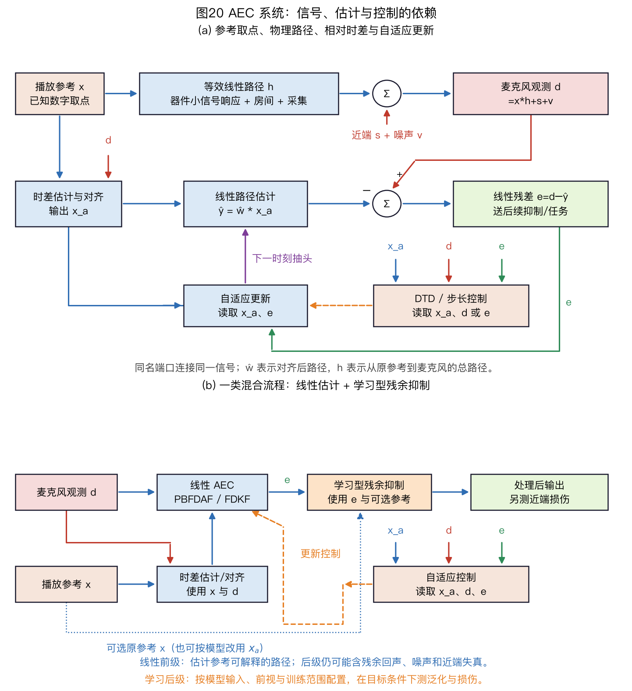

对照图20的两个子图理清工程模块边界：图20（a）中上方虚线框代表涵盖功放、扬声器、房间混响与麦克风的真实物理路径 $h$，下方数字支路先对播放参考做纯延迟补偿，再由自适应滤波器 $\hat{\vec w}$ 生成回声副本并相减输出线性残差（图中明确分开了参考输入、麦克风输入与更新控制三路端口）；图20（b）则展示将该线性残差与参考特征继续送入橙色学习型残余抑制模块（或传统 NLP + CNG）形成最终全双工输出的完整管线。

**WebRTC AEC3 核心架构与主/阴影双滤波器配合机制**。下面以本仓库锁定的 WebRTC 官方源码版本（`modules/audio_processing/aec3/`，完整提交号与行级走读见[研究手册](../codes/chapters/ch00/research/02_aec_wpe_separation.md#aec)）为蓝本，剖析一套成熟工业开源引擎如何把上述环节串成 $64$ 样本子块（$16\ \mathrm{kHz}$ 下每子块 $4\ \mathrm{ms}$）的实时流水线：

- **多带分块与播放参考缓冲（`RenderBuffer`）**：外部每 $10\ \mathrm{ms}$ 送入一帧音频，内部拆分为 $64$ 样本子块推进，并将远端播放信号存入环形历史缓冲区 `RenderBuffer`，同时服务于大范围延迟搜索与频域分区卷积；
- **降采样匹配滤波延迟估计**：[`echo_path_delay_estimator.cc`](https://webrtc.googlesource.com/src/+/0467d2b91cc20b9b001c2bbb73d43ea6b2491f3e/modules/audio_processing/aec3/echo_path_delay_estimator.cc) 对降采样后的播放与采集流运行一组并行的时域匹配滤波器，由滞后汇总器（lag aggregator）统计稳定峰值位置，再交由 [`block_processor.cc`](https://webrtc.googlesource.com/src/+/0467d2b91cc20b9b001c2bbb73d43ea6b2491f3e/modules/audio_processing/aec3/block_processor.cc) 动态拨动 `RenderBuffer` 的读取偏移指针（注意这一步专门解决宏观纯延迟对齐，与下文两套消除滤波器的系数更新各司其职）；
- **主滤波器（`refined`）与阴影滤波器（`coarse`）的双向协同闭环**：为什么 [`subtractor.cc`](https://webrtc.googlesource.com/src/+/0467d2b91cc20b9b001c2bbb73d43ea6b2491f3e/modules/audio_processing/aec3/subtractor.cc) 与 [`echo_remover.cc`](https://webrtc.googlesource.com/src/+/0467d2b91cc20b9b001c2bbb73d43ea6b2491f3e/modules/audio_processing/aec3/echo_remover.cc) 要在同一条对齐参考上并行维护两套分区块频域自适应滤波器？这正是为了破解“双讲稳健性”与“路径突变敏捷性”的天然矛盾：

    1. **快慢增益分工**：前台主滤波器（源码名 `refined`）采用保守的误差谱受控步长（`RefinedFilterUpdateGain`），根据近端干扰与噪声底估计严密压低双讲期更新幅度，确保稳态失调极低且不吞噬近端人声；后台阴影滤波器（源码名 `coarse`）则采用激进的类 NLMS 大步长（`CoarseFilterUpdateGain`），对新息变化高度敏感，专门充当探索路径突变的“侦察兵”；
    2. **突变时的正向扶正拷贝**：当用户拿起设备、房门推开或声道切换引发真实回声路径突变时，主滤波器受保守门控限制跟进较慢，而大步长的阴影滤波器能在远端活跃期内率先锁定新路径并把残差 $e_{\mathrm{coarse}}$ 显著压到主残差 $e_{\mathrm{refined}}$ 之下；一旦该优势持续得到确认，系统不仅将线性输出平滑切向阴影支路，还把阴影滤波器的频域权重直接复制覆盖给主滤波器，助其一步跨越暂态；
    3. **双讲发散时的反向纠偏重置**：阴影滤波器步长大，在激烈双讲中极易被近端人声带偏；一旦监测到阴影残差持续劣于主滤波器，`subtractor.cc` 便反过来拿稳如泰山的主滤波器系数覆盖重置阴影滤波器，并将其防泄漏状态拉回正轨（双讲过拟合拦截与三态切换门控见练习 [E06-44](#e06-44)）；此外若检测到播放或采集饱和削顶标志，两套增益同步收紧以防非线性污染；

- **残余回声谱估计、频域抑制与舒适噪声**：线性减法之后，残余回声估计器综合线性回声功率、混响衰减模型与滤波器收敛度估算未抵消回声谱，驱动频域抑制增益与舒适噪声生成器输出最终帧。

**如何在线导出 AEC3 的内部线性残差？** 调测混合式或工业引擎时，切忌只盯着 NLP 压完后的最终输出盲调。在 WebRTC 音频处理模块（APM，见公开头文件 [`audio_processing.h`](https://webrtc.googlesource.com/src/+/0467d2b91cc20b9b001c2bbb73d43ea6b2491f3e/api/audio/audio_processing.h)）中，将配置项 `EchoCanceller::export_linear_aec_output` 显式开启后，即可在每帧 `ProcessStream()` 之后调用 `GetLinearAecOutput()` 取出 $16\ \mathrm{kHz}$ 子带线性段波形（多通道配置下的缓冲区形状与返回布尔值检查详见[工业部署研究手册](../codes/chapters/ch00/research/03_industrial_deployment.md)；另注意外部提示接口 `set_stream_delay_ms()` 会将越界请求截断在 $0$～$500\ \mathrm{ms}$ 并告警，排障时应核对实际生效值而非传入参数）。

**异步缓冲队列欠载的经典假故障。** 许多嵌入式团队集成 [SpeexDSP 的 `mdf.c`](https://gitlab.xiph.org/xiph/speexdsp/-/blob/8e29a256ef0235ebbe7fcb8417b5ac7731eb8307/libspeexdsp/mdf.c) 异步双线程接口 `speex_echo_playback()` / `speex_echo_capture()` 时，一上来发现完全没有回声抵消就急着改步长，殊不知当采集回调早于播放回调启动、或播放线程偶发抖动导致内部参考环形队列欠载（underrun）时，异步封装会直接把原始未抵消麦克风帧原样旁路吐出！因此上机联调前，务必先核查播放/采集回调先后次序、欠载计数器与多通道交织跨度（多麦或多扬声器通道映射核验应向各物理通道依次打入**不同时刻**的单脉冲，切忌所有声道同时灌入一模一样的测试音而漏检声道错位）。

遇到现场设备“回声消不干净”，遵循以下四步**铁律排障顺序**通常能省下九成无效调参时间：

1. **第一铁律：核查参考取点必须位于混音、EQ 与 DRC/AGC 之后**！参考信号取自数字播放链越靠后的节点（紧贴 DAC 之前），它与扬声器真实发声就越一致；倘若把参考取在均衡器（EQ）、自动增益控制（AGC）或动态范围压缩（DRC）之前，DRC 随节目响度实时起伏的时变增益与限幅失真就会全部落入未知路径侧，令任何线性自适应滤波器陷入永无休止的失配重收敛（严格数学证明见 §6.10）；
2. **第二步：核查纯延迟覆盖与时钟漂移（SRO）**：注入受控延迟阶跃并观察线性段 $\mathrm{ERLE}$ 与抽头主峰位置，确认最坏缓冲抖动下真实路径始终落在因果抽头窗口 $[0,L-1]$ 之内，长通话场景同时监控相关峰是否随时间单向漂移；
3. **第三步：核查双讲门控与前端削顶**：检查麦克风 ADC 与功放是否发生模拟/数字削顶，并在双讲录音上核对线性抽头是否发生异常跳变（对照图30（c））；
4. **第四步：锁定完全相同的录音与双取点再对比算法**：唯有在排除断流、取点错位、延迟越界与前端削波这四类系统硬伤之后，在同一段配对录音与统计窗口上对比 NLMS、PBFDAF、FDKF 或神经后滤波才有真正的科学意义。

### 6.9 多参考 AEC 模型与去相关选型

从单扬声器智能音箱走向双声道电视、立体声笔记本电脑乃至四音区车载座舱，回声消除便从单输入单输出升级为**多参考（多声道播放）问题**。此时系统能否稳健收敛，不再只看单条路径长短，而直接受制于各播放声道之间的统计相关性。

工程代码组织多参考 AEC 时主要有三种方式（注意前两行描述的是同一物理多声道声场下的不同更新算子，切勿误解成两种物理传播定律）：

| 模型 | 结构 | 可辨识性 | 资源关系 | 适用条件 |
|---|---|---|---|---|
| 逐参考分支、共享总残差 | 各分支预测先相加，再以同一个 $e=d-\sum_r\hat y_r$ 更新；归一化可分支设置，但须重新核步长与联合稳定性 | 忽略跨参考统计量时，强相关输入仍会使路径估计病态 | 滤波与状态近似随参考路数增加 | 单个麦克风接收多路播放，需核对总残差与更新控制 |
| 联合 MISO（多输入单输出，Multiple-Input Single-Output） | 拼接多路参考回归向量，以总预测与共同残差联合估计多条路径 | 仍受拼接参考相关矩阵条件数限制 | 同时维护多组路径；全矩阵方法还维护交叉统计量 | 需要显式处理参考间相关性时 |
| MIMO 阵列联合 | 多参考和多麦克风联合估计，例如广义回声与干扰对消（GEIC）和扩展多通道维纳滤波（extended Multichannel Wiener Filter，MWFext） | 可联合利用跨通道统计量，但仍需满秩激励 | 随参考数、麦克风数和状态维度增加 | 需要联合回声与空间干扰处理 |

先把多参考更新的两个常见陷阱彻底排雷。**第一个陷阱是“拿两个单声道 AEC 各跑各的再相加”**：设无噪单抽头场景下左右声道播放同一信号 $x_1[n]=x_2[n]=x[n]$，麦克风真实总回声为 $d[n]=x[n]$。如果错误地让左、右两个独立单参考滤波器都拿完整的 $d[n]$ 当拟合目标，两个滤波器各自都会收敛到抽头 $1$，合起来预测出 $x[n]+x[n]=2x[n]$，相减后总残差反而变成 $-x[n]$（一分贝没消掉还倒贴反相回声）！正确的多参考结构必须先把全部 $R$ 路播放参考 $\vec x_r[n]$ 的预测回声累加起来，形成**唯一一个共享总残差**驱动各支路联合更新（立体声共同残差经典建模见 [Gilloire, IWAENC 1997](https://www.iwaenc.org/proceedings/1997/iwaenc97/pdf/scan/ae970002.pdf)）：

$$\begin{aligned}
\hat y[n]&=\sum_{r=1}^{R}\hat{\vec h}_r^\top\vec x_r[n],\\
e[n]&=d[n]-\hat y[n].
\end{aligned}\tag{6-30}$$

**第二个陷阱是“共享了总残差，却仍照搬单声道局部分母与步长”**：在式(6-30)下，若 $R$ 个分支同时向同一个误差 $e[n]$ 修正而各自只除以本声道能量 $\|\vec x_r[n]\|^2$，总预测改变量就会叠加放大 $R$ 倍！练习 E06-22 将手算证明：在单声道下稳定收敛的步长 $\mu=1.5$，放到两路等幅同相参考配局部分母时会令后验残差每步翻倍发散（$1,-2,4,\ldots$），必须改用拼接总能量分母或按声道数重标定步长。

即便完全做对了式(6-30)与联合归一化，只要左右声道信号高度相关，多输入正规方程依然病态（例如在刚才的 $x_1=x_2=x$ 下，式(6-30)只约束 $\hat h_1+\hat h_2=1$，无穷多组解在远端声像移动时便会暴露出严重泄漏，见练习 E06-23）。

**立体声时变全通去相关（TV-APF）与其他去相关路线对比**。为了在真实扬声器播出前主动削弱声道间线性共线性、又不让听众察觉音质劣化，工业界发展了四类去相关预处理：

| 方法 | 做法 | 可能的副作用 | 验证方法 |
|---|---|---|---|
| 半波整流（half-wave rectification） | 各声道施加不同的轻微非线性 | 谐波失真、声像变化 | 同时测参考相关矩阵条件数、远端单讲残余和主观音质 |
| 时变相位调制 | 各声道施加独立的慢变全通相位 | 瞬态或声像可能变化 | 在语音与音乐材料上分别盲听，并检查路径跟踪 |
| 独立小频移 | 各声道施加方向或大小不同的微小频移 | 音乐可能出现拍频或音高扰动 | 扫描移频量，比较可辨识性与可闻失真 |
| 低电平去相关噪声注入 | 各声道叠加独立、整形后的低电平噪声 | 底噪升高 | 按目标播放电平测条件数、底噪和听感 |

其中，早期电话会议常用的轻微半波非线性 $x'_r[n]=x_r[n]+\alpha_r|x_r[n]|$ 靠注入偶次谐波打破线性相关，对人声尚可接受，但播放高保真音乐时会引入可闻毛刺；独立小频移与加噪则分别受音乐和弦拍频与安静段底噪制约。因此在兼顾音乐品质的现代智能音箱与座舱系统中，**时变全通滤波（Time-Varying All-Pass Filtering，TV-APF；参见 Ali, ICASSP 1998；Herre, Buchner & Kellermann, WASPAA 2007）**成为极具代表性的线性时变去相关方案。

为什么全通滤波器**必须是“时变”的**，固定不变的全通滤波器不行？不妨从立体声非唯一性的根源想一想：当远端单个说话人 $S_{\mathrm{far}}(z)$ 经远端房间两条固定传递函数 $G_1(z),G_2(z)$ 形成左右播放声道 $X_1(z)=G_1(z)S_{\mathrm{far}}(z)$、$X_2(z)=G_2(z)S_{\mathrm{far}}(z)$ 时，两声道满足恒等式 $G_2(z)X_1(z)-G_1(z)X_2(z)=0$。倘若我们在左右声道串入两个**固定线性时不变（LTI）**全通滤波器 $A_1(z),A_2(z)$，新参考 $\tilde X_r(z)=A_r(z)X_r(z)$ 依然严格满足 $(G_2 A_2)\tilde X_1-(G_1 A_1)\tilde X_2=0$——零空间只不过转了个角度，秩亏一点也没消除！

现在把第 $r$ 声道的一阶实全通节极点/零点系数改成随时间 $n$ 缓慢调制的 $a_r[n]\in(-1,1)$——例如记调制角频率 $\omega_{\mathrm{mod},r}=2\pi f_{\mathrm{mod},r}/f_s$，取亚赫兹到数赫兹的低频慢调制 $a_r[n]=a_{r,0}+\delta_r\sin(\omega_{\mathrm{mod},r}n)$（左右声道调制速率互质或反相）。在任意冻结瞬态下，一阶全通传递函数为：

$$\begin{aligned}
A_r(e^{\mathrm{j}\Omega_{\mathrm{d}}},n)
&=\frac{a_r[n]+e^{-\mathrm{j}\Omega_{\mathrm{d}}}}
       {1+a_r[n]e^{-\mathrm{j}\Omega_{\mathrm{d}}}},\\
\left|A_r(e^{\mathrm{j}\Omega_{\mathrm{d}}},n)\right|
&\equiv 1.
\end{aligned}$$

由于分子与分母仅相差单位模因子 $e^{-\mathrm{j}\Omega_{\mathrm{d}}}$ 且互为复共轭倍数（记 $z=e^{-\mathrm{j}\Omega_{\mathrm{d}}}$，有 $|a_r+z|=|z(a_r z^*+1)|=|1+a_r z|$），它在全部频率上的短时幅频增益恒等于 $1$，既不改变音色频谱包络、不抬高底噪，也不制造非线性谐波；与此同时，慢变系数 $a_r[n]$ 令左右声道的群延迟与瞬时相位差随时间持续微幅滑移，把原本锁死的 LTI 共线方程打散为**线性时变（LTV）去相关激励**，有效恢复双通道多抽头可辨识性（五采样快照满秩复算见练习 [E06-44](#e06-44)）！

工程调校时须守住两条边界：一是调制深度 $\delta_r$ 与调制频率 $f_{\mathrm{mod},r}$ 不能贪大，否则钢琴或弦乐长音会出现可闻颤音（vibrato）或立体声声像游移；二是**去相关模块必须真正串入扬声器物理播放通路，且 AEC 参考取点必须设在去相关处理之后**。

用四点正交序列手算一下违反第二条边界（“只改内部参考、不改扬声器播放”）会发生什么荒唐事：取基础序列 $\vec x=[1,1,-1,-1]^\top$ 与正交微扰 $\vec a=[1,-1,1,-1]^\top$（$\vec x^\top\vec a=0$，$\|\vec x\|^2=\|\vec a\|^2=4$），构造去相关双通道参考 $\vec x_1=\vec x$、$\vec x_2=\vec x+\vec a$，其归一化样本相关矩阵首行为 $[1,1]$、次行为 $[1,2]$（即 $\frac{1}{4}$ 乘外积和），行列式为 $1$，条件数良态满秩。

- **正确接法**（左右扬声器真实播出 $\vec x$ 与 $\vec x+\vec a$）：若真实单抽头路径为 $(h_1,h_2)=(0.8,0.2)$，麦克风收到的物理回声为 $0.8\vec x+0.2(\vec x+\vec a)=\vec x+0.2\vec a$，满秩正规方程唯一解出真值 $(0.8,0.2)$；
- **错误接法**（左右扬声器仍都播原始 $\vec x$，工程师只在 AEC 内部第二路参考上私自加了 $\vec a$）：此时麦克风物理回声实为 $0.8\vec x+0.2\vec x=\vec x$，同一个满秩矩阵虽然算得欢快且训练残差也为零，解出的却是假路径 $(1,0)$！一旦下一首歌左右声道真正分离播放，右扬声器回声便会全盘漏出。

> **双声道相关系数与条件数的定量速算。** 设两路等方差归一化参考的 $2\times 2$ 厄米相关矩阵为 $\mathbf R=\begin{bmatrix}1&\rho\\\rho^*&1\end{bmatrix}$（$|\rho|<1$）。由特征方程 $(1-\lambda)^2-|\rho|^2=0$ 立得两个特征值 $\lambda_{\max}=1+|\rho|$ 与 $\lambda_{\min}=1-|\rho|$，二范数条件数为 $\kappa_2(\mathbf R)=\frac{1+|\rho|}{1-|\rho|}$。
>
> 代入数字：当 $|\rho|=0.95$（注意同相 $\rho=+0.95$ 与反相 $\rho=-0.95$ 病态程度完全相同，千万别以为反相就不相关！）时，$\kappa_2=1.95/0.05=39$；经适度去相关将 $|\rho|$ 压低至 $0.6$ 时，$\kappa_2=1.6/0.4=4$，法方程稳定性改善近十倍。

### 6.10 播放链参考抽头位置及其对 ERLE 的影响

在真实智能终端操作系统中，数字音频从应用程序生成到最终推动扬声器振膜，中间串着一条长长的音频渲染管线：

$$\begin{aligned}
&\text{应用音源}\longrightarrow\text{系统混音}
 \longrightarrow\text{均衡（EQ）}\\
&\quad\longrightarrow\text{动态压缩（DRC/AGC）}
 \longrightarrow\text{防削顶限幅}\\
&\quad\longrightarrow\text{重采样/编解码}
 \longrightarrow\text{DAC}\longrightarrow\text{功放与扬声器}.
\end{aligned}$$

参考抽头（loopback tap）插在这条管线的哪一节，直接决定了自适应滤波器需要额外承担多少未知失配。凡是落在参考取点**之后**的固定、因果、线性时不变（LTI）且与麦克风处于**同一同步采样时钟域**的短滤波，理论上都可并入式(6-1)的等效线性路径 $h[\ell]$（尽管极端低音增强或高音衰减仍会恶化参考谱条件数）；但一旦取点之后还隔着其他应用提示音混音、DRC/AGC 时变增益包络、硬限幅非线性或异步蓝牙重采样/有损编解码，这些时变与非线性变换就会统统变成线性 FIR 无法拟合的模型失配！下表按从早到晚顺序对比五个典型取点节点（T1～T5）：

| 抽头点 | 位置 | 抽头之后的变换 | 主要风险 | 检查方法 |
|---|---|---|---|---|
| T1 应用层原始音源 | 应用输出 | 混音、系统音量及全部后处理 | 参考可能缺少其他应用声音和时变处理 | 切换音源、通知音和音量，观察参考是否同步变化 |
| T2 混音后、音效前 | 混音器输出 | EQ、AGC/DRC、限幅及后续处理 | 时变增益或限幅造成失配 | 分别旁路后处理，比较残余与路径估计 |
| T3 音效后、AGC 前 | 均衡后 | AGC/DRC 增益包络、限幅及后续处理 | 增益变化和削波未进入参考 | 扫描播放电平并记录残余、削波和恢复过程 |
| T4 限幅后、编解码前 | 限幅器输出 | 重采样、编解码和传输链路 | 延迟抖动、丢帧或编码伪影 | 注入已知信号并记录端到端延迟分布和残余 |
| T5 最晚可用数字参考 | DAC 前的可访问节点 | DAC、功放、扬声器和声学路径 | 模拟与声学非线性仍不在参考中 | 作为候选基线，与电压/电流参考及更早抽头对照 |

读这张抽头点对照表可以提炼出架构设计的黄金准则：**在时钟同步且时间戳可靠的前提下，永远优先选择紧靠 DAC 之前的 T5（如芯片 I2S/TDM 硬件环回通道）作为 AEC 参考取点**，把混音、系统音量调节、EQ、DRC/AGC 与数字限幅全部关进“已知参考”笼子里。

#### 时变增益为何要先进入参考，再经过路径？

经常有软件工程师问：“如果操作系统限制我只能在音量滑块或 DRC 之前的 T2/T3 取早参考 $x[n]$，但我能实时读到当前这一拍的数字音量增益 $g[n]$，直接把早参考算出的回声预测 $\hat y_x[n]$ 在输出端乘上当前增益 $g[n]$，不就补偿回来了吗？”下面用两步严格卷积代数证明：**只要声学路径含非零延迟抽头且增益刚刚发生变化，“先滤波后乘当前增益”就会在每次音量变化边界处算错历史混响尾声！**

设同一采样时钟下，增益模块之前的早参考为 $x[n]$，时变乘法增益为 $g[n]$，真正送往扬声器（对应 T5 晚参考）的信号为 $r[n]=g[n]x[n]$，固定因果 FIR 声学路径为 $h[\ell]$（$\ell=0,\ldots,L-1$）。麦克风收到的真实回声 $y[n]$ 是路径对**各自发声时刻已乘过当时增益的历史样本 $r[n-\ell]=g[n-\ell]x[n-\ell]$** 求和；而“先拿早参考滤波得到 $\hat y_x[n]$、再后乘当前单一增益 $g[n]$”的错误补偿支路输出记为 $\hat y_{\mathrm{after}}[n]$，将两套关系并列写出：

$$\begin{gathered}
r[n]=g[n]x[n],\\
y[n]=\sum_{\ell=0}^{L-1}h[\ell]r[n-\ell],\\
\hat y_{\mathrm{after}}[n]=g[n]\hat y_x[n],\\
\hat y_x[n]=\sum_{\ell=0}^{L-1}h[\ell]x[n-\ell].
\end{gathered}\tag{6-31}$$

用式(6-31)第 2 行的真实回声 $y[n]=\sum_{\ell=0}^{L-1}h[\ell]g[n-\ell]x[n-\ell]$ 减去第 3 行的后乘预测 $\hat y_{\mathrm{after}}[n]$（即 $\sum_{\ell=0}^{L-1}h[\ell]g[n]x[n-\ell]$），逐延迟项合并同类项，立即得到后乘支路的精确顺序残差 $e_{\mathrm{a}}[n]=y[n]-\hat y_{\mathrm{after}}[n]$：

$$\begin{aligned}
e_{\mathrm{a}}[n]
&=\sum_{\ell=0}^{L-1}h[\ell]\Delta g_{n,\ell}\,x[n-\ell],\\
\Delta g_{n,\ell}&=g[n-\ell]-g[n].
\end{aligned}\tag{6-32}$$

看着式(6-32)里的差值因子 $\Delta g_{n,\ell}=g[n-\ell]-g[n]$，物理图景一目了然：

- 零延迟直通项（$\ell=0$）满足 $\Delta g_{n,0}=g[n]-g[n]=0$，永远精确抵消；
- 但所有延迟反射项（$\ell\ge 1$）在空气中传播的是 $\ell$ 拍之前以**旧增益 $g[n-\ell]$** 播出的声波，而后乘支路却一刀切地拿**当前新增益 $g[n]$** 去缩放它们！因此每当用户拖动音量条或 DRC 随重低音起伏改变 $g[n]$ 时，式(6-32)就会在随后整整 $L-1$ 个采样的房间混响记忆跨度内持续漏出非零残差（唯有增益恒定不变 $g[n-\ell]\equiv g[n]$，或声学路径退化为无记忆单抽头 $L=1$ 时，$e_{\mathrm{a}}[n]$ 才恒为零）。

这就解释了为什么真正在数学上无损的包络补偿必须是**在进入自适应滤波器之前**先逐拍还原晚参考 $r[n]=g[n]x[n]$，再送入卷积历史缓存，而绝不能在卷积之后补乘 $g[n]$（五点手算见练习 [E06-40](#e06-40)，$16\ \mathrm{kHz}$ PCM 音频实测见练习 [E06-42](#e06-42)）。

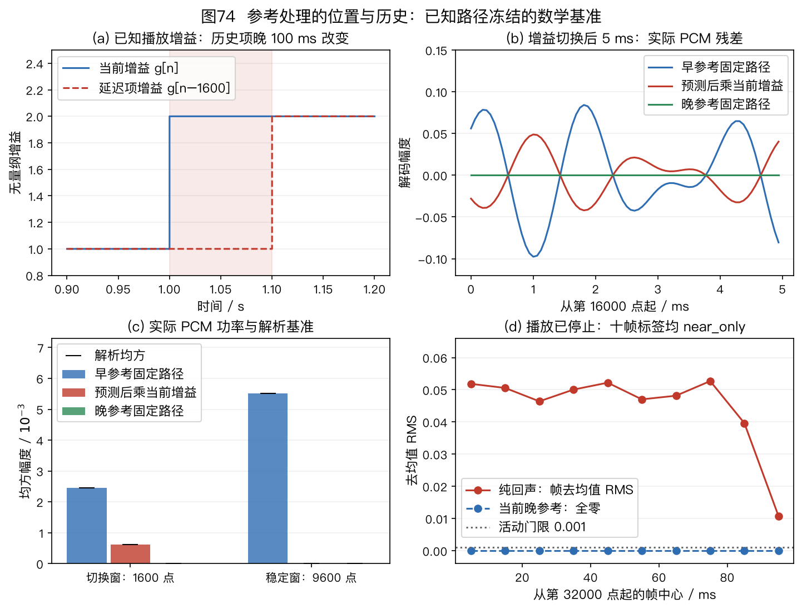

结合图74可以同时看清上述增益顺序误差与 §6.4.1 提到的尾声标签现象：图中已知两抽头稀疏路径全程冻结在真值上，在第 $1.0\ \mathrm{s}$（第 $16000$ 点）处将播放增益 $g[n]$ 从 $1$ 阶跃翻倍到 $2$，并在第 $2.0\ \mathrm{s}$（第 $32000$ 点）停止源播放、保留 $100\ \mathrm{ms}$（$1600$ 点）完整混响尾部。在 $1.0$～$1.1\ \mathrm{s}$ 增益切换过渡窗内，T5 晚参考支路残差恒为零，早参考支路因漏掉翻倍增益全程大额报错，而后乘支路恰如式(6-32)预言的那样在整段 $100\ \mathrm{ms}$ 延迟记忆期内出现过渡泄漏；到了 $2.0$～$2.1\ \mathrm{s}$ 尾窗内，虽然当前播放参考已归零使帧级活动检测器连续 $10$ 帧打出 `near_only` 标签，但麦克风里的波形实为 $100\ \mathrm{ms}$ 前播出的纯回声尾声，保留历史缓存的晚参考滤波器依然将其干净利落地抵消为零。

最后从系统端到端时延角度，把**远程通话云/端 AEC 划分**与**同舱本地扩声物理干涉边界**一并厘清：

- **远程全双工通话（端侧 AEC vs 云端 AES）**：AEC 在上行发送链路内部作**数字波形相减**，本地扬声器外放声波并不会在房间空气里被消掉。若外接无线音箱、HDMI 电视或云端服务器拿不到与本地麦克风同源时钟对齐的 T5 参考流，云端就无法运行高精度线性自适应滤波，通常只能在端侧就近完成硬件环回线性 AEC，云端仅补充弱参考/无参考声学回声抑制（Acoustic Echo Suppression，AES）；
- **同舱扩声与主动降噪的物理声波叠加边界（车载 ICC / 本地扩声 vs ANC）**：如果麦克风拾取的语音不是发往千里之外的远端手机，而是像**车载座舱通话增强（In-Car Communication，ICC）**那样把前排驾驶员话音放大后实时从后排扬声器播出来，处理后的声波就会在车舱空气中与驾驶员传向后排人耳的直达声 $s(t)+\alpha s(t-\tau_{\mathrm{loop}})$ 发生**物理声压叠加**！两列同源声波相差环路总延迟 $\tau_{\mathrm{loop}}$ 叠加时，功率谱 $|1+\alpha e^{-\mathrm{j}2\pi f\tau_{\mathrm{loop}}}|^2$ 会每隔 $\Delta f=1/\tau_{\mathrm{loop}}$ 产生周期性峰谷——一旦采集、分块滤波加播放的总环路延迟逼近或突破 **ITU-T P.1150** 规定的 $\Delta_{\mathrm{Rx}}<15\ \mathrm{ms}$ 增强延迟上限（$\tau_{\mathrm{loop}}=15\ \mathrm{ms}$ 时语音通带内每隔约 $66.7\ \mathrm{Hz}$ 就形成一道深陷波），乘客耳中就会听到明显的空心管金属梳状滤波（comb filtering）乃至闭环声反馈啸叫，而这种发生在空气与鼓膜处的物理干涉是任何数字端相减都无法挽回的；至于耳机/座舱**主动噪声控制（ANC）**，更是要求电子处理时延 $\tau_{\mathrm{elec}}$ 不超过声路飞行时差 $\tau_{\mathrm{acoust}}-\tau_{\mathrm{sec}}$（常为亚毫秒级）以实现局部空间物理相消（三类环路的延迟算术对照见练习 [E06-44](#e06-44)），切不可与可缓冲对齐数字参考的远程通话 AEC 混为一谈。

### 6.11 测试覆盖与验收矩阵

把算法装进整机之后，测试团队需要一张覆盖稳态、暂态、双讲、异常时钟与下游任务的完整验收清单。若目标产品须通过特定行业认证（如电信终端 ITU-T P.340/P.1100/P.1110、车载免提或平台语音助手规范），应直接锁定对应标准号、版本号、标准测试序列与声学人工头摆位条款作为合格判据：

| # | 测试项 | 条件 | 记录结果 | 阈值来源 |
|---|---|---|---|---|
| C1 | STFE 收敛后线性段 ERLE | 远端单讲，排除初始收敛段 | 均值或分位数、统计窗口、输入与线性输出取点 | 目标设备线性段基线 |
| C2 | STFE 最终输出 | 与 C1 使用同一录音 | 最终残余、AECMOS 回声维和听测结果 | 目标应用的可闻回声要求 |
| C3 | 初始收敛 | 规定冷启动状态和播放材料 | 从播放开始到达到项目基线的时间分布 | 交互延迟与任务要求 |
| C4 | 路径突变重收敛 | 规定移动、遮挡或设备切换动作 | 恢复时间、成功比例和暂态最大残余 | 目标场景允许的中断时间 |
| C5 | 双讲语音质量 | 规定 SER、说话人和双讲序列 | 近端质量、内容保持与残余回声 | 选定标准或项目听测基线 |
| C6 | 双讲回声泄漏 | 与 C5 同一批样本 | AECMOS 回声维及真人听测 | 固定模型版本和听测协议 |
| C7 | STNE 近端损伤 | 近端单讲，AEC 开关对照 | 频谱、客观质量、下游任务与听测差异 | 旁路基线和允许损伤 |
| C8 | 沉默期稳定性 | 覆盖项目最长空闲段并在期间改变路径 | 系数漂移及重新播放后的恢复过程 | 最长会话和使用状态 |
| C9 | 非线性播放 | 覆盖目标播放电平和材料，并含双讲 | 线性段残余、最终残余和近端损伤 | 设备声学过载与音质要求 |
| C10 | 时钟偏移 | 覆盖实际播放与采集时钟域及最长会话 | 延迟漂移、重采样状态和残余趋势 | 时钟规格和最长运行时间 |
| C11 | 输出切换与丢帧 | 执行目标系统支持的切换和故障注入 | 延迟重搜、恢复时间和音频连续性 | 交互与通话连续性要求 |
| C12 | 适用的认证指标 | 按所选标准及 profile 生成条件 | 标准要求的指标和统计过程 | 所选标准的明确版本与条款 |
| C13 | 下游任务 | AEC 旁路与启用使用同一批输入 | 唤醒、识别或通信任务的差异 | 任务基线与允许退化 |

对于固件每日构建与产线快速抽检，可从上述全集中提炼出七项核心冒烟回归（A1～A7），其通过门限应结合同机型历史基线分布与器件公差设定：

| # | 回归项 | 快速方法 | 判定依据 |
|---|---|---|---|
| A1 | 参考内容与取点 | 查信号图，并改变音源、通知音、音量和后处理 | 参考包含预期播放内容；未覆盖的处理已有补偿或风险记录 |
| A2 | 延迟覆盖 | 读取延迟估计日志，并注入链路抖动和切换 | 搜索范围与滤波器跨度覆盖目标延迟分布并留有设计余量 |
| A3 | STFE 双取点 | 固定远端单讲样本，分别记录线性段和最终输出 | 两个取点分别达到对应项目基线，口径见 §6.7 |
| A4 | 双讲 | 使用固定且版本化的双讲测试集 | 近端损伤、残余回声和滤波器稳定性均满足项目基线 |
| A5 | 路径突变 | 执行可重复的移动、遮挡或切换动作 | 在规定时间内恢复到项目基线，并报告失败比例 |
| A6 | 真人听测 | 按预先定义的样本量、随机化和播放协议盲听 | 使用所选协议的统计判据，不以单个听众意见代替结果 |
| A7 | 自动多指标复核 | 固定模型、软件版本和输入集 | 只用于回归；阈值由版本基线和人工复核结果确定 |

### 6.12 AEC 诊断方法与 NLP 工作点

当线上录音暴露出回声泄漏、吞字或通话后半程退化时，可按下面“故障征兆 $\longrightarrow$ 关键量测 $\longrightarrow$ 探针信号 $\longrightarrow$ 根因判据”诊断表（D1～D8）逐项定位：

| # | 征兆 | 量测 | 工具/信号 | 判断依据 |
|---|---|---|---|---|
| D1 | ERLE 低于项目基线 | 参考与真实播放是否一致 | 对比参考与实际播放内容；查抽头点 | 改变音源、音量或后处理时，参考应包含相同变化或有明确补偿 |
| D2 | ERLE 不再上升 | 延迟失配 | 互相关峰、图30（a）和延迟日志 | 先核总延迟的搜索窗与参考缓存，再核对齐后非负的完整路径非零区间；相关峰不能证明路径已覆盖 |
| D3 | 双讲后恢复慢 | 自适应控制 | DTD 判决、步长和路径失配日志 | 恢复过程相对同一设备的远端单讲基线无异常停滞 |
| D4 | ERLE 随播放电平出现平台 | 非线性占比 | 多个播放电平的 ERLE 与失真对比 | 电平降低后残余非线性同步减小，见图31的仿真机制 |
| D5 | 断续/闷罐/背景声突然消失 | NLP 过度抑制 | 旁路 NLP；有独立、时间匹配的干净近端参考且满足标准适用条件时才评估 ITU-T P.863；无此真值时看 AECMOS Other 维、盲听和任务指标。历史回归若保留 PESQ，须固定 P.862 实现与带宽口径 | 旁路后语音改善 → 检查近端损伤并减小过强抑制 |
| D6 | 沉默段背景突变 | CNG 频谱与电平 | 沉默段频谱与真实底噪对照 | 以盲听和频带差异共同调节，不使用统一 dB 阈值 |
| D7 | 长通话逐渐变差 | 采样率偏移（Sample Rate Offset，SRO）累积漂移 | 覆盖最长目标会话的延迟估计曲线 | 残余速率差应满足相干性和任务指标要求 |
| D8 | 切歌或切设备后失效 | 延迟突变 | 对齐切换事件的 ERLE 与延迟轨迹 | 在项目规定时间内恢复，并检查搜窗是否覆盖新路径 |

D1～D3检查参考、延迟和双讲控制；D4用于判断非线性残余；D5～D6检查近端语音和舒适噪声；D7～D8检查长时漂移和链路切换。

D2 的两项检查对应不同范围：播放到采集的总延迟须能被搜索窗找到，并能从参考缓存取到相应样本；完成对齐后，残余路径的全部非零抽头才须落入长度 $L$ 的因果滤波器索引 $0$ 到 $L-1$。残余非零抽头区间含负时延时，应调整参考取点或缓冲；尾部超出 $L-1$ 时，应重新选择对齐与覆盖长度。

图30的300点纯延迟可以先补偿，再由短滤波器覆盖剩余路径，不能只根据331点相关峰判断是否可覆盖；完整非零抽头覆盖条件见[§6.4](#sec-6-4)。出现多个相关峰时，还需检查多路径与周期信号。

ITU-T 已于 2024 年 1 月 5 日废止 P.862、P.862.1、P.862.2 和 P.862.3（PESQ 系列），并正式指向替代标准 P.863、P.863.1 与 P.863.2（POLQA 系列；见 [ITU-T P.862 状态页](https://www.itu.int/rec/T-REC-P.862) 与 [ITU-T P.863](https://www.itu.int/rec/T-REC-P.863-201803-I)）；因此 PESQ 仅适合延续旧版历史回归基线，新建客观音质评测前应先核对 P.863 的采样带宽、时间对齐预处理与适用条款。

本书使用的真实 AEC Challenge 播放环回与麦克风配对录音没有独立干净近端语音真值，不能直接对它们计算 P.863 的近端语音质量（[ITU-T P.863.1](https://www.itu.int/rec/T-REC-P.863.1-201906-I) 明确规定了干净参考语音与退化语音的配对输入条件）；在这类无干净真值的实录场景中，应结合 AECMOS 分项得分、下游识别与真人盲听综合评判。

> **采样率偏移（Sample Rate Offset，SRO）的累积账本。** 当外接 USB 扬声器与内置麦克风分属两颗独立晶振、存在仅 $10\ \mathrm{ppm}$（百万分之十，即 $10^{-5}$）的微小频率差时，在 $16\ \mathrm{kHz}$ 采样率下每秒就会错开 $16000\times 10^{-5}=0.16$ 个采样；持续开会 $1$ 小时后，累积滑移高达 $0.16\times 3600=576$ 个采样（折合 $36\ \mathrm{ms}$）！整数延迟跳跃重搜只能阶段性搬移缓冲起点，无法消除每一帧内部持续旋转的相位斜率（见练习 E06-25）；因此跨时钟域长通话必须在软件层实时估计 SRO 并驱动分数延迟异步重采样（SRC），硬件设计阶段若能让 DAC 与 ADC 共用同一主时钟（MCLK/BCLK），则可从物理源头彻底根除 SRO。

**NLP 残余抑制工作点的精细平衡**。非线性处理器（NLP）对各频带乘上实数衰减增益：压制越狠，远端单讲越干净，但双讲吞字、音乐噪声与背景抽动风险也随之陡增。工程标定不能只填一个单一“最大抑制分贝数”，而要按四个维度协同调校：

| 调节方向 | 需要控制的量 | 同时观察 | 回退条件 |
|---|---|---|---|
| 近端保护优先 | 提高增益地板，减慢或限制双讲期抑制 | 近端频谱、下游识别、双讲听感 | 仍有回声时再逐步增强抑制，而不是一次设置固定档位 |
| 回声抑制优先 | 在远端单讲置信度高的频带降低增益 | 残余回声、音乐噪声和背景连续性 | 出现近端内容丢失、抽动或背景突变 |
| 状态自适应 | 用远端活动、双讲置信度和残余估计连续控制增益 | 状态切换时的暂态和恢复时间 | 置信度不足或切换产生可闻伪影 |
| 舒适噪声配合 | 根据真实底噪估计 CNG 频谱与电平 | 沉默段的连续性与噪声颜色 | CNG 可单独辨认或掩盖近端弱语音 |

实操标定时，建议先彻底旁路 NLP 确认线性段底座已调到最优，随后逐步下调增益地板，在“残余回声泄漏—双讲近端保真—ASR 词错率”帕累托折中曲线上选定目标工作点，切忌不看硬件耦合底子就盲目照搬某个固定的 $-20\ \mathrm{dB}$ 经验常数。

### 6.13 个性化 AEC 的合规检查

§6.5 介绍了利用注册声纹提取目标说话人的个性化 AEC（pAEC）。由于声纹嵌入属于可识别自然人身份的生物特征敏感信息，产品工程化落地除满足声学延迟与双讲指标外，还必须逐项通过以下隐私合规、权限隔离与异常降级审查（P1～P8）：

| # | 检查项 | 需要明确的设计 | 不满足的后果 |
|---|---|---|---|
| P1 | 注册数据量与质量 | 在目标距离、噪声和说话变化下绘制注册数据量与错误率曲线 | 嵌入不可靠，双讲时误压目标用户 |
| P2 | 告知与授权 | 按适用法律和产品政策说明用途、处理位置、保留期与删除方式 | 用户无法判断数据怎样使用 |
| P3 | 嵌入存储 | 明确端侧或云侧位置、访问控制、加密和备份范围 | 未授权访问或数据范围扩张 |
| P4 | 首帧可用性 | 若要求从开头保护目标用户，应在首个处理帧前准备嵌入；延迟计入系统关键路径 | 开场语音可能未受个性化条件保护 |
| P5 | 删除与退出 | 定义删除入口、传播范围、完成时间和退出后的普通 AEC 行为 | 用户无法撤回个性化处理 |
| P6 | 低置信度处理 | 规定无注册、低置信度和多人混淆时的旁路、回退或提示 | 误抑制非注册说话人或目标用户 |
| P7 | 共享设备 | 明确多用户配置、权限、切换和未成年人场景的授权流程 | 配置串用或家庭成员被误抑制 |
| P8 | 验收加测 | 在 C5/C6 基础上加入目标用户、非目标用户及多人双讲组合 | 普通双讲测试无法覆盖身份条件错误 |

### 6.14 研究方向

纵观近年学术与工业演进，声学回声消除的前沿探索主要聚焦在四条脉络上：以轻量深度网络在线估计自适应步长或卡尔曼状态空间噪声协方差、在多麦克风多扬声器阵列中联合优化回声抵消与空间干扰抑制、融合低延迟声纹条件实现个性化全双工拾音，以及构建契合人耳双讲主观听感的非侵入式可微评价指标。研读最新论文时，养成先核查“是否严格因果、总帧级延迟多少毫秒、参考取自播放链何处、双讲信回比分布如何”四个硬前提的习惯，就能穿透表面分数看清算法的真实工程边界。

> **全章插图导航与阅读要点汇总。**
>
> | 图 | 内容 | 对应正文 | 口径提醒 |
> |---|---|---|---|
> | 图26 | 合成路径、播放参考与近端干扰叠加 | §6.1.1 | 展示直达、早反射与混响尾的时域卷积叠加机制 |
> | 图27 | 播放参考、路径估计与相减结构 | §6.1.1 | 顶部 DTD 控制自适应滤波器更新 |
> | 图18 | （a）结构 + DTD 开关；（b）NLMS 收敛 + 双讲冻结 | §6.1.2 | 当前样本在前的回归向量与回声卷积索引一致；图中均值来自固定种子和标示窗口 |
> | 图28 | （a）$\hat{\vec w}$ 逼近 $\vec h$；（b）失配与 ERLE 的关系；（c）不同 $\mu$ 的有限时段轨迹 | §6.1.2 | 展示有色激励下系数失配与能量衰减的加权对应关系；“0步”为更新前初值 |
> | 图19 | （a）独立仿真线性/非线性场景；（b）按模型假设和处理对象分类 | §6.3、§6.5 | （a）呈现自身配置下的非线性残差平台；与图31独立生成，不作跨图分贝比大小 |
> | 图20 | （a）系统信号流；（b）混合结构 | §6.8、§6.5 | 橙色模块表示可选的学习型残余抑制 |
> | 图29 | 三路均方根包络与远端单讲 ERLE | §6.1.2 末、§6.4 | 粉色双讲区保留近端输出，因此留空不计算单讲 ERLE |
> | 图30 | （a）有符号互相关的最大正峰约 331 采样；（b）用真值 300 点对齐约 28 dB、不对齐约 2 dB；（c）冻结与继续更新 | §6.4、§6.8 | 预设纯延迟为 300 采样（超出 128 抽头跨度）；有色参考与多径使有符号峰偏至 331 |
> | 图31 | （a）线性与归一化 `tanh` 非线性路径；（b）同一映射 | §6.3 | 把静态非线性映射曲率与线性模型残差平台直观对应起来 |
> | 图32 | 混合处理信号与控制流程 | §6.5、§6.2 | 展示延迟对齐、线性减法、自适应门控与后置抑制的信号依赖 |
> | 图36 | 单频三次非线性的线性投影与剩余谐波 | E06-06 | 解析功率与 PCM 离散谱分开核对 |
> | 图37 | Haar 交叉项与删项后的模型输出 | §6.2.3 | 对比临界采样子带保留交叉项与仅留对角项的精确重建差异 |
> | 图38 | IPNLMS、RLS、Kalman 的手算更新 | §6.2.4～6.2.6 | 同屏对比比例份额、逆相关矩阵演化与卡尔曼双参数软门控 |
> | 图39 | 分区预测、有效误差、更新及投影 | §6.2.1 | 标清两处时域裁剪/补零位置；冻结权重时仍须推进参考块历史 |
> | 图57 | 单列 NLMS、两列完全投影与正则改变量 | 仿射投影专题、E06-34 | 二维权重平面上的超平面交点与岭回归阻尼轨迹 |
> | 图58 | 同源无噪/含噪学习轨迹与冻结后的留出误差 | E06-39 | 对比有色参考下投影阶数对收敛速度与含噪稳态误差的双面影响 |
> | 图74 | 时变增益的参考位置与纯回声尾声 | §6.10、E06-40～E06-42 | 展示后乘当前增益的过渡泄漏及停止播放后的纯回声尾声标签 |

### 6.15 可执行基线与开源实现边界

#### 6.15.1 教学 NLMS、PBFDAF 与状态边界

本仓库提供纯 NumPy 编写、逐步透明可查的教学代码库：时域 NLMS 与 $\mathrm{ERLE}$ 核心位于 [`codes/chapters/ch06/core/aec.py`](../codes/chapters/ch06/core/aec.py)，第 6～9 章跨章串联入口位于 [`codes/chapters/ch00/cross_chapter/ch06_09_baselines.py`](../codes/chapters/ch00/cross_chapter/ch06_09_baselines.py)。在仓库根目录可直接运行：

```bash
.venv/bin/python -m codes.chapters.ch00.cross_chapter.ch06_09_baselines
```

在批量函数 `nlms(reference, microphone, filter_length, ...)` 中，`freeze[n]=True` 时照常计算当前样本的先验回声预测与残差，仅跳过权重更新；当参考滑窗能量为零时同样自动跳过更新，并对非有限浮点值、非正整数抽头长度或非布尔类型的掩码显式报错拦截，杜绝静默传播 `NaN`。

**流式跨块续算为什么绝不能只保存抽头向量？** 因为在线性卷积中，新数据块开头的第 $0$ 个采样依然需要与**上一块末尾的 $L-1$ 个历史参考采样**做内积！教学状态类 `NLMSState` 同时封装了当前权重向量与这段长度 $L-1$ 的参考历史缓存（内部 `history` 按旧到新存储，构造点积时翻转为当前样本在前），使 `process()` 无论按整段送入还是切成任意碎块流式调用都给出逐位一致的输出。运行[流式边界演示](../codes/chapters/ch06/aec_streaming_demo.py)即可亲眼验证这一细节（取 $h=[0.5,0.25]$、$x=[1,2,3,4]$、冻结步长 $\mu=0$）：无论是整段一次跑完还是在第 $2$ 拍后切成两块续算，正确维护 `NLMSState` 历史给出的残差均为 $[0,0,0,0]$；一旦只继承权重而把参考历史清零，第二块首拍就因漏掉上一块末尾的 $x[1]=2$ 而凭空冒出 $0.5\times 2-0.5=0.5$ 的假残差：

```bash
.venv/bin/python -m codes.chapters.ch06.aec_streaming_demo
```

为方便读者逐项复核正文手算，仓库还按模块提供了五个专项验证入口：

1. **四个核心算术微实验**（[`aec_algorithm_minicases.py`](../codes/chapters/ch06/aec_algorithm_minicases.py)，对应单元测试 [`test_codes_aec_minicases.py`](../tests/test_codes_aec_minicases.py)）：一次性输出 $N=2,P=2$ 重叠保存有效半块、两抽头 IPNLMS 比例分配、Geigel 多径误报与零参考门控、以及负极性路径使最大正相关峰选错延迟四组精确 JSON：

    ```bash
    .venv/bin/python -m codes.chapters.ch06.aec_algorithm_minicases
    ```

2. **分区频域 PBFDAF 演示**（核心见 [`core/aec_partitioned.py`](../codes/chapters/ch06/core/aec_partitioned.py)，测试见 [`test_codes_aec_partitioned.py`](../tests/test_codes_aec_partitioned.py)）：串联式(6-4)～式(6-5)的重叠保存预测、前半块补零有效误差谱、逐频功率归一化与可选时域合法抽头清零投影，同时复现 §6.2.2 两块手算与算例 6-5 的纯音/宽带留出对照：

    ```bash
    .venv/bin/python -m codes.chapters.ch06.aec_partitioned_demo
    ```

3. **逐样本全矩阵 RLS 演示**（核心见 [`core/aec_rls.py`](../codes/chapters/ch06/core/aec_rls.py)）：维护逆相关矩阵与跨块参考历史（`freeze=True` 时同步暂停拟合与 $\lambda^{-1}$ 膨胀，仅推进参考滑窗），并同屏比对式(6-18)递推解与批量正规方程解：

    ```bash
    .venv/bin/python -m codes.chapters.ch06.aec_rls_demo
    ```

4. **时域全矩阵 Joseph 形式 Kalman 演示**（核心见 [`core/aec_kalman_matrix.py`](../codes/chapters/ch06/core/aec_kalman_matrix.py)）：按式(6-22)维护完整路径误差协方差矩阵（注意其 `freeze=True` 仅跳过麦克风观测修正，仍照常推进时间预测步 $\mathbf A\hat{\vec h}_{n-1}$ 与参考历史，故 $a\neq 1$ 时冻结并不等于权重静止），直观展示跨抽头负相关非对角元的生成过程：

    ```bash
    .venv/bin/python -m codes.chapters.ch06.aec_kalman_matrix_demo
    ```

5. **单频点标量与复数共轭 Kalman 演示**（[`aec_kalman_scalar_demo.py`](../codes/chapters/ch06/aec_kalman_scalar_demo.py)，测试见 [`test_codes_aec_kalman_scalar_demo.py`](../tests/test_codes_aec_kalman_scalar_demo.py)）：逐项复算式(6-21)的实数单讲、纯虚参考谱共轭方向与双讲高观测方差软门控：

    ```bash
    .venv/bin/python -m codes.chapters.ch06.aec_kalman_scalar_demo
    ```

在指标核算函数 `erle_db()` 中，除通过 `double_talk_mask` 剔除双讲区间外，调用方还须通过 `valid_mask` 排除初始收敛过渡段、近端单讲段与静音段。函数要求有效统计窗内的输入均方严格大于能量门槛 `epsilon`（例如默认 `epsilon=1e-15` 时，幅度 $10^{-8}$、均方 $10^{-16}$ 的微弱信号会被当作无效静音拒绝打分），达标后在分子与分母均方上各加 `epsilon` 求对数比，因此零残差理想抵消返回的是由地板决定的有限分贝数而非浮点无穷大（回归测试套件见 [`tests/test_codes_aec_wpe_sep_track.py`](../tests/test_codes_aec_wpe_sep_track.py) 与 [`tests/test_codes_aec_streaming.py`](../tests/test_codes_aec_streaming.py)）。

希望深入阅读工业开源引擎与前沿论文代码的读者，可按需检出保存在 `codes/chapters/ch00/upstream/_downloads/` 下的固定版本第三方源码（获取方式见[上游代码说明](../codes/chapters/ch00/upstream/README.md)，行级接口剖析见[AEC 源码研究手册](../codes/chapters/ch00/research/02_aec_wpe_separation.md#aec)）：

| 方法或组件 | 应从哪段源码读起 | 它实际解决什么 | 复现时单独检查 |
|---|---|---|---|
| MDF/PBFDAF 与 AUMDF | SpeexDSP `libspeexdsp/mdf.c`，从 `speex_echo_state_init_mc()` 到 `speex_echo_cancellation()` | 把长路径拆成频域分区，并调度约束和更新 | 重叠保存有效区、FFT 归一化、分区历史、块尾 |
| 连续自适应控制 | 同文件的学习率与比例更新段 | 根据残余回声、双讲和噪声调节学习率 | Speex 此处不使用独立的二值 DTD，不能套用固定冻结语义 |
| AEC3 线性路径与延迟 | WebRTC `aec3/echo_canceller3.cc`、`block_processor.cc`、`subtractor.cc`、`render_delay_controller.cc` | 组织参考、时间对齐和线性回声抵消 | 渲染/采集调用顺序、断流、路径变化与重置 |
| AEC3 残余抑制 | `residual_echo_estimator.cc`、`suppression_gain.cc`、`comfort_noise_generator.cc` | 估计未抵消回声、施加增益并控制输出噪声表现 | 同时保存线性残差和最终输出，避免抑制掩盖失配 |
| DTLN-aec | 作者仓库 `run_aec.py` 与两阶段模型输入/输出 | 用麦克风和播放参考联合估计近端语音 | 采样率、循环状态、块拼接、TFLite 与权重许可 |
| NKF-AEC | 作者仓库 `src/nkf.py`，仅作来源索引 | 学习卡尔曼更新增益，仍是线性 AEC | 16 kHz、参考延迟补偿；未确认再分发许可 |
| Meta-AF | `metaaf/filter.py`、`core.py` 与更新器 | 学习滤波器更新规则并管理分块状态 | 核心库与 `zoo/`、权重采用不同许可证 |
| 学习步长控制 CTF-AEC | `main_train.py` → `libPython/class_frontend.py` → `class_aec_ctf.py` | 保留线性 CTF 回声模型，由 DNN 控制频率选择性步长与误差归一化 | 无预训练模型参数文件；序列边界重置状态，`center_stft=True`，不能直接当作跨块流式接口 |
| Integrated AEC/NR | `Main.m` → `Util/Process/process.m` → 各 AEC、NR、MWF 与后滤模块 | 在多麦、多扬声器模型中比较联合设计和 AEC/NR 顺序 | MATLAB R2024a；用干净语音与回声真值作理想活动判决，实际设备不可得 |
| 原始 FDKF/PBFDKF、NeuralKalman、DeepVQE | 本章原论文与研究文档的结构对应说明 | 分别改变状态统计、学习递推或联合增强 | 未确认的作者官方完整软件不能由同名第三方复现替代 |

#### 6.15.2 外部 AEC 接口及输出取点

阅读上表各开源实现时，第一步是按源码文件头与实际算子核清其数学身份：例如 [SpeexDSP 的 `mdf.c`](https://gitlab.xiph.org/xiph/speexdsp/-/blob/8e29a256ef0235ebbe7fcb8417b5ac7731eb8307/libspeexdsp/mdf.c) 在文件头明确注明采用 Soo & Pang 的交替无约束 MDF（AUMDF）配合 Valin 的相干度连续学习率调节，属于分区频域梯度族；若要研读频域卡尔曼滤波（FDKF），则必须找显式维护误差方差、过程方差与观测干扰方差递推的实现，不能一见频域分区就统称为 FDKF。

对比本书 `NLMSState`、[WebRTC AEC3](https://webrtc.googlesource.com/src/+/0467d2b91cc20b9b001c2bbb73d43ea6b2491f3e/modules/audio_processing/aec3/) 与 SpeexDSP 三套接口时，调用时序与输出取点有严格差异：

- **WebRTC APM 调用次序**：宿主程序通常每 $10\ \mathrm{ms}$ 推送一帧数据，须先调用 `ProcessReverseStream()` 送入远端播放帧，再按采集与播放缓冲差设置 `set_stream_delay_ms()`（注意它是管线缓冲提示量，既不是空气混响时长也不是滤波器抽头长度），最后调用 `ProcessStream()` 处理麦克风帧（见 [`audio_processing.h`](https://webrtc.googlesource.com/src/+/0467d2b91cc20b9b001c2bbb73d43ea6b2491f3e/api/audio/audio_processing.h)）；
- **SpeexDSP 同步与异步接口及双取点**：同步函数 `speex_echo_cancellation()` 要求调用方自行配好同帧对应的播放与采集指针，输出的是**核心线性 MDF 残差**（内部附带直流陷波与预加重/去加重）；若要启用后置残余回声抑制，还须额外创建预处理器并通过 `SPEEX_PREPROCESS_SET_ECHO_STATE` 绑定回声状态，作为第二个后处理取点（见 [`speex_echo.h`](https://gitlab.xiph.org/xiph/speexdsp/-/blob/8e29a256ef0235ebbe7fcb8417b5ac7731eb8307/include/speex/speex_echo.h) 与[官方手册第 6 节](https://www.speex.org/docs/manual/speex-manual/node7.html)）。而异步封装 [`mdf.c` 中的 `speex_echo_playback()` / `capture()`](https://gitlab.xiph.org/xiph/speexdsp/-/blob/8e29a256ef0235ebbe7fcb8417b5ac7731eb8307/libspeexdsp/mdf.c#L687-733) 仅按单声道 `frame_size` 排队拷贝，多通道交织流切勿直接误调该异步辅助函数。

正因工业库集成了内部缓冲延迟、高通直流滤波与非线性抑制，评测时绝不能拿“AEC3 经 NLP 深度压制后的最终输出”去和“纯线性教学 NLMS 残差”直接比谁的总输出能量更小，必须锁定完全一致的输入信号、采样率、对齐窗口并标明各自真实取点。

#### 6.15.3 真实配对录音及双讲对照组

脱离理想合成信号、走上真实消费设备录音时，没有干净分量真值和延迟预对齐会发生什么？下面用三组对照实验把真实录音的诊断方法跑通（完整复现命令与录音校验信息见[研究手册](../codes/chapters/ch00/research/02_aec_wpe_separation.md#aec)，原始配对音频存于本地忽略缓存）。

**第一组：真实远端单讲录音上的参考敏感性对照**（脚本见 [`aec_real_pair_experiment.py`](../codes/chapters/ch06/examples/aec_real_pair_experiment.py)）。从 Microsoft AEC Challenge 数据集中抽取同一设备会话（同一 GUID）的 $16\ \mathrm{kHz}$ 单声道 Windows 播放环回 `lpb` 与麦克风录音 `mic`（总长 $11.77\ \mathrm{s}$），送入 SpeexDSP 同步接口 `speex_echo_cancellation()`（每帧 $160$ 点，滤波跨度 $4096$ 点；前 $3\ \mathrm{s}$ 供收敛，在 `[3, 11.77)` $\mathrm{s}$ 窗口统计麦克风输入与输出的总数字功率比）：

- 传入**正确配对参考**时，输出总功率下降 **$5.57\ \mathrm{dB}$**；
- 传入**全零静音参考**作空白对照时，输出总功率竟然也下降了 **$3.95\ \mathrm{dB}$**！这是因为 Speex 核心内部自带直流陷波高通滤波器，切掉了原真实录音里的低频环境嗡声与直流偏置；若不做这个全零参考空白对照，很容易把这 $3.95\ \mathrm{dB}$ 也误算成自适应回声抵消的功劳；
- 人为将播放参考**推迟 $1\ \mathrm{s}$** 制造因果失配时，功率变化跌至 **$-0.23\ \mathrm{dB}$**，印证了自适应支路确实依赖正确时间配对的参考信号。

**第二组：真实双讲配对录音对照**（脚本见 [`aec_doubletalk_experiment.py`](../codes/chapters/ch06/aec_doubletalk_experiment.py)）。取同一 GUID 下的真实双讲配对录音 `doubletalk_lpb` / `doubletalk_mic`（裁齐为 $196160$ 点完整帧，前 $3\ \mathrm{s}$ 适应，在 `[3, 8)` $\mathrm{s}$ 窗口计量），在正确参考、全零参考与推迟 $1\ \mathrm{s}$ 错误参考三种条件下，麦克风输入相对输出的总数字功率变化分别为 $2.234$、$2.204$ 与 $2.200\ \mathrm{dB}$（正确参考仅比全零对照多降 $0.029\ \mathrm{dB}$）。这组数字生动印证了 §6.7 的核心告诫：真实双讲录音中近端人声占主导且缺少分离的干净回声真值，单看混合总功率变化率根本分辨不出回声消了多少、近端人声又伤了多少！

**第三组：无延迟搜索与双讲门控的裸教学 PBFDAF 实录压力测试**（脚本见 [`aec_pbfdaf_real_pair_compare.py`](../codes/chapters/ch06/examples/aec_pbfdaf_real_pair_compare.py)）。将上述两段真实录音原封不动送入未配延迟搜索、未配双讲门控且照搬合成算例固定超参数（块长 $160$ 点、$26$ 个分区覆盖 $4160$ 点、固定步长 $\mu=0.3$、瞬时功率地板 $\delta=0.05$）的教学 PBFDAF：在正确参考、全零参考与晚 $1\ \mathrm{s}$ 参考下，远端单讲 `[3, 11.77)` $\mathrm{s}$ 的输入/残差功率比分别为 $-6.700$、$0$ 与 $-18.017\ \mathrm{dB}$，真实双讲 `[3, 8)` $\mathrm{s}$ 分别为 $-6.363$、$0$ 与 $-1.665\ \mathrm{dB}$（负分贝代表残差总功率反而高于原始麦克风输入，晚参考下部分 `float64` 峰值甚至超出 PCM16 量程！）。

这个鲜明的负分贝反例不是 PBFDAF 频域分区结构本身的过错，而是直观展示了真实录音存在未知管线缓冲延迟、剧烈谱动态起伏与双讲冲击时，若缺少 §6.8 讲述的平滑功率估计、延迟对齐与保守步长门控，裸自适应更新就会因过冲而放大误差。

#### 6.15.4 已知近端注入的受控检查

既然真实录音拿不到干净近端真值，我们怎样定量测试一个黑盒处理器 $A$ 在消除回声的同时有没有把近端信号压扁或扭曲？一种干净利落的受控探针法是**双运行差分增量检验**（脚本见 [`aec_controlled_doubletalk.py`](../codes/chapters/ch06/aec_controlled_doubletalk.py)）：固定同一条播放参考 $x[n]$ 与只含回声（及底噪）的基线麦克风输入 $d_0[n]$，每次都从完全相同的全新初始状态启动处理器 $A$——第一次喂入 $d_0$ 得到基线输出 $y_0=A(x,d_0)$，第二次在预先固定的区间 $W$ 内原样叠加一条逐样本已知的近端测试波形 $s[n]$（$\sum_{n\in W}s^2[n]>0$）得到输出 $y_1=A(x,d_0+s)$。定义两次输出的差分增量 $\Delta[n]$、无时延拟合的原样投影增益 $g_\Delta$ 与相对平方误差 $E_\Delta$：

$$\begin{aligned}
\Delta[n]&=y_1[n]-y_0[n],\\
g_{\Delta}
&=\frac{\sum_{n\in W}\Delta[n]s[n]}
       {\sum_{n\in W}s^2[n]},\\
E_{\Delta}
&=\frac{\sum_{n\in W}(\Delta[n]-s[n])^2}
       {\sum_{n\in W}s^2[n]}.
\end{aligned}\tag{6-33}$$

看清式(6-33)的几何含义（正交分解详见练习 E06-33）：若处理器在区间 $W$ 内对近端信号是严格恒等直通的线性时不变通路、且两次运行的内部回声权重轨迹未受 $s[n]$ 扰动，则必有 $\Delta[n]\equiv s[n]$，此时 $g_\Delta=1$ 且 $E_\Delta=0$！反之，若只看投影增益 $g_\Delta$ 接近 $1$，还不足以排除垂直于 $s[n]$ 方向的非线性失真或由于 $s[n]$ 触发自适应误更新而混进 $\Delta[n]$ 的回声残余变动，因此必须将 $(g_\Delta,E_\Delta)$ 成对读取：

1. **严格合成 PCM 加法对照**：在 $2\ \mathrm{s}$ 合成样本的 `[1.2, 1.8)` $\mathrm{s}$ 区间注入合成谐波近端（PCM 整数相加严格无削波）。教学 NLMS 在注入期按已知掩码冻结更新时，两次运行权重轨迹分毫不差，式(6-33)算得 $g_\Delta=1$、$E_\Delta=0$；若放任双讲期继续更新，近端污染抽头便使指标劣化为 $g_\Delta=0.936$、$E_\Delta=0.322$。将同一组测试序列交给 SpeexDSP 同步核心，正确参考下得 $g_\Delta=0.878, E_\Delta=0.208$，而全零参考空白对照下也得 $0.879, 0.204$——两数几乎重合，一下子就定位出这约 $0.20$ 的波形差异主要来自 Speex 内置的直流陷波、预加重/去加重滤波与整数重量化，而非回声滤波器误吞近端！
2. **真实录音半合成叠加对照**：将同一设备会话的另一段真实近端单讲录音在 `[3, 8)` $\mathrm{s}$ 原样叠加到前述真实远端单讲麦克风轨上（硬切入/切出用于精确锁定区间 $W$ 的逐样本增量）。SpeexDSP 同步核心在正确参考下给出 $g_\Delta=0.922, E_\Delta=0.140$，全零参考对照给出 $0.923, 0.128$，再次将固定前端滤波形变与回声自适应扰动清晰剥离开来。

#### 6.15.5 WebRTC AEC3 的取点与同输入真值实验

进一步把官方构建的 WebRTC AEC3 命令行工具 `audioproc_f` 纳入对比时，有两项极易踩坑的接口细节必须先行对齐：第一，`audioproc_f` 默认先处理采集帧再处理播放帧，与同帧同步接口横向对照时必须显式改为“先送播放参考、后处理采集帧”（设置报告流延迟 $0\ \mathrm{ms}$，同时导出内部线性段与 NLP 最终段）；第二，**分块频域与子带滤波器组自带固定的管线输出延迟**！如果漏测固定算法延迟就按原始采样下标硬套式(6-33)，哪怕近端语音毫发无损地延迟了 $4\ \mathrm{ms}$ 吐出来，错位点积也会算出近乎归零的假象。

在前述两对真实配对录音上运行 `audioproc_f` 时，远端单讲的线性段/最终段总数字功率分别相对麦克风输入下降 $7.685\ \mathrm{dB}$ 与 $15.731\ \mathrm{dB}$，真实双讲则分别下降 $3.384\ \mathrm{dB}$ 与 $3.851\ \mathrm{dB}$。为了在拥有精确分量真值的前提下看清教学 NLMS、SpeexDSP 同步核心、AEC3 导出线性段与 AEC3 导出最终段四个取点的行为差异，独立脚本 [`aec_same_input_truth.py`](../codes/chapters/ch06/examples/aec_same_input_truth.py) 用固定种子 `20260924` 生成一条 $16\ \mathrm{kHz}$、$6\ \mathrm{s}$ 的已知五抽头（$[0.70,0,-0.25,0,0.12]$）无噪回声底稿，并在 `[3, 4)` $\mathrm{s}$ 无削波叠加已知近端波形（`[0, 2)` $\mathrm{s}$ 供自适应收敛，`[2, 3)` $\mathrm{s}$ 评价单讲回声衰减，`[3, 4)` $\mathrm{s}$ 评价双运行近端增量）。

在正式打分前，脚本先用一条完全独立的全零参考配单样本脉冲（幅度 $10000$）实测各处理器的**固有管线延迟**：测得教学 NLMS（$32$ 抽头，$\mu=0.4$，凭区间真值冻结）与 SpeexDSP 同步核心（$160$ 点帧，$4096$ 点跨度）均为 $0$ 样本延迟；而 AEC3 导出线性段固定晚 $64$ 个样本（恰为 $1$ 个 $4\ \mathrm{ms}$ 内部子块），导出最终段固定晚 $128$ 个样本（$8\ \mathrm{ms}$）！补偿各自独立测得的固定延迟后再代入式(6-33)（不在评分区拟合任何增益或时延），四路输出同台结果如下：

| 处理输出 | 脉冲测得固定延迟 | `[2,3)` s 回声功率／对齐后总输出功率 | `[3,4)` s $g_\Delta$ | `[3,4)` s $E_\Delta$ |
|---|---:|---:|---:|---:|
| 教学 NLMS，真值冻结 | 0 样本 | 79.27 dB | 1.000 | 约 0 |
| SpeexDSP 同步核心 | 0 样本 | 37.12 dB | 0.982 | 0.027 |
| AEC3 导出线性段 | 64 样本 | 60.58 dB | 0.964 | 0.241 |
| AEC3 导出最终段 | 128 样本 | 30.63 dB | 0.193 | 0.763 |

这张实测表包含三个极具启发性的工程结论：

1. **不对齐固有延迟会酿成严重误判**：如果不做独立脉冲标定、没有补偿 AEC3 线性段那 $64$ 个采样的子块延迟就盲目按原下标代入式(6-33)，算出的 $g_\Delta$ 会暴跌至仅 $0.199$，让人误以为线性段吞掉了八成近端幅度；而按 $64$ 点固有延迟对齐后，真实投影增益立即恢复为 $0.964$！
2. **四个取点各有边界，不可当作同级排名**：教学 NLMS 的 $79.27\ \mathrm{dB}$ 与 $g_\Delta=1.000$ 建立在“已知 $32$ 抽头精确覆盖无噪短路径 + 上帝视角真值冻结”的理想条件下；SpeexDSP 同步核心与 AEC3 线性段依靠各自的盲自适应门控分别取得 $37.12\ \mathrm{dB}$ 与 $60.58\ \mathrm{dB}$ 衰减且近端主能量保持在 $0.96$ 以上；而 AEC3 最终段因为叠加了非线性抑制器（NLP）与舒适噪声生成（CNG）——CNG 在 `[2, 3)` $\mathrm{s}$ 单讲安静残差上主动铺了一层舒适底噪使总输出功率比停在 $30.63\ \mathrm{dB}$，NLP 在 `[3, 4)` $\mathrm{s}$ 突入合成波形时又触发了时变增益压制与两次运行的状态分岔（$g_\Delta=0.193, E_\Delta=0.763$）。
3. **版本可复现性**：外部编译选项或上游版本变更可能改变内部缓冲延迟与滤波数值，上述脚本内置了二进制构建清单核验与脉冲重测流程，跨平台重编时的核验细节详见脚本注释与[源码研究记录](../codes/chapters/ch00/research/02_aec_wpe_separation.md#aec)。

#### 6.15.6 工业源码与设备验证边界

将开源研究仓库迁往真实量产硬件前，还需留意论文实验代码与流式嵌入式部署之间的接口鸿沟。例如在学习步长控制的[官方固定版本 `e2e_dnn_ad_control_for_lin_aec`](https://github.com/ThomasHaubner/e2e_dnn_ad_control_for_lin_aec/tree/7a003133d742698de7acba9510d9586d7d57a584) 中，前端采用居中填充 STFT（`center_stft=True`）且在每条音频序列开头重置滤波器状态，适合剖析“DNN 如何调制线性 CTF 步长”，但迁入实时流式管线时必须先改写为因果跨块状态续接。又如在多麦联合增强仓库 [`Integrated_AEC_NR`](https://github.com/Arnout-Roebben/Integrated_AEC_NR/tree/23c6b567c7863a8ee9bafd38bad0d3ff2f25e185) 中，其评估主循环 [`Util/Process/process.m`](https://github.com/Arnout-Roebben/Integrated_AEC_NR/blob/23c6b567c7863a8ee9bafd38bad0d3ff2f25e185/Util/Process/process.m) 直接利用仿真分解出的干净语音真值与干净回声真值构造理想语音活动标志（源码为 MIT 许可，随附示例音频许可另见其 [`ReadMe.md`](https://github.com/Arnout-Roebben/Integrated_AEC_NR/blob/23c6b567c7863a8ee9bafd38bad0d3ff2f25e185/ReadMe.md)），上机时必须替换为仅依赖观测信号的盲活动估计器。

总结而言，针对任何待接入实机的 AEC 模块，最精简有效的台架准入测试就是锁定同一段配对测试语料，依次扫过**正常配对、固定延迟注入、参考短暂丢块、声学路径突变**四种工况，同步保存“线性回声副本、线性残差、后置抑制最终输出、步长/门控日志”四条轨迹——既不拿总能量下降掩盖双讲吞字，也不拿离线理想真值门控替代实机闭环验收。

### 6.16 常见误区与自测题

回顾全章工程实践，以下**七类常见误区**最容易导致现场联调走弯路（对应的物理模型与核查方法分别见 §6.3、§6.4、§6.6、§6.7 与 §6.10）：

- 把参考抽头取在混音、均衡器（EQ）或动态范围压缩（DRC/AGC）之前，迫使线性滤波器去追赶时变增益与非线性；
- 把双讲区间的“麦克风混合输入与总输出功率比”直接当作回声分量 $\mathrm{ERLE}$ 汇报；
- 双讲发生时盲目调大自适应步长，导致近端人声灌入抽头并引发语音吞字；
- 在远端静音或极低电平时不加门控地持续更新或指数遗忘，诱发权重随机游走与协方差膨胀；
- 不计后果地把单路 AEC 放在高速跳变的自适应波束形成器之后，造成波束每次转向都触发回声泄漏；
- 面对微型扬声器削顶非线性造成的残差平台，徒劳地继续成倍拉长线性 FIR 抽头数；
- 发版签收只看自动化指标均分，不结合双讲语料做真人盲听与唤醒/识别下游复核。

**自测题**（建议先合上正文独立作答，再对照下方解析逐题自检）：

1. 默写麦克风观测三项模型式(6-1)，说出每个符号的物理含义与AEC的目标。

2. 换算 $16\ \mathrm{kHz}$ 采样率下 $64\ \mathrm{ms}$ 与 $128\ \mathrm{ms}$ 各自对应的时域抽头数。

3. 在数字播放链路上依次标出抽头点 T1～T5，并说明如何根据参考完整性、时变处理位置与延迟抖动选定最佳取点。

4. 手推从瞬时平方误差 LMS 到能量归一化 NLMS 式(6-3)的三步过程。

5. 复算算例 6-1，验证单步后验残差满足 $e'[n]\approx(1-\mu)e[n]$。

6. 阐述步长 $\mu$ 的速度—稳态失调折中，并给出目标硬件语料上的步长扫描方法。

7. 已知消除后残余回声能量与原回声能量之比分别为 $0.0063$ 与 $0.0001$，心算对应的 $\mathrm{ERLE}$ 分贝值。

8. 写出 Geigel 双讲判据的参考滑窗峰值定义式(6-25)，并解释为何 $T=0.5$ 的电话线路假设不能照搬到房间声学免提终端。

9. 对照图31（a）（b），用子空间正交直觉解释非线性残差平台从何而来。

10. 按算例 6-2 的核心算子口径对比时域 NLMS、无约束 PBFDAF 与全分区约束 PBFDAF 的每样本实乘法数；再说明为何该比值不能用来宣称 PBFDAF 比同分块配置的频域多抽头 NLMS 更快。

11. 在 $\mathrm{SER}=-20\ \mathrm{dB}$ 的双讲时频格上，定量对比“线性回声波形相减”与“混合信号乘实数标量增益”对信回比的不同影响。

12. 为产线回归表中的 A3、A4 与 A6 分别写出测试激励、信号取点、统计量与合格阈值依据。

13. 对比双讲期“二值硬冻结”与“连续软步长缩减”各自的利弊。

14. 针对多麦克风阵列与 AEC 的三种级联顺序（AEC→BF、BF→AEC、GEIC）各归纳一句核心选型准则。

15. 画出 WebRTC AEC3 中参考缓冲、匹配滤波延迟估计、`refined`/`coarse` 双滤波器、残余抑制与舒适噪声的协作关系。

16. 区分客观 $\mathrm{ERLE}$、真人主观 MOS 与自动打分器 AECMOS 各自衡量的维度，并重申双讲总输出功率比为何不等于 $\mathrm{ERLE}$。

17. 固定路径总长 $L=4096$、采样率 $16\ \mathrm{kHz}$，分别取新块长度 $N=64,128,256$，计算分区数 $P$、FFT 点数 $2N$ 及每块新输入凑块等待时长，并指出哪一项常被误当成端到端延迟。

18. 按算例 6-4 重算四点 IFFT 的第 $1$ 号合法抽头（从 $0$ 起计），并解释为何单频点复 NLMS 公式不足以刻画时域投影后的完整更新。

19. 结合算例 6-5，解释为何周期纯音训练段残差已压至 $10^{-8}$ 量级，冻结换宽带输入后留出残差仍会暴涨至 $0.382$。

20. 取单分区 $N=2$、重叠输入 $[1,2,3,4]$、已精确收敛的合法抽头 $[1,2]$，分别手算“前半块补零有效误差谱”与错误的“补零观测谱直接减完整循环卷积谱”，证明后者为何会推歪已收敛权重。

21. 对两点无重叠矩形窗 DFT，令前后两帧输入为 $[1,2]$ 与 $[3,5]$、真实路径为一拍延迟 $y[n]=x[n-1]$，手算本帧输出零频点，验证仅靠同频点输入 $X_0$ 为何不够。

以下为上述 21 道**自测题的参考解析**：

1. 式(6-1)写作 $d[n]=s[n]+(x*h)[n]+v[n]$：$d[n]$ 为麦克风混合采样，$s[n]$ 为待无损保留的近端人声，$x[n]$ 为已知播放参考，$h[\ell]$ 为等效线性回声路径，$v[n]$ 为环境与电路底噪。AEC 的目标是从 $d[n]$ 中精准减除回声分量 $(x*h)[n]$，绝不是把整路 $d[n]$ 压成静音。

2. $16000\times 0.064=1024$ 抽头；$16000\times 0.128=2048$ 抽头。配置长度前须先核查管线纯延迟是否已由参考缓冲对齐，否则纯延迟会白白吃掉前部抽头跨度。

3. T1 位于应用音源出口，T2 位于系统混音后、EQ 前，T3 位于 EQ 后、DRC/AGC 前，T4 位于防削顶限幅后、编解码前，T5 位于紧贴 DAC 前的最晚数字环回节点。实测时依次切换多应用提示音、拖动系统音量与触发大动态压缩，优先锁定包含全部数字时变/非线性处理且时钟同步可靠的 T5 节点（详见 §6.10）。

4. 先对瞬时平方误差 $J[n]=e^2[n]$ 关于 $\hat{\vec w}[n]$ 求梯度得 $-2e[n]\vec x[n]$；再沿负梯度更新并将常数 $2$ 并入正步长 $\mu'$ 得 LMS 更新 $\Delta\vec w[n]=\mu' e[n]\vec x[n]$；最后令 $\mu'=\mu/(\|\vec x[n]\|^2+\varepsilon)$ 消除输入幅度平方的尺度敏感性，即得式(6-3)（参考滑窗全零且 $\varepsilon=0$ 时显式跳过更新）。

5. 滑窗能量 $\|\vec x[n]\|^2=1^2+0.5^2+(-0.5)^2=1.5$，权重增量为 $\frac{4}{15}[1,0.5,-0.5]^\top=[4/15,2/15,-2/15]^\top$（系数来自 $0.5\times 0.8/1.5=4/15$）；代回同一输入向量得后验回声预测 $\frac{4+1+1}{15}=0.4$，后验残差 $e'[n]=0.8-0.4=0.4=(1-0.5)e[n]$。注意“误差减半”仅针对当前这一拍一维方向的后验代数投影，并不保证下一拍新方向的先验残差同样减半。

6. 调大 $\mu$ 可缩短冷启动与路径突变重收敛时间，但会把更多观测底噪与双讲漏检语音写进权重、抬高稳态失调。标定时应固定同一批含路径突变与双讲梯度的目标设备录音，扫描 $\mu$ 并同步绘出收敛耗时、稳态线性 $\mathrm{ERLE}$ 与双讲近端保真度折中曲线。

7. $10\log_{10}(1/0.0063)\approx 22.0\ \mathrm{dB}$；$10\log_{10}(1/0.0001)=40\ \mathrm{dB}$。两项计算要求分子与分母取自同一窗口的回声分量；实录无分量真值时须在低底噪远端单讲稳定段近似测量。

8. 参考滑窗峰值为 $M[n]=\max_{0\le\ell<L}|x_a[n-\ell]|$。电话网混合线圈通常保证 $6\ \mathrm{dB}$ 以上回声衰减（幅度比 $\le 0.5$），但房间声学多径反射在同相叠加时极易令远端单讲 $|d[n]|/M[n]>0.5$ 造成频繁误冻结，而良好隔音腔体下的弱回声配轻声插话又会低于 $0.5$ 造成漏检（见 §6.4）。

9. 图31（b）中的 $\tanh$ 饱和曲线相对线性割线具有明显弯曲，对宽带或正弦输入会产生超出历史参考线性组合张成空间的高次谐波与互调产物；即使线性抽头收敛到最佳正交投影解，垂直于线性子空间的失真能量仍留在残差中，形成图31（a）的水平平台。

10. 在算例 6-2 的核心算子口径（$L=1024,N=128,P=8$）下，朴素时域 NLMS 为 $3072$ 次实乘法/样本，无约束 PBFDAF 为 $28672/128=224$ 次/样本，每块全分区约束 PBFDAF 为 $94208/128=736$ 次/样本，比值分别约为 $13.7$ 与 $4.17$（若计入每块重算 $8$ 个分区的 $|X|^2$，后两者各加 $32$ 变为 $256$ 与 $768$）。相同块长、分区数与时域清零投影的“频域多抽头 NLMS”与 PBFDAF 执行的是同一套频域算子，不能因换个名字重复计加速。

11. $\mathrm{SER}=-20\ \mathrm{dB}$ 时回声功率是近端人声的 $100$ 倍。相位准确的 $\hat Y=0.9Y$ 线性减法留下 $0.1Y$，回声功率降为原来的 $1\%$，把残余信回比一举拉升 $20\ \mathrm{dB}$ 至 $0\ \mathrm{dB}$；而实数标量增益乘法 $g(S+Y)$ 会把近端人声与回声按同比例压缩，该时频格信回比保持 $-20\ \mathrm{dB}$ 不变。

12. A3 用固定远端单讲录音同时截取线性段与最终段输出核算衰减；A4 用版本化双讲语料同步监控近端失真、回声泄漏与抽头稳定性；A6 按随机化双盲听测规程组织真人打分。合格门限统一绑定行业认证标准条款或同机型历史基线。

13. 二值硬冻结能干脆切断已检出双讲期的梯度污染，但若把路径突变误判为双讲就会锁死滤波器；连续软步长按信干比平滑缩放更新率、过渡更自然，但仍受功率谱估计滞后影响，工业系统常进一步结合主/阴影双滤波器互备兜底。

14. **AEC→BF** 让每路声学路径与后端时变波束彻底解耦，算力充裕时优先采用；**BF→AEC** 仅跑单路回声滤波最省算力，但每次波束权重跳变都会引发等效回声路径突变；**GEIC** 在统一约束框架下联合求最优，适合需深度融合空间零陷与参考抵消但能承受高维协方差维护的场景（见 §6.6）。

15. 远端流先入 `RenderBuffer` 供降采样匹配滤波搜索宏观纯延迟；对齐后的参考同时驱动保守稳健的主滤波器 `refined` 与大步长探索的阴影滤波器 `coarse`（二者通过残差择优正向扶正拷贝与双讲反向重置协同工作）；产出的线性残差再经频域残余回声抑制器与舒适噪声生成（CNG）输出最终语音（见 §6.8）。

16. $\mathrm{ERLE}$ 度量单讲回声分量的客观能量衰减比；主观 MOS 度量真人双盲听感自然度；AECMOS 用深度模型无参考预测回声退化分与其他音质退化分。双讲期总输出理应保留近端说话人能量，直接拿输入/总输出功率比计算会把正常保留的近端语音当成未消回声。

17. $N=64,128,256$ 时，分区数依次为 $P=64,32,16$，FFT 长度依次为 $2N=128,256,512$，新输入凑块等待时长依次为 $N/16000=4,8,16\ \mathrm{ms}$。其中 $2N$ 的前半段来自已到齐的历史块，不额外增加等待延迟；而端到端系统延迟还须叠加上声卡播放/采集缓冲与调度开销。

18. 四个频点候选增量为 $3/10,(1+2\mathrm{j})/6,-1/2,(1-2\mathrm{j})/6$。对四点 IFFT 的第 $1$ 号时域位置（乘相位因子 $1,\mathrm{j},-1,-\mathrm{j}$ 并除以 $4$），结果为：

    $$\begin{aligned}
    z&=\frac{1}{4}\left[\frac{3}{10}+\frac{-2+\mathrm{j}}{6}
       +\frac{1}{2}+\frac{-2-\mathrm{j}}{6}\right]
     =\frac{1}{30}.
    \end{aligned}$$

    共轭虚部相消后，实部 $(3/10-2/6+1/2-2/6)/4=1/30$。由于各频点功率分母互不相等，随后的时域后半块清零投影又会把全部频点耦合重混，单频点独立复数更新式无法单独刻画投影后的跨频耦合方向。

19. 周期 $8$ 点的单音仅激励了九维参数空间中的一个二维频率子空间，其余七个正交频率方向上的权重误差完全不影响该单音预测残差；冻结权重并换上全频带白噪声后，原本隐藏在零空间里的 $86.8\%$ 抽头误差便立刻暴露无遗。

20. 合法抽头 $[1,2,0,0]$ 与四点重叠窗 $[1,2,3,4]$ 的循环卷积为 $[9,4,7,10]$。重叠保存截取后两点 $[7,10]$ 与真实麦克风块相减得有效误差 $[0,0]$，前半块补零后误差谱严格为零，权重稳停在真值上；若错误地用补零观测 $[0,0,7,10]$ 直接减完整循环输出 $[9,4,7,10]$，前半块混叠残余 $[-9,-4,0,0]$ 就会变出非零假误差谱，把已收敛准的抽头推离真值。

21. 两点 DFT 满足 $X_0=x[0]+x[1]$、$X_1=x[0]-x[1]$，故上一帧 $[1,2]$ 得 $(X_{0,m-1},X_{1,m-1})=(3,-1)$，本帧 $[3,5]$ 得 $(X_{0,m},X_{1,m})=(8,-2)$。一拍延迟后的本帧真实时域输出为 $[2,3]$，其零频点真值为 $2+3=5$：按跨带精确式 $\frac{1}{2}(X_{0,m-1}-X_{1,m-1}+X_{0,m}+X_{1,m})$ 代入得 $(3+1+8-2)/2=5$，完全吻合；若丢掉高频带 $X_1$ 只留同带 $X_0$，算出的则是 $(3+8)/2=5.5\neq 5$，证明下采样加窗变换中单拍延迟天然存在跨频带耦合。

下面进入本章 **44 道可运行编程与手算练习（E06-01～E06-44）**。其中前六题 **E06-01～E06-06** 由跨章脚本 [`exercises_enhancement.py`](../codes/chapters/ch00/cross_chapter/exercises_enhancement.py) 统一复算（在仓库根目录执行 `.venv/bin/python -m codes.chapters.ch00.cross_chapter.exercises_enhancement` 即可按题号核对 JSON 输出，配套合成音频说明见[练习及音频手册](../codes/chapters/ch00/research/05_exercises_and_audio.md)）。

#### E06-01：脉冲是否能让全部抽头收敛？

取参考序列 $x=[1,0,0]$、麦克风无噪回声 $d=[0.8,-0.2,0.1]$，设 $L=3$ 抽头、全零初值、步长 $\mu=0.5$、$\varepsilon=0$（滑窗全零时跳过更新）。逐样本写出回归向量、先验残差与最终抽头。

**解答**：三拍回归向量依次扫过三个标准正交基 $[1,0,0]^\top,[0,1,0]^\top,[0,0,1]^\top$；由于每一拍更新只改刚滑过的那一个抽头，不影响后续抽头的初值零，三拍先验残差依次仍为 $0.8,-0.2,0.1$，跑完三拍后的最终抽头停在 $[0.4,-0.1,0.05]^\top$，恰好只有真实路径的一半！注意第 $1,2$ 拍当前参考采样虽已为零，但历史滑窗非零故更新照常推进；直至第 $3$ 拍起整个回归向量归零才停更。这说明自适应收敛不仅要求输入张满全部抽头方向，还要求各方向持续重复激励。

#### E06-02：两点延迟能由两抽头表示吗？

取单脉冲参考 $x=[1,0,0,0]$ 与纯两拍延迟回声 $d=[0,0,1,0]$，零初值、$\mu=1$（非零能量窗取 $\varepsilon=0$，零能量窗跳过更新）。对比 $L=2$ 抽头与 $L=3$ 抽头（均采用当前样本在前的回归向量）跑完四拍后的最终权重。

**解答**：$L=2$ 抽头仅覆盖时延 $0$ 和 $1$；当第 $n=2$ 拍真实回声 $d[2]=1$ 终于到达时，两抽头参考窗 $[x[2],x[1]]^\top=[0,0]^\top$ 已经滑空归零，全程零更新，残差原封不动漏出 $[0,0,1,0]$。改用 $L=3$ 抽头后，$n=2$ 时的回归向量 $[0,0,1]^\top$ 恰好接住延迟脉冲，一步更新学出真值 $[0,0,1]^\top$（由于因果算法“先输出先验残差、后更新权重”，首次脉冲当拍的先验残差仍为 $1$，下一拍起再有脉冲到来才能完全抵消；相关工程排障另见 [Speex 官方手册](https://www.speex.org/docs/manual/speex-manual/node7.html)）。

#### E06-03：双讲冻结保护了什么？

令参考 $x=[1,1,1,1]$、麦克风观测 $d=[1,1,2,2]$（真实单抽头回声路径恒为 $1$，后两拍叠加了幅度为 $1$ 的近端信号），单抽头初值 $\hat w_0=0.9$，步长 $\mu=0.5$、$\varepsilon=0$。对比后两拍冻结更新与继续更新的权重轨迹，并计算前两拍远端单讲段的 $\mathrm{ERLE}$。

**解答**：前两拍单讲更新依次将权重从 $0.9$ 推向 $0.95$ 与 $0.975$（先验残差分别为 $0.1$ 与 $0.05$）。后两拍若启动双讲冻结，权重稳在 $0.975$，双讲期输出残差 $[1.025,1.025]$ 完好保留了幅度为 $1$ 的近端信号；若失控继续更新，后两拍权重会被近端信号猛拽至 $1.4875$ 与 $1.74375$，严重偏离真值 $1$！仅在单讲前两拍统计能量：回声均方为 $1$，先验残差均方为 $(0.1^2+0.05^2)/2=0.00625$，得 $\mathrm{ERLE}=10\log_{10}(1/0.00625)$，约为 $22.04\ \mathrm{dB}$。

#### E06-04：相减为什么反而更响？

在单个频点上，设真实回声为非零复数 $Y$，估计副本幅度完全准确但带有相位误差 $\phi$，即 $\hat Y=e^{\mathrm{j}\phi}Y$。分别计算 $\phi=0^\circ,60^\circ,180^\circ$ 时残余回声功率与原回声功率之比及对应理想 $\mathrm{ERLE}$。

**解答**：由复数模平方展开得功率比 $|Y-\hat Y|^2/|Y|^2=|1-e^{\mathrm{j}\phi}|^2$，拆成实虚部平方和 $(1-\cos\phi)^2+\sin^2\phi=2-2\cos\phi$。代入三个角度：$\phi=0^\circ$ 时比值为 $0$（理想完全抵消，软件 JSON 中以 `null` 标记正无穷分贝）；$\phi=60^\circ$ 时 $\cos 60^\circ=0.5$，比值为 $1$（$\mathrm{ERLE}=0\ \mathrm{dB}$，不增不减，这便是相位误差不能超过 $60^\circ$ 才谈得上有衰减的几何边界！）；$\phi=180^\circ$ 时副本反相变成 $-Y$，相减变成同相叠加 $Y-(-Y)=2Y$，残余功率暴涨为原回声的 $4$ 倍，$\mathrm{ERLE}=10\log_{10}(1/4)$（约 $-6.02\ \mathrm{dB}$），越减反而越响！

#### E06-05：噪声底能否掩盖继续改善的回声抵消？

取真实回声序列 $\vec y=[1,1,-1,-1]^\top/2$、正交背景底噪 $\vec v=[1,-1,1,-1]^\top/20$，麦克风混合输入为 $\vec d=\vec y+\vec v$。假设线性 AEC 已将回声 $100\%$ 完美抵消（输出仅剩底噪 $\vec e=\vec v$），求实测麦克风输入与输出总能量之比的分贝数。

**解答**：由于 $\vec y^\top\vec v=0$，总输入能量为 $\|\vec y\|^2+\|\vec v\|^2=1+0.01=1.01$，完美抵消后的输出能量为 $\|\vec v\|^2=0.01$，总能量比为 $10\log_{10}(1.01/0.01)=10\log_{10}(101)$，约为 $20.04\ \mathrm{dB}$。明明回声残余已经降到绝对零（真实分量 $\mathrm{ERLE}=\infty$），但受 $20\ \mathrm{dB}$ 环境信噪比封顶，外部输入/输出功率表最高只能读出约 $20.04\ \mathrm{dB}$——现场测试若在嘈杂机房录单讲，切勿把环境底噪封顶误判成算法抵消能力不足。

#### E06-06：纯单频参考经过三次非线性后，最佳线性副本还剩什么？

设采样率 $16\ \mathrm{kHz}$，取长度 $32000$ 点（$2\ \mathrm{s}$）、频率 $500\ \mathrm{Hz}$、幅度 $0.4$ 的单频正弦参考 $x[n]=0.4\sin\theta_n$（其中 $\theta_n=2\pi\times 500n/16000$）。设扬声器无记忆三次非线性产生的纯回声为 $d[n]=x[n]+2x^3[n]$（无近端语音与底噪）。求整段最小二乘最佳线性增益 $g=\langle x,d\rangle/\langle x,x\rangle$、线性副本 $\hat d[n]=g x[n]$、残差波形与理论 $\mathrm{ERLE}$ 上限。

**解答**：利用三倍角恒等式 $\sin^3\theta=\frac{3\sin\theta-\sin(3\theta)}{4}$，把 $x^3[n]=0.064\sin^3\theta_n$ 拆成基波压缩/膨胀项与三次谐波项：

$$\begin{aligned}
d[n]&=0.4\sin\theta_n
      +2\times 0.064\times\frac{3\sin\theta_n-\sin(3\theta_n)}{4}\\
&=0.496\sin\theta_n-0.032\sin(3\theta_n).
\end{aligned}$$

由于 $2\ \mathrm{s}$ 窗口恰好容纳整数个（$1000$ 个）$500\ \mathrm{Hz}$ 基波周期，$\sin\theta_n$ 与三次谐波 $\sin(3\theta_n)$（$1500\ \mathrm{Hz}$）在窗内严格正交（内积为零）！因此最小二乘投影把全部基波分量完全吸收：$g=0.496/0.4=1.24$，$\hat d[n]=0.496\sin\theta_n$，而三次谐波丝毫不动地留在残差中：$e[n]=-0.032\sin(3\theta_n)$。计算平均功率得 $P_d=(0.496^2+0.032^2)/2=0.12352$，$P_e=0.032^2/2=0.000512$，故所有线性时不变滤波器在此激励下的理论极限为：

$$\begin{aligned}
\mathrm{ERLE}&=10\log_{10}\frac{P_d}{P_e}
=10\log_{10}(241.25)
\approx 23.8247\ \mathrm{dB}.
\end{aligned}$$

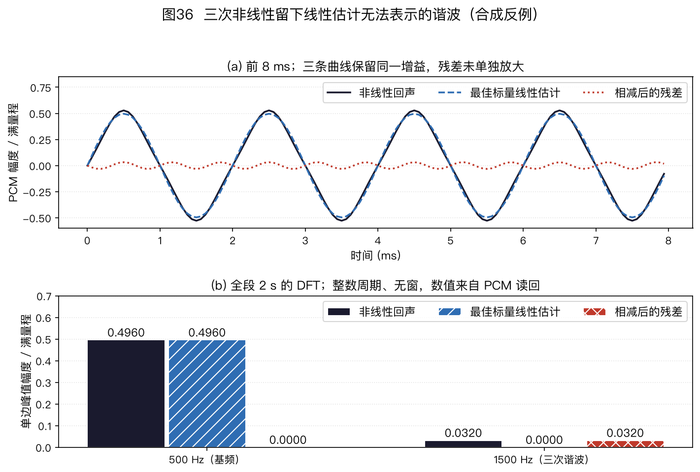

观察图36的两个子图：图36（a）在时域局部窗口对比失真回声 $d[n]$、最佳线性拟合 $\hat d[n]$ 与高频残差 $e[n]$，可见线性增益虽把 $500\ \mathrm{Hz}$ 主体完全贴合，残差中仍留下一列频率翻三倍的 $1500\ \mathrm{Hz}$ 细密正弦波；图36（b）对导出的 16 位 PCM 样本作离散傅里叶幅度谱分析（解析公式与量化后 PCM 读数间仅有微小舍入量化差），清晰标出 $500\ \mathrm{Hz}$ 基波归零后孤立耸立的 $1500\ \mathrm{Hz}$ 三次谐波峰，直观展示了为何线性时不变系统无法跨越频率去抵消非线性谐波。

接下来四道**算术与判决边界练习 E06-07～E06-10** 对应 [`aec_algorithm_minicases.py`](../codes/chapters/ch06/aec_algorithm_minicases.py) 输出的四个 JSON 键（`overlap_save`、`ipnlms`、`geigel`、`delay_polarity`），建议先纸面推演再运行脚本比对：

#### E06-07：循环卷积的哪半块能用？

取分区尺寸 $N=2,P=2$、固定四抽头路径 $h=[1,2\mid 3,4]$、输入序列 $x=[1,2,3,4]$（负时刻采样为零）。手算第 $m=1$ 块重叠输入 $[1,2,3,4]$ 与第一分区 $[1,2,0,0]$ 的四点循环卷积，叠加读取上一块 $[0,0,1,2]$ 的第二分区 $[3,4,0,0]$ 四点循环卷积，指出哪两个位置受循环折回污染、哪两个位置构成有效线性输出。

**解答**：第一分区四点循环卷积为 $[9,4,7,10]$（线性卷积第 $5$ 点末尾 $4\times 2=8$ 折回加到了首点 $1$ 上变成 $9$）；第二分区读取上一块 $[0,0,1,2]$ 与 $[3,4,0,0]$ 循环卷积得 $[8,0,3,10]$（末尾 $2\times 4=8$ 折回到首点）。两路的前两点均混有折回伪影或属于上一块旧时刻，必须全部丢弃；取出各自干净的后两点相加得 $[7+3,10+10]=[10,20]$，连同第 $0$ 块有效输出 $[1,4]$ 拼成 $[1,4,10,20]$，与四抽头直接线性卷积严丝合缝。

#### E06-08：IPNLMS 的混合系数如何改变一步更新？

设当前两抽头权重 $\hat{\vec w}=[0.8,0.2]^\top$、参考 $\vec x=[1,1]^\top$、麦克风观测 $d=1.2$、步长 $\mu=1$（在非零分母上令极小正则项趋零）。按式(6-11)分别求 $\kappa=-1,0,+1$ 三种配置下的比例权重 $\vec g$ 与一步增量 $\Delta\vec w$。

**解答**：先验残差为 $e=1.2-(0.8+0.2)=0.2$，$\|\hat{\vec w}\|_1=1.0$。代入 $\kappa=-1,0,+1$ 依次算出 $\vec g$ 为均匀 $[0.5,0.5]^\top$、折中 $[0.65,0.35]^\top$ 与纯比例 $[0.8,0.2]^\top$；因 $\vec x=[1,1]^\top$，三组加权分母 $\vec x^\top\mathbf G\vec x$ 均恰为 $1$，故一步增量 $\Delta\vec w$ 依次为 $[0.10,0.10]^\top$、$[0.13,0.07]^\top$ 与 $[0.16,0.04]^\top$，清晰展现 $\kappa$ 增大时步长预算如何向已显露的大抽头集中。

#### E06-09：没有近端语音，Geigel 为什么报双讲？

设两抽头声学路径 $h=[0.4,0.4]$、参考滑窗 $[1,1]$、近端语音严格为零，判决阈值取经典值 $T=0.5$。计算式(6-25)的判决比值；再考察参考滑窗全零 $[0,0]$ 时能否直接套用除法。

**解答**：纯远端单讲时两抽头回声同相叠加得 $d=0.4+0.4=0.8$，参考滑窗峰值 $M=1$，判决比 $\xi=0.8/1=0.8>0.5$，导致毫无近端语音时发生误报冻结。当参考窗全零时 $M=0$，必须由前置参考活动门限 $M>T_x$ 拦截跳过，绝不能靠给分母硬加微小常数算出虚假大比值误报双讲。

#### E06-10：负极性回声怎样骗过最大正峰？

令单脉冲参考 $x=[1,0,0,0]$，经反相扬声器或反相放大器产生纯两拍延迟负极性回声 $d=[0,0,-1,0]$。定义非负滞后互相关 $r_{xd}[k]=\sum_n x[n]d[n+k]$（$k=0,1,2,3$），对比“取最大有符号值”与“取最大绝对值”选出的延迟估计。

**解答**：四点互相关序列算得 $[0,0,-1,0]$。若代码粗心写成 `argmax(r_xd)` 只找最大有符号正值，真实延迟 $k=2$ 处的负峰 $-1$ 反倒成了最小值，算法会在并列最大值 $0$ 中错误挑出首下标 $k=0$（偏差整整 $2$ 拍）！改取绝对值峰值 `argmax(abs(r_xd))` 才能稳稳命中真实纯延迟 $k=2$。

接下来十道**子带、IPNLMS、RLS 与 Kalman 进阶手算练习 E06-11～E06-20** 对应脚本 [`aec_advanced_exercises.py`](../codes/chapters/ch06/aec_advanced_exercises.py)（单元测试 [`test_codes_aec_advanced_exercises.py`](../tests/test_codes_aec_advanced_exercises.py) 以精确有理数核验每一步）：

#### E06-11：低带输入能否产生高带回声？

在式(6-8)两点正交 Haar 分解下，取分段常数参考 $x=[1,1\mid 0,0]$ 与一拍延迟回声 $d[n]=x[n-1]$。写出第 $m=0,1$ 两块的输入高带 $u_1[m]$ 与输出高带 $v_1[m]$，说明为何独立同带滤波器无法消除该高带回声。

**解答**：输入第 $0$ 块两点相等（$1-1=0$）、第 $1$ 块全零，故输入高带全程恒为零 $u_1=[0,0]$！而一拍延迟后的麦克风序列为 $d=[0,1\mid 1,0]$，按式(6-8)算出输出高带非零：$v_1=[-1/\sqrt{2},\ +1/\sqrt{2}]$。任何只读本带输入 $u_1$ 的同带线性滤波器面对全零输入只能输出全零，唯有引入式(6-9)的低带到高带交叉支路 $u_0\to v_1$ 才能重构这组跨块延迟回声。

#### E06-12：删掉交叉项会改变什么？

针对图37（b）的单位脉冲输入 $x=[1,0,0,0]$ 与一拍延迟路径 $h=[0,1]$，分别手算保留完整 $2\times 2$ 子带矩阵与强行砍掉非对角交叉项（仅留同带对角元）经 Haar 合成还原出的四点时域序列及二者之差。

**解答**：完整四支路子带映射精确还原出无损延迟脉冲 $[0,1,0,0]$；仅保留同带对角支路时，奇数延迟引发的子带混叠失去交叉项抵消，合成出泄露序列 $[0,0.5,0,0.5]$；两者之差 $[0,0.5,0,-0.5]$ 正是被砍掉的跨带耦合贡献。

#### E06-13：正则项没有省略时如何更新 IPNLMS？

保持 E06-08 的 $\hat{\vec w}=[0.8,0.2]^\top$、$\vec x=[1,1]^\top$、$d=1.2$、$\mu=1$，但显式保留非零正则参数 $\varepsilon_g=2,\delta=0.25$。求 $\kappa=0$ 时的先验误差、$\vec g$、分母与 $\Delta\vec w$；再验证 $\kappa=-1$ 时等价于哪个 $\varepsilon$ 取值的标准时域 NLMS。

**解答**：先验误差 $e=0.2$。当 $\kappa=0$ 时，比例项分母为 $2(0.8+0.2)+2=4$，故 $g_0=0.25+0.8/4=0.45$、$g_1=0.25+0.2/4=0.30$（注意 $\sum g_l=0.75$，切勿画蛇添足二次归一化为 $1$！），更新分母为 $0.75+0.25=1.0$，得 $\Delta\vec w=0.2\times[0.45,0.30]^\top=[0.09,0.06]^\top$。当 $\kappa=-1$ 时，$\vec g=[0.5,0.5]^\top$，分母为 $1.0+0.25=1.25$，得 $\Delta\vec w=[0.08,0.08]^\top$，与取 $\varepsilon=L\delta=2\times 0.25=0.5$ 的式(6-3)标准 NLMS（$0.2[1,1]^\top/(2+0.5)=[0.08,0.08]^\top$）完全相等。

#### E06-14：为什么不能直接从纯比例零权重起步？

设 $L=2$、全零初值 $\hat{\vec w}=[0,0]^\top$、纯比例模式 $\kappa=1$、$\varepsilon_g>0,\delta>0$，任取非零参考 $\vec x$ 与非零残差 $e$。按式(6-11)计算更新方向。

**解答**：代入 $\kappa=1$ 使均匀探索项 $(1-\kappa)/(2L)=0$，而全零初值又使比例项分子 $(1+\kappa)|\hat w_l|=0$（正数 $\varepsilon_g>0$ 虽保住了分母不除零，却救不了分子为零），导致对角阵 $\mathbf G=\mathbf 0$、更新方向 $\mathbf G\vec x=\vec 0$，两抽头永久卡死在零点！因此实用比例算法必须取 $\kappa<1$ 保留均匀底座（或如原始 PNLMS 那样给 $|\hat w_l|$ 设定正的下限地板）。

#### E06-15：RLS 的“记忆长度”换成秒是多少？

在无冻结连续更新下取遗忘因子 $\lambda=0.99$，计算某次历史观测经过 $100$ 次更新后的指数权重衰减倍率；再分别按“$16\ \mathrm{kHz}$ 逐采样更新”与“每 $10\ \mathrm{ms}$ 逐帧更新”换算对应的物理秒数。

**解答**：经过 $100$ 次更新后的相对权重为 $0.99^{100}\approx 0.3660$（近似 $e^{-1}\approx 0.3679$）。若每采样更新一次，$100$ 步仅走过 $100/16000=0.00625\ \mathrm{s}$（$6.25\ \mathrm{ms}$）；若每 $10\ \mathrm{ms}$ 分帧更新一次，$100$ 步则跨越整整 $1.0\ \mathrm{s}$！可见脱离更新周期空谈“$\lambda=0.99$ 记忆多长”毫无物理意义。

#### E06-16：双讲若误当路径变化会怎样？

沿用 §6.2.6 末尾的单抽头标量 Kalman 模型：首拍单讲观测后状态已达 $w_0=10/11,P_0=1/11$（$a=1,\Phi=0$）。第二拍 $x=1$，真实路径仍为 $1$，但叠加了近端语音 $s=2$ 使麦克风观测升至 $d=3$。对比“漏检双讲维持低 $\Psi=0.1$”“准确检出双讲抬升 $\Psi=10$”与“理想冻结”三种策略的第二拍后验权重。

**解答**：第二拍先验新息为 $e_1^-=3-10/11=23/11$。维持低观测方差 $\Psi=0.1$ 时，滤波器误以为观测极可靠，卡尔曼增益高达 $K=(1/11)/(1/11+1/10)=10/21$，把权重一把拽偏到 $10/11+(10/21)(23/11)=440/231\approx 1.905$；抬升 $\Psi=10$ 后，增益急剧收缩为 $K=(1/11)/(1/11+10)=1/111$，后验权重稳守在 $10/11+23/1221\approx 0.928$，紧贴理想冻结值 $10/11\approx 0.909$。

#### E06-17：RLS 递推是否真等于目标函数的解？

取 §6.2.5 锚点手算第 $1$ 拍累加得到的正规方程矩阵（对角元 $7/4,5/4$，非对角元 $1$）$\mathbf R_1$ 与右端互相关向量 $\vec p_1=[5/2,2]^\top$。不借用式(6-18)的 Woodbury 增益递推，直接求行列式并解二元线性方程组 $\mathbf R_1\vec w_1=\vec p_1$。

**解答**：行列式 $\det\mathbf R_1=(7/4)(5/4)-1=19/16>0$。用伴随矩阵公式直接求逆乘以 $\vec p_1$：

$$\begin{aligned}
\vec w_1
&=\frac{16}{19}\begin{bmatrix}5/4&-1\\-1&7/4\end{bmatrix}
  \begin{bmatrix}5/2\\2\end{bmatrix}
 =\frac{16}{19}\begin{bmatrix}9/8\\1\end{bmatrix}
 =\begin{bmatrix}18/19\\16/19\end{bmatrix},
\end{aligned}$$

与式(6-18)两步秩 $1$ 递推算出的结果一字不差，验证了 Woodbury 引理并非近似而是精确恒等变换。

#### E06-18：舍去 Kalman 非对角协方差会怎样？

取 §6.2.6 两抽头矩阵 Kalman 首拍更新后的误差协方差 $\mathbf P$（对角元 $5/6$ 与 $4/3$，非对角元 $-2/3$），设下一拍差模参考向量为 $\vec x=[-1,1]^\top$、观测噪声方差 $\Psi=1$。对比保留完整矩阵 $\mathbf P$ 与强行抹零非对角元作对角近似算出的下一步新息方差 $S=\vec x^\top\mathbf P\vec x+\Psi$。

**解答**：完整矩阵保留了跨抽头负相关项，二次型 $\vec x^\top\mathbf P\vec x+\Psi$ 等于 $(5/6+4/3+4/3)+1=21/6+1=4.5$；若强行丢掉 $-2/3$ 仅留对角元，算出的新息方差缩水为 $(5/6+4/3)+1=19/6\approx 3.167$。首拍和模观测 $\vec x_0=[1,1]^\top$ 只约束了“两抽头之和”，差模方向原本毫无把握，丢弃负相关非对角元便人为低估了差模方向的预测不确定度。

#### E06-19：未知一拍路径的交叉带第一步怎样更新？

在式(6-10)两带全交叉自适应结构中，取 $x=[1,1\mid 0,0]$、$d=[0,1\mid 1,0]$、阶数 $K=2$、全零初值 $\mathbf W=\mathbf 0$、$\mu=1$、$\varepsilon=1$。手算第 $m=0$ 块的两带先验误差、公共分母 $D$ 及更新后的四个当前块权重 $W_{i,j,0}$，指出哪一项体现了跨带学习。

**解答**：第 $0$ 块子带输入为 $\vec u_0=[\sqrt{2},0]^\top$，子带观测为 $\vec v_0=[1/\sqrt{2},-1/\sqrt{2}]^\top$；因初值为零，先验误差即 $\vec e_0=\vec v_0$，公共能量分母 $D=1+(\sqrt{2})^2+0=3$。一步更新后，$W_{0,0,0}=(\frac{1}{\sqrt{2}}\cdot\sqrt{2})/3=1/3$，**跨带系数** $W_{1,0,0}=(-\frac{1}{\sqrt{2}}\cdot\sqrt{2})/3=-1/3$，而以零输入高带 $j=1$ 为源的 $W_{0,1,0}=W_{1,1,0}=0$。非零的 $W_{1,0,0}=-1/3$ 直接证实了高输出带能够从低输入带捕获奇数延迟能量。

#### E06-20：两带模型是否必然省抽头、省等待？

设全带物理回声路径含 $L=4$ 个非零时域抽头，若改用无结构约束的两点 Haar 全交叉子带状态精确表示该路径，求所需的最小子带块阶数 $K$、独立实权重总数，以及收到块首采样后至少还需等待几个采样才能算出当前两点块。

**解答**：跨块奇延迟边界使最小块阶数为 $K=\lfloor 4/2\rfloor+1=3$；$2\times 2$ 四条输入—输出子带支路各需 $3$ 个抽头，独立实参数总数反而膨胀至 $4K=12$ 个（是原四抽头时域 FIR 的 $3$ 倍）！同时，收到偶采样 $x[2m]$ 后必须再等 $1$ 个采样收齐奇采样 $x[2m+1]$ 才能执行式(6-8)分析变换。这再次印证了 §6.2.3 的选型结论：临界采样全交叉结构用于揭示混叠耦合机理，工业降维加速则常转向过采样对角子带或 NSAF 结构。

<a id="e06-21"></a>

#### E06-21：参考与近端正交，为什么在线系数仍会移动？

取单抽头真实路径 $h=0.8$、四点零均值参考序列 $\vec x=[1,1,-1,-1]^\top$、四点正交近端序列 $\vec s=[0.5,-0.5,0.5,-0.5]^\top$，构成麦克风混合观测 $d[n]=h x[n]+s[n]$。先求四点整段批量最小二乘解，再从已经精确收敛的真值起点 $w_{-1}=0.8$ 出发，按式(6-3)取 $\mu=0.5,\varepsilon=0$ 逐样本在线更新（每拍 $x^2[n]=1$，分母恒为 $1$），观察在线权重为何发生移动。

**第一步：先推导总体正规方程。** 在路径恒定、二阶矩存在且参考二阶矩矩阵 $\mathbf R_{xx}=\mathbb{E}[\vec x\vec x^\top]$ 正定可逆的条件下，将 $d=\vec x^\top\vec h+s$ 代入均方误差最小化的正规方程：

$$\begin{aligned}
\mathbf R_{xx}\vec w_\star&=\mathbb{E}[\vec x d]\\
&=\mathbf R_{xx}\vec h+\mathbb{E}[\vec x s],\\
\vec w_\star&=\vec h+\mathbf R_{xx}^{-1}\mathbb{E}[\vec x s].
\end{aligned}\tag{6-34}$$

当信号已去均值时，统计不相关即保证交叉二阶矩 $\mathbb{E}[\vec x s]=\vec 0$（未去均值时须直接核查 $\mathbb{E}[\vec x s]$ 而非仅查协方差），式(6-34)给出总体最优解无偏 $\vec w_\star=\vec h$。

**第二步：计算四点有限批量解。** 逐点内积 $\vec x^\top\vec s=0.5-0.5-0.5+0.5=0$，$\vec x^\top\vec x=4$，混合序列为 $\vec d=[1.3,0.3,-0.3,-1.3]^\top$，故整批最小二乘解为 $w_{\mathrm{batch}}=\vec x^\top\vec d/4=3.2/4=0.8=h$（反之若把近端改为与参考共线的 $\vec s=0.25\vec x$，批量解就会有偏地移到 $0.8+0.25=1.05$）。

**第三步：逐样本在线递推。** 每一拍先算先验残差 $e[n]=d[n]-w_{n-1}x[n]$，再更新 $w_n=w_{n-1}+0.5x[n]e[n]$，四拍精确结果如下：

| 样本 $n$ | 先验误差 $e[n]$ | 权重改变量 | 更新后 $w_n$ |
|---|---:|---:|---:|
| 0 | 0.50000 | 0.25000 | 1.05000 |
| 1 | −0.75000 | −0.37500 | 0.67500 |
| 2 | 0.37500 | −0.18750 | 0.48750 |
| 3 | −0.81250 | 0.40625 | 0.89375 |

症结水落石出：整窗和 $\sum_n x[n]s[n]=0$ 并不等于每一拍瞬时乘积 $x[n]s[n]$ 都为零！在线算法在 $n=0$ 就被瞬时项 $x[0]s[0]=+0.5$ 推离了 $0.8$，随后三拍权重一边改变一边耦合后续观测，跑完四拍停在 $0.89375\neq 0.8$。这就是为什么哪怕近端人声与远端参考在统计上完全独立，双讲期不收紧步长依然会让在线权重剧烈抖动（复算入口见 [`enhancement_step_exercises.py`](../codes/chapters/ch00/cross_chapter/enhancement_step_exercises.py) 的 `E06-21`）。

#### E06-22：共同残差为什么还需要共同归一化？

在双声道单抽头模型中，取等幅同相参考 $x_1=x_2=1$、麦克风观测 $d=1$，两支路权重初值均为零，取单通道下稳定收敛的步长 $\mu=1.5$（非零分母上取 $\varepsilon=0$）。每拍先算式(6-30)的共享总残差 $e=1-w_1-w_2$，再同步更新两条支路，对比“除以拼接总能量 $x_1^2+x_2^2=2$”与“各除以本声道局部能量 $x_r^2=1$”的稳定性。

**推导与结果**：采用拼接共同分母时，每条支路分得增量 $\mu e/2$，两路预测改变量合计为 $\mu e$；若各自使用局部分母，每条支路都迈出完整 $\mu e$，两路合计改变量翻倍成 $2\mu e$！代回同一观测算后验残差：

$$\begin{aligned}
e^+_{\mathrm{joint}}&=(1-\mu)e=-\tfrac{1}{2}e,\\
e^+_{\mathrm{local}}&=(1-2\mu)e=-2e.
\end{aligned}$$

连续送入三次相同观测，共同分母下的先验残差序列按公比 $-1/2$ 几何收敛为 $[1,-0.5,0.25]$（首步 $w_1=w_2=0.75$）；局部分母下则按公比 $-2$ 交替变号爆炸为 $[1,-2,4]$（首步 $w_1=w_2=1.5$）！可见多参考系统仅有共享总残差还不够，归一化能量分母必须汇总所有同步更新支路的总激励功率（当然，共同分母只保住稳定性，并不能替共线输入拆解出各自独立的真实权重）。

#### E06-23：训练抵消正确，为什么换节目就失败？

设立体声两扬声器真实单抽头路径为 $\vec h=[1,2]^\top$，而某次单声道节目训练后停在候选权重 $\hat{\vec h}=[1.5,1.5]^\top$。训练期两拍左右声道完全相同：$x_1=x_2=[1,-1]$；随后冻结权重，换用左右反相的新节目采样 $[x_1,x_2]=[1,-1]$ 作留出检验。

**训练期与留出期对比**：训练期两组权重的抽头和同为 $1+2=1.5+1.5=3$，故真实回声与预测回声同为 $[3,-3]$，训练残差恒等于 $0$（双通道参考矩阵秩为 $1$，差模方向 $[1,-1]^\top$ 完全落入零空间）。一旦换上留出新观测 $[1,-1]$，真实物理回声变为 $1\times 1+2\times(-1)=-1$，而假权重预测出 $1.5\times 1+1.5\times(-1)=0$，立刻漏出残差 $-1$！这正是 §6.9 强调立体声去相关与跨节目留出验收的直观缩影。

#### E06-24：参考对齐后还剩多少因果时延？

设真实回声仅为纯延迟 $D=3$ 个采样，通过缓冲偏移量 $\delta$ 构造送入滤波器的对齐参考 $x_a[n]=x[n-\delta]$（注意本题用 $\delta$ 表示整数样本延迟补偿量，勿与频域功率地板混淆）。因果 FIR 滤波器长度为 $L=3$，覆盖非负相对时延 $\{0,1,2\}$。分别检验 $\delta=1,3,4$ 时该三抽头滤波器能否精确表达真实回声。

**推导与判据**：令 $x[n-D]=x_a[n-r]=x[n-\delta-r]$，得对齐后剩余相对时延 $r=D-\delta$，必须满足因果支撑区间 $0\le r\le L-1=2$：

| 补偿量 $\delta$ | 剩余时延 $r$ | 三抽头表示 |
|---:|---:|---|
| 1 | 2 | 可表示，抽头 $[0,0,1]$ |
| 3 | 0 | 可表示，抽头 $[1,0,0]$ |
| 4 | −1 | 不可由该因果 FIR 表示 |

当过度推迟参考使 $\delta=4$ 时，$r=-1$ 意味着当前麦克风里的回声对应下一拍才会送进滤波器的“未来参考” $x_a[n+1]$——此时把因果抽头 $L$ 拉得再长也只往过去延展，唯有减小参考缓冲推迟量才能恢复因果性。

#### E06-25：缓慢的时钟漂移为何会破坏相减？

设名义采样率 $f_s=16\ \mathrm{kHz}$，播放参考晶振相对采集晶振存在 $\rho=250\times 10^{-6}$（即 $250\ \mathrm{ppm}$）的速率差，使回声副本相对真实回声累积出线性增长的残余时延 $\Delta n(t)=\rho f_s t$。考察频率 $1\ \mathrm{kHz}$ 的稳态单频回声，假设副本幅度始终准确，求通话进行到 $t=1\ \mathrm{s}$ 与 $t=2\ \mathrm{s}$ 时的相位漂移幅值与残余回声功率比。

**逐步代入**：$t=1\ \mathrm{s}$ 时累积滑移 $\Delta n(1)=250\times 10^{-6}\times 16000=4$ 个采样；$t=2\ \mathrm{s}$ 时滑移 $\Delta n(2)=8$ 个采样。折算为 $1\ \mathrm{kHz}$ 处的相位差与归一化残余功率比：

$$\begin{aligned}
|\phi(t)|&=2\pi\frac{1000}{16000}\Delta n(t),\\
R(t)&=\left|1-e^{-\mathrm{j}\phi(t)}\right|^2
=2-2\cos\phi(t).
\end{aligned}$$

**结果与启示**：在 $t=1\ \mathrm{s}$ 与 $2\ \mathrm{s}$ 处，相位偏差分别高达 $\pi/2$（$90^\circ$）与 $\pi$（$180^\circ$ 反相），使残余功率比飙升至 $R(1)=2$（比不消还响 $+3.01\ \mathrm{dB}$）与 $R(2)=4$（反相叠加响 $+6.02\ \mathrm{dB}$）！短短一两秒内的微小晶振频差就能彻底瓦解高频相位对齐，直观说明了跨时钟域硬件必须引入异步重采样跟踪（SRC）。

#### E06-26：参考恢复后，为什么还有一小段残余？

设扬声器连续真实播出的序列为 $x=[1,2,3,4,5,6]$（负时刻为零），真实两抽头声学路径与已收敛冻结的滤波器权重同为 $h=[1,0.5]$。假设软件管道在零基下标 $n=2,3$ 发生短暂参考丢包置零，使送入 AEC 的参考变成 $x_a=[1,2,0,0,5,6]$（无近端与底噪）。逐拍求真实回声 $\vec y$、滤波器预测 $\hat{\vec y}$ 与残差 $\vec e$。

**逐点卷积核对**：每拍回声由“当前样本 $+0.5\times$ 上一拍样本”给出：

$$\begin{aligned}
\vec y&=[1,\ 2.5,\ 4,\ 5.5,\ 7,\ 8.5]^\top,\\
\hat{\vec y}&=[1,\ 2.5,\ 1,\ 0,\ 5,\ 8.5]^\top,\\
\vec e&=\vec y-\hat{\vec y}=[0,\ 0,\ 3,\ 5.5,\ 2,\ 0]^\top.
\end{aligned}$$

重点看第 $n=4$ 拍：此时参考流明明已经恢复正常（$x_a[4]=x[4]=5$），为什么残差里还冒出一个 $2$？因为 FIR 滑动窗口里的前一拍历史位置装的还是刚才丢包留下的假零（漏算了 $0.5\times x[3]=0.5\times 4=2$），直到第 $n=5$ 拍全部非零抽头跨度内的历史样本彻底刷成真值，残差才重新归零！一般地，参考缺口引发的残差严格满足线性卷积 $h*(x-x_a)$，其污染持续时长等于“丢包时长 $+$ 路径非零抽头尾长”。

本仓库配套提供了展示这一参考断流尾迹的[四条 $16\ \mathrm{kHz}$、$2\ \mathrm{s}$ 数学合成音频](../codes/chapters/ch00/research/05_exercises_and_audio.md#28-aec-参考断流与历史尾)：固定 $256$ 抽头稀疏路径仅在滞后 $0,80,240$ 点取 $[0.7,-0.3,0.15]$（权重装入真值并全程冻结；远端为固定种子 `20261028` 均匀随机序列加 $310\ \mathrm{Hz}$ 正弦，近端为 $220/330/660\ \mathrm{Hz}$ 三音和弦，首尾 $320$ 点淡入淡出，共同导出增益 $1$）。扬声器真实播放不断，算法参考在 `[0.75, 1.0)` $\mathrm{s}$（样本 $[12000,16000)$）置零；参考在 $16000$ 点恢复后，仍需排空 $240$ 点路径记忆，直至索引 $16240$（$1.015\ \mathrm{s}$）才完全恢复干净：

- [近端目标：评分参考](../codes/chapters/ch06/audio/aec_dropout_target.wav)
- [麦克风混合：近端加真实回声](../codes/chapters/ch06/audio/aec_dropout_microphone.wav)
- [参考完整的残差：用真值冻结路径抵消](../codes/chapters/ch06/audio/aec_dropout_complete_reference_residual.wav)
- [参考丢块的残差：相同路径，算法参考被置零](../codes/chapters/ch06/audio/aec_dropout_missing_reference_residual.wav)

读取导出的 16 位 PCM 与近端目标轨逐点比对相对平方误差：参考完整对照轨在丢块期 `[12000, 16000)`、排空恢复尾 `[16000, 16240)` 与完全恢复区 `[16240, 30000)` 均为 $0$；而丢块轨在三段窗口依次录得约 $0.7740$、$0.06483$ 与 $0$，听感与算术双重印证了 $240$ 点历史尾的排空延迟。

#### E06-27：NCC 四状态判决究竟读取了什么？

针对 §6.4.1 的五分支活动表与式(6-26)去均值绝对互相关 $c_{xd}$，设每帧长 $4$ 点，定义零均值正交基序列 $\vec a=[1,-1,1,-1]^\top$、$\vec b=[1,1,-1,-1]^\top$ 与静音帧 $\vec z=[0,0,0,0]^\top$（$\vec a,\vec b$ 的去均值均方根均为 $1$，且 $\vec a^\top\vec b=0$）。取活动均方根门限 $0.1$、$c_{xd}$ 门限 $0.8$，手算以下六帧输入的输出状态：

| $(x,d)$ | 有定义时的绝对 NCC | 判决 |
|---|---:|---|
| $(z,z)$ | 无；接口记录 0 | 静音 |
| $(a,0.5a)$ | 1 | 远端单讲 |
| $(z,b)$ | 无；接口记录 0 | 近端单讲 |
| $(a,b)$ | 0 | 双讲 |
| $(a,z)$ | 无；接口记录 0 | 远端单讲 |
| $(a,-a)$ | 1 | 远端单讲 |

**边界梳理**：当 $d=\alpha x$（$\alpha\neq 0$）时，$\tilde d=\alpha\tilde x$，分子 $|\alpha|P_x$ 与分母 $\sqrt{P_x\cdot\alpha^2 P_x}=|\alpha|P_x$ 精确约分得 $c_{xd}=1$，因此第 6 行反相回声 $(a,-a)$ 不会误报双讲；当任一路方差为零时（第 1、3、5 行），分母为零不形成相关比值（软件字段填 `0` 仅作占位），直接由前置幅度门限走活动分支，故第 5 行“远端在播而麦克风极静”正确归为远端单讲。另需留意：整体同乘常数不改 $c_{xd}$，却可能让弱信号跌破固定幅度门限；工程范数实现还应按最大幅值缩放防平方上溢。

#### E06-28：用后验残差评分会得到什么虚假改善？

取标量 Kalman 初态 $w^-=0,P^-=1$，观测干扰方差 $\Psi=1$，当前拍参考 $x=1$、麦克风观测 $d=2$。对比真实因果输出的先验残差 $e^-$ 与更新完权重后回头重算同一观测的后验残差 $e^+$。

**代入核算**：卡尔曼增益 $K=1/(1+1)=1/2$；因果先验残差为 $e^-=2-0=2$，更新后权重升至 $w^+=0+(1/2)\times 2=1$，若违规拿 $w^+$ 回头重算当前拍残差则得 $e^+=2-1\times 1=1$，二者平方比凭空多出：

$$10\log_{10}\frac{(e^-)^2}{(e^+)^2}
=10\log_{10}4\approx 6.02\ \mathrm{dB}.$$

这整整 $6.02\ \mathrm{dB}$ 的“改善”纯粹来自拿刚刚参与拟合的同一个数据点自我打分（数据泄漏），实时因果流根本不可能在收到 $d[n]$ 之前预知 $w^+$。因此一切自适应滤波评测都必须严格绑定更新前的先验残差 $e^-$。

#### E06-29：冻结是否一定让权重和协方差都不变？

对比本仓库两套状态类的 `freeze=True` 语义：在一维矩阵 Kalman 中设初态 $w=2,P=3$，阻尼转移因子 $a=0.5$、过程方差 $Q=1$，连续两拍送入 $(x=1,d=9,\Psi=1)$ 并开启冻结；在 RLS 中设遗忘因子 $\lambda=0.5$、初始正则 $\delta=1/3$、相同数值初态 $w=2,P=3$，同样连续冻结两拍。

**两套接口行为对比**：

- **Kalman 状态演化**：`freeze=True` 仅跳过麦克风新息修正项 $K e^-$，时间预测步 $w^-=a w$、$P^-=a^2 P+Q$ 照常推进！因此第 $1$ 拍后变为 $w=1,P=0.25\times 3+1=1.75$；第 $2$ 拍后变为 $w=0.5,P=0.25\times 1.75+1=1.4375$（向阻尼稳态先验回归）；
- **RLS 状态保持**：`freeze=True` 同时暂停样本拟合与 $\lambda^{-1}$ 遗忘膨胀，两拍后权重与逆相关阵分毫不差停在 $w=2,P=3$（仅内部 FIR 参考滑窗照常移位）；
- **零先验方差死锁边界**：反之若在允许更新的 Kalman 中误设 $a=1,w=0,P=0,Q=0$，则每拍 $P^-=0\implies K=0$，面对 $x=1,d=2$ 的清晰观测也永远卡死在错误初值 $w=0$ 上。

#### E06-30：协方差检查为什么不能只看对角线？

考察以下两个对角元完全相同的 $2\times 2$ 实对称矩阵：

$$\mathbf P_1=\begin{bmatrix}1&1\\1&1\end{bmatrix},\qquad
\mathbf P_2=\begin{bmatrix}1&2\\2&1\end{bmatrix}.$$

**半正定性与数值校验边界**：$\mathbf P_1$ 的特征值为 $2$ 和 $0$，属于合法的奇异半正定协方差矩阵（对应两随机变量完全相等，不能一见行列式为零就粗暴拒收）；而 $\mathbf P_2$ 虽然对角元全正（均为 $1$），特征值却是 $3$ 和 $-1$，取差模测试向量 $\vec z=[1,-1]^\top$ 立得二次型 $\vec z^\top\mathbf P_2\vec z=-2<0$，意味着差模组合的方差为荒谬的负数！

同样地，对极小尺度上三角非对称矩阵 $\mathbf P_3$（对角元与右上元均为 $10^{-20}$、左下元为 $0$，反对称分量与自身范数同阶，不能用绝对容差 $10^{-12}$ 放过）以及含真实负特征值的 $\mathbf P_4=\operatorname{diag}(-10^{-11},1)$，本书 `KalmanAECState`（固定两抽头、$a=1,Q=0,\Psi=1$）只接受合法半正定的 $\mathbf P_1$，而将其余三者全部明确拦截报错——数值校验切忌靠悄悄取绝对值或强行抹掉虚部来掩盖上游统计量计算错误。

<a id="e06-31"></a>

#### E06-31：块 ERLE 的 dB 均值等于整窗 ERLE 吗？

设连续两个有效远端单讲数据块的真实回声能量分别为 $[1,100]$，消除后残余回声能量分别为 $[0.01,100]$（无底噪与近端语音）。对比“先逐块算 $\mathrm{dB}$ 再求算术平均”与“先汇总整窗总能量再按式(6-29)求 $\mathrm{dB}$”的结果差异。

**两种统计口径对照**：逐块计算时，第 $1$ 块（弱音段）为 $10\log_{10}(1/0.01)=20\ \mathrm{dB}$，第 $2$ 块（强音失配段）为 $10\log_{10}(100/100)=0\ \mathrm{dB}$，算术均值给出看似不错的 **$10\ \mathrm{dB}$**；而按式(6-29)汇总整窗总能量再取对数，结果为：

$$\begin{aligned}
\mathrm{ERLE}_{\mathrm{all}}
&=10\log_{10}\frac{1+100}{0.01+100}
=10\log_{10}\frac{101}{100.01}
\approx 0.04278\ \mathrm{dB}.
\end{aligned}$$

整窗总能量比几乎为 **$0\ \mathrm{dB}$**！原因在于对数算术平均本质上是能量比的几何平均，给微弱尾音块与响亮元音块赋予了同等话语权；而整窗汇总能量则如实反映占总能量 $99\%$ 的响亮块丝毫未被抵消的事实。因此对比论文或竞品指标时，必须核清对方采用的是逐帧 $\mathrm{dB}$ 均值还是整段能量比。

#### E06-32：参考与近端不相关，NLMS 的期望方向为何仍可能偏移？

设单抽头真实路径 $h=0.8$，观测 $d=h x+s$。假设每一拍独立等概率（各 $1/4$）抽取下表四种非零状态之一，取 $\varepsilon=0$、固定步长 $0<\mu<2$。对比总体普通最小二乘解与**给定当前权重 $w$ 时 NLMS 一步更新的条件期望**。

| 状态 | $x$ | $s$ | $xs$ | $s/x$ |
|---|---:|---:|---:|---:|
| 1 | 1 | 1 | 1 | 1 |
| 2 | −1 | −1 | 1 | 1 |
| 3 | 2 | −0.5 | −1 | −0.25 |
| 4 | −2 | 0.5 | −1 | −0.25 |

**总体解 vs 归一化期望解**：四态等概下，$\mathbb{E}[x]=\mathbb{E}[s]=0$，交叉二阶矩 $\mathbb{E}[x s]=(1+1-1-1)/4=0$，$\mathbb{E}[x^2]=(1+1+4+4)/4=5/2$，故式(6-34)给出普通最小二乘最优解精确等于真值 $w_{\mathrm{LS}}=h=0.8$。

然而在单抽头无地板 NLMS 中，分母 $x^2$ 把每拍梯度重加权成了 $s/x$：

$$\begin{aligned}
w^+&=w+\mu\frac{(h x+s-w x)x}{x^2}
    =(1-\mu)w+\mu\left(h+\frac{s}{x}\right),\\
\mathbb{E}\!\left[\frac{s}{x}\right]
   &=\frac{1+1-0.25-0.25}{4}
    =\frac{3}{8}=0.375\neq 0!
\end{aligned}$$

于是条件期望变为 $\mathbb{E}[w^+\mid w]=(1-\mu)w+\mu(0.8+0.375)$：即使当前已处在真值 $w=0.8$（取 $\mu=0.5$），下一步权重的期望也会漂向 $0.9875$，长期均值不动点更是偏到了 $47/40=1.175$！奥秘在于本题的 $x$ 与 $s$ 虽**线性不相关**（$\mathbb{E}[xs]=0$），却**并非统计独立**（小幅度 $|x|=1$ 时 $s$ 与 $x$ 同号，大幅度 $|x|=2$ 时异号，条件期望 $\mathbb{E}[s\mid x]\neq 0$），除以 $x^2$ 放大了小幅度同号样本的话语权，打破了正交平衡。

#### E06-33：注入增量误差里，增益与其他失真各占多少？

在 §6.15.4 双运行近端探针模型中，设已知近端参考为 $\vec s=[1,-1,1,-1]^\top$，垂直失真分量为 $\vec r=0.3[1,1,-1,-1]^\top$，实测输出增量为 $\vec\Delta=0.8\vec s+\vec r=[1.1,-0.5,0.5,-1.1]^\top$。按式(6-33)求投影增益 $g_\Delta$ 与相对平方误差 $E_\Delta$ 的正交分解。

**正交毕达哥拉斯分解**：因 $\vec s^\top\vec r=0$ 且 $\|\vec s\|^2=4$，投影增益为 $g_\Delta=\vec s^\top\vec\Delta/\|\vec s\|^2=0.8$。将增量偏差改写为 $\vec\Delta-\vec s=(g_\Delta-1)\vec s+\vec r$，两正交项平方和直接相加：

$$\begin{aligned}
E_\Delta
&=(g_\Delta-1)^2+\frac{\|\vec r\|^2}{\|\vec s\|^2}
=(-0.2)^2+0.3^2=0.04+0.09=0.13.
\end{aligned}$$

这一分解清晰给出不等式下界 $E_\Delta\ge(g_\Delta-1)^2$：单看 $g_\Delta=0.8$ 只反映了近端整体幅度衰减 $20\%$（贡献 $0.04$ 误差），唯有联合查看超出 $(g_\Delta-1)^2$ 的剩余份额 $0.09$，才能揪出非线性谐波畸变或自适应状态分岔引入的正交波形失真。

上述 **E06-22～E06-33**（以及后文 E06-40、E06-41、E06-43、E06-44）由脚本 [`chapter06_experiments.py`](../codes/chapters/ch06/chapter06_experiments.py) 统一复算（执行 `.venv/bin/python -m codes.chapters.ch06.chapter06_experiments` 按题号核查）。接下来五道**仿射投影专题手算练习 E06-34～E06-38** 由 [`aec_affine_projection_demo.py`](../codes/chapters/ch06/aec_affine_projection_demo.py) 复算：

<a id="e06-34"></a>

#### E06-34：两列仿射投影如何一步一步计算？

设两抽头真实路径 $\vec h=[1/2,1/4]^\top$，连续无噪参考采样为 $x[-1]=0,x[0]=1,x[1]=2$，权重初值为零。第 $0$ 拍收到真实回声 $d[0]=1/2$ 时人为冻结权重（仅将观测压入窗口）；第 $1$ 拍收到 $d[1]=5/4$ 时按最大投影阶数 $K=2$、步长 $\mu=1$、正则常数 $\delta=1$ 执行一次式(6-14)更新，并与无正则完全投影（$\delta=0$）及单列 NLMS（$K=1,\delta=1$）同图对比（见 §6.2 图57）。

**第一步：拼装数据矩阵与同权重误差向量。** 按当前样本在前的滑窗规则，第 $1$ 拍与第 $0$ 拍的回归列分别为 $[2,1]^\top$ 与 $[1,0]^\top$；因首拍冻结使旧权重仍为零，先验窗口误差等于观测向量本身：

$$\mathbf U=\begin{bmatrix}2&1\\1&0\end{bmatrix},\qquad
\vec d=\vec e^-=\begin{bmatrix}5/4\\1/2\end{bmatrix}.$$

**第二步：计算 $2\times 2$ Gram 矩阵及加载逆矩阵。** 两列范数平方分别为 $5$ 和 $1$，列内积为 $2$：

$$\begin{aligned}
\mathbf G&=\mathbf U^\top\mathbf U
          =\begin{bmatrix}5&2\\2&1\end{bmatrix},\\
\mathbf G+\mathbf I
         &=\begin{bmatrix}6&2\\2&2\end{bmatrix},\qquad
\det(\mathbf G+\mathbf I)=8,\\
(\mathbf G+\mathbf I)^{-1}
         &=\frac{1}{8}\begin{bmatrix}2&-2\\-2&6\end{bmatrix}.
\end{aligned}$$

**第三步：先解小维系数 $\vec\alpha$，再线性组合回归列。** 代入式(6-14)后两行：

$$\begin{aligned}
\vec\alpha&=(\mathbf G+\mathbf I)^{-1}\vec e^-\\
&=\frac{1}{8}
  \begin{bmatrix}2(5/4)-2(1/2)\\-2(5/4)+6(1/2)\end{bmatrix}
 =\begin{bmatrix}3/16\\1/16\end{bmatrix},\\
\Delta\vec w&=\mathbf U\vec\alpha
 =\begin{bmatrix}2(3/16)+1/16\\3/16\end{bmatrix}
 =\begin{bmatrix}7/16\\3/16\end{bmatrix}.
\end{aligned}$$

因初值为零且 $\mu=1$，更新后权重即为 $\vec w_1=[7/16,3/16]^\top$（窗口后验预测为 $[17/16,7/16]^\top$，后验误差收缩至 $[3/16,1/16]^\top$，注意因果输出的当拍先验残差仍是更新前的 $5/4$）。

**第四步：对比两个退化基准。** 若令 $\delta=0$ 做无噪完全投影，由 $\det\mathbf G=5-4=1$ 立得 $\vec w_1=[1/2,1/4]^\top=\vec h$，一步直达两条超平面交点；若改取 $K=1,\delta=1$ 只看当前列 $[2,1]^\top$，更新量退化为 $[2,1]^\top(5/4)/(5+1)=[5/12,5/24]^\top$，与 $\varepsilon=1$ 的单步 NLMS 完全重合。

<a id="e06-35"></a>

#### E06-35：为什么不能把过去输出的残差拼入新窗口？

保持 E06-34 的参考、真路径与 $\mu=1,\delta=1$，但这次第 $0$ 拍**不冻结**正常更新。对比第 $1$ 拍按式(6-12)“用最新旧权重 $\vec w_0$ 重算整窗误差”的正确做法，与“直接拿第 $0$ 拍当时输出的旧残差拼进窗口”的常见编程错误。

**首拍更新与次拍重算对比**：第 $0$ 拍仅有一列 $[1,0]^\top$、先验残差 $1/2$，更新后权重已变为 $\vec w_0=(1/2)/(1+1)[1,0]^\top=[1/4,0]^\top$。到了第 $1$ 拍，必须拿同一个 $\vec w_0=[1/4,0]^\top$ 统一评估窗口内两拍观测：当前拍先验误差为 $5/4-2(1/4)=3/4$，而旧观测在新权重 $\vec w_0$ 下的拟合差已缩减为 $1/2-1(1/4)=1/4$！因此正确的同权重误差向量为 $\vec e^-=[3/4,1/4]^\top$，左乘 E06-34 的 $(\mathbf G+\mathbf I)^{-1}$ 得 $\vec\alpha=[1/8,0]^\top$、$\Delta\vec w=[1/4,1/8]^\top$，新权重稳步推进至 $\vec w_1=[1/2,1/8]^\top$（窗口后验误差 $[1/8,0]^\top$）。

倘若偷懒把第 $0$ 拍旧残差 $1/2$ 原样塞进窗口凑成假向量 $[3/4,1/2]^\top$，算出的却是 $\vec\alpha=[1/16,3/16]^\top$、新权重跑偏到 $[9/16,1/16]^\top$，相当于把第 $0$ 拍已经消掉一半的旧账又重复算了一遍！

<a id="e06-36"></a>

#### E06-36：K=1、冻结和清除投影历史分别意味着什么？

在两抽头、$\mu=1,\delta=1$、全零初值的 `APAState`（$K=2$）中，第 $0$ 拍收到参考 $x[0]=1$ 与受强近端冲击的麦克风观测 $d[0]=10$，外部控制将本拍冻结；第 $1$ 拍近端停止，收到干净观测 $(x[1]=2,d[1]=5/4)$ 并恢复更新。对比“直接恢复更新”与“恢复前先调用 `reset_projection_history()` 清空投影观测窗”的结果差异。

**三种机制的状态拆解**：

- **冻结期间记下了什么**：第 $0$ 拍虽然跳过了权重更新（权重保持 $[0,0]^\top$，输出先验残差 $10$），但 FIR 参考滑窗照常移入了 $x[0]=1$，同时受污染的观测对 $(\vec x_0=[1,0]^\top,d[0]=10)$ 也一并滑进了长度 $K=2$ 的投影历史窗！
- **不清空投影窗直接恢复的污染后果**：第 $1$ 拍虽已回到干净单讲，但两列矩阵 $\mathbf U$ 仍读取旧观测凑成误差向量 $\vec e^-=[5/4,10]^\top$，左乘正则逆算出 $\vec\alpha=[-35/16,115/16]^\top$，一下子把权重猛拽到荒谬的 $[45/16,-35/16]^\top$——前一拍虽然冻结了系数，留在窗口里的脏观测仍在恢复首拍引爆误更新；
- **调用 `reset_projection_history()` 后的干净起步**：该函数精准清空旧投影观测对，同时完好保留当前权重与 FIR 参考滑窗 $[1]$！因此第 $1$ 拍回归向量依然是准确的 $[2,1]^\top$（而非丢失参考历史的 $[2,0]^\top$），有效投影阶数暂降为 $K_1=1$，一步更新平稳给出 $[5/12,5/24]^\top$（等价于同参考历史的 $\varepsilon=1$ 单步 NLMS）。这说明多阶仿射投影（$K>1$）从双讲冻结恢复时，必须配套投影窗清理或逐拍观测门控策略。

<a id="e06-37"></a>

#### E06-37：秩亏的窗口能否靠正则变得可辨识？

设两抽头、全零初值、$\mu=1$，已知 $x[-1]=1$。第 $0$ 拍收到 $(x[0]=1,d[0]=1)$ 并冻结，第 $1$ 拍收到完全相同的 $(x[1]=1,d[1]=1)$ 并执行更新，使窗口矩阵退化为秩 $1$ 全 $1$ 阵 $\mathbf U=\mathbf 1\mathbf 1^\top$（$2\times 2$ 全 $1$ 阵）、$\vec e^-=[1,1]^\top$。对比 $\delta=0$ 与 $\delta=1$ 的行为；随后将参考与麦克风幅度同步放大 $10$ 倍，考察固定常数 $\delta$ 如何改变权重更新。

**秩亏正则化与量纲尺度分析**：

1. **奇异拦截与岭回归选解**：$\mathbf U$ 两列完全重合（秩为 $1$），$\mathbf G=2\mathbf 1\mathbf 1^\top$ 行列式为 $0$。当 $\delta=0$ 时普通矩阵逆不存在，接口明确拒绝更新；当 $\delta=1$ 时，$\mathbf G+\mathbf I$（对角元为 $3$、非对角元为 $2$）严格正定，其逆矩阵（对角元 $3/5$、非对角元 $-2/5$）乘以 $[1,1]^\top$ 得 $\vec\alpha=[1/5,1/5]^\top$，更新权重为 $\vec w=[2/5,2/5]^\top$（两拍后验误差均为 $1/5$）。注意物理可辨识性并未因此恢复：参考始终只激励“两抽头之和”，对任意实数 $t$，路径 $[t,1-t]^\top$ 都产生一模一样的观测（差模方向 $[1,-1]^\top$ 落在 $\mathbf U^\top$ 零空间内；而在式(6-15)的二维观测误差空间里，向量 $[1,-1]^\top$ 落在 $\mathbf G$ 零空间内代表两拍观测误差之差无法靠改权重消掉，切勿把参数空间与窗口观测空间混同）。正则项只是在无穷多解中挑出了最小范数阻尼方向。
2. **信号幅度缩放的量纲检验**：将 $x$ 与 $d$ 同乘 $10$ 后，$\mathbf U$ 乘 $10$、$\mathbf G$ 乘 $100$、$\vec e^-$ 乘 $10$。唯有把能量量纲的正则项 $\delta$ 同步乘 $100$（从 $1$ 调至 $100$），式(6-14)分子分母的尺度因子才能精确抵消，保持 $\vec w=[2/5,2/5]^\top$ 不变；若死守固定绝对常数 $\delta=1$，有效相对阻尼缩小百倍，权重便漂向 $[200/401,200/401]^\top\approx[0.49875,0.49875]^\top$，再次印证了 §6.1.2 关于正则项必须随信号能量量纲同步缩放的准则。

<a id="e06-38"></a>

#### E06-38：路径先验怎样选解，为什么还需要独立留出？

设真实两抽头路径为 $\vec h=[1,2]^\top$。训练期参考恒为 $1$（两拍真实回声均为 $3$，数据矩阵仍为 E06-37 的秩 $1$ 全 $1$ 阵；取 $\mu=1,\delta=1$，首拍冻结、次拍更新）。对比分别从“正确出厂先验 $[1,2]^\top$”“错误先验 $[2,1]^\top$”与“全零初值 $[0,0]^\top$”出发的训练表现，再用一拍差模回归向量 $[1,-1]^\top$（冻结更新）做独立留出检验。

**训练零空间盲区与留出显影**：训练期正确先验 $[1,2]^\top$ 与错误先验 $[2,1]^\top$ 的抽头之和同为 $3$，两者的训练先验误差恒为 $\vec 0$，APA 更新改变量也恒为 $\vec 0$——单看训练期零残差，根本分不出哪一套出厂先验是对的！全零初值的训练先验误差为 $[3,3]^\top$，一步正则更新后停在 $[6/5,6/5]^\top$（后验误差 $[3/5,3/5]^\top$）。直到送入差模留出测试点 $[1,-1]^\top$（真实回声 $1-2=-1$），三者的真实面目才一目了然：

| 训练初值/先验 | 训练后权重 | 留出预测 | 留出先验误差 |
|---|---|---:|---:|
| 正确先验 | $[1,2]^\top$ | −1 | 0 |
| 错误先验 | $[2,1]^\top$ | 1 | −2 |
| 零先验，一次更新 | $[6/5,6/5]^\top$ | 0 | −1 |

可见预校准先验或神经初始化虽能填补当前窄带激励的零空间盲区，但一旦先验本身失配（如设备外壳装配形变），窄带训练残差会给出“一切正常”的假象，唯有宽带多方向留出测试才能把零空间误差照出来。

<a id="e06-39"></a>

#### E06-39：有色参考中，投影阶数增加为何也可能付出噪声代价？

本题将短序列手算扩展为一组同源、严格因果先验输出的 $16\ \mathrm{kHz}$ 数学合成实验，定量揭示高阶仿射投影在“有色加速”与“噪声放大”之间的经典双面性。实验用 `PCG64` 固定种子 `20261001` 生成 $32000$ 点强有色一阶自回归参考 $x[n]=0.98x[n-1]+\eta[n]$（负时刻为零，$\eta[n]$ 为标准差 $0.015$ 的独立高斯白激励）；真实 $16$ 抽头稀疏路径仅在时延 $0,3,7,13$ 处取 $[0.6,-0.2,0.1,0.05]$，完整保留 $13$ 点卷积尾部，叠加标准差 $0.003$ 的独立高斯观测噪声 $v[n]$（六条导出单声道 WAV 均为 $32013$ 点，约 $2.0008\ \mathrm{s}$）。

**统一训练与留出评分规程**：让独立的 `NLMSState`（$K=1$）与投影阶数 $K=2,4$ 的 `APAState` 面对完全相同的参考与含噪麦克风输入，统一取全零初值、步长 $\mu=0.2$、能量地板 $\varepsilon=\delta=0.001$。前 `[0, 24000)` 点逐样本因果预测并在线更新；从第 $24000$ 点起冻结全部权重（仅推进滑窗历史），在 `[24000, 32000)` 的 $N_{\mathcal I}=8000$ 点（$0.5\ \mathrm{s}$）窗口 $\mathcal I$ 上核算留出指标（末尾 $13$ 个尾采样保留在音频中但不纳入打分；每 $160$ 点抽样记录一次权重误差轨迹仅供绘图）。记训练末固定权重为 $\vec w_{\mathrm{tr}}$，已知干净回声为 $y[n]$，因果先验预测为 $\hat y^-[n]$，将系数相对误差与留出残差功率精确分解如下：

$$\begin{aligned}
\rho_h&=\frac{\|\vec w_{\mathrm{tr}}-\vec h\|}
             {\|\vec h\|},\\
\epsilon_{y,n}&=y[n]-\hat y^-[n],\qquad
e^-[n]=\epsilon_{y,n}+v[n],\\
P_{\mathrm{clean}}
&=\frac{1}{N_{\mathcal I}}
  \sum_{n\in\mathcal I}\epsilon_{y,n}^2,\\
P_v&=\frac{1}{N_{\mathcal I}}
     \sum_{n\in\mathcal I}v^2[n],\\
C_{\epsilon v}
&=\frac{1}{N_{\mathcal I}}
  \sum_{n\in\mathcal I}\epsilon_{y,n}v[n],\\
P_{\mathrm{total}}
&=\frac{1}{N_{\mathcal I}}\sum_{n\in\mathcal I}(e^-[n])^2
 =P_{\mathrm{clean}}+P_v+2C_{\epsilon v}.
\end{aligned}\tag{6-35}$$

式(6-35)不作“有限样本交叉项必为零”的近似：在这 $8000$ 点窗口内，实测噪声均方为 $P_v\approx 8.85524\times 10^{-6}$（接近而不强等于理论方差 $0.003^2=9\times 10^{-6}$），三法两倍交叉项 $2C_{\epsilon v}$ 分别约为 $1.1040\times 10^{-8}$、$-1.0238\times 10^{-7}$ 与 $-1.4416\times 10^{-7}$。

**无噪内存对照 vs 含噪留出结果**：若在内存中关掉观测噪声（$v[n]\equiv 0$）跑同一条强有色参考（极点 $0.98$ 使谱条件数极高），训练结束时单列 NLMS 的相对路径误差尚余 $\rho_h\approx 8.14\times 10^{-7}$，而 $K=2,4$ 的 APA 凭借局部去相关双双直逼双精度浮点机器精度极限！然而一旦回到标准差 $0.003$ 的含噪实测组，固定同一对 $(\mu=0.2,\delta=0.001)$ 跑完 $24000$ 点后，名次发生了戏剧性反转：

| 方法 | 训练结束 $\rho_h$ | 浮点干净回声预测MSE | 浮点总残差MSE | PCM总残差MSE |
|---|---:|---:|---:|---:|
| NLMS，$K=1$ | 0.059331 | $1.84160\times10^{-6}$ | $1.07079\times10^{-5}$ | $1.07073\times10^{-5}$ |
| APA，$K=2$ | 0.130719 | $2.94649\times10^{-6}$ | $1.16993\times10^{-5}$ | $1.16991\times10^{-5}$ |
| APA，$K=4$ | 0.210347 | $6.13290\times10^{-6}$ | $1.48440\times10^{-5}$ | $1.48440\times10^{-5}$ |

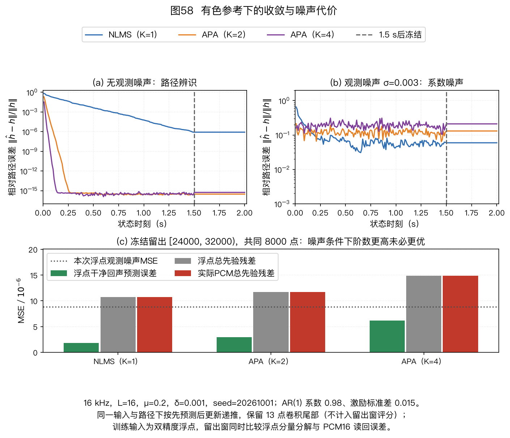

把上表数据与图58三个面板对照阅读，就能彻底吃透 APA 的调参哲学：左上子图（a）无观测噪声面板的三条实线曲线（蓝 $K=1$、橙 $K=2$、紫 $K=4$，灰色竖虚线标出 $1.5\ \mathrm{s}$ 后冻结）清楚显示阶数 $K$ 越高，相对路径误差 $\|\hat{\vec h}-\vec h\|_2/\|\vec h\|_2$ 下降越凌厉；但切到右上子图（b）观测噪声 $\sigma=0.003$ 面板的三条实线曲线，$K=2,4$ 在初期快速下探后，很快就因每拍对病态小矩阵 $(\mathbf G_n+\delta\mathbf I)^{-1}$ 求逆放大了差模方向上的观测噪声 $v[n]$，最终撞上比 $K=1$ 更高的稳态失调地板（底部子图（c）冻结留出窗的三组柱状图同样印证 $K$ 增大反而抬高了干净回声预测误差与总先验残差）！这告诉我们：高阶 APA 要想在含噪语音中兑现加速红利，必须同步减小稳态步长 $\mu$ 或增大对角加载 $\delta$（即变步长/变正则 APA），绝不能直接照搬 $K=1$ 的激进步长。

**PCM16 整数能量复核与试听入口**：六条音频均由未量化浮点结果按共同增益 $1$ 独立量化导出（按 $32768$ 解码，留出窗分母为 $8000\times 32768^2$）。实测留出窗内三条残差 WAV 的有符号整数平方和依次为 `91975291`、`100494856` 与 `127508700`（除以分母即得表末列 PCM MSE），含噪麦克风整数平方和为 `14743087038`（对应麦克风与总残差功率比依次约 $22.0492$、$21.6644$ 与 $20.6305\ \mathrm{dB}$）。生成与只读校验脚本见 [`generate_apa_audio.py`](../codes/chapters/ch06/examples/generate_apa_audio.py)（核心实现 [`core/apa_audio.py`](../codes/chapters/ch06/core/apa_audio.py)，参数记录见[独立清单](../codes/chapters/ch06/apa_audio/MANIFEST.json)），试听前建议先调低设备音量：

- [同源有色参考](../codes/chapters/ch06/apa_audio/apa_reference.wav)
- [已知干净回声](../codes/chapters/ch06/apa_audio/apa_true_echo.wav)
- [含噪麦克风观测](../codes/chapters/ch06/apa_audio/apa_microphone.wav)
- [NLMS先验残差](../codes/chapters/ch06/apa_audio/apa_nlms_residual.wav)
- [APA2先验残差](../codes/chapters/ch06/apa_audio/apa_apa2_residual.wav)
- [APA4先验残差](../codes/chapters/ch06/apa_audio/apa_apa4_residual.wav)

<a id="e06-40"></a>

#### E06-40：已知当前播放增益，为什么后乘回声预测仍会错？

设音量模块前的早参考为 $x=[1,1,1,1]$（第 $4$ 点补零 $x[4]=0$ 以保留完整卷积尾，负时刻为零），固定两抽头声学路径为 $h=[1,1/2]$（全程冻结在真值上）。设数字播放增益在第 $n=2$ 点从 $1$ 阶跃翻倍到 $2$，即含尾部的增益序列为 $g=[1,1,2,2,2]$。逐点计算真实回声、早参考固定预测、先用早参考卷积再后乘当前增益 $g[n]$ 的预测，以及直接取增益后晚参考 $r[n]=g[n]x[n]$ 的预测。

**逐点卷积与顺序误差核对**：含尾部的早参考为 $[1,1,1,1,0]$，晚参考为 $[1,1,2,2,0]$。真实回声满足 $y[n]=r[n]+\frac{1}{2}r[n-1]$，早参考预测为 $\hat y_x[n]=x[n]+\frac{1}{2}x[n-1]$，错误后乘预测为 $g[n]\hat y_x[n]$：

| 点 $n$ | 真实回声 | 早参考预测 | 错误后乘预测 | 晚参考预测 |
|---|---:|---:|---:|---:|
| 0 | 1 | 1 | 1 | 1 |
| 1 | $3/2$ | $3/2$ | $3/2$ | $3/2$ |
| 2 | $5/2$ | $3/2$ | 3 | $5/2$ |
| 3 | 3 | $3/2$ | 3 | 3 |
| 4，完整尾部 | 1 | $1/2$ | 1 | 1 |

用真实回声减各支路预测得有符号残差：早参考残差为 $[0,0,1,3/2,1/2]$，错误后乘残差为 $[0,0,-1/2,0,0]$，而晚参考残差恒为 $[0,0,0,0,0]$！看第 $n=2$ 点的差错根源：此刻空气中到达的延迟反射声 $\frac{1}{2}r[1]=\frac{1}{2}$ 在上一拍播出时只乘过旧增益 $g[1]=1$，后乘支路却拿当前新增益 $g[2]=2$ 把它放大成了 $1$，多算了 $1/2$（恰与式(6-32)的 $\frac{1}{2}(g[1]-g[2])x[1]=-1/2$ 完全吻合；到了 $n=3,4$ 两拍历史增益统一为 $2$，过渡误差才随之消失；代码复算见 [`reference_gain_order()`](../codes/chapters/ch06/core/reference_timing.py)）。

<a id="e06-41"></a>

#### E06-41：当前参考静音，麦克风为什么仍可能只有纯回声？

将序列按每帧 $4$ 点切成三帧：第 $0$ 帧播放 $[1,-1,1,-1]$，随后两帧（共 $8$ 点）物理播放彻底停止为零。设声学路径仅含延迟 $4$ 点的单反射抽头 $h[4]=1/2$，近端语音 $s[n]\equiv 0$，底噪为零。将参考与麦克风送入 §6.4.1 的当前帧活动检测器（去均值均方根门限 $0.1$，绝对 NCC 门限 $0.8$），逐帧核对输出标签与真实物理成分。

**当前帧活动 vs 跨帧路径记忆**：由 $y[n]=\frac{1}{2}x[n-4]$ 可知，第 $0$ 帧播出的声音要到第 $1$ 帧样本区间 $[4,8)$ 才传到麦克风，三帧均方根与基线输出如下：

| 帧，样本区间 | 当前参考RMS | 麦克风RMS | 基线标签 | 实际分量 |
|---|---:|---:|---|---|
| 0，$[0,4)$ | 1 | 0 | `far_only` | 播放活动，回声尚未到达 |
| 1，$[4,8)$ | 0 | $1/2$ | `near_only` | 只有过去播放的纯回声尾声 |
| 2，$[8,12)$ | 0 | 0 | `silence` | 无回声、近端或噪声 |

每一帧都有至少一路信号能量为零（故式(6-26)分母不成立，记录 `0` 仅作无定义占位），全部走幅度活动分支：在第 $1$ 帧 $[4,8)$ 内，由于当前播放参考已归零而麦克风收到了延迟回声，短窗检测器打出了 `near_only` 标签，尽管房间里连半点近端人声都没有！此时把同一组信号送入装有真值 $h$、长度 $5$ 的全冻结 `NLMSState`（正常推进跨帧参考历史），第 $1$ 帧依然能从历史滑窗里读出第 $0$ 帧的参考采样，使全部 $12$ 点先验残差精确归零（代码见 [`echo_tail_activity()`](../codes/chapters/ch06/core/reference_timing.py)）。这提醒工程师：切忌一见“当前参考帧静音”就贸然清空 FIR 参考历史或关停线性回声减法！

<a id="e06-42"></a>

#### E06-42：用实际 PCM 核对增益切换与纯回声尾声

本题将 E06-40 的增益切换顺序与 E06-41 的纯回声尾声合成为一套 $16\ \mathrm{kHz}$ 可播放标准测试资产（对应 §6.10 图74）。双音激励源长 $32000$ 点（$2.0\ \mathrm{s}$），未加窗波形由 $0.08\cos(2\pi\cdot 500n/16000)$ 与 $0.06\sin(2\pi\cdot 730n/16000)$ 叠加而成（首尾各 $320$ 点含端点平方正弦淡入淡出，第 $32000$ 点起补 $1600$ 个零保留 $100\ \mathrm{ms}$ 完整混响尾，故六个单声道 WAV 均为 $33600$ 点、$2.1\ \mathrm{s}$；无近端人声与底噪）。

**信号节点与两抽头稀疏卷积**：早参考 $x[n]$ 取在音量模块前，晚参考 $r[n]=g[n]x[n]$ 取在音量模块后；数字增益在第 $16000$ 点（$1.0\ \mathrm{s}$）由 $1$ 阶跃翻倍为 $2$（停止播放后的尾窗内仍保持当前增益读数 $g[n]=2$）。固定稀疏路径取直达抽头 $h[0]=0.7$ 与 $100\ \mathrm{ms}$ 反射抽头 $h[1600]=0.35$，早/晚参考均由装入真值、全程冻结权重的 $1601$ 抽头 `NLMSState` 生成因果先验预测：

$$\begin{gathered}
\begin{aligned}
y[n]&=0.7r[n]\\
&\quad+0.35r[n-1600],
\end{aligned}\\
\begin{aligned}
\hat y_{\mathrm{early}}[n]&=0.7x[n]\\
&\quad+0.35x[n-1600],
\end{aligned}\\
\hat y_{\mathrm{after}}[n]=g[n]\hat y_{\mathrm{early}}[n].
\end{gathered}\tag{6-36}$$

**三段统计窗口的解析均方复算**：划分互不重叠的**切换过渡窗** $[16000,17600)$（长 $1600$ 点）、**翻倍稳定窗** $[19200,28800)$（长 $9600$ 点）与**停播纯尾窗** $[32000,33600)$（长 $1600$ 点）。巧妙之处在于：$500\ \mathrm{Hz}$ 与 $730\ \mathrm{Hz}$ 在 $1600$ 点（$0.1\ \mathrm{s}$）内恰好完成整数个周期（$50$ 个与 $73$ 个周期，稳定窗则为 $300$ 个与 $438$ 个周期，且均避开了首尾淡入淡出区）！因此在切换窗与稳定窗内恒有周期重现 $x[n-1600]=x[n]$，两正交谱线交叉积严格为零，源信号解析均方及任意比例倍数 $c\,x[n]$ 的均方直接由帕塞瓦尔（Parseval）定理给出：

$$\begin{aligned}
P_x&=\frac{0.08^2+0.06^2}{2}=0.005,\\
P_{c x}&=c^2 P_x.
\end{aligned}\tag{6-37}$$

将各支路等效幅度系数 $c$ 代入式(6-37)：在**切换窗**内，当前样本已乘 $2$ 而 $1600$ 点前的延迟样本仍乘旧增益 $1$，故真实回声系数为 $0.7\times 2+0.35\times 1=1.75$，早参考残差系数为 $1.75-(0.7+0.35)=0.7$，错误后乘残差系数为 $1.75-2\times 1.05=-0.35$；到了**稳定窗**内，当前与延迟样本均已乘 $2$，真实回声系数升为 $2.1$，早参考残差系数升为 $1.05$，后乘残差系数归零。平方后乘 $0.005$ 立得精确解析表：

| 分量 | 切换窗解析均方 | 稳定窗解析均方 |
|---|---:|---:|
| 真实回声 | 0.0153125 | 0.02205 |
| 早参考固定残差 | 0.00245 | 0.0055125 |
| 错误后乘残差 | 0.0006125 | 0 |
| 晚参考固定残差 | 0 | 0 |

至于**停播纯尾窗** $[32000,33600)$，当前源 $x[n]=r[n]=0$，真实回声 $0.35\times 2x[n-1600]=0.7x[n-1600]$ 与早参考残差 $0.35x[n-1600]$ 读取的是源末尾那段含 $320$ 点淡出包络的样本，不能再套稳态常数 $0.005$，按有限样本逐点求和得浮点均方分别约为 `0.00216323765148` 与 `0.000540809412869`（后乘与晚参考支路理想残差均为 $0$）。

**实际导出 PCM16 整数能量核对**：六条 WAV 按共同增益 $1$ 独立量化为 16 位有符号整数 $q_n$，定义窗口整数平方和 $E=\sum q_n^2$ 与解码分母 $D=N\times 32768^2$（切换窗与尾窗 $D=1717986918400$，稳定窗 $D=10307921510400$）：

| 文件分量 | 切换窗 $E$ | 稳定窗 $E$ | 尾窗 $E$ |
|---|---:|---:|---:|
| 早参考 | 8589947251 | 51539683506 | 0 |
| 晚参考 | 34359936344 | 206159618064 | 0 |
| 真实回声 | 26306750961 | 227291471160 | 3716443945 |
| 早参考残差 | 4209136228 | 56821523154 | 929133267 |
| 错误后乘残差 | 1052295351 | 0 | 0 |
| 晚参考残差 | 0 | 0 | 0 |

核对第 5 行切换窗错误后乘残差：$E/D=1052295351/1717986918400\approx 0.0006125165$，与上表解析值 $0.0006125$ 在 16 位量化精度内高度吻合；同时把尾窗 $1600$ 点解码送入 §6.4.1 活动检测基线（$160$ 点帧，RMS 门限 $0.001$，绝对 NCC 门限 $0.85$），十个 $10\ \mathrm{ms}$ 帧在各自帧末时刻（样本 $32160,32320,\ldots,33600$）全部输出 `near_only` 操作标签，再次印证停播后的纯回声尾声不能误当成近端人声真值。

生成与只读回放校验命令为 `.venv/bin/python -m codes.chapters.ch06.examples.generate_reference_audio --check`（核心模型见 [`core/reference_audio.py`](../codes/chapters/ch06/core/reference_audio.py)，解析/浮点/PCM 完整指标见[独立清单](../codes/chapters/ch06/reference_audio/MANIFEST.json)）：

- [增益前的早参考](../codes/chapters/ch06/reference_audio/reference_early.wav)
- [增益后的晚参考](../codes/chapters/ch06/reference_audio/reference_late.wav)
- [包含完整尾部的真实回声](../codes/chapters/ch06/reference_audio/reference_echo.wav)
- [早参考固定预测的残差](../codes/chapters/ch06/reference_audio/reference_early_residual.wav)
- [错误后乘当前增益的残差](../codes/chapters/ch06/reference_audio/reference_wrong_gain_residual.wav)
- [晚参考固定预测的残差](../codes/chapters/ch06/reference_audio/reference_late_residual.wav)

<a id="e06-43"></a>

#### E06-43：奇次幂基与正交 Legendre 基的 Hammerstein 条件数及坐标解耦

设归一化参考幅度服从均匀分布 $x\sim\mathcal U(-1,1)$（偶次矩 $\mathbb{E}[x^{2k}]=1/(2k+1)$，奇次矩为 $0$）。对比三支路奇次幂基 $\vec\psi_{\mathrm{pow}}(x)=[x,x^3,x^5]^\top$ 与三支路奇次 Legendre 正交基 $\vec\psi_{\mathrm{leg}}(x)=[P_1(x),P_3(x),P_5(x)]^\top$：

$$\begin{aligned}
P_1(x)&=x,\qquad
P_3(x)=\frac{1}{2}(5x^3-3x),\\
P_5(x)&=\frac{1}{8}(63x^5-70x^3+15x).
\end{aligned}\tag{6-38}$$

给定真实无记忆三次—五次奇对称失真 $y(x)=x-0.5x^3+0.63x^5$（即幂基系数 $\vec c_{\mathrm{pow}}=[1,-0.5,0.63]^\top$），求两套基的二阶矩 Gram 矩阵条件数、Legendre 展开权重及单支路最佳线性截断增益（代码复算见 [`chapter06_experiments.py`](../codes/chapters/ch06/chapter06_experiments.py) 的 `E06-43` 与 [`core/nonlinear_and_stereo.py`](../codes/chapters/ch06/core/nonlinear_and_stereo.py)）。

**第一步：核算原始奇次幂基与单位方差归一化幂基的条件数。** 对 $p,q\in\{1,3,5\}$，原始幂基相关矩阵 $\mathbf R_{\mathrm{pow}}$ 的元素为 $1/(p+q+1)$：

$$\mathbf R_{\mathrm{pow}}=\begin{bmatrix}
1/3&1/5&1/7\\
1/5&1/7&1/9\\
1/7&1/9&1/11
\end{bmatrix},\qquad
\det\mathbf R_{\mathrm{pow}}=\frac{256}{22\,920\,975}.$$

该矩阵的特征多项式满足：

$$\mu^3-\frac{131}{231}\mu^2
+\frac{19\,816}{1\,091\,475}\mu
-\frac{256}{22\,920\,975}=0,$$

三个特征值依次约为 $\mu_{\max}\approx 0.5330817$、$\mu_2\approx 0.0333904$、$\mu_{\min}\approx 6.27468\times 10^{-4}$，故三支路条件数高达 $\kappa_2(\mathbf R_{\mathrm{pow}})\approx 849.58$（对比两支路 $\{x,x^3\}$ 的 $\frac{25+\sqrt{541}}{25-\sqrt{541}}\approx 27.73$ 暴涨了三十余倍）！

再将三支路乘对角尺度阵 $\mathbf D$（对角元 $\sqrt{3},\sqrt{7},\sqrt{11}$）化为单位方差，得归一化相关矩阵 $\widetilde{\mathbf R}_{\mathrm{pow}}$（等于 $\mathbf D\mathbf R_{\mathrm{pow}}\mathbf D$）：其非对角互相关系数高达 $\rho_{13}=\sqrt{21}/5\approx 0.9165$、$\rho_{15}=\sqrt{33}/7\approx 0.8207$、$\rho_{35}=\sqrt{77}/9\approx 0.9750$，行列式为 $(16/315)^2=256/99\,225\approx 0.002580$，满足三次特征方程：

$$\lambda^3-3\lambda^2
+\frac{53\,176}{99\,225}\lambda
-\frac{256}{99\,225}=0.$$

三个特征值依次约为 $2.8095820,0.1854668,0.0049512$，条件数 $\kappa_2(\widetilde{\mathbf R}_{\mathrm{pow}})$ 依然高达约 $567.45$（两支路归一化时约为 $\frac{5+\sqrt{21}}{5-\sqrt{21}}\approx 22.96$）。

**第二步：对比 Legendre 正交基与坐标解耦性质。** 在 $\mathcal U(-1,1)$ 上，未缩放 Legendre 基的二阶矩矩阵 $\mathbf R_{\mathrm{leg}}$ 严格对角化为对角元 $1/3,1/7,1/11$，条件数降至 $11/3\approx 3.6667$；进一步取标准正交基 $[\sqrt{3}P_1,\sqrt{7}P_3,\sqrt{11}P_5]^\top$，相关矩阵化为单位阵 $\mathbf I_3$，条件数精确等于 $1$！

反解式(6-38)得幂基向 Legendre 基的上三角变换 $x=P_1$、$x^3=\frac{3}{5}P_1+\frac{2}{5}P_3$、$x^5=\frac{3}{7}P_1+\frac{4}{9}P_3+\frac{8}{63}P_5$，左乘 $\vec c_{\mathrm{pow}}$ 即得精确权重：

$$\begin{aligned}
\vec w_{\mathrm{leg}}
&=\begin{bmatrix}
  1&3/5&3/7\\
  0&2/5&4/9\\
  0&0&8/63
  \end{bmatrix}
  \begin{bmatrix}1\\-0.5\\0.63\end{bmatrix}
 =\begin{bmatrix}97/100\\2/25\\2/25\end{bmatrix}
 =\begin{bmatrix}0.97\\0.08\\0.08\end{bmatrix}.
\end{aligned}$$

由于各阶正交支路互不耦合，若将模型截断为纯线性单支路（$Q=1$），最小均方最优线性增益 $\mathbb{E}[x y(x)]/\mathbb{E}[x^2]$ 由 $3\bigl(\frac{1}{3}-\frac{0.5}{5}+\frac{0.63}{7}\bigr)$ 算出 $0.97$，直接等于首项权重 $w_{\mathrm{leg},1}$，后续是否增删 $P_3,P_5$ 完全不会推翻已学好的线性主支路（输出总二阶矩 $727949/2310000\approx 0.315129$ 正好正交分解为线性解释方差 $\frac{1}{3}(0.97)^2=9409/30000\approx 0.313633$ 与残余非线性方差 $\frac{1}{7}(0.08)^2+\frac{1}{11}(0.08)^2=72/48125$，即约 $0.0014961$ 之和）。注意严格对角化依赖 $x\sim\mathcal U(-1,1)$；真实语音呈超高斯幅度分布且相邻采样时间相关，但正交多项式基仍能消除幂级数主导共线性。

<a id="e06-44"></a>

#### E06-44：立体声时变全通去相关、数字 AEC 与物理 ANC/ICC 因果期限及主从切换准则

本题把 §6.1、§6.4、§6.8～§6.10 的三项关键工程控制落到精确有理数与物理量纲上逐一复核（代码入口见 [`chapter06_experiments.py`](../codes/chapters/ch06/chapter06_experiments.py) 的 `E06-44`）。

**第一部分：LTI 全通秩亏证明与五采样时变全通（TV-APF）满秩复算。** 设远端单声源为 $s[n]$（负时刻为零），左声道直通 $x_1[n]=s[n]$，右声道串接因果一阶实全通滤波器 $x_2[n]=-a_n x_2[n-1]+a_n s[n]+s[n-1]$，每声道各配两抽头未知路径，第 $n$ 拍四维回归行向量为 $\vec u_n^\top=[x_1[n],x_1[n-1],x_2[n],x_2[n-1]]$：

- **固定 LTI 全通必秩亏**：若极点恒定 $a_n\equiv a\in(-1,1)$，对任意信号与任意时刻恒有 $(x_2[n]+a x_2[n-1])-(a x_1[n]+x_1[n-1])=0$，即非零向量 $\vec v_{\mathrm{null}}=[-a,-1,1,a]^\top$ 永远满足 $\mathbf U_{\mathrm{lti}}\vec v_{\mathrm{null}}=\vec 0$（矩阵秩上界 $\le 3<4$，四维真路径不可唯一辨识）；
- **五采样确定性检验**：取 $s=[1,0,0,1,0]$（$n=0,\ldots,4$），抽取 $n\in\{0,1,3,4\}$ 四拍构造 $4\times 4$ 快拍矩阵。固定 $a_n\equiv 0.5$ 时，$x_2=[1/2,3/4,-3/8,11/16,21/32]$，$\det\mathbf U_{\mathrm{lti}}=0$（秩降为 $3<4$）；改为两段慢变极点 $a=[0,0,0,0.5,0.5]$ 后，$x_2=[0,1,0,0.5,0.75]$，快拍矩阵满秩可逆：

$$\mathbf U_{\mathrm{tv}}=\begin{bmatrix}
1&0&0&0\\
0&1&1&0\\
1&0&0.5&0\\
0&1&0.75&0.5
\end{bmatrix},\qquad
\det\mathbf U_{\mathrm{tv}}=0.25\neq 0.$$

对真实立体声路径 $\vec h_{\mathrm{true}}=[0.8,0.2,0.4,0.1]^\top$（四拍回声 $[0.8,0.6,1.0,0.55]^\top$），$\mathbf U_{\mathrm{tv}}^{-1}\vec y$ 唯一精确恢复 $\vec h_{\mathrm{true}}$。

**第二部分：数字开环 AEC 与物理 ANC / ITU-T P.1150 车载 ICC 的因果时延期限。** 设声速 $c=343\ \mathrm{m/s}$、采样率 $f_s=16\ \mathrm{kHz}$，ANC 电声飞行因果不等式与 ICC 同舱两波叠加梳状陷波公式为：

$$\begin{aligned}
\tau_{\mathrm{elec}}
&\le\tau_{\mathrm{acoust}}-\tau_{\mathrm{sec}},\\
\Delta f&=\frac{1}{\tau_{\mathrm{loop}}},\qquad
f_1=\frac{1}{2\tau_{\mathrm{loop}}}.
\end{aligned}\tag{6-39}$$

1. **物理 ANC vs 数字开环 AEC**：设主声学路径 $d_{\mathrm{p}}=0.12\ \mathrm{m}$（飞行时间 $\tau_{\mathrm{acoust}}=120/343\ \mathrm{ms}$，约 $0.3499\ \mathrm{ms}$）、次级电声路径 $d_{\mathrm{s}}=0.02\ \mathrm{m}$（$\tau_{\mathrm{sec}}=20/343\ \mathrm{ms}$，约 $0.0583\ \mathrm{ms}$），允许的最大电子处理时延 $\tau_{\mathrm{elec,max}}$ 仅为 $100/343\ \mathrm{ms}\approx 0.2915\ \mathrm{ms}$（在 $16\ \mathrm{kHz}$ 下仅约 $4.66$ 个采样）！标准 $N=128$（$8\ \mathrm{ms}$）分块 PBFDAF 的凑块时长超标 $27.44$ 倍，根本无法用于宽带因果物理 ANC；而在远程通话数字 AEC 中，即便系统播放缓冲高达 $800$ 点（$50\ \mathrm{ms}$），只需在内存中把参考延迟对齐为 $x_a[n]=x[n-800]$ 即可无损维持因果性。
2. **ITU-T P.1150 车载 ICC 梳状干涉与啸叫裕量**：设后排人耳处直达声与 $\alpha=0.8$ 扩声波叠加（同相峰与反相谷比值为 $(1+0.8)/(1-0.8)=9$，峰谷摆幅高达 $20\log_{10}9\approx 19.08\ \mathrm{dB}$；若闭环环路增益为 $0.5$，距离单位增益啸叫尚有 $-20\log_{10}(0.5)\approx 6.02\ \mathrm{dB}$ 裕量）：合规配置 $\tau_{\mathrm{loop}}=10\ \mathrm{ms}<15\ \mathrm{ms}$ 时，陷波间距 $\Delta f=100\ \mathrm{Hz}$、首陷波 $50\ \mathrm{Hz}$，$[0,1000)\ \mathrm{Hz}$ 内含 $10$ 个陷波；违规配置 $\tau_{\mathrm{loop}}=25\ \mathrm{ms}>15\ \mathrm{ms}$ 时，$\Delta f$ 缩窄至 $40\ \mathrm{Hz}$、首陷波下探至 $20\ \mathrm{Hz}$，$[0,1000)\ \mathrm{Hz}$ 内密布 $25$ 道深陷波，造成明显空心管金属音染。

**第三部分：主滤波器（`refined`）与阴影滤波器（`coarse`）三态切换门控。** 记主/阴影窗口残差能量为 $E_{\mathrm{fg}}>0,E_{\mathrm{sh}}\ge 0$，参考—麦克风相干度为 $c_{xd}\in[0,1]$，设定拷贝比阈值 $\eta_{\mathrm{copy}}=0.25$、重置比阈值 $\eta_{\mathrm{reset}}=2.0$、相干门限 $\tau_c=0.8$：

$$\begin{aligned}
\text{Copy }\vec w_{\mathrm{sh}}\to\vec w_{\mathrm{fg}}
&\iff (E_{\mathrm{sh}}<\eta_{\mathrm{copy}}E_{\mathrm{fg}})
      \land(c_{xd}\ge\tau_c),\\
\text{Reset }\vec w_{\mathrm{fg}}\to\vec w_{\mathrm{sh}}
&\iff E_{\mathrm{sh}}>\eta_{\mathrm{reset}}E_{\mathrm{fg}}.
\end{aligned}\tag{6-40}$$

核对三个典型运行窗口：窗口 A（单讲路径突变，$E_{\mathrm{fg}}=1.28,E_{\mathrm{sh}}=0.08,c_{xd}=0.95$）因能量比 $0.0625<0.25$ 且 $c_{xd}\ge 0.8$，触发正向扶正拷贝 `copy_shadow_to_foreground`；窗口 B（双讲阴影发散，$E_{\mathrm{fg}}=1.00,E_{\mathrm{sh}}=2.50,c_{xd}=0.25$）因能量比 $2.5>2.0$，触发反向纠偏重置 `reset_shadow_from_foreground`；窗口 C（双讲期阴影大步长过拟合消掉近端语音使 $E_{\mathrm{fg}}=1.00,E_{\mathrm{sh}}=0.20$，但双讲相干度仅 $c_{xd}=0.30<0.8$），尽管能量比 $0.20<0.25$ 看似“更小”，相干度门限精准拦截了这次虚假优势，输出 `hold` 保护前台主滤波器不被污染！

### 6.17 延伸阅读

1. **Hänsler & Schmidt, *Acoustic Echo and Noise Control: A Practical Approach*（Wiley, 2004）**——系统涵盖自适应滤波理论、子带/频域实现、双讲控制与免提通信整机工程（[Wiley 在线专著页](https://onlinelibrary.wiley.com/doi/book/10.1002/0471678406)）。
2. **Benesty et al., *Advances in Network and Acoustic Echo Cancellation*（Springer, 2001）**——深入阐述频域分区、比例自适应（PNLMS/IPNLMS）与立体声非唯一性理论。
3. **Enzner et al., *Acoustic Echo Control*（收录于 *Academic Press Library in Signal Processing*, vol. 4, ch. 30, pp. 807–877, Elsevier, 2014）**——从状态空间频域卡尔曼滤波（FDKF）视角贯通线性抵消、残余后置滤波、非线性建模与多通道扩展（[出版社章节页](https://www.sciencedirect.com/science/article/pii/B9780123965011000303)）。
4. **Breining et al., "Acoustic Echo Control: An Application of Very-High-Order Adaptive Filters," *IEEE Signal Processing Magazine*, 1999**——梳理长冲激响应、非线性、双讲与路径时变四大经典工程挑战（链接见 §6.1.1）。
5. **中文工程参考**：《语音识别服务实战》第 3.4 节，结合远场语音交互前端介绍系统接入要点。

---

> 📄 本篇信息：配图 17 张 ｜ [回首页](00_overview.md)
