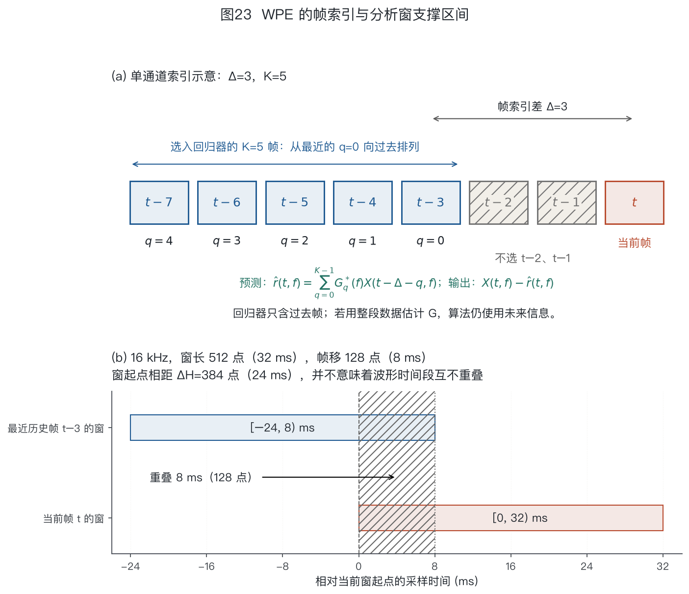
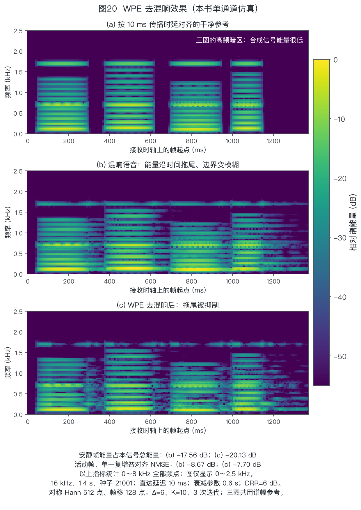
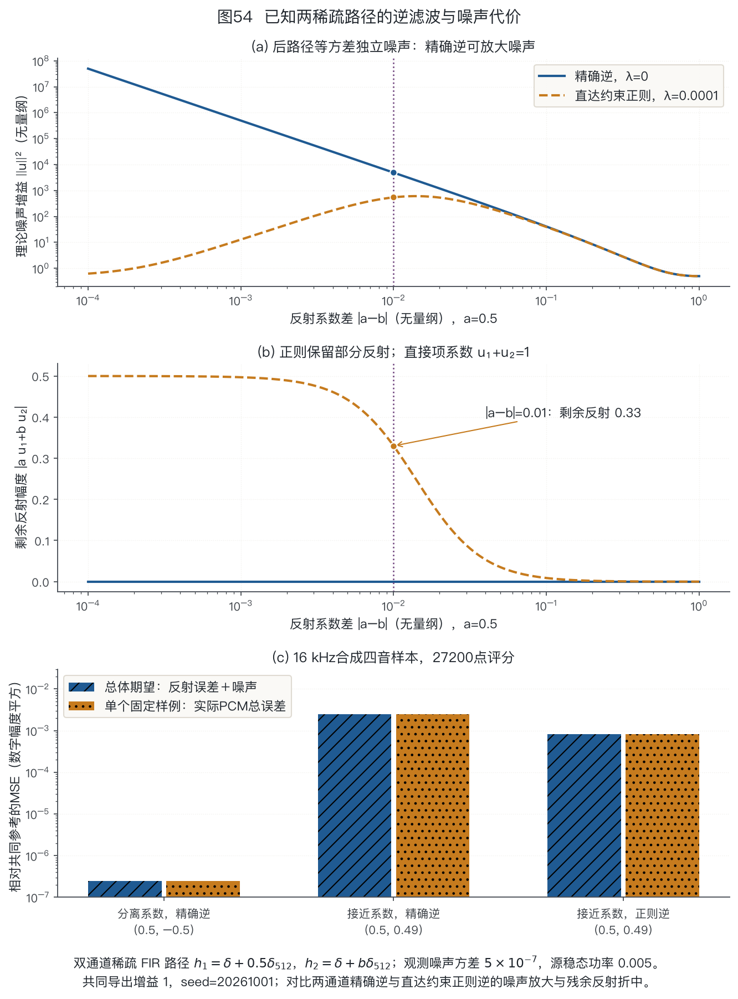
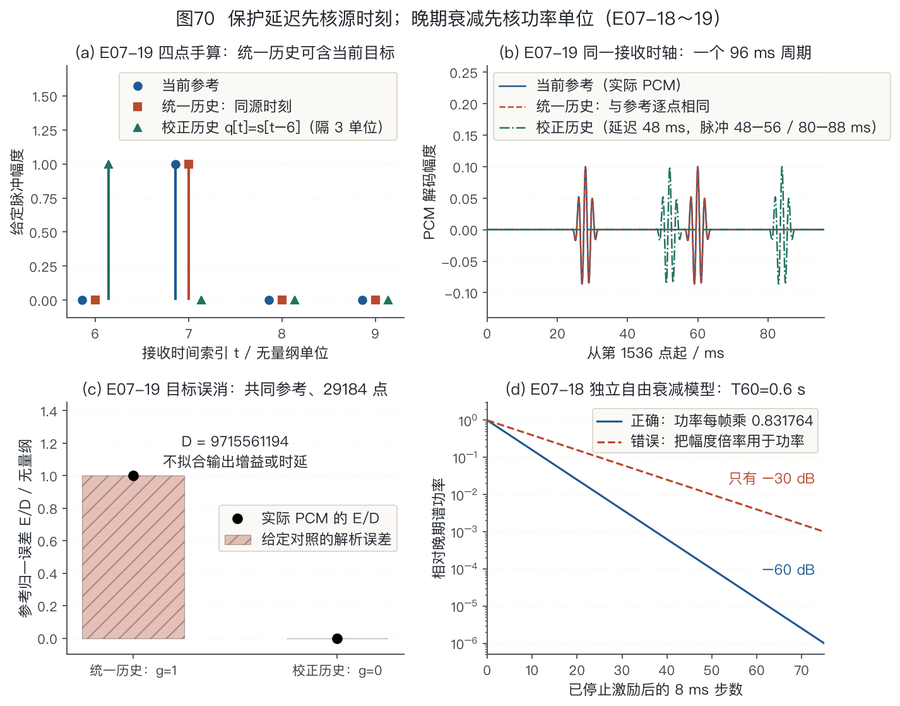

🌐 **简体中文** ｜ [English](../chapters_en/07_wpe-dereverberation.md)

> 本篇是本书正文第 7 章；正文与扩展专题共 16 章（第 0～15 章，其中第 0 章为数学基础，第 12～15 章为四篇扩展专题），另有附录 A、B。本篇可独立阅读，前后篇见下方导航。
>
> 导读首页：[00_overview.md](00_overview.md) ｜ 上一篇：[06_aec.md](06_aec.md) ｜ 下一篇：[08_speech-separation.md](08_speech-separation.md)

---

## 7. 去混响（WPE）

第 6 章讨论了扬声器播放信号耦合回麦克风所形成的声学回声。本章转向另一类由房间声学传播引起的干扰：声波在墙壁、天花板与家具之间反复反射形成的晚期混响拖尾，并重点推导工业界广泛采用的加权预测误差（Weighted Prediction Error，WPE）去混响算法。多说话人混合分离、时频掩码估计以及前端模块的完整串联顺序将在第 8 章展开。

### 7.1 问题、模型与直觉算例

声学回声消除（Acoustic Echo Cancellation，AEC）能够直接利用已知的扬声器播放参考信号做自适应抵消；而在远场拾音的去混响任务中，系统并不知道说话人嘴边的干净干声，只能依靠麦克风自身的观测信号挖掘跨帧统计规律。与[第 5 章](05_beamforming.md)的单帧窄带波束形成相比，典型房间混响时间 $T_{60}$（常达数百毫秒）远超单帧 STFT 分析窗长（如 $32\ \mathrm{ms}$），仅靠当前单帧的空间滤波虽能压低偏离目标方向的各向弥散反射，却无法跨帧剥离沿目标方向或近旁反射面迟到的历史语音残影，因而必须引入跨帧时间线性预测，与单帧空间滤波形成“先跨帧去拖尾、再单帧定方向”的前端分工。

加权预测误差法（WPE）的核心思路，正是在短时傅里叶变换（Short-Time Fourier Transform，STFT）域用过去的观测帧线性预测当前帧中的晚期混响拖尾，再将其从当前观测中减去。为了避免把说话人本身的语音包络一并当成混响减掉，算法在当前帧与预测历史之间留出一段保护延迟 $\Delta$，从而尽量保全直达声与对语音可懂度有益的早期反射；不过当保护延迟过短、统计样本不足或声学模型失配时，早期语音成分仍可能受到损伤。

#### 最小术语与记号

| 记号或术语 | 本章含义 |
|---|---|
| $X,E$ | 麦克风观测复谱与减去预测拖尾后的残差复谱；模型希望 $E$ 逼近早期语音，但不保证精确相等 |
| $n,t$ | 两种常用的离散帧索引记号，均从 $0$ 开始计数，切勿与时域波形采样点索引混淆 |
| $f$ | 短时傅里叶变换（STFT）的离散频点索引；在单频点独立推导时常省略 $f$ |
| $\Delta,K$ | 保护延迟（最近预测帧距当前帧的间隔）与预测滤波器阶数（使用的历史帧数），单位均为帧 |
| $\lambda$ | 早期成分的时变谱功率方差，与复谱模平方 $\lvert E\rvert^2$ 同量纲 |
| $G,g$ | 线性预测滤波器系数；在同一 STFT 归一化尺度下无量纲 |
| $\mathbf\Psi_t$ | 在线 RLS-WPE 递推维护的逆相关矩阵 $\mathbf R_t^{-1}$，与阶数 $K$ 及互相关矩阵 $\mathbf P$ 区分 |
| 对角加载、功率地板 | 分别用于稳定正规矩阵求逆与防止逆功率权重 $1/\lambda$ 除零溢出，二者作用位置不同，不能互相替代 |

本章复谱幅度沿用分析 STFT 的数值尺度，不直接等同于以帕斯卡（Pa）为单位的物理声压。标量、列向量与矩阵的维度约定将在进入各小节模型时逐一写明；上标 $H$ 统一表示复共轭转置，而大写字母 $H$ 作为帧移变量出现时会明确标注秒（s）或采样点单位。

工程上常见的去混响方法主要沿着三条技术路线演进：第一条是**空间波束形成**（见第 5 章），利用多麦克风空间选择性压低各向同性的弥散晚期混响；第二条是**盲逆滤波或延迟线性预测**，直接针对混响的时间拖尾建模；第三条是**谱增益抑制或深度神经网络（Deep Neural Network，DNN）增强**。本章聚焦第二条路线中的主力方法 WPE——在文献与工程代码中，“WPE”既指加权预测误差这一优化准则，也指围绕该准则构建的迭代或递推去混响算法。

#### 三类前置方法及其条件

在正式推导 WPE 之前，先看多通道精确逆滤波、倒谱域同态分离和晚期谱方差抑制这三类早期经典方法。弄清它们各自依赖什么物理前提、又在什么地方碰壁，就能明白 WPE 为什么选择“在 STFT 域盲估延迟线性预测器”。

**多通道逆滤波定理（Multiple-input/output INverse Theorem，MINT）**回答了一个基础代数问题：如果房间冲激响应（Room Impulse Response，RIR）完全已知，能不能用有限长滤波器把混响彻底抵消？为与第 8 章用 $L_h$ 表示滤波器抽头总数的记法区分，本节记声学路径 FIR 多项式的阶数为 $N_h$（对应抽头长度为 $N_h+1$），即第 $m$ 支麦克风的传递函数为 $H_m(z)=\sum_{\tau=0}^{N_h}h_m[\tau]z^{-\tau}$。若只有单支麦克风（$M=1$），真实房间的 $H_1(z)$ 往往是非最小相位系统，大量零点落在单位圆外；一旦直接求单通道逆 $1/H_1(z)$，单位圆外的零点就会变成单位圆外的不稳定极点，导致逆滤波器发散。

MINT 的巧妙之处在于引入 $M\ge 2$ 支麦克风，用**多项式线性组合代替多项式除法**。为第 $m$ 路接收信号串接阶数为 $N_u$（抽头长度为 $N_u+1$）的因果 FIR 滤波器 $U_m(z)=\sum_{\tau=0}^{N_u}u_m[\tau]z^{-\tau}$ 并求和：物理房间中声波从声源传至阵列存在公共传播延迟（直达抽头之前的首部零值使所有 $H_m(z)$ 在 $z=\infty$ 处具有重零点），因此一般因果精确逆需引入整数建模延迟 $d_0\ge 0$，要求合成响应满足

$$\sum_{m=1}^M H_m(z)U_m(z)=z^{-d_0}$$

（若已预先对齐直达声时刻使至少一路 $h_m[0]\ne 0$，可取 $d_0=0$ 令右端为 $1$，如双麦 $H_1(z)U_1(z)+H_2(z)U_2(z)=1$）。将上式两侧同次幂系数对齐，等价于求解时域线性方程组 $\mathcal{H}\vec u=\vec e_{d_0}$，其中广义 Sylvester 卷积矩阵 $\mathcal{H}\in\mathbb{R}^{(N_h+N_u+1)\times M(N_u+1)}$ 共含 $N_h+N_u+1$ 条延迟时刻等式与 $M(N_u+1)$ 个未知滤波系数。要使任意目标向量（含任意合法建模延迟 $d_0$）均精确可解，$\mathcal{H}$ 必须满行秩，首先给出列数不少于行数的阶数必要条件：

$$M(N_u+1)\ge N_h+N_u+1\iff N_u\ge\left\lceil\frac{N_h-M+1}{M-1}\right\rceil.$$

例如双麦（$M=2$）取 $N_u=N_h-1$ 时，$\mathcal{H}$ 恰为 $2N_h\times 2N_h$ 经典 Sylvester 方阵（后文练习 [E07-16](#e07-16) 与 [E07-17](#e07-17) 中一阶路径 $N_h=1$ 搭配零阶常数权重 $N_u=0$ 正是 $2\times 2$ 方阵的最简特例）。在此须严格区分 $M=2$ 与 $M\ge 3$ 的代数满秩边界：

- **双麦情形（$M=2,\;N_u=N_h-1$）**：由**贝祖多项式恒等式（Bézout's identity）**，方阵 $\mathcal{H}$ 严格满行秩的充要条件是 $H_1(z),H_2(z)$ **互素**（在整个有限复平面上不存在公共零点 $z_0\in\mathbb{C}\setminus\{0\}$ 使 $H_1(z_0)=H_2(z_0)=0$），且最高阶末抽头不全为零（$\max_m\deg H_m=N_h$；欲取 $d_0=0$ 另须首抽头不全为零）；
- **多麦情形（$M\ge 3$）**：上式 $N_u\ge\lceil(N_h-M+1)/(M-1)\rceil$ 只是列数不少于行数的**必要下界**，在连续参数空间中对“一般（几乎所有）”房间响应成立，但仅靠多项式互素并**不能**保证在该最小阶数下 $\mathcal{H}$ 严格满行秩。看一个极简反例：取 $M=3,\;N_h=2$，必要下界给出 $N_u=\lceil(2-3+1)/2\rceil=0$；令三条路径为 $H_1(z)=1+z^{-1}+z^{-2}$、$H_2(z)=2+2z^{-1}+3z^{-2}$、$H_3(z)=3+3z^{-1}+5z^{-2}$，三者首末抽头全非零，且在 $H_1(z)$ 的两个复根 $z^{-1}=e^{\pm\mathrm{j}2\pi/3}$ 处 $H_2(z)=-1/2\mp\mathrm{j}\sqrt{3}/2\ne 0$（三多项式严格互素），但对应的 $3\times 3$ 卷积矩阵 $\mathcal{H}=\begin{bmatrix}1&2&3\\1&2&3\\1&3&5\end{bmatrix}$ 前两行完全相同、秩仅为 $2<3$，连 $d_0=0$（$\mathcal{H}\vec u=[1,0,0]^\top$）在 $N_u=0$ 下也无精确解。仅由互素性本身保证对任意合法延迟精确可解时，需要选取足够大的滤波器阶数 $N_u$（一般多源多麦情形对应多项式矩阵的互素满秩条件，见 [Miyoshi 与 Kaneda，1988，§III～IV](https://doi.org/10.1109/29.1509)）。

从物理上看，单支麦克风在某个频率陷入声学零陷时能量丢失无法挽回，而只要另一支麦克风在同一复频率处没有同时归零，多路互补就能拼出无混响的纯延迟响应。

然而 MINT 在实际语音前端极少单独落地：它不仅要求 RIR 预先精确测出且在说话人微动时不发生漂移，而且一旦两条路径存在**近似公共零点**，贝祖方程虽在代数上可解，求出的逆滤波权重 $U_1,U_2$ 幅度却会急剧膨胀，将各麦克风通道的独立底噪放大成百上千倍（本章练习 [E07-16](#e07-16) 将完整手算精确逆与正则逆的噪声放大取舍，[E07-17](#e07-17) 给出可听音频对照）。

**倒谱域加窗（liftering）**试图避开路径测量，借助同态信号处理把声源与房间响应拆开。它先对观测功率谱取自然对数 $\ln|X|^2$（其数值恰好是对数幅度 $\ln|X|$ 对应实倒谱的两倍；遇到零谱值时须先加正数下限保护），再做逆傅里叶变换回到倒谱域。倒谱横轴称为倒频率（quefrency），量纲与时间或采样点相同，而非频率单位 Hz。

如果长卷积能理想地写成频域乘积 $X=SH$，取对数后就有 $\ln|SH|^2=\ln|S|^2+\ln|H|^2$，声门激励、声道共振与房间反射在倒谱轴上似乎变成了可加分量。可惜在实际语音处理中，短时分析窗并不满足长卷积等价为逐频乘积的前提，基音谐波结构与早期房间反射在倒频率轴上也经常重叠；更重要的是，实倒谱在取模平方时彻底丢掉了相位，单靠倒谱窗平滑幅度谱并不能恢复正确的复数相位（[Oppenheim、Schafer 与 Stockham，1968，§VI](https://dsp-group.mit.edu/wp-content/uploads/2024/11/nonnlinearfiltering_1968.pdf) 讨论的精确回声分离依赖复倒谱与相位解缠，对一般混响房间极不稳健，详见练习 [E07-14](#e07-14)）。

**谱方差抑制**放弃恢复混响相位，转而在能量域估计晚期混响的功率谱方差 $\sigma_r^2(n,f)$，再像单通道维纳滤波或对数谱幅度估计器那样乘以实数增益压低拖尾。以 Lebart、Boucher 与 Denbigh（*Acta Acustica united with Acustica*，2001）及 [Habets、Gannot 与 Cohen（*IEEE SPL*，2009，§II～V）](https://israelcohen.com/wp-content/uploads/2018/05/SPL_Sep2009.pdf) 为例，该方法依据混响时间 $T_{60}$ 和直达混响比（Direct-to-Reverberant Ratio，DRR）建立扩散声场的指数功率衰减模型。它的计算开销极小，但由于只在幅度上做实数衰减而不抵消复数相位，衰减过猛时容易产生音乐噪声或吃字失真，衰减不足时又会残留明显混响感。

对比以上三条老路可以看出 WPE 的定位：它既不像 MINT 那样苛求预先测准 RIR，也不像实数谱减那样放弃复数相位抵消，而是直接在多通道复数 STFT 域利用语音自身的非平稳包络加权，盲估出一组稳定的多帧线性预测滤波器来相干地减去晚期混响。

#### 路线选择与学习目标

下面两张对照表从**所需输入假设**与**流式计算及失效边界**两个维度，把空间波束形成、延迟线性预测（WPE）和谱增益/神经网络增强放在同一张工程地图上。由于不同论文采用的麦克风孔径、数据集、后端语音识别器（ASR）和因果前瞻设置各不相同，切忌把不同文献里的词错率（Word Error Rate，WER）降幅拼成一张横向排行榜。

空间选择路线的典型代表是最小方差无失真响应（Minimum Variance Distortionless Response，MVDR）波束形成与广义特征值（Generalized Eigenvalue，GEV）波束形成，推导分别见[第 5 章 §5.4](05_beamforming.md#sec-5-4)与[§5.9](05_beamforming.md#sec-5-9)；谱增益估计既可由传统统计声场模型给出，也可由深度神经网络直接预测。

| 路线 | 处理对象与代表方法 | 所需输入条件与核心假设 |
|---|---|---|
| 空间选择 | MVDR、GEV；压低各向弥散混响与定向干扰 | 多通道同步信号，以及目标方向导向矢量或时频掩码 |
| 延迟线性预测 | 离线 WPE、在线递推 WPE；复数相减晚期混响拖尾 | 单/多通道 STFT 复谱、保护延迟 $\Delta$ 与充足的有效统计帧数 |
| 谱增益与神经增强 | 统计谱方差抑制、DNN 去混响；全带抑制混响与加性噪声 | 匹配的训练语料，或可靠的 $T_{60}$ 与晚期混响功率估计 |

看懂上表的输入门槛后，还要结合下表的因果延迟与边界条件做系统选型：

| 路线 | 因果性与计算开销 | 典型失效边界 |
|---|---|---|
| 空间选择 | 可逐帧因果流式运行；计算量随通道数 $M$ 和频点数增长 | 强混响导致直达方向线索模糊或通道数很少时，抑制能力受限 |
| 延迟线性预测 | 批处理版整段迭代；在线版逐帧递推相关矩阵或其逆矩阵 | 极短口令词统计不足、强加性噪声污染或抽头数 $K$ 过大时易病态 |
| 谱增益与神经增强 | 取决于网络是否含双向层或未来帧前瞻；算力随模型规模变化 | 跨房间、跨阵列泛化需实测验证；非线性映射可能破坏空间相位或引入失真 |

在实际工程选型中，若远场语音识别受困于长混响拖尾，通常优先评估多通道 WPE；若现场同时存在空调、电视等定向干扰源，则将多通道 WPE 置于 MVDR/GEV 波束形成之前组成级联前端；若算力充裕且追求主观听感干净度，可在波束形成输出的**单通道信号之后**再接神经网络后滤波（完整模块顺序见 §7.6 与[第 10 章 §10.1](10_engineering-practice.md#sec-10-1)）。

以远场去混响领域的经典基准 **REVERB 挑战赛**为例，官方任务涵盖 8 通道、2 通道与单通道三种设置，仿真集的混响时间 $T_{60}$ 约为 $0.25\text{～}0.7\ \mathrm{s}$，并配有真实会议室录音。Kinoshita 等在 *EURASIP Journal on Advances in Signal Processing*（2016）发表的挑战赛总结指出，WPE 对后端语音识别的改善幅度与通道数高度相关：8 通道 MIMO-WPE 能利用跨麦互补信息显著压低晚期拖尾，而单通道 WPE 可依赖的自由度要小得多，因此引用任何实验数字都必须同时标明通道数与具体测试子集（见 [REVERB Challenge 官方任务说明](https://reverb2014.audiolabs-erlangen.de/index.html)与 [Kinoshita 等，2016，§2、§4.1.1 与图 5](https://doi.org/10.1186/s13634-016-0306-6)）。

#### 延迟预测模型与帧索引

在房间声学路径于统计窗口内保持近似时不变的前提下，长混响冲激响应在 STFT 域表现为跨帧卷积拖尾。WPE 将当前第 $n$ 帧观测复谱拆成两部分：一部分是希望保留的直达声与早期反射 $E(n,f)$，另一部分是由历史观测帧线性组合预测出的晚期混响 $\hat r(n,f)$。与普通平稳自回归线性预测不同，人类语音的短时能量在元音、辅音与停顿之间剧烈起伏，因此 WPE 引入随帧变化的早期语音谱方差 $\lambda(n,f)$ 刻画非平稳性，并用保护延迟 $\Delta$ 跳过紧挨当前帧的 $\Delta-1$ 个历史帧，防止预测器把语音自身的短时相关性当成混响抹除。

这里要先厘清一个初学者极易混淆的因果性概念：虽然预测公式在计算当前拖尾时只读取过去的帧 $X(n-k)$（$k\ge\Delta$），但**经典批处理 WPE 并不是因果流式算法**。因为它在求解预测滤波器系数 $G$ 和平滑功率 $\lambda$ 时累加了整段录音（包括未来帧）的统计量；只有把相关矩阵、滤波器系数与功率估计全部改写为仅依赖当前及历史帧的递推形式，并计入 STFT 分帧本身的攒点等待时间，才能构成真正的因果在线 WPE。

在展开公式前先统一**本章的局部频率与滞后记号**：为了与主流 WPE 文献及开源代码对读，本章在 $X(n,f)$ 中用无量纲整数 $f\in\{0,1,\dots,\lfloor N/2\rfloor\}$ 表示实信号单边 STFT 的离散频点索引（对应物理频率为 $f_{\mathrm{Hz}}=f f_s/N$，其中 $N$ 为 FFT 点数、$f_s$ 为采样率，$N$ 为偶数时末项对应奈奎斯特频率 $f_s/2$）；求和下标 $k$ 在本章专指**滞后帧数**，切勿与第 2 章表示频点索引的 $k$ 混淆；$n$（或后文的 $t$）则表示帧索引。

在单通道情形下，由于不同频点的房间混响衰减速率与反射结构不同，每个频点 $f$ 独立建模并可并行求解。固定频点并省略下标 $f$，此时 $X(n)$、$E(n)$ 与 $G(k)$ 均为复数标量，单通道延迟线性预测模型写为：

$$\begin{aligned}
X(n)&=E(n)+\hat r(n),\\
\hat r(n)&=\sum_{k=\Delta}^{\Delta+K-1}
G^*(k)X(n-k).
\end{aligned}\tag{7-1}$$

对照式(7-1)逐项核对物理意义与符号约定：

- $X(n)$ 是麦克风在第 $n$ 帧观测到的含混响复谱，而 $E(n)=X(n)-\hat r(n)$ 是扣掉预测拖尾后希望保留的直达声与早期反射估计；
- $G(k)$ 是第 $k$ 个滞后抽头的复数预测系数，注意乘在历史观测 $X(n-k)$ 前面的是其**复共轭 $G^*(k)$**（这样写成向量内积 $\vec g^H\vec x(n)$ 时恰好与第 5 章波束形成的 $\vec w^H\vec x$ 符号习惯完全一致）；
- 求和下限从 $k=\Delta$ 起算、共取 $K$ 项到 $k=\Delta+K-1$ 结束，意味着离当前帧最近的第 $n-1,n-2,\dots,n-\Delta+1$ 共 $\Delta-1$ 帧被划入“保护区”不参与预测，实际参与回归的是再往前的连续 $K$ 个历史帧；$\Delta$ 与 $K$ 的取值与 STFT 帧移、录音时长及后端失真容忍度紧密耦合，不存在脱离帧移的固定经验常数。

为什么要刻意保留直达声之后约 $30\text{～}50\ \mathrm{ms}$ 的早期反射，而集中削弱超过 $50\ \mathrm{ms}$ 的晚期混响？这由人耳听觉与语音识别的双重物理机理决定：

- **哈斯优先效应（Haas / precedence effect）**：在直达声到达后约 $30\text{～}50\ \mathrm{ms}$ 内的早期反射会被人类听觉系统与直达声融合为同一听觉事件，在增强有效响度的同时改善音节信噪比；相反，超过约 $50\ \mathrm{ms}$ 到达的密集晚期反射会拖尾覆盖下一音节的起始爆破音与辅音边界。
- **清晰度指标 $C_{50}$ 与调制传递函数（MTF / STI）**：建筑声学与 REVERB 等远场评测基准用**清晰度指标 $C_{50}$** 量化早期与晚期能量比（以直达声到达时刻为 $t=0$），并用施罗德（Schroeder）扩散声场下的**调制传递函数（Modulation Transfer Function，MTF）**刻画混响对 $1\text{～}12\ \mathrm{Hz}$ 音节包络调制频率 $f_{\mathrm{mod}}$ 的低通压扁效应（无噪极限，其中 $6\ln 10\approx 13.8$）：

$$\begin{aligned}
C_{50}&=10\log_{10}\frac{\int_0^{0.05}h^2(t)\,\mathrm{d}t}
  {\int_{0.05}^{\infty}h^2(t)\,\mathrm{d}t}\quad(\mathrm{dB}),\\
m(f_{\mathrm{mod}})
&=\left[1+\left(\frac{2\pi f_{\mathrm{mod}}T_{60}}
  {6\ln 10}\right)^2\right]^{-1/2}.
\end{aligned}\tag{7-2}$$

离散实测时 $C_{50}$ 分子分母改用对应 $50\ \mathrm{ms}$ 采样点数的平方和。由式(7-2)第二行可见，$T_{60}$ 越长，语音包络的高频调制深度 $m(f_{\mathrm{mod}})$ 衰减越剧烈，进而拉低综合可懂度指标**语音传输指数（Speech Transmission Index，STI）**并模糊自动语音识别（ASR）声学帧特征；WPE 设置保护延迟 $\Delta$ 的核心目的，正是顺着 $50\ \mathrm{ms}$ 附近的物理分界线保住 $C_{50}$ 分子中的早期能量、剥离分母中的晚期拖尾。
- **统计线性预测与白化抑制（保护浊音自相关）**：除声学与听觉边界外，$\Delta$ 还承担着关键的统计预测职责。浊音语音在基音周期、共振峰包络连续性及 STFT 分析窗重叠的共同作用下，在约 $20\text{～}40\ \mathrm{ms}$ 跨度内保持很强的帧间自相关；若不留保护间隔（取 $\Delta=1$），延迟线性预测便退化为经典的 Yule–Walker 一步白化滤波器，会把语音自身的短时包络起伏与共振峰结构一并当作“可预测成分”压平（练习 [E07-13](#e07-13) 在周期纯音上定量演示了这一自相消机理）。跨过 $\Delta-1$ 帧保护区，正是为了避开干声短时自相关主瓣，使回归器集中拟合衰减更慢的房间混响拖尾。



结合图 23 的两个子图可以把离散帧索引与真实物理时间彻底对上号：

- 先看**图 23(a)**（帧索引关系）：横轴是从左向右推进的离散帧号，这组编号与开源库 `nara_wpe 0.0.11` 离线函数 `build_y_tilde()` 完全一致。当取保护延迟 $\Delta=3$、预测阶数 $K=5$ 时，为了预测右侧标出的当前帧 $t$，紧邻它的 $t-1$ 和 $t-2$ 两帧落入保护区被跳过，真正送入预测器的五个历史抽头依次是左侧标出的 $t-3,t-4,t-5,t-6,t-7$。若令平移下标 $q=0,\dots,K-1$ 且记 $G_q=G(\Delta+q)$，预测式可紧凑地改写为

$$\hat r(t)=\sum_{q=0}^{K-1}G_q^*X(t-\Delta-q),$$

其中首项 $q=0$ 对应的就是最近预测帧 $t-\Delta$。

- 再看**图 23(b)**（时域采样窗的实际覆盖区间）：在 $16\ \mathrm{kHz}$ 采样率、$512$ 点（$32\ \mathrm{ms}$）非居中分析窗与 $128$ 点（$8\ \mathrm{ms}$）帧移的典型设置下，当前帧 $t$ 的波形采样覆盖 $[0,32)\ \mathrm{ms}$，而看似隔开了 $\Delta=3$ 个帧移（即帧起点相差 $3\times 8=24\ \mathrm{ms}$）的最近历史帧 $t-3$，其分析窗实际覆盖 $[-24,8)\ \mathrm{ms}$，两窗在 $[0,8)\ \mathrm{ms}$ 区间内**依然有 $8\ \mathrm{ms}$ 的时域波形重叠**。读懂这幅子图能帮我们破除一个常见误区：帧起点相隔 $\Delta$ 帧绝不等于两段时域波形之间隔开了干净的真空带，更不构成几何声学中早期反射与晚期混响的严格硬分界。

#### 算例 7-1：WPE 的一步直觉数值例（单通道、单频点）

完整 WPE 算法需要在多帧数据上交替估计预测系数 $G$ 与时变功率 $\lambda$。为了先把手算索引与复数共轭相乘走通，本算例先将系数 $G$ 视为已知常数，完整复算单帧预测与相减的每一步。

**输入与口径**：取单通道、单频点，预测阶数 $K=2$，保护延迟 $\Delta=2$。此时求和遍历 $k=2,3$，即用第 $n-2$、$n-3$ 帧预测当前第 $n$ 帧，跳过紧邻的第 $n-1$ 帧。给定无量纲复谱与预测系数如下：

- 历史帧观测复谱：$X(n-2)=0.8+0.1\mathrm{j}$，$X(n-3)=0.5-0.2\mathrm{j}$（实部与虚部共同决定该时频点的幅度与相位）；
- 预测滤波器系数：$G(2)=0.5+0.1\mathrm{j}$，$G(3)=0.3-0.05\mathrm{j}$；
- 当前帧观测复谱：$X(n)=0.9+0.4\mathrm{j}$。

**逐步代入与中间数字**：运算只用到复数乘法 $(a+b\mathrm{j})(c+d\mathrm{j})$ 展开为实部 $ac-bd$ 与虚部 $(ad+bc)\mathrm{j}$。代入式(7-1)前，务必先把预测系数的虚部变号取复共轭，得 $G^*(2)=0.5-0.1\mathrm{j}$，$G^*(3)=0.3+0.05\mathrm{j}$。

1. **第 1 步（计算滞后 $k=2$ 的拖尾分量）**：

    $$\begin{aligned}
    G^*(2)X(n-2)
    &=(0.5-0.1\mathrm{j})(0.8+0.1\mathrm{j}).
    \end{aligned}$$

    展开实部得 $0.5\times0.8-(-0.1)\times0.1=0.40+0.01=0.41$，展开虚部得 $0.5\times0.1+(-0.1)\times0.8=0.05-0.08=-0.03$，因此第一项贡献为 $G^*(2)X(n-2)=0.41-0.03\mathrm{j}$。

2. **第 2 步（计算滞后 $k=3$ 的拖尾分量）**：

    $$\begin{aligned}
    G^*(3)X(n-3)
    &=(0.3+0.05\mathrm{j})(0.5-0.2\mathrm{j}).
    \end{aligned}$$

    展开实部得 $0.3\times0.5-0.05\times(-0.2)=0.15+0.01=0.16$，展开虚部得 $0.3\times(-0.2)+0.05\times0.5=-0.06+0.025=-0.035$，因此第二项贡献为 $G^*(3)X(n-3)=0.16-0.035\mathrm{j}$。

3. **第 3 步（累加得到晚期混响估计 $\hat r(n)$）**：

    $$\begin{aligned}
    \hat r(n)&=(0.41-0.03\mathrm{j})+(0.16-0.035\mathrm{j})\\
    &=0.57-0.065\mathrm{j}.
    \end{aligned}$$

4. **第 4 步（从当前帧观测中减去预测拖尾）**：

    $$\begin{aligned}
    E(n)&=X(n)-\hat r(n)\\
    &=(0.9-0.57)+(0.4+0.065)\mathrm{j}\\
    &=0.33+0.465\mathrm{j}.
    \end{aligned}$$

**最终结果与边界说明**：当前帧观测幅度为 $|X(n)|=\sqrt{0.9^2+0.4^2}=\sqrt{0.97}\approx0.985$，减去预测项后的残差幅度为 $|E(n)|=\sqrt{0.33^2+0.465^2}\approx0.570$（根号内精确值为 $0.325125$），单点谱能量从 $0.97$ 降至约 $0.325$（$10\log_{10}(0.97/0.325125)\approx 4.747\ \mathrm{dB}$，约下降 $4.75\ \mathrm{dB}$）。这个手算例子帮助我们确认了两件事：一是共轭符号 $G^*(k)$ 会直接翻转虚部交叉项的正负号（写漏共轭会让残差完全算错，见练习 [E07-02](#e07-02)）；二是“单帧能量下降”本身并不能证明去混响成功——因为本例的 $G$ 是人为指定的，若预测器过拟合了平稳元音，能量同样会大幅下降却造成严重的语音失真，真实系统必须结合多帧统计估计与干净参考指标共同评估。

#### 算例 7-2：保护期加宽一帧（$\Delta=3$、$K=2$）

现在保持预测阶数 $K=2$ 不变，只把保护延迟从 $\Delta=2$ 增大到 $\Delta=3$，观察历史取样窗口如何平移。

**输入与口径**：单通道、单频点，$\Delta=3$，$K=2$。此时求和下标变为 $k=3,4$，即跳过紧邻当前帧的第 $n-1$、$n-2$ 两帧（若 $n=10$，则跳过第 $9,8$ 帧，改取更早的第 $7,6$ 帧）。已知：

- 历史帧观测：$X(n-3)=0.6+0.2\mathrm{j}$，$X(n-4)=0.4+0.3\mathrm{j}$；
- 预测系数：$G(3)=0.4-0.2\mathrm{j}$，$G(4)=0.2+0.1\mathrm{j}$；
- 当前帧观测：$X(n)=1.0+0.5\mathrm{j}$。

**逐步代入与中间数字**：先取复共轭 $G^*(3)=0.4+0.2\mathrm{j}$ 与 $G^*(4)=0.2-0.1\mathrm{j}$，分别计算两项历史预测：

$$
\begin{aligned}
G^*(3)X(n-3)
&=(0.4+0.2\mathrm{j})(0.6+0.2\mathrm{j})\\
&=(0.4\times0.6-0.2\times0.2)\\
&\quad+(0.4\times0.2+0.2\times0.6)\mathrm{j}\\
&=0.20+0.20\mathrm{j},
\end{aligned}
$$

$$
\begin{aligned}
G^*(4)X(n-4)
&=(0.2-0.1\mathrm{j})(0.4+0.3\mathrm{j})\\
&=(0.2\times0.4+0.1\times0.3)\\
&\quad+(0.2\times0.3-0.1\times0.4)\mathrm{j}\\
&=0.11+0.02\mathrm{j}.
\end{aligned}
$$

将两项预测相加得到晚期拖尾估计 $\hat r(n)$，再从当前观测 $X(n)$ 中减去，即可一气呵成算出输出残差 $E(n)$：

$$\begin{aligned}
\hat r(n)&=(0.20+0.20\mathrm{j})+(0.11+0.02\mathrm{j})\\
&=0.31+0.22\mathrm{j},\\
E(n)&=X(n)-\hat r(n)\\
&=(1.0-0.31)+(0.5-0.22)\mathrm{j}=0.69+0.28\mathrm{j}.
\end{aligned}$$

**最终结果与边界说明**：输入幅度 $|X(n)|=\sqrt{1.25}\approx1.118$，输出幅度 $|E(n)|=\sqrt{0.69^2+0.28^2}=\sqrt{0.5545}\approx0.745$，能量从 $1.25$ 降至 $0.5545$（下降约 $3.53\ \mathrm{dB}$；两组算例输入与人为系数不同，不能直接对比分贝数高低）。这个算例最核心的启示在于参数职责的分离：在固定 $K=2$ 时，把 $\Delta$ 从 $2$ 增至 $3$ **并不会减少未知滤波器抽头的个数**，正规方程依然是二维的；它改变的是把整段长度为 $K$ 的历史取样窗向更久远的过去推开了一帧，从而给当前帧附近的直达声与早期反射留出更宽的缓冲带（参数换算详见 §7.8）。

### 7.2 离线 WPE：交替估计预测器与语音功率

#### 先定义历史向量与概率模型

下面在固定频点上省略下标 $f$，将式(7-1)整理成紧凑的列向量内积。把第 $n$ 帧之前的连续 $K$ 个预测历史谱值排成列向量 $\vec x(n)\in\mathbb{C}^{K\times 1}$，预测系数按相同滞后顺序排成列向量 $\vec g\in\mathbb{C}^{K\times 1}$：

$$\begin{aligned}
\vec x(n)&=\begin{bmatrix}
  X(n-\Delta)\\
  \vdots\\
  X(n-\Delta-K+1)
  \end{bmatrix},\\
\vec g&=\begin{bmatrix}
  G(\Delta)\\
  \vdots\\
  G(\Delta+K-1)
  \end{bmatrix},\\
\hat r(n)&=\vec g^H\vec x(n),\\
E(n)&=X(n)-\hat r(n).
\end{aligned}\tag{7-3}$$

由于上标 $H$ 表示共轭转置，内积 $\vec g^H\vec x(n)$ 展开为 $\sum_{k=\Delta}^{\Delta+K-1}G^*(k)X(n-k)$，恰好还原式(7-1)的标量预测和。在离线批处理模型中，滤波器系数向量 $\vec g$ 在整段录音内保持时不变（对应房间声学路径固定），而残差功率方差 $\lambda(n)$ 随帧号 $n$ 自由变化（对应说话人语音包络起伏）。正是这一“时不变房间滤波器 + 时变语音方差”的统计分离，构成了 WPE 逆功率加权的物理根基（原始推导见 [Nakatani 等，2010](https://doi.org/10.1109/TASL.2010.2052251)；简洁的交替更新总结可对读 [Kinoshita 等，2017，§3.1 式(8)～(12)](https://www.isca-archive.org/interspeech_2017/kinoshita17_interspeech.pdf)）。

为了写出似然函数，需要对残差复谱 $E(n)$ 指定概率分布。令复标量 $E=a+\mathrm{j}b$，假设其实部 $a$ 与虚部 $b$ 为相互独立、零均值且方差均为 $\lambda/2$ 的实高斯随机变量，则总模平方期望 $\mathbb{E}[|E|^2]=\mathbb{E}[a^2]+\mathbb{E}[b^2]$ 等于 $\lambda$，且伪协方差 $\mathbb{E}[E^2]$（即 $\mathbb{E}[a^2-b^2]+\mathrm{j}2\mathbb{E}[ab]$）恒为 $0$。满足这一相位旋转不变条件的分布称为**圆对称（proper）复高斯分布**（圆对称复高斯向量密度与最大似然估计详见[第 0 章 §0.6](00_math-foundations.md#sec-0-6)），其概率密度函数为：

$$p(E\mid\lambda)=\frac{1}{\pi\lambda}
\exp\!\left(-\frac{|E|^2}{\lambda}\right).
\tag{7-4}$$

初学者对比实高斯密度时常会疑惑：为什么指数上没有系数 $1/2$、分母没有根号？这是因为二维独立实高斯密度的乘积原本是

$$\begin{aligned}
p(a)p(b)
&=\frac{1}{\sqrt{2\pi(\lambda/2)}}
  \exp\!\left(-\frac{a^2}{2(\lambda/2)}\right)\\
&\quad\cdot\frac{1}{\sqrt{2\pi(\lambda/2)}}
  \exp\!\left(-\frac{b^2}{2(\lambda/2)}\right),
\end{aligned}$$

化简后两个 $\sqrt{\pi\lambda}$ 相乘得 $\pi\lambda$，指数中的两个 $1/2$ 与方差分母中的 $1/2$ 恰好约掉，合成为 $-|E|^2/\lambda$。注意 $\lambda$ 的量纲是功率（幅度的平方），而非幅度本身。

这里还要交代实信号单边谱的两个端点细节：式(7-4)严格适用于频谱内部的复数频点；而实信号 STFT 的直流分量（$f=0$）以及偶数 FFT 长度下的奈奎斯特分量（$f=N/2$）恒为纯实数，虚部恒为零，不可能满足实虚部等方差的圆对称（proper）复高斯假设。若对这两个实数端点改用方差为 $\lambda$ 的零均值实高斯密度 $(2\pi\lambda)^{-1/2}\exp[-E^2/(2\lambda)]$，每帧负对数似然中与参数有关的部分变为 $\frac{1}{2}\ln\lambda+\frac{E^2}{2\lambda}$，恰好是式(7-4)对应复数目标函数的整整一半——全局乘以常数 $1/2$ 不会改变单频点独立最小化时的滤波器闭式解与方差更新式，因此工程代码常对全部单边频点复用同一套更新公式，但从概率论上不能把式(7-4)说成实数端点的精确密度（单边谱端点约定详见[第 2 章 §2.5](02_basics-signal-model.md#sec-2-5)）。

#### 从条件似然到加权最小二乘

由于预测第 $n$ 帧需要回看最远到 $n-\Delta-K+1$ 的历史帧，录音开头的若干帧历史尚不完整。固定启动历史后，记具备完整 $K$ 个历史抽头的有效帧索引集合为 $\mathcal V$。在给定过去观测的条件下，假设当前新息（即扣去历史预测后的预测残差 $E(n)$）服从式(7-4)的圆对称复高斯分布，利用条件概率链式法则将所有有效帧 $n\in\mathcal V$ 的条件密度连乘，得到条件似然函数 $L$：

$$L=\prod_{n\in\mathcal V}
\frac{\exp[-|E(n)|^2/\lambda(n)]}{\pi\lambda(n)}.
\tag{7-5}$$

注意这里绝不是假设观测序列 $X(n)$ 各帧彼此统计独立——恰恰相反，过去帧 $X(n-k)$ 已经作为已知条件进入了当前帧的条件均值预测项 $\vec g^H\vec x(n)$，条件概率链式法则把序列联合密度严格拆成了每步当前新息条件密度的乘积。对式(7-5)取负自然对数并略去与待估参数无关的常数项 $|\mathcal V|\ln\pi$，便得到离线 WPE 需要最小化的联合代价函数：

$$\begin{aligned}
\mathcal J(\vec g,\lambda)
&=\sum_{n\in\mathcal V}\frac{|E(n)|^2}{\lambda(n)}
+\sum_{n\in\mathcal V}\ln\lambda(n).
\end{aligned}\tag{7-6}$$

观察式(7-6)中两个未知量的耦合结构：$\vec g$ 与 $\lambda(n)$ 相除耦合在一起，无法一步写出联合闭式解；但只要固定其中一组变量，另一组变量的子问题就变得异常简单。先固定所有正功率 $\lambda(n)>0$，式(7-6)右侧第二项 $\sum_{n\in\mathcal V}\ln\lambda(n)$ 相对于 $\vec g$ 是常数，优化问题退化为一个标准的**加权最小二乘（Weighted Least Squares，WLS）**问题：

$$\begin{aligned}
J(\vec g)&=\sum_{n\in\mathcal V}
\frac{|X(n)-\vec g^H\vec x(n)|^2}{\lambda(n)},\\
\hat{\vec g}&=\arg\min_{\vec g}J(\vec g).
\end{aligned}\tag{7-7}$$

这里每一帧的权重正是早期语音功率的倒数 $w(n)=1/\lambda(n)$：在说话人元音能量极强的帧，$\lambda(n)$ 很大、权重 $1/\lambda(n)$ 很小，防止强直达语音主导回归并把自己抵消掉；而在音节尾声或停顿间隙，直达声消退、$\lambda(n)$ 变小、权重 $1/\lambda(n)$ 变大，算法便集中火力去拟合拖在后面的纯混响尾音。

#### 展开复数二次型，再解正规方程

如何对复向量 $\vec g\in\mathbb{C}^{K\times 1}$ 求实值代价函数 $J(\vec g)$ 的极小值？由于模平方函数 $|z|^2=z z^*$ 包含复共轭，它在复平面上不满足柯西—黎曼方程，不能按普通单复变解析函数求导。信号处理中标准的做法是采用**维尔廷格（Wirtinger）复数微积分**（复梯度规则与交替最小化收敛性质见[第 0 章 §0.5](00_math-foundations.md#sec-0-5) 及[附录 A](16_appendix-symbols-math.md)）：把 $\vec g$ 与其复共轭 $\vec g^*$ 视为形式上相互独立的变量，实值实微可微函数取得极值的充要条件是关于共轭变量的偏导数 $\frac{\partial J}{\partial \vec g^*}=\vec 0$。

我们不跳步地把单帧残差模平方按复共轭定义 $|z|^2=z^* z$ 拆开（注意标量的共轭转置就是共轭本身，即 $(\vec g^H\vec x)^*=\vec x^H\vec g$）：

$$\begin{aligned}
|X(n)-\vec g^H\vec x(n)|^2
&=\bigl(X^*(n)-\vec x^H(n)\vec g\bigr)
  \bigl(X(n)-\vec g^H\vec x(n)\bigr)\\
&=|X(n)|^2-X(n)\vec x^H(n)\vec g
  -X^*(n)\vec g^H\vec x(n)\\
&\quad+\vec g^H\vec x(n)\vec x^H(n)\vec g.
\end{aligned}$$

中间两项互为复共轭，相加恒为实数。将上式除以正实数 $\lambda(n)$ 并对所有有效帧 $n\in\mathcal V$ 求和，记与 $\vec g$ 无关的常数和为 $c=\sum_{n\in\mathcal V}|X(n)|^2/\lambda(n)$，即可把式(7-7)整理成标准厄米二次型：

$$J(\vec g)=c-\vec r^H\vec g-\vec g^H\vec r+\vec g^H\mathbf R\vec g.$$

现在按 Wirtinger 求导法则，将 $\vec g$ 视为常数、仅对 $\vec g^*$（即带共轭转置的 $\vec g^H$）逐项求梯度：常数项 $c$ 与仅含 $\vec g$ 的线性项 $-\vec r^H\vec g$ 对 $\vec g^*$ 的导数均为 $\vec 0$；线性项 $-\vec g^H\vec r$ 对 $\vec g^*$ 求导得 $-\vec r$；二次型项 $\vec g^H\mathbf R\vec g$（可视作 $\vec g^H(\mathbf R\vec g)$，其中括号内只含 $\vec g$）对 $\vec g^*$ 求导得 $\mathbf R\vec g$。合并各项并令梯度 $\partial J/\partial \vec g^*=\mathbf R\vec g-\vec r$ 等于零向量 $\vec 0$，立即得到 $K\times K$ 复数正规方程：

$$\begin{aligned}
\mathbf R&=\sum_{n\in\mathcal V}
\frac{\vec x(n)\vec x^H(n)}{\lambda(n)},\\
\vec r&=\sum_{n\in\mathcal V}
\frac{\vec x(n)X^*(n)}{\lambda(n)},\\
\mathbf R\vec g&=\vec r.
\end{aligned}\tag{7-8}$$

核对式(7-8)的维度与共轭位置：$\vec x(n)$ 是 $K\times 1$、$\vec x^H(n)$ 是 $1\times K$，外积累加得到的加权自相关矩阵 $\mathbf R$ 为 $K\times K$ 厄米半正定矩阵（对任意 $\vec u\in\mathbb{C}^{K\times 1}$，二次型 $\vec u^H\mathbf R\vec u$ 等于非负加权和 $\sum_{n\in\mathcal V}|\vec u^H\vec x(n)|^2/\lambda(n)$）；互相关向量 $\vec r$ 为 $K\times 1$，注意当前观测 $X^*(n)$ 上带有复共轭，这与式(7-3)中预测项定义为 $\vec g^H\vec x(n)$ 一脉相承。要使未加载的 $\mathbf R$ 严格正定可逆，不仅要求有效帧数 $|\mathcal V|\ge K$，还要求这些历史向量张成整个 $\mathbb{C}^K$ 空间（若录音中全是重复共线信号或静音，即使有效帧数多于参数维数，$\mathbf R$ 依然秩亏，见练习 [E07-03](#e07-03)）。

工程实现中为防止 $\mathbf R$ 接近奇异导致系数爆炸，通常引入相对对角加载：

$$\begin{aligned}
(\mathbf R+\delta \mathbf I)\vec g&=\vec r,\\
\delta&=\epsilon\operatorname{tr}(\mathbf R)/K.
\end{aligned}\tag{7-9}$$

其中 $\epsilon\ge 0$ 是无量纲相对加载比例，乘上对角线平均功率 $\operatorname{tr}(\mathbf R)/K$ 后得到的 $\delta$ 与 $\mathbf R$ 保持完全相同的量纲。从优化角度看，固定 $\lambda$ 与 $\delta$ 后，式(7-9)等价于把目标函数改写为带吉洪诺夫（Tikhonov）$L_2$ 惩罚的 $J(\vec g)+\delta\|\vec g\|_2^2$：它通过压低滤波器系数范数换取数值稳定性，因此求出的解在原无加载目标 $J(\vec g)$ 上的残差平方和反而会略高于无加载最优解（见练习 [E07-08](#e07-08)）。此外，若某频点输入全为零，则 $\operatorname{tr}(\mathbf R)=0$ 导致相对加载 $\delta=0$，此时应直接旁路输出零谱，正定时则优先用 Cholesky 分解求解线性方程组而不显式求逆（如何在多通道强共线场景下绕开构造 $\mathbf R$ 的条件数平方损失，将在 §7.3 给出直接设计矩阵求解公式）。

#### 功率更新、地板与完整一轮

完成了“固定功率 $\lambda$ 求滤波器 $\vec g$”之后，再看交替优化的另一半：**固定滤波器系数 $\vec g$，更新每帧早期语音功率 $\lambda(n)$**。此时残差能量 $a_n=|E(n)|^2\ge 0$ 为已知非负常数，式(7-6)对各帧完全解耦，第 $n$ 帧只需独立最小化一维函数 $f(\lambda)=a_n/\lambda+\ln\lambda$（$\lambda>0$）。对 $\lambda$ 求一阶导数：

$$f'(\lambda)=-\frac{a_n}{\lambda^2}+\frac{1}{\lambda}
=\frac{\lambda-a_n}{\lambda^2}.$$

当 $a_n>0$ 时，导数在 $\lambda<a_n$ 处为负、在 $\lambda>a_n$ 处为正，故 $\hat\lambda(n)=a_n$ 是全局唯一极小点。但当某帧残差恰好为零（$a_n=0$）时，$f(\lambda)=\ln\lambda$ 在 $\lambda\downarrow 0^+$ 时奔向 $-\infty$，在开区间 $(0,+\infty)$ 内不存在正极小点，下一轮计算逆权重 $1/\lambda(n)$ 更会发生除零崩溃。因此在工程上必须引入严格正的功率地板 $\lambda_{\min}>0$（即附加闭区间约束 $\lambda(n)\ge\lambda_{\min}$）：

$$\begin{aligned}
\hat\lambda(n)&=a_n\quad(a_n>0),\\
\hat\lambda_{\mathrm{floor}}(n)
&=\max\{a_n,\lambda_{\min}\}.
\end{aligned}\tag{7-10}$$

当无约束驻点 $a_n$ 落在可行域 $[\lambda_{\min},+\infty)$ 之外时，单调递增的导数保证区间左端点 $\lambda_{\min}$ 就是受约束问题的精确最优解。部分实现还会对 $|E(n)|^2$ 做跨相邻帧的滑动平均平滑（以反映语音包络的短时连续性），这相当于进一步改动了功率先验策略，计算诊断时不应再假定未经修改的原似然式(7-6)严格单调下降（见练习 [E07-09](#e07-09)）。

从更一般的稀疏先验视角看，[Jukić、van Waterschoot、Gerkmann 与 Doclo（*IEEE/ACM TASLP*，2015）](https://doi.org/10.1109/TASLP.2015.2438549) 将 WPE 统一进了多通道 $\ell_p$ 范数稀疏线性预测与迭代重加权最小二乘（IRLS）框架：对早期语音施加 $p\in(0,1]$ 阶稀疏惩罚时，每帧权重推广为 $w(n)=(|E(n)|^2+\varepsilon)^{p/2-1}$，而标准时变高斯 WPE（权重 $1/(|E(n)|^2+\varepsilon)$）恰对应 $p\to 0$ 的对数稀疏极限，这也直接通向近年联合空间—时间稀疏建模的 $\ell_p$-WPD 方法。

每个频点的一轮工程迭代可以按以下顺序执行：

1. 用观测功率初始化 $\lambda^{(0)}$，声明下限及其参考尺度。
2. 从 $n=\Delta+K-1$ 起构造完整历史，固定这一轮的有效帧集合。
3. 用当前功率累加式(7-8)，按声明的加载方式（如式(7-9)）求系数。
4. 由新系数计算残差，再按声明的地板和平滑方式更新功率。
5. 达到迭代上限，或声明的诊断量变化阈值时停止；同时报告失败、旁路和矩阵条件。

无加载、无平滑且各次精确更新存在时，交替求解才对应同一原目标的坐标最小化。加入地板、加载或平滑后，应说明实际目标与诊断量，不能自动宣称原似然每轮下降；精确坐标最小化本身也不保证得到全局最优解。

边界检查包括：$K=0$ 时旁路为输入；零频点不求逆；共同缩放观测及功率后，相对加载的滤波器形状保持不变。

顺着前两轮交替轨迹 $\lambda^{(0)}\to\vec g^{(1)}\to\lambda^{(1)}\to\vec g^{(2)}$ 可以看到离线 WPE 的收敛机制：首轮以观测能量 $\lambda^{(0)}(n)=\max\{|X(n)|^2,\lambda_{\min}\}$ 起步，先压低强元音帧权重使 $\vec g^{(1)}$ 剥离主要晚期反射；随后按 $\lambda^{(1)}(n)=\max\{|E^{(1)}(n)|^2,\lambda_{\min}\}$ 更新功率，停顿区尾音能量回落后逆权重 $1/\lambda^{(1)}(n)$ 显著抬升，引导次轮 $\vec g^{(2)}$ 更精确地对齐纯混响衰变规律，因此工程离线 WPE 通常 $3\text{～}5$ 轮即可获得主要收益。下面先固定一轮中的权重，手算一次最小二乘闭式求解。

#### 算例 7-3：加权最小二乘求解器的手算（单抽头 $K=1$、3 个有效帧）

**输入与口径**：取单通道、单频点、单抽头 $K=1$、保护延迟 $\Delta=3$，未知数只有一个标量抽头 $g=G(3)$。为突出加权机制，本例取纯实数谱序列：从零开始计帧，六帧观测依次为 $X(0{:}5)=[0.8,\ 0.5,\ 0.4,\ 1.0,\ 0.6,\ 0.2]$。由于首个具备完整历史的帧号是 $\Delta+K-1=3$，前三帧 $n=0,1,2$ 只作为历史数据源而不单独构成误差项；进入有效集合 $\mathcal V=\{3,4,5\}$ 的三帧中，当前观测依次为 $X(n)=[1.0,\ 0.6,\ 0.2]$，相隔 $3$ 帧的历史回归量依次为 $x(n)=X(n-3)=[0.8,\ 0.5,\ 0.4]$。指定这三帧的逆功率权重为 $w(n)=1/\lambda(n)=[1,\ 4,\ 1]$（即中间第 $4$ 帧方差 $\lambda(4)=0.25$ 最小，拥有 $4$ 倍权重），不加对角加载，求闭式解 $\hat g$。

**逐步代入与中间数字**：在实数单抽头特例下，式(7-8)的正规方程退化为标量等式 $R g=r$，其中加权自相关 $R=\sum_{n=3}^5 w(n)x^2(n)$，加权互相关 $r=\sum_{n=3}^5 w(n)x(n)X(n)$。逐帧代入相乘累加：

$$\begin{aligned}
R&=1\times0.8^2+4\times0.5^2+1\times0.4^2\\
&=0.64+1.00+0.16=1.80,\\
r&=1\times0.8\times1.0+4\times0.5\times0.6+1\times0.4\times0.2\\
&=0.80+1.20+0.08=2.08.
\end{aligned}$$

**最终结果与对比分析**：相除解得 $\hat g=2.08/1.80\approx1.156$（人为构造算例的回归斜率可大于 $1$，不代表真实无源房间的能量增益）。为看清权重的作用，不妨拆看三帧各自的局部瞬时比值 $X(n)/x(n)$：它们分别是 $1.0/0.8=1.25$、$0.6/0.5=1.20$ 与 $0.2/0.4=0.50$。若去掉逆功率加权（令三帧权重全取 $1$），则 $R=0.64+0.25+0.16=1.05$、$r=0.80+0.30+0.08=1.18$，普通最小二乘解为 $\hat g_{\mathrm{ols}}=1.18/1.05\approx1.124$；而赋予第 $4$ 帧 $4$ 倍权重后，估计值从 $1.124$ 向该帧的局部比值 $1.20$ 拉近到了 $1.156$。当 $K>1$ 或升级为多通道时，同样的加权牵引机制就由矩阵正规方程自动完成。

### 7.3 多通道 WPE

#### 多输出预测器的矩阵排列

单支麦克风只能靠单条通道过去帧的自相关去猜混响，一旦保护延迟拉长，单路预测能力就会迅速衰减；而多麦克风阵列在每个时刻同时从不同空间位置采样同一混响声场，正如 §7.1 介绍 MINT 时所看到的，跨通道历史组合能够提供远比单麦丰富的声场自由度。多输入多输出（Multiple-Input Multiple-Output，MIMO）WPE（Yoshioka 与 Nakatani，2012）在预测第 $m$ 支麦克风（$m=1,\dots,M$）的当前帧时，同时把**全部 $M$ 支麦克风**在过去 $K$ 个滞后帧上的观测都纳入线性组合。

固定频点并省略下标 $f$，先写出第 $k$ 个滞后帧上全部 $M$ 支麦克风对第 $m$ 路输出的跨通道预测贡献 $b_{m,k}(n)$（约定下标 $G_{m',m}(k)$ 首位 $m'$ 为历史输入通道、次位 $m$ 为目标输出通道，直接对应下文式(7-12)滞后子块 $\mathbf G_k\in\mathbb{C}^{M\times M}$ 的第 $(m',m)$ 元，从而使 $(\mathbf G_k^H)_{m,m'}=G^*_{m',m}(k)$ 无需额外转置）：

$$b_{m,k}(n)=\sum_{m'=1}^M
G^*_{m',m}(k)X_{m'}(n-k).$$

将 $K$ 个滞后抽头的贡献累加，便得到第 $m$ 支麦克风的晚期混响预测 $\hat r_m(n)$ 与残差 $E_m(n)$：

$$\begin{aligned}
\hat r_m(n)&=\sum_{k=\Delta}^{\Delta+K-1}b_{m,k}(n),\\
X_m(n)&=E_m(n)+\hat r_m(n).
\end{aligned}\tag{7-11}$$

仔细清点式(7-11)的参数规模：每一个滞后 $k$ 上都有一张连接 $M$ 个输入历史通道与 $M$ 个输出通道的 $M\times M$ 复系数矩阵；跨越 $K$ 个滞后帧堆叠起来后，单帧历史回归向量的总长度升级为 $D=MK$，预测全部 $M$ 路输出所需的联合系数矩阵维度为 $D\times M$，而正规方程左端自相关矩阵 $\mathbf R$ 的尺寸则从单通道的 $K\times K$ 膨胀为 $MK\times MK$。

在编写多通道代码或调用外部库时，最隐蔽的缺陷莫过于“矩阵形状完全合法，但通道轴与滞后轴的展平顺序写反了”。本书统一采用**按滞后帧优先排列（lag-major）**的堆叠约定：先把最近预测帧 $n-\Delta$ 上的第 $1$ 至第 $M$ 路观测排成列向量 $\vec X_{n-\Delta}\in\mathbb{C}^{M\times 1}$，紧接着排下一滞后帧 $\vec X_{n-\Delta-1}$，依此类推直到 $\vec X_{n-\Delta-K+1}$，拼成总长 $D=MK$ 的历史回归列向量 $\vec q_n\in\mathbb{C}^{D\times 1}$。记当前帧 $M$ 通道观测列向量为 $\vec X_n\in\mathbb{C}^{M\times 1}$，联合滤波器矩阵 $\mathbf G\in\mathbb{C}^{D\times M}$ 的第 $m$ 列存放预测第 $m$ 支麦克风所需的 $D$ 个系数，则多通道正规方程与残差输出可紧凑地写为：

$$\begin{aligned}
\vec q_n&=\begin{bmatrix}
  \vec X_{n-\Delta}\\
  \vdots\\
  \vec X_{n-\Delta-K+1}
  \end{bmatrix},\\
\mathbf R&=\sum_{n\in\mathcal V}\vec q_n\vec q_n^H/\lambda_n,\\
\mathbf P&=\sum_{n\in\mathcal V}\vec q_n\vec X_n^H/\lambda_n,\\
\mathbf R\mathbf G&=\mathbf P,\\
\vec E_n&=\vec X_n-\mathbf G^H\vec q_n.
\end{aligned}\tag{7-12}$$

核对式(7-12)各矩阵形状：$\mathbf R$ 为 $D\times D$，$\mathbf P$ 为 $D\times M$，$\mathbf G$ 为 $D\times M$，末行 $\mathbf G^H\vec q_n$ 为 $(M\times D)(D\times 1)=M\times 1$，与 $\vec X_n$ 维度严丝合缝。更妙的是，全部 $M$ 个输出通道共享同一个左端矩阵 $\mathbf R$，因此每个频点只需对 $D\times D$ 的 $\mathbf R$ 做**一次** Cholesky 分解，就能顺手解出 $\mathbf P$ 的全部 $M$ 个右端列（练习 [E07-08](#e07-08) 用六帧复数序列手算这一构造，练习 [E07-10](#e07-10) 则验证当历史向量与系数行同步做置换矩阵重排时预测输出保持严格不变）。

#### 直接设计矩阵求解：避免条件数平方

正规方程式(7-12)之所以在多通道工程上需要格外小心，是因为先把数据矩阵乘成自相关矩阵 $\mathbf R=\mathbf A^H\mathbf A$ 会把矩阵的二范数条件数平方，即 $\kappa_2(\mathbf A^H\mathbf A)=\kappa_2(\mathbf A)^2$（奇异值分解与最小二乘条件数详见[第 0 章 §0.3](00_math-foundations.md#sec-0-3)）。当多通道历史特征高度共线时，原本双精度还能分辨的微小差异，在平方后可能直接被浮点舍入抹平。

将单通道（$D=K,\;M=1$）与多通道（$D=MK$）统一写进矩阵最小二乘：记有效帧数为 $T_v=|\mathcal V|$，正权重记为 $w_n=1/\lambda_n$。构造加权设计矩阵 $\mathbf A\in\mathbb{C}^{T_v\times D}$，其第 $n$ 行取 $\sqrt{w_n}\vec q_n^H$；构造加权目标矩阵 $\mathbf B\in\mathbb{C}^{T_v\times M}$，其第 $n$ 行取 $\sqrt{w_n}\vec X_n^H$（单通道时退化为单列）。之所以取共轭转置放成行向量，是因为对残差等式 $\vec E_n=\vec X_n-\mathbf G^H\vec q_n$ 两边取共轭转置恰好变成右乘未知矩阵 $\vec E_n^H=\vec X_n^H-\vec q_n^H\mathbf G$。

于是所有有效帧的加权残差平方和精确等于弗罗贝尼乌斯（Frobenius）范数平方 $\|\mathbf A\mathbf G-\mathbf B\|_F^2$，且满足 $\mathbf A^H\mathbf A=\mathbf R$、$\mathbf A^H\mathbf B=\mathbf P$。连同式(7-9)的对角加载一起，可以改写为如下增广最小二乘问题：

$$\begin{aligned}
\mathbf A_\delta&=\begin{bmatrix}
  \mathbf A\\
  \sqrt\delta\mathbf I_D
  \end{bmatrix},\\
\mathbf B_\delta&=\begin{bmatrix}
  \mathbf B\\
  \mathbf 0
  \end{bmatrix},\\
J_\delta(\mathbf G)
&=\|\mathbf A_\delta\mathbf G-\mathbf B_\delta\|_F^2,\\
\hat{\mathbf G}&=\arg\min_{\mathbf G}J_\delta(\mathbf G),\\
\delta&=\epsilon\|\mathbf A\|_F^2/D.
\end{aligned}\tag{7-13}$$

展开分块范数可知下半块贡献 $\delta\|\mathbf G\|_F^2$，且 $\|\mathbf A\|_F^2$ 等于 $\operatorname{tr}(\mathbf A^H\mathbf A)$（即 $\operatorname{tr}(\mathbf R)$），因此式(7-13)与带加载的正规方程式(7-9)/(7-12)在精确算术下完全等价（$\delta=0$ 时省去下方零块即可）。但在有限精度浮点运算中，直接对 $\mathbf A_\delta$ 做正交三角（QR）分解或奇异值分解（Singular Value Decomposition，SVD，见 [LAPACK 用户指南线性最小二乘章节](https://www.netlib.org/lapack/lug/node27.html)）能够完全绕开形成 $\mathbf A^H\mathbf A$ 所带来的条件数平方损失。

本书教学代码同时提供这两条求解路径供对照：默认 `solver="normal"` 走传统正规方程路径；而 `solver="design_lstsq"` 直接对式(7-13)的增广设计矩阵调用最小二乘分解，既不显式构造 $\mathbf R$，也不会因为平方后的 $\mathbf R$ 数值秩坍缩而误伤原本满秩的设计矩阵（练习 [E07-15](#e07-15) 用一个条件数为 $2\times 10^9$ 的二阶矩阵手算对比了两条路径的显著差异；读取诊断条件数时也需注意两者分别针对已加载正规矩阵与增广设计矩阵，尺度相差平方关系，不可直接比大小）。对读代码时还需留意**张量轴序约定**：正文公式按时频分析习惯记作 $X(n,f)$ 或 $X_m(n,f)$，而仓内代码与 `nara_wpe` 为便于沿各频点独立并行批处理矩阵分解，多通道 STFT 复谱张量统一排布为 `(F, M, T)`（单通道为 `(F, T)`，其中 `F` 为频点数、`M` 为通道数、`T` 为帧数）。

#### 共享功率是一项模型选择

为什么式(7-12)在构造 $\mathbf R$ 与 $\mathbf P$ 时，所有 $M$ 个输出通道可以用同一个标量 $\lambda_n$ 加权，从而共用一张左端矩阵 $\mathbf R$？这并非多通道线性代数的天然性质，而是源于一项明确的统计建模选择：把第 $n$ 帧 $M$ 维早期残差向量 $\vec E_n$ 建模为零均值球形圆对称复高斯分布 $\vec E_n\sim\mathcal{CN}(\vec 0,\lambda_n\mathbf I_M)$。对于孔径紧凑的麦克风阵列，同一说话人在各阵元上的短时语音包络涨落高度同步，用共享标量 $\lambda_n$ 刻画总功率包络既贴合物理直觉，又省去了为每路输出分别构造和分解 $M$ 张不同 $\mathbf R^{(m)}$ 的高昂算力（若某支麦克风硬件增益失配偏大十倍，它就会主导球形模型的平均功率，详见练习 [E07-06](#e07-06)）。

在 $\vec E_n\sim\mathcal{CN}(\vec 0,\lambda_n\mathbf I_M)$ 下，协方差行列式为 $\det(\lambda_n\mathbf I_M)=\lambda_n^M$，取对数得 $M\ln\lambda_n$；指数二次型 $\vec E_n^H(\lambda_n\mathbf I_M)^{-1}\vec E_n$ 化简为 $A_n/\lambda_n$，其中 $A_n=\sum_{m=1}^M|E_m(n)|^2=\|\vec E_n\|_2^2$。省略常数后，单帧负对数似然及其关于 $\lambda$ 的导数为：

$$\begin{aligned}
\ell_n(\lambda)&=M\ln\lambda+A_n/\lambda,\\
\ell_n'(\lambda)&=M/\lambda-A_n/\lambda^2,\\
\hat\lambda_n&=A_n/M\quad(A_n>0).
\end{aligned}\tag{7-14}$$

令导数为零即得共享功率更新公式：对全部 $M$ 个通道的残差模平方求算术平均（当 $A_n=0$ 时同样需由功率地板提供下限保护；原论文关于逐通道独立方差与缩放单位阵模型的对比见 [Yoshioka 与 Nakatani，2012，§V-A、§V-B](https://www.audiolabs-erlangen.de/resources/aps-w23/papers/sap_Yoshioka2012.pdf)）。

读者可能会进一步追问：紧凑阵列上早期直达声在各麦克风之间明明高度空间相干（协方差绝非单位阵 $\mathbf I_M$），为什么固定 $\lambda_n$ 求解滤波器 $\mathbf G$ 时完全不需要估计早期声的空间协方差结构？下面逐步给出这一消去性质的完整推导。假设第 $n$ 帧残差服从更一般的空间相关模型 $\vec E_n\sim\mathcal{CN}(\vec 0,\lambda_n\mathbf C)$，其中 $\mathbf C\in\mathbb{C}^{M\times M}$ 是跨帧时不变的厄米正定空间形状矩阵。此时协方差行列式为 $\det(\lambda_n\mathbf C)=\lambda_n^M\det\mathbf C$，全段有效帧的负对数似然（略去常数）为：

$$\begin{aligned}
\mathcal J(\mathbf G,\lambda)
&=\sum_{n\in\mathcal V}\Bigl(M\ln\lambda_n+\ln\det\mathbf C\\
&\quad+\frac{1}{\lambda_n}
  \vec E_n^H\mathbf C^{-1}\vec E_n\Bigr).
\end{aligned}$$

当固定所有 $\lambda_n>0$ 与正定矩阵 $\mathbf C$ 对 $\mathbf G$ 求最小化时，前两项均为常数。利用标量等于其自身迹的性质（即标量 $\vec E_n^H\mathbf C^{-1}\vec E_n$ 等于其迹）以及**矩阵迹的循环交换律**（$\operatorname{tr}(\mathbf X\mathbf Y)$ 恒等于 $\operatorname{tr}(\mathbf Y\mathbf X)$），将 $\mathbf C^{-1}$ 移到外积左侧并提出求和号（因为 $\mathbf C^{-1}$ 不随帧号 $n$ 变化）：

$$\begin{aligned}
\sum_{n\in\mathcal V}\frac{1}{\lambda_n}
\vec E_n^H\mathbf C^{-1}\vec E_n
&=\sum_{n\in\mathcal V}\frac{1}{\lambda_n}
  \operatorname{tr}\!\left(
  \mathbf C^{-1}\vec E_n\vec E_n^H\right)\\
&=\operatorname{tr}\!\Biggl[\mathbf C^{-1}
  \sum_{n\in\mathcal V}\frac{1}{\lambda_n}
  (\vec X_n-\mathbf G^H\vec q_n)
  (\vec X_n-\mathbf G^H\vec q_n)^H\Biggr]\\
&=\operatorname{tr}\!\Bigl[\mathbf C^{-1}\bigl(
  \mathbf S_X-\mathbf P^H\mathbf G
  -\mathbf G^H\mathbf P\\
&\quad+\mathbf G^H\mathbf R\mathbf G\bigr)\Bigr],
\end{aligned}$$

其中 $\mathbf S_X$ 定义为 $\sum_{n\in\mathcal V}\vec X_n\vec X_n^H/\lambda_n$ 且与 $\mathbf G$ 无关，而 $\mathbf R$、$\mathbf P$ 正是式(7-12)已定义的加权自相关与互相关矩阵。再一次做迹循环移位并略去无关项，关于 $\mathbf G^*$ 相关的部分化为

$$\operatorname{tr}\bigl(
-\mathbf G^H\mathbf P\mathbf C^{-1}
+\mathbf G^H\mathbf R\mathbf G\mathbf C^{-1}\bigr).$$

应用矩阵 Wirtinger 求导恒等式（对 $\operatorname{tr}(\mathbf G^H\mathbf M)$ 关于 $\mathbf G^*$ 求偏导等于 $\mathbf M$），令关于 $\mathbf G^*$ 的导数矩阵等于零矩阵，同时对 $\lambda_n$ 求偏导可得：

$$\begin{aligned}
\mathbf 0&=(\mathbf R\mathbf G-\mathbf P)\mathbf C^{-1},\\
\mathbf R\mathbf G&=\mathbf P,\\
\hat\lambda_n&=\frac{\vec E_n^H\mathbf C^{-1}\vec E_n}{M}.
\end{aligned}\tag{7-15}$$

看式(7-15)的第一行到第二行：由于 $\mathbf C$ 正定可逆，方程两边同时右乘 $\mathbf C$，空间矩阵逆 $\mathbf C^{-1}$ 即从正规方程右侧消去（[Drude 等，2018，§4 式(4)后的说明](https://groups.uni-paderborn.de/nt/pubs/2018/ITG_2018_Drude_Paper.pdf)亦专门指出了这一右乘消去条件）。不过需要注意第三行：虽然在**同一组给定权重 $\lambda_n$** 下 $\mathbf C$ 不改变当轮滤波器闭式解 $\mathbf G$，但它改变了白化二次型功率更新 $\hat\lambda_n$，从而改变**下一轮迭代**的帧权重。

用一个二阶小例子就能一眼看穿第三行的物理差异：取 $\mathbf C=\begin{bmatrix}1&1/2\\1/2&1\end{bmatrix}$，其逆矩阵 $\mathbf C^{-1}$ 等于 $\frac{4}{3}$ 乘以 $\begin{bmatrix}1&-1/2\\-1/2&1\end{bmatrix}$。考虑总能量模平方同为 $2$ 的两个残差快照：若两麦同相 $\vec E=[1,1]^\top$，则 $\vec E^H\mathbf C^{-1}\vec E=4/3$，式(7-15)算出的共享功率为 $\hat\lambda=2/3$；若两麦反相 $\vec E=[1,-1]^\top$，二次型跃升为 $4$，共享功率变为 $\hat\lambda=2$；而单位阵模型 $\mathbf C=\mathbf I_2$ 对两者的估计都是 $1$。

此外，一旦空间协方差 $\mathbf C_n$ 随帧变化（例如说话人快速走动），$\mathbf C_n^{-1}$ 就无法提到帧求和号外面，上述右乘消去条件便不再成立；若还要联合估计未知 $\mathbf C$ 与 $\lambda_n$，则必须附加如 $\operatorname{tr}(\mathbf C)=M$ 的尺度约束以消除标量乘除歧义。

#### 帧数、阶数与计算成本

在实际阵列上部署 MIMO-WPE 时，首先要算清样本数与矩阵规模的账。以常见的 $M=8$ 麦圆阵、预测阶数 $K=10$ 为例，单频点历史维数达到 $D=MK=80$，正规矩阵 $\mathbf R$ 为 $80\times 80$。若整段语音仅有 $T$ 帧，有效回归帧数为 $T_v=\max(0,T-\Delta-K+1)$：一旦语音过短导致 $T_v<80$，未加载的 $\mathbf R$ 必然秩亏；即便 $T_v\ge 80$，静音段占比过高或通道间强相关仍可能令矩阵严重病态，因此工程上必须联合监控有效帧数、数值秩与条件数。

记有效帧数为 $T_v$、堆叠历史维数为 $D=MK$，单频点、单次迭代中四个主要线性代数步骤的浮点运算阶数汇总如下：

| 计算步骤 | 运算复杂度阶数 | 复杂度主导因素说明 |
|---|---|---|
| 累加加权自相关矩阵 $\mathbf R$ | $O(T_v D^2)$ | 长录音（$T_v\gg D$）时往往是整轮迭代最耗时的步骤 |
| 累加多输出互相关矩阵 $\mathbf P$ | $O(T_v D M)$ | 比构造 $\mathbf R$ 少乘一个阶数因子 $K$ |
| Cholesky 分解 $\mathbf R$ | $O(D^3)$ | 随通道数与抽头数乘积 $D=MK$ 的立方急剧增长 |
| 回代求解 $M$ 个输出通道 | $O(D^2 M)$ | 复用同一次三角分解因子，无需重复求逆 |

将上表开销再乘以有效频点数 $F$ 与交替迭代轮数，即可估算整句批处理的总计算量。内存占用同样可以精确手算：对于 $16\ \mathrm{kHz}$ 采样、$512$ 点 FFT 的 $F=257$ 个单边频点，若用双精度复数（`complex128`，每元素占 $16\ \mathrm{B}$）同时驻留全部频点的 $80\times 80$ 矩阵 $\mathbf R$，仅这一项就需 $257\times 80^2\times 16=26\,316\,800\ \mathrm{B}\approx 25.10\ \mathrm{MiB}$，全部滤波器矩阵 $\mathbf G$（每频点 $80\times 8$）另占约 $2.51\ \mathrm{MiB}$；一旦将通道数翻倍至 $M=16$（$K=10$ 不变，$D=160$），$\mathbf R$ 与 $\mathbf G$ 的内存及 $O(T_v D^2)$ 累加开销均增至 $4$ 倍（约 $100.39\ \mathrm{MiB}$ 与 $10.04\ \mathrm{MiB}$），而 $O(D^3)$ 矩阵分解开销更暴涨至 $8$ 倍（尚未计入语谱图与求解器缓存；本书教学实现采用逐频循环处理，分频带削减 $K(f)$ 的内存与算力账本详见 §7.8 与练习 [E07-21](#e07-21)）。关于通道数增加对去混响识别收益的系统实验，可查阅 [Yoshioka 与 Nakatani，2012](https://doi.org/10.1109/TASL.2012.2210879)。

#### 图20的配置、时间轴与两类指标



图 20 直观对比了本书离线 WPE 基线在一段合成混响音节上的语谱图变化。在读图之前先明确仿真口径：输入采用 $16\ \mathrm{kHz}$ 采样、时长 $1.4\ \mathrm{s}$ 的合成谐波音节（固定随机种子 `21001`）；合成 RIR 包含 $10\ \mathrm{ms}$（$160$ 点）直达传播延迟与指数衰减随机混响尾（设定混响时间 $T_{60}=0.6\ \mathrm{s}$、直达混响比 $\mathrm{DRR}=6\ \mathrm{dB}$）；STFT 采用 $512$ 点（$32\ \mathrm{ms}$）对称汉宁（Hann）窗、$128$ 点（$8\ \mathrm{ms}$）帧移，全段共 $172$ 帧（末帧起点位于 $1368\ \mathrm{ms}$），单通道离线 WPE 取保护延迟 $\Delta=6$、阶数 $K=10$、交替迭代 $3$ 次。

为了保证三幅图严格对齐在同一条麦克风接收时间轴上，干净参考信号被因果延迟了 $160$ 个采样点（而非把含混响信号反因果提前 $10\ \mathrm{ms}$）；图面纵轴聚焦展示谐波最密集的 $0\text{～}2.5\ \mathrm{kHz}$ 频段并共用同一颜色分贝标尺，而客观指标则在全部 $257$ 个单边频点（$0\text{～}8\ \mathrm{kHz}$）上统计。

沿着时间横轴对比阅读**(a)(b)(c) 三幅子图**：

- **图 20(a)（直达对齐参考）**：每个音节块具有干脆利落的垂直起止边界，音节之间的停顿间隙呈深色低能量背景；
- **图 20(b)（含混响观测）**：每当一个音节发声结束，各条水平谐波亮带后面都拖出长长的横向亮雾，直接糊进了下一个音节的起始段，这就是损伤语音清晰度与声学模型特征边界的晚期混响拖尾；
- **图 20(c)（离线 WPE 输出）**：停顿间隙里的横向亮雾明显消退，音节之间的深色分隔沟壑重新浮现。

不过，肉眼看到拖尾变暗只是定性观察；工程验收必须把**停顿区拖尾压制量**与**发声区目标保真度**拆成两项独立指标来打分，切忌混为一谈。按图 20(a) 干净参考的逐帧全频带能量划分帧集合：能量不低于全段峰值 $10\%$ 的 $96$ 帧定为有声活动帧集合 $\mathcal A$，能量不高于峰值 $1\%$ 的 $61$ 帧定为静音停顿帧集合 $\mathcal Q$（其余 $15$ 帧过渡段不归入两者）。对待评复谱 $Y$，定义静音区谱能量占比 $L_Q(Y)$：

$$\begin{aligned}
Q(Y)&=\sum_{n\in\mathcal Q,f}|Y(n,f)|^2,\\
T(Y)&=\sum_{n,f}|Y(n,f)|^2,\\
L_Q(Y)&=10\log_{10}\frac{Q(Y)}{T(Y)}.
\end{aligned}\tag{7-16}$$

注意 $T(Y)$ 汇总全段所有帧的能量：含混响观测与 WPE 输出的静音区能量占比 $L_Q$ 分别为 $-17.56\ \mathrm{dB}$ 与 $-20.13\ \mathrm{dB}$（相对改善 $2.57\ \mathrm{dB}$）；若直接比较静音区绝对谱能量 $Q(Y)$，则从 $11884.24$ 降至 $4119.55$（下降 $4.60\ \mathrm{dB}$），两者数值不同是因为全段总能量 $T(Y)$ 同时从 $677482.17$ 降到了 $424136.95$。

再考核有声活动帧集合 $\mathcal A$ 内的语音失真。把 $\mathcal A$ 中全部帧与频点的待评复谱拉直成列向量 $\vec y$，对应干净参考拉直成列向量 $\vec s$，允许拟合一个全局复标量增益 $a$ 后定义归一化均方误差（Normalized Mean Squared Error，NMSE）：

$$\begin{aligned}
a&=\frac{\vec y^H\vec s}{\vec y^H\vec y},\\
\mathrm{NMSE}&=\frac{\|a\vec y-\vec s\|_2^2}{\|\vec s\|_2^2},\\
L_{\mathrm{NMSE}}&=10\log_{10}\mathrm{NMSE}.
\end{aligned}\tag{7-17}$$

这里的单标量复增益 $a$ 仅消除整段统一幅度缩放与全局固定相移，不补偿逐频谱形扭曲或时移误差（编程实现时还需守住零能量边界：$T(Y)=0$ 或 $\vec s=\vec 0$ 时指标无定义；当 $\vec s\ne\vec 0$ 而输出 $\vec y=\vec 0$ 时不求 $a$，直接记 $\mathrm{NMSE}=1$；完美重构 $\mathrm{NMSE}=0$ 时对数值为 $-\infty$）。

实测图 20 中含混响观测的活动段 $L_{\mathrm{NMSE}}$ 为 $-8.67\ \mathrm{dB}$，而单通道 WPE 输出变为 $-7.70\ \mathrm{dB}$，反倒恶化了约 $0.97\ \mathrm{dB}$。这一正一反的两组数字说明：**单通道盲线性预测在削减停顿区晚期拖尾的同时，不可避免地会对有声段的高度可预测谐波造成轻微自相消**（本仿真使用了含两帧未来的居中 $5$ 帧功率平滑、功率地板 $10^{-5}$ 与相对加载 $10^{-6}$，完整参数与统计报告见 [`figure20_wpe.json`](../codes/chapters/ch07/reports/figure20_wpe.json)）。这也解释了为什么工业界总是尽可能采用多通道 MIMO-WPE 并配合后续波束形成器共同工作。

#### 与空间处理组成系统

在远场会议转写与智能音箱前端中，MIMO-WPE 最经典的搭档就是掩码驱动的 MVDR 或 GEV 波束形成器：先由多通道 WPE 削弱破坏空间相干性的长时晚期混响，使目标声源的空间协方差矩阵恢复接近秩一的清晰方向结构，再交给掩码 MVDR 压制加性背景噪声与定向人声干扰（Drude 等在 [Interspeech 2018 论文](https://www.isca-archive.org/interspeech_2018/drude18_interspeech.html)中详细评测了这一串联收益）。

在第 8 章将要展开的免训练会议分离系统里，“WPE → 导引源分离（GSS） → MVDR/GEV”更构成了 CHiME 系列挑战赛的标准基线；Raj 等（Interspeech 2023）进一步给出了面向多会话批处理的 GPU 并行加速实现（阅读加速比时需结合其特定显卡、音频时长与批大小条件）。在实际动手搭建这套系统前，我们先进入 §7.4 与 §7.5，弄清在线流式递推以及开源标准库 `nara_wpe` 的接口细节。

### 7.4 在线 WPE 的因果更新

#### 块在线与逐帧因果是不同条件

离线批处理需要收齐整句话才能开始迭代，无法用于实时通话或低延迟流式语音识别。工程上的**在线 WPE** 主要沿两条路线改造：一类是**滑动块在线更新**，在最近一段固定长度的历史块上统计二阶矩并求解；另一类是**逐帧递推更新**，用指数遗忘因子逐帧更新相关矩阵（或其逆矩阵）与预测抽头（见 [Caroselli、Shafran、Narayanan 与 Rose，Interspeech 2017](https://doi.org/10.21437/Interspeech.2017-1791) 对流式远场识别自适应 RLS-WPE 的奠基工作，以及 [Kinoshita 等，Interspeech 2017](https://www.isca-archive.org/interspeech_2017/kinoshita17_interspeech.html)）。

阅读文献里的“online”实验时务必核查其真实前瞻延迟：例如 [Kinoshita 等（2017）§5.1.2](https://www.isca-archive.org/interspeech_2017/kinoshita17_interspeech.pdf) 的块在线配置采用 $2\ \mathrm{s}$ 不重叠块与 $0.7$ 的跨块统计遗忘，且其功率估计网络虽然采用单向长短期记忆网络（LSTM），输入特征仍拼接了左右各 $5$ 帧（在 $8\ \mathrm{ms}$ 帧移下引入了 $40\ \mathrm{ms}$ 未来前瞻），因此不能直接照搬为零前瞻逐帧流式方案。

滑动块长度本身面临经典的方差—跟踪折中：块太短时有效回归样本太少，$\lambda_t$ 与相关矩阵估计起伏剧烈；块太长时不仅增加首包等待或内存开销，还会在说话人走动、房间声学路径改变后长期拖着旧路径统计不放。

真正的流式在线实现绝不只是“把离线迭代次数改成 $1$”，还必须妥善处理冷启动初始化、矩阵正则化、长静音防发散门控与音频丢帧恢复（若采用 DNN-WPE 由神经网络估计 $\lambda_t$，还需验证测试房间与训练语料的泛化匹配）。以音频采集偶发丢帧为例，最安全的处理原则是**保持原始物理帧号不压缩、显式标记缺口**：假设 $\Delta=3$、$K=2$，预测第 $t$ 帧需要读取 $t-3$ 与 $t-4$ 两帧；一旦第 $j$ 帧丢失，随后的第 $j+3$ 与 $j+4$ 帧在回查历史时都会踩到缺口，直到第 $j+5$ 帧才重新拥有连续完整的历史抽头。倘若把丢帧后的新帧强行往前压紧编号，历史回归向量就会错配到错误的物理延迟上。工程上可在历史残缺的那几帧暂时旁路输出当前帧、冻结统计累加，同时让环形历史缓冲区按真实时钟节拍继续推进（硬件断流与回调状态处理详见[第 10 章 §10.1.2](10_engineering-practice.md#sec-10-1-2)）。

#### 递推统计与先验输出

为与自适应滤波及流式递推文献保持一致，从本节起将离散帧索引由 $n$ 改记为 $t$（仍从 $0$ 开始计帧，区别于时域波形采样点索引）。先写出最直观的正规矩阵指数加权递推形式。固定频点，记第 $t$ 帧的堆叠历史列向量为 $\vec q_t\in\mathbb{C}^{D\times 1}$，单路观测为 $X_t$（多通道时替换为 $\vec X_t^H$ 形成多列互相关矩阵 $\mathbf P_t$），仅由当前及历史数据因果估计出的早期语音功率记为 $\lambda_t>0$：

$$\begin{aligned}
\mathbf R_t&=\alpha \mathbf R_{t-1}
  +\frac{\vec q_t\vec q_t^H}{\lambda_t},\\
\vec r_t&=\alpha \vec r_{t-1}
  +\frac{\vec q_tX_t^*}{\lambda_t},\\
(\mathbf R_t+\delta \mathbf I)\vec g_t&=\vec r_t.
\end{aligned}\tag{7-18}$$

其中 $\alpha\in(0,1)$ 为指数遗忘因子，$\delta\ge 0$ 为同量纲对角加载量。将式(7-18)从起点展开可见，距当前越久远的历史外积被乘上越多次 $\alpha$，呈指数衰减遗忘（初始先验矩阵 $\mathbf R_0$ 也按 $\alpha^t$ 同步衰减，显式批量等价式见练习 [E07-11](#e07-11)）。为了避免“用当前帧刚拟合出的系数反过来消去当前帧自身”的数据泄漏，因果在线流程严格遵循**先用上一帧旧系数生成先验预测残差输出，再吸收当前帧更新统计量供下一帧使用**：

$$E_t^{\mathrm{prior}}=X_t-\vec g_{t-1}^H\vec q_t.
\tag{7-19}$$

在实时嵌入式或低延迟服务端实现中，若每帧都对 $D\times D$（例如 $80\times 80$）的 $\mathbf R_t$ 重新做一次 $O(D^3)$ 线性求解，算力开销往往难以承受。注意到式(7-18)的第一行中，$\mathbf R_t$ 只是在缩放后的旧矩阵 $\alpha\mathbf R_{t-1}$ 上叠加了一个**秩一外积** $\vec q_t\vec q_t^H/\lambda_t$。这正好契合自适应滤波中的递推最小二乘（Recursive Least Squares，RLS）结构：为避免与预测阶数 $K$ 或互相关矩阵 $\mathbf P$ 符号混淆，本章统一记逆相关矩阵为 $\mathbf\Psi_t=\mathbf R_t^{-1}$（与[第 6 章 §6.2.5](06_aec.md#sec-6-2-5) RLS 的逆协方差矩阵同构），对式(7-18)套用**谢尔曼—莫里森—伍德伯里（Sherman–Morrison–Woodbury）矩阵求逆引理**（见[第 0 章 §0.3.5](00_math-foundations.md#sec-0-3-5) 与[附录 A](16_appendix-symbols-math.md)），就能绕开显式求逆，把每帧复杂度从 $O(D^3)$ 降到 $O(D^2)$：

$$\begin{aligned}
\vec k_t&=\frac{\mathbf\Psi_{t-1}\vec q_t}
  {\alpha\lambda_t+\vec q_t^H\mathbf\Psi_{t-1}\vec q_t},\\
\mathbf\Psi_t&=\frac{1}{\alpha}\Bigl(\mathbf\Psi_{t-1}
  -\vec k_t\vec q_t^H\mathbf\Psi_{t-1}\Bigr),\\
\vec g_t&=\vec g_{t-1}
  +\vec k_t\bigl(E_t^{\mathrm{prior}}\bigr)^*.
\end{aligned}\tag{7-20}$$

两行代数即可核实式(7-20)第三行从何而来，以及为什么先验残差必须取复共轭：首先将第二行右乘 $\lambda_t^{-1}\vec q_t$，通分后括号内的标量分子恰好化为 $\alpha\lambda_t$，与前置系数 $(\alpha\lambda_t)^{-1}$ 约消，立得恒等式 $\mathbf\Psi_t\lambda_t^{-1}\vec q_t=\vec k_t$；接着把式(7-18)第二行代入 $\vec g_t=\mathbf\Psi_t\vec r_t=\alpha\mathbf\Psi_t\vec r_{t-1}+(\mathbf\Psi_t\lambda_t^{-1}\vec q_t)X_t^*$，利用 $\alpha\mathbf\Psi_t\vec r_{t-1}=(\mathbf\Psi_{t-1}-\vec k_t\vec q_t^H\mathbf\Psi_{t-1})\vec r_{t-1}=\vec g_{t-1}-\vec k_t\vec q_t^H\vec g_{t-1}$，合并两项便得 $\vec g_t=\vec g_{t-1}+\vec k_t(X_t^*-\vec q_t^H\vec g_{t-1})=\vec g_{t-1}+\vec k_t(X_t-\vec g_{t-1}^H\vec q_t)^*$，正因为互相关 $\vec r_t$ 中带有 $X_t^*$，更新式末项的先验残差必然带有共轭星号（多通道时 $\vec g_t$ 升维为矩阵 $\mathbf G_t$，只需把 $(E_t^{\mathrm{prior}})^*$ 换作行向量 $(\vec E_t^{\mathrm{prior}})^H$）。

观察式(7-20)第二行 $\mathbf\Psi_t=\alpha^{-1}(\cdots)$ 的结构，可以清楚看到在线 RLS-WPE 最严峻的工程风险——**长静音数值膨胀与首字过冲**。当会议室进入静音或麦克风被硬件静音时，历史向量 $\vec q_t\approx\vec 0$、卡尔曼增益 $\vec k_t\approx\vec 0$，秩一修正项消失，逆矩阵更新退化为纯标量放大 $\mathbf\Psi_t\approx\mathbf\Psi_{t-1}/\alpha$：取 $\alpha=0.95$ 连续输入零帧至第 $13838$ 步（$8\ \mathrm{ms}$ 帧移下约 $110\ \mathrm{s}$），$0.95^{-13838}$ 就会冲破双精度上限变成 `Inf`/`NaN`（见练习 [E07-11](#e07-11)）；而即便远未触及浮点溢出，在更温和的 $\alpha=0.99$ 下仅静默 $8\ \mathrm{s}$（$1000$ 帧）也会使 $\mathbf\Psi_t$ 放大 $0.99^{-1000}\approx 2.32\times 10^4$ 倍，一旦说话人重新开口，失控的增益 $\vec k_t$ 会在首帧使滤波器抽头剧烈过冲，令紧随其后的首音节产生数十 dB 的瞬态爆音。

因此工业界在线 RLS-WPE 必须配备**能量门控与凸对角回拉机制**（参见 [Drude 等，2018，§4.2～§4.3](https://groups.uni-paderborn.de/nt/pubs/2018/ITG_2018_Drude_Paper.pdf)）：当检测到帧能量 $e_t=|X_t|^2+\|\vec q_t\|_2^2$ 低于静音门限 $\tau_e$ 时，保持环形历史缓冲区按帧推进以维护真实时序，但禁止执行 $1/\alpha$ 放大，转而冻结 $\vec g_t=\vec g_{t-1}$ 并对逆矩阵施加向目标加载逆 $\delta^{-1}\mathbf I_D$ 的凸组合回拉：

$$\begin{aligned}
\vec g_t&=\vec g_{t-1}\quad(e_t<\tau_e),\\
\mathbf\Psi_t&=(1-\beta)\mathbf\Psi_{t-1}
  +\beta\delta^{-1}\mathbf I_D\quad(0\le\beta\le 1,\;e_t<\tau_e).
\end{aligned}\tag{7-21}$$

其中 $\beta=0$ 对应纯冻结保值，而 $0<\beta\le 1$ 保证厄米正定性严格不变且矩阵迹单调收敛回安全先验 $D/\delta$，彻底根除静音后的首字过冲（精确手算对比见练习 [E07-20](#e07-20)）。

#### 三帧因果递推小例

下面用单频点、单抽头（$K=1$）实数序列手算三步式(7-18)与式(7-19)，把“先输出、后更新”的时序钉牢。

**输入与口径**：取保护延迟 $\Delta=3$，从零开始计帧的六帧实数观测依次为 $X_{0:5}=[1,\ 2,\ 1,\ 0.8,\ 1.6,\ 1.0]$。从首个具备历史的第 $t=3$ 帧起，三帧的“历史回归量—当前观测”配对 $(q_t,X_t)=(X_{t-3},X_t)$ 依次为 $(1,0.8)$、$(2,1.6)$ 与 $(1,1.0)$。固定遗忘因子 $\alpha=0.5$、功率 $\lambda_t=1$、无加载 $\delta=0$，并在 $t=3$ 之前初始化零统计状态 $R_2=r_2=0$。此时标量更新退化为 $R_t=0.5 R_{t-1}+q_t^2$、$r_t=0.5 r_{t-1}+q_t X_t$ 与 $g_t=r_t/R_t$。

**逐步递推与先验输出核对**：

1. **第 $t=3$ 帧**：此时尚无旧系数 $g_2$，先旁路输出 $E_3^{\mathrm{prior}}=X_3=0.8$；随后吸收 $(q_3,X_3)=(1,0.8)$，更新得 $R_3=1$、$r_3=0.8$，算出 $g_3=0.8/1=0.8$ 留给下一帧。
2. **第 $t=4$ 帧**：先用旧系数 $g_3=0.8$ 预测并相减，得 $E_4^{\mathrm{prior}}=X_4-g_3 q_4=1.6-0.8\times 2=0$；再吸收 $(q_4,X_4)=(2,1.6)$，更新得 $R_4=0.5\times 1+2^2=4.5$、$r_4=0.5\times 0.8+2\times 1.6=3.6$，算出 $g_4=3.6/4.5=0.8$。
3. **第 $t=5$ 帧**：先用旧系数 $g_4=0.8$ 输出 $E_5^{\mathrm{prior}}=X_5-g_4 q_5=1.0-0.8\times 1=0.2$；最后吸收 $(q_5,X_5)=(1,1.0)$，更新得 $R_5=0.5\times 4.5+1^2=3.25$、$r_5=0.5\times 3.6+1\times 1.0=2.8$，算出 $g_5=2.8/3.25\approx0.8615$。

对比可见，第 $t=5$ 帧的因果输出是 $0.2$（对应旧系数 $0.8$），而不是拿吸收了当帧观测后的新系数 $0.8615$ 算出的 $1.0-0.8615\approx0.1385$。实际在线系统中，$\lambda_t$ 也只能由当前或因果平滑后的能量提供，绝不能混入图 20 那种读取未来两帧的居中平滑。

此外，若采用无状态分块处理，还要算清块边界扣除的有效帧账本：在 $8\ \mathrm{ms}$ 帧移、$32\ \mathrm{ms}$ 分析窗且不补零、不跨块共享采样的约定下，时长 $T\ge 32\ \mathrm{ms}$ 的音频块包含 $1+\lfloor(T-32)/8\rfloor$ 个完整分析帧，故 $0.25\ \mathrm{s}$ 块仅有 $1+\lfloor 218/8\rfloor=28$ 帧，$2\ \mathrm{s}$ 块有 $1+\lfloor 1968/8\rfloor=247$ 帧。当取 $\Delta=3,K=10$ 时，最远历史回溯 $\Delta+K-1=12$ 帧；若块与块之间不继承历史缓冲，每块前 $12$ 帧都无法进入完整回归，导致 $0.25\ \mathrm{s}$ 块只剩 $28-12=16$ 个有效帧——在 $4$ 麦配置下历史维数高达 $MK=40$，至多秩 $16$ 的外积和必然严重秩亏。只有跨块持续保留 STFT 重叠缓存与 WPE 历史缓冲，后续音频块才能从第 $1$ 帧起就无缝衔接完整历史。

### 7.5 `nara_wpe` 的接口与时间索引

#### 离线轴序与版本

工业研究中最常用的开源参考实现是帕德博恩大学开源的 **`nara_wpe`**。由于不同版本的张量轴序与在线类细节可能变动，本节明确锁定 `nara-wpe==0.0.11` 版本进行剖析：

```bash
pip install nara-wpe==0.0.11
```

```python
from nara_wpe.wpe import wpe
Z = wpe(Y, taps=10, delay=3,   # taps=K（预测阶数），delay=Δ（保护延迟）
        iterations=3)          # 离线交替迭代次数；即使设为 1 仍是整段离线统计
```

传入的复数 STFT 数组 `Y` 在该库文档中约定末尾两轴为 `(..., D, T)`——务必留意上游源码用字母 `D` 表示**麦克风通道数**（即本章的 $M$，而非堆叠历史维数 $MK$），最后一轴 `T` 为帧轴，前面的前置轴通常放频点维度 `F`。调用 `wpe()` 会在整段输入张量上全局累加统计量并交替迭代，属于纯离线接口。

#### 同名delay参数不保证同一时间戳

许多工程师把离线实验迁往流式管线时，直接调用 `nara_wpe/wpe.py` 中的逐帧状态类 `OnlineWPE.step_frame()`（每次喂入形状为 `(频点, 通道)` 的单帧复谱，由实例内部跨帧维护逆相关矩阵、抽头权重和环形历史缓冲；切忌每来一块音频就重新实例化该对象，否则算法永远卡在冷启动阶段）。

移植第三方 WPE 库时务必警惕一个隐蔽的接口偏移陷阱：以 `nara-wpe 0.0.11` 为例，其离线 `build_y_tilde()`、无状态 `online_wpe_step()` 与有状态 `OnlineWPE.step_frame()` 虽都接受同名的 `delay` 与 `taps` 参数，但对同一 `delay=1` 实际读取的历史帧时间戳相差 $1\text{～}2$ 帧（分别落到 $X_{t-1}$、$X_{t-2}$ 与 $X_{t-3}$），且多通道历史向量的展平次序（滞后优先 vs 通道优先、由近及远 vs 由远及近）也各不相同。这意味着离线估计出的滤波器权重绝不能直接拷进在线对象使用；工程移植前最可靠的防错手段，是先向目标接口喂入递增整数探针序列（如 $[10,20,30,40]$）并固定单抽头权重为 $1$，核实其真实回溯帧号与通道排列次序后再接入生产链路（三组接口的逐行切片对照与 `tf_wpe.py` 细节见 [WPE 源码研究手册](../codes/chapters/ch00/research/02_aec_wpe_separation.md#wpe)）。

### 7.6 与其他模块组合及失效边界

#### 网络输出决定模块位置

在全双工智能音箱、会议终端或车载多麦前端中，去混响从不孤立工作，工程落地的黄金级联顺序是 **线性 AEC → MIMO-WPE → 波束形成 → 非线性残余抑制（NLP）/单通道神经网络后滤波**。为什么这四个环节的前后次序不能随意颠倒？顺着每一级信号模型的物理假设就能推得一清二楚：

1. **线性 AEC 必须排在 MIMO-WPE 之前**：设备自身扬声器耦合到麦克风的回声能量通常比远场人声高出 $10\text{～}30\ \mathrm{dB}$，且系统手握精确的播放参考信号。倘若把 WPE 放在 AEC 之前，强回声会彻底劫持 WPE 的时变功率估计 $\lambda(t,f)$ 与预测抽头，而且时变或自适应更新的 WPE 滤波器还会把原本稳定的“扬声器—房间—麦克风”线性回声路径搅成时变系统，导致后级线性 AEC 无法收敛。
2. **绝不能把 AEC 的非线性残余抑制（NLP）插到 MIMO-WPE 或波束形成之前**：线性 AEC 只做线性滤波相减，保留了近端直达声与房间混响完整的跨帧线性卷积关系及跨麦克风复数相位差；而 NLP（或逐通道独立映射的降噪神经网络）会对每个时频点施加剧烈跳变的实数压制增益 $\gamma_t\in[0,1]$，一旦提前执行就会同时摧毁 WPE 依赖的跨帧线性预测关系与 MVDR/GEV 依赖的空间相对传递函数（RTF）相位一致性。

把第 2 点的代数破坏写出来尤为直观：设线性 AEC 精确减除远端回声后的纯净近端混响残差满足延迟自回归模型 $\vec Z_t=\vec E_t+\hat{\vec r}_t$（其中晚期拖尾 $\hat{\vec r}_t$ 为 $\sum_{k=\Delta}^{\Delta+K-1}\mathbf G_k^H\vec Z_{t-k}$，$\mathbf G_k\in\mathbb{C}^{M\times M}$ 为式(7-12)中滞后 $k$ 对应的输入—输出系数子块，其第 $(m',m)$ 元为 $G_{m',m}(k)$）。若在送入 WPE 前先乘上时变 NLP 掩码 $\widetilde{\vec Z}_t=\gamma_t\vec Z_t$，由于时变增益 $\gamma_t$ **与帧延迟算子不可交换**（一般 $\gamma_t\neq\gamma_{t-k}$），真实混响项变成：

$$\gamma_t\sum_{k=\Delta}^{\Delta+K-1}
\mathbf G_k^H\vec Z_{t-k}
\neq\sum_{k=\Delta}^{\Delta+K-1}
\mathbf G_k^H\bigl(\gamma_{t-k}\vec Z_{t-k}\bigr).$$

每当双讲结束、$\gamma_t$ 从压制态恢复到 $1$ 时，历史缓冲区里躺着的却是几帧前被削平的 $\gamma_{t-k}\vec Z_{t-k}$，迫使时不变预测器 $\mathbf G$ 严重偏离真值并在安静尾音段留下虚假残余（练习 [E07-21](#e07-21) 用六帧精确分数算清了这三类级联顺序的偏差）。学术界亦提出了把回声路径与晚期混响写进同一概率/联合优化模型的框架——代表工作如 [Togami 与 Kawaguchi（*IEEE/ACM TASLP*，2014）](https://doi.org/10.1109/TASLP.2014.2341918) 的联合声学回声消除、去混响与降噪最大似然框架（面向去混响与波束形成联合的卡尔曼滤波框架见本节后文 WPD 讨论）；但在嵌入式端侧，联合增广状态维数随 $M(L_{\mathrm{aec}}+K_{\mathrm{wpe}})$ 膨胀，工程主干仍优先采用解耦的“线性 AEC 残差 → MIMO-WPE → 波束形成 → 单通道 NLP”流水线。

至于神经网络与去混响本身的融合位置，同样由网络输出的物理属性决定：

- 若网络逐通道独立改写复谱或波形，可能破坏跨通道空间相位，通常放在多通道 WPE 与波束形成之后的单通道链路上；
- **DNN-WPE（深度神经网络辅助功率估计）**：若网络仅预测跨通道共享的早期语音时频掩码 $M_{\mathrm{DNN}}(t,f)$（或直接预测非负早期语音功率谱 $\hat\lambda_{\mathrm{DNN}}(t,f)$），而多通道复谱仍交由解析线性预测器式(7-12)处理，便可安全嵌入 MIMO-WPE 内部（[Kinoshita 等，Interspeech 2017](https://www.isca-archive.org/interspeech_2017/kinoshita17_interspeech.pdf)）：

$$\hat\lambda(t,f)=\max\!\left\{\frac{1}{M}\sum_{m=1}^{M}
\bigl|M_{\mathrm{DNN}}(t,f)\,X_m(t,f)\bigr|^2,\;
\lambda_{\min}\right\}.\tag{7-22}$$

相比传统迭代 WPE 首轮被迫用含混响观测 $|X_m|^2$ 初始化 $\lambda^{(0)}$（存在尾音段冷启动偏置且易受加性底噪污染），DNN-WPE 凭借语音先验一步给出接近纯净早期语音的时频功率权重：它在停顿混响尾与环境噪声段直接输出极小功率（拉高逆权重 $1/\hat\lambda$）、在强元音段保留高功率（抑制自相消），因而往往只需**单次闭式求解**正规方程式(7-12)即可省去多轮交替迭代，显著缓解短句过拟合与加性底噪下的稳健性退化，同时完整保留线性滤波的跨麦相位一致性；
- 若网络直接以多通道复谱为输入做端到端联合训练，则可在一个模型内联合承担去混响与空间滤波，但部署前须严格核查其跨阵列泛化能力与未来帧前瞻延迟。

#### 数据与模型失配

WPE 的物理出发点是消去可由延迟历史线性预测的晚期混响，而非消除直达声或早期反射；一旦保护延迟、功率估计或声学模型假设失配，输出中的早期语音成分同样可能受损。下表汇总了四类最典型的模型失配场景及其工程对策：

| 失配场景 | 物理现象与后果 | 工程对策 |
|---|---|---|
| 有效帧数与未知参数量 $MK$ 接近 | 二阶统计量估计方差激增，正规矩阵 $\mathbf R$ 秩亏或严重病态 | 减小抽头数 $K$、提高相对对角加载或改用设计矩阵求解；流式系统调大遗忘因子 $\alpha$ |
| 弱混响房间或高信噪比近讲 | 晚期可预测拖尾微弱，盲预测带来的轻微自相消失真反而盖过收益 | 预先评估混响时间、直达混响比与旁路开关前后的识别率差异，弱混响下直接旁路 |
| 强加性背景噪声 | 标准 WPE 模型不含独立加性噪声项，$G$ 与 $\lambda$ 均被底噪污染 | 结合后续波束形成或采用显式含噪联合模型；评测时切勿把独立降噪器的增益算在 WPE 头上 |
| 大间距分布式麦克风阵列 | 各麦距声源远近悬殊，远麦的当前直达声可能落入近麦的“历史回归窗” | 引入通道相关预测延迟，按各麦传播时差分别修正历史起点（[Lohmann 等，ICASSP 2023](https://doi.org/10.1109/ICASSP49357.2023.10096992)） |

对于最后一行的大间距分布式阵列，即便各采集节点已通过硬件或协议对齐到同一接收时钟，还需单独处理时钟频偏、网络抖动与丢包（分布式采样率同步与缺包实验详见[扩展专题Ⅱ §13.15](13_distributed-enhancement.md#sec-13-15)）。下面先在时钟严格同步的前提下，把分布式通道间的传播时差与保护延迟彻底算清。

#### 分布式通道：先比较源时刻，再选预测延迟

在直径几厘米的紧凑圆阵上，声波掠过整个阵列的传播时差不足 $0.3\ \mathrm{ms}$，远小于 $8\ \mathrm{ms}$ 的帧移，各麦克风在同一帧 $t$ 看到的是几乎完全相同的声源时刻。但在会议桌级联麦或全屋分布式麦克风场景下，两支麦克风距说话人的距离差可达数米，声波到达时间相差十余毫秒甚至几十毫秒——此时“接收时钟同步”绝不等于“源时刻对齐”，辅助近讲麦过去的“历史帧”很可能正好装满了参考远场麦此刻正在接收的直达语音。

**已知整数帧传播延迟的最小模型**：为突出时间索引的本质，暂不引入 STFT 窗重叠、反射或底噪。记声源发出的离散帧序列为 $s[t]$（负时间补零；此处方括号记帧序列，区别于后文 [E07-13](#e07-13) 与 [E07-19](#e07-19) 第二部分的时域采样点序列 $x[n]$），第 $m$ 支麦克风相对于声源发声时刻的整数帧传播延迟记为 $d_m\ge 0$（$d_m$ 越大表示离声源越远、越晚收到）。选定参考通道 $\mathrm{ref}$，则在第 $t$ 个接收帧时刻，参考通道当前观测对应的源时刻 $i_{\mathrm{ref}}(t)$ 与第 $m$ 通道回退 $\Delta_m$ 帧后的最近历史观测对应的源时刻 $i_m^{\mathrm{hist}}(t)$ 分别为：

$$\begin{aligned}
X_m[t]&=s[t-d_m],\\
i_{\mathrm{ref}}(t)&=t-d_{\mathrm{ref}},\\
i_m^{\mathrm{hist}}(t)&=t-\Delta_m-d_m.
\end{aligned}\tag{7-23}$$

注意区分式(7-23)中的两类延迟：$d_m$ 是声波在空气中传播带来的物理延迟，$\Delta_m$ 则是算法在接收缓冲区里人为向前回跳的帧数。

**由源时刻之差反解通道专属保护延迟**：用参考通道当前源时刻 $i_{\mathrm{ref}}(t)$ 减去第 $m$ 通道最近历史对应的源时刻 $i_m^{\mathrm{hist}}(t)$，即可得到两者在声源时间轴上真正隔开的源帧间隔 $b_m$。若我们要求所有通道的历史起点都严格落后参考直达声至少 $\Delta_0$ 个源帧（令 $b_m=\Delta_0$），移项即得：

$$\begin{aligned}
b_m&=\Delta_m+d_m-d_{\mathrm{ref}},\\
\Delta_m&=\Delta_0+d_{\mathrm{ref}}-d_m.
\end{aligned}\tag{7-24}$$

代入一组具体数字即可直观验证：设参考远麦延迟 $d_{\mathrm{ref}}=3$ 帧，辅助近麦紧挨说话人 $d_m=0$ 帧，目标保护间隔 $\Delta_0=3$ 帧。按式(7-24)应为辅助近麦设置 $\Delta_m=3+3-0=6$ 帧。倘若对所有通道一律套用紧凑阵列的 $\Delta_m=3$，代入第一行算出真实源间隔竟变成 $b_m=3+0-3=0$——所谓“$3$ 帧前的辅助麦历史”，装的恰恰是参考麦此刻要保留的直达声 $s[t-3]$，最小二乘一拟合就会把目标语音彻底抵消为零（练习 [E07-19](#e07-19) 完整演示离散索引与可听脉冲波形的这一抵消效应）。

**因果前瞻与有效帧边界核查**：使用式(7-24)时还须检查 $\Delta_m$ 的正负号——若某辅助麦比参考麦还要远得多（$d_m>d_{\mathrm{ref}}+\Delta_0$），算出的 $\Delta_m<0$ 意味着要读取尚未到达的未来帧，违背零前瞻因果约束（此时要么增大 $\Delta_0$、要么切换更晚到达的参考麦或剔除该滞后过大的远端通道；本书标准 WPE 接口亦要求整数延迟满足 $\Delta_m\ge 1$）。当所有通道均满足 $\Delta_m\ge 0$ 且各取 $K$ 个抽头 $X_m[t-\Delta_m-k]$（$k=0,\dots,K-1$）时，全阵列集齐完整历史的首帧索引 $t_{\min}$ 与总长为 $T$ 时的有效帧数 $T_v$ 为：

$$\begin{aligned}
t_{\min}&=\max_m(\Delta_m+K-1),\\
T_v&=\max(0,T-t_{\min}).
\end{aligned}\tag{7-25}$$

对照 [Lohmann 等（2023）作者稿 §2～4 式(4)、(16)～(25)](https://arxiv.org/pdf/2301.07649v1) 阅读时注意符号方向：该文记 $\tau_m^{\mathrm{int}}=\tau+\delta_m^{\mathrm{frame}}$，其中 $\delta_m^{\mathrm{frame}}$ 对应这里的反向传播差 $d_{\mathrm{ref}}-d_m$，且该文进一步扩展到了采样点分数延迟与跨子带（crossband）FIR 滤波（同时其预测式直接乘未共轭系数，与本书 $\vec g^H\vec q$ 相差一次复共轭）。

#### 晚期谱方差的单位：功率衰减不是幅度衰减

在阅读去混响文献时，另一处常见易错点是混淆**两类完全不同的时变谱方差**，以及在换算混响衰减率时漏掉功率与幅度的平方因子（$2$ 倍分贝系数）：WPE 中的 $\lambda(t,f)$ 估计的是**早期目标语音**的功率；而 §7.1 提到的谱方差抑制法估计的 $\sigma_r^2(u,f)$ 则是**晚期扩散混响**的统计功率。

上述扩散混响统计衰减源于经典的 **Polack 统计房间冲激响应模型（Polack 1988）**：在混响尾段将房间冲激响应建模为受指数衰减包络调制的零均值平稳白噪声过程 $h(t)=b(t)e^{-\alpha t}u(t)$（$u(t)$ 为单位阶跃函数），其中幅度阻尼率 $\alpha=3\ln(10)/T_{60}$（单位 $\mathrm{s}^{-1}$；离散采样率 $f_s$ 下对应每采样点阻尼率 $\alpha_s=3\ln(10)/(T_{60}f_s)$）。固定满足扩散近似的频带 $f$，考察声源停止注入新能量之后的自由衰减阶段：记距衰减起点的连续流逝时间为 $u$（单位：$\mathrm{s}$），混响时间 $T_{60}(f)>0$ 定义为声能衰减 $60\ \mathrm{dB}$ 所需时间。按照功率与幅度的分贝换算关系，声能下降 $60\ \mathrm{dB}$ 意味着**幅度包络 $A_r$ 缩小到 $10^{-60/20}=10^{-3}$（千分之一）**，而与幅度平方成正比的**功率谱方差 $\sigma_r^2$ 缩小到 $10^{-60/10}=10^{-6}$（百万分之一）**。因此连续时间下的幅度包络比与功率谱方差比分别为：

$$\begin{aligned}
\frac{A_r(u,f)}{A_r(0,f)}
&=e^{-\alpha(f)u}=10^{-3u/T_{60}(f)},\\
\frac{\sigma_r^2(u,f)}{\sigma_r^2(0,f)}
&=e^{-2\alpha(f)u}=10^{-6u/T_{60}(f)}.
\end{aligned}\tag{7-26}$$

核对式(7-26)：分子分母中的 $u$ 与 $T_{60}(f)$ 同以秒为单位，比值无量纲；对第一行取 $20\log_{10}$ 与对第二行取 $10\log_{10}$，得到的分贝衰减量同为 $-60u/T_{60}(f)\ \mathrm{dB}$。

再把连续时间离散化到 STFT 帧移网格上。设相邻两帧的时间间隔为 $H$ 秒（若给定采样点数 $H_s$ 与采样率 $f_s$，先算 $H=H_s/f_s$），则每推进一帧，晚期混响谱方差乘上的无量纲功率衰减因子 $\rho(f)$ 及单帧分贝变化量为：

$$\begin{aligned}
\rho(f)&=e^{-2\alpha(f)H}=10^{-6H/T_{60}(f)},\\
\sigma_r^2(u+H,f)&=\rho(f)\sigma_r^2(u,f),\\
10\log_{10}\rho(f)&=-60H/T_{60}(f).
\end{aligned}\tag{7-27}$$

式(7-27)刻画的是干声停止后的自由衰减；而在说话人持续发声时，在总能量归一化的离散 Polack 指数模型（$\sum_{k=0}^\infty (1-\rho)\rho^k=1$）下，总混响功率谱为 $\sigma_x^2(t,f)=(1-\rho(f))\sum_{k=0}^{\infty}\rho(f)^k\sigma_s^2(t-k,f)$，其中 $\sigma_s^2(t,f)$ 为**干声源功率谱密度**。由此将晚期起始界限 $T_e$（对应 $N_e=\lfloor T_e/H\rfloor$ 帧，典型 $T_e\approx 30\text{～}50\ \mathrm{ms}$，满足 $\rho(f)^{N_e}\approx e^{-2\alpha(f)T_e}$）之后的尾部和 $\sigma_r^2(t,f)=(1-\rho(f))\sum_{k=N_e}^{\infty}\rho(f)^k\sigma_s^2(t-k,f)$ 拆出首项，即得由**干声功率驱动**的精确一阶递推关系及配套单通道维纳（或 OM-LSA）实数谱增益：

$$\begin{aligned}
\sigma_r^2(t,f)&=\rho(f)\,\sigma_r^2(t-1,f)\\
&\quad+\bigl(1-\rho(f)\bigr)\,\rho(f)^{N_e}\,
  \sigma_s^2(t-N_e,f),\\
G_{\mathrm{Wiener}}(t,f)&=\max\!\left\{
  1-\frac{\hat\sigma_r^2(t,f)}{|X(t,f)|^2},\;
  G_{\min}\right\}.
\end{aligned}\tag{7-28}$$

当说话人停止发声、延迟干声功率归零（$\sigma_s^2(t-N_e,f)=0$）时，式(7-28)第一行严格退化回自由衰减式(7-27)。这里务必区分**源驱动模型**与**观测驱动估计器**：切不可直接把已包含房间指数极点 $\rho(f)$ 的含混响麦克风观测功率 $|X(t-N_e,f)|^2$ 代入式(7-28)第一行替代 $\sigma_s^2(t-N_e,f)$，否则会在极点 $z=\rho(f)$ 处串联出**双极点**（单脉冲自由衰减由 $\rho^t$ 畸变为 $(t-N_e+1)(1-\rho)\rho^t$，起振期低估而尾段大幅高估），且停声后 $|X(t-N_e,f)|^2>0$ 并不归零。在干声 $\sigma_s^2$ 未知的实际观测驱动估计中，Lebart、Boucher 与 Denbigh（*Acta Acustica united with Acustica*，2001）在纯扩散极限下直接对延迟平滑观测谱做单次指数衰减映射 $\hat\sigma_r^2(t,f)=e^{-2\alpha(f)T_e}\hat\sigma_x^2(t-N_e,f)$（不再串接第二个 $\rho$-极点）；[Habets、Gannot 与 Cohen（*IEEE SPL*，2009，§III 式(10)～(15)）](https://israelcohen.com/wp-content/uploads/2018/05/SPL_Sep2009.pdf) 进一步引入依赖直达混响比（DRR）的参数 $\kappa$ 将直达声脉冲与扩散混响分量拆开标定，避免近讲直达能量高估晚期混响，再代入第二行计算谱抑制增益。练习 [E07-18](#e07-18) 将具体代入 $T_{60}=0.6\ \mathrm{s}$、帧移 $8\ \mathrm{ms}$ 检验功率与幅度衰减换算，并展示若误把幅度因子 $10^{-3H/T_{60}}$ 当作功率因子代入，经过 $0.6\ \mathrm{s}$ 后功率仅衰减 $30\ \mathrm{dB}$ 的典型量纲错误（关于实测脉冲响应施罗德反向积分曲线的 $T_{20}$ 斜率拟合见附录 B [E17-12](17_appendix-guide.md#e17-12)）。

#### WPD将历史与空间约束放入同一目标

既然“MIMO-WPE 去混响 + MVDR/MPDR 波束形成”在工程中如此常用，能不能把“当前帧空间滤波”和“历史帧混响抵消”直接写进**同一个约束优化问题**一次性求解？加权功率最小无失真响应（Weighted Power minimization Distortionless response，WPD；[Nakatani 与 Kinoshita，2019](https://doi.org/10.1109/LSP.2019.2911179)）正是这一思想的结晶。

将当前第 $t$ 帧的 $M$ 通道复谱列向量记为 $\vec x_t$（即 §7.3 式(7-12)中的当前频域快拍 $\vec X_t$，本小节改用小写 $\vec x_t$ 以便与第 5 章波束形成的 $\vec w^H\vec x_t$ 记号直接接轨），再将其与保护延迟后的多帧多通道历史 $\vec x_{t-\Delta},\dots,\vec x_{t-\Delta-K+1}$（即式(7-12)中的历史回归向量 $\vec q_t$）纵向拼成一根维度为 $(M+MK)\times 1$ 的增广时空列向量 $\bar{\vec x}_t=[\vec x_t^\top,\vec q_t^\top]^\top$；同时将当前帧的目标相对传递函数（或导向矢量）$\vec v\in\mathbb{C}^{M\times 1}$ 补零扩展为同维度的时空约束向量 $\bar{\vec v}=[\vec v^\top,\vec 0^\top,\dots]^\top$（要求对当前帧目标方向保持单位无失真响应，而对延迟历史不加硬约束）。在给定正语音功率 $\lambda_t>0$ 下，累加时空加权协方差矩阵 $\bar{\mathbf R}$（定义为 $\sum_t\bar{\vec x}_t\bar{\vec x}_t^H/\lambda_t$），WPD 求解如下线性约束二次规划：

$$\begin{aligned}
&\min_{\bar{\vec w}}\ \bar{\vec w}^H\bar{\mathbf R}\bar{\vec w},\\
&\text{s.t.}\quad\bar{\vec w}^H\bar{\vec v}=1.
\end{aligned}\tag{7-29}$$

熟悉[第 5 章 §5.4](05_beamforming.md#sec-5-4) MVDR 推导的读者一眼就能认出式(7-29)完全同构的数学骨架。当 $\bar{\mathbf R}$ 厄米正定且 $\vec v\ne\vec 0$ 时，对式(7-29)构造复数拉格朗日函数并对 $\bar{\vec w}^*$ 求 Wirtinger 导数，先得平稳条件 $\bar{\mathbf R}\bar{\vec w}=\eta\bar{\vec v}$，再代入无失真等式约束 $\bar{\vec w}^H\bar{\vec v}=1$ 定出乘子归一化分母 $\bar{\vec v}^H\bar{\mathbf R}^{-1}\bar{\vec v}>0$，即得 WPD 卷积波束权重闭式解：

$$\begin{aligned}
\bar{\vec w}_{\mathrm{WPD}}
&=\frac{\bar{\mathbf R}^{-1}\bar{\vec v}}
  {\bar{\vec v}^H\bar{\mathbf R}^{-1}\bar{\vec v}}.
\end{aligned}\tag{7-30}$$

先用一个 $4$ 维极简退化例核对维度与物理退化关系：取 $2$ 麦、$1$ 个历史块（$\bar{\vec x}_t,\bar{\vec w}\in\mathbb{C}^{4\times 1}$），目标导向 $\vec v=[1,1]^\top$，扩展约束为 $\bar{\vec v}=[1,1,0,0]^\top$。若当前帧与延迟历史毫无相关性，令 $\bar{\mathbf R}=\operatorname{diag}(2,1,4,4)$，则 $\bar{\mathbf R}^{-1}\bar{\vec v}=[0.5,1,0,0]^\top$，分母为 $0.5+1=1.5$，代入式(7-30)立得

$$\bar{\vec w}_{\mathrm{WPD}}=[1/3,\ 2/3,\ 0,\ 0]^\top,$$

满足 $\bar{\vec w}_{\mathrm{WPD}}^H\bar{\vec v}=1/3+2/3=1$。可以看到，当无跨帧互相关时，后两项历史权重自动归零，WPD 平滑退化为纯空间域的**加权最小功率无失真响应（加权 MPDR）**波束形成器（注意 $\bar{\mathbf R}$ 由含目标的观测按 $1/\lambda_t$ 加权算出，并非纯噪声协方差 $\mathbf R_{nn}$）。

进一步追问：**如果当前帧与历史块之间确实存在非零互相关，历史权重就一定不为零吗？** 未必。按练习 [E07-07](#e07-07) 将 $\bar{\mathbf R}$ 分块为当前协方差 $\mathbf A$、历史协方差 $\mathbf C$ 与互相关块 $\mathbf B$，权重相应拆为当前空间权重 $\vec w$ 与历史权重 $\vec h$。由分块正规方程的无约束历史行 $\mathbf B^H\vec w+\mathbf C\vec h=\vec 0$ 解得 $\vec h=-\mathbf C^{-1}\mathbf B^H\vec w$——只有当互相关矩阵 $\mathbf B^H$ 在当前空间波束 $\vec w$ 上留下**非零投影**（$\mathbf B^H\vec w\ne\vec 0$）时，历史抽头才会真正启用。

例如取 $\mathbf A=2\mathbf I_2$、$\mathbf C=\mathbf I_2$、两行分别为 $[1/2,0]$ 与 $[-1/2,0]$ 的反对称互相关矩阵 $\mathbf B$ 以及同相导向 $\vec v=[1,1]^\top$：舒尔补 $\mathbf A-\mathbf B\mathbf C^{-1}\mathbf B^H$ 正定，求得同相波束 $\vec w=[1/2,1/2]^\top$，此时两麦上的反相历史干扰在空间求和那一步就已经互相抵消（$\mathbf B^H\vec w=\vec 0$），因而无需动用任何历史抽头（$\vec h=\vec 0$）。反之，式(7-29)的无失真约束只锁住了当前帧导向，若保护延迟太短使历史块仍含可预测的目标谐波，最小功率求解的 $\vec h$ 同样会减掉一部分目标信号（见练习 [E07-13](#e07-13) 与 [E07-19](#e07-19)）。

更进一步的代数性质来自 [Boeddeker 等（ICASSP 2020）](https://doi.org/10.1109/ICASSP40776.2020.9054393)（概率解释另见 [Nakatani 与 Kinoshita，EUSIPCO 2019](https://doi.org/10.23919/EUSIPCO.2019.8902753)）：**在共享同一组固定正帧权重 $1/\lambda_t$、同一有效帧集合且不加失配正则化的前提下，单步联合求解式(7-30)严格等价于“先跑一次 MIMO-WPE，再在 WPE 残差上跑一次同权加权 MPDR”。** 练习 [E07-07](#e07-07) 与 [E07-12](#e07-12) 将利用舒尔补配方法手算证明这一等价分解，并揭示两级各自独立添加对角加载时为何会产生微妙偏差。

不过，一旦进入**多轮交替迭代**，联合 WPD 便会与简单级联“MIMO-WPE → 加权 MPDR”拉开本质差距：标准级联在 WPE 迭代阶段只能用多通道残差平均功率 $\hat\lambda_t^{\mathrm{WPE}}=\frac{1}{M}\|\vec E_t\|_2^2$ 更新帧权重，其中依然混杂着尚未被空间波束剔除的定向干扰人与环境底噪；而多轮迭代 WPD 直接用联合波束形成后的**单路纯净目标输出**更新下一轮功率 $\hat\lambda_t^{\mathrm{WPD}}=\max\{|y_t|^2,\lambda_{\min}\}$（$y_t=\bar{\vec w}_{\mathrm{WPD}}^H\bar{\vec x}_t$），空间零陷已将干扰人压低，使下一轮 WPD 的帧权重估计远比多通道均值准确。

除批处理/递推 WPD 外，在需要在线追踪时变声学路径与动态干扰的场景下，[Dietzen、Doclo、Moonen 与 van Waterschoot（*IEEE/ACM TASLP*，2020）](https://doi.org/10.1109/TASLP.2020.2966869) 还提出了**集成旁瓣抵消与线性预测卡尔曼滤波（Integrated Sidelobe Cancellation and Linear Prediction Kalman Filter，ISCLP-KF）**：它把广义旁瓣抵消器（GSC，见[第 5 章 §5.5](05_beamforming.md#sec-5-5)）的自适应空间干扰抵消与多通道线性预测（MCLP）去混响装入同一增广状态空间卡尔曼滤波器中联合递推，面向多麦去混响、定向人声干扰抑制与降噪的一体化在线求解（注意该方法属于“空间旁瓣抵消 + 线性预测去混响”联合框架，与声学回声消除 AEC 无关）。

### 7.7 可执行教学基线与复现实验

#### 教学实现与诊断取点

本仓库 [`codes/chapters/ch07/core/dereverberation.py`](../codes/chapters/ch07/core/dereverberation.py) 提供了仅依赖 NumPy 的离线单/多通道 WPE 教学核心 `offline_wpe()`。函数接收单通道 `(频点, 帧)` 或多通道 `(频点, 通道, 帧)` 复数 STFT 张量并返回同形状去混响复谱，完整实现了保护延迟 $\Delta$、按滞后帧优先的多通道历史堆叠、球形共享功率更新、相对对角加载与复共轭预测。求解前逐频点按最大幅度做无损缩放并在输出时还原尺度；遇到 `taps=0`、迭代轮数为零、帧数不足以构成完整历史或全零静音频点时直接安全旁路。

参数 `power_context` 控制时变功率的跨帧平滑半径：默认 `0` 表示逐帧瞬时模平方更新；设为 `2` 时计算居中 $5$ 帧滑动均值（边界处仅按实际可用帧数求均值，图 20 即采用此设置）。开启 `return_diagnostics=True` 后，函数额外返回求解器路径（正规方程 `normal` 或增广设计矩阵 `design_lstsq`）、各轮最小数值秩、最大条件数及奇异回退计数（极端跨数量级输入的下溢保护回归测试见 [`test_codes_wpe_numerics.py`](../tests/test_codes_wpe_numerics.py)）。

读者可直接点击试听本仓库合成的一组 $2.25\ \mathrm{s}$、$16\ \mathrm{kHz}$ 单通道稀疏回声对比样本（三条 WAV 采用共同导出增益 $1$，播放前请先调低音量；生成参数与边界记录在[主音频清单](../codes/chapters/ch00/audio/MANIFEST.json)及[练习与音频手册](../codes/chapters/ch00/research/05_exercises_and_audio.md#5-wpe-的预测与目标损伤)）：

- [无回声干声参考](../codes/chapters/ch07/audio/wpe_dry.wav)
- [含稀疏回声拖尾的观测](../codes/chapters/ch07/audio/wpe_reverberant.wav)
- [离线 WPE 处理输出](../codes/chapters/ch07/audio/wpe_output.wav)

#### 低残差不等于保住了目标

调试 WPE 代码时，千万不能把“残差能量变得极小”直接当成“算法工作正常”。看一个三行就能心算的极端反例：取单频点、单通道连续六帧恒定复谱 $1+0\mathrm{j}$，设 $K=2$、$\Delta=1$、迭代 $1$ 次、零对角加载。此时四个有效帧 $n=2,3,4,5$ 的二维历史向量全为 $[1,1]^\top$，累加得到秩为 $1$ 的正规矩阵 $\mathbf R=4\begin{bmatrix}1&1\\1&1\end{bmatrix}$ 与互相关 $\vec r=[4,4]^\top$。最小范数解 $\vec g=[1/2,1/2]^\top$ 会把这四帧全部预测为 $1$，使输出残差直接归零（双精度浮点下约为 $10^{-16}$），仅开头两帧因历史不足原样保留——这段输入里根本没有任何混响，高度可预测的稳态目标却被预测器完全抵消。

跨章节联合基线可通过 `.venv/bin/python -m codes.chapters.ch00.cross_chapter.ch06_09_baselines` 运行（配套单元测试见 [`test_codes_aec_wpe_sep_track.py`](../tests/test_codes_aec_wpe_sep_track.py) 与 [`test_codes_wpe_mask_diagnostics.py`](../tests/test_codes_wpe_mask_diagnostics.py)）。若需进一步阅读工业级开源库中离线、流式、神经网络功率估计与 GPU 批处理的源码，可按下表导航对照（详细源码导读见 [WPE 源码研究手册](../codes/chapters/ch00/research/02_aec_wpe_separation.md#wpe)）：

| 开源实现 | 核心源码入口 | 相对本章教学基线的扩展 | 移植前最小核验实验 |
|---|---|---|---|
| `nara_wpe` 离线 MIMO | `nara_wpe/wpe.py`（`build_y_tilde`、`wpe_v6` 等） | 支持更多统计轴与分块求解封装 | 单抽头手算核对、多麦轴排列、全零频点与短序列 |
| `nara_wpe` 逐帧在线 | `nara_wpe/wpe.py`（`OnlineWPE`） | 维护 RLS 逆矩阵与环形缓冲；`0.0.11` 版 `delay` 偏移与离线不同 | 喂入递增整数序列核对实际延迟帧；检查跨批次状态保持 |
| `nara_wpe` TensorFlow 版 | `nara_wpe/tf_wpe.py` | 提供计算图内的块统计与递推算子 | 对齐帧时间戳，核查历史窗口与新输入拼接边界 |
| ESPnet DNN-WPE | `espnet2/enh/layers/dnn_wpe.py`、`wpe.py` | 由神经网络预测掩码估算功率 $\lambda$，再调解析求解层 | 先喂固定正常数功率核对线性层，再测网络是否含未来帧 |
| ESPnet WPD | `espnet2/enh/layers/beamformer.py`（WPD 分支） | 时空增广协方差下联合执行去混响与无失真波束 | 先测零互相关退化回 MPDR，再测非零互相关历史抵消 |
| CuPy WPE / GPU-GSS | `desh2608/wpe` 与 `gss/wpe/` | 面向长会议录音的 GPU 多频点并行加速 | 同输入同超参比对 CPU/GPU 浮点一致性与峰值显存 |

阅读外部框架源码时还需留意张量轴序转换与构造函数中的未生效参数（例如 ESPnet `DNN_WPE` 外层按 `(批, 帧, 通道, 频点)` 输入、内部转置为 `(批, 频点, 通道, 帧)`，且部分版本的前向求解路径使用固定加载而非读取全部构造参数；具体文件行号与复现细节见 [WPE 源码研究手册](../codes/chapters/ch00/research/02_aec_wpe_separation.md#wpe)）。

#### 离线、在线与未来扰动的实跑对照

为了确保本书代码与上游参考库严丝合缝，仓库内提供了三组可直接复现的实跑数值对照脚本：

1. **离线复数代数对齐**（[`compare_wpe_reference.py`](../codes/chapters/ch07/examples/compare_wpe_reference.py)）：在相同随机复谱输入、阶数 $K=2$、保护延迟 $\Delta=3$ 下，将本书 `offline_wpe()` 与未经修改的 `nara-wpe 0.0.11` 中同口径全频相对地板入口 `wpe_v6()`（注意默认别名 `wpe` 指向 `wpe_v7`，而 `wpe_v8` 采用逐频地板，高动态范围下行为不同）逐点比对单/双通道、通道置换与全局缩放（各测 $1$ 次与 $3$ 次迭代）。在共同具备完整历史的 $t\ge 4$ 有效区间内，$8$ 组测试的最大绝对误差仅为 $3.2\times 10^{-15}$。
2. **逐帧在线状态保持验证**（[`compare_online_wpe_reference.py`](../codes/chapters/ch07/examples/compare_online_wpe_reference.py)）：在 $48$ 帧、$2$ 频点、单通道、$2$ 抽头、`delay=2`、遗忘因子 $0.95$ 配置下，精简适配实现与上游 `OnlineWPE.step_frame()` 连续输出的最大绝对误差为 $2.4\times 10^{-15}$。保持同一实例在第 $24$ 帧拆成两次外层循环喂入，输出逐比特不变；反之若在第 $24$ 帧错误地重新创建实例，状态丢失会使后续复谱产生约 $2.56$ 的幅度跳变。
3. **因果零前瞻扰动检验**（[`wpe_temporal_contract.py`](../codes/chapters/ch07/wpe_temporal_contract.py)）：固定随机种子 `20260924` 生成 $48$ 帧复谱，仅在第 $30$ 帧人为叠加一个脉冲扰动 $5+2\mathrm{j}$。送入在线 `OnlineWPE.step_frame()`（无论是逐帧单步喂入，还是按 `7+13+5+23` 等任意外层分组循环调用 `step_frame()`）时，第 $0\text{～}29$ 帧的输出与未加扰动时**逐样本完全一致**，第 $30$ 帧当帧输出差恰好等于输入改变量 $|5+2\mathrm{j}|=\sqrt{29}\approx 5.385$（因为先验预测使用的是第 $29$ 帧末的旧权重与旧历史），第 $31$ 帧起状态吸收了该扰动，产生最大约 $1.261$ 的后续差异；相反，若送入离线 `wpe_v6()` 做哪怕 $1$ 次迭代，全段统计也会让未来第 $30$ 帧的扰动穿越回过去，使第 $30$ 帧之前的输出产生约 $0.210$ 的非因果变化（相关源码与短块统计分析可对读 [WPE 源码研究手册](../codes/chapters/ch00/research/02_aec_wpe_separation.md#wpe) 与 [Kinoshita 等 2017 年论文 §3](https://www.isca-archive.org/interspeech_2017/kinoshita17_interspeech.pdf)）。

### 7.8 保护延迟与预测抽头数的参数换算

#### 帧时间戳、窗支持与处理等待

调参的第一步是把无量纲帧数 $\Delta,K$ 换算成以毫秒（ms）计的物理时间跨度。设 STFT 帧移为 $H\ \mathrm{ms}$，则最近预测帧 $t-\Delta$ 与当前帧 $t$ 的**帧起点时间戳之差**为 $\Delta H$；而全部 $K$ 个预测抽头覆盖从 $t-\Delta$ 到 $t-(\Delta+K-1)$，最远一帧的时间戳滞后为 $(\Delta+K-1)H$（注意括号内有个 $-1$，因为第 $t-\Delta$ 帧自身已经占掉了第 $1$ 个抽头）。

拿图 20 的仿真配置做一次标准换算：采样率 $16\ \mathrm{kHz}$，STFT 窗长 $512$ 点（$32\ \mathrm{ms}$），帧移 $128$ 点（$H=8\ \mathrm{ms}$），取 $\Delta=6$、$K=10$。此时参与线性预测的是 $t-6$ 至 $t-15$ 共 $10$ 帧，最近预测帧滞后 $6\times 8=48\ \mathrm{ms}$，最远预测帧滞后 $(6+10-1)\times 8=15\times 8=120\ \mathrm{ms}$。这组数字恰好贴合室内声学经验：把前 $48\ \mathrm{ms}$ 留给直达声和有益于语音可懂度的早期反射，集中精力抵消 $48\text{～}120\ \mathrm{ms}$ 区间的晚期混响能量。

同时务必区分三个经常被混为一谈的时间概念：

1. **帧起点间隔不等于波形无重叠隔离带**：正如 §7.1 图 23(b) 所示，在 $32\ \mathrm{ms}$ 非居中分析窗与 $8\ \mathrm{ms}$ 帧移下，$\Delta=3$（帧起点差 $24\ \mathrm{ms}$）时两窗仍有 $8\ \mathrm{ms}$ 采样重叠，要到 $\Delta=4$（帧起点差 $32\ \mathrm{ms}$）两窗支撑区间才刚刚错开；即便两窗完全不重叠，元音共振峰自身的跨帧相关性依然跨越数十毫秒。
2. **历史回溯跨度不增加未来算法延迟**：缓存过去 $120\ \mathrm{ms}$ 的历史帧只是占用一小块片上内存，过去的数据早已到达麦克风，**不需要额外等待未来输入**。真正决定流式系统端到端算法延迟的，是 STFT 凑满一帧的新增采样时间、分析/合成窗重叠前瞻、在线块统计窗口或神经网络的未来上下文帧数，离线整段求解的等待时间更不能误写成 $\Delta H$。

#### 根据损伤与数据量选参

面对一个新的硬件阵列与使用场景，科学的调参顺序应当“先保底线、再追上限”：首先固定一个中等阶数 $K$，从小到大扫描保护延迟 $\Delta$，利用近讲或安静混响测试集监控早期语音失真与识别插入/替换错误，选定不伤及目标直达声的安全 $\Delta$；随后再结合日常语句长度与算力预算逐步调整阶数 $K$，同时监控正规矩阵条件数、拖尾衰减量与下游识别词错率。切忌脱离麦克风通道数与语句时长单纯按房间 $T_{60}$ 盲目拉大 $K$——在短口令词或嘈杂环境下，过大的 $K$ 只会导致协方差估计欠定过拟合，得不偿失。

更进一步，真实房间中的混响时间 $T_{60}(f)$ 几乎总是呈现显著的**低频长、高频短**分布：地毯、窗帘、矿棉吊顶等多孔吸声材料以及空气黏滞吸收在 $4\ \mathrm{kHz}$ 以上迅速耗散声能，而 $1\text{～}2\ \mathrm{kHz}$ 以下的长波低频模态衰减缓慢。由于 STFT 域 MIMO-WPE 在每个频点 $f$ 上完全独立求解，工程上根本不必强求全频带使用同一个常数阶数，而应采用**分频带预测阶数 $K(f)$**：在混响绵长的低频段保留充裕阶数，在中高频段阶梯下调 $K(f)$，既避免高频段用过多自由度过拟合短样本，又能成倍削减内存与 $O(D(f)^3)$ 分解算力（精确手算复核见练习 [E07-21](#e07-21)）：

| 阶数分配方案（$M=8$，$F=257$，`complex128`） | 频带与阶数配置 | 全频带 $\mathbf R(f)$ 驻留内存 | $\sum_f D(f)^3$ 分解规模代理 |
|---|---|---:|---:|
| 全频带统一高阶 | $257$ 个频点统一取 $K=12$（$D=96$） | $36.14\ \mathrm{MiB}$ | $227\,377\,152$ |
| 三频带非均匀 $K(f)$ | 低频 $65$ 点取 $12$、中频 $64$ 点取 $8$、高频 $128$ 点取 $4$ | $15.14\ \mathrm{MiB}$（省 $58.11\%$） | $78\,479\,360$（省 $65.48\%$） |

### 7.9 研究方向

WPE 的改进主要围绕四个限制展开：

- 分布式阵列在时钟漂移（SRO）与节点丢包下需将 §7.6 的通道延迟模型扩展到协同去混响与分布式增强（详见[第 13 章](13_distributed-enhancement.md)）；
- 麦克风很多时需要参考通道或子集选择；
- 短块和强噪声下需要更稳健的功率估计；
- 系统级方法尝试把去混响与波束形成联合求解。

神经网络可以为这些解析结构估计功率、掩码或先验，但比较结果时要对齐数据集、通道数、因果性和延迟。下面沿着“学习更新步长”“虚拟通道扩展”与“生成式恢复的收益与风险”三条前沿脉络梳理其技术权衡。

**可学习优化器改写系数递推规则（MetaAF-WPE）**：传统在线 RLS-WPE 依赖手工设定的固定遗忘因子 $\alpha$ 与静音门限，面对声源急转或非平稳突发噪声时难以兼顾收敛速度与稳态精度。MetaAF-WPE 保留频域延迟线性预测的物理外壳，但改用元学习训练出的门控循环网络（GRU/FGRU）根据当帧梯度特征动态生成滤波器更新步长（[MetaAF 官方仓库](https://github.com/adobe-research/MetaAF)；阅读其源码时需留意它采用无共轭直接相乘约定，与本章 $\vec g^H\vec q$ 差一次复共轭，移植细节见 [WPE 源码研究手册](../codes/chapters/ch00/research/02_aec_wpe_separation.md#wpe)）。

**单麦虚拟通道扩展（VACE-WPE）**：针对单麦克风设备缺少空间自由度的短板，[Yang 与 Chang（2022）](https://doi.org/10.1109/TASLP.2022.3205752) 提出先由神经网络从单麦语谱图预测一条具有互补混响特性的“虚拟第二通道”，再送入双通道 WPE 求解（源码分析见 [WPE 源码研究手册](../codes/chapters/ch00/research/02_aec_wpe_separation.md#wpe)）。从物理信息论看，虚拟通道并没有凭空增加独立的物理空间采样孔径，其本质是借由神经网络在训练语料中学到的高阶谱先验来辅助线性预测，且其功率估计分支仍仅读取真实物理通道而不能简单套用式(7-14)的双通道等权平均。

**生成式语音恢复、混合扩散卷积波束与后端识别词错率（WER）的核心权衡**：近年扩散模型与条件流匹配（Flow Matching）兴起了一条截然不同的去混响路径——例如 [Stream.FM（Welker 等，*IEEE TASLPRO*，2026）](https://doi.org/10.1109/TASLPRO.2026.3696215)（另有 [arXiv v3 作者稿](https://arxiv.org/abs/2512.19442v3)，状态续算分析见[流式生成模型源码研究](../codes/chapters/ch00/research/02_aec_wpe_separation.md#streamfm)）直接学习从含混响观测到干净语音的条件生成流，通过学习少步常微分方程求解器将流式算法延迟控制在 $32\ \mathrm{ms}$（系统总延迟约 $48\ \mathrm{ms}$，专用语音增强变体可达 $24\ \mathrm{ms}$）；为兼顾多麦空间一致性与生成先验，**扩散卷积波束形成（DiffCBF，2024–2026）**等即插即用框架则将解析 WPE/WPD 卷积波束与基于分数的扩散后滤波交替耦合。在 **NeurIPS 2024 与 Interspeech 2025 的 URGENT 通用语音增强与恢复挑战赛**的多指标盲测中，这类生成式恢复模型在强混响、低信噪比乃至频带缺失的极端条件下能够重建逼真的高频谐波纹理，在无参考听感预测指标（如 DNSMOS、NISQA）和人类主观听测（MOS）上往往大幅领先传统线性滤波。

然而当长混响严重模糊了辅音爆破或弱音节边界时，生成模型强大的语音先验极易诱发**音素级幻觉（phonetic hallucination）**——即生成出听感清脆自然、实则与说话人原话音素不符的替代音节，并伴随轻微的说话人音色漂移。因此在面向自动语音识别（ASR）词错率（WER）或说话人声纹验证等错误率（EER）的严肃后端任务中，忠实保持空间相位与原始声学似然证据的 **MIMO-WPE + 波束形成**（或判别式前端）依然比纯生成式模型更加稳健可靠。工程选型时必须首先明确下游消费者究竟是“人耳主观通话聆听”还是“机器识别与声纹核验”，切不可仅凭单一听感分数拍板。

参数设置应先在目标数据上把直达声和早期反射的损伤控制在声明的指标阈值内，再根据晚期拖尾长度和可用帧数选择 $K$。保护延迟不能保证早期成分完全不变；弱混响时可以旁路 WPE。完成下方练习后，多说话人语音分离见[第 8 章](08_speech-separation.md)。

### 7.10 常见错误与练习

#### 五项常见错误

1. **误设保护延迟 $\Delta=0$**：这会把当前帧观测直接放进预测回归器，允许恒等预测 $G(0)=1$ 把目标信号连根消光，绝非仅仅“多减一点直达声”；
2. **脱离样本量盲目拉大阶数 $K$**：在短口令词或多麦设置下令 $MK$ 逼近有效帧数，导致相关矩阵欠定过拟合；
3. **试图压制早期反射**：早期反射（约前 $30\text{～}50\ \mathrm{ms}$）能够增强人耳响度与语音可懂度，强行缩减 $\Delta$ 去消除早期反射往往得不偿失；
4. **把 WPE 当作加性降噪器使用**：标准 WPE 生成模型中不含独立加性底噪项，强环境噪声会同时污染 $\mathbf R$ 与 $\lambda$；
5. **在近讲或干声房间强行常开 WPE**：缺少晚期混响拖尾时，线性预测只会白白引入轻微的有声段谐波自相消。

工程上线前应联合检查当前帧泄漏、有声段保真度、有效回归样本数与矩阵条件数，并对比旁路开关前后的下游识别指标，切勿仅凭单一 $T_{60}$ 读数拍板。

#### 练习 7-1（自测五题）

1. 默写单通道 WPE 模型并解释保护延迟 $\Delta$ 与预测阶数 $K$ 的物理分工。

    **参考答案**：如式(7-1)所示，当前观测谱拆分为希望保留的早期成分 $E(n)$ 与由历史观测线性预测的晚期混响 $\hat r(n)$。$\Delta$ 是保护延迟（最近预测帧距当前帧的帧间隔，跳过紧邻的 $\Delta-1$ 帧以保护直达声与约 $30\text{～}50\ \mathrm{ms}$ 早期反射）；$K$ 是参与回归的历史帧抽头数，决定覆盖的晚期拖尾跨度。

2. 取 $\Delta=2$、$K=2$、当前帧 $n=10$ 时，预测器读取哪几帧、跳过哪几帧？

    **参考答案**：读取第 $8$、$7$ 帧作为历史回归量；跳过处于保护区的第 $9$ 帧，且不使用当前第 $10$ 帧作为输入。

3. 写出最大似然交替优化的两步，以及固定 $\lambda$ 时的正规方程与加载策略。

    **参考答案**：第一步固定正功率 $\lambda$，按式(7-8)累加加权自相关矩阵 $\mathbf R$ 与互相关向量 $\vec r$，求解线性方程组 $\mathbf R\vec g=\vec r$（工程上常按式(7-9)施加相对对角加载，或按式(7-13)走直接设计矩阵分解）；第二步固定滤波器系数计算残差 $E(n)$，按式(7-10)用 $\max\{|E(n)|^2,\lambda_{\min}\}$ 更新时变功率并防止零残差除零。

4. 在线递推 WPE 面临哪两类统计与数值困难？应如何防护？

    **参考答案**：遗忘因子 $\alpha$ 过小会导致统计方差过大，过大又会在声源移动后滞留旧路径统计；更隐蔽的是 RLS 逆矩阵递推式(7-20)在长静音下按 $\alpha^{-t}$ 指数膨胀，不仅终将溢出，而且数秒停顿就足以在复声首音节引发剧烈爆音。应在停顿段启用式(7-21)的能量门控冻结与凸对角回拉，并在测试集上联合核查拖尾压制与有声段保真度。

5. 神经网络可以放在 WPE 前、后或内部吗？依据是什么？

    **参考答案**：逐通道独立改写复谱或波形的单通道网络会破坏跨麦相位，通常置于多通道 WPE 与波束形成之后；仅预测跨麦共享早期语音功率 $\lambda$ 或时频掩码的网络（如式(7-22) DNN-WPE）不改动线性滤波结构，可安全嵌入解析 WPE 内部（同时须核查网络输入是否引入未来帧前瞻）。

**可运行练习 E07-01～E07-05**

运行 `.venv/bin/python -m codes.chapters.ch00.cross_chapter.exercises_enhancement` 可一键复算以下五题，实现见 [`exercises_enhancement.py`](../codes/chapters/ch00/cross_chapter/exercises_enhancement.py)（配套混响对比音频及参数说明见[练习及音频手册](../codes/chapters/ch00/research/05_exercises_and_audio.md)）。

<a id="e07-01"></a>

#### E07-01：有效帧与矩阵尺寸

$2$ 通道、共 $12$ 帧、$\Delta=3$、$K=2$、帧移 $8\ \mathrm{ms}$，采用零起始帧号。首个有效帧索引、有效帧总数与历史回归向量维数分别是多少？

**参考答案**：首个具备完整历史的帧号为 $\Delta+K-1=3+2-1=4$（回读第 $1$、$0$ 两帧，每帧含 $2$ 个通道）。有效帧总数为 $12-4=8$ 帧；堆叠回归向量维数为 $D=MK=4$，正规矩阵尺寸为 $4\times 4$；最近与最远历史帧起点分别滞后 $24\ \mathrm{ms}$ 与 $32\ \mathrm{ms}$（样本数 $8>4$ 仅满足满秩的必要条件，是否良态还取决于各帧向量是否线性独立）。

<a id="e07-02"></a>

#### E07-02：复共轭写反会怎样？

令 $G=0.5+0.25\mathrm{j}$，首帧 $X_0=1$，后续帧按理想一阶过程生成 $X_t=G^*X_{t-1}$。取 $12$ 帧、单抽头 $K=1$、延迟 $\Delta=1$、$1$ 次无加载离线求解，核对有效帧残差。

**参考答案**：由生成式得 $X_1=(0.5-0.25\mathrm{j})\times 1=0.5-0.25\mathrm{j}$。正规方程精确恢复 $G=0.5+0.25\mathrm{j}$，用共轭 $G^*X_{t-1}$ 预测后，第 $1\text{～}11$ 帧残差在双精度浮点误差内全为零（仅首帧 $X_0=1$ 因无历史而保留）。反之若在预测相减一步漏写共轭误算成 $G X_0$，首个有效帧残差 $X_1-G X_0$ 就会冒出 $(0.5-0.25\mathrm{j})-(0.5+0.25\mathrm{j})$（即 $-0.5\mathrm{j}$）的纯虚部误差。

<a id="e07-03"></a>

#### E07-03：加载修复了什么？

给定秩亏正规矩阵 $\mathbf R=\begin{bmatrix}1&1\\1&1\end{bmatrix}$ 与互相关 $\vec r=[1,1]^\top$，按式(7-9)施加相对加载 $\mathbf R+0.1\operatorname{tr}(\mathbf R)\mathbf I_2/2$，求加载前后的特征值、条件数与闭式解。

**参考答案**：加载前 $\mathbf R$ 的特征值为 $0$ 与 $2$，不可逆（即便原始数据有远多于 $2$ 帧的快照，只要各帧历史向量全部共线，外积和依然坍缩为秩 $1$）；因 $\operatorname{tr}(\mathbf R)=2$，对角加载量 $\delta=0.1\times 2/2=0.1$，加载后矩阵特征值平移为 $0.1$ 与 $2.1$，二范数条件数降为 $2.1/0.1=21$，唯一解为 $\vec g=[1/2.1,1/2.1]^\top$（约 $[0.47619,0.47619]^\top$）。对角加载通过惩罚系数范数选出了稳定的对称解，但并不能凭空补回数据中缺失的差模方向信息。

<a id="e07-04"></a>

#### E07-04：预测只用历史，为什么仍会读到未来？

取单频点四帧复谱输入：序列 A 为 $[1,1,1,1]$，序列 B 仅将末帧改为 $[1,1,1,2]$。在 $K=1$、$\Delta=1$、$1$ 次无加载离线迭代且初始功率取观测模平方 $|X_n|^2$ 的设置下，对比两者在零起始第 $1$ 帧的输出残差。

**参考答案**：两段序列的有效帧均为 $n=1,2,3$，对应的历史回归量均为 $[1,1,1]$。序列 A 的逆功率权重为 $[1,1,1]$，算得 $R=3,r=3,\hat g=1$，有效帧残差全为 $0$；序列 B 因第 $3$ 帧幅度翻倍，逆功率权重变为 $[1,1,1/4]$，算得 $R=1+1+1/4=9/4$、$r=1+1+2/4=5/2$，全局预测系数变为 $\hat g=10/9$。结果第 $1$ 帧输出从 $0$ 变成了 $1-10/9=-1/9$（第 $3$ 帧输出为 $2-10/9=8/9$）。运行 `offline_wpe()` 可直接复现这一现象：即便完全不开跨帧功率平滑，只要滤波器系数 $\hat g$ 由全段统计量算出，末尾第 $3$ 帧的改动就会倒果为因地改变开头第 $1$ 帧的输出。

<a id="e07-05"></a>

#### E07-05：WPD 的历史权重什么时候不为零？

按式(7-29)与式(7-30)，将当前两麦与一个延迟历史块拼成四维向量，扩展导向约束取 $\bar{\vec v}=[1,1,0,0]^\top$。给定正定加权协方差矩阵（特征值为 $1,1,1,3$）：

$$\bar{\mathbf R}=\begin{bmatrix}
2&0&1&0\\
0&1&0&0\\
1&0&2&0\\
0&0&0&1
\end{bmatrix},$$

求满足 $\bar{\vec w}^\top\bar{\vec v}=1$ 的最小功率权重 $\bar{\vec w}$，并与强制历史权重为零的纯空间波束对比目标功率。

**参考答案**：先解线性方程组 $\bar{\mathbf R}\vec u=\bar{\vec v}$：第 $1,3$ 行耦合方程 $2u_1+u_3=1$、$u_1+2u_3=0$ 解得 $u_1=2/3,u_3=-1/3$；第 $2,4$ 行独立解得 $u_2=1,u_4=0$。归一化分母为 $\bar{\vec v}^\top\vec u=2/3+1=5/3$，故最优权重为 $\bar{\vec w}=[0.4,\ 0.6,\ -0.2,\ 0]^\top$（满足无失真约束 $0.4+0.6=1$），最小输出功率 $\bar{\vec w}^\top\bar{\mathbf R}\bar{\vec w}$ 等于 $1/(5/3)=0.6$。若强制后两项历史权重为零，仅用左上角当前块 $\operatorname{diag}(2,1)$ 求 MPDR，最优权重为 $[1/3,\ 2/3,\ 0,\ 0]^\top$，输出功率升至 $2/3\approx 0.667$。正是第 $1$ 麦当前观测与第 $3$ 维历史分量之间的非零互相关 $1$，使历史抽头 $-0.2$ 得以介入相消从而压低输出总功率（模型出处见 [Nakatani 与 Kinoshita，2019，§II、§IV](https://arxiv.org/pdf/1908.02710)）。

<a id="e07-06"></a>

#### E07-06：共享 WPE 功率为什么除以通道数？

固定单频点、单帧与预测系数（不开跨帧平滑），设两通道复残差为 $E_1=1+\mathrm{j}$、$E_2=2$。按球形工作模型 $\vec E\sim\mathcal{CN}(\vec 0,\lambda\mathbf I_M)$ 手算共享方差 $\hat\lambda$，再对比“仅将第 $2$ 通道放大 $2$ 倍”与“全阵列共同放大 $2$ 倍”的差异。

**参考答案**：

1. **由似然导出通道平均**：对 $M$ 维圆对称（proper）复高斯向量，协方差行列式为 $\lambda^M$，指数二次型为 $\sum_{m=1}^M|E_m|^2/\lambda$，负对数似然如式(7-14)所示为 $M\ln\lambda+\sum_{m=1}^M|E_m|^2/\lambda$。令一阶导数为零得 $M\lambda=\sum_{m=1}^M|E_m|^2$，故共享方差严格等于 $M$ 路残差模平方的算术均值。
2. **代入初值**：由 $|1+\mathrm{j}|^2=2$、$|2|^2=4$，算得共享方差 $\hat\lambda=(2+4)/2=3$（而逐通道独立模型会分别给出 $2$ 与 $4$）。
3. **对比单路失配与全局缩放**：若仅第 $2$ 路增益翻倍使残差变为 $[1+\mathrm{j},\ 4]$，其模平方跃升为 $16$，共享功率变为 $(2+16)/2=9$（被强通道主导）；若两路共同乘以非零常数 $c=2$，则共享功率按 $|c|^2=4$ 倍精确缩放为 $4\times 3=12$。在正规方程式(7-12)中，全阵列共同乘以 $c$ 时，分子外积与分母 $\lambda_n$ 同时乘上 $|c|^2$ 并精确约掉，使得 $\mathbf R$ 与无量纲滤波器系数保持严格不变；反之各通道硬件增益不一致则会改变帧间相对权重（代码与测试见 [`enhancement_step_exercises.py`](../codes/chapters/ch00/cross_chapter/enhancement_step_exercises.py) 中的 `E07-06`）。

<a id="e07-07"></a>

#### E07-07：把 WPD 拆成 WPE 与加权 MPDR，为什么还会得到同一个答案？

沿用 [E07-05](#e07-05) 的四维正定协方差矩阵，固定所有帧功率 $\lambda_t>0$ 且不加对角加载。先用分块矩阵配方法证明“WPD 严格等价于 MIMO-WPE 串联同权 MPDR”，再代入具体数字与单帧快照验证。

**参考答案**：

1. **按当前帧与历史帧分块**：记当前帧观测 $\vec x_t\in\mathbb{C}^{M\times 1}$、延迟历史 $\vec q_t\in\mathbb{C}^{D\times 1}$（本题 $M=D=2$），将时空协方差 $\bar{\mathbf R}$ 与滤波权重 $\bar{\vec w}$ 对应分块：

    $$\begin{aligned}
    \bar{\mathbf R}&=\begin{bmatrix}
      \mathbf A&\mathbf B\\
      \mathbf B^H&\mathbf C
      \end{bmatrix},\qquad
    \bar{\vec w}=\begin{bmatrix}
      \vec w\\
      \vec h
      \end{bmatrix},\\
    y_t&=\vec w^H\vec x_t+\vec h^H\vec q_t,
    \end{aligned}$$

    其中 $\mathbf A\in\mathbb{C}^{M\times M}$ 为当前块加权协方差，$\mathbf C\in\mathbb{C}^{D\times D}$ 为历史块加权协方差，$\mathbf B\in\mathbb{C}^{M\times D}$ 为当前—历史加权互相关（三者由同一组有效帧与同一逆功率权重 $1/\lambda_t$ 累加而成）。

2. **舒尔补配方解耦两级变量**：由于 $\bar{\mathbf R}$ 正定，其主子阵 $\mathbf C$ 与关于 $\mathbf C$ 的舒尔补（Schur complement）$\mathbf S=\mathbf A-\mathbf B\mathbf C^{-1}\mathbf B^H$ 均严格正定。令 $D\times M$ 多输出预测矩阵 $\mathbf G=\mathbf C^{-1}\mathbf B^H$，引入辅助向量 $\vec u=\vec h+\mathbf G\vec w$，将二次型展开并配成两项独立平方和：

    $$\begin{aligned}
    \bar{\vec w}^H\bar{\mathbf R}\bar{\vec w}
    &=\vec w^H\mathbf A\vec w+\vec w^H\mathbf B\vec h
    +\vec h^H\mathbf B^H\vec w+\vec h^H\mathbf C\vec h\\
    &=\vec w^H\mathbf S\vec w+\vec u^H\mathbf C\vec u,\\
    \vec u&=\vec h+\mathbf G\vec w,\qquad
    \vec h_\star=-\mathbf G\vec w_\star,\\
    \vec w_\star&=\bigl(\mathbf S^{-1}\vec v\bigr)
      /\bigl(\vec v^H\mathbf S^{-1}\vec v\bigr),\\
    y_t&=\vec w_\star^H(\vec x_t-\mathbf G^H\vec q_t).
    \end{aligned}\tag{7-31}$$

    验证配方恒等式只需代入 $\vec u=\vec h+\mathbf G\vec w$（其中 $\mathbf G=\mathbf C^{-1}\mathbf B^H$）把二次型 $\vec u^H\mathbf C\vec u$ 拆开：它除给出 $\vec h^H\mathbf C\vec h$ 与交叉项 $\vec w^H\mathbf B\vec h+\vec h^H\mathbf B^H\vec w$ 外，多出的 $\vec w^H\mathbf B\mathbf C^{-1}\mathbf B^H\vec w$ 恰好与 $\vec w^H\mathbf S\vec w$ 中减去的项正负抵消。由于无失真约束 $\bar{\vec w}^H\bar{\vec v}=\vec w^H\vec v=1$ 完全不限制 $\vec h$，对任意选定的 $\vec w$，令 $\vec u=\vec 0$（即 $\vec h=-\mathbf G\vec w$）都能把非负项 $\vec u^H\mathbf C\vec u$ 压到绝对下界 $0$；余下的 $\min_{\vec w^H\vec v=1}\vec w^H\mathbf S\vec w$ 正是以 $\mathbf S$ 为协方差的加权 MPDR。

3. **识别两级物理身份**：观察 $\mathbf C\mathbf G=\mathbf B^H$，它与式(7-12)的多通道 WPE 正规方程逐字相同。进一步把 WPE 残差 $\vec z_t=\vec x_t-\mathbf G^H\vec q_t$ 代入同权协方差定义：

    $$\sum_t\frac{\vec z_t\vec z_t^H}{\lambda_t}
    =\mathbf A-\mathbf B\mathbf G-\mathbf G^H\mathbf B^H
    +\mathbf G^H\mathbf C\mathbf G,$$

    代入 $\mathbf C\mathbf G=\mathbf B^H$ 化简后恰好等于舒尔补 $\mathbf S$。而式(7-31)末行 $y_t=\vec w_\star^H\vec z_t$ 则表明总输出就是把该加权 MPDR 作用在 MIMO-WPE 残差 $\vec z_t$ 上。

4. **代入 E07-05 数值复算**：给定 $\mathbf A=\operatorname{diag}(2,1)$、$\mathbf B=\operatorname{diag}(1,0)$、$\mathbf C=\operatorname{diag}(2,1)$、$\vec v=[1,1]^\top$：

    | 分步中间量 | 代数表达式 | 手算结果 |
    |---|---|---|
    | 第一级 MIMO-WPE 矩阵 $\mathbf G$ | 解 $\mathbf C\mathbf G=\mathbf B^\top$ | $\operatorname{diag}(1/2,\ 0)$ |
    | 残差加权协方差（舒尔补）$\mathbf S$ | $\mathbf A-\mathbf B\mathbf G$ | $\operatorname{diag}(3/2,\ 1)$ |
    | 未归一化空间波束方向 | $\mathbf S^{-1}\vec v$ | $[2/3,\ 1]^\top$ |
    | 无失真归一化分母 | $\vec v^\top \mathbf S^{-1}\vec v$ | $5/3$ |
    | 最优当前空间权重与历史权重 | $\vec w_\star,\ \vec h_\star=-\mathbf G\vec w_\star$ | $[2/5,\ 3/5]^\top,\ [-1/5,\ 0]^\top$ |

    再取测试快照 $\vec x=[2,1]^\top,\vec q=[2,3]^\top$ 核对输出：先算 WPE 残差 $\vec z=\vec x-\mathbf G^\top\vec q$ 得 $[2-1,1-0]^\top=[1,1]^\top$，再经 $\vec w_\star$ 空间波束得 $2/5+3/5=1$，与四维联合权重 $[0.4,0.6,-0.2,0]^\top$ 直接内积的结果 $(2/5)\times 2+(3/5)\times 1-(1/5)\times 2=1$ 及最小目标功率 $\vec w_\star^\top\mathbf S\vec w_\star=3/5=0.6$ 分毫不差（因式分解出处见 [Boeddeker 等，ICASSP 2020，§4 与附录](https://arxiv.org/pdf/1910.13707)；验证脚本见 `.venv/bin/python -m codes.chapters.ch00.cross_chapter.enhancement_structure_exercises`；关于两级各自加对角加载引发的差异见练习 [E07-12](#e07-12)）。

<a id="e07-08"></a>

#### E07-08：复数加权求解与加载后的正交性

本题及后续 E07-09～E07-21 统一通过 `.venv/bin/python -m codes.chapters.ch07.chapter07_experiments` 运行，代码入口见 [`chapter07_experiments.py`](../codes/chapters/ch07/chapter07_experiments.py)。

两麦、单抽头 $K=1$、$\Delta=3$，共六帧（$n=0,\dots,5$）。前 $3$ 帧两麦观测列向量依次为 $[1,0]^\top$、$[0,1]^\top$、$[1,\mathrm{j}]^\top$；后 $3$ 帧（有效帧 $n=3,4,5$）第 $1$ 麦观测依次为 $0$、$-\mathrm{j}/2$、$3$（第 $2$ 麦全为 $0$）。固定这三帧的逆功率权重依次为 $w=[1,2,1]$，仅求解预测第 $1$ 麦输出的两维滤波器 $\vec g$，并比较无加载与绝对加载 $\delta=1$ 的残差及正交性。

**参考答案**：

1. **构造复数正规方程**：有效帧 $3,4,5$ 读取的历史向量 $\vec q_n$ 恰好就是第 $0,1,2$ 帧的三个列向量。按式(7-8)累加加权外积与互相关（注意当前标量观测 $X_1^*(n)$ 须取复共轭，故第 $4$ 帧 $-\mathrm{j}/2$ 取共轭变为 $+\mathrm{j}/2$，乘权重 $2$ 与 $[0,1]^\top$ 得 $[0,\mathrm{j}]^\top$）：

    $$\mathbf R=\begin{bmatrix}
    2&-\mathrm{j}\\
    \mathrm{j}&3
    \end{bmatrix},\qquad
    \vec r=\begin{bmatrix}
    3\\
    4\mathrm{j}
    \end{bmatrix}.$$

2. **无加载求解与正交性检验**：联立 $2g_1-\mathrm{j}g_2=3$ 与 $\mathrm{j}g_1+3g_2=4\mathrm{j}$，解得 $\vec g=[1,\mathrm{j}]^\top$。用 $\vec g^H\vec q_n=[1,-\mathrm{j}]\vec q_n$ 算出三帧预测值依次为 $1,-\mathrm{j},2$，残差 $E_1(n)=X_1(n)-\hat r_1(n)$ 依次为 $-1,\mathrm{j}/2,1$，加权残差平方和为

    $$\begin{aligned}
    J(\vec g)&=1\times|-1|^2+2\times|\mathrm{j}/2|^2+1\times|1|^2\\
    &=1+2\times\frac{1}{4}+1=\frac{5}{2}=2.5.
    \end{aligned}$$

    逐帧累加历史与残差共轭的加权乘积 $\sum w_n\vec q_n E_1^*(n)$，三项分别为 $[-1,0]^\top$、$[0,-\mathrm{j}]^\top$ 与 $[1,\mathrm{j}]^\top$，相加等于 $[0,0]^\top$，验证了无加载最小二乘解满足误差与回归空间严格正交。

3. **加入绝对对角加载 $\delta=1$**：改解 $(\mathbf R+\mathbf I_2)\vec g_\delta=\vec r$，解得

    $$\vec g_\delta=\begin{bmatrix}
    8/11\\
    9\mathrm{j}/11
    \end{bmatrix},\qquad
    \vec e_\delta=\begin{bmatrix}
    -8/11\\
    7\mathrm{j}/22\\
    16/11
    \end{bmatrix}.$$

    此时原无加载误差目标升至 $J(\vec g_\delta)=689/242\approx2.8471>2.5$，加权互相关残差 $\vec r-\mathbf R\vec g_\delta$ 等于 $\delta\vec g_\delta\ne\vec 0$（不再正交）；但在带惩罚的新目标 $J(\cdot)+\delta\|\cdot\|_2^2$ 下，$\vec g_\delta$ 取得最小值 $89/22\approx4.0455$，严格低于无加载解在同一惩罚目标下的 $2.5+2=4.5$（注意此处的 $\delta=1$ 为带量纲的绝对加载量，区别于式(7-9)的无量纲比例系数 $\epsilon$）。

<a id="e07-09"></a>

#### E07-09：功率地板和平滑是否仍在最小化原目标？

固定两帧残差能量 $a=[1,9]$，考察式(7-6)对应的功率子目标 $\mathcal J(\lambda)=\sum_{n=1}^2(a_n/\lambda_n+\ln\lambda_n)$ 在无约束更新、功率地板 $\lambda_{\min}=2$ 与跨帧均值平滑三种策略下的取值，并检验 $a_1=0$ 时的发散行为。

**参考答案**：

1. **无约束更新**：取 $\lambda=[1,9]$，归一化误差均为 $1$，得全局最小值 $2+\ln 9\approx4.197225$；
2. **施加功率地板 $\lambda_{\min}=2$**：第 $1$ 帧被钳位到边界，取 $\lambda=[2,9]$，得受约束最优值 $1/2+1+\ln 18\approx4.390372$；
3. **跨帧均值平滑**：两帧统一取平均功率 $\lambda=[5,5]$，原逐帧自由方差目标升至 $1/5+9/5+2\ln 5\approx5.218876$（只有在主动把两帧方差捆绑为同一常数的受限模型下，$5$ 才是该新模型的最优解）。

若某帧残差能量 $a_1=0$，依次代入 $\lambda_1=1,0.1,0.01$ 得单帧目标 $0,-2.302585,-4.605170$，随 $\lambda_1\downarrow 0^+$ 无界发散至 $-\infty$，直观展示了为何工程上不可或缺正数功率地板。

<a id="e07-10"></a>

#### E07-10：换了历史顺序，为什么矩阵尺寸仍对而结果错了？

两通道采用零起始编号 $m=0,1$，构造标签观测 $X_m(t)=10m+t$。在当前帧 $t=5$、$\Delta=2,K=3$ 下，给定按滞后帧优先排列（lag-major）的系数向量 $\vec g=[1,\ \mathrm{j},\ 2,\ -\mathrm{j},\ 0,\ 1]^\top$。对比正确滞后优先排列、历史与系数同步重排为通道优先，以及仅重排历史而沿用旧系数三种内积结果。

**参考答案**：按滞后优先展开的历史向量为 $\vec q=[3,13,2,12,1,11]^\top$，内积预测值为

$$\vec g^H\vec q=3-13\mathrm{j}+4+12\mathrm{j}+0+11=18-\mathrm{j}.$$

若改为按通道优先排列（重排下标为 $[0,2,4,1,3,5]$），历史向量变为 $\vec q'=[3,2,1,13,12,11]^\top$：只要将系数向量同步按同一置换矩阵 $\mathbf\Pi$ 重排为 $\vec g'=[1,\ 2,\ 0,\ \mathrm{j},\ -\mathrm{j},\ 1]^\top$（正规矩阵同步变为 $\mathbf\Pi\mathbf R\mathbf\Pi^H$），因置换矩阵满足酉性 $\mathbf\Pi^H\mathbf\Pi=\mathbf I$，内积 $(\mathbf\Pi\vec g)^H(\mathbf\Pi\vec q)$ 恒等于 $\vec g^H\vec q=18-\mathrm{j}$；反之若只换了历史缓冲顺序却沿用旧系数 $\vec g$，矩阵维度虽然仍是 $6\times 1$ 不报错，算出的预测值却错成了 $16+11\mathrm{j}$。

<a id="e07-11"></a>

#### E07-11：递推统计等价于哪一个批量问题？

沿用 §7.4 的三帧序列 $q=[1,2,1]$、$X=[0.8,1.6,1]$、$\lambda_t=1$、$\alpha=1/2$、无加载，但改为非零初始先验 $R_0=2,r_0=1$（对应初始抽头 $g_0=1/2$）。求第 $3$ 步的等价批量统计量、三步先验输出，以及后续两帧全零历史下继续遗忘与冻结统计的差异。

**参考答案**：

1. **展开等价批量形式**：第 $3$ 步递推统计量等于指数衰减后的先验加上三帧指数加权和（帧权重依次为 $[1/4,1/2,1]$）：

    $$\begin{aligned}
    R_3&=\alpha^3R_0+\sum_{i=1}^3\alpha^{3-i}q_i^2\\
    &=\frac{2}{8}+\frac{1}{4}+\frac{4}{2}+1=\frac{7}{2},\\
    r_3&=\alpha^3r_0+\sum_{i=1}^3\alpha^{3-i}q_iX_i\\
    &=\frac{1}{8}+\frac{0.8}{4}+\frac{3.2}{2}+1
    =\frac{117}{40},
    \end{aligned}$$

    故 $g_3=r_3/R_3=117/140\approx0.835714$（漏掉 $\alpha^3 R_0$ 与 $\alpha^3 r_0$ 就会算错）。

2. **先验输出时序**：三次更新后的新系数依次为 $0.65,0.77,0.835714$，而式(7-19)的先验输出依次读取上一帧旧系数 $0.5,0.65,0.77$，输出残差依次为 $0.8-0.5\times 1=0.3$、$1.6-0.65\times 2=0.3$ 与 $1.0-0.77\times 1=0.23$。

3. **静音遗忘与逆矩阵发散**：若后续两帧历史全为零，继续遗忘会使 $(R,r)$ 衰减为 $(7/8,117/160)$，冻结统计则保持 $(7/2,117/40)$；而切换到式(7-20)的 RLS 逆矩阵递推 $\mathbf\Psi_t\leftarrow\mathbf\Psi_{t-1}/\alpha$ 时，连续零输入在 $\alpha=0.95$ 下于第 $13838$ 步、$\alpha=0.5$ 下于第 $1024$ 步即冲破 `float64` 上限（复现脚本见 [`wpe_silence_boundary.py`](../codes/chapters/ch07/examples/wpe_silence_boundary.py)，静音后首字爆音与凸对角回拉门控详算见练习 [E07-20](#e07-20)）。

<a id="e07-12"></a>

#### E07-12：整块加载后，后级协方差少了哪一项？

沿用 [E07-07](#e07-07) 的 $\mathbf A=\mathbf C=\operatorname{diag}(2,1)$、$\mathbf B=\operatorname{diag}(1,0)$、$\vec v=[1,1]^\top$，先对四维联合矩阵整体施加对角加载 $\bar{\mathbf R}+\delta\mathbf I_4$（取 $\delta=1$）。推导已加载联合舒尔补 $\mathbf S_\delta$ 与残差经验协方差 $\mathbf R_z$ 之间的精确差项，并比较有无该修正项时的波束权重。

**参考答案**：

1. **分解已加载的联合问题**：第一级带加载预测矩阵 $\mathbf G_\delta$ 由 $(\mathbf C+\delta\mathbf I_2)^{-1}\mathbf B^H$ 解得 $\operatorname{diag}(1/3,0)$，关于已加载历史块的精确舒尔补 $\mathbf S_\delta=\mathbf A+\delta\mathbf I_2-\mathbf B\mathbf G_\delta$ 等于 $\operatorname{diag}(8/3,2)$。
2. **对比残差经验协方差 $\mathbf R_z$**：若拿 $\mathbf G_\delta$ 滤出的真实数据残差直接算同权协方差 $\mathbf R_z$，并利用 $(\mathbf C+\delta\mathbf I_2)\mathbf G_\delta=\mathbf B^H$ 化简，可得两者的精确差值：

    $$\begin{aligned}
    \mathbf R_z&=\mathbf A-\mathbf B\mathbf G_\delta
      -\mathbf G_\delta^H\mathbf B^H
      +\mathbf G_\delta^H\mathbf C\mathbf G_\delta,\\
    \mathbf S_\delta&=\mathbf R_z+\delta \mathbf I
      +\delta \mathbf G_\delta^H\mathbf G_\delta.
    \end{aligned}\tag{7-32}$$

    代入本题得 $\mathbf R_z=\operatorname{diag}(14/9,1)$，要还原 $\mathbf S_\delta=\operatorname{diag}(8/3,2)$ 必须补上加载修正项 $\delta(\mathbf I_2+\mathbf G_\delta^H\mathbf G_\delta)=\operatorname{diag}(10/9,1)$。

3. **验证权重差异**：使用精确 $\mathbf S_\delta$ 求得空间权重 $[3/7,4/7]^\top$、历史权重 $[-1/7,0]^\top$（与直接解四维带加载方程完全一致，目标值 $8/7$）；倘若后级惯性地只在残差协方差上加一个单位阵 $\mathbf R_z+\mathbf I_2=\operatorname{diag}(23/9,2)$，漏掉了历史抽头放大项 $\delta\mathbf G_\delta^H\mathbf G_\delta$，求出的权重就会偏离为 $[18/41,23/41]^\top$ 与 $[-6/41,0]^\top$。

<a id="e07-13"></a>

#### E07-13：拖尾减少时，持续目标还保住了吗？

构造 $2\ \mathrm{s}$、$16\ \mathrm{kHz}$ 单声道确定性测试信号：目标 $s[n]$ 为幅度 $0.12$ 的 $1\ \mathrm{kHz}$ 纯音，仅在 $[0.25,1.0)\ \mathrm{s}$ 区间发声（首尾各加 $20\ \mathrm{ms}$ 平方正弦淡入淡出，初始相位为 $0$）。含尾声观测 $x[n]$ 由延迟 $512$ 点（恰为 $32\ \mathrm{ms}$）的一阶反馈梳状滤波器生成（负时间样本为零）：

$$\begin{aligned}
d[n]&=0.65x[n-512],\\
x[n]&=s[n]+d[n],\\
s_{\mathrm{oracle}}[n]&=x[n]-d[n].
\end{aligned}\tag{7-33}$$

采用 $512$ 点周期汉宁窗、$128$ 点帧移、`center=True`（共 $251$ 帧），设 $K=1,\Delta=4$、离线迭代 $3$ 次、相对加载 $10^{-6}$、功率地板 $10^{-5}$、无功率平滑，同时考核尾声衰减与稳态发声区保真度。

**参考答案**：式(7-33)第三行给出了已知反馈系数 $0.65$ 时的精确逆滤波对照（可将 $s[n]$ 还原至双精度机器误差 $2.8\times 10^{-17}$ 内，PCM16 文件与目标逐样本一致），而盲离线 WPE 并不知道这一真值先验。四条音频均按共同增益 $1$ 导出（播放前请调低音量）：

- [纯音目标](../codes/chapters/ch07/audio/wpe_predictable_target.wav)
- [带反馈尾声的观测](../codes/chapters/ch07/audio/wpe_predictable_reverberant.wav)
- [已知真值逆滤波输出](../codes/chapters/ch07/audio/wpe_predictable_oracle_inverse.wav)
- [盲WPE输出](../codes/chapters/ch07/audio/wpe_predictable_output.wav)

在纯音持续发声的稳态区间 $[0.4,0.9)\ \mathrm{s}$（采样 $[6400,14400)$）内，记目标向量为 $\vec s$、待评输出为 $\vec y$，同时计算幅度投影增益 $g$ 与**不做增益补偿**的相对平方误差 $\eta$：

$$\begin{aligned}
g&=\frac{\vec s^\top\vec y}{\vec s^\top\vec s},\\
\eta&=\frac{\|\vec y-\vec s\|_2^2}{\|\vec s\|_2^2}.
\end{aligned}\tag{7-34}$$

读取正式导出的 PCM 文件实测结果如下：

| 待评信号 | 稳态投影增益 $g$ | 未补偿相对平方误差 $\eta$ |
|---|---:|---:|
| 含反馈尾声观测 | 2.8046 | 3.2634 |
| 已知真值逆滤波 | 1.0000 | 0.0000 |
| 盲 WPE 输出 | 0.5282 | 0.2231 |

单看纯音停止后的 $[1.0,2.0)\ \mathrm{s}$ 尾声区间，盲 WPE 将反馈拖尾功率大幅压低了约 $11.66\ \mathrm{dB}$；但回看上表的稳态发声区，原本因同相反馈叠加到 $2.8046$ 倍（无限长稳态理论值为 $1/(1-0.65)\approx 2.8571$）的信号，被盲 WPE 削减到了目标幅度的 $0.5282$ 倍，损失了近一半目标幅度。原因十分明确：$1\ \mathrm{kHz}$ 周期纯音在 $\Delta=4$（$32\ \mathrm{ms}$）的保护延迟跨度内恰好走完 $32$ 个整周期，过去帧依然能轻易预测当前帧的目标纯音（完整复现细节见[练习及音频手册](../codes/chapters/ch00/research/05_exercises_and_audio.md)）。这提醒我们：评估去混响算法永远不能只测尾声衰减，必须同时核查稳态语音幅度与谱形是否被过度自相消。

<a id="e07-14"></a>

#### E07-14：实倒谱相同，为什么仍不能恢复相位？

设两条因果一阶实 FIR 路径分别为最小相位路径 $h_1=[1,\ 1/2]$ 与最大相位路径 $h_2=[1/2,\ 1]$，各自补零至 $8$ 点后做离散傅里叶变换（DFT）。证明两者的 $8$ 点对数功率实倒谱完全相同，并在 $\omega=0,\pi/2,\pi$ 处核对两者的复数频响差异。

**参考答案**：写出连续数字角频率 $\omega$（单位：$\mathrm{rad}$/采样点）下的频率响应：$H_1(\omega)=1+\frac{1}{2}e^{-\mathrm{j}\omega}$，$H_2(\omega)=\frac{1}{2}+e^{-\mathrm{j}\omega}$。分别计算模平方 $|H(\omega)|^2=H(\omega)H^*(\omega)$，两者化简后恒等于同一个余弦函数 $\frac{5}{4}+\cos\omega$。

因此在全部 $8$ 个离散频点 $\omega_k=2\pi k/8$（$k=0,\dots,7$）上，两者的功率谱及自然对数功率 $L_k=\ln|H(2\pi k/8)|^2$ 逐点相等（全谱严格为正，无需设地板）。将 $L_k$ 代入 $8$ 点逆 DFT 定义对数功率实倒谱：

$$c_r[q]=\frac{1}{8}\sum_{k=0}^{7}
L_k\,e^{\mathrm{j}\pi kq/4}.
\tag{7-35}$$

注意式(7-35)中的 $k\in\{0,\dots,7\}$ 表示 $8$ 点 DFT 频点索引（区别于前文的滞后帧号），$q$ 为倒频率采样索引。相同的输入 $L_k$ 经同一逆变换必然输出逐点完全相同的实倒谱 $c_r[q]$（若改用幅度对数 $\ln|H|$，仅整体减半，结论不变）。抽出三个代表性频点对比两路径的真实复响应：

| 数字角频率 $\omega$（$\mathrm{rad}$/采样点） | $H_1(\omega)$ | $H_2(\omega)$ | 共同模平方 $\lvert H\rvert^2$ |
|---|---|---|---:|
| $0$ | $3/2$ | $3/2$ | $9/4$ |
| $\pi/2$ | $1-\mathrm{j}/2$ | $1/2-\mathrm{j}$ | $5/4$ |
| $\pi$ | $1/2$ | $-1/2$ | $1/4$ |

在 $\omega=\pi/2$ 处，两者幅度同为 $\sqrt{5}/2$，相角却分别为 $-\arctan(1/2)\approx-0.46365\ \mathrm{rad}$ 与 $-\arctan(2)\approx-1.10715\ \mathrm{rad}$；在奈奎斯特频点 $\omega=\pi$ 处相角更相差整整 $\pi$（极性相反）。实倒谱在取模那一刻已彻底抹去零点究竟在单位圆内（$z=-1/2$）还是圆外（$z=-2$）的相位信息；除非人为附加最小相位先验，否则单凭实倒谱加窗永远无法唯一还原复数信道响应（同态滤波框架见 [Oppenheim 等，1968](https://dsp-group.mit.edu/wp-content/uploads/2024/11/nonnlinearfiltering_1968.pdf)）。

<a id="e07-15"></a>

#### E07-15：原设计满秩，为什么正规方程回退也救不回来？

给定两行等权（$w_n=1$）实数回归矩阵与目标向量（取 $\varepsilon=10^{-9}$，零对角加载；按 §7.3 复数约定对应第 $n$ 行为 $\sqrt{w_n}\vec q_n^H$、目标为 $\sqrt{w_n}X_n^*$）：

$$\mathbf A=\begin{bmatrix}1&1\\0&\varepsilon\end{bmatrix},\qquad
\vec b=\begin{bmatrix}0\\-\varepsilon\end{bmatrix}.$$

在 IEEE 754 `float64` 双精度运算下，对比正规方程路径 `normal` 与直接设计矩阵最小二乘路径 `design_lstsq` 的求解结果。

**参考答案**：由 $\det\mathbf A=\varepsilon\ne 0$ 知原设计矩阵严格满秩：第二行直接解出 $g_2=-1$，代回第一行得 $g_1=1$，唯一精确解为 $\vec g=[1,-1]^\top$（拟合残差精确为 $0$；$\mathbf A$ 的最大、最小奇异值分别约为 $\sqrt{2}$ 与 $\varepsilon/\sqrt{2}$，故二范数条件数约为 $2/\varepsilon=2\times 10^9$）。

在无限精度实数算术下构造正规方程：

$$\mathbf A^\top\mathbf A=\begin{bmatrix}
1&1\\
1&1+10^{-18}
\end{bmatrix},\qquad
\mathbf A^\top\vec b=\begin{bmatrix}
0\\
-10^{-18}
\end{bmatrix}.$$

然而 IEEE 754 双精度浮点数（`float64`）在 $1.0$ 附近的机器精度约为 $2.22\times 10^{-16}$，远大于 $10^{-18}$。于是右下角的 $1+10^{-18}$ 在存入内存时直接舍入为 $1.0$，使 $\mathbf A^\top\mathbf A$ 坍缩成两列完全相同的秩 $1$ 矩阵 $\begin{bmatrix}1&1\\1&1\end{bmatrix}$。对比 `solve_prediction_design()` 中两条路径的实跑表现：

| 求解器路径 | 实际分解与诊断的矩阵 | 双精度数值秩 | 二范数条件数 | 求得系数 |
|---|---|---:|---:|---|
| `normal` | 舍入后的 $\mathbf A^\top\mathbf A$ | $1$ | $\infty$ | $-2.5\times 10^{-19}$ $\cdot[1,1]^\top$ |
| `design_lstsq` | 原始设计矩阵 $\mathbf A$ | $2$ | $\approx 2\times 10^9$ | $[1,\ -1]^\top$ |

一旦在构造 $\mathbf A^\top\mathbf A$ 时把 $10^{-9}$ 平方成 $10^{-18}$ 并被机器精度吞没，即便 `normal` 路径捕获奇异异常后回退调用最小二乘求伪逆，也只能平分两参数之和给出约 $-2.5\times 10^{-19}$，再也找不回差模方向 $[1,-1]^\top$；而直接对 $\mathbf A$ 作正交/奇异值分解的 `design_lstsq` 完好保留了 $10^{-9}$ 量级信息并精确还原真解（求解核与数值回归测试见 [`dereverberation.py`](../codes/chapters/ch07/core/dereverberation.py) 与 [`test_codes_wpe_numerics.py`](../tests/test_codes_wpe_numerics.py)）。

<a id="e07-16"></a>

#### E07-16：MINT 近似公共零点噪声放大与受限正则逆的权衡

单声源经两条已知稀疏 FIR 路径 $h_1[n]=\delta[n]+a\delta[n-L]$、$h_2[n]=\delta[n]+b\delta[n-L]$（$L>0$ 为公共反射延迟采样数）到达两支麦克风，各麦在路径之后叠加相互独立、方差均为 $\sigma^2$ 的底噪。限制零阶实权重满足直达无失真约束 $u_1+u_2=1$：

1. 对无正则化的精确逆（要求残留反射 $au_1+bu_2=0$），对比零点分离良好（$a=0.5,b=-0.5$）、近似公共零点（$a=0.5,b=0.49$）与精确公共零点（$a=b=0.5$）三种情形下的噪声方差放大倍数 $\|\vec u\|_2^2$ 与路径微小扰动敏感度；
2. 对 $a=0.5,b=0.49$ 引入正则化权重 $\lambda\ge 0$ 最小化反射—噪声权衡目标，求闭式解并证明 $\lambda=\sigma^2/P_s$ 时与总体均方误差（MSE）精确等价。

**参考答案**：

1. **精确逆（$\lambda=0$）与近似公共零点噪声放大**：联立直达约束 $u_1+u_2=1$ 与反射抵消约束 $au_1+bu_2=0$，当 $a\ne b$ 时唯一精确逆为 $u_1=-b/(a-b),\;u_2=a/(a-b)$，输出后路径底噪方差为 $(u_1^2+u_2^2)\sigma^2$：
   - **分离良好（$a=0.5,b=-0.5$）**：解得 $u_1=u_2=1/2$，底噪方差仅为 $0.5\sigma^2$（反比单麦低 $3\ \mathrm{dB}$）；
   - **近似公共零点（$a=0.5,b=0.49$）**：解得 $u_1=-49,u_2=50$，底噪方差暴涨至 $((-49)^2+50^2)\sigma^2=4901\sigma^2$（放大近 $36.9\ \mathrm{dB}$），且第 $1$ 路反射系数若偏移 $0.001$，残留反射 $0.001u_1=-0.049$ 同步放大 $49$ 倍；当 $a=b=0.5$ 时两路径共享零点，方程组无解（注：该放大针对后路径独立传感器底噪；声源处共模噪声与信号一同经路径传播而不被额外放大）。

2. **受限正则逆与总体均方误差（MSE）对齐**：令自由变量 $u_1=t,u_2=1-t$，合并后的残留反射抽头为 $r(t)=at+b(1-t)=b+dt$（反射差 $d=a-b=0.01$），噪声放大倍数为 $V(t)=t^2+(1-t)^2$。引入无量纲正则化权重 $\lambda\ge 0$（注意本题用 $\lambda$ 表示逆滤波惩罚系数，区别于 WPE 的早期语音方差），当 $d^2+2\lambda>0$ 时对严格凸目标 $J(t)$ 求导得唯一极小解：

    $$\begin{aligned}
    J(t)&=(b+dt)^2+\lambda V(t),\\
    \frac{J'(t)}{2}&=db+(d^2+2\lambda)t-\lambda,\\
    t_\star&=\frac{\lambda-db}{d^2+2\lambda}.
    \end{aligned}\tag{7-36}$$

    分别代入 $\lambda=0,10^{-4},10^{-2}$（例如 $\lambda=10^{-4}$ 时分子为 $10^{-4}-0.01\times 0.49=-0.0048$，分母为 $0.0003$，故 $t_\star=-16$、$r=0.33$）：

    | 正则系数 $\lambda$ | 最优权重 $(u_1,u_2)$ | 残留反射系数 $r$ | 传感器噪声放大倍数 $\lVert\vec u\rVert_2^2$ |
    |---|---:|---:|---:|
    | $0$（精确 MINT 逆） | $(-49,\ 50)$ | $0$ | $4901$ |
    | $10^{-4}$（匹配信噪比） | $(-16,\ 17)$ | $0.33$ | $545$ |
    | $10^{-2}$（强权重惩罚） | $(17/67,\ 50/67)$ | $33/67\approx 0.4925$ | $2789/4489\approx 0.6213$ |

    设延迟源 $s[n-L]$ 的总体均方功率为 $P_s>0$，且两麦后路径底噪 $\nu_1[n],\nu_2[n]$ 零均值独立、方差均为 $\sigma^2$。因 $u_1+u_2=1$ 消去了当前直达声 $s[n]$，瞬时误差仅剩 $rs[n-L]+u_1\nu_1[n]+u_2\nu_2[n]$，取总体均方期望 $\mathcal E$ 得：

    $$\begin{aligned}
    \mathcal E&=r^2P_s+\sigma^2\|\vec u\|_2^2,\\
    \lambda&=\sigma^2/P_s,\\
    \mathcal E/P_s&=r^2+\lambda\|\vec u\|_2^2.
    \end{aligned}\tag{7-37}$$

    只要取 $\lambda=\sigma^2/P_s$，式(7-36)最小化的正是真实总体 MSE。例如 $P_s=0.005,\;\sigma^2=5\times 10^{-7}$ 时最优比例恰为 $\lambda=10^{-4}$：精确逆（$\lambda=0$）总 MSE 高达 $4901\times 5\times 10^{-7}=0.0024505$；而匹配正则设计主动容忍 $r=0.33$ 的残余反射（贡献 $0.0005445$），把噪声项压到 $0.0002725$，总 MSE 降至 $0.0008170$，削减了三分之二。



结合图 54 的三个子图可以清晰对读双路径逆滤波的反射—噪声取舍：

- **图 54(a)** 在双对数坐标下绘制滤波器范数平方（即传感器底噪方差放大倍数）$\|\vec u\|_2^2$ 随两麦反射系数差 $|a-b|$ 的变化曲线：从右向左 $|a-b|$ 趋近于 $0$（逼近公共零点）时，蓝色实线精确逆（$\lambda=0$）按 $|a-b|^{-2}$ 陡峭飙升，而橙色虚线直达约束正则逆（$\lambda=10^{-4}$）在近似公共零点区及时抑制权重膨胀；图中在 $|a-b|=0.01$ 处以圆点标出对应上表解析值 $4901$ 与 $545$ 的理论工作点；
- **图 54(b)** 在半对数坐标下绘制对应的残余反射系数幅度 $|r|=|au_1+bu_2|$ 随 $|a-b|$ 的变化：精确逆恒为 $0$，正则逆在 $|a-b|=0.01$ 处标注 $|r|=0.33$，体现主动容忍少量残余反射换取底噪压制的权衡；
- **图 54(c)** 以分组对数柱状图直接对比下题 [E07-17](#e07-17) 三种典型配置下的**理论总体 MSE** 与 $27200$ 点**有限长 PCM16 实测总 MSE**，二者在三个数量级跨度上高度吻合。

<a id="e07-17"></a>

#### E07-17：精确逆与受限正则逆的六个PCM文件

将 [E07-16](#e07-16) 的双麦模型落到可听的 $16\ \mathrm{kHz}$ 确定性合成音频上：干净源信号 $s[n]$ 长 $32000$ 点（$2.0\ \mathrm{s}$），由四个零初相余弦音（$200,500,900,1200\ \mathrm{Hz}$，幅度各为 $0.05$）叠加而成，首尾 $320$ 点（$20\ \mathrm{ms}$）施加平方正弦包络，并在末尾补 $512$ 点（$32\ \mathrm{ms}$）零以完整容纳反射尾音，总长 $32512$ 点（$2.032\ \mathrm{s}$）。两麦反射抽头位于延迟 $512$ 点处（第 $1$ 麦固定 $0.5$，第 $2$ 麦分别取 $b=-0.5$ 与 $b=0.49$），路径之后叠加独立等概取 $\pm\sqrt{5\times 10^{-7}}$ 的拉德马赫（Rademacher）底噪（PCG64 种子 `20261001`）：

$$\begin{aligned}
x_1[n]&=s[n]+0.5s[n-512]+\nu_1[n],\\
x_2[n]&=s[n]+b s[n-512]+\nu_2[n],\\
y[n]&=u_1x_1[n]+u_2x_2[n],\\
u_1+u_2&=1.
\end{aligned}\tag{7-38}$$

在稳态窗口 $[2400,29600)$（共 $27200$ 点，不做增益或时移拟合）上对比总体理论 MSE、有限样本浮点 MSE 与实际读回 PCM16 MSE。

**参考答案**：六条 WAV 统一以导出增益 $1$ 按 PCM16 编码保存；其中两路双麦阵列观测文件为双声道，其余四条参考与逆滤波输出均为单声道（试听前请先调低音量）：

- [源参考](../codes/chapters/ch07/mint_audio/mint_reference.wav)
- [反射系数差为1的双麦观测](../codes/chapters/ch07/mint_audio/mint_well_array.wav)
- [反射系数差为0.01的双麦观测](../codes/chapters/ch07/mint_audio/mint_near_array.wav)
- [差为1的精确逆输出](../codes/chapters/ch07/mint_audio/mint_well_exact.wav)
- [差为0.01的精确逆输出](../codes/chapters/ch07/mint_audio/mint_near_exact.wav)
- [差为0.01的受限正则输出](../codes/chapters/ch07/mint_audio/mint_near_regularized.wav)

重读正式发布的 PCM16 样本后（完整数值记录见[音频清单](../codes/chapters/ch07/mint_audio/MANIFEST.json)），三组配置的理论与实测误差汇总如下：

| 已知路径滤波配置 | 总体理论 MSE | 有限样本浮点 MSE | 实际读回 PCM MSE | 相对平方误差（NMSE） |
|---|---:|---:|---:|---:|
| $b=-0.5$，精确逆 $(0.5,0.5)$ | $2.5000\times10^{-7}$ | $2.4849\times10^{-7}$ | $2.4732\times10^{-7}$ | $0.000049$ |
| $b=0.49$，精确逆 $(-49,50)$ | $0.0024505$ | $0.0024653$ | $0.0024653$ | $0.493081$ |
| $b=0.49$，正则逆 $\lambda=10^{-4}$ | $0.0008170$ | $0.0008199$ | $0.0008199$ | $0.163986$ |

试听对照可直接听出差异：在反射系数仅差 $0.01$ 时，`mint_near_exact.wav` 虽然消除了回声，但被放大 $4901$ 倍的沙沙底噪几乎淹没了乐音；而 `mint_near_regularized.wav` 保留了轻微回声，底噪却明显回落。表中有限样本浮点 MSE（$0.0008199$）与总体理论值（$0.0008170$）的细微差别，源于 $27200$ 个有限采样内随机噪声与信号之间的样本交叉均值并不严格等于总体期望的零（复现与校验脚本：`.venv/bin/python -m codes.chapters.ch07.examples.mint_teaching_demo --check`，实现见 [`mint_teaching.py`](../codes/chapters/ch07/core/mint_teaching.py)）。

<a id="e07-18"></a>

#### E07-18：0.6 s的T60如何换成8 ms的功率衰减？

固定混响时间 $T_{60}=0.6\ \mathrm{s}$、采样率 $f_s=16000\ \mathrm{Hz}$、帧移 $128$ 点，初始归一化晚期谱方差取 $1$，计算声源停止后的单帧及第 $10,25,75$ 帧自由指数功率衰减与幅度衰减。

**参考答案**：

1. **统一时间单位**：单帧帧移时长 $H=128/16000=0.008\ \mathrm{s}$。由式(7-27)第三行，每推进一帧的分贝变化量为 $-60\times 0.008/0.6=-0.8\ \mathrm{dB}$；
2. **区分功率因子与幅度因子**：单帧功率衰减比为 $\rho=10^{-0.8/10}=10^{-0.08}\approx0.8317637711$，而单帧幅度衰减比为 $\sqrt{\rho}=10^{-0.8/20}=10^{-0.04}\approx0.9120108394$；
3. **跨多帧累积对比**：推进 $j$ 帧后，功率比为 $\rho^j$、幅度比为 $\rho^{j/2}$、电平变化为 $-0.8j\ \mathrm{dB}$：

| 推进帧数 $j$ | 经过物理时间（$\mathrm{s}$） | 晚期功率比 $\rho^j$ | 幅度包络比 $\rho^{j/2}$ | 电平变化（$\mathrm{dB}$） |
|---:|---:|---:|---:|---:|
| $10$ | $0.080$ | $0.1584893192$ | $0.3981071706$ | $-8$ |
| $25$ | $0.200$ | $0.01$ | $0.1$ | $-20$ |
| $75$ | $0.600$ | $10^{-6}$ | $10^{-3}$ | $-60$ |

到第 $75$ 帧（恰满 $T_{60}=0.6\ \mathrm{s}$）时，功率降为百万分之一（$10^{-6}$），幅度降为千分之一（$10^{-3}$）；倘若在代码里误把幅度因子 $0.9120$ 当作功率方差的递推乘数，$75$ 帧后“功率”只降到 $10^{-3}$（仅衰减 $30\ \mathrm{dB}$），混响衰减斜率直接慢了一半。

<a id="e07-19"></a>

#### E07-19：分布式传播时差下的源时刻对齐与六个 PCM 波形对照

本题分两步剖析分布式麦克风阵列中“接收时钟同步 $\ne$ 源时刻对齐”的机理：

1. **离散帧索引手算**：沿用 §7.6 式(7-23)整数帧模型，设无混响脉冲源仅在 $s[0]=s[4]=1$ 非零，已知参考远麦传播延迟 $d_{\mathrm{ref}}=3$ 帧、辅助近麦 $d_m=0$ 帧、期望保护源间隔 $\Delta_0=3$ 帧。在有效帧 $t=6,7,8,9$ 上对比统一延迟 $\Delta_m=3$ 与按式(7-24)修正为 $\Delta_m=6$ 的单抽头最小二乘拟合残差；
2. **连续脉冲串 PCM 波形核验**：将上述时差模型落到 $16\ \mathrm{kHz}$ 连续脉冲串波形（周期 $1536$ 点即 $96\ \mathrm{ms}$，每周期在 $[0,128)$ 与 $[512,640)$ 放一个 $500\ \mathrm{Hz}$ 平方正弦包络脉冲，共 $21$ 周期；参考远麦晚到 $384$ 点即 $24\ \mathrm{ms}$），对比统一延迟历史 $q_{\mathrm c}[n]=x_m[n-384]$ 与修正延迟历史 $q_{\mathrm a}[n]=x_m[n-768]$ 的实测误差。

**参考答案**：

**第一部分（离散帧索引与单参数拟合）**：固定单位权重、无加载，求解单参数拟合系数 $g$ 与残差 $e_t$：

$$\begin{aligned}
R&=\sum_{t=6}^{9}q_t^2,&
r&=\sum_{t=6}^{9}q_ty_t,\\
g&=r/R\quad(R>0),&
e_t&=y_t-gq_t.
\end{aligned}\tag{7-39}$$

逐帧列出参考当前目标 $y_t=s[t-3]$ 与两种辅助历史回归量：

| 接收帧 $t$ | 参考源时刻 $t-3$ | 参考当前目标 $y_t$ | 统一延迟历史 $s[t-3]$ | 修正延迟历史 $s[t-6]$ |
|---:|---:|---:|---:|---:|
| $6$ | $3$ | $0$ | $0$ | $1$ |
| $7$ | $4$ | $1$ | $1$ | $0$ |
| $8$ | $5$ | $0$ | $0$ | $0$ |
| $9$ | $6$ | $0$ | $0$ | $0$ |

- **盲目统一延迟（$\Delta_m=3$）**：真实源间隔 $b_m=3+0-3=0$，辅助历史 $\vec q=[0,1,0,0]^\top$ 与当前目标 $\vec y=[0,1,0,0]^\top$ 完全重合。代入式(7-39)得 $R=1,r=1,g=1$，四帧残差全归零——直达声被当成混响完全抹除；
- **传播时差修正后（$\Delta_m=6$）**：真实源间隔恢复为 $b_m=6+0-3=3$，历史移至 $\vec q=[1,0,0,0]^\top$，算得 $R=1,r=0,g=0$，残差完好保留目标 $[0,1,0,0]^\top$（若目标改为周期等于保护间隔的连续纯音，仍会发生 [E07-13](#e07-13) 的周期自相消；核验代码见 [`prediction_delays.py`](../codes/chapters/ch07/core/prediction_delays.py)）。

**第二部分（六个 PCM 波形对照与图 70 解读）**：单脉冲长 $128$ 点（$8\ \mathrm{ms}$，$0\le j<128$）定义为

$$\begin{aligned}
p[j]&=0.1\cos(\pi j/16)\,e[j],\\
e[j]&=\sin^2(\pi j/127).
\end{aligned}\tag{7-40}$$

全部文件补齐最大历史移位尾部至 $33024$ 点（$2.064\ \mathrm{s}$），以共同增益 $1$ 导出 PCM16 WAV（`delay_array.wav` 为双声道，其余五个为单声道；试听前请先调低音量）：

- [接收时轴上的参考目标](../codes/chapters/ch07/delay_audio/delay_reference.wav)
- [双通道观测：参考在前、辅助在后](../codes/chapters/ch07/delay_audio/delay_array.wav)
- [统一延迟的辅助历史](../codes/chapters/ch07/delay_audio/delay_common_history.wav)
- [修正延迟的辅助历史](../codes/chapters/ch07/delay_audio/delay_aligned_history.wav)
- [统一延迟的一参数拟合残差](../codes/chapters/ch07/delay_audio/delay_common_residual.wav)
- [修正延迟的一参数拟合残差](../codes/chapters/ch07/delay_audio/delay_aligned_residual.wav)

固定稳态窗口 $[1536,30720)$（含 $19$ 个完整周期、共 $29184$ 点）按式(7-39)拟合单标量 $g$：单脉冲浮点能量约为 $0.238123$，$38$ 个脉冲总能量约为 $9.048674$（参考均方功率约 $3.1004\times 10^{-4}$）。统一延迟下 $q_{\mathrm c}$ 与 $x_{\mathrm{ref}}$ 逐点重合，得 $g=1$、残差归零；修正延迟下脉冲支撑区间完全错开，得 $r=0,g=0$、残差完整保留参考目标。重读磁盘 PCM16 样本的结果如下（完整数值记录见 [`delay_audio/MANIFEST.json`](../codes/chapters/ch07/delay_audio/MANIFEST.json)）：

| 实际 PCM 残差文件 | 拟合系数 $g$ | 实际 PCM 输出均方功率 | 实际 PCM 相对平方误差（NMSE） |
|---|---:|---:|---:|
| 统一延迟（`delay_common_residual`） | $1$ | $0$ | $1$ |
| 修正延迟（`delay_aligned_residual`） | $0$ | $3.1004\times 10^{-4}$ | $0$ |



结合图 70 的四个子图可以一并核对分布式传播延迟与晚期功率衰减：

- **图 70(a)** 对照第一部分的离散帧索引，标出近讲辅助麦在统一延迟 $\Delta_m=3$ 下如何把远场参考麦的当前源时刻抓进“历史”；
- **图 70(b)** 在共同接收时间轴上截取一个 $96\ \mathrm{ms}$ 周期的时域波形：统一延迟历史（红橙虚线，对应 $\Delta_m=3$）与参考目标（蓝线，脉冲位于 $24\text{～}32\ \mathrm{ms}$ 与 $56\text{～}64\ \mathrm{ms}$）逐点重叠；而修正延迟历史（绿线，对应 $\Delta_m=6$）回溯更早的源样本 $s[t-6]$，在接收时间轴上将脉冲相对参考向右推迟 $24\ \mathrm{ms}$（落于 $48\text{～}56\ \mathrm{ms}$ 与 $80\text{～}88\ \mathrm{ms}$ 区间），与参考目标的脉冲支撑彻底错开；
- **图 70(c)** 对比同窗 PCM 相对目标误差 $E_{\mathrm{err}}/D_{\mathrm{ref}}$：统一延迟输出看似风平浪静（功率为 $0$），实则酿成了 $100\%$（$\mathrm{NMSE}=1$）的目标抹除误差，修正延迟后误差降为 $0$；
- **图 70(d)** 独立绘制 [E07-18](#e07-18) 在 $T_{60}=0.6\ \mathrm{s}$、$8\ \mathrm{ms}$ 帧移下的自由衰减轨迹，对比正确功率衰减因子 $10^{-0.08j}$（$75$ 帧精准落到 $-60\ \mathrm{dB}$）与误用幅度因子 $10^{-0.04j}$（$75$ 帧仅落到 $-30\ \mathrm{dB}$）的斜率差异（复现与校验脚本：`.venv/bin/python -m codes.chapters.ch07.examples.generate_delay_audio --check`）。

<a id="e07-20"></a>

#### E07-20：长静音下在线 RLS-WPE 逆协方差指数爆炸、首字爆音与凸对角回拉门控

沿用 §7.4 式(7-20)与式(7-21)的统一记号 $\mathbf\Psi_t=\mathbf R_t^{-1}$，设初始先验为 $\mathbf\Psi_0=\mathbf I_2$、$\vec g_0=[0.5,0]^\top$，遗忘因子取 $\alpha=0.99$（代码复算见 [`chapter07_experiments.py`](../codes/chapters/ch07/chapter07_experiments.py) 的 `E07-20`）。在 $8\ \mathrm{ms}$ 帧移下连续输入 $1000$ 帧（$8\ \mathrm{s}$）全零静音后，第 $1001$ 帧说话人重新开口（$X_{1001}=1,\;\lambda_{1001}=1,\;\vec q_{1001}=[0.01,0]^\top$），第 $1002$ 帧强语音进入历史缓冲（$X_{1002}=1,\;\vec q_{1002}=[1,0]^\top$）。手算对比无门控与式(7-21)凸对角回拉门控下的首字先验残差，并核验各向异性初值 $\mathbf\Psi_0=\operatorname{diag}(4,2)$ 两步回拉轨迹。

**参考答案**：

1. **无门控 $8\ \mathrm{s}$ 静音引发的首字爆音**：无门控递推每帧将逆矩阵除以 $\alpha=0.99$，第 $1000$ 帧末虽远未浮点溢出，却已膨胀为：

    $$\mathbf\Psi_{1000}=0.99^{-1000}\mathbf I_2
    \approx 23\,163.565104\,\mathbf I_2.$$

    第 $1001$ 帧先验残差尚属正常（$E_{1001}^{\mathrm{prior}}=1-0.5\times 0.01=0.995$），但式(7-20)卡尔曼增益第 $1$ 分量被巨大的 $\mathbf\Psi_{1000}$ 推高至 $k_1=231.635651/(0.99+2.316357)\approx 70.0576754$，使首抽头权重一步骤升至 $g_1=0.5+70.0576754\times 0.995\approx 70.2073870$。紧接着第 $1002$ 帧强语音进入历史缓冲，先验残差 $E_{1002}^{\mathrm{prior}}=1-g_1\approx -69.2073870$，输出幅度相对输入产生 $+36.80\ \mathrm{dB}$ 的剧烈首字过冲。

2. **式(7-21)能量门控与凸对角回拉的精确分数核验**：
   - **各向异性两步收缩**：取 $\mathbf\Psi_0=\operatorname{diag}(4,2)$、目标加载 $\delta=0.5$（$\delta^{-1}\mathbf I_2=2\mathbf I_2$）、回拉速率 $\beta=0.25$，按式(7-21)两帧静音后依次收缩为 $\mathbf\Psi_1=\operatorname{diag}(7/2,2)$（迹 $11/2$）与 $\mathbf\Psi_2=\operatorname{diag}(25/8,2)$（迹 $41/8$），严格保持厄米正定且单调靠拢目标值 $2$；
   - **同场景 $1000$ 帧门控对比**：回到 $\mathbf\Psi_0=\mathbf I_2$，取 $\delta=1,\;\beta=0.05,\;\tau_e=10^{-4}$。因 $\mathbf\Psi_0$ 恰位于不动点 $\delta^{-1}\mathbf I_2=\mathbf I_2$ 上，$1000$ 帧静音期间恒有 $\mathbf\Psi_{1000}=\mathbf I_2$、$\vec g_{1000}=[0.5,0]^\top$。第 $1001$ 帧到来（$e_{1001}=1.0001\ge\tau_e$）恢复正常递推，精确分数给出：

    $$\begin{aligned}
    k_1&=\frac{0.01}{0.99+0.0001}
      =\frac{100}{9901}\approx 0.0101000,\\
    g_1&=\frac{1}{2}+\frac{100}{9901}\times\frac{199}{200}
      =\frac{5050}{9901}\approx 0.5100495,\\
    E_{1002}^{\mathrm{prior}}
    &=1-\frac{5050}{9901}
      =\frac{4851}{9901}\approx 0.4899505,
    \end{aligned}$$

    首字爆音被彻底消弭（工程上常将门限 $\tau_e$ 锚定在本底热噪声功率上方 $6\text{～}10\ \mathrm{dB}$，以免将轻柔清辅音误判为静音）。

<a id="e07-21"></a>

#### E07-21：AEC 与 WPE 线性级联可辨识性、前置 NLP 破坏反例与分频带阶数 K(f) 预算

本题分两部分（代码入口见 [`chapter07_experiments.py`](../codes/chapters/ch07/chapter07_experiments.py) 的 `E07-21`）：

1. **六帧三种 AEC/NLP/WPE 级联次序对比**：固定单频点、单通道、$\Delta=2,K=2$、$\lambda_t\equiv 1$、零对角加载，有效回归帧为 $\mathcal V=\{3,4,5\}$。设近端早期语音 $S_{0:5}=[1,1,0,0,0,0]$、真实混响抽头 $\vec g_{\mathrm{true}}=[1/2,1/4]^\top$，按 $Z_t=S_t+\frac{1}{2}Z_{t-2}+\frac{1}{4}Z_{t-3}$ 生成近端混响序列 $Z_{0:5}=[1,1,1/2,3/4,1/2,1/2]$；另设远端突发播放 $U_{0:5}=[0,0,2,0,0,0]$ 经 $h_{\mathrm{aec}}=[1,1/2]$ 产生回声 $Y_{0:5}=[0,0,2,1,0,0]$，叠加得麦克风观测 $D_{0:5}=[1,1,5/2,7/4,1/2,1/2]$。比较“线性 AEC → WPE”、“线性 AEC → 前置 NLP（在 $t=2$ 令 $\gamma_2=0$）→ WPE”与“WPE → 线性 AEC”三种架构求得的抽头与尾音残差；
2. **分频带预测阶数 $K(f)$ 预算**：取 $M=8$ 麦、$F=257$ 单边频点、`complex128`（$B_c=16\ \mathrm{B}$），对比全频带统一 $K=12$ 与三频带阶梯阶数（低频 $65$ 点取 $12$、中频 $64$ 点取 $8$、高频 $128$ 点取 $4$）的驻留内存与 $O(D^3)$ 分解代理节省比例。

**参考答案**：

**第一部分（三种级联架构精确分数对比）**：记前置时变实掩码 $\gamma_t\in[0,1]$ 与延迟预测的非交换缺陷项 $\Delta_{\mathrm{nlp}}[t]$ 为：

$$\begin{aligned}
\widetilde Z_t&=\gamma_t(D_t-\hat Y_t),\\
\Delta_{\mathrm{nlp}}[t]
&=\gamma_t\sum_{k=\Delta}^{\Delta+K-1}G_k^*Z_{t-k}
  -\sum_{k=\Delta}^{\Delta+K-1}
   G_k^*\bigl(\gamma_{t-k}Z_{t-k}\bigr).
\end{aligned}\tag{7-41}$$

1. **标准顺序（线性 AEC → WPE）**：理想线性 AEC 精确还原 $Z_t$，三帧历史行依次为 $[1,1]$、$[1/2,1]$、$[3/4,1/2]$，目标为 $[3/4,1/2,1/2]^\top$，正规方程为

    $$\mathbf R_{\mathrm{lin}}=\begin{bmatrix}
    29/16&15/8\\
    15/8&9/4
    \end{bmatrix},\qquad
    \vec r_{\mathrm{lin}}=\begin{bmatrix}
    11/8\\
    3/2
    \end{bmatrix},$$

    行列式 $\det\mathbf R_{\mathrm{lin}}=9/16>0$，唯一解精确恢复 $\hat{\vec g}_{\mathrm{lin}}=[1/2,1/4]^\top$，尾音残差精确为 $[0,0,0]^\top$。

2. **错误前置 NLP（线性 AEC → NLP → WPE）**：前置掩码 $\gamma_{0:5}=[1,1,0,1,1,1]$ 使序列变为 $\widetilde Z_{0:5}=[1,1,0,3/4,1/2,1/2]$，由式(7-41)算得第 $4,5$ 帧非交换缺陷 $\Delta_{\mathrm{nlp}}[4]=1/4$、$\Delta_{\mathrm{nlp}}[5]=1/8$，正规方程畸变为

    $$\mathbf R_{\mathrm{nlp}}=\begin{bmatrix}
    25/16&1\\
    1&2
    \end{bmatrix},\qquad
    \vec r_{\mathrm{nlp}}=\begin{bmatrix}
    9/8\\
    5/4
    \end{bmatrix},$$

    由 $\det\mathbf R_{\mathrm{nlp}}=17/8$ 解得失真抽头 $\hat{\vec g}_{\mathrm{nlp}}=[8/17,53/136]^\top$（约 $[0.470588,0.389706]^\top$），尾音残差冒出 $[-15/136,15/136,20/136]^\top$（残差平方和 $25/544\approx 0.045956$）。

3. **颠倒顺序（WPE → 线性 AEC）**：未消除的强回声 $D_{0:5}$ 直接灌入 WPE，正规方程被回声脉冲劫持：

    $$\mathbf R_{\mathrm{rev}}=\begin{bmatrix}
    165/16&63/8\\
    63/8&33/4
    \end{bmatrix},\qquad
    \vec r_{\mathrm{rev}}=\begin{bmatrix}
    31/8\\
    7/2
    \end{bmatrix},$$

    由 $\det\mathbf R_{\mathrm{rev}}=369/16$ 解得跑偏抽头 $\hat{\vec g}_{\mathrm{rev}}=[47/246,119/492]^\top$（约 $[0.191057,0.241870]^\top$），尾音残差暴涨至 $[54/41,-9/41,-18/41]^\top$（平方和 $81/41\approx 1.975610$），同时破坏了后级线性回声路径模型。

**第二部分（分频带预测阶数 $K(f)$ 内存与算力账本）**：记第 $f$ 频点堆叠维数 $D(f)=MK(f)$，全频带自相关矩阵总字节数 $M_{\mathrm{corr}}$ 与 $O(D^3)$ 分解规模代理 $C_{\mathrm{chol}}$ 为：

$$\begin{aligned}
M_{\mathrm{corr}}&=B_c\sum_{f=0}^{F-1}D(f)^2,\\
C_{\mathrm{chol}}&=\sum_{f=0}^{F-1}D(f)^3.
\end{aligned}\tag{7-42}$$

- **全频带常数阶数 $K=12$**（$D=96$）：总驻留字节为 $16\times 257\times 96^2=37\,896\,192\ \mathrm{B}$（精确等于 $36.140625\ \mathrm{MiB}$），分解规模代理为 $257\times 96^3=227\,377\,152$；
- **三频带阶梯阶数**（低频 $65$ 点取 $K=12,D=96$；中频 $64$ 点取 $K=8,D=64$；高频 $128$ 点取 $K=4,D=32$）：总驻留字节降至 $15\,876\,096\ \mathrm{B}$（精确等于 $15.140625\ \mathrm{MiB}$，比值 $323/771$，节省 $58.11\%$），分解规模代理骤降至 $78\,479\,360$（比值 $2395/6939$，节省 $65.48\%$）。

---

> 📄 本篇信息：配图 4 张 ｜ [回首页](00_overview.md)
