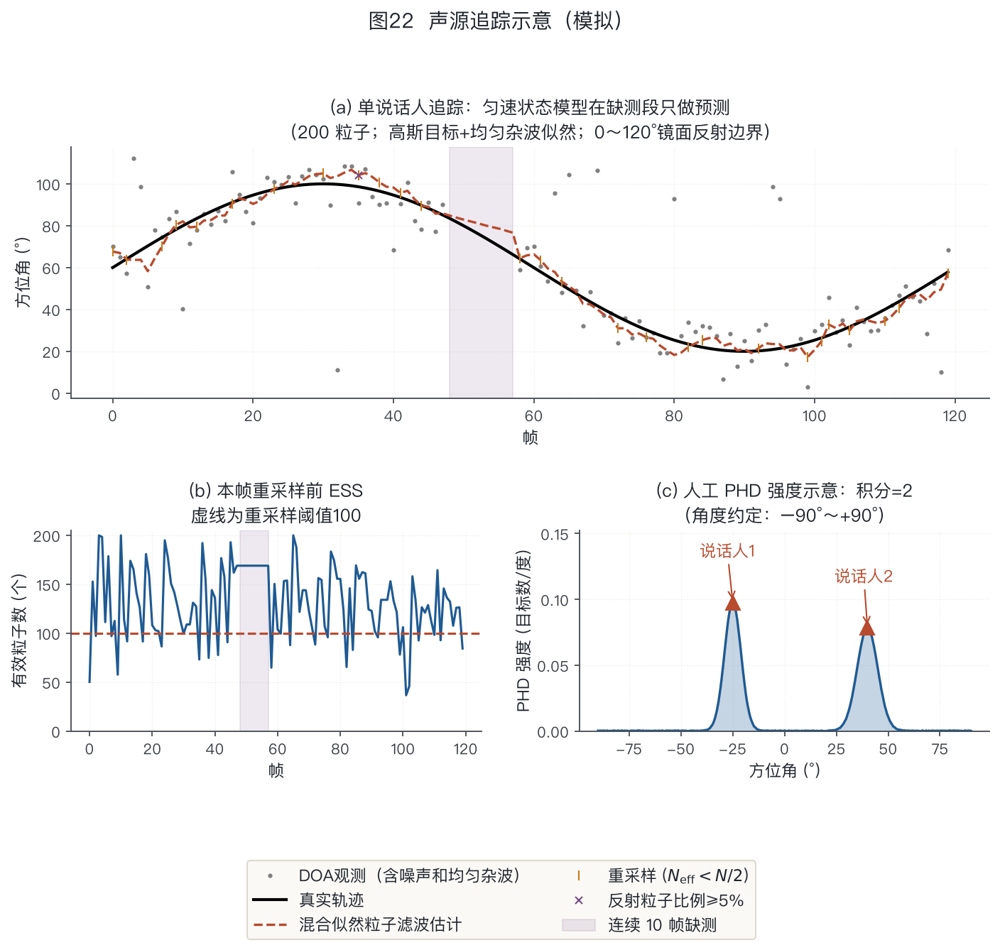
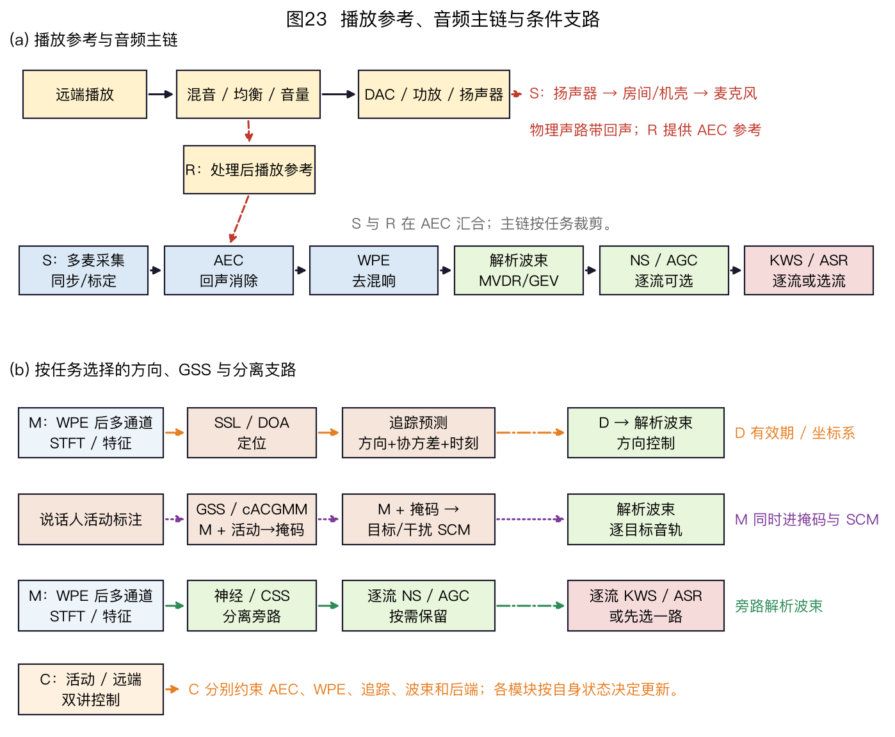
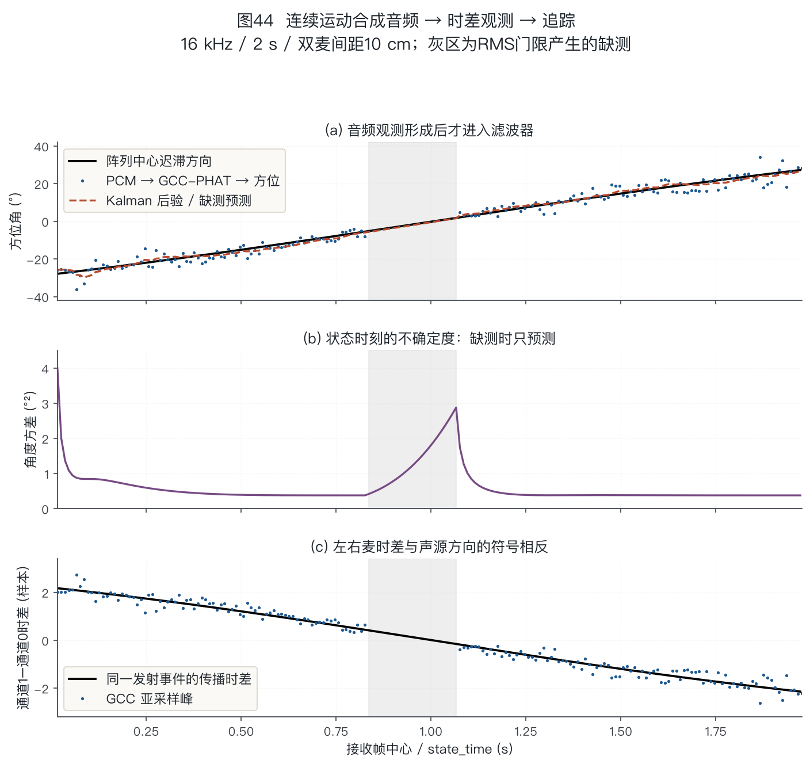
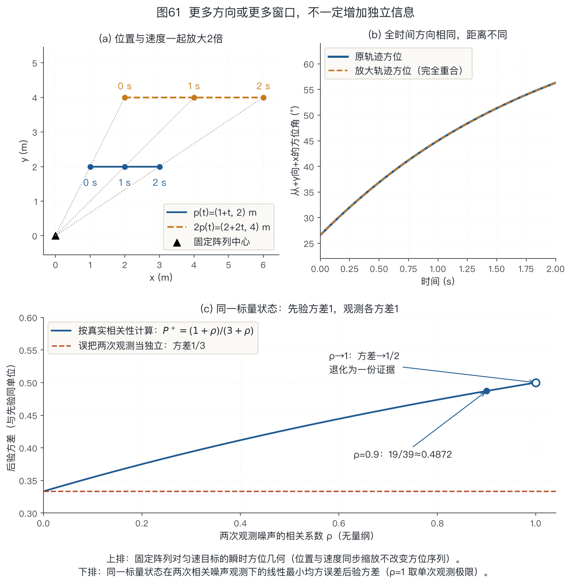
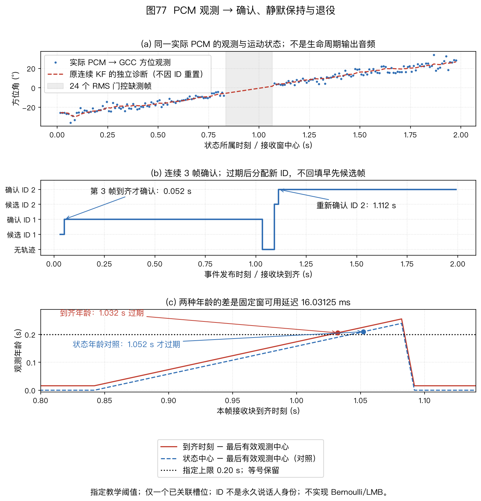

> ⚠️ 本篇是教程正文第 9 章（正文与扩展专题共 15 章，其中第 12、13、16、17 章为扩展专题，另有附录 A、B），可独立阅读，前后篇见下方导航。
>
> 🏠 首页导读：[`00_overview.md`](00_overview.md) ｜ 上一篇：[08_speech-separation.md](08_speech-separation.md) ｜ 下一篇：[10_engineering-practice.md](10_engineering-practice.md)

---

## 9. 声源追踪

### 9.1 问题与声学特殊性

#### 本章最小术语与阅读顺序

第 4 章的声源定位回答“这一帧声音从哪里来”，本章的声源追踪则回答“结合此前积累的观测，当前声源位于哪个方向或位置，不确定度有多大”。阅读本章时，建议先跟着手算走通一次卡尔曼递推，再理解粒子滤波的加权与重采样以及多目标数据关联，最后核对接口中的状态时间戳，避免把滞后的过去方向误当作当前波束指向。

| 术语 | 本章含义 |
|---|---|
| 波达方向（Direction of Arrival，DOA） | 相对指定阵列坐标系的声源方向 |
| 语音活动检测（Voice Activity Detection，VAD） | 判断当前帧是否存在语音活动证据，不等于判断说话人是否离场 |
| 状态、观测、新息 | 待估计的隐变量、定位器输出的测量量、当前观测减去预测观测的残差 |
| 先验、后验 | 本帧观测更新之前与更新之后的状态概率分布 |
| 协方差 | 估计误差的二阶中心矩；对角元为各分量方差，非对角元刻画误差间的线性相关性 |
| 轨迹标签 | 追踪器维护的局部持续标识，不自动等同于永久说话人身份 |

#### 方向状态、位置状态与可观测性

声源追踪将含噪且常因停顿而中断的逐帧定位结果融合为平滑轨迹，为自适应波束形成提供低抖动的因果方向估计。状态向量的设计取决于观测类型与下游需求：仅跟踪水平方位角时可取 $\vec{s}_t=[\theta_t,\dot{\theta}_t]^\top$，剧烈转弯或启停频繁时可增广角加速度 $\ddot{\theta}_t$，需要联合跟踪平面位置时则取 $\vec{s}_t=[x_t,y_t,\dot{x}_t,\dot{y}_t]^\top$。角度状态各分量的量纲依次为角度、角速度与角加速度；笛卡尔位置状态则须先固定阵列参考原点、坐标轴朝向及长度与时间单位。

公开评测基准如 [LOCATA 官方任务页](https://www.locata.lms.tf.fau.de/tasks/)定义了涵盖单源/多源、静止/移动声源与移动阵列的六类任务。其开发集同步提供多通道录音及麦克风、声源的三维位置真值，而评测集仅公开录音与麦克风位置真值；自行评测逐帧定位或追踪误差时，需选用带声源位置真值的数据集并按任务编号分开统计（数据集选型原则见 §10.6）。

与雷达或视觉目标跟踪相比，室内声源追踪面临四项突出的物理难点：

- 自然语音包含大量音节间隙与句间停顿，观测呈间歇到达，需要借助语音活动检测（VAD）做观测门控并在短暂停顿时维持轨迹外推；
- 房间混响的强早期反射会引发严重的非高斯偏差与角度野点（假峰）；
- 会议与家庭场景中同时发声的人数随时间动态增减；
- 阵列测得的波达方向（DOA）与声源笛卡尔坐标之间呈强非线性映射。

设平面状态包含位置与速度 $[x,y,\dot{x},\dot{y}]^\top$，阵列几何中心位于 $(x_0,y_0)$。沿用第 2～5 章“以 $+y$ 轴为 $0^\circ$、向 $+x$ 轴顺时针旋转为正”的方位角约定，无噪方位观测函数写为 $\theta=\operatorname{atan2}(x-x_0,y-y_0)$。此处 `atan2` 的第一个自变量是横轴分量 $x-x_0$（对应 $\sin\theta$），第二个自变量是纵轴分量 $y-y_0$（对应 $\cos\theta$），切勿照搬标准数学极角 $\operatorname{atan2}(y-y_0,x-x_0)$ 的参数顺序。

以阵列中心位于原点 $(0,0)$、声源位于 $(1\ \mathrm{m},2\ \mathrm{m})$ 为例，本书约定给出 $\operatorname{atan2}(1,2)\approx 26.565^\circ$；若误将两参数颠倒，算出的 $\operatorname{atan2}(2,1)\approx 63.435^\circ$ 实际是以 $+x$ 轴为零点的极角。两套角度本身都合法，但定位模块、追踪器与波束形成器的导向矢量必须共享同一角度约定，直接混传会使波束偏离目标方向。

从几何可观测性看，单个固定阵列仅凭方位角无法唯一确定声源距离。仍以原点处的阵列为例，位于 $(1\ \mathrm{m},1\ \mathrm{m})$ 与 $(2\ \mathrm{m},2\ \mathrm{m})$ 的两个声源处在同一条射线上，$\operatorname{atan2}$ 均输出 $45^\circ$，沿径向按任意正比例缩放坐标完全不改变方位角读数。

即便把多帧方位角串联起来，只要阵列静止且声源做未知速度的匀速直线运动，把初始位置与初始速度同时乘以任意正数 $a>0$，整条轨迹在任意时刻的瞬时方位角依然逐帧重合（练习 [E09-21](#e09-21) 给出了三时刻完整复算与雅可比零空间证明）。多攒几帧观测只能压低可观测切向上的角度噪声，无法凭空消除径向尺度歧义；即便把线性卡尔曼滤波换成扩展卡尔曼滤波（Extended Kalman Filter，EKF）或无迹卡尔曼滤波（Unscented Kalman Filter，UKF），滤波器也无法从仅测方位数据中“算出”真实距离。要实现二维或三维位置级追踪，必须引入空间分离的多个子阵、到达时间差（Time Difference of Arrival，TDOA）曲率/距离观测，或让阵列自身做满足可观测性条件（如存在相对机动加速度）的已知运动（理论判据详见 [Nardone 与 Aidala 1981 / Fogel 与 Gavish 1989 仅测方位可观测性分析](https://doi.org/10.1080/00207178908559665)）。

当多阵列或已知阵列机动使位置可观测时，还需处理 $\operatorname{atan2}$ 的非线性。EKF 在当前预测均值处用一阶泰勒展开（雅可比矩阵）将非线性观测局部线性化；UKF 则在预测均值附近按协方差结构确定性地挑出少量代表点（称为 Sigma 点，并非额外检测到的物理声源），把每个点直接代入原非线性观测函数，再由变换后的点集加权恢复观测均值与协方差。

对于维度为 $L$ 的状态向量，标准对称或缩放无迹变换构造 $2L+1$ 个 Sigma 点：平面位置—速度状态（$L=4$）对应 $9$ 个点，方位角—角速度状态（$L=2$）对应 $5$ 个点（工程中也有最小偏度单纯形、球面径向等更少点数的变体，$2L+1$ 并非所有 UKF 的唯一构造）。当声源靠近阵列或从阵列近旁快速掠过时，方位角随位置剧烈变化，UKF 或粒子滤波比一阶线性化的 EKF 更稳健；但若声源恰好穿过阵列中心 $(x_0,y_0)$，方位角在几何上本身无定义，任何滤波器都无法绕开这一物理奇点。下面先从最基础的线性卡尔曼滤波（Kalman Filter，KF）推起，再逐步扩展到非线性观测与多运动模型。

### 9.2 单目标追踪

#### 9.2.1 卡尔曼预测、观测更新与角度边界

设离散时间帧索引为 $t$，待估计的 $d$ 维状态列向量为 $\vec{s}_t\in\mathbb{R}^d$，定位器提供的 $p$ 维观测列向量为 $\vec{z}_t\in\mathbb{R}^p$。线性状态空间模型写为

$$\begin{aligned}
\vec{s}_t&=\mathbf{F}\vec{s}_{t-1}+\vec{v}_t,\\
\vec{z}_t&=\mathbf{H}\vec{s}_t+\vec{w}_t.
\end{aligned}\tag{9-1}$$

其中 $\mathbf{F}\in\mathbb{R}^{d\times d}$ 为状态转移矩阵，刻画相邻两帧之间的确定性运动规律；$\mathbf{H}\in\mathbb{R}^{p\times d}$ 为观测矩阵，把 $d$ 维内部状态映射到 $p$ 维观测量；$\vec{v}_t\in\mathbb{R}^d$ 与 $\vec{w}_t\in\mathbb{R}^p$ 分别表示过程噪声（未建模的随机加减速或转身扰动）与观测噪声（单帧 DOA 估计误差）。

标准卡尔曼推导假定 $\vec{v}_t$ 与 $\vec{w}_t$ 均为零均值白噪声序列，彼此互不相关且均与初始状态估计误差正交。在此前提下，过程噪声协方差矩阵 $\mathbf{Q}=\mathbb{E}[\vec{v}_t\vec{v}_t^\top]\in\mathbb{R}^{d\times d}$ 与观测噪声协方差矩阵 $\mathbf{R}=\mathbb{E}[\vec{w}_t\vec{w}_t^\top]\in\mathbb{R}^{p\times p}$ 均为对称半正定（通常要求 $\mathbf{R}$ 正定以保证求逆良态）。若定位器存在系统性角度安装偏置（噪声均值非零），需将偏置增广进状态或先行校准；若相邻重叠分析窗导致观测噪声跨帧强相关，则需恢复交叉协方差项或做状态增广。

记给定截至 $t-1$ 帧观测时的本帧先验预测均值为 $\hat{\vec{s}}_t^-$、先验误差协方差矩阵为 $\mathbf{P}_t^-=\mathbb{E}[(\vec{s}_t-\hat{\vec{s}}_t^-)(\vec{s}_t-\hat{\vec{s}}_t^-)^\top]\in\mathbb{R}^{d\times d}$；融入本帧观测 $\vec{z}_t$ 后的后验均值与误差协方差矩阵分别记为 $\hat{\vec{s}}_t$ 与 $\mathbf{P}_t$，卡尔曼增益记为 $\mathbf{K}_t\in\mathbb{R}^{d\times p}$。只要上述零均值与不相关二阶统计条件成立，卡尔曼递推在所有线性无偏估计器中达到最小均方误差（LMMSE）；若进一步假定初态与噪声服从联合高斯分布，后验分布严格保持高斯并由 $(\hat{\vec{s}}_t,\mathbf{P}_t)$ 完整刻画，该递推同时给出全局贝叶斯条件均值（见 [Kalman 1960 奠基论文 §Optimal Estimates 与 Theorem 3](https://people.duke.edu/~hpgavin/SystemID/References/Kalman-JBE-1960.pdf)）。

阅读矩阵维度与量纲时，协方差矩阵第 $(i,j)$ 个元素的单位等于第 $i$ 个与第 $j$ 个状态分量单位的乘积。以两分量角运动状态 $\vec{s}_t=[\theta_t,\dot{\theta}_t]^\top$（角度用 $\mathrm{deg}$，角速度用 $\mathrm{deg/frame}$）为例，$\mathbf{P}_t$ 主对角线两项的单位分别是 $\mathrm{deg}^2$ 与 $(\mathrm{deg/frame})^2$，非对角互协方差的单位则是 $\mathrm{deg}^2/\mathrm{frame}$，对应的观测矩阵为 $\mathbf{H}=[1,\ 0]$（若采用含角加速度的三分量状态 $[\theta,\dot{\theta},\ddot{\theta}]^\top$，则 $\mathbf{H}=[1,\ 0,\ 0]$，切勿将其误读为三维空间坐标）。当定位器每帧只输出单个方位角时，$p=1$，观测向量退化为标量 $\theta_t^{\mathrm{obs}}$，观测噪声矩阵 $\mathbf{R}$ 与新息协方差矩阵 $\mathbf{S}_t$ 均退化为 $1\times 1$ 标量方差，下文在标量情形下分别记作 $R$ 与 $S_t$，在一般多维推导中保持正粗体 $\mathbf{R}$ 与 $\mathbf{S}_t$。

整个递推由“时间预测”和“观测更新”两步交替组成：预测步顺着运动学模型向前推演均值并累加过程不确定度；更新步先算出实际观测与预测观测之差（称为新息），再按预测与观测各自的不确定度比例修正状态并收缩误差协方差。

**卡尔曼滤波（KF）的五步递推**（状态取 [角度, 角速度]）：

1. **预测状态**：

    $$\hat{\vec{s}}^-_t = \mathbf{F}\hat{\vec{s}}_{t-1}.\tag{9-2}$$

2. **预测协方差**：

    $$\mathbf{P}^-_t = \mathbf{F}\mathbf{P}_{t-1}\mathbf{F}^\top + \mathbf{Q}.\tag{9-3}$$

    $\mathbf{F}$ 先把上一帧误差协方差映射并耦合到当前帧，$\mathbf{Q}$ 再叠加未建模运动的过程噪声。注意不能笼统断言任意 $\mathbf{F}$ 下 $\mathbf{P}_t^-$ 的每个矩阵元素都必然变大（见练习 E09-18 的负互协方差反例）；但在本章初态正交或同号互协方差的匀速外推算例中，角度方差会随缺测帧数持续增长。

3. **计算卡尔曼增益**：

    $$\begin{aligned}
    \mathbf{S}_t&=\mathbf{H}\mathbf{P}_t^-\mathbf{H}^\top+\mathbf{R},\\
    \mathbf{K}_t&=\mathbf{P}_t^-\mathbf{H}^\top\mathbf{S}_t^{-1}.
    \end{aligned}\tag{9-4}$$

    $\mathbf{R}$ 是式(9-1)定义的观测噪声协方差矩阵，$\mathbf{S}_t$ 是预测观测残差的总协方差矩阵。对 $p=1$ 的标量方位角观测，在另一项固定时，较小的观测方差会增大角度增益，较小的预测角度方差会减小角度增益；这一标量单调直觉不能直接套用到一般多维矩阵增益的每个分量上。

4. **更新状态**：

    $$\begin{aligned}
    \nu_t&=\theta_t^{\mathrm{obs}}-\mathbf{H}\hat{\vec{s}}_t^-,\\
    \hat{\vec{s}}_t&=\hat{\vec{s}}_t^-+\mathbf{K}_t\nu_t.
    \end{aligned}\tag{9-5}$$

    第一行的差称为新息（innovation），表示本帧观测带来了多少超出先验预测的新信息；多维观测下写作 $\vec{\nu}_t=\vec{z}_t-\mathbf{H}\hat{\vec{s}}_t^-$，其协方差正是第 3 步的 $\mathbf{S}_t$（标量情形记为 $S_t$）。

5. **更新协方差**：

    $$\mathbf{P}_t = (\mathbf{I}-\mathbf{K}_t\mathbf{H})\mathbf{P}^-_t.\tag{9-6}$$

方位角跨越表示区间边界时，式(9-5)中的角度新息不能直接做普通实数减法。若全系统统一将水平方位角主值固定在半开区间 $[-180^\circ,180^\circ)$，可定义最短圆周角环绕算子：

$$\begin{aligned}
b&=\alpha+180^\circ,\\
r&=b\bmod 360^\circ,\\
\operatorname{wrap}_{180}(\alpha)&=r-180^\circ.
\end{aligned}\tag{9-7}$$

这里 $\bmod$ 取与除数同号的非负余数 $r\in[0^\circ,360^\circ)$。第 4 步计算新息时应改为 $\nu_t=\operatorname{wrap}_{180}(\theta_t^{\mathrm{obs}}-\mathbf{H}\hat{\vec{s}}_t^-)$；预测步与更新步结束后，同样需要把状态向量中的角度分量按式(9-7)映射回 $[-180^\circ,180^\circ)$，而角速度 $\dot{\theta}_t$ 属于切空间实数，绝不能做角度环绕。数值实现时应先保证输入角度已处于规范区间附近再做差环绕，避免对极小角差反复加减 $180^\circ$ 引入额外的浮点尾数损失。

看一个直观例子：设预测方位为 $+179^\circ$，本帧实测方位为 $-179^\circ$。在圆周上声源其实只跨过背向分界线顺时针走了 $+2^\circ$，直接相减却算出 $-358^\circ$——若不环绕，滤波器会误以为目标在反方向横跨了近一整圈而把状态猛拉过头，后面的新息门控也会把这条本来很准的观测误判成野点剔除。若预测与观测恰好相差 $180^\circ$（对跖方向），顺时针与逆时针弧长相等，式(9-7)按半开区间约定统一返回 $-180^\circ$，此时单靠当前新息符号无法判断真实转向。还需注意：环绕算子仅解决单峰局部高斯跨越人为坐标接缝的问题，若真实后验本身横跨宽扇区或呈前后对称双峰，则应改用圆周统计或粒子滤波；反之，若贴墙安装的线阵仅在 $[-90^\circ,90^\circ]$ 有限扇区内工作，两端并非物理相邻方向，不能套用 $360^\circ$ 环绕。

为什么协方差更新能写成式(9-6)，而工程代码里又普遍改用更长一截的 **Joseph 稳定形式**？我们不妨把后验误差协方差从头推一遍，顺便把最优增益式(9-4)也一并推出来。对于**任意**给定的线性增益矩阵 $\mathbf{K}_t\in\mathbb{R}^{d\times p}$，把观测方程 $\vec{z}_t=\mathbf{H}\vec{s}_t+\vec{w}_t$ 代入更新式 $\hat{\vec{s}}_t=\hat{\vec{s}}_t^-+\mathbf{K}_t(\vec{z}_t-\mathbf{H}\hat{\vec{s}}_t^-)$，后验估计误差 $\vec{e}_t=\vec{s}_t-\hat{\vec{s}}_t$ 可整理为先验误差 $\vec{e}_t^-=\vec{s}_t-\hat{\vec{s}}_t^-$ 与观测噪声 $\vec{w}_t$ 的线性组合：

$$\vec{e}_t=\vec{s}_t-\hat{\vec{s}}_t^--\mathbf{K}_t(\mathbf{H}\vec{e}_t^-+\vec{w}_t)=(\mathbf{I}-\mathbf{K}_t\mathbf{H})\vec{e}_t^--\mathbf{K}_t\vec{w}_t.$$

由于先验误差 $\vec{e}_t^-$ 只依赖历史信息，与本帧白观测噪声 $\vec{w}_t$ 互不相关（$\mathbb{E}[\vec{e}_t^-\vec{w}_t^\top]=\mathbf{0}$），计算外积期望 $\mathbf{P}_t=\mathbb{E}[\vec{e}_t\vec{e}_t^\top]$ 时交叉项严格为零，立刻得到对**任意增益矩阵**都成立的通用 **Joseph 协方差更新式**：

$$\begin{aligned}
\mathbf{A}_t&=\mathbf{I}-\mathbf{K}_t\mathbf{H},\\
\mathbf{P}_t&=\mathbf{A}_t\mathbf{P}_t^-\mathbf{A}_t^\top+\mathbf{K}_t\mathbf{R}\mathbf{K}_t^\top.
\end{aligned}\tag{9-8}$$

#### 增益为什么按不确定度加权

有了通用误差协方差式(9-8)，“卡尔曼增益 $\mathbf{K}_t$ 为什么长成式(9-4)那样”就变成一道单纯的求极值题：我们要挑选 $\mathbf{K}_t$，使各状态分量的后验均方误差总和——即协方差矩阵的迹 $J(\mathbf{K}_t)=\operatorname{tr}(\mathbf{P}_t)$——达到最小。先看最直观的一维标量情形（$d=p=1$，$H=1$）：此时后验误差为 $e^+=(1-k)e^--kw$，先验方差 $P^-$ 与观测噪声方差 $R$ 均为正标量，对 $k$ 求导令其为零：

$$\begin{aligned}
J(k)&=\mathbb{E}[(s-\hat{s}^+)^2]=(1-k)^2P^-+k^2R,\\
J'(k)&=-2(1-k)P^-+2kR=0,\\
k_*&=\frac{P^-}{P^-+R}.
\end{aligned}\tag{9-9}$$

代回 $P^-=4$、$R=1$，最优权重为 $k_*=4/(4+1)=4/5$，后验方差收缩至 $P^+=(1/5)^2\times 4+(4/5)^2\times 1=4/5$（与 $(1-k_*)P^-$ 一致）：谁的方差更小、确定性更高，更新后均值就更偏向谁；反过来，若观测本身带有未建模的混响固定偏置，盲目把 $R$ 设小反而会把估计强行拉向偏置方向。

把完全相同的求导搬到多维矩阵上：将式(9-8)展开为 $\mathbf{P}_t=\mathbf{P}_t^--\mathbf{K}_t\mathbf{H}\mathbf{P}_t^--\mathbf{P}_t^-\mathbf{H}^\top\mathbf{K}_t^\top+\mathbf{K}_t(\mathbf{H}\mathbf{P}_t^-\mathbf{H}^\top+\mathbf{R})\mathbf{K}_t^\top$，记括号内的新息协方差为 $\mathbf{S}_t=\mathbf{H}\mathbf{P}_t^-\mathbf{H}^\top+\mathbf{R}$。利用矩阵迹求导恒等式 $\frac{\partial}{\partial\mathbf{K}}\operatorname{tr}(\mathbf{K}\mathbf{B})=\mathbf{B}^\top$ 与 $\frac{\partial}{\partial\mathbf{K}}\operatorname{tr}(\mathbf{K}\mathbf{S}\mathbf{K}^\top)=2\mathbf{K}\mathbf{S}$（其中 $\mathbf{P}_t^-$ 与 $\mathbf{S}_t$ 均对称），对 $\mathbf{K}_t$ 求偏导并令梯度为零矩阵：

$$\frac{\partial\operatorname{tr}(\mathbf{P}_t)}{\partial\mathbf{K}_t}=-2\mathbf{P}_t^-\mathbf{H}^\top+2\mathbf{K}_t\mathbf{S}_t=\mathbf{0}\implies \mathbf{K}_t=\mathbf{P}_t^-\mathbf{H}^\top\mathbf{S}_t^{-1}.$$

这正是第 3 步的最优卡尔曼增益式(9-4)。再把刚证出的最优关系 $\mathbf{K}_t\mathbf{S}_t=\mathbf{P}_t^-\mathbf{H}^\top$ 代回上面展开式的最后一项，有 $\mathbf{K}_t\mathbf{S}_t\mathbf{K}_t^\top=\mathbf{P}_t^-\mathbf{H}^\top\mathbf{K}_t^\top$，恰好与倒数第二项 $-\mathbf{P}_t^-\mathbf{H}^\top\mathbf{K}_t^\top$ 正负相消，只剩下 $\mathbf{P}_t=\mathbf{P}_t^--\mathbf{K}_t\mathbf{H}\mathbf{P}_t^-=(\mathbf{I}-\mathbf{K}_t\mathbf{H})\mathbf{P}_t^-$，即第 5 步的简写式(9-6)。由此可见，简写式(9-6)只有在增益**精确等于**最优卡尔曼增益时才与式(9-8)等价：手算时式(9-6)最省力，但在有限字长浮点运算或对增益做了工程限幅时，$(\mathbf{I}-\mathbf{K}_t\mathbf{H})\mathbf{P}_t^-$ 两个非对称矩阵相乘极易因舍入误差破坏对称性甚至算出负对角方差，而 Joseph 形式式(9-8)显式将两个对称半正定二次型相加，数值稳定性好得多（实现中仍应校验输入协方差的对称半正定性，不能用 Joseph 公式去掩盖非法的负方差输入）。

#### 新息门控与协方差有效性

房间强反射常在远离真实声源的方位产生瞬态伪峰，送入更新步前必须检验新息相对于当前预测不确定度是否合理。令 $\vec{\nu}_t\in\mathbb{R}^p$ 为新息向量、$\mathbf{S}_t$ 为新息协方差矩阵，归一化新息平方（Normalized Innovation Squared，NIS，又称平方马氏距离）定义为

$$\begin{aligned}
\epsilon_\nu&=\vec{\nu}_t^\top\mathbf{S}_t^{-1}\vec{\nu}_t,\\
p=1:\quad\epsilon_\nu&=\nu_t^2/S_t.
\end{aligned}\tag{9-10}$$

在线性高斯模型正确、数据关联无误且 $\mathbf{S}_t$ 正定的前提下，**门控筛选之前**的 $\epsilon_\nu$ 服从自由度为 $p$ 的卡方分布 $\chi_p^2$（例如 $p=1$ 时，$\epsilon_\nu\le 9$ 对应标准正态 $3\sigma$ 区间，理论拒真率约 $0.27\%$）。工程上据此设定门限剔除异常野点，但要注意三点边界：第一，某条观测落入门内并不等于“该观测来自目标的后验概率为 $99.7\%$”；第二，一旦剔除了超门限样本，留存的新息序列就变成了截断分布，不能再拿门控后的样本直接做未截断 $\chi_p^2$ 拟合优度检验；第三，圆周角上的高斯分布只是误差集中于窄角区时的局部近似，练习 E09-05 与 E09-17 分别复算跨越 $\pm 180^\circ$ 环绕以及角度/弧度单位换算下的 NIS 不变性。

#### 9.2.2 算例 9-1：卡尔曼滤波单步复算

下面用一组完整的手算数字，从头到尾走通式(9-2)～式(9-6)的一次预测与更新，考察相对阵列方位平缓移动的单个声源（注意：若说话人站在原地仅转动头部，声源发声位置未变，一般不会产生此类整体方位平移轨迹）。

**输入与模型口径。** 取两分量角运动状态 $\vec{s}_t=[\theta_t,\dot{\theta}_t]^\top$，角度以度（$\mathrm{deg}$）计，角速度以度/帧（$\mathrm{deg/frame}$）计。省略角加速度的常速度模型适合平缓移动阶段；若目标频繁启停或急转，可换用含加速度状态或 §9.2.3 的交互多模型（Interacting Multiple Model，IMM）。给定本步输入参数如下：

- 上一帧后验状态均值：$\hat{\vec{s}}_{t-1}=[30,\ 0.5]^\top$，即估计方位在 $30^\circ$，正以 $0.5^\circ/\mathrm{frame}$ 的角速度向正方向移动；
- 上一帧后验协方差：$\mathbf{P}_{t-1}=\begin{bmatrix}4&0\\0&0.25\end{bmatrix}$，对应角度标准差 $2^\circ$（方差 $4\ \mathrm{deg}^2$）、角速度标准差 $0.5\ \mathrm{deg/frame}$（方差 $0.25\ (\mathrm{deg/frame})^2$），且初始误差不相关；
- 状态转移矩阵（步长为 $1$ 帧的匀速外推）：$\mathbf{F}=\begin{bmatrix}1&1\\0&1\end{bmatrix}$，表示 $\theta_t=\theta_{t-1}+1\cdot\dot{\theta}_{t-1}$、$\dot{\theta}_t=\dot{\theta}_{t-1}$；
- 过程噪声协方差：$\mathbf{Q}=\begin{bmatrix}0.1&0\\0&0.01\end{bmatrix}$，刻画相邻两帧间未建模的微小运动波动，$\mathbf{Q}$ 越大代表运动先验越宽松；
- 观测模型与本帧读数：定位器只输出标量方位角，故 $\mathbf{H}=[1,\ 0]$；本帧测得 $\theta_t^{\mathrm{obs}}=32^\circ$，标量观测噪声方差 $R=25\ \mathrm{deg}^2$（即 $1\times 1$ 矩阵 $\mathbf{R}=[25]$，对应单帧 DOA 标准差 $5^\circ$，比先验预测粗糙）。

**第 1 步：状态预测** $\hat{\vec{s}}_t^-=\mathbf{F}\hat{\vec{s}}_{t-1}$。代入转移矩阵，把上一帧角速度累加到角度分量上：

$$\begin{aligned}
\hat{\vec{s}}_t^-&=\begin{bmatrix}1&1\\0&1\end{bmatrix}
\begin{bmatrix}30\\0.5\end{bmatrix}\\
&=\begin{bmatrix}30+0.5\\0.5\end{bmatrix}
=\begin{bmatrix}30.5\\0.5\end{bmatrix}.
\end{aligned}$$

尚未看本帧新观测前，模型外推声源到达 $30.5^\circ$，角速度维持 $0.5^\circ/\mathrm{frame}$。

**第 2 步：协方差预测** $\mathbf{P}_t^-=\mathbf{F}\mathbf{P}_{t-1}\mathbf{F}^\top+\mathbf{Q}$。分两步做矩阵乘法，先算左半部分 $\mathbf{F}\mathbf{P}_{t-1}=\begin{bmatrix}1&1\\0&1\end{bmatrix}\begin{bmatrix}4&0\\0&0.25\end{bmatrix}=\begin{bmatrix}4&0.25\\0&0.25\end{bmatrix}$，再右乘 $\mathbf{F}^\top=\begin{bmatrix}1&0\\1&1\end{bmatrix}$：

$$\begin{aligned}
\mathbf{F}\mathbf{P}_{t-1}\mathbf{F}^\top
&=\begin{bmatrix}4&0.25\\0&0.25\end{bmatrix}\begin{bmatrix}1&0\\1&1\end{bmatrix}\\
&=\begin{bmatrix}4+0.25&0.25\\0.25&0.25\end{bmatrix}\\
&=\begin{bmatrix}4.25&0.25\\0.25&0.25\end{bmatrix}.
\end{aligned}$$

可以看到，即便还没加 $\mathbf{Q}$，左上角的角度方差已从 $4$ 涨到 $4.25$，同时非对角元出现了 $+0.25$ 的正相关——这是因为角速度原本存在 $0.25$ 的方差，经过一帧位移外推后，速度估偏多少就会同方向带偏角度预测。接着加上过程噪声 $\mathbf{Q}$：

$$\begin{aligned}
\mathbf{P}_t^-&=\begin{bmatrix}4.25&0.25\\0.25&0.25\end{bmatrix}
+\begin{bmatrix}0.1&0\\0&0.01\end{bmatrix}\\
&=\begin{bmatrix}4.35&0.25\\0.25&0.26\end{bmatrix}.
\end{aligned}$$

此时预测角度标准差为 $\sqrt{4.35}\approx 2.09^\circ$。

**第 3 步：计算卡尔曼增益** $\mathbf{K}_t=\mathbf{P}_t^-\mathbf{H}^\top(\mathbf{H}\mathbf{P}_t^-\mathbf{H}^\top+\mathbf{R})^{-1}$。由于 $\mathbf{H}=[1,\ 0]$ 只提取第一维角度，$\mathbf{H}\mathbf{P}_t^-\mathbf{H}^\top$ 直接挑出 $\mathbf{P}_t^-$ 的左上角元素 $4.35$，标量新息方差为

$$S_t=\mathbf{H}\mathbf{P}_t^-\mathbf{H}^\top+R=4.35+25=29.35\ \mathrm{deg}^2.$$

分子 $\mathbf{P}_t^-\mathbf{H}^\top=\begin{bmatrix}4.35&0.25\\0.25&0.26\end{bmatrix}\begin{bmatrix}1\\0\end{bmatrix}=\begin{bmatrix}4.35\\0.25\end{bmatrix}$ 恰好是 $\mathbf{P}_t^-$ 的第一列，除以标量 $S_t$ 得 $2\times 1$ 增益向量：

$$\mathbf{K}_t=\frac{1}{29.35}\begin{bmatrix}4.35\\0.25\end{bmatrix}\approx\begin{bmatrix}0.148\\0.0085\end{bmatrix}.$$

更精细的中间商依次为 $K_1\approx 0.148211$ 与 $K_2\approx 0.008518$（上式仅作展示舍入）。这里两个分量各有清晰的物理含义：$K_1\approx 0.148$ 表明，由于单帧观测噪声方差（$25$）远大于预测角度方差（$4.35$），角度更新只采纳本帧新息的约 $14.8\%$；而定位器虽然根本没测角速度，但由于第 2 步预测协方差的非对角项 $P_{21}^-=0.25>0$ 建立了角度误差与速度误差的耦合，正的角度残差同样顺带把角速度往上微调了 $K_2\approx 0.0085\ (\mathrm{frame})^{-1}$。

**第 4 步：状态更新** $\hat{\vec{s}}_t=\hat{\vec{s}}_t^-+\mathbf{K}_t\nu_t$。本帧角度新息 $\nu_t=\theta_t^{\mathrm{obs}}-\mathbf{H}\hat{\vec{s}}_t^-=32^\circ-30.5^\circ=1.5^\circ$ 未跨越 $\pm 180^\circ$ 边界，保留精确分数增益代入得

$$\begin{aligned}
\hat{\vec{s}}_t&=\begin{bmatrix}30.5\\0.5\end{bmatrix}
+\frac{1.5}{29.35}\begin{bmatrix}4.35\\0.25\end{bmatrix}\\
&\approx\begin{bmatrix}30.722317\\0.512777\end{bmatrix}.
\end{aligned}$$

更新后方位角为 $30.72^\circ$（落在预测值 $30.5^\circ$ 与粗糙观测值 $32^\circ$ 之间，且明显偏向更可信的预测一侧），角速度同步微调至 $0.513^\circ/\mathrm{frame}$。

**第 5 步：协方差更新** $\mathbf{P}_t=(\mathbf{I}-\mathbf{K}_t\mathbf{H})\mathbf{P}_t^-$。手算时务必代入未舍入的精确分数增益 $\mathbf{K}_t=[4.35,\ 0.25]^\top/29.35$（若中途拿两位或三位展示小数回代，不仅末位失真，还可能使算出的上下三角非对角元不相等）：

$$\mathbf{I}-\mathbf{K}_t\mathbf{H}=\begin{bmatrix}1-4.35/29.35&0\\-0.25/29.35&1\end{bmatrix}=\begin{bmatrix}25/29.35&0\\-0.25/29.35&1\end{bmatrix},$$

$$\begin{aligned}
\mathbf{P}_t&=(\mathbf{I}-\mathbf{K}_t\mathbf{H})\mathbf{P}_t^-\\
&\approx\begin{bmatrix}3.705&0.213\\0.213&0.258\end{bmatrix}.
\end{aligned}$$

逐项核对精确分数：$P_{11}=25\times 4.35/29.35\approx 3.705281$，$P_{12}=P_{21}=25\times 0.25/29.35\approx 0.212947$，$P_{22}=0.26-0.25^2/29.35\approx 0.257871$，全部算完后再统一保留三位小数（若中途把 $25/29.35\approx 0.8518$ 粗略截成 $0.852$，则会算成 $0.852\times 4.35=3.7062$，末位偏差一目了然）。

**结果解读与失效边界。** 融合本帧观测后，角度估计方差从预测时的 $4.35\ \mathrm{deg}^2$ 降至 $3.705\ \mathrm{deg}^2$（标准差从 $2.09^\circ$ 收窄到约 $1.92^\circ$），证实哪怕单帧观测标准差高达 $5^\circ$，只要无偏且方差标定准确，融合后仍比单靠预测或单靠观测更准。若下一帧说话人停顿导致无有效观测，则跳过第 3～5 步，只执行第 1、2 步外推状态并让角度方差继续增大，这正是 §9.4“静默保持”的数学机制。反之，若声源突然急停转向（违反常速度模型）或本帧 $32^\circ$ 其实换成一处 $85^\circ$ 的强墙面反射假峰（违反高斯白噪声模型且未加式(9-10)门控），账面协方差 $\mathbf{P}_t$ 虽照样缩小，真实方向误差却会显著恶化。

#### 固定增益与单目标方法的选择

走通了线性卡尔曼递推，下面横向对比六类单目标声源追踪方法的核心假设、优缺点与适用场景。其中 $\alpha$-$\beta$ / $\alpha$-$\beta$-$\gamma$ 滤波器将式(9-4)的时变增益直接替换成离线选定的常系数，省去了每帧的协方差矩阵递推：当采样间隔、运动模型与噪声方差长期恒定且常系数恰好取为代数 Riccati 方程的稳态解时，它与稳态卡尔曼滤波严格等价；一旦帧率抖动、信噪比剧变导致真实 $R$ 改变，或者增益仅凭经验拍脑袋选取，固定增益就无法自动重配权重（$\alpha$-$\beta$ 与稳态 KF 的对应关系见 [Ekstrand 2012, §9.1](https://doi.org/10.1155/2012/870890)，$\alpha$-$\beta$-$\gamma$ 的稳定域与最优增益推导见 [Kosuge 与 Ito 2002](https://doi.org/10.9746/sicetr1965.38.361)）。

| 方法 | 原理 | 优点 | 缺点 | 适用 |
|---|---|---|---|---|
| 滑动平均/中值/直方图众数 | 平均为线性平滑；中值/众数为非线性汇总 | 结构简单，不需递推协方差 | 隐含局部平稳假设；延迟大、跟不上机动、多源混杂 | 目标缓慢、观测较密时的基线 |
| α-β / α-β-γ | 用固定增益修正位置、速度（及加速度）预测 | 在线不必反复求 Riccati 递推 | 经验增益未必最优；统计条件变化时不能自行适配 | 采样周期和运动条件较稳定、资源受限的单目标追踪 |
| **卡尔曼滤波 KF** | 高斯线性贝叶斯递推（预测+新息加权更新） | 在线性高斯模型正确时得到最小均方误差估计 | 稠密实现随状态维数 $d$、观测维数 $p$ 约为 $O(d^3+p^3)$；标量 DOA 更新可更低，但仍需在目标硬件计时；抗野点差、需调 $\mathbf{Q}/\mathbf{R}$ | 观测质量较好且模型近似成立 |
| EKF（扩展卡尔曼滤波）/UKF（无迹卡尔曼滤波） | 一阶线性化/无迹变换处理非线性 | 可处理位置到角度的非线性观测 | EKF 对线性化误差敏感；标准对称/缩放 UKF 常传播 $2L+1$ 个 Sigma 点，其他变体点数不同 | 分布式阵列位置级追踪 |
| IMM 交互多模型 | 按模式转移概率混合各模型初始状态，再分别预测、更新，以新息似然更新模式权重并融合 | 可在多个预设运动模式之间平滑切换 | 计算量随模型数增加；未包含的运动模式仍会失配，且需标定模型转移概率 | 包含启动、停止和匀速段的机动场景 |
| **粒子滤波（Particle Filter，PF）/序贯重要性重采样（Sequential Importance Resampling，SIR）** | 带权粒子近似后验；预测、加权、按需重采样 | 能表示非线性、非高斯和多峰后验 | 鲁棒性取决于似然与杂波模型；会权重退化和样本贫化 | 观测多峰或运动模型明显非线性 |

阅读上表做工程选型时，可以沿着两条主轴逐级升级：第一条轴看**运动规律是否单一**——慢速单源用两维常速度 KF 即可（$d=2,p=1$ 时每帧仅需十余次标量乘加），若频繁在静止站立与快步走动间切换则升级为 IMM；第二条轴看**观测映射与噪声分布**——远场单阵列纯角度追踪是线性观测，多阵列联合定位走 EKF/UKF，而在强混响室内定位谱经常同时冒出直达声峰与镜像反射峰时，带杂波混合似然的圆周粒子滤波能保留多峰候选，避免过早锁错方向。

#### 9.2.3 运动模型切换与非线性观测

初学者阅读追踪文献时容易把两类正交的设计混为一谈：匀速、匀加速与停走切换回答“声源在时间上遵循什么运动规律”，而 EKF、UKF 与粒子滤波回答“非线性函数怎样传播概率分布或二阶矩”。两者可以自由组合——例如在分布式阵列位置追踪中，IMM 的每个运动模式内部都可以各自运行一个 EKF 或 UKF。

#### 非等间隔运动与过程噪声

算例 9-1 把帧率隐藏在“每帧”单位里；真实嵌入式系统中音频块可能因跳帧、语音门控或跨传感器异步到达而出现非均匀时间步长 $h>0$（单位：$\mathrm{s}$）。以秒为时间基准，取局部角运动状态 $\vec{s}=[\theta,\dot{\theta}]^\top$（单位分别为 $\mathrm{deg}$ 和 $\mathrm{deg/s}$）。若角速度受功率谱密度（连续强度）为 $q$ 的连续时间零均值白角加速度驱动，对状态微分方程在长度为 $h$ 的区间上积分（完整积分推导见练习 E09-04），得到时间自洽的转移矩阵与离散过程噪声协方差：

$$\begin{aligned}
\mathbf{F}(h)&=\begin{bmatrix}1&h\\0&1\end{bmatrix},\\
\mathbf{Q}(h)&=q\begin{bmatrix}h^3/3&h^2/2\\h^2/2&h\end{bmatrix}.
\end{aligned}\tag{9-11}$$

当角度取 $\mathrm{deg}$ 时，强度参数 $q$ 的量纲为 $\mathrm{deg}^2/\mathrm{s}^3$，矩阵三类元素的量纲依次落在 $\mathrm{deg}^2$、$\mathrm{deg}^2/\mathrm{s}$ 与 $\mathrm{deg}^2/\mathrm{s}^2$ 上。练习 E09-18 进一步验证：连续走两个半步 $h$ 与一步走 $2h$ 在式(9-11)下具有完全一致的总分布；若工程代码把帧移从 $10\ \mathrm{ms}$ 改成 $20\ \mathrm{ms}$ 却忘了重算 $\mathbf{Q}(h)$，实质上就悄悄篡改了底层的物理机动强度。

#### EKF：对本书方位约定求导

当状态取平面位置与速度 $\vec{s}=[x,y,\dot{x},\dot{y}]^\top$、阵列几何中心位于 $(x_0,y_0)$ 时，令相对位移为 $a=x-x_0$、$b=y-y_0$，水平距离平方为 $r^2=a^2+b^2>0$。沿用本书“$+y$ 轴为 $0\ \mathrm{rad}$、向 $+x$ 轴顺时针为正”的方位角约定，以弧度输出的非线性观测函数为 $h(\vec{s})=\operatorname{atan2}(a,b)$。

我们来一步步算出 $h(\vec{s})$ 对状态各分量的偏导数，切勿直接盲抄教科书极角公式。在 $b\neq 0$ 的局部扇区内，$\theta=\operatorname{atan2}(a,b)$ 满足 $\tan\theta=a/b$。利用反正切导数 $\frac{\mathrm{d}}{\mathrm{d}u}\arctan(u)=\frac{1}{1+u^2}$ 并令中间变量 $u=a/b$，按复合函数链式法则分别对 $x$（即对 $a$）和对 $y$（即对 $b$）求偏导：

$$\frac{\partial h}{\partial x}=\frac{1}{1+(a/b)^2}\cdot\frac{\partial(a/b)}{\partial a}=\frac{b^2}{a^2+b^2}\cdot\frac{1}{b}=+\frac{b}{r^2},$$

$$\frac{\partial h}{\partial y}=\frac{1}{1+(a/b)^2}\cdot\frac{\partial(a/b)}{\partial b}=\frac{b^2}{a^2+b^2}\cdot\left(-\frac{a}{b^2}\right)=-\frac{a}{r^2}.$$

对恒等式 $a=r\sin\theta$、$b=r\cos\theta$ 两边取全微分（$b\,\mathrm{d}a-a\,\mathrm{d}b=r^2\,\mathrm{d}\theta$）可以验证，上述两个偏导在 $b=0,r>0$ 处同样光滑成立；观测函数不含速度项，故对 $\dot{x},\dot{y}$ 的偏导均为 $0$。在先验预测状态 $\hat{\vec{s}}_t^-$ 处求值，得到 EKF 一步更新所需的 $1\times 4$ 观测雅可比矩阵与环绕新息：

$$\begin{aligned}
\mathbf{H}_t&=\left.\frac{\partial h}{\partial\vec{s}}\right|_{\hat{\vec{s}}_t^-}=\begin{bmatrix}b/r^2&-a/r^2&0&0\end{bmatrix},\\
\nu_t&=\operatorname{wrap}_{\pi}\!\left(z_t-h(\hat{\vec{s}}_t^-)\right).
\end{aligned}\tag{9-12}$$

这里务必留意**正负号与参数次序**：标准数学极角 $\varphi=\operatorname{atan2}(y-y_0,x-x_0)$ 的位置偏导是 $[-b/r^2,\ +a/r^2]$，与本书式(9-12)的 $[+b/r^2,\ -a/r^2]$ **符号恰好全反**！先做个物理方向自检：设声源在正前方偏右 $(a,b)=(1\ \mathrm{m},2\ \mathrm{m})$ 处（$r^2=5\ \mathrm{m}^2$），向右微移 $\Delta x>0$ 会使顺时针方位角变大，故 $\partial h/\partial x=+2/5=+0.4\ \mathrm{rad/m}>0$；向前远离 $\Delta y>0$ 会使方位角向 $0^\circ$ 回缩，故 $\partial h/\partial y=-1/5=-0.2\ \mathrm{rad/m}<0$，与直觉严丝合缝（完整一步 EKF 数值复算见练习 [E09-10](#e09-10)）。若代码在 `atan2` 用了本书约定，雅可比却抄成数学极角符号，卡尔曼增益将把位置往反方向推导致发散。

实现式(9-12)时还有三条准则：第一，$\operatorname{wrap}_\pi(\cdot)$ 将弧度差映射回 $[-\pi,\pi)$，若定位器输出角度（$\mathrm{deg}$），则 $\mathbf{H}_t$ 整体乘以 $180/\pi$（单位变为 $\mathrm{deg/m}$）且观测方差 $R$ 同步取 $\mathrm{deg}^2$；第二，$\mathbf{H}_t$ 仅用于传播新息方差 $S_t=\mathbf{H}_t\mathbf{P}_t^-\mathbf{H}_t^\top+R$ 与增益 $\mathbf{K}_t$，计算新息 $\nu_t$ 时必须代入原非线性函数 $h(\hat{\vec{s}}_t^-)$ 而绝不能写成 $\mathbf{H}_t\hat{\vec{s}}_t^-$（事实上沿径向代入会有 $\mathbf{H}_t[a,b,0,0]^\top=(ab-ab)/r^2=0$！）；第三，当声源逼近阵列中心 $r\to 0$ 时，$\|\mathbf{H}_t\|=1/r\to\infty$，局部一阶泰勒展开严重失真，原点 $r=0$ 处方位无定义。

#### UKF：传播代表点与非线性矩

当声源距阵列较近或先验不确定度较宽时，一阶导数难以代表整片先验分布经过弯曲函数后的变形。无迹变换（Unscented Transform，UT）放弃对函数求导，转而用 $2L+1$ 个确定性 **Sigma 点**精确编码 $L$ 维先验均值 $\vec{m}$ 与协方差 $\mathbf{P}$。常用缩放无迹变换引入尺度参数 $\lambda=\alpha^2(L+\kappa)-L$（要求 $L+\lambda>0$），先通过 Cholesky 分解求出满足 $\mathbf{A}\mathbf{A}^\top=(L+\lambda)\mathbf{P}$ 的平方根矩阵 $\mathbf{A}\in\mathbb{R}^{L\times L}$，记 $\vec{A}_i$ 为 $\mathbf{A}$ 的第 $i$ 列，构造如下点集与均值权重 $W_i^{(m)}$、协方差权重 $W_i^{(c)}$（其中对称偏移点下标 $i=1,\ldots,L$，非中心权重下标统一遍历 $i=1,\ldots,2L$）：

$$\begin{aligned}
\vec{\chi}_0&=\vec{m},\\
\vec{\chi}_i&=\vec{m}+\vec{A}_i,\quad \vec{\chi}_{i+L}=\vec{m}-\vec{A}_i,\\
W_0^{(m)}&=\frac{\lambda}{L+\lambda},\quad W_0^{(c)}=W_0^{(m)}+1-\alpha^2+\beta,\\
W_i^{(m)}&=W_i^{(c)}=\frac{1}{2(L+\lambda)}.
\end{aligned}\tag{9-13}$$

其中 $\alpha$（常取 $10^{-3}$～$1$）与 $\kappa$ 控制 Sigma 点离中心 $\vec{m}$ 的张开半径，$\beta$ 用于补偿高阶矩（高斯先验下常取 $\beta=2$）；注意当 $\lambda<0$ 时中心权重 $W_0^{(m)}<0$，说明 Sigma 点是一组代数求积节点而非非负概率粒子。我们可以两步验证这组点确实严丝合缝地还原了先验前两阶矩：

1. **还原先验均值**：全部均值权重之和为 $W_0^{(m)}+2L\cdot\frac{1}{2(L+\lambda)}=\frac{\lambda+L}{L+\lambda}=1$，且第 $i$ 点与第 $i+L$ 点的对称偏移 $+\vec{A}_i$ 与 $-\vec{A}_i$ 等权相消，故 $\sum_{i=0}^{2L}W_i^{(m)}\vec{\chi}_i=\vec{m}$。
2. **还原先验协方差**：中心点偏差 $\vec{\chi}_0-\vec{m}=\vec{0}$（无论 $W_0^{(c)}$ 取何值均不贡献零阶外积），其余 $L$ 对正负对称点的加权外积和为 $\sum_{i=1}^L\frac{1}{2(L+\lambda)}\bigl[\vec{A}_i\vec{A}_i^\top+(-\vec{A}_i)(-\vec{A}_i)^\top\bigr]=\frac{1}{L+\lambda}\sum_{i=1}^L\vec{A}_i\vec{A}_i^\top=\frac{1}{L+\lambda}\mathbf{A}\mathbf{A}^\top=\mathbf{P}$。

把每个 Sigma 点直接送入非线性观测函数得到 $\vec{y}_i=h(\vec{\chi}_i)$。对普通欧氏向量观测，变换后的预测观测均值、无噪观测协方差及状态—观测互协方差由同一组权重汇总：

$$\begin{aligned}
\bar{\vec{y}}&=\sum_{i=0}^{2L} W_i^{(m)}\vec{y}_i,\\
\delta\vec{y}_i&=\vec{y}_i-\bar{\vec{y}},\quad\delta\vec{s}_i=\vec{\chi}_i-\vec{m},\\
\mathbf{S}_y&=\sum_{i=0}^{2L} W_i^{(c)}\delta\vec{y}_i\delta\vec{y}_i^\top,\\
\mathbf{P}_{sy}&=\sum_{i=0}^{2L} W_i^{(c)}\delta\vec{s}_i\delta\vec{y}_i^\top.
\end{aligned}\tag{9-14}$$

随后加上加性观测噪声协方差得到 $\mathbf{S}=\mathbf{S}_y+\mathbf{R}$，令增益 $\mathbf{K}=\mathbf{P}_{sy}\mathbf{S}^{-1}$，即可按 $\vec{m}^+=\vec{m}+\mathbf{K}(\vec{z}-\bar{\vec{y}})$ 与 $\mathbf{P}^+=\mathbf{P}-\mathbf{K}\mathbf{S}\mathbf{K}^\top$ 完成测量更新。

当观测量是圆周方位角 $y_i=h(\vec{\chi}_i)\in[-\pi,\pi)$ 时，式(9-14)第一行绝不能直接对 $y_i$ 做线性加权（否则 $+179^\circ$ 与 $-179^\circ$ 会算术平均到完全背离的 $0^\circ$）。工程上有两种稳健的圆周适配做法：若全部权重非负且方向集中，可按后文式(9-19)对单位相量 $(\cos y_i,\sin y_i)$ 求加权合向量方向；而在缩放 UT 出现负中心权重 $W_0^{(m)}<0$ 时（负权重可能导致合向量反向），更通用的做法是以中心点预测角 $y_0=h(\vec{\chi}_0)$ 为局部切空间锚点，先把其余各点做最短角展开 $\tilde{y}_i=y_0+\operatorname{wrap}_\pi(y_i-y_0)$，求得局部加权均值后再环绕回主值区间 $\bar{y}=\operatorname{wrap}_\pi\bigl(\sum_{i=0}^{2L}W_i^{(m)}\tilde{y}_i\bigr)$，并将式(9-14)中的观测残差统一替换为 $\delta y_i=\operatorname{wrap}_\pi(y_i-\bar{y})$。练习 [E09-11](#e09-11) 用平方观测 $h(x)=x^2$ 对比了 UT 与 EKF：UT 能够精确捕获 EKF 因导数为零而彻底漏掉的二阶方差项，但当真实后验呈正负对称双峰时，单高斯均值更新依然存在固有可辨识性边界（理论详见 [Julier 与 Uhlmann 2004](https://doi.org/10.1109/JPROC.2003.823141)）。

#### IMM：先交互，再预测与更新

会议室里的说话人常常站着讲几分钟，突然起身走到白板前又停下：单一低噪声模型跟不上起身加速，单一高噪声模型又会让站立期间的方向剧烈抖动。交互多模型（IMM）并行维护若干预设运动模式（如近静止模式与机动模式），用马尔可夫链描述模式间的跳变。“交互”二字正是 IMM 区别于“多个独立滤波器事后加权”的核心：在每一帧动态预测开始**之前**，每个模式都会按模式转移条件概率把上一帧各模式的后验状态融合为自身的混合初态。

设共有 $M$ 个同维度、同坐标系的运动模式，上一帧模式后验概率为 $\mu_i$（$\sum_{i=1}^M\mu_i=1$），模式马尔可夫转移矩阵 $\mathbf{T}$ 的元素 $T_{ij}=\Pr(\text{本帧模式}=j\mid\text{上帧模式}=i)$ 满足每行之和为 $1$。对任意可达的新模式 $j$（先验预测概率 $c_j>0$），贝叶斯逆条件概率 $\omega_{i|j}=\Pr(\text{上帧为 }i\mid\text{本帧转入 }j)$ 及模式 $j$ 的交互初态 $(\vec{x}_j^0,\mathbf{P}_j^0)$ 为

$$\begin{aligned}
c_j&=\sum_i\mu_iT_{ij},\\
\omega_{i|j}&=\mu_iT_{ij}/c_j,\\
\vec{x}_j^0&=\sum_i\omega_{i|j}\vec{x}_i,\\
\vec{\delta}_{ij}&=\vec{x}_i-\vec{x}_j^0,\\
\mathbf{P}_j^0&=\sum_i\omega_{i|j}
 \left(\mathbf{P}_i+\vec{\delta}_{ij}\vec{\delta}_{ij}^\top\right).
\end{aligned}\tag{9-15}$$

式(9-15)最后一行源自全方差公式：混合后的协方差不仅包含各旧模式内部的估计协方差 $\mathbf{P}_i$，还必须加上各旧模式均值偏离混合均值 $\vec{x}_j^0$ 的**均值分歧外积项** $\vec{\delta}_{ij}\vec{\delta}_{ij}^\top$——即便两个旧模式各自方差都很小，只要它们的均值相差很远，混合后的初态不确定度就会显著张开（练习 [E09-09](#e09-09) 给出了精确有理数复算）。

接着，第 $j$ 个滤波器从 $(\vec{x}_j^0,\mathbf{P}_j^0)$ 出发独立完成本模式的预测与观测更新，并算出本帧观测在该模式下的预测似然密度 $L_j=p(\vec{z}_t\mid\text{模式 }j,\vec{z}_{1:t-1})$，由此更新模式后验概率：

$$\mu_j^+=\frac{c_jL_j}{\sum_k c_kL_k}.\tag{9-16}$$

最后按新权重 $\mu_j^+$（同样需保留更新后各模式均值的分歧外积项）融合出总体状态与协方差供下游使用。工程部署时需注意：转移概率矩阵 $\mathbf{T}$ 与帧间隔紧耦合（$10\ \mathrm{ms}$ 一帧下的停留概率 $0.95$ 与 $100\ \mathrm{ms}$ 一帧下的 $0.95$ 对应截然不同的平均驻留时长）；不同状态维度的模式在混合前需显式对齐状态空间（如给静止模式补零速度状态及合理协方差），圆周方位角混合同样需在局部展开角上执行。

#### IMM 的模式密度、缺测推进与偏置边界

用式(9-16)评判“哪个模式更能解释当前观测”时，代入的 $L_j$ 必须是**包含归一化系数的完整概率密度**。以标量高斯新息为例，$L_j=(2\pi S_j)^{-1/2}\exp\bigl(-\nu_j^2/(2S_j)\bigr)$：指数项惩罚大残差，前置因子 $(2\pi S_j)^{-1/2}$ 则惩罚“什么都解释得了、预测过于宽泛”的大方差模式。如果只比新息平方 $\nu_j^2$ 甚至只比归一化新息平方 $\nu_j^2/S_j$，就会把高机动大方差模式偏袒成永远占优——事实上当两模式预测残差同为 $\nu_1=\nu_2=0$ 时，$S_j$ 更紧凑的平稳模式反而拥有更高的似然峰值，使滤波器在目标停稳后能自然收回机动权重。

遇到说话人停顿缺测时，当帧不存在观测似然 $L_j$（切勿臆造“$\nu_j=0$”代进高斯密度伪造平稳证据），但马尔可夫模式链仍在随时间演进：每经历一帧缺测，仍须照常执行式(9-15)交互与动态预测，将模式概率更新为 $\vec{\mu}^+=\vec{\mu}\mathbf{T}$，并在总体融合方差中保留均值分歧项（练习 [E09-24](#e09-24) 完整演示了一次观测接两次连续缺测的对数似然与方差推进）。此外，模式概率只反映预设模型集合内的相对拟合度：若阵列存在未校准的 $3^\circ$ 固定方位偏差，单纯堆叠随机游走方差模式并不能区分“目标真在走动”与“传感器存在系统偏置”。

#### 三维方向：已知姿态、切平面与球面概率

第 4 章在三维定位中引入了指向声源的单位向量；到了三维追踪，首先必须明确该单位向量定义在哪一个参考系下。沿用本书约定：水平方位角 $\theta$ 从 $+y$ 轴朝 $+x$ 轴为正，俯仰角 $\phi_{\mathrm{el}}$ 从水平面朝 $+z$ 轴为正（三角函数自变量取弧度）。阵列局部坐标系下指向声源的单位向量 $\vec{u}_{\mathrm{A}}$ 与世界坐标系下指向声源的单位向量 $\vec{u}_{\mathrm{W}}$ 通过已知的设备姿态旋转矩阵 $\mathbf{R}_{\mathrm{WA}}\in\mathrm{SO}(3)$ 相互转换（注意它们均是从阵列指向声源的视线单位向量，与沿波传播反方向定义的波数向量符号相反）。

球面几何有两处极易踩错的陷阱：

1. **天顶与天底极点奇异性**：当声源位于正上方天顶（$\phi_{\mathrm{el}}=+90^\circ$）或正下方天底时，无论 $\theta$ 取何值，三维指向声源的单位向量都固定为 $[0,0,\pm 1]^\top$。此时三维单位向量依然良定且连续，而方位角 $\theta$ 本身失去定义——绝不能在极点附近拿两个受微弱噪声扰动跳变的 $\operatorname{atan2}$ 角度做算术平均。
2. **球面立体角测度与均匀性**：在等步长 $(\theta,\phi_{\mathrm{el}})$ 经纬网格上，靠近极点的高俯仰网格对应的实际球面面积按 $\cos\phi_{\mathrm{el}}$ 急剧收缩；若给每个经纬网格赋相等先验权重，实质上是把概率人为堆积到了两极。定义在二维单位球面 $\mathbb{S}^2$ 立体角面积元上的 **von Mises–Fisher（vMF）分布** $f(\vec{u};\vec{\mu}_{\mathrm{vMF}},\kappa_{\mathrm{vMF}})\propto\exp(\kappa_{\mathrm{vMF}}\vec{\mu}_{\mathrm{vMF}}^\top\vec{u})$ 彻底消除了经纬坐标奇点：集中方向 $\vec{\mu}_{\mathrm{vMF}}$ 为单位向量，集中度 $\kappa_{\mathrm{vMF}}\ge 0$ 越大分布越尖锐（$\kappa_{\mathrm{vMF}}=0$ 退化为球面严格均匀分布，但一般有限 $\kappa_{\mathrm{vMF}}$ 不能简单等同于欧氏角方差的精确倒数）。

球面声源滤波的完整 vMF 密度、右手姿态旋转与位置条件化自然参数加法可参见 [Traa 与 Smaragdis 2014（MLSP 作者稿 §2 与 §4.2）](https://www.mit.edu/~paris/pubs/traa-mlsp2014.pdf)；本章练习 [E09-26](#e09-26) 手算核对了阵列—世界姿态转换、向量归一化对切平面协方差的一阶投影以及单步球面 vMF 贝叶斯更新。

#### 9.2.4 算例 9-2：粒子加权与重采样

卡尔曼滤波族始终把后验分布压成单峰高斯（IMM 与高斯混合则压成有限个高斯分量）；**粒子滤波**（Particle Filter，PF）直接用 $N$ 个带权重的随机状态样本 $\{x_t^{(i)},w_t^{(i)}\}_{i=1}^N$ 近似后验分布，因而天然能够刻画偏斜、重尾或多峰后验。但初学者常有一个误解，以为“上了粒子滤波就自动不怕混响野点”——事实上，若似然函数仍写成窄方差纯高斯，一旦某帧混响假峰偏离真值 $40^\circ$，所有靠近真值的粒子似然都会骤降，权重照样被假峰拉偏；真正的抗野点能力来自观测门控、重尾学生 $t$ 似然或“高斯目标 + 均匀杂波”混合似然。

最常用的序贯重要性重采样（SIR / Bootstrap）粒子滤波直接以状态转移分布 $f(x_t\mid x_{t-1}^{(i)})$ 作为提议分布抽取新粒子 $x_t^{(i)}$，重要性权重递推简化为旧权重乘以本帧观测似然 $g(z_t\mid x_t^{(i)})$：

$$\begin{aligned}
a_t^{(i)}&=w_{t-1}^{(i)}g(z_t\mid x_t^{(i)}),\\
w_t^{(i)}&=\frac{a_t^{(i)}}{\sum_j a_t^{(j)}}.
\end{aligned}\tag{9-17}$$

若上一帧未执行重采样，旧权重 $w_{t-1}^{(i)}$ 携带了此前所有历史观测的累计证据，绝不能漏乘（若改用其他提议分布，还须额外乘上转移密度与提议密度之比；漏乘旧权重的后果见练习 E09-07）。工程代码在内部持续维护对数权重 $\ln w_t^{(i)}$ 并通过减去最大值（log-sum-exp）完成归一化：线性打印时某个极小正权重可能因浮点下溢显示为 `0.0`，但只要其对数权重有限，它就仍留在正先验支撑集内，后续观测仍可能将其拉回；唯有显式赋零的先验或重采样被淘汰的粒子才真正失去概率质量（见练习 [E09-12](#e09-12)）。

下面用 $N=10$ 个粒子的完整数字算例走通加权、有效粒子数评估、均值估计与系统重采样。

**输入与模型口径。** 设上一帧刚完成等权重采样（各粒子先验权重相等，均为 $w_{t-1}^{(i)}=1/10$），经本帧运动外推后，$10$ 个候选方位角粒子（单位：$\mathrm{deg}$，全部落在远离 $\pm 180^\circ$ 接缝的局部扇区内）依次为

$$\begin{aligned}
(x_1,\ldots,x_5)&=(25,27,28,30,30),\\
(x_6,\ldots,x_{10})&=(31,32,33,35,40).
\end{aligned}$$

本帧定位器输出 $\theta^{\mathrm{obs}}=31^\circ$，设高斯观测噪声标准差为 $\sigma=5^\circ$（方差 $\sigma^2=25\ \mathrm{deg}^2$）。

**第 1 步：计算未归一化似然权重。** 由于各粒子先验权重均为 $1/10$，且高斯似然前置常数 $(2\pi\sigma^2)^{-1/2}$ 对所有粒子相同，二者在下一步相除归一化时会完全约去，故可直接取指数核计算相对权重 $w_i$：

$$\begin{aligned}
w_i&=\exp\!\left(-\frac{(x_i-\theta^{\mathrm{obs}})^2}{2\sigma^2}\right)\\
&=\exp\!\left(-\frac{(x_i-31)^2}{50}\right).
\end{aligned}$$

逐一列出各粒子偏离观测的平方差与指数值（保留四位小数）：

| 粒子 $x_i$（度） | $(x_i-31)^2$ | $w_i=\exp(-(x_i-31)^2/50)$ |
|---|---|---|
| 25 | 36 | $\exp(-0.72)=0.4868$ |
| 27 | 16 | $\exp(-0.32)=0.7261$ |
| 28 | 9 | $\exp(-0.18)=0.8353$ |
| 30 | 1 | $\exp(-0.02)=0.9802$ |
| 30 | 1 | $\exp(-0.02)=0.9802$ |
| 31 | 0 | $\exp(0)=1.0000$ |
| 32 | 1 | $\exp(-0.02)=0.9802$ |
| 33 | 4 | $\exp(-0.08)=0.9231$ |
| 35 | 16 | $\exp(-0.32)=0.7261$ |
| 40 | 81 | $\exp(-1.62)=0.1979$ |

十个未归一化权重之和为

$$\begin{aligned}
\sum_{i=1}^{10}w_i
&\approx 0.4868+0.7261+0.8353+0.9802+0.9802\\
&\quad+1.0000+0.9802+0.9231+0.7261+0.1979\\
&=7.8359.
\end{aligned}$$

**第 2 步：权重归一化。** 将每项除以总和 $7.8359$，得到满足概率归一的 $\tilde{w}_i=w_i/\sum_{j=1}^{10}w_j$：

| 粒子序号 $i$ | 角度 $x_i$（度） | 归一化权重 $\tilde{w}_i$ |
|---|---|---|
| 1 | 25 | 0.0621 |
| 2 | 27 | 0.0927 |
| 3 | 28 | 0.1066 |
| 4 | 30 | 0.1251 |
| 5 | 30 | 0.1251 |
| 6 | 31 | 0.1276 |
| 7 | 32 | 0.1251 |
| 8 | 33 | 0.1178 |
| 9 | 35 | 0.0927 |
| 10 | 40 | 0.0253 |

未舍入浮点权重之和严格等于 $1$（表中四位展示值相加为 $1.0001$ 系末位舍入所致）。注意第 $10$ 号粒子 $x_{10}=40^\circ$ 是先验散布出去的一个**远离观测的候选状态**（而非观测野点），高斯似然将其权重压低至 $0.0253$，体现了观测对偏离候选的淘汰作用。

**第 3 步：评估有效粒子数 $N_{\mathrm{eff}}$。** 连续多帧只乘似然不重采样时，绝大多数粒子权重会趋近于零，只剩一两个粒子独占几乎全部权重，这种现象称为**权重退化（weight degeneracy）**。工程上常用有效样本量（Effective Sample Size，ESS）衡量当前粒子群的有效多样性，本书统一记为 $N_{\mathrm{eff}}$：

$$N_{\mathrm{eff}}=\frac{1}{\sum_i\tilde{w}_i^2}.\tag{9-18}$$

代入上表十个归一化权重的平方和 $\sum_{i=1}^{10}\tilde{w}_i^2\approx 0.1101$，得

$$N_{\mathrm{eff}}=\frac{1}{\sum_{i=1}^{10}\tilde{w}_i^2}\approx\frac{1}{0.1101}\approx 9.08.$$

检查两个极端边界即可看懂式(9-18)：当 $N$ 个粒子完全等权（$\tilde{w}_i=1/N$）时，$\sum_i\tilde{w}_i^2=N\cdot(1/N^2)=1/N$，故 $N_{\mathrm{eff}}=N=10$ 达到最大值；当某个粒子独占权重 $1$、其余全为 $0$ 时，$N_{\mathrm{eff}}=1$ 退化至单点。实用系统通常在 $N_{\mathrm{eff}}<N_{\mathrm{th}}$（常取阈值 $N_{\mathrm{th}}=N/2$）时才按需触发重采样，以减少不必要的蒙特卡洛方差与样本贫化。

**第 4 步：在重采样之前输出本帧后验均值。** 本例粒子集中在 $25^\circ$～$40^\circ$ 窄扇区内，可直接做加权算术平均：

$$\begin{aligned}
\hat{\theta}&=\sum_{i=1}^{10}\tilde{w}_i\,x_i\\
&=0.0621\times 25+0.0927\times 27+0.1066\times 28+0.1251\times 30+\cdots+0.0253\times 40\\
&\approx 30.65^\circ.
\end{aligned}$$

作为对比，未加权先验粒子均值为 $31.10^\circ$，融合 $31^\circ$ 观测后收拢至 $30.65^\circ$。注意状态点估计应当在**重采样之前**用精确权重 $\tilde{w}_i$ 计算：重采样本身只是随机复制与淘汰样本，不仅会引入额外的离散抽样波动，而且重采样完成后所有新粒子的权重都已强制归为等权 $1/N$，绝不能把旧权重再乘到重采样后的粒子上。

**第 5 步：用“等距梳子”公式走通系统重采样（Systematic Resampling）。** 本例 $N_{\mathrm{eff}}\approx 9.08>N/2=5$，正常运行时无需触发重采样；为看清索引抽取的每一步，这里人为执行一次系统重采样。其核心思想是把 $[0,1]$ 区间按各粒子的归一化权重切成 $N$ 段首尾相接的区间 $(C_{i-1},C_i]$，其中累积分布和 $C_i=\sum_{j=1}^i\tilde{w}_j$（令 $C_0=0$），再用一把齿距固定为 $1/N$ 的“等距梳子”一次性落点抽样：先从均匀分布 $\mathcal{U}[0,1/N)$ 中只抽取**一个**随机起点 $u_0$，生成 $N$ 个等距查询刻度

$$u_k=u_0+\frac{k-1}{N},\qquad k=1,2,\ldots,N,$$

对每个刻度 $u_k$，查找满足 $C_{i-1}<u_k\le C_i$ 的最小粒子序号 $i$ 作为第 $k$ 个新粒子的祖先，最后将新粒子权重全部重置为 $1/N$。本例累积和 $C_i$ 如下：

| 粒子序号 $i$ | 1 | 2 | 3 | 4 | 5 |
|---|---|---|---|---|---|
| 累积和 $C_i$ | 0.0621 | 0.1548 | 0.2614 | 0.3865 | 0.5116 |
| **粒子序号 $i$** | **6** | **7** | **8** | **9** | **10** |
| 累积和 $C_i$ | 0.6392 | 0.7643 | 0.8821 | 0.9747 | 1.0000 |

设从 $[0,0.1)$ 中抽得起点 $u_0=0.0637$，则 $10$ 根梳齿依次落在 $0.0637,0.1637,0.2637,\ldots,0.9637$：第 1 齿 $0.0637>C_1=0.0621$ 跨入第 2 段（抽中 $27^\circ$）；第 3、4 齿 $0.2637$ 与 $0.3637$ 同时落在第 4 段 $(0.2614,0.3865]$ 内（使第 4 号粒子 $30^\circ$ 被复制两份，加上第 5 齿抽中第 5 号粒子 $30^\circ$，共有三个 $30^\circ$）；第 7、8 齿 $0.6637$ 与 $0.7637$ 同时落在第 7 段 $(0.6392,0.7643]$ 内（使 $32^\circ$ 被复制两份）；而首段宽度仅 $0.0621$ 的 $25^\circ$ 粒子与末段宽度仅 $0.0253$ 的 $40^\circ$ 粒子均无梳齿落入而被自然淘汰。最终选出的等权新粒子群为

$$\begin{aligned}
(x'_1,\ldots,x'_5)&=(27,28,30,30,30),\\
(x'_6,\ldots,x'_{10})&=(31,32,32,33,35).
\end{aligned}$$

值得留意一处细节：单粒子权重最高的 $31^\circ$（区间宽度 $0.1276>0.1$）必然至少占到一根梳齿，但是否占到两根取决于随机相位 $u_0$，本次恰保留一份——这正体现了系统重采样既保证期望拷贝数无偏（$\mathbb{E}[n_i]=N\tilde{w}_i$）、又把拷贝数波动限制在至多相差 $1$ 份的低方差特性。进入下一帧后，必须给这些复制出来的粒子注入过程噪声做运动传播，否则相同位置的粒子永远重叠在一起，造成**样本贫化（sample impoverishment）**。

#### 圆周均值、重采样与野点的不同问题

当全向阵列的粒子分布在完整圆周 $[-\pi,\pi)$ 上并可能跨越背向接缝时，第 4 步的状态提取应先将粒子角度 $\phi_i$（弧度）映射为单位圆上的二维向量，再按归一化权重 $w_i$ 求合向量：

$$\begin{aligned}
C&=\sum_i w_i\cos\phi_i,\\
S&=\sum_i w_i\sin\phi_i,\\
\bar{\phi}&=\operatorname{atan2}(S,C),\\
\rho&=\sqrt{C^2+S^2}.
\end{aligned}\tag{9-19}$$

这里合向量模长 $\rho\in[0,1]$ 度量方向集中度：$\rho=1$ 表示所有粒子指向完全同一角度；$\rho=0$ 时正余弦完全抵消，圆周均值方向 $\bar{\phi}$ 在几何上无定义。切勿把有效粒子数 $N_{\mathrm{eff}}$ 与合向量长度 $\rho$ 混为一谈：$N_{\mathrm{eff}}$ 只看权重数值是否均匀，$\rho$ 则看粒子在空间方向上是否抱团——例如一半粒子等权聚在 $+90^\circ$、另一半等权聚在 $-90^\circ$ 时，$N_{\mathrm{eff}}=N$ 高达满分，而 $\rho=0$ 表明后验呈正反对跖双峰，单一均值点毫无意义（练习 [E09-12](#e09-12) 给出了精确整数角算例）。

同样需要厘清算法职责边界：系统重采样只负责把有限算力集中到当前高权重区域，既不增加观测信息量，也不能替似然函数甄别混响野点。若想在重尾或窄似然下提升粒子命中高似然区的采样效率，可进一步采用辅助粒子滤波（Auxiliary Particle Filter，APF），结合当前观测预筛更有希望的祖先再做重要性权重修正；不过正如 [Pitt 与 Shephard 1999 原文](https://www.nuffield.ox.ac.uk/economics/papers/1999/w13/pittshephard.pdf)所强调的，改善提议分布采样效率依然不能替代一个能真实刻画房间混响尾部分布的观测似然模型。

#### 9.2.5 单目标追踪仿真与缺测边界

为了直观看到“高斯目标 + 均匀杂波”混合似然与缺测外推怎样协同工作，图 22 展示了本书运行的圆周/扇区 SIR 粒子滤波仿真（固定随机种子 `22001`，完整逐帧轨迹、$N_{\mathrm{eff}}$ 与掩码记录见[图 22 数值报告](../codes/chapters/ch09/reports/figure22_tracking.json)）：

- **真实轨迹与带野点观测**：真实方位按正弦规律 $60^\circ+40^\circ\sin(2\pi t/120)$ 连续往复摆动；每帧定位观测叠加标准差 $7^\circ$ 的高斯噪声，并以 $0.2$ 的先验概率整帧替换为 $[0^\circ,120^\circ]$ 上的均匀随机野点（模拟室内强反射假峰）；
- **连续缺测段**：按零起始帧号，第 48～57 帧共 $10$ 帧设为说话人停顿缺测（整段 $120$ 帧中共抽中 $25$ 次野点替换，其中 $3$ 次恰好落在缺测段内，故其余 $110$ 个有效观测帧实含 $22$ 个野点），缺测期间跳过似然更新，仅按匀速模型外推；
- **粒子滤波器参数**：维护 $N=200$ 个粒子，采用杂波权重 $0.1$ 的“高斯目标 + 均匀杂波”混合似然；每步角度与角速度过程扰动标准差分别设为 $1^\circ$ 与 $0.25^\circ/\mathrm{frame}$；
- **盲初始化与扇区边界**：第 $0$ 帧粒子在 $[0^\circ,120^\circ]$ 允许扇区内均匀撒点（不偷看首帧观测）；为在有限纵轴内清晰展示粒子散布，越出 $[0^\circ,120^\circ]$ 端点的粒子按镜面反射折回（此反射仅代表贴墙阵列的有限搜索域玩具约束，不等同于 $360^\circ$ 圆周环绕或真实声波墙面反射）。

下面逐一拆解图 22 三个子图的坐标与读图要点：

- **子图 (a)（轨迹、野点抑制与缺测外推）**：横轴为时间帧 $t$，纵轴为方位角（度）。灰色散点是定位器逐帧原始输出，可以看到大量散落在全扇区的混响假峰；红色实线（粒子滤波后验均值）之所以没有被远离轨迹的灰点拉跑，正是因为混合似然中的 $0.1$ 均匀杂波底垫为远端野点提供了保底解释，阻止了主流粒子群权重的崩塌，从而紧贴黑色真值正弦线。第 48～57 帧紫色阴影区标出连续 $10$ 帧缺测，此时红线依靠进入缺测前估出的角速度惯性向右上平滑外推，直到第 $58$ 帧新观测恢复后迅速收敛回黑线。底部橙色短竖线标出触发系统重采样的时刻；轨迹附近的紫色叉号则标出预测步有至少 $5\%$ 粒子触碰 $0^\circ$ 或 $120^\circ$ 扇区边界并折回的时刻（用 $5\%$ 分位门限替代“任一粒子越界”，避免单个极端尾部样本造成整排误报警）。
- **子图 (b)（有效粒子数 $N_{\mathrm{eff}}$ 演化）**：横轴与 (a) 对齐，纵轴为重采样前按式(9-18)计算的 $N_{\mathrm{eff}}$，虚线标出重采样门限 $N/2=100$。第 $0$ 帧盲均匀撒点遇到首帧观测后，绝大多数远离目标的粒子权重骤降，$N_{\mathrm{eff}}$ 瞬间跌破 $100$ 并触发首次重采样，把算力聚拢到目标附近；而在第 48～57 帧缺测阴影期内，由于没有新似然乘入，各粒子保持上一轮重采样后的等权状态，$N_{\mathrm{eff}}$ 平直维持在水平高位——读图时切勿把缺测段的高 $N_{\mathrm{eff}}$ 误读为“追踪器此时很有把握”，它仅仅说明粒子间没有发生新的权重分化，真实空间散布其实正在随过程噪声逐帧变宽。
- **子图 (c)（多目标强度函数示意）**：横轴为方位角（$-90^\circ$～$+90^\circ$），纵轴为概率假设密度（PHD）强度，单位为“期望目标数/度”。图中在 $-25^\circ$ 与 $+40^\circ$ 处构造了标准差分别为 $4^\circ$ 与 $5^\circ$ 的两个高斯目标峰并叠加微弱非负杂波底，整条曲线对角度的总积分精确归一为 $2$（代表扇区内期望存在 $2$ 个声源）。这为下一节埋下关键直觉：当房间里同时有多人说话时，与其把所有粒子硬求一个落在两人中间的无意义均值，不如直接在角度轴上递推一条积分等于期望人数的“目标强度曲线”。

小结单目标声源追踪的工程脉络：预测步靠运动学模型（KF/IMM）跨越短时停顿，更新步靠观测几何（线性/EKF/UKF）与抗野点机制（NIS 门控或粒子混合似然）压制定位抖动与反射假峰，VAD 与活动检测则决定当前帧该走“预测 + 更新”还是“仅外推保持”。

### 9.3 多目标追踪

#### 9.3.1 数据关联与目标数

当会议室或家庭环境中存在多名说话人轮流发声、重叠抢话或走动交叉时，追踪器每帧面对的是一个无标签观测集合 $Z_t=\{z_{t,1},\ldots,z_{t,m_t}\}$：不仅观测数 $m_t$ 因停顿漏检与混响虚警而不等于真实人数，而且定位器并不会告诉我们“哪一个角度峰值属于哪一条既有轨迹”。因此，多目标声源追踪必须同时回答两个问题：**数据关联**（观测如何与轨迹配对）与**基数估计**（当前场内共有几个活跃或存续声源）。下表梳理了六类主流技术路线的设计取舍：

| 方法族 | 代表 | 思想 | 声学表现 |
|---|---|---|---|
| 数据关联+单目标滤波 | 联合概率数据关联（Joint Probabilistic Data Association，JPDA）、多假设跟踪（Multiple Hypothesis Tracking，MHT） | 枚举观测归属轨迹的软概率或跨帧假设树 | 假设组合数随密集观测与轨迹数快速膨胀 |
| 多目标粒子方法 | 粒子级关联或联合状态采样（含 RBMCDA） | 将运动、关联或目标数的不确定性拆配给粒子与解析滤波器 | 复杂度与目标数先验依具体分解而定，并非简单“每目标一簇粒子” |
| **随机有限集（Random Finite Set，RFS）/概率假设密度（Probability Hypothesis Density，PHD）滤波** | PHD、势概率假设密度（Cardinalized PHD，CPHD）、序贯蒙特卡洛 PHD（Sequential Monte Carlo PHD，SMC-PHD） | PHD 递推一阶强度函数，空间积分给出期望目标数；CPHD 同时递推人数分布 | 免去显式观测关联枚举，但本身不维护轨迹身份；峰值提取依赖门限与聚类（见 [Liu et al. 2018 基于粒子流的声学 PHD 滤波实例](https://arxiv.org/pdf/1812.01570)） |
| 标签多伯努利（Labeled Multi-Bernoulli，LMB）/δ-广义标签多伯努利（delta-Generalized Labeled Multi-Bernoulli，δ-GLMB） | 带唯一出生标签的 RFS 滤波器 | 为每个潜在声源绑定唯一标签，递推存在概率与空间分布 | 原生输出带持续身份标签的轨迹；计算开销随假设截断策略变化 |
| 检测前追踪（Track-Before-Detect，TBD） | 直接在经校准的连续空间谱或似然场上递推 | 跳过硬阈值寻峰，保留低信噪比下未过门限的弱方向证据 | 要求空间谱跨帧尺度自洽且具备杂波统计模型，未经校准的神经网络分类分数不可直接当似然 |
| 序列神经网络 | 循环神经网络（Recurrent Neural Network，RNN）/Transformer 时序建模 | 端到端学习语音活动规律与轨迹平滑 | 依赖匹配的训练声学分布；能否保持说话人身份取决于置换训练准则与声纹线索 |

横向对比上表可见一条清晰的演化脉络：传统路线先对空间谱寻峰得到点观测，再用 JPDA（单帧软边缘化）或 MHT（多帧延迟判决）解决“点对轨”配对；无标签 RFS 路线（PHD/CPHD）干脆绕开配对，把整个多目标集合压成一阶强度密度来同步估计人数与方位，再由带标签 RFS（LMB/δ-GLMB）补回持续轨迹身份；而 TBD 与端到端序列网络则进一步把前级寻峰阈值拆掉，防止弱音节在进追踪器前就被永久截断。

#### 9.3.2 三帧关联手算与方法概览

**三帧关联辅助算例。** 先用一组最小数字手算看清数据关联的核心矛盾。设两条匀速轨迹在 $t=1,2,3$ 三帧的先验预测方位依次为轨迹 A：$20^\circ,30^\circ,40^\circ$，轨迹 B：$60^\circ,50^\circ,40^\circ$；定位器在三帧给出的观测集合依次为 $Z_1=\{22^\circ,58^\circ\}$、$Z_2=\{15^\circ,31^\circ,48^\circ\}$、$Z_3=\{39^\circ,41^\circ\}$。为聚焦关联计算，设每条轨迹预测观测残差独立服从零均值高斯分布、标准差均为 $\sigma=3^\circ$（即新息方差 $S=\sigma^2=9\ \mathrm{deg}^2$；完整 KF 中 $S$ 由预测方差与测量方差相加得到）。

先看假定无漏检、无杂波且全局关联先验等权的第 1 帧与第 3 帧：

- **第 1 帧（目标相距较远）**：“顺接”事件（A 配 $22^\circ$、B 配 $58^\circ$）的残差平方和为 $2^2+(-2)^2=8$，联合似然正比于 $\exp[-8/(2\times 9)]=e^{-8/18}\approx 0.641$；“交叉错配”事件（A 配 $58^\circ$、B 配 $22^\circ$）残差达 $+38^\circ$ 与 $-38^\circ$，似然正比于 $e^{-2888/18}$，归一化后顺接概率在四位小数精度下为 $1.0000$。
- **第 3 帧（轨迹恰好交叉）**：两条轨迹预测同为 $40^\circ$，“A 配 $39^\circ$、B 配 $41^\circ$”与“A 配 $41^\circ$、B 配 $39^\circ$”的残差平方和均为 $(-1)^2+1^2=2$，联合似然同为 $e^{-2/18}\approx 0.895$。归一化后两个全局事件后验概率各占 $0.5$，边缘化到单条轨迹上，A 关联 $39^\circ$ 或 $41^\circ$ 的概率也完全对半——单靠这一帧几何角度已无法区分两人是谁。
- **第 2 帧（混入杂波假峰 $15^\circ$）**：观测数多于轨迹数，若只算最近两对残差 $(1^2+(-2)^2)/18=5/18\approx 0.278$ 无法回答“$15^\circ$ 有多大可能是杂波、又有多少可能是某条轨迹漏检而另一条偏出来的”。要算出严格后验，必须显式引入检测概率 $p_D$ 与空间杂波强度 $\kappa$。

为把第 2 帧完整算透，给定每条轨迹的检测概率 $p_D=0.9$，泊松（Poisson）杂波在各观测处的空间强度均为 $\kappa=0.01\ \mathrm{deg}^{-1}$，高斯角度似然密度为 $g(z\mid\theta)=\frac{1}{3\sqrt{2\pi}}\exp\bigl[-(z-\theta)^2/18\bigr]\ \mathrm{deg}^{-1}$。记 $A$ 为满足“每条轨迹至多配一个观测、每个观测至多配一条轨迹”的一对一关联子集，$d=|A|\in\{0,1,2\}$ 为该事件下被检出的轨迹条数，未被占用的其余观测均归入泊松杂波。消去所有事件共有的全体杂波乘积因子 $\prod_{z\in Z_2}\kappa(z)$ 后，事件 $A$ 的相对似然权重 $L(A)$ 与后验概率为

$$\begin{aligned}
L(A)&=p_D^d(1-p_D)^{2-d}\prod_{(i,j)\in A}\frac{g(z_j\mid\theta_i)}{\kappa(z_j)},\\
\Pr(A\mid Z)&=\frac{L(A)}{\sum_{A'}L(A')}.
\end{aligned}\tag{9-20}$$

注意量纲自检：分子似然密度 $g$ 与分母杂波强度 $\kappa$ 的单位同为 $\mathrm{deg}^{-1}$，比值 $g/\kappa$ 是纯无量纲似然比；若把角度整体换算为弧度，$g$ 与 $\kappa$ 同步乘以 $180/\pi$，所有事件概率分毫不差（若额外引入有限门控截断，则须按门内概率 $P_G$ 同步修正有效检出率 $p_DP_G$ 与截断高斯归一化常数）。

代入第 2 帧数字：A（预测 $30^\circ$）配 $31^\circ$ 的似然比为 $g(31\mid 30)/\kappa\approx 12.579$，B（预测 $50^\circ$）配 $48^\circ$ 的似然比为 $g(48\mid 50)/\kappa\approx 10.648$。由此算出三个主导事件的相对权重：“A 配 $31^\circ$ 且 B 配 $48^\circ$”（$15^\circ$ 作杂波）权重为 $0.9^2\times 12.579\times 10.648\approx 108.499$；“A 配 $31^\circ$ 且 B 漏检”权重为 $0.9\times 0.1\times 12.579\approx 1.132$；“A 漏检且 B 配 $48^\circ$”权重为 $0.1\times 0.9\times 10.648\approx 0.958$。

两条轨迹各自从“漏检 + 三条观测”四个选项中挑一个，扣除两轨抢同一观测的 $3$ 种冲突组合，全集共 $4^2-3=13$ 个合法联合事件（完整枚举见练习 [E09-13](#e09-13)）。全部 $13$ 项权重总和约为 $110.600$，上述三项归一化后分别占 $0.9810$、$0.0102$ 与 $0.0087$，其余十个涉及远端 $15^\circ$ 或交叉错配的事件合计仅占约 $0.0001$。再把包含同一单轨配对的所有合法事件概率相加，即得边缘关联概率：A 配 $31^\circ$ 约为 $0.9912$，B 配 $48^\circ$ 约为 $0.9897$，而孤立的 $15^\circ$ 假峰几乎完全被泊松杂波吸收。

#### 关联后的均值与协方差

拿到单条轨迹关联到各候选观测 $j$（含 $j=0$ 漏检项）的边缘关联概率 $\beta_j$（$\sum_j\beta_j=1$）后，JPDA 将第 $j$ 个关联假设下的卡尔曼后验高斯 $\mathcal{N}(\vec{m}_j,\mathbf{P}_j)$ 通过高斯混合矩匹配压缩回单个高斯分布：

$$\begin{aligned}
\bar{\vec{m}}&=\sum_j\beta_j\vec{m}_j,\\
\vec{\delta}_j&=\vec{m}_j-\bar{\vec{m}},\\
\bar{\mathbf{P}}&=\sum_j\beta_j\left(\mathbf{P}_j+\vec{\delta}_j\vec{\delta}_j^\top\right).
\end{aligned}\tag{9-21}$$

与 IMM 交互式(9-15)同理，$\bar{\mathbf{P}}$ 除了加权平均各条件下的滤波协方差 $\mathbf{P}_j$，还多出一项正半定的**关联不确定度扩散项** $\sum_j\beta_j\vec{\delta}_j\vec{\delta}_j^\top$：当两条相近观测各占一半概率时，若偷懒先把两个观测算术平均成一个伪观测再跑一次普通 KF，均值虽一样，协方差却会漏掉“根本拿不准哪条观测才是真的”这笔分歧账（练习 [E09-13](#e09-13) 手算展示了条件方差 $0.8$、真实混合方差涨至 $3.36$ 的显著对比；组合新息等价写法详见 [Fortmann、Bar-Shalom 与 Scheffe 1983 JPDA 原文 §II 式(2.11)–(2.13)](https://doi.org/10.1109/JOE.1983.1145560)）。也正因每帧都把多假设强行压回单高斯，当两人交叉并行时，两条轨迹会因共享中间观测而相互吸引靠拢（即轨迹合并现象，track coalescence），单靠软关联并不能保住说话人身份。

#### 多帧假设、标签与检测前追踪

针对第 3 帧交叉时的身份歧义，不同方法给出了各自的破局思路：

- **多假设跟踪（MHT）**：不急于在第 3 帧当场合并，而是把“顺接”和“交换”两棵全局历史分支同时留在假设树里，等第 4、5 帧两人重新分开后，再凭后续观测与速度连续性的累计似然剪掉错误分支（奠基框架见 [Reid 1979 MHT 原始论文](https://doi.org/10.1109/TAC.1979.1102177)）。当然，若两人交叉后双双停步或转身折返使运动学完全对称，没有声纹等外观特征辅助，保留再长的历史也无法区分身份。
- **标签多伯努利（Labeled Multi-Bernoulli，LMB）与 δ-GLMB**：在随机有限集框架下显式补齐轨迹身份。一个 **LMB 随机有限集**用一组相互独立的带标签伯努利分量参数化多目标后验分布，记为 $\bigl\{\bigl(r^{(i)},\ p^{(i)}(x),\ \ell^{(i)}\bigr)\bigr\}_{i=1}^{M}$：其中 $\ell^{(i)}=(t_b,k)$ 是目标新生时刻 $t_b$ 赋予的唯一不可变标签，随该轨迹跨帧传递；标量 $r^{(i)}\in[0,1]$ 是轨迹 $\ell^{(i)}$ 真实存在的概率（单分量空观测更新手算见练习 [E09-22](#e09-22)）；$p^{(i)}(x)$ 是在该目标存在条件下关于状态 $x$（如方位与角速度）的概率密度函数（满足 $\int p^{(i)}(x)\,\mathrm{d}x=1$）。与只维护一条无名总强度曲线的 PHD 不同，LMB 中期望目标数为 $\sum_{i=1}^M r^{(i)}$，工程上提取 $r^{(i)}$ 高于确认门限的分量即可直接输出带持续标签 $\ell^{(i)}$ 的轨迹；δ-GLMB 则在更新步完整保留多关联历史假设的精确加权和，LMB 可视为每次更新后按标签边缘化回单伯努利分量的高效率近似。
- **检测前追踪（TBD）与 ACCDOA 输出表示**：TBD 不对 SRP-PHAT 空间谱或神经网络定位谱做硬阈值寻峰，而是直接把整幅角度谱送入贝叶斯递推，让连续多帧微弱但方向一致的语音尾音得以累积浮现。工程接入 TBD 前必须在独立验证集上完成“谱幅/网络打分 $\to$ 观测似然比”的概率校准（含温度缩放、角度网格分辨率与信噪比/混响匹配），因为分类网络的 `softmax` 只在当帧类别间强行归一为 $1$，无人说话时纯背景噪声同样会分出总和为 $1$ 的分数，绝不能未经校准直接充当似然 $g(z\mid x)$。同理，第 4 章介绍的活动耦合笛卡尔 DOA（Activity-Coupled Cartesian DOA，ACCDOA）把单位圆内向量的方向编码为 DOA、模长编码为发声活动度，它本质上仍是逐帧声事件检测与定位（SELD）输出表示；只有在其后端接上时序滤波、缺测保持与跨帧标签关联，才能构成完整追踪器。

下面把无标签 RFS 的基石——PHD 强度递推——单独拆开讲透，看看它如何在完全不枚举关联配对的前提下同步更新人数期望与方位分布。

#### PHD 强度：人数期望与单帧更新

PHD 强度 $D_t(x)$ 并不是“某处存在单个目标”的普通概率密度，因此它的全空间积分不必等于 $1$。它在任意状态子区域 $A$ 上的积分 $\int_A D_t(x)\,\mathrm{d}x$ 等于落入区域 $A$ 内的**期望目标个数**，全空间总积分 $\hat{N}_t=\int D_t(x)\,\mathrm{d}x$ 即给出当前时刻的期望声源总数（若需输出整数人数，还须另定四舍五入或门限规则，目标状态则从局部强度峰值或聚类中心提取）。

PHD 避免显式枚举观测—目标关联，但只传播多目标分布的一阶统计矩（强度函数），既不维护目标身份标签，也不刻画具体人数概率分布的宽窄；CPHD 虽然进一步同步递推人数的离散概率分布（基数分布），但依然不含身份标签（练习 [E09-14](#e09-14) 构造了两个强度函数一模一样、人数方差却截然不同的反例）。

下面的递推针对标准独立点目标模型：各声源状态独立演化、被检出事件相互独立，每个存活且被检出的声源每帧至多产生一条观测，虚警杂波服从独立于目标的泊松随机有限集（空间强度函数记为 $\kappa_t(z)$），且暂不考虑目标分裂衍生，仅以新生强度 $\gamma_t(x)$ 描述新开口说话人的自发出现；同时假定预测多目标随机有限集近似服从泊松点过程。在此前提下，先看**预测步**：上一帧强度 $D_{t-1}(\xi)$ 中每个位置 $\xi$ 的目标以存活概率 $p_S(\xi)$ 留存下来，记留存强度为 $s_t(\xi)=p_S(\xi)D_{t-1}(\xi)$，经马尔可夫转移核 $f_t(x\mid\xi)$ 扩散积分后，再叠加本帧新出现的声源出生强度 $\gamma_t(x)$，即得预测强度

$$\begin{gathered}
D_{t|t-1}(x)=\gamma_t(x)\\
{}+\int f_t(x\mid\xi)s_t(\xi)\,\mathrm{d}\xi.
\end{gathered}\tag{9-22}$$

再看收到本帧观测集合 $Z_t$ 后的**更新步**。简记预测强度为 $D_t^-(x)=D_{t|t-1}(x)$，并记“预测存在且本帧能被定位器检出”的强度分量为 $u_t(x)=p_D(x)D_t^-(x)$，其中 $p_D(x)\in[0,1]$ 为状态相关的检测概率。标准 PHD 闭式更新方程为

$$\begin{gathered}
\eta_t(z)=\kappa_t(z)\\
{}+\int g_t(z\mid\xi)u_t(\xi)\,\mathrm{d}\xi,\\
D_t(x)=[1-p_D(x)]D_t^-(x)\\
{}+\sum_{z\in Z_t}\frac{g_t(z\mid x)u_t(x)}{\eta_t(z)}.
\end{gathered}\tag{9-23}$$

初学者初看式(9-23)容易被积分和求和吓住，其实它的物理账本极其直观，就是**“漏检留存 + 每条观测按贝叶斯责任瓜分”**两笔账相加：

1. **第一项 $[1-p_D(x)]D_t^-(x)$（漏检留存账）**：即便位置 $x$ 处真有说话人，本帧他可能恰好换气停顿或被噪声掩蔽而未产生观测（漏检概率为 $1-p_D(x)$）。这部分未检出的期望人数不能凭空抹掉，原封不动留存下来；若本帧观测集为空（$Z_t=\varnothing$），后面求和项消失，全空间强度就只剩这一项衰减。
2. **第二项求和 $\sum_{z\in Z_t}\frac{g_t(z\mid x)u_t(x)}{\eta_t(z)}$（观测按贝叶斯责任瓜分账）**：本帧每收到一条点观测 $z\in Z_t$，在“每个目标至多产生一条观测”的规则下，这条 $z$ **至多代表 $1$ 个真实声源**。谁来认领这 $1$ 份人数呢？全体候选位置 $\xi$ 按各自的可检出似然权重 $g_t(z\mid\xi)u_t(\xi)$ 参与竞标，同时杂波模型也拿出强度 $\kappa_t(z)$ 参与竞标，所有竞标者的总盘子正是第一式的分母 $\eta_t(z)$。位置 $x$ 按自身权重占总盘子的比例领走 $\frac{g_t(z\mid x)u_t(x)}{\eta_t(z)}$ 份强度；把这一分式对全空间 $x$ 积分，得到的总人数贡献为 $\frac{\int g_t(z\mid x)u_t(x)\,\mathrm{d}x}{\kappa_t(z)+\int g_t(z\mid\xi)u_t(\xi)\,\mathrm{d}\xi}<1$，而剩下的 $\frac{\kappa_t(z)}{\eta_t(z)}$ 份额则被杂波自然分流吸收——这就是为什么杂波强度 $\kappa_t(z)$ 设得越高，单条可疑观测能催生出的目标强度就越保守。

立刻用两个离散角度网格核对一遍这笔瓜分账。设两个网格上的预测期望目标数质量为 $\vec{D}^-=[0.8,\ 0.6]$（合计期望 $1.4$ 人；注意这里 $\vec{D}^-$ 已是乘过网格宽度的离散质量，若用连续密度做数值积分还须乘以网格步长 $\Delta\theta$）。为突出第二项，先取理想检出率 $p_D=1$（漏检留存项为 $0$），设本帧只收到 $1$ 条观测 $z$，两个网格对该观测的离散似然为 $\vec{g}=[0.9,\ 0.1]$，同测度下的杂波强度为 $\kappa=0.1$。竞标总盘子为 $\eta=0.1+0.9\times 0.8+0.1\times 0.6=0.88$：网格 1 领走 $(0.9\times 0.8)/0.88=0.72/0.88\approx 0.818$，网格 2 领走 $(0.1\times 0.6)/0.88=0.06/0.88\approx 0.068$，杂波领走 $0.1/0.88\approx 0.114$。更新后两网格总期望人数为 $0.818+0.068\approx 0.886<1$，三者相加恰好还原 $1$ 份观测证据；若实际 $p_D<1$，只需再把第一项 $(1-p_D)\vec{D}^-$ 叠加上去即可。当然，室内强镜面反射往往与直达声成对出现（违背杂波独立于目标的假设），近场大尺寸声源也可能单帧触发多个局部峰（违背点目标假设），遇到这两类情形需引入扩展目标或混响感知似然模型。

粒子或高斯混合只是表示和计算强度函数的不同方法。高斯混合 PHD（GM-PHD）在线性高斯条件下以闭式更新一组高斯分量的权重、均值与协方差，粒子 PHD（SMC-PHD）则用带权粒子近似任意非线性强度积分，人数由总权重和给出，声源方位再从主峰或聚类中心提取（理论奠基见 [Mahler 2003 PHD 原始论文](https://doi.org/10.1109/TAES.2003.1261119)，视听粒子流实现可参考 [Liu et al. 2019](https://openresearch.surrey.ac.uk/esploro/outputs/journalArticle/Audio-Visual-Particle-Flow-SMC-PHD-Filtering-for/99513411302346)）。

这些方法分别处理关联、目标数或标签，评价时也要分开检查。最优子模式分配距离（Optimal Subpattern Assignment，OSPA）同时度量定位误差和目标数误差，但不评价身份连续性；下一节的交叉实验将单独统计身份错配。

#### 9.3.3 可执行基线与双目标交叉实验

下面结合本仓随附的可运行教学代码，一边核对单目标滤波接口的物理单位与数值保护，一边通过双目标交叉实验看清“集合位置全对、轨迹身份全反”的经典陷阱。

#### 可执行单目标接口与边界

[`codes/chapters/ch09/core/tracking.py`](../codes/chapters/ch09/core/tracking.py) 实现了常速度角度卡尔曼滤波器 `ConstantVelocityKalman`、$[-180^\circ,180^\circ)$ 最短角环绕算子、系统重采样以及圆周角粒子滤波器 `CircularParticleFilter`（跨章基线入口为 `.venv/bin/python -m codes.chapters.ch00.cross_chapter.ch06_09_baselines`，单元测试见 [`tests/test_codes_aec_wpe_sep_track.py`](../tests/test_codes_aec_wpe_sep_track.py)）。

阅读与调用这两个基础类时，有四处与前文公式一一对应的设计细节：

- **物理时间单位与 Joseph 协方差更新**：`ConstantVelocityKalman` 固定采用以秒计时的 `[deg, deg/s]` 状态约定（区别于算例 9-1 的 `deg/frame`）。每帧先传入实际帧步长 `dt` 调用 `predict()`，存在有效 DOA 观测时再传入角度方差调用 `update()`（内部采用式(9-8) Joseph 对称二次型更新协方差），缺测帧则只预测不更新。注意初始化传入的离散 $\mathbf{Q}$ 对应固定步长；若在线 `dt` 动态变化，需按式(9-11)或练习 E09-04 的连续噪声模型重算 $\mathbf{Q}(h)$。
- **窄角误差混合似然的适用范围**：`CircularParticleFilter` 将最短圆周角差 $\operatorname{wrap}_{180}(z-\theta^{(i)})$ 代入一维高斯核，再与 $[ -180^\circ,180^\circ)$ 上密度为 $1/360\ \mathrm{deg}^{-1}$ 的均匀杂波项线性混合。当高斯标准差远小于 $180^\circ$ 时，截断在 $\pm 180^\circ$ 外的尾部积分可忽略不计，混合权重近似等于杂波先验占比；若标准差宽达上百度的量级，区间内高斯积分明显小于 $1$，此时应改用严格归一的冯·米塞斯（von Mises）分布或环绕正态（wrapped normal）分布。
- **对数权重防下溢与圆周退化检测**：粒子内部在对数域累计似然，防止高置信远距观测因线性浮点下溢误删正先验支撑集；当粒子呈正反对跖对称分布使式(9-19)合向量长度 $\rho$ 趋近于零时，接口显式报错提醒均值无定义，拒绝输出由浮点舍入噪声决定的随机角度。`resample_if_needed()` 默认以 $N/2$ 为 $N_{\mathrm{eff}}$ 门限（设为 $0$ 则关闭重采样）。
- **系统级测试清单**：把单目标核嵌入产品前，除验证正常连续跟踪外，还需逐项回归有限搜索扇区边界（非 $360^\circ$ 阵列不可跨端点环绕）、乱序/迟到观测（见练习 [E09-23](#e09-23)）、长静默超时回退以及轨迹生命周期管理。

#### 两目标交叉、短暂缺测与控制限速

[`tracking_crossing_dropout_demo.py`](../codes/chapters/ch09/tracking_crossing_dropout_demo.py) 用一组可手算复核的确定性角度序列演示双目标交叉、单源短时停顿与波束转向限速（运行命令：`.venv/bin/python -m codes.chapters.ch09.tracking_crossing_dropout_demo`，独立手算回归见 [`test_codes_tracking_crossing_dropout.py`](../tests/test_codes_tracking_crossing_dropout.py)）。为方便心算，时间步长取 $\Delta t=1\ \mathrm{s}$：轨迹 A 初态为 $[20^\circ,+10^\circ/\mathrm{s}]^\top$，轨迹 B 初态为 $[60^\circ,-10^\circ/\mathrm{s}]^\top$，初始协方差均为单位阵 $\mathbf{I}$，每步过程噪声 $\mathbf{Q}=\operatorname{diag}(0.1,0.01)$，标量角度观测方差 $R=1\ \mathrm{deg}^2$。

关联器采用门限 $15^\circ$ 内的两轨**全局最近邻（Global Nearest Neighbour，GNN）**一对一分配：优先最大化门内成功配对条数，在此前提下最小化圆周角残差平方和；遇到总代价严格相等的并列情形，则按轨迹与输入观测列表的先后次序打破平局（Stone Soup 框架的 [`neighbour.py`](https://github.com/dstl/Stone-Soup/blob/8d1edeb07ef8505ed065cbef435cfb5e517d9bdc/stonesoup/dataassociator/neighbour.py) 同样区分了逐轨贪心的 `NearestNeighbour` 与联合最优分配的 `GlobalNearestNeighbour`，此处正是后者的两轨最小缩影）。

关键转折发生在第 $2\ \mathrm{s}$：按匀速外推，轨迹 A 与轨迹 B 的先验预测角双双到达 $40^\circ$，而本帧到达观测按列表顺序依次为原本属于 B 的 $39^\circ$ 与原本属于 A 的 $41^\circ$。此时“A 配 $39^\circ$、B 配 $41^\circ$”与“A 配 $41^\circ$、B 配 $39^\circ$”的残差平方和完全并列，同为 $(-1)^2+1^2=2\ \mathrm{deg}^2$；平局规则遂将第一条观测 $39^\circ$ 派给 A、第二条观测 $41^\circ$ 派给 B，当场产生 $2$ 次身份错配。然而如果抹去身份标签只看集合，当帧观测集与真值集同为 $\{39^\circ,41^\circ\}$，按后文式(9-25)算出的未滤波观测集 OSPA 距离却是完美的 $0^\circ$（注意滤波后状态因融合了先验 $40^\circ$ 与各自相反的速度惯性，仍带有非零估计误差）！

下表逐帧对比了该硬关联追踪器与“理想已知真值标签关联（仅作上限诊断对照，不可用于实际部署）”的角度绝对误差与轨迹 A 方差演化：

| t（s） | 观测与真标签 | 分配至 A/B | 错配数 | 硬关联角误差 A/B（度） | 真值关联角误差 A/B（度） | A 角度方差（度²） |
|---|---|---|---:|---:|---:|---:|
| 1 s | 30°(A)、50°(B) | A / B | 0 | 0.00 / 0.00 | 0.00 / 0.00 | 0.68 |
| 2 s | 39°(B)、41°(A) | B / A | 2 | 1.68 / 1.68 | 0.32 / 0.32 | 0.68 |
| 3 s | 30°(B)，A 静默 | 缺测 / B | 0 | 1.00 / 0.36 | 1.00 / 0.36 | 1.80 |
| 4 s | 60°(A)、20°(B) | A / B | 0 | 0.28 / 0.18 | 0.28 / 0.18 | 0.79 |

顺着时间轴读这张表，能一眼看出两条核心规律：第一，看第 $2\ \mathrm{s}$ 行，即使账面方差仍维持在看似很小的 $0.68\ \mathrm{deg}^2$，错配不仅把反方向的观测拉进了更新，还因速度耦合拖偏了后验均值，使滤波角误差从理想关联的 $0.32^\circ$ 放大了五倍多（达 $1.68^\circ$）；第二，看第 $3\ \mathrm{s}$ 至第 $4\ \mathrm{s}$ 行，说话人 A 短暂停顿缺测使轨迹 A 只做预测外推，角度方差从 $0.68\ \mathrm{deg}^2$ 迅速膨胀至 $1.80\ \mathrm{deg}^2$，幸而轨迹 A 仍携带着正向角速度惯性继续朝 $50^\circ$ 外推，才没在交叉口被 B 的 $30^\circ$ 观测吸走，等到第 $4\ \mathrm{s}$ A 在 $60^\circ$ 重新开口时得以顺利找回配对并将方差压回 $0.79\ \mathrm{deg}^2$。

同一脚本还演示了无观测外推期间**波束转向限速（slew-rate limiting）**的滞后账：设另一条轨迹从初态 $[20^\circ,10^\circ/\mathrm{s}]^\top$、$\mathbf{P}_0=\mathbf{I}$ 起连续两秒缺测，预测角依次推进至 $30^\circ$ 与 $40^\circ$，角度方差按式(9-3)由 $\mathbf{P}_1^-=\mathbf{F}\mathbf{I}\mathbf{F}^\top+\mathbf{Q}$ 涨到 $2.10\ \mathrm{deg}^2$，第 2 秒再涨到 $2.10+2\times 1.00+1.01+0.10=5.21\ \mathrm{deg}^2$。若下游波束控制器为防听感突变将转向速率硬限在最高 $5^\circ/\mathrm{s}$，实际波束指向两步只能走到 $25^\circ$ 与 $30^\circ$，相对预测方位产生 $5^\circ$ 与 $10^\circ$ 的确定性机械/算法跟随滞后。因此，转向限速值必须结合帧间隔、说话人正常走动最大角速度与波束主瓣宽度联合整定。

#### 上游实现与适用范围

阅读和复用开源追踪库时，不能只看类名与论文标题一致就默认内部数学约定完全对齐。例如在固定版本的 FilterPy 与 Stone Soup（仓库地址、提交号与许可证统一由 [`SOURCES.lock.json`](../codes/chapters/ch00/SOURCES.lock.json) 锁定）中，FilterPy 的 `kalman/EKF.py`、`UKF.py`、`IMM.py` 提供了非线性滤波与多模型切换骨架，但其组合接口 `predict_update()` 与分步调用在雅可比求值时点上存在细微差别，无观测时 IMM 的总体融合权重也需对照式(9-15)核实；Stone Soup 则通过 `dataassociator/probability.py::JPDA` 及 `updater/pointprocess.py::PHDUpdater`（配合 `GaussianMixtureReducer`）实现联合概率关联与 GM-PHD 分量合并剪枝（上游源码逐行核查与受控对照见[空间处理与追踪研究手册](../codes/chapters/ch00/research/01_spatial_and_tracking.md#tracking-upstream-audit)）。

把雷达或平面视觉教程代码迁移到麦克风阵列方向追踪时，至少要同步改写三处底层接口：观测残差与新息门控必须接入圆周角环绕算子；空间杂波强度 $\kappa$ 的量纲必须从“每平方米假点数”切换为观测角空间测度（如每弧度或每立体角的预期反射假峰数）；检测概率 $p_D$ 则须同时反映定位器漏检与人类自然说话的音节停顿，不能直接套用雷达的恒定高 $p_D$。

GM-PHD 的高斯权重和表示期望目标数，不要求归一到 1。出生分布没有覆盖某个方向时，新目标可能一直不能形成足够强的分量；剪枝阈值过高则会删掉弱源，因此应记录每帧删去的总强度质量。

JPDA 也需要明确漏检事件和一对一约束；在两人交叉时，软关联可能混合轨迹，并不自动保持说话人身份（实现细节可对照 [Stone Soup JPDA 教程源码](https://github.com/dstl/Stone-Soup/blob/8d1edeb07ef8505ed065cbef435cfb5e517d9bdc/docs/tutorials/08_JPDATutorial.py)与 [GM-PHD 官方教程](https://stonesoup.readthedocs.io/en/v1.9.1/auto_tutorials/filters/GMPHDTutorial.html)，核实于 2026-09-22）。

MHT 已有可阅读的受限参考：Stone Soup 的 [`mht_example.py`](https://github.com/dstl/Stone-Soup/blob/8d1edeb07ef8505ed065cbef435cfb5e517d9bdc/docs/examples/dataassociation/mht_example.py) 借助 `MFAHypothesiser` 维护多帧观测历史，再调用依赖 OR-Tools 整数规划求解器的 `MFADataAssociator` 完成三帧滑窗多帧分配与 N-scan 剪枝（该示例固定预置三个目标并使用方位—距离观测，尚未接入动态出生与消亡）。

另一条在声学阵列中颇具代表性的工程折中是 **Rao–Blackwell 化蒙特卡洛数据关联（Rao–Blackwellized Monte Carlo Data Association，RBMCDA）**：它不再拿粒子去盲目撒点猜连续位置与速度，而是让粒子专门承载离散的“观测—轨迹关联历史及出生/消亡假设”，在给定关联历史的条件下，每个目标的连续空间运动则交给闭式卡尔曼滤波器精确递推。开源空间音频框架 SAF（Spatial Audio Framework）的追踪模块即采用这一解析—蒙特卡洛混合架构（分工细节见 [McCormack 等 EUSIPCO 2021 论文 §III](https://eurasip.org/Proceedings/Eusipco/Eusipco2021/pdfs/0000206.pdf)及本仓[追踪上游核查记录](../codes/chapters/ch00/research/01_spatial_and_tracking.md#tracking-upstream-audit)），这也生动说明“引入粒子滤波”并不意味着要把所有连续状态量都交给蒙特卡洛采样。至于 CPHD 与 LMB/$\delta$-GLMB 的原论文作者参考实现，可在 [Ba-Tuong Vo 研究主页](https://ba-tuong.vo-au.com/codes.html)查阅 MATLAB 源码（注：该页面声明仅限学术与研究用途，商用部署需依据已发表公式独立实现并重点回归出生/存活参数标定、假设截断与算力开销）。

### 9.4 定位、追踪与波束形成的接口

#### 滤波、预测与在线固定滞后平滑

用 $\hat{\vec{s}}_{u|t}$ 表示利用截至时刻 $t$ 收到的全部观测去估计时刻 $u$ 的声源状态，按 $u$ 与 $t$ 的先后关系即严格区分出三类估计任务（见 [Kalman 1960 原文 §Optimal Estimates](https://people.duke.edu/~hpgavin/SystemID/References/Kalman-JBE-1960.pdf)）：$u=t$ 称为**因果滤波（filtering）**，$u>t$ 称为**状态预测（prediction）**，$u<t$ 则称为**状态平滑（smoothing）**。平滑并非只能在整段录音结束后离线运行：在线会议转写或字幕分段系统常采用 1～3 帧的**固定滞后平滑（fixed-lag smoothing）**，每收到一帧新音频就回修几十毫秒前的轨迹供非零延迟后端使用，但切记这类滞后时刻的平滑角绝不能直接送入实时波束形成器充当当前指向。

在线性高斯模型下，若前向卡尔曼滤波已保存时刻 $t$ 的滤波后验 $(\vec{m}_{t|t},\mathbf{P}_{t|t})$、一步预测 $(\vec{m}_{t+1|t},\mathbf{P}_{t+1|t})$ 以及时刻 $t+1$ 更新后的 $(\vec{m}_{t+1|t+1},\mathbf{P}_{t+1|t+1})$，即可直接写出经典的 **Rauch–Tung–Striebel（RTS）平滑器**一步反向回修递推（设 $\mathbf{F}_{t+1}$ 为 $t\to t+1$ 的状态转移矩阵，$\mathbf{P}_{t+1|t}$ 非奇异）：

$$\begin{aligned}
\mathbf{C}_t&=\mathbf{P}_{t|t}\mathbf{F}_{t+1}^\top(\mathbf{P}_{t+1|t})^{-1},\\
\vec{a}_t&=\vec{m}_{t+1|t+1}-\vec{m}_{t+1|t},\\
\mathbf{B}_t&=\mathbf{P}_{t+1|t+1}-\mathbf{P}_{t+1|t},\\
\vec{m}_{t|t+1}&=\vec{m}_{t|t}+\mathbf{C}_t\vec{a}_t,\\
\mathbf{P}_{t|t+1}&=\mathbf{P}_{t|t}+\mathbf{C}_t\mathbf{B}_t\mathbf{C}_t^\top.
\end{aligned}\tag{9-24}$$

式(9-24)的物理含义可由联合高斯条件分布一眼看穿：给定 $t$ 帧及以前观测时，$\vec{s}_t$ 与 $\vec{s}_{t+1}=\mathbf{F}_{t+1}\vec{s}_t+\vec{v}_{t+1}$ 的跨帧互协方差正是 $\mathbf{P}_{t|t}\mathbf{F}_{t+1}^\top$，故平滑增益 $\mathbf{C}_t$ 把下一帧获得的状态修正量 $\vec{a}_t$ 按回归系数折算回时刻 $t$；同时由于观测更新使 $\mathbf{P}_{t+1|t+1}\preceq\mathbf{P}_{t+1|t}$，差矩阵 $\mathbf{B}_t$ 半负定，二次型 $\mathbf{C}_t\mathbf{B}_t\mathbf{C}_t^\top$ 进一步削减（或保持）时刻 $t$ 的历史协方差（练习 [E09-16](#e09-16) 给出了标量从头推导与数值核对；注意圆周方位角回修同样需对差值做最短角环绕）。

回到零等待的实时通话前端，波束控制器需要的恰恰是相反方向的 $u>t$ 预测输出。图 23 给出了多通道语音前端模块间的典型连接关系：

读图 23 时重点留意数据面与控制面的解耦设计：定位与追踪运行在多通道 AEC 残差之上（切勿拿已经做过窄波束增强的单路信号再去跑定位，否则会形成“波束指哪、定位就只能看到哪”的自激正反馈死锁），追踪器只向解析波束形成器输出平滑或外推方向，而不直接干预导引源分离（GSS）的时频掩码迭代；反过来，控制面将 VAD、远端参考活动以及双讲检测（DTD）信号同步馈入追踪器。在实际智能音箱、会议终端与带屏设备中，这一控制接口还有两项决定成败的工程门控要点：

- **扬声器回声与自发声方位门控**：当设备扬声器正在大音量播报音乐或远端语音时，即便前级第 6 章线性 AEC 已消去主体直达回声，功放与微型扬声器的非线性谐波、腔体结构振动以及房间早期强反射仍常在**固定机构方位**产生显著的残余相关性，使 GCC-PHAT 或 SRP-PHAT 在本机扬声器方向频繁报出高置信伪峰。若追踪器照单全收，波束会迅速转向本机喇叭并锁死。工程上必须联合接入远端播放活动标志、DTD 状态与已知扬声器几何排斥扇区：在确认无近端双讲的纯远端回声期冻结新候选轨迹创建，并对落在已知回声扇区内的观测调高门限或直接门控屏蔽。
- **视听多模态融合的视场角（FOV）边界与异构延迟对齐**：带摄像头的会议终端常引入人脸或唇动检测辅助声源追踪，接入时须解开两处物理失配。第一是**空间视场不对称**：水平环形麦克风阵覆盖 $360^\circ$ 全向，而普通摄像头仅覆盖有限水平视场角（Field of View，FOV，常见 $70^\circ$～$120^\circ$），当说话人走到画面外的侧后方时，“无视觉检测框”属于传感器几何盲区而非“无人存在”的负证据，严禁在 FOV 之外套用高视觉检出率去扣减声学轨迹的存在概率；同时需校正摄像头光心与麦克风阵中心的空间视差。第二是**异构采样率与流水线延迟**：声学定位通常每 10～20 ms 产出一帧，而视频曝光、ISP 与神经网络推理往往滞后 50～150 ms；融合层必须把视觉框绑定回图像**曝光中心时间戳**，采用历史状态回放或跨时刻协方差更新（见练习 [E09-23](#e09-23)），绝不能把刚算完的旧视觉方位直接当作当前音频帧的同步观测。

#### 状态时间、活动与生命周期

为了让上游追踪器与下游波束形成器在异步线程或跨进程消息总线上严丝合缝地配合，发布结构体至少应显式区分下表所列的坐标、时钟与概率字段：

| 追踪输出字段 | 含义与单位 | 消费方必须检查 |
|---|---|---|
| 坐标系标识（代码中可叫 `frame_id`） | 阵列坐标、设备坐标或世界坐标；角度零点与正方向 | 与导向矢量使用同一坐标约定；此处的 `frame_id` 不是音频帧序号 |
| 音频帧序号 | 这次定位所用音频块在录音中的次序 | 便于回查输入；不能代替下面的采样时间戳 |
| `measurement_time` | 产生定位观测的采样时刻 | 不可用消息到达时刻替代 |
| `state_time` | 当前发布的状态与协方差所属时刻 | 已预测或平滑后可能不同于观测时刻；外推从此时刻开始 |
| `publish_time` | 追踪结果发布时刻 | 用于测量计算与调度延迟 |
| `apply_time` | 新波束权重首次用于输出的音频块时刻 | 与 `state_time` 换到同一时钟；设备转动时还要使用对应时刻的姿态 |
| 状态与协方差 | 角度/角速度或位置/速度，以及同维协方差 | 单位、维度、圆周角新息与置信区间 |
| 发声活动概率 | 当前是否发声的证据 | 校准、检测时窗与静默保持策略 |
| 目标存在概率 | 该轨迹代表的目标是否仍存在 | 出生、存活、漏检模型；不能由 VAD 直接替代 |
| `track_id` 与生命周期 | 出生、确认、维持、删除和重用规则 | ID 不能等同于永久说话人身份 |
| `last_update` / 有效期 | 最近一次真实观测更新与允许外推时长 | 超时后保持、降置信度或回搜索模式 |

看清上表中 `measurement_time`、`state_time`、`publish_time` 与 `apply_time` 的分工至关重要：若说话人正以 $30^\circ/\mathrm{s}$ 走动，波束权重真正作用到音频帧的时刻比观测采样时刻晚了 $80\ \mathrm{ms}$，不加外推直接拿旧角度导向就会凭空落后 $30\times 0.080=2.4^\circ$。消费方拿到消息后，只应从 `state_time` 向前外推 $(t_{\mathrm{apply}}-t_{\mathrm{state}})$ 这一截剩余时间（并按 $\mathbf{F}\mathbf{P}\mathbf{F}^\top+\mathbf{Q}$ 同步放大协方差）；若上游追踪器发布前已经帮下游把状态预测到了 `apply_time` 并将 `state_time` 标为该时刻，消费方就绝不能再从 `measurement_time` 重复外推一遍（见练习 E09-08）。

**时间戳基准错认 $40\ \mathrm{ms}$ 会造成多大目标语音衰减？** 我们用第 5 章的八麦均匀线阵算一笔硬账：设工作频点 $f=3\ \mathrm{kHz}$ 处阵元间距恰为半波长 $d=\lambda/2$，已知真实状态所属时刻 $t_{\mathrm{state}}$ 声源位于 $30^\circ$、正以近距离快速掠过的角速度 $250^\circ/\mathrm{s}$ 移动；消息经 $40\ \mathrm{ms}$ 计算调度后在 $t_{\mathrm{pub}}$ 发出，又经缓冲在 $80\ \mathrm{ms}$ 后的 $t_{\mathrm{apply}}$ 作用于波束输出。在匀速运动下，$t_{\mathrm{apply}}$ 时刻声源已走到真实的 $\theta=30^\circ+250\times 0.080=50^\circ$；若消费方误把消息发出的 $t_{\mathrm{pub}}$ 当作状态所属时刻，只外推了后半截 $40\ \mathrm{ms}$，波束就只会指到 $\theta_b=40^\circ$。代入八麦等权延迟求和波束的归一化阵列因子幅度公式：

$$
\left|\frac{1}{8}\sum_{m=0}^{7}e^{\mathrm{j}\pi m(\sin\theta-\sin\theta_b)}\right|.
$$

将真实方向 $\theta=50^\circ$ 与三种波束指向 $\theta_b\in\{30^\circ,\ 40^\circ,\ 50^\circ\}$ 代入，按 $20\log_{10}(\cdot)$ 换算出的 $3\ \mathrm{kHz}$ 目标方向增益依次为 **$-24.20\ \mathrm{dB}$**（完全不外推，已掉进旁瓣零陷附近）、**$-3.75\ \mathrm{dB}$**（错从发布时刻起算漏掉一半外推，跌出 $-3\ \mathrm{dB}$ 半功率主瓣）与 **$0\ \mathrm{dB}$**（按 `state_time` 准确外推）。孔径越大、频率越高，时间戳错位导致的语音高频吃字就越严重。

#### 从活动观测到轨迹出生、确认与删除

单帧冒出的一个定位峰只是一条瞬时测量，可能是人开口，也可能是关门声或桌面反射。实用追踪器通过**轨迹生命周期状态机**过滤瞬态杂波：未关联的新峰先建为**候选轨迹（tentative track）**，在滑窗或连续帧内攒够规定次数的有效关联后才晋升为**已确认轨迹（confirmed track）**对外发布；已确认轨迹遇短暂停顿时依靠预测维持输出，一旦**观测滞后时长**（工程上常称**观测龄期**，即当前判定时刻距最近一次真实有效观测所属时刻已过去了多久）超出允许保持上限，就将该轨迹**退役删除（retired/deleted）**。此后即使同一方位再次有人开口，系统也会分配全新的 `track_id`——单凭几何方位恢复并不能证明还是刚才同一个人。

初学者调试轨迹状态机时，最容易把“状态外推步长”与“观测滞后时长（观测龄期）”搅混。下表用一组具体时刻（设帧长 $512$ 点、采样率 $16\ \mathrm{kHz}$，即半窗长约 $16\ \mathrm{ms}$；最近一次有效观测发生在 $1.000\ \mathrm{s}$，此后说话人停顿无新观测）把整条**状态时间轴**与硬件时钟刻度一次性排清：

| 时间刻度名称 | 示例读数 | 物理意义与计算关系 |
|---|---|---|
| 最近有效观测时刻 $t_{\mathrm{last}}$ | $1.000\ \mathrm{s}$ | 最近一次通过门控的定位窗中心时刻；后续缺测帧绝不刷新此值 |
| 该帧整窗收齐时刻 $t_{\mathrm{avail}}$ | $1.016\ \mathrm{s}$ | 采齐后半窗音频样本的最早因果可用时刻（晚于窗中心半个窗长） |
| 当前预测状态时刻 $t_{\mathrm{state}}$ | $1.100\ \mathrm{s}$ | 追踪器已用运动模型外推到的目标状态历元 |
| 消息发布时刻 $t_{\mathrm{pub}}$ | $1.105\ \mathrm{s}$ | 完成滤波/预测运算并写入总线的系统时钟读数 |
| 波束生效时刻 $t_{\mathrm{apply}}$ | $1.115\ \mathrm{s}$ | 新权重实际乘到音频流上的时刻：剩余外推仅 $t_{\mathrm{apply}}-t_{\mathrm{state}}=15\ \mathrm{ms}$，但**观测滞后时长（观测龄期）**已达 $t_{\mathrm{apply}}-t_{\mathrm{last}}=115\ \mathrm{ms}$ |

对照上表最后一行就能彻底明白：即便追踪器每 $10\ \mathrm{ms}$ 都勤快地把 `state_time` 往后推并准时发消息，使得剩余外推步长看起来只有短短 $15\ \mathrm{ms}$，真正支撑这条轨迹的最后一份实测声音证据其实已经老了 $115\ \mathrm{ms}$！若产品规范要求“无实测证据盲推不得超过 $100\ \mathrm{ms}$”，在 $1.115\ \mathrm{s}$ 这一刻就必须触发降级保持或退役回退（采集与播放双时钟对齐详见[第 10 章练习 E10-17](10_engineering-practice.md#sec-u-864ef35c3f)，双麦实测 PCM 上的整数时钟生命周期复算见本章练习 [E09-25](#e09-25)）。

此外，状态机和概率更新还必须严格区分三种“本帧没拿到更新观测”的物理成因：**音频块丢包未送达**、**音频块正常处理但未检出峰值**、以及**检出峰值但被关联门控拒绝**。第一种根本未发生传感器观测，只能做时间预测而不乘任何似然；第二种拥有明确的检测机会却得到空集，应当代入 $(1-p_D)$ 更新存在概率或模式权重——例如两模式先验各为 $0.5$、检出率分别为 $0.9$ 与 $0.1$，实测一帧确认无峰后，二者未归一权重变为 $0.5(1-0.9)=0.05$ 与 $0.5(1-0.1)=0.45$，后验立刻转向低检出率模式 $[0.1,\ 0.9]$，而若是丢包未收到帧（且无模式转移）则后验保持 $[0.5,\ 0.5]$ 不变（详见练习 [E09-22](#e09-22) 与 [E09-24](#e09-24)）。

#### OSPA：集合位置与人数的归一化误差

多目标追踪每帧输出估计集合 $Y=\{y_1,\ldots,y_n\}$，而真值集合为 $X=\{x_1,\ldots,x_m\}$，当 $m\neq n$ 时普通单目标 RMSE 根本无法计算。多目标跟踪领域普遍采用**最优子模式分配距离（Optimal Subpattern Assignment，OSPA）**将“位置偏了多少”与“人数估错几个”统一折算进同一个具有物理角度/距离量纲的严格度量中（见 Schuhmacher、Vo 与 Vo 2008 原始论文，IEEE TSP 56(8), pp. 3447–3457，[DOI 10.1109/TSP.2008.920469](https://doi.org/10.1109/TSP.2008.920469)）。

设底层单点距离为 $d(x,y)$（完整圆周方位取最短环绕角差 $d(\theta_1,\theta_2)=|\operatorname{wrap}_{180}(\theta_1-\theta_2)|$，图 22 那类不跨接缝的有限扇区则取普通绝对差），给定截断距离 $c>0$（与 $d$ 同单位，设定单个未配对漏检/虚警的封顶惩罚尺度）与阶数 $1\le p<\infty$。先定义截断基距离 $d_c(x,y)=\min\{c,d(x,y)\}$ 及 $p$ 次方代价 $a_{ij}=d_c(x_i,y_j)^p$。当 $n\ge m>0$ 时，令 $\pi$ 遍历 $\{1,\ldots,n\}$ 的全部排列，挑出与 $m$ 个真值一对一配对总代价最小的排列 $J_*$，再为多出来的 $(n-m)$ 个未配对估计点每点罚一个 $c^p$ 组成基数代价 $C$，除以较大集合基数 $n$ 后开 $p$ 次方：

$$\begin{aligned}
J_*&=\min_{\pi}\sum_{i=1}^m a_{i,\pi(i)},\\
C&=c^p(n-m),\\
d_p^{(c)}(X,Y)&=\left(\frac{J_*+C}{n}\right)^{1/p}.
\end{aligned}\tag{9-25}$$

若 $m>n>0$，只需对调 $X$ 与 $Y$ 代入 $d_p^{(c)}(Y,X)$，从而保证度量严格对称；边界情形规定两集合均为空时 $d_p^{(c)}(\varnothing,\varnothing)=0$，仅一方为空、另一方非空时距离恒为 $c$。注意分子定位代价 $J_*$ 与基数代价 $C$ 相加后**只除以一次** $\max(m,n)$，横向对比不同算法时必须锁定完全相同的 $(p,c)$ 参数与角度度量约定。

#### GOSPA：把定位、漏检与虚警分开

OSPA 除以 $\max(m,n)$ 带来一个需要注意的稀释效应：假设算法原本漏掉 $1$ 人或冒出 $1$ 个虚警，只要场景里额外多站进几个双方都轻松测准的静止目标，分母 $\max(m,n)$ 变大，OSPA 数值就会跟着下降。**广义 OSPA（Generalized OSPA，GOSPA）**去掉了除以人数的归一化，并在参数取 $\alpha=2$（$p\ge 1,c>0$）时允许把总误差精确拆成**定位误差、漏检代价与虚警代价**三笔明账（见 [Rahmathullah、García-Fernández 与 Svensson 2017 原文 Definition 1、Proposition 1 与附录](https://arxiv.org/abs/1601.05585)）。

具体而言，令 $\gamma$ 表示真值集 $X$（$m$ 点）与估计集 $Y$（$n$ 点）之间的任意部分一对一匹配集合，成功配对数为 $|\gamma|$，则余下的 $(m-|\gamma|)$ 个真值点即为漏检、$(n-|\gamma|)$ 个估计点即为虚警，每个未匹配点各罚 $c^p/2$。记同一匹配 $\gamma$ 下的定位项为 $J_{\mathrm{loc}}$、基数项为 $J_{\mathrm{card}}$，GOSPA 的 $p$ 次方定义为

$$\begin{aligned}
J_{\mathrm{loc}}&=\sum_{(i,j)\in\gamma}d(x_i,y_j)^p,\\
J_{\mathrm{card}}&=\frac{c^p}{2}(m+n-2|\gamma|),\\
J&=J_{\mathrm{loc}}+J_{\mathrm{card}},\\
D_{\mathrm{G}}^p&=\min_\gamma J.
\end{aligned}\tag{9-26}$$

最后开根得到 $D_{\mathrm{G}}=(D_{\mathrm{G}}^p)^{1/p}$（注意 $p>1$ 时具有可加性的是开根前的 $p$ 次方分量 $D_{\mathrm{G}}^p$，开根后的各项不能直接算术相加）。为什么式(9-26)里的 $d(x_i,y_j)$ 不用再写 $\min\{c,\cdot\}$ 截断了呢？因为一旦某对候选距离 $d(x_i,y_j)>c$，把这对强行匹配拆开变成“$1$ 个漏检 + $1$ 个虚警”，付出的基数代价恰为 $\frac{c^p}{2}+\frac{c^p}{2}=c^p<d(x_i,y_j)^p$，最优解会自动拒绝距离超过 $c$ 的牵强配对！在临界点 $d(x_i,y_j)=c$ 处配与不配总分相等，按原论文附录的规范分解约定只保留严格满足 $d<c$ 的配对（例如 $p=1,c=10^\circ$，真值 $0^\circ$、估计 $10^\circ$ 时总 GOSPA 为 $10^\circ$，按此规则拆分为 $5^\circ$ 漏检加 $5^\circ$ 虚警、定位项记 $0^\circ$；练习 [E09-15](#e09-15) 对比了加入共同正确目标前后 OSPA 与 GOSPA 的行为差异）。

最后务必牢记：无论是 OSPA 还是 GOSPA，都是在**单帧无标签点集**上重新寻找当帧最优配对。假如两帧真值均在 $\{0^\circ,30^\circ\}$，追踪器第 1 帧输出 $\{\text{ID1}:0^\circ,\ \text{ID2}:30^\circ\}$，第 2 帧把标签彻底搞反输出 $\{\text{ID1}:30^\circ,\ \text{ID2}:0^\circ\}$，两帧的 OSPA 与 GOSPA 全都等于完美的 $0^\circ$，而下游绑定 `ID1` 的语音分离流已经把说话人切到了另一个人身上！因此评价完整多目标追踪器时，除集合误差外必须单独统计跨帧身份切换次数（Identity Switch，ID switch）或采用针对整条带时序轨迹集的度量（见 [García-Fernández 等 2020 轨迹集度量](https://arxiv.org/abs/1605.01177)）。

### 9.5 自由场移动声源的双麦音频与传播真值

#### 发射时刻与接收时刻

试听前请先调低音量。前文用于听感示意的声像移动样本仅在左右声道上做幅度声像调节（panning），并不包含麦克风阵列的物理传播时延差：

- [声像移动试听](../codes/chapters/ch09/audio/tracking_pan.wav)

为了让读者能够亲手复算包含迟滞传播时间与多普勒相位变化的双麦物理信号，本节提供一组由数学模型独立生成的自由场合成样本（参数、统一导出增益及逐帧轨迹真值见[独立自由场样本清单](../codes/chapters/ch09/moving_audio/MANIFEST.json)，不计入主清单的 109 个 WAV）：

- [原始两音调源](../codes/chapters/ch09/moving_audio/source.wav)
- [固定在起点的双麦输出](../codes/chapters/ch09/moving_audio/static_array.wav)
- [沿直线运动的双麦输出](../codes/chapters/ch09/moving_audio/moving_array.wav)

实验几何与采样口径设定如下：采样率 $f_s=16\ \mathrm{kHz}$，总时长 $2\ \mathrm{s}$；两只全向麦克风沿 $x$ 轴对称布置在 $\vec{m}_0=(-0.05,0)\ \mathrm{m}$ 与 $\vec{m}_1=(0.05,0)\ \mathrm{m}$（阵元间距 $0.1\ \mathrm{m}$）。声源从起点 $\vec{p}_0=(-0.8,1.5)\ \mathrm{m}$ 出发，以常速度 $\vec{v}=(0.8,0)\ \mathrm{m/s}$ 平行于阵列向右匀速移动，声速取 $c=343\ \mathrm{m/s}$。

运动声源建模的核心在于严格区分**声波发射时刻 $u$** 与**麦克风 $m$ 的接收采样时刻 $t$**。本实验采用包含迟滞传播时间与球面波 $1/r$ 几何扩散的低马赫数运动学模型，对每个给定的离散接收采样时刻 $t$ 精确反解迟滞发射时刻 $u$：

$$\begin{aligned}
r_m(u)&=\|\vec{p}_0+\vec{v}u-\vec{m}_m\|,\\
t&=u+r_m(u)/c,\\
x_m(t)&=\frac{1\ \mathrm{m}}{r_m(u)}s(u).
\end{aligned}\tag{9-27}$$

其中源波形 $s(u)$ 由 $220\ \mathrm{Hz}$ 与 $320\ \mathrm{Hz}$ 两个正弦音调叠加并在起始 $20\ \mathrm{ms}$ 加平滑淡入包络；三份 WAV 共用同一个固定导出增益，不做逐文件峰值归一化。在 $r_m(u)>0$ 处对传播方程 $t=u+r_m(u)/c$ 关于发射时刻 $u$ 求导，令 $\vec{n}_m(u)$ 表示从麦克风 $m$ 指向发射位置 $\vec{p}(u)$ 的单位向量，可得瞬时时间伸缩关系：

$$\begin{aligned}
\vec{n}_m(u)&=\frac{\vec{p}_0+\vec{v}u-\vec{m}_m}{r_m(u)},\\
r'_m(u)&=\vec{n}_m(u)^\top\vec{v},\\
\frac{\mathrm{d}t}{\mathrm{d}u}&=1+r'_m(u)/c,\\
\frac{\mathrm{d}u}{\mathrm{d}t}&=\frac{1}{1+r'_m(u)/c}.
\end{aligned}\tag{9-28}$$

只要亚音速条件 $\|\vec{v}\|<c$ 成立，就有 $|r'_m(u)|\le\|\vec{v}\|<c$，从而 $\mathrm{d}t/\mathrm{d}u>0$，保证接收时间随发射时间严格单调递增、存在唯一反函数 $u(t)$。对于单频分量 $\cos(2\pi f_0 u)$，麦克风端感受到的瞬时接收频率正是多普勒频移 $f_0\,\mathrm{d}u/\mathrm{d}t$：前半程声源朝阵列中心靠近时径向速度 $r'_m(u)<0$，接收音高略微偏高；后半程远离时 $r'_m(u)>0$，音高略微回落（本例马赫数 $\|\vec{v}\|/c=0.8/343\approx 0.00233$；高速移动单极子源在流体力学中还带有额外的对流幅度修正因子，详见 [Kayser 与 Dragna 2026, *Applied Acoustics* 245, §3.1.1 式(2)](https://acoustique.ec-lyon.fr/publi/kayser_applacoust26.pdf)，此处低速模型专注于核验迟滞时延与时钟对齐）。

清单每 $160$ 个采样点（即每 $10\ \mathrm{ms}$）记录一次声源轨迹真值：

- **方位角演化**：按 $+y$ 轴为 $0^\circ$、向 $+x$ 轴为正计算，发射时刻 $u=0\ \mathrm{s}$ 时位于 $(-0.8,1.5)\ \mathrm{m}$，方位角 $\theta_0=\operatorname{atan2}(-0.8,1.5)\approx -28.07^\circ$；行至 $u=0.99\ \mathrm{s}$ 时横坐标为 $-0.8+0.8\times 0.99=-0.008\ \mathrm{m}$，方位角逼近正前方的 $-0.31^\circ$；末段 $u=1.99\ \mathrm{s}$ 时横坐标达 $+0.792\ \mathrm{m}$，方位角转至 $+27.83^\circ$。
- **有符号 TDOA 符号翻转**：定义同一发射波前到达麦 1 与麦 0 的传播时间差为 $\tau_{1-0}(u)=[r_1(u)-r_0(u)]/343$。起点处声源偏左、离左麦（麦 0）更近，故 $r_1>r_0$，算得 $\tau_{1-0}(0)\approx +0.0001372\ \mathrm{s}$（折合 $16\ \mathrm{kHz}$ 下 $+2.19$ 个采样点，表示麦 1 晚收到）；末段声源移至右侧、离右麦（麦 1）更近，变为 $\tau_{1-0}(1.99)\approx -0.0001361\ \mathrm{s}$（约 $-2.18$ 个采样点）。两侧正负号严格反转，印证了定位接口绝不能丢失 TDOA 的符号（生成脚本 [`moving_source_audio.py`](../codes/chapters/ch09/examples/moving_source_audio.py) 的静止极限与正负号均由 [`test_codes_moving_source.py`](../tests/test_codes_moving_source.py) 独立核验）。

需要注意：清单该栏按发射时刻 $u$ 记录同一波前到达两麦的传播差，而接收端信号处理是在固定接收采样时间窗 $t$ 上截取两路波形。若需在真实房间混响与自然人体走动录音上评测，可选用前文提到的 LOCATA 任务 3（静止阵列录制单个移动说话人，见 [LOCATA 综述论文 §III 表 I 与 §IV.C](https://arxiv.org/pdf/1909.01008)），使用公开位置真值的开发集按统一时间戳对齐打分。

#### 从带噪双麦波形到定位与追踪

前一组双音调样本帮我们校准了传播物理模型；下面再走通完整的“**带噪双麦 PCM 波形 $\to$ 能量门控 $\to$ GCC-PHAT 定位 $\to$ 卡尔曼滤波与缺测外推**”闭环实验（文件独立存放在 `codes/chapters/ch09/tracking_audio/`，逐帧记录见[独立清单](../codes/chapters/ch09/tracking_audio/MANIFEST.json)，核心代码见 [`tracking_audio.py`](../codes/chapters/ch09/core/tracking_audio.py)）。试听前请先调低音量：

- [源参考：32音调与一次静默](../codes/chapters/ch09/tracking_audio/source.wav)
- [运动传播后的带噪双麦信号](../codes/chapters/ch09/tracking_audio/array_noisy.wav)

**合成信号与静默段设计。** 阵列几何、声源匀速轨迹及声速与上一小节完全一致（$16\ \mathrm{kHz}$，$2\ \mathrm{s}$）。为提供丰富的宽带相位信息以利 GCC-PHAT 寻峰，源信号由 300～3400 Hz、间隔 $100\ \mathrm{Hz}$ 的 $32$ 个等幅正弦分量叠加（每条幅度 $1/\sqrt{32}$）；使用 `PCG64` 随机数生成器（固定种子 `9001`）依次抽取 $32$ 个均匀随机初相以及两通道独立的传感器高斯白噪声（导出前噪声标准差为 $0.01$）。源信号首尾各加 $20\ \mathrm{ms}$ 线性淡入淡出，并在发射时间轴中途人为插入一段模拟换气停顿的静音区：0.80～0.82 s 线性淡出、0.82～1.08 s 归零静默、1.08～1.10 s 线性淡入。两份 WAV 采用同一公共导出增益（约 $0.4023136344$）将全局峰值缩至 $0.7$ 后量化为 16 位整数 PCM；后续定位与滤波全部从读回的实际 16 位 PCM 波形出发（公共增益仅用于将固定能量门限折算回物理尺度，全程不读取干净源或位置真值）。

**逐帧能量门控与 GCC-PHAT 定位。** 取帧长 $N_w=512$ 点、帧移 $160$ 点（每帧步进 $10\ \mathrm{ms}$），$32000$ 点录音共切出 $\lfloor(32000-512)/160\rfloor+1=197$ 个完整帧。每帧先计算未加窗双通道样本的均方根（Root Mean Square，RMS）幅度：折算回导出前尺度后，仅当 $\mathrm{RMS}>0.04$ 时才判定本帧有声并执行定位，否则直接记为缺测。有效帧乘以对称 Hann 窗 `numpy.hanning(512)` 后送入第 4 章的 `gcc_phat(ch1, ch0)`，在物理最大时差范围 $|\tau|\le 0.1/343\ \mathrm{s}$ 内做抛物线峰值亚采样插值，再按远场平面波关系换算水平方位角：

$$\theta^{\mathrm{obs}}=\arcsin\!\left(-\frac{343\,\tau_{1-0}}{0.1}\right).$$

若插值时差偶超物理界使反正弦自变量落出 $[-1,1]$，同样记为缺测而不硬裁成 $\pm 90^\circ$。注意沿 $x$ 轴放置的双麦存在固有的前后镜像对称（$(1,2)\ \mathrm{m}$ 与 $(1,-2)\ \mathrm{m}$ 产生完全相同的时差），反正弦主值 $[-90^\circ,90^\circ]$ 只是把解锁定在声源实际所在的 $+y$ 前半平面。

**卡尔曼滤波参数与状态时间轴。** 第一个有效定位角 $z_0$ 到达时初始化状态为 $[z_0,\ 0]^\top$、初始协方差 $\mathbf{P}_0=\operatorname{diag}(4,\ 400)$；此后每帧按精确步长 $h=0.01\ \mathrm{s}$ 先执行式(9-2)(9-3)预测（连续白角加速度强度取 $q=100\ \mathrm{deg}^2/\mathrm{s}^3$ 代入式(9-11)构造 $\mathbf{Q}$），若本帧观测有效则以 $R=4\ \mathrm{deg}^2$ 执行更新，缺测帧则保持预测输出（注意相邻帧重叠 $352$ 点使观测噪声存在时间相关性，此处账面协方差未经经验覆盖率校准，重叠观测相关性的定量影响见练习 [E09-20](#e09-20)）。

在时间对齐上，零起始样点起点为 $n_0$ 的长度为 $512$ 的接收窗，其几何中心位于第 $n_0+255.5$ 个样点，而整窗采齐的最早可用边界位于第 $n_0+512$ 个样点：

$$\begin{aligned}
t_{\mathrm{state}}&=\frac{n_0+255.5}{16000},\\
t_{\mathrm{available}}&=\frac{n_0+512}{16000},\\
\Delta t&=t_{\mathrm{available}}-t_{\mathrm{state}}=16.03125\ \mathrm{ms}.
\end{aligned}\tag{9-29}$$

因此，窗中心状态天然滞后于整窗收齐时刻约 $16.03\ \mathrm{ms}$（尚未计入 FFT 计算与线程调度耗时）；评分所用的真值方位同样严格按接收窗中心 $t_{\mathrm{state}}$ 反解到达阵列中心的迟滞发射时刻来计算。在清单记录中，`state_time_s` 给出每帧所属的**状态时间轴**历元，`measurement_time_s` 记录当帧有效观测时刻（缺测帧记 `null`），`last_valid_measurement_time_s` 锁定最近一次有效观测中心时刻：在状态时间轴上，两者之差 `state_time_s - last_valid_measurement_time_s` 即为当时的观测滞后时长（观测龄期）；而在实时硬件调度中，则应用 `available_time_s`（或波束生效时刻）减去同一 `last_valid_measurement_time_s` 来核查证据是否超时。

下面逐图解读图 44 展示的实测 16 位 PCM 处理全过程（三个子图横轴统一采用接收窗中心 `state_time`，中部灰色竖带标出由 RMS 能量门自动判出的连续 $24$ 帧静默缺测区，中心时刻跨度为 0.83596875～1.06596875 s）：

- **子图 (a)（方位角真值、GCC-PHAT 观测与 KF 轨迹）**：散点为 $173$ 个有效帧的原始 GCC-PHAT 方位估计，围绕平滑上升的真值曲线存在约 $2^\circ$～$3^\circ$ 的随机起伏；卡尔曼滤波曲线有效滤除了高频角度毛刺，并在中部灰色静默带内凭借入静默前学到的正向角速度斜率顺畅衔接两端，待 $1.076\ \mathrm{s}$ 附近声源恢复发声后平滑汇入新观测。
- **子图 (b)（状态角度方差演化）**：纵轴显示滤波器的后验/预测角度方差 $P_{11}$（单位：$\mathrm{deg}^2$）。首帧初始化在 $4\ \mathrm{deg}^2$ 后，连续有效观测迅速将方差压低至稳态低位；一进入灰色缺测带，失去观测约束的角度方差随累积的速度不确定度呈近似二次曲线急剧上扬，直观提醒下游控制器“外推时间越长，方向把握越小”，直到右侧重新捕获有效观测才陡降回稳态。
- **子图 (c)（双麦亚采样时差对比）**：纵轴以采样点为单位直接对比迟滞传播真值时差与 GCC-PHAT 抛物线插值峰位。曲线从左端约 $+2.19$ 采样平滑过零降至右端约 $-2.18$ 采样，直观验证了从左向右横穿阵列中心时的符号翻转与亚采样插值精度。

为定量评估追踪收益，对指定帧索引集合 $\mathcal{I}$ 定义基于最短圆周角差 $e_k=\operatorname{wrap}_{180}(\hat{\theta}_k-\theta_k)$ 的均方根误差（Root Mean Square Error，RMSE）：

$$\mathrm{RMSE}_{\mathcal{I}}=\sqrt{\frac{1}{|\mathcal{I}|}\sum_{k\in\mathcal{I}}e_k^2}.\tag{9-30}$$

| 统计帧集 | 分母 | 实际PCM结果 |
|---|---:|---:|
| 有效观测帧，原始GCC方向 | 173 | RMSE 2.8226° |
| 同一173帧，滤波输出 | 173 | RMSE 1.1505° |
| 已初始化但无有效观测的帧，仅预测 | 24 | RMSE 0.3526° |

阅读上表时须注意统计分母的物理含义：全部 $197$ 帧由 $173$ 个有效帧（首帧初始化加 $172$ 次更新）与 $24$ 个静默外推帧组成。在相同的 $173$ 个有效帧上，卡尔曼滤波将原始 GCC-PHAT 的角度 RMSE 从 $2.8226^\circ$ 压低至 $1.1505^\circ$；而那 $24$ 个静默帧之所以录得仅 $0.3526^\circ$ 的小误差，是因为本算例声源恰好以恒定速度直线穿过正前方近似线性区，匀速模型与真实运动高度吻合，绝不能由此得出“不测反而比测了更准”的错误推论（若说话人在静默期突然停步折返，外推误差就会显著增大）。另外，未量化双精度浮点波形跑出的三项对应数字分别为 $2.8064^\circ$、$1.1556^\circ$ 与 $0.3701^\circ$（清单中分开存档）：由于 PHAT 白化将弱能量频点归一化到单位幅度，16 位整型量化的微小底噪差异也会轻微扰动插值峰位（帧数、时间戳与分母的逐项复算见练习 [E09-19](#e09-19)）。

### 9.6 本章练习

#### 四个综合自测

1. KF 手算＋静默外推：沿用算例 9-1 的末态（估计 $[30.72,\ 0.513]^{\top}$，协方差左上角 $3.705$）。假设接下来两帧说话人静默、无观测，只做预测不做更新：手算两帧后的角度估计与角度方差，并说明波束应使用哪个方向。

    **答案要点**：每帧角度外推 $+0.513^\circ$，两帧后到达约 $31.75^\circ$；在本题给定的 $\mathbf{F}$ 与 $\mathbf{Q}$ 下，角度方差按 $3.705\to 4.49\to 5.80$ 逐帧增长。一次预测和两次预测后的完整协方差矩阵依次约为

    $$\begin{aligned}
    \text{一次预测：}&\quad\begin{bmatrix}4.49&0.47\\0.47&0.27\end{bmatrix},\\
    \text{两次预测：}&\quad\begin{bmatrix}5.80&0.74\\0.74&0.28\end{bmatrix}.
    \end{aligned}$$

    短时静默期间波束可沿用上述外推方向。若目标允许的最大物理角速度为 $\omega_{\max}$、帧间隔为 $\Delta t$，单帧波束转角上限应按 $\omega_{\max}\Delta t$ 同量级整定（并兼顾允许跟随滞后与听感平滑），切忌脱离帧率硬写固定的“3°～5°/帧”。

2. 数据关联二选一：两条轨迹（A 在 $20^\circ$、B 在 $60^\circ$），本帧两个观测（$22^\circ$、$58^\circ$），JPDA 和最近邻分别如何处理？再加入一个 $19^\circ$ 的杂波假峰，并假设门内观测至多分给一条轨迹、每条轨迹至多取一个观测，比较两种方法。

    **答案要点**：无杂波时，硬最近邻把 $22^\circ$ 配给 A、$58^\circ$ 配给 B；JPDA 在残差方差远小于轨间角距时同样使该顺接事件概率趋近于 $1$。

    混入 $19^\circ$ 假峰后，硬最近邻直接将离 A 仅差 $1^\circ$ 的假峰指派给 A，把 $58^\circ$ 指派给 B，真的 $22^\circ$ 反而被丢弃。JPDA 则枚举满足一对一约束、门控、漏检与泊松杂波的全部合法联合事件，求出每对“轨迹—观测”的边缘关联概率，用 $19^\circ$、$22^\circ$ 与漏检条件的加权组合更新 A。

    不过若仅看高斯角度残差且把杂波强度 $\kappa$ 设得过低，JPDA 的关联权重同样会偏向更近的 $19^\circ$，可见软关联本身不能替代合理的检出率、杂波密度与门限标定（见 [Fortmann 等 1983 JPDA 原始论文](https://doi.org/10.1109/JOE.1983.1145560)）。

3. PHD＋OSPA：某帧从 PHD 强度中提取出 $30^\circ$ 和 $70^\circ$ 两个目标，真值是 $32^\circ$ 处一人。人数估对了吗？取 $p=1$、$c=10^\circ$，算出这一帧的 OSPA。

    **答案要点**：人数估计为 $2$，真值为 $1$，多估了 $1$ 个虚警目标。最优一对一配对将 $30^\circ$ 配给真值 $32^\circ$，截断定位误差为 $2^\circ$；多出的 $70^\circ$ 产生 $c=10^\circ$ 的基数惩罚。除以较大集合基数 $n=2$ 后，得 $\mathrm{OSPA}=(2^\circ+10^\circ)/2=6^\circ$（若反过来拿 $70^\circ$ 配 $32^\circ$，截断定位代价已封顶为 $10^\circ$，总代价只会更大）。

4. VAD 门控＋波束限速：说话人突然静默 $5$ 帧（无观测），追踪只做预测；第 1 问：WPE、噪声协方差和降噪器的噪声功率各应怎样更新？第 2 问：已知目标最大角速度 $\omega_{\max}$ 和帧间隔 $\Delta t$，$5$ 帧内转角限值如何设定，之后如何处理？

    **答案要点**：静默期间若多帧延迟缓冲内的历史能量过低导致相关矩阵病态，应冻结 WPE 滤波器系数更新（刚停声的头几帧延迟抽头内仍可能有早期混响能量，需按预测向量能量、矩阵秩与功率下限保护综合判断，而非简单把当帧目标 VAD 当作唯一开关）；在确认无目标语音且无双讲时，可趁机更新空间噪声协方差矩阵与单通道后置降噪的噪声功率谱。

    波束转向单帧限值以 $\omega_{\max}\Delta t$ 为物理基准，$5$ 帧累计最大转角约为 $5\omega_{\max}\Delta t$；一旦静默时长超出预设保持阈值或预测角度方差突破门限，应停止继续外推，冻结当前波束或退回宽主瓣/全向监听模式。

#### 可运行练习的入口与约定

本章共设 $26$ 道可复算练习（E09-01～E09-26），覆盖物理时间单位离散化、卡尔曼与非线性滤波、粒子重采样、多目标数据关联、集合距离及双麦实测波形追踪：其中 E09-20～E09-23 重点剖析重叠帧相关观测、仅测方位尺度歧义、伯努利空观测存在概率更新与乱序迟到观测，E09-24～E09-26 进一步展开完整对数模式似然 IMM、双麦 PCM 整数时钟生命周期状态机以及三维姿态旋转与球面 vMF 更新。

运行入口按模块归口如下：E09-01～E09-05 由 `.venv/bin/python -m codes.chapters.ch00.cross_chapter.exercises_enhancement` 执行（源码见 [`exercises_enhancement.py`](../codes/chapters/ch00/cross_chapter/exercises_enhancement.py)），E09-06 对应 §9.3.3 的双轨交叉脚本，E09-07～E09-08 归口至 `tracking_time_exercises.py`，E09-09 归口至 `enhancement_structure_exercises.py`。所有练习均直接处理物理方位或真实传播时延，不用双声道音量平衡（声像移动）冒充阵列时延线索。

#### 新练习的实现边界

E09-10～E09-26 的统一运行入口为 `.venv/bin/python -m codes.chapters.ch09.chapter09_experiments`（源码见 [`chapter09_experiments.py`](../codes/chapters/ch09/chapter09_experiments.py)）。其中 E09-19 与 E09-25 直接读取随仓 16 位双麦 PCM 波形完成定位、滤波与生命周期事件核验，其余各题聚焦单个核心公式或统计边界的独立数值复算（例如集合距离先按截断尺度缩放以防止极小正距离平方下溢）。

#### E09-01：把“每帧”改为“每秒”

初态 $[30^\circ,5^\circ/\mathrm{s}]^\top$，$\mathbf{P}_0=\operatorname{diag}(4,1)$；每 $0.1\ \mathrm{s}$ 预测一次，采用已为此步长离散化的 $\mathbf{Q}=\operatorname{diag}(0.1,0.01)$。连续两次缺测，求状态和协方差。

**解答**：转移矩阵为 $\mathbf{F}=\begin{bmatrix}1&0.1\\0&1\end{bmatrix}$，每步角度增加 $5\times 0.1=0.5^\circ$，两步预测状态依次为 $[30.5,\ 5]^\top$ 与 $[31.0,\ 5]^\top$（若漏乘步长误把 $5^\circ/\mathrm{s}$ 当作“度/帧”，两步就会错推到 $40^\circ$）。按式(9-3)递推得

$$\begin{aligned}
\mathbf{P}_1^-&=\begin{bmatrix}4.11&0.1\\0.1&1.01\end{bmatrix},\\
\mathbf{P}_2^-&=\begin{bmatrix}4.2401&0.201\\0.201&1.02\end{bmatrix}.
\end{aligned}$$

若后续更改采样间隔，必须回到连续运动噪声模型（见 E09-04）重新积分计算对应步长的 $\mathbf{Q}$。

#### E09-02：跨越 ±180° 时朝哪边更新？

当前预测方位为 $+179^\circ$，本帧观测为 $-179^\circ$，预测角度方差与观测方差均为 $1\ \mathrm{deg}^2$，角度与角速度互协方差为 $0$。求一次观测更新后的角度与方差。

**解答**：直接相减得 $-358^\circ$，经式(9-7)最短角环绕后新息为 $\nu=+2^\circ$。标量角度卡尔曼增益为 $K_1=1/(1+1)=0.5$，预测角加上 $0.5\times 2^\circ$ 到达 $+180^\circ$，再按半开区间 $[-180^\circ,180^\circ)$ 规范化映射为 $-180^\circ$，后验角度方差降至 $(1-0.5)\times 1=0.5\ \mathrm{deg}^2$（注：该环绕仅适用于 $360^\circ$ 全向圆周阵列，有限搜索扇区的左右边界不相邻）。

#### E09-03：有效粒子数与 CDF 索引

四个粒子的归一化权重为 $[0.1,\ 0.2,\ 0.6,\ 0.1]$，重采样门限取 $N/2=2$。判断阈值规则是否触发重采样；再人为执行一次系统重采样，取起点 $u_0\approx 0.1592404$、梳齿步长 $0.25$，写出选出的零起始祖先索引。

**解答**：权重平方和为 $0.01+0.04+0.36+0.01=0.42$，故有效粒子数 $N_{\mathrm{eff}}=1/0.42\approx 2.381>2$，正常门限判决不触发重采样。累积分布和 CDF 为 $[0.1,\ 0.3,\ 0.9,\ 1.0]$，四根等距梳齿依次落在 $0.15924,0.40924,0.65924,0.90924$（起点取自 `numpy.random.default_rng(0)` 首个均匀随机数除以 $4$），落入区间对应的零起始祖先索引为 `[1, 2, 2, 3]`，重采样后四个新粒子权重重置为 $0.25$（系统重采样实现可对照 [Stone Soup 官方重采样教程](https://stonesoup.readthedocs.io/en/v1.5/auto_tutorials/sampling/ResamplingTutorial.html)）。

#### E09-04：同样叫“白噪声”，为什么 $Q$ 不同？

状态为 $[\theta,\dot{\theta}]^\top$（单位：$\mathrm{deg}$、$\mathrm{deg/s}$），步长 $\Delta t=0.1\ \mathrm{s}$。分别推导并数值对比：（1）功率谱密度（强度）$q=2\ \mathrm{deg}^2/\mathrm{s}^3$ 的连续时间白角加速度模型；（2）每帧内保持恒定、跨帧独立的分段常值随机角加速度模型（方差 $\sigma_a^2=4\ \mathrm{deg}^2/\mathrm{s}^4$）。

**解答**：在连续白角加速度模型中，距本步终点剩余时长为 $u\in[0,\Delta t]$ 的无穷小冲激对终点角度与角速度的传播向量为 $[u,\ 1]^\top$，在 $[0,\Delta t]$ 上积分外积即得式(9-11)：

$$\begin{aligned}
\mathbf{Q}_c&=q\int_0^{\Delta t}\begin{bmatrix}u^2&u\\u&1\end{bmatrix}\mathrm{d}u=q\begin{bmatrix}\Delta t^3/3&\Delta t^2/2\\\Delta t^2/2&\Delta t\end{bmatrix}\\
&\approx\begin{bmatrix}0.000666667&0.01\\0.01&0.2\end{bmatrix}.
\end{aligned}$$

而在分段恒定加速度模型中，整步恒定加速度 $a$ 使角度改变 $\frac{1}{2}a\Delta t^2$、角速度改变 $a\Delta t$，噪声增益列向量为 $\vec{G}=[\Delta t^2/2,\ \Delta t]^\top=[0.005,\ 0.1]^\top$，故 $\mathbf{Q}_d=\sigma_a^2\vec{G}\vec{G}^\top=\begin{bmatrix}0.0001&0.002\\0.002&0.04\end{bmatrix}$（左上、非对角、右下元素单位依次为 $\mathrm{deg}^2$、$\mathrm{deg}^2/\mathrm{s}$、$\mathrm{deg}^2/\mathrm{s}^2$）。可见 $q$ 与 $\sigma_a^2$ 连物理量纲都不同（$\mathbf{Q}_c$ 满秩正定，单步 $\mathbf{Q}_d$ 秩为 $1$），调用第三方库时务必分清连续与离散白噪声接口（可对照 [FilterPy `discretization.py` 中的 `Q_continuous_white_noise()` 与 `Q_discrete_white_noise()`](https://filterpy.readthedocs.io/en/latest/_modules/filterpy/common/discretization.html)，核实于 2026-09-22）。

#### E09-05：环绕新息怎样影响门控？

预测角 $+179^\circ$、观测角 $-179^\circ$，新息总方差 $S=4\ \mathrm{deg}^2$。设 NIS 门控阈值为 $9$，比较直接相减与圆周环绕后的门控判决。

**解答**：直接相减给出 $-358^\circ$，算得 $\epsilon_\nu=(-358)^2/4=32041\gg 9$，正确观测惨遭误拒；经式(9-7)环绕后新息为 $+2^\circ$，$\epsilon_\nu=2^2/4=1\le 9$，顺利通过门控。注意分母 $S=\mathbf{H}\mathbf{P}^-\mathbf{H}^\top+R$ 必须包含先验预测不确定度与测量噪声方差之和，不能只填测量方差 $R$。

#### E09-06：交叉时为什么位置对了，身份仍可能错？

两轨先验预测均为 $40^\circ$，本帧依次收到属于 B 的 $39^\circ$ 与属于 A 的 $41^\circ$。按 §9.3.3 最小代价一对一分配与并列平局规则，求两种配对的残差平方和、身份错配数及未滤波观测集相对真值集的 OSPA；再对初态 $[20^\circ,10^\circ/\mathrm{s}]^\top$、$\mathbf{P}_0=\mathbf{I}$、$\mathbf{Q}=\operatorname{diag}(0.1,0.01)$、$\Delta t=1\ \mathrm{s}$ 的轨迹连续做两步缺测外推，写出角度方差及限速 $5^\circ/\mathrm{s}$ 下的波束指向。

**解答**：顺接与交换两种配对的残差平方和均为 $1^2+1^2=2\ \mathrm{deg}^2$，输入顺序平局规则把 $39^\circ$ 派给 A、$41^\circ$ 派给 B，造成 $2$ 次标签错配；但抹去标签后观测集与真值集同为 $\{39^\circ,41^\circ\}$，故当帧无标签观测集 $\mathrm{OSPA}=0^\circ$。后一问两步无观测外推的角度预测依次为 $30^\circ,40^\circ$，角度方差依次增至 $2.10\ \mathrm{deg}^2$ 与 $5.21\ \mathrm{deg}^2$，而受 $5^\circ/\mathrm{s}$ 限速约束的波束指向仅推进至 $25^\circ$ 与 $30^\circ$。

#### E09-07：第二次观测为什么还要乘旧权重？

两个静止粒子位于 $0^\circ$ 与 $10^\circ$，初始等权 $[0.5,\ 0.5]$。连续两帧收到条件独立的观测 $z_1=0^\circ,z_2=0^\circ$（高斯观测噪声标准差均为 $\sigma=10^\circ$，中间不重采样、无过程噪声与杂波）。计算正确递推的两次后验权重，并与“每帧丢弃旧权重直接用当帧似然覆盖”的错误做法对比。

**解答**：按式(9-17) Bootstrap 权重递推，消去公共高斯系数后单次相对似然向量为 $[1,\ e^{-10^2/(2\times 10^2)}]=[1,\ e^{-0.5}]$。第 1 帧乘均匀初权归一化得 $[1,\ e^{-0.5}]/(1+e^{-0.5})\approx [0.622459,\ 0.377541]$；第 2 帧必须继续乘在旧权重上，变为 $[1,\ e^{-1}]/(1+e^{-1})\approx [0.731059,\ 0.268941]$，正确反映了两份独立观测对 $0^\circ$ 的累积支持。若每帧覆盖旧权重，第 2 帧仍原地停在 $[0.622459,\ 0.377541]$，把第 1 帧证据彻底丢光（注：这里两帧是噪声独立的两次真实采样，切勿把同一帧音频数据重复输入滤波器两遍伪造证据；一般提议分布的完整权重递推可参考 [Stone Soup 1.9.1 粒子滤波教程](https://stonesoup.readthedocs.io/en/v1.9.1/auto_tutorials/04_ParticleFilter.html)，核实于 2026-09-26）。

#### E09-08：发布时刻不是状态所属时刻

某方向状态所属采样时刻为 $t_{\mathrm{state}}=1.00\ \mathrm{s}$，定位与追踪处理完于 $t_{\mathrm{pub}}=1.05\ \mathrm{s}$ 发布消息，波束形成器在 $t_{\mathrm{apply}}=1.08\ \mathrm{s}$ 将其作用于音频帧（接口规定证据有效期 $0.10\ \mathrm{s}$）。已知该状态为 $[30^\circ,30^\circ/\mathrm{s}]^\top$，协方差 $\mathbf{P}=\begin{bmatrix}4&1\\1&9\end{bmatrix}$（单位依次为 $\mathrm{deg}^2$、$\mathrm{deg}^2/\mathrm{s}$、$\mathrm{deg}^2/\mathrm{s}^2$），采用 E09-04 的连续白角加速度模型（$q=2\ \mathrm{deg}^2/\mathrm{s}^3$），求 $1.08\ \mathrm{s}$ 生效时的外推状态与协方差。

**解答**：外推步长必须取 $h=t_{\mathrm{apply}}-t_{\mathrm{state}}=1.08-1.00=0.08\ \mathrm{s}$（观测龄期 $0.08\ \mathrm{s}\le 0.10\ \mathrm{s}$ 未超时），而不能错取消息传输耗时 $1.08-1.05=0.03\ \mathrm{s}$。生效角度外推至 $30^\circ+30\times 0.08=32.4^\circ$（不外推会滞后 $2.4^\circ$）。协方差传播先算确定性耦合项 $P_{11}\leftarrow 4+2\times 0.08\times 1+0.08^2\times 9=4.2176$，再加过程噪声 $2\times 0.08^3/3\approx 0.000341333$；非对角元为 $1+0.08\times 9+2\times 0.08^2/2=1.7264$，右下速度方差为 $9+2\times 0.08=9.16$：

$$\mathbf{P}_{1.08}\approx\begin{bmatrix}4.217941&1.7264\\1.7264&9.16\end{bmatrix}.$$

若上游在发布前已代为预测至 $1.08\ \mathrm{s}$，则发布消息中的 `state_time` 必须同步改为 $1.08\ \mathrm{s}$ 以防下游二次外推；若消费延迟到 $1.20\ \mathrm{s}$（超出 $0.10\ \mathrm{s}$ 有效期），则拒绝使用并触发降级搜索（E09-07 与 E09-08 复算入口为 `.venv/bin/python -m codes.chapters.ch00.cross_chapter.tracking_time_exercises`，源码见 [`tracking_time_exercises.py`](../codes/chapters/ch00/cross_chapter/tracking_time_exercises.py)，测试见 [`test_codes_time_state_exercises.py`](../tests/test_codes_time_state_exercises.py)；乱序迟到观测融合策略可对比 [Stone Soup 固定延迟 OOSM 示例](https://stonesoup.readthedocs.io/en/v1.9.1/auto_examples/oosm/KalmanFilterOOSMExample.html)）。

#### E09-09：IMM 为什么不能只平均两个模型的方差？

为单独检验式(9-15)的交互混合步，设两个模式共享同一局部标量角度状态，上一帧模式后验概率为 $\vec{\mu}=[3/4,\ 1/4]$，模式均值为 $x_1=0^\circ,x_2=10^\circ$，模式内方差为 $P_1=1\ \mathrm{deg}^2,P_2=4\ \mathrm{deg}^2$。行随机转移矩阵取 $\mathbf{T}=\left[\begin{smallmatrix}0.9&0.1\\0.2&0.8\end{smallmatrix}\right]$，其中 $T_{ij}=\Pr(\text{新模式}=j\mid\text{旧模式}=i)$。

**第 1 步：计算新模式先验概率 $c_j$。** 转入新模式 1 的两条路径概率为 $(3/4)(9/10)=27/40$ 与 $(1/4)(1/5)=2/40$，相加得 $c_1=29/40$；同理转入新模式 2 得 $c_2=3/40+8/40=11/40$，$c_1+c_2=1$。

**第 2 步：求逆条件权重并混合均值与总方差。** 按 $\omega_{i|j}=\mu_iT_{ij}/c_j$（注意 $\omega_{i|j}$ 按 $i$ 求和即按**列**归一，区别于 $\mathbf{T}$ 的按行归一）代入式(9-15)：

| 统计量 | 新模式 1 | 新模式 2 |
|---|---:|---:|
| 两个旧模式的条件权重 | $27/29,2/29$ | $3/11,8/11$ |
| 混合均值（度） | $20/29\approx 0.689655$ | $80/11\approx 7.272727$ |
| 模型内部方差项（度²） | $35/29\approx 1.206897$ | $35/11\approx 3.181818$ |
| 均值分歧项（度²） | $5400/841\approx 6.420927$ | $2400/121\approx 19.834711$ |
| 总方差（度²） | $6415/841\approx 7.627824$ | $2785/121\approx 23.016529$ |

以新模式 1 为例，均值分歧项为 $(27/29)(0-20/29)^2+(2/29)(10-20/29)^2=5400/841$；用“总二阶矩减均值平方” $(27/29)(1+0^2)+(2/29)(4+10^2)-(20/29)^2=6415/841$ 独立复核分毫不差。若漏掉分歧项只留 $35/29\approx 1.21\ \mathrm{deg}^2$，就会严重低估模式切换瞬间的不确定性（混合总方差 $7.63\ \mathrm{deg}^2$ 同时大于原方差 $1$ 和 $4$ 完全正常，因为 $0^\circ$ 与 $10^\circ$ 两处均值跨度本身构成了巨大的不确定度）。

**第 3 步：融入模式似然更新后验权重。** 若两模式随后完成各自预测与更新并给出本帧观测似然 $L_1=0.2,L_2=0.8$，按式(9-16)得未归一权重 $[29/200,\ 44/200]$，归一化后模式后验翻转为 $\vec{\mu}^+=[29/73,\ 44/73]\approx [0.397260,\ 0.602740]$。

**边界与开源代码核对。** 当 $\mathbf{T}=\mathbf{I}$ 时各模式互不串流；当某列使 $c_j=0$ 时目标模式不可达，需跳过除零；跨 $\pm 180^\circ$ 混合须先做局部角度展开。阅读固定版本 [FilterPy `IMM.py`](https://github.com/rlabbe/filterpy/blob/3b51149ebcff0401ff1e10bf08ffca7b6bbc4a33/filterpy/kalman/IMM.py) 时需留意：其 `_compute_mixing_probabilities()` 实际执行行向量右乘 `mu @ M`（与本题行随机约定一致），但其文档注释对行列方向的文字描述存在出入，工程接入时务必用非对称 $\mathbf{T}$ 小算例实测验证（复算脚本见 [`enhancement_structure_exercises.py`](../codes/chapters/ch00/cross_chapter/enhancement_structure_exercises.py)，有理数测试见 [`test_codes_enhancement_structure.py`](../tests/test_codes_enhancement_structure.py)，上游细节见[追踪实现核查](../codes/chapters/ch00/research/01_spatial_and_tracking.md#tracking-upstream-audit)）。

#### E09-10：方位观测的 EKF 一步更新

**题设。** 取二维平面位置状态，阵列中心位于原点 $(0,0)$，先验预测位置 $\vec{m}^-=[1,\ 2]^\top\ \mathrm{m}$，先验协方差 $\mathbf{P}^-=\frac{1}{4}\mathbf{I}\ \mathrm{m}^2$。采用本书方位约定 $h(x,y)=\operatorname{atan2}(x,y)$，观测噪声方差 $R=0.01\ \mathrm{rad}^2$，本帧测得 $z=h(\vec{m}^-)+0.1\ \mathrm{rad}$。求观测雅可比、卡尔曼增益与更新后验，并验证径向距离为何未被约束。

**第 1 步：雅可比线性化与新息。** 距离平方 $r^2=1^2+2^2=5\ \mathrm{m}^2$，代入式(9-12)得 $\mathbf{H}=[b/r^2,\ -a/r^2]=[2/5,\ -1/5]\ \mathrm{rad/m}$（即 $[0.4,\ -0.2]\ \mathrm{rad/m}$）。先验预测角为 $\operatorname{atan2}(1,2)\approx 0.463648\ \mathrm{rad}$，本帧新息 $\nu=0.1\ \mathrm{rad}$。

**第 2 步：计算新息方差与卡尔曼增益。**

$$\begin{aligned}
S&=\mathbf{H}\mathbf{P}^-\mathbf{H}^\top+R=\frac{1}{4}\left[\left(\frac{2}{5}\right)^2+\left(-\frac{1}{5}\right)^2\right]+0.01=0.06\ \mathrm{rad}^2,\\
\mathbf{K}&=\frac{1}{0.06}\begin{bmatrix}0.1\\-0.05\end{bmatrix}
=\begin{bmatrix}5/3\\-5/6\end{bmatrix}\ \mathrm{m/rad}.
\end{aligned}$$

**第 3 步：更新位置均值与协方差。** 代入 $\vec{m}^+=\vec{m}^-+0.1\mathbf{K}=[7/6,\ 23/12]^\top\approx [1.166667,\ 1.916667]^\top\ \mathrm{m}$。注意到 $\mathbf{H}\mathbf{P}^-=[0.1,\ -0.05]$，协方差更新为

$$\begin{aligned}
\mathbf{P}^+&=\mathbf{P}^--\mathbf{K}\mathbf{H}\mathbf{P}^-\\
&=\begin{bmatrix}1/12&1/12\\1/12&5/24\end{bmatrix}\ \mathrm{m}^2,
\end{aligned}$$

用式(9-8) Joseph 形式独立复算结果完全一致。沿预测径向向量 $\vec{r}=[1,\ 2]^\top$ 检验可知 $\mathbf{H}\vec{r}=0.4\times 1-0.2\times 2=0$，因此径向方差 $\frac{\vec{r}^\top\mathbf{P}^+\vec{r}}{\|\vec{r}\|^2}=\frac{1}{4}\ \mathrm{m}^2$ 与更新前丝毫未变——单次方位观测只压缩了垂直于视线的切向不确定度，对径向距离毫无分辨力。

#### E09-11：无迹变换能恢复什么，不能恢复什么

**题设。** 标量高斯先验 $x\sim\mathcal{N}(0,1)$，非线性观测函数为偶函数 $h(x)=x^2$；取缩放 UT 参数 $\alpha=1,\kappa=0,\beta=2$，暂设测量噪声为零。对比 UT 与 EKF 给出的预测观测均值与方差，并计算线性更新互协方差 $P_{xy}$。

**第 1 步：构造 Sigma 点。** $L=1$ 时 $\lambda=\alpha^2(1+0)-1=0$，$3$ 个 Sigma 点依次为 $\chi_0=0,\chi_1=+1,\chi_2=-1$；均值权重为 $[0,\ 1/2,\ 1/2]$，协方差权重为 $[2,\ 1/2,\ 1/2]$。代入 $y_i=\chi_i^2$ 得 $0,1,1$，故预测观测均值为 $\bar{y}=0\times 0+\frac{1}{2}\times 1+\frac{1}{2}\times 1=1$。

**第 2 步：传播观测方差。** 中心点虽然均值权重为 $0$，其协方差权重 $W_0^{(c)}=2$ 却承担了高阶曲率补偿：

$$S_y=2(0-1)^2+\frac{1}{2}(1-1)^2+\frac{1}{2}(1-1)^2=2.$$

对照标准正态分布精确解析矩 $\mathbb{E}[x^2]=1,\mathbb{E}[x^4]=3\implies\operatorname{Var}(x^2)=3-1^2=2$，UT 在二次非线性上达到了精确匹配；反观 EKF，由于在先验均值 $x=0$ 处一阶导数 $h'(0)=0$，只能给出荒谬的预测均值 $0$ 与预测方差 $0$。

**第 3 步：检验正负号可辨识性。** 计算状态—观测互协方差 $P_{xy}$：两侧对称点 $\chi_{1,2}=\pm 1$ 处均有 $y_i-\bar{y}=1-1=0$，中心点又有 $\chi_0-0=0$，三项相加恒得 $P_{xy}=0$，导致 UKF 卡尔曼增益 $K=0$！这并非算法缺陷，而是物理真相：$z=x^2$ 丢失了 $x$ 的正负号，真实后验在 $\pm\sqrt{z}$ 处呈等权对称双峰（条件均值为 $0$），任何单一高斯线性更新都无法替对称双峰做出左右选择。

#### E09-12：圆周均值、对跖歧义与先验支持

**题设。** （1）两个等权粒子分别位于 $+179^\circ$ 与 $-179^\circ$，求算术均值、式(9-19)圆周均值、合向量长度 $\rho$ 与有效粒子数 $N_{\mathrm{eff}}$；再将粒子改为 $+90^\circ$ 与 $-90^\circ$ 重算。（2）用相距 $10^\circ$、噪声极窄（$\sigma=0.01^\circ$）的两步观测对比“对数域保留正先验支撑集”与“显式赋零先验权重”。

**圆周统计对比。** 第一组（$\pm 179^\circ$）直接算术平均得完全背向的 $0^\circ$；改用式(9-19)单位相量平均时，正弦项相消、余弦项同为 $-\cos 1^\circ$，正确给出圆周均值 $-180^\circ$ 且合向量长度 $\rho=\cos 1^\circ\approx 0.9998477$。第二组（$\pm 90^\circ$）正弦与余弦全部抵消，$\rho=0$，圆周均值严格无定义（代码应明确报错而非返回浮点舍入噪声）。注意两组粒子的有效粒子数均为 $N_{\mathrm{eff}}=1/(0.5^2+0.5^2)=2$，再次印证高 $N_{\mathrm{eff}}$ 不代表后验单峰。

**对数权重防下溢与真实零先验。** 设两静止粒子位于 $0^\circ$ 与 $10^\circ$、初始等权 $[0.5,\ 0.5]$，两帧独立高斯观测噪声标准差均为 $0.01^\circ$（不传播、不重采样）：

- **正概率线性显示下溢**：第 1 帧观测 $10^\circ$，两粒子对数似然差达 $-10^2/(2\times 0.01^2)=-500000$，内部归一化对数权重为 $[-500000,\ 0]$（均有限，同属正先验支撑集），仅在转成 IEEE 754 线性浮点数展示时显示为 `[0.0, 1.0]`（接口通过 `weight_underflow_indices` 标出下溢位置）。第 2 帧观测 $0^\circ$ 时，$0^\circ$ 粒子反向扳回 $+500000$ 对数似然，两步对数证据完美抵消，后验准确恢复为 $[0.5,\ 0.5]$（对数权重同为 $-\ln 2$）；若第 1 帧把线性显示的 `0.0` 当真存回状态，第 2 帧就会因 $\ln 0=-\infty$ 永久误杀 $0^\circ$ 候选。
- **真正的零先验支撑**：若调用 `set_prior_weights([0, 1])` 显式将首个粒子的先验概率设为数学零（对数先验 $-\infty$），则无论新观测似然多高，贝叶斯后验始终严格保持 $[0,\ 1]$，最大对数平移缩放也只在非零支撑集上选取；同理，一旦某粒子在重采样步被真正淘汰出局，后续就只能靠过程扩散或新粒子注入来重新覆盖该方向。

#### E09-13：JPDA 事件概率与关联协方差

**题设。** （1）沿用 §9.3.2 第 2 帧参数：两轨先验预测分别为 $30^\circ$ 与 $50^\circ$，本帧观测为 $15^\circ,31^\circ,48^\circ$，检出率 $p_D=0.9$，高斯标准差 $\sigma=3^\circ$，泊松杂波强度 $\kappa=0.01\ \mathrm{deg}^{-1}$，完整枚举全部合法联合事件。（2）另取一条一维标量轨迹，先验均值 $0$、方差 $4$，测量方差 $R=1$，假设两候选观测 $-2$ 与 $+2$ 的边缘关联概率各占 $0.5$（无漏检），求式(9-21)混合均值与总方差。

**联合事件枚举。** 每条轨迹可从“漏检 + 三条观测”中四选一，扣除两轨抢占同一观测的 $3$ 种非法组合，共 $4^2-3=13$ 个合法事件。其中双漏检事件相对权重为 $(1-0.9)^2=0.1^2=0.01$，“A 配 $31^\circ$ 且 B 配 $48^\circ$”相对权重约为 $108.498887$，全部 $13$ 项权重总和约为 $110.599813$。主要联合事件及单轨边缘关联概率汇总如下（代码完整保留全部 $13$ 个事件做归一化）：

| 事件或边缘关联 | 归一化概率 |
|---|---:|
| A→31°且B→48° | 0.981004 |
| A→31°且B漏检 | 0.010236 |
| A漏检且B→48° | 0.008665 |
| A→31°，不限定B | 0.991241 |
| B→48°，不限定A | 0.989673 |

注意单轨边缘概率必须对满足一对一互斥约束的合法联合事件求和得到，不能对每条轨迹独立套 `softmax`（否则会出现两轨高概率同时霸占同一观测的矛盾）；若将角度单位整体换为弧度，$g$ 与 $\kappa$ 同步乘以 $180/\pi$，似然比与全部事件概率严格不变。

**混合方差膨胀。** 第二问中单条件卡尔曼增益为 $K=4/(4+1)=0.8$，关联 $-2$ 或 $+2$ 各自得到的条件后验均值为 $-1.6$ 与 $+1.6$、条件方差同为 $(1-0.8)\times 4=0.8$。按式(9-21)等权混合后总体均值为 $0$，而总体方差为

$$\bar{P}=\frac{1}{2}\bigl[0.8+(-1.6)^2\bigr]+\frac{1}{2}\bigl[0.8+(+1.6)^2\bigr]=0.8+2.56=3.36.$$

若偷懒先把两条观测平均成 $0$ 再做一次普通 KF 更新，虽然均值同为 $0$，方差却只剩 $0.8$，白白漏掉了高达 $2.56$ 的关联归属不确定度。

#### E09-14：同一强度不决定人数分布

**题设。** 设离散状态空间仅含两个互斥方位格点 $\{a,b\}$。模型 A 场内恒定只有 $1$ 人，落在 $\{a\}$ 或 $\{b\}$ 的概率各为 $0.5$；模型 B 场内要么无人（空集 $\varnothing$，概率 $0.5$），要么 $\{a,b\}$ 两处同时各站 $1$ 人（概率 $0.5$）。求两模型的 PHD 强度向量、总人数均值与方差；再对预测强度 $\vec{D}^-=[0.5,\ 0.5]$、$p_D=0.8$ 执行一次标准泊松 PHD 空观测更新。

**第 1 步：计算各格点 PHD 强度质量。** 模型 A 与模型 B 在格点 $a$ 上的期望目标数均为 $0.5\times 1+0.5\times 0=0.5$，格点 $b$ 同为 $0.5$，故两者具有完全相同的 PHD 强度向量 $\vec{D}=[0.5,\ 0.5]$ 与总期望人数 $1$。

**第 2 步：对比人数（基数）分布。** 模型 A 的人数分布为 $\Pr(N=0,1,2)=[0,\ 1,\ 0]$，均值 $\mathbb{E}[N]=1$、人数方差为 $0$，“场内至少有一人”的概率为 $1$；模型 B 的人数分布为 $[0.5,\ 0,\ 0.5]$，均值同样为 $\mathbb{E}[N]=1$，人数方差却高达 $0.5(0-1)^2+0.5(2-1)^2=1$，“场内至少有一人”的概率仅为 $0.5$。可见一阶强度 PHD 无法区分这两种多目标分布（这正是 CPHD 额外递推基数分布的原因）。

**第 3 步：标准泊松 PHD 空观测更新。** 当本帧 $Z_t=\varnothing$ 时，式(9-23)观测求和项为零，仅剩漏检留存项：

$$\vec{D}^+=(1-0.8)\vec{D}^-=[0.1,\ 0.1],\qquad \hat{N}^+=0.2.$$

工程启示在于：说话人闭口停顿时实际语音检出率趋近于零，若不结合活动状态调低 $p_D$ 而连续多帧套用 $p_D=0.8$，期望人数就会呈指数衰减，把正常停顿误判成目标离场。

#### E09-15：OSPA 与 GOSPA 的归一化差别

**题设。** 初始真值集 $X=\{32^\circ\}$，估计集 $Y=\{30^\circ,70^\circ\}$，取阶数 $p=1$、截断距离 $c=10^\circ$（GOSPA 取 $\alpha=2$）。分别计算两项集合距离；再向真值集与估计集同时添入一个完全测准的目标 $100^\circ$，观察两项指标如何变化。

**初始集合对比。** 最优配对将 $30^\circ$ 配给 $32^\circ$（定位误差 $2^\circ$），多出的 $70^\circ$ 为未配对虚警：OSPA 按式(9-25)罚一个 $c=10^\circ$ 后除以较大人数 $n=2$，得 $(2^\circ+10^\circ)/2=6^\circ$；GOSPA 按式(9-26)对单个虚警罚 $c/2=5^\circ$ 且不做人数归一，得 $2^\circ+5^\circ=7^\circ$。

**添入共同正确目标后。** 新集合变为 $X'=\{32^\circ,100^\circ\}$ 与 $Y'=\{30^\circ,70^\circ,100^\circ\}$。原有 $2^\circ$ 定位偏差与 $70^\circ$ 虚警丝毫未变，但 OSPA 因分母涨至 $3$ 而被稀释到 $(2^\circ+10^\circ)/3=4^\circ$，GOSPA 则稳定保持在 $2^\circ+5^\circ=7^\circ$（边界核对：一侧为空集、另一侧含 $k$ 个目标时，OSPA 恒为 $c=10^\circ$，而 GOSPA 随漏检/虚警个数线性计为 $5k^\circ$）。

**阶数 $p\ge 1$ 的度量要求。** 若违规取 $p=0.5<1$、$c=100^\circ$，代入三点集 $A=\{0^\circ,10^\circ\}$、$B=\{0^\circ,11^\circ\}$、$C=\{1^\circ,11^\circ\}$ 按同一公式硬算，会得出 $d(A,B)=d(B,C)=[(0+1)/2]^2=0.25^\circ$，而 $d(A,C)=[(1+1)/2]^2=1^\circ>0.25^\circ+0.25^\circ$，直接破坏度量空间的三角不等式，这从反面解释了为何标准定义要求 $p\ge 1$。

#### E09-16：在线也可以平滑过去状态

**题设。** 标量随机游走 $s_t=s_{t-1}+v_t$，初态 $s_0\sim\mathcal{N}(0,1)$，过程与测量方差均为 $Q=R=1$（初态、过程噪声与各时刻测量噪声彼此独立；注意因共享隐状态 $s_1$，边缘观测 $z_1$ 与 $z_2$ 并不独立）。依次收到 $z_1=1,z_2=0$，先完成两步前向卡尔曼滤波，再在时刻 $2$ 用式(9-24) RTS 平滑回修时刻 $1$ 的状态。

**第 1 步：两步前向因果滤波。** 时刻 $1$ 预测均值 $0$、预测方差 $P_{1|0}=1+1=2$，增益 $K_1=2/(2+1)=2/3$，更新得 $m_{1|1}=2/3,P_{1|1}=2/3$。时刻 $2$ 预测均值 $m_{2|1}=2/3$、预测方差 $P_{2|1}=2/3+1=5/3$，增益 $K_2=(5/3)/(5/3+1)=5/8$，代入 $z_2=0$ 更新得

$$\begin{aligned}
m_{2|2}&=\frac{2}{3}+\frac{5}{8}\left(0-\frac{2}{3}\right)=\frac{1}{4},\\
P_{2|2}&=\left(1-\frac{5}{8}\right)\frac{5}{3}=\frac{5}{8}.
\end{aligned}$$

**第 2 步：一步固定滞后 RTS 回修。** 这里 $F_2=1$，平滑增益为 $C_1=P_{1|1}/P_{2|1}=(2/3)/(5/3)=2/5$，代入式(9-24)得

$$\begin{aligned}
m_{1|2}&=\frac{2}{3}+\frac{2}{5}\left(\frac{1}{4}-\frac{2}{3}\right)=\frac{1}{2},\\
P_{1|2}&=\frac{2}{3}+\left(\frac{2}{5}\right)^2\left(\frac{5}{8}-\frac{5}{3}\right)=\frac{1}{2}.
\end{aligned}$$

融合一步未来观测 $z_2=0$ 后，时刻 $1$ 的估计方差从因果滤波的 $2/3$ 进一步压低到 $1/2$。在线系统可在时刻 $2$ 输出这组高精度的 $(m_{1|2},P_{1|2})$ 供延迟一帧的后端使用，但它的时间戳仍属于时刻 $1$，不能充当时刻 $2$ 的实时波束指向。

#### E09-17：改变角度单位，滤波结果应怎样变化

**题设。** 初态 $[30^\circ,5^\circ/\mathrm{s}]^\top$，协方差 $\mathbf{P}=\left[\begin{smallmatrix}4&1\\1&9\end{smallmatrix}\right]$，步长 $1\ \mathrm{s}$ 的过程噪声 $\mathbf{Q}=\operatorname{diag}(1,0)$；本帧观测 $37^\circ$，测量方差 $R=9\ \mathrm{deg}^2$。分别在度制与弧度制下求后验均值、协方差与 NIS，验证物理一致性。

**度制计算。** 一步预测均值为 $[35,\ 5]^\top$，预测协方差 $\mathbf{P}^-=\left[\begin{smallmatrix}16&10\\10&9\end{smallmatrix}\right]$。新息 $\nu=37^\circ-35^\circ=2^\circ$，新息方差 $S=16+9=25\ \mathrm{deg}^2$，卡尔曼增益 $\mathbf{K}=[16,\ 10]^\top/25=[0.64,\ 0.4]^\top$，更新得

$$\begin{aligned}
\vec{m}^+&=\begin{bmatrix}36.28\\5.8\end{bmatrix},\\
\mathbf{P}^+&=\begin{bmatrix}5.76&3.6\\3.6&5\end{bmatrix},\\
\epsilon_\nu&=2^2/25=0.16.
\end{aligned}$$

**弧度制换算与量纲自检。** 令换算比例 $a=\pi/180\ \mathrm{rad/deg}$，则一阶量（状态、观测与新息）同乘 $a$，二阶方差量（$\mathbf{P},\mathbf{Q},R,S$）必须同乘 $a^2$。此时增益 $\mathbf{K}$ 分子分母的 $a^2$ 相消保持无量纲，弧度后验精确等于 $a\vec{m}^+$ 与 $a^2\mathbf{P}^+$，无量纲门控统计量仍为 $\epsilon_\nu=(2a)^2/(25a^2)=0.16$。反之，若只把角度和观测乘了 $a$ 却忘了把协方差乘 $a^2$，$\epsilon_\nu$ 就会被缩小 $a^2\approx 3.046\times 10^{-4}$ 倍变成 $4.873879\times 10^{-5}$，导致野点门控形同虚设！

#### E09-18：两次半步为什么不能只加两个 Q

**题设。** （1）连续白角加速度强度 $q=2\ \mathrm{deg}^2/\mathrm{s}^3$，半步长 $h=0.1\ \mathrm{s}$。验证连续走两次半步累积的离散过程噪声协方差与直接走一步 $2h=0.2\ \mathrm{s}$ 完全相等，并指出简单写 $2\mathbf{Q}(h)$ 错在哪里。（2）构造一个合法的正定先验协方差，证明缺测预测一步后角度方差反而可以减小。

**噪声传播叠加关系。** 第一个半步产生的过程噪声 $\mathbf{Q}(h)$ 在第二个半步期间还会随状态转移矩阵 $\mathbf{F}(h)$ 继续耦合进角度分量，因此两半步等效噪声为

$$\begin{aligned}
\mathbf{Q}(2h)&=\mathbf{F}(h)\mathbf{Q}(h)\mathbf{F}(h)^\top+\mathbf{Q}(h)\\
&=\begin{bmatrix}0.005333333&0.04\\0.04&0.4\end{bmatrix},
\end{aligned}$$

与直接把 $2h=0.2\ \mathrm{s}$ 代入式(9-11)的 $q[(2h)^3/3,\ (2h)^2/2;\ (2h)^2/2,\ 2h]$ 逐项相等；若偷懒写成 $2\mathbf{Q}(h)=\left[\begin{smallmatrix}0.001333333&0.02\\0.02&0.4\end{smallmatrix}\right]$，左上角角度方差就足足漏掉了四分之三！

**缺测预测角度方差减小的正定反例。** 取对称正定先验 $\mathbf{P}=\left[\begin{smallmatrix}4&-1\\-1&1\end{smallmatrix}\right]$（行列式 $4-1=3>0$）、$\mathbf{Q}=\mathbf{0}$，步长 $1\ \mathrm{s}$ 外推一步得 $\mathbf{F}\mathbf{P}\mathbf{F}^\top=\operatorname{diag}(3,1)$，左上角角度方差竟从 $4$ 降到了 $3$！原因在于初态具有负的角度—速度互协方差（即“角度若偏大，速度大概率偏负”），一秒运动后两项反向误差恰好抵消了一部分——这也解释了为何前文强调“$\mathbf{Q}$ 增加半正定项”不能粗率简写成“预测后每个矩阵对角元必大于上一帧”。

#### E09-19：实际波形链的时间与评分分母

**题设。** 复核 §9.5 随仓 `tracking_audio` 双麦波形追踪实验（只读校验清单与 `array_noisy.wav` 后重跑 RMS 门控、GCC-PHAT 与卡尔曼滤波）：推导总帧数 $197$、首末帧状态时刻与整窗可用时刻，核对有效帧与缺测帧的误差聚合方式。

**第 1 步：核对完整帧数。** 采样点数 $32000$、窗长 $512$、帧移 $160$：第 $196$ 号帧（零起始）覆盖半开区间 $[196\times 160,\ 196\times 160+512)=[31360,\ 31872)$，未越界；再进一帧终点将达 $32032>32000$，不做尾部补零故恰有 $197$ 帧。

**第 2 步：核对状态与可用时间戳。** 代入式(9-29)，第 $0$ 帧状态中心时刻为 $255.5/16000=0.01596875\ \mathrm{s}$，整窗收齐可用时刻为 $512/16000=0.032\ \mathrm{s}$（固定相差 $16.03125\ \mathrm{ms}$）；末帧（第 $196$ 帧）对应 $1.97596875\ \mathrm{s}$ 与 $1.992\ \mathrm{s}$。

**第 3 步：核对能量门控与分母。** 由实测带噪 PCM 的 RMS 门限与物理时差界自动筛出 $173$ 个有效观测帧与 $24$ 个缺测帧（切勿直接拿发射端 0.82～1.08 s 干净静音真值去切接收帧，因为还隔着传播时延、$512$ 点分析窗覆盖区间以及传感器底噪）。

**第 4 步：核对分组 RMSE。** 在 $173$ 个有效帧上原始 GCC-PHAT 为 $2.8226^\circ$、KF 滤波后降至 $1.1505^\circ$；在 $24$ 个缺测帧上纯外推 RMSE 为 $0.3526^\circ$。合并不同子集的总体 RMSE 时，必须先还原各子集的平方误差总和相加、除以合并总帧数后再开根，绝不能把两个不同分母的 RMSE 直接算术平均。

#### E09-20：两条相关观测有多少独立信息？

**题设。** 静止标量状态先验 $x\sim\mathcal{N}(0,1)$，同一时刻（或极短高度重叠窗内）获得两条含相关噪声的观测 $z_i=x+n_i$，实测读数 $\vec{z}=[1,\ 1]^\top$。设零均值高斯噪声向量与 $x$ 独立，噪声协方差矩阵为 $\mathbf{R}=\left[\begin{smallmatrix}1&\rho\\\rho&1\end{smallmatrix}\right]$（取强相关 $\rho=0.9$）。推导精确后验均值与方差，并与忽略相关性（误设 $\rho=0$）导致的过度自信结果对比。

**第 1 步：区分测量噪声协方差 $\mathbf{R}$ 与新息协方差 $\mathbf{S}$。** 观测矩阵为 $\mathbf{H}=[1,\ 1]^\top\in\mathbb{R}^{2\times 1}$。先验误差方差 $P^-=1$ 同时进入两条观测，故总新息协方差为 $\mathbf{S}=\mathbf{H}P^-\mathbf{H}^\top+\mathbf{R}=\left[\begin{smallmatrix}2&1+\rho\\1+\rho&2\end{smallmatrix}\right]$（非对角元除了噪声互协方差 $\rho$，还叠加了共享状态贡献的 $1$）。对 $|\rho|<1$，$\mathbf{S}$ 正定可逆，代入式(9-4)与式(9-6)化简可得闭式解：

$$\begin{aligned}
\mathbf{K}&=\frac{[1,\ 1]}{3+\rho},\\
m^+&=\frac{2}{3+\rho},\\
P^+&=1-\mathbf{K}\mathbf{H}=\frac{1+\rho}{3+\rho}.
\end{aligned}\tag{9-31}$$

**第 2 步：代入 $\rho=0.9$ 与误设 $\rho=0$ 对比。** 当 $\rho=0.9$ 时，$\mathbf{S}=\left[\begin{smallmatrix}2&1.9\\1.9&2\end{smallmatrix}\right]$，行列式为 $4-3.61=0.39=39/100$，求逆左乘 $[1,\ 1]$ 得 $\mathbf{K}=[10/39,\ 10/39]$，故真实后验均值为 $m^+=20/39\approx 0.512821$、真实后验方差为 $P^+=19/39\approx 0.487179$。反之，若忽略帧间重叠把两条强相关观测当成独立证据（误填 $\rho=0$），则会算出 $\mathbf{K}=[1/3,\ 1/3]$、$m^+=2/3$，账面方差更是虚报为偏小的 $1/3\approx 0.333$！再看极限自检：当 $\rho\to 1$ 时两条噪声完全全同，式(9-31)平滑收敛至 $m^+=P^+=0.5$，恰好退化为只测了一条观测的结果（$\rho=1$ 正点处 $\mathbf{S}$ 秩亏不可直接求逆），直观解释了为什么高重叠率音频帧加密推送并不能无限压低真实方差。

#### E09-21：更多方位帧为什么仍不能确定距离尺度？

**题设。** 固定阵列位于原点 $(0,0)$ 且仅输出瞬时几何方位角 $h(\vec{p}(t))=\operatorname{atan2}(p_x(t),p_y(t))$（忽略声传播时延）。目标做未知常速度直线运动：基准轨迹取初位 $\vec{p}_0=[1,\ 2]^\top\ \mathrm{m}$、常速度 $\vec{v}=[1,\ 0]^\top\ \mathrm{m/s}$；对比轨迹将初位与速度同时放大 $2$ 倍。列出 $t=0,1,2\ \mathrm{s}$ 三时刻的方位与距离，并用四维初态雅可比矩阵零空间证明尺度不可辨识。

**第 1 步：全时间轴方位恒等关系。** 对任意正比例因子 $a>0$，只要轨迹不穿过阵列原点，由正齐次性立得

$$\begin{aligned}
\vec{p}(t)&=\vec{p}_0+t\vec{v},\\
\vec{p}_a(t)&=a\vec{p}_0+t(a\vec{v})=a\vec{p}(t),\\
h(\vec{p}_a(t))&=h(\vec{p}(t)).
\end{aligned}\tag{9-32}$$

可见同时将距离与速度放大 $a$ 倍，任意时刻的方位角读数都分毫不差：

| t（s） | 原位置（m） | 两轨共同方位（度） | 原距离（m） | 两倍轨迹距离（m） |
|---:|---|---:|---:|---:|
| 0 | (1,2) | 26.565051 | 2.236068 | 4.472136 |
| 1 | (2,2) | 45.000000 | 2.828427 | 5.656854 |
| 2 | (3,2) | 56.309932 | 3.605551 | 7.211103 |

**第 2 步：四维初态雅可比零空间核验。** 将式(9-12)位置偏导 $[b/r^2,\ -a/r^2]$ 右乘线性运动映射 $[\mathbf{I},\ t\mathbf{I}]$，可得各时刻方位对四维初态 $[x_0,y_0,v_x,v_y]^\top$ 的行梯度；剥离各行非零标量因子 $1/r(t)^2$ 后，三时刻堆叠成的 $3\times 4$ 矩阵为

$$\mathbf{J}_0=\begin{bmatrix}2&-1&0&0\\2&-2&2&-2\\2&-3&4&-6\end{bmatrix}.$$

行消元易知 $\operatorname{rank}(\mathbf{J}_0)=3$，而沿整体缩放方向 $\vec{u}=[x_0,y_0,v_x,v_y]^\top=[1,\ 2,\ 1,\ 0]^\top$ 逐行右乘恰好得到 $[2-2,\ 2-4+2,\ 2-6+4]^\top=\vec{0}$，证实无论再多采多少帧无噪方位，该尺度维始终躺在观测零空间里。

结合图 61 的左右两栏可以一图看懂 E09-20 与 E09-21 揭示的两类信息边界：左子图画出后验方差随观测相关系数 $\rho\in[0,1)$ 的变化曲线，真实后验方差（实线）随 $\rho$ 增大从 $1/3$ 单调升至 $1/2$，而忽略相关性的误配滤波器（虚线）一直停在 $1/3$ 造成虚假高置信；右子图画出平面上按比例放大的两条匀速直线轨迹，从原点引出的虚线视线在每个时刻都同时穿过两条轨迹的对应时刻点，直观展示了为什么打破这一尺度盲区必须引入多阵列基线、已知阵列加减速机动或独立距离线索。

#### E09-22：空观测怎样改变目标存在概率？

**题设。** 考察“至多存在 $1$ 个目标”的单伯努利（Bernoulli）随机有限集存在模型：更新前目标存在先验概率为 $r=4/5=0.8$。若目标存在，本帧以已知检出率 $p_D$ 产生一条观测、以 $1-p_D$ 漏检；若目标不存在则绝不产生观测（暂不计杂波与出生/消亡转移）。本帧实测收到空集 $Z=\varnothing$，分别求 $p_D=0.9$ 与 $p_D=0.1$ 下的后验存在概率 $r^+$，并与同均值泊松 PHD 空观测更新对照。

**第 1 步：全概率展开空观测分母。** 收到空集有两条互斥路径：“原本无人”（概率 $1-r$，必然空观测）或“有人但漏检”（概率 $r(1-p_D)$），相加得 $\Pr(Z=\varnothing)=(1-r)+r(1-p_D)=1-rp_D$。

**第 2 步：贝叶斯后验归一化。** 由条件概率公式立得单伯努利空观测更新式（模型定义可对照 [Vo 与 Ma 2006 GM-PHD 作者稿 §II-B](https://www.ee.cuhk.edu.hk/~wkma/publications/gmphd_2col.pdf)）：

$$\begin{aligned}
r^+&=\Pr(\text{存在}\mid Z=\varnothing)=\frac{r(1-p_D)}{1-rp_D},\\
&\qquad 0\le r,p_D\le 1,\quad 1-rp_D>0.
\end{aligned}\tag{9-33}$$

先验确定存在且必检出（$r=1,p_D=1$）时分母为零，空集属于零概率不可能事件；其余合法边界下，$p_D=0$ 给出无信息退化 $r^+=r$，$r=0$ 保持 $r^+=0$。代入 $r=4/5$ 对比两档检出率：

| $p_D$ | “存在且漏检”概率 | 空观测总概率 | Bernoulli后验存在概率 |
|---:|---:|---:|---:|
| 0.9 | $2/25$ | $7/25$ | $2/7\approx 0.285714$ |
| 0.1 | $18/25$ | $23/25$ | $18/23\approx 0.782609$ |

物理直觉非常清楚：若传感器平时十拿九稳（$p_D=0.9$）却突然没测到，后验存在概率立刻从 $0.8$ 跌至约 $0.286$；若说话人正处于句间停顿使有效检出率只有 $p_D=0.1$，一次未检出几乎不动摇“人还在场”的判断（$r^+\approx 0.783$）。

**第 3 步：厘清四个易混概念。** 若换做期望人数同为 $0.8$ 的泊松 PHD 模型，式(9-23)空观测更新直接给出期望人数 $(1-p_D)\times 0.8$（分别为 $2/25=0.08$ 与 $18/25=0.72$），少了分母 $1-rp_D$ 归一，因为泊松先验允许场内有 $0,1,2,\ldots$ 人，算的是期望人数而非单目标存在概率。工程接口中务必将**当帧发声活动概率（VAD）**、**单轨目标存在概率 $r$**、**全空间 PHD 期望人数**与**轨迹身份标签 `track_id`** 四者严格区分。

#### E09-23：迟到观测应回放、丢弃还是当作当前观测？

**题设。** 标量随机游走 $x_t=x_{t-1}+v_t$，观测 $z_t=x_t+n_t$，初态 $x_0\sim\mathcal{N}(0,1)$，过程与测量方差同为 $Q=R=1$（初态及各步噪声相互独立零均值高斯）。真实观测值为 $z_1=2,z_2=-1$，但因异构流水线（如视频帧或远端子阵延迟）使到达顺序颠倒为“先收到 $z_2$，后收到迟到的 $z_1$”。目标是在时刻 $2$ 给出 $x_2$ 的估计，定量对比三种处理策略：（1）按原采样时刻历史回放；（2）丢弃迟到观测 $z_1$；（3）直接把迟到的 $z_1$ 当作时刻 $2$ 的新独立观测硬做更新。

**第 1 步：按原发生时刻顺序回放（精确基准）。** 从 $x_0$ 预测到时刻 $1$ 得 $P_1^-=2$、增益 $K_1=2/3$，融入 $z_1=2$ 得 $m_1=4/3,P_1=2/3$；再预测到时刻 $2$ 得 $P_2^-=5/3$、增益 $K_2=5/8$，融入 $z_2=-1$ 得 $m_2=4/3+(5/8)(-1-4/3)=-1/8$、$P_2=5/8$。只要缓存了短窗内的历史状态与观测，迟到帧到达后按物理时间戳重排回放即可无损恢复该最优后验。

**第 2 步：用联合高斯条件分布独立验证。** 展开状态和 $x_1=x_0+v_1,x_2=x_0+v_1+v_2$，易知 $\operatorname{Var}(x_1)=2,\operatorname{Var}(x_2)=3,\operatorname{Cov}(x_1,x_2)=2$。叠加独立测量噪声后，联合观测向量 $\vec{Z}=[z_1,z_2]^\top$ 的协方差矩阵为 $\mathbf{S}_Z=\left[\begin{smallmatrix}3&2\\2&4\end{smallmatrix}\right]$，$x_2$ 与 $\vec{Z}$ 的 $1\times 2$ 互协方差行向量为 $\mathbf{C}=\operatorname{Cov}(x_2,\vec{Z})=[2,\ 3]$，条件高斯公式直接给出

$$\begin{aligned}
\mathbf{K}_Z&=\mathbf{C}\mathbf{S}_Z^{-1},\\
m_{2\mid Z}&=\mathbf{K}_Z\vec{Z},\\
P_{2\mid Z}&=3-\mathbf{C}\mathbf{S}_Z^{-1}\mathbf{C}^\top.
\end{aligned}\tag{9-34}$$

代入 $\mathbf{S}_Z^{-1}=\frac{1}{8}\left[\begin{smallmatrix}4&-2\\-2&3\end{smallmatrix}\right]$ 得 $\mathbf{K}_Z=[1/4,\ 5/8]$，算得均值 $\frac{1}{4}\times 2+\frac{5}{8}\times(-1)=-1/8$、后验方差 $3-(\frac{2}{4}+\frac{15}{8})=5/8$，与顺时回放丝毫不差。

**第 3 步：对比丢弃与错当当前观测的偏差。** 若 $z_2=-1$ 先到时从 $x_0$ 直接跨两步预测（$P_2^-=1+1+1=3$，增益 $3/4$），得 $m_2=-3/4,P_2=3/4$：选择“丢弃迟到 $z_1$”即保留该无偏但方差略宽的结果；反之，若在 $(-3/4,\ 3/4)$ 基础上把迟到的 $z_1=2$ 错当成时刻 $2$ 的新鲜独立观测再调一次 `update()`，新增益为 $(3/4)/(3/4+1)=3/7$，均值被强拉到 $-3/4+(3/7)(2+3/4)=+3/7$（符号彻底颠倒！），账面方差还虚降到看似更准的 $3/7$：

| 策略 | 最终状态时刻 | 均值 | 方差 |
|---|---:|---:|---:|
| 原时刻回放／联合条件计算 | 2 | $-1/8$ | $5/8$ |
| 丢弃迟到观测 | 2 | $-3/4$ | $3/4$ |
| 错当当前独立观测 | 2 | $3/7$ | $3/7$ |

这张对比表揭示了音视频异构延迟融合的铁律：来不及做历史回放或跨时刻协方差修正时，宁可按超时规则丢弃迟到的旧帧，也绝不能篡改它的测量时间戳硬塞进当前帧。

#### E09-24：完整模式似然与连续缺测的 IMM

**题设。** 两个同坐标系标量随机游走模式 $x_t=x_{t-1}+v_t,z_t=x_t+n_t$（步长 $1\ \mathrm{s}$），过程方差分别为低波动 $Q_1=0$ 与高波动 $Q_2=4\ \mathrm{deg}^2$，观测方差同为 $R=1\ \mathrm{deg}^2$。初态均值同为 $0^\circ$、方差同为 $1\ \mathrm{deg}^2$，初始模式概率 $(0.8,\ 0.2)$，行随机转移矩阵 $\mathbf{T}=\left[\begin{smallmatrix}0.9&0.1\\0.2&0.8\end{smallmatrix}\right]$。时刻 $1$ 测得 $z_1=3^\circ$，时刻 $2,3$ 连续两步缺测，逐步复算模式概率与总体均值、方差。

**第 1 步：交互与预测。** 新模式先验为 $(0.8,\ 0.2)\mathbf{T}=(0.76,\ 0.24)$。因初态两模式均值与方差完全相同，交互后仍各为 $(0^\circ,\ 1\ \mathrm{deg}^2)$；叠加上各自 $Q_j$ 后，预测方差分别为 $1$ 与 $5\ \mathrm{deg}^2$，时刻 $1$ 新息同为 $\nu_1=\nu_2=3^\circ$，新息方差分别为 $S_1=2\ \mathrm{deg}^2$ 与 $S_2=6\ \mathrm{deg}^2$。

**第 2 步：完整高斯密度与对数域归一化。** 模式似然必须包含前置归一化系数 $(2\pi S_j)^{-1/2}$，在对数域（自然对数）用 log-sum-exp 稳健计算后验模式概率：

$$\begin{aligned}
\ell_j&=\ln L_j=-\frac{1}{2}\ln(2\pi S_j)-\frac{\nu_j^2}{2S_j},\\
\ln a_j&=\ln c_j+\ell_j,\\
b&=\ln\sum_k a_k,\\
\mu_j^+&=\exp(\ln a_j-b).
\end{aligned}\tag{9-35}$$

代入得 $L_1=e^{-9/4}/\sqrt{4\pi}\approx 0.029732572306\ \mathrm{deg}^{-1}$、$L_2=e^{-9/12}/\sqrt{12\pi}\approx 0.076933161403\ \mathrm{deg}^{-1}$，乘先验 $(0.76,\ 0.24)$ 归一化后得 $\vec{\mu}^+\approx (0.550325430862,\ 0.449674569138)$（顺便一验：若两模式新息同为 $0^\circ$，似然比恰为 $L_1/L_2=\sqrt{3}>1$，窄方差模式凭借更高的密度峰值自动占优；若换用弧度制，两密度同乘 $180/\pi$，后验概率不变）。

**第 3 步：模式内更新与总体矩融合。** 两模式卡尔曼增益分别为 $1/2$ 与 $5/6$，更新后模式均值为 $1.5^\circ$ 与 $2.5^\circ$，模式内方差为 $1/2$ 与 $5/6\ \mathrm{deg}^2$。按全方差公式融合总体输出：

$$\begin{aligned}
\bar{m}&=\sum_j\mu_j^+m_j,\\
\delta m_j&=m_j-\bar{m},\\
\bar{P}&=\sum_j\mu_j^+\left(P_j+\delta m_j^2\right).
\end{aligned}\tag{9-36}$$

算得时刻 $1$ 总体均值为 $1.949674569138^\circ$，总体方差为 $0.897358874054\ \mathrm{deg}^2$。

**第 4 步：连续两帧缺测推进。** 时刻 $2$ 与时刻 $3$ 无观测，不乘任何似然密度，但每步照常执行式(9-15)交互、模式概率右乘 $\mathbf{T}$ 推进以及模式 2 叠加过程方差 $Q_2=4\ \mathrm{deg}^2$：

| 状态时刻（s） | 模式1概率 | 模式2概率 | 均值（度） | 方差（平方度） |
|---|---:|---:|---:|---:|
| 1，观测后 | 0.550325430862 | 0.449674569138 | 1.949674569138 | 0.897358874054 |
| 2，仅预测 | 0.585227801604 | 0.414772198396 | 1.949674569138 | 2.556447667640 |
| 3，仅预测 | 0.609659461123 | 0.390340538877 | 1.949674569138 | 4.117809823150 |

由于 $F=1$ 时无损交互不改变总体一阶与二阶矩，每步总体方差增量恰好等于 $Q_2$ 乘以当步模式 2 的预测概率（时刻 $2$ 增加 $4\times 0.414772198396$，时刻 $3$ 再加 $4\times 0.390340538877$），实现核见 [`imm_teaching.py`](../codes/chapters/ch09/core/imm_teaching.py)。

#### E09-25：实际 PCM 检测怎样触发候选、确认与退役

**题设。** 直接读取 E09-19 所用的随仓双麦 16 位 PCM 录音（$197$ 个长度为 $512$、帧移 $160$ 的分析窗，沿用相同 RMS 门控与 GCC-PHAT），驱动一个单槽位轨迹生命周期状态机：局部 `track_id` 从 $1$ 起单调递增、退役后绝不复用；未关联有效帧建为候选轨迹，**连续 $3$ 个有效帧**即确认，若确认前遇缺测帧则立即取消候选；已确认轨迹在缺测期维持外推发布，当**观测滞后时长（观测龄期）严格超过 $0.20\ \mathrm{s}$** 时退役（恰好等于 $0.20\ \mathrm{s}$ 时保留）。

- [本题读取的原双麦 PCM](../codes/chapters/ch09/tracking_audio/array_noisy.wav)

**第 1 步：明确时间戳与整数时钟规则。** 因果系统只能在整窗样本收齐时刻 $t_{\mathrm{avail}}$ 做出检测与状态机判决，而观测证据本身所代表的时间仍是该有效窗的几何中心 $t_{\mathrm{last}}$（缺测帧不刷新 $t_{\mathrm{last}}$）。为彻底消除二进制浮点数比较 `> 0.20` 时的舍入歧义，引入每秒 $2f_s=32000$ 个刻度的半采样整数时钟（tick）：设当前帧零起始样点为 $n_0$、窗长 $N_w=512$，最近一次有效观测帧起点为 $n_\ell$，各整数时刻与观测龄期刻度 $a_k$ 为

$$\begin{aligned}
k_{\mathrm{state}}&=2n_0+N_w-1,\\
k_{\mathrm{avail}}&=2(n_0+N_w),\\
k_{\mathrm{last}}&=2n_\ell+N_w-1,\\
a_k&=k_{\mathrm{avail}}-k_{\mathrm{last}},\\
a_{\max}&=0.20(2f_s)=6400.
\end{aligned}\tag{9-37}$$

除以 $32000$ 即换算回秒，退役判据精确化为整数不等式 $a_k>6400$。每帧到达时必须**先检查既有轨迹是否超时退役，再处理本帧新观测**，防止长静默恢复后的首个新峰把本已过期的旧 `track_id` 悄悄续命。

**第 2 步：逐帧核对实测生命周期事件。** 实测 PCM 上第 0～81 帧有效、第 82～105 帧因静默缺测、第 106～196 帧恢复有效，触发的全部五次状态机事件如下：

| 事件 | 帧号 | ID | 状态时刻（s） | 事件可用时刻（s） |
|---|---:|---:|---:|---:|
| 建立候选 | 0 | 1 | 0.01596875 | 0.032 |
| 确认 | 2 | 1 | 0.03596875 | 0.052 |
| 退役 | 100 | 1 | 1.01596875 | 1.032 |
| 再建候选 | 106 | 2 | 1.07596875 | 1.092 |
| 再次确认 | 108 | 2 | 1.09596875 | 1.112 |

重点复算第 $100$ 帧的退役触发：进入静默前最后一次有效观测在第 $81$ 帧，中心刻度为 $k_{\mathrm{last}}=2\times(81\times 160)+511=26431$（即 $0.82596875\ \mathrm{s}$）。到第 $99$ 帧整窗收齐时 $k_{\mathrm{avail}}=2\times(99\times 160+512)=32704$，观测龄期 $a_{99}=32704-26431=6273\le 6400$，继续保持发布；到第 $100$ 帧整窗收齐时 $k_{\mathrm{avail}}=33024$，观测龄期 $a_{100}=33024-26431=6593\ \text{ticks}=0.20603125\ \mathrm{s}>0.20\ \mathrm{s}$，当场触发 `ID1` 退役；等到第 $106$ 帧重新检出声音时，系统按规分配全新 `ID2`，并于第 $108$ 帧攒满连续 $3$ 帧再次确认（整段 $197$ 帧在实时可用时钟下累计确认发布 $187$ 帧）。

**第 3 步：对比“状态时间轴”龄期口径。** 倘若离线分析时改用“当前窗中心状态时刻减最近有效测量中心时刻” $k_{\mathrm{state}}-k_{\mathrm{last}}$ 计算龄期，第 $101$ 帧差值为 $32831-26431=6400$（恰踩在门限上保留），要到第 $102$ 帧（$6720\ \text{ticks}$）才退役，比实时因果可用时钟整整晚了两帧（确认发布变为 $189$ 帧），再次印证半窗采集延迟对超时边界的直接影响。

结合图 77 的上下子图（脚本见 [`tracking_lifecycle_demo.py`](../codes/chapters/ch09/examples/tracking_lifecycle_demo.py)）可以把整套工程逻辑串起来看：上部展示实测 PCM 的逐帧有效检测序列、连续卡尔曼参考轨迹以及 `ID1`、`<退役空窗>`、`ID2` 的确认发布区间，直观说明即使同一声源停顿 $0.26\ \mathrm{s}$ 后在同一条运动线上重新开口，仅靠方位与能量门控的单槽状态机也会将其切分为两段独立局部 ID；下部对比实时整窗可用时钟与窗中心状态时钟下的观测龄期折线及 $0.20\ \mathrm{s}$ 水平退役红线，清晰呈现两条折线跨过门限的 $2$ 帧时间差。工程实现时还需留意：若上游仅按需推送有效帧而非固定每 $10\ \mathrm{ms}$ 提交全帧表，连续命中计数器必须检查相邻帧序号是否连续，防止跳帧把相隔很远的零星杂波拼成三次“连续命中”。

#### E09-26：三维姿态转换、极点与一次 vMF 更新

**题设。** 沿用本书三维角度约定：方位角 $\theta$ 以 $+y$ 为 $0^\circ$、朝 $+x$ 为正，俯仰角 $\phi_{\mathrm{el}}$ 从水平面朝 $+z$ 为正（公式三角函数取弧度，数值展示用度）。设阵列相对世界坐标系的已知姿态为绕世界 $+z$ 轴按右手定则正转 $+90^\circ$：（1）将阵列局部测得的声源方向 $(\theta_{\mathrm{A}},\phi_{\mathrm{el}})=(30^\circ,0^\circ)$ 转入世界坐标系；（2）推导三维向量归一化对切平面协方差的一阶投影；（3）核算极点奇异性与球面面积元雅可比；（4）完成一次单位球面 vMF 分布静态贝叶斯更新。

**第 1 步：指向声源的单位向量与姿态旋转。**

$$\begin{aligned}
\vec{u}_{\mathrm{A}}&=\begin{bmatrix}
\cos\phi_{\mathrm{el}}\sin\theta\\
\cos\phi_{\mathrm{el}}\cos\theta\\
\sin\phi_{\mathrm{el}}
\end{bmatrix},\\
\vec{u}_{\mathrm{W}}&=\mathbf{R}_{\mathrm{WA}}\vec{u}_{\mathrm{A}},\\
\mathbf{R}_{\mathrm{WA}}&=\begin{bmatrix}0&-1&0\\1&0&0\\0&0&1\end{bmatrix}.
\end{aligned}\tag{9-38}$$

代入 $(30^\circ,0^\circ)$ 得阵列系指向声源的单位向量 $\vec{u}_{\mathrm{A}}=[1/2,\ \sqrt{3}/2,\ 0]^\top$，左乘 $\mathbf{R}_{\mathrm{WA}}$ 得世界系单位向量 $\vec{u}_{\mathrm{W}}=[-\sqrt{3}/2,\ 1/2,\ 0]^\top$，反解世界方位角为 $\operatorname{atan2}(-\sqrt{3}/2,1/2)=-60^\circ$、俯仰角仍为 $0^\circ$（逆旋转左乘正交阵转置 $\mathbf{R}_{\mathrm{WA}}^\top$ 即还原 $\vec{u}_{\mathrm{A}}$）。特别留意符号方向：由于本书方位角 $\theta$ 顺时针为正，而绕 $+z$ 轴右手旋转角 $\psi$ 逆时针为正，水平面内有 $\theta_{\mathrm{W}}=\operatorname{wrap}_{180}(\theta_{\mathrm{A}}-\psi)=30^\circ-90^\circ=-60^\circ$，接入惯导 IMU 偏航角（yaw）前务必先拿单位基向量核准正负号。

**第 2 步：向量归一化伴随的切平面协方差投影。** 设非零三维估计向量 $\vec{v}$ 模长为 $r=\|\vec{v}\|_2$，归一化为单位方向 $\vec{u}=\vec{v}/r$。对 $r^2=\vec{v}^\top\vec{v}$ 求微分得 $\mathrm{d}r=\vec{u}^\top\mathrm{d}\vec{v}$，从而 $\mathrm{d}\vec{u}=\frac{\mathrm{d}\vec{v}}{r}-\frac{\vec{v}(\vec{u}^\top\mathrm{d}\vec{v})}{r^2}$，一阶雅可比与局部误差协方差传播为

$$\begin{aligned}
\mathrm{d}\vec{u}&=\mathbf{J}\,\mathrm{d}\vec{v},\\
\mathbf{J}&=\frac{\mathbf{I}-\vec{u}\vec{u}^\top}{r},\\
\mathbf{C}_u&\approx\mathbf{J}\mathbf{C}_v\mathbf{J}^\top.
\end{aligned}\tag{9-39}$$

以 $\vec{v}=[0,\ 2,\ 0]^\top$、各向同性协方差 $\mathbf{C}_v=0.04\mathbf{I}$ 为例，归一化得 $\vec{u}=[0,\ 1,\ 0]^\top$，正交投影雅可比 $\mathbf{J}=\operatorname{diag}(0.5,\ 0,\ 0.5)$，故 $\mathbf{C}_u\approx\operatorname{diag}(0.01,\ 0,\ 0.01)$：满足 $\mathbf{J}\vec{u}=\vec{0}$ 自动滤除了无意义的径向伸缩扰动，只把误差留在垂直于 $\vec{u}$ 的二维球面切平面内。

**第 3 步：天顶极点与球面立体角面积元。** 当 $\phi_{\mathrm{el}}=90^\circ$ 时，$\vec{u}=[0,\ 0,\ 1]^\top$ 与 $\theta$ 无关，程序应显式标记方位角未定义而非任由 `atan2(0, 0)` 输出假零度。对式(9-38)求偏导可知，$\partial\vec{u}/\partial\theta$ 模长为 $\cos\phi_{\mathrm{el}}$，$\partial\vec{u}/\partial\phi_{\mathrm{el}}$ 模长为 $1$ 且二者正交，故球面立体角面积元（单位：球面度 $\mathrm{sr}$）为

$$\mathrm{d}\Omega=\cos\phi_{\mathrm{el}}\,\mathrm{d}\theta\,\mathrm{d}\phi_{\mathrm{el}}.\tag{9-40}$$

球面均匀分布相对于立体角密度恒为 $1/(4\pi)\ \mathrm{sr}^{-1}$，换算到弧度经纬角 $(\theta,\phi_{\mathrm{el}})$ 上密度则为 $\cos\phi_{\mathrm{el}}/(4\pi)$：若误在等步长经纬网格上赋等权重，俯仰 $80^\circ$ 处的真实单位球面密度会被人为垫高至赤道处的 $1/\cos 80^\circ\approx 5.758770483144$ 倍；同理，天顶周围半锥角 $10^\circ$（即俯仰 $80^\circ$～$90^\circ$）球冠立体角为 $2\pi(1-\cos 10^\circ)\ \mathrm{sr}$，占整球面均匀概率仅为 $(1-\cos 10^\circ)/2\approx 0.007596123494$（远小于纬度区间长度占比 $10^\circ/180^\circ\approx 0.0556$）。

**第 4 步：单位球面 vMF 静态贝叶斯更新。** 在当前世界坐标系下，三维单位球面 von Mises–Fisher（vMF）分布相对于立体角测度 $\mathrm{d}\Omega$ 的密度写为（本小节局部简记集中方向单位向量为 $\vec{m}=\vec{\mu}_{\mathrm{vMF}}$、无量纲集中度为 $k=\kappa_{\mathrm{vMF}}\ge 0$，切勿与前文模式概率 $\mu_j$ 或杂波强度 $\kappa_t$ 混淆）：

$$\begin{aligned}
f(\vec{u};\vec{m},k)&=C(k)e^{k\vec{m}^\top\vec{u}},\\
C(k)&=\frac{k}{4\pi\sinh k}\quad(k>0),\\
C(0)&=\frac{1}{4\pi}.
\end{aligned}\tag{9-41}$$

以 $\vec{m}$ 为极轴作极角 $\gamma$ 环带积分（令 $a=\cos\gamma$），由 $2\pi C(k)\int_{-1}^{1}e^{ka}\,\mathrm{d}a=1$ 即可验证归一化常数 $C(k)$。给定先验 $\mathrm{vMF}(\vec{m}_0,k_0)$（取 $\vec{m}_0=[0,\ 1,\ 0]^\top,k_0=3$）与方向似然 $\propto\exp(k_y\vec{y}^\top\vec{u})$（取 $\vec{y}=[1,\ 0,\ 0]^\top,k_y=4$），指数族自然参数直接向量相加：

$$\begin{aligned}
\vec{\eta}^+&=k_0\vec{m}_0+k_y\vec{y},\\
k_+&=\|\vec{\eta}^+\|_2,\\
\vec{m}_+&=\vec{\eta}^+/k_+,\quad k_+>0.
\end{aligned}\tag{9-42}$$

代入即得 $\vec{\eta}^+=[4,\ 3,\ 0]^\top$，后验集中度 $k_+=\sqrt{4^2+3^2}=5$，后验集中方向 $\vec{m}_+=[0.8,\ 0.6,\ 0]^\top$，对应世界方位角 $\operatorname{atan2}(0.8,0.6)\approx 53.130102354156^\circ$（注意它不同于对 $0^\circ$ 与 $90^\circ$ 按 $3:4$ 做线性角度加权得到的 $51.43^\circ$；若两方向恰好等集中度反向使 $\vec{\eta}^+=\vec{0}$，后验退化为 $k_+=0$ 的球面均匀分布，集中方向标记为未定义）。最后区分集中方向与欧氏数学期望：当 $k>0$ 时，球面平均长度因子为 $A(k)=\coth k-1/k$（本例 $A(5)\approx 0.800090803982<1$），故期望向量 $\mathbb{E}[\vec{u}]=A(5)\vec{m}_+$ 落在单位球内部而非球面上（数值核见 [`spherical_tracking.py`](../codes/chapters/ch09/core/spherical_tracking.py)）。

---

> 📄 本篇信息：配图 5 张 ｜ [回首页](00_overview.md)
