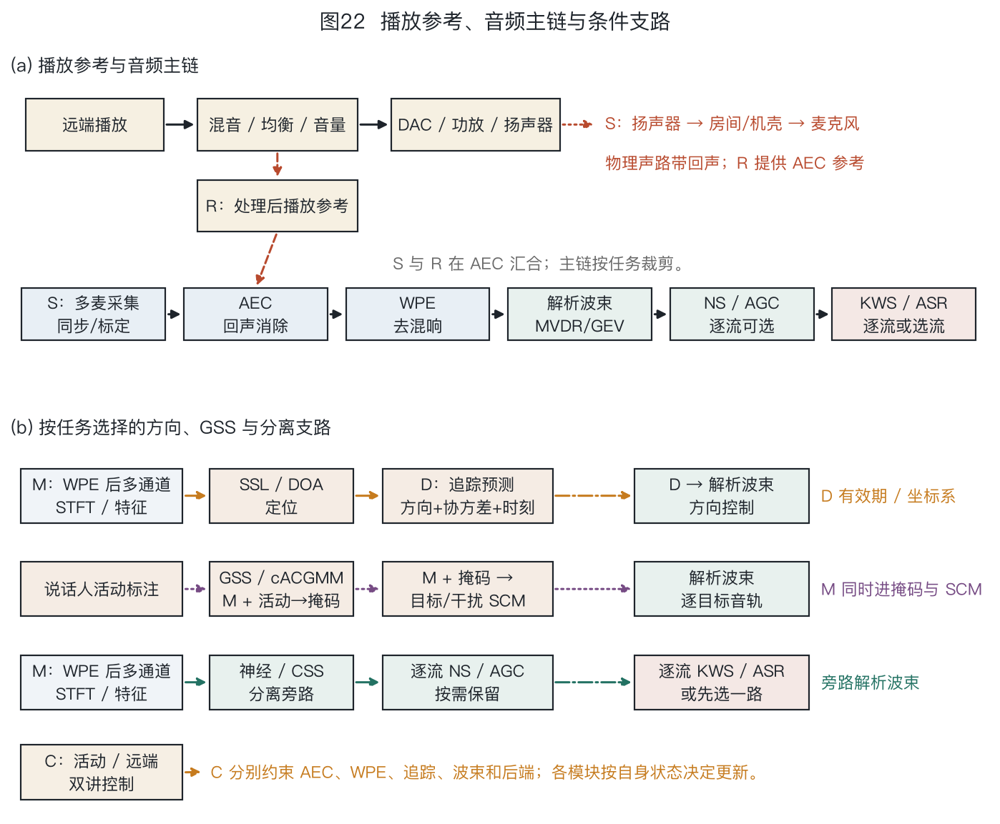
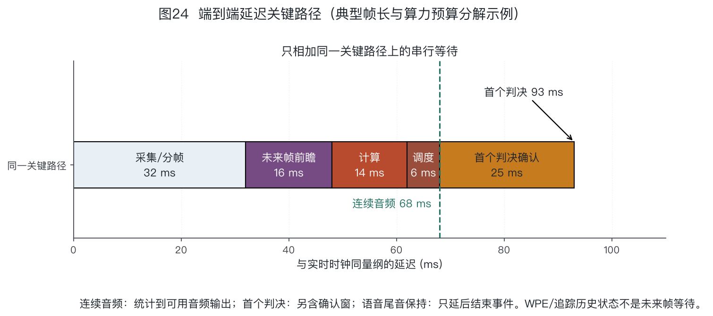
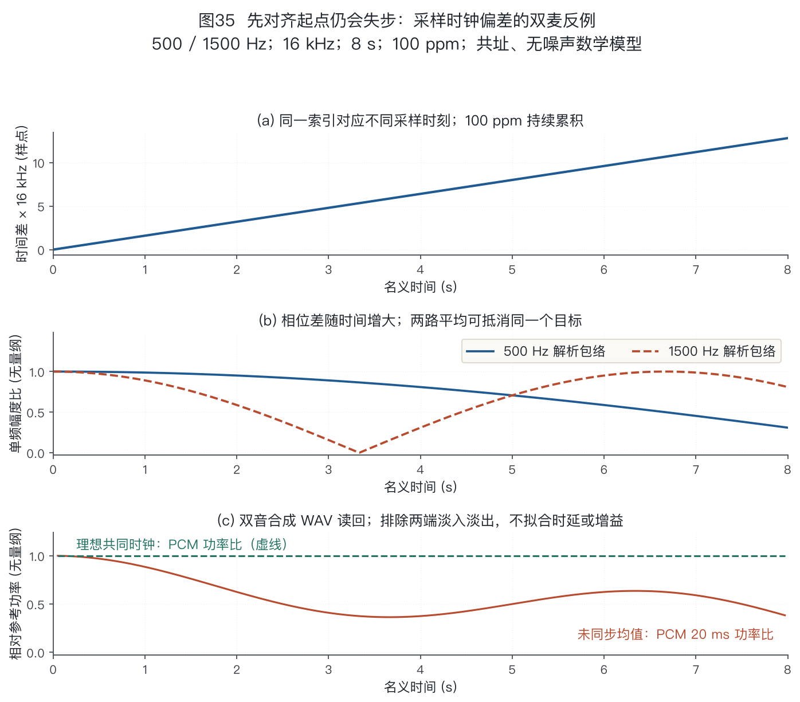
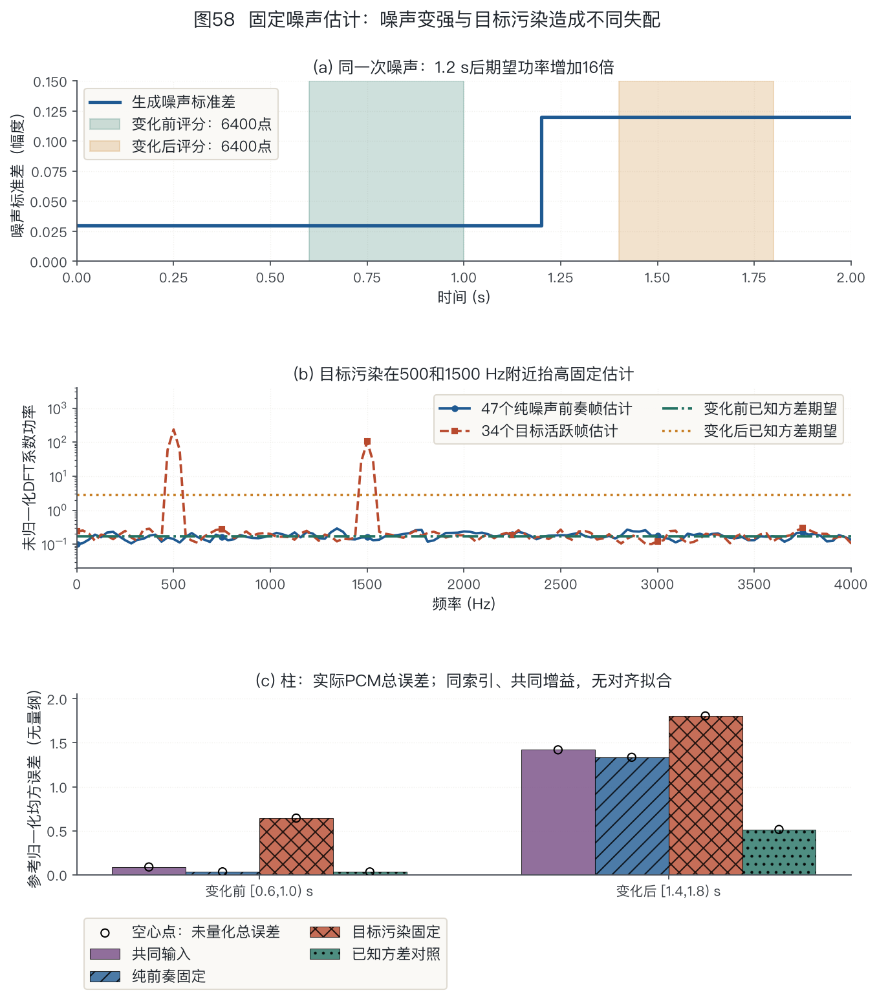
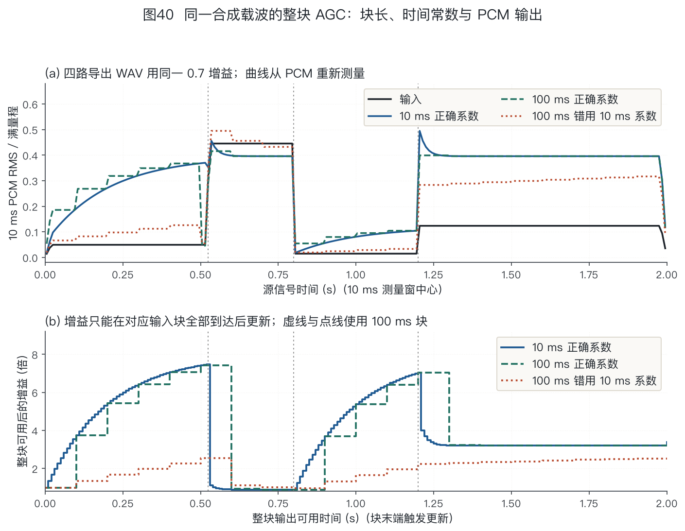
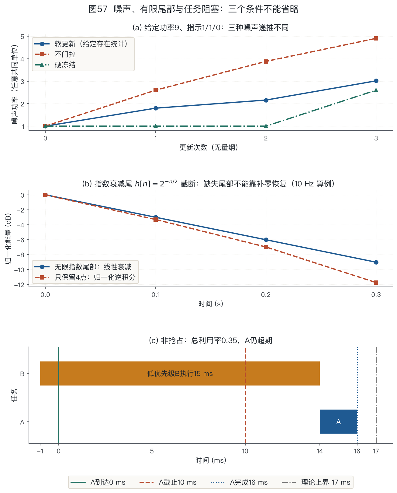
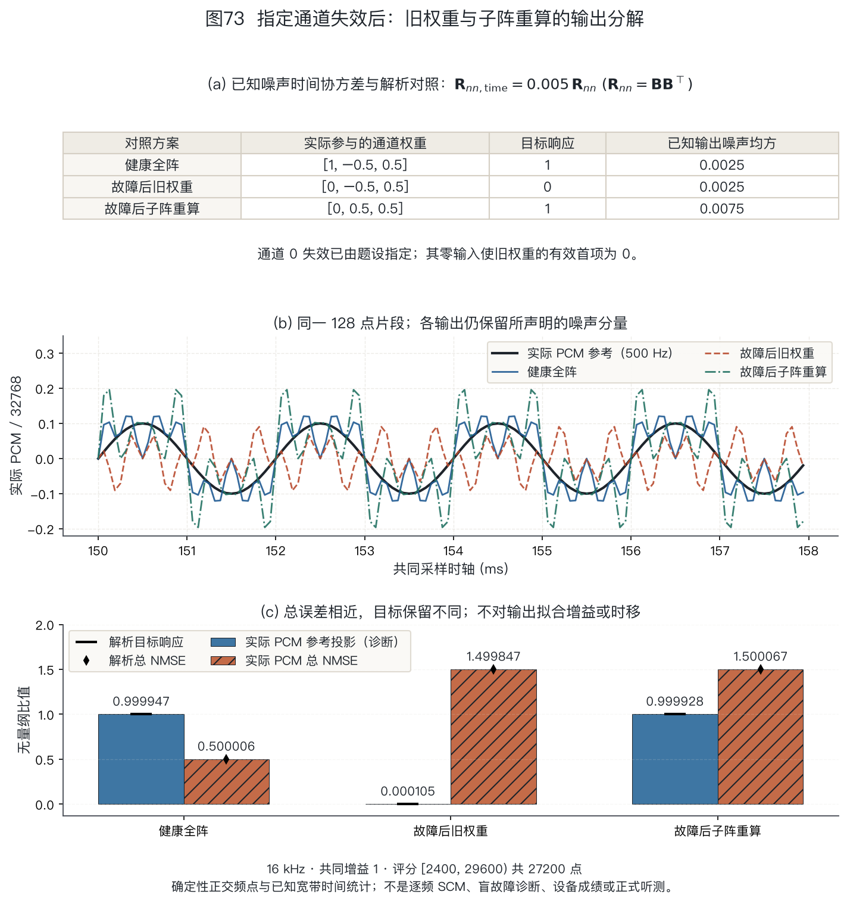

🌐 **简体中文** ｜ [English](../chapters_en/10_engineering-practice.md)

> 本篇是本书正文第 10 章；正文与扩展专题共 16 章（第 0～15 章，其中第 0 章为数学基础，第 12～15 章为四篇扩展专题），另有附录 A、B。本篇可独立阅读，前后篇见下方导航。
>
> 导读首页：[00_overview.md](00_overview.md) ｜ 上一篇：[09_source-tracking.md](09_source-tracking.md) ｜ 下一篇：[11_selection-guide.md](11_selection-guide.md)

---

## 10. 工程实现、评测与产业实践

前九章逐一拆解了声源定位、波束形成、回声消除、去混响、语音分离与目标追踪的原理和算法。当这些模块进入真实硬件产品时，决定最终体验的关键在于系统级耦合设计：各模块按什么因果顺序串联或并联、参考信号与控制状态从哪一级抽头、采样时钟偏差与声卡缓冲如何侵蚀相位和实时期限、定点字长与电池功耗如何分配，以及如何建立一套不被单一指标误导的验收标准。本章围绕这一完整工程闭环展开；章内配套的数学合成音频与教学脚本统一用于核验算法算术、时序语义和失效边界，整机声学与实时性能仍需在目标设备上实测确认。

本章常用缩写汇总如下：

| 缩写 | 中文名与英文全称 |
|---|---|
| AFE | 音频前端（Audio Front End）：采集后、识别或通信编码前的多通道信号处理与控制子系统 |
| AEC | 声学回声消除（Acoustic Echo Cancellation）：利用本机播放参考削弱扬声器耦合回声 |
| WPE | 加权预测误差去混响（Weighted Prediction Error）：利用多帧历史线性预测并减去晚期混响 |
| NS / AGC | 噪声抑制（Noise Suppression）/自动增益控制（Automatic Gain Control） |
| VAD | 语音活动检测（Voice Activity Detection） |
| KWS / ASR | 关键词唤醒（Keyword Spotting，KWS）/自动语音识别（Automatic Speech Recognition，ASR） |
| SRO | 采样率偏移（Sampling Rate Offset）：不同晶振采样时钟之间的相对速率偏差 |
| SRC | 采样率转换（Sample Rate Conversion）：将离散样本重映射到目标采样时钟网格 |
| TSE | 目标说话人提取（Target Speaker Extraction）：依据注册声纹或方向条件提取指定说话人音轨 |
| FIR | 有限冲激响应（Finite Impulse Response）：由有限长度输入历史线性组合计算输出的滤波器 |
| RTF | 实时因子（Real-Time Factor）：处理耗时与新增源音频时长之比 |
| STFT | 短时傅里叶变换（Short-Time Fourier Transform）：逐通道将时域分帧信号变换为时频复系数 |
| GSS | 导引源分离（Guided Source Separation）：利用说话人活动时间标注引导多通道空间掩码估计 |
| cACGMM | 复角中心高斯混合模型（Complex Angular Central Gaussian Mixture Model）：GSS 常用的空间方向聚类模型 |
| SCM | 空间协方差矩阵（Spatial Covariance Matrix）：由多通道复谱与掩码加权统计得到，供解析波束求解权重 |

为避免跨模块术语冲突，本章中的 RTF 专指实时因子；波束形成中的“目标相对传递函数”（relative transfer function）一律写出中文全称。

### 10.1 参考链路与端到端延迟

工业音频前端没有放之四海而皆准的唯一流水线。图 22 给出一条典型的模块化参考链路，核心作用是理清信号流与统计量之间的物理依赖关系，而不是要求每款终端都把所有方框全部打开。

在经典串行主干“多通道同步采集 → 线性 AEC → 多通道 WPE → 解析波束形成 → 单通道 NS/AGC → KWS/ASR”之外，系统的空间与分离信息通常沿着三条并行或替代支路流动：

1. **定位与追踪支路**：读取多通道相位或互相关特征，向需要显式指向的解析波束形成器输出带采集时间戳的方位状态与不确定度，本身不直接改动音频波形。
2. **导引空间统计支路（GSS）**：利用说话人分割给出的活动区间约束 cACGMM 掩码估计，再将时频软掩码与同一 WPE 阶段输出、**保留原始幅相与功率尺度的多通道复谱**结合，累加出目标与干扰 SCM 送入 MVDR 或 GEV 波束形成器。
3. **端到端神经分离或连续语音分离（Continuous Speech Separation，CSS）支路**：在 WPE 之后直接输出一路或多路分离音频，作为绕过“掩码—SCM—解析波束”的替代主路径。当分离网络输出多条并发语流时，下游 NS/AGC 与识别器必须按独立流逐路实例化（或先由任务逻辑选出目标流），不能把多路音轨重新混成单声道；若分离网络在训练时已兼具降噪与电平规整能力，还应通过消融对照决定是否旁路传统后置 NS/AGC，以免双重非线性处理加重语音失真。

阅读图 22 时，建议先沿图 22(a) 核查**播放参考取点（reference tap point）**与线性度边界。远端下行音频往往要先经过多路系统提示音混音、参量均衡器（EQ）、动态范围压缩或用户音量调节，最后才送入数模转换器（Digital-to-Analog Converter，DAC）和功率放大器驱动扬声器发声。AEC 的参考信号必须取自**所有数字播放处理之后、DAC 与功放之前**，确保自适应滤波器看到的数字参考完整包含每一次混音与音量跳变；若把参考取在混音或音量调节之前，扬声器实际播出的声音与参考信号失配，线性回声模型就会频繁发散。

同时，播放参考是参与卷积建模的实打实的连续音频流，而近端/远端活动标志属于布尔或软概率门控元数据；阅读图 22(a) 的抽头箭头时，架构设计切忌将连续波形参考流与门控状态混画成同一个“控制端口”。

再看图 22(b) 展开的条件路由与门控关系：图中每条连线应按端口文字核对数据语义，不能仅凭线条颜色猜测。中央控制逻辑综合近端语音活动、远端播放能量与双讲状态，但各个模块消费控制信号的方式截然不同——单个 VAD 布尔位绝不能简单连到所有模块的“冻结使能端”。确定具体产品需求后，可按物理约束裁剪链路：

- 纯拾音录音笔、无外放监听的阵列传感器不产生本机声学回声，可直接省去 AEC。
- 近讲耳机或强吸声舱室中晚期混响极弱、不影响识别词错误率时，无需承担多通道 WPE 的矩阵求逆开销。
- 车载主驾头枕或定向工位终端若声源几何区域固定，波束形成可直接使用标定好的目标导向矢量或固定超指向权值，省去实时 DOA 与轨迹追踪。
- VAD、远端活动检测与双讲检测属于旁路状态估计器，只输出控制元数据，不应画成串在主音频通路里的波形处理框。

之所以强调启用线性 AEC 时通常将其置于最前端，是因为时变自适应波束、非线性谱减或动态增益控制一旦插在采集与 AEC 之间，就会把原本时不变（或缓变）的“扬声器—房间—麦克风”线性卷积通道变成快速时变非线性系统，导致回声抵消深度骤降。至于 WPE、波束形成与单通道后滤波的先后次序，则取决于通道维度与模型结构：多通道 WPE 依赖原始阵元间的空间差异预测晚期混响，因此放在波束形成之前；单通道 WPE 或神经网络联合去混响波束形成则按各自训练与推导时的输入定义放置。

#### 10.1.1 延迟不能把每个模块的耗时直接相加

评估实时通信或语音交互体验时，端到端延迟不能靠把每个模块的“窗长”或“单次运行耗时”简单相加来估算，而必须沿着有向数据依赖图（DAG）的关键路径拆分为五类物理等待：

| 类别 | 含义 | 常见来源 |
|---|---|---|
| 前瞻或算法等待 | 输出当前样本前必须等待的未来输入 | 居中窗、双向网络、判决确认窗 |
| 缓冲 | 驱动、直接存储器访问（Direct Memory Access，DMA）、网络或帧拼接等待 | 声卡周期、抖动缓冲、整帧推理 |
| 计算 | 当前数据到输出完成的执行时间 | 快速傅里叶变换（Fast Fourier Transform，FFT）、矩阵分解、神经网络推理 |
| 调度 | 任务虽已就绪但尚未运行 | 操作系统抢占、队列拥塞、加速器排队 |
| 解码与交互 | 前端之后的关键路径 | 流式 ASR 解码、网络往返、播报准备 |

在为各模块切分预算前，先明确系统级延迟上限。按照国际电信联盟 **ITU-T G.114（05/2003）**对单向端到端通话延迟的分级：口到耳单向总延迟低于 $150\ \mathrm{ms}$ 时交互基本透明；$150\text{～}400\ \mathrm{ms}$ 之间虽仍可通信，但双讲抢话与交互迟滞感明显上升；超过 $400\ \mathrm{ms}$ 则超出常规网络规划的可接受范围。扣除语音编解码分帧、网络单程传输与抖动缓冲、以及远端播放缓冲之后，留给本机音频前端（AFE）的稳态预算通常只有 **$20\text{～}50\ \mathrm{ms}$**；而对于助听器与通透模式（hear-through）耳机，直达耳道泄漏声与骨传导声会与处理后输出在耳膜处叠加产生梳状滤波，全链路延迟上限则被进一步压低至 **$5\text{～}10\ \mathrm{ms}$** 以内。同时，硬件采集与播放端的 $\Sigma\Delta$ 模数/数模转换器（ADC/DAC）内部数字抽取与插值滤波器本身也会引入约 $15\text{～}40$ 个采样点的线性相位群延迟（$16\text{～}48\ \mathrm{kHz}$ 下约 $0.3\text{～}2.5\ \mathrm{ms}$；部分低延迟最小相位模式可压至 $4\text{～}8$ 个采样点），核算全机硬件环回延迟时需一并计入。

工程中最容易算错的一笔账，是把**因果加权重叠相加（Weighted Overlap-Add，WOLA / STFT）的分析窗长直接等同于稳态算法延迟**（STFT 重叠相加重构条件与分贝标度基础见[第 0 章 §0.2](00_math-foundations.md#sec-0-2)）。不妨把采样率 $f_s=16\ \mathrm{kHz}$、分析窗长 $N=512$ 点（$32\ \mathrm{ms}$）、帧移 $H=128$ 点（$8\ \mathrm{ms}$）的因果流式频域波束形成拆开细算：

1. **因果滑窗的结构延迟只取决于帧移与前瞻，而非历史窗长**：在稳态运行中，分析窗左半侧的 $N-H=384$ 个样本（$24\ \mathrm{ms}$）早已躺在历史环形缓冲区里。只要算法不偷看当前帧右边界之后的未来帧（零前瞻），每当新攒够 $H=128$ 个样本（$T_{\mathrm{hop}}=H/f_s=8\ \mathrm{ms}$），就能拼出完整的 $512$ 点因果窗完成一次 FFT、频域滤波、IFFT，并由重叠相加输出这批最新完成的 $128$ 个时域样本。

    因此，纯因果 WOLA 框架本身的帧步进结构等待是 $T_{\mathrm{hop}}=8\ \mathrm{ms}$，而不是 $32\ \mathrm{ms}$；只有当分析采用以当前点为中心的对称非因果窗，或神经网络掩码显式要求向右多看 $K_{\mathrm{look}}$ 个未来帧时，才会额外引入 $K_{\mathrm{look}}H/f_s$ 的算法前瞻等待。

2. **声卡 DMA 块周期与算法帧移的公倍数拼接缓冲**：若底层音频驱动按 $B_{\mathrm{io}}=160$ 点（$10\ \mathrm{ms}$）的中断周期搬运样本，而频域前端按 $H=128$ 点（$8\ \mathrm{ms}$）步进，两者块长不整除，中间环形缓冲就会出现周期性余量等待（见练习 E10-08 的逐回调余量推演）；反之，若将驱动 DMA 周期设为 $128$ 点（$8\ \mathrm{ms}$）与帧移严格对齐，每次回调到达即可触发一次频域帧处理，省去跨块凑帧等待。

    这也解释了为什么把因果 STFT 的分析窗长从 $32\ \mathrm{ms}$ 砍到 $16\ \mathrm{ms}$ 并保持帧移 $8\ \mathrm{ms}$ 不变时，除了冷启动首帧填窗稍快一点外，稳态流式音频的端到端延迟一毫秒都不会减少——盲目缩短窗长反而会白白牺牲低频频率分辨率与混响覆盖能力。同理，在线先预测后更新的 WPE、递归协方差平滑、卡尔曼追踪状态与因果 AGC 的平滑记忆全都只读取过去帧，属于历史状态，绝不能当成未来前瞻加进延迟账本。

理清单个模块的缓冲与前瞻后，再沿多模块 DAG 核算完成时刻。设模块 $v$ 的全部上游输入就绪时刻为 $r_v$、计算完成时刻为 $c_v$、自身执行耗时为 $s_v$（单位均为 $\mathrm{s}$），$\mathcal{P}(v)$ 表示模块 $v$ 的直接前驱节点集合。在算力充足、各就绪分支可立即并发且无锁抢占的理想调度下，递推关系为

$$
\begin{aligned}
r_v&=\max_{u\in\mathcal P(v)}c_u,\\
c_v&=r_v+s_v.
\end{aligned}
\tag{10-1}
$$

式中源节点的初始就绪时刻由采集缓冲协议给出。例如一块音频在 $32\ \mathrm{ms}$ 采集就绪后同时送入两条真正并行的硬件分支（耗时分别为 $4\ \mathrm{ms}$ 与 $7\ \mathrm{ms}$），汇合节点再耗时 $3\ \mathrm{ms}$，按式(10-1)算得最终完成时刻为 $32+\max(4,7)+3=42\ \mathrm{ms}$，公用的 $32\ \mathrm{ms}$ 采集缓冲等待只计一次；但若两条分支被迫挤在同一个单核线程里串行执行，完成时刻就会推迟到 $32+4+7+3=46\ \mathrm{ms}$。

将从声学入口到目标出口的第 $p$ 条因果路径分解为互不重叠的五段等待后，全系统的端到端延迟由最慢的那条关键路径决定：

$$
\begin{aligned}
L_p&=L_{p,\mathrm{look}}+L_{p,\mathrm{buf}}\\
&\quad+L_{p,\mathrm{comp}}+L_{p,\mathrm{sched}}\\
&\quad+L_{p,\mathrm{decode}},\\
L_{\mathrm{e2e}}&=\max_p L_p.
\end{aligned}
\tag{10-2}
$$

其中下标 $\mathrm{look}$、$\mathrm{buf}$、$\mathrm{comp}$、$\mathrm{sched}$、$\mathrm{decode}$ 依次对应上表的前瞻等待、块缓冲等待、模块计算耗时、操作系统或加速器调度等待以及后端解码等待。每一项都隶属于当前考察的因果路径 $p$，不能把非关键旁支的等待混加进来。

结合图 24 从左向右的堆叠顺序可以直观读出不同业务出口的延迟记账差异：图中以一个采用 $32\ \mathrm{ms}$ 多周期采集与块拼接缓冲的示例链路说明（不同于前文单帧移 $8\ \mathrm{ms}$ 的零前瞻因果 WOLA 构型），前四段依次为采集与分帧缓冲 $32\ \mathrm{ms}$、未来帧前瞻 $16\ \mathrm{ms}$、模块计算 $14\ \mathrm{ms}$ 与调度抖动 $6\ \mathrm{ms}$，在绿色虚线处汇总为**连续流式音频输出延迟 $68\ \mathrm{ms}$**；其后再叠加上后端首个判决确认窗 $25\ \mathrm{ms}$，到达右侧黑色斜箭头标出的**首个判决延迟 $93\ \mathrm{ms}$**。图 24 下半部分进一步提醒工程师严格区分三条评测口径：

- **连续通话增强音频流**（对应绿色虚线 $68\ \mathrm{ms}$，如会议终端送往编码器的上行 PCM）：只承担实际发生的帧缓冲、算法前瞻、计算与调度延迟，没有识别确认窗；
- **关键词唤醒（KWS）或流式 ASR 首字上屏时间**（对应右侧黑色斜箭头标出的 $93\ \mathrm{ms}$）：在前端流式音频交付之后，还必须叠加上声学模型右上下文与解码器防误报确认窗；
- **尾音保持（hangover）延迟**：当说话人停声、短时能量跌落时，VAD 为了防止句尾清辅音或弱读音节被截断，会故意继续维持“有话”状态若干帧（如 $200\ \mathrm{ms}$）才发出句末截断事件。这 $200\ \mathrm{ms}$ 只会推迟“整句说完了”的端点事件触发时刻，绝不意味着此前连续送出的每一帧语音波形都被晚播放了 $200\ \mathrm{ms}$。

在提交正式工程测试报告时，绝不能只报一个笼统的“平均延迟”。稳态运行阶段至少应给出中位数（$\mathrm{p50}$）与长尾分位数（如 $\mathrm{p95}$、$\mathrm{p99}$）、有效测量样本数、测试总时长及分位数插值定义（小样本下最近秩与线性插值的差异见第 11 章练习 E11-04）。

模型冷启动开销（文件读取、计算图编译、内存池分配与首帧状态预热）须与稳态流式指标单独建表；测量起止物理位置（如“扬声器激励声压到达麦克风振膜 → 耳机端模拟输出首波”或“音频驱动回调入口时间戳 → 首个 ASR 词元产出”）以及设备电源策略、并发负载模式也必须一一注明。

#### 10.1.2 实时回调的期限与数据搬运

实时音频驱动（如跨平台的 PortAudio、macOS/iOS 的 Core Audio、Windows 的 WASAPI 或嵌入式 DMA 中断服务例程）以严格的硬件时钟节拍触发回调。声卡回调线程的核心准则是在本周期截止期（deadline）前完成样本搬运并返回：凡是在回调内部执行动态堆内存分配（`malloc`/`new`）、争用阻塞式互斥锁（`mutex`）、读写磁盘文件、格式化打印日志或调用耗时波动的神经网络推理，都可能引发优先级反转或无界阻塞，导致硬件缓冲区断流（参见 [PortAudio 官方实时回调编写规范](https://portaudio.com/docs/v19-doxydocs/writing_a_callback.html)）。

工业级实时音频软件普遍采用“无锁搬运与重算力解耦”的三线程分工架构：

- **高优先级音频回调线程**：只做确定性内存拷贝（处理通道交织或非交织重排），读取驱动提供的硬件采样时间戳与溢出状态位，将音频块推入预分配好的单生产者—单消费者（SPSC）无锁环形缓冲区（不过若算法本身极轻量、内存完全静态预分配且最坏耗时远小于回调周期，也可直接在回调内完成）；
- **DSP / 模型推理工作线程**：按算法帧移从输入环形缓冲区取数，依次运行 AEC、WPE、波束形成及识别后端，并将增强音频写回输出缓冲区；
- **低优先级遥测监控线程**：异步汇总超期次数、丢样计数与队列高水位，避免任何 I/O 阻塞实时通路。

在裸机微控制器或实时操作系统（RTOS）驱动的嵌入式音频 DSP（如 ARM Cortex-M7、Cortex-A 或 Cadence HiFi DSP）上，物理样本搬运通常采用 **DMA 乒乓双缓冲（Ping-Pong Double Buffering）**：将一块两倍于单帧周期的连续环形内存划为前半块（Ping）与后半块（Pong），当 DMA 硬件写满前半块触发半传输中断（Half-Transfer IRQ）时，硬件立即无缝转去填充后半块，DSP 线程则安全读取刚填好的前半块；满传输中断（Transfer-Complete IRQ）再触发角色互换，实现零拷贝、无撕裂流水线。此时必须严防**写回式（Write-Back）L1/L2 数据缓存一致性陷阱**：

- **采集通路（RX）**：DMA 直接把新样本写入片上 SRAM 或外部 DDR，并不会自动刷新 CPU 数据缓存；若 DSP 在读取新到的乒乓半块前未执行**缓存失效（Cache Invalidate）**，CPU 读出来的仍是上一帧残留的陈旧缓存行，表现为诡异的周期性“卡带”或随机噪声；
- **播放通路（TX）**：CPU 算好的输出波形往往先停留在写回缓存中；若交付 DMA 前未执行**缓存回写（Cache Clean）**，DAC 就会把旧内存数据播出去；
- **缓存行对齐与非缓存段**：乒乓缓冲区的起始地址与单半块字节长度必须按处理器缓存行（通常 $32\ \mathrm{B}$ 或 $64\ \mathrm{B}$）严格对齐，避免 `Invalidate` 误伤相邻控制变量；最彻底的工程做法是在内存保护单元（MPU）中将 DMA 乒乓缓冲区配置为 **Non-Cacheable SRAM**，或直接放入不经数据缓存的紧耦合内存（DTCM）中。

当宿主音频后端采用变长回调机制时，每次传入的帧数 `frameCount` 并不固定，程序必须严格按本次实际收到的 `frameCount` 推进读写指针，并分别维护输入采样区间与输出提交区间的全局样本序号，才能在工作线程跨回调异步交付结果时准确还原“哪一个输出样本对应哪一个输入样本”（相关结构体字段定义见 [PortAudio 19.7.0 `portaudio.h` 时间戳与状态位说明](https://github.com/PortAudio/portaudio/blob/3f7bee79a65327d2e0965e8a74299723ed6f072d/include/portaudio.h#L690-L864)，变长回调配对与缺口恢复手算见练习 [E10-17](#e10-17)）。

一旦突发负载导致环形缓冲写满，系统必须在“丢弃最旧未读块”“丢弃最新到达块”与“旁路降级（如跳过重度神经后滤波直接送出线性波束结果）”之间做出明确的设计抉择：静默丢块会撕裂 FIR 历史与相位连续性，阻塞等待会卡死采集驱动，无上限排队则会把交互延迟永久推高。

配套教学基线 [`RingBuffer`](../codes/chapters/ch10/core/engineering.py) 演示“丢弃最旧样本并累加 `dropped` 计数”的确定性容量语义；[`simulate_deadline_queue`](../codes/chapters/ch10/core/engineering.py) 则用串行工作队列把**单帧超期（deadline miss）**、**队列高水位（high-water mark）**与**满队丢帧**拆开统计（同一时刻既有旧帧完工又有新帧到达时，约定先释放完工帧槽位再接纳新帧，恰在截止时刻完工视为准时，整数刻度复核见练习 [E10-16](#e10-16)）。真实设备联调还必须监控驱动层上报的**播放下溢（underrun，待播数据未及时送达 DAC）**与**采集上溢（overrun，ADC 新采数据未被及时取走）**，Linux 音频栈常将二者统称为 `xrun`。

在嵌入式与网关设备广泛使用的 Linux 系统中，ALSA（Advanced Linux Sound Architecture，Linux 标准音频架构）通过不同负错误码区分底层中断原因：`-EPIPE` 代表发生了采集上溢或播放下溢，`-ESTRPIPE` 表示声卡硬件因系统电源挂起（suspend，注意与前文 VAD 的“尾音保持”严格区分）而暂停，`-ENODEV` 表示物理声卡断开，而部分虚拟回声参考设备在关联播放流尚未启动时会返回 `-ENODATA`（详见 [ALSA PCM 官方错误码文档](https://www.alsa-project.org/alsa-doc/alsa-lib/pcm.html)）。恢复逻辑必须因病施治：遇到电源挂起可先调用 `snd_pcm_resume` 唤醒硬件，不支持硬件无缝唤醒时再回退至 `snd_pcm_prepare` 重置流状态，而 `-ENODATA` 则需等待播放端就绪，不在通用 `snd_pcm_recover` 的处理范围内。

更重要的是，“驱动调用恢复成功”不等于“物理时间轴连续无损”：尽管 [ALSA `snd_pcm_resume` 接口说明](https://www.alsa-project.org/alsa-doc/alsa-lib/group___p_c_m.html)指出成功唤醒可保留硬件缓冲内未读样本（因而不应盲目把一次系统挂起直接记为丢样），但挂起期间独立设备的晶振仍在各自运转，跨设备时钟关系可能已经跳变；只有当硬件帧计数器或单调时间戳确证缺失了 $N$ 个样本时才记录精确丢样数，若仅知发生断流而无法核算出精确缺口长度，必须如实标记缺口长度未知，并显式通知 AEC、SRC 与 WPE 重置或重对齐历史状态。

**真机环回与驱动时间戳对照实测（MacBook Air）。** 为直观验证驱动回调时间戳与真实声学环回偏移之间的对应关系，本书在 MacBook Air（`Mac17,3`）上通过 Core Audio 与 PortAudio 打开 $48\ \mathrm{kHz}$ 全双工流（内置单麦采集、内置双扬声器外放同一扫频脉冲，脚本与原始日志归档于 [`macbook_audio_latency` 复跑说明](../codes/chapters/ch10/examples/macbook_audio_latency/README.md)），分别实测了两条物理方向相反的延迟指标：

- **声学往返总偏移（播放缓冲 → 扬声器 → 空气 → 麦克风 → 采集缓冲）**：在播放索引 $n_{\mathrm{out}}$ 注入 $20\ \mathrm{ms}$、$900\text{～}4500\ \mathrm{Hz}$ 线性扫频脉冲，对去均值后的录得片段做归一化互相关定位峰值 $n_{\mathrm{in}}$（无外放对照窗最大相关 $0.109$，有声试次最低相关 $0.659$）。在 $128$ 点回调下 $20$ 次偏移中位数为 $5103$ 点（$106.31\ \mathrm{ms}$；重开同参数流测得 $105.60\ \mathrm{ms}$，可见流启动相位存在轻微波动）；在 $480$ 点回调下为 $5555$ 点（$115.73\ \mathrm{ms}$）。
- **正向转发时间戳配对与增量缓冲核验（采集 → 软件延迟线 → 播放）**：在同一条 $128$ 点双工流中，将首次录得的探测片段交替经过人为插入的 $60\ \mathrm{ms}$（$2880$ 点）与 $100\ \mathrm{ms}$（$4800$ 点）软件缓冲转发至扬声器二次外放，分别记录两次回采的声学间隔与由硬件首样本时间戳加块内偏移修正算出的正向 $\mathrm{ADC}\to\mathrm{DAC}$ 延迟：

| 插入软件缓冲 | 试次 | 两次回采声学间隔中位数 | 正向 ADC→DAC 时间戳估计中位数 |
|---:|---:|---:|---:|
| $60\ \mathrm{ms}$ | 16 | $165.60\ \mathrm{ms}$ | $73.58\ \mathrm{ms}$ |
| $100\ \mathrm{ms}$ | 16 | $205.60\ \mathrm{ms}$ | $113.58\ \mathrm{ms}$ |

左列声学间隔比右列纯驱动正向估计多出约 $92\ \mathrm{ms}$，恰好对应第二次外放经扬声器到麦克风再进采集缓冲的整程声学往返路径；而当软件缓冲从 $60\ \mathrm{ms}$ 切到 $100\ \mathrm{ms}$ 时，两列增量差分别为 $40.00\text{～}40.02\ \mathrm{ms}$ 与精确的 $40.00\ \mathrm{ms}$（四条流共 $15\,314$ 次回调零 `xrun`），干净印证了逐样本时间戳配对记账的准确性（单回调与变长回调配对算术见练习 [E10-17](#e10-17)）。

在移动端（尤其是 Android 智能终端、平板与车机）接入多麦克风阵列算法时，还有一个极易让算法团队耗费数周排查的底层采集陷阱：**操作系统硬件抽象层（HAL）默认开启的暗中预处理**。若 Android 应用选用通话预设 `MediaRecorder.AudioSource.VOICE_COMMUNICATION`（或厂商挂接了系统语音前处理的默认麦克风通路），音频 HAL 会自动启用内置的单麦/双麦 AGC、噪声抑制、高通滤波甚至平台 AEC；这些对应用层不透明的非线性增益与相位扭曲会彻底破坏阵元间原始到达相位差与线性回声路径，导致自研 MVDR 波束零陷失效、AEC 残差暴增。另一方面，尽管按 Android 兼容性定义文档（CDD）要求，`VOICE_RECOGNITION` 预设应当默认关闭 AGC 与噪声抑制（因而在不支持直通源的旧机型上常被用作次优回退源），它仍可能保留厂商面向单麦语音识别的频响均衡或预加重，并不等同于严格无修饰的原始多通道信号。因此，在 Android 平台使用 C++ Oboe 或原生 AAudio 框架采集原始阵列信号时，工程上务必按以下三步锁死通路：

1. 先查询系统属性 `AudioManager.PROPERTY_SUPPORT_AUDIO_SOURCE_UNPROCESSED`，确认设备固件真正实现了直通源；
2. 构建音频流时显式指定 `oboe::InputPreset::Unprocessed`，同时请求 `PerformanceMode::LowLatency` 与独占模式 `SharingMode::Exclusive`（若被其他进程占用降级为 `Shared`，需重新复测块周期与缓冲延迟）；
3. 流启动后先做一轮静音底噪与正弦扫频自检，核查各通道本底谱平坦度、幅相一致性以及大声压下是否存在未知的自动增益压缩，确认拿到未污染的原始脉冲编码调制（Pulse-Code Modulation，PCM）波形后再送入自研前端。

综合上述数据依赖与实时约束，整机模块接入时的接口检查清单如下：

| 模块 | 启用条件 | 主要输入 | 主要输出 | 首要检查 |
|---|---|---|---|---|
| 采集与同步 | 多通道输入需要保持时序关系 | 麦克风、时钟 | 对齐的多通道脉冲编码调制（Pulse-Code Modulation，PCM）样本 | 映射、削波、丢帧、相对时延 |
| AEC | 本机播放可能进入麦克风 | 麦克风；播放处理之后、数模转换器/功放之前的播放参考；远端活动/双讲状态 | 回声减弱的麦克风信号、残余回声与适配状态 | 参考是否覆盖混音、均衡和音量变化；参考—麦克风整体延迟、削波、双讲稳定性 |
| WPE | 晚期混响影响任务 | 多通道或单通道 STFT | 去混响 STFT | 预测延迟、阶数、语音损伤 |
| 定位/追踪 | 波束或应用需要方向/轨迹 | 多通道特征、活动状态、测量时间 | 坐标系、测量/状态所属/发布时间、状态与协方差、活动/存在概率、轨迹 ID 与有效期 | 坐标变换、过期外推、漏检/虚警、ID 生命周期；接口细节见 §9.4 |
| GSS 掩码估计 | 已知说话人活动且需要多人空间增强 | 分割活动标注；WPE 后的多通道 STFT | 各目标的时频软掩码、有效帧数 | 活动标注错位、掩码泄漏和目标静默帧 |
| 目标/干扰 SCM 估计 | 已得到同一时频网格上的掩码 | 同一 WPE 阶段输出、未做方向归一化的多通道 STFT；对应目标/干扰掩码 | 每频点目标/干扰 SCM、有效样本数和条件数 | 掩码与 STFT 的时间、频点和通道约定须一致；掩码不是 SCM |
| 解析波束形成 | 需要将空间统计转换为目标音轨 | 同一阶段的多通道 STFT；目标/干扰 SCM 或导向矢量 | 每目标的增强信号、波束权重及其实际生效时刻 | 导向失配、协方差病态和目标泄漏；方向状态只控制需要方向的波束 |
| 神经分离/CSS/TSE | 重叠内容需多流，或有可靠目标条件 | 多通道特征；可选注册语音、视觉或方向条件 | 固定/动态输出流、单目标音轨 | 左右上下文、首帧延迟、跨块排列、身份泄漏、域外泛化；它是解析波束的替代路径 |
| NS/AGC | 残余噪声或电平范围影响后端 | 增强信号 | 抑噪、稳电平信号 | 语音损伤、增益喘息（pumping）、削波 |
| KWS/ASR | 应用需要关键词唤醒或语音识别 | 音频或特征 | 事件或文本 | 取点、缓存、误报与漏报 |

阅读上表第 5～7 行时，要注意区分 GSS 空间增强的三个严格递进的中间对象：说话人活动标注先约束**时频软掩码**估计，软掩码再对同一阶段未做幅度归一化的多通道复谱做加权外积得到**目标/干扰 SCM**，最后解析波束形成器才由 SCM 求解**空间滤波权重**输出单声道目标音轨。即便改用神经网络直接预测掩码或直接回归 SCM，工程接口文档中也必须明确写出实际传递的是掩码、协方差矩阵还是增强后波形，避免模块联调时张冠李戴。

### 10.2 拾音、同步与增益

硬件拾音链决定了后续一切阵列信号处理的物理上限。微机电系统（MEMS）麦克风选型至少需要联合核查五项电声指标：等效输入噪声（Equivalent Input Noise，EIN，或 $94\ \mathrm{dB\ SPL}$ 下的信噪比）、声学过载点（Acoustic Overload Point，AOP）、灵敏度公差、频响平坦度（含低频滚降角频率与高频亥姆霍兹腔谐振峰）以及批次间幅相一致性。器件手册上的裸麦典型值绝不能代替整机声学实测——壳体导音孔直径与长度、防尘防水网阻尼、泡棉密封漏气以及电源纹波耦合都会显著改变阵元到达幅度与相位。

声学过载点（AOP）定义为在规定激励频率与供电条件下，麦克风输出总谐波失真（THD）达到指定门限时的入射声压级。横向对比不同型号的 AOP 时，必须对齐失真门限与频率口径：例如 [TDK MMICT4078-00-908 官方产品规格](https://product.tdk.com/en/search/sw_piezo/mic/mems-mic/info?part_no=MMICT4078-00-908)同时给出 $10\%\ \mathrm{THD}$ 下的 $135\ \mathrm{dB\ SPL}$ 与 $1\ \mathrm{kHz}$、$1\%\ \mathrm{THD}$ 下的 $130\ \mathrm{dB\ SPL}$；[Analog Devices 应用笔记《AN-1328》](https://www.analog.com/en/resources/app-notes/an-1328.html)则标明 ADMP411 在 $131\ \mathrm{dB\ SPL}$ 达到 $10\%\ \mathrm{THD}$。一旦近距离拍手或大音量外放突破振膜与前置放大器的线性区，谐波失真在进入数字域之前就已经产生；后续采用 24 位整型或 32 位浮点样本格式只能保留数字 DSP 中间运算的动态余量，既不能抬高麦克风物理 AOP，也无法修复模拟削波。

**声腔结构、防水透气膜与机电隔振。** 裸麦一旦装配进整机外壳，开孔通道与硅胶套前腔就会构成一个微型亥姆霍兹共鸣器（Helmholtz resonator）。设声速为 $c$、导音孔截面积为 $S=\pi d^2/4$、有效声学通道长度为 $L_{\mathrm{eff}}$（含端口末端修正）、麦振膜前方的死腔容积为 $V$，其一阶谐振频率为

$$
f_H=\frac{c}{2\pi}\sqrt{\frac{S}{V L_{\mathrm{eff}}}}.
\tag{10-3}
$$

取 $c=343\ \mathrm{m/s}$ 对比两组典型结构尺寸：短而粗的导音孔配紧凑前腔（$d=1.0\ \mathrm{mm},\ L_{\mathrm{eff}}=1.8\ \mathrm{mm},\ V=1.5\ \mathrm{mm}^3$）给出 $f_H\approx 29.4\ \mathrm{kHz}$，谐振峰安全落在人耳与语音频带之外；反之，若结构堆叠被迫拉长窄孔并留出较大死腔（$d=0.8\ \mathrm{mm},\ L_{\mathrm{eff}}=5.0\ \mathrm{mm},\ V=10\ \mathrm{mm}^3$），谐振频率降至 $f_H\approx 5.47\ \mathrm{kHz}$，在语音清辅音核心频段内引入十余分贝的剧烈峰谷与相位反转。此外，消费类户外/穿戴设备常在拾音孔加贴膨体聚四氟乙烯（ePTFE）防水透气膜，必须挑选低声阻且批次背胶厚度一致的料号，防止高频滚降与跨通道相移漂移；而在自带大功率扬声器的智能音箱与会议机中，麦克风阵列还需通过软性电路板（FPC）、硅胶减震套或 PORON 泡棉垫与主壳体做机械隔振，并与扬声器后腔严格物理密封隔离——否则经塑料/金属外壳直接传导的非线性固体结构振动会以远高于空气声速的路径传入振膜，严重破坏线性 AEC。

**多麦克风数字音频总线选型。** 在数字麦克风与主控芯片互连层面，工程中主要在脉冲密度调制（Pulse-Density Modulation，PDM）、芯片间音频总线（Inter-IC Sound，I²S）、时分复用总线（Time-Division Multiplexing，TDM）与车载专用汽车音频总线（Automotive Audio Bus，A²B）之间权衡：

| 总线标准 | 线缆与引脚数 | 典型通道容量 | 典型传输距离 | 时钟/帧率与典型局限 |
|---|---|---|---|---|
| **PDM** | $2$ 线/对（`CLK` + `DATA`，双麦复用单数据线） | 每条数据线 $2$ 麦（上升/下降沿锁存） | 板内短距（$<15\ \mathrm{cm}$） | $1.024\text{～}3.072\ \mathrm{MHz}$ 位时钟；需主控侧 CIC 抽取，存在半周期边沿偏斜 |
| **I²S** | $3\text{～}4$ 线（`BCLK`、`LRCLK`、`DATA`，可选 `MCLK`） | 每条数据线 $2$ 路 PCM | 板内短距（$<20\ \mathrm{cm}$） | 字时钟直接等于 $f_s$，免抽取；扩展 $8$ 麦需多组并行 I²S 接口与大量引脚 |
| **TDM** | $3\text{～}4$ 线（`BCLK`、`FSYNC`、`DATA`，可选 `MCLK`） | 单线 $4/8/16$ 路 PCM（如 TDM8） | 板内/短排线（$<30\ \mathrm{cm}$） | $48\ \mathrm{kHz}$ TDM8（$32\ \mathrm{bit}$ 槽宽）位时钟达 $12.288\ \mathrm{MHz}$，须防高频串扰与反射 |
| **A²B** | $2$ 线非屏蔽双绞线（单根 UTP 菊花链） | 最多 $32$ 路 $24\ \mathrm{bit}$ 上下行 PCM + I²C 控制 | 长距（节点间 $15\ \mathrm{m}$，全链 $40\ \mathrm{m}$） | 全链硬件同步时钟、确定性延迟 $<50\ \mu\mathrm{s}$ 且支持总线幻象供电；需专用收发器芯片 |

要排查多麦高频底噪抬升或端射波束指向偏斜，不能只看总线名字，还要将 **PDM 单比特 $\Sigma\Delta$ 调制到 $\mathrm{Sinc}^N$ 抽取滤波**的物理链路逐项核算（级联积分梳状滤波器的无乘法器结构与位宽增长定理见 [Hogenauer 1981, *IEEE TASSP* 29(2):155–162](https://doi.org/10.1109/TASSP.1981.1163535)）。设位时钟为 $f_{\mathrm{PDM}}$，抽取倍数为 $R$，梳状微分延迟为 $M$（常取 $M=1$），级联阶数为 $N$，则未缩放 $N$ 阶级联积分梳状（CIC）滤波器的传递函数、Hogenauer 无溢出寄存器位宽 $B_{\max}$、归一化幅度响应 $|\widetilde H_{\mathrm{CIC}}(f)|$ 与线性相位群延迟 $\tau_g$ 分别为：

$$
\begin{aligned}
H_{\mathrm{CIC}}(z)
&=\left(\frac{1-z^{-RM}}{1-z^{-1}}\right)^N,\\
B_{\max}
&=B_{\mathrm{in}}+\left\lceil N\log_2(RM)\right\rceil,\\
\left|\widetilde H_{\mathrm{CIC}}(f)\right|
&=\left|\frac{\sin(\pi fRM/f_{\mathrm{PDM}})}
  {RM\sin(\pi f/f_{\mathrm{PDM}})}\right|^N,\\
\tau_g
&=\frac{N(RM-1)}{2f_{\mathrm{PDM}}}.
\end{aligned}
\tag{10-4}
$$

围绕式(10-4)的四行关系，硬件选型与底层驱动配置须逐项核实以下三项约束：

1. **过采样噪声整形与 Hogenauer 有符号/无符号累加器位宽**：数字 PDM 麦克风内部的专用集成电路（ASIC）以高频位时钟 $f_{\mathrm{PDM}}=R f_s$（例如目标采样率 $f_s=48\ \mathrm{kHz}$、$R=64$ 时 $f_{\mathrm{PDM}}=3.072\ \mathrm{MHz}$；$f_s=16\ \mathrm{kHz}$、$R=64$ 时 $f_{\mathrm{PDM}}=1.024\ \mathrm{MHz}$）运行高阶 $\Sigma\Delta$ 调制器，输出单比特脉冲流并将量化噪声推向高频端，主控 SoC 的 PDM 外设先用无乘法器的 $N$ 阶 CIC 滤波器做首级降采样。

    工程实现中很容易混淆 $B_{\mathrm{in}}$ 的数值编码口径。由于直流最大包络增益为 $G_{\max}=(RM)^N$，位宽增长量精确为 $\lceil N\log_2(RM)\rceil$ 位，但输入编码分为两种截然不同的算术模型：
    - **单极性无符号编码 $\{0,1\}$（$B_{\mathrm{in}}=1\ \mathrm{bit}$）**：以四阶 $\mathrm{Sinc}^4$（$N=4, M=1$）为例，首级 $R_1=16$（$G_{\max}=65\,536=2^{16}$）需 $1+16=\mathbf{17\ \mathrm{bit}}$ **无符号**寄存器，单级直抽 $R_2=64$（$G_{\max}=16\,777\,216=2^{24}$）需 $1+24=\mathbf{25\ \mathrm{bit}}$ **无符号**寄存器（硬件 RTL 常采用此法做无符号模运算累加，在末级梳状差分后减去常数直流偏置 $(RM)^N/2$ 以节省 $1\ \mathrm{bit}$ 寄存器面积）。
    - **双极性有符号二进制补码 $\{-1,+1\}$（$B_{\mathrm{in}}=2\ \mathrm{bit}$）**：一旦把单比特 PDM 显式映射为有符号整数 $\{-1,+1\}$ 送入补码累加器，能表示 $+1$ 与 $-1$ 的最小有符号补码输入位宽是 $B_{\mathrm{in}}=2\ \mathrm{bit}$ 而非 $1\ \mathrm{bit}$。因为 $k$ 位有符号补码正端上限仅达 $2^{k-1}-1$，全 $+1$ 直流满幅输出 $+(RM)^N$ 会严格冲破无符号公式算出的有符号位宽（$2^{16}-1=65\,535<65\,536$，$2^{24}-1=16\,777\,215<16\,777\,216$），因此双极性补码最小无溢出位宽分别为 $2+16=\mathbf{18\ \mathrm{bit}}$（$R_1=16$，放入标准 24 位有符号寄存器仅余 **$6\ \mathrm{bit}$** 裕量而非 $7\ \mathrm{bit}$）与 $2+24=\mathbf{26\ \mathrm{bit}}$（$R_2=64$，超出 24 位有符号寄存器 $2\ \mathrm{bit}$；详细复算见练习 [E10-27](#e10-27)）。

2. **高频量化噪声折回抑制与通带滚降精确核算**：若麦克风采用四阶 $\Sigma\Delta$ 调制，量化噪声功率谱密度以每倍频程 $24\ \mathrm{dB}$ 向高频陡升；CIC 阶数通常须取 $N\ge L_{\Sigma\Delta}+1$，或用 $\mathrm{Sinc}^4$ 降到 $2f_s\text{～}4f_s$ 后接陡峭半带 FIR 低通，否则高频整形噪声会在抽取时混叠折回音频带内。

    同时，单级大倍数 CIC 在通带边缘存在显著滚降：当 $f_s=16\ \mathrm{kHz}$、$R=64$、$M=1$（即 $f_{\mathrm{PDM}}=1.024\ \mathrm{MHz}$）时，在 $f=7\ \mathrm{kHz}$ 处，精确离散单阶增益为 $\sin(7\pi/16)/[64\sin(7\pi/1024)]\approx 0.7136$，单阶衰减 $-2.930\ \mathrm{dB}$，四阶 $\mathrm{Sinc}^4$ 累积滚降高达 **$-11.72\ \mathrm{dB}$**。因此工业 PDM 接口在 CIC 降到 $2f_s$ 或 $4f_s$（如 $3.072\ \mathrm{MHz}$ 下首级 $R_1=16$ 在 $7\ \mathrm{kHz}$ 处四阶滚降仅 $-0.0757\ \mathrm{dB}$、群延迟 $\tau_g=9.766\ \mu\mathrm{s}$）后，都会串联半带补偿 FIR 托平高频通带并滤除直流偏置。

3. **双麦共用单根 PDM 数据线的半周期采样边沿偏斜**：硬件设计常将左、右两颗数字麦挂在同一根 `PDM_DATA` 与同一根 `PDM_CLK` 上——一颗在时钟上升沿锁存（Left），另一颗在时钟下降沿锁存（Right）。两颗麦虽严格同频、无长期漂移，但采样物理时刻天然相差半个位时钟周期 $\Delta t_{\mathrm{PDM}}=1/(2f_{\mathrm{PDM}})$。

    代入 $f_{\mathrm{PDM}}=1.024\ \mathrm{MHz}$ 核算，$\Delta t_{\mathrm{PDM}}\approx 0.4883\ \mu\mathrm{s}$，在声速 $c=343\ \mathrm{m/s}$ 下等效于约 $0.1675\ \mathrm{mm}$ 的声程差，在 $f=8\ \mathrm{kHz}$ 处引入固定相位差 $\Delta\phi=2\pi f\Delta t_{\mathrm{PDM}}$（约 $1.406^\circ$）；即便在 $f_{\mathrm{PDM}}=3.072\ \mathrm{MHz}$ 下（$\Delta t_{\mathrm{PDM}}\approx 162.76\ \mathrm{ns}$），对于间距仅 $12\ \mathrm{mm}$ 的一阶差分心形端射阵，未补偿的半拍偏斜仍会把正后方 $180^\circ$ 理论零陷拉偏逾 $5.5^\circ$（定量推导见练习 [E10-27](#e10-27)）。若 SoC 外设未开启硬件半周期对齐，必须在阵列标定滤波器中显式补偿该固定群延迟差。

#### 10.2.1 SRO：先区分初始时差和采样率偏移

当扬声器播放通路与麦克风采集通路分属两颗独立石英晶振（如笔记本电脑外接 USB 麦克风配蓝牙音箱，或多台无线智能设备临时组阵）时，两路时钟不仅存在开机瞬间的固定起始时差，还存在持续拉大错位的采样率偏移（SRO）。设参考时钟标称采样率为 $f_s$，被测设备实际采样率为 $f_d=f_s(1+\varepsilon)$，其中 $\varepsilon>-1$ 为无量纲相对速率偏移。先令两设备在 $n=0$ 时刻严格对齐，考察同一离散样本序号 $n$：该样本在参考时钟轴上的物理时刻为 $T=n/f_s$，在被测设备上的实际采集物理时刻为 $n/f_d$。按本章统一的“参考时刻减设备时刻”正号约定，同序号样本的累积时间漂移为

$$
\begin{aligned}
\Delta t(T)&=\frac{n}{f_s}-\frac{n}{f_d}\\
&=\frac{\varepsilon}{1+\varepsilon}T\\
&\approx\varepsilon T\quad(|\varepsilon|\ll1).
\end{aligned}
\tag{10-5}
$$

工程中习惯用百万分率 $\mathrm{ppm}$（parts per million，$1\ \mathrm{ppm}=10^{-6}$）度量晶振偏差。普通消费级晶振常见的 $\varepsilon=100\ \mathrm{ppm}$ 意味着：按一阶近似，每运行 $1\ \mathrm{s}$ 时间轴错开约 $100\ \mu\mathrm{s}$，$10\ \mathrm{min}$（$600\ \mathrm{s}$）累积错开约 $60\ \mathrm{ms}$；由于设备时钟偏快（$\varepsilon>0$），第 $n$ 个样本被提前采到，$n/f_d<n/f_s$，故式(10-5)给出正漂移。要注意这里的 $60\ \mathrm{ms}$ 是同序号样本历经 $10\ \mathrm{min}$ 累积的时间轴滑移，并不等于任意单帧内多出了 $60\ \mathrm{ms}$ 空间到达时间差（TDOA）。即便如此，哪怕几十 $\mathrm{ppm}$ 的微小 SRO，也会同时对线性 AEC 与多通道波束形成造成双重物理破坏：

- **对线性 AEC 的脉冲滑移与相干抵消封顶**：在 $f_s=16\ \mathrm{kHz}$、$\varepsilon=100\ \mathrm{ppm}$ 下，播放参考与麦克风录音每秒相对滑移 $f_s\varepsilon=1.6$ 个采样点，仅需 $0.625\ \mathrm{s}$ 真实回声冲激响应就在自适应滤波器抽头网格上整体平移 $1$ 个整采样。更严重的是亚采样滑移对高频相位的破坏：即便自适应步长快速跟踪，只要滤波器估计位置落后真实冲激峰 $0.1$ 个采样间隔（$\Delta\tau=6.25\ \mu\mathrm{s}$），在 $f=4\ \mathrm{kHz}$ 处就会产生相位错位 $\Delta\phi=2\pi f\Delta\tau=0.05\pi\ \mathrm{rad}$（即 $9^\circ$），纯相干相减残差功率比 $20\log_{10}|1-e^{-\mathrm{j}0.05\pi}|$ 停留在约 $-16.1\ \mathrm{dB}$（对应 ERLE 上限受限于 $+16.1\ \mathrm{dB}$）；再持续运行数十秒后，整个回声主峰甚至会滑出固定长度的 FIR 窗口导致 AEC 失效。
- **对异步多麦波束形成的高频时变梳状相消与 SCM 相干衰减**：若两支阵元分属存在相对 SRO 的两个时钟域，跨通道附加相位漂移 $\Delta\phi(f,T)=2\pi f\,\Delta t(T)$ 随频率 $f$ 与运行时间 $T$ 双线性增长。记参考信号瞬时相位为 $\varphi$，由三角和差化积展开两路单位余弦同序号平均得 $\frac{1}{2}[\cos\varphi+\cos(\varphi-2\pi f\Delta t)]=\cos(\pi f\Delta t)\cos(\varphi-\pi f\Delta t)$，即失同步平均引入了随时间调制的局部包络因子 $|\cos(\pi f\Delta t)|$（功率损失 $20\log_{10}|\cos(\pi f\Delta t)|$）。在 $T=1\ \mathrm{s}$、精确漂移 $\Delta t\approx 99.99\ \mu\mathrm{s}$ 时，$1\ \mathrm{kHz}$ 语音分量仅损失约 $0.44\ \mathrm{dB}$（幅度系数 $0.9511$），而 $4\ \mathrm{kHz}$ 清辅音频段两路相位差已逼近 $144^\circ$，同相等权相加反而把目标能量衰减约 $10.20\ \mathrm{dB}$（幅度系数仅 $0.3091$），使固定或慢更新波束退化为随时间周期性衰减高频的梳状滤波器。进一步看，在 STFT 域上用长度为 $T_{\mathrm{avg}}$ 的时间窗估计空间协方差矩阵（SCM）时，恒定相位旋转速率 $2\pi f\varepsilon$ 会将跨通道互功率谱非对角项乘以积分衰减因子（其中 $\operatorname{sinc}(u)=\sin(\pi u)/(\pi u)$）：

$$
\begin{aligned}
\frac{1}{T_{\mathrm{avg}}}\int_0^{T_{\mathrm{avg}}}
e^{-\mathrm{j}2\pi f\varepsilon t}\,\mathrm{d}t
&=e^{-\mathrm{j}\pi f\varepsilon T_{\mathrm{avg}}}
\operatorname{sinc}(f\varepsilon T_{\mathrm{avg}}).
\end{aligned}
$$

例如在 $f=4\ \mathrm{kHz}$、$\varepsilon=100\ \mathrm{ppm}$ 下，仅取 $T_{\mathrm{avg}}=1\ \mathrm{s}$ 平均窗就会把跨通道相干幅度压低至 $|\operatorname{sinc}(0.4)|\approx 0.757$，延长至 $T_{\mathrm{avg}}=2.5\ \mathrm{s}$ 时非对角互相关更是直接归零，这从定量上解释了为何 MVDR/GEV 等自适应空间协方差波束在未补偿 SRO 时往往比延迟求和更早失效。

因此，硬件架构设计的第一原则是**能同源绝不异步**：同一机壳内的多路 ADC 与播放回采 DAC 应强制挂载同一主时钟（MCLK/BCLK），局域网专业设备优先启用硬件锁相协议；只有在跨独立消费终端等确实无法共享物理时钟的场景下，才依次执行“在线估计相对速率偏移 → 分数延迟异步重采样（SRC）补偿 → 闭环跟踪晶振温漂”的三步软件同步方案。

#### 时钟漂移的波形与时间轴

为了直观展示失同步对多通道合成的破坏，图 35 与主音频清单的 `clock_drift` 组构造了一组标称 $16\ \mathrm{kHz}$、设备时钟偏快 $100\ \mathrm{ppm}$、总长 $8\ \mathrm{s}$ 的确定性多频合成算例：两台虚拟设备在各自真实的物理采样时刻对同一连续声波函数精确取值（绝不用双声道音量平移假冒时钟漂移）。以 $8\ \mathrm{s}$ 参考标称位置换算，偏快设备的同序号采样发生在 $8/(1+10^{-4})\ \mathrm{s}$，两者时差已累积至约 $0.79992\ \mathrm{ms}$，折合 $12.799$ 个参考采样周期（各 WAV 文件的精确样本数与导出增益见[主音频清单](../codes/chapters/ch00/audio/MANIFEST.json)）。

结合图 35 从上到下的三幅子图可以把失同步相消链条对读清楚：

- **子图 (a)** 绘制累积样点漂移 $\Delta t(T)\times 16\,\mathrm{kHz}$ 随参考时间 $0\text{～}8\ \mathrm{s}$ 线性增长的斜率直线（至 $8\ \mathrm{s}$ 末累积滑移约 $12.8$ 个采样点）；
- **子图 (b)** 对比 $500\ \mathrm{Hz}$ 与 $1500\ \mathrm{Hz}$ 两个单频分量在未对齐等权平均下的解析相干包络 $|\cos(\pi f\Delta t)|$：由于相位差随频率成正比放大，$1500\ \mathrm{Hz}$ 高频分量早在 $t\approx 3.33\ \mathrm{s}$（累积半波长时差）便跌入首个完全反相抵消零陷，而 $500\ \mathrm{Hz}$ 基频尚处于缓慢滚降阶段；
- **子图 (c)** 从发布的双音合成 `PCM16` 文件计算每 $20\ \mathrm{ms}$ 分块的平均输出功率相对于共同时钟基准（绿色水平虚线恒为 $1$）的比值曲线，清晰呈现未同步双麦求和引发的周期性功率塌陷——如果在实测排错中看到多麦波束输出音量忽大忽小、高频周期性发闷，首先就应排查跨时钟域未同步，切勿把这种拍频相消误认为“环境噪声被抑制了”。

在实录数据中诊断时间轴异常时，要把**固定初始时差**、**恒定 SRO** 与**缓冲区丢样阶跃**三件事拆开看：在“时间—相对延迟”散点图上，初始启动错位表现为纵轴截距 $b$，稳定晶振频偏表现为直线斜率 $\widehat{s}$，而采集驱动偶发丢块后若把后续样本往前紧排，则会在丢块时刻留下一个整数倍帧长或采样周期的垂直阶跃。仅靠录音首尾两帧做一次互相关求差，一旦中间夹杂丢样阶跃就会算出完全错误的速率斜率；稳健做法是按固定时间窗分块提取高置信度互相关峰，先筛查相邻块残差是否存在采样级突跳（核对硬件帧计数与 `xrun` 日志切出连续无缺口段），再在连续区间内做线性回归。

配套函数 [`estimate_sro_ppm`](../codes/chapters/ch10/core/engineering.py) 沿用“参考时间减设备时间”的正延迟定义，以参考时间 $T$（单位 $\mathrm{s}$）为横轴拟合直线 $\widehat{d}(T)=b+\widehat{s}T$（截距 $b$ 单位为 $\mathrm{s}$，无量纲斜率 $\widehat{s}$ 单位为 $\mathrm{s/s}$）。对比式(10-5)中 $\Delta t(T)=\frac{\varepsilon}{1+\varepsilon}T$ 的精确系数，只要恒定速率假设成立且 $\widehat{s}<1$，由斜率 $\widehat{s}$ 反解相对频偏 $\widehat{\varepsilon}$ 的精确式与一阶近似式分别为

$$
\begin{aligned}
\widehat\varepsilon&=\frac{\widehat s}{1-\widehat s},\\
\mathrm{ppm}_{\mathrm{exact}}&=10^6\widehat\varepsilon,\\
\mathrm{ppm}_{\mathrm{first}}&=10^6\widehat s.
\end{aligned}
\tag{10-6}
$$

例如实测拟合斜率 $\widehat{s}=10^{-4}$ 时，一阶近似直接报 $100\ \mathrm{ppm}$，精确反解值为 $10^6\times 10^{-4}/0.9999\approx 100.010\ \mathrm{ppm}$；截距 $b$ 只反映起始对齐偏置，不进入速率比计算，而混入丢样阶跃导致斜率严重失真的定量反例见练习 [E10-12](#e10-12)。此外，工程标定时切忌把“单台设备样本计数对未经校准的主机计时器读数”误当作绝对频偏：若设备真实采样率为 $f_d=f_0(1+\varepsilon)$、主机计时器读数为 $\widetilde{t}=(1+\eta)t$，则第 $n$ 个样本对应的单边表观归一化速率比 $r$ 与名义残差斜率 $s$ 仅能辨识二者之比

$$
\begin{aligned}
\widetilde t_n&=\frac{(1+\eta)n}{f_0(1+\varepsilon)},\\
r&=\frac{n/\widetilde t_n}{f_0}
 =\frac{1+\varepsilon}{1+\eta},\\
s&=1-\frac1r,
\end{aligned}
\tag{10-7}
$$

唯有在同一时间窗内用同一主机计时器同时读取两台硬件的帧增量 $\Delta N_d,\Delta N_r$，共同的主机计时比例因子 $1+\eta$ 才会对消而测出真实相对 SRO（不可辨识构造反例见练习 [E10-24](#e10-24)）。

拿到频偏估计后，离线教学函数 [`resample_sro_to_reference`](../codes/chapters/ch10/core/engineering.py) 先校验输出总点数不超过预设内存上限（默认每通道 $10^7$ 点，防止异常极小速率比撑爆内存），再用两点线性插值验证重采样方向；不过两点线性插值高频滚降大（见[图 36](../figures/fig36_interpolation_error.png)）且阻带抑制度极弱，降采样场景必须配合带抗混叠低通的多相或多项式滤波器（高频混叠折回算例见练习 [E10-19](#e10-19)）。

#### 专题：有状态重采样的比率、余量与时间标记

流式系统不能等整段音频录完再一次性插值，而必须在成百上千次分块回调之间无缝传递**亚采样分数相位与滤波器历史状态**。先算清输出网格在输入序列中的精确落点：设输入流第 $0$ 个样本对应的物理时刻为 $t_0$，输入实际采样率为 $f_d$，目标参考采样率为 $f_s$；第 $k$ 个参考输出样本对应物理时刻 $k/f_s$，映射到输入样本轴上的连续分数索引 $u_k$、整数基点 $q_k$ 与分数余量 $\eta_k\in[0,1)$ 依次为

$$
\begin{aligned}
u_k&=f_d\left(\frac{k}{f_s}-t_0\right),\\
q_k&=\lfloor u_k\rfloor,\quad \eta_k=u_k-q_k,\\
y[k]&=(1-\eta_k)x[q_k]\\
&\quad+\eta_k x[q_k+1].
\end{aligned}
\tag{10-8}
$$

式(10-8)最后一行给出最简两点线性插值，帮助读者先把跨块边界与缺样语义摸透：当 $\eta_k=0$ 时恰好命中整数输入点 $x[q_k]$；当 $0<\eta_k<1$ 时必须同时备齐 $x[q_k]$ 与 $x[q_k+1]$ 两点——若右端点 $q_k+1$ 落在尚未到达的下一块输入中，当前块就必须暂停产出、保留末尾样本等待下次调用续接，绝不能每来一块都把分数索引重置回零；若已知区间内某一点因丢包缺失，则必须将受波及的输出点显式标记为无效（`None`），禁止越过缺口硬做跨段插值。例如以 $f_d=3\ \mathrm{Hz}\to f_s=2\ \mathrm{Hz}$ 重采样斜坡序列 $x[n]=n/3$，输出 $k=0,1,2,3$ 对应分数索引 $u_k=[0,1.5,3,4.5]$：当设备样本 $n=2$ 确认丢失时，$k=1$ 因缺少右端点 $x[2]$ 必须标为 `None`（输出 `[0, None, 1, 1.5]`），绝不可用 $0$ 冒充缺失或越过缺口强行拉直，而后续点则凭借全局序号继续对齐无错位。

在真正的宽带阵列与高保真 AEC 重采样中，为什么工业界普遍采用 **Farrow 多项式分数延迟结构**（[Farrow 1988, *Proc. IEEE ISCAS* pp. 2641–2645](https://doi.org/10.1109/ISCAS.1988.15483)；分数延迟滤波器设计综述见 [Laakso、Välimäki、Karjalainen 与 Laine 1996, *IEEE SPM* 13(1):30–60](https://doi.org/10.1109/79.482137)）或高精度多相滤波器组，而不直接用式(10-8)的两点线性插值？因为作为连续时间重采样核（分数相位 $\eta_k$ 连续扫过 $[0,1)$）时，两点线性插值的等效连续冲激响应是三角形窗，频域包络按 $\operatorname{sinc}^2$ 滚降且镜像抑制不足（注意固定半采样离散 2 抽头 FIR $[1/2,1/2]$ 的精确离散时间傅里叶变换幅度为 $\cos(\Omega_d/2)$，而非 $\operatorname{sinc}^2$，详见图 36 与附录 B 说明），既压暗 $4\ \mathrm{kHz}$ 以上的语音泛音，又会让镜像高频泄漏折回带内破坏自适应滤波。若每次 $\eta_k$ 微调都临时重新计算一长串加窗 $\operatorname{sinc}$ 滤波器系数，在线三角函数求值开销又过于昂贵。

**Farrow 分数延迟滤波器**很好地解决了这一矛盾：令长度为 $M_{\mathrm{fd}}$ 的因果分数延迟 FIR（抽头索引 $m=0,1,\dots,M_{\mathrm{fd}}-1$）围绕中心基准群延迟 $D_0=\lfloor M_{\mathrm{fd}}/2\rfloor$ 实现总延迟 $D=D_0-\eta_k\in(D_0-1,\,D_0]$（$\eta_k\in[0,1)$，如 $P$ 阶拉格朗日插值基 $h_m^{\mathrm{FD}}(D)=\prod_{j=0,\,j\ne m}^{M_{\mathrm{fd}}-1}\frac{D-j}{m-j}$，其中 $M_{\mathrm{fd}}=P+1$，亦可用最小二乘或极小极大设计），将各抽头 $h_m(\eta_k)=h_m^{\mathrm{FD}}(D_0-\eta_k)$ 表示为 $\eta_k$ 的 $P$ 阶多项式，再交换求和次序并改写为秦九韶（Horner）嵌套形式（输入基点取 $q_k+D_0$ 后，因果延迟 $D=D_0-\eta_k$ 恰好落回目标采样时刻 $(q_k+D_0)-(D_0-\eta_k)=q_k+\eta_k=u_k$，且在 $M_{\mathrm{fd}}=2,\,D_0=1$ 时精确退化为式(10-8)的两点线性插值）：

$$
\begin{aligned}
h_m(\eta_k)&=h_m^{\mathrm{FD}}(D_0-\eta_k)
  =\sum_{p=0}^{P}c_{p,m}\eta_k^p,\\
v_p[q_k]&=\sum_{m=0}^{M_{\mathrm{fd}}-1}c_{p,m}x[q_k+D_0-m],\\
y[k]&=\sum_{p=0}^{P}\eta_k^p\,v_p[q_k]\\
&=\bigl(\cdots\bigl((v_P[q_k]\eta_k
  +v_{P-1}[q_k])\eta_k\bigr)+\cdots\bigr)+v_0[q_k].
\end{aligned}
\tag{10-9}
$$

这一恒等变形在硬件实现上极为高效：第二式中的 $P+1$ 组子滤波器系数 $c_{p,m}$ **完全与时变分数延迟 $\eta_k$ 无关**，可以预先离线算好固化在只读存储器中，每来一个输入样本只需更新固定系数 FIR 分支 $v_0[q_k],\dots,v_P[q_k]$；外层对每个输出样本 $k$ 按末行嵌套乘法规则仅花 $P$ 次乘加，就能以极低算力实时追踪连续漂移的 SRO，同时保持平坦的语音频带幅频响应与平滑的群延迟。

工程选型接入成熟开源 SRC 库时，务必先核对**重采样比例的定义方向、未消费余量维护与尾部排空（drain）**三项接口约定：

- **`libsamplerate`（`src_process`）**：比例定义为**“输出采样率 / 输入采样率”**（见 [`libsamplerate` 官方完整 API 文档](https://libsndfile.github.io/libsamplerate/api_full.html)）。当采集设备偏快 $100\ \mathrm{ppm}$ 时，向标准参考时钟对齐的比例应传 $1/1.0001\approx 0.99990001$；每次调用后必须检查结构体返回的实际已消费输入帧数与产出输出帧数，把尚未消费完的尾部输入留到下一块开头。

    本书运行的 [`libsamplerate` 两段已知频偏实验](../codes/chapters/ch00/research/03_industrial_deployment.md#i04libsamplerate-的有状态重采样)（前 $5\ \mathrm{s}$ 为 $+100\ \mathrm{ppm}$、后 $5\ \mathrm{s}$ 跳变为 $+150\ \mathrm{ppm}$）实测表明：未补偿组在 $1\text{～}9\ \mathrm{s}$ 内脉冲标记累积漂移 $16$ 帧，而按已知速率在线更新比例后该段残余漂移降为 $0$ 帧。

- **估计—插值闭环与缺口隔离实验**：配套脚本 [`sro_closed_loop_demo.py`](../codes/chapters/ch10/sro_closed_loop_demo.py) 把时间戳拟合与有状态分块插值串成完整闭环——参考率 $2000\ \mathrm{Hz}$，设备偏快 $150\ \mathrm{ppm}$、首样本迟到 $2\ \mathrm{ms}$，并在设备索引 $12000$ 处人为制造 $1$ 点丢样。前 $2\ \mathrm{s}$ 的 $9$ 个时间戳锚点满足 $t_n=0.002+n/2000.3\ \mathrm{s}$，线性回归准确分离出截距 $-2\ \mathrm{ms}$ 与斜率 $150\times 10^{-6}/(1+150\times 10^{-6})$（一阶值 $149.9775\ \mathrm{ppm}$，按式(10-6)精确反解还原 $150\ \mathrm{ppm}$），同时由时间戳差分单独捕获丢样缺口而不污染斜率。

    随后以 $257$ 点分块连续重采样，跨过缺口的参考索引 $12002$、$12003$ 被精确隔离为无效，缺口前 $6000$ 点与缺口后 $9000$ 点有效波形相对解析真值的均方误差分别从未校正的 $0.02869$、$0.02131$ 降至 $2.773\times 10^{-6}$ 与 $2.477\times 10^{-6}$。

- **`libsoxr`（`soxr_set_io_ratio`）的比例反转注意**：切换到 `libsoxr` 时，其可变比率接口定义的却是**“输入采样率 / 输出采样率”**（见 [`libsoxr` 官方变比率示例 `5-variable-rate.c`](https://sourceforge.net/p/soxr/code/ci/945b592b70470e29f917f4de89b4281fbbd540c0/tree/examples/5-variable-rate.c)），同一个偏快 $100\ \mathrm{ppm}$ 的输入必须传入 $1.0001$ 而非 $0.99990001$，若按习惯传反就会让漂移加倍恶化。在配套 `libsoxr 0.1.3` 变比率测试（$48\ \mathrm{kHz}\to 16\ \mathrm{kHz}$，中途由 $+100\ \mathrm{ppm}$ 切换至 $+150\ \mathrm{ppm}$）中，在线更新比率并执行尾部排空后，扣除固定 $2$ 帧群延迟偏移的残余漂移归零，且流式分块与整段处理逐点一致（逐帧消费计数与过渡斜坡幅差详见 [`libsoxr` 比率渐变与输出延迟实验说明](../codes/chapters/ch00/research/03_industrial_deployment.md#i22libsoxr-的比率渐变与输出延迟)）。

#### 10.2.2 增益变化与 AEC

除了采样时钟偏移，模拟或数字增益跳变是破坏线性 AEC 稳定性的第二大因素。排查增益故障时，首先要对着硬件原理图确认增益调节器相对参考取点的拓扑位置：凡是位于数字播放参考取点**上游**的系统音量调节，其幅度变化已经如实反映在参考信号里，AEC 滤波器系数原本就无需改动；反之，凡是发生在参考取点**下游**的模拟功放增益切换，或是麦克风前端可编程增益放大器（PGA）的档位跳变，都会直接改变 AEC 待辨识的等效回声通道增益，迫使滤波器重新收敛或由控制软件按精确档位差成比例缩放历史抽头。

在自适应控制策略上，**模拟削波**、**近端双讲**与**物理回声路径突变**（如用户移动音箱、推开会议室玻璃门或用手遮挡扬声器）具有截然不同的物理特征，绝不能用同一套“调小步长”去应付：削波引入强奇次谐波非线性，受污染帧应暂停系数更新并联动下调播放限幅；双讲期间远端参考与近端语音并存，需依靠双讲检测器或鲁棒误差归一化抑制步长，防止把近端人声学进滤波器导致“吞字”；而真实的物理路径突变恰恰需要自适应滤波器**放开步长或触发影子滤波器切换**以尽快重收敛，此时若误判为双讲而死锁步长，刺耳的残余回声就会长时间拖尾。

在多通道空间处理一侧，出厂与现场标定需同时覆盖阵元间相对灵敏度、采集通道固定群延迟以及物理安装位置偏差。沿用第 2 章 §2.3 的远场平面波约定，设某支麦克风相对参考阵元的实际安装坐标减去设计标称坐标的位移误差向量为 $\Delta\vec{r}\in\mathbb{R}^3$（单位 $\mathrm{m}$），声速为 $c$（$\mathrm{m/s}$），指向远场声源的单位方向向量为 $\vec{u}$（$\|\vec{u}\|=1$）。将该阵元的实际导向相位与标称导向相位相减，频率 $f$（$\mathrm{Hz}$）处的导向相位误差 $\Delta\phi$（单位 $\mathrm{rad}$）及其柯西—施瓦茨上界为

$$
\begin{aligned}
\Delta\phi&=\frac{2\pi f}{c}\Delta\vec r^{\top}\vec u,\\
|\Delta\phi|&\le\frac{2\pi f}{c}\|\Delta\vec r\|.
\end{aligned}
\tag{10-10}
$$

式(10-10)揭示了两个直接指导结构公差设计的几何事实：第一，决定远场相位误差的是安装偏移沿声源视线方向的标量投影 $\Delta\vec{r}^\top\vec{u}$，若装配误差恰好垂直于声波入射方向（$\Delta\vec{r}\perp\vec{u}$），远场平面波到达相位差为零（近场球面波则仍需重算距离差与球面衰减）；第二，最大绝对相位误差与频率 $f$ 成正比。代入常见结构装配偏差 $\|\Delta\vec{r}\|=0.5\ \mathrm{mm}$、$f=4\ \mathrm{kHz}$、$c=343\ \mathrm{m/s}$，当偏移方向平行于声源方向时达到最大相位误差 $360^\circ\times 4000\times 0.0005/343\approx 2.1^\circ$（双方向对比手算见练习 [E10-11](#e10-11)）。进一步由白噪声增益（$\mathrm{WNG}=|\vec{w}^H\vec{d}|^2/\|\vec{w}\|_2^2$）定量刻画波束形成器对导向矢量标定扰动 $\Delta\vec{d}$ 的敏感度：对满足无失真约束 $\vec{w}^H\vec{d}=1$ 的波束权重，有 $\|\vec{w}\|_2=1/\sqrt{\mathrm{WNG}}$，应用柯西—施瓦茨不等式立得目标响应偏差上界：

$$
\begin{aligned}
\left|\vec{w}^H\Delta\vec{d}\right|
&\le\|\vec{w}\|_2\|\Delta\vec{d}\|_2
=\frac{\|\Delta\vec{d}\|_2}{\sqrt{\mathrm{WNG}}}.
\end{aligned}
$$

对于高 $\mathrm{WNG}$ 的宽主瓣延迟求和波束而言，$2.1^\circ$ 相位偏差影响甚微；但对于低 $\mathrm{WNG}$ 的高阶超指向差分阵或无正则化深零陷 MVDR，较大的权重范数 $\|\vec{w}\|_2$ 会把高频几度的幅相失配直接放大，导致显著的目标自相消。

**研发型全向标定与量产下线（EOL）快速校准的分工。** 消声室多角度转台标定适合在样机定型与换料验证阶段建立整机声学模型，但单机耗时数十分钟，绝不可能搬上每分钟产出数台的自动化量产线。工业落地必须将“研发全向标定”与“产线下线检测（End-of-Line，EOL）”拆成两套闭环规程：

1. **研发期四步可追溯标定**：先轻敲单孔核验物理声孔到软件通道序号的一一映射与同步时间戳，再在消声转台从多已知角度播放对数扫频激励，分离估计各通道灵敏度、固定群延迟与声腔幅相响应，并在**未参与拟合的留出方向**上复测主瓣增益、旁瓣与 DOA 误差；此后凡更换防尘网、密封胶圈、麦克风料号或声腔结构件，旧标定表即刻失效。
2. **产线 EOL 5～30 秒快测与黄金样机（Golden Unit）稽核**：量产终检工位采用气动夹具与小型隔音耦合声学盒，单机 $5\text{～}30\ \mathrm{s}$ 内完成“静默本底自噪声 → 宽带扫频/多音通道灵敏度与极性检查 → 高频滚降（拦截导音孔溢胶、硅胶套错位或防水膜漏贴）→ 通道间幅度/相位差红线判定（如敏感阵列要求 $\pm 0.5\text{～}1.0\ \mathrm{dB}$）”四步全检，并将逐通道幅相微调参数与序列号（SN）、温湿度及工位号一并烧录进板载 EEPROM/Flash。为防止测试箱扬声器老化或工装密封圈磨损引起批量漂移，产线每班开机及每若干小时必须上机复测一台经声学校准的**黄金样机（Golden Unit）**，确认箱体传递函数漂移在 $\pm 0.3\text{～}0.5\ \mathrm{dB}$ 容差内才放行生产。

### 10.3 NS、控制信号与唤醒分支

#### 10.3.1 单通道 NS 的方法和边界

在传统模块化前端中，单通道噪声抑制（NS）通常安排在波束形成输出的单声道信号之后：一方面这里只需运行一路降噪，算力开销是逐麦处理的 $1/M$；另一方面它位于线性 AEC 与空间滤波的下游，其时变非线性增益不会反过来破坏回声路径辨识或阵元间相位差。当然，端到端多通道联合增强网络或为声源定位专门前置的特征预清理支路不受此限，具体取点应严格对齐下游识别模型的训练域假设。常见单通道降噪路线的核心思想与主要工程风险对比如下：

| 方法 | 基本思想 | 主要风险 |
|---|---|---|
| 谱减 | 从带噪功率谱中减去噪声估计 | 谱下限过低会产生音乐噪声 |
| 维纳滤波 | 按估计信噪比设置频点增益 | 噪声和先验信噪比估计滞后 |
| 子空间法 | 分离语音主子空间与噪声子空间 | 阶数估计和矩阵分解成本 |
| 最小均方误差短时谱幅度估计（Minimum Mean-Square Error Short-Time Spectral Amplitude，MMSE-STSA） | 最小化短时谱幅度的均方误差 | 分布假设与参数估计失配 |
| 最小均方误差对数谱幅度估计（Minimum Mean-Square Error Log-Spectral Amplitude，MMSE-LSA） | 最小化对数谱幅度的均方误差 | 低信噪比下仍可能有语音损伤 |
| 混合信号处理与轻量神经基线（如 RNNoise） | Bark 频带特征与基音梳状滤波结合轻量 GRU 预测频带增益 | 粗频带增益在窄带强干扰下分辨率受限 |
| 深度神经网络复谱/时频掩码或映射 | 从数据直接学习复谱增益或波形映射 | 域外噪声、音素幻觉、算力与前瞻延迟 |

阅读上表时，建议重点把握四条原理与工程边界差异：

- **线性谱与对数谱代价差异**：MMSE-STSA（[Ephraim 与 Malah 1984, *IEEE TASSP* 32(6):1109–1121](https://doi.org/10.1109/TASSP.1984.1164453)）与 MMSE-LSA（[Ephraim 与 Malah 1985, *IEEE TASSP* 33(2):443–445](https://doi.org/10.1109/TASSP.1985.1164550)）虽同属统计模型降噪，但优化准则不同——前者直接最小化线性谱幅度的均方误差，后者在对数谱幅度域最小化均方误差，更贴近人耳对数响度感知，低信噪比下残余音乐噪声通常更柔和。
- **子空间分解的协方差前提**：子空间法将连续若干采样或频点拼成观测向量，对样本协方差矩阵做特征分解，保留主特征向量张成的“信号加部分噪声子空间”并压低仅含底噪的正交补空间；该路线仅当语音短时相关性显著强于近似白噪声且快拍充足时有效，遇到强有色干扰或短快拍时仅凭特征值大小无法干净剥离语音。
- **经典混合低算力基线（RNNoise）**：在纯统计降噪与重型全频带神经增强之间，**RNNoise**（[Valin 2018, *IEEE MMSP*](https://doi.org/10.1109/MMSP.2018.8547084)）展示了极具代表性的混合工程范式——它在 $48\ \mathrm{kHz}$ 下仅用 $22$ 个等效听觉 Bark 子带特征搭配轻量级门控循环单元（GRU）预测子带增益，并结合基音梳状滤波抑制谐波间底噪，只需极小参数量与单核极低 CPU 占用即可实时运行，常被用作嵌入式通信链路的低成本神经对照基线。
- **连续背景噪声跟踪**：现代噪声谱估计早已不再依赖“只在 VAD 判无话时硬切换更新”，最小值追踪、软语音存在概率与神经掩码都能在连续说话期间平滑跟踪背景噪声变化。

#### 10.3.2 功率谱减：一个频点怎样算到输出

为了把频域降噪的增益作用机制、相位保留规则和固有失真算得一清二楚，先看最经典的功率谱减基线。设单通道加性带噪观测为 $y[n]=s[n]+v[n]$，背景噪声 $v[n]$ 短时平稳且已知录音开头的帧集合 $\mathcal{N}$ 为**纯噪声帧**。采用 $512$ 点周期 Hann 窗、$128$ 点帧移做 STFT，记频点 $f$、帧 $t$ 的复谱系数为 $Y_{f,t}$。在纯噪声帧集合 $\mathcal{N}$ 上按同一加窗与 FFT 归一化口径对 $|Y_{f,\tau}|^2$ 求平均，即可得到该频点的噪声功率谱估计 $D_f$。

为什么从单帧带噪功率 $|Y|^2$ 里直接减去准确的平均噪声功率 $D_f$，依然无法逐点还原干净语音功率 $|S|^2$？省去频点与帧下标，将复数和 $Y=S+V$ 的模平方展开：

$$
\begin{aligned}
Y&=S+V,\\
|Y|^2&=(S+V)(S^*+V^*)\\
&=|S|^2+|V|^2\\
&\quad+2\operatorname{Re}(SV^*).
\end{aligned}
\tag{10-11}
$$

式中上标 $*$ 表示复共轭。即使目标语音与加性噪声零均值且统计不相关，使得集总数学期望满足 $\mathbb{E}[SV^*]=0$、期望功率满足 $\mathbb{E}[|Y|^2]=\mathbb{E}[|S|^2]+\mathbb{E}[|V|^2]$，在**具体的某一个短时频点**上，瞬时交叉项 $2\operatorname{Re}(SV^*)$ 仍然可正可负、绝不恒等于零，瞬时噪声功率 $|V|^2$ 也会围绕均值 $D_f$ 随机涨落。当瞬时 $|Y|^2$ 碰巧小于 $\alpha D_f$ 时，直接相减会出现违背物理意义的负功率；而一旦引入非负截断（或谱地板下限），随机涨落中的负偏差被削平、正尖峰却被保留下来，不仅使截断后的功率估计产生正偏置（定量证明见练习 [E10-18](#e10-18)），残留在孤立时频格点上的随机尖峰逆变换回时域后还会变成短促跳跃的音调伪影，即俗称的**音乐噪声（musical noise）**。

为抑制音乐噪声，工程谱减在扣减时引入过减因子 $\alpha\ge 0$ 与相对观测功率的谱地板比例 $0\le\beta\le 1$。固定单个时频点 $(f,t)$ 并简写当前带噪功率 $P=|Y_{f,t}|^2$、噪声功率估计 $D=D_f$，完整重建步骤写为

$$
\begin{aligned}
D_f&=\frac{1}{|\mathcal N|}\sum_{\tau\in\mathcal N}|Y_{f,\tau}|^2,\\
\widehat P&=\max(P-\alpha D,\,\beta P),\\
G&=\begin{cases}
\sqrt{\widehat P/P},&P>0,\\
0,&P=0,
\end{cases}\\
\widehat X_{f,t}&=GY_{f,t}.
\end{aligned}
\tag{10-12}
$$

式中 $G\in[0,1]$（当 $\alpha\ge 0,\ \beta\le 1$ 时）为实数无量纲幅度增益：例如取 $\beta=0.04$ 相当于规定任何正能量频点的幅度增益不低于 $\sqrt{0.04}=0.2$（约 $-14\ \mathrm{dB}$），用保留少量平稳本底噪声的代价来掩蔽刺耳的离散音乐噪声斑点。最后一步 $\widehat{X}_{f,t}=GY_{f,t}$ 直接沿用带噪复数相位，而当 $P=0$ 时原复系数相位无定义，必须直接输出 $0$；逐帧做逆 FFT 后按窗平方加权重叠相加还原时域波形。这一形式源自 [Boll 1979 谱减原始论文](https://doi.org/10.1109/TASSP.1979.1163209)与 [Berouti、Schwartz 与 Makhoul 1979 过减及谱地板改进论文](https://doi.org/10.1109/ICASSP.1979.1170788)（注意原论文谱地板按噪声功率 $\beta D$ 定义，本书采用相对带噪功率 $\beta P$ 以直接限定最小幅度增益 $\sqrt{\beta}$，复现不同文献时须先核对地板分母）。

利用式(10-12)分析单频点两类典型工作区：当观测功率高于噪声估计（如 $P=9,\ D=4,\ \alpha=1$）时，实增益 $G=\sqrt{(P-\alpha D)/P}$ 直接按功率扣减而非幅度相减，并完整保留输入复相位；当观测功率低于 $\alpha D$（如 $P=1,\ D=4$）时，谱地板 $\beta P$（取 $\beta=0.04$）将幅度增益托底在 $\sqrt{\beta}=0.2$，避免功率负值截断引入孤立尖峰（完整单频点两帧数值复算与 $\beta=0$ 对照见练习 [E10-13](#e10-13)）。一旦中途环境噪声抬升使真实噪声方差远超旧模板，旧估计就会漏放大批噪声尖峰；反之若纯噪声标定段混入语音使 $D$ 偏高，目标弱辅音会被成片压至谱底。

运行配套脚本 [`spectral_subtraction_demo.py`](../codes/chapters/ch10/spectral_subtraction_demo.py) 可核对上述单频点复算；运行统一音频生成器 [`generate_audio_samples.py`](../codes/chapters/ch00/examples/generate_audio_samples.py) 则可生成配套的 $16\ \mathrm{kHz}$、$2\ \mathrm{s}$ 合成试听组（前 $0.4\ \mathrm{s}$ 纯噪声共 $47$ 个完整 STFT 帧用于统计 $D_f$，完整元数据见[主音频清单](../codes/chapters/ch00/audio/MANIFEST.json)）。试听前请先调低设备音量，在统一共同导出增益下对比残余底噪与颗粒感差异：

- [带噪输入](../codes/chapters/ch10/audio/spectral_noisy.wav)
- [有地板输出（$\beta=0.04$）](../codes/chapters/ch10/audio/spectral_floor04.wav)
- [零地板输出（$\beta=0$）](../codes/chapters/ch10/audio/spectral_floor00.wav)

取前 $6400$ 点（$0.4\ \mathrm{s}$）纯噪声前奏段计算未量化浮点波形的均方根（RMS）幅度（共同导出增益为 $1$，四位小数舍入）：

| 前奏版本 | 均方根幅度（数字满幅为 1） |
|---|---:|
| 带噪输入 | 0.0697 |
| $\beta=0.04$ 输出 | 0.0404 |
| $\beta=0$ 输出 | 0.0381 |

对比上表可以看到：零地板支路（$\beta=0$）的前奏 RMS（$0.0381$）虽然在数值上略低于有地板支路（$0.0404$），但在试听时反而更容易暴露断续跳动的音乐噪声斑点——因为平稳的微弱谱底恰好起到了听觉掩蔽作用。这也再次提醒我们，单看纯噪声段的平均能量降幅并不能判断降噪听感优劣。

#### 从固定噪声统计到受控递归更新

固定前奏统计 $D_f$ 只能应付平稳环境；真实车载、街头或空调启停场景中背景噪声时刻在变，降噪器必须在线回答“当前这一帧观测功率 $P_t$ 究竟能不能拿来更新噪声谱 $D_t$”。如果一刀切地在所有帧上用固定遗忘因子 $\alpha_d\in(0,1)$ 做一阶指数平滑 $D_t=\alpha_d D_{t-1}+(1-\alpha_d)P_t$，说话人一开口，高能量的语音谐波就会迅速把 $D_t$ 顶高，紧接着把语音自身当成噪声减掉；反过来若一检测到能量升高就永久锁死 $D_t$，空调或车速噪声一旦抬升就再也追不上。

最小值控制递归平均（Minima-Controlled Recursive Averaging，MCRA，见 [Cohen 与 Berdugo 2002 原始论文 §II 式(3)～(5) 及 §III 式(14)](https://webee.technion.ac.il/Sites/People/IsraelCohen/Publications/SPL_Jan2002.pdf)）提出了一条优雅的软门控递推机制：先跟踪局部时间窗内平滑功率谱的最小值，计算当前平滑功率与局部最小值之比 $r_t$；当 $r_t$ 超出阈值 $\delta$ 时令二值指示量 $I_t=\mathbf{1}\{r_t>\delta\}=1$（提示当前频点疑似存在语音），再对指示量做一阶平滑得到控制概率 $p'_t\in[0,1]$，并用 $p'_t$ 动态调节噪声谱的时变保留系数 $\widetilde{\alpha}_{d,t}$：

$$
\begin{aligned}
I_t&=\mathbf{1}\{r_t>\delta\},\\
p'_t&=\alpha_p p'_{t-1}+(1-\alpha_p)I_t,\\
\widetilde{\alpha}_{d,t}&=\alpha_d+(1-\alpha_d)p'_t,\\
D_t&=\widetilde{\alpha}_{d,t}D_{t-1}
  +(1-\widetilde{\alpha}_{d,t})P_t.
\end{aligned}
\tag{10-13}
$$

观察 $\widetilde{\alpha}_{d,t}=\alpha_d+(1-\alpha_d)p'_t$ 的物理极限就能立刻读懂它的妙处：当频点持续处于纯背景噪声（$p'_t\to 0$）时，$\widetilde{\alpha}_{d,t}\to\alpha_d$，噪声谱按正常速率快速跟踪环境变化；当语音能量浮现使 $p'_t\to 1$ 时，$\widetilde{\alpha}_{d,t}\to 1$，$1-\widetilde{\alpha}_{d,t}\to 0$，更新步长自动收紧以保护旧噪声统计不被语音污染，待语音消退后又平滑恢复更新（三步精确有理数手算见练习 [E10-21](#e10-21) 与下文 §10.6 图 57(a)；更完整的两轮最小值搜索 IMCRA 及增强端 OM-LSA 语音存在后验概率详见[第 5 章 §5.7](05_beamforming.md#sec-5-7)与[空间与追踪源码研究](../codes/chapters/ch00/research/01_spatial_and_tracking.md#sec-u-2973a53a28)，切勿将噪声更新控制量 $p'_t$ 与最终谱增益后验混为一谈）。

**非平稳噪声失配对照实验（过减损伤 vs 滞后残余）。** 为了把“目标泄漏进噪声模板”与“旧模板跟不上噪声阶跃”两类典型故障从波形上拆开量清，配套独立音频组构造了一段 $2\ \mathrm{s}$（$32\,000$ 点）、$16\ \mathrm{kHz}$ 单声道合成观测 $y[n]=s[n]+v[n]$：干净目标 $s[n]$ 由幅度 $0.12$ 的 $500\ \mathrm{Hz}$ 余弦与幅度 $0.08$ 的 $1500\ \mathrm{Hz}$ 余弦叠加而成（前 $0.4\ \mathrm{s}$ 静音，首尾 $320$ 点 $\sin^2$ 淡入淡出）；加性独立高斯白噪声在 $1.2\ \mathrm{s}$（样本 $19\,200$）前标准差为 $\sigma=0.03$，之后突增 $4$ 倍至 $\sigma=0.12$（方差突增 $16$ 倍）。三条居中 WOLA 谱减支路共用 $512$ 点周期 Hann 窗、$128$ 点帧移及式(10-12)的 $\alpha=1,\ \beta=0.04$，仅更换噪声功率来源：

| 支路 | 噪声功率来源 | 能检查的问题 |
|---|---|---|
| 固定前奏 | 所有窗支持均落在 `[0,6400)` 的纯噪声帧均值 | 噪声增强后，旧统计是否不足 |
| 目标污染 | 所有窗支持均落在 `[8000,12800)` 的含目标帧均值 | 将目标计入噪声统计的损伤 |
| 已知方差 | 从生成模型计算当前整窗的期望噪声谱功率 | 正确期望统计下仍有多少有限样本误差 |

对第 $t$ 帧（中心 $c_t=128t$，窗函数 $g[\ell]$，样本方差 $v_{t,\ell}=\sigma^2[c_t-256+\ell]$），利用白噪声采样不相关性立得逐帧精确期望谱功率（因 $\sum_{\ell=0}^{511}g^2[\ell]=192$，阶跃前稳态期望为 $0.03^2\times 192=0.1728$，阶跃后升至 $0.12^2\times 192=2.7648$）：

$$
D_t^{\mathrm{known}}
=\mathbb{E}[|V_{f,t}|^2]
=\sum_{\ell=0}^{511}v_{t,\ell}\,g^2[\ell].
\tag{10-14}
$$

将每条支路算出的同一实数增益 $G_{f,t}$ 借由逆 STFT 线性性分别作用于干净谱与噪声谱，重建出 $s_G[n]$ 与 $v_G[n]$，记目标损伤 $d[n]=s_G[n]-s[n]$；在长度 $N=|W|$ 的评分窗 $W$ 上，浮点总均方误差 $P_e$ 严格分解为目标损伤功率 $P_d$、残余噪声功率 $P_v$ 与交叉项 $C_{dv}$ 之和，而共同导出增益 $1$ 写入的 `PCM16` 整数样本（参考 $u_n$、待测输出 $z_n$）则按满幅分母 $32\,768$ 直接核算实际量化 MSE 与 NMSE：

$$
\begin{gathered}
P_d=\frac1N\sum_{n\in W}d^2[n],\qquad
P_v=\frac1N\sum_{n\in W}v_G^2[n],\qquad
C_{dv}=\frac2N\sum_{n\in W}d[n]v_G[n],\\
P_e=P_d+P_v+C_{dv}=\mathrm{MSE}_{\mathrm{float}},\\
E_{\mathrm{PCM}}=\sum_{n\in W}(z_n-u_n)^2,\qquad
U=\sum_{n\in W}u_n^2,\\
\mathrm{MSE}_{\mathrm{PCM}}=\frac{E_{\mathrm{PCM}}}{N\cdot 32768^2},\qquad
\mathrm{NMSE}_{\mathrm{PCM}}=\frac{E_{\mathrm{PCM}}}{U}.
\end{gathered}
\tag{10-15}
$$

在阶跃前 `[9600, 16000)`（$0.6\text{～}1.0\ \mathrm{s}$）与阶跃后 `[22400, 28800)`（$1.4\text{～}1.8\ \mathrm{s}$）两段 $6400$ 点稳态窗上（目标功率 $0.0104$，完整精确整数平方和与摘要见[独立噪声失配音频清单](../codes/chapters/ch10/noise_audio/MANIFEST.json)），四路实测误差对比如下：

| 输出 | 阶跃前浮点 MSE | 阶跃前 PCM MSE | 阶跃后浮点 MSE | 阶跃后 PCM MSE |
|---|---:|---:|---:|---:|
| 混合输入 | $9.193\times10^{-4}$ | $9.193\times10^{-4}$ | $1.476\times10^{-2}$ | $1.476\times10^{-2}$ |
| 固定前奏 | $3.428\times10^{-4}$ | $3.428\times10^{-4}$ | $1.388\times10^{-2}$ | $1.388\times10^{-2}$ |
| 目标污染 | $6.693\times10^{-3}$ | $6.693\times10^{-3}$ | $1.876\times10^{-2}$ | $1.876\times10^{-2}$ |
| 已知方差 | $3.343\times10^{-4}$ | $3.343\times10^{-4}$ | $5.346\times10^{-3}$ | $5.346\times10^{-3}$ |

上表与图 58 清晰分离了两种失配方向：阶跃前低噪段中，**目标污染支路**将 $500/1500\ \mathrm{Hz}$ 目标谐波混入噪声模板（图 58(b) 中的两座尖峰），目标损伤主导总误差，使输出反而比未降噪混合输入恶化逾 $7$ 倍；而在 $1.2\ \mathrm{s}$ 噪声方差突增 $16$ 倍后，**固定前奏支路**沿用旧模板而几乎丧失降噪能力，唯有同步跟踪噪声方差的**已知方差支路**将总误差压低至 $5.346\times 10^{-3}$（第 $150$ 帧跨阶跃期望功率及按式(10-15)拆解的三分量具体数值见练习 [E10-25](#e10-25)）。

校验命令为 `.venv/bin/python -m codes.chapters.ch10.examples.generate_noise_mismatch --check`；请先调低音量，依次试听对比“扣不干净”与“把目标自身衰减”的听感区别：

- [干净数学参考](../codes/chapters/ch10/noise_audio/noise_reference.wav)
- [噪声分量](../codes/chapters/ch10/noise_audio/noise_component.wav)
- [混合输入](../codes/chapters/ch10/noise_audio/noise_mixture.wav)
- [固定前奏统计输出](../codes/chapters/ch10/noise_audio/noise_fixed.wav)
- [目标污染统计输出](../codes/chapters/ch10/noise_audio/noise_polluted.wav)
- [已知方差输出](../codes/chapters/ch10/noise_audio/noise_known_variance.wav)

#### 10.3.3 控制状态不能只看一个 VAD 比特

推而广之，整机音频前端的状态机绝不能只靠一颗近端 VAD 布尔信号指挥全局，而必须联合**近端语音活动、远端播放参考能量（含滤波器历史抽头能量）与双讲检测**组成四态或多维概率门控矩阵：

| 状态 | AEC 自适应 | NS 噪声估计 | 波束/空间统计 | WPE 更新 | ASR/KWS |
|---|---|---|---|---|---|
| 仅远端播放 | 参考有效且无削波时可更新 | 残余回声未污染噪声估计时可更新 | 避免把回声当目标 | 视残余回声而定 | 需要播放时唤醒时，KWS 可监听 AEC 后信号 |
| 仅近端语音 | 参考历史无能量时保持 | 软更新或保持 | 更新目标统计，谨慎更新噪声统计 | 可按功率加权更新 | 送入后端 |
| 双讲 | 由双讲检测降低步长或采用鲁棒更新 | 软更新或保持 | 分离目标与干扰统计 | 不应仅因“有语音”而冻结 | 保留近端语音 |
| 无近端、无远端 | 保持 | 更新背景模型 | 更新噪声统计 | 按实现选择保持或更新 | 后端可休眠，KWS 是否常开由应用需求决定 |

阅读上表第二行“参考历史无能量”时，务必留意房间冲激响应的记忆长度：例如离散回声路径为 $h=[1,0.5]$，即便当前采样播放参考已归零（$x[n]=0$），只要前一采样 $x[n-1]=1$，麦克风端依然存在 $0.5$ 的真实回声尾音，此时自适应滤波器的输入回归向量并未排空（更长的房间尾音污染算例见第 6 章练习 [E06-16](06_aec.md#e06-16)）。同样，WPE 正是依靠语音自身的帧间短时相关性与晚期混响的长延迟可预测性差异来求解预测滤波器，如果套用“VAD 判有话就冻结滤波器”的旧经验，WPE 反而永远学不到有效的去混响权重。

在唤醒与识别接口上，VAD 的启动/继续迟滞门限、**尾音保持（hangover）**帧数与词首**预卷缓存（pre-roll buffer）**长度需联合调优，防止吞掉唤醒词起首爆破音或切碎句中停顿；而关键词唤醒（KWS）究竟直接常驻监听 AEC 后信号还是挂在 VAD 之后，需由待机功耗预算与外放打断（barge-in）唤醒指标联合拍板，且评测时必须绘制“固定每小时误唤醒次数（FA/h）下的漏唤醒率（FRR）”工作特征曲线，不能只汇报单一阈值准确率。

#### 10.3.4 VAD 与 AGC 的最小可运行基线

为了把迟滞门限、尾音保持（hangover）和预卷缓存的离散帧记账彻底讲透，先看配套 [`HysteresisVAD`](../codes/chapters/ch10/core/engineering.py) 给出的能量型最小可运行基线：

- **双门限迟滞（Hysteresis）**：设置严格高于继续门限的启动门限（`on_threshold > off_threshold`），防止背景噪声在单门限附近微小抖动时造成状态每帧反复跳变；
- **尾音保持（Hangover）**：一旦进入活动态，每逢能量高于继续门限就将保持计数器重置为 `hangover_frames`；当句尾弱辅音能量跌破继续门限时，计数器逐帧递减维持活动态，直至归零才正式判停；
- **词首预卷（Pre-roll）**：配合固定容量的 [`RingBuffer`](../codes/chapters/ch10/core/engineering.py) 持续缓存最近数帧音频，当 VAD 由静默跳变为触发的瞬间，先将缓存中触发前的预卷帧连同当前触发帧一次性吐给后端识别器，补齐尚未越过启动门限的微弱词首音头（帧序号拼接与时间戳关系见练习 [E10-15](#e10-15)）。

对长度为 $B$ 个实数采样的第 $k$ 帧信号 $x_k[n]$，帧均方能量 $E_k$ 与均方根幅度 $\mathrm{RMS}_k$ 定义为

$$
\begin{aligned}
E_k&=\frac1B\sum_{n=0}^{B-1}x_k[n]^2,\\
\mathrm{RMS}_k&=\sqrt{E_k}.
\end{aligned}
\tag{10-16}
$$

当波形归一化到数字满幅 $[-1,1]$ 时，$E_k$ 的量纲是满幅平方，$\mathrm{RMS}_k$ 与样本幅度同量纲。调用工程接口时切记核对门限量纲：[`HysteresisVAD`](../codes/chapters/ch10/core/engineering.py) 构造参数 `on_threshold`、`off_threshold` 接收的是线性均方能量 $E_k$（而非 $\mathrm{dBFS}$ 分贝值或幅值本身）——例如恒定幅度 $0.3$ 的音频帧均方能量为 $0.3^2=0.09$，能够跨过 `on_threshold=0.08` 启动判决，并在跌破 `off_threshold` 后依靠 `hangover_frames=2` 额外延续两帧活动标志，到第三帧才关闭。

#### 整块 AGC：控制量何时可用

自动增益控制（AGC）在工程上同时承担两项职责：**慢速包络追随**（将远近不同说话人的平均音量拉向统一目标电平）与**快速瞬态防削波保护**（防止突发拍手或近讲大音量冲破数字满幅 $1.0$）。配套 [`PeakProtectAGC`](../codes/chapters/ch10/core/engineering.py) 展示了一个结构清晰的整块峰值保护基线：它先扫描当前第 $k$ 块全部样本得到块内采样峰值 $p_k=\max_n|x_k[n]|$，再按目标峰值 $p_\star\in(0,1]$、最大允许增益 $g_{\max}>0$ 与上一块增益 $g_{k-1}$ 计算本块统一乘上的线性增益 $g_k$（当 $p_k>0$ 时）：

$$
\begin{aligned}
g_k^\star&=\min(g_{\max},p_\star/p_k),\\
\widetilde g_k&=(1-\alpha_k)g_{k-1}\\
&\quad+\alpha_k g_k^\star,\\
g_k&=\min(\widetilde g_k,1/p_k,g_{\max}),\\
y_k[n]&=g_kx_k[n].
\end{aligned}
\tag{10-17}
$$

式(10-17)每一步都有明确的物理分工：第一式算出不超最大放大倍数的理想目标增益 $g_k^\star$（全零静音块直接取 $g_k^\star=g_{\max}$ 跳过除法）；第二式用一阶凸组合平滑增益，当 $g_k^\star<g_{k-1}$（输入突然变响，需快速压低增益）时选取较大的**攻击（attack）**系数以迅速收敛，当 $g_k^\star\ge g_{k-1}$（输入变弱，需缓慢回升增益）时选取较小的**释放（release）**系数；第三式通过硬上限 $1/p_k$ 提供硬限幅保护，确保即便平滑增益 $\widetilde{g}_k$ 还没来得及降下来，本块内任何一个离散采样点的输出绝对值也绝不超过数字满幅 $1$。

同时务必注意跨块长调参的两项规律：第一，要把连续物理攻击/释放时间常数 $\tau_g$ 正确折算为更新周期 $\Delta t$ 下的离散单步平滑系数 $\alpha_g$，确保相同物理时间后剩余误差比例一致（不同块长复算见练习 [E10-10](#e10-10)）：

$$
\begin{aligned}
g_{k+1}&=g_k+\alpha_g(g_\star-g_k),\\
\alpha_g&=1-e^{-\Delta t/\tau_g},\\
e_k&=g_k-g_\star=e^{-k\Delta t/\tau_g}e_0.
\end{aligned}
\tag{10-18}
$$

需留意不同 DSP 手册的攻击/释放时间定义口径：式(10-18)中的 $\tau_g$ 采用一阶指数响应到达 $1-e^{-1}\approx 63.2\%$ 的物理时间常数定义，而部分硬件压限器手册标注的是从 $10\%$ 爬升到 $90\%$ 的阶跃上升时间 $t_{10\text{–}90}=\tau_g\ln 9\approx 2.197\,\tau_g$（甚至 $0\text{～}99\%$ 对应 $\approx 4.6\tau_g$），直接照搬数值而不换算定义容易造成 $2\text{～}3$ 倍的响应速度偏差。

第二，整块 AGC 天然付出 $1$ 个块长的因果等待——若块末突然出现大峰值，硬上限 $1/p_k$ 与攻击压制会把同一块开头原本正常的弱语音一并提前压低。图 40 与主音频清单 `agc_blocks` 组（$2\ \mathrm{s}$、$16\ \mathrm{kHz}$ 分段调幅 $500\ \mathrm{Hz}$ 正弦，$0.525\ \mathrm{s}$ 处幅度从 $0.1$ 骤升至 $0.9$，$0.8\ \mathrm{s}$ 处回落至 $0.03$；$\tau_{\mathrm{att}}=20\ \mathrm{ms},\ \tau_{\mathrm{rel}}=200\ \mathrm{ms}$）直观对比了三种配置在读回 `PCM16` 三个特征窗内的输出/输入均方根比（逐步手算见练习 [E10-20](#e10-20)）：

| 处理版本 | 0.50～0.52 s（突增前夕） | 0.60～0.70 s（强信号段） | 1.00～1.10 s（弱音恢复段） |
|---|---:|---:|---:|
| A：10 ms 块、按式(10-18)换算系数 | 7.4668 | 0.8899 | 5.9991 |
| B：100 ms 块、按式(10-18)换算系数 | 0.9329 | 0.8892 | 6.4129 |
| C：100 ms 块、误复用 10 ms 系数 | 1.1112 | 1.0237 | 1.9500 |

如图 40(a)(b) 所示：支路 B（$100\ \mathrm{ms}$ 块，绿色虚线）因第 6 块覆盖 $[0.5,0.6)\ \mathrm{s}$ 并囊括 $0.525\ \mathrm{s}$ 处的 $0.9$ 突增，在突增尚未发生的 $0.50\text{～}0.52\ \mathrm{s}$ 就把整块增益提前压到 $0.9329$；而支路 C 直接套用 $10\ \mathrm{ms}$ 系数到 $100\ \mathrm{ms}$ 块上，等效物理时间常数被拉慢 $10$ 倍，导致 $0.8\ \mathrm{s}$ 信号转弱后增益迟迟爬不上去（$1.00\text{～}1.10\ \mathrm{s}$ 仅恢复到 $1.9500$）。请先调低音量对比试听四条音频（共同导出增益 $0.7$，完整状态见[主音频参数清单](../codes/chapters/ch00/audio/MANIFEST.json)）：

- [合成输入](../codes/chapters/ch10/audio/agc_blocks_input.wav)
- [10 ms 块、按时间常数换算系数](../codes/chapters/ch10/audio/agc_blocks_10ms.wav)
- [100 ms 块、按时间常数换算系数](../codes/chapters/ch10/audio/agc_blocks_100ms.wav)
- [100 ms 块、错误复用短块系数](../codes/chapters/ch10/audio/agc_blocks_100ms_wrong_alpha.wav)

为什么成熟工业通信栈（如 WebRTC `AGC2` 或专业会议终端 DSP）普遍在**对数分贝域（$\mathrm{dB}$ 域）设计分段静态压缩曲线**，而不直接在线性幅度域运行式(10-17)？首先，人耳响度感知近似服从对数律，在跨越 $20\text{～}40\ \mathrm{dB}$ 的远近场动态范围时，分贝域一阶递推 $G_k=(1-\alpha)G_{k-1}+\alpha G_k^\star$（单位均为 $\mathrm{dB}$）等价于线性幅度的几何级数插值，听感过渡均匀自然。

其次，纯峰值反比法则在说话停顿期会把增益一路推向 $g_{\max}$，将空调和电路底噪大幅抬高，待说话人一开口又瞬间把增益猛压下来，造成背景底噪忽起忽落的**增益喘息（pumping）**效应。为此，工业级对数域 AGC 将输入短时有效值或响度电平 $L_{\mathrm{in}}$（单位 $\mathrm{dBFS}$）划分为四个协同工作区：

1. **底噪门限保持/扩展区（Noise Gate，$L_{\mathrm{in}}<T_{\mathrm{gate}}$，如低于 $-55\ \mathrm{dBFS}$）**：结合 VAD 语音存在概率，在纯背景底噪段冻结增益更新或将目标增益压回 $0\ \mathrm{dB}$（甚至做向下扩展衰减），从根源上切断停顿期放大底噪引发的增益喘息；
2. **线性补足放大区（Makeup Gain，$T_{\mathrm{gate}}\le L_{\mathrm{in}}<T_{\mathrm{knee}}$）**：对远距离轻声细语施加受最大增益上限（如 $+18\ \mathrm{dB}$）约束的平稳正向放大，将有效语音推向目标工作点（如 $-18\ \mathrm{dBFS}$）；
3. **动态压缩区（Compressor，$L_{\mathrm{in}}\ge T_{\mathrm{knee}}$）**：记超阈输入量 $\Delta L=L_{\mathrm{in}}-T_{\mathrm{knee}}$，超过拐点电平 $T_{\mathrm{knee}}$ 后按压缩比 $R:1$（如 $3:1$）斜率折减增益。为消除硬拐点在 $T_{\mathrm{knee}}$ 处的一阶导数跳变，工程动态范围压缩器（DRC）在宽度为 $W=W_{\mathrm{knee}}>0$（单位 $\mathrm{dB}$）的过渡带上采用 $C^1$ 光滑二次软拐点（soft knee）静态传输特性：

    $$
    \begin{aligned}
    L_{\mathrm{out}}&=
    \begin{cases}
    L_{\mathrm{in}}, & 2\Delta L\le -W,\\
    L_{\mathrm{in}}+\dfrac{(1/R-1)(\Delta L+W/2)^2}{2W}, & 2|\Delta L|<W,\\
    T_{\mathrm{knee}}+\Delta L/R, & 2\Delta L\ge W,
    \end{cases}
    \end{aligned}
    $$

    其斜率在两个边界点 $T_{\mathrm{knee}}\pm W/2$ 处分别与 $1$ 和 $1/R$ 连续衔接；
4. **前瞻硬限幅区（Lookahead Limiter，逼近 $-1\ \mathrm{dBFS}$）**：在链路最末端单独串联一级带 $1\text{～}5\ \mathrm{ms}$ 极短前瞻缓冲的瞬态限幅器拦截突发尖峰，使前端主包络控制无需频繁剧烈跳变。

#### 采样峰值、真峰值与响度

数字样本绝对值不超过 $1.0$（$0\ \mathrm{dBFS}$），并不代表经过 DAC 重建滤波还原出的连续模拟波形也不会削波。衡量节目响度与重建波形峰值时，广播与流媒体工业标准（ITU-R BS.1770 / EBU R128，开源参考实现见 [`libebur128` 头文件 `ebur128.h`](https://github.com/jiixyj/libebur128/blob/67b33abe1558160ed76ada1322329b0e9e058b02/ebur128/ebur128.h)）严格区分三个量：**离散采样峰值（sample peak）**是数字序列的最大绝对值；**真峰值（true peak）**通过至少 $4$ 倍过采样插值估计采样点之间的连续波形包络极值；**综合响度（integrated loudness，单位 LUFS/LKFS）**则先经过模拟头部声学与低频滚降的 K 加权滤波，再做门控长时能量统计。

不妨手算一个直观的采样间过冲反例：设采样率为 $48\ \mathrm{kHz}$，输入一列频率 $12\ \mathrm{kHz}$（每周期恰好 $4$ 个采样点）、连续幅度 $0.95$、初相 $\pi/4$ 的纯正弦波 $x(t)=0.95\cos(2\pi\times 12000t+\pi/4)$。离散采样时刻相位依次落在 $\pi/4,\ 3\pi/4,\ 5\pi/4,\ 7\pi/4,\dots$，每一个数字样本的绝对值都恒等于 $0.95/\sqrt{2}\approx 0.67175$（仅约 $-3.46\ \mathrm{dBFS}$），但两个相邻同号样本正中间的连续波峰依然高达 $0.95$。

若某数字限幅器看采样峰只有 $0.67175$ 就放心再乘 $1.4$ 倍增益，数字域看似仍未满幅（$0.94045<1$），DAC 低通重建后的模拟电压却已冲到 $0.95\times 1.4=1.33$ 造成模拟削波失真。对首尾加 $100\ \mathrm{ms}$ 平滑渐变的 $10\ \mathrm{s}$ 该正弦信号运行参考版 `libebur128` 四倍过采样真峰值计，返回采样峰值 $0.671751$、真峰值估计 $0.946371$（受限于标准规定的有限阶多相插值滤波器，实测值为解析上界 $0.95$ 的紧密下近似；详细复现实验见 [`libebur128` 响度与真峰值实验说明](../codes/chapters/ch00/research/03_industrial_deployment.md#i23libebur128-的响度与真峰值)）。同时要注意，数字域的 $\mathrm{dBFS}$ 或 $\mathrm{LUFS}$ 在未完成扬声器/麦克风电声灵敏度标定前，不能直接换算成物理空间的声压级 $\mathrm{dB\ SPL}$。

#### 控制接口的合法块长与会话状态

将工业开源控制模块接入自研流水线时，还必须严格对齐**合法帧长与跨块隐状态生命周期**。例如 [WebRTC 传统 C 语言 VAD 接口](https://webrtc.googlesource.com/src/+/0467d2b91cc20b9b001c2bbb73d43ea6b2491f3e/common_audio/vad/include/webrtc_vad.h)仅接受指定采样率下的 16 位单声道整型 PCM 以及精确的 $10\ \mathrm{ms}$、$20\ \mathrm{ms}$ 或 $30\ \mathrm{ms}$ 帧长；而基于循环神经网络的 [Silero VAD 官方 ONNX 包装器](https://github.com/snakers4/silero-vad/blob/60b7ffa243625ebdc1070275a29f18c87843786a/src/silero_vad/utils_vad.py)则固定按 $16\ \mathrm{kHz}$ 下 $512$ 点（或 $8\ \mathrm{kHz}$ 下 $256$ 点，均对应 $32\ \mathrm{ms}$）步进推理，并在帧与帧之间传递循环层隐状态张量。

这意味着当声卡按 $10\ \mathrm{ms}$（$160$ 点）回调吐数时，不能直接把 $160$ 点塞进 Silero VAD，而必须先在接口适配层攒够 $512$ 点再触发一次推理，并把输出的语音活动概率准确绑定回该 $32\ \mathrm{ms}$ 窗对应的采集起止时间戳（切勿张冠李戴记成最后那次 $10\ \mathrm{ms}$ 回调的瞬时判决）。同时，循环网络的隐状态必须与具体音频流会话一一绑定：既不能每帧清零状态（否则模型丧失上下文记忆导致检出率大幅下降），更不能在多路并发通话或双波束音轨之间共用同一个状态实例导致串流污染（更多工业 VAD、WebRTC `AGC2` 与 `DeepFilterNet` 的状态管理与故障注入对照见[工业部署研究文档](../codes/chapters/ch00/research/03_industrial_deployment.md#2-噪声语音活动与增益)）。

### 10.4 定点化、算力与功耗预算

#### 10.4.1 从浮点实现到目标芯片

在微控制器（MCU）、蓝牙耳机低功耗音频 DSP 或专用神经网络处理器（NPU）上部署前端算法时，从双精度/单精度浮点原型走向定点或低比特整数量化必须闯过四道硬门槛：**信号动态范围定标、乘累加器防溢出位宽、超越/非线性函数（如平方根、倒数、对数与指数）分段查表逼近，以及跨模块级联的尺度对齐**。

对于传统阵列信号处理核心（频域能量谱、空间协方差矩阵 $\hat{\mathbf{R}}_{xx}=\sum_t\vec{x}_t\vec{x}_t^H$、MVDR/WPE 线性方程组求解），纯 16 位定点格式（如 `Q1.15`）面临最严峻的挑战是**二次方运算导致的动态范围塌缩**。不妨算一笔直观的定点精度账：有符号 16 位 PCM 的最小非零码字幅度比为 $2^{-15}\approx -90.3\ \mathrm{dBFS}$（注意与满幅正弦均匀量化信噪比 $\mathrm{SQNR}=6.02\times 16+1.76\approx 98.1\ \mathrm{dB}$ 相区分，后者比较的是满幅正弦平均功率 $1/2$ 与均匀量化噪声方差 $\Delta^2/12$）。假设远场轻声说话人在某个高频子带的复谱分量幅度处于完全正常的 $-42\ \mathrm{dBFS}$（线性幅度约 $2^{-7}\approx 0.0078$，对应 `Q1.15` 整数码字 $256$）；一旦直接计算功率或协方差外积并存回 16 位 `Q1.15`，平方后的实数幅度变为 $(2^{-7})^2=2^{-14}$，对应的 `Q1.15` 整数码字骤降为 $256^2/32768=2$，有效尾数精度坍缩到只剩 $1\ \mathrm{bit}$。

而凡是不高于 $-48.2\ \mathrm{dBFS}$（最近偶数舍入 $\operatorname{rne}$ 下码字绝对值 $\le\sqrt{16384}=128$，其中临界点 $|X|=128$ 处 $X^2/2^{15}=0.5$ 向偶数 $0$ 舍入；直接截断下更早在 $-45.2\ \mathrm{dBFS}$、码字 $\le 181$ 处触发）的弱语音或安静频点底噪，平方存回 16 位后会**整片下溢成精确的机器零**，导致协方差矩阵秩亏奇异、对角加载比例失准；反过来，在做 $N=512$ 点定点 FFT 时，蝶形加减每级最多增长 $1\ \mathrm{bit}$（$9$ 级最高增长 $9\ \mathrm{bit}$），若每级无条件右移 $1/2$ 防溢出，弱信号又要平白丢掉 $9\ \mathrm{bit}$（$54\ \mathrm{dB}$）信噪比。

为了在没有硬件浮点单元（或浮点功耗/吞吐受限）的嵌入式音频 DSP 上兼顾高动态范围与高吞吐，工业界（如 XMOS `lib_xcore_math`、ADI SHARC 与 Cadence HiFi 语音库）广泛采用**块浮点（Block Floating-Point，BFP）**表示法：让同一个数据块（例如一帧 $N$ 个频点或同一频点的 $M$ 维通道向量）共享**唯一一个整型指数 $e_{\mathrm{blk}}$**，块内各元素保存 16 位或 32 位有符号整型尾数向量 $\vec{m}$，真值表示为 $\vec{x}=\vec{m}\cdot 2^{e_{\mathrm{blk}}}$。每次执行蝶形变换、外积或矩阵加减之前，BFP 内核先扫描整块尾数的冗余符号位数（即安全裕量 `headroom`，定义为块内最大绝对值距离满幅溢出还能安全左移的位数），扣除当前算子所需的保护位 $s_{\mathrm{guard}}$ 后，将整块尾数统一左移 $s=\mathrm{headroom}-s_{\mathrm{guard}}$ 位以填满最高有效位，同时把共享指数更新为 $e_{\mathrm{blk}}\leftarrow e_{\mathrm{blk}}-s$。

仍以上述峰值码字为 $256$（$-42\ \mathrm{dBFS}$）的 `Q1.15` 弱信号块逐位复算：其最大绝对值 $256=2^8$ 距离 $16384=2^{14}$（预留 $1\ \mathrm{bit}$ 保护位）拥有 $s=6\ \mathrm{bit}$ 冗余裕量，BFP 先将整块尾数左移 $6$ 位归一化至 $16384$ 并记录 $e_{\mathrm{blk}}=-6$。此时再做平方运算，尾数变为 $16384^2/32768=8192$，共享指数同步翻倍为 $2e_{\mathrm{blk}}=-12$，对应真值 $8192\times 2^{-15}\times 2^{-12}=2^{-14}$ 分毫不差，有效尾数精度从纯 `Q1.15` 的 **$1\ \mathrm{bit}$ 提升至 $13\ \mathrm{bit}$**，而额外存储代价仅仅是每块多存 $1$ 个整型指数。

当然，数值表示位宽与统计可逆性属于两个层面的问题：即便采用了 BFP 或 32 位宽定点避免了弱信号平方下溢，当观测快拍不足或存在强相干干扰导致空间协方差矩阵接近秩亏时，线性方程组求解仍必须配合按矩阵迹（平均特征值）成比例缩放的对角加载，宽尾数本身绝不能替代统计正则化。

在神经网络模型量化一侧，同样写成 `INT8` 推理，底层的定标策略与精度代价可能大相径庭。以 [ONNX Runtime 官方量化指南（Dynamic/Static Quantization 与 Method Selection）](https://onnxruntime.ai/docs/performance/model-optimizations/quantization.html)为例：**动态训练后量化（Dynamic PTQ）**离线量化权重，但在每次推理运行时动态扫描当前层激活张量的极值现算缩放因子与零点，无需校准集却增加了在线归约开销；**静态训练后量化（Static PTQ）**利用覆盖近讲大声压、极低信噪比与纯静默的代表性校准语料离线统计并固化每层激活的缩放参数，更适合纯整型 NPU 流水线，但校准集覆盖不全会引发激活截断。

对于语音增强与多通道复谱分离网络，若直接对全网做整张量（per-tensor）`INT8` 静态 PTQ，常因频带动态范围悬殊而出现显著的 SI-SDR 与听感滑坡。工业部署通常组合三项精细量化手段：① 权重采用**逐通道（per-channel）对称量化**以吸收不同卷积核尺度差异；② 引入**量化感知训练（Quantization-Aware Training，QAT）**，在前向/反向传播中插入伪量化（fake-quantize）直通估计器节点微调权重以适应离散步阶；③ 对相敏 STFT 入口层、复数掩码/复谱回归末层以及存在跨帧长时累积误差的流式 RNN/GRU 隐状态门控保留 **`INT16` 激活 + `INT8` 权重的混合精度（`W8A16`）**，在极小带宽增量下保住语音清澈度与稳态收敛性。

#### Q1.15 的乘积、累加与输出取整

落到具体的定点算子实现时，哪怕同样声明为 `Q1.15` 内积，**累加器位宽、舍入位置与半级取整规则**只要有一处不同，就会产生逐位（bit-exact）偏差甚至小信号死区。配套 [`q15_quantize`](../codes/chapters/ch10/core/engineering.py) 将归一化实数区间 $[-1,1)$ 映射为有符号 16 位补码整数：先乘以 $2^{15}=32768$，按**最近偶数舍入（round-to-nearest-even，$\operatorname{rne}$）**取整，再饱和截断（$\operatorname{sat}_{16}$）到 $[-32768,32767]$——因此负满幅 $-1$ 可精确编码为 $-32768$，而正满幅 $+1$ 只能饱和为 $32767/32768\approx 0.9999695$（且实数接口在量化前显式拒绝复数数组输入，防止静默丢弃虚部掩盖上游频域/时域连接错误）。

当对两列 `Q1.15` 码字 $X_i,H_i\in[-32768,32767]$（分别代表实数 $X_i/2^{15}$ 与 $H_i/2^{15}$）做内积滤波时，单项整数乘积 $X_i H_i$ 天然带有 $15+15=30$ 个二进制小数位（即有符号 `Q2.30` 格式）。配套 [`q15_dot`](../codes/chapters/ch10/core/engineering.py) 先在 64 位宽整数累加器中无损求和，只在最后一步右移换回 15 个小数位并做一次最近偶数舍入与 16 位饱和：

$$
\begin{aligned}
A&=\sum_i X_iH_i,\\
y_{\mathrm{real}}&=A/2^{30},\\
q&=\operatorname{rne}(A/2^{15}),\\
Y&=\operatorname{sat}_{16}(q).
\end{aligned}
\tag{10-19}
$$

为什么不能逐项提前舍入、也不能省事只用 32 位有符号累加器？看两个边界算例即知：对小信号 $X=[1,1]$、$H=[16384,16384]$，每项乘积除以 $2^{15}$ 均为 $0.5$，宽累加先得 $A=32768$ 再末尾舍入可保留码字 $1$，而逐项提前最近偶数舍入则会把两项各压成 $0$ 导致小信号被死区彻底吞没；反观极值输入 $[-32768,-32768]$，仅需**两项** $(-32768)\times(-32768)=2^{30}$ 相加，累加和 $A=2^{31}$ 就已冲破 32 位有符号整数正上限 $2^{31}-1$ 发生符号翻转溢出，而改用 64 位有符号累加器后，最坏全负满幅输入也可安全容纳多达 $N\le 2^{33}-1$ 项乘累加而不发生中间溢出。

下面用两组最小输入核对式(10-19)的整数算术：

- **正常两抽头内积**：取两向量均为 $[16384,16384]$（每个码字代表实数 $0.5$）。两项整数乘积均为 $16384^2=268435456$（按 $2^{-30}$ 定标各代表 $0.25$），64 位累加和 $A=536870912$（代表 $0.5$），末尾除以 $2^{15}$ 恰好整除得码字 $16384$，反量化还原精确的 $0.5$。
- **双负满幅正端饱和**：取两单元素向量均为 $[-32768]$（各代表 $-1.0$）。乘积 $A=1073741824=2^{30}$（代表实数 $+1.0$），除以 $2^{15}$ 得 $q=32768$，经 $\operatorname{sat}_{16}$ 钳位在正端最大值 $32767$。

在移植 ARM Cortex-M / Neon 等单指令多数据（Single Instruction, Multiple Data，SIMD）指令集加速时，内存连续排布往往比乘加指令本身更决定实测加速比：将频点、通道或滤波器抽头按 SIMD 寄存器宽度对齐连续存放可喂饱向量加载单元，而频繁跨步寻址与矩阵转置则会把算力浪费在访存停顿上。同时要留意不同库的定点舍入约定差异——例如 [ARM CMSIS-DSP 官方 `arm_fir_q15.c` 源码](https://github.com/ARM-software/CMSIS-DSP/blob/83a2d7bc98c81b4bbe4a6f48b1f2ecf179868a0b/Source/FilteringFunctions/arm_fir_q15.c)同样采用 64 位累加器（`q63_t`），但输出右移 15 位时采用直接截断（truncation）加饱和而非最近偶数舍入，因此与 `q15_dot` 存在至多 $1\ \mathrm{LSB}$ 的正常舍入差；工程回归测试应对标量参考路径与 SIMD 加速路径分别验证脉冲响应、满幅饱和与非对齐尾部余数块，并确保运行时 CPU 特性派发在不支持目标向量指令的芯片上能安全回退。

#### 10.4.2 不混用指令数、乘加次数和实时因子

评估嵌入式前端能否跑得动、电池能撑多久时，必须严格区分三个经常被混用的算力与能耗指标：

- **每秒乘加次数（Multiply-Accumulate Operations per Second，MAC/s，或百万次 MMAC/s）**：衡量确定算子图与计数规则下的纯理论算术工作量，与具体处理器微架构无关；
- **每秒百万条指令（Millions of Instructions per Second，MIPS）**：强依赖于指令集（如是否有单周期复数乘加、SIMD 向量宽度）、缓存命中率、内存等待周期与编译器优化等级，不同架构芯片的标称 MIPS 不能直接划等号；
- **实时因子（RTF）**：在目标硬件与指定线程配置下，实际处理耗时除以**不重复计入的新增源音频时长**。

设流式处理第 $i$ 次调用向前新推进了 $H_i$ 个时间样本，采样率为 $f_s$，串行执行服务耗时为 $s_i$，则单次增量音频时长 $T_i$、单次服务负载比 $\rho_i$ 与整段累计实时因子 $\rho_{\mathrm{all}}$ 满足

$$
\begin{aligned}
T_i&=H_i/f_s,\\
\rho_i&=s_i/T_i,\\
\rho_{\mathrm{all}}&=\frac{\sum_i s_i}{\sum_i T_i}\\
&=\frac{\sum_i T_i\rho_i}{\sum_i T_i}.
\end{aligned}
\tag{10-20}
$$

核算式(10-20)的分母时有四条基本原则：第一，重叠滑窗 STFT（如 $16\ \mathrm{kHz}$ 下窗长 $512$ 点即 $32\ \mathrm{ms}$、帧移 $128$ 点即 $8\ \mathrm{ms}$）每次调用只推进了帧移对应的 $T_i=8\ \mathrm{ms}$ 新音频——若单次耗时 $4\ \mathrm{ms}$，真实稳态 $\mathrm{RTF}=4/8=0.5$，误拿窗长 $32\ \mathrm{ms}$ 作分母会虚报出 $0.125$ 的假低负载；第二，$M$ 路麦克风同步录制的 $60\ \mathrm{ms}$ 物理语音，分母依然是 $60\ \mathrm{ms}$，绝不能乘上通道数 $M$ 当成 $60M\ \mathrm{ms}$；第三，长短不一的多段音频汇总时必须按式(10-20)求总耗时与总源时长之比（例如 $10\ \mathrm{ms}$ 音频耗时 $1\ \mathrm{ms}$、$100\ \mathrm{ms}$ 音频耗时 $90\ \mathrm{ms}$，合并总负载比为 $91/110\approx 0.8273$，绝不能把单段 $0.1$ 与 $0.9$ 直接平均成 $0.5$）；第四，推理包装器为凑整帧在首尾追加并在末尾裁掉的补零样本绝不能计入分母，否则会人为压低短句 RTF。工程立项时的资源摸底表应固定硬件与测试条件逐列实测：

| 模块 | 配置与输入尺寸 | MAC/s 或分析复杂度 | 最坏帧耗时 | RTF | 峰值内存 | 平均/峰值功率 |
|---|---|---:|---:|---:|---:|---:|
| 示例模块 | 麦数、采样率、帧长、模型版本 | 在同一计数规则下统计 | 在目标芯片实测 | 同一段音频实测 | 高水位实测 | 功率仪实测 |

在电池供电设备（真无线蓝牙耳机、智能眼镜、便携录音卡、电池门铃）上，算力最终要折算成瓦时能量账本。设锂电池标称电压为 $V$（单位 $\mathrm{V}$）、额定容量为 $C_{\mathrm{Ah}}$（单位 $\mathrm{Ah}$，$1\ \mathrm{Ah}=1000\ \mathrm{mAh}$），标称总能量为 $E=VC_{\mathrm{Ah}}$（单位瓦时 $\mathrm{Wh}$），则连续工作续航时间 $t$（单位 $\mathrm{h}$）估算为

$$
t\approx\frac{E\,\eta}{P_{\text{avg}}},
\tag{10-21}
$$

其中测点约定必须前后一致：若 $P_{\text{avg}}$ 是在电源管理芯片（PMIC / DC-DC 稳压器）**负载输出端**按各工作状态占空比加权测得的平均功率，则总折算系数 $\eta\in(0,1)$ 需同时计入电池放电截止可用容量比例、DC-DC 转换效率与低温/老化裕量；若功率仪直接串在**电池正负极输出端**测量总输入功率，稳压转换损耗已含在 $P_{\text{avg}}$ 内，$\eta$ 就只需计入电池可用容量比例而不能重复扣减转换效率。脱离标称电压（例如单节锂电 $3.7\ \mathrm{V}$ 与双串 $7.4\ \mathrm{V}$ 同样标 $1000\ \mathrm{mAh}$ 能量相差一倍）只报毫安时无法核算真实续航。

这也是为什么所有电池型远场语音终端都把**两级级联唤醒架构（Two-Stage Cascaded Wake-Up）**视为系统功耗设计的核心。不妨算一笔真实的端侧待机功耗账：假设整机主应用处理器（AP）全速开启四麦采集、宽带 AEC、MVDR 波束形成与大尺寸语音识别前端时，负载功耗高达 $P_{\mathrm{active}}=180\ \mathrm{mW}$；对于一块能量仅 $0.2\ \mathrm{Wh}$（如 $3.7\ \mathrm{V}$、$54\ \mathrm{mAh}$）的智能眼镜或耳机电池，若让这套完整多麦链路 24 小时常开待命，即使 $\eta=0.85$（可用能量 $170\ \mathrm{mWh}$），不到 $1\ \mathrm{h}$（$170/180\approx 0.94\ \mathrm{h}$）就会耗尽电量。两级唤醒架构将硬件拆成两个电源域：

1. **第一级常驻超低功耗域（Always-On Island）**：主 AP 与其余三颗麦克风深度休眠断电，仅保留一颗切入低功耗监听模式的麦克风与微瓦级协处理器（Always-On DSP/MCU），运行极轻量的单麦能量/频带 VAD 加几十千字节的小型第一级关键词唤醒（Stage-1 KWS），同时在片上紧耦合静态内存（SRAM）中滚动维护一段 $500\text{～}800\ \mathrm{ms}$ 的环形预卷缓存，整域常驻功耗仅 $P_{\mathrm{aon}}=1.5\ \mathrm{mW}$；
2. **第二级按需全阵列核验与交互域**：只有当第一级检测到疑似唤醒词时，才通过硬件中断在数毫秒内唤醒主 AP 并给全阵列上电，一方面把 SRAM 预卷缓存里的单麦历史波形快速推送给高精度第二级唤醒模型（Stage-2 KWS）做防误报复核，另一方面无缝接管后续多麦波束形成与流式 ASR。

按占空比代入算账：若全天真实唤醒加环境噪声触发的第一级候选复核总共让主域活跃了 $d=2\%$ 的时间（每天累计约 $28.8\ \mathrm{min}$），整机全天平均前端功耗立即降为

$$
\begin{aligned}
P_{\mathrm{avg}}&=P_{\mathrm{aon}}+d\cdot P_{\mathrm{active}}\\
&=1.5+0.02\times 180=5.1\ \mathrm{mW},
\end{aligned}
\tag{10-22}
$$

相比全链常开降低了**逾 $35$ 倍**。

但这笔账也暴露了一个关键的跨层耦合风险：第一级低功耗 KWS 的**误触发率直接决定电池续航**。如果在嘈杂餐厅里第一级阈值调得过松，频繁的假唤醒把主 AP 活跃占空比推高到 $d=10\%$，平均功耗就会飙升至 $1.5+18.0=19.5\ \mathrm{mW}$，待机时长瞬间缩水近四分之三；此外，当设备扬声器正在大音量播放音乐时，没有 AEC 的单麦第一级监听会被自身外放声彻底淹没，此时系统本就处于音频播放活跃态，必须启用带回声消除的唤醒通路才能保证外放打断（barge-in）唤醒率。

#### 10.4.3 把吞吐、排队、内存和功率放进同一预算

仅看平均 $\mathrm{RTF}<1$ 往往会掩盖突发帧耗时尖峰引发的实时违约。下面通过本书构造的六帧串行队列算例（复算入口见 [`exercises_engineering.py`](../codes/chapters/ch00/cross_chapter/exercises_engineering.py) 中的 [E10-14](#e10-14)），把吞吐率、尾延迟、在途内存与平均功耗放进同一张工程账本里核对：设四通道 $16\ \mathrm{kHz}$ 单精度浮点采集每 $10\ \mathrm{ms}$ 交付一块不重叠的 $160$ 点新样本，单条不可抢占工作线程处理这六块的服务耗时依次为 $[4,4,25,4,4,4]\ \mathrm{ms}$（第 2 帧模拟一次偶发的矩阵求逆重算或缓存未命中尖峰）；队列总容量上限为 $3$ 帧（**含正在执行的那一帧**），每帧硬截止期规定为自身到达后 $10\ \mathrm{ms}$ 内（以第 0 帧到达时刻 $t=0$ 为时间原点）：

| 帧号 | 到达 ms | 开始 ms | 完成 ms | 响应 ms | 是否超过 10 ms 期限 |
|---:|---:|---:|---:|---:|---|
| 0 | 0 | 0 | 4 | 4 | 否 |
| 1 | 10 | 10 | 14 | 4 | 否 |
| 2 | 20 | 20 | 45 | 25 | 是 |
| 3 | 30 | 45 | 49 | 19 | 是 |
| 4 | 40 | 49 | 53 | 13 | 是 |
| 5 | 50 | 53 | 57 | 7 | 否 |

记第 $i$ 个被队列接纳的帧到达时刻为 $a_i$、开始执行时刻为 $b_i$、完工时刻为 $c_i$、服务耗时为 $s_i$，则不可抢占先进先出（FIFO）串行服务满足递推式（首帧到达时线程空闲）：

$$
\begin{aligned}
b_i&=\max(a_i,c_{i-1}),\\
c_i&=b_i+s_i,\\
w_i&=b_i-a_i,\\
\ell_i&=c_i-a_i.
\end{aligned}
\tag{10-23}
$$

式中 $w_i$ 为队列排队等待时长，$\ell_i$ 为该帧从到达至处理完毕的总响应时长（若满队丢帧，被拒之门外的帧不进入此递推，单独计入丢帧数）。逐帧追踪连锁反应：第 2 帧在 $20\ \mathrm{ms}$ 到达并开始计算，因耗时 $25\ \mathrm{ms}$ 一直占用线程至 $45\ \mathrm{ms}$；这不仅导致第 2 帧自身超期，还将 $30\ \mathrm{ms}$ 准时到达的第 3 帧推迟到 $45\ \mathrm{ms}$ 才开工（排队 $w_3=15\ \mathrm{ms}$、响应 $\ell_3=49-30=19\ \mathrm{ms}$），连带把 $40\ \mathrm{ms}$ 到达的第 4 帧也拖到 $53\ \mathrm{ms}$ 才完工（响应 $\ell_4=13\ \mathrm{ms}$），直到第 5 帧（$50\ \mathrm{ms}$ 到达，$57\ \mathrm{ms}$ 完工，响应 $7\ \mathrm{ms}$）才消化完积压重回准时轨道。

把六帧汇总算账，三个维度的对比极具警示意义：

1. **吞吐率与截止期违约背离**：六帧总服务耗时为 $4+4+25+4+4+4=45\ \mathrm{ms}$，六个不重叠块对应的源音频总时长为 $6\times 10=60\ \mathrm{ms}$（注意分母既不是首末到达时刻差 $50\ \mathrm{ms}$，也不是完工跨度 $57\ \mathrm{ms}$），平均 $\mathrm{RTF}=45/60=0.75<1$；但六帧里却有第 2、3、4 共 **$3$ 帧错过 $10\ \mathrm{ms}$ 实时期限**，最大响应高达 $25\ \mathrm{ms}$。在 $t=40\ \mathrm{ms}$ 第 4 帧刚入队瞬间，第 2 帧在算、第 3 和第 4 帧在等，在途帧数恰好触及容量天花板 $3$；加大队列容量只能避免溢出丢帧，却救不回已经被慢帧拖延的截止期。类似地，在不可抢占固定优先级调度下，哪怕线程长期 CPU 利用率低至 $U=0.35$，一个长达 $15\ \mathrm{ms}$ 的低优先级后台任务仍可把 $10\ \mathrm{ms}$ 周期高优先级音频帧阻塞至 $16\ \mathrm{ms}$（理论最坏上确界 $17\ \mathrm{ms}$，见下文 §10.6 图 57(c) 与练习 [E10-23](#e10-23)）。

2. **并发存活内存峰值核算**：设 AEC、WPE 与波束三个模块的常驻状态内存依次占 $400$、$200$、$60\ \mathrm{KiB}$，每个在途音频块（$4$ 通道、$160$ 样本、`float32`）占 $4\times 160\times 4=2560\ \mathrm{B}$（即 $2.5\ \mathrm{KiB}$），三帧同时在途共占 $7.5\ \mathrm{KiB}$，合计驻留峰值为 $400+200+60+7.5=667.5\ \mathrm{KiB}$（低于 $700\ \mathrm{KiB}$ 预算线；真实固件还须加上线程栈、SIMD 对齐填充与 FFT/BLAS 临时工作区）。更一般地，设常驻静态内存为 $M_0$，时刻 $t$ 生命周期真正重叠存活的动态缓冲区集合为 $\mathcal{A}(t)$，各块字节数为 $m_j$，则真实内存高水位满足

    $$
    \begin{aligned}
    m(t)&=\sum_{j\in\mathcal A(t)}m_j,\\
    M_{\mathrm{peak}}&=M_0+\max_t m(t).
    \end{aligned}
    \tag{10-24}
    $$

    同一块物理内存池若由前后两个严格串行的阶段分时复用，峰值只取较大者；若两阶段异步并发，则必须求和——例如常驻状态 $512\ \mathrm{KiB}$、在途三块占 $7.5\ \mathrm{KiB}$，两个临时工作区分别为 $128\ \mathrm{KiB}$ 与 $96\ \mathrm{KiB}$ 时，串行复用峰值为 $647.5\ \mathrm{KiB}$，异步双线程并发则升至 $743.5\ \mathrm{KiB}$。

3. **续航估算合格不能掩盖实时爆音**：假定这 $60\ \mathrm{ms}$ 周期模式长期循环，处理器忙碌占空比为 $45/60=75\%$、空闲占空比为 $25\%$；若负载端忙碌功率 $1.2\ \mathrm{W}$、空闲功率 $0.2\ \mathrm{W}$，加权平均负载功率为 $1.2\times 0.75+0.2\times 0.25=0.95\ \mathrm{W}$。配一块 $3.7\ \mathrm{V}$、$2\ \mathrm{Ah}$（标称能量 $7.4\ \mathrm{Wh}$）、综合折算效率 $\eta=0.8$（可用能量 $5.92\ \mathrm{Wh}$）的电池，式(10-21)算出续航约为 $5.92/0.95\approx 6.23\ \mathrm{h}$——功耗预算完全达标，但如果下行声卡要求每 $10\ \mathrm{ms}$ 准时交货，那三次截止期违约照样会在扬声器里打出刺耳的断流咔哒声。

### 10.5 评测体系

没有任何一项单一分数能够独自代表整套音频前端的成败。面向工业交付的评测体系必须同时横跨任务识别准确率、通信听音质量、空间连续性、实时资源边界与长稳压力测试：

| 对象 | 可用指标 | 不能单独说明什么 |
|---|---|---|
| AEC | 回声返回损失增强（Echo Return Loss Enhancement，ERLE）、双讲恢复、残余回声主观分 | ERLE 高不等于近端语音无损 |
| 定位 | 角误差、漏检率、虚警率、均方根误差（Root Mean Square Error，RMSE） | 单源 RMSE 不代表多人追踪稳定 |
| 波束/分离 | 尺度不变信号失真比（Scale-Invariant Signal-to-Distortion Ratio，SI-SDR；Le Roux 等 2019）、串扰；多输出转写用 cpWER、ORC-WER 或 sa-WER | 单个客观分不代表听感或内容正确；排列/身份口径见第 11 章“多人重叠”决策表 |
| 说话人日志（说话人分割） | 说话人日志误差率（亦称分割错误率，Diarization Error Rate，DER）、Jaccard 错误率（Jaccard Error Rate，JER） | 必须固定说话起止边界的容差时长（collar）、多人重叠片段怎样计分、参考区域和评分工具版本（重叠下界见[§15.4](15_target-extraction-diarization.md#sec-15-4)）；日志正确不等于分离内容正确 |
| 增强 | 短时客观可懂度（Short-Time Objective Intelligibility，STOI；Taal 等 2011）、扩展指标 ESTOI（Jensen 与 Taal 2016）、旧研究复现中的感知语音质量评估（PESQ）、感知客观听音质量分析（POLQA）、主观听测 | 客观模型可能在新失真上失准 |
| 追踪 | 最优子模式分配距离（Optimal Sub-Pattern Assignment，OSPA）、轨迹完整度、轨迹中断/碎片数、轨迹身份切换（ID switch） | 位置准确不等于身份连续；OSPA 的 $p,c$ 和角度距离见 §9.4 |
| 系统 | 端到端延迟、RTF、功耗、崩溃/丢帧 | 平均值不代表尾延迟和最坏状态 |

在多说话人重叠转写评测中，词错误率（Word Error Rate，WER）的三类主流多流扩展——拼接最小排列词错误率（Concatenated minimum-Permutation Word Error Rate，cpWER）、最优参考组合词错误率（Optimal Reference Combination Word Error Rate，ORC-WER）与说话人归属词错误率（Speaker-Attributed Word Error Rate，sa-WER）——各自对应不同的排列与身份惩罚规则，报告时不可混称“多路 WER”。同理，多目标追踪的经典 OSPA 距离虽然把定位偏差与虚警/漏检基数误差融合成单一标量，但它逐帧做无标签最优匹配、不追踪跨帧轨迹身份，因此必须同步汇报轨迹中断碎片数与身份切换（ID switch）次数。

在全双工免提通信与降噪终端的标准化实验室验收中，国际电信联盟（ITU-T）建立了一套环环相扣的标准协议矩阵，专门堵住学术界单看 ERLE 或单看离线信噪比的漏洞：

1. **ITU-T P.340（免提终端传输特性与双讲能力分级）**：如果某台音箱把非线性残余回声抑制（RES/NLP）做成激进的半双工硬门控——远端一响就直接将近端麦克风完全衰减——单讲 ERLE 可以轻松冲上 $50\ \mathrm{dB}$，但用户插话会被严重截断。

    ITU-T P.340 以单讲标称有效值电平 $(u_{\mathrm{S,st}},u_{\mathrm{R,st}})$ 与双讲实测电平 $(u_{\mathrm{S,dt}},u_{\mathrm{R,dt}})$ 定义发送通路（Table 1a）及接收通路（Table 1b）的双讲附加衰减：

    $$
    \begin{aligned}
    A_{\mathrm{H,S,dt}}&=20\log_{10}(u_{\mathrm{S,st}}/u_{\mathrm{S,dt}}),\\
    A_{\mathrm{H,R,dt}}&=20\log_{10}(u_{\mathrm{R,st}}/u_{\mathrm{R,dt}}).
    \end{aligned}
    \tag{10-25}
    $$

    按式(10-25)可将双工等级细化为五档：发送端门限依次为 **Type 1**（$\le 3\ \mathrm{dB}$）、**Type 2a**（$\le 6\ \mathrm{dB}$）、**Type 2b**（$\le 9\ \mathrm{dB}$）、**Type 2c**（$\le 12\ \mathrm{dB}$）与 **Type 3**（$>12\ \mathrm{dB}$），接收端门限对应为 $\le 3,\ 5,\ 8,\ 10\ \mathrm{dB}$ 及 $>10\ \mathrm{dB}$，整机最终双工类别取发送与接收中**较差的一档**（分档复算见练习 [E10-28](#e10-28)）。至关重要的是，ITU-T P.340 在考察 $A_{\mathrm{H,S,dt}}$ 与 $A_{\mathrm{H,R,dt}}$ 的同时，**强制联合要求双讲期间的回声损耗下限**（Type 1 / 2a / 2b / 2c 对应双讲通话回声响度评定值 $\mathrm{TELR}_{\mathrm{dt}}\ge 37/33/27/21\ \mathrm{dB}$）：若缺少这一联合条款，完全旁路 AEC/NLP 的设备即可轻易取得 $A_{\mathrm{H,S,dt}}=A_{\mathrm{H,R,dt}}=0\ \mathrm{dB}$ 却放任剧烈回声泄漏。两项约束并行，迫使工程团队在回声压制与双讲保真之间给出均衡设计。

2. **ITU-T P.501（通信终端测试信号规范与复合源信号 CSS）**：真实语音难以逐帧精确重现稳态谱，而平稳白噪声或单频正弦波又会被智能前端里的 VAD 门控当成背景噪声抑制，测不出真实通话状态下的增益与回声响应。

    ITU-T P.501 为此定义了标准人工语音与**复合源信号（Composite Source Signal，CSS）**——每周期总长 $350\ \mathrm{ms}$，由 $48.62\ \mathrm{ms}$（约 $50\ \mathrm{ms}$）模拟浊音谐波结构、用于激活终端 VAD 与语音通路的伪周期语音激励段，$200\ \mathrm{ms}$ 具有确定性频谱、专门用于无方差传递函数与冲激响应测量的伪随机噪声（PN）段，以及 $101.38\ \mathrm{ms}$（约 $100\ \mathrm{ms}$）模拟词间停顿的静音段交替拼接而成，并在相邻周期做 $180^\circ$ 极性反转以消除长时直流偏置。这种构造既能让终端维持正常通话处理态，又能可重复地探查 AEC 收敛速度、双讲切换恢复时间与 AGC 攻击/释放瞬态失真。

3. **ITU-T P.58 与 P.57（实验室标准声学工装）**：为使不同实验室测得的免提与穿戴设备频响、双讲与降噪结果具备可比性，实验室测量须依托标准化电声工装——**ITU-T P.58** 规定了头部和躯干模拟器（Head and Torso Simulator，HATS）的人工嘴辐射指向性与耳廓散射几何，用于模拟真实说话人发声与双耳接收；**ITU-T P.57** 则规定了涵盖入耳式、贴耳式与包耳式耳机/助听器的标准人工耳声学耦合器（Type 1～4.4），确保终端发送/接收灵敏度与回声耦合测试脱离非标人耳或普通音箱带来的工装偏差。

4. **ITU-T P.835 与 ITU-T P.808（实验室与大规模众包三维主观听测）**：针对含噪语音增强系统，[ITU-T P.835（07/2026）](https://www.itu.int/rec/T-REC-P.835-202607-I/en)（参见[该版官方摘要](https://www.itu.int/dms_pubrec/itu-t/rec/p/T-REC-P.835-202607-I!!SUM-HTM-E.htm)）要求每段音频由受试者分三次独立聆听，分别按五分制给出语音信号无损度（Signal，SIG）、背景噪声不烦扰度（Background，BAK）与总体质量（Overall，OVRL），从而清晰解耦“噪声是否压制充分”与“人声是否受损”。

    由于消声室真人听测周期长，**ITU-T P.808** 进一步规范了互联网众包听测质量控制（DNS 与 AEC 竞赛决胜榜均采用 P.808/P.835），核心是在答卷中同时混入两类不同性质的质控题：**黄金锚点题（gold clips）**采用实验室已知共识分的高质/重度退化真实音频，检验受试者听音设备与审听区分度；**注意力陷阱题（trapping clips）**则在语音中直接播报“本题请打 1 分”等显式口头指令，专门拦截乱点脚本或走神评分员（筛查去偏手算见练习 [E10-28](#e10-28)）。此外，面向单端无参考机器学习多维质量预测的 [ITU-T P.566（07/2026）](https://www.itu.int/rec/T-REC-P.566/en)已经批准生效（正式文本待出版）；即便正式文本出版后，任何无参考客观预测模型也只能用于研发期自动化回归筛选，仍不能替代 P.835 / P.808 真人主观听测作为产品发布验收的终审依据。

5. **ITU-T P.862（PESQ）的正式退役与 P.863（POLQA）的衔接**：ITU-T 已于 2024 年 1 月 5 日正式撤销 [P.862（PESQ）](https://www.itu.int/rec/T-REC-P.862/en)，并指定现行建议书 [P.863（POLQA）](https://www.itu.int/rec/T-REC-P.863/en) 作为全参考客观语音质量评估标准。工程与学术写作中，PESQ 仅限于按历史相同采样率与预处理条件复现旧文献基线，新的产品标准合规报告应采用 POLQA 并写明具体版本与宽带/超宽带模式。

在日常算法迭代中，开源无参考神经评分器与全参考客观指标显著加快了自动化回归，代表工具包括微软公开的 [`DNSMOS` 本地推理代码](https://github.com/microsoft/DNS-Challenge/tree/591184a9fcb2cbdec02520fed81a32bbbf9d73ff/DNSMOS)（Reddy、Gopal 与 Cutler 2021/2022，*IEEE ICASSP*，区分常规降噪与个性化模型）、[`AECMOS` 本地评估工具](https://github.com/microsoft/AEC-Challenge/tree/6c633d0a9d2a143a0e364899b91b06f127315b18/AECMOS)、预测总体质量与噪度/色染等四维分量的无参考模型 `NISQA`（Mittag 等 2021，*Interspeech*），以及计算短时客观可懂度的 [`pystoi` 实现](https://github.com/mpariente/pystoi/blob/74872b000753a7a42ff51aa0868af8c82c7f9053/pystoi/stoi.py)（支持 STOI 与 ESTOI）。而在企业会议室免提硬件商用准入（如 Microsoft Teams Rooms 与 Zoom Rooms 硬件认证）中，还须将加权终端耦合损耗（`TCLw`）、**ETSI TS 103 224** 多扬声器背景声场复现与 **ETSI TS 103 106（`3QUEST`）** 含噪三维语音质量联合纳入硬门槛（详见[第 11 章 §11.5.1](11_selection-guide.md#sec-11-5-1)）。

调用开源自动化打分脚本时，还必须先拦截两类常见的脚本级静默边界陷阱，绝不能以为“函数没抛异常返回了浮点数”就代表得分有效：

- **AECMOS 的竞赛分段裁剪假设**：官方脚本针对 2021/2022 竞赛测试集硬编码跳过了开头自适应收敛段，并对远端单讲、近端单讲和双讲采用特定切片区间；换用自采语料时必须按真实场景时序重新标定有效评分区间，并将异常静音或崩溃样本记入失败台账而非悄悄剔除。
- **pystoi 的短静音哨兵值与全零异常**：`pystoi` 先做基于能量的静音剥离，当剩余不足 $30$ 个 STFT 帧时仅发警告并返回哨兵值 `1e-5`；遇到 $10\ \mathrm{kHz}$、$256$ 点全零输入会直接抛出 `AxisError`，遇到 $1\ \mathrm{s}$ 全零输入时普通 STOI 甚至无警告返回 `0`（ESTOI 则因内部微小随机抖动返回正负随机数），故调用前必须独立核验有效语音帧数与有限能量。

#### 客观评分的有效输入与取点

另一款常用的开源全参考感知质量工具 ViSQOL（Virtual Speech Quality Objective Listener，见 [`ViSQOL` 官方说明与指南](https://github.com/google/visqol/blob/38d0b0163e441047d4429bf07ad09e5b9031d02c/README.md) 及 [ViSQOL v3 论文 §II.C、§III.C](https://arxiv.org/pdf/2004.09584)）通过计算参考信号与退化信号在神经时频块（neurogram）上的结构相似度，映射输出客观听音质量预测分（MOS-LQO），内部严格区分 $48\ \mathrm{kHz}$ 音频模式与 $16\ \mathrm{kHz}$ 语音模式。下表汇总了四类主流客观评估器在整机阵列验收中的盲区与必配交叉核验项：

| 客观评估工具 | 参考需求与机制 | 适用频带模式 | 整机验收盲区与必配交叉项 |
|---|---|---|---|
| POLQA（P.863） | 侵入式全参考，内置动态时间对齐 | 窄带至全频带 | 自动配准会掩盖数百毫秒固定延迟，须配硬件延迟实测 |
| ViSQOL v3 | 侵入式全参考，神经谱图块相似度 | $16$ 或 $48\ \mathrm{kHz}$ | 单声道下混且容忍恒定滞后，无法检验双耳线索与实时性 |
| DNSMOS（P.835） | 非侵入式无参考网络，报三维分 | $16\ \mathrm{kHz}$ 增强 | 可能奖励生成式声码器音素幻觉，须配 ASR 词错误率核验 |
| NISQA | 非侵入式无参考网络，报四维失真 | 宽带通信增强 | 易受域外编解码与远场混响偏移影响，不能替代 P.808 听测 |

对照上表最后一列，把客观打分器放进验收流水线时务必守住**四大固有盲区**：

- **内部动态时间对齐掩盖延迟与时钟滑移**：POLQA 与 ViSQOL 在对比频谱之前都会自动对退化信号做分段延迟搜索与时间轴配准。这一机制虽然避免把固定传输延迟误判为音质劣化，但也意味着一套因队列积压延迟了 $300\ \mathrm{ms}$ 甚至存在轻微变速重采样抖动的系统，依然能拿到很高的 MOS-LQO 分数——客观音质分绝不能替代端到端物理延迟与 SRO 测量。
- **单声道下混抹除空间方位与双耳线索**：ViSQOL 等工具默认将多声道输入下混为单声道再打分，因此无法检验多波束指向偏角、追踪轨迹跳变或助听器/AR 眼镜双耳波束形成的耳间时间差（ITD）与耳间声级差（ILD）保持精度。
- **对生成式语音增强“音素幻觉”失察**：生成对抗网络（GAN）、扩散模型或神经编解码增强器在极低信噪比下可能凭语言先验合成出听感圆润清脆、无参考 `DNSMOS` 得分极高但辅音内容已被偷换的“幻觉语音（hallucination）”，导致听感分上涨而下游 ASR 词错误率（WER）不降反升。
- **试听峰值归一化破坏电平与衰减度量**：人工对比音频片段时，为保护听力应先调低播放音量，并对同一对照组的参考、带噪与增强文件施加**同一个固定线性导出增益**以保留真实的衰减比例；若对每个文件单独做峰值归一化，原本压低了 $20\ \mathrm{dB}$ 的残余回声或被削弱的目标语音都会被重新拉满，彻底扭曲客观误差与电平判断（本书各组合成试听样本的参数与对齐口径详见[练习与音频实验手册](../codes/chapters/ch00/research/05_exercises_and_audio.md)）。

### 10.6 数据、仿真与复现

公开多通道语料库非常适合做算法原型横向对标，但永远替代不了目标硬件整机声腔在真实部署空间的实录数据。选用外部语料时，需逐项核查采样率、阵元三维坐标、房间混响范围、并发说话人数、重叠比例、干净参考信号获取方式（头戴近讲麦还是纯数学卷积真值）及商业使用许可；划分训练集、验证集与最终测试集时，必须按**物理房间与说话人身份严格互斥隔离**，杜绝把同一长录音切出的相邻片段分进训练与测试两侧造成声纹及房间传递函数泄漏。

涉及真实用户语音与声纹的产品研发，还必须在立项阶段落实数据合规与隐私治理清单：

- 明确告知采集用途并记录用户授权与随时撤回同意的链路；
- 将原始多通道波形、ASR 转写文本、目标说话人提取（TSE）所用的**注册声纹嵌入向量（speaker embedding）**与不含音频的运行遥测日志分级隔离管理（切记高维声纹嵌入仍属高敏生物识别特征，不能因“没存原始 WAV”就视作匿名数据）；
- 明确端侧本地闭环还是云端加密传输处理，落实传输层与静态落盘加密及最小权限角色访问控制；
- 固化数据最长保留期限与过期自动销毁流程，并在导出线上故障样本排错前完成个人信息脱敏与合规审批。

#### 从房间模型检查能量衰减

在动手写阵列仿真脚本生成训练或评测数据时，同样要把物理参数闭环核验清楚。下面这段基于 [`pyroomacoustics 0.10.0`](https://pypi.org/project/pyroomacoustics/0.10.0/) 的标准代码演示了鞋盒房间镜像源法（Image Source Method，ISM）中吸声系数与反射阶数的耦合关系：

~~~python
import pyroomacoustics as pra

room_dim = [6.0, 5.0, 3.0]
target_rt60 = 0.45
absorption, max_order = pra.inverse_sabine(target_rt60, room_dim)
room = pra.ShoeBox(
    room_dim,
    fs=16000,
    materials=pra.Material(absorption),
    max_order=max_order,
)
~~~

代码中 `inverse_sabine` 根据房间长宽高与设计混响时间 $T_{60}$（声场稳态能量关断后衰减 $60\ \mathrm{dB}$ 所需的时间）反推壁面能量吸声系数与建议的最大镜像反射阶数 `max_order`。初学者最容易犯的错误，是以为传入了 `target_rt60 = 0.45` 就等于生成的房间冲激响应（Room Impulse Response，RIR）混响时间一定就是 $0.45\ \mathrm{s}$——实际上 Sabine 经验公式仅在吸声较弱、声场均匀扩散时近似成立，且人为把 `max_order` 改小会提前截断高阶晚期反射尾音。因此，生成离散 RIR 序列 $h[n]$（长度 $L$，非全零，采样率 $f_s$）后，必须按 [Schroeder 1965 经典反向积分法（原文 p410 式(6)）](https://labrosa.ee.columbia.edu/~dpwe/papers/Schro65-reverb.pdf)计算反向累积能量衰减曲线并反测实际 $\widehat{T}_{60}$：

$$
\begin{aligned}
E[n]&=\sum_{k=n}^{L-1}|h[k]|^2,\\
D[n]&=10\log_{10}\frac{E[n]}{E[0]},\\
D[n]&\approx a+b\frac{n}{f_s},\\
\widehat T_{60}&=-\frac{60}{b}\quad(b<0).
\end{aligned}
\tag{10-26}
$$

式(10-26)中 $E[n]$ 为从离散时刻 $n$ 累加到所保留序列末端 $L-1$ 的剩余声能，$D[n]$ 为相对初始总能量 $E[0]$ 的分贝衰减量（单位 $\mathrm{dB}$，$D[0]=0\ \mathrm{dB}$），在线性指数衰减区间对时间 $t=n/f_s$ 做最小二乘直线拟合得到负斜率 $b$（单位 $\mathrm{dB/s}$），再用 $-60/b$ 换算出秒数。例如衰减曲线在 $t=0.1\ \mathrm{s}$ 至 $t=0.3\ \mathrm{s}$ 之间呈稳定直线，从 $-5\ \mathrm{dB}$ 降至 $-25\ \mathrm{dB}$（即标准 $T_{20}$ 拟合段），斜率 $b=(-25-(-5))/(0.3-0.1)=-100\ \mathrm{dB/s}$，外推 $60\ \mathrm{dB}$ 得 $\widehat{T}_{60}=0.6\ \mathrm{s}$。

实操式(10-26)时务必避开两处陷阱：第一，有限截断尾部不仅弄丢了最后几个点，还会同时减小包括分母 $E[0]$ 在内的**每一个时刻的反向累积和**，导致整条 $D[n]$ 在末端向下急剧弯曲、严重低估真实混响时间——例如对能量每步减半（$3.01\ \mathrm{dB/step}$）的解析衰减冲激响应 $h[n]=2^{-n/2}$（$|h[n]|^2=2^{-n}$），仅保留前 $4$ 点就把外推混响时间系统性压低逾 $23\%$（几何级数精确解析证明见练习 [E10-22](#e10-22)），往已被截断的序列后面补零也绝不会找回丢失的反射能量。

第二，实测 RIR 末端带有环境与量化本底噪声，直线拟合区间必须选在直达声早期跳变之后、本底噪声拐点或截尾急坠之前（如 $-5\ \mathrm{dB}$ 到 $-25\ \mathrm{dB}$ 或 $-35\ \mathrm{dB}$），并在实验报告中完整记录设计 $T_{60}$、实测 $\widehat{T}_{60}$ 及拟合分贝区间、声源与阵元三维坐标、壁面散射/频带吸声配置、加噪随机种子与仿真库版本号。

将 §10.3.2 的 MCRA 软控制递归、本节的有限尾部截断效应与 §10.4.3 的不可抢占任务阻塞并列观察（图 57），可以看出三类看似分属不同模块的工程失真背后存在统一的数学结构——**控制律或截断边界一旦偏离稳态假设，局部微差就会被递归或排队放大**：

结合图 57 的三幅子图可以完整对读三条边界（逐项手算分别见练习 [E10-21](#e10-21)、[E10-22](#e10-22) 与 [E10-23](#e10-23)）：图 57(a) 对比了连续高功率输入下固定系数递归（窜升至 $4.904$）与 MCRA 软控制递归（压制在 $3.015$）的噪声底分叉；图 57(b) 画出解析无限尾部直线 $D_\infty[n]$ 与四点截断曲线 $D_4[n]$ 的末端急坠；图 57(c) 则画出低优先级长任务 B（$15\ \mathrm{ms}$）把高优先级音频任务 A（$10\ \mathrm{ms}$ 截止期）推迟至 $16\ \mathrm{ms}$ 完成、逼近最坏上确界 $17\ \mathrm{ms}$ 的调度甘特图。

### 10.7 阵列形态、分布式扩展与场景约束

商业量产硬件的麦克风孔数、开孔位置与内部算法拓扑往往随代际与地区版本迭代调整，工程选型不应靠拆机数麦克风孔去臆测友商算法，而应从目标场景的物理硬约束倒推阵列形态与必测工况：

| 场景 | 先确认的约束 | 可能启用的模块 | 必测状态 |
|---|---|---|---|
| 带扬声器的音箱/会议终端 | 播放声压、参考取点、覆盖角 | AEC；按混响决定 WPE；按覆盖决定定位/波束 | 远端单讲、近端单讲、双讲、音乐播放 |
| 会议室 | 房间混响、座位分布、重叠说话比例 | 多波束或分离；晚期混响明显时用 WPE | 单人、抢话、键盘/空调、不同座位 |
| 车载 | 舱位、车速相关噪声、多个时钟域 | 分区波束、SRO 补偿、参考完整的 AEC | 怠速、行驶、开窗、空调、音乐与通话并发 |
| 耳机/助听设备 | 上下行路径、佩戴泄漏、低延迟和电池约束 | 固定/自适应双麦波束、NS、反馈抑制 | 不同佩戴、风噪、自己说话、最坏增益 |
| 机器人 | 运动自噪声、阵列姿态、惯性测量单元（Inertial Measurement Unit，IMU）时间戳 | 运动前馈、姿态补偿、定位/追踪 | 静止、转头、行驶、风扇/电机变速 |
| 手机/手持设备 | 握持、遮挡、横竖屏、通话模式 | 通道选择、波束/NS、模式切换 | 手指挡孔、风噪、贴脸、免提、录像 |

结合第 3 章的几何理论，在评审硬件工业设计（ID）与结构堆叠（MD）方案时，有两类三维几何硬边界必须提前拦住：

- **三维球阵的球谐阶数上限与低频模态噪声放大**：设波数 $\kappa=2\pi f/c$、球阵半径 $r$，无量纲尺寸参数为 $\kappa r$。展开到 $N$ 阶的完整三维球谐基函数共有 $(N+1)^2$ 个独立分量，这意味着物理麦克风颗数 $M$ 不仅必须严格大于 $(N+1)^2$ 并按近似正交求积网格均匀排布，可用阶数还受到高频空间混叠与低频径向滤波病态放大的双重夹击——高频段当 $\kappa r$ 过大时阵元间距突破半波长引发混叠，低频段当 $\kappa r\ll N$ 时高阶球贝塞尔/汉克尔函数趋近于零，强行均衡高阶模态会把麦克风本底自噪声放大数十分贝。因此绝不能套用一条经验式 $N=\lceil\kappa r\rceil+1$ 或以为“凑够 $(N+1)^2$ 颗随意乱摆的麦就能解算 $N$ 阶声场”。
- **平面三麦阵列的上下半空间镜像歧义**：任意三颗不共线的全向麦克风张成一个二维平面并提供两条独立基线，可由远场时差唯一还原声源方向单位向量在该平面内的两个正交投影分量，但在完整三维空间中，关于阵列所在平面上下对称的两个方向具有**完全相同的基线投影与到达时差**。不妨直接代数字验证：设三颗麦位于 $xy$ 平面上的 $(0,0,0)$、$(0.04,0,0)$ 与 $(0,0.04,0)$（单位 $\mathrm{m}$），考察上半球方向 $\vec{u}_+=(0.3,0.4,+\sqrt{0.75})^\top$ 与下半球镜像方向 $\vec{u}_-=(0.3,0.4,-\sqrt{0.75})^\top$（二者模长均为 $\sqrt{0.09+0.16+0.75}=1$）——它们与两条正交基线的内积同为 $0.012\ \mathrm{m}$ 与 $0.016\ \mathrm{m}$，产生的理想远场时差完全一致。只有当物理安装方式已先验限制声源必在平面同一侧（如吸顶贴装在天花板上），或额外引入第四颗跳出该平面的阵元时，才能彻底消除三维镜像歧义；而三颗麦若为了迁就窄边框摆得近乎共线，两条基线夹角趋于零则会令法向定位条件数急剧恶化。

#### 分布式节点的跨设备扩展

当拾音节点进一步从同一块电路板上的紧凑阵列扩展为散落在会议桌、车载前后排或多台移动终端上的无线分布式麦克风网络时（节点特定多通道维纳滤波、线性压缩无损条件与广播迭代通信预算的完整推导详见[第 13 章扩展专题Ⅱ](13_distributed-enhancement.md)），工程落地需要依次打通三层壁垒：

1. **跨节点连续时间轴维护**：将开机初始时差、各节点独立晶振 SRO、无线传输丢包缺口与网络抖动缓冲（jitter buffer）四类时序扰动拆开监测与补偿；仅在离线录音首尾做一次互相关对齐无法应对长达一小时会议中的晶振温漂与中途断连重连。
2. **动态几何与通道一致性**：传统固定导向矢量依赖精确已知的阵元相对坐标；分布式节点一旦被与会者随手挪动或旋转朝向，空间相对传递函数即刻改变，算法需转向不依赖精确坐标的盲空间协方差估计（如掩码驱动 MVDR / DANSE）。
3. **带宽受限下的融合层级权衡**：将全部原始宽带多通道波形汇聚到中心节点做全维相干波束形成虽能榨取最高空间增益，却对无线上行带宽与亚采样级时钟同步提出极苛刻要求；仅择优选取信噪比最高的一颗近讲节点（channel selection）或只在后端融合各节点的 ASR 词图，则以牺牲跨节点相干降噪能力换取极高的时钟容错与低通信开销。工程验收时务必把“混入一颗远端极低信噪比弱节点后整体性能是否反不如单近端节点”列为必测退化用例。

### 10.8 从模型到设备

将训练好的神经网络或复杂矩阵前端搬上终端芯片之前，应先冻结输入张量形状、流式块长、算子集版本（opset）、量化定标方案与线程池参数，再上板实测延迟与内存。把模型权重从 `FP32`（32 位浮点）量化为 `INT8`（8 位整数），理想情况下静态权重体积可压缩至约 $1/4$，但**推理速度绝不会自动快四倍**：实测端到端加速比取决于目标 CPU/DSP/NPU 是否具备匹配的 `INT8` 点积指令（如 ARM DotProd / AVX-VNNI）、激活反量化搬运开销以及算子融合程度。同时，端侧本地推理、云端大模型处理与端云协同混合架构应在隐私边界、弱网/断网可用性、无线网络长尾抖动、OTA 热更新灵活性与电池能耗之间按实测数据权衡。

#### 10.8.1 开源实现怎样用作工程对照

优秀开源音频项目是工程师学习工业级边界处理的参考范例，但不同项目各自聚焦链路的特定切片，不能不看假设直接拼装替换。本书参考的代表性上游源码索引（版本信息与许可证归档于 [`codes/chapters/ch00/SOURCES.lock.json`](../codes/chapters/ch00/SOURCES.lock.json)，注意代码宽松开源许可不自动延伸至随附模型权重或训练语料）对照如下：

| 官方项目 | 可以对照什么 | 不能由它证明什么 |
|---|---|---|
| [WebRTC AEC3 参考实现](https://webrtc.googlesource.com/src/+/0467d2b91cc20b9b001c2bbb73d43ea6b2491f3e/modules/audio_processing/aec3/) | 实时 AEC 的延迟估计、线性消除和残余回声抑制分工，详见 §6.8 | 不能把内部常数当成本产品阈值，也不覆盖阵列定位和 WPE |
| [PortAudio 19.7.0 参考源码](https://github.com/PortAudio/portaudio/tree/3f7bee79a65327d2e0965e8a74299723ed6f072d) | 跨平台设备枚举、阻塞与回调式音频输入输出 | 不负责跨设备同步、重采样、AEC 或波束形成 |
| [pyroomacoustics 0.10.0 发布记录](https://pypi.org/project/pyroomacoustics/0.10.0/) | 房间、RIR、DOA 与波束的 Python 原型 | 仿真通过不等于目标设备达到实时性或实录效果 |
| [nara_wpe 0.0.11 发布记录](https://pypi.org/project/nara-wpe/0.0.11/) | 离线、块在线和递归 WPE 的接口对照 | 安装命令不能证明所选接口因果，也不能证明当前 Python 环境兼容 |
| [ONNX Runtime 参考源码](https://github.com/microsoft/onnxruntime/tree/48795e0281bcaa6b3b63b28af5e078b4c41e995f) | 模型执行、执行提供程序和量化后的设备部署 | 它是运行时，不定义 NS、分离或波束算法的训练目标 |

若要进一步深入操作系统音频服务、嵌入式 DSP 固件与微控制器推理底层，可按下面八层工业实现地图直达对应源码目录（其中 PipeWire 回声消除模块围绕麦克风物理采集 `capture`、送往应用的净音频源 `source`、接收应用待播音的虚拟汇 `sink` 与最终硬件外放 `playback` 四条流组织路由；XMOS 语音栈中 ADEC 负责回声延迟估计与自动对齐控制，IC 为干扰抵消，VNR 为语噪比估计；微控制器推理中的 `tensor arena` 为静态预留张量内存池；详细源码走读见[工业部署研究文档](../codes/chapters/ch00/research/03_industrial_deployment.md)）：

| 实现层 | 官方项目与源码入口 | 接入时要固定的条件 |
|---|---|---|
| Linux 音频与 AEC 路由 | ALSA `src/pcm/`；PipeWire `src/modules/module-echo-cancel.c` | 设备、period/buffer、时间戳；capture/source/sink/playback 四流与播放参考 |
| 文件输入输出 | libsndfile `include/sndfile.h`、`src/sndfile.c` | 时间帧/标量项、PCM 编码与数组类型、浮点归一化、末块短读 |
| 流式重采样 | libsamplerate `src/samplerate.c`；SpeexDSP `libspeexdsp/resample.c`；libsoxr `src/soxr.h` | 速率比例方向、滤波质量、跨块状态、消费/输出量、排空与延迟 |
| VAD、AGC 与神经 NS | WebRTC `common_audio/vad/`、`agc2/`；Silero `utils_vad.py`；RNNoise `src/`；DeepFilterNet `libDF/`、`ladspa/` | PCM 幅度、合法块长、会话状态、前瞻、模型和取点 |
| DSP 固件 | XMOS `lib_voice` 的 AEC/ADEC、IC/VNR、NS/AGC；SOF `src/audio/tdfb/` | 几何、系数、通道、调度、工具链、固件拓扑与硬件适用范围 |
| MCU 推理 | CMSIS-NN `Source/`；TensorFlow Lite Micro `micro_speech/` | 整数量化、算子、临时内存、tensor arena、特征前端 |
| 块浮点内核 | XMOS `lib_xcore_math` 的 `src/bfp/`、`src/fft/`、`src/arch/ref/` | 尾数与共享指数、headroom、目标架构；版本按 lib_voice 依赖固定 |
| 电平与质量测量 | libebur128 `ebur128/`；pystoi `pystoi/stoi.py`；ViSQOL `src/` | 响度/真峰值与质量分分开；参考、模式、模型、有效帧与失败记录 |

阅读与复用上述工业代码时，既要审查许可证硬件绑定条款（例如 XMOS 旧仓库已按[官方迁移说明](https://github.com/xmos/fwk_voice)并入 `lib_voice`，其采用的 [`lib_voice` XMOS Public Licence v1](https://github.com/xmos/lib_voice/blob/c9f1a9bf95cd88c7950adf4bf631c217f900ad25/LICENSE.rst) 限定在指定厂商芯片上商用，不能误当成跨平台 MIT/BSD 许可），也要核验底层读写计数单位：例如 [`libsndfile` 官方读写接口](https://libsndfile.github.io/libsndfile/api.html)中，`sf_readf_*` 按多声道并排的**时间帧（frames）**计数，而 `sf_read_*` 按通道展开后的**标量元素（items）**计数；文件末尾最后一次读取返回不足请求长度的短块时，必须严格按实际返回帧数推进算法与时长统计，流式重采样则须保持跨块状态并在流末尾显式排空（drain）以与整段处理逐点一致（`libsndfile` 与 `libsamplerate` 逐帧对照实验详见[工业接口复现说明](../codes/chapters/ch00/research/04_source_reproduction.md)）。

最后，在边缘芯片上部署神经网络推理引擎时，务必把**冷启动预热（warm-up）**、**线程池自旋开销**与**运行时内存峰值**三件事测准：

1. **分离冷启动与预热后稳态计时**：首次推理往往夹杂模型文件反序列化、计算图算子融合、权重重排与即时编译内核分配，因此必须先喂入若干次同形状张量完成预热，再分别统计冷启动总耗时与稳态分位数延迟，并在 OTA 更新模型前保留同硬件回滚基线。
2. **严控多会话线程池争用与自旋功耗**：在 [ONNX Runtime 线程调优指南](https://onnxruntime.ai/docs/performance/tune-performance/threading.html)中，单算子内部并行线程数（`intra_op_num_threads`）与跨图节点并行数（`inter_op_num_threads`）相互独立，且工作线程忙等待自旋（spinning）虽能压低单模型唤醒延迟，但在多模型（如 VAD、分离与 ASR）并发争抢少量大核时会拖垮音频回调实时性并推高待机功耗。
3. **区分 `.tflite` 模型文件大小与真实 RAM 占用**：如 [TensorFlow Lite Micro 内存管理文档](https://github.com/tensorflow/tflite-micro/blob/9f638f18154dff868e7053572f089be845b2fbdf/tensorflow/lite/micro/docs/memory_management.md)所述，Flash 中的模型权重体积远不等于片上 SRAM 需求——运行期不仅 `tensor arena` 内要同时容纳跨帧持久状态张量、当前算子输入输出激活与底层 `im2col`/FFT 临时缓冲，栈空间与多通道音频环形缓冲也必须一并纳入式(10-24)的内存总账。

### 10.9 联调与验收

多模块系统联调最忌讳一上来就把整条链路全开“盲调参数”，而应顺着信号因果依赖逐级放行、逐级立桩验收：

| 阶段 | 检查内容 | 验收口径怎样确定 |
|---|---|---|
| 采集 | 通道映射、时间戳、削波、丢帧、自噪声、SRO | 由器件规格、最长运行时间和下游容差确定 |
| AEC | 参考对齐、路径覆盖、单讲收敛、双讲稳定、路径变化恢复 | 分别报告 ERLE、近端损伤和恢复时间；覆盖目标播放状态 |
| WPE | 晚期混响衰减、直达声损伤、长时稳定 | 在目标房间和说话距离上与关闭 WPE 对照 |
| 定位/追踪 | 角误差、漏检、虚警、人数、轨迹身份切换、轨迹中断 | 按覆盖区和应用允许误差设线，包含交叉与遮挡 |
| 波束/分离 | 目标保持、干扰抑制、失配鲁棒性、串扰 | 同时报任务指标与语音损伤，不只报 SI-SDR |
| NS/AGC | 噪声残留、语音损伤、增益喘息（pumping）、削波 | 覆盖噪声类型和输入电平，补 P.835 主观听测 |
| KWS/ASR | 指定误报率下的漏报率、WER/CER、首尾截断 | 使用目标语言、距离、噪声、说话人和播放状态 |
| 系统 | 关键路径延迟、RTF、峰值内存、平均/峰值功耗、长时间稳定性 | 在目标硬件、发布配置和最不利并发状态实测 |

写进产品需求规格书的每一条验收红线，都必须同时绑定**声学工况、统计分位数与测试样本量**——例如只写“定位误差 $<5^\circ$”毫无约束力，必须补齐“在混响 $T_{60}=0.5\ \mathrm{s}$、距离 $3\ \mathrm{m}$、水平全向 $360^\circ$ 均匀抽样 $12$ 个方位、风扇噪声信噪比 $10\ \mathrm{dB}$ 下，$500$ 句语音有效活动帧方位绝对误差的 $\mathrm{p90}<5^\circ$”。

产品量产上线后，出于隐私合规与上传带宽限制，现场设备默认不回传用户原始录音，因此必须设计一套轻量、无隐私泄露且能精确定位线上疑难杂症的结构化遥测日志。配套 [`telemetry_schema.json`](../codes/chapters/ch10/engineering/telemetry_schema.json) 给出了一套不含任何用户身份、文本与音频波形的生产级诊断字段集：

| 字段组 | 单位与统计口径 |
|---|---|
| `timestamp_ns`、`frame_index` | 单调采集时钟域；时间戳指本帧首样本，不是墙上时间 |
| `sample_rate_hz`、`vad_active` | 名义采样率（Hz）与该帧经迟滞和尾音保持（hangover）后的语音活动状态；实测速率和实际判决可用时刻需另记 |
| `queue_depth` | 发布该条记录时仍在等待的帧数，不含正在执行的帧 |
| `xrun_count`、`dropped_samples` | 从流启动起的累计值；已知丢样按时间样本计，不按通道展开；累计总数未知时 `dropped_samples` 为 `null`，不能记成 0 |
| `known_dropped_samples` | 可选的非负整数，表示累计中已经确认的部分；不代表未知部分为 0，不替代 `xrun_count` 事件次数 |
| `clipping_fraction` | 本帧所有通道标量样本中的削波比例 |
| `sro_ppm` | 相对指定参考设备、在已配置估计窗内得到的采样率偏移 |
| `rtf` | 在声明的统计区间内，累计服务耗时/累计新推进源音频时长；分析窗重叠部分不重复计入分母 |
| `frame_service_rtf` | 可选的单帧服务耗时/本帧新推进音频时长；与累计 `rtf` 分开命名 |
| `deadline_miss` | 本帧是否越过采集与接口规定的期限，与累计处理负载分别记录 |
| `agc_gain`、`model_version` | 本帧线性幅度增益；完整有序模型链的稳定版本标识 |

实现遥测埋点时需严守三项计数纪律：第一，`queue_depth` 只计排队等待帧数（不含正在执行帧，如在途 $3$ 帧含 $1$ 帧执行中则 `queue_depth=2`，区别于 `simulate_deadline_queue` 包含执行帧的 `queue_high_water`）；第二，已知单块丢样按多通道时间样本计（如 $16\ \mathrm{kHz}$ 四麦丢失一个 $10\ \mathrm{ms}$ 块时 `dropped_samples=160` 而非展开标量 $640$），若底层仅报 `xrun` 而无法核算出精确丢失样本数，则必须诚实记为 `null` 而绝不能填 `0` 制造“零丢样”假象（已确认部分另填 `known_dropped_samples`）；第三，区间累计 `rtf` 必须严格按式(10-20)先分别累加分子耗时与分母新推进源音频时长再相除，并与单帧瞬时负载比 `frame_service_rtf` 分开存储。

上线前还应通过系统化**故障注入（fault injection）**检验异常自愈闭环，记录每次注入位置、持续时长、状态机切换与重收敛恢复时间：

- 人为注入播放参考固定延迟跳变，检验 AEC 延迟重对齐与双滤波器切换恢复速度；
- 对单支麦克风注入增益衰减或反相扰动，检验波束形成白噪声增益约束与方向鲁棒性；
- 交替注入整数丢样与连续时钟频偏，检验同步诊断能否准确区分缓冲区断流与晶振 SRO；
- 注入突发高优先级 CPU 抢占脉冲，检验工作队列高水位告警、尾延迟边界与优雅旁路降级；
- 向神经网络输出张量注入截断或非有限值（`NaN`/`Inf`），检验安全守护层能否在污染下游滤波器历史之前立即旁路并重置状态。

在多模块离线联调定位疑难问题时，最有效的手段是**把回声残差、方向状态与波束输出锚定到同一根采样序号轴上对账**。例如构造一段共用 $16\ \mathrm{kHz}$ 时钟的三麦可控合成记录，分段排布纯远端播放、纯近端说话与双讲区间，并在双讲中段单独阶跃一次播放增益（参考第 6 章 [E06-26](06_aec.md#e06-26) 核对参考取点在增益前后时的差异），随后将 AEC 残差送入 DOA 定位、追踪与波束形成，同时记录方向状态对应的**采集样本序号**与计算完成后的**发布可用样本序号**。

举例来说，在 $16\ \mathrm{kHz}$ 下某帧方位状态对应采集样本 $3200$（$200\ \mathrm{ms}$），历经缓冲与计算到样本 $3840$（$240\ \mathrm{ms}$）才发布，此时状态出生已满 $40\ \mathrm{ms}$；到波束在样本 $4000$（$250\ \mathrm{ms}$）准备消费它时，尽管距离发布仅过去 $10\ \mathrm{ms}$，该方向证据的实际龄期（age）已达 $(4000-3200)/16000=50\ \mathrm{ms}$——若接口规范限定方向有效期上限为 $45\ \mathrm{ms}$，在样本 $4000$ 处就应果断触发预设的宽波束或冻结回退（双时钟有效期核验见第 9 章练习 [E09-08](09_source-tracking.md#e09-08)）。分别跑通“理想真值方向”“因果有效方向”与“超期陈旧方向”三组对照，就能一眼分辨线上效果劣化究竟出在 AEC 参考取点失配、残余回声把定位拉偏，还是线程异步延迟导致波束沿用了过期指向。

日常实测排错可按症状顺藤摸瓜：

| 现象 | 先查 | 再查 |
|---|---|---|
| 播放时残余回声突然增大 | 参考取点、整体延迟、削波、前置增益变化 | 滤波器长度和双讲控制 |
| 语音发闷或辅音丢失 | NS 增益、WPE 预测延迟、AGC 增益喘息（pumping） | 波束指向失配和标定 |
| 定位随时间缓慢漂移 | 时钟域、SRO、丢样 | 几何和温漂后的标定 |
| 唤醒差但 ASR 正常 | KWS 取点、缓存、训练域和阈值曲线 | VAD 是否错误截断 KWS 输入 |
| 平均实时但偶尔爆音 | 最坏帧耗时、调度抖动、缓冲下溢 | 平均 RTF 和内存带宽 |

#### 已知坏麦：同时选择观测、响应与协方差

在车载、户外机器人、手机与会议室长周期服役中，麦克风导音孔被灰尘油污、雨水或手指堵死，防尘网受潮结露，乃至静电击穿导致某路 PDM 数据线恒零/爆噪，都是高频发生的真实硬件故障。在进入波束重构公式之前，首先要解决工程前半题：**没有消声室标准声源时，运行中的设备如何在线盲诊断哪一颗麦克风坏了？** 工业音频守护进程通常联合以下四项低算力在线健康判据交叉印证，避免把近场正常声影误判为硬件损坏：

1. **长时对数有效值能量离群判据（检测死麦、堵孔与底噪击穿）**：在数秒至数十秒滑动窗上统计各通道对数均方根电平 $L_m(t)=10\log_{10}(\widehat{P}_m(t))$，并与全阵列通道中位数 $\operatorname{median}_j L_j(t)$ 对比。若某通道连续输出精确全零（方差为零），立即判定为时钟断路或数字死麦；若某通道中高频段（如 $>3\ \mathrm{kHz}$）相对全阵中位数持续偏低 $15\text{～}25\ \mathrm{dB}$ 以上，典型对应导音孔堵塞或手指遮挡；若在全阵静默期唯独单路宽带底噪高出 $20\ \mathrm{dB}$ 以上，则指向前置放大器偏置击穿或局部摩擦风噪。
2. **削波比例与直流偏置漂移判据（检测振膜吸合与运放饱和）**：持续监控每路样本的独立削波率与滑动均值 $\widehat{\mu}_m$。MEMS 振膜受跌落冲击发生静电吸合或焊点漏电时，常表现为单边非对称硬削波或直流分量大幅偏离正常零均值区间。
3. **低频段跨通道幅度平方相干性（MSC）判据（盲检非相关假信号）**：对于孔径 $d=4\text{～}8\ \mathrm{cm}$ 的紧凑阵列，在低频语音频段（如 $100\text{～}500\ \mathrm{Hz}$，波长 $\lambda\approx 0.69\text{～}3.43\ \mathrm{m}\gg d$，满足 $\kappa d\ll 1$），无论是任意方向入射的远场人声还是室内扩散声场，相邻正常阵元间的幅度平方相干函数

    $$
    \gamma_{mk}^2(f)
    =\frac{\left|\widehat S_{mk}(f)\right|^2}
      {\widehat S_{mm}(f)\,\widehat S_{kk}(f)}
    \tag{10-27}
    $$

    都必然逼近于 $1$——在三维各向同性扩散声场中，相距 $d$ 的两支全向麦克风理论幅度平方相干函数为 $\gamma_{mk}^2(f)=\operatorname{sinc}^2(2fd/c)$（例如 $f=300\ \mathrm{Hz},\ d=5\ \mathrm{cm},\ c=343\ \mathrm{m/s}$ 时 $\gamma_{mk}^2\approx 0.975$）。反之，对于独立互不相关的故障通道，基于 $K_{\mathrm{snap}}$ 个独立平稳频域快拍估计的样本相干系数服从零假设分布 $\hat{\gamma}^2\sim\mathrm{Beta}(1,K_{\mathrm{snap}}-1)$（Goodman 1957；Carter 1987），其虚警尾概率具有闭式表达 $\Pr(\hat{\gamma}^2>\tau)=(1-\tau)^{K_{\mathrm{snap}}-1}$（如 $K_{\mathrm{snap}}=20,\ \tau=0.3$ 时虚警概率约 $1.1\times 10^{-3}$），可为故障检测门限提供显式统计约束。倘若在语音活动段，唯独通道 $m$ 与周围**所有**其他通道在低频段的相干系数均趋近于 $0$，即便该通道能量看似正常，也可确证它输出的是互不相关的电子热噪声、错位时钟乱码或重度非线性失真。

4. **本机外放自检回声一致性判据（带扬声器设备的主动内建自测试）**：智能音箱、会议机与车机在开机提示音或日常外放期间天然拥有已知的数字播放参考信号，通过对比各麦克风与播放参考的归一化互相关峰值及 AEC 滤波器主抽头能量相对出厂黄金基线的偏移，无需外部声源即可在数秒内识别出灵敏度衰落或声孔封堵的异常阵元。

一旦健康监控模块确诊某颗（或某几颗）麦克风失效并上报给控制层，紧接着就是关键的工程后半题：**切勿直接将故障麦克风通道数据清零（或将原波束权重向量里对应的那一项置零）了事。** 为什么直接置零会造成严重目标失真？因为原 $M$ 通道自适应波束权重 $\vec{w}$ 是利用跨通道相消关系整体求出来的，满足整体无失真约束 $\vec{w}^H\vec{d}=1$；抠掉其中一个乘积项后，剩余健康通道上的旧权重之和完全可能严重偏离 $1$，甚至在极端情况下正负恰好相消变成 $0$，将目标语音完全抵消且乘多大后置增益都无法恢复。

正确的做法是把波束形成器的输入观测维度从原 $M$ 通道同步收缩到有序健康通道子集 $\mathcal{I}$（设剩余健康通道数为 $K=|\mathcal{I}|\ge 1$），重新建立约束并重算子阵最优权重。构造无量纲实选择矩阵 $\mathbf{S}\in\mathbb{R}^{K\times M}$：其第 $k$ 行仅在第 $k$ 个健康通道对应的原物理通道列上取 $1$，其余元素全取 $0$。沿用第 5 章窄带频域信号模型 $\vec{x}=\vec{d}S+\vec{n}$ 与线性波束输出 $Y=\vec{w}^H\vec{x}$（其中 $S$ 为目标复谱系数，$\vec{d}\in\mathbb{C}^M$ 为已知目标导向矢量或相对传递函数，注意与大写粗体实选择矩阵 $\mathbf{S}$ 区分；噪声空间协方差矩阵为 $\mathbf{R}_{nn}=\mathbb{E}[\vec{n}\vec{n}^H]$）。由于 $\mathbf{S}$ 为实矩阵（满足 $\mathbf{S}^H=\mathbf{S}^\top$），观测向量、目标响应向量与噪声协方差矩阵必须按**完全相同的行序**同步抽取（协方差矩阵必须同时抽取对应的行与列以构成合法的 $K\times K$ 厄米主子矩阵，主子矩阵正定性与分块消元求逆见[第 0 章 §0.3](00_math-foundations.md#sec-0-3)，子阵选择模型参见 [Zhang 等 2017 §II.C 式(9)～(11)](https://arxiv.org/pdf/1705.08255)）：

$$
\begin{aligned}
\vec x_{\mathcal I}&=\mathbf S\vec x,\\
\vec d_{\mathcal I}&=\mathbf S\vec d,\\
\mathbf R_{nn,\mathcal I}&=\mathbf S\mathbf R_{nn}\mathbf S^\top.
\end{aligned}
\tag{10-28}
$$

当选出的噪声子协方差矩阵 $\mathbf{R}_{nn,\mathcal{I}}$ 正定（或经相对对角加载后正定）且健康子集上的目标响应非全零（$\vec{d}_{\mathcal{I}}\ne\vec{0}$）时，直接调用第 5 章 MVDR 线性方程组在 $K$ 维健康子空间上重新求解新权重 $\vec{w}_{\mathcal{I}}$：

$$
\begin{aligned}
\mathbf R_{nn,\mathcal I}\vec q_{\mathcal I}
 &=\vec d_{\mathcal I},\\
\vec w_{\mathcal I}
 &=\frac{\vec q_{\mathcal I}}{
 \vec d_{\mathcal I}^H\vec q_{\mathcal I}},\\
Y_{\mathcal I}&=\vec w_{\mathcal I}^H\vec x_{\mathcal I}.
\end{aligned}
\tag{10-29}
$$

由式(10-29)第一行且 $\mathbf{R}_{nn,\mathcal{I}}$ 正定，二次型分母 $\vec{d}_{\mathcal{I}}^H\vec{q}_{\mathcal{I}}>0$ 严格为正实数，新权重自动恢复健康子阵上的单位无失真目标响应 $\vec{w}_{\mathcal{I}}^H\vec{d}_{\mathcal{I}}=1$。

**三麦坏麦零目标反例与 16 位 PCM 波形实证。** 考虑三麦克风目标导向矢量 $\vec{d}=[1,1,1]^\top$、归一化噪声空间协方差矩阵 $\mathbf{R}_{nn}=\mathbf{B}\mathbf{B}^\top$（其中 $\mathbf{B}=[1,0,0;\ 1,1,0;\ 0,1,1]$）。健康完整三麦的最优 MVDR 权重为 $\vec{w}=[1,-1/2,1/2]^\top$；一旦通道 $0$ 损坏置零，沿用旧权重留下的 $[-1/2,1/2]^\top$ 对目标响应直接变为 $\mathbf{0}$（目标完全自相消），而按式(10-28)～式(10-29)在健康子集 $\mathcal{I}=(1,2)$ 上重算子阵 MVDR 得到 $\vec{w}_{\mathcal{I}}=[1/2,1/2]^\top$，重新恢复单位无失真目标响应（完整线性方程求解与功率核算见练习 [E10-26](#e10-26)）。

配套独立音频组（$16\ \mathrm{kHz}$、$32\,000$ 点，共同导出增益 $1$）在时域以幅度 $0.1$ 的 $500\ \mathrm{Hz}$ 正弦为目标（稳态功率 $P_s=0.005$）、三路同幅正交高频正弦为噪源构造 $\vec{x}[n]=\vec{d}s[n]+\mathbf{B}\vec{u}[n]$，因噪源单路功率同为 $0.005$，时间窗 `[2400, 29600)`（$27\,200$ 点整周期正交窗）上的实际噪声协方差恰好等于 $0.005\mathbf{R}_{nn}$。记实际目标增益 $g=\vec{w}^H\vec{d}$、输出残余噪声 $n_y$，未量化总误差 $e=y-s$ 严格分解为

$$
\begin{aligned}
e&=(g-1)s+n_y,\\
P_e&=|g-1|^2P_s+P_{n_y}+C,\qquad
C=2\operatorname{Re}\mathbb{E}\bigl[(g-1)s\,n_y^*\bigr].
\end{aligned}
\tag{10-30}
$$

正交窗内交叉项 $C=0$，三支路的解析三分量与读回 `PCM16` 总误差对照如下（全精度整数平方和与复相量存档见[独立坏麦音频清单](../codes/chapters/ch10/channel_audio/MANIFEST.json)）：

| 对照支路 | 目标增益 $g$ | 目标损伤功率 | 残余噪声功率 | 实际 PCM MSE | 实际 PCM NMSE |
|---|---:|---:|---:|---:|---:|
| 健康完整阵列 | $1$ | $0$ | $0.0025$ | $0.002500$ | $0.5000$ |
| 故障后沿用旧权重 | $0$ | $0.0050$ | $0.0025$ | $0.007499$ | $1.4998$ |
| 故障后重算子阵 | $1$ | $0$ | $0.0075$ | $0.007500$ | $1.5001$ |

上表后两行揭示了一个隐蔽而关键的评测盲区：旧权重支路（目标完全抵消 $0.005$ 加低噪 $0.0025$）与重算子阵支路（目标零损 $0$ 加较高噪 $0.0075$）的**总 MSE（约 $0.0075$）与总 NMSE（约 $1.500$）几乎一致**。单看总体波形误差根本无法分辨“带噪但话音清楚”与“目标语音已被完全抵消”。图 73 把等效权重、真实 `PCM16` 时域波形、目标内积投影诊断与总 NMSE 串成完整对照链：

请先调低播放音量，试听下方六条配套音频，对比“旧权重里 $500\ \mathrm{Hz}$ 主音完全消失”与“重算子阵后主音清晰回归”的差异：

- [共同目标参考](../codes/chapters/ch10/channel_audio/channel_reference.wav)
- [故障前完整阵列输入](../codes/chapters/ch10/channel_audio/channel_healthy_array.wav)
- [通道0置零后的阵列输入](../codes/chapters/ch10/channel_audio/channel_faulty_array.wav)
- [健康阵列原权重输出](../codes/chapters/ch10/channel_audio/channel_healthy_output.wav)
- [故障后旧权重输出](../codes/chapters/ch10/channel_audio/channel_stale_output.wav)
- [故障后重算子阵输出](../codes/chapters/ch10/channel_audio/channel_recomputed_output.wav)

在实时多线程软件架构中落地子阵重配时，还须守住两条边界：第一，健康通道索引列表 $\mathcal{I}$、重算后的波束权重 $\vec{w}_{\mathcal{I}}$ 以及多通道 WPE/GSS 缓存维度必须打包为**同一个带版本号的原子配置快照**，由控制线程后台验算完毕后在帧边界一次性切换，严禁出现“前半截观测数组已剔除坏麦、后半截内积还在读旧通道顺序权重”的撕裂态。

第二，若采用相对传递函数建模且恰巧坏掉了原本充当分母的**参考麦克风**，必须区分“仅按式(10-28)保留原参考定义下的子向量 $\vec{d}_{\mathcal{I}}$（维持输出信号目标尺度不变）”与“改选另一颗健康麦重新做除法归一化（输出目标幅相基准随之切换为新参考麦）”两种不同物理语义；若极端情况下全部阵元均告失效（$K=0$），则应显式报错停流或切入系统预设的安全静音/旁路状态。

### 10.10 本章练习

本章共设 $28$ 道可复算工程练习（E10-01～E10-28）。建议读者先在纸上手算关键中间量与物理单位，再运行对应脚本逐项核对结果。运行入口按专题归口如下：

- **E10-01～E10-12 与 E10-14**（时钟偏移、迟滞门控、环形缓冲、队列截止期与定点算术）：运行 [`exercises_engineering.py`](../codes/chapters/ch00/cross_chapter/exercises_engineering.py)：

        .venv/bin/python -m codes.chapters.ch00.cross_chapter.exercises_engineering

- **E10-13、E10-15 与 E10-16～E10-17**：E10-13 对应单频点谱减脚本 [`spectral_subtraction_demo.py`](../codes/chapters/ch10/spectral_subtraction_demo.py)；E10-15 归口至时序状态脚本 [`tracking_time_exercises.py`](../codes/chapters/ch00/cross_chapter/tracking_time_exercises.py)；E10-16～E10-17 归口至边界语义脚本 [`engineering_boundary_exercises.py`](../codes/chapters/ch00/cross_chapter/engineering_boundary_exercises.py)。

- **E10-18～E10-28**（谱减截断偏置、降采样混叠、分块 AGC、MCRA 软更新、RIR 截尾、非抢占阻塞、单设备时钟不可辨识、噪声失配、坏麦子阵重构、PDM 抽取位宽与偏斜、P.340/P.808 评测筛查）：统一运行 [`chapter10_experiments.py`](../codes/chapters/ch10/chapter10_experiments.py)：

        .venv/bin/python -m codes.chapters.ch10.chapter10_experiments

#### E10-01：把初始错位与 SRO 分开

在参考时间 $[0,10,20]\ \mathrm{s}$ 测得相对延迟 $[2,3,4]\ \mathrm{ms}$。按 §10.2.1 式(10-5)的一阶线性模型求初始截距、相对频偏 $\mathrm{ppm}$、$600\ \mathrm{s}$ 累积漂移量，以及将设备流重采样对齐到参考时钟所需的“输出采样率 / 输入采样率”比例。

**参考答案**：相对延迟随参考时间的增长斜率为 $(4-2)\ \mathrm{ms}/20\ \mathrm{s}=10^{-4}\ \mathrm{s/s}$，对应一阶频偏 $100\ \mathrm{ppm}$，纵轴截距为固定的初始错位 $2\ \mathrm{ms}$。运行 $600\ \mathrm{s}$ 累积的纯速率漂移约为 $10^{-4}\times 600=0.06\ \mathrm{s}=60\ \mathrm{ms}$（不含起始 $2\ \mathrm{ms}$ 偏置）；将偏快设备重采样至参考时钟的“输出/输入”速率比为 $1/(1+10^{-4})=1/1.0001\approx 0.99990001$。实录信号中互相关峰带有估计抖动且可能夹杂丢样阶跃，工程上需用多窗口分段回归与残差跳变检验替代简单的两点连线。

#### E10-02：VAD 的迟滞与两帧尾音保持

帧长 $160$ 点、采样率 $16\ \mathrm{kHz}$，启动/继续能量门限分别为 $0.08/0.03$（按式(10-16)均方能量口径），尾音保持（hangover）设为 $2$ 帧，初始处于非活动态。连续六帧的均方能量依次为 $[0,0.09,0.04,0,0,0]$。写出六帧的活动标志与尾音保持时长。

**参考答案**：六帧活动标志依次为 `[False, True, True, True, True, False]`。逐帧追踪状态：第 1 帧（索引从 1 计）能量为 $0$ 保持静默，第 2 帧能量 $0.09>0.08$ 跨过启动门限进入活动态并将尾音保持计数装填为 $2$。第 3 帧能量 $0.04$ 虽低于启动门限 $0.08$，但高于继续门限 $0.03$，维持活动并保持计数满额为 $2$；第 4、5 帧能量跌为 $0$，依次消耗两次尾音保持计数维持 `True`，至第 6 帧计数耗尽关闭为 `False`。单帧时长为 $160/16000=10\ \mathrm{ms}$，故两帧尾音保持对应 $20\ \mathrm{ms}$（词首音头保护还需另配预卷缓存）。

#### E10-03：环形缓冲满了以后留下什么

容量为 $4$ 个时间样本的环形缓冲依次写入 $[1,2,3]$ 和 $[4,5]$，其间不读取；满缓冲溢出策略设为“丢弃最旧未读样本”。求最终读取结果与累计丢样数；若该缓冲向线性 FIR 自适应滤波器供数，下游应如何处置历史状态？

**参考答案**：总共写入 $5$ 个样本而容量为 $4$，最旧样本 $1$ 被挤出覆盖，最终读出序列为 $[2,3,4,5]$，累计丢样数为 $1$。一旦发生溢出丢样，新读出的样本与此前已送入 FIR 抽头延迟线的历史样本之间出现了物理时间断层，绝不能当作连续波形继续更新自适应权重；采集层必须把丢样事件与重同步时间戳一并下发给 AEC/WPE，触发抽头重对齐、显式补零或滤波器状态重置。

#### E10-04：平均处理量够，为什么还会丢帧

每 $10\ \mathrm{ms}$ 到达一块不重叠的 $10\ \mathrm{ms}$ 新音频，共六块（总源时长 $60\ \mathrm{ms}$），各块处理耗时依次为 $[2,18,18,2,2,2]\ \mathrm{ms}$。单条不可抢占串行工作线程总容量上限为 $2$ 帧（含正在执行的帧），满队时丢弃新到达帧，每帧截止期为到达后 $10\ \mathrm{ms}$。逐帧推演接纳、完工、违约与丢帧结果。

**参考答案**：逐帧调度时间线如下：

| 帧号（从 0 开始） | 到达（ms） | 开始（ms） | 结束（ms） | 结果 |
|---|---:|---:|---:|---|
| 0 | 0 | 0 | 2 | 按期 |
| 1 | 10 | 10 | 28 | 违约 |
| 2 | 20 | 28 | 46 | 违约 |
| 3 | 30 | 46 | 48 | 违约 |
| 4 | 40 | — | — | 容量已满，丢弃 |
| 5 | 50 | 50 | 52 | 按期 |

六帧计划总计算工作量与源时长之比为 $44/60\approx 0.733<1$，但第 1、2 两帧连续出现 $18\ \mathrm{ms}$ 长耗时尖峰，导致第 1、2、3 共 $3$ 帧错过各自 $10\ \mathrm{ms}$ 期限（最大排队等待达 $16\ \mathrm{ms}$），且在 $t=40\ \mathrm{ms}$ 第 4 帧到达时，第 2 帧正在执行、第 3 帧仍在排队，在途帧数达到容量上限 $2$，迫使第 4 帧被直接丢弃。统计负载时必须保留原计划总工作量（$44\ \mathrm{ms}$），不能用剔除丢弃帧后的实做耗时（$42\ \mathrm{ms}$）虚报更低的负载比来掩盖丢帧事故。

#### E10-05：半个量化级怎样取整

将归一化实数序列 $[-1,-0.5/32768,0.5/32768,1.5/32768,1]$ 编码为有符号 `Q1.15` 整数，采用最近偶数舍入与 16 位有符号饱和规则。

**参考答案**：先统一乘以 $32768$ 得到定标实数 $[-32768,-0.5,0.5,1.5,32768]$。按最近偶数舍入（恰处相邻整数正中间 $\pm 0.5$、`1.5` 时向偶数靠拢，故 $-0.5\to 0$、$0.5\to 0$、$1.5\to 2$）并经 $[-32768,32767]$ 有符号饱和钳位后，输出码字为 `[-32768, 0, 0, 2, 32767]`（正满幅 $+1.0$ 因补码不对称只能饱和到 $32767$；若目标芯片采用向下截断而非最近偶数舍入，半级边界码字将出现 $1\ \mathrm{LSB}$ 差异）。

#### E10-06：峰值保护与目标电平不是一回事

设 `PeakProtectAGC` 初始增益为 $1$，目标峰值 $p_\star=0.8$，最大增益 $g_{\max}=4$，攻击与释放单次平滑系数均取 $0.5$。连续送入两块样本 $[-0.2,0.2]$ 与 $[-2,2]$，按式(10-17)逐步计算平滑增益、防削波安全上限与实际输出峰值。

**参考答案**：第一块输入峰值 $p_1=0.2$，理想增益 $g_1^\star=\min(4,0.8/0.2)=4$，一阶平滑得 $\widetilde{g}_1=0.5\times 1+0.5\times 4=2.5$，小于安全上限 $1/0.2=5$，故实际采用 $g_1=2.5$，输出峰值为 $2.5\times 0.2=0.5$。第二块输入峰值突增至 $p_2=2$，理想增益 $g_2^\star=\min(4,0.8/2)=0.4$，平滑增益仅降到 $\widetilde{g}_2=0.5\times 2.5+0.5\times 0.4=1.45$，此时防削波上限 $1/p_2=0.5$ 立即介入接管，最终增益取 $g_2=\min(1.45,0.5,4)=0.5$，将数字输出峰值严格压在满幅 $1.0$（可见瞬态限幅负责守住满幅红线，而慢平滑负责渐近逼近目标电平 $0.8$）。

#### E10-07：一帧音频占多少字节

$16\ \mathrm{kHz}$、$4$ 通道、`PCM16` 交织采集接口每次回调交付 $160$ 个时间帧（frames）。不计文件头与协议包头，求单块内的标量样本数、字节数、物理音频时长以及连续采集 $1\ \mathrm{s}$ 的总字节吞吐量。

**参考答案**：一个多声道时间帧包含同一采样时刻全部 $4$ 支麦克风的采样值，故单块共有 $160\times 4=640$ 个标量样本；每个 `PCM16` 标量占 $2\ \mathrm{B}$，单块字节数为 $640\times 2=1280\ \mathrm{B}$。单块对应的物理音频时长按单通道时间帧数除以采样率计算，为 $160/16000=10\ \mathrm{ms}$（切勿拿展开后的标量数 $640$ 去算成 $40\ \mathrm{ms}$）；连续 $1\ \mathrm{s}$ 音频共占 $16000\times 4\times 2=128000\ \mathrm{B}$。对接 PortAudio 的 `frameCount` 或 `libsndfile` 接口时，必须严格区分“时间帧数”与“标量元素个数”。

#### E10-08：块长不同要等到最小公倍数吗

从 $t=0$ 起每 $10\ \mathrm{ms}$ 准时交付 $160$ 个时间样本。两条互不串联的独立下游模块分别需要连续 $240$ 点与 $512$ 点块，规定缓冲一凑够所需点数便立即触发消费并保留剩余尾部样本（设模块自身计算耗时为零）。求两条支路的首次触发时刻、$480\ \mathrm{ms}$ 内的总调用次数与期末余量。

**参考答案**：采用左闭右开样本序号区间追踪缓冲余量：$240$ 点消费者在 $10\ \mathrm{ms}$ 时仅攒了 $160$ 点不够一帧，到 $20\ \mathrm{ms}$ 攒够 $320$ 点立即首次触发消费 `[0, 240)` 并留下 $80$ 点余量，$30\ \mathrm{ms}$ 再进 $160$ 点刚好凑成 $240$ 点消费 `[240, 480)` 并清空余量；$512$ 点消费者在 $30\ \mathrm{ms}$ 时攒了 $480$ 点仍差 $32$ 点，到 $40\ \mathrm{ms}$ 累计收到 $640$ 点时首次触发消费 `[0, 512)` 并留下 $128$ 点余量。在 $480\ \mathrm{ms}$ 内采集端共交付 $48\times 160=7680$ 点，两条支路分别完成 $7680/240=32$ 次与 $7680/512=15$ 次完整调用，期末余量双双归零。可见三者块长的最小公倍数（或周期重逢长度）只决定余量何时同步归零，首次启动等待仅取决于攒够第一帧所需的回调次数（分别为 $20\ \mathrm{ms}$ 与 $40\ \mathrm{ms}$）。

#### E10-09：通道极性接反能否靠平均修好

设双麦对正前方目标声源已精确对齐时延且无加性噪声，两路接收信号分别为 $s$ 与 $0.9s$。对比正常同相平均与第二路极性接反（反相）后的平均输出，求两者的目标幅度增益及分贝差。

**参考答案**：正常同相平均输出为 $(s+0.9s)/2=0.95s$；第二路差分焊反或配置反相后，平均输出骤降为 $(s-0.9s)/2=0.05s$，目标信号相对正常状态下降 $20\log_{10}(0.05/0.95)\approx -25.575\ \mathrm{dB}$（若两麦灵敏度完全一致，正前方目标会被完全相消归零）。产线检验阵列通道极性时必须保持固定导出增益直接比对目标频段能量，切忌对波束输出做逐文件峰值归一化从而掩盖极性接反故障（试听对照见[音频实验手册](../codes/chapters/ch00/research/05_exercises_and_audio.md)）。

#### E10-10：同一个平滑系数为何不能跨块长照搬

设目标增益恒为 $g_\star$ 且未触发峰值限幅，增益按式(10-18)一阶指数平滑逼近目标，物理时间常数定为 $\tau_g=100\ \mathrm{ms}$。求更新周期分别为 $\Delta t=10\ \mathrm{ms}$ 与 $\Delta t=32\ \mathrm{ms}$ 时各自应配的单步平滑系数 $\alpha_g$，并核验运行 $320\ \mathrm{ms}$ 后的剩余误差比例。

**参考答案**：按式(10-18)每更新一步剩余误差乘以 $1-\alpha_g=e^{-\Delta t/\tau_g}$，连续更新 $k$ 步后误差乘以 $e^{-k\Delta t/\tau_g}$。代入 $\tau_g=100\ \mathrm{ms}$：当 $\Delta t=10\ \mathrm{ms}$ 时，$\alpha_g=1-e^{-0.1}\approx 0.095163$；当 $\Delta t=32\ \mathrm{ms}$ 时，$\alpha_g=1-e^{-0.32}\approx 0.273851$。到达 $320\ \mathrm{ms}$ 时，前者更新了 $32$ 次、后者更新了 $10$ 次，两者剩余初始误差比例同为 $e^{-3.2}\approx 0.040762$（约 $4.08\%$）——若把 $10\ \mathrm{ms}$ 块调好的无量纲系数 $0.095163$ 原封不动抄到 $32\ \mathrm{ms}$ 帧移系统里，等效物理时间常数就会被无意拉长到 $320\ \mathrm{ms}$。

#### E10-11：同样的麦位误差为何有不同相位误差

给定工作频率 $f=4\ \mathrm{kHz}$、声速 $c=343\ \mathrm{m/s}$，远场声源位于 $+x$ 方向 $\vec{u}=[1,0,0]^\top$。考察模长同为 $0.5\ \mathrm{mm}$ 的两种阵元安装位置偏差 $\Delta\vec{r}_1=[0.0005,0,0]^\top\ \mathrm{m}$ 与 $\Delta\vec{r}_2=[0,0.0005,0]^\top\ \mathrm{m}$，按式(10-10)分别计算导向相位误差。

**参考答案**：第一种偏差平行于声波传播方向，视线投影 $\Delta\vec{r}_1^\top\vec{u}=0.0005\ \mathrm{m}$，因 $f\Delta r_1=4000\times 0.0005=2\ \mathrm{m/s}$，代入式(10-10)换算为角度得 $360^\circ\times 2/343\approx 2.099^\circ$；第二种偏差垂直于入射方向，内积投影 $\Delta\vec{r}_2^\top\vec{u}=0$，远场平面波相位误差精确为 $0^\circ$。可见结构公差半径给出的是全向最坏相位误差包络上界，实际敏感度随入射角余弦变化。

#### E10-12：把一次跳变拟合成 SRO 会怎样

在参考时间 $T=[0,1,2,3,4,5]\ \mathrm{s}$ 测得六次相对延迟依次为 $[0,0.1,0.2,1.3,1.4,1.5]\ \mathrm{ms}$：已知设备真实恒定 SRO 为 $100\ \mathrm{ppm}$（每秒漂移 $0.1\ \mathrm{ms}$），但在 $t=3\ \mathrm{s}$ 前夕因一次驱动丢样并紧排缓冲区额外引入了 $+1\ \mathrm{ms}$ 固定阶跃。按 §10.2.1 式(10-6)对比直接用全部六点做最小二乘直线拟合与先剥离已知 $1\ \mathrm{ms}$ 阶跃后再拟合的结果。

**参考答案**：直接拟合全部六点时，时间均值 $\bar{T}=2.5\ \mathrm{s}$，延迟均值 $\bar{d}=0.75\ \mathrm{ms}$，中心化时间平方和 $\sum(T_i-\bar{T})^2=17.5\ \mathrm{s}^2$，中心化交叉乘积和为 $6.25\ \mathrm{ms\cdot s}$，算得最小二乘斜率为 $6.25/17.5\approx 0.357143\ \mathrm{ms/s}$，误报出约 **$357.14\ \mathrm{ppm}$** 的虚假频偏（截距也被拉歪至 $0.75-0.357143\times 2.5\approx -0.1429\ \mathrm{ms}$）。若先依据帧计数或残差突跳识别出 $3\ \mathrm{s}$ 处的 $1\ \mathrm{ms}$ 丢样缺口并将后三点扣除该阶跃，序列还原为 $[0,0.1,0.2,0.3,0.4,0.5]\ \mathrm{ms}$，回归即精确恢复 $100\ \mathrm{ppm}$ 斜率与 $0\ \mathrm{ms}$ 截距。

#### E10-13：功率谱减与地板

某频点在已知纯噪声帧测得复系数为 $2$，后续两帧带噪复系数依次为 $3$ 和 $1$。按式(10-12)取 $\alpha=1$、$\beta=0.04$，求噪声功率估计 $D$、两帧输出功率与幅度；再将谱地板改为 $\beta=0$ 重算第二帧输出，说明观测复系数恰为 $0$ 时的处理规则，以及该计算与 MMSE-STSA 的本质区别。

**参考答案**：纯噪声功率估计 $D=|2|^2=4$；后续两帧带噪功率依次为 $9$ 与 $1$，直接扣噪得 $5$ 与 $-3$，乘 $\beta=0.04$ 的谱地板下限依次为 $0.36$ 与 $0.04$，取较大者后输出功率依次为 $5$ 与 $0.04$，输出幅度依次为 $\sqrt{5}\approx 2.2361$ 与 $0.2$（脚本同时输出合成信号纯噪声前奏段三组波形的均方根值供核对）。若改取 $\beta=0$，第二帧负差值被直接截断为 $0$；当输入观测复系数本身为 $0$ 时，因复数辐角无定义，无论地板参数如何均直接输出 $0$。与确定性代数截断的谱减不同，MMSE-STSA 在复高斯统计先验下对先验/后验信噪比求条件数学期望（含修正贝塞尔函数增益曲线），以最小化短时谱幅度的均方误差。

#### E10-14：平均算得过来，六帧为何仍错过期限？

沿用 §10.4.3 六帧串行队列配置（周期 $10\ \mathrm{ms}$、耗时 $[4,4,25,4,4,4]\ \mathrm{ms}$、含执行帧总容量 $3$ 及该节内存与功率参数），用式(10-20)、(10-21)、(10-23)、(10-24)汇总逐帧调度时刻、RTF、截止期违约、内存峰值与续航；若将总容量缩减为 $2$ 帧且满时丢新帧，哪些指标必须重算？

**参考答案**：按式(10-23)递推得开始时刻 $[0,10,20,45,49,53]\ \mathrm{ms}$、完工时刻 $[4,14,45,49,53,57]\ \mathrm{ms}$；汇总得平均 $\mathrm{RTF}=45/60=0.75$，最大响应 $25\ \mathrm{ms}$，第 2、3、4 共 $3$ 帧超期，$t=40\ \mathrm{ms}$ 在途高水位 $3$ 帧，并发峰值内存 $667.5\ \mathrm{KiB}$，周期续航约 $6.23\ \mathrm{h}$。若容量缩至 $2$ 帧，$t=40\ \mathrm{ms}$ 到达的第 4 帧会因队满被丢弃，第 5 帧排队等待、实际执行总工作量、忙碌占空比及丢帧计数均会改变，须重跑完整队列递推。

#### E10-15：预卷、触发帧和结束保持怎样拼成一个片段？

$16\ \mathrm{kHz}$ 音频每帧 $160$ 点（$10\ \mathrm{ms}$），启动/继续能量门限为 $0.08/0.03$，尾音保持（hangover）为 $2$ 帧，词首预卷缓存保留触发前最近的 $2$ 帧。编号 $0\text{～}9$ 的十帧均方能量依次为 $[0,0.01,0.04,0.09,0.04,0,0,0,0,0]$（每帧用对应常数幅度构造）。求逐帧 VAD 活动标志、最终切出的完整语音片段半开采样区间、触发事件可用时刻与结束事件可用时刻。

**参考答案**：第 2 帧能量 $0.04$ 仅越过继续门限但未达启动门限 $0.08$，故仍保持静默；第 3 帧能量 $0.09$ 正式触发启动，第 4 帧 $0.04$ 维持活动，第 5、6 两帧消耗两次尾音保持计数维持活动，第 7 帧正式关闭，十帧活动标志依次为 `[False, False, False, True, True, True, True, False, False, False]`。在第 3 帧触发瞬间，先从环形预卷缓存一次性取出紧邻的历史帧 `1, 2`，紧接着拼上当前触发帧 `3`（切忌把第 3 帧先塞进预卷又单独追加导致重复一帧），随后顺次收录活动帧 `4, 5, 6`（第 7 帧已判关闭不收入片段），最终完整输出帧序列为 `[1, 2, 3, 4, 5, 6]`，对应半开采样点区间 $[160,1120)$（总长 $960$ 点即 $60\ \mathrm{ms}$，波形物理右边界落在 $70\ \mathrm{ms}$）。第 3 帧收齐时刻 $40\ \mathrm{ms}$ 即可发出“语音开始”事件（预卷读取的是历史缓存，不额外引入 $20\ \mathrm{ms}$ 等待），而“语音结束”事件必须等第 7 帧在 $80\ \mathrm{ms}$ 收齐判停后才能确认发出（复算源码见 [`tracking_time_exercises.py`](../codes/chapters/ch00/cross_chapter/tracking_time_exercises.py)）。

#### E10-16：恰好在下一帧到达时完成，算不算丢帧？

单条不可抢占线程每 $0.1\ \mathrm{ms}$ 到达一帧，共 $30$ 帧；总容量仅为 $1$ 帧（含正在执行的帧，无额外排队槽位），满时丢新帧，每帧截止期为到达后 $0.1\ \mathrm{ms}$。对比单帧服务耗时恒为 $0.1\ \mathrm{ms}$ 与恒为 $0.11\ \mathrm{ms}$ 两种情形下的接纳帧数、丢帧数与超期违约数。

**参考答案**：以 $0.01\ \mathrm{ms}$ 为整数时间刻度消去二进制浮点累加舍入误差。第一种情形每 $10$ 刻度到达一帧、恰好耗时 $10$ 刻度：第 $i$ 帧在 $10i$ 开工、在 $10(i+1)$ 完工；按“同刻先释放完工帧再接纳新到达帧、恰在截止时刻完工算准时”的确定性边界协议，$30$ 帧全部接纳且零丢帧、零违约。第二种情形每帧耗时 $11$ 刻度：第 0 帧在刻度 $11$ 才完工，导致刻度 $10$ 到达的第 1 帧撞上满队被丢弃；第 2 帧在刻度 $20$ 顺利入队并在刻度 $31$ 超期完工，又把刻度 $30$ 到达的第 3 帧挤掉——如此奇偶交替，偶数帧 $0,2,\dots,28$ 共 $15$ 帧被接纳但全部超期违约，奇数帧共 $15$ 帧未获执行直接丢失（遥测中必须将“做完了但迟到”与“根本没做而丢失”分开上报，复算见 [`engineering_boundary_exercises.py`](../codes/chapters/ch00/cross_chapter/engineering_boundary_exercises.py)）。

#### E10-17：三个时间戳为什么不等于三段算法耗时？

（1）设同一条 $16\ \mathrm{kHz}$ 全双工音频流的硬件时间戳准确可信。某次回调收到 $160$ 个输入样本并直接原样拷入本次 $160$ 点输出缓冲（零算法附加缓冲）。已知输入块首样本的 ADC 物理采样时刻为 $5.000\ \mathrm{s}$，当前回调函数被唤醒的时刻为 $5.015\ \mathrm{s}$，输出块首样本预定送达 DAC 播放的物理时刻为 $5.045\ \mathrm{s}$，本次回调拷贝与处理耗时 $3\ \mathrm{ms}$ 并在截止期前顺利返回。求回调入口处输入首样本的数据龄期、播放缓冲排队提前量，以及该首样本从 ADC 到 DAC 的真实总延迟。（2）再追踪下表五次变长回调（每样本 $0.0625\ \mathrm{ms}$，回调只读其启动时刻及之前已发布的结果），核算三枚探测标签 A（输入索引 $120$、$122\ \mathrm{ms}$ 发布至输出索引 $180$）、B（输入索引 $200$、$133\ \mathrm{ms}$ 发布）、C（输入索引 $480$、$150\ \mathrm{ms}$ 发布，但回调 4 报告 `paInputOverflow`）的命运与延迟（真机环回实测对照见 §10.1.2）。

| 回调 | 点数 | 输入范围 | 输出范围 | ADC 首点（ms） | 回调起点（ms） | DAC 首点（ms） |
|---:|---:|---|---|---:|---:|---:|
| 0 | 160 | `[0,160)` | `[0,160)` | 100 | 116 | 130 |
| 1 | 80 | `[160,240)` | `[160,240)` | 110 | 124 | 140 |
| 2 | 160 | `[240,400)` | `[240,400)` | 115 | 132 | 145 |
| 3 | 160 | `[400,560)` | `[400,560)` | 125 | 144 | 155 |
| 4 | 80 | 连续索引未知 | `[560,640)` | 137 | 154 | 165 |

**参考答案**：

1. **单回调三时间戳记账**：采集缓冲龄期为 $(5.015-5.000)\times 1000=15\ \mathrm{ms}$；播放缓冲排队提前量为 $(5.045-5.015)\times 1000=30\ \mathrm{ms}$；首样本 ADC→DAC 端到端延迟精确为 $(5.045-5.000)\times 1000=\mathbf{45\ \mathrm{ms}}$——回调内花掉的 $3\ \mathrm{ms}$ CPU 计算已包含在 $5.015\text{～}5.045\ \mathrm{s}$ 排队窗内，只要按期返回绝不能重复累加为 $48\ \mathrm{ms}$。若工作线程推迟到下一次回调（晚 $10\ \mathrm{ms}$）才写入输出流，真实延迟变为 $55\ \mathrm{ms}$（官方字段定义见 [PortAudio `PaStreamCallbackTimeInfo` 文档](https://files.portaudio.com/docs/v19-doxydocs/structPaStreamCallbackTimeInfo.html)）。
2. **变长回调样本配对与上溢作废**：
   - **标签 A（索引 $120$）**：ADC 时刻 $100+120/16=107.5\ \mathrm{ms}$；$122\ \mathrm{ms}$ 发布赶上 $124\ \mathrm{ms}$ 的回调 1（偏移 $20$ 点），DAC 时刻 $140+20/16=141.25\ \mathrm{ms}$，延迟 $\mathbf{33.75\ \mathrm{ms}}$。
   - **标签 B（索引 $200$）**：ADC 时刻 $110+40/16=112.5\ \mathrm{ms}$；$133\ \mathrm{ms}$ 发布以 $1\ \mathrm{ms}$ 之差错过 $132\ \mathrm{ms}$ 回调 2，顺延至回调 3 首点（DAC $155\ \mathrm{ms}$），延迟拉长至 $\mathbf{42.5\ \mathrm{ms}}$。
   - **标签 C（索引 $480$）**：回调 4 上报 `paInputOverflow`（未知长度丢样），恢复逻辑清空待发队列输出静音，标签 C 作废不入均值，报告登记“计划 $3$ 次、成功 $2$ 次、$1$ 次因上溢中断且丢样数未知”（硬件环回方法参见 [Android 官方环回延迟测量指南](https://source.android.com/docs/core/audio/latency/measure#technique)）。

#### E10-18：无偏功率差经过截断后还无偏吗

考察单个实数频点：干净目标系数固定为 $S=1$，零均值噪声 $V$ 以等概率 $0.5$ 取 $+1$ 或 $-1$（真实噪声方差 $D=\mathbb{E}[V^2]=1$）。按式(10-11)、式(10-12)取谱减参数 $\alpha=1$、零地板 $\beta=0$，枚举两种噪声状态下的带噪观测、未截断功率差与非负截断后功率，并比较它们的数学期望。

**参考答案**：两种等概率状态的逐项计算如下：

| 噪声 $V$ | 观测 $Y=S+V$ | 交叉项 $2SV$ | $\lvert Y\rvert^2-D$ | 截断后功率 |
|---:|---:|---:|---:|---:|
| $1$ | $2$ | $2$ | $3$ | $3$ |
| $-1$ | $0$ | $-2$ | $-1$ | $0$ |

由于 $\mathbb{E}[V]=0$，交叉项均值为 $0$，未截断功率差 $|Y|^2-D$ 的数学期望为 $(3+(-1))/2=1=|S|^2$，确为干净功率的无偏估计；然而一旦施加非负截断 $\max(|Y|^2-D,0)$，负波动 $-1$ 被强行抬升为 $0$ 而正波动 $3$ 原样保留，截断后输出功率期望变为 $(3+0)/2=\mathbf{1.5}>|S|^2$（对应输出幅度 $\sqrt{3}$ 与 $0$）。这从最简离散分布证明了瞬时交叉项涨落一经半波整流就会引入系统性正偏置与随机起伏。

#### E10-19：精确插值为什么仍会混叠

给定 $8\ \mathrm{kHz}$ 采样的 $17$ 点余弦序列 $x[n]=\cos(2\pi\times 3000n/8000)$（$n=0,\dots,16$）。若省去抗混叠低通滤波，直接抽取偶数索引 $0,2,\dots,16$ 降采样为 $4\ \mathrm{kHz}$ 输出，求输出序列长度、混叠后的表观频率，并说明为何改用高精度分数插值对此毫无帮助。

**参考答案**：抽取偶数点共得 $9$ 个输出样本（$k=0,\dots,8$），代入得

$$
y[k]=x[2k]=\cos(3\pi k/2)=\cos(\pi k/2),\qquad k=0,\ldots,8.
$$

在 $4\ \mathrm{kHz}$ 新采样时钟下，数字角频率 $\pi/2\ \mathrm{rad/sample}$ 对应物理频率 **$1\ \mathrm{kHz}$**（理想样本序列为 $[1,0,-1,0,1,0,-1,0,1]$），即超出新奈奎斯特频率（$2\ \mathrm{kHz}$）的原 $3\ \mathrm{kHz}$ 高频成分完整镜像折回成了 $1\ \mathrm{kHz}$ 假低频。由于目标时刻 $2k$ 原本就精确踩在整数输入点上，任何保留原网格点值的插值多项式都会取到一模一样的混叠序列——降采样前必须先用截止频率低于 $\min(f_d,f_s)/2$ 的低通滤波器滤除带外能量。

#### E10-20：相同时间常数为何仍产生不同分块 AGC 输出

沿用 §10.3.4 图 40 的分段调幅 $500\ \mathrm{Hz}$ 正弦（$16\ \mathrm{kHz}$、$2\ \mathrm{s}$，包络在 $[0,0.525)$、$[0.525,0.8)$、$[0.8,1.2)$、$[1.2,2)\ \mathrm{s}$ 依次取 $0.1,0.9,0.03,0.25$）与 `PeakProtectAGC` 参数（$p_\star=0.8,\ g_{\max}=8,\ g_0=1,\ \tau_{\mathrm{att}}=20\ \mathrm{ms},\ \tau_{\mathrm{rel}}=200\ \mathrm{ms}$）。按式(10-17)与式(10-18)对比支路 A（$10\ \mathrm{ms}$ 块、换算系数）、支路 B（$100\ \mathrm{ms}$ 块、换算系数）与支路 C（$100\ \mathrm{ms}$ 块、错误复用 $10\ \mathrm{ms}$ 系数），计算各组单步系数、首块可用时刻，并手算支路 B 第 6 块 $[0.5,0.6)\ \mathrm{s}$ 的提前压低增益。

**参考答案**：

1. **按块周期换算平滑系数与可用时刻**：由式(10-18)，支路 A（$\Delta t=10\ \mathrm{ms}$）的攻击/释放系数分别为 $1-e^{-0.5}\approx 0.3935$ 与 $1-e^{-0.05}\approx 0.0488$，首块输出在 $10\ \mathrm{ms}$ 就绪；支路 B（$\Delta t=100\ \mathrm{ms}$）的攻击/释放系数升至 $1-e^{-5}\approx 0.9933$ 与 $1-e^{-0.5}\approx 0.3935$，首块输出须待 $100\ \mathrm{ms}$ 就绪；支路 C 把短块系数直接搬到 $100\ \mathrm{ms}$ 块，使物理攻击/释放时间常数被拉慢 $10$ 倍。
2. **突增前夕的块内提前压低效应**：支路 B 的第 6 块 $[0.5,0.6)\ \mathrm{s}$ 囊括了 $0.525\ \mathrm{s}$ 处的 $0.9$ 突增，故整块峰值判为 $p=0.9$、理想增益 $g^\star=8/9$；由前一块增益 $7.4254$ 代入 $100\ \mathrm{ms}$ 攻击系数得 $\widetilde{g}=e^{-5}\times 7.4254+(1-e^{-5})\times(8/9)\approx 0.9329<1/0.9$，将尚未突增的 $[0.50,0.52)\ \mathrm{s}$ 弱音一并提前压低至 $0.9329$（而支路 A 在 $[0.50,0.52)\ \mathrm{s}$ 尚维持约 $7.4668$ 增益；读回 `PCM16` 三窗均方根比见 §10.3.4 表格与图 40）。

#### E10-21：MCRA 软控制怎样减慢噪声递归的污染

考察单个频点的式(10-13) MCRA 噪声更新子链：设连续三次观测功率恒为 $P_t=9$，局部平滑功率与最小值之比依次为 $r_t=[9,9,1]$，判别门限 $\delta=2$，控制概率平滑保留系数 $\alpha_p=1/2$，基础噪声保留系数 $\alpha_d=4/5$，初值 $p'_0=0$、$D_0=1$。逐步手算三次精确分数结果，并与无门控固定系数（恒取 $\alpha_d=4/5$）递归平均对照（对应 §10.6 图 57(a)）。

**参考答案**：逐次代入式(10-13)有理数精算：

- **第 1 步**：$r_1=9>2\implies I_1=1$，$p'_1=1/2$，$\widetilde{\alpha}_{d,1}=4/5+(1/5)(1/2)=9/10$，$D_1=(9/10)\cdot 1+(1/10)\cdot 9=9/5=1.8$；
- **第 2 步**：$r_2=9>2\implies I_2=1$，$p'_2=3/4$，$\widetilde{\alpha}_{d,2}=19/20$，$D_2=(19/20)(9/5)+(1/20)\cdot 9=54/25=2.16$；
- **第 3 步**：$r_3=1\le 2\implies I_3=0$，$p'_3=3/8$，$\widetilde{\alpha}_{d,3}=7/8$，$D_3=(7/8)(54/25)+(1/8)\cdot 9=603/200=3.015$。

| 调用 | $I_t$ | $p'_t$ | $\widetilde\alpha_{d,t}$ | 软控制 $D_t$ | 固定系数递归 $D_t$ |
|---:|---:|---:|---:|---:|---:|
| 1 | 1 | 1/2 | 9/10 | 1.8 | 2.6 |
| 2 | 1 | 3/4 | 19/20 | 2.16 | 3.88 |
| 3 | 0 | 3/8 | 7/8 | 3.015 | 4.904 |

软控制把高能量帧渗入噪声底的速度从 $4.904$ 压制至 $3.015$，同时又避免了二值硬冻结（$[1,1,2.6]$）在真实背景噪声阶跃时完全卡死（OM-LSA 对数谱增益见[第 5 章 §5.7.2 式(5-23)](05_beamforming.md#sec-5-7-2)）。

#### E10-22：有限 RIR 尾部怎样改变 Schroeder 衰减外推

给定解析指数衰减冲激响应 $h[n]=2^{-n/2}$（$n\ge 0$，每步能量减半即 $3.01\ \mathrm{dB/step}$，教学手算采样率设为 $f_s=10\ \mathrm{Hz}$）。先求无限完整尾部的 Schroeder 衰减曲线与真实 $T_{60,\infty}$，再截断仅保留前 $4$ 点（$n=0,1,2,3$），按式(10-26)用 $t=0$ 与 $t=0.3\ \mathrm{s}$ 两端点斜率外推 $\widehat{T}_{60,4}$（对应 §10.6 图 57(b)）。

**参考答案**：逐点能量 $|h[n]|^2=2^{-n}$。

1. **无限完整尾部**：$E_\infty[n]=\sum_{k=n}^{\infty}2^{-k}=2^{1-n}$，$E_\infty[0]=2$，归一化衰减为严格直线 $D_\infty[n]=-10n\log_{10}2$，对应斜率 $b_\infty=-100\log_{10}2\approx -30.1030\ \mathrm{dB/s}$，真实混响时间 $T_{60,\infty}=0.6/\log_{10}2\approx\mathbf{1.9932\ \mathrm{s}}$。
2. **四点截断反向累加**：保留能量 $[1,1/2,1/4,1/8]$ 后，从后向前累加得：

| 索引 $n$ | 时刻（s） | 有限剩余能量 $E_4[n]$ | $E_4[n]/E_4[0]$ | 有限 $D_4[n]$（dB） |
|---:|---:|---:|---:|---:|
| 0 | 0 | $15/8$ | $1$ | $0$ |
| 1 | 0.1 | $7/8$ | $7/15$ | $-3.3099$ |
| 2 | 0.2 | $3/8$ | $1/5$ | $-6.9897$ |
| 3 | 0.3 | $1/8$ | $1/15$ | $-11.7609$ |

砍掉 $n\ge 4$ 合计 $1/8$ 的尾部能量使每一项分子与分母同时减少 $1/8$，曲线末端急坠；由两端点斜率 $b_4=-10\log_{10}(15)/0.3$ 外推得 $\widehat{T}_{60,4}=1.8/\log_{10}(15)\approx\mathbf{1.5305\ \mathrm{s}}$，比真实值低估逾 $23\%$（理论依据见 [Schroeder 1965](https://labrosa.ee.columbia.edu/~dpwe/papers/Schro65-reverb.pdf)）。

#### E10-23：低平均负载为何仍被不可抢占任务阻塞

同一工作线程采用不可抢占（non-preemptive）固定优先级调度运行高优先级音频任务 A（周期 $10\ \mathrm{ms}$、耗时 $2\ \mathrm{ms}$、相对截止期 $10\ \mathrm{ms}$）与低优先级后台任务 B（周期 $100\ \mathrm{ms}$、耗时 $15\ \mathrm{ms}$）。若 B 在 $t=-1\ \mathrm{ms}$ 启动，A 在 $t=0$ 释放，求线程平均利用率、本次 A 的实际响应时间以及任意释放相位的最坏响应上确界（对应 §10.6 图 57(c)）。

**参考答案**：长期平均 CPU 利用率仅为 $U=2/10+15/100=\mathbf{0.35}$。在具体相位（B 于 $t=-1\ \mathrm{ms}$ 启动）下，B 不可抢占运行至 $t=14\ \mathrm{ms}$ 才释放线程，A 随后在 $[14,16)\ \mathrm{ms}$ 完工，实际响应时间达 **$16\ \mathrm{ms}$**（超过 $10\ \mathrm{ms}$ 截止期 $6\ \mathrm{ms}$）；若 B 恰在 A 释放前无穷小量 $\delta\to 0^+$ 启动，剩余阻塞为 $15-\delta\ \mathrm{ms}$，故 **$17\ \mathrm{ms}$** 是该相位族的最小上确界。若改为可抢占调度，A 在 $[0,2)\ \mathrm{ms}$ 即可准时完成，可见长耗时低优任务不可与硬实时帧共享不可抢占临界区。

#### E10-24：单设备计数与外部计时能辨别哪个时钟

设采集设备真实采样率 $f_d=f_0(1+\varepsilon)$、未经校准的主机计时器读数 $\widetilde{t}=(1+\eta)t$（$t=0$ 时归零）。按 §10.2.1 式(10-7)对比方案 A（$\varepsilon_{\mathrm{A}}=100\ \mathrm{ppm},\ \eta_{\mathrm{A}}=0$）与方案 B（$\varepsilon_{\mathrm{B}}=200.01\ \mathrm{ppm},\ \eta_{\mathrm{B}}=100\ \mathrm{ppm}$）产生的单边观测序列 $(n,\widetilde{t}_n)$，并说明如何解除不可辨识性。

**参考答案**：代入式(10-7)求表观归一化速率比 $r=(1+\varepsilon)/(1+\eta)$：

$$
r_{\mathrm{A}}=\frac{10001}{10000},\qquad
r_{\mathrm{B}}=\frac{100020001/100000000}{10001/10000}=\frac{10001}{10000}.
$$

两组完全不同的物理时钟偏差产生逐点重合的 $(n,\widetilde{t}_n)$ 观测序列（残差斜率同为 $s=1/10001\approx 99.990\ \mathrm{ppm}$，表观频偏 $10^6(r-1)=100\ \mathrm{ppm}$），单凭单设备对未校准主机计时器永远无法拆开 $\varepsilon$ 与 $\eta$。只有在同一时间窗内用同一主机计时器同时读取两台硬件的帧增量 $\Delta N_d$ 与 $\Delta N_r$，相除时共同因子 $1+\eta$ 精确对消为 $\Delta N_d/\Delta N_r$，才可测出两声卡之间的真实相对 SRO。

#### E10-25：非平稳噪声统计失配的期望功率与三分量分解复算

沿用 §10.3.2 图 58 的非平稳噪声失配设置（$512$ 点周期 Hann 窗、$128$ 点帧移，噪声在样本 $19\,200$ 处由 $\sigma=0.03$ 阶跃至 $\sigma=0.12$）。复算：（1）由式(10-14)推导阶跃前、阶跃后稳态及跨越阶跃点的第 $t=150$ 帧（中心 $c_{150}=19\,200$）的期望噪声谱功率；（2）结合式(10-15)三分量分解说明阶跃前目标污染支路与阶跃后固定前奏支路各自的主导误差项。

**参考答案**：

1. **期望噪声谱功率核算**：$512$ 点周期 Hann 窗平方和为 $\sum_{\ell=0}^{511}g^2[\ell]=192$。代入式(10-14)，阶跃前稳态期望为 $0.03^2\times 192=\mathbf{0.1728}$，阶跃后升至 $0.12^2\times 192=\mathbf{2.7648}$；第 $t=150$ 帧覆盖 $[18\,944,\ 19\,456)$，前后两半窗分别按 $0.03^2$ 与 $0.12^2$ 加权求和精确得 **$1.47555$**。
2. **三分量失配诊断**：按式(10-15)分解未量化浮点总误差（目标功率 $0.0104$）：在阶跃前低噪段，**目标污染支路**虽把残余噪声压到 $3.072\times 10^{-4}$，却因把 $500/1500\ \mathrm{Hz}$ 目标谐波计入噪声模板导致目标损伤功率升至 $6.391\times 10^{-3}$（加交叉项 $-5.810\times 10^{-6}$ 后总 MSE 达 $6.693\times 10^{-3}$，比不降噪混合输入的 $9.193\times 10^{-4}$ 恶化逾 $7$ 倍）；在阶跃后高噪段，**固定前奏支路**沿用旧模板 $0.1728$ 致残余噪声高达 $1.388\times 10^{-2}$（$\mathrm{NMSE}\approx 1.335$），唯有**已知方差支路**同步跟上 $2.7648$，将总 MSE 压回 $5.346\times 10^{-3}$（目标损伤仅 $6.608\times 10^{-6}$，全精度整数平方和见 [`noise_audio/MANIFEST.json`](../codes/chapters/ch10/noise_audio/MANIFEST.json)）。

#### E10-26：坏麦置零后为何必须按子阵重算 MVDR

沿用 §10.9 图 73 的三麦克风算例（$\vec{d}=[1,1,1]^\top$，$\mathbf{B}=[1,0,0;\ 1,1,0;\ 0,1,1]$，$\mathbf{R}_{nn}=\mathbf{B}\mathbf{B}^\top=[1,1,0;\ 1,2,1;\ 0,1,2]$，通道 $0$ 损坏置零）。逐步手算：（1）健康完整三麦 MVDR 权重 $\vec{w}$；（2）通道 $0$ 置零却沿用旧权重后两项的目标响应与输出噪声功率；（3）按式(10-28)、式(10-29)抽取健康子集 $\mathcal{I}=(1,2)$ 重算的子阵权重 $\vec{w}_{\mathcal{I}}$；（4）结合式(10-30)解释为何两故障支路总 NMSE 同为 $1.5$ 却听感迥异。

**参考答案**：

1. **故障前完整三麦 MVDR**：解 $\mathbf{R}_{nn}\vec{q}=\vec{d}$（$q_0+q_1=1,\ q_0+2q_1+q_2=1,\ q_1+2q_2=1$）得 $\vec{q}=[2,-1,1]^\top$，分母 $\vec{d}^\top\vec{q}=2$，故最优权重 $\vec{w}=[1,-1/2,1/2]^\top$，目标响应 $1$、归一化噪声功率 $\vec{w}^\top\mathbf{R}_{nn}\vec{w}=0.5$。
2. **故障后沿用旧权重的目标抵消**：通道 $0$ 置零后有效权重退化为 $\vec{w}_{\mathrm{old},\mathcal{I}}=[-1/2,1/2]^\top$，对目标 $[1,1]^\top$ 响应骤降为 $-1/2+1/2=\mathbf{0}$（目标完全自相消），残余归一化噪声功率仍为 $[-1/2,1/2]\,[2,1;\ 1,2]\,[-1/2,1/2]^\top=0.5$。
3. **重算二麦子阵 MVDR**：代入式(10-28)抽取 $\mathbf{R}_{nn,\mathcal{I}}=[2,1;\ 1,2],\ \vec{d}_{\mathcal{I}}=[1,1]^\top$，由式(10-29)解得 $\vec{q}_{\mathcal{I}}=[1/3,1/3]^\top$、归一化权重 $\vec{w}_{\mathcal{I}}=[1/2,1/2]^\top$，目标响应恢复为 **$1$**，输出归一化噪声功率升至 $1.5$。
4. **总 NMSE 盲区复核**：当目标功率与噪源单路功率同为 $P_s=0.005$（时间噪声协方差 $0.005\mathbf{R}_{nn}$）且谱线正交（$C=0$）时，代入式(10-30)：旧权重支路误差为“目标完全抵消 $0.005$ + 残噪 $0.0025$”$=0.0075$（$\mathrm{NMSE}=1.5$）；重算子阵支路为“目标零损 $0$ + 残噪 $0.0075$”$=0.0075$（$\mathrm{NMSE}=1.5$）。总波形误差相等但目标保真度完全相反（代码见 [`channel_selection.py`](../codes/chapters/ch10/core/channel_selection.py)，全精度 PCM 统计见 [`channel_audio/MANIFEST.json`](../codes/chapters/ch10/channel_audio/MANIFEST.json)）。

#### E10-27：PDM 抽取有符号/无符号位宽、通带滚降与双麦边沿偏斜

两颗数字 MEMS 麦克风共用同一根 `PDM_CLK`（$f_{\mathrm{PDM}}=3.072\ \mathrm{MHz}$，目标 $f_s=48\ \mathrm{kHz}$，总抽取 $64$），四阶 CIC（$N=4,M=1$），声速 $c=343\ \mathrm{m/s}$，间距 $d=12\ \mathrm{mm}$ 的一阶端射心形差分阵（第 1 麦上升沿锁存、第 2 麦下降沿锁存）。按式(10-4)逐项复算：（1）两级首级 $R_1=16$ 与单级直抽 $R_2=64$ 在**单极性无符号 $\{0,1\}$（$B_{\mathrm{in}}=1$）**与**双极性有符号补码 $\{-1,+1\}$（$B_{\mathrm{in}}=2$）**两种算术下的最小无溢出位宽及 24 位有符号寄存器余量；（2）两者在 $f=7\ \mathrm{kHz}$ 处的四阶滚降与群延迟（并对照 $f_{\mathrm{PDM}}=1.024\ \mathrm{MHz},R=64$）；（3）半周期边沿偏斜导致的端射零陷漂移角；（4）系统 HAL 误启 `VOICE_COMMUNICATION` 引入单路增益失配 $(1.0,0.8)$ 时，$1\ \mathrm{kHz}$ 处 $180^\circ$ 相对 $0^\circ$ 的残余响应。

**参考答案**：按 §10.2 式(10-4)与 [`pdm_and_eval.py`](../codes/chapters/ch10/core/pdm_and_eval.py) 分四步精算：

1. **Hogenauer 无符号 vs 有符号补码位宽**：直流增益分别为 $16^4=65\,536=2^{16}$（位增长 $16$ 位）与 $64^4=16\,777\,216=2^{24}$（位增长 $24$ 位）。单极性无符号 $\{0,1\}$（$B_{\mathrm{in}}=1$）对应 **$17\ \mathrm{bit}$** 与 **$25\ \mathrm{bit}$ 无符号**寄存器；一旦映射为双极性有符号二进制补码 $\{-1,+1\}$（$B_{\mathrm{in}}=2$），因 $k$ 位有符号补码正上限仅为 $2^{k-1}-1$（$2^{16}-1=65\,535<65\,536$，$2^{24}-1=16\,777\,215<16\,777\,216$），全 $+1$ 满幅必冲破 $17/25$ 位有符号上限，故双极性有符号无溢出位宽分别为 **$18\ \mathrm{bit}$**（放入 24 位有符号 DSP 寄存器仅留 **$6\ \mathrm{bit}$** 裕量，而非 $7\ \mathrm{bit}$）与 **$26\ \mathrm{bit}$**（超出 24 位有符号上限 $2\ \mathrm{bit}$）。
2. **$7\ \mathrm{kHz}$ 通带滚降与线性相位群延迟**：代入式(10-4)第三、四行得：

| 抽取配置 | 无符号 $\{0,1\}$ 位宽 | 有符号 $\{-1,+1\}$ 位宽 | $7\ \mathrm{kHz}$ 四阶增益 | $7\ \mathrm{kHz}$ 滚降 | 群延迟 $\tau_g$ |
|---|---:|---:|---:|---:|---:|
| $3.072\ \mathrm{MHz},\ R_1=16$ | $17\ \mathrm{bit}$ | $18\ \mathrm{bit}$（24 位余 $6\ \mathrm{bit}$） | $0.9913$ | $-0.0757\ \mathrm{dB}$ | $9.766\ \mu\mathrm{s}$ |
| $3.072\ \mathrm{MHz},\ R_2=64$ | $25\ \mathrm{bit}$ | $26\ \mathrm{bit}$（超 24 位 $2\ \mathrm{bit}$） | $0.8686$ | $-1.2238\ \mathrm{dB}$ | $41.016\ \mu\mathrm{s}$ |
| $1.024\ \mathrm{MHz},\ R=64$ | $25\ \mathrm{bit}$ | $26\ \mathrm{bit}$（超 24 位 $2\ \mathrm{bit}$） | $0.2594$ | $-11.7216\ \mathrm{dB}$ | $123.047\ \mu\mathrm{s}$ |

（注：$3.072\ \mathrm{MHz},\ R_2=64$ 在 $20\ \mathrm{kHz}$ 边缘滚降更深达 $-10.557\ \mathrm{dB}$。）

3. **半周期边沿偏斜拉偏零陷**：$\Delta t_{\mathrm{skew}}=1/(2f_{\mathrm{PDM}})\approx 162.76\ \mathrm{ns}$，折合等效声程 $\Delta d=c\Delta t_{\mathrm{skew}}\approx 0.05583\ \mathrm{mm}$（$7\ \mathrm{kHz}$ 相位差 $0.4102^\circ$）。令心形相消总滞后 $(d\cos\theta)/c+d/c-\Delta t_{\mathrm{skew}}=0$，解得 $\cos\theta_{\mathrm{null}}=-(1-c\Delta t_{\mathrm{skew}}/d)\approx -0.99535$，即 $\theta_{\mathrm{null}}\approx\mathbf{174.47^\circ}$，正后方零陷被拉偏 **$5.53^\circ$**。
4. **HAL 暗中增益失配破坏指向性**：在 $f=1\ \mathrm{kHz}$（$\omega\tau_0=24\pi/343\approx 0.2198\ \mathrm{rad}$），单路增益变为 $(1.0,0.8)$ 时，$180^\circ$ 残余幅度为 $|1-0.8|=0.2$，$0^\circ$ 前向幅度为 $|1-0.8e^{-\mathrm{j}2\omega\tau_0}|\approx 0.4384$，前后抑制比从理论 $-\infty\ \mathrm{dB}$ 退化至仅 **$-6.82\ \mathrm{dB}$**。

#### E10-28：P.340 双讲双工分级与 P.808 众包听测筛查

免提终端测试中发送与接收单讲有效值同为 $u_{\mathrm{S,st}}=u_{\mathrm{R,st}}=0.20$。三套候选方案单讲 ERLE 与双讲实测有效值 $(u_{\mathrm{S,dt}},u_{\mathrm{R,dt}})$ 依次为：候选 A（$48\ \mathrm{dB}$，$0.04,0.20$）、候选 B（$35\ \mathrm{dB}$，$0.08,0.10$）、候选 C（$32\ \mathrm{dB}$，$0.16,0.18$）。随后将候选 C 的 $4$ 条样本送入 ITU-T P.808 众包听测（$1$ 道口头指令要求打 $1$ 分的陷阱题，$2$ 道黄金锚点题基准为净 $4.8$、退 $1.4$，放行条件：两题绝对偏差 $\le 1.0$ 且 $r_{\mathrm{clean}}>r_{\mathrm{deg}}$），六名受试者打分如下表。完成 P.340 分级、P.808 筛查去偏与客观指标盲区复核。

| 受试者 | 陷阱题得分 | 黄金锚点（净，退） | 候选 C 四条样本打分 |
|---|---:|---|---:|
| w1 | 1 | (5, 1) | 4, 5, 4, 5 |
| w2 | 1 | (4, 2) | 4, 4, 5, 4 |
| w3 | 1 | (5, 2) | 5, 4, 4, 4 |
| w4 | 1 | (5, 1) | 4, 4, 4, 5 |
| w5 | 3 | (3, 3) | 3, 3, 3, 3 |
| w6 | 1 | (2, 4) | 1, 2, 1, 2 |

**参考答案**：按 §10.5 式(10-25)与 [`pdm_and_eval.py`](../codes/chapters/ch10/core/pdm_and_eval.py) 分三步复算：

1. **ITU-T P.340 双工定级**：代入式(10-25)并取收发较差一档：
   - **候选 A（ERLE $48\ \mathrm{dB}$）**：发送衰减 $20\log_{10}5\approx 13.98\ \mathrm{dB}>12\ \mathrm{dB}$（`Type 3`），接收 $0\ \mathrm{dB}$（`Type 1`），整机沦为 **`Type 3` 半双工**直接淘汰；
   - **候选 B（ERLE $35\ \mathrm{dB}$）**：发送 $7.96\ \mathrm{dB}$（`Type 2b`）、接收 $6.02\ \mathrm{dB}$（`Type 2b`），整机定为 **`Type 2b` 部分双工**；
   - **候选 C（ERLE $32\ \mathrm{dB}$）**：发送 $1.94\ \mathrm{dB}\le 3\ \mathrm{dB}$（`Type 1`）、接收 $0.92\ \mathrm{dB}\le 3\ \mathrm{dB}$（`Type 1`），唯一达到 **`Type 1` 全双工**。
2. **ITU-T P.808 质控筛查与去偏**：`w1`～`w4` 全部通过（$16$ 票总分 $69$）；`w5` 机械乱填 $3$ 分同时触发陷阱与黄金失败（`trap_and_gold`）被剔除；`w6` 虽答对陷阱题但颠倒锚点优劣触发黄金失败（`gold_mismatch`）被剔除。筛查前后精确均分对比为

$$
\mathrm{MOS}_{\mathrm{raw}}=\frac{87}{24}=\mathbf{3.625},\qquad
\mathrm{MOS}_{\mathrm{P808}}=\frac{69}{16}=\mathbf{4.3125},\qquad
\Delta\mathrm{MOS}=+\frac{11}{16}=\mathbf{+0.6875}.
$$

3. **正交客观指标复核**：若发送链路多塞入 $250\ \mathrm{ms}$ 固定缓冲，全参考 `POLQA`/`ViSQOL v3` 会因自动时间配准照常给高分，必须由硬件环回延迟拦截；若神经后滤波产生音素幻觉，无参考 `DNSMOS`/`NISQA` 仍可能给高分，须联审下游 ASR 词错误率（WER）。

### 10.11 本章小结

1. **参考拓扑、DMA 缓存与采集直通**：图 22 刻画的是模块间的线性度与统计依赖而非僵化模板；启用线性 AEC 时其播放参考须取自混音/EQ/音量之后、DAC 之前；嵌入式 DMA 乒乓双缓冲必须落实写回缓存 `Invalidate`/`Clean` 或非缓存 SRAM 映射；Android 多麦采集须显式锁定 `InputPreset::Unprocessed`（区分 `VOICE_COMMUNICATION` 自动挂接前处理与 `VOICE_RECOGNITION` 默认关闭 AGC/NS 的 CDD 约定）。
2. **声学结构、音频总线、PDM 位宽与产线标定**：导音孔与前腔须按亥姆霍兹公式把谐振推到语音频带之外并做好防水膜与扬声器机电隔振；多麦互连须按通道数与布线距离在 PDM/I²S/TDM/A²B 间权衡；PDM CIC 抽取须严格区分无符号 $\{0,1\}$（$17/25\ \mathrm{bit}$）与双极性补码 $\{-1,+1\}$（$18/26\ \mathrm{bit}$）累加位宽及半周期边沿偏斜；异步跨晶振系统须分离初始截距、丢样缺口与真实斜率并用 Farrow/多相滤波器保持跨块分数相位，量产则以 $5\text{～}30\ \mathrm{s}$ EOL 声学盒加黄金样机闭环把关。
3. **关键路径延迟、定点量化与两级唤醒功耗**：因果 STFT/WOLA 稳态结构延迟取决于帧移与前瞻而非窗长；传统频域协方差可借块浮点（BFP）化解 16 位平方下溢，深度网络则需结合逐通道量化、QAT 与首尾相敏层 `W8A16` 混合精度保真；电池终端靠常驻监听与按需唤醒主域将待机功耗压低数十倍，同时须严控不可抢占长任务引起的截止期违约。
4. **多状态门控、混合降噪与分贝域 AGC**：前端控制须联合近端活动、远端参考历史能量与双讲状态，噪声谱更新采用 MCRA 软控制防止目标污染与阶跃滞后，工业 AGC 则在分贝域结合噪声门限、软拐点压缩与前瞻限幅抑制增益喘息。
5. **标准验收矩阵与坏麦在线自愈**：产品验收须联动 ITU-T P.340 双讲分级、P.501 确定性 PN 复合源信号、P.58/P.57 标准工装、P.835/P.808 真人三维听测（已生效的 P.566 仅作辅助回归）与任务识别率；现场故障麦须联合能量离群、削波/直流、低频跨通道相干性与外放自检盲诊断，并同步收缩观测、导向矢量与协方差矩阵重算健康子阵波束。

---

> 📄 本篇信息：配图 7 张 ｜ [回首页](00_overview.md)
