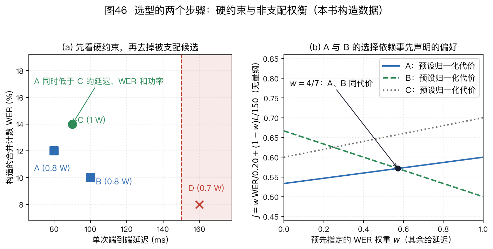
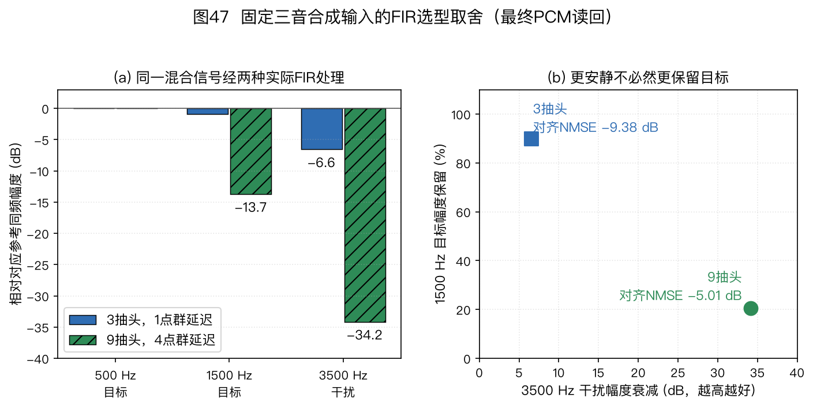
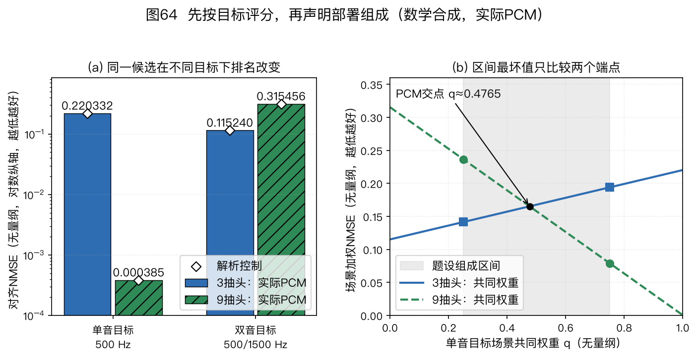
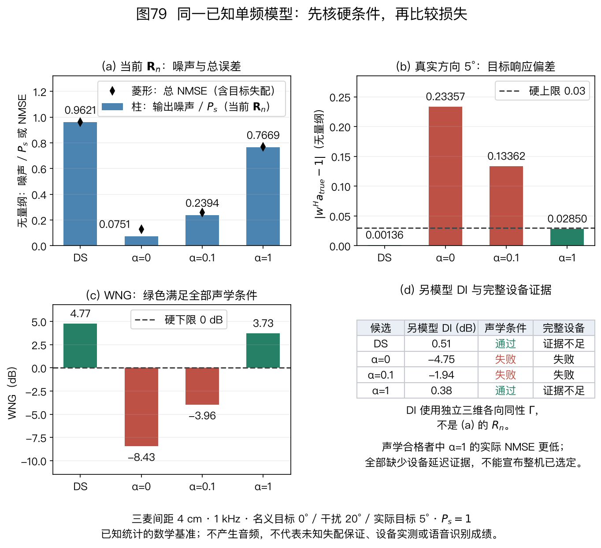

> ⚠️ 本篇是教程正文第 11 章（正文共 13 章，其中第 12、13 章为扩展专题，另有附录 A/B），可独立阅读，前后篇见下方导航。
>
> 🏠 首页导读：[00_overview.md](00_overview.md) ｜ 上一篇：[10_engineering-practice.md](10_engineering-practice.md) ｜ 下一篇：[12_acoustic-imaging.md](12_acoustic-imaging.md)

---

## 11. 总结与选型指南

前十章依次拆解了麦克风阵列的物理传播模型、阵列几何、声源定位、波束形成、回声消除、去混响、语音分离、声源追踪与设备级联调。到了真正的工程立项阶段，最容易犯的错误却是倒果为因：还没写清系统到底交付什么信号、受制于哪些硬边界，就先把一串流行模块塞进框图。同一只四麦阵列装在桌面固定坐席话机、大型多人会议室终端或移动服务机器人上时，声学边界与实时约束截然不同，合理的前端链路也会随之大相径庭。本章沿着“明确任务约束 → 按物理条件选定几何与算法模块 → 建立多指标统计验收规格”的顺序，把全书知识收拢为一套可复算、可证伪的选型方法。

本章常用缩写汇总如下（各具体定位、波束与追踪算法的全称在正文首次出现处展开）：

| 缩写 | 中文名与英文全称 |
|---|---|
| DOA | 波达方向（Direction of Arrival） |
| AEC | 声学回声消除（Acoustic Echo Cancellation） |
| WPE | 加权预测误差去混响（Weighted Prediction Error） |
| NS / VAD | 噪声抑制（Noise Suppression）/语音活动检测（Voice Activity Detection） |
| RTF | 本章指实时因子（Real-Time Factor），即累计处理耗时与新增音频时长之比；第 5 章等波束章节的 RTF 指相对传递函数 |
| SRO | 采样率偏移（Sampling Rate Offset） |
| CSS | 连续语音分离（Continuous Speech Separation）：将连续长录音分块分离到少量输出槽位，并完成跨块排列拼接 |
| TSE | 目标说话人提取（Target Speaker Extraction）：依据注册声纹、视觉嘴型或空间方位提取指定说话人语音 |
| ASR | 自动语音识别（Automatic Speech Recognition）：把语音信号转写为文本词序列 |
| KWS | 关键词检测（Keyword Spotting）：在线检测唤醒词或固定指令词 |
| STOI / ESTOI | 短时客观可懂度（Short-Time Objective Intelligibility）及其扩展（Extended STOI）：依赖干净匹配参考的可懂度指标 |
| ICC | 车载座舱通话增强（In-Car Communication）：拾取车内某排说话人语音并向其他排扬声器实时低延迟扩声 |

### 11.1 先回答六个问题

动手挑选任何算法之前，先逐条写下以下六个问题的定量答案；每回答清楚一条，就能筛掉一批不匹配的阵列形态与处理模块：

1. **系统最终要交付什么输出？** 下游消费的是单一方向角、随时间连续更新的轨迹、单路增强音频、彼此独立的多人语流、指定目标的提取语流，还是直接带时间戳与说话人标签的识别文本？只要涉及多人输出，就必须提前界定总参会人数是固定还是动态增减、离线整句处理还是在线流式输出，以及是否要求整场保持一致的说话人实名或匿名身份。只做固定讲台方向拾音时无须在线 DOA 搜索；只做声源方位指示灯时，也不必串联波束形成与后端降噪。

2. **拾音覆盖区域与声源距离是多少？** 均匀线阵在已知目标所处平面或半空间扇区时，能够直接利用轴向投影时差形成方向性，但在三维空间中绕阵列轴同锥面的方向具有完全相同的轴向时差；水平面 $360^\circ$ 周向覆盖通常优先评估圆阵。平面阵虽能同时约束方位与俯仰，但在自由场平面波假设下无法仅靠相位区分阵面上方与下方的镜像声源，必须借助桌面障板反射、整机外壳遮挡或非共面阵元打破对称。球阵及其他三维几何同样受阵元分布与幅相标定精度制约，切勿只凭“用了几只麦克风”去推断空间覆盖能力。

3. **所需的角度分辨率与最高工作频率是多少？** 阵列总孔径决定主瓣宽度与低频方向分辨力，而相邻阵元间距限定了不发生空间混叠的最高频率上限。拉大孔径有利于分辨低频邻近方向，缩小间距才能推高高频无混叠边界；当阵元总数受限时，可以通过增加阵元、按频带划分子阵或采用非均匀几何来折中，不能只报一个统一阵元间距就宣称覆盖全语音频带。

4. **现场究竟存在哪几类物理干扰？** 只有本机扬声器外放耦合进麦克风时才需要启用 AEC；只有房间晚期混响拖尾实质拉低了识别率或可懂度时，才值得承受额外延迟与算力去串联 WPE；只有多人同时重叠开口且任务要求保留各方内容时，才需要引入多流语音分离；稳态风扇或空调底噪往往用解析维纳/MMSE 滤波即可平抑，而非平稳突发噪声则须专门检验神经网络降噪在训练域外的泛化与语音保真度。

5. **目标声源是否移动、活跃人数是否增减？** 单个慢速移动说话人通常从一阶平滑或线性卡尔曼滤波起步即可满足波束指向更新。一旦出现多人交叉走动、短暂停顿与遮挡，就必须显式设计新轨迹确认、旧轨迹退役与观测—轨迹数据关联机制（见第 9 章）。概率假设密度（Probability Hypothesis Density，PHD）滤波与带标签多伯努利（Labeled Multi-Bernoulli，LMB）滤波等随机有限集方法，并不会因为“参会人数多”就自动胜出，仍需结合单帧 DOA 漏检/虚警分布、身份连续性要求和嵌入式算力一并权衡。

6. **硬件资源、量产成本与隐私合规的硬边界在哪里？** 规格书须逐项列明采样率、通道数、时钟拓扑、处理器型号上的实测算力、峰值内存、整机功耗、端到端关键路径延迟以及行业认证标准。量产预算应按目标出货量核算物料清单（Bill of Materials，BOM）采购成本：已纳入 BOM 的声学密封泡棉、总线收发器与壳体开孔结构件不得在其他科目重复计费，而逐台产线声学标定、夹具折旧与售后维护费用则须单独列支，并与算力、功耗、延迟预算分栏管理。凡涉及声纹注册或云端音频留存，还须写明知情同意、访问控制、留存期限与撤回删除机制（见第 10 章 §10.6）；处理器负载不能脱离具体芯片微架构空谈每秒百万条指令（Millions of Instructions per Second，MIPS），电池续航则统一按可用瓦时（Wh）除以整机平均功耗核算（见第 10 章 §10.4）。

### 11.2 按条件选择模块

#### 方法类别与启用条件

回答完上述六个问题后，我们先把前几章的核心算法家族放回各自的物理假设中：

- **时延与波束扫描定位**：广义互相关相位变换（Generalized Cross-Correlation with Phase Transform，GCC-PHAT）通过白化互功率谱幅度提取双麦相对到达时差；导向响应功率相位变换（Steered Response Power with Phase Transform，SRP-PHAT）在候选空间网格上累加多麦克风对的相位变换互相关能量，适合单源或稀疏主导源的稳健基线定位。
- **子空间高分辨定位**：多重信号分类（Multiple Signal Classification，MUSIC）利用噪声子空间与真实导向矢量的正交性构造空间谱峰；旋转不变子空间法（Estimation of Signal Parameters via Rotational Invariance Techniques，ESPRIT）利用平移不变子阵间的信号子空间旋转算子直接闭式求角。这两类方法都依赖准确的活跃源数估计、充足的统计快拍以及低相干混响环境。
- **数据相关自适应波束**：最小方差无失真响应（Minimum Variance Distortionless Response，MVDR）在保持目标方向复响应无失真的线性约束下最小化总输出功率；线性约束最小方差（Linearly Constrained Minimum Variance，LCMV）进一步支持同时锁定多个目标或零陷方向响应。两者的实际收益都高度敏感于噪声协方差估计质量与目标导向矢量失配。

下表按八类常见前端决策对象，给出推荐的起步基线、升级触发条件以及伴随的工程风险：

| 决策对象 | 适合先尝试的方案 | 何时换方案 | 同时检查的风险 |
|---|---|---|---|
| 单源 DOA | GCC-PHAT 或 SRP-PHAT 基线 | 需要更高角分辨率且快拍、信噪比满足子空间分解条件时评估 MUSIC 或 ESPRIT；强混响下可评估学习型定位 | 阵列几何镜像歧义、混响伪峰、宽带频点融合、静音段虚警 |
| 固定方向增强 | 延迟求和（DS）或固定超指向（superdirective）波束 | 干扰方向随时间变化且噪声协方差可稳健在线估计时，评估 MVDR 或 LCMV 波束形成 | 低频白噪声增益恶化、目标角度失配、阵元幅相失配 |
| 自适应波束 | 带对角加载稳健化的 MVDR 或 LCMV | 目标相对传递函数或几何导向矢量难以可靠获取时，评估时频掩码辅助波束或联合神经网络前端 | 协方差矩阵秩亏、加载量过大退化为 DS、目标语音混入噪声协方差引发自相消 |
| 晚期混响 | 先保留关闭 WPE 的直通对照基线 | 实测长混响拖尾拉低任务指标时，增加同输入下开启 WPE 的对照：转写任务核查词错误率（Word Error Rate，WER），通话监听核查可懂度、听感与新增延迟 | 预测保护延迟过短削伤直达声、滤波器阶数与矩阵求逆耗时 |
| 本机回声 | 只要存在扬声器外放拾音泄漏即启用线性 AEC | 微型扬声器非线性失真显著、声学路径剧烈变动或立体声/多声道外放导致参考强相关时，升级非线性残余抑制或多通道去相关建模 | 数字参考信号取点遗漏音效混音、缓冲整体时延抖动、双讲近端语音误伤 |
| 多人重叠 | 下游只消费单路语音时先试多波束择优或掩码波束 | 要求完整保留重叠段各方说话内容时评估分离/CSS；仅需锁定特定目标且具备可靠先验线索时评估 TSE | 最大并发说话人数、总参会人数固定或可变、整句或流式拼接、跨块槽位跳变、内容篡改与算力峰值 |
| 轨迹平滑 | $\alpha$-$\beta$ 滤波或单目标卡尔曼滤波 | 多人频繁交叉、短句停顿漏检与反射虚警并存时，升级带门控与生命周期管理的多目标追踪 | 角度周期跳变（如 $\pm 180^\circ$）、传感器异步时间戳、轨迹身份互换与断轨 |
| 残余噪声 | 维纳滤波或最小均方误差（Minimum Mean-Square Error，MMSE）谱增益基线 | 键盘敲击、餐具碰撞等强非平稳噪声下解析噪声跟踪滞后明显时，评估轻量级神经网络 NS | 弱辅音过度削波、未见噪声域泛化退化、听感改善但下游 ASR 的 WER 反升 |

阅读上表时，请把握两条核心选型逻辑：第一列到第二列遵循“先用物理假设最透明、无须训练的解析基线探明问题边界”，只有当基线的失效机理恰好落在第三列所述物理瓶颈上时，才升级复杂度；而第四列提醒我们，选定算法名称仅仅确定了模型结构，远未锁定参数——WPE 的预测延迟与抽头阶数、MVDR 的对角加载量、AEC 的滤波器覆盖长度以及 VAD 的尾音保持时间，都必须由目标硬件与真实场景数据标定，绝不能直接照搬其他产品的经验常数。

#### 多人内容与身份的评分口径

一旦进入多人重叠对话选型，“词错误率是多少”本身就不再是一个单义问题：系统既可能把内容全听对了却装错了输出流，也可能保持了流内一致却弄反了真实姓名。工程验收前必须先从数学上严格区分三种多人 WER 口径：

- **拼接最小排列词错误率（Concatenated minimum-Permutation Word Error Rate，cpWER）**：在单次会话内，先将同一参考说话人的全部话段按时间拼接成一条参考词序列，再将每条匿名输出槽位各自拼接成一条假设词序列，最后在整场会话范围内寻找唯一一次全局流排列使总编辑错误数最小。它惩罚中途跨槽换人，但不核验匿名槽位号是否对应真实人名。
- **最优参考组合词错误率（Optimal Reference Combination Word Error Rate，ORC-WER）**：保持每条参考话段内部不拆分，允许按参考时间顺序将不同话段自由分配给任意输出槽位以最小化总编辑距离。它只考核每句话的内容是否被某一条槽位完整识别，不要求同一槽位整场固定跟踪同一个人。
- **说话人归属词错误率（Speaker-Attributed Word Error Rate，sa-WER）**：要求系统为输出词赋予明确的实名说话人标签，直接按同一实名标签将参考与假设一一对齐求编辑距离，不允许作任何跨人名重排；一旦张冠李戴，即便字字识别准确也会计入错词。

设单次会话共有 $S$ 名真实说话人，其全部 $U$ 条按时间排序的参考话段 $\{u_m\}_{m=1}^U$ 按真实说话人拼接后得到参考序列 $\{R_s\}_{s=1}^S$，参考总词数为 $N_{\mathrm{ref}} = \sum_{s=1}^S |R_s| > 0$。对于输出 $K$ 条匿名流 $\{H_k\}_{k=1}^K$ 的分离转写系统，计算 cpWER 时将流数较少的一侧补空序列 $\varnothing$ 至 $M = \max(S, K)$，并在全部 $M!$ 个全局排列集合 $\mathcal{P}_M$ 上搜索最小值；计算 ORC-WER 时，为每条参考话段 $u_m$ 指派一个目标槽位 $z_m \in \{1,\dots,K\}$，将指派给槽位 $k$ 的参考话段按原时间顺序拼接成重组参考 $R_k^{\mathrm{orc}}(\vec z)$。对于输出实名归属序列 $\{\hat{H}_s\}$ 的系统，令 $\mathcal{S}_{\mathrm{all}}$ 表示真实说话人与系统预测说话人标签的并集（若某标签只在预测中出现，则其参考序列记为空串 $R_s = \varnothing$）。以 $\mathcal{D}(\cdot,\cdot)$ 表示标准词级编辑距离（插入、删除、替换的最小操作次数），三种指标统一写作：

$$
\begin{aligned}
\mathrm{cpWER} &= \frac{1}{N_{\mathrm{ref}}} \min_{\pi \in \mathcal{P}_M} \sum_{s=1}^{M} \mathcal{D}\!\left(R_s,\, H_{\pi(s)}\right), \\
\mathrm{ORC\text{-}WER} &= \frac{1}{N_{\mathrm{ref}}} \min_{\vec z \in \{1,\dots,K\}^U} \sum_{k=1}^{K} \mathcal{D}\!\left(R_k^{\mathrm{orc}}(\vec z),\, H_k\right), \\
\mathrm{sa\text{-}WER} &= \frac{1}{N_{\mathrm{ref}}} \sum_{s \in \mathcal{S}_{\mathrm{all}}} \mathcal{D}\!\left(R_s,\, \hat{H}_s\right).
\end{aligned}\tag{11-1}
$$

式(11-1)清晰揭示了三者的约束递进关系：当 $S=K=1$ 且实名标签正确时，三式完全退化为普通单人 WER；在多人场景下，ORC-WER 的可行重排空间最大（共有 $K^U$ 种逐话段指派），cpWER 将重排收紧到整场唯一的 $M!$ 种全局槽位置换，而 sa-WER 将重排自由度彻底收紧到 $1$ 种固定实名映射，因此对同一组转写内容恒有 $\mathrm{ORC\text{-}WER} \le \mathrm{cpWER} \le \mathrm{sa\text{-}WER}$（当实名标签由槽位全局一一绑定产生时）。

#### 四词手算：两条流在第二段交换

我们用一个极简的四词算例把式(11-1)的三行公式一次算透。设“春天、夏天、秋天、冬天”各为一个独立词元；在第 1、第 2 两个时间段内，甲、乙两人同时开口，前端 CSS 分离器与 ASR 把四个词全部识别正确，但在第 2 段发生了跨块槽位交换，把两人的话放进了相反的输出流：

| 时间段 | 甲的参考 | 乙的参考 | 输出流 1 | 输出流 2 |
|---|---|---|---|---|
| 1 | 春天 | 夏天 | 春天 | 夏天 |
| 2 | 秋天 | 冬天 | 冬天 | 秋天 |

**输入与口径**：按真实说话人拼接得到 $R_{\text{甲}} =$“春天 秋天”与 $R_{\text{乙}} =$“夏天 冬天”，参考总词数 $N_{\mathrm{ref}} = 4$；两条匿名输出流拼接后分别为 $H_1 =$“春天 冬天”与 $H_2 =$“夏天 秋天”。为了在同一算例上同时核对 sa-WER，再考虑一种典型的声纹注册事故——会前录入声纹库时，工作人员不慎把甲、乙两人的注册声纹档案录反了：于是无论甲的声音落在第 1 段的流 1 还是第 2 段的流 2，下游声纹检索模块都稳定地将其标成“乙”，而把乙的声音（“夏天”与“冬天”）统统标成“甲”。

**逐步代入式(11-1)**：

- **计算 cpWER**：全局排列集合 $\mathcal{P}_2$ 只有两种选择。若流 1 配甲、流 2 配乙，甲的“秋天→冬天”与乙的“冬天→秋天”各发生 1 次替换，编辑和为 $1+1=2$；若流 2 配甲、流 1 配乙，第 1 段的“春天→夏天”与“夏天→春天”同样各发生 1 次替换，编辑和仍为 $1+1=2$。故 $\mathrm{cpWER} = \min\{2, 2\}/4 = 50\%$。
- **计算 ORC-WER**：共有 $U=4$ 条单词话段。令第 1 段的“春天”指派给流 1、“夏天”指派给流 2，第 2 段的“秋天”指派给流 2、“冬天”指派给流 1，则重组参考序列 $R_1^{\mathrm{orc}} =$“春天 冬天”$= H_1$，$R_2^{\mathrm{orc}} =$“夏天 秋天”$= H_2$，编辑距离之和为 $0+0=0$，得 $\mathrm{ORC\text{-}WER} = 0/4 = 0\%$。
- **计算 sa-WER（四步手算）**：

    1. **按预测实名汇总假设序列**：声纹模块将乙说的词标为甲、甲说的词标为乙，故归入甲名下的预测序列为 $\hat{H}_{\text{甲}} =$“夏天 冬天”，归入乙名下的预测序列为 $\hat{H}_{\text{乙}} =$“春天 秋天”；
    2. **核对甲的归属编辑距离**：式(11-1)第三行禁止交换实名，将 $R_{\text{甲}} =$“春天 秋天”与 $\hat{H}_{\text{甲}} =$“夏天 冬天”对齐需 2 次替换，$\mathcal{D}(R_{\text{甲}}, \hat{H}_{\text{甲}}) = 2$；
    3. **核对乙的归属编辑距离**：将 $R_{\text{乙}} =$“夏天 冬天”与 $\hat{H}_{\text{乙}} =$“春天 秋天”对齐同样需 2 次替换，$\mathcal{D}(R_{\text{乙}}, \hat{H}_{\text{乙}}) = 2$；
    4. **汇总归属词错误率**：总编辑错误数为 $2 + 2 = 4$，除以参考总词数 $N_{\mathrm{ref}} = 4$，得到 $\mathrm{sa\text{-}WER} = 4/4 = 100\%$。

**算例结论与选型启示**：完全相同的四个识别词，在三种口径下分别给出 **ORC-WER = 0%**、**cpWER = 50%** 与 **sa-WER = 100%**！这组强烈反差把三项指标的物理分工刻画得一清二楚：ORC-WER 为零仅证明“语音内容一字未漏”，绝不证明同一输出流始终对应同一人；cpWER 升至 50% 精准暴露了第 2 段的匿名跨块换槽；而 sa-WER 飙升至 100% 则说明，哪怕声纹模块跨槽追上了各自音色，一旦实名注册档案错绑，需要落实发言人责任的会议纪要就会全盘张冠李戴。

工程复现时，除选定指标名称外，还必须把话段切分规则、文本规范化流程与评分软件包的具体提交哈希一并固化。例如开源评测工具 MeetEval 在提交 [`6e3dc81284f2d6928f7ef9e620fd3b6906daa429`](https://github.com/fgnt/meeteval/blob/6e3dc81284f2d6928f7ef9e620fd3b6906daa429/doc/algorithms.md) 的算法文档中明确定义了 cpWER、ORC-WER、MIMO-WER 与 DI-cpWER，但并未内置 sa-WER；涉及实名归属验收时须另行锁定评测脚本版本，不能只登记随时变动的默认分支名 `main`。

此外，原始 CSS 的少量输出槽位天生由多位参会者轮流复用。若甲、乙、丙三人先后不重叠地各说一个词 `a`、`b`、`c`，而双槽 CSS 输出槽 1 为 `a c`、槽 2 为 `b`，即使内容与时序完美无缺，一个输出槽也无法在全局排列中同时一一匹配两位参考说话人——章末练习 E11-16 将算出此时 $\mathrm{ORC\text{-}WER} = 0\%$，而 $\mathrm{cpWER} = 2/3 \approx 66.67\%$。因此，只验收全文内容检索时可选用固定话段边界的 ORC-WER；若要求输出按人分轨的会议纪要，则须在 CSS 之后级联说话人日志（diarization）或声纹关联，再评测 cpWER 或 sa-WER。正如 [MeetEval 作者论文第 3.2～3.5 节](https://arxiv.org/pdf/2307.11394)所证，ORC-WER 不允许在单条参考话段内部拆词换流，且必须保持参考话段的先后时序，故参考分段边界与同起点排序规则都属于不可事后篡改的评测基准。

#### 话段边界与时间也属于评分协议

哪怕参考词序列一字不改，人为切碎参考话段也会暗中放宽 ORC-WER 的分配约束：因为每拆出一段，就多给评分器一次跨槽切换的自由度（见章末 [E11-23](#e11-23) 的两词对比手算）。参考话段边界必须按数据集预定的停顿与句法规则冻结，绝不能迁就某个待测系统的分块边界去重新切分。

不带时间约束的编辑距离还会引入另一重隐患：在长达数十分钟的会议录音里，“好”“对”“是的”等高频词反复出现，普通动态规划会把第 1 秒漏掉的参考词拿去与第 10 分钟误插入的同词配成“零错误”（见 [E11-24](#e11-24)）。为此，[MeetEval 2023 原论文 §4（印刷第 29～30 页）](https://www.isca-archive.org/chime_2023/neumann23_chime.pdf)引入了时间约束最小排列词错误率（Time-Constrained minimum-Permutation Word Error Rate，tcpWER），规定只有当参考词与假设词的时间区间在预定容差（collar）内发生重叠时，才允许作正确匹配或替换。使用时间约束指标时，必须同步写明词级时间戳来自人工标注、强制对齐还是按字符长度比例近似，并核对端点刚好相接时算不算重叠。

阅读公开评测榜单时，同样要先核对聚合分母与评分协议细节。以同届 CHiME-8 挑战赛为例，[Task 1（DASR）提交说明](https://www.chimechallenge.org/challenges/chime8/task1/submission)采用 $5\ \mathrm{s}$ 容差的 tcpWER，其[官方评分实现](https://github.com/chimechallenge/chime-utils/blob/152882404f572d40769ef02bf91c5a9a9cfc9c78/chime_utils/scoring/meeteval.py#L174-L217)先在每个场景内部合并全部错误词数与参考词数，再对四个场景的分数取等权算术平均；而 [Task 2（NOTSOFAR）规则](https://www.chimechallenge.org/challenges/chime8/task2/rules)虽同样采用 $5\ \mathrm{s}$ 容差，其[官方榜单](https://www.chimechallenge.org/challenges/chime8/task2/results)却先逐场会话算出 tcpWER、再对各会话分数取等权平均，并额外并列报告不绑固定说话人的 tcORC-WER 供诊断参考。跨届对比更须谨慎：例如 [CHiME-9](https://www.chimechallenge.org/challenges/chime9/) 转向了 MCoRec 与助听会话增强任务 ECHI，数据集、通道拓扑与评测指标均已改变，不能把两届数字直接排在同一张名次表里。

#### 输出槽位与目标条件

下表横向对比了三类主流多人前端架构在输出路数、人数扩展性、在线延迟与身份连续性上的本质差异：

| 任务条件 | 一路波束/掩码波束 | 连续语音分离（CSS） | 目标说话人提取（TSE） |
|---|---|---|---|
| 需要的输出 | 一路增强音频 | 固定或少量输出流；每条流同一时刻至多承载一人，不同流可同时输出重叠的说话人 | 被注册语音、视觉或方向指定的一人 |
| 人数变化 | 可跟随一个选中目标；不负责完整输出所有人 | 总参会人数可多于输出流数；流数由最大同时说话数和系统设计决定 | 非目标人数可变化，但目标条件必须持续有效 |
| 时间范围 | 可逐帧或分块在线处理 | 连续长录音；必须说明分块、上下文和拼接 | 可整句或流式；需报告注册和首帧延迟 |
| 身份连续 | 由追踪/分割模块提供 | 分离槽位不等于永久身份，通常还需分割或声纹关联 | 目标条件提供身份线索，但会受注册信道和冒用影响 |
| 主要验收 | 目标保持、串扰、语音损伤、WER | 重叠段遗漏、跨块换人、cpWER/ORC-WER/sa-WER、延迟 | 目标遗漏、非目标泄漏、错误目标、隐私与删除 |

对比这三列可以看出，模型越复杂并不意味着越适合手头的产品：若下游通话链路或单路唤醒引擎只接收一路音频，强行上马多输出 CSS 只会徒增跨块排列跳变与数倍算力开销；反过来，若产品需求是把会议室里所有临时来访者的发言一字不漏地转写成纪要，要求提前采集每个人声纹或人脸线索的 TSE 就会在功能入口上直接卡壳。

### 11.3 几何与算法要一起选

阵列几何决定了物理声场中有哪些空间相位差被采样下来，信号处理算法则决定了如何提取和组合这些相位差；一旦几何布局丢失了某个维度的可辨识性，后续无论堆叠多深的子空间分解或神经网络都无法凭空无中生有：

- **双麦与均匀/近似线阵**：只能唯一测量波达方向在阵列轴线上的方向余弦投影；在三维自由场中，同一轴向投影对应一整个圆锥面的等时延轨迹，即便限制在水平面内也存在前后镜像对称二解。工业设计中几毫米的微弱错位折线往往在低频段提供的垂直相位差远小于传感器幅相公差，适用前提是设备靠墙摆放或结合心形指向性壳体已知目标处于单一半平面扇区。
- **非共线三麦与平面阵**：在平面内提供两个线性无关的坐标基向量，足以唯一确定水平方位角，但对阵面法线上下两侧 $(+z \leftrightarrow -z)$ 的自由场平面波完全对称。工程落地时通常贴合桌面或吸顶安装，利用物理刚性边界面消除下半空间镜像。
- **均匀圆阵**：各向同性地覆盖水平面全周向，是桌面会议终端与智能音箱的常见选择。阵元数 $M$ 与半径 $r$ 须由目标角分辨率、最高无混叠工作频率及整机直径联合反推（见章末 E11-05 的四麦与六麦对照筛查），不存在脱离频带与孔径的所谓“万能麦数”。
- **球阵与三维立体阵**：支持全空间方位角与俯仰角联合解析及高阶声场重构。实际可用球谐阶数同时受阵元空间采样定理、无量纲波数孔径积 $\kappa r$（其中 $\kappa = 2\pi f/c$ 为波数，$r$ 为球半径）、开球零点或低频径向滤波的传感器白噪声放大以及阵元标定残差制约，详见[第 5 章 §5.8](05_beamforming.md#sec-5-8) 与[第 10 章 §10.8](10_engineering-practice.md#sec-10-8)。
- **稀疏非均匀阵**：利用阵元位置差集构造的差分协同阵（difference coarray）能够在平稳二阶统计域扩展虚拟连续滞后数，但它并未增加单帧物理采样通道数；遇到短快拍瞬态语音、强相干早期反射或宽带非平稳干扰时，必须回到第 3 章的协方差重构前提逐项核验。

确定阵列形态后，波束参数设计始终围绕白噪声增益（White Noise Gain，WNG）与指向性指数（Directivity Index，DI）之间的物理权衡展开：试图在低频小孔径下挤出过窄的主瓣或极深的自适应零陷，必然导致滤波器权重范数剧增，把麦克风本底热噪声与微米级装配误差成倍放大。对角加载、显式 WNG 下界约束与按频段切换固定/自适应权重，本质上都是用适度放宽空间零陷深度来换取实机鲁棒性。

#### 平面镜像为什么不能靠换算法消除

我们用一个三维坐标手算算例来直观验证“几何不可辨识性无法靠算法弥补”。沿用第 2 章远场平面波单位入射方向与导向相位约定，将三只共面麦克风置于 $xy$ 平面上的 $\vec p_1 = (0,0,0)^\top$、$\vec p_2 = (0.04,0,0)^\top$ 与 $\vec p_3 = (0,0.04,0)^\top\ \mathrm{m}$，考察上下镜像对称的两个单位方向向量 $\vec u_+ = (0.6, 0, 0.8)^\top$ 与 $\vec u_- = (0.6, 0, -0.8)^\top$（满足 $\|\vec u_\pm\|_2 = \sqrt{0.6^2 + 0^2 + (\pm 0.8)^2} = 1$）。

以第 1 麦为相位参考点，其余两麦相对参考点的空间程差投影分别为 $\vec p_2^\top \vec u_\pm = 0.04 \times 0.6 + 0 + 0 = 0.024\ \mathrm{m}$ 与 $\vec p_3^\top \vec u_\pm = 0\ \mathrm{m}$。由于两只麦克风的 $z$ 坐标全为零，$\pm 0.8$ 的垂直分量在点乘中被彻底抹零——这意味着在任意频率 $f$ 下，$\vec u_+$ 与 $\vec u_-$ 产生的理想阵列流形导向矢量逐分量完全恒等！无论把快拍数拉到无穷大，还是把 GCC-PHAT 换成 MUSIC、MVDR 乃至深度网络，仅凭这三路理想自由场观测在信息论意义上都无法区分声源来自阵面上方还是下方。

反之，只要沿法向引入第四只非共面麦克风 $\vec p_4 = (0, 0, 0.04)^\top\ \mathrm{m}$，它在两个方向上的程差投影立刻分化为 $+0.032\ \mathrm{m}$ 与 $-0.032\ \mathrm{m}$。取声速 $c = 343\ \mathrm{m/s}$、频率 $f = 1\ \mathrm{kHz}$，第 4 麦相对第 1 麦的导向相位分别为 $\pm 2\pi f(0.032)/c \approx \pm 0.58619\ \mathrm{rad}$，上下镜像二解随之解耦（全空间任意方向的完整秩判据见第 3 章练习 E03-10）。

### 11.4 四个场景怎样推导方案

掌握了模块边界与几何耦合规律后，下表以四类典型工业形态为例，展示如何顺着现场约束的变化一步步推导出系统链路，而非背诵僵化的标准配方：

| 场景 | 条件变化 | 方案怎样变化 |
|---|---|---|
| 带扬声器的语音终端 | 若要求播放时仍能唤醒或通话 | AEC 成为必要候选；数字参考应覆盖实际混音、均衡与播放增益。圆阵、线阵或平面阵由覆盖区域和外形决定。无明显晚期混响时不必默认加 WPE。 |
| 会议室 | 若多人重叠较少，只需一路会议音频 | 先比较多波束选择和自适应波束。只有重叠说话造成任务失败，且需要独立语流时，再增加分离。远距离和长混响房间要用实测决定 WPE。 |
| 车载 | 若麦克风跨多个时钟域 | 先解决 SRO 和时间戳，再谈分区波束。播放参考需覆盖音乐、导航和通话混音。算法要在怠速、行驶、开窗和空调状态分别测试。 |
| 耳机或助听设备 | 若监听路径对延迟和电池很敏感 | 监听与通话上行可采用不同链路。固定双麦波束和轻量 NS 是候选基线，不是必选答案；法规、反馈路径、佩戴变化和听觉安全优先。 |

顺着上表横向对照可见，同一个大类场景只要安装位置或信号取点稍作变动，选型结论就会完全改写。例如同属会议室拾音，挂在屏幕下沿靠墙安装的条形终端只需覆盖前方 $180^\circ$ 半空间，采用水平线阵即可兼顾窄边框外观与横向指向性；而摆在长桌正中央的全向拾音盒则必须覆盖周向 $360^\circ$，自然转向均匀圆阵。同理，带外放的终端虽强调“数字参考须覆盖全部混音与音效”，但数字取点永远不包含后端模拟功放削顶与扬声器振膜谐波失真——究竟是增设功放输出端电压/电流反馈参考（电参考）、引入非线性残余回声抑制，还是在唤醒敏感频段限制最大外放电平，必须结合硬件 BOM 与声学腔体实测敲定（见第 6 章与第 10 章图 23）。

在四大场景中，**智能座舱的多音区交互与车内通信**最集中地体现了国际标准、总线时钟、近场阵列与超低延迟硬约束的交叉耦合，值得在选型时单独拆解三个工程维度：

- **对标 ITU-T P.1100～P.1150 车载语音标准族**：座舱音频绝非单一指标能概括，立项前须先分清业务归属的标准条款。面向车外蜂窝网的免提通话按传输带宽依次对应 **ITU-T P.1100**（窄带 $300\text{～}3400\ \mathrm{Hz}$）、**P.1110**（宽带 $100\text{～}7000\ \mathrm{Hz}$）与 **P.1120**（超宽带及全频带），重点考核双讲剪切、发送延迟、回声衰减与背景路噪下的语音质量；麦克风模组、数字前端子系统及蓝牙短距无线链路的分段验收遵循 **P.1130**；碰撞事故后的紧急救援呼叫（eCall）遵循 **P.1140**，要求在气囊爆开、车窗破碎或车辆翻覆等极端高噪畸变工况下仍保住公共安全应答点的可懂度底线；而把前排驾驶员语音实时扩声给后排乘客的**车载座舱通话增强（ICC）**则由 **P.1150** 专门规范，考核重点转为闭环声反馈稳定裕度、听音费力程度、说话人空间定位保持以及严苛的强化路径延迟上限。
- **A²B 同步音频总线与异构域 SRO 的架构分野**：现代座舱往往在顶棚、遮阳板、方向盘柱与四座/六座头枕内分布十余只数字麦克风。若整车采用 **A²B（Automotive Audio Bus，车载音频总线）** 单主多从菊花链架构，主节点通过单根非屏蔽双绞线同时下发主位时钟、帧同步与供电，所有远端头枕及顶棚从节点的锁相环严格锁定在同一主时钟源上，全车麦克风天然实现**零相对 SRO** 与低于 $50\ \mu\mathrm{s}$ 的确定性传输延迟，跨座位联合自适应波束与多声道媒体 AEC 可直接共享精确相位。反之，一旦需求引入蓝牙免提手机、USB 外挂记录仪或跨独立晶振电子控制单元（ECU）的以太网音频流，不同时钟域之间就会出现数十至上百 ppm 的相对 SRO 与包抖动——此时若直接套用跨节点MVDR 或固定多通道回声滤波器，几秒钟内的微秒级采样漂移就会令空间零陷与回声对消彻底失效（见章末 E11-07 与 E11-18），必须在选型第一环先插入硬件时间戳捕获与在线异步采样率转换（ASRC）。
- **头枕阵音区隔离度 LCR 与 ICC $<15\ \mathrm{ms}$ 梳状滤波硬约束**：多音区座舱要让主驾、副驾与后排乘客独立唤醒并发出指令而互不串扰，近年广泛采用嵌入座椅头枕两侧的近场双麦/四麦微分阵。设座位 $z$ 的增强输出通道在本区乘员以标准声压发声时的有效语音功率为 $P_{z\leftarrow z}$，在邻座 $q\ (q\ne z)$ 以同声压发声时漏入座位 $z$ 输出的串扰功率为 $P_{z\leftarrow q}$；同时考虑 ICC 模式下，后排乘客双耳同时接收到前排说话人的车厢空气直达声，以及经麦克风拾音、DSP 增强与后排扬声器辐射的扩声信号（记扩声相对直达声的附加延迟为 $\Delta_{\mathrm{Rx}} > 0$，到达人耳处的相对声压幅度比为 $g > 0$）。提取空气直达声的公共传播时延相位后，本区与串扰功率比（Local-to-Crosstalk Ratio，LCR）及人耳处双径叠加的归一化功率传递函数 $|H_{\mathrm{ICC}}(f)|^2$ 分别为：

$$
\begin{aligned}
\mathrm{LCR}_{z,q} &= 10\log_{10}\!\left(\frac{P_{z\leftarrow z}}{P_{z\leftarrow q}}\right), \\
\left|H_{\mathrm{ICC}}(f)\right|^2 &= \left|1 + g\,\mathrm{e}^{-\mathrm{j}2\pi f\Delta_{\mathrm{Rx}}}\right|^2 = 1 + g^2 + 2g\cos\!\left(2\pi f\Delta_{\mathrm{Rx}}\right), \\
f_m &= \frac{2m + 1}{2\Delta_{\mathrm{Rx}}}, \qquad m = 0, 1, 2, \dots
\end{aligned}\tag{11-2}
$$

式(11-2)从物理上划定了两条截然不同的车载选型路线：第一行中，头枕距本区嘴部仅约 $15\text{～}25\ \mathrm{cm}$，而距邻座嘴部约 $70\text{～}100\ \mathrm{cm}$ 且有人头声影遮挡，仅靠物理近场球面衰减与心形指向即可获得 $10\text{～}15\ \mathrm{dB}$ 的原始声学隔离，再配合零陷对准邻座的头枕 LCMV 波束与音区比值门控，可将系统级 $\mathrm{LCR}_{z,q}$ 推高至 $25\text{～}35\ \mathrm{dB}$ 以上，从而无须上马高算力盲分离就能可靠阻断邻座误唤醒。第二、三行则揭示了 ICC 链路为何不能照搬语音识别前端：当余弦项取 $-1$ 时，直达声与扩声在频域每隔 $\Delta f = 1/\Delta_{\mathrm{Rx}}$ 发生一次相消干涉，形成密集的梳状滤波凹陷 $f_m$。若套用帧长 $32\ \mathrm{ms}$、帧移 $16\ \mathrm{ms}$ 的常规 STFT 增强或带 $40\ \mathrm{ms}$ 前瞻的神经分离器，仅算法缓冲就使 $\Delta_{\mathrm{Rx}} \ge 25\ \mathrm{ms}$，在 $300\text{～}3400\ \mathrm{Hz}$ 核心语音频带内每隔 $40\ \mathrm{Hz}$ 就挖出一个深谷（多达 70 余处凹陷），产生刺耳的空桶金属音并破坏哈斯优先效应（Haas effect）的声像融合。因此 **ITU-T P.1150 强制要求强化延迟 $\Delta_{\mathrm{Rx}} < 15\ \mathrm{ms}$**（工程上常严控在 $4\text{～}10\ \mathrm{ms}$）：凡在 ICC 路径上的反馈抑制、固定波束与降噪模块，都只能在时域短抽头 FIR 或超短帧低延迟子带架构中选型，一切长窗与前瞻模块在此均被硬约束一票否决。

### 11.5 把候选方案写成可验证的规格

#### 11.5.1 先写规格和证据口径

选型讨论不能停留在口头形容词上；要把候选方案送上同一张评审桌，规格书必须逐项锁定以下九类信息：

| 项目 | 应写内容 |
|---|---|
| 任务 | 输入、输出、目标声源数、是否需要身份连续 |
| 几何 | 坐标、尺寸公差、声孔和遮挡、工作频带 |
| 场景 | 距离、角度、房间、噪声、播放和运动状态 |
| 链路 | 每个模块的启用条件、取点、旁路和控制信号 |
| 资源 | 目标硬件上的 RTF、已测帧耗时范围、峰值内存、平均/峰值功耗及测量条件 |
| 成本 | 目标产量、BOM 采购成本；未计入 BOM 的接口与结构成本、标定和维护费用另列，已计物料不重复计入；区分一次性与逐台成本 |
| 延迟 | 前瞻、缓冲、计算、调度和解码关键路径 |
| 指标 | 任务指标、语音损伤、稳定性、置信区间和样本量 |
| 异常处理 | 通道失效、方向低置信度、网络断开和算力过载时的行为 |

上表既是研发立项清单，也是消融实验的控制变量表。搭建系统时，推荐先打通只含必要环节的最小可运行基线，再每次引入一个候选模块，同步记录目标任务收益、近端语音损伤、端到端延迟、整机功耗与新增异常样例。当两个模块之间存在统计或非线性耦合（例如 WPE 改变了后续自适应波束的协方差结构，或波束零陷改变了后端神经降噪的残留谱分布）时，还须补充联合开关的四配置对照（见章末 E11-15），不能把“逐个单加”当成全局最优搜索。凡在目标房间实测中未能降低错误率的去混响模块，或虽提升了尺度不变信号失真比（Scale-Invariant Signal-to-Distortion Ratio，SI-SDR）却因非线性伪影拉高了下游 WER 的分离网络，都应果断移出主链路。

开源实现也要按任务筛选。项目名称不能代替算法条件：

- PortAudio 解决设备输入输出，不解决跨设备同步。
- ONNX Runtime 执行模型，不规定模型训练目标。
- pyroomacoustics 适合房间与阵列原型，不证明目标设备实时。
- WebRTC AEC3 可以对照实时回声链路，但其内部参数不是其他产品的默认值。

选择开源项目时应把规范仓库、固定提交或发布、许可证、支持平台、输入输出契约、维护状态和最小测试一起写入方案，详见 §10.9.1 与 [`codes/chapters/ch00/SOURCES.lock.json`](../codes/chapters/ch00/SOURCES.lock.json)。

本书按 [`codes/chapters/ch00/COVERAGE.md`](../codes/chapters/ch00/COVERAGE.md) 将所涉算法清晰划分为“本仓库可运行基线、外部参考实现、原理索引、明确排除”四类状态（调用外部库的薄封装仅属接口适配，不单独构成第五类状态）。教学基线通过单元测试，证明的是数学公式约定与退化边界条件吻合预期；要迈向工业量产，还必须补齐“接口可接入、目标芯片可编译、长稳压力与故障恢复可通过”三道工程关卡——例如在 Linux 会议终端上核查 ALSA/PipeWire 的采集与播放回采路由，在 Cortex-M 微控制器上核算 TFLM/CMSIS-NN 的算子支持与静态张量内存池，或在 XMOS/SOF 音频固件上验证热插拔恢复、播放参考切换、跨块状态复位与线程过载降级（详见[工业部署研究](../codes/chapters/ch00/research/03_industrial_deployment.md)）。

外围音频读写与客观打分工具同样要先验清接口语义：重采样库 `libsoxr` 与 `libsamplerate` 对输入输出采样率比值的正反约定截然不同；`libsndfile` 返回的帧计数是时间采样帧数而非多通道交织标量总数；`libebur128` 输出的响度与真峰值用于响度合规控制，不能充当语音清晰度得分。仅当拥有严格时间对齐的干净参考信号时，才可按适用频带调用 STOI/ESTOI 或 ViSQOL，且须将静音占比过高、有效语音帧不足或参考失配的异常样本单独记入失败台账（详见[第 10 章评测体系](10_engineering-practice.md#sec-10-5)）。

**实录算例：整段平均合格为何掩盖局部最差窗口超标。** 许多验收争议源于“整段汇总达标，但用户在头两秒明显感到异常”。我们用第 2 章整理的真实公开录音 R01（取自 [DEMAND 原始数据集](https://zenodo.org/records/1227121)，详见 [R01 采集、许可与复算说明](../codes/chapters/ch02/real_audio/README.md)）做一次精确整数复算：该样本是一段 $16\ \mathrm{kHz}$、时长 $10\ \mathrm{s}$ 的 16 麦同步自然溪流噪声录音，同时存有 16 路原始 16 位有符号 PCM 文件与零时延等权平均（按最近偶数舍入）的单路 PCM 文件。

假设某选型简化模型忽略阵元间噪声互相关，预测 16 路等权平均后的输出噪声功率应为单麦平均功率的 $1/16$，并规定实测输出功率偏离该对角预测值不得超过 $6\ \mathrm{dB}$。记第 $m$ 麦第 $n$ 点的原始 PCM 整数为 $x_{m,n}$，16 路平均后的发布整数为 $y_n$。对任意给定的半开采样窗口 $\mathcal{I}$，单麦平均能量与阵列平均输出能量之比只依赖两个整数平方和：

- 阵列平均输出整数平方和 $E_y = \sum_{n\in\mathcal{I}} y_n^2$，16 路原始输入整数平方和 $E_x = \sum_{m=1}^{16}\sum_{n\in\mathcal{I}} x_{m,n}^2$；
- 若各通道噪声真互不相关，16 路平均功率的对角预测值正比于 $\frac{1}{16}\left(\frac{1}{16} E_x\right) = E_x / 16^2$（窗口长度与 $32768^2$ 解码尺度在分子分母中完全约消），故实测输出功率相对独立噪声预测的偏差为 $10\log_{10}\!\left(16^2 E_y / E_x\right)$。

先按整段 $10\ \mathrm{s}$ 汇总：$E_y = 310934193$，$E_x = 30159510188$，代入得整段偏差为 $10\log_{10}(256 \times 310934193 / 30159510188) \approx 4.2148\ \mathrm{dB} \le 6\ \mathrm{dB}$，看似顺利过关。然而，若将规格收紧为“每个预先固定的 $1\ \mathrm{s}$ 无重叠窗口都不得超过 $6\ \mathrm{dB}$”，在首窗 $[0, 16000)$ 内实测 $E_y = 21252668$、$E_x = 624667934$，偏差高达 $9.4000\ \mathrm{dB}$；第 2、第 3 窗也分别达到 $8.9257\ \mathrm{dB}$ 与 $8.8156\ \mathrm{dB}$（前 $3\ \mathrm{s}$ 水流低频相干声波强，阵元间距远小于半波长导致噪声同相叠加），仅后 7 个窗口低于 $6\ \mathrm{dB}$。整段长时平均把前 $3\ \mathrm{s}$ 的高相干超标抹平在了后 $7\ \mathrm{s}$ 里。读者可在仓库根目录运行以下命令核对四个发布音频与逐窗整数结果：

```bash
.venv/bin/python -m codes.chapters.ch02.examples.prepare_real_recordings --check
```

#### 11.5.2 完整决策例：未知参会者的连续转写

下面演示如何把 §11.1～§11.2 的定性原则落地为一张硬约束逐行筛查表。设某企业会议室日常有 2～6 名未提前录入声纹的参会者自由进出，任意时刻最多两人同时抢话；系统须向后端 ASR 连续输出不漏人的全量内容，端到端延迟须可测并纳入后续硬件摸底。我们先做功能硬约束筛除，再为幸存候选设计实测项：

| 条件或证据 | 一路掩码波束 | 两路 CSS | 注册声纹 TSE | 决定 |
|---|---|---|---|---|
| 必须保留重叠双方内容 | 单路输出可能丢失其中一人，未通过硬约束 | 两路分别承载同一时刻最多两人的语音，设计目标与要求一致 | 每次只提取已指定目标，未通过“全部未知说话人”约束 | 保留两路 CSS 候选 |
| 总参会人数为 2～6 人且随时间变化 | 可选择当前目标，但不输出完整集合 | 不同说话人可在不同时段复用两路输出；需验证静默流和跨块排列 | 需事先获得每位目标条件，本场景没有 | 记录 CSS 的人数与槽位管理风险 |
| 连续长录音 | 可流式 | 必须报告块长、左右上下文、拼接和状态重置 | 模型若支持可流式，但功能约束已淘汰 | 对 CSS 设置延迟测试项 |
| 身份与识别评测 | 本候选的单目标 WER 不能代表被舍弃者的内容 | 原始槽位按固定协议报 ORC-WER；形成说话人转写后再评 cpWER 或归属指标 | 需另测错误目标和声纹冒用 | 先按无注册转写口径验收 |
| 资源与质量证据 | 作为低成本基线保留 | 在目标硬件测 p50/p95/p99 延迟、RTF、内存、遗漏和内容错误 | 功能约束不满足，不参加性能比较 | CSS 只有实测净收益后才采用 |

读这张决策表时有三个容易混淆的工程关键点：第一，“全场共 2～6 人参会”与“两路 CSS 输出”毫不矛盾——输出槽位数由同一瞬间最大重叠说话人数（2 人）决定，6 位参会者在不同时间段轮流复用这两条槽位即可；第二，表中并未急着给两路 CSS 填上“胜出得分”，因为算力开销、拼接伪影与真实识别净收益必须等目标硬件实测后才能拍板，而单路掩码波束虽未通过“双人重叠全保留”的主需求，仍作为零重排开销的对照基线保留在最后一行；第三，硬约束完全取决于任务定义——若后端换成单流串行化多说话人直接转写（SOT）模型，或产品需求改为“只提取已注册主持人的指令”，可行集就会随之重排。

#### 硬约束要区分通过、失败与证据不足

进入定量指标核查时，首要纪律是写清每条红线究竟约束的是确定性最坏上界，还是随机分布的分位数与尾概率。例如“任何单帧计算耗时不得超过帧移周期”是硬实时确定性预算，而“高负载会话下端到端应答延迟的 p99 不超过 $150\ \mathrm{ms}$”则是概率分位数约束：用 20 次顺利交付的样本最大值去宣称满足确定性上界，或者只拿平均 $\mathrm{RTF} < 1$ 去代替逐次截止期核查，都会漏掉致命的长尾超时。

计时起点、终点与统计分母同样必须冻结在测试协议中。以每次已触发的语音交互请求为基本统计单元：若某次请求在观测截止期内根本未产出有效应答（超时丢包或进程卡死），必须将其等待延迟记为 $+\infty$ 并留在总请求分母内——若只挑成功返回的请求去算样本 p99（见章末 E11-04 与 E11-13），丢包越严重的残次系统反而可能呈现出越漂亮的低延迟假象！按逆累积分布函数定义，总体 $\mathrm{p99} \le 150\ \mathrm{ms}$ 等价于单次请求的违约概率 $p = P(L > 150\ \mathrm{ms}) \le 1\%$；若测试仪器自身的采集日志损坏缺失，则应单独标记为观测缺失并重测，不能把测具断连混同为被测算法违约。

当某项待最小化指标 $v$（如端到端延迟、功耗或真实违约概率）受硬上界 $v \le b$ 约束，而有限测试或误差分析给出了包含真值的可信区间 $[\ell, u]$（满足 $\ell \le u$）时，绝不能只拿区间中点或单次样本点与阈值 $b$ 比大小，而必须采用**三态硬约束判据**：

$$
\mathcal{V}([\ell, u], b) = \begin{cases}
\text{通过}, & u \le b, \\
\text{失败}, & \ell > b, \\
\text{证据不足}, & \ell \le b < u \text{ 或该项指标缺失}.
\end{cases}\tag{11-3}
$$

式(11-3)的工程逻辑非常直观：只有整个可信区间的最坏上端点 $u$ 都不超过红线 $b$ 时，才能签字放行；一旦连最好下端点 $\ell$ 都已经越过红线 $b$，无须补测即可直接淘汰；而当区间横跨红线（$\ell \le b < u$）或尚未在目标硬件上实测（如章末 E11-14 与 E11-27）时，唯一诚实的结论是“证据不足”，需要扩大独立样本量或补齐硬件测试来收窄区间。对于同时包含 $M$ 项硬约束的规格书，只要任一项判为“失败”整机即淘汰，全部判为“通过”整机才合格，其余情形均归入“证据不足”。同理，若要在两个均带有区间不确定度的候选 A 与 B 之间断言确定支配，也必须确认 A 的各项上端点均不高于 B 的对应下端点（见章末 [E11-21](#e11-21)）。

那么，在固定场景下做 $n$ 次相互独立、同分布的会话试验（设单次真实违约概率为未知常数 $p \in [0, 1]$），怎样由观测到的违约次数 $k$ 算出概率 $p$ 的可信上界 $u$，再代入式(11-3)呢？这里分“零失败”（$k=0$）与“一般失败计数”（$k \ge 0$）两种情形推导：

1. **零次失败（$k=0$）的精确二项置信上界**：单次会话按时交付的概率为 $1 - p$，$n$ 次独立会话全部零违约的联合概率为 $(1 - p)^n$。若真实违约概率高达某个上界 $p_{\mathrm{U}}$，却依然碰巧出现“连续 $n$ 次零失败”的侥幸概率至多为显著性水平 $\alpha$（取 $\alpha = 0.05$ 即对应单侧 $95\%$ 置信上界）。令 $(1 - p_{\mathrm{U}})^n = \alpha$，两边开 $n$ 次方并反解 $p_{\mathrm{U}}$，再令 $p_{\mathrm{U}} \le p_0$（如目标风险上限 $p_0 = 0.01$），注意 $\ln(1 - p_0) < 0$ 在不等式两边同除时要反转不等号，立刻得到零失败风险上界与最小必需试验次数：

    $$
    \begin{aligned}
    p_{\mathrm{U}} &= 1 - \alpha^{1/n}, \\
    p_{\mathrm{U}} \le p_0 &\Longleftrightarrow n \ge \left\lceil \frac{\ln\alpha}{\ln(1 - p_0)} \right\rceil.
    \end{aligned}\tag{11-4}
    $$

    将 $\alpha = 0.05$ 代入式(11-4)检验：若只测了 $n = 20$ 次独立会话且全部通过，真实违约率上界仍高达 $p_{\mathrm{U}} = 1 - 0.05^{1/20} \approx 13.91\%$，横跨 $p_0 = 1\%$ 红线，按式(11-3)只能判为“证据不足”；要想凭零失败证明单侧 $95\%$ 风险上界不超过 $1\%$，至少需要预先固定并连续跑通 $n = \lceil \ln(0.05)/\ln(0.99) \rceil = \lceil 298.073 \rceil = 299$ 次独立会话（见章末 E11-08）！

2. **一般失败次数（$k \ge 0$）的 Wilson 得分置信上界**：实际压测中常会遇到 $k = 1, 2, \dots$ 次偶发超时，经验违约率为 $\hat{p} = k/n$。初学者容易套用教科书里的朴素正态近似（Wald 上界）$\hat{p} + z\sqrt{\hat{p}(1-\hat{p})/n}$，但它在小样本或低违约率下极其危险——把 $\hat{p} = 0$ 代入根号会得出标准误为零、风险上界恒为 $0$ 的荒谬结论！Edwin B. Wilson（1927）指出，标准化得分检验的方差分母应当保留**未知真实参数** $p(1-p)/n$，而非用经验估计 $\hat{p}(1-\hat{p})/n$ 提前替换。令经验比例落在真实均值下侧 $z$ 个真实标准差处的临界条件为 $(\hat{p} - p)/\sqrt{p(1-p)/n} = -z$（对单侧 $1-\alpha$ 置信上界取标准正态分位数 $z = z_{1-\alpha}$，如单侧 $95\%$ 时 $z_{0.95} \approx 1.6449$；若取双侧 $1-\alpha$ Wilson 区间的上端点，如第 4 章 §4.3 图 13 与 E04-08，则将尾概率平分后取 $z = z_{1-\alpha/2} \approx 1.9600$）。将临界方程两边平方消去根号，整理为关于未知数 $p$ 的一元二次方程：

    $$\left(1 + \frac{z^2}{n}\right)p^2 - \left(2\hat{p} + \frac{z^2}{n}\right)p + \hat{p}^2 = 0.$$

    计算判别式 $\Delta = (2\hat{p} + z^2/n)^2 - 4(1 + z^2/n)\hat{p}^2 = 4z^2\bigl[\hat{p}(1-\hat{p})/n + z^2/(4n^2)\bigr]$，取二次求根公式的较大根并上下同除以 $2$，即得适用于任意 $0 \le k \le n$ 的 **Wilson 置信上界**：

    $$
    p_{\mathrm{U,Wilson}} = \frac{\hat{p} + \dfrac{z^2}{2n} + z\sqrt{\dfrac{\hat{p}(1 - \hat{p})}{n} + \dfrac{z^2}{4n^2}}}{1 + \dfrac{z^2}{n}}. \tag{11-5}
    $$

    我们先做两个边界检验，再算一个工程锚点例子：当 $k = 0$（$\hat{p} = 0$）时，式(11-5)分子化简为 $z^2/(2n) + z^2/(2n) = z^2/n$，给出严格为正的合理上界 $z^2/(n + z^2)$（例如 $n = 200$、双侧 $z = 1.96$ 时为 $3.8416 / 203.8416 \approx 1.88\%$，与第 4 章 E04-08 的 $[0, 1.9\%]$ 完全吻合）；当 $k = n$（$\hat{p} = 1$）时，上界精确收敛到 $1$。现在假设某候选跑了 $n = 100$ 次独立压力会话，出现 $k = 1$ 次超时（经验违约率 $\hat{p} = 1\%$ 恰好压在 $p_0 = 1\%$ 门槛上）。取单侧 $95\%$ 分位数 $z = 1.6449$（$z^2 \approx 2.7055$）代入式(11-5)：$z^2/(2n) \approx 0.01353$，根号项 $z\sqrt{0.0099/100 + 2.7055/40000} \approx 0.02123$，分子合计约 $0.04476$，除以分母 $1.02706$ 得 $p_{\mathrm{U,Wilson}} \approx 4.36\%$（精确 Clopper-Pearson 单侧二项上界约为 $4.66\%$）。这立刻提醒工程师：看到 $1/100 = 1\%$ 的点估计绝不代表已满足 $p \le 1\%$ 的可靠性红线，其真实风险上界仍超过 $4\%$，按式(11-3)仍属“证据不足”。同时务必注意，同一段连续音频里的相邻分析帧共享缓存与处理器热状态，绝不能把 1000 个语音帧偷换概念当作 $n = 1000$ 次独立会话来压低式(11-4)或式(11-5)的分母！

#### 合格候选之间仍可能没有唯一最好方案

闯过所有硬约束门槛后，留在台面上的合格方案通常需要在识别错误率、延迟、功耗与 BOM 成本之间做多目标权衡。设共有 $M$ 项统一转化为“越低越好”的评价指标 $f_1(x), \dots, f_M(x)$。若合格候选 A 与 C 同时满足以下两条不等式，就称 **A 支配（dominate）C**（[多目标优化标准定义见原文献第 7 页式(3)](https://ntrs.nasa.gov/api/citations/20170007991/downloads/20170007991.pdf)）：

$$
\begin{aligned}
f_j(A) &\le f_j(C), \qquad \forall\, j \in \{1, \dots, M\}, \\
f_k(A) &< f_k(C), \qquad \exists\, k \in \{1, \dots, M\}.
\end{aligned}\tag{11-6}
$$

式(11-6)表示 A 在每一项指标上都不比 C 差，且至少在一项指标上严格优于 C，因此淘汰被支配的 C 不会带来任何维度的性能牺牲。把所有不被集合内其他合格方案支配的候选留下来，就构成了当前候选集的 **Pareto 非支配前沿（Pareto frontier）**。前沿上的任意两个方案之间都互有长短（例如 A 延迟更低，B 识别率更高），不存在脱离业务偏好的“绝对第一名”。

若项目评审确实需要将多维指标合成为一个标量总分来拍板，绝不能把带不同物理量纲的“毫秒 + 百分数 + 瓦特”直接相加，也不能等看完测试报表后再倒推一套偏袒心仪方案的权重，而必须**在揭晓分数前**声明各项的正向参考尺度 $s_j > 0$ 与非负偏好权重 $w_j \ge 0$（满足 $\sum_{j=1}^M w_j = 1$）。以识别错误率 $\operatorname{WER}(x)$ 和端到端延迟 $L(x)$ 两项核心指标为例，无量纲线性加权代价函数定义为：

$$
\begin{aligned}
J_{\vec w}(x) &= \sum_{j=1}^{M} w_j \frac{f_j(x)}{s_j}, \\
J_w(x) &= w\,\frac{\operatorname{WER}(x)}{s_{\mathrm{WER}}} + (1 - w)\,\frac{L(x)}{s_L}, \qquad 0 \le w \le 1.
\end{aligned}\tag{11-7}
$$

这里藏着一个极易被忽视的**凸包几何盲区**：哪怕所有候选的指标都是毫无测量误差的精确值，遍历式(11-7)中全部线性权重 $0 \le w \le 1$，也**不一定能选出 Pareto 前沿上的每一个非支配方案**！我们可以用二维平面几何一眼看穿其中的原因：将每个方案画在归一化第一象限 $(u, v) = (\operatorname{WER}/s_{\mathrm{WER}},\, L/s_L)$ 中。给定权重 $w \in (0, 1)$，等代价线 $w u + (1 - w)v = c$ 是一簇斜率为 $-w/(1-w) < 0$ 的平行直线；最小化 $J_w$ 的几何过程，等价于把这条直线从坐标原点 $(0, 0)$ 向右上方平移推进，**第一个被直线碰到的候选点就是该权重下的最优点**——在凸几何中，这条切线正是候选点集**左下凸包（lower-left convex hull）**的支撑超平面（supporting hyperplane）。

由此立见两种截然不同的几何形态：如果 Pareto 前沿整体向左下方凸向原点，每个非支配点都是左下凸包的顶点，调节斜率就能逐一选中它们；但如果某个非支配点 B 落在了两端点 A、C 连线的**右上方凹陷处**（非凸前沿，例如章末 [E11-20](#e11-20) 中 $A=(0,1)$、$C=(1,0)$ 的连线满足 $u + v = 1$，而 $B=(3/5, 3/5)$ 满足 $u + v = 6/5 > 1$，向远离原点的右上方凹入），那么无论直线斜率如何旋转，从原点推过来的支撑直线必定先撞上端点 A 或端点 C，永远无法在碰不到 A、C 的前提下先碰到凹陷处的 B！然而 B 依然是名副其实的非支配折中解（两项指标均严守在 $3/5$，没有像 A 或 C 那样在某一项上极端退化到 $1$）；改用“要求第二项不超过 $3/5$ 的前提下最小化第一项”（$\varepsilon$-阈值约束法）或加权切比雪夫最坏项准则 $\max\{w u, (1-w)v\}$（等值线呈直角折线，能直接探入非凸凹口），就能稳稳选出这类均衡方案。



*图 46：对应章末 E11-10 的四个构造候选选型两步法。(a) 硬约束与支配筛除：横轴为单次端到端延迟（ms），纵轴为构造的合并计数 WER（%），各点旁括号标注整机功率（A、B 为 $0.8\ \mathrm{W}$，C 为 $1\ \mathrm{W}$，D 为 $0.7\ \mathrm{W}$）。(b) 非支配候选的偏好敏感性：横轴为预先指定的 WER 权重 $w$，纵轴为按式(11-7)取 $s_{\mathrm{WER}}=0.20$、$s_L=150\ \mathrm{ms}$ 计算的无量纲归一化代价。*

阅读图 46 时，建议按“(a) 先砍红线与劣解 → (b) 再看偏好交点”两步走：

- **图 46(a) 硬约束边界与支配关系**：右侧 $150\ \mathrm{ms}$ 竖直红色虚线及浅红阴影区标出了延迟禁区，右下角的红色叉号 D（$160\ \mathrm{ms}$、WER $8\%$、$0.7\ \mathrm{W}$）尽管拥有全场最低的词错误率与功耗，仍因越过延迟硬红线在第一轮直接出局（同时须核查图中括号标注的第三维功率均不超过 $1\ \mathrm{W}$，避免被二维投影遗漏）。左侧可行区内，绿色圆点 C（$90\ \mathrm{ms}$、$14\%$、$1\ \mathrm{W}$）在延迟、WER 与功率三项上全面劣于蓝色方块 A（$80\ \mathrm{ms}$、$12\%$、$0.8\ \mathrm{W}$），按式(11-6)被 A 严格支配淘汰；最终只剩蓝色方块 A 与 B（$100\ \mathrm{ms}$、$10\%$、$0.8\ \mathrm{W}$）构成非支配前沿。
- **图 46(b) 归一化代价随权重的变化曲线**：灰色点线 C 在整个 $w \in [0, 1]$ 区间内始终悬在蓝色实线 A 上方，直观印证了被支配方案在任何非负线性权重下都不可能翻盘；蓝色实线 A（斜率正，侧重低延迟）与绿色虚线 B（斜率负，侧重低错误率）在黑色圆点 $w = 4/7 \approx 0.571$ 处相交（同代价 $4/7$）。当业务更看重响应速度（$w < 4/7$）时选 A，更看重识别准确率（$w > 4/7$）时选 B。

#### 固定评测组成，并检查模块之间的相互作用

多场景综合评估中，所有候选方案必须绑定同一份场景目录、参考转写、分词规范与评分脚本。若测试集里安静与强噪样本的抽样比例跟产品真实落地后的暴露比例不一致，直接把所有样本混在一起算总词错误率，就会掉进统计学著名的**辛普森悖论（Simpson's paradox）**——章末 E11-11 将算出一个反直觉例子：候选 B 在安静和强噪两个子场景中的 WER 全部比候选 A 低 $2$ 个百分点，仅仅因为 B 的测试集里强噪长句占比高达 $90\%$，合并总分反而比 A 差了一倍多！为此，设共有 $J$ 个互斥评测场景，候选 $x$ 在第 $j$ 个场景内的指标为 $e_j(x)$，预先冻结的共同部署场景权重为 $\omega_j$，分层加权汇总指标定义为：

$$
\begin{aligned}
e_{\mathrm{mix}}(x) &= \sum_{j=1}^{J} \omega_j e_j(x), \\
\omega_j &\ge 0, \qquad \sum_{j=1}^{J} \omega_j = 1.
\end{aligned}\tag{11-8}
$$

与此同时，评测全过程还须遵守三项统计铁律：第一，若有异常样本未能产出分数，只有当评价量表本身具有严格物理上下界（如 1～5 分主观或有界客观分）时，才能把缺失项分别代入上下极值求出完整集均值的代数可能区间（见 E11-12）；第二，当规格书要求 $J$ 个独立场景**同时**满足各自风险上界且联合置信度不低于 $1-\alpha$ 时，单场景各自取 $95\%$ 会导致联合覆盖率退化，须用 Bonferroni 并集上界预先将单侧尾概率拆分为 $\alpha_j = \alpha / J$（见 E11-13）；第三，所有超参数调节与模块去留必须在开发集上封板锁定，随后在盲测集上只跑一次出最终验收证据——反复盯着测试集分数调参，会使式(11-4)和式(11-5)承诺的置信覆盖率彻底失效。

#### 部署场景组成未知时怎样比较

式(11-8)假定产品上线后的真实场景占比 $\vec\omega = (\omega_1, \dots, \omega_J)^\top$ 已经精确知道。但在新机型首发前，工程团队往往只能给出某个场景占比的合理波动范围 $\mathcal{W}$（例如预估单人安静指令占比 $q \in [q_-, q_+] = [0.25, 0.75]$，却无法拍胸脯保证它恰好等于中点 $0.50$），或者要求系统在**每一个场景**下都守住可接受的误差上界。此时切忌把区间中点硬当成已知概率代入式(11-8)，而应明确区分**限定组成区间的最坏风险** $R(x)$ 与**全单纯形逐场景最坏风险（minimax 准则）** $S(x)$：

$$
\begin{aligned}
R(x) &= \max_{\vec\omega \in \mathcal{W}} \sum_{j=1}^{J} \omega_j e_j(x) \\
&\underset{J=2}{=}\; \max\!\left\{J(x; q_-),\, J(x; q_+)\right\}, \\
S(x) &= \max_{1 \le j \le J} e_j(x).
\end{aligned}\tag{11-9}
$$

式(11-9)第一行中，当场景数 $J = 2$、第一场景权重 $\omega_1 = q \in [q_-, q_+]$ 时，目标函数 $J(x; q) = q e_1(x) + (1-q)e_2(x)$ 是关于 $q$ 的一次线性函数，其在闭区间 $[q_-, q_+]$ 上的最大值必然落在左端点 $q_-$ 或右端点 $q_+$ 上，手算时只需比较两个端点值即可精确锁定最坏组成风险！第二行的逐场景最大损失 $S(x)$ 则等价于把不确定集合 $\mathcal{W}$ 放宽到整个概率单纯形（在 $J=2$ 时即 $q \in [0, 1]$），专门防范某候选靠牺牲少数高难场景来换取常规场景高分。章末 [E11-25](#e11-25) 将结合八个合成音频 PCM 文件，完整对比式(11-8)固定权重与式(11-9)两种最坏准则下的滤波器选型差异。

#### 评分事件与评分数值应分别保存

自动化评测流水线中，“识别结果为空词表”与“系统崩溃未产出结果文件”在物理和统计上是两类性质完全不同的事件：前者属于合法的空假设输出——系统正常跑完但把所有语音都误判成了静音，参考中的 $W$ 个词全部计为删除错误，编辑距离明确等于 $W$；后者则属于未完成交付的系统故障。同样地，输出 JSON/文本格式损毁、参考文件读取失败或评分脚本抛出运行时异常，也都尚未产生合法的编辑错误计数，绝不能在异常捕获分支里随手填一个 `errors = 0`（那会把崩溃的会话奖励成完美零错！）。

规范的评分包装器（见章末 [E11-26](#e11-26)）首先校验测试计划本身的合法性（如会话 ID 唯一且参考词表非空），随后逐场独立记录事件状态与数值：若仅对成功评分的子集汇总 WER，分子与分母都只能累加该成功子集内的错误数与参考词数，并必须并列公布**会话评分覆盖率**与**参考词评分覆盖率**（因为崩溃长会话包含的词数往往远多于短会话，两个覆盖率并不相等）。更要注意，WER 因包含插入错误而没有固定的 $100\%$ 上界，无法像 E11-12 的 1～5 分有界量表那样靠代数极值补出完整集均值上下界；只要协议规定“全部计划会话可评分才具备完整榜单排名资格”，缺漏任何一场都必须如实标为未获完整排名资格。

#### 同一物理候选的噪声收益与硬约束

最后回到阵列信号处理本身，把物理层指标与整机验收串成闭环。横向对比一组波束形成候选时，必须先把测试环境的真实噪声空间协方差矩阵、参考阵元目标定义以及允许的安装/定位角度偏差固定下来，同时核查输出残余噪声功率、存在方向偏差时的目标复响应失真以及白噪声增益 WNG。未加对角加载的标准 MVDR 往往能在纸面上把特定方向的干扰压到最低，却伴随巨大的复权重范数（WNG 跌为负分贝，传感器自噪声成倍放大），且目标方向稍偏 $5^\circ$ 就会发生严重的目标自相消。

同时要分清不同空间指标背后的物理噪声模型：WNG 度量的是各通道独立同方差自噪声的抑制比，标准球面各向同性 DI 度量的是三维均匀弥散声场的抑制比，而真实考场的混合噪声可能是“一路强定向干扰加微弱自噪声”——三者对应的空间协方差矩阵各不相同，绝不能拿标准弥散场算出的 DI 去充当当前定向干扰场景下的实际输出噪声（见章末 [E11-27](#e11-27) 及图 79）。即便某个波束候选顺利通过了全部声学硬条件并在同噪声模型下取得了最低总误差，只要它还没有完成宽带因果滤波实现与目标设备上的端到端延迟实测，按照式(11-3)的三态准则，整机规格状态依然只能停留在“证据不足”，不能越过硬件验证直接宣布定型。

### 11.6 练习

以下 27 道练习采用确定性构造参数或已知频率合成信号，专门训练选型中的硬约束筛除、风险置信上界、多目标权衡与评分边界复算。其中 E11-10～E11-27 的统一复现入口是在仓库根目录运行 `.venv/bin/python -m codes.chapters.ch11.chapter11_experiments`，E11-01～E11-09 沿用各题指明的跨章脚本入口；建议先独立手算中间步骤，再对照程序输出。

#### 题 1：带播放的周向语音终端（E11-05）

某桌面语音终端要求水平面 $360^\circ$ 周向覆盖，支持音乐播放期间随时唤醒与单人语音指令，目标工作频率上限为 $4\ \mathrm{kHz}$（取声速 $c = 343\ \mathrm{m/s}$）。现有半径同为 $r = 4\ \mathrm{cm}$ 的 4 麦与 6 麦均匀圆阵两套几何方案：先按相邻阵元弦长 $d_{\mathrm{adjacent}} = 2r\sin(\pi/M)$ 及单对半波长边界 $c/(2d_{\mathrm{adjacent}})$ 作初步筛查，再说明必需的前端模块与两项关键声学对照试验。

**答案要点**：4 麦圆阵相邻弦长为 $0.08\sin 45^\circ \approx 0.05657\ \mathrm{m}$，对应单对无混叠上限约为 $343/(2\times 0.05657) \approx 3032\ \mathrm{Hz} < 4\ \mathrm{kHz}$；6 麦圆阵相邻弦长为 $0.08\sin 30^\circ = 0.04\ \mathrm{m}$，对应上限为 $4287.5\ \mathrm{Hz} > 4\ \mathrm{kHz}$。因此初筛淘汰 4 麦方案、保留 6 麦候选，后续仍须结合整阵三维流形与机械开孔核验宽带波束性能。

**整阵流形复核 4 麦在 $4\ \mathrm{kHz}$ 下的精确方向歧义**：将 4 只麦克风置于水平面 $(\pm r, 0)$ 与 $(0, \pm r)$，构造一对单位方向向量 $\vec u_\pm = (v \pm h/2,\,-v \pm h/2)^\top$，其中 $h = c/(2fr) = 343/(2\times 4000\times 0.04) = 1.071875$，$v = \sqrt{(1 - h^2/2)/2}$。不难验证 $\|\vec u_\pm\|_2 = 1$ 且差向量为 $\vec u_+ - \vec u_- = (h, h)^\top$。将该差向量点乘任意阵元坐标均得到 $\pm r h$，再乘波数 $2\pi f/c$ 后相位差恰好为 $\pm \pi$，即两方向在每只麦克风上的复导向元素之比恒为 $\mathrm{e}^{\pm\mathrm{j}\pi} = -1$；以第 1 麦作参考通道归一化后，两个不同方位的整阵导向矢量完全重合！

在链路模块配置上，因外放音乐期间须持续待机唤醒，必须启用覆盖完整混音与音效链路的 AEC，并配合周向 DOA 或多波束择优增强；近距离家居环境下无须默认串联 WPE 或多流分离。关键实测对照至少应包含“静音待机与外放音乐下的唤醒率—误触发率曲线”以及“开启与旁路 AEC 时的近端语音失真与残余回声对比”（可运行 [`exercises_engineering.py`](../codes/chapters/ch00/cross_chapter/exercises_engineering.py) 中的 `E11-05` 核对数值）。

#### 题 2：多人会议（E11-06）

某混响明显的会议室偶有两人抢话，但后端通话系统仅接收单路音频输入，且要求端到端延迟不超过 $150\ \mathrm{ms}$。现有三条候选链路：单路自适应波束、波束串联 WPE、双路语音分离器，实测端到端延迟依次为 $90\ \mathrm{ms}$、$115\ \mathrm{ms}$ 与 $180\ \mathrm{ms}$。前两条单路方案在同一份含 100 个参考词的录音及统一分词规范下分别产生 25 个与 20 个词错误；双路分离器因尚未定义双流合并转写协议，未给出单路 WER。试先按硬约束筛选，再说明何时值得保留 WPE、何种需求变化才会重新引入分离器。

**答案要点**：双路分离器既违反“单路输出”接口要求，又超出 $150\ \mathrm{ms}$ 延迟上限（$180\ \mathrm{ms} > 150\ \mathrm{ms}$），在第一轮硬约束筛查中即告出局，且绝不能为凑齐表格强行给它编造一个未定义协议的单路 WER。通过硬约束的两条单路方案在同口径下 WER 分别为 $25/100 = 25\%$ 与 $20/100 = 20\%$，串联 WPE 使词错误率下降了 5 个百分点（相对降幅 $20\%$）；要最终拍板启用 WPE，还须在多场独立真实会议录音上核验配对统计稳定性、直达声听感损伤及新增的 $25\ \mathrm{ms}$ 延迟与算力代价。

只有当产品需求变更为“必须完整保留抢话双方的全部发言内容”，并同步放宽输出路数与延迟预算、按 §11.2 式(11-1)统一敲定 ORC-WER 或 cpWER 多人评分协议后，双路分离器才重新进入候选集。

#### 题 3：跨时钟车载阵列（E11-07）

车载四只麦克风分属两个异步时钟域，初始固定采样错位为 $2\ \mathrm{ms}$，恒定相对采样率偏移（SRO）为 $80\ \mathrm{ppm}$，波束相位一致性要求两次重对齐之间**新增**的时钟漂移不超过 $0.1\ \mathrm{ms}$。按 $\Delta t \approx \epsilon T$ 作一阶线性预算（精确同索引时差见题 18），比较每 $10\ \mathrm{s}$ 重对齐与每 $1\ \mathrm{s}$ 重对齐两种策略；解释为何此时不能直接上手调波束权重，以及联调前应先测哪些物理量。

**答案要点**：每 $10\ \mathrm{s}$ 重对齐一次时，新增漂移达 $80\times 10^{-6}\times 10 = 0.8\ \mathrm{ms} > 0.1\ \mathrm{ms}$，超出硬边界；每 $1\ \mathrm{s}$ 重对齐一次时，新增漂移为 $0.08\ \mathrm{ms} \le 0.1\ \mathrm{ms}$，满足漂移预算，且只靠周期性重对齐的最大允许间隔为 $0.1\ \mathrm{ms} / (80\times 10^{-6}) = 1.25\ \mathrm{s}$。

注意初始 $2\ \mathrm{ms}$ 偏置属于固定缓冲时差，必须先通过起始帧对齐消除，不能混入 SRO 斜率估计；而总线丢帧造成的瞬时相位阶跃也无法靠连续斜率补偿抹平。若跨时钟域尚未同步就强行调节波束权重，通道间相对相位每秒都在旋转，几秒内零陷与主瓣便会彻底溃散。因此必须遵循“先测初始偏置、累计漂移斜率、丢样阶跃与硬件时间戳抖动 → 跑通在线重采样同步 → 再做阵元幅相标定与波束优化”的先后顺序。

#### 题 4：把空间带宽、同步与延迟放进同一张选型表（E11-01）

某候选四麦均匀线阵间距 $d = 4\ \mathrm{cm}$，取声速 $c = 343\ \mathrm{m/s}$，目标语音频带上限为 $4\ \mathrm{kHz}$。两台异构采集设备的最坏相对 SRO 为 $80\ \mathrm{ppm}$，当前方案每 $5\ \mathrm{min}$ 重新对齐一次，而阵列允许的最大通道错位为 $0.1\ \mathrm{ms}$（忽略重对齐残差，按一阶近似核算）。在线处理链路的采集分帧、算法前瞻、特征与增强计算、系统调度及后端解码耗时依次为 $16$、$8$、$22$、$5$、$70\ \mathrm{ms}$；若串行插入某候选分离器，还将额外增加 $48\ \mathrm{ms}$ 前瞻与 $18\ \mathrm{ms}$ 计算耗时。整机端到端延迟硬上限为 $150\ \mathrm{ms}$。试逐项判定阵元间距、同步周期、基础链路与串联分离器方案的可行性。

**答案要点**：

1. **阵元间距与空间混叠**：理想端射无混叠上限频率为 $f_{\mathrm{alias}} = c/(2d) = 343/(2\times 0.04) = 4287.5\ \mathrm{Hz} > 4\ \mathrm{kHz}$，满足硬边界，但高频安全裕量仅剩 $287.5\ \mathrm{Hz}$，需留意装配公差与抗混叠过渡带。
2. **跨设备同步周期**：$80\ \mathrm{ppm}$ 历经 $300\ \mathrm{s}$ 累积漂移达 $80\times 10^{-6}\times 300 = 0.024\ \mathrm{s} = 24\ \mathrm{ms}$，超出 $0.1\ \mathrm{ms}$ 限值整整 240 倍；周期重对齐间隔不得超过 $0.1\ \mathrm{ms}/(80\times 10^{-6}) = 1.25\ \mathrm{s}$，或改用连续异步重采样。
3. **基础处理链路延迟**：关键路径串行累加为 $16 + 8 + 22 + 5 + 70 = 121\ \mathrm{ms} < 150\ \mathrm{ms}$，合格且留有 $29\ \mathrm{ms}$ 抖动裕量。
4. **串联分离器链路延迟**：总延迟升至 $121 + 48 + 18 = 187\ \mathrm{ms} > 150\ \mathrm{ms}$，违反硬约束；多块流水线并行只能提升吞吐率，无法免除单帧音频在串行前瞻与计算环节必经的等待时间，故未缩减前瞻或重构后端前不得启用该分离器。

运行 `.venv/bin/python -m codes.chapters.ch00.cross_chapter.exercises_engineering` 可逐项核对 `E11-01` 的 `alias_boundary_hz=4287.5`、`drift_300s_ms=24`、`maximum_alignment_interval_s=1.25` 及两条关键路径延迟：多项硬约束实行一票否决，不能拿阵元间距合格去抵消同步或延迟超限。

#### 题 5：评分覆盖与电池预算（E11-02）

某候选模型计划评测 10 个测试音频，其中 8 个成功产出分数且子集均分为 $3.8$，其余 2 个因运行异常未能打分：能否在验收报告中宣称“完整测试集均分 $3.8$”？应同步披露哪些统计项？此外，搭载该模型的便携终端标配 $3.7\ \mathrm{V}$、$2000\ \mathrm{mAh}$ 锂电池，电池可用容量折损、老化裕量与电源转换效率的综合折算系数为 $0.8$；在电源转换输出端实测待机态负载功率为 $0.2\ \mathrm{W}$（占时 $10\%$），语音处理态负载功率为 $1.2\ \mathrm{W}$（占时 $90\%$），试估算整机平均负载功率与预期续航时长。

**答案要点**：成功评分覆盖率为 $8/10 = 80\%$，$3.8$ 仅代表成功子集的条件均值，绝不能冠以“完整测试集得分”；报告必须完整列明计划总数 10、成功数 8、失败数 2、具体异常类别及失败样本在各场景中的分布（既不能擅自给失败项填 $0$ 分，也不能悄然将其踢出分母）。

在续航核算中，先将电池容量换算为 $2\ \mathrm{Ah}$，标称总能量为 $3.7\times 2 = 7.4\ \mathrm{Wh}$；乘以综合系数 $0.8$ 后，转换电路输出端可交付给负载的有效能量为 $7.4\times 0.8 = 5.92\ \mathrm{Wh}$（注意若功率表直接串在电池引出端测量，则电源转换损耗已含在实测功率内，切勿重复乘入转换效率）。按占空比加权得平均负载功率为 $0.2\times 0.1 + 1.2\times 0.9 = 1.10\ \mathrm{W}$，故理论续航约为 $5.92 / 1.10 \approx 5.38\ \mathrm{h}$，低温内阻上升与状态切换瞬态功耗还须在实机高低温箱中复核。

#### 题 6：平均文件分数与合并计数（E11-03）

两段均成功评分且分词规范一致的音频，参考词数分别为 10 和 90，编辑错误总数（替换、删除与插入之和）分别为 1 和 45。试分别计算单文件 WER、“按文件等权宏平均”与“合并词计数微平均”，并说明两者各自的物理语义。

**答案要点**：两段音频各自的单文件 WER 分别为 $1/10 = 10\%$ 与 $45/90 = 50\%$。按文件等权的宏平均为 $(10\% + 50\%)/2 = 30\%$，赋予每次独立交互会话相同的权重；而先汇总总错词数再除以总参考词数的合并计数 WER 为 $(1 + 45)/(10 + 90) = 46\%$，数学上等价于按各文件参考词数加权（$0.1\times 10\% + 0.9\times 50\% = 46\%$），赋予每个参考词相同的权重。两种口径服务于不同的业务关切（例如短唤醒指令关注按次成败，长篇讲座转写关注总错字比例），立项时必须预先锁定其一，严禁跨模型对比时混用两种分母。

#### 题 7：p99 为什么还需要注明计算方法（E11-04）

一组容量 $n = 20$ 的延迟样本按升序排列为 $[1, 2, \dots, 19, 100]\ \mathrm{ms}$。先按离散**最近秩（nearest-rank）**定义——对分位数比例 $0 < q \le 1$ 取从 1 开始计数的第 $\lceil nq \rceil$ 个有序样本——计算 p50、p95 与 p99，再与 NumPy 默认的线性插值法 `method="linear"` 对照。

**答案要点**：按最近秩定义，序号依次为 $\lceil 20\times 0.50 \rceil = 10$、$\lceil 20\times 0.95 \rceil = 19$ 与 $\lceil 20\times 0.99 \rceil = 20$，读出 $\mathrm{p50} = 10\ \mathrm{ms}$、$\mathrm{p95} = 19\ \mathrm{ms}$、$\mathrm{p99} = 100\ \mathrm{ms}$。

而按 [NumPy 分位数文档 Notes 小节](https://numpy.org/doc/stable/reference/generated/numpy.quantile.html)定义的零基线性插值位置 $q(n-1)$ 计算：p50 落在下标 $9.5$，插值得 $10.5\ \mathrm{ms}$；p95 落在下标 $18.05$（介于第 19 项 $19\ \mathrm{ms}$ 与第 20 项 $100\ \mathrm{ms}$ 之间），插值得 $19 + 0.05\times 81 = 23.05\ \mathrm{ms}$；p99 落在下标 $18.81$，插值得 $19 + 0.81\times 81 = 84.61\ \mathrm{ms}$。同一组样本仅因分位数插值约定不同，p99 就相差逾 $15\ \mathrm{ms}$！此外，区区 20 个样本在信息量上远不足以刻画真实的 $99\%$ 分布尾部，报告延迟分位数时必须同时注明分位数公式、有效样本量与超时未返回样本的计入规则。

#### 题 8：零次失败能证明多低的风险（E11-08）

以单次独立语音会话为试验单元，发生任意截止期超时即记为失败。在相同负载条件下预先固定独立重复 $n$ 次试验（设单次真实失败概率恒为 $p$），全部观察到零次失败：代入 §11.5 式(11-4) 分别计算 $n = 20, 100, 1000$ 时的单侧 $95\%$（$\alpha = 0.05$）精确二项风险上界 $p_{\mathrm{U}}$，并验证使 $p_{\mathrm{U}} \le 1\%$ 所需的最小零失败试验次数。

**答案要点**：直接将 $\alpha = 0.05$ 代入式(11-4) 第一行 $p_{\mathrm{U}} = 1 - \alpha^{1/n}$（一般失败计数的双侧背景可参看 [NIST 精确二项区间说明](https://itl.nist.gov/div898/handbook/prc/section2/prc241.htm)，注意单侧 $95\%$ 取 $\alpha = 0.05$ 而非双侧的 $\alpha/2 = 0.025$）：

- $n = 20$ 时，$p_{\mathrm{U}} = 1 - 0.05^{1/20} \approx 13.9108\%$；
- $n = 100$ 时，$p_{\mathrm{U}} = 1 - 0.05^{1/100} \approx 2.9513\%$；
- $n = 1000$ 时，$p_{\mathrm{U}} = 1 - 0.05^{1/1000} \approx 0.2991\%$。

三组试验的表面故障率虽然都是 $0\%$，所能背书的真实风险上限却相差逾 46 倍。再将 $p_0 = 0.01$ 代入式(11-4) 第二行，得 $n \ge \lceil \ln(0.05)/\ln(0.99) \rceil = \lceil 298.073 \rceil = 299$（$n = 298$ 时上界约为 $1.0033\% > 1\%$，$n = 299$ 时降至约 $0.99998\% \le 1\%$）。注意“$95\%$ 置信”刻画的是预先固定样本量 $n$ 的统计检验程序在长期重复下的覆盖频率——若一边跑测试一边盯结果，直到凑出某段连续 299 次零失败才停表截取，真实失覆盖风险就会远超 $5\%$。运行 `.venv/bin/python -m codes.chapters.ch00.cross_chapter.tracking_time_exercises` 可核对[跨章练习脚本](../codes/chapters/ch00/cross_chapter/tracking_time_exercises.py)中采用 `log1p`/`expm1` 保持浮点精度的 `E11-08` 计算结果。

#### 题 9：平均错误减少，配对证据足够吗（E11-09）

在 6 场相互独立的会议录音上，候选 A 与候选 B 接收完全相同的音频输入、参考转写与分词评分规则，每场恰好含 100 个参考词且全部成功评分。A 在 6 场的错词数依次为 $[12, 8, 20, 5, 15, 10]$，B 依次为 $[10, 9, 14, 5, 12, 9]$。试求两者的合并计数 WER、绝对百分点降幅与相对降幅；再针对预先锁定的单侧问题“在非平局会话中 B 是否比 A 更容易获胜”，在零假设（非平局下 B 胜负概率各为 $1/2$ 且各场相互独立）下做精确配对符号检验（Sign Test）。

**答案要点**：

1. **合并错误率与降幅**：A 总错词数为 $12+8+20+5+15+10 = 70$，B 总错词数为 $10+9+14+5+12+9 = 59$；除以总参考词数 $6\times 100 = 600$，得 $\mathrm{WER}_A = 70/600 \approx 11.6667\%$，$\mathrm{WER}_B = 59/600 \approx 9.8333\%$。绝对降幅为 $(70 - 59)/600\times 100 \approx 1.8333$ 个百分点，相对降幅为 $(70 - 59)/70 \approx 15.7143\%$（务必保留精确整数求比后再舍入，避免拿四舍五入后的百分数反推错词数）。

2. **配对符号检验**：逐场求错词差 $e_A - e_B$ 得 $[2, -1, 6, 0, 3, 1]$，正号代表 B 错词更少，共呈现 **4 胜、1 负、1 平**。按 [NIST 符号检验规范](https://www.itl.nist.gov/div898/software/dataplot/refman1/auxillar/signtest.htm)，平局场次保留在总记录中但退出二项方向计数；设非平局场次数为 $n$、B 获胜场次数为 $w$，零假设下出现至少 $w$ 次获胜的单侧上尾 $p$ 值为：

    $$
    p_{\mathrm{sign}} = \sum_{k=w}^{n} \binom{n}{k} 2^{-n}. \tag{11-10}
    $$

    代入 $n = 5$、$w = 4$，共有 $2^5 = 32$ 种等可能正负号组合，其中恰 4 胜有 $\binom{5}{4} = 5$ 种、5 全胜有 $\binom{5}{5} = 1$ 种，故由式(11-10) 得 $p_{\mathrm{sign}} = (5 + 1)/32 = 0.1875 > 0.05$。这说明尽管 B 累计少错了 11 个词，但仅凭 5 个非平局会话样本尚不足以在 $0.05$ 显著性水平下排除随机涨落；同时注意符号检验只看每场胜负正负号（少错 6 个词与少错 1 个词同记一胜），工程报告应将合并降幅与配对检验一并呈现（运行 `.venv/bin/python -m codes.chapters.ch00.cross_chapter.engineering_boundary_exercises` 可核对 `E11-09`）。

#### 题 10：硬约束之后，哪个候选更好（E11-10）

四个候选方案的延迟、WER 与整机功率如下表所示。规格书硬约束要求延迟 $L \le 150\ \mathrm{ms}$、功率 $P \le 1\ \mathrm{W}$。试按 §11.5 式(11-6) 找出可行非支配前沿，再按式(11-7) 取参考尺度 $s_{\mathrm{WER}} = 0.20$、$s_L = 150\ \mathrm{ms}$ 求使幸存方案同分的临界权重及 $w = 0.5$、$w = 0.8$ 时的优胜者。

| 候选 | 延迟 $L$（ms） | WER | 功率（W） |
|---|---:|---:|---:|
| A | 80 | 12% | 0.8 |
| B | 100 | 10% | 0.8 |
| C | 90 | 14% | 1.0 |
| D | 160 | 8% | 0.7 |

**答案要点**：候选 D 虽然 WER（$8\%$）和功率（$0.7\ \mathrm{W}$）均为全场最优，但因延迟 $160\ \mathrm{ms} > 150\ \mathrm{ms}$ 违反硬约束率先淘汰。在可行集 $\{A, B, C\}$ 中，将三项指标代入 §11.5 式(11-6)：A 的延迟（$80 < 90$）、WER（$12\% < 14\%$）和功率（$0.8 < 1.0$）全面严格优于 C，故 C 被 A 支配出局；A 比 B 快 $20\ \mathrm{ms}$ 而 B 比 A 低 $2$ 个百分点 WER（功率同为 $0.8\ \mathrm{W}$），故 $\{A, B\}$ 构成给定候选集的非支配前沿（对应正文图 46(a)）。

再将 A、B 代入 §11.5 式(11-7) 第二行（因两者功率均合格且相等，无须重复计入软目标）：

$$
\begin{aligned}
J_w(A) &= w\,\frac{0.12}{0.20} + (1 - w)\,\frac{80}{150} = \frac{3}{5}w + \frac{8}{15}(1 - w), \\
J_w(B) &= w\,\frac{0.10}{0.20} + (1 - w)\,\frac{100}{150} = \frac{1}{2}w + \frac{2}{3}(1 - w).
\end{aligned}
$$

令 $J_w(A) = J_w(B)$，移项通分得 $\frac{7}{30}w = \frac{2}{15}$，解得等代价交点 $w = 4/7 \approx 0.5714$（对应图 46(b) 黑点）。当 $w = 0.5 < 4/7$ 时，$J_{0.5}(A) = 17/30 \approx 0.5667 < J_{0.5}(B) = 7/12 \approx 0.5833$，选 A；当 $w = 0.8 > 4/7$ 时，$J_{0.8}(A) = 44/75 \approx 0.5867 > J_{0.8}(B) = 8/15 \approx 0.5333$，选 B。

#### 题 11：每个场景都较好，为何总分反而较差（E11-11）

候选 A 与候选 B 在安静、噪声两个场景下的测试参考词数与错词数如下表所示（全部文件评分成功）。试分别计算两者的分场景 WER、各自测试集上的合并计数总 WER，以及按 §11.5 式(11-8) 取共同场景权重 $\omega_1 = \omega_2 = 0.5$ 的分层汇总 WER，解释排名反转的成因。

| 候选与场景 | 参考词数 | 错误数 | 场景 WER |
|---|---:|---:|---:|
| A，安静 | 900 | 90 | 10% |
| A，噪声 | 100 | 30 | 30% |
| B，安静 | 100 | 8 | 8% |
| B，噪声 | 900 | 252 | 28% |

**答案要点**：逐场景对比，B 在安静场景（$8\%$ 对 $10\%$）和噪声场景（$28\%$ 对 $30\%$）中均净胜 A 达 2 个百分点；然而直接合并各自测试集词数后，A 的总 WER 为 $(90 + 30)/1000 = 12\%$，B 却高达 $(8 + 252)/1000 = 26\%$！根源在于两套测试集的场景抽样比例严重失衡：A 有 $90\%$ 的词落在简单的安静场景，而 B 有 $90\%$ 的词落在高难噪声场景。

改用 §11.5 式(11-8) 锁定共同场景权重 $\omega_1 = \omega_2 = 0.5$ 做分层汇总后，$e_{\mathrm{mix}}(A) = 0.5\times 10\% + 0.5\times 30\% = 20\%$，$e_{\mathrm{mix}}(B) = 0.5\times 8\% + 0.5\times 28\% = 18\%$，真实优劣关系得以还原。这正是典型的辛普森悖论：跨团队或跨论文引用总 WER 前，必须先核对场景构成权重是否一致。

#### 题 12：评分失败后，完整均值还可能是多少（E11-12）

沿用题 5（E11-02）的条件：候选 A 计划评测 $N = 10$ 个样本，成功评分的 $m = 8$ 个样本均分为 $3.8$；现补充已知该评分量表的严格合法闭区间为 $[a, b] = [1, 5]$（分数越高越好）。与此同时，候选 B 的全部 10 个样本均成功评分，完整集均分为 $3.6$。试推导 A 完整集潜在均值的精确代数上下界，判断仅凭现有信息能否断言 A 优于 B。

**答案要点**：记 A 已成功评分的 $m$ 项总和为 $S$。若其余 $N - m$ 个缺失样本在无故障情况下本应落入有界闭区间 $[a, b]$，将它们全部取下界 $a$ 与全部取上界 $b$ 分别代入算术平均，得到完整集均值的确定性代数包络：

$$
\begin{aligned}
\bar z_{\min} &= \frac{S + (N - m)a}{N}, \\
\bar z_{\max} &= \frac{S + (N - m)b}{N}.
\end{aligned}\tag{11-11}
$$

本题 $S = 8\times 3.8 = 30.4$，代入式(11-11) 得 $\bar z_{\min} = (30.4 + 2\times 1)/10 = 3.24$，$\bar z_{\max} = (30.4 + 2\times 5)/10 = 4.04$。由于 B 的完整集均分 $3.6 \in [3.24, 4.04]$ 恰好落在 A 的不确定区间内部，尽管 A 成功子集均分 $3.8 > 3.6$，现有证据仍无法确定 A 与 B 的完整集排名！注意式(11-11) 给出的是有界量表下的最坏/最好代数范围而非统计置信区间，对于无上界的 WER 等指标更不能套用该有限包络。

#### 题 13：三个场景分别通过，能否同时作出同样声明（E11-13）

三个预先规定的测试场景各独立执行 $n_j = 100$ 次会话试验，全部观察到零次违约（每个场景内部满足独立同分布二项模型，但三个场景的真实违约概率允许不同）。先计算单场景各自取 $\alpha_j = 0.05$ 时的上界与最坏联合覆盖率；再设计满足**三场景同时覆盖率不低于 $95\%$** 的单侧上界，并求使三个联合上界均不超过 $1\%$ 的每场景最小零失败试验次数。

**答案要点**：记事件 $A_j$ 表示第 $j$ 个场景的置信上界成功覆盖该场景真实违约率，单项失覆盖概率满足 $P(A_j^{\mathrm{c}}) \le \alpha_j$。不论各场景试验是否相互独立，由布尔并集上界（即 [NIST Bonferroni 多重比较不等式](https://www.itl.nist.gov/div898/handbook/prc/section4/prc473.htm)）恒有：

$$
\begin{aligned}
P\!\left(\bigcap_{j=1}^{J} A_j\right) &= 1 - P\!\left(\bigcup_{j=1}^{J} A_j^{\mathrm{c}}\right) \\
&\ge 1 - \sum_{j=1}^{J} P(A_j^{\mathrm{c}}) \ge 1 - \sum_{j=1}^{J} \alpha_j.
\end{aligned}\tag{11-12}
$$

若三个场景各自按 $\alpha_j = 0.05$ 套用 §11.5 式(11-4)，虽然单项上界均为 $1 - 0.05^{1/100} \approx 2.9513\%$，但式(11-12) 保证的联合同时覆盖率下限只有 $1 - 3\times 0.05 = 85\%$。要确保联合覆盖率至少达到 $1 - \alpha = 95\%$，预先将总尾概率等分给 $J$ 个场景，联立式(11-4) 与式(11-12) 得：

$$
\begin{aligned}
\alpha_j &= \frac{\alpha}{J}, \\
p_{\mathrm{U},j} &= 1 - \left(\frac{\alpha}{J}\right)^{1/n_j}.
\end{aligned}\tag{11-13}
$$

代入 $J = 3$、$\alpha = 0.05$、$n_j = 100$，每个场景的联合上界拓宽至 $1 - (0.05/3)^{1/100} \approx 4.0117\%$。若进一步要求三个联合上界同时不超过 $1\%$，令 $1 - (0.05/3)^{1/n_j} \le 0.01$，解得 $n_j \ge \ln(0.05/3)/\ln(0.99) \approx 407.14$，向上取整得每场景至少需要 **408 次**零失败试验（407 次时上界约为 $1.00094\% > 1\%$，408 次时降至约 $0.99850\% \le 1\%$）。

**整链联合验收复算（把超时未交付应答放回分母）**：设每次会话包含 1 次计划应答，超过 $150\ \mathrm{ms}$ 返回或在观测窗口结束仍未交付有效音频均计为违约（恰在 $150\ \mathrm{ms}$ 返回算按时），硬约束要求“常态”与“外放高负载压力”两个场景各自的真实违约率均不超过 $1\%$。下表给出候选 A、B 的测试记录：

| 候选与场景 | 计划应答 | 按时 | 迟到 | 未交付 |
|---|---:|---:|---:|---:|
| A，常态 | 600 | 600（100 ms） | 0 | 0 |
| A，压力 | 20 | 17（100 ms） | 1（180 ms） | 2 |
| B，常态 | 600 | 600（125 ms） | 0 | 0 |
| B，压力 | 20 | 20（含一个 150 ms） | 0 | 0 |

先看两种常见的错误汇报方式：若剔除未交付样本、仅对已返回样本按最近秩算全池 p99，A 为 $100\ \mathrm{ms}$、B 为 $125\ \mathrm{ms}$，完全掩盖了 A 在压力下两次死机未返回；即便把未交付放回分母算全池混合违约率，A 也只有 $3/620 \approx 0.484\% < 1\%$，因为 600 次常态样本稀释了 20 次压力测试中高达 $3/20 = 15\%$ 的违约率！

正确的做法是逐场景、同时为两候选两场景的上下双方向共 8 条单侧检验分配 $\alpha_b = 0.05 / 8 = 0.00625$（由式(11-12) 保证整体至少 $95\%$ 同时覆盖，且允许两候选在同一会话输入上相关）：常态下 A、B 均为 600 次零违约，代入式(11-4) 得上界 $1 - 0.00625^{1/600} \approx 0.8423\% \le 1\%$，常态双双通过；压力场景下 B 虽为 20 次零违约，但上界达 $1 - 0.00625^{1/20} \approx 22.4121\% > 1\%$，按 §11.5 式(11-3) 判为**证据不足**（需扩充压力样本量）；而 A 在压力场景出现 3 次违约（1 次迟到加 2 次未交付），若真实违约率 $p \le 0.01$，20 次独立试验出现至少 3 次违约的精确二项上尾概率（参看 [NIST 精确二项置信限](https://www.itl.nist.gov/div898/software/dataplot/refman2/auxillar/exacbici.htm)）至多为：

$$\begin{aligned}
&1 - 0.99^{20} - 20(0.01)0.99^{19} - 190(0.01)^2 0.99^{18}\\
&\quad\approx 0.001004 < \alpha_b = 0.00625.
\end{aligned}$$

这意味着 A 在压力场景下的真实违约率下界已严格越过 $1\%$ 红线，直接判为**失败**淘汰（可在 `chapter11_experiments.py` 的 `E11-13` `deadline_acceptance` 字段核对完整输出）。

#### 题 14：阈值附近应保留第三种状态（E11-14）

规格书要求端到端延迟不超过 $150\ \mathrm{ms}$、整机功率不超过 $1\ \mathrm{W}$。下表给出四个候选在两项指标上的确定性误差区间，试直接应用 §11.5 式(11-3) 给出每个候选的整机判定状态。

| 候选 | 延迟范围（ms） | 功率范围（W） |
|---|---|---|
| A | [142,148] | [0.85,0.95] |
| B | [147,153] | [0.85,0.95] |
| C | [151,155] | [0.8,0.9] |
| D | [140,145] | 未提供 |

**答案要点**：逐行代入 §11.5 式(11-3) 并按“一票否决、全过才过”汇总：候选 A 的延迟上界 $148 \le 150$ 且功率上界 $0.95 \le 1$，整机判为**通过**；候选 B 的延迟区间 $[147, 153]$ 横跨 $150\ \mathrm{ms}$ 阈值（哪怕区间中点恰好等于 $150\ \mathrm{ms}$ 也不能放行），整机判为**证据不足**；候选 C 的延迟下界 $151 > 150$ 已确定超限，无须再看功率即判为**失败**；候选 D 延迟虽合格，但缺失必要的功率测量区间，整机同样判为**证据不足**。

#### 题 15：单模块都变差，组合为何可能变好（E11-15）

在同一份含 100 个参考词的测试集上，实测四种模块开关组合的错词数依次为：基线（全关）20 个、仅开模块 A 为 22 个、仅开模块 B 为 23 个、同时开启 A+B 降至 10 个。试计算单开变化量与二阶交互效应，解释为何“逐个单测删除无益模块”可能错失最优组合。

**答案要点**：因参考总词数恒为 100，错词数直接对应百分数 WER。单开 A 比基线恶化 $+2$ 个百分点，单开 B 比基线恶化 $+3$ 个百分点；若两模块作用彼此线性可加，同开预测值本应恶化至 $20\% + 2\% + 3\% = 25\%$，而实际同开却大幅改善至 $10\%$。记开关状态 $a, b \in \{0, 1\}$ 对应的错误率为 $e_{ab}$，采用统计学“差中之差（difference-in-differences）”定义两模块交互项：

$$
\begin{aligned}
I &= (e_{11} - e_{01}) - (e_{10} - e_{00}) \\
&= e_{11} - e_{10} - e_{01} + e_{00}.
\end{aligned}\tag{11-14}
$$

代入式(11-14) 得 $I = 10 - 22 - 23 + 20 = -15$ 个百分点：关闭 B 时开启 A 令 WER 升高 $2$ 个百分点，而开启 B 后再开启 A 却令 WER 骤降 $13$ 个百分点（例如模块 B 先抑制了强混响或对齐了时延，使原本因失配而发生目标自相消的自适应模块 A 恢复正常工作）。因此对物理机理上存在上下游依赖的模块对，选型消融实验必须覆盖完整的 $2\times 2$ 组合网格。

#### 题 16：三位说话人复用两个输出槽（E11-16）

甲、乙、丙三位参会者先后错开时间各说一个词元 `a`、`b`、`c`（全程无重叠语音）。双输出槽 CSS 系统将输出槽 1 转写为 `a c`，输出槽 2 转写为 `b`。试按 §11.2 式(11-1) 分别手算匿名流 cpWER 与逐话段 ORC-WER。

**答案要点**：

- **计算 cpWER**：三位说话人的拼接参考序列分别为 $R_{\text{甲}} =$ `a`、$R_{\text{乙}} =$ `b`、$R_{\text{丙}} =$ `c`（总参考词数 $N_{\mathrm{ref}} = 3$）。为与 $S = 3$ 条参考流作双射排列，将两条假设槽补一条空流 $\varnothing$ 至 $M = 3$：无论将长度为 2 的槽 `a c` 配给甲还是配给丙，都至少多出 1 次插入错误，同时补出的空流 $\varnothing$ 配给剩下的那位说话人又必然产生 1 次删除错误（槽 `b` 配给乙为 0 错）。故所有 $3! = 6$ 种全局排列的最小总编辑数恒为 $1 + 0 + 1 = 2$，得 $\mathrm{cpWER} = 2/3 \approx 66.67\%$。
- **计算 ORC-WER**：共有 $U = 3$ 条单字参考话段。按时间顺序将第 1 句 `a` 与第 3 句 `c` 指派给槽 1、第 2 句 `b` 指派给槽 2，重组参考流恰好为 `a c` 与 `b`，总编辑距离为 $0$，故 $\mathrm{ORC\text{-}WER} = 0/3 = 0\%$。这直观印证了：当参会总人数 $S$ 大于 CSS 物理槽位数 $K$ 时，未经后续说话人分割聚类的原始槽位绝不能直接拿 cpWER 验收。

#### 题 17：唤醒阈值必须同时看漏检与误触发（E11-17）

某唤醒引擎在 $N_+ = 4$ 个真实唤醒正事件上的输出得分依次为 $[0.9, 0.8, 0.55, 0.45]$，在另一段时长 $T_- = 2\ \mathrm{h}$、不含唤醒词的背景负样本录音中，经触发后抑制去重得到 4 个候选负事件得分 $[0.7, 0.4, 0.3, 0.1]$（判定规则为得分 $\ge \tau$ 即触发）。试对比阈值 $\tau = 0.5$ 与 $\tau = 0.75$ 的漏检率与每小时误触发率，并考察事件代价权重与漏检硬约束如何改变选型结论。

**答案要点**：记漏检正事件数为 $N_{\mathrm{miss}}$，背景负样本中的误触发总次数为 $N_{\mathrm{FA}}$，关键词检测（KWS）的标准无量纲漏检率与每小时误触发率定义为：

$$
\begin{aligned}
r_{\mathrm{miss}} &= \frac{N_{\mathrm{miss}}}{N_+}, \\
\nu_{\mathrm{FA}} &= \frac{N_{\mathrm{FA}}}{T_-}.
\end{aligned}\tag{11-15}
$$

将两组阈值分别代入式(11-15)：当 $\tau = 0.5$ 时，仅正样本 $0.45$ 漏检（$N_{\mathrm{miss}} = 1$），负样本仅 $0.7$ 越阈误触发（$N_{\mathrm{FA}} = 1$），故 $r_{\mathrm{miss}} = 1/4 = 25\%$，$\nu_{\mathrm{FA}} = 1/2 = 0.5$ 次/小时；当阈值抬高至 $\tau = 0.75$ 时，$0.55$ 与 $0.45$ 两个正样本漏检（$r_{\mathrm{miss}} = 2/4 = 50\%$），观测误触发降为 $\nu_{\mathrm{FA}} = 0/2 = 0$ 次/小时（注意 $2\ \mathrm{h}$ 零误触发对应的泊松率置信上界并不为零，见题 22）。

若在固定样本上按线性事件代价 $C = c_m N_{\mathrm{miss}} + c_f N_{\mathrm{FA}}$ 排序：当厌恶误打扰取 $(c_m, c_f) = (2, 5)$ 时，两阈值代价分别为 $2\times 1 + 5\times 1 = 7$ 与 $2\times 2 + 5\times 0 = 4$，偏好 $\tau = 0.75$；当优先保唤醒灵敏度取 $(c_m, c_f) = (10, 1)$ 时，代价变为 $11$ 与 $20$，翻转为偏好 $\tau = 0.5$。而一旦产品规格书写入硬约束“漏检率不得超过 $25\%$”，$\tau = 0.75$（漏检 $50\%$）即被硬条件一票否决，任何软代价权重都不能将其救回。

#### 题 18：把残余对齐误差也放进SRO预算（E11-18）

设快时钟通道的实际采样率为 $f_s(1 + \epsilon)$，慢时钟通道为名义采样率 $f_s$。先取 $\epsilon = 80\times 10^{-6}$（$80\ \mathrm{ppm}$），以慢时钟第 $n$ 个采样点的物理时刻 $T = n/f_s$ 为基准，推导同索引第 $n$ 个采样点在两通道间的精确物理时间差，并与题 3（E11-07）的一阶近似对比；再计入重对齐初始残差 $b = 20\ \mu\mathrm{s}$ 与频偏波动区间 $[70, 90]\ \mathrm{ppm}$，求总误差不超过 $B = 100\ \mu\mathrm{s}$ 的最坏情况重对齐周期。

**答案要点**：快时钟第 $n$ 个采样点的物理采样时刻为 $n/[f_s(1 + \epsilon)] = T/(1 + \epsilon)$，慢时钟减去快时钟得到同索引物理时差 $\Delta t = T - T/(1 + \epsilon) = \epsilon T/(1 + \epsilon) > 0$（正号表示快时钟更早采到第 $n$ 点）。代入 $T = 1, 10, 300\ \mathrm{s}$，精确值依次约为 $0.0799936\ \mathrm{ms}$、$0.7999360\ \mathrm{ms}$ 与 $23.9980802\ \mathrm{ms}$；当初始残差为零、允许时差 $0.1\ \mathrm{ms}$ 时，精确最大重对齐间隔为 $0.0001\times (1 + \epsilon)/\epsilon = 1.2501\ \mathrm{s}$。这里须注意与第 10 章式(10-3) 区分两个易混物理量：同一绝对时刻 $t$ 下两通道累计采样点数差 $f_s\epsilon t$ 折算回名义周期恰好是 $\epsilon t$，而同数组下标 $n$ 对应的采样时刻差则是 $\epsilon T/(1 + \epsilon)$（题 3、题 4 在百 ppm 量级下用 $\epsilon T$ 作一阶近似，三位有效数字内同样给出 $24\ \mathrm{ms}$ 与 $1.25\ \mathrm{s}$）。

**计入初始对齐残差与频偏波动区间**：若每次重对齐后仍残留绝对值不超过 $b = 20\ \mu\mathrm{s}$ 的初始误差，且晶振温漂使相对频偏落在 $\epsilon \in [70, 90]\ \mathrm{ppm}$，由于函数 $\epsilon/(1 + \epsilon)$ 在正半轴严格单调递增，最坏漂移速率取在区间上端点 $\epsilon_{\max} = 90\times 10^{-6}$；按初始残差与累积漂移同向叠加的最坏确定性预算：

$$
\begin{aligned}
q &= \frac{\epsilon_{\max}}{1 + \epsilon_{\max}}, \\
b + qT &\le B, \\
T &\le \frac{B - b}{q}.
\end{aligned}\tag{11-16}
$$

将剩余误差裕量 $B - b = 80\ \mu\mathrm{s}$ 代入式(11-16)，解得 $T \le 0.8889689\ \mathrm{s}$，比忽略残差且固定 $80\ \mathrm{ppm}$ 时的 $1.2501\ \mathrm{s}$ 缩短了近三成（若初始残差 $b$ 已超过总预算 $B$，则重对齐算法本身不合格，须先提升时间戳与插值精度）。

#### 题 19：噪声压得更多，为何总误差反而更大（E11-19）

本题通过实际读写合成音频波形，定量剖析低通有限冲激响应（FIR）滤波在高频抑噪与目标谐波保真之间的物理权衡。取采样率 $f_s = 16000\ \mathrm{Hz}$、总长度 $32000$ 点（时长 $2\ \mathrm{s}$），记 $t = n/f_s$，首尾各施加 $20\ \mathrm{ms}$ 线性包络 $a(t) = \min\{1,\, t/0.02,\, (2 - t)/0.02\}$。令目标信号由 $500\ \mathrm{Hz}$ 基频与 $1500\ \mathrm{Hz}$ 谐波两个等幅余弦叠加而成，加性干扰为 $3500\ \mathrm{Hz}$ 高频余弦，各分量幅度均为 $0.2$：

$$
\begin{aligned}
s[n] &= 0.2\,a(t)\bigl[\cos(2\pi\cdot 500\,t) + \cos(2\pi\cdot 1500\,t)\bigr], \\
v[n] &= 0.2\,a(t)\cos(2\pi\cdot 3500\,t), \\
x[n] &= s[n] + v[n].
\end{aligned}
$$

两个候选滤波器均只接收混合信号 $x[n]$，分别采用 $L = 3$ 抽头与 $L = 9$ 抽头等权滑动平均 FIR，并将抽头系数统一缩放使 $500\ \mathrm{Hz}$ 处的幅度响应精确等于 $1$（零初始历史因果线性卷积，截取前 $32000$ 点输出）。

**第一步：从有限等比级数推导因果频率响应。** 记数字角频率 $\Omega_{\mathrm{d}} = 2\pi f / f_s$。长度为 $L$ 的未缩放滑动平均滤波器频率响应为 $H_L^{(0)}(f) = \frac{1}{L}\sum_{k=0}^{L-1} \mathrm{e}^{-\mathrm{j}\Omega_{\mathrm{d}} k}$。利用等比数列求和公式 $\frac{1 - \mathrm{e}^{-\mathrm{j}L\Omega_{\mathrm{d}}}}{1 - \mathrm{e}^{-\mathrm{j}\Omega_{\mathrm{d}}}}$ 提取半角中心线性相位因子 $\mathrm{e}^{-\mathrm{j}\Omega_{\mathrm{d}} d_L}$（其中群延迟 $d_L = (L - 1)/2$ 点），记实数有符号 Dirichlet 核为 $D_L(f)$，再除以 $500\ \mathrm{Hz}$ 处的幅度 $b_L$ 完成归一化：

$$
\begin{aligned}
D_L(f) &= \frac{\sin(L\Omega_{\mathrm{d}} / 2)}{L\sin(\Omega_{\mathrm{d}} / 2)}, \\
H_L^{(0)}(f) &= \mathrm{e}^{-\mathrm{j}\Omega_{\mathrm{d}} d_L} D_L(f), \\
b_L &= |D_L(500)|, \\
h_L[k] &= \frac{1}{L b_L}, \qquad k = 0, \dots, L - 1.
\end{aligned}\tag{11-17}
$$

（可去奇点 $f = 0$ 处按连续极限取 $D_L(0) = 1$。）归一化后的完整复频率响应为 $H_L(f) = \mathrm{e}^{-\mathrm{j}\Omega_{\mathrm{d}} d_L} D_L(f)/b_L$。注意 $D_L(f)$ 是**带正负号的实数**：当频率越过零点进入旁瓣区时 $D_L(f) < 0$，对应 $\pi$ 相位翻转，计算波形误差时绝不能用无符号幅度 $|D_L(f)|$ 代替！代入 $f_s = 16000\ \mathrm{Hz}$、$f = 500\ \mathrm{Hz}$（即 $\Omega_{\mathrm{d}} = \pi/16$）：对 $L = 3$，$D_3(f) = [1 + 2\cos(\Omega_{\mathrm{d}})]/3$，每抽头系数为 $1/[1 + 2\cos(\pi/16)] \approx 0.33765868$，群延迟 $d_3 = 1$ 点（$0.0625\ \mathrm{ms}$）；对 $L = 9$，每抽头系数约为 $0.12679924$，群延迟 $d_9 = 4$ 点（$0.25\ \mathrm{ms}$）。

**第二步：计算稳态区解析误差与抑噪量。** 记去除群延迟后的带符号实增益为 $A_L(f) = D_L(f)/b_L$。代入 $1500\ \mathrm{Hz}$ 与 $3500\ \mathrm{Hz}$ 核算：3 抽头的 $|A_3|$ 分别约为 $0.89916454$ 与 $0.46940656$；9 抽头的 $|A_9|$ 分别约为 $0.20591080$ 与 $0.01959116$（其中 $A_9(3500) \approx -0.01959116$ 发生反相）。可见 9 抽头在猛烈压低 $3500\ \mathrm{Hz}$ 干扰的同时，也把属于目标的 $1500\ \mathrm{Hz}$ 谐波砍掉了近八成幅度！

为避开首尾 $20\ \mathrm{ms}$ 淡变区与卷积启动瞬态，固定在包络恒为 $1$ 的稳态区间 $\mathcal{I} = [1600, 30400)$（共 $28800$ 点、时长 $1.8\ \mathrm{s}$，恰好容纳三个频点的整数个周期，不同频率正交交叉和严格为零）内评分。将滤波器输出补偿已知群延迟 $d_L$ 后定义逐点误差 $e_L[n] = y[n + d_L] - s[n]$（即 3 抽头取输出区间 $[1601, 30401)$，9 抽头取 $[1604, 30404)$，不作额外幅度拟合），简记 $a_v = A_L(3500)$，归一化均方误差（NMSE）与干扰衰减量定义为：

$$
\begin{aligned}
\mathcal{E}_L &= \frac{\sum_{n\in\mathcal{I}} |e_L[n]|^2}{\sum_{n\in\mathcal{I}} |s[n]|^2}, \\
\mathcal{E}_{L,\mathrm{dB}} &= 10\log_{10} \mathcal{E}_L, \\
R_{v,L} &= -20\log_{10} |a_v|.
\end{aligned}\tag{11-18}
$$

由于 $500\ \mathrm{Hz}$ 分量精确无失真（$A_L(500) = 1$），且目标信号由两个等功率正交余弦组成，稳态解析比值直接化简为 $2\mathcal{E}_L = [A_L(1500) - 1]^2 + A_L(3500)^2$。代入得：3 抽头 $\mathcal{E}_3 \approx 0.11525515$（$-9.38340\ \mathrm{dB}$），干扰衰减 $R_{v,3} \approx 6.56902\ \mathrm{dB}$；9 抽头 $\mathcal{E}_9 \approx 0.31548074$（$-5.01027\ \mathrm{dB}$），干扰衰减 $R_{v,9} \approx 34.15880\ \mathrm{dB}$。9 抽头虽然多压了逾 $27.5\ \mathrm{dB}$ 噪声，总波形误差反而比 3 抽头高出 $4.37\ \mathrm{dB}$！

**第三步：核对 16 位 PCM 文件读回评分。** 将干净参考、混合输入及两路滤波输出统一乘以共同导出增益 $0.8$ 编码为 16 位 PCM WAV，再直接从 WAV 整数域读回：频点保留比由直流加三频正余弦基最小二乘投影测得，对齐 NMSE 由整数误差平方和除以参考整数能量平方和 $791595378000$（3 抽头与 9 抽头整数误差平方和分别为 $91223542800$ 与 $249713672400$）求得：

| 候选 | 1500 Hz目标幅度保留 | 3500 Hz噪声衰减（dB） | 对齐NMSE（dB） |
|---|---|---|---|
| 3抽头 | 0.89923 | 6.56914 | −9.38396 |
| 9抽头 | 0.20593 | 34.15796 | −5.01061 |

读回数字与解析值仅在末两位存在 16 位整数量化舍入差，物理结论完全一致。



*图 47：合成三音信号经 3 抽头与 9 抽头 FIR 处理后的 16 位 PCM 读回评测（四份 WAV 共用导出增益 $0.8$，按各自群延迟 1 点、4 点对齐评分）。(a) 三个频点相对各自参考的幅度变化（dB）；(b) $3500\ \mathrm{Hz}$ 干扰衰减与 $1500\ \mathrm{Hz}$ 目标保留比例的二维权衡及对齐总 NMSE。*

对照图 47 的两个子图可以直观读出这一取舍机理：

- **图 47(a) 逐频幅度响应柱状图**：在 $500\ \mathrm{Hz}$ 基频处，蓝色纯色柱（3 抽头）与绿色斜纹柱（9 抽头）均精确归零（$0\ \mathrm{dB}$ 无失真）；在右侧 $3500\ \mathrm{Hz}$ 干扰处，9 抽头深压至 $-34.2\ \mathrm{dB}$，远优于 3 抽头的 $-6.6\ \mathrm{dB}$；但视线移到中间的 $1500\ \mathrm{Hz}$ 目标谐波，绿色斜纹柱猛跌了 $-13.7\ \mathrm{dB}$，而蓝色柱仅轻微跌落不到 $1\ \mathrm{dB}$。
- **图 47(b) 抑噪深度—目标保真二维散点图**：蓝色方块（3 抽头）位于左上角高保真区（目标保留约 $89.9\%$，对齐 NMSE 为 $-9.38\ \mathrm{dB}$），绿色圆点（9 抽头）虽推到了右端高抑噪区，却因目标保留跌至 $20.6\%$ 导致对齐总 NMSE 恶化至 $-5.01\ \mathrm{dB}$。

**试听与复现**：试听前请先调低播放音量，按“干净目标 → 混合输入 → 3 抽头输出 → 9 抽头输出”顺序对比——可以清楚听见 9 抽头虽然彻底消除了刺耳的 $3500\ \mathrm{Hz}$ 哨音，但目标原本明亮的双音音色也变闷发暗（更多音频生成细节见[音频研究手册第 33 节](../codes/chapters/ch00/research/05_exercises_and_audio.md#33-选型取舍更安静的滤波器也可能损伤更多目标)）：

[干净目标](../codes/chapters/ch11/audio/selection_clean.wav)

[混合输入](../codes/chapters/ch11/audio/selection_mixture.wav)

[3抽头输出](../codes/chapters/ch11/audio/selection_fir3.wav)

[9抽头输出](../codes/chapters/ch11/audio/selection_fir9.wav)

<a id="e11-20"></a>

#### 题 20：非支配候选为何仍可能被所有线性权重遗漏（E11-20）

三个候选方案在两项已按预定尺度归一化的精确指标 $(x, y)$（均越小越好）上取值分别为：$A = (0, 1)$，$B = (3/5, 3/5)$，$C = (1, 0)$。试按 §11.5 式(11-6) 验证三者构成的 Pareto 非支配前沿，再严格证明式(11-7) 的任意线性权重 $J_w = wx + (1 - w)y\ (0 \le w \le 1)$ 都不可能使 B 成为最优点（即使允许并列最小），最后给出一个能够唯一选中 B 的阈值约束任务。

**答案要点**：先核查式(11-6) 支配关系：A 的第一项（$0 < 3/5 < 1$）最优但第二项（$1$）最差，C 的第二项（$0 < 3/5 < 1$）最优但第一项（$1$）最差，而 B 在两项上均严格优于其中一个极端候选（$3/5 < 1$），因此 $\{A, B, C\}$ 全部属于 Pareto 非支配候选。

再代入线性加权总分：$J_w(A) = 1 - w$，$J_w(B) = \frac{3}{5}w + \frac{3}{5}(1 - w) = \frac{3}{5}$，$J_w(C) = w$。若存在某个 $w \in [0, 1]$ 使 B 取得最小值（含并列最小），则必须同时满足 $J_w(B) \le J_w(A)$ 与 $J_w(B) \le J_w(C)$：前一式要求 $3/5 \le 1 - w \implies w \le 2/5$，后一式要求 $3/5 \le w \implies w \ge 3/5$。两个区间 $[0, 2/5]$ 与 $[3/5, 1]$ 交集为空集，证毕！这正是 §11.5 所述“点 B 位于线段 AC 右上方非凸凹陷处（$3/5 + 3/5 = 6/5 > 1$），支撑直线从原点推进时必先触碰左下凸包端点 A 或 C”的代数体现。

反之，若业务规格改为“在满足硬上限 $y \le 3/5$ 的合格候选中最小化第一项指标 $x$”，则 A（$y = 1 > 3/5$）淘汰，合格集 $\{B, C\}$ 中 B 的第一项 $x = 3/5 < 1$，从而唯一选中折中方案 B。

<a id="e11-21"></a>

#### 题 21：区间内确定支配与跨硬阈值是两个判断（E11-21）

下表给出三个候选方案在延迟与 WER 上的确定性矩形误差包络（真实值可取框内任意一点，两项指标均越小越好）。推导在区间不确定度下断言“A 确定支配 B”的充分必要条件，判断 A 与 B、A 与 C 之间的支配关系，再对比硬阈值“延迟不超过 $92\ \mathrm{ms}$”下的三态判定结果。

| 候选 | 延迟范围（ms） | WER范围 |
|---|---|---|
| A | [80,90] | [0.10,0.12] |
| B | [100,110] | [0.14,0.16] |
| C | [85,95] | [0.11,0.13] |

**答案要点**：记候选 A 在第 $j$ 项指标上的闭区间包络为 $[\ell_{A,j}, u_{A,j}]$，候选 B 为 $[\ell_{B,j}, u_{B,j}]$。要保证无论真实点落在各自矩形框内何处都满足 §11.5 式(11-6)，A 的最坏上界必须处处不高于 B 的最好下界，且至少有一项严格小于：

$$
\begin{aligned}
u_{A,j} &\le \ell_{B,j}, \qquad \forall\, j, \\
u_{A,k} &< \ell_{B,k}, \qquad \exists\, k.
\end{aligned}\tag{11-19}
$$

因为对任意框内真实值恒有 $f_j(A) \le u_{A,j} \le \ell_{B,j} \le f_j(B)$，且第 $k$ 项严格不等号传递。核对表中 A 与 B：最坏延迟 $90 < 100$，最坏 WER $0.12 < 0.14$，满足式(11-19)，故 **A 确定支配 B**。

反观 A 与 C，两者的矩形框发生交叠，不满足式(11-19)：若真实值取 $A = (90, 0.12)$、$C = (85, 0.11)$ 则 C 支配 A；若取 $A = (80, 0.10)$、$C = (95, 0.13)$ 则 A 支配 C，因此单凭当前误差界不能给 A、C 强排优劣。若再施加硬约束“延迟 $\le 92\ \mathrm{ms}$”，代入 §11.5 式(11-3) 得 A（$u = 90 \le 92$）**通过**、B（$\ell = 100 > 92$）**失败**、C（$[85, 95]$ 跨越 $92$）**证据不足**——可见“与固定硬阈值比大小”和“两候选之间比支配”是两个彼此独立的数学判断。

<a id="e11-22"></a>

#### 题 22：两小时零误触发能支持多低的小时率（E11-22）

唤醒系统在预先固定时长 $T = 2\ \mathrm{h}$ 的连续负样本测试中观察到 $0$ 次误触发。假设误触发事件服从恒定强度 $\lambda$（单位：次/小时）的**齐次泊松过程（Homogeneous Poisson Process，HPP）**——即任意不相交时段内的误触发计数相互独立，长度为 $T$ 的区间内事件总数 $N$ 服从均值 $\lambda T$ 的泊松分布。试推导单侧 $95\%$（$\alpha = 0.05$）置信水平下的真实小时误触发率上界 $\lambda_{\mathrm{U}}$，以及要凭零误触发证明 $\lambda_{\mathrm{U}} \le \lambda_0 = 0.1$ 次/小时所需的最短预定测试时长。

**答案要点**：由 [NIST 泊松分布概率质量函数](https://www.itl.nist.gov/div898/handbook/eda/section3/eda366j.htm)，时长 $T$ 内恰好出现零次事件的概率为 $P(N = 0) = \mathrm{e}^{-\lambda T}$。令临界尾概率等于 $\alpha$ 并取自然对数反解（与 [NIST 齐次泊松过程零故障置信界](https://www.itl.nist.gov/div898/handbook/apr/section4/apr451.htm)给出的平均无故障间隔下界 $T/(-\ln\alpha)$ 互为倒数）：

$$
\begin{aligned}
\mathrm{e}^{-\lambda_{\mathrm{U}} T} &= \alpha, \\
\lambda_{\mathrm{U}} &= \frac{-\ln\alpha}{T}, \\
\lambda_{\mathrm{U}} \le \lambda_0 &\Longleftrightarrow T \ge \frac{-\ln\alpha}{\lambda_0}.
\end{aligned}\tag{11-20}
$$

式中 $-\ln\alpha$ 无量纲，$T$ 以小时计，故 $\lambda_{\mathrm{U}}$ 量纲为“次/小时”。代入 $-\ln 0.05 \approx 2.99573227355$ 与 $T = 2\ \mathrm{h}$，得 $\lambda_{\mathrm{U}} \approx 1.49786613678$ 次/小时——尽管表面统计为 $0$ 次/小时，区区 $2\ \mathrm{h}$ 静音通过远不足以支撑“每十小时不到一次误唤醒（$\le 0.1$ 次/小时）”的量产承诺！再由式(11-20) 第三行代入 $\lambda_0 = 0.1$，至少须预先固定连续跑满 $T \ge 2.99573227355 / 0.1 \approx 29.96\ \mathrm{h}$ 且全程零误触发。同时需留意模型边界：电视对话等非平稳强干扰常引起成簇误触发，而引擎内部的触发后冷却抑制（cooldown）又会在短时间内破坏独立增量假设，实测验收须同步固定去重冷却窗与暴露声学构成。

<a id="e11-23"></a>

#### 题 23：同样两个词，参考话段切分为何改变ORC（E11-23）

同一名说话人连贯说出包含两个词元的完整短句 `a b`（参考总词数 $N_{\mathrm{ref}} = 2$），双槽分离识别系统在槽 1 输出 `a`、在槽 2 输出 `b`（即一句话中途跨槽断裂）。试按 §11.2 式(11-1) 对比两种参考标注切分方式下的 ORC-WER 与 cpWER：（1）参考保持为一条完整双词话段 `a b`；（2）参考被人为拆成两条单词话段 `a` 与 `b`。

**答案要点**：

- **完整单条话段下的 ORC-WER**：按 [MeetEval 2023 原论文 §3.3～3.4（式(4)～(5)，印刷第 29 页）](https://www.isca-archive.org/chime_2023/neumann23_chime.pdf)，ORC-WER 要求每条参考话段作为不可分割的整体指派给某一条槽位。若将整句 `a b` 指派给槽 1，重组参考为槽 1 `a b`、槽 2 空串 $\varnothing$：槽 1 漏掉 `b` 计 1 次删除，槽 2 多出 `b` 计 1 次插入，总编辑错误为 $2$；若整句指派给槽 2，同理槽 2 缺 `a`、槽 1 多 `a`，总编辑错误仍为 $2$。故 $\mathrm{ORC\text{-}WER} = 2/2 = 100\%$。
- **拆成两条话段后的 ORC-WER**：可选分配空间从 $2^1 = 2$ 种扩大到 $2^2 = 4$ 种；将第一段 `a` 分给槽 1、第二段 `b` 分给槽 2，重组参考与系统双槽输出完全重合，总编辑数骤降为 $0$，$\mathrm{ORC\text{-}WER} = 0\%$！系统输出未改分毫，仅因参考切碎就掩盖了句中跳槽故障。
- **cpWER 的不变性**：按说话人全局拼接后，无论参考原先切成一段还是两段，该说话人的完整参考流始终是 `a b`（另一条补空流 $\varnothing$），任意全局排列下总有一槽少一词、另一槽多一词，故 $\mathrm{cpWER}$ 恒定保持 $2/2 = 100\%$。

<a id="e11-24"></a>

#### 题 24：同一个词在错误时刻出现，词错误还能为零吗（E11-24）

参考序列只含一个词 "a"，真实发音时间区间为 $[0, 1]\ \mathrm{s}$；系统输出的假设序列也只含一个词 "a"，却出现在 $[10, 11]\ \mathrm{s}$。先求不看时间戳的普通单位代价编辑距离，再令时间容差 $c = 0$，规定只有当参考词与假设词的时间区间严格重叠时才允许作正确匹配或替换，而每次插入或删除的代价为 1。

**答案要点**：记参考词序列为 $r_1, \dots, r_m$，假设词序列为 $h_1, \dots, h_n$，$D_{ij}$ 表示前缀 $r_{1:i}$ 与 $h_{1:j}$ 的最小时间约束编辑代价，边界初值为 $D_{i0} = i$、$D_{0j} = j$。记指示变量 $\chi_{ij} \in \{0, 1\}$ 表示第 $i$ 个参考词与第 $j$ 个假设词在容差 $c$ 下满足时间重叠条件，词形相异指示量为 $u_{ij} = \mathbf{1}[r_i \ne h_j]$，动态规划递推关系为：

$$
\begin{aligned}
c_{ij} &= \begin{cases}
u_{ij}, & \chi_{ij} = 1, \\
2, & \chi_{ij} = 0,
\end{cases} \\
A_{ij} &= D_{i-1,j} + 1, \\
B_{ij} &= D_{i,j-1} + 1, \\
T_{ij} &= D_{i-1,j-1} + c_{ij}, \\
D_{ij} &= \min\{A_{ij},\, B_{ij},\, T_{ij}\}.
\end{aligned}\tag{11-21}
$$

式(11-21) 中，$A_{ij}$、$B_{ij}$、$T_{ij}$ 分别对应删除 $r_i$、插入 $h_j$ 与对角线词对匹配的候选累计代价：当时间区间重叠（$\chi_{ij} = 1$）时，同词匹配代价为 $0$、异词替换代价为 $1$；当时间不相交（$\chi_{ij} = 0$）时，对角转移代价设为 $2$（等同于 1 次删除加 1 次插入，阻止跨时间段的廉价替换）。

代入本题数据：普通编辑距离无视 $9\ \mathrm{s}$ 时间错位，直接把两个 `"a"` 配对得 $0$ 错；而在式(11-21) 零容差（$c = 0$）下，$[0, 1]\ \mathrm{s}$ 与 $[10, 11]\ \mathrm{s}$ 不相交（$\chi_{11} = 0$），故 $D_{11} = \min\{1+1,\, 1+1,\, 0+2\} = 2$，除以参考词数 $1$ 得时间约束词错误率为 $2/1 = 200\%$（含插入错误时 WER 完全可以超过 $100\%$，切勿人为截断到 $100\%$）。若假设词出现在 $[0.2, 0.8]\ \mathrm{s}$，则 $\chi_{11} = 1$、$u_{11} = 0$，错误率立即回到 $0\%$。

在区间重叠判定细节上，本仓库教学核（`tiny_time_constrained_edit_distance`）对正持续时间参考区间 $[a, b]$ 与假设区间 $[u, v]$ 先将参考双侧扩展为 $[a - c, b + c]$，再检验严格不等式 $a - c < v$ 且 $b + c > u$（仅端点相接不算重叠；论文时间间隔（gap）定义的等号约定及锁定 MeetEval 原生 C++ 核对比详见[评分接口研究](../codes/chapters/ch00/research/03_industrial_deployment.md#meeting-kernel-contracts) 与 [`meeting_kernel_contracts_current.json`](../codes/chapters/ch11/reports/meeting_kernel_contracts_current.json)）。此外，词级时间戳的生成方式本身也属于防作弊协议的一部分：若某系统故意把每个输出词的时间戳都拉宽成整段录音首尾，就能骗过区间相交检查！为此，[MeetEval 2023 原论文 §4.1 及图 2（印刷第 29～30 页）](https://www.isca-archive.org/chime_2023/neumann23_chime.pdf)在仅有话段级时间边界时，建议参考端按去空格字符数比例切分词区间、假设端缩为各词区间的中心时刻点——例如一段 $6\ \mathrm{s}$ 话段含词元 `a`（1 字符）和 `bbb`（3 字符，共 4 字符），按字符比例分配的词区间与中心点如下：

| 词元 | 字符数 | 按字符比例分配的区间（s） | 中心点（s） |
|---|---|---|---|
| a | 1 | [0, 1.5] | 0.75 |
| bbb | 3 | [1.5, 6] | 3.75 |

（原生 C++ 时间编辑核对参考 $[0, 3]$ 与内部零长点 $[1.5, 1.5]$ 满足严格不等式返回编辑数 $0$，在边界点 $[0, 0]$ 或 $[3, 3]$ 处一侧严格不等式不成立返回编辑数 $2$；本仓库教学核则显式限定输入区间须具正持续时长。）


<a id="e11-25"></a>

#### 题 25：场景组成变化后，哪种FIR才是合适候选（E11-25）

沿用题 19（E11-19）的 3 抽头与 9 抽头系数及 $500\ \mathrm{Hz}$ 无失真归一化规则，构造采样率同为 $16\ \mathrm{kHz}$、时长 $2\ \mathrm{s}$（首尾 $20\ \mathrm{ms}$ 线性包络、零初始历史）的两个合成场景：**单音目标场景 S** 的目标仅为幅度 $0.2$ 的 $500\ \mathrm{Hz}$ 余弦；**双音目标场景 D** 的目标为幅度各 $0.2$ 的 $500\ \mathrm{Hz}$ 与 $1500\ \mathrm{Hz}$ 双余弦叠加；两场景的加性干扰均为幅度 $0.2$ 的 $3500\ \mathrm{Hz}$ 余弦。试在两个场景下分别完成解析与实际 16 位 PCM 文件读回评分，再对比 §11.5 式(11-8) 固定组成、式(11-9) 区间最坏组成与逐场景 minimax 三种准则下的选型结果。

**第一步：核查输入信噪比与文件对齐口径。** 在包络恒为 $1$ 的整数周期稳态窗内，导出缩放前场景 S 的目标功率为 $0.2^2/2 = 0.02$，场景 D 的目标总功率为 $2\times 0.2^2/2 = 0.04$，而两场景干扰功率同为 $0.02$；因此 S 与 D 的输入信噪比分别为 $0\ \mathrm{dB}$ 与 $10\log_{10} 2 \approx 3.0103\ \mathrm{dB}$（增加高频目标谐波同时改变了总目标能量）。八份正式音频统一乘以共同导出增益 $0.8$ 并保留完整卷积尾部至 $32008$ 点（参考与混合补 8 个零，3 抽头保留 2 点真尾后补 6 个零，9 抽头保留完整 8 点真尾）；评分固定在源稳态窗 $[1600, 30400)$（共 $28800$ 点），3 抽头与 9 抽头输出分别取 $[1601, 30401)$ 与 $[1604, 30404)$ 精确补偿群延迟。

**第二步：逐场景解析 NMSE。** 由题 19 式(11-17) 的带符号实响应 $A_L(f) = D_L(f)/b_L$：在场景 S 中，$500\ \mathrm{Hz}$ 目标完全保留，仅剩 $3500\ \mathrm{Hz}$ 残余干扰且其输入功率与单音目标相等，故线性 NMSE 直接等于 $A_L(3500)^2$；在场景 D 中，计入 $1500\ \mathrm{Hz}$ 目标谐波损伤且目标总功率翻倍，线性 NMSE 为 $\bigl\{[A_L(1500) - 1]^2 + A_L(3500)^2\bigr\}/2$。代入数值得到：

| 候选 | S单音目标NMSE | D双音目标NMSE |
|---|---:|---:|
| 3抽头 | 0.2203425170 | 0.1152551537 |
| 9抽头 | 0.0003838135 | 0.3154807375 |

两列对比立见反转：在不含高频目标谐波的 S 场景中，9 抽头凭借强抑噪将误差压到 3 抽头的约 $1/574$；一旦进入含 $1500\ \mathrm{Hz}$ 谐波的 D 场景，9 抽头因严重误伤目标反而比 3 抽头差近三倍。

**第三步：固定共同组成、区间最坏组成与逐场景 minimax。** 设部署环境中单音场景 S 的共同占比权重为 $q$，双音场景 D 的权重为 $1 - q\ (0 \le q \le 1)$。先按 §11.5 式(11-8) 对各场景无量纲线性 NMSE 作分层加权，再按式(11-9) 写出未知组成区间 $q \in [q_-, q_+] = [0.25, 0.75]$ 内的最坏组成损失 $R_L$ 与全区间逐场景最大损失 $S_L$：

$$
\begin{aligned}
J_L(q) &= q\,\mathcal{E}_{L,S} + (1 - q)\,\mathcal{E}_{L,D}, \\
R_L &= \max_{q \in [q_-, q_+]} J_L(q) = \max\!\left\{J_L(q_-),\, J_L(q_+)\right\}, \\
S_L &= \max\!\left\{\mathcal{E}_{L,S},\, \mathcal{E}_{L,D}\right\}.
\end{aligned}
$$

令 $J_3(q) = J_9(q)$，解关于单音权重 $q$ 的一次方程：

$$
\begin{aligned}
&(0.1152551537 - 0.3154807375) \\
&\quad + q\bigl[(0.2203425170 - 0.1152551537) \\
&\qquad - (0.0003838135 - 0.3154807375)\bigr] = 0,
\end{aligned}
$$

得等分临界权重 $q^* \approx 0.4765184941$：

- 当已知 $q = 0.25 < q^*$（双音为主）时，$J_3 \approx 0.1415269945 < J_9 \approx 0.2367065065$，选 **3 抽头**；
- 当已知 $q = 0.75 > q^*$（单音为主）时，$J_3 \approx 0.1940706761 > J_9 \approx 0.0791580445$，选 **9 抽头**；
- 当仅知组成落在 $q \in [0.25, 0.75]$ 时，比较两端点得 $R_3 = J_3(0.75) \approx 0.1940706761 < R_9 = J_9(0.25) \approx 0.2367065065$，稳健准则选 **3 抽头**；
- 当采用逐场景最坏准则时，$S_3 \approx 0.2203425170 < S_9 \approx 0.3154807375$，同样选 **3 抽头**，但风险数值高于已收窄占比区间的 $R_L$。



*图 64：同一对 3/9 抽头 FIR 在单音（S）与双音（D）目标场景下的实际 PCM 评测与跨场景选型。(a) 对数纵轴下的逐场景对齐线性 NMSE（柱顶白色菱形为解析理论值）；(b) 按式(11-8) 计算的场景加权总分随单音权重 $q$ 的变化直线及式(11-9) 在组成区间 $[0.25, 0.75]$（灰色竖带）端点的最坏值比较（解析交点与 PCM 交点分别约为 $0.4765184941$ 与 $0.4765204439$）。*

结合图 64 的左右两栏可以一眼看清跨场景决策的全貌：

- **图 64(a) 逐场景对数柱状图**：蓝色纯色柱（3 抽头实际 PCM）与绿色斜纹柱（9 抽头实际 PCM）顶端的白色菱形（解析值）严丝合缝，证明 16 位量化未扭曲误差量级；左侧单音场景下绿柱远低于蓝柱近三个数量级，右侧双音场景下绿柱反超蓝柱近三倍，直观呈现“单场景冠军在另一场景垫底”的交叉态势。
- **图 64(b) 场景组成权重敏感性直线**：蓝色实线 $J_3(q)$ 随单音占比 $q$ 单调缓升，绿色虚线 $J_9(q)$ 随 $q$ 陡降，两线交于黑色圆点 $q \approx 0.4765$。灰色阴影带标出不确定区间 $[0.25, 0.75]$：3 抽头在右端点 $q=0.75$ 处取区间最坏值（蓝色方块约 $0.1941$），9 抽头在左端点 $q=0.25$ 处取区间最坏值（绿色圆点约 $0.2367$），比较两个端点高度即可直接判定 3 抽头在最坏组成下更稳健。

**第四步：核对八个 16 位 PCM 文件的精确整数能量与两种常见聚合陷阱。** 记对齐窗口内目标与输出的 16 位有符号整数样本分别为 $r_n$ 与 $o_n$，累加目标整数能量 $D = \sum_n r_n^2$ 与误差整数能量 $E = \sum_n (o_n - r_n)^2$（公共因子 $28800\times 32768^2$ 在比值 $E/D$ 中精确约消）。只读校验正式八个 WAV 与清单 [MANIFEST.json](../codes/chapters/ch11/scenario_audio/MANIFEST.json) 后，实测整数结果如下：

| 场景与候选 | 目标整数能量D | 误差整数能量E | 实际PCM线性NMSE |
|---|---:|---:|---:|
| S，3抽头 | 395812398600 | 87210066600 | 0.2203318211 |
| S，9抽头 | 395812398600 | 152494200 | 0.0003852689 |
| D，3抽头 | 791595378000 | 91223542800 | 0.1152401155 |
| D，9抽头 | 791595378000 | 249713672400 | 0.3154562032 |

（代入上表 PCM 比值：$q = 0.25$ 时总分约为 $0.1415130419$ 与 $0.2366884696$；$q = 0.75$ 时约为 $0.1940588947$ 与 $0.0791530025$；区间最坏值 $R_L$ 约为 $0.1940588947$ 与 $0.2366884696$，逐场景最坏值 $S_L$ 约为 $0.2203318211$ 与 $0.3154562032$。）

利用上表真实整数还能立刻揭穿两类隐蔽的**事后换口径陷阱**：

1. **先归一化再加权 vs 先合并能量再相除**：固定同一权重 $q = 0.55$。按式(11-8) 先算各场景无量纲 NMSE 再加权，3 抽头与 9 抽头分别约为 $0.173041$ 与 $0.142167$，选 **9 抽头**；若改成把分子分母能量分别加权合并 $(q E_{L,S} + (1-q)E_{L,D})/(q D_S + (1-q)D_D)$，结果却变成 $0.155103$ 与 $0.195944$，反选 **3 抽头**！原因是双音场景的目标能量 $D_D$ 约为单音 $D_S$ 的两倍，合并分母无形中把双音场景的有效权重放大了一倍。
2. **先在线性域平均再取 dB vs 先逐场景取 dB 再算术平均**：固定 $q = 0.25$。先算线性加权均值 $J_L(0.25)$ 再取 $10\log_{10} J_L$，3 抽头与 9 抽头分别约为 $-8.4920\ \mathrm{dB}$ 与 $-6.2582\ \mathrm{dB}$，选 **3 抽头**；若先把各场景 NMSE 换成 dB 再按 $q = 0.25$ 算术平均（数学上等价于对线性误差取加权**几何平均** $\mathcal{E}_{L,S}^{q}\mathcal{E}_{L,D}^{1-q}$，使得 9 抽头在 S 场景的极小值 $-34.14\ \mathrm{dB}$ 强行拉低了整体均值），结果瞬间变成 $-8.6803\ \mathrm{dB}$ 与 $-12.2935\ \mathrm{dB}$，反选 **9 抽头**！这正是本书第 4.4 节与第 5.1 节反复强调“先平均能量还是先平均 dB 必须在立项时锁死”的原因。

**试听与只读校验**：试听前请先调低音量，分别在单音 S 与双音 D 两组音频内按“目标 → 混合 → 3 抽头 → 9 抽头”对比（只读校验命令为 `.venv/bin/python -m codes.chapters.ch11.examples.generate_selection_audio --check`，对应脚本 [generate_selection_audio.py](../codes/chapters/ch11/examples/generate_selection_audio.py)）：

[S单音目标](../codes/chapters/ch11/scenario_audio/selection_single_target.wav)

[S混合输入](../codes/chapters/ch11/scenario_audio/selection_single_mixture.wav)

[S三抽头输出](../codes/chapters/ch11/scenario_audio/selection_single_fir3.wav)

[S九抽头输出](../codes/chapters/ch11/scenario_audio/selection_single_fir9.wav)

[D双音目标](../codes/chapters/ch11/scenario_audio/selection_dual_target.wav)

[D混合输入](../codes/chapters/ch11/scenario_audio/selection_dual_mixture.wav)

[D三抽头输出](../codes/chapters/ch11/scenario_audio/selection_dual_fir3.wav)

[D九抽头输出](../codes/chapters/ch11/scenario_audio/selection_dual_fir9.wav)

<a id="e11-26"></a>

#### 题 26：空输出、漏会话与评分失败是否都能填零（E11-26）

测试计划预先冻结了 5 场会话（共 10 个参考词元，每个小写字母代表一个词元，采用无排列普通单位代价编辑距离）。下表列出了某待测系统在 5 场会话中的实际交付物与评分回调状态，试逐场判定错误数，并汇总成功子集 WER、两种覆盖率及完整测试集排名资格。

| 会话 | 参考词元 | 交付与评分情况 | 实际事件 |
|---|---|---|---|
| s0 | a b | 假设为 a c | 正常评分 |
| s1 | d e | 交付合法空词元列表 | 空输出但可评分 |
| s2 | f g h | 没有假设字段 | 缺失假设 |
| s3 | i | 假设为裸字符串，违反词元列表约定 | 格式错误 |
| s4 | j k | 交付合法列表；受控评分回调实际抛异常 | 评分异常 |

**答案要点**：逐场核查有效编辑距离：会话 `s0` 将 `b` 误识为 `c`，发生 1 次替换，错误数为 $1$（参考词数 $2$）；会话 `s1` 正常返回了合法的空词元列表 `[]`，需将参考中的 `d`、`e` 全部删除，错误数为 $2$（参考词数 $2$，合法空输出绝非零错误！）；而 `s2`（缺失输出字段）、`s3`（类型格式违约触发 `ValueError`）与 `s4`（评分器回调抛出 `RuntimeError`）均未产生有效编辑距离，必须如实记为未定义（`None`），严禁填 $0$。

记计划总会话数与总参考词数为 $N_p, W_p$，成功获得有效错误数的子集会话数、参考词数与累计错词数为 $N_s, W_s, E_s$，则会话覆盖率、参考词覆盖率与成功子集条件 WER 分别为：

$$
C_s = \frac{N_s}{N_p}, \qquad C_w = \frac{W_s}{W_p}, \qquad \mathrm{WER}_{\mathrm{subset}} = \frac{E_s}{W_s}.
$$

汇总各项分子分母如下表所示：

| 汇总量 | 分子与分母 | 结果 |
|---|---|---|
| 计划参考词数 | 2+2+3+1+2 | 10 |
| 成功子集参考词数 | 2+2 | 4 |
| 成功子集错误数 | 1+2 | 3 |
| 会话评分覆盖 | 2/5 | 40% |
| 参考词评分覆盖 | 4/10 | 40% |
| 成功子集WER | 3/4 | 75% |
| 完整测试集WER | 三次会话没有错误数 | 未定义 |

（本题中 $C_s = 2/5$ 与 $C_w = 4/10$ 碰巧同为 $40\%$；一旦各会话长短不一，两个覆盖率就会分离。哪怕评测规则预先声明“缺失输出字段按空词表罚分”，也只能让 `s2` 计入 3 次删除使子集变为 $C_s = 3/5$、$C_w = 7/10$、$\mathrm{WER}_{\mathrm{subset}} = 6/7$，`s3` 与 `s4` 依然无法计分。）因此只要存在未评分会话，既不能拿 $3/10 = 30\%$ 冒充完整集 WER（等于把 6 个未测词全算对），也不能把子集的 $75\%$ 贴上完整集标签；在要求 $100\%$ 计划会话完赛的榜单上，该次提交不具备完整排名资格（更多评分接口边界见[评分接口研究](../codes/chapters/ch00/research/03_industrial_deployment.md#meeting-kernel-contracts)）。

<a id="e11-27"></a>

#### 题 27：最低噪声的波束为何不能直接通过选型（E11-27）

三麦均匀线阵置于 $x$ 轴上的 $(-0.04, 0, 0)$、$(0, 0, 0)$ 与 $(0.04, 0, 0)\ \mathrm{m}$ 处，以中心第 2 麦为相位与幅度参考点；工作频率 $f = 1\ \mathrm{kHz}$，声速 $c = 343\ \mathrm{m/s}$，角度以正前方法线 $+y$ 轴为 $0^\circ$、向 $+x$ 轴偏转为正。系统名义设计目标方向为 $0^\circ$，而说话人实际位于 $5^\circ$（存在 $5^\circ$ 指向偏差），另有强定向干扰位于 $20^\circ$。试对比固定延迟求和（DS）与相对对角加载系数 $\alpha = 0, 0.1, 1$ 的三种 MVDR 波束，联合声学硬条件与整机延迟证据完成三态选型判定。

**第一步：建立含指向偏差的窄带统计模型与加载口径。** 记第 $m$ 麦横坐标为 $p_m$，远场平面波导向元素为 $a_m(\theta) = \exp(\mathrm{j}2\pi f p_m \sin\theta / c)$。名义设计导向矢量为 $\vec a_0 = \vec a(0^\circ) = [1, 1, 1]^\top$，实际目标导向矢量为 $\vec a_5 = \vec a(5^\circ)$，干扰导向矢量为 $\vec b = \vec a(20^\circ)$。设目标信号 $s$ 与干扰信号 $v$ 的归一化功率均为 $1$，各通道独立同分布传感器自噪声 $\vec e$ 的每通道功率为 $0.01$，三者互不相关，真实噪声空间协方差矩阵记为 $\mathbf{R}_{nn}$（图 79 简记为 $R_n$），按迹均值比例施加的对角加载量为 $\delta$：

$$
\begin{aligned}
\vec x &= \vec a_5 s + \vec b v + \vec e, \\
\mathbf{R}_{nn} &= \vec b\vec b^H + 0.01\mathbf{I}, \\
\delta &= \frac{\alpha\,\operatorname{tr}(\mathbf{R}_{nn})}{3} = 1.01\alpha.
\end{aligned}\tag{11-22}
$$

式(11-22) 的核心评测原则是**设计与评分分离**：求解 MVDR 权重时算法只知道名义导向 $\vec a_0$ 并对加载矩阵 $\mathbf{R}_{nn} + \delta\mathbf{I}$ 求逆；而评估真实性能时，信号来自 $\vec a_5$，噪声功率则必须在**未加人工加载项**的真实物理协方差 $\mathbf{R}_{nn}$ 上计算！

**第二步：利用秩一矩阵消元手算闭式权重。** 固定 DS 权重为 $\vec w_{\mathrm{DS}} = \vec a_0 / 3$。对于 MVDR，令对角标量 $q = 0.01 + 1.01\alpha > 0$，待求逆正定矩阵为 $q\mathbf{I} + \vec b\vec b^H$（注意 $\|\vec b\|_2^2 = \vec b^H\vec b = 3$）。设中间向量 $\vec z = (q\mathbf{I} + \vec b\vec b^H)^{-1}\vec a_0$，即 $q\vec z + \vec b(\vec b^H\vec z) = \vec a_0$。在方程两侧同左乘 $\vec b^H$，合并标量内积得 $(q + 3)(\vec b^H\vec z) = \vec b^H\vec a_0$，无需手算三阶复矩阵逆即可直接消元解出 $\vec z$ 与归一化 MVDR 权重（与[第 5 章共享波束核](../codes/chapters/ch05/core/beamforming.py)数值一致）：

$$
\begin{aligned}
\beta &= \vec b^H \vec a_0, \\
\vec z &= \frac{1}{q}\!\left(\vec a_0 - \frac{\beta\vec b}{q + 3}\right), \\
\vec w &= \frac{\vec z}{\vec a_0^H \vec z}.
\end{aligned}\tag{11-23}
$$

此处 $20^\circ$ 干扰在两侧阵元上的相位幅值为 $2\pi\times 1000\times 0.04\sin 20^\circ / 343 \approx 0.250609\ \mathrm{rad}$，故实标量 $\beta = 1 + 2\cos(0.250609)$。以 $\alpha = 1$（即 $\delta = 1.01$、$q = 1.02$）为例，代入式(11-23) 得共轭对称权重 $w_1 \approx 0.342249 + 0.212328\mathrm{j}$、$w_2 \approx 0.315503$、$w_3 \approx 0.342249 - 0.212328\mathrm{j}$，三项之和精确等于 $1$（满足名义无失真约束 $\vec w^H\vec a_0 = 1$）。

**第三步：严格区分三种空间噪声指标。** 因四个候选均满足 $\vec w^H\vec a_0 = 1$，名义方向分子功率恒为 $1$。记权重范数平方 $\nu_w = \vec w^H\vec w$；另按三维球面各向同性弥散噪声场构造归一化相干矩阵 $\Gamma_{mn} = \operatorname{sinc}\!\bigl(2f|p_m - p_n|/c\bigr)$（其中 $\operatorname{sinc}(x) = \sin(\pi x)/(\pi x)$），记 $\gamma_w = \vec w^H\mathbf{\Gamma}\vec w$。名义白噪声增益、各向同性指向性指数与当前真实噪声场输出功率分别为：

$$
\begin{aligned}
\mathrm{WNG}_{\mathrm{dB}} &= -10\log_{10} \nu_w, \\
\mathrm{DI} &= -10\log_{10} \gamma_w, \\
P_{n,\mathrm{out}} &= \vec w^H \mathbf{R}_{nn} \vec w.
\end{aligned}\tag{11-24}
$$

式(11-24) 把三类噪声协方差彻底分开：第一行对应 $\mathbf{I}$（传感器独立自噪声），第二行对应 $\mathbf{\Gamma}$（理想球面弥散场参考），只有第三行才对应本题真实混合场 $\mathbf{R}_{nn}$：

| 候选 | WNG（dB） | 另模型DI（dB） | 实际输出噪声功率 |
|---|---|---|---|
| DS | 4.771213 | 0.506780 | 0.962116 |
| MVDR，α=0 | −8.432492 | −4.754189 | 0.075070 |
| MVDR，α=0.1 | −3.955840 | −1.944528 | 0.239407 |
| MVDR，α=1 | 3.726580 | 0.380762 | 0.766901 |

**第四步：计入 $5^\circ$ 目标指向偏差后的实际总误差。** 记波束在真实目标方向 $5^\circ$ 处的复响应为 $H = \vec w^H\vec a_5$。以中心参考麦的干净目标信号 $s$ 为基准，波束输出与参考之差为 $(H - 1)s + \vec w^H(\vec b v + \vec e)$。因目标与干扰、自噪声均正交且目标功率为 $1$，复响应误差模值、目标失真功率与实际总 NMSE 分别为：

$$
\begin{aligned}
\varepsilon_H &= |H - 1|, \\
P_{\mathrm{target\ error}} &= \varepsilon_H^2, \\
\mathrm{NMSE}_{\mathrm{actual}} &= \varepsilon_H^2 + P_{n,\mathrm{out}}.
\end{aligned}\tag{11-25}
$$

注意式(11-25) 必须取**复数差** $H - 1$ 的模而非幅度差 $||H| - 1|$（例如当相位偏转 $90^\circ$ 使 $H = \mathrm{j}$ 时，幅度 $|H| = 1$ 看似无损，逐点波形误差模值却高达 $|\mathrm{j} - 1| = \sqrt{2}$！）：

| 候选 | 实际H | 复响应误差 $\varepsilon_H$ | 目标误差功率 | 实际总NMSE |
|---|---|---|---|---|
| DS | 0.998641 | 0.001359 | 0.000001847 | 0.962118 |
| MVDR，α=0 | 0.766431 | 0.233569 | 0.054555 | 0.129625 |
| MVDR，α=0.1 | 0.866379 | 0.133621 | 0.017854 | 0.257262 |
| MVDR，α=1 | 0.971504 | 0.028496 | 0.000812 | 0.767713 |

**第五步：联合声学硬约束与整机延迟证据作三态验收。** 设产品规格书同时规定三条硬约束：（1）白噪声增益 $\mathrm{WNG}_{\mathrm{dB}} \ge 0\ \mathrm{dB}$；（2）$5^\circ$ 偏角下目标复响应误差 $\varepsilon_H \le 0.03$；（3）目标硬件端到端延迟不超过 $150\ \mathrm{ms}$（当前仅完成了单频复权重计算，四个候选均未在目标硬件上实测延迟）。按 §11.5 式(11-3) 汇总判定如下：

| 候选 | 声学两条件 | 设备延迟证据 | 完整规格状态 |
|---|---|---|---|
| DS | 通过 | 未测 | 证据不足 |
| MVDR，α=0 | 失败 | 未测 | 失败 |
| MVDR，α=0.1 | 失败 | 未测 | 失败 |
| MVDR，α=1 | 通过 | 未测 | 证据不足 |

尽管未加载 MVDR（$\alpha = 0$）表面拥有全场最低的总 NMSE（$0.129625$），但它一方面把传感器自噪声放大了 $8.43\ \mathrm{dB}$（违反 WNG 红线），另一方面在仅偏 $5^\circ$ 时就削损了逾 $23\%$ 的目标幅度（违反目标保真红线），在第一轮即告淘汰！在通过声学硬约束的 $\{ \mathrm{DS},\; \mathrm{MVDR}(\alpha=1) \}$ 中，$\alpha = 1$ 的实际总 NMSE（$0.767713$）显著优于 DS（$0.962118$），应列为送入实机宽带因果实现与延迟压测的首选方案；但在补齐硬件延迟证据之前，整机验收状态仍须严格保持为“证据不足”。



*图 79：E11-27 四个单频波束候选在同一真实噪声协方差 $\mathbf{R}_{nn}$ 与 $5^\circ$ 指向偏差下的完整选型闭环。(a) 输出噪声功率（蓝柱）与计入目标失配后的总 NMSE（黑菱形）；(b) $5^\circ$ 真实目标处的复响应偏差 $|\vec w^H\vec a_5 - 1|$ 及硬上限 $0.03$；(c) 白噪声增益 WNG 及硬下限 $0\ \mathrm{dB}$；(d) 球面弥散参考 DI 与整机三态验收汇总表。*

读懂图 79 的四宫格，就能把全章的选型思想融会贯通：

- **图 79(a) 噪声压制与自相消代价**：$\alpha=0$ 的蓝柱虽最低（$0.0751$），但黑色菱形明显悬在柱顶上方（$0.1296$），两者的落差正是 $5^\circ$ 目标自相消引入的失真功率；DS 与 $\alpha=1$ 的黑菱形则紧贴柱顶，目标几乎无损。
- **图 79(b) 与 (c) 两道声学硬门槛联审**：水平虚线分别划出 $\varepsilon_H \le 0.03$ 与 $\mathrm{WNG} \ge 0\ \mathrm{dB}$ 红线；$\alpha=0$ 与 $\alpha=0.1$ 在两张子图中双双标红越界，唯有绿柱 DS 与 $\alpha=1$ 同时守住目标保真与自噪声稳定底线。
- **图 79(d) 跨模型提醒与整机三态收口**：表格清楚区分了独立弥散场 $\mathbf{\Gamma}$ 算出的 DI 与子图 (a) 的真实噪声功率，并在最后一列展示：即便 $\alpha=1$ 拿下了声学可行集优胜，缺少硬件端到端延迟证据时整机依然停在“证据不足”，必须推进宽带滤波实现与设备上机实测（有关阵元故障后的在线降级重算可对照第 10 章 [E10-34](10_engineering-practice.md#e10-34)）。

### 11.7 后续阅读

如果工程任务从“提取增强语音流”转向“定位并量化机械设备、风洞或车体表面的噪声辐射源强”，请继续阅读[扩展专题Ⅰ：声学成像](12_acoustic-imaging.md)，重点区分空间扫描功率图、反卷积源强反演、绝对声压级校准与频带积分量。

如果系统由多台物理分离、通过无线受限带宽组网的麦克风节点协同完成语音增强，请继续阅读[扩展专题Ⅱ：分布式协同增强](13_distributed-enhancement.md)，先核对第 5 章的参考通道定义与第 10 章的跨设备采样率同步前提（若所有麦克风已通过同步总线接入同一颗处理器，直接采用集中式多通道链路即可，无须引入分布式迭代传输协议）。

需要回查单项模块的数学推导与实现细节时，可按模块查阅第 4～9 章的声源定位、波束形成、AEC、WPE、语音分离与声源追踪，结合[第 10 章](10_engineering-practice.md)制定设备级资源预算与联调验收方案；全书统一数学符号与线性代数预备工具见[附录 A](14_appendix-symbols-math.md)，分角色阅读路线、全书练习索引与常见故障速查表见[附录 B](15_appendix-guide.md)。

---

> 📄 本篇信息：配图 4 张 ｜ [回首页](00_overview.md)
