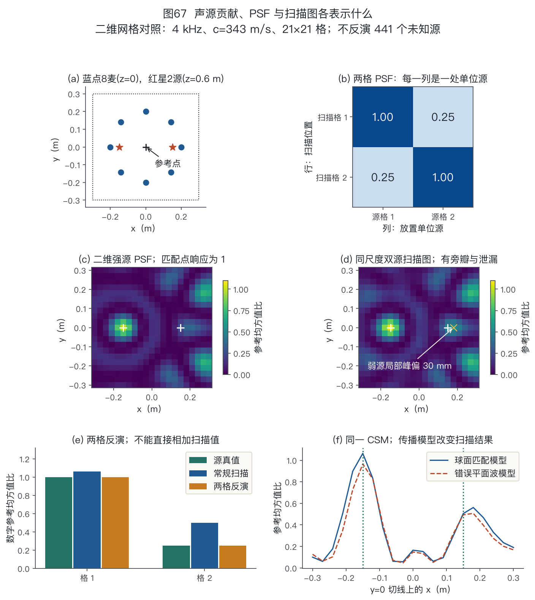
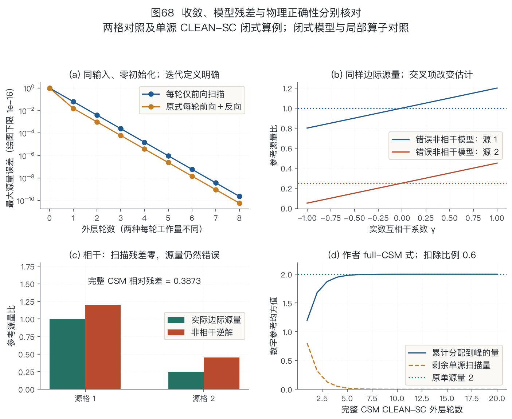
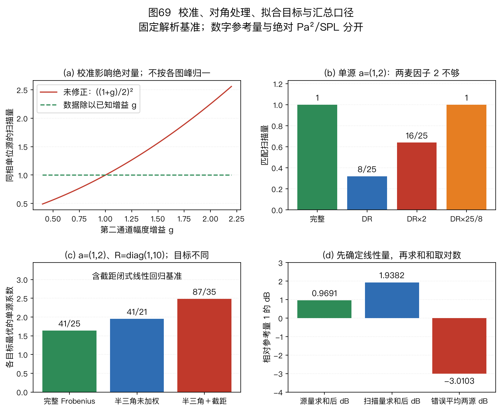
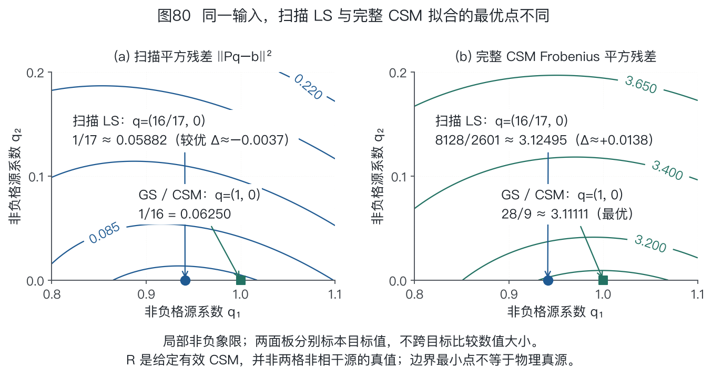

> 本篇是第 12 章（扩展专题Ⅰ），接在第 11 章选型指南之后。数学预备内容可随时回查第 14 章附录 A。
>
> 🏠 首页导读：[00_overview.md](00_overview.md) ｜ 上一篇：[11_selection-guide.md](11_selection-guide.md) ｜ 下一篇：[13_distributed-enhancement.md](13_distributed-enhancement.md)

---

## 第 12 章：声学成像与噪声源诊断

### 12.1 从“声音在哪里”到“哪个区域贡献了多少声音”

#### 一张噪声地图回答什么

运行中的工业设备往往同时辐射轴承摩擦声、冷却风扇气动噪声和壳体结构振动声。如果只看单支麦克风的频谱，我们只能知道某个频带的声压偏高，却无法判断这股能量究竟来自设备的哪一个部位。换用麦克风阵列进行多通道同步采集后，不同空间位置的声源到各支麦克风的传播距离各不相同，各通道信号之间便保留了与几何位置一一对应的幅度比和相位差。

声学成像（Acoustic Imaging）正是利用这组空间幅相差异，在一批候选网格位置上反推与阵列观测相符的声源贡献，并将结果绘制成直观的空间能量分布图。工程上通常用这张“噪声地图”定位优先降噪部位、量化结构改进前后某一区域的辐射变化，或者排查弱声源是否被强声源的旁瓣掩盖。

读图时必须结合背后的声传播模型：图上的一个高亮斑点既可能是真实的物理发声部位，也可能是刚性壁面的镜面反射虚源、落在网格间隙中的声源向邻近格点的能量分摊、扫描平面深度设定错误造成的几何投影偏移，甚至是麦克风通道幅相失配诱发的虚假旁瓣。单纯看热力图斑点“够不够尖锐”，并不能证明声源位置和源强数值准确无误。

#### 与定位、增强和语义成像的区别

[第 4 章](04_doa-estimation.md)的波达方向估计（Direction of Arrival，DOA）主要关心“声源在哪个角度或坐标”；[第 5 章](05_beamforming.md)的波束形成旨在提取目标方向的复数频谱并重建可听的增强波形。本章则利用形式相近的空间加权向量处理通道间的二阶统计量，核心目标是定量估计各候选位置的声源功率分布。同一套阵列硬件和传播模型虽然可以同时服务于这几类任务，但它们的输出量纲与验收准则截然不同：

| 任务 | 主要输出 | 验证时需要什么 |
|---|---|---|
| DOA / 声源定位 | 方向角或三维空间坐标 | 几何位置真值与角度/距离误差统计 |
| 波束形成语音增强 | 时域波形或短时复数频谱 | 干净参考信号、目标失真度与残留噪声口径 |
| 本章的噪声源成像 | 空间源强分布与区域积分量 | 声传播模型、物理量纲、统计假设与积分区域边界 |
| 语义声学成像 | 声事件类别及其空间分布区域 | 类别真值标签、空间区域标注与检测/分割评分协议 |

传统的物理声学成像只根据波动方程反演空间声源强度，输出本身并不带有“风扇”或“轴承”之类的语义标签。把声学热力图叠加到光学相机照片上，只是完成了声学坐标系与像素坐标系的几何配准；若要进一步识别故障部件和诊断机理，仍需结合转速工况、特征阶次频谱、机械结构先验或独立的声事件分类模型。

#### 方法名称与学习顺序

本章围绕互谱矩阵构建、常规波束扫描与三类主流反卷积/拟合算法展开，核心缩写与各自角色如下表所示：

| 缩写 | 英文全称 | 本章中的作用 |
|---|---|---|
| CSM | Cross-Spectral Matrix（互谱矩阵） | 汇集同一频点各麦克风通道自功率谱与互功率谱的二阶统计矩阵 |
| PSF | Point Spread Function（点扩散函数） | 单个单位强度点源经阵列扫描后在整张候选网格上留下的空间响应 |
| DAMAS | Deconvolution Approach for the Mapping of Acoustic Sources（声源映射反卷积算法） | 建立扫描图与源分布的 PSF 线性方程，用带非负截断的逐坐标迭代恢复源强 |
| CLEAN-SC | CLEAN based on spatial Source Coherence（基于空间源相干性的 CLEAN 算法） | 直接从观测 CSM 中提取与当前峰值空间相干的秩一成分并逐轮剥离 |
| CMF | Covariance Matrix Fitting（协方差矩阵拟合） | 绕开波束扫描图，直接用非负源功率字典拟合观测 CSM 的各个元素 |
| NNLS | Non-Negative Least Squares（非负最小二乘） | 在源强非负约束下最小化扫描域或矩阵域平方残差的凸优化框架 |

最顺畅的学习路径是顺着信号处理的因果链条推进：先为每个候选网格点建立球面波传播向量，再从多通道同步录音估计互谱矩阵（CSM），接着用空间权重计算常规波束扫描二次型并看清点扩散函数（PSF）为何产生主瓣与旁瓣，最后进入反演与相干成分剥离。DAMAS、CLEAN-SC 与 CMF 分别改动了这条链路中不同的一环，工程选型时需要对照各自的数学目标与失效条件，而不能只看哪张示例图斑点更细。

#### 先修内容与本篇的量

多通道时延与复指数相位约定可回查[第 2 章 §2.3](02_basics-signal-model.md#sec-2-3)，阵列孔径、差分共阵与通道校准可回查[第 3 章](03_array-geometry.md)，空间内积与匹配波束权重可回查[第 5 章 §5.1](05_beamforming.md#sec-5-1)，Hermitian 半正定矩阵与最小二乘基础见[附录 A §14.3](14_appendix-symbols-math.md#sec-14-3)。

全章沿用全书统一的数学记号：列向量加箭头（如 $\vec x$），矩阵用大写正粗体（如 $\mathbf R$），实转置记为 $^\top$，复共轭转置记为 $^H$。麦克风通道数记为 $M$，候选网格点总数记为 $J$，统计平均所用的快拍数记为 $L$；时域采样下标为 $n$，频点下标为 $k$，帧或快拍下标为 $\ell$。为避免与频点索引 $k$ 混淆，空间波数统一记作 $\kappa = 2\pi f / c$（单位：$\mathrm{rad/m}$）。

在矩阵符号上，候选网格传播矩阵记作 $\mathbf A \in \mathbb{C}^{M \times J}$，点扩散函数矩阵记作 $\mathbf P \in \mathbb{R}^{J \times J}$，观测互谱矩阵记作 $\mathbf R \in \mathbb{C}^{M \times M}$（注意[第 9 章](09_source-tracking.md)卡尔曼滤波中的 $\mathbf P$ 表示状态误差协方差，切勿与本章的 PSF 矩阵混同）。

### 12.2 先给每个候选源一个传播模型

#### 同一频点的多源观测

先固定单个工作频点 $f_k$，把第 $\ell$ 个时间快拍内 $M$ 支麦克风的频域复数系数排成列向量 $\vec x_\ell \in \mathbb{C}^{M \times 1}$。我们在待测区域划分 $J$ 个候选网格点：设第 $j$ 个候选点在第 $\ell$ 个快拍发出的源复数系数为标量 $s_{j,\ell}$，从该点到 $M$ 支麦克风的传播向量（导向向量）为 $\vec a_j \in \mathbb{C}^{M \times 1}$。由声场线性叠加原理，阵列接收向量是全部候选网格贡献与通道加性噪声 $\vec n_\ell \in \mathbb{C}^{M \times 1}$ 的总和：

$$\begin{aligned}
\vec x_\ell&=\sum_{j=1}^{J}\vec a_j s_{j,\ell}+\vec n_\ell\\
&=\mathbf A\vec s_\ell+\vec n_\ell,\\
\mathbf A&=[\vec a_1,\ldots,\vec a_J].
\end{aligned}\tag{12-1}$$

式中 $\vec s_\ell = [s_{1,\ell},\ldots,s_{J,\ell}]^\top \in \mathbb{C}^{J \times 1}$ 汇集了所有网格点的源系数——没有物理声源的空白网格点只需令对应分量 $s_{j,\ell} = 0$。用有限个离散格点去近似连续分布的设备表面是对空间的离散化建模；真实噪声源当然未必刚好落在某个网格交点上，这种“离网格”失配的影响将在 §12.9 专门剖析。

为使推导清爽，后文在单频分析时省去频点索引 $f_k$：凡未特别注明的 $\vec a_j$、权重 $\vec w_i$、互谱矩阵 $\mathbf R$ 和源功率 $q_j$，均默认处在同一频点下。跨频点求解后如何按物理量纲合并成倍频程或宽带总声级，将在 §12.10 展开。

#### 距离衰减与相位的正负

在声学成像中，待测设备往往位于阵列的近场区域，同一声源到达各支麦克风不仅有相位差，还有不可忽略的球面波距离衰减差。假设介质静止均匀（无背景气流）、自由场无遮挡，且声源可近似为各向同性辐射的理想点声源（单极子）。令第 $m$ 支麦克风坐标为 $\vec r_m$，第 $j$ 个候选源网格点坐标为 $\vec p_j$，并选定一个公共参考位置 $\vec r_0$（例如阵列几何中心）。源点到第 $m$ 支麦克风的距离为 $r_{mj} = \|\vec p_j - \vec r_m\|$，到参考点的距离为 $r_{0j} = \|\vec p_j - \vec r_0\|$，二者之差记作相对路程差 $\Delta r_{mj}$（单位均为 $\mathrm{m}$）。相对于该参考点的无量纲传播向量第 $m$ 个分量定义为：

$$\begin{gathered}
\Delta r_{mj}=r_{mj}-r_{0j},\\
a_{mj}(f)=\frac{r_{0j}}{r_{mj}}\exp[-\mathrm{j}\kappa\Delta r_{mj}],\\
\kappa=\frac{2\pi f}{c}.
\end{gathered}\tag{12-2}$$

初学者第一次看到幅度项 $\frac{r_{0j}}{r_{mj}}$ 时，很容易疑惑“为什么分子是参考距 $r_{0j}$、分母才是麦克风距 $r_{mj}$”。我们可以从自由场球面波的反比衰减律一眼看清它的物理来历：点声源辐射的球面波声压幅值与距离成反比（$\propto 1/r$），设比例常数为 $C_j$，则该源在参考点 $\vec r_0$ 处产生的复声压为 $s_j = \frac{C_j}{r_{0j}} e^{-\mathrm{j}\kappa r_{0j}}$，而在第 $m$ 支麦克风处产生的复声压为 $x_{mj} = \frac{C_j}{r_{mj}} e^{-\mathrm{j}\kappa r_{mj}}$。把两式相除消去源端常数 $C_j$，立即得到 $x_{mj} = \frac{r_{0j}}{r_{mj}} e^{-\mathrm{j}\kappa(r_{mj}-r_{0j})} s_j = a_{mj}(f) s_j$。换言之，当我们将待求的源系数 $s_j$ 定义为“该声源独自在参考点 $\vec r_0$ 处贡献的声压”时，如果某支麦克风比参考点离声源更远（$r_{mj} > r_{0j}$），它收到的声压自然比参考点弱，幅度比 $\frac{r_{0j}}{r_{mj}} < 1$；反之若麦克风比参考点更近，幅度比就大于 $1$；而在参考点自身处（$r_{mj} = r_{0j}$），传播系数恰好归一为 $1$（参见 [Sarradj 2012，§2 式(1)～(4)](https://doi.org/10.1155/2012/292695)）。当然，式(12-2)要求 $r_{mj} > 0$，且未计入机体遮挡、地面反射、偶极子/四极子指向性以及风洞剪切层折射。

再核对指数项的正负号：本书全书前向傅里叶变换核统一采用 $e^{-\mathrm{j}2\pi f t}$，因此信号晚到达（正时延 $\tau = \Delta r_{mj}/c > 0$，即 $r_{mj} > r_{0j}$）必然乘上负相位因子 $e^{-\mathrm{j}2\pi f \tau} = e^{-\mathrm{j}\kappa \Delta r_{mj}}$。[第 5 章](05_beamforming.md)远场平面波公式中之所以在正入射角方向看到正指数，是因为位于来波方向前侧的阵元比参考点更早收到波前（$\Delta r_{mj} < 0$），负负得正，两套符号约定完全自洽。

在本章贯穿始终的双麦克风两格手算锚点例中，我们设定第二个候选源到达麦 2 比麦 1 **晚**，对应相位因子为 $e^{-\mathrm{j}2\pi/3}$。如果在代码里不小心把传播向量取了共轭，虽然模平方形式的 PSF 和常规扫描功率看似不变，但互谱矩阵非对角元的虚部会整体反号，一旦与真实录音数据的 FFT 互谱对接就会把声源左右方向彻底颠倒。因此，传播公式、合成音频延迟与互谱共轭方向必须严格锁定同一套约定。

#### 参考位置规定了源量的尺度

公共参考点 $\vec r_0$ 不必非得选在某支实体麦克风上。工程中常选阵列中心作为参考点，以便站在阵列视角公平比较设备表面各处的声压贡献；但要注意，扫描平面边缘格点与中心格点到阵列中心的距离 $r_{0j}$ 并不相等。由于式(12-2)中的传播向量 $\vec a_j$ 已经吸收了无量纲距离比，反演得到的源系数 $s_j$ 便直接继承了参考点处的声压量纲（均方量 $q_j$ 对应参考点处的均方声压 $\mathrm{Pa}^2$）。

如果我们把参考位置从 $\vec r_0$ 挪到另一个位置 $\vec r_1$，物理上各麦克风实际录到的声压 $\vec a_j s_j$ 绝不会因为人类换了一个记账基准而改变。因此，当新传播向量 $\vec a'_j$ 因参考距缩小而变小（或因参考距增大而变大）时，对应定义的源强真值 $s'_j$ 必须按倒数比例反向缩放，保证乘积 $\vec a'_j s'_j = \vec a_j s_j$ 恒等不变。[E12-14](#e12-14) 将用具体三维坐标逐步复算这一尺度守恒关系。

文献和软件中也常见其他几种源强口径，例如源表面的体积速度、将传播列向量强行归一化为单位欧氏范数（$\|\tilde{\vec a}_j\|_2 = 1$）后的系数，或者折算到离每个源各自 $1\,\mathrm{m}$ 处的自由场声压。这些口径本身在数学上都完全合法，但在横向对比不同论文或商业声学相机输出的“源功率（source power）”前，必须先查清其传播列归一化方式并完成显式尺度换算。

### 12.3 从同步录音形成互谱矩阵

#### 一次外积包含什么

声学成像不在单个快拍的瞬时波形上硬解源位置，而是先在频域累积多通道二阶统计量——互谱矩阵（Cross-Spectral Matrix，CSM）。设单频复数观测向量 $\vec x$ 的尺度已经固定，其总体二阶矩矩阵 $\mathbf R$ 与 $L$ 个快拍的样本平均估计 $\hat{\mathbf R}$ 分别为：

$$\begin{aligned}
\mathbf R&=\mathbb{E}[\vec x\vec x^H],\\
\hat{\mathbf R}&=\frac{1}{L}\sum_{\ell=1}^{L}\vec x_\ell\vec x_\ell^H.
\end{aligned}\tag{12-3}$$

不妨写出双通道（$M = 2$）时单个快拍外积 $\vec x_\ell\vec x_\ell^H$ 的具体元素，看看它究竟存了什么信息：

$$\vec x_\ell\vec x_\ell^H=
\begin{pmatrix}
|x_{1,\ell}|^2 & x_{1,\ell}x_{2,\ell}^*\\
x_{2,\ell}x_{1,\ell}^* & |x_{2,\ell}|^2
\end{pmatrix}.$$

主对角线元素 $|x_{1,\ell}|^2$、$|x_{2,\ell}|^2$ 是实非负的各通道自功率，丢失了绝对相位；非对角线元素 $x_{1,\ell}x_{2,\ell}^*$ 与 $x_{2,\ell}x_{1,\ell}^*$ 互为复共轭，它们的模长反映两通道信号幅度的乘积，辐角则精确保存了两通道之间的相对相位差 $\angle x_{1,\ell} - \angle x_{2,\ell}$。若在代码里把共轭转置 $^H$ 误写成普通转置 $^\top$，相位差就会错变成相位和，空间定位信息将荡然无存。

进一步检查样本互谱矩阵 $\hat{\mathbf R}$ 的正定性：任取一个 $M$ 维复向量 $\vec v$，左乘 $\vec v^H$、右乘 $\vec v$ 构成二次型，把求和号提出来可得

$$\begin{aligned}
\vec v^H\hat{\mathbf R}\vec v
&=\frac{1}{L}\sum_{\ell=1}^{L}\vec v^H\vec x_\ell\vec x_\ell^H\vec v\\
&=\frac{1}{L}\sum_{\ell=1}^{L}|\vec v^H\vec x_\ell|^2\ge 0.
\end{aligned}$$

因为每一项都是复数内积的模平方，所以只要保留完整的对角与非对角元素，$\hat{\mathbf R}$ 必然是 Hermitian 半正定矩阵（$\hat{\mathbf R} \succeq 0$）。注意这一性质纯粹由外积平方和结构保证，并不要求这 $L$ 个快拍的样本均值恰好为零；严格来说，式(12-3)定义的是未中心化的二阶矩矩阵，中心化样本协方差还需额外减去均值外积 $\bar{\vec x}\bar{\vec x}^H$（详见[附录 A E14-02](14_appendix-symbols-math.md#sec-u-152b8861e4)）。

#### 峰值复幅度与均方复系数

用正弦波构造校验算例时，最容易出岔子的是“峰值幅度”与“均方根（RMS）幅度”相差的因子 $2$。考虑频率既非直流（DC）也非 Nyquist 端点的实正弦序列 $x[n] = \operatorname{Re}\{z e^{\mathrm{j}\Omega_{\mathrm{d}} n}\}$（其中数字角频率 $\Omega_{\mathrm{d}} = 2\pi f / f_s \in (0,\pi)$，$z$ 为峰值复幅度）。由于余弦平方在整数个周期内的平均值为 $1/2$，该实正弦的时域均方功率等于 $|z|^2 / 2$。为了使式(12-3)算出的 CSM 对角元直接等于时域均方功率，我们可以先定义均方根复系数 $\vec s_\ell = \vec z_\ell / \sqrt{2}$，等价地在外积上除以 $2$：

$$\begin{aligned}
\mathbf R_{\mathrm{tone}}&=\frac{1}{2L}\sum_{\ell=1}^{L}\vec z_\ell\vec z_\ell^H\\
&=\frac{1}{L}\sum_{\ell=1}^{L}\vec s_\ell\vec s_\ell^H.
\end{aligned}\tag{12-4}$$

需要留心的是，除以 $2$ 仅适用于严格位于 $(0, f_s/2)$ 内部的实正弦稳态分量；对于 $f = 0$ 的直流常值序列 $x[n] = A$ 以及偶数帧长下 $f = f_s/2$ 的 Nyquist 交替序列 $x[n] = A(-1)^n$，时域每个采样点的平方都是 $A^2$，均方功率就是 $A^2$ 本身，绝不能再除以 $2$。在本章配套的合成音频中，两个声源的峰值幅度分别设为 $0.2$ 和 $0.1$，按式(12-4)折算后的单源均方功率恰为 $0.2^2/2 = 0.02$ 和 $0.1^2/2 = 0.005$。

#### FFT窗、频率间隔和单边谱

处理真实宽带录音时，通常对每帧 $N$ 点加窗后直接做未归一化的快速傅里叶变换（FFT）。设实分析窗为 $v[n]$（$n = 0,\ldots,N-1$），定义窗能量归一化因子 $U = \sum_{n=0}^{N-1} v[n]^2$，第 $\ell$ 帧加窗后的多通道 FFT 输出记为 $\vec X_\ell[k]$。对实信号而言，负频率信息与正频率共轭对称，工程上普遍采用单边谱（$0 \le k \le \lfloor N/2 \rfloor$）表示单边互功率谱密度 $\mathbf S[k]$ 与单频格均方功率矩阵 $\mathbf R_{\mathrm{bin}}[k]$：

$$\begin{aligned}
\mathbf S[k]&=\frac{\epsilon_k}{L f_s U}\sum_{\ell=1}^{L}\vec X_\ell[k]\vec X_\ell[k]^H,\\
\mathbf R_{\mathrm{bin}}[k]&=\mathbf S[k]\Delta f,\\
\Delta f&=\frac{f_s}{N}.
\end{aligned}\tag{12-5}$$

式中单边折叠因子在内部正频点（$1 \le k < N/2$）取 $\epsilon_k = 2$，以把对称负频格的能量合拢过来；而在直流点（$k = 0$）以及偶数 $N$ 的 Nyquist 点（$k = N/2$）没有独立的共轭伙伴，故取 $\epsilon_k = 1$。若输入信号已完成声压灵敏度校准（单位 $\mathrm{Pa}$），则互功率谱密度 $\mathbf S[k]$ 的量纲为 $\mathrm{Pa}^2/\mathrm{Hz}$，乘上频格宽度 $\Delta f$ 后的单频格均方功率矩阵 $\mathbf R_{\mathrm{bin}}[k]$ 量纲为 $\mathrm{Pa}^2$；若输入是未标定的数字音频，则对应数字满量程幅度平方单位。

这里务必区分两类常见的窗归一化常数：千万不能把窗幅度之和 $S_1 = \sum_{n=0}^{N-1} v[n]$ 误填进式(12-5)的分母替代窗平方和 $U$。$S_1$ 用于读取孤立单频正弦峰值的幅度校准，而 $U$ 才保证宽带随机信号或跨频格积分时的总均方功率守恒。加非矩形窗会把单根正弦谱线的能量摊分到中心频格及两侧相邻频格中，导致中心单格数值低于原正弦总功率，但这并非能量丢失——只要把相邻受影响频格的 $\mathbf R_{\mathrm{bin}}[k]$ 相加，总功率依然精确还原（[E12-13](#e12-13) 将用 $24$ 点矩形窗与周期 Hann 窗逐格手算核对）。

对任意第 $m$ 路麦克风，把全部单边频格的对角元相加，由离散傅里叶变换的 Parseval 定理可以直接验证时频功率关系：

$$\sum_{k=0}^{\lfloor N/2\rfloor} [\mathbf R_{\mathrm{bin}}[k]]_{mm}
=\frac{1}{LU}\sum_{\ell=1}^{L}\sum_{n=0}^{N-1}v[n]^2|x_{m,\ell}[n]|^2.$$

等式右边表明，单边谱全频带积分精确等于时域信号的**窗平方加权均方值**。当采用矩形窗（$v[n] = 1, U = N$）时，它退化为普通的样本均方功率；而对非平稳瞬态信号改用锥形窗时，两者完全可能不同。

我们可以举一个极简的四点瞬态例子看清这一点：取 $N = 4$ 的周期 Hann 窗 $v = [0, 1/2, 1, 1/2]$，其窗平方和为 $U = 0 + 1/4 + 1 + 1/4 = 3/2$。倘若一个单位冲激信号恰好落在第 $0$ 点（即 $x = [1, 0, 0, 0]$），或者落在窗中心的第 $2$ 点（即 $x = [0, 0, 1, 0]$），两者的普通帧均方功率都是 $1/4$；然而按式(12-5)把单边谱加起来，前者结果为 $0$，后者结果却变为 $1 / (3/2) = 2/3$。前者为零是因为瞬态脉冲刚好撞在窗函数两端的零值死区里被彻底遮蔽（这也是工程上处理非平稳信号必须配合 $50\%$～$75\%$ 帧重叠的原因），绝不是 FFT 计算丢了功率。此外，对不同通道 $m \ne m'$，单边互谱的非对角元保留了正频率复相位，虚部通常非零；若想从单边谱还原两个实信号的零时延互相关，只需对全频带单边互谱之和取实部，因为正负频率的虚部在双边求和时恰好正负抵消。

#### 非相干源假设发生在哪一步

现在把式(12-1)的多源观测模型 $\vec x = \mathbf A\vec s + \vec n$ 代入总体二阶矩 $\mathbf R = \mathbb{E}[\vec x\vec x^H]$。展开乘积时会出现源与噪声的交叉项 $\mathbf A\mathbb{E}[\vec s\vec n^H]$ 与 $\mathbb{E}[\vec n\vec s^H]\mathbf A^H$。当源信号与加性噪声满足二阶正交条件 $\mathbb{E}[\vec s\vec n^H] = \mathbf 0$（例如零均值且统计不相关；注意若两者均值皆非零，仅中心化协方差为零还不足以令未中心化交叉二阶矩为零）时，源噪交叉项消去，得到 $\mathbf R = \mathbf A\mathbf R_s\mathbf A^H + \mathbf R_n$，其中 $\mathbf R_s = \mathbb{E}[\vec s\vec s^H]$ 为 $J \times J$ 的源互谱矩阵。

常规波束扫描与标准 DAMAS、CMF 算法的核心物理假设就在下一步——假定不同位置上的声源彼此**互不相干（incoherent）**，即对任意 $j \ne h$ 都有互谱 $R_{s,jh} = \mathbb{E}[s_j s_h^*] = 0$。只有在这条假设成立时，$\mathbf R_s = \operatorname{diag}(q_1,\ldots,q_J)$ 才退化为实非负对角阵，观测 CSM 才能拆成各个候选源秩一模板的非负线性叠加：

$$\begin{aligned}
\mathbf R&=\sum_{j=1}^{J}q_j\vec a_j\vec a_j^H+\mathbf R_n,\\
q_j&=\mathbb{E}[|s_j|^2]\ge 0.
\end{aligned}\tag{12-6}$$

一旦不同位置的发声体由同一根转轴激励，或者声源发出的直达声经过地面、风洞壁面反射形成强相干镜像源，源互谱矩阵就会多出非零交叉项 $R_{s,jh}\vec a_j\vec a_h^H + R_{s,jh}^*\vec a_h\vec a_j^H$（$j \ne h$）。这些复数干涉项既可能在空间某处相长叠加，也可能相消抵消，绝不能等效成若干个非负独立点源的功率简单相加。

还要区分“总体统计不相干”与“有限快拍样本互谱为零”：哪怕两个随机声源在理论上严格独立，有限个快拍算出的样本互谱也会围绕零值存在随机涨落；拉长平均时间能压低涨落，但高度重叠的 STFT 帧并非统计独立快拍。反之，在教学合成音频中通过人为设计跨块交替相位让 $20$ 个快拍的样本互谱精确相消为零，也只是一种便于剥离变量验证公式的确定性正交编码，不能反过来当作真实随机声源相互独立的证据（[E12-04](#e12-04) 将专门对比单帧完全相干与跨帧编码抵消的本质差异）。

### 12.4 扫描图为什么出现主瓣和旁瓣

#### 从复数输出到扫描二次型

有了观测互谱矩阵 $\mathbf R$，我们像探照灯一样逐个扫描第 $i$ 个候选网格点（$i = 1,\ldots,J$）。用针对第 $i$ 格设计的空间滤波权重 $\vec w_i \in \mathbb{C}^{M \times 1}$ 对接收信号做共轭内积，得到标量波束输出 $y_i = \vec w_i^H\vec x$，再求它的均方功率 $b_i$：

$$\begin{aligned}
b_i&=\mathbb{E}[|y_i|^2]\\
&=\mathbb{E}[(\vec w_i^H\vec x)(\vec x^H\vec w_i)]\\
&=\vec w_i^H\mathbb{E}[\vec x\vec x^H]\vec w_i\\
&=\vec w_i^H\mathbf R\vec w_i.
\end{aligned}\tag{12-7}$$

核对一下矩阵乘法维度：$(1 \times M)(M \times M)(M \times 1)$ 恰好缩并成一个标量。由于完整的互谱矩阵 $\mathbf R$ 是 Hermitian 半正定矩阵，二次型 $b_i$ 在理论上必为非负实数；浮点计算中因舍入误差可能残留 $10^{-16}$ 量级的微小虚部（取实部即可），但若出现显著的虚部或负功率，则说明上游互谱构造有误，或者人为执行了 §12.8 将要讨论的对角删除操作。

为了使扫描输出功率直接对齐参考点源强口径，本章常规波束扫描采用**单位匹配响应权重**（即保证当第 $i$ 格单独存在单位源量时，无噪扫描输出恰好等于 $1$）：

$$\begin{aligned}
\vec w_i&=\frac{\vec a_i}{\vec a_i^H\vec a_i},\\
\vec w_i^H\vec a_i&=\frac{\vec a_i^H\vec a_i}{\vec a_i^H\vec a_i}=1.
\end{aligned}\tag{12-8}$$

利用这条归一化性质，倘若空间里真的只有第 $i$ 格存在一个功率为 $q_i$ 的单源且无噪声（$\mathbf R = q_i\vec a_i\vec a_i^H$），扫描第 $i$ 格就准确读出 $b_i = q_i|\vec w_i^H\vec a_i|^2 = q_i$。在各通道等幅的远场平面波模型（$|a_{mi}| = 1$）下，分母 $\vec a_i^H\vec a_i = M$，式(12-8)便退化为我们熟悉的第 5 章延迟求和权重 $\vec a_i / M$。若背景中还叠有各通道等方差的空间白噪声 $\mathbf R_n = \sigma^2\mathbf I$，它在第 $i$ 格扫描值上附加的底噪偏置为 $\sigma^2\|\vec w_i\|_2^2 = \sigma^2 / (\vec a_i^H\vec a_i)$（例如等幅双麦时为 $\sigma^2 / 2$）。

#### 匹配点单位响应不保证三维峰位

初学者很容易产生一个错觉：既然式(12-8)在真实源位置 $\vec p_j$ 处已经做到了完美相位对齐和单位幅度响应，那么在三维空间里到处扫描时，最大值难道不就一定出现在真实源位置 $\vec p_j$ 吗？在近场球面波模型下，答案是否定的！原因在于：当我们改变扫描点的纵向深度（离阵列的远近）时，式(12-2)传播向量的相位和距离衰减幅度会同时变化，式(12-8)分母中的 $\|\vec a_i\|_2^2$ 也会跟着扫描深度剧烈缩放——往远处扫描时 $\|\vec a_i\|_2$ 变小，权重范数 $\|\vec w_i\|_2 = 1/\|\vec a_i\|_2$ 反而被放大，完全可能把更深处的扫描输出垫得比真实源位置还要高。

Sarradj 在三维声源映射研究中系统对比了四类常见导向权重约定：只补偿相位、补偿相位与幅度以保证真实位置源强准确（即式(12-8)，Sarradj Formulation III）、保证无噪单源三维扫描峰值落在真实位置但牺牲源强绝对尺度（单位范数权重 $\vec a_i / \|\vec a_i\|_2$，Formulation IV），以及另两种折中归一化形式。严格的单源代数分析表明，没有任何一种固定的常规波束权重能够在近场三维未知深度扫描中无条件同时满足“峰值位置无偏”与“源强读数无偏”这两项要求（参见 [Sarradj 2012，§2.1～2.5 式(7)～(13)](https://doi.org/10.1155/2012/292695)）。

正因如此，工程上对表面基本平坦的待测设备成像时，通常先用激光测距或结构图纸把扫描网格固定在已知的二维发声平面上，此时采用式(12-8)既能看清横向分布又能保持源强物理尺度；若直接把同一套权重搬去扫描纵向深度未知的三维空间，则必须额外评估深度拉偏与权重放大效应。

#### 一个单位源的整张图是PSF

为什么真实空间只有两个离散点声源，常规波束扫描画出来的热力图却是大片弥散的光斑，甚至还会冒出虚假的旁瓣亮区？把式(12-6)的非相干多源互谱矩阵代入式(12-7)的扫描二次型，答案便一目了然：

$$\begin{aligned}
b_i&=\vec w_i^H\left(\sum_{j=1}^{J}q_j\vec a_j\vec a_j^H+\mathbf R_n\right)\vec w_i\\
&=\sum_{j=1}^{J}q_j(\vec w_i^H\vec a_j)(\vec a_j^H\vec w_i)+b_{n,i}\\
&=\sum_{j=1}^{J}q_j|\vec w_i^H\vec a_j|^2+b_{n,i},\\
P_{ij}&=|\vec w_i^H\vec a_j|^2,\qquad b_{n,i}=\vec w_i^H\mathbf R_n\vec w_i,\\
\vec b&=\mathbf P\vec q+\vec b_n.
\end{aligned}\tag{12-9}$$

仔细端详耦合系数 $P_{ij} = |\vec w_i^H\vec a_j|^2$ 的两个下标：第 $2$ 个下标 $j$ 是**真实声源所在的网格列号**，第 $1$ 个下标 $i$ 是**波束正在观察的扫描行号**。如果我们在第 $j$ 格单独放一个单位功率声源（$q_j = 1$，其余格为零且无噪声），它经阵列扫描后在全部 $J$ 个格点上留下的图像刚好就是矩阵 $\mathbf P$ 的**第 $j$ 列**——这一列就称为第 $j$ 格的点扩散函数（Point Spread Function，PSF）。反过来，固定第 $i$ 行横向看过去，$b_i = \sum_{j=1}^J P_{ij} q_j + b_{n,i}$ 则揭示了第 $i$ 个扫描点的读数是如何被全场所有真实声源的泄漏能量叠加污染的。

在式(12-8)的匹配权重与完整 CSM 下，主对角元恒为 $P_{ii} = |\vec w_i^H\vec a_i|^2 = 1$，所有元素满足 $P_{ij} \ge 0$。由于麦克风阵列的孔径和阵元数有限，不同格点的传播向量 $\vec a_i$ 与 $\vec a_j$ 不可能处处正交，因此 $P_{ij}$ 在源点附近形成宽窄有限的**主瓣**，在远离源点的其他网格上还会因空间混叠或有限阵元周期性长出**旁瓣**。更关键的是，在近场球面波或大张角扫描面上，不同位置声源的 PSF 形状随 $j$ 改变（不再满足光学成像中常见的空间平移不变性），所以式(12-9)是一个一般的矩阵乘法线性系统，不能简单套用二维 FFT 循环反卷积求解。

#### 两个格点的完整手算

为了把抽象的矩阵符号彻底踩实，我们建立一个贯穿本章各节对比的锚点手算算例：**输入与口径**取双麦克风（$M = 2$）、两个候选网格点（$J = 2$），无量纲传播向量、匹配权重与非相干真实源均方功率分别为：

$$\begin{aligned}
\vec a_1&=\begin{pmatrix}1\\1\end{pmatrix},\qquad
\vec a_2=\begin{pmatrix}1\\e^{-\mathrm{j}2\pi/3}\end{pmatrix},\\
\vec w_i&=\frac{\vec a_i}{2}\quad(i=1,2),\qquad
\vec q=\begin{pmatrix}1\\1/4\end{pmatrix}.
\end{aligned}\tag{12-10}$$

**逐步代入与中间数字**：先求两个格点之间的复数交叉响应 $\vec w_1^H\vec a_2$。注意 $e^{-\mathrm{j}2\pi/3} = -\frac{1}{2} - \mathrm{j}\frac{\sqrt{3}}{2}$，代入共轭内积得

$$\vec w_1^H\vec a_2=\frac{1}{2}\left(1+e^{-\mathrm{j}2\pi/3}\right)=\frac{1}{2}\left(\frac{1}{2}-\mathrm{j}\frac{\sqrt{3}}{2}\right)=\frac{1}{4}-\mathrm{j}\frac{\sqrt{3}}{4}.$$

取模平方可得非对角耦合系数 $P_{12} = |1/4 - \mathrm{j}\sqrt{3}/4|^2 = 1/16 + 3/16 = 1/4$；同理 $P_{21} = |\vec w_2^H\vec a_1|^2 = |\vec a_1^H\vec w_2|^2 = 1/4$。假设无传感器噪声（$\vec b_n = \vec 0$），**最终结果**为：

$$\begin{aligned}
\mathbf P&=\begin{pmatrix}1&1/4\\1/4&1\end{pmatrix},\\
\vec b&=\mathbf P\vec q
=\begin{pmatrix}1\times 1 + \frac{1}{4}\times\frac{1}{4}\\\frac{1}{4}\times 1 + 1\times\frac{1}{4}\end{pmatrix}
=\begin{pmatrix}17/16\\1/2\end{pmatrix}.
\end{aligned}\tag{12-11}$$

**这个算例能说明什么与何时失效**：看扫描结果 $\vec b = [17/16, 1/2]^\top = [1.0625, 0.5]^\top$——第 $1$ 格的真实源功率明明是 $1$，扫描读数却虚高到 $17/16$（多出的 $1/16$ 来自第 $2$ 源的泄漏）；第 $2$ 格更严重，真实源功率只有 $1/4 = 0.25$，但强源泄漏过来的 $\frac{1}{4}\times 1 = 1/4$ 跟它自身一样大，把第 $2$ 格读数直接翻倍垫高到了 $1/2$！如果工程师直接把扫描图上两个格点的数值加起来当作设备总辐射量，会算出 $17/16 + 8/16 = 25/16 = 1.5625$，比真实总源量 $1 + 1/4 = 5/4 = 1.25$ 凭空多算了 $25\%$。这多出来的 $5/16$ 纯粹是两个扫描波束空间重叠导致的重复计账，绝不是设备多辐射了声能。同时也要记住，式(12-11)之所以能直接用 $\mathbf P\vec q$ 算出扫描图，完全建立在两源互不相干、真实源恰好落在两格上且传播向量无误差的前提之上。



图 67 将两格解析手算与一个二维近场平面算例放在一起，帮我们把“真实源分布、单源 PSF 与多源常规扫描图”三者的关系一次看透（所有量均按共同参考源强归一化）：

- **子图 (a) 阵列与源面几何**：蓝色圆点为平面 $z = 0$ 上半径 $0.2\,\mathrm{m}$ 的 $8$ 麦克风均匀圆环阵，原点黑色十字为公共参考点；虚线框标出距离阵列 $z = 0.6\,\mathrm{m}$ 处的 $21 \times 21 = 441$ 点二维扫描网格（$x, y \in [-0.3, 0.3]\,\mathrm{m}$，步长 $0.03\,\mathrm{m}$），两颗红星分别标出左侧强源 $(-0.15, 0, 0.6)\,\mathrm{m}$（源量 $1.0$）和右侧弱源 $(0.15, 0, 0.6)\,\mathrm{m}$（源量 $0.25$）。
- **子图 (b) 两格 PSF 矩阵**：对应式(12-11)的 $2 \times 2$ 矩阵热力块，每一列代表在对应源格放一个单位源时各扫描格收到的响应——主对角线为 $1.00$，非对角线为 $0.25$ 的跨格串扰。
- **子图 (c) 二维强源 PSF**：在 $4\,\mathrm{kHz}$（$c = 343\,\mathrm{m/s}$）下单独点亮左侧强源时整张 $441$ 格扫描面的归一化响应。左侧白色十字真值处匹配响应精确为 $1$，但有限圆阵孔径不仅在周围产生宽阔的主瓣光斑，还在画面右侧和上下边缘激发出明显的弧形旁瓣，其中右侧白色十字（弱源待测位）已被垫起约 $0.255$ 的泄漏底色。
- **子图 (d) 双源叠加常规扫描图**：同时点亮非相干的强源（$1.0$）和弱源（$0.25$）后，强源旁瓣的斜坡叠加在弱源主瓣上，把右侧局部极大值（黄色叉号）向右推偏了一个网格步长（$30\,\mathrm{mm}$，落到 $x = 0.18\,\mathrm{m}$），直观展示了即使两个声源都精确位于网格交点上，常规波束扫描的局部峰值也未必对准弱源真值（详见 [E12-06](#e12-06)）。
- **子图 (e) 两格反演与总量对比**：对比格 $1$ 和格 $2$ 上的源真值（绿柱：$1.00, 0.25$）、常规扫描值（蓝柱：$1.0625, 0.50$）以及两格反演恢复值（橙柱：$1.00, 0.25$），一眼可见常规扫描会系统性高估各格读数，绝不能直接把整张扫描图的像素值相加当作源强总和。
- **子图 (f) 传播模型失配剖面**：沿 $y = 0$ 水平切线截取扫描曲线，保持同一份近场球面波观测 CSM 不变，蓝色实线采用匹配的球面波传播向量式(12-2)，红色虚线改用忽略距离比与球面曲率的远场平面波权重——可以看到错误套用平面波模型会明显压低主峰读数并扭曲空间剖面。

### 12.5 从PSF方程学习DAMAS与NNLS

#### 为什么需要非负反演

算出点扩散函数矩阵 $\mathbf P$ 和常规扫描图 $\vec b$ 后，我们的目标是逆向求解真实网格源功率向量 $\vec q$。首先写出无噪线性模型 $\mathbf P\vec q = \vec b$ 的第 $i$ 行，把对角自响应项与其余格点的跨格串扰项拆开：

$$P_{ii}q_i+\sum_{j\ne i}P_{ij}q_j=b_i\quad\Longrightarrow\quad q_i=\frac{b_i-\sum_{j\ne i}P_{ij}q_j}{P_{ii}}.$$

在式(12-11)这样条件良好的 $2 \times 2$ 理想算例里，$\mathbf P$ 满秩可逆且观测无误差，直接求线性逆 $\mathbf P^{-1}\vec b$ 就能精确还原 $[1, 1/4]^\top$。然而到了真实声学成像中，直接求逆立刻会撞上两堵墙：第一，候选网格点数 $J$ 动辄成百上千（例如图 67 中的 $J = 441$），而 $M$ 支麦克风的互谱矩阵最多只有 $M^2$ 个实线性独立自由度（当 $J \gg M^2$ 时，$\mathbf P$ 必然严重秩亏，存在无穷多组线性解）；第二，相邻细密网格的传播列高度近似，矩阵极度病态，哪怕混入微小的有限快拍统计涨落或几何误差，无约束线性逆或伪逆也会把误差剧烈放大，在相邻格点上产生正负交替振荡——一边算出很大的正功率，紧挨着的格点却算出物理上荒谬的**负声源功率**，用正负抵消去硬凑扫描图。

回看式(12-6)的定义，独立声源均方功率 $q_j = \mathbb{E}[|s_j|^2]$ 在物理上绝不可能小于零（相干干涉交叉项并不属于独立源功率模型）。Brooks 与 Humphreys 提出的 DAMAS 算法正是抓住了这条物理底线：用上面的逐行移项关系配合每次更新后的**非负截断**，避免无约束求逆的正负振荡，在稀疏源场中剥离旁瓣污染（以下推导沿用本章符号，对应 [Brooks 与 Humphreys 2004 原论文式(18)、(23)、(24)](https://ntrs.nasa.gov/api/citations/20080015889/downloads/20080015889.pdf)）。

#### 原DAMAS一轮包含两个更新方向

DAMAS 从全零初值 $\vec q^{(0)} = \vec 0$ 起步，按网格索引做逐坐标迭代。先看从 $i = 1$ 到 $J$ 的一次前向单向遍历（sweep）：轮到更新第 $i$ 个网格分量时，其余格点采用当前最新可用的估计值 $\tilde q_j$——编号排在前面的格点（$j < i$）已经在本轮算出了新值，编号排在后面的格点（$j > i$）仍暂用上一轮留下的旧值：

$$\tilde q_j=
\begin{cases}
q_j^{\mathrm{new}},&j<i,\\
q_j^{\mathrm{old}},&j>i.
\end{cases}$$

我们先把其余所有格点泄漏到第 $i$ 格的扫描贡献从观测扫描值 $b_i$ 中扣掉，得到净余量 $t_i$；再除以自响应 $P_{ii}$，并将任何小于零的结果直接截断为零：

$$\begin{aligned}
t_i&=b_i-\sum_{j\ne i}P_{ij}\tilde q_j,\\
q_i&\leftarrow\max\left\{0,\frac{t_i}{P_{ii}}\right\}.
\end{aligned}\tag{12-12}$$

这种“每算出一个新分量就立刻投入下一个分量计算”的就地更新策略，在数值代数上属于带投影截断的 Gauss–Seidel（GS）迭代。

阅读开源代码时需要留意迭代方向的定义：为消除网格编号顺序带来的方向偏置，Brooks 与 Humphreys 在原论文中明确规定，**完整的一轮 DAMAS 迭代包含正向与反向两次单向遍历**——先从 $1$ 到 $J$ 前向遍历一遍，紧接着从 $J$ 到 $1$ 反向遍历一遍（反向遍历时 $j > i$ 的分量已更新为新值，$j < i$ 的分量尚保持前向遍历结束时的值）。如果教学演示只跑了从 $1$ 到 $J$ 的单程更新，应当准确称为“一次前向遍历”，而不能与原论文的“一轮双向迭代”混为一谈；本书数值核对两种遍历方式分别予以支持和记录。

#### 三次前向sweep的中间数

我们把式(12-11)的两格算例（$P_{11} = P_{22} = 1$，$P_{12} = P_{21} = 1/4$，$\vec b = [17/16, 1/2]^\top$）一步步代进式(12-12)，手算前三次前向单向遍历，亲眼看看旁瓣污染是怎样被逐次剥掉的：

- **第 1 次前向遍历**：初值 $q_1^{(0)} = 0, q_2^{(0)} = 0$。先算第 $1$ 格：$q_1^{(1)} = 17/16 - \frac{1}{4}\times 0 = 17/16$；立刻拿这个新值去扣第 $2$ 格的串扰：$t_2 = 1/2 - \frac{1}{4}\times\frac{17}{16} = \frac{32 - 17}{64} = 15/64 > 0$，故 $q_2^{(1)} = 15/64$。
- **第 2 次前向遍历**：用刚算出的 $q_2^{(1)} = 15/64$ 修正第 $1$ 格：$q_1^{(2)} = 17/16 - \frac{1}{4}\times\frac{15}{64} = \frac{272 - 15}{256} = 257/256$；再用 $q_1^{(2)}$ 更新第 $2$ 格：$q_2^{(2)} = 1/2 - \frac{1}{4}\times\frac{257}{256} = \frac{512 - 257}{1024} = 255/1024$。
- **第 3 次前向遍历**：同理算出 $q_1^{(3)} = 17/16 - \frac{1}{4}\times\frac{255}{1024} = 4097/4096$，$q_2^{(3)} = 1/2 - \frac{1}{4}\times\frac{4097}{4096} = 4095/16384$。

| 前向单向遍历次数 | $q_1$ | $q_2$ |
|---|---:|---:|
| 1 | $17/16 = 1.0625$ | $15/64 = 0.234375$ |
| 2 | $257/256 = 1.00390625$ | $255/1024 = 0.2490234375$ |
| 3 | $4097/4096 \approx 1.00024414$ | $4095/16384 \approx 0.24993896$ |

仅仅三次单向遍历，估计值就已经逼近真值 $[1, 0.25]^\top$ 到万分之三以内——这是因为本例非对角耦合只有 $1/4$，每轮串联更新把误差压缩为原来的 $(1/4)^2 = 1/16$。倘若把两个候选网格拉得很近，使非对角耦合升至 $0.99$，每轮误差衰减因子就会恶化到 $0.99^2 = 0.9801$，迭代收敛将变得极其缓慢（见 [E12-03](#e12-03)）。因此工程实现必须同时监控迭代轮数、相邻轮源量改变量与残差范数：跑满预设最大轮数不代表已经收敛，相邻两轮步长很小也可能只是病态方向上的缓慢爬行。

#### 扫描域NNLS改变了目标

既然 $\mathbf P\vec q = \vec b$ 在有噪声或模型失配时无法精确成立，另一种非常自然的思路是直接把问题写成一个标准的凸优化问题——**扫描域非负最小二乘（NNLS）**，显式最小化整张扫描图的欧氏平方残差：

$$\min_{\vec q\ge 0}\;\frac{1}{2}\|\mathbf P\vec q-\vec b\|_2^2.
\tag{12-13}$$

记目标函数关于 $\vec q$ 的梯度为 $\vec g = \mathbf P^\top(\mathbf P\vec q - \vec b)$。没有非负约束时，最优点只需令梯度等于零（$\vec g = \vec 0$）；加上硬边界 $\vec q \ge 0$ 后，怎样的解才算真正到达了谷底？我们可以借助一维开口向上的抛物线撞上“$q_i \ge 0$ 左墙”的几何图像，直观读懂它的 Karush–Kuhn–Tucker（KKT）一阶最优条件：

- **情形一（谷底落在正半轴内部，$q_i > 0$）**：在保持其余坐标不变时，若第 $i$ 个分量处于严格大于零的内部，左移一点和右移一点都是合法的；要想成为最低点，抛物线在该处的切线斜率必须水平，即梯度分量必为零（$g_i = 0$）。
- **情形二（无约束谷底跑到负半轴墙外，被挡在边界 $q_i = 0$ 上）**：此时合法可行域只允许向右（增大 $q_i > 0$）移动；要想 $q_i = 0$ 成为可行域内的最低点，向右走时函数值必须上升（或至少不下降），这意味着墙边的切线斜率必须非负（$g_i \ge 0$）。倘若在 $q_i = 0$ 处斜率 $g_i < 0$，往正半轴迈一小步就能让残差继续减小，说明还没到最优点。

把这两种情形合在一起，每个坐标 $i$ 都必须满足非负性、梯度非负性，且“坐标值 $q_i$ 与梯度分量 $g_i$ 至少有一个为零”（即互补松弛条件）：

$$\begin{gathered}
\vec q\ge 0,\qquad \vec g\ge 0,\\
q_i g_i=0\quad\text{对每个 }i=1,\ldots,J.
\end{gathered}\tag{12-14}$$

很多初学者误以为 DAMAS 的截断 GS 迭代就是在求解式(12-13)的扫描域 NNLS，其实不然！我们只需看一个极简反例：仍用式(12-11)的 $\mathbf P$，但取扫描观测 $\vec b = [1, 0]^\top$。按式(12-12)做 DAMAS 更新，从零出发第一步得 $q_1 = 1$、$q_2 = \max(0, -1/4) = 0$，此后永远停在固定点 $[1, 0]^\top$ 上，扫描平方残差 $\|\mathbf P\vec q - \vec b\|_2^2 = 1/16 \approx 0.0625$；而按式(12-14)求解扫描域 NNLS（[E12-08](#e12-08)），因为把 $q_1$ 稍微调小一点虽然在第一格付出微小代价，却能显著压低泄漏到第二格的残差，真正最小点落在 $[16/17, 0]^\top$，扫描平方残差降为 $1/17 \approx 0.0588$。这提醒我们：DAMAS 固定点对应的并不是式(12-13)（它在完整 CSM 下真正对应的凸目标将在 §12.7 揭晓），讨论反演结果前必须先指明所最小化的数学代价函数。

### 12.6 CLEAN-SC如何逐次扣除相干成分

#### 峰值与其相干通道结构

DAMAS 与扫描域 NNLS 都把整张扫描图的理论 PSF 矩阵 $\mathbf P$ 当作已知真值：一旦风洞壁面存在弱反射、阵列某几个通道有轻微幅相误差，理论算出的自由场旁瓣形状跟实际观测中的旁瓣对不上，反卷积就会把未扣干净的真实旁瓣误判成新的噪声源。Sijtsma 提出的 CLEAN-SC（基于空间源相干性的 CLEAN 算法）换了一条巧妙的路线：不再查表套用理论自由场旁瓣，而是顺着当前扫描主峰，直接从观测互谱矩阵里把**与该峰值输出空间完全相干的整套实际通道结构**“钓”出来一并剥离（参见 [Sijtsma 2007，NLR-TP-2007-345 §2.4、§4.6](https://reports.nlr.nl/server/api/core/bitstreams/813b0521-b37c-4aff-be61-7a8bceaa06d4/content)）。当然，找主峰这一步依然依赖导向权重 $\vec w_i$，因此严重的几何定位失配并不会凭空消失。

我们先在**完整 CSM**（不删对角元）下讲透它的核心代数机制。记当前轮尚未剥离的残差互谱矩阵为 $\mathbf D$（初值 $\mathbf D^{(0)} = \hat{\mathbf R}$）。扫描全场找到最大峰值所在的网格下标 $p$ 及其扫描峰值 $B = \vec w_p^H\mathbf D\vec w_p > 0$，给定无量纲的循环增益（loop gain，即每轮剥离比例）$0 < \phi \le 1$，单轮更新公式只有四行：

$$\begin{aligned}
B&=\vec w_p^H\mathbf D\vec w_p,\\
\vec h&=\frac{\mathbf D\vec w_p}{B},\\
\mathbf G&=B\vec h\vec h^H,\\
\mathbf D_{\mathrm{next}}&=\mathbf D-\phi\mathbf G.
\end{aligned}\tag{12-15}$$

为什么 $\vec h = \mathbf D\vec w_p / B$ 这一步能从混杂的观测矩阵里把主导声源的真实传播向量“钓”出来？让我们拆开物理图景看一看：假设残差矩阵 $\mathbf D$ 由位于 $p$ 处的强源真实秩一贡献 $q_p\vec g_p\vec g_p^H$（这里 $\vec g_p$ 是包含真实传播微扰甚至弱相干反射的实际通道导向向量，按匹配尺度满足 $\vec w_p^H\vec g_p = 1$）与其余互不相干的弱源/背景项 $\mathbf D_{\mathrm{other}}$ 组成。当我们拿峰值波束权重 $\vec w_p$ 从右边去乘 $\mathbf D$ 时，本质上是在计算各支麦克风原始信号 $x_m$ 与峰值波束输出 $y_p = \vec w_p^H\vec x$ 之间的互相关向量 $\mathbb{E}[\vec x y_p^*] = \mathbf D\vec w_p$：如果波束主瓣已经较好地压制了其他方向的弱源（使 $\mathbf D_{\mathrm{other}}\vec w_p \approx \vec 0$），那么

$$\mathbf D\vec w_p \approx q_p\vec g_p(\vec g_p^H\vec w_p) = q_p\vec g_p,\qquad B = \vec w_p^H\mathbf D\vec w_p \approx q_p|\vec w_p^H\vec g_p|^2 = q_p.$$

两者一除，$\vec h = \mathbf D\vec w_p / B \approx \vec g_p$ 便顺着峰值波束这根“鱼线”，把强源在全部 $M$ 支麦克风上的真实复数幅相结构原原本本地提了出来！随后构造秩一矩阵 $\mathbf G = B\vec h\vec h^H$ 并从 $\mathbf D$ 中扣去 $\phi\mathbf G$，强源连同它在实际通道下产生的一切真实旁瓣就同步消退了。工程上常取较保守的循环增益（如 $\phi = 0.5$ 或 $0.6$），分多轮稳健剥离；注意每轮在“干净源图（clean map）”的峰位 $p$ 上累加记账的功率也必须是实际扣掉的份额 $\phi B$，绝不能只扣一半矩阵却记满额 $B$。

实现迭代终止逻辑时，若所有网格剩余扫描值已降至零（或触及相对停止阈值、最大迭代轮数），必须立即停机而不能继续除以零峰值 $B$；数值容差仅用于过滤浮点舍入噪声，不可将明显非半正定的异常输入矩阵强行当作合法 CSM 处理。

#### 为什么完整CSM扣除后仍可半正定

一个非常漂亮的性质是：只要当前残差矩阵 $\mathbf D \succeq 0$ 是 Hermitian 半正定的，按式(12-15)扣掉相干秩一成分后，无论各源是否存在串扰，下一轮残差矩阵依然严格保持半正定，绝不会扣出负特征值。我们来一步步完成这个简短而严密的代数证明：首先注意到 $\vec w_p^H\vec h = \vec w_p^H\mathbf D\vec w_p / B = B / B = 1$；因为 $\mathbf D \succeq 0$，它存在唯一的 Hermitian 半正定平方根 $\mathbf D^{1/2}$。令辅助向量 $\vec u = \mathbf D^{1/2}\vec w_p / \sqrt{B}$，立即可验证其单位欧氏范数：$\vec u^H\vec u = \frac{\vec w_p^H\mathbf D^{1/2}\mathbf D^{1/2}\vec w_p}{B} = \frac{\vec w_p^H\mathbf D\vec w_p}{B} = 1$。将 $\mathbf G$ 用 $\mathbf D^{1/2}$ 和 $\vec u$ 改写：

$$\begin{aligned}
\mathbf G&=B\left(\frac{\mathbf D\vec w_p}{B}\right)\left(\frac{\vec w_p^H\mathbf D}{B}\right)
=\frac{\mathbf D\vec w_p\vec w_p^H\mathbf D}{B}
=\mathbf D^{1/2}\vec u\vec u^H\mathbf D^{1/2},\\
\mathbf D-\mathbf G&=\mathbf D^{1/2}(\mathbf I-\vec u\vec u^H)\mathbf D^{1/2}\succeq 0.
\end{aligned}\tag{12-16}$$

看中间的投影矩阵 $\mathbf I - \vec u\vec u^H$：因为 $\|\vec u\|_2 = 1$，它在 $\vec u$ 方向上的特征值为 $0$，在其余 $M - 1$ 个正交方向上的特征值全为 $1$，因此本身是半正定正交投影阵；前后夹乘 $\mathbf D^{1/2}$ 后自然保持半正定。当 $0 < \phi < 1$ 时，$\mathbf D - \phi\mathbf G = \mathbf D^{1/2}(\mathbf I - \phi\vec u\vec u^H)\mathbf D^{1/2}$ 在 $\vec u$ 方向保留正特征值 $1 - \phi > 0$，同样半正定。当然，这条矩阵代数性质只保证每次剥离在二阶统计意义上不会越界变负，并不意味着当两源靠得很近、波束主瓣发生明显串扰时，单轮提取出的 $\vec h$ 就一定等于某个孤立物理源的真实传播向量。

#### 双源首轮完整计算与干净图

我们马上用式(12-10)的非相干双源锚点例，手算一轮 $\phi = 1$ 的完整 CSM CLEAN-SC，亲眼检验当弱源泄漏进强源波束时会发生什么。**输入与口径**：由 $\mathbf R = 1\cdot\vec a_1\vec a_1^H + \frac{1}{4}\vec a_2\vec a_2^H$ 及 $e^{+\mathrm{j}2\pi/3} = -1/2 + \mathrm{j}\sqrt{3}/2$，先写出双通道观测 CSM：

$$\mathbf R=
\begin{pmatrix}
5/4 & 7/8+\mathrm{j}\sqrt{3}/8\\
7/8-\mathrm{j}\sqrt{3}/8 & 5/4
\end{pmatrix}.$$

**逐步代入与中间数字**：由式(12-11)已知扫描图 $\vec b = [17/16, 1/2]^\top$，首轮最大峰落在第 $1$ 格，峰值 $B = 17/16$，对应权重 $\vec w_1 = [1/2, 1/2]^\top$。计算互相关向量 $\mathbf R\vec w_1$：

$$\mathbf R\vec w_1=\frac{1}{2}
\begin{pmatrix}
5/4 + 7/8 + \mathrm{j}\sqrt{3}/8\\
7/8 - \mathrm{j}\sqrt{3}/8 + 5/4
\end{pmatrix}
=\frac{1}{16}
\begin{pmatrix}
17+\mathrm{j}\sqrt{3}\\
17-\mathrm{j}\sqrt{3}
\end{pmatrix}.$$

逐元素除以峰值 $B = 17/16$，提炼出相干成分向量 $\vec h$：

$$\vec h=\frac{\mathbf R\vec w_1}{17/16}=\begin{pmatrix}
1+\mathrm{j}\sqrt{3}/17\\
1-\mathrm{j}\sqrt{3}/17
\end{pmatrix}.$$

**最终结果与边界解读**：计算 $\mathbf G = \frac{17}{16}\vec h\vec h^H$（其对角元为 $\frac{17}{16}(1 + 3/289) = 19/17$，右上元为 $\frac{17}{16}\frac{286 + \mathrm{j}34\sqrt{3}}{289} = \frac{143}{136} + \mathrm{j}\frac{\sqrt{3}}{8}$），取 $\phi = 1$ 从 $\mathbf R$ 中整块扣除后，剩余残差矩阵为

$$\mathbf D_{\mathrm{next}}=\mathbf R-\mathbf G=\frac{3}{17}\begin{pmatrix}1&-1\\-1&1\end{pmatrix},$$

特征值恰为 $0$ 与 $6/17$，验证了式(12-16)的半正定保证！但请仔细观察提出来的 $\vec h$：第一源真正的传播向量明明是 $[1, 1]^\top$，这里钓出来的 $\vec h$ 却带上了虚部 $\pm\mathrm{j}\sqrt{3}/17$——原因正是第二源有 $1/16$ 的功率顺着第一格波束漏了进来，把首轮提取方向微微拉偏了（紧接着做第二轮剥离的变化见 [E12-11](#e12-11)）。

全部轮次结束后，工程软件通常把每轮记下的干净源强 $\phi B$ 标在对应峰位上，或者卷积一个人工指定宽度的窄高斯显示核画成平滑的“干净图（clean map）”，必要时再把最终残差扫描图叠回底色。务必清楚：干净图上高斯光斑的胖瘦纯粹是人为设定的美术平滑参数，改窄显示核并不会凭空提高阵列的物理分辨极限；做区域声能量统计时，也必须交代是否计入了未剥离的残差矩阵能量。

#### 完整CSM与删对角版本不能换用公式

在风洞气动噪声测量中，麦克风膜片受湍流脉动冲击会产生很强的通道自噪声，工程上常先把 CSM 主对角线清零（对角删除，详见 §12.8）再运行 CLEAN-SC。这里有一个极易踩中的实现陷阱：**绝对不能把删掉对角线后的矩阵 $\mathbf D_{\mathrm{trim}}$ 直接塞进完整 CSM 的式(12-15)了事！** 因为 $\mathbf D_{\mathrm{trim}}$ 主对角线全是零，直接右乘 $\vec w_p$ 会把相干成分自身的对角功率全部漏算。Sijtsma 在原论文中专门引入对角补偿矩阵 $\mathbf H(\vec h)$（仅保留 $\vec h\vec h^H$ 主对角线元素、其余置零），推导出耦合非线性方程（对应 [Sijtsma 2007，式(24)～(27) 与 §4.6](https://reports.nlr.nl/server/api/core/bitstreams/813b0521-b37c-4aff-be61-7a8bceaa06d4/content)）：

$$\vec h=
\frac{\mathbf D_{\mathrm{trim}}\vec w_p/B+\mathbf H(\vec h)\vec w_p}
{\sqrt{1+\vec w_p^H\mathbf H(\vec h)\vec w_p}}.
\tag{12-17}$$

注意式(12-17)等号右边也含有未知向量 $\vec h$，必须在每轮内部做不动点子迭代求解，并严格配套原文删对角权重的归一化公式。本章 [E12-11](#e12-11) 聚焦于式(12-15)的完整 CSM 形式；核对任何外部声学软件中的 `CLEAN-SC` 模块时，第一件事就是查明它走的是完整 CSM 分支还是带内层迭代的删对角分支。

### 12.7 保留互谱矩阵：直接拟合源统计模型

#### 从矩阵元素构造字典

回顾 §12.4～§12.5 的路线，无论是常规扫描还是 DAMAS，都先把 $M \times M$ 的复数互谱矩阵压缩成了 $J$ 个实标量扫描值 $b_i = \vec w_i^H\hat{\mathbf R}\vec w_i$。既然式(12-6)已经给出了源功率 $q_j$ 与互谱矩阵之间的直接线性生成关系 $\mathbf R \approx \sum_{j=1}^J q_j\vec a_j\vec a_j^H$，为什么不绕开扫描投影，直接拿所有候选源的秩一互谱模板去拟合观测互谱矩阵 $\hat{\mathbf R}$ 的每一个元素呢？这就是**协方差矩阵拟合（Covariance Matrix Fitting，CMF）**的核心思想。

记算子 $\operatorname{vec}(\cdot)$ 表示按固定列优先顺序把 $M \times M$ 矩阵拉直成 $M^2 \times 1$ 列向量，我们将观测 CSM 和第 $j$ 个候选格点的单位源模板 $\mathbf T_j = \vec a_j\vec a_j^H$ 同步拉直，构造矩阵域非负最小二乘问题：

$$\begin{aligned}
\vec c&=\operatorname{vec}(\hat{\mathbf R}),\\
\vec h_j&=\operatorname{vec}(\vec a_j\vec a_j^H),\\
\mathbf H&=[\vec h_1,\ldots,\vec h_J],\\
\min_{\vec q\ge 0}\;&\|\mathbf H\vec q-\vec c\|_2^2.
\end{aligned}\tag{12-18}$$

式中字典矩阵 $\mathbf H \in \mathbb{C}^{M^2 \times J}$ 的每一列 $\vec h_j$ 是一个 $M^2$ 维复向量（注意与 §12.6 中 $M$ 维的相干通道向量 $\vec h$ 区分维度）。因为向量拉直后的欧氏范数平方恰好等于原矩阵所有元素模平方之和，式(12-18)等价于在 $\vec q \ge 0$ 下最小化矩阵 Frobenius 范数平方 $\bigl\|\sum_{j=1}^J q_j\vec a_j\vec a_j^H - \hat{\mathbf R}\bigr\|_F^2$。这一基础形式暂未引入未知噪声方差估计、稀疏 $\ell_1$ 预算或相关源交叉项。

#### 实向量化为什么有平方根2

绝大多数标准 NNLS 优化器（如 Lawson–Hanson 有效集法）只接收实数矩阵和实数向量，而式(12-18)中的字典 $\mathbf H$ 和观测 $\vec c$ 都是复数，该如何无损改写成实数问题？首先注意待求源强 $\vec q \in \mathbb{R}_+^J$ 本来就是实向量，因此矩阵残差 $\mathbf E = \sum_{j=1}^J q_j\vec a_j\vec a_j^H - \hat{\mathbf R}$ 始终是 Hermitian 矩阵：主对角元素 $E_{mm}$ 纯实，且下三角元素是对应上三角元素的复共轭（$|E_{nm}|^2 = |E_{mn}|^2 = (\operatorname{Re} E_{mn})^2 + (\operatorname{Im} E_{mn})^2$）。把全部 $M^2$ 个元素的模平方按对角线与上下三角合并同类项，立刻得到：

$$\begin{aligned}
\|\mathbf E\|_F^2&=\sum_{m=1}^{M} E_{mm}^2\\
&\quad+2\sum_{1\le m<n\le M}\bigl[(\operatorname{Re} E_{mn})^2+(\operatorname{Im} E_{mn})^2\bigr].
\end{aligned}\tag{12-19}$$

式(12-19)清楚地告诉我们紧凑实数字典该如何构造：对每个 $M \times M$ Hermitian 矩阵，只需提取 $M$ 个对角实部、$\frac{M(M-1)}{2}$ 个上三角实部（**乘以 $\sqrt{2}$**）以及 $\frac{M(M-1)}{2}$ 个上三角虚部（**同样乘以 $\sqrt{2}$**），拼成长度恰为 $M + M(M-1) = M^2$ 的实列向量！乘上 $\sqrt{2}$ 后平方正好还原系数 $2$，从而与完整复数 Frobenius 范数一分不差。

这里有两个常见的工程编码错误：一是删去下三角冗余项时忘了给上三角实部和虚部乘 $\sqrt{2}$，导致所有跨通道相位互谱项在代价函数里的权重白白缩水一半（目标函数已被悄然篡改，见 [E12-12](#e12-12)）；二是图省事直接对复数字典取 `np.real()` 丢掉虚部，这相当于抹杀了奇对称相位差，会造成严重的镜像伪峰。

#### DAMAS固定点何时对应完整CSM拟合

前面 §12.5 留了一个悬念：既然 DAMAS 的逐坐标截断 GS 迭代并不是在最小化扫描域残差 $\|\mathbf P\vec q - \vec b\|_2^2$，那它到底在优化什么？Chardon 等人的理论分析揭开了这个漂亮的谜底：在**完整 CSM** 且采用**式(12-8)匹配权重**的前提下，未加松弛的 DAMAS 迭代本质上正是在对式(12-18)的**完整 CSM Frobenius 拟合目标**执行单坐标轮换下降（Coordinate Descent）！

我们不必等到习题，现在就用三步初等矩阵代数把这个联系当场拆穿。记第 $j$ 格的秩一模板矩阵为 $\mathbf T_j = \vec a_j\vec a_j^H$。展开 Frobenius 目标 $F(\vec q) = \bigl\|\sum_{j=1}^J q_j\mathbf T_j - \hat{\mathbf R}\bigr\|_F^2$ 时，二次项系数是两个秩一模板的 Frobenius 内积 $G_{ij} = \langle\mathbf T_i, \mathbf T_j\rangle_F = \operatorname{tr}(\mathbf T_i^H\mathbf T_j)$。利用矩阵迹的循环移位恒等式 $\operatorname{tr}(\mathbf X\mathbf Y) = \operatorname{tr}(\mathbf Y\mathbf X)$，把列向量移到最右端缩成标量：

$$\begin{aligned}
G_{ij}&=\operatorname{tr}\!\big((\vec a_i\vec a_i^H)(\vec a_j\vec a_j^H)\big)
=\operatorname{tr}\!\big(\vec a_j^H\vec a_i\vec a_i^H\vec a_j\big)\\
&=(\vec a_j^H\vec a_i)(\vec a_i^H\vec a_j)
=|\vec a_i^H\vec a_j|^2.
\end{aligned}$$

同理，一次项系数为 $h_i = \langle\mathbf T_i, \hat{\mathbf R}\rangle_F = \operatorname{tr}(\vec a_i\vec a_i^H\hat{\mathbf R}) = \vec a_i^H\hat{\mathbf R}\vec a_i$。现在回头对照 §12.4 式(12-8)～(12-9)中匹配权重 $\vec w_i = \vec a_i / (\vec a_i^H\vec a_i)$ 下的 PSF 元素与扫描值：

$$P_{ij}=\frac{|\vec a_i^H\vec a_j|^2}{(\vec a_i^H\vec a_i)^2}=\frac{G_{ij}}{(\vec a_i^H\vec a_i)^2},\qquad
b_i=\frac{\vec a_i^H\hat{\mathbf R}\vec a_i}{(\vec a_i^H\vec a_i)^2}=\frac{h_i}{(\vec a_i^H\vec a_i)^2}.$$

看清了吗？矩阵拟合的 Gram 矩阵第 $i$ 行 $G_{ij}$ 与扫描 PSF 第 $i$ 行 $P_{ij}$，仅仅相差同一个严格为正的行尺度常数 $\Lambda_{a,ii} = (\vec a_i^H\vec a_i)^2 > 0$（对右侧 $h_i$ 与 $b_i$ 也是同一个常数）！当我们固定其余坐标 $q_{j\ne i}$，单独对 $q_i \ge 0$ 最小化凸二次函数 $F(\vec q)$ 时，单坐标无约束极小值 $q_i = (h_i - \sum_{j\ne i} G_{ij}q_j) / G_{ii}$ 分子分母上下同时约去正因子 $\Lambda_{a,ii}$，一字不差地化成了 DAMAS 的式(12-12)更新 $q_i \leftarrow \max\bigl\{0, (b_i - \sum_{j\ne i} P_{ij}q_j) / P_{ii}\bigr\}$（完整定理参见 [Chardon 等，§3.1～3.3 定理 1～3 与式(15)～(18)](https://gilleschardon.fr/papers/damascmf.pdf)）！

这一等价关系要求观测 CSM 与模板均保留完整对角线、不预先裁剪负扫描值，且不含额外噪声列、$\ell_1$ 预算或常数截距（各传播列 $\vec a_i$ 的范数则无需相等）；同时要注意，坐标下降法只有收敛到满足互补条件的固定点时才达到全局最优，不能把任意有限轮未收敛的中间输出直接宣称为唯一最优解。[E12-17](#e12-17) 将写出式(12-29)～(12-31)的完整矩阵记号，在同一输入下并列复算“完整 CSM 拟合”与“扫描域 NNLS”两个不同的最优点，并进一步对照一致去对角投影下的变形（参见 [Chardon 等，§3.5](https://gilleschardon.fr/papers/damascmf.pdf)）。

#### 噪声与源量预算怎样改变拟合目标

在实际测量中，观测互谱矩阵常含有未知功率的空间白噪声 $\sigma^2\mathbf I$，且候选网格数 $J$ 远大于阵元平方数 $M^2$，需要借助稀疏先验压制伪峰。Yardibi 等人在经典 CMF 框架中引入了单位范数传播列归一化、未知对角噪声项与源功率总和的 $\ell_1$ 稀疏预算约束。为看清这三项改动如何重塑数学目标，我们写出如下联合拟合模型（这里将单位范数传播列拼成的字典记作 $\tilde{\mathbf A}$，对应的源功率参数记作 $\vec d$，以便与本章参考点口径下的 $\vec q$ 严格区分）：

$$\begin{aligned}
\mathbf R_{\mathrm{model}}&=\tilde{\mathbf A}\operatorname{diag}(\vec d)\tilde{\mathbf A}^H+\sigma^2\mathbf I,\\
\min_{\vec d,\sigma^2}\;&\|\hat{\mathbf R}-\mathbf R_{\mathrm{model}}\|_F^2,\\
\text{s.t.}\;&d_j\ge 0,\quad\sigma^2\ge 0,\quad\sum_{j=1}^{J}d_j\le\Lambda.
\end{aligned}\tag{12-20}$$

式(12-20)中的预算上限 $\Lambda \ge 0$ 直接控制允许分配给所有候选网格的总能量（等价于非负条件下的 $\ell_1$ 正则化），其数值必须与单位范数列 $\tilde{\vec a}_j = \vec a_j / \|\vec a_j\|_2$ 下 $\vec d$ 的量纲配套；若想换回参考位置声压均方量，还须按每列原有的范数平方逐格做尺度折算（原论文中的自适应预算选取策略详见 [Yardibi 等 2008](https://doi.org/10.1121%2F1.2896754)）。切勿将不含噪声列与预算约束的基础式(12-18)与式(12-20)混同。

在本章 [E12-16](#e12-16) 的手算算例中，我们专门剥离出“单源模板 + 未知空间白噪声 $\sigma^2\mathbf I$”这一最小组合，演示噪声列如何进入实向量化字典，并用单麦克风退化反例直观说明何时源功率与白噪声方差会彻底丧失可辨识性。

#### 两种残差需要分别解释

学到这里，我们手里已经有了两把残差尺子：一把是 $J$ 维的**扫描域残差** $\mathbf P\vec q - \vec b$，另一把是 $M \times M$ 维的**互谱矩阵残差** $\sum_{j=1}^J q_j\vec a_j\vec a_j^H - \hat{\mathbf R}$。这两把尺子的空间维数、元素加权方式和所保留的相位信息都不一样，决不能把前者的残差数值跟后者的残差数值直接比大小。

正如 §12.9 即将展示的那样，某些相干双源场景可以让非相干模型的扫描残差精确降为零，而把解代回完整 CSM 残差一查就会立刻暴露破绽；反过来，即便完整 CSM 残差很小，当字典存在线性相关列、扫描平面深度设错或快拍数过少时，依然可能存在多解或位置偏移，必须结合物理几何条件综合研判。

### 12.8 对角删除：少一种污染，也少一部分目标

#### 对角项包含目标与通道噪声

在风洞试验或高速气流旁测量时，气流掠过麦克风保护网会在各传感器上产生很强的局部湍流脉动自噪声。如果各支麦克风间距足够大，这类局部自噪声以及前置放大器的热噪声在不同通道之间近似互不相关——在无限快拍极限下，它们的统计贡献 $\mathbf R_n = \operatorname{diag}(\sigma_1^2,\ldots,\sigma_M^2)$ 全部集中于 CSM 的主对角线上，而非对角互谱元不受污染。于是工程上普遍采用**对角删除（Diagonal Removal，DR）**技巧，直接把观测 CSM 的主对角线置零：

$$\begin{gathered}
\mathbf D_R=\operatorname{diag}(R_{11},\ldots,R_{MM}),\\
\mathbf R_{\mathrm{trim}}=\mathbf R-\mathbf D_R.
\end{gathered}\tag{12-21}$$

天下没有免费的午餐：主对角元素 $R_{mm} = \sum_{j=1}^J q_j|a_{mj}|^2 + \sigma_m^2$ 里不仅装着讨厌的通道自噪声 $\sigma_m^2$，也实实在在地装着**目标声源自身的各通道自功率** $\sum_j q_j|a_{mj}|^2$！把对角线一刀切掉，在清走不相关自噪声的同时，也损失了 $M$ 个对角观测方程。还要注意，有限快拍下不相关噪声的样本互谱并不会精确为零；倘若湍流尺度较大导致相邻阵元的风噪本身跨通道相关，对角删除更是无能为力。

一旦对观测矩阵执行了对角删除，后续的常规扫描与反演 PSF 矩阵也必须同步按删对角规则重新建立，绝不能拿删对角后的扫描图去配完整 CSM 的标准 PSF（Brooks 与 Humphreys 在 [2004 原论文第 6 页式(17)、(20)、(21)](https://ntrs.nasa.gov/api/citations/20080015889/downloads/20080015889.pdf) 专门对比了标准 PSF 与删对角 PSF，并指出删对角 PSF 的非对角元素可以出现负值）。

#### 为什么会出现负扫描值

初学者第一次跑开启对角删除的波束扫描程序时，经常被热力图数组里冒出来的负数吓一跳：“功率怎么算成负的了？是不是代码写错了？”我们用两行 $2 \times 2$ 算术就能彻底看明白：取主对角置零后的实对称互谱矩阵 $\mathbf R_{\mathrm{trim}} = \begin{pmatrix}0 & 1/2 \\ 1/2 & 0\end{pmatrix}$，并用反相导向权重 $\vec w = [1/2, -1/2]^\top$ 计算扫描二次型：

$$\mathbf R_{\mathrm{trim}}\vec w=\begin{pmatrix}0 & 1/2 \\ 1/2 & 0\end{pmatrix}\begin{pmatrix}1/2 \\ -1/2\end{pmatrix}=\begin{pmatrix}-1/4 \\ 1/4\end{pmatrix},\qquad
b=\vec w^H\mathbf R_{\mathrm{trim}}\vec w=-\frac{1}{4}<0.$$

为什么会算出 $-1/4$？看一眼迹和特征值就懂了：$\operatorname{tr}(\mathbf R_{\mathrm{trim}}) = 0$，两个特征值分别是 $+1/2$ 和 $-1/2$——**删掉主对角正能量之后，$\mathbf R_{\mathrm{trim}}$ 根本不再是半正定矩阵！** 它的二次型只代表跨通道互相关之和，出现负值恰恰反映了两路信号在该扫描相位下呈反相抵消，绝不代表物理空间里有什么“负声能”。画声压级热力图时为了取对数，软件常把小于等于零的像素截断到显示下限；但在送入去对角反演或核查拟合残差前，必须保留截断前的有符号原始值（正如 [E12-17](#e12-17) 去对角对照所演示的那样）。

#### 麦数补偿因子有适用条件

由于对角删除挖掉了目标声源自身的对角功率，即便在真实单源位置上（$\mathbf R = q_i\vec a_i\vec a_i^H$），用式(12-8)权重算出的删对角扫描值也会缩水为

$$\vec w_i^H\big(\vec a_i\vec a_i^H-\operatorname{diag}(|a_{1i}|^2,\ldots,|a_{Mi}|^2)\big)\vec w_i
=1-\frac{\sum_{m=1}^{M}|a_{mi}|^4}{(\vec a_i^H\vec a_i)^2}.$$

要想在第 $i$ 个候选格点上把单源匹配响应重新拉回单位尺度 $1$，就必须乘上与位置相关的精确补偿因子 $\gamma_i$：

$$\gamma_i=
\frac{(\vec a_i^H\vec a_i)^2}
{(\vec a_i^H\vec a_i)^2-\sum_{m=1}^{M}|a_{mi}|^4}.
\tag{12-22}$$

先看退化边界：若分母为零（例如极端情况下只有 $1$ 支麦克风有非零响应，其余通道全为零），对角删除已经把该源的全部观测信息删得干干净净，任何有限因子都无法恢复。再看远场等幅特例：当各通道幅度相等（$|a_{mi}| = c_0 > 0$，$M > 1$）时，$(\vec a_i^H\vec a_i)^2 = M^2 c_0^4$，$\sum_m |a_{mi}|^4 = M c_0^4$，式(12-22)恰好化简为教科书里常见的常数因子 $\frac{M^2}{M^2 - M} = \frac{M}{M - 1}$（也就是把完整扫描分母里的 $M^2$ 换成非对角项个数 $M(M - 1)$）。

然而在近场各通道距离衰减显著不等时，盲目套用常数因子 $\frac{M}{M - 1}$ 就会引入幅度偏差！举个例子：取两麦近场不等幅传播向量 $\vec a = [1, 2]^\top$，匹配权重为 $\vec w = \vec a / 5 = [1/5, 2/5]^\top$。完整 CSM 下单源扫描响应为 $1$；删去对角元 $1$ 和 $4$ 后，只剩两个等于 $2$ 的非对角元，二次型跌至 $2 \times \frac{1}{5} \times \frac{2}{5} \times 2 = 8/25 = 0.32$。此时若按两麦远场公式 $\frac{M}{M-1} = 2$ 补偿，只恢复到 $16/25 = 0.64$，差了一大截；唯有代入式(12-22)算出 $\gamma = \frac{5^2}{5^2 - (1^2 + 4^2)} = \frac{25}{25 - 17} = \frac{25}{8}$，才能精确还原单位源强 $1$（见 [E12-07](#e12-07) 与图 69(b)）。

### 12.9 哪些条件改变后，漂亮的图会误导

#### 相干双源：零扫描残差仍可错解

许多初学者以为“只要反演解非负，且代回 $\mathbf P\vec q$ 后扫描残差等于零，算出来的源功率就一定千真万确”。我们用一个完全相干的双源反例当场打破这个迷思。

**输入与口径**：沿用式(12-10)的双麦两格传播向量 $\vec a_1 = [1, 1]^\top$、$\vec a_2 = [1, e^{-\mathrm{j}2\pi/3}]^\top$，但令两个声源发出完全相干的同频信号——源向量固定为 $\vec s = \alpha[1, 1/2]^\top$，其中公共复随机振幅满足 $\mathbb{E}[|\alpha|^2] = 1$。此时两源各自的边际均方功率依然是 $q_1 = 1$ 和 $q_2 = 1/4$，但源间互谱 $\mathbb{E}[s_1 s_2^*] = 1/2 \ne 0$，绝不能套用式(12-6)丢掉交叉项。

**逐步代入与中间数字**：当 $\alpha = 1$ 时，阵列接收向量为 $\vec x = \vec a_1 + \frac{1}{2}\vec a_2 = [3/2,\; 3/4 - \mathrm{j}\sqrt{3}/4]^\top$。计算外积 $\mathbf R_{\mathrm{coh}} = \mathbb{E}[\vec x\vec x^H]$ 并代入两个格点的匹配权重扫描（记辅助复数 $\zeta = 9 + \mathrm{j}3\sqrt{3}$）：

$$\begin{gathered}
\zeta=9+\mathrm{j}3\sqrt{3},\\
\mathbf R_{\mathrm{coh}}=\frac{1}{8}
\begin{pmatrix}
18 & \zeta\\
\zeta^* & 6
\end{pmatrix},\qquad
\vec b=\begin{pmatrix}\vec w_1^H\mathbf R_{\mathrm{coh}}\vec w_1\\\vec w_2^H\mathbf R_{\mathrm{coh}}\vec w_2\end{pmatrix}
=\begin{pmatrix}21/16\\3/4\end{pmatrix}.
\end{gathered}\tag{12-23}$$

矩阵非对角元 $R_{12} = \zeta / 8$、$R_{21} = \zeta^* / 8$ 依然共轭对称，而两路自功率因干涉相长/相消变成了不等的 $9/4$ 与 $3/4$。

**最终结果与失效剖析**：若操作者不知两源相干，照搬非相干 PSF 方程 $\mathbf P\vec q = \vec b$ 求解，会得到非负解 $\vec q_{\mathrm{wrong}} = [6/5, 9/20]^\top = [1.20, 0.45]^\top$。代回 $\mathbf P\vec q_{\mathrm{wrong}}$，扫描残差**精确等于零**！然而不仅两个源功率都偏离了真实边际功率 $[1, 0.25]^\top$，代回式(12-6)重构的非相干 CSM 两个对角元都是 $33/20 = 1.65$，与真实观测自功率 $9/4 = 2.25$、$3/4 = 0.75$ 相差甚远，完整 CSM Frobenius 平方残差高达 $27/20 = 1.35$（见 [E12-05](#e12-05)）。

这个反例表明：“存在一组非负点源能完美复现扫描图”，绝不等于“这组数字就是现场真实的独立源功率”。同样地，当刚性壁面反射声与直达声强相干时，CLEAN-SC 会把直达波与反射波合成一个联合相干向量 $\vec h$ 抽走，不可将单轮峰位简单拆解成多个独立物理声源。

#### 重复字典列与有限孔径

若两个候选位置在当前频率和阵列几何下具有完全相同的传播列（如空间混叠栅瓣方向，或平面阵前后的镜像对称点），在模型中任意调配这两格之间的源功率完全不改变 CSM——总量 $1$ 拆成 $[1, 0]^\top$、$[1/2, 1/2]^\top$ 或 $[0, 1]^\top$ 完全等价，非负约束对此无能为力。

即便两列并非严格相等，只要网格切得远细于波长与孔径决定的瑞利分辨极限，相邻格点的传播列就会几乎平行，导致字典条件数急剧恶化。加密热力图像素只能细化光标落点，不会增加阵列孔径信息；选定网格步长时必须统筹孔径、频率、列相关性与区域积分稳定性。

#### 不重复的列也可能整体不可辨识

仅检查“任意两列互不平行”还不够。源功率 $q_j$ 线性作用在秩一互谱模板 $\mathbf T_j = \vec a_j\vec a_j^H$ 上：即使每两个格点的模板都不同，多个模板合在一起仍可能**整体线性相关**。[E12-18](#e12-18) 给出了双麦四个不同相位列的算例：第 $1$、$3$ 格各放单位功率生成 $2\mathbf I$，第 $2$、$4$ 格各放单位功率同样生成 $2\mathbf I$，连完整复数 CSM 都无法区分这两组非负源分布。

在 [E12-18](#e12-18) 中我们先锁定传感器噪声为零，单独展示源字典自身的歧义；倘若再把未知空间白噪声 $\sigma^2\mathbf I$ 纳入模型，$2\mathbf I$ 还能被“无声源（$\vec q = \vec 0$）、纯空间白噪声 $\sigma^2 = 2$”完全解释。这说明扩充噪声模型虽然更贴近现实，也可能引入源与噪声之间的新歧义。

维度上，$M \times M$ Hermitian 矩阵至多张成 $M^2$ 维实空间，因此 $J \le M^2$ 只是模板线性无关的必要条件而非充分条件。反过来，字典秩亏只代表存在互谱看不见的增减方向，至于在某个具体稀疏解附近沿零空间移动能否继续保持全部分量非负，仍需结合该解的零元位置逐一检验。

对于**远场等幅均匀线阵（ULA）**，实维数上限远低于 $M^2$。固定频点，令 $\psi_j$ 为第 $j$ 个方向的相邻阵元相位差，以首麦为参考，模板第 $(m, n)$ 项为 $e^{\mathrm{j}(m - n)\psi_j}$，仅取决于阵元下标差 $m - n$。

我们可以直接数出这种 Toeplitz 模板的独立实维数：所有主对角项（$m - n = 0$）恒为实数 $1$；正间隔 $m - n \in \{1, \ldots, M - 1\}$ 只有 $M - 1$ 种，每种至多提供一个实部和一个虚部；负间隔完全由共轭决定。因此模板张成的实线性空间维数至多为 $1 + 2(M - 1) = 2M - 1$，去对角后至多为 $2M - 2$——例如 $8$ 麦均匀线阵上限仅为 $15$ 和 $14$，远非 $8^2 = 64$（差分共阵原理可回查[第 3 章](03_array-geometry.md)）。这只是矩阵秩上限而非稳定分辨源数，近场球面波与二维非规则螺旋阵正是通过打破等间隔冗余来扩展独立观测维度的。

#### 离网格、源区外与深度错误

真实声源落在两个格点之间时，反演常把能量分摊给邻近格点；若扫描网格未覆盖视野外的强声源，模型为了强行解释传入阵列的相位结构，往往会在网格边界堆起一排伪源（离网格分摊与视野边界设计详见 [Brooks 与 Humphreys 2004 原论文第 10～13 页](https://ntrs.nasa.gov/api/citations/20080015889/downloads/20080015889.pdf)）。

二维扫描网格假定所有声源位于同一已知深度平面。真实源偏离该平面时，距离、幅度比和相位差同时失配，导致图像偏移或散焦。即便改用三维体网格，单侧平面阵对纵向深度的分辨力依然远弱于横向角度。

不妨用**圆环阵轴向深度反例**把纵向简并算清楚：沿用半径 $0.2\,\mathrm{m}$ 的 $8$ 麦圆环阵（$z = 0$），以圆心为公共参考点，比较轴上两个深度 $z = 0.6\,\mathrm{m}$ 与 $z = 0.2\,\mathrm{m}$。轴上声源到圆周各麦等距，式(12-2)给出 $8$ 路完全同幅同相的响应，单通道模平方分别为 $0.6^2 / (0.6^2 + 0.2^2) = 0.9$ 与 $0.2^2 / (0.2^2 + 0.2^2) = 0.5$。

于是两个候选深度生成的完整 CSM 都是全 $1$ 矩阵乘标量：深处放功率 $q$（生成 $0.9q\,\vec 1\vec 1^\top$）与浅处放功率 $1.8q$（生成 $0.5 \times 1.8q\,\vec 1\vec 1^\top$）产生一模一样的观测，在圆周上增加再多麦克风也无法消除该歧义。若在圆心补装一支麦克风，圆心通道参考响应恒为 $1$ 而外圈环麦响应随深度变化，内外圈幅度比便打破了这两个轴向深度的比例简并（当然，这仅解除轴向两点简并，不代表单环加中心麦即可重建任意三维源场）。

#### 有限快拍、坏道和过度解释

增加独立快拍数可压低随机估计涨落，但设备工况变化或声源运动会让长时间平均把不同物理状态混在一起；固定同一份静态 CSM 只在软件里改参数，更不等同于重新采集独立样本。

当现场出现坏道时，应从原始通道、传播字典、扫描权重和 CSM 中同步剔除故障通道并按剩余有效阵元重新归一化；切勿只将坏道波形置零却保留全阵通道归一化分母。



图 68 通过四个子图对照，展示了迭代遍历定义、源间相干失配与 CLEAN-SC 能量剥离的核心特征（对应 [E12-03](#e12-03)、[E12-05](#e12-05) 与 [E12-11](#e12-11)）：

- **子图 (a) DAMAS 遍历方向与收敛轨迹**：横轴为外层轮数，对数纵轴为两格算例的最大源量误差。橙色曲线（原论文每轮前向 + 反向两次遍历）每轮下降幅度是蓝色曲线（每轮仅一次前向遍历）的两倍，但每轮乘加工作量也翻倍，评估速度时须对齐实际运算次数。
- **子图 (b) 源间互相干系数对反演的拉偏**：固定两源真实边际功率 $1.0$（蓝水平虚线）和 $0.25$（红水平虚线），将实相干系数 $\gamma$ 从 $-1$ 扫到 $+1$；仅在 $\gamma = 0$ 时非相干逆解（实线）穿过真值，正相干导致高估，负相干导致低估。
- **子图 (c) 零扫描残差下的相干错解**：在 $\gamma = 1$ 完全相干算例中，非相干逆解 $[1.20, 0.45]$（红柱）偏离真实边际功率 $[1.00, 0.25]$（绿柱）；尽管扫描残差为零，完整 CSM 相对残差高达 $0.3873$，直接暴露了非相干假设失效。
- **子图 (d) 完整 CSM 单源 CLEAN-SC 剥离过程**：单源真值为 $2$（绿点线），循环增益 $\phi = 0.6$；随轮数推进，剩余峰值扫描量 $2 \times 0.4^\ell$（橙虚线）单调衰减趋零，干净图累计功率 $2(1 - 0.4^\ell)$（蓝实线）在 $20$ 轮逼近真值 $2$。四个子图纵轴量纲各异，用于核验各自机理而非横向排名。

### 12.10 地图求和、频带积分和物理单位

#### 点源量与面积密度

在本章式(12-1)与式(12-6)口径下，$q_j$ 表示分配给第 $j$ 个离散格点的点源均方声压贡献（单位为 $\mathrm{Pa}^2$ 或数字幅度平方），因此目标区域 $\mathcal G$ 的总贡献直接对框内格点线性求和：

$$Q_{\mathcal G}=\sum_{j\in\mathcal G}q_j.
\tag{12-24}$$

切勿在此基础上额外乘网格面积 $\Delta A_j$，否则加密网格会让同一离散点源的区域总量随面积缩小而人为缩水！只有当软件将图像定义为连续面源功率密度 $\rho_q(\vec p)$（单位 $\mathrm{Pa}^2/\mathrm{m}^2$）时，离散积分才是 $Q_{\mathcal G} \approx \sum_{j\in\mathcal G}\rho_{q,j}\Delta A_j$，且网格细化时单格点源量与密度须同步转换（见 [E12-15](#e12-15)）。此外，区域线性相加依赖区域内各源互不相干且共享同一参考点 $\vec r_0$。

我们用一个两源算例区分**“共同物理参考点声压”与“离各源固定 $1\,\mathrm{m}$ 处声压”**：设两个不相干全向点源距阵列中心分别为 $1\,\mathrm{m}$ 和 $2\,\mathrm{m}$，各自在阵列中心贡献 $0.25\,\mathrm{Pa}^2$，则阵列中心这一共同物理点的总均方声压确为 $0.50\,\mathrm{Pa}^2$。

若改为逐源报告“距该源自身 $1\,\mathrm{m}$ 处”的自由场均方声压，按距离平方反比律，第 $1$ 源仍为 $0.25\,\mathrm{Pa}^2$，第 $2$ 源折算为 $0.25 \times (2/1)^2 = 1.00\,\mathrm{Pa}^2$。两者相加所得 $1.25\,\mathrm{Pa}^2$ 只是统一 $1\,\mathrm{m}$ 标准距下的源强对比指标，并非空间某一点的实际声压，量纲也仍是 $\mathrm{Pa}^2$ 而非瓦特（$\mathrm{W}$）。

#### 线性总量转成声压级

当数据已校准到物理声压 $\mathrm{Pa}$、且求得目标区域与频带的线性总均方声压 $Q > 0$ 时，声压级（Sound Pressure Level，SPL）定义为：

$$\begin{aligned}
L_p&=10\log_{10}\frac{Q}{p_{\mathrm{ref}}^2},\\
p_{\mathrm{ref}}&=20\,\mu\mathrm{Pa}.
\end{aligned}\tag{12-25}$$

计算合成声压级必须先在线性功率域相加、最后一步取对数：例如 $1.00\,\mathrm{Pa}^2$（约 $93.9794\,\mathrm{dB\ SPL}$）加上不相干的 $0.25\,\mathrm{Pa}^2$（约 $87.9588\,\mathrm{dB\ SPL}$）得线性总量 $1.25\,\mathrm{Pa}^2$，对应约 $94.9485\,\mathrm{dB\ SPL}$，绝不能把两个分贝数直接相加或平均。未完成 $\mathrm{Pa}$ 标定的数字波形只能报告数字均方量或注明数字基准的相对 $\mathrm{dB}$；绘图对零值设置色标显示下限时也须标明范围，不可将色标底限当作实测背景源强。

#### 频带积分和频率权重

合并频带 $\mathcal B$ 内的多个频点时，若逐格保存的是**单频格均方功率** $q_j[k]$，直接在频带内线性求和；若保存的是功率谱密度 $S_{q,j}[k]$，则须先乘频格宽度 $\Delta f_k$：

$$\begin{aligned}
Q_{\mathcal G,\mathcal B}
&=\sum_{k\in\mathcal B}\sum_{j\in\mathcal G}q_j[k]\\
&=\sum_{k\in\mathcal B}\sum_{j\in\mathcal G}S_{q,j}[k]\Delta f_k.
\end{aligned}\tag{12-26}$$

改变 FFT 点数 $N$ 时，单频格均方功率与功率谱密度随 $\Delta f_k = f_s / N$ 按不同比例缩放，严格区分两套量纲才能保证频带积分结果不随 FFT 点数漂移。若采用幅度频率计权 $W(f)$（如 A 计权），需在线性功率求和前逐频点乘以 $|W(f_k)|^2$，并与线性未计权声级明确区分。

#### 从Pa²到W需要额外模型

声功率（单位：$\mathrm{W}$）定义为声强穿过包络面的面积分，仅凭参考点均方声压 $\mathrm{Pa}^2$ 并没有直接测出法向声强。仅在**理想自由场、各向同性全向向外行进波**假设下，已知参考点距声源距离 $r$、介质密度 $\rho$ 与声速 $c$ 时，才可由球面声强 $q / (\rho c)$（单位：$\mathrm{W/m^2}$）乘球面积 $4\pi r^2$ 作辅助换算：

$$W=4\pi r^2\frac{q}{\rho c}.
\tag{12-27}$$

现场遮挡、壁面反射、声源指向性、近场无功分量与背景流动都会破坏式(12-27)，且不同网格点到公共参考点的距离 $r$ 各异，因此本章默认保留清晰的参考声压平方量纲，不直接改标为瓦特声功率图。

### 12.11 工业测量与先进方法的选择

#### 通道校准怎样进入CSM

真实传声器阵列的传感器、前置放大器和采集通道在灵敏度与相位频响上均有个体差异。记单频点下原始未标定数字通道向量为 $\vec d$，已知的复数通道校准矩阵为 $\mathbf K(f)$（包含数字量到 $\mathrm{Pa}$ 的灵敏度换算与复频响补偿），校准后的声压观测与 CSM 变换为：

$$\begin{aligned}
\vec x&=\mathbf K\vec d,\\
\mathbf R_x&=\mathbf K\mathbf R_d\mathbf K^H.
\end{aligned}\tag{12-28}$$

若全部通道幅度多乘了 $2$，所有平方量会放大 $4$ 倍（声压级虚高约 $6.0206\,\mathrm{dB}$），热力图峰位虽不变但绝对源强全错；若某一路接线反相（多出 $180^\circ$ 相移），原本同相相加的双麦信号就会变成相消抵消，绝非事后统一加减分贝所能修复。幅相标定、阵元坐标、采样同步与传感器健康诊断分属不同检查项（见[第 3 章](03_array-geometry.md)），校准后仍应归档原始数字记录与校准系数版本。

还要注意，式(12-28)“先平均外积得 $\mathbf R_d$、再统一左右夹乘 $\mathbf K(\cdot)\mathbf K^H$”成立的前提，是整个统计窗口内所有快拍共用同一个恒定的 $\mathbf K$。一旦中途发生过量程切换或极性翻转，必须在求平均之前逐快拍恢复一致相位，或从切换点分段统计。

我们用一个双麦两快拍算例看清顺序颠倒的后果：采用 §12.3 的均方复系数，设第 $1$ 快拍正常，为 $[1, 1]^\top$；第 $2$ 快拍右路发生已知的极性翻转，变为 $[1, -1]^\top$。若先直接平均两快拍外积，两个非对角互谱一正（$+1$）一负（$-1$）相消为零，得出单位阵 $\mathbf I_2$——此时事后再乘任何固定相位校正，零互谱依然为零，等权同相波束 $[1/2, 1/2]^\top$ 扫描只能算出缩水一半的 $1/2$。

反过来，若先按切换记录将第 $2$ 快拍右路乘以 $-1$ 恢复为 $[1, 1]^\top$，再平均外积，所得矩阵四个元素全为 $1$，同相波束扫描准确还原为 $1$。因此现场采集设备应保留原始快拍流或按校准版本分段累积，以便及时发现并复核这类跨帧相消。



图 69 用四个解析子图串联起通道增益校准、近场对角删除补偿、矩阵拟合目标差异与区域分贝汇总四项关键准则（对应 [E12-09](#e12-09)、[E12-07](#e12-07)、[E12-12](#e12-12) 与 [E12-10](#e12-10)）：

- **子图 (a) 通道幅度增益对绝对源强的影响**：固定第 $1$ 通道增益为 $1$，横轴改变第 $2$ 通道幅度增益 $g \in [0.4, 2.2]$。未校准时（红实线）同相单位源扫描量按 $((1+g)/2)^2$ 在 $0.49$～$2.56$ 之间大幅偏离（若每张图各自按峰值归一化就会掩盖这一绝对误差）；按式(12-28)除以已知增益校正后（绿虚线），全区间恒定恢复为 $1.0$。
- **子图 (b) 近场不等幅单源的对角删除补偿**：对传播列 $\vec a = [1, 2]^\top$，完整 CSM 匹配响应为 $1$（绿柱），删对角后降至 $8/25 = 0.32$（蓝柱）；套用远场等幅两麦因子 $2$ 仅达 $16/25 = 0.64$（红柱），必须乘式(12-22)的精确因子 $25/8$ 才能恢复单位响应 $1$（橙柱）。
- **子图 (c) 不同 CSM 拟合代价的最优解差异**：对同一观测 $\mathbf R = \operatorname{diag}(1, 10)$ 与 $\vec a = [1, 2]^\top$，完整 Frobenius 拟合得 $41/25 = 1.64$（绿柱），上三角漏乘 $\sqrt{2}$ 的未加权拟合得 $41/21 \approx 1.952$（蓝柱），而若混入常数截距项则会跳至 $87/35 \approx 2.486$ 并伴随 $-1.6$ 的非物理负截距（红柱）。
- **子图 (d) 区域汇总的线性求和与取对数顺序**：在真值 $[1, 0.25]$ 的两格算例中，源量线性相加后取对数为 $+0.9691\,\mathrm{dB\ re}\ 1$（绿柱）；直接把含旁瓣重叠的扫描值相加取对数会虚高至 $+1.9382\,\mathrm{dB\ re}\ 1$（蓝柱）；而直接平均两源分贝数更会错算成 $-3.0103\,\mathrm{dB\ re}\ 1$（红柱）。

#### 现场校准与运行记录

NASA 的外场阵列部署规程明确区分“部署前后的台架绝对标定”与“现场原位参考声源响应漂移监测”：现场声源测试需计入扬声器指向性、大气传播衰减、温湿度风速变化及扬声器自身漂移，因此原位相对监测并不能自动替代全通道绝对幅相标定（参见 [Humphreys 等 2017，§II～III](https://ntrs.nasa.gov/api/citations/20170006081/downloads/20170006081.pdf)）。

完整的工程成像档案至少应留存：物理通道顺序、阵元三维坐标、参考坐标系与扫描平面定义、采样率、FFT 窗与帧移、现场声速、积分频带、CSM 物理单位、校准系数、对角删除与补偿策略、网格参数、迭代停止条件及积分区域边界。叠加光学照片时还须记录相机内外参姿态与投影配准方式，以免照片上的零件位置与声学坐标错位。

将无流自由场模型用于风洞或高速旋转机械前，必须先核查声传播条件：增加反演迭代轮数只能更用力地拟合现有字典，无法补回模型中遗漏的剪切层折射、多普勒运动或通道同步偏差。

#### 高级成像方法改变哪一步

当现场测量超出“静止、非相干、全向单极子、无流自由场”假设时，不同进阶方法分别针对各自失效的那一环展开扩展：

| 方法 | 改变的模型或计算 | 适用场景与边界 |
|---|---|---|
| DAMAS-C / CMF-C | 将独立对角源功率扩充为包含源间互谱的源协方差矩阵 | 针对镜面反射或同源激励等相干声源；未知参数激增，需额外半正定与稀疏约束 |
| HR-CLEAN-SC | 将相干向量提取位置与最终定位峰解耦，在主瓣内挑选受邻源污染更少的源标记点 | 改善相近声源在首轮提取时的串扰与峰位偏移；仍依赖准确的候选传播模型 |
| SODIX | 同时拟合源位置与朝向各麦克风的方向幅度参数 | 诊断显著偏离单极子假设的指向性声源；参数量达 $J \times M$，需方向与空间平滑正则化 |
| 移动、旋转声源成像 | 建立发射/接收时刻随时间连续变化的时延与距离衰减模型 | 适用于运动车辆或旋转叶片（传播时刻语义可对照[第 9 章](09_source-tracking.md)）；静态平均 CSM 不适用 |
| 流场成像 | 在传播向量中计入背景流动、声折射或开口风洞剪切层修正 | 用于风洞流场外阵列测量；未修正折射时表观源位会向下游偏移 |
| 近场声全息（NAH） | 从近距全息测量面逆传播重建源面声压、法向振速与有功声强 | 属近场声场重构问题，需亚波长密集采样与倏逝波噪声正则化，不同于远距点源反卷积 |

面对具体工程难题时，应按实际出现的物理失配对症选型：若存在强相干反射或同轴激励交叉项（如 [E12-05](#e12-05) 所示），需引入显式建模源间互谱的 DAMAS-C 或 CMF-C（参见 [Yardibi 等 2008](https://doi.org/10.1121%2F1.2896754)），不可将式(12-18)的非负标量模型直接当作相关源求解器。

HR-CLEAN-SC 先确定候选源区域，再在主瓣内寻找对目标源仍有足够响应、但受邻源 PSF 泄漏污染较小的源标记点（source marker）提取相干向量 $\vec h$，随后扫描该纯净成分来更新源位置（参见 [Sijtsma 与 Snellen 2016，§2.5](https://www.bebec.eu/fileadmin/bebec/downloads/bebec-2016/papers/BeBeC-2016-S1.pdf)）；若标记点选在目标源自身响应过弱处，提取同样会失稳。

SODIX 直接拟合 CSM 并为每对“候选源—麦克风”引入非负辐射幅度，使单一声源不再受同一个标量 $q_j$ 束缚所有通道幅度；由于未知数规模达到 $J \times M$，必须配合方向与空间平滑正则化才能稳定求解（参见 [Funke 等 2014，式(6)～(10)](https://elib.dlr.de/94587/1/BeBeC-2014-11_Funke_SODIX.pdf)）。至于近场声全息（NAH），其核心是从测量面到源表面的波动逆传播：极近场除行进波外还含有随距离指数衰减的倏逝波分量，逆传播会剧烈放大对应的测量噪声，因此测量距离、空间采样间隔、孔径截断与正则化缺一不可（参见 [Maynard 等 1985，§III](https://doi.org/10.1121/1.392911)）。

#### 开源实现要逐项核对接口

在工程与科研中调用开源声学成像库（如 Python 社区常用的 [Acoular](https://github.com/acoular/acoular) 或论文作者公开的 [DAMAS / CMF 参考代码](https://github.com/gilleschardon/DAMAS)）时，类名相同并不代表底层归一化与分支公式完全一致。联调前建议用小规模已知解析算例逐项核对以下接口细节（详细源码级比对见配套[空间算法研究手册](../codes/chapters/ch00/research/01_spatial_and_tracking.md)）：

- **共轭方向、谱量纲与对角删除默认值**：先检查互谱定义为 $\vec x\vec x^H$ 还是其转置，频谱数组是否已乘单边因子 $\epsilon_k$ 与频格宽度 $\Delta f$，对角删除（`r_diag`）是否默认开启，以及扫描图与 PSF 是否采用同一套去对角和权重归一化规则。
- **脚本配置与校准接口的实际行为**：阅读示例脚本时要核查实际传入求解器的参数——例如 Acoular 某风洞翼型 CMF 示例虽声明了变量 `num = 3`，但循环实际调用 `synthetic(cfreq, 1)` 汇总倍频程而非三分之一倍频程，且采用静止均匀声速 `Environment(c=346.04)` 而未开启开口喷流剪切层补偿（参见[上游风洞示例源码](https://github.com/acoular/acoular/blob/13d3d7df74ac1a8135c7ec71da098cbbc03d8652/examples/wind_tunnel_examples/example_airfoil_in_open_jet_cmf.py)）；其校准模块 [`calib.py`](https://github.com/acoular/acoular/blob/13d3d7df74ac1a8135c7ec71da098cbbc03d8652/acoular/calib.py) 读取 XML 中的实数因子对时域通道或频域展平数组做逐元素实数缩放，并不会自动辨识复数相位频响或时钟偏差。
- **CLEAN-SC 完整 CSM 分支与 CMF 回归参数**：同一算法名称在不同库中可能对应不同归一化分支——例如在单源 $q = 2$、循环增益 $\phi = 0.6$、$20$ 轮迭代的完整 CSM 算例中，按 Sijtsma 原论文式(12-15)与本书数值核计算累计源量为 $2(1 - 0.4^{20}) \approx 2.0000$，而部分开源实现因完整 CSM 支路仍沿用删对角权重缩放，会返回约 $4.8125$；调用通用回归器求解 CMF 时，还须核对上三角非对角元是否乘了 $\sqrt{2}$，并显式关闭默认常数截距项（`fit_intercept=False`）。
- **有效集唯一性标志的含义**：作者公开的 [`damas.py`](https://github.com/gilleschardon/DAMAS/blob/61987952e2237e6b088a169ee891dd96576f2565/damas.py) 等有效集求解器若返回 `unique=True`，仅代表当前选定非零支撑子集的 Gram 矩阵正定，并不能排除在全字典其他格点组合上存在生成同一观测 CSM 的另一组非负解（见 [E12-18](#e12-18)）。

### 12.12 本书代码与音频怎样使用

#### 先运行不写文件的练习

本章核心算法实现在[声学成像数值核](../codes/chapters/ch12/core/imaging.py)中，18 道练习的统一复算入口位于[练习入口](../codes/chapters/ch12/chapter12_exercises.py)。从仓库根目录可直接运行：

```bash
.venv/bin/python -m codes.chapters.ch12.chapter12_exercises
```

`run_experiments()` 返回可序列化字典，`exercises` 键下按稳定题号收录 `E12-01`～`E12-18`，并将精确解析矩阵、双精度浮点合成波形与 16 位整型 PCM 读回统计分栏记录。为避免极小非零信号在求模平方时因 `float64` 下溢被误判成“物理无声”，数值核在形成 CSM 与计算相对 Frobenius 残差时均采用公共尺度缩放并显式标记数值上下溢边界。

#### 已知延迟音频保留什么

本章配套音频采用 $24\,\mathrm{kHz}$ 采样率、$2\,\mathrm{kHz}$ 正弦载波、双通道与 $20$ 个编码块。第 $1$ 源到达两麦延迟相同；第 $2$ 源在麦 2 上比麦 1 晚到 $4$ 个采样点，对应正频率相位差 $-2\pi \times 2000 \times (4 / 24000) = -2\pi / 3$。两源峰值幅度分别为 $0.2$ 和 $0.1$，共同导出增益为 $1$。

为对照 §12.3 与 §12.9 的统计条件，音频提供两组双源合成方案：一组对第 $2$ 源施加跨块交替相位编码，使 $20$ 个快拍上的样本源互谱精确抵消；另一组保持两源恒定同相以展示相干失配。每块长 $2400$ 点，统计评分只取块内避开过渡边缘的整数周期稳定窗 $[252, 2160)$（共 $20 \times 1908 = 38160$ 点）；整份文件长 $48004$ 点以保留末尾 $4$ 点因果传播尾。这组确定性正弦合成文件独立存放在 `imaging_audio/` 目录中（不并入全书主清单的 $109$ 个样本），用于精确核验延迟相位、样本互谱与反演代数：

| 文件 | 用途 |
|---|---|
| [第一源](../codes/chapters/ch12/imaging_audio/source_1.wav) | 峰值幅度 $0.2$ 的共同参考源信号 |
| [第二源：相位编码](../codes/chapters/ch12/imaging_audio/source_2_phase_code.wav) | 跨块相位交替编码，使 $20$ 块平均源互谱抵消为零 |
| [第二源：相干对照](../codes/chapters/ch12/imaging_audio/source_2_coherent.wav) | 与第一源全程保持固定相位关系 |
| [双通道：相位编码](../codes/chapters/ch12/imaging_audio/array_phase_code.wav) | 含已知 $4$ 点麦间差分延迟、跨块互谱抵消的阵列合成观测 |
| [双通道：相干对照](../codes/chapters/ch12/imaging_audio/array_coherent.wav) | 传播几何相同、两源完全相干的阵列合成观测 |
| [独立清单](../codes/chapters/ch12/imaging_audio/MANIFEST.json) | 记录生成参数、评分窗及浮点/PCM 读回统计量 |

从仓库根目录重新生成或只读核验该组音频，可分别运行：

```bash
.venv/bin/python -m codes.chapters.ch12.examples.generate_imaging_audio
.venv/bin/python -m codes.chapters.ch12.examples.generate_imaging_audio --check
```

`--check` 会在内存中按源码重放并严格比对文件成员、清单与实际 PCM 统计值，不改写磁盘上的任何 WAV 文件。

#### 解析、浮点与PCM分别核对

两源峰值幅度 $0.2$、$0.1$ 对应的解析均方功率为 $[0.02, 0.005]^\top$，无量化相位编码下的两格常规扫描解析值为 $0.02 \times [17/16, 1/2]^\top = [0.02125, 0.01]^\top$（真实源功率总和 $0.025$，扫描两格直接相加为 $0.03125$）。

把实际 PCM 读回结果除以共同参考功率 $0.02$，即可直接与本章式(12-11)的无量纲两格手算值对照（这种无量纲比值不会将数字幅度平方变成物理声压 $\mathrm{Pa}^2$）；代码同时保留原始数字功率、相对归一化值与真实的 16 位量化偏差。

### 12.13 练习与逐步答案

下面各题均与本章练习入口中的同名稳定题号一一对应。除特别说明外，小规模矩阵均采用精确有理数或根式输入，仅在最终展示小数时四舍五入；含复数的内积与外积一律采用共轭转置 $^H$。

<a id="e12-01"></a>

#### E12-01：复幅度平方为什么还要除以2

**题干。** 实正弦序列为 $x[n] = 0.2\cos(2\pi n / 12)$，在整数周期稳定窗内计算其时域均方功率。若直接用峰值复幅度形成外积，数值会偏大多少倍？把两支麦克风的信号幅度同时翻倍后，CSM 如何变化？

**答案。** 将实正弦改写为 $\operatorname{Re}\{0.2 e^{\mathrm{j}2\pi n / 12}\}$，可读出峰值复幅度 $z = 0.2$。由于余弦平方在完整周期内的算术平均为 $1/2$，时域均方功率为 $0.2^2 / 2 = 0.02$，均方根幅度为 $0.2 / \sqrt{2} \approx 0.14142136$。

直接用峰值复幅度算外积 $z z^*$ 会得到 $0.04$，比真实均方功率偏大 $2$ 倍；按式(12-4)取 $z z^* / 2$，或先折算为均方复系数 $s = z / \sqrt{2}$ 再算 $s s^*$，即可准确还原 $0.02$。

当所有通道信号幅度同步翻倍时，外积左右两侧各乘一个因子 $2$，整个 CSM 变为原来的 $4$ 倍（对应 $+6.0206\,\mathrm{dB}$）。注意除以 $2$ 的规则仅适用于内部非端点正弦，直流与 Nyquist 端点的尺度见 [E12-13](#e12-13)，物理声压 $\mathrm{Pa}$ 校准见 §12.11。

<a id="e12-02"></a>

#### E12-02：逐元素算出两格PSF

**题干。** 按式(12-10)写出传播矩阵 $\mathbf A$、权重矩阵 $\mathbf W = [\vec w_1, \vec w_2]$、复数空间响应矩阵 $\mathbf W^H\mathbf A$、PSF 矩阵 $\mathbf P$，以及源功率 $\vec q = [1, 1/4]^\top$ 对应的扫描图 $\vec b$，并指出哪些非对角元素带有复共轭关系。

**答案。** 先展开复指数 $e^{-\mathrm{j}2\pi/3} = -1/2 - \mathrm{j}\sqrt{3}/2$。两列传播向量的欧氏范数平方均为 $1^2 + 1^2 = 2$，因此匹配权重矩阵为 $\mathbf W = \mathbf A / 2$。逐项计算共轭内积矩阵：

$$\mathbf W^H\mathbf A=
\begin{pmatrix}
1 & 1/4-\mathrm{j}\sqrt{3}/4\\
1/4+\mathrm{j}\sqrt{3}/4 & 1
\end{pmatrix}.$$

对 $\mathbf W^H\mathbf A$ 的**每一个元素分别取模平方**（注意是逐元素 Hadamard 模平方，绝不是矩阵乘法平方！），非对角元的模平方为 $(1/4)^2 + (\sqrt{3}/4)^2 = 1/16 + 3/16 = 1/4$，由此得到式(12-11)中的 $\mathbf P = \begin{pmatrix}1 & 1/4 \\ 1/4 & 1\end{pmatrix}$，右乘 $\vec q = [1, 1/4]^\top$ 即得扫描图 $\vec b = [17/16, 1/2]^\top$。

再核对观测互谱矩阵 $\mathbf R = \mathbf A\operatorname{diag}(\vec q)\mathbf A^H$：右上角元素 $R_{12} = 1 + \frac{1}{4}e^{+\mathrm{j}2\pi/3} = 7/8 + \mathrm{j}\sqrt{3}/8$，左下角元素 $R_{21} = 7/8 - \mathrm{j}\sqrt{3}/8$ 恰为其复共轭。第 $2$ 源在麦 2 晚到（传播相位为负），而 $R_{12} = x_1 x_2^*$ 对第 $2$ 通道取了共轭，负负得正，因此右上元虚部为正，两者完全自洽。

<a id="e12-03"></a>

#### E12-03：一次双向迭代与一次前向遍历相同吗

**题干。** 从全零初值出发求解式(12-11)，对比单向遍历与原论文双向迭代前两轮的中间数值。若把方程两侧的 $\mathbf P$ 与 $\vec b$ 同时乘以 $2$，更新公式中忘记除以对角元 $P_{ii}$ 会产生什么后果？最后将非对角耦合元素改为 $0.99$，解释收敛变慢的原因。

**答案。** 仅做前向单向遍历的前两轮结果已在 §12.5 算出（分别为 $[17/16, 15/64]^\top$ 与 $[257/256, 255/1024]^\top$）。若按原论文执行双向迭代：第 $1$ 轮先完成前向遍历得 $[17/16, 15/64]^\top$，紧接着反向遍历——先更新第 $2$ 格：$1/2 - \frac{1}{4}\times\frac{17}{16} = 15/64$（保持不变），再立刻用它更新第 $1$ 格：$17/16 - \frac{1}{4}\times\frac{15}{64} = 257/256$，故双向第 $1$ 轮结束时为 $[257/256, 15/64]^\top$。

同理，双向第 $2$ 轮前向遍历更新第 $2$ 格至 $255/1024$，反向遍历再把第 $1$ 格推进到 $4097/4096$，结束时为 $[4097/4096, 255/1024]^\top$。可见一轮双向迭代与一次前向遍历所经历的中间状态与乘加次数均不同，记录收敛曲线时必须写明更新口径。

若将 $\mathbf P$ 和 $\vec b$ 同时乘以 $2$（此时 $P_{ii} = 2$），式(12-12)分子与分母中的因子 $2$ 相互约消，解保持不变；但若代码里偷懒省去了除以 $P_{ii}$ 的步骤、死板假定对角元恒为 $1$，源强尺度就会全盘错乱。

当两格靠得极近使非对角 PSF 升至 $0.99$ 时，$\mathbf P$ 的两个特征值变为 $1.99$ 和 $0.01$，条件数恶化到 $199$。在分量保持正值的线性迭代区内，一轮前向串联更新的误差收缩因子仅为 $0.99^2 = 0.9801$：哪怕跑完 $100$ 次前向遍历，数值核给出的估计值约为 $[1.03383325, 0.21650508]^\top$，离真值 $[1, 0.25]^\top$ 仍有明显差距。

<a id="e12-04"></a>

#### E12-04：时间正交能保证同频谱不相干吗

**题干。** 同频率的余弦波 $\cos(\Omega_{\mathrm{d}} n)$ 与正弦波 $\sin(\Omega_{\mathrm{d}} n)$ 在完整周期内的时域实内积为零，这能否保证它们在该频点的复互谱为零？再结合本章 $20$ 块相位编码音频，说明“跨快拍平均互谱抵消”与“单快拍内部同频相干”的区别。

**答案。** 不能！设同频余弦源与正弦源的均方复系数分别为 $s_1 = 1$ 与 $s_2 = -\mathrm{j}/2$，则在单个快拍内它们的同频源互谱为 $s_1 s_2^* = +\mathrm{j}/2 \ne 0$，模平方相干系数高达 $|\mathrm{j}/2|^2 / (1 \times 1/4) = 1$（完全相干）！时域实信号在整周期上正交，仅仅意味着源互谱的**实部**为零，而纯虚部 $+\mathrm{j}/2$ 依然会在空间波束中引发强烈的相长或相消干涉。

把这对 $90^\circ$ 相位差的源代入本章双麦两格传播模型计算单块外积，两格扫描值发生严重缩水：

$$\begin{aligned}
b_1&=\frac{17}{16}-\frac{\sqrt{3}}{4}\approx 0.62948730,\\
b_2&=\frac{1}{2}-\frac{\sqrt{3}}{4}\approx 0.06698730.
\end{aligned}$$

此时若盲目套用非相干 PSF 矩阵求逆，解出的源功率甚至会出现非物理负值：

$$\vec q_{\mathrm{wrong}}=\begin{pmatrix}
1-\sqrt{3}/5\\
1/4-\sqrt{3}/5
\end{pmatrix}\approx\begin{pmatrix}
0.65358984\\
-0.09641016
\end{pmatrix}.$$

即便强行把负分量截断为零，也只会增大残差，无法挽回遗漏源间虚互谱的模型失配。

在本章配套的相位编码合成音频中，每个单独的数据块内部依然是固定相位差的完全相干正弦波；之所以 $20$ 块平均后能满足式(12-6)，是因为生成脚本人为让第 $2$ 源在奇偶块之间翻转相位，使跨块源互谱正负相消为零。对于 16 位 PCM 量化读回波形，代码如实保留微小的量化残余互谱参与计算。

<a id="e12-05"></a>

#### E12-05：扫描残差为零是否证明源功率正确

**题干。** 针对式(12-23)的完全正相干双源观测，手算非相干 PSF 方程的解，对比扫描域残差与完整 CSM Frobenius 残差；若在实验中连续改变源间相干系数，应同步记录什么参数？

**答案。** 联立线性方程组 $q_1 + q_2 / 4 = 21/16$ 与 $q_1 / 4 + q_2 = 3/4$，解得 $q_1 = 6/5 = 1.20$、$q_2 = 9/20 = 0.45$。将这组正数代回原方程，两条等式严丝合缝，**扫描域平方残差精确为零**。

然而拿 $\vec q_{\mathrm{wrong}} = [6/5, 9/20]^\top$ 代回式(12-6)重构非相干 CSM，得到的两个主对角元都是 $6/5 + 9/20 = 33/20$，右上角互谱元为 $6/5 + \frac{9}{20}(-1/2 + \mathrm{j}\sqrt{3}/2) = 39/40 + \mathrm{j}9\sqrt{3}/40$。与式(12-23)的实际相干观测 $\mathbf R_{\mathrm{coh}}$ 作差，主对角误差分别为 $33/20 - 9/4 = -3/5$ 与 $33/20 - 3/4 = +9/10$，右上非对角误差为 $-3/20 - \mathrm{j}3\sqrt{3}/20$。代入式(12-19)汇总完整 Frobenius 平方残差：

$$\begin{aligned}
\|\mathbf E\|_F^2&=\left(-\frac{3}{5}\right)^2+\left(\frac{9}{10}\right)^2
+2\left[\left(-\frac{3}{20}\right)^2+\left(-\frac{3\sqrt{3}}{20}\right)^2\right]\\
&=\frac{9}{25}+\frac{81}{100}+2\left(\frac{9}{400}+\frac{27}{400}\right)=\frac{27}{20}=1.35.
\end{aligned}$$

庞大的矩阵域残差当场揭穿了“非相干假设失效”的真相（两源真实边际功率仍是 $1$ 和 $1/4$）。数值核进一步扫描不同源间相干系数 $\gamma \in [-1, 1]$（即图 68(b)），并将每个工况的真值协方差与相干系数随结果一并存档，以区分确定性参数扫描与同一分布下的随机重复采样。

<a id="e12-06"></a>

#### E12-06：重复列、离网格与二维441格控制

**题干。** （1）若 $2 \times 2$ 的 $\mathbf P$ 四个元素全为 $1$、$\vec b = [1.25, 1.25]^\top$，写出三组不同的非负精确解；（2）令单个单位真实源的传播向量落在两格之间的 $[1, e^{-\mathrm{j}\pi/3}]^\top$，仍用本章两格字典反演，检查总功率与 CSM 残差；（3）复核图 67 二维 $441$ 格平面算例的局部峰偏移与全图格点数值总和。

**答案。** 分三步逐一核验空间离散化失配：

1. **完全重复列的多解性**：当 $\mathbf P = \vec 1\vec 1^\top$ 时，只要满足 $q_1 + q_2 = 1.25$ 且 $q_1, q_2 \ge 0$ 都是精确解——例如 $[1, 0.25]^\top$、$[0.75, 0.5]^\top$，以及从零初值跑前向 DAMAS 停驻的 $[1.25, 0]^\top$，非负约束无法消除重复列简并。
2. **离网格单源的能量分摊**：真实单源 $\vec a_{\mathrm{true}} = [1, e^{-\mathrm{j}\pi/3}]^\top$、功率为 $1$，在两格匹配权重下的扫描值相等：$b_1 = |1 + e^{-\mathrm{j}\pi/3}|^2 / 4 = 3/4$，$b_2 = |1 + e^{+\mathrm{j}\pi/3}|^2 / 4 = 3/4$。代入式(12-11)的 $\mathbf P$ 反演得 $\vec q = [3/5, 3/5]^\top$：扫描残差虽为零，但两格分配功率之和变成了 $6/5 = 1.2$（高估了 $20\%$），且重构 CSM 与真实 CSM 的 Frobenius 平方残差为 $2/5 = 0.4$（真实 CSM 范数平方为 $4$，相对 Frobenius 误差为 $\sqrt{0.4 / 4} = \sqrt{0.1} \approx 0.31622777$）。切不可把一处离网格单源的分摊结果误读为现场真有两个并排声源。
3. **二维 $441$ 格平面算例**：$8$ 麦均匀圆环阵半径 $0.2\,\mathrm{m}$（位于 $z = 0$），$c = 343\,\mathrm{m/s}$，$f = 4\,\mathrm{kHz}$；扫描平面固定在 $z = 0.6\,\mathrm{m}$，$x, y \in [-0.3, 0.3]\,\mathrm{m}$、步长 $0.03\,\mathrm{m}$（共 $21 \times 21 = 441$ 格）。两处非相干球面波点源位于 $(-0.15, 0, 0.6)\,\mathrm{m}$ 和 $(0.15, 0, 0.6)\,\mathrm{m}$，参考原点源量分别为 $1$ 和 $0.25$。两源位之间的交叉 PSF 约为 $0.25508837$，叠加扫描值分别约为 $1.06377209$ 和 $0.50508837$；在各源周围 $0.09\,\mathrm{m}$ 邻域内搜索局部极大值，强源峰正中真值，而弱源局部峰被强源旁瓣推偏至 $(0.18, 0, 0.6)\,\mathrm{m}$（偏移 $0.03\,\mathrm{m}$）。整张 $441$ 格常规扫描值直接相加高达约 $72.17393775$，远大于真实总源量 $1.25$。

<a id="e12-07"></a>

#### E12-07：删对角后PSF还能照旧使用吗

**题干。** 将 [E12-02](#e12-02) 观测 CSM 的主对角线置零，按远场等幅两麦公式乘以补偿因子 $2$，求删对角扫描值、对应的新 PSF 矩阵以及删对角 CSM 的特征值；再用近场不等幅传播向量 $[1, 2]^\top$ 检验常数补偿因子是否依然准确。

**答案。** 在 [E12-02](#e12-02) 中两路权重范数平方均为 $\|\vec w_i\|_2^2 = 1/2$，观测 CSM 共同主对角元为 $5/4$。删去主对角后，未补偿扫描值先统一减去 $\frac{5}{4} \times \frac{1}{2} = 5/8$，变为 $[17/16 - 10/16,\; 1/2 - 5/8]^\top = [7/16, -1/8]^\top$；再乘两麦补偿因子 $2$，得到删对角扫描图 $\vec b_{\mathrm{DR}} = [7/8, -1/4]^\top$。

同理，每个单位源模板删去单位对角阵后再乘 $2$，对应的新 PSF 矩阵变为含负非对角元的

$$\mathbf P_{\mathrm{DR}}=2\mathbf P-\vec 1\vec 1^\top
=\begin{pmatrix}1 & -1/2\\-1/2 & 1\end{pmatrix}.$$

用 $\mathbf P_{\mathrm{DR}}$ 右乘真实源量 $[1, 1/4]^\top$，恰好验证 $\begin{pmatrix}1 - 1/8 \\ -1/2 + 1/4\end{pmatrix} = \begin{pmatrix}7/8 \\ -1/4\end{pmatrix}$——倘若错误沿用未删对角的原 $\mathbf P$，线性模型从根上就对不上。此时删对角观测矩阵的非对角元模长为 $\sqrt{(7/8)^2 + (\sqrt{3}/8)^2} = \sqrt{52}/8 = \sqrt{13}/4$，故两个特征值一正一负，为 $\pm\sqrt{13}/4 \approx \pm 0.90138782$；若在反演前先把负扫描值 $-1/4$ 截断为零，同样会人为篡改方程右侧。

再看近场不等幅单源 $\vec a = [1, 2]^\top$：模板自谱分别为 $1$ 和 $4$，匹配权重为 $[1/5, 2/5]^\top$，保留的两个非对角互谱均为 $2$，故删对角二次型为 $2 \times \frac{1}{5} \times \frac{2}{5} \times 2 = 8/25 = 0.32$。代入式(12-22)得精确补偿因子 $\gamma = \frac{25}{25 - (1 + 16)} = 25/8$，不能再用等幅两麦因子 $2$ 替代。

<a id="e12-08"></a>

#### E12-08：截断GS与NNLS为什么得出两个答案

**题干。** 给定式(12-11)的 $\mathbf P$ 与扫描向量 $\vec b = [1, 0]^\top$，分别手算截断 GS 固定点、扫描域 NNLS 最优解与无约束线性逆解，并用式(12-14)核验最优性条件；最后验证 $\vec b = [1, 0]^\top$ 能否由某个合法的半正定完整 CSM 产生。

**答案。** 先算三种求解路径的结果：

1. **截断 GS（DAMAS）固定点**：更新规则为 $q_1 \leftarrow \max(0, 1 - q_2 / 4)$、$q_2 \leftarrow \max(0, 0 - q_1 / 4)$。从零起步第一步即得 $[1, 0]^\top$，此后 $q_2$ 括号内为 $-1/4 < 0$ 持续被截断为零，永远停在 $[1, 0]^\top$。此时残差 $\mathbf P\vec q - \vec b = [0, 1/4]^\top$，扫描平方残差为 $1/16 = 0.0625$。
2. **扫描域 NNLS 最优解**：在边界 $q_2 = 0$ 上，扫描平方残差为 $(q_1 - 1)^2 + (q_1 / 4 - 0)^2 = \frac{17}{16}q_1^2 - 2q_1 + 1$。对 $q_1$ 求导置零得 $q_1 = 16/17$，残差向量为 $[-1/17, 4/17]^\top$，扫描平方残差降至 $1/17 \approx 0.05882353 < 1/16$。按式(12-13)带 $1/2$ 因子的目标核验梯度：$\vec g = \mathbf P^\top(\mathbf P\vec q - \vec b) = [-1/17 + 1/17,\; -1/68 + 4/17]^\top$，即 $\vec g = [0, 15/68]^\top$——正分量 $q_1 = 16/17 > 0$ 处梯度 $g_1 = 0$，零分量 $q_2 = 0$ 处梯度 $g_2 = 15/68 > 0$，完美满足式(12-14)的 KKT 互补条件！（无约束线性逆解为 $[16/15, -4/15]^\top$，因含负分量被非负约束排除。）
3. **半正定 CSM 可实现性**：这组 $\vec b = [1, 0]^\top$ 并非凭空编造的非法输入！只需取单快拍观测向量 $\vec v = \sqrt{4/3}[1, e^{+\mathrm{j}\pi/3}]^\top$ 构造秩一半正定矩阵 $\mathbf R = \vec v\vec v^H \succeq 0$：第 $2$ 格波束响应 $\vec w_2^H\vec v$ 因相位相差 $\pi$ 恰好完全相消为零（$b_2 = 0$），而第 $1$ 格扫描值恰为 $b_1 = \frac{4/3}{4}|1 + e^{+\mathrm{j}\pi/3}|^2 = \frac{1}{3} \times 3 = 1$。之所以出现边界截断，纯粹是因为该真实声源不在候选的两格字典上。

<a id="e12-09"></a>

#### E12-09：增益校准怎样改变扫描绝对值

**题干。** 目标源到达两支麦克风的真实复系数为 $[1, 1]^\top$，但第 $2$ 通道混入了未标定的幅度增益 $g \in \{0.5, 1, 2\}$。先用等权波束 $[1/2, 1/2]^\top$ 计算未校准扫描值，再用逆增益矩阵 $\mathbf K = \operatorname{diag}(1, 1/g)$ 按式(12-28)校准 CSM 后重算。

**答案。** 未校准数字观测向量为 $\vec d = [1, g]^\top$，波束输出幅度为 $(1 + g)/2$，故扫描均方功率为 $(1 + g)^2 / 4$——在 $g = 0.5, 1, 2$ 下依次算出 $0.5625$、$1$、$2.25$，随通道增益剧烈漂移。

未校准互谱矩阵为 $\mathbf R_d = \begin{pmatrix}1 & g \\ g & g^2\end{pmatrix}$。按式(12-28)左右同时夹乘 $\mathbf K$ 与 $\mathbf K^H$，得到 $\mathbf R_x = \mathbf K\mathbf R_d\mathbf K^H = \begin{pmatrix}1 & 1 \\ 1 & 1\end{pmatrix}$，三种增益下的扫描功率全部精确恢复为 $1$（若只左乘 $\mathbf K$ 漏掉右乘 $\mathbf K^H$，则会破坏对称性与第 $2$ 路自功率）。工程中还须留意传感器后级电路噪声的位置：若电路热噪声在可变增益放大器之后混入，乘以 $1/g$ 在校准目标声压的同时也会同步缩放该通道的底噪方差。

<a id="e12-10"></a>

#### E12-10：区域总量、dB与实际PCM读回

**题干。** 对本章两格锚点例，以共同数字参考功率 $1$ 为基准，比较真实源功率总和与常规扫描总和的相对分贝值（$\mathrm{dB\ re}\ 1$），检验“两源各自转分贝后求平均”是否等于合成总分贝；最后结合配套音频核对解析值与 PCM 读回值。

**答案。** 真实源功率总和为 $1 + 0.25 = 1.25$，转成相对分贝为 $10\log_{10}(1.25) \approx +0.96910013\,\mathrm{dB\ re}\ 1$；常规扫描两格之和为 $17/16 + 1/2 = 1.5625$，对应 $10\log_{10}(1.5625) \approx +1.93820026\,\mathrm{dB\ re}\ 1$（因 PSF 空间重叠虚高约 $0.97\,\mathrm{dB}$）。

若分别对两源取分贝，第 $1$ 源为 $0\,\mathrm{dB\ re}\ 1$，第 $2$ 源为 $10\log_{10}(0.25) \approx -6.02059991\,\mathrm{dB\ re}\ 1$，两者算术平均为 $-3.01029996\,\mathrm{dB\ re}\ 1$——这其实对应几何平均功率 $\sqrt{1 \times 0.25} = 0.5$，根本不是总辐射功率！

在配套音频中，峰值幅度 $0.2$ 和 $0.1$ 对应解析均方功率 $0.02$ 和 $0.005$（源量总和 $0.025$，扫描总和 $0.03125$）。练习脚本将磁盘上的 16 位 PCM 波形重新解码，在 $20$ 个稳定窗上提取 $2\,\mathrm{kHz}$ 复幅度并按式(12-4)除以 $2$ 构造样本 CSM，清单中的 `pcm_measurements` 完整记录了含真实量化舍入的读回数值。

<a id="e12-11"></a>

#### E12-11：完整CSM的CLEAN-SC逐步剥离

**题干。** （1）设单源完整观测 $\mathbf R = 2\,\vec 1\vec 1^\top$、匹配权重 $\vec w = \vec 1 / 2$、循环增益 $\phi = 0.6$，手算前 $3$ 轮及第 $20$ 轮的累计剥离功率与剩余峰值；（2）对 §12.6 的非相干双源观测取 $\phi = 1$ 连跑两轮，检验当残差矩阵彻底归零时，干净图上的累计峰值是否等于真实独立源功率 $[1, 1/4]^\top$。

**答案。** 分单源与双源两步复算式(12-15)：

1. **单源指数收敛过程**：第 $1$ 轮峰值 $B_1 = 2$，相干向量 $\vec h_1 = \vec 1$，剥离并记账 $\phi B_1 = 1.2$，残差矩阵缩为原矩阵的 $1 - 0.6 = 0.4$ 倍；第 $2$ 轮峰值 $B_2 = 0.8$，剥离 $0.48$，累计 $1.68$；第 $3$ 轮峰值 $B_3 = 0.32$，剥离 $0.192$，累计 $1.872$。递推至第 $20$ 轮，干净图累计功率为 $2(1 - 0.4^{20}) \approx 1.9999999780$，残差剩余峰值仅为 $2 \times 0.4^{20} \approx 2.1990 \times 10^{-8}$。
2. **双源 $\phi = 1$ 两轮完全剥离**：第 $1$ 轮已在 §12.6 算出，第 $1$ 格记账 $B_1 = 17/16$，剩余残差矩阵为 $\mathbf D_1 = \frac{3}{17}\begin{pmatrix}1 & -1 \\ -1 & 1\end{pmatrix}$。接着做第 $2$ 轮扫描：第 $1$ 格读数已降为 $\vec w_1^H\mathbf D_1\vec w_1 = 0$，第 $2$ 格读数为 $B_2 = \vec w_2^H\mathbf D_1\vec w_2 = \frac{3}{17} \times \frac{1}{4}|1 - e^{-\mathrm{j}2\pi/3}|^2 = \frac{3}{68} \times 3 = 9/68$。按 $\phi = 1$ 把这秩一残差整块扣掉后，残差矩阵 $\mathbf D_2 = \mathbf 0$ **精确归零**！然而看一眼两格累计干净图：$[17/16, 9/68]^\top \approx [1.0625, 0.13235]^\top$，与真实源功率 $[1, 0.25]^\top$ 明显不同（若改算两个剥离矩阵的通道平均迹 $\operatorname{tr}(\mathbf G_1)/2 = 73/68$ 与 $\operatorname{tr}(\mathbf G_2)/2 = 3/17 = 12/68$，总和虽守恒为 $85/68 = 1.25$，但单成分依然因首轮串扰而重分配）。这清楚说明“残差 CSM 扣到零”并不保证相近多源功率已被无偏拆开。

<a id="e12-12"></a>

#### E12-12：完整Frobenius、半三角与截距

**题干。** 已知单源传播列 $\vec a = [1, 2]^\top$，观测互谱矩阵 $\mathbf R = \operatorname{diag}(1, 10)$。用单源模型 $q\vec a\vec a^H$ 拟合，对比完整 Frobenius 目标与上三角漏乘 $\sqrt{2}$ 的未加权目标；若在未加权实字典中再多塞一列全 $1$ 常数截距项，它还能代表物理白噪声吗？

**答案。** 单源秩一模板为 $\vec a\vec a^H = \begin{pmatrix}1 & 2 \\ 2 & 4\end{pmatrix}$。先按式(12-19)写出完整 Frobenius 平方残差目标 $F(q)$：

$$\begin{aligned}
F(q)&=(q-1)^2+(4q-10)^2+2(2q-0)^2\\
&=25q^2-82q+101.
\end{aligned}$$

对 $q$ 求导令 $50q - 82 = 0$，得最优源强 $q^\star = 41/25 = 1.64$（最小平方残差为 $33.76$）。

倘若只取对角与上三角一次残差、忘了给非对角项乘 $\sqrt{2}$，目标函数就变成了 $(q - 1)^2 + (4q - 10)^2 + (2q)^2 = 21q^2 - 82q + 101$，极小点偏移到 $q = 41/21 \approx 1.95238095$。

再检查误开回归器默认截距的后果：在未加权四维实向量（依次存 $R_{11}, R_{22}, \operatorname{Re} R_{12}, \operatorname{Im} R_{12}$）下，源字典列为 $[1, 4, 2, 0]^\top$，观测向量为 $[1, 10, 0, 0]^\top$。若混入一列全 $1$ 截距向量 $[1, 1, 1, 1]^\top$，二元最小二乘解出斜率 $q = 87/35 \approx 2.48571429$、常数截距 $-8/5 = -1.6$。注意这列全 $1$ 向量不仅加在对角自谱上，还同时往非对角互谱的实部和虚部里硬塞了 $-1.6$，根本不是空间白噪声对角阵 $\sigma^2\mathbf I$（合法白噪声列应当是 $[1, 1, 0, 0]^\top$，见 [E12-16](#e12-16)）。

<a id="e12-13"></a>

#### E12-13：窗能量、PSD与端点因子

**题干。** 取采样率 $f_s = 24000\,\mathrm{Hz}$、FFT 长度 $N = 24$，输入单频正弦 $x[n] = 0.2\cos(2\pi \cdot 2n / 24)$。分别用矩形窗与周期 Hann 窗按式(12-5)计算单边谱各频格的单频格均方功率；再对直流常值序列 $0.2$ 与 Nyquist 交替序列 $0.2(-1)^n$ 核对端点处的 $\epsilon_k$ 因子。

**答案。** 频格宽度为 $\Delta f = 24000 / 24 = 1000\,\mathrm{Hz}$。在矩形窗（$v[n] = 1, U = 24$）下，正弦波恰好落在第 $k = 2$ 格（$2000\,\mathrm{Hz}$），未归一化 FFT 幅值为 $24 \times 0.2 / 2 = 2.4$；因内部频点 $\epsilon_2 = 2$，代入式(12-5)得第 $2$ 格单频格均方功率为 $\frac{2 \times 2.4^2}{24 \times 24} = 0.02$，单边功率谱密度为 $0.02 / 1000 = 2 \times 10^{-5}$（单位：数字幅度平方/$\mathrm{Hz}$），其余频格全为零。

换用周期 Hann 窗 $v[n] = \frac{1}{2}\big(1 - \cos(2\pi n / 24)\big)$（$n = 0,\ldots,23$），其窗和为 $12$，窗平方和为 $U = 24 \times \frac{3}{8} = 9$。利用积化和差恒等式把加窗信号 $x_v[n] = v[n]x[n]$ 拆成三根余弦谱线：

$$x_v[n]=0.1\cos\!\left(\frac{2\pi\cdot 2n}{24}\right)
-0.05\cos\!\left(\frac{2\pi n}{24}\right)
-0.05\cos\!\left(\frac{2\pi\cdot 3n}{24}\right).$$

由此直接读出正频格 $k = 1, 2, 3$ 的未归一化 FFT 模值分别为 $24 \times 0.05 / 2 = 0.6$、$24 \times 0.1 / 2 = 1.2$、$0.6$。代入式(12-5)（分母 $N U = 24 \times 9 = 216$，$\epsilon_k = 2$），三格的单频格均方功率依次为 $\frac{2 \times 0.36}{216} = \frac{1}{300}$、$\frac{2 \times 1.44}{216} = \frac{4}{300} = \frac{1}{75}$、$\frac{1}{300}$。虽然中心格读数从 $0.02$ 降到了 $1/75 \approx 0.01333$，但把相邻三格加起来恰为 $\frac{1 + 4 + 1}{300} = 0.02$，总均方功率毫发无损！

最后回到矩形窗核对两个端点：直流常值 $x[n] = 0.2$ 在 $k = 0$ 处的 FFT 幅值为 $24 \times 0.2 = 4.8$；Nyquist 序列 $x[n] = 0.2(-1)^n$ 在 $k = 12$ 处的 FFT 幅值同样为 $4.8$。由于这两个端点在单边谱中没有对称负频率伙伴，折叠因子取 $\epsilon_0 = \epsilon_{12} = 1$，单频格均方功率均为 $\frac{1 \times 4.8^2}{24 \times 24} = 0.04$，与时域均方值 $0.2^2 = 0.04$ 完全吻合（既不能乘 $\epsilon = 2$，也不能套用内部正弦除以 $2$ 的规则）。

<a id="e12-14"></a>

#### E12-14：参考点变化后，CSM为什么不变

**题干。** 沿用 [E12-06](#e12-06) 二维平面算例中的两处点源 $(-0.15, 0, 0.6)\,\mathrm{m}$ 与 $(0.15, 0, 0.6)\,\mathrm{m}$，把公共参考位置从阵列中心 $(0, 0, 0)$ 移到更靠近源面的 $(0, 0, 0.2)\,\mathrm{m}$。计算两源在新参考点下的均方源量 $\vec q'$，并从代数上证明阵列观测 CSM 保持不变。

**答案。** 两处对称点源到原参考点 $(0, 0, 0)$ 的距离平方均为 $r_0^2 = (\pm 0.15)^2 + 0.6^2 = 0.3825\,\mathrm{m}^2$；移到新参考点 $(0, 0, 0.2)\,\mathrm{m}$ 后，纵向距离缩为 $0.4\,\mathrm{m}$，新参考距平方均为 $r_1^2 = (\pm 0.15)^2 + 0.4^2 = 0.1825\,\mathrm{m}^2$。由自由场球面波声压平方反比律，参考均方声压放大倍数为 $r_0^2 / r_1^2 = 0.3825 / 0.1825 = 153 / 73$，因此新参考点下的真实源量变为：

$$\vec q'=\frac{153}{73}\begin{pmatrix}1\\1/4\end{pmatrix}
=\begin{pmatrix}153/73\\153/292\end{pmatrix}
\approx\begin{pmatrix}2.09589041\\0.52397260\end{pmatrix}.$$

为什么源量数字翻了一倍多，麦克风录到的物理 CSM 却纹丝不动？对照式(12-2)，换用新参考点后，新传播向量为 $\vec a'_j = \vec a_j \frac{r_1}{r_0} e^{\mathrm{j}\kappa(r_1 - r_0)}$，而新源复系数为 $s'_j = s_j \frac{r_0}{r_1} e^{-\mathrm{j}\kappa(r_1 - r_0)}$——距离比与公共参考相移一乘一除刚好全部抵消，通道接收声压 $\vec a'_j s'_j = \vec a_j s_j$ 恒等不变，外积 $q'_j\vec a'_j(\vec a'_j)^H = q_j\vec a_j\vec a_j^H$ 自然分毫不差。

<a id="e12-15"></a>

#### E12-15：频带宽度与格面积属于哪个量

**题干。** （1）某处两个相邻频格的源功率谱密度分别为 $0.01$ 和 $0.02$（数字幅度平方/$\mathrm{Hz}$），各自频带宽度为 $100\,\mathrm{Hz}$ 和 $200\,\mathrm{Hz}$，求合成频带均方功率；（2）某区域含两个面积均为 $0.04\,\mathrm{m}^2$ 的空间网格，格上数值为 $1$ 和 $0.25$，分别算出它们代表“每格离散点源量”与“面源功率密度”时的区域总量，并说明把一格细分为四小格时的转换规则。

**答案。** 按各自积分轴的物理量纲计算：

1. **频带积分**：功率谱密度必须乘上各自频格宽度再相加，即 $0.01 \times 100 + 0.02 \times 200 = 1 + 4 = 5$（数字幅度平方）；若不乘带宽直接相加得 $0.03$，量纲仍是密度而非频带功率。
2. **空间区域求和与网格细化**：若 $1$ 和 $0.25$ 是式(12-24)的每格离散点源量，区域总量直接相加得 $1.25$（不乘面积）；若它们是单位面积密度（数字幅度平方/$\mathrm{m}^2$），区域总量才是 $(1 + 0.25) \times 0.04 = 0.05$。把一个面积 $0.04\,\mathrm{m}^2$、均匀面密度为 $1$（总贡献 $0.04$）的粗网格四等分为四个 $0.01\,\mathrm{m}^2$ 的细网格时，面密度保持 $1$ 不变，而分配到每个子格的离散点源量须同步缩为 $1 \times 0.01 = 0.01$（四格相加仍守恒为 $0.04$）。

<a id="e12-16"></a>

#### E12-16：已知白噪声模型能否分开源与噪声

**题干。** 已知单源传播向量 $\vec a = [1, 2]^\top$，观测 CSM 为 $\mathbf R = \begin{pmatrix}2.5 & 4 \\ 4 & 8.5\end{pmatrix}$，按模型 $q\vec a\vec a^H + \sigma^2\mathbf I$ 联合估计源功率 $q$ 与空间白噪声方差 $\sigma^2$：写出实向量化字典列、Gram 矩阵与正规方程的解；若退化为单支麦克风（$a = 1, R = 2.5$），还能把两者分开吗？

**答案。** 按式(12-19)构造四维完整 Frobenius 实向量（依次排列 $(1,1)$、$(2,2)$、$\sqrt{2}\operatorname{Re}(1,2)$、$\sqrt{2}\operatorname{Im}(1,2)$）：单源模板 $\vec a\vec a^H = \begin{pmatrix}1 & 2 \\ 2 & 4\end{pmatrix}$ 拉直为第 $1$ 列 $\vec h_1 = [1, 4, 2\sqrt{2}, 0]^\top$，单位阵 $\mathbf I_2$ 拉直为第 $2$ 列 $\vec h_2 = [1, 1, 0, 0]^\top$，观测拉直为 $\vec c = [2.5, 8.5, 4\sqrt{2}, 0]^\top$。计算两列内积组成 $2 \times 2$ Gram 矩阵与右侧内积向量：

$$\mathbf H^\top\mathbf H=\begin{pmatrix}1+16+8 & 1+4\\1+4 & 1+1\end{pmatrix}=\begin{pmatrix}25 & 5\\5 & 2\end{pmatrix},\qquad
\mathbf H^\top\vec c=\begin{pmatrix}2.5+34+16\\2.5+8.5\end{pmatrix}=\begin{pmatrix}52.5\\11\end{pmatrix}.$$

联立 $25q + 5\sigma^2 = 52.5$ 与 $5q + 2\sigma^2 = 11$：把第 $2$ 式乘以 $5$ 减去第 $1$ 式得 $5\sigma^2 = 2.5 \Rightarrow \sigma^2 = 0.5$，回代得 $q = 2$（均严格非负，代回 $2\vec a\vec a^H + 0.5\mathbf I$ 精确复现全部观测元素）。

倘若退化为单支麦克风（$M = 1, a = 1$），源模板列与白噪声列都变成一维标量 $[1]$，字典矩阵 $[1, 1]$ 秩只有 $1$；单通道自功率只给出一条方程 $q + \sigma^2 = 2.5$，在 $q \ge 0, \sigma^2 \ge 0$ 线段上有无穷多组解，单靠这一个频点的自谱彻底不可辨识（最小欧氏范数伪逆给出的平分结果 $[1.25, 1.25]^\top$ 只是人为数值约定，绝不代表真实信噪比为 $0\,\mathrm{dB}$）。

<a id="e12-17"></a>

#### E12-17：同一个扫描图，两个不同的最小化目标

**题干。** 沿用 [E12-02](#e12-02) 的双麦两列字典与 $\mathbf P$，观测由单快拍向量 $\vec v = \sqrt{4/3}[1, e^{\mathrm{j}\pi/3}]^\top$ 构造秩一半正定矩阵 $\mathbf R = \vec v\vec v^H$。逐项复算扫描图 $\vec b$、模板 Gram 矩阵 $\mathbf G$ 与拟合右侧向量 $\vec h$，并列对比“完整 CSM 非负拟合”与“扫描域 NNLS”的最优解及各自代价；最后检验一致去对角投影与不等范数传播列下的对应关系。

**答案。** 先用一般矩阵记号梳理 §12.7 导出的完整 CSM 拟合目标，再代入本题数字逐步复算。

记第 $j$ 格秩一模板为 $\mathbf T_j = \vec a_j\vec a_j^H$，沿用式(12-8)的匹配权重 $\vec w_i = \vec a_i / (\vec a_i^H\vec a_i)$，保留完整对角线。由 §12.7 的迹恒等式已知 $\langle\mathbf T_i, \mathbf T_j\rangle_F = |\vec a_i^H\vec a_j|^2$。为避免与 §12.6 的残差矩阵 $\mathbf D$ 重名，我们将第 $i$ 列能量平方组成的正定对角行尺度阵记作 $\boldsymbol\Lambda_a \in \mathbb{R}^{J \times J}$，与 $J \times J$ 实对称模板 Gram 矩阵 $\mathbf G$、$J$ 维拟合右侧向量 $\vec h$ 汇总如下：

$$\begin{aligned}
G_{ij}&=|\vec a_i^H\vec a_j|^2,\qquad
h_i=\vec a_i^H\hat{\mathbf R}\vec a_i,\\
\Lambda_{a,ii}&=(\vec a_i^H\vec a_i)^2>0,\\
\mathbf G&=\boldsymbol\Lambda_a\mathbf P,\qquad
\vec h=\boldsymbol\Lambda_a\vec b.
\end{aligned}\tag{12-29}$$

将式(12-18)的完整 CSM Frobenius 平方目标记作 $F(\vec q)$，把线性组合模平方逐项展开：

$$\begin{aligned}
F(\vec q)&=\left\|\sum_{j=1}^{J}q_j\mathbf T_j-\hat{\mathbf R}\right\|_F^2\\
&=\vec q^\top\mathbf G\vec q-2\vec h^\top\vec q+\|\hat{\mathbf R}\|_F^2.
\end{aligned}\tag{12-30}$$

展开式中二次项来自第 $i, j$ 个模板的内积 $q_i q_j\langle\mathbf T_i, \mathbf T_j\rangle_F = q_i q_j G_{ij}$，一次项来自模板与观测矩阵的内积 $-2q_i\langle\mathbf T_i, \hat{\mathbf R}\rangle_F = -2q_i h_i$，常数项 $\|\hat{\mathbf R}\|_F^2$ 不含 $\vec q$，不影响极小点位置。

固定其余坐标 $q_{j\ne i}$，单独对第 $i$ 个非负分量最小化 $F(\vec q)$。把扣除其余格点贡献后的净余量分别记为 $r_i^G = h_i - \sum_{j\ne i} G_{ij} q_j$ 与 $r_i^P = b_i - \sum_{j\ne i} P_{ij} q_j$，单坐标非负极小点更新为：

$$\begin{aligned}
q_i&\leftarrow\max\left(0,\frac{r_i^G}{G_{ii}}\right)
=\max\left(0,\frac{\Lambda_{a,ii} r_i^P}{\Lambda_{a,ii} P_{ii}}\right)\\
&=\max\left(0,\frac{r_i^P}{P_{ii}}\right).
\end{aligned}\tag{12-31}$$

分子分母消去正因子 $\Lambda_{a,ii}$ 后，正好还原成未松弛的 DAMAS 逐坐标更新式(12-12)！因为 $\mathbf G$ 是模板向量的 Gram 矩阵（必半正定），$F(\vec q)$ 为凸二次函数，满足互补条件 $\vec q \ge 0$、$\mathbf G\vec q - \vec h \ge 0$、$q_i(\mathbf G\vec q - \vec h)_i = 0$ 的固定点即为式(12-30)的全局最优解（参见 [Chardon 等，§3.1～3.3 定理 1～3 与式(15)～(18)](https://gilleschardon.fr/papers/damascmf.pdf)）。哪怕各列传播向量范数不等导致 $\mathbf P$ 不对称，左乘 $\boldsymbol\Lambda_a$ 后的 $\mathbf G = \boldsymbol\Lambda_a\mathbf P$ 依然严格对称；同时切记，扫描域 NNLS 目标 $S(\vec q) = \|\mathbf P\vec q - \vec b\|_2^2$ 的二次项矩阵是 $\mathbf P^\top\mathbf P$ 而非 $\mathbf G$，两者并不是同一个优化问题。

现在代入本题具体数字：两列传播向量范数平方均为 $2$，故行尺度阵为 $\boldsymbol\Lambda_a = 4\mathbf I_2$；两列内积模平方 $|\vec a_1^H\vec a_2|^2 = 1$，且 $\|\mathbf R\|_F^2 = (\vec v^H\vec v)^2 = (8/3)^2 = 64/9$。由于 $\vec a_2^H\vec v = \sqrt{4/3}(1 + e^{\mathrm{j}\pi}) = 0$、$\vec a_1^H\vec v = \sqrt{4/3}(1 + e^{\mathrm{j}\pi/3})$，立刻算出：

$$\begin{gathered}
\mathbf G=\begin{pmatrix}4 & 1\\1 & 4\end{pmatrix},\qquad
\vec b=\begin{pmatrix}1\\0\end{pmatrix},\qquad
\vec h=\boldsymbol\Lambda_a\vec b=\begin{pmatrix}4\\0\end{pmatrix},\qquad
\|\mathbf R\|_F^2=\frac{64}{9}.
\end{gathered}\tag{12-32}$$

把两个非负待求源强简记为实标量 $q_1 = u \ge 0$、$q_2 = v \ge 0$（注意标量 $v$ 与题干复列向量 $\vec v$ 不同），写出两个待比较的平方误差目标函数：

$$\begin{aligned}
F(u,v)&=4u^2+2uv+4v^2-8u+\frac{64}{9},\\
S(u,v)&=\left(u+\frac{v}{4}-1\right)^2+\left(\frac{u}{4}+v\right)^2.
\end{aligned}\tag{12-33}$$

先检验完整 CSM 目标 $F(u, v)$：在点 $[1, 0]^\top$ 处，半梯度向量为 $\mathbf G\vec q - \vec h = [4 - 4,\; 1 - 0]^\top = [0, 1]^\top \ge 0$，满足 KKT 互补条件；由于 $\mathbf G$ 的特征值为 $3$ 和 $5$（严格正定），$[1, 0]^\top$ 是唯一的全局最小点，对应 $F(1, 0) = 4 - 8 + 64/9 = 28/9$（未松弛 GS 从零起步一步即停在此处）。再检验扫描域目标 $S(u, v)$：在边界 $v = 0$ 上，$S(u, 0) = (u - 1)^2 + u^2 / 16$，求导 $2(u - 1) + u / 8 = 0$ 得 $u = 16/17$，半梯度 $\mathbf P^\top(\mathbf P\vec q - \vec b) = [0, 15/68]^\top \ge 0$，同样满足各自的 KKT 互补条件！将两个最优点交叉代回两套指标并列核对（在 $v = 0$ 轴上可利用配方式 $F(u, 0) = 4(u - 1)^2 + 28/9$ 快速算出 $F(16/17, 0) = 28/9 + 4/289 = 8128/2601$）：

| 求解方案 | 最优非负源强 $\vec q$ | 扫描平方残差 $S(\vec q)$ | 完整 CSM 平方残差 $F(\vec q)$ |
|---|---|---:|---:|
| DAMAS 固定点 / 完整 CSM 非负拟合 | $[1, 0]^\top$ | $1/16 \approx 0.06250$ | $28/9 \approx 3.11111$ |
| 扫描域 NNLS | $[16/17, 0]^\top$ | $1/17 \approx 0.05882$ | $8128/2601 \approx 3.12495$ |

看表中的对角对比：第一行在完整 CSM 残差 $F$ 上更小（$28/9 < 8128/2601$），第二行在扫描平方残差 $S$ 上更小（$1/17 < 1/16$）——双方都在各自声明的标尺下做到了全局最优，绝不能拿 $0.05882 < 3.11111$ 跨标尺宣布扫描域 NNLS 更准；而且因为生成 $\mathbf R$ 的真实源位于两格之外，这两组边界解也都不是物理真实源功率。

**延伸核验一（一致去对角对照）**：令投影算子 $\mathcal O(\cdot)$ 将矩阵主对角元置零，记去对角模板 $\mathbf T'_i = \mathcal O(\mathbf T_i)$、去对角观测 $\mathbf R' = \mathcal O(\mathbf R)$。同步重算 Frobenius 内积可得

$$\mathbf G'=\begin{pmatrix}\langle\mathbf T'_1,\mathbf T'_1\rangle_F & \langle\mathbf T'_1,\mathbf T'_2\rangle_F\\
\langle\mathbf T'_2,\mathbf T'_1\rangle_F & \langle\mathbf T'_2,\mathbf T'_2\rangle_F\end{pmatrix}
=\begin{pmatrix}2 & -1\\-1 & 2\end{pmatrix},\qquad
\vec h'=\begin{pmatrix}\langle\mathbf T'_1,\mathbf R'\rangle_F\\
\langle\mathbf T'_2,\mathbf R'\rangle_F\end{pmatrix}
=\begin{pmatrix}4/3\\-8/3\end{pmatrix}.$$

按 §12.8 等幅两麦因子 $2$ 补偿使去对角自响应归一后，去对角 PSF 与扫描向量分别为 $\mathbf G'/2 = \begin{pmatrix}1 & -1/2 \\ -1/2 & 1\end{pmatrix}$ 和 $\vec h'/2 = [2/3, -4/3]^\top$（注意负扫描值 $-4/3$ 必须原样保留参与运算，不能预先截零）。在边界 $q_2 = 0$ 上求导核验：去对角 CSM 拟合由 $2q_1 - 4/3 = 0$ 得最优解 $[2/3, 0]^\top$（第 $2$ 分量半梯度为 $-2/3 + 8/3 = 2 > 0$）；去对角扫描域 NNLS 则最小化 $(q_1 - 2/3)^2 + (-q_1/2 + 4/3)^2$，求导得最优解 $[16/15, 0]^\top$（第 $2$ 分量半梯度为 $3/5 > 0$）：

| 去对角求解方案 | 最优非负源强 $\vec q$ | 补偿后扫描平方残差 | 去对角 CSM 平方残差 |
|---|---|---:|---:|
| 去对角 CSM 非负拟合 | $[2/3, 0]^\top$ | $1$ | $8/3 \approx 2.66667$ |
| 去对角扫描域 NNLS | $[16/15, 0]^\top$ | $4/5 = 0.8$ | $224/75 \approx 2.98667$ |

**延伸核验二（不等范数传播列）**：若将字典第 $2$ 列放大 $2$ 倍（列范数平方变为 $8$），行尺度阵变为 $\boldsymbol\Lambda_a = \operatorname{diag}(4, 64)$。此时 $\mathbf P = \begin{pmatrix}1 & 1 \\ 1/16 & 1\end{pmatrix}$ 不再对称，但左乘 $\boldsymbol\Lambda_a$ 后 $\mathbf G = \boldsymbol\Lambda_a\mathbf P = \begin{pmatrix}4 & 4 \\ 4 & 64\end{pmatrix}$ 依然严格对称，验证了式(12-29)无需等范数假设。



图 80 将式(12-33)两个二次目标函数在非负象限局部区域（$q_1 \in [0.8, 1.1],\; q_2 \in [0, 0.2]$）上的等值线并排放大展示，把为什么“同一份输入会走出两个不同非负最优解”画得清清楚楚：

- **子图 (a) 扫描平方残差 $S(q_1, q_2) = \|\mathbf P\vec q - \vec b\|_2^2$**：蓝色椭圆弧等值线的无约束谷底原本位于负半平面（$[16/15, -4/15]^\top$）；当被横轴边界 $q_2 = 0$ 挡住后，等值线与横轴相切于蓝色圆点 $q = (16/17, 0) \approx (0.9412, 0)$，取得最小扫描平方残差 $1/17 \approx 0.05882$，而右侧绿色方点 $(1, 0)$ 处的扫描残差略高，为 $1/16 = 0.06250$。
- **子图 (b) 完整 CSM Frobenius 平方残差 $F(q_1, q_2)$**：由于二次型曲率矩阵从 $\mathbf P^\top\mathbf P$ 换成了模板 Gram 矩阵 $\mathbf G$，绿色等值线的倾斜主轴方向发生了旋转，与横轴 $q_2 = 0$ 的相切最低点右移到了绿色方点 $q = (1, 0)$（恰好也是 DAMAS 的收敛固定点），取得最小矩阵平方残差 $28/9 \approx 3.11111$，此时左侧蓝色圆点 $(16/17, 0)$ 处的矩阵残差则升至 $8128/2601 \approx 3.12495$。

<a id="e12-18"></a>

#### E12-18：四个不同的传播列为什么仍分不清

**题干。** 已知传感器噪声为零，双麦克风阵列包含四个相位各不相同的候选传播列 $\vec a_j = [1, z_j]^\top$，其中 $z_j$ 依次取 $1, \mathrm{j}, -1, -\mathrm{j}$。证明两组互不重叠的两源分布 $[1, 0, 1, 0]^\top$ 与 $[0, 1, 0, 1]^\top$ 生成完全相同的完整 CSM；计算扫描向量 $\vec b$、实字典秩与通解族，最后讨论把未知空间白噪声并入模型后的变化。

**答案。** 先写出四个候选列各自的 $2 \times 2$ 秩一互谱模板 $\mathbf T_j = \vec a_j\vec a_j^H$：虽然每列相位各异，但相位相差 $\pi$ 的两对模板非对角互谱恰好正负抵消：

$$\begin{aligned}
\mathbf T_1+\mathbf T_3&=\begin{pmatrix}1 & 1\\1 & 1\end{pmatrix}+\begin{pmatrix}1 & -1\\-1 & 1\end{pmatrix}=2\mathbf I_2,\\
\mathbf T_2+\mathbf T_4&=\begin{pmatrix}1 & -\mathrm{j}\\\mathrm{j} & 1\end{pmatrix}+\begin{pmatrix}1 & \mathrm{j}\\-\mathrm{j} & 1\end{pmatrix}=2\mathbf I_2.
\end{aligned}\tag{12-34}$$

因此，无论是点亮第 $1$、$3$ 格（$[1, 0, 1, 0]^\top$）还是点亮第 $2$、$4$ 格（$[0, 1, 0, 1]^\top$），生成的完整复数 CSM 一字不差，都是 $2\mathbf I_2$！

再用匹配权重 $\vec w_i = \vec a_i / 2$ 核对常规扫描与 PSF：相邻列相位差 $\pm\pi/2$ 时耦合为 $|1 \pm \mathrm{j}|^2 / 4 = 1/2$，对径列相位差 $\pi$ 时耦合为 $|1 - 1|^2 / 4 = 0$，故 PSF 矩阵与扫描图为：

$$\mathbf P=\frac{1}{2}\begin{pmatrix}
2 & 1 & 0 & 1\\
1 & 2 & 1 & 0\\
0 & 1 & 2 & 1\\
1 & 0 & 1 & 2
\end{pmatrix},\qquad
\vec b=\begin{pmatrix}1\\1\\1\\1\end{pmatrix}.
\tag{12-35}$$

按式(12-19)排成 $4 \times 4$ 紧凑实字典 $\mathbf H$，四列依次为 $[1, 1, \sqrt{2}, 0]^\top$、$[1, 1, 0, -\sqrt{2}]^\top$、$[1, 1, -\sqrt{2}, 0]^\top$、$[1, 1, 0, \sqrt{2}]^\top$。一眼可见前两行（两麦自功率）恒等，故尽管候选格数 $J = 4$ 没有超过 $M^2 = 4$，字典秩却只有 $3$（$\mathbf P$ 的特征值为 $0, 1, 1, 2$，秩同样为 $3$）！

字典与 PSF 共享同一个一维零空间向量 $\vec n = [1, -1, 1, -1]^\top$（满足 $\mathbf H\vec n = \vec 0$ 且 $\mathbf P\vec n = \vec 0$）。从均匀中心解 $[1/2, 1/2, 1/2, 1/2]^\top$ 出发沿 $\vec n$ 移动，只要保持每个分量非负，就得到一整条连续线段上的等价精确解族：

$$\begin{gathered}
\vec q(t)=\frac{1}{2}\begin{pmatrix}1\\1\\1\\1\end{pmatrix}
+t\begin{pmatrix}1\\-1\\1\\-1\end{pmatrix},\qquad
-\frac{1}{2}\le t\le\frac{1}{2}.
\end{gathered}\tag{12-36}$$

线段左端点 $t = -1/2$ 为 $[0, 1, 0, 1]^\top$，右端点 $t = +1/2$ 为 $[1, 0, 1, 0]^\top$，内部点则是四格全亮的分布：在这一族解上，源功率总和恒定为 $2$（即 $\ell_1$ 稀疏约束也完全无法区分两个同样只含两个非零元、$\ell_1$ 范数同为 $2$ 的端点！）。最后，若把未知空间白噪声 $\sigma^2\mathbf I_2$ 也添进模型，观测 $2\mathbf I_2$ 还会多出“$\vec q = \vec 0, \sigma^2 = 2$”这一纯背景噪声解释；数值核会显式返回零空间方向与多组代表解，提示使用者当前观测存在本质几何歧义。

### 12.14 原始资料与继续阅读

以下文献支撑本章的声传播模型、反演算法推导与工程测量规范：

- Brooks, T. F. 与 Humphreys, W. M.，*A Deconvolution Approach for the Mapping of Acoustic Sources (DAMAS) Determined from Phased Microphone Arrays*，AIAA 2004-2954：式(18)～(24)给出标准与去对角 DAMAS 迭代，第 10～13 页讨论离网格分摊、扫描边界与镜面反射影响（[NASA 会议版 PDF，共 18 页](https://ntrs.nasa.gov/api/citations/20080015889/downloads/20080015889.pdf)；后续期刊版刊于 *Journal of Sound and Vibration* 294, 2006，[DOI](https://doi.org/10.1016/j.jsv.2005.12.046)）。
- Chardon, G.、Picheral, J. 与 Ollivier, F.，*Theoretical analysis of the DAMAS algorithm and efficient implementation of the Covariance Matrix Fitting method for large-scale problems*，*Journal of Sound and Vibration*，2021：§3.1～3.5 定理 1～3 与式(15)～(18)证明完整/去对角 CSM 非负 Frobenius 拟合与 DAMAS 固定点的等价条件，并区分扫描域 NNLS 目标（[作者公开预印本](https://gilleschardon.fr/papers/damascmf.pdf)）。
- Sijtsma, P.，*CLEAN Based on Spatial Source Coherence*，NLR-TP-2007-345，2007：式(24)～(30)与 §4.3～4.6 推导基于空间相干结构的 CLEAN-SC 剥离及删对角内层迭代（[NLR 技术报告全文](https://reports.nlr.nl/server/api/core/bitstreams/813b0521-b37c-4aff-be61-7a8bceaa06d4/content)）。
- Yardibi, T. 等，*Sparsity constrained deconvolution approaches for acoustic source mapping*，*J. Acoust. Soc. Am.* 123(5)，2008：建立带对角噪声与稀疏预算约束的 CMF 及相关源 CMF-C 模型（[DOI](https://doi.org/10.1121%2F1.2896754)）。
- Sarradj, E.，*Three-Dimensional Acoustic Source Mapping with Different Beamforming Steering Vector Formulations*，*Advances in Acoustics and Vibration*，2012：§2～§3 对比四类导向权重归一化在二维固定平面与三维深度扫描中的峰位与幅值特性（[DOI](https://doi.org/10.1155/2012/292695)）。
- Humphreys, W. M. 等，*Evaluation of Methods for In-Situ Calibration of Field-Deployable Microphone Phased Arrays*，AIAA 2017-4176：§II～IV 区分实验室台架基准标定与外场原位声源漂移监测（[NASA 报告全文](https://ntrs.nasa.gov/api/citations/20170006081/downloads/20170006081.pdf)）。
- Sijtsma, P. 与 Snellen, M.，*High resolution CLEAN-SC*，BeBeC-2016-S1：§2.5 给出主瓣内源标记点选择与位置回扫更新策略（[BeBeC 会议论文](https://www.bebec.eu/fileadmin/bebec/downloads/bebec-2016/papers/BeBeC-2016-S1.pdf)）。
- Funke, S.、Dougherty, R. P. 与 Michel, U.，*SODIX in comparison with various deconvolution methods*，BeBeC-2014-11：式(6)～(10)建立指向性源参数拟合与空间/方向平滑正则化（[DLR 公开论文](https://elib.dlr.de/94587/1/BeBeC-2014-11_Funke_SODIX.pdf)）。
- Maynard, J. D.、Williams, E. G. 与 Lee, Y.，*Nearfield acoustic holography: I. Theory of generalized holography and the development of NAH*，*J. Acoust. Soc. Am.* 78(4)，1985：§III 阐述近场行进波、倏逝波逆传播与测量噪声放大机理（[DOI](https://doi.org/10.1121/1.392911)）。
- 开源实现与接口比对：Python 声学成像库 [Acoular 官方仓库](https://github.com/acoular/acoular)、本书[外部源码锁定表](../codes/chapters/ch00/SOURCES.lock.json)及[空间算法研究手册](../codes/chapters/ch00/research/01_spatial_and_tracking.md)。

---

[返回导读](00_overview.md) ｜ [上一篇：总结与选型指南](11_selection-guide.md) ｜ [下一篇：扩展专题Ⅱ：分布式麦克风协同增强](13_distributed-enhancement.md)
