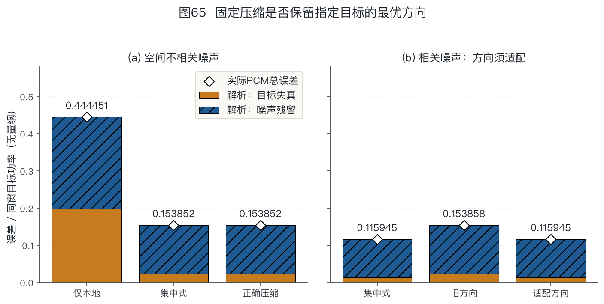
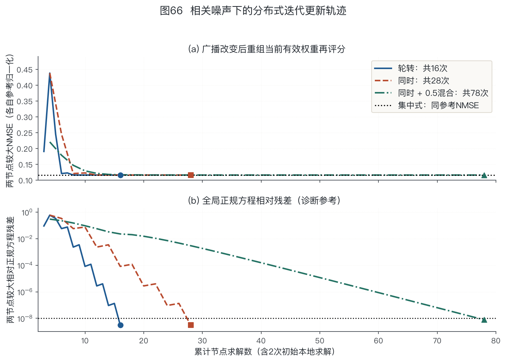
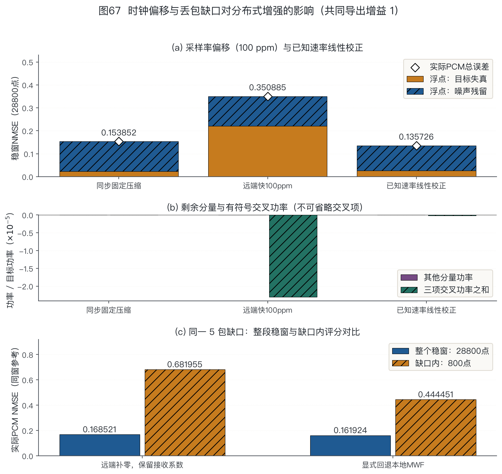

🌐 **简体中文** ｜ [English](../chapters_en/13_distributed-enhancement.md)

> ⚠️ 本篇是本书正文第 13 章（扩展专题Ⅱ；正文共 16 章，即第 0～15 章，其中第 12～15 章为四篇扩展专题，另有附录 A、B），接在第 12 章声学成像之后，介绍多个拾音节点怎样在有限通信下协作增强声音。分块 Schur 补与广义特征值推导可回查[第 0 章 §0.3](00_math-foundations.md#sec-0-3)、[§0.4](00_math-foundations.md#sec-0-4)，全局符号速查见[第 16 章附录 A](16_appendix-symbols-math.md)。
>
> 首页导读：[00_overview.md](00_overview.md) ｜ 上一篇：[12_acoustic-imaging.md](12_acoustic-imaging.md) ｜ 下一篇：[14_spatial-wearable-arrays.md](14_spatial-wearable-arrays.md)

---

## 第 13 章：分布式麦克风协同增强

### 13.1 多个节点为何要交换声音

#### 先确定协作的输出目标

想象一张长会议桌上摆着两台智能拾音设备，每台各有两支麦克风：第一台紧挨着主讲人，第二台则靠近空调出风口或投影仪风扇。站在信号处理的角度看，远端设备的录音有两种截然不同的协作价值——它既可能比本地设备更靠近目标说话人，提供更高信噪比的语音观测；也可能恰好守在干扰源旁边，提供本地设备迫切需要的纯净噪声参考。如果仅凭音量大小“只挑最响的一台设备开启拾音”，就会白白扔掉另一台设备的空间降噪能力；而如果让每台设备各自独立跑完语音识别、最后只把识别出的文字拼在一起，又彻底放弃了跨设备麦克风之间的波形级相位协同。

本章聚焦于**波形级分布式协同增强**：无线声学传感器网络（WASN）中的每个节点保留自身的全部本地多通道观测，同时接收其他节点广播过来的少数几路线性压缩信号，在本地融合生成各自的增强波形。值得注意的是，不同节点往往希望恢复各自所在位置听到的目标声像（例如双耳助听器左右耳节点必须保留各自的头相关声像），因此各节点的最优输出波形本来就不必逐点相同。要想把这件事算清楚，我们必须把“通信带宽压缩掉了哪些观测维度”“每个节点各自以哪一路目标声像为参考”以及“节点时钟与广播滤波器何时发生变化”全部纳入统一的数学模型。

[第 10 章 §10.7](10_engineering-practice.md#sec-10-7) 已经从系统架构层面梳理了分布式拾音的时间轴对齐、幅相一致性与多流融合问题。本章则深入到底层算法核心，一步步回答四个递进的问题：不传输全部原始麦克风通道时，满足什么条件仍能完全达到集中式全阵列的最优线性估计？各节点如何在不掌握全局统计的前提下交替更新广播滤波器？多声源与非全连接网络拓扑怎样限制广播维数？当落到有限帧长加窗、16 位量化、晶振采样率偏差与无线丢包时，又该如何转换统计坐标并诚实评估误差？

| 协作层级 | 节点间主要交换什么 | 输出形态与核心限制 |
|---|---|---|
| 集中式全通道增强 | 全部原始多通道波形，或等价的全局互谱统计量 | 由单一融合中心集中求解，要求高带宽回传且各路采样时刻严格对齐 |
| 最佳通道/设备选择 | 语音质量评分与被选中节点的音频流 | 直接输出单台较优设备音频，无法利用其余落选节点的空间孔径对消干扰 |
| 波形级分布式增强 | 经本地线性压缩的少数几路波形/短时复谱及状态信息 | 各节点独立解算自身参考目标的增强波形，须满足压缩子空间与采样同步条件 |
| 识别文本后融合 | 词元序列、置信度分数与说话人时间戳 | 仅输出合并后的转写文本，不再生成跨设备协同降噪后的可听语音波形 |

#### 本篇的术语与先修内容

本章涉及的核心术语与缩写整理如下表，阅读推导时可随时回查：

| 缩写 | 中文名与英文全称 | 在本章中的作用 |
|---|---|---|
| WASN | 无线声学传感器网络（Wireless Acoustic Sensor Network） | 由多个自带麦克风阵元、本地处理器与通信链路的拾音节点组成的协作网络 |
| LMMSE | 线性最小均方误差（Linear Minimum Mean-Squared Error） | 在给定观测的线性组合空间内，使目标声像均方估计误差最小的统计准则 |
| MWF | 多通道维纳滤波（Multichannel Wiener Filter） | 利用多通道混合观测二阶统计量，按 LMMSE 准则估计指定参考通道的目标声像 |
| DANSE | 分布式自适应节点特定信号估计（Distributed Adaptive Node-specific Signal Estimation） | 让各节点交替或同步更新本地估计权重与对外广播压缩滤波器的经典分布式算法 |
| TI | 拓扑无关（Topology Independent） | 指脱离全连接广播假设，在树形或连通图上通过多跳聚合传播实现协同的扩展方案 |
| GEVD | 广义特征值分解（Generalized Eigenvalue Decomposition） | 在噪声协方差白化度量下提取低秩目标语音子空间，抑制小快拍协方差估计误差 |
| WOLA | 加权重叠相加（Weighted Overlap-Add） | 将时域流分帧加窗变换至频域滤波，再经逆变换加合成窗重叠拼回连续波形的时频框架 |
| SRO | 采样率偏移（Sampling Rate Offset） | 不同拾音节点独立晶振之间的相对采样时钟速率偏差（常以百万分比 $\mathrm{ppm}$ 计） |

阅读本章前，建议先温习[第 5 章 §5.5.1 多通道维纳滤波（MWF）专题](05_beamforming.md#sec-5-5-1)，复向量共轭内积、Hermitian 正定矩阵与广义特征值基础可参看[第 0 章 §0.3～§0.4](00_math-foundations.md#sec-0-3)及[附录 A §16.3](16_appendix-symbols-math.md#sec-16-3)。为了先把“为什么压缩成一路广播居然可以不丢性能”的几何直觉立住，我们在前十一节先从理想同步采样下的单频点、已知精确二阶统计模型起步；待看清子空间压缩与迭代收敛的本质后，再从 §13.12 起依次引入子空间估计、WOLA 帧边界时序、带宽算力预算以及采样率偏差与丢包处理。

### 13.2 把本地观测与节点参考分别写出来

#### 全局列向量按节点分块

设网络共有 $U$ 个协作拾音节点，第 $u$ 个节点配有 $M_u$ 支本地麦克风（$u = 1, \ldots, U$），全网麦克风总数为 $M = \sum_{u=1}^U M_u$。固定频点 $k$，将第 $\ell$ 帧节点 $u$ 的本地频域观测记作列向量 $\vec x_u[k, \ell] \in \mathbb{C}^{M_u \times 1}$。若站在全局集中视角把全网 $U$ 个节点的观测按编号顺序纵向拼接起来，就得到 $M$ 维全局观测向量 $\vec x \in \mathbb{C}^{M \times 1}$。先考察单个潜在目标声源标量 $s$ 的接收模型（后续省去固定的 $[k, \ell]$ 索引）：

$$\begin{gathered}
\vec x=[\vec x_1^\top,\ldots,\vec x_U^\top]^\top,\\
\vec x=\vec a s+\vec n,\qquad d_u=c_u s.
\end{gathered}\tag{13-1}$$

式中 $s \in \mathbb{C}$ 是该频点的干源复系数，$\vec a \in \mathbb{C}^{M \times 1}$ 是从声源到全网 $M$ 支麦克风的声学传递向量，$\vec n \in \mathbb{C}^{M \times 1}$ 是全网加性噪声向量。

最关键的是右边的 $d_u = c_u s$：它表示**节点 $u$ 想要恢复的目标参考信号**，其中标量 $c_u \in \mathbb{C}$ 是节点 $u$ 选定的参考声学响应。工程上通常直接把节点 $u$ 自身的某支麦克风（全局下标记作 $r_u$）设为参考麦，此时 $c_u$ 就是全局传递向量 $\vec a$ 在第 $r_u$ 行的那个元素——也就是说，节点 $u$ 希望原汁原味地保留目标语音到达第 $r_u$ 支麦克风时的真实幅度和相位（声像），同时滤除叠在上面的加性噪声 $n_{r_u}$。

全章严格沿用本书前向傅里叶核 $e^{-\mathrm{j}2\pi f t}$ 与共轭内积波束输出 $y = \vec w^H\vec x$。下标约定如下：频点为 $k$，帧号为 $\ell$，时域采样点为 $n$；节点编号用 $u, v$，算法迭代轮次用上标或下标 $i$；多源推广时的潜在目标子空间维数记为 $S$，每个节点向外广播的压缩通道数记为 $Q$；若涉及几何传播波数则记作 $\kappa = 2\pi f / c$。

式(13-1)中的传递向量 $\vec a$ 既可以是自由场直达响应，也可以包含房间早期反射传递函数；至于单频复数乘法落回时域后对应的有限帧长与因果等待，我们留到 §13.13 专门剖析。

#### 功率单位与零均值条件

假定目标源 $s$ 与噪声向量 $\vec n$ 均为零均值随机变量、二阶矩有限，且满足源噪正交条件 $\mathbb{E}[s\vec n^H] = \vec 0^H$。由此写出干源功率 $\phi_s$、全局噪声协方差矩阵 $\mathbf R_{nn}$ 与全局观测协方差矩阵 $\mathbf R_{xx}$：

$$\begin{aligned}
\phi_s&=\mathbb{E}[|s|^2],\qquad
\mathbf R_{nn}=\mathbb{E}[\vec n\vec n^H],\\
\mathbf R_{xx}&=\mathbb{E}[\vec x\vec x^H]
=\phi_s\vec a\vec a^H+\mathbf R_{nn}.
\end{aligned}\tag{13-2}$$

这里 $\phi_s \ge 0$ 为实标量，$\mathbf R_{nn}$ 与 $\mathbf R_{xx}$ 均为 $M \times M$ Hermitian 半正定矩阵。若输入为未标定数字音频，上述二阶矩采用无量纲数字幅度平方单位；仅当全部通道已完成物理声压标定时才具有 $\mathrm{Pa}^2$ 量纲（此时我们将传递向量 $\vec a$ 与滤波权重 $\vec w$ 均约定为无量纲比值）。切换不同 FFT 归一化比例时，$\mathbf R_{xx}$、互相关向量与参考功率 $\phi_{d_u}$ 必须按同一尺度同步缩放。

顺便提醒一点统计细节：用有限 $L$ 帧样本算出的外积平均 $\frac{1}{L}\sum_{\ell=1}^L \vec x_\ell\vec x_\ell^H$ 是未中心化的样本二阶矩；即便总体均值为零，有限样本算术平均也未必精确为零，因此它与减去样本均值后的中心化样本协方差并不完全相等（见[附录 A E16-02](16_appendix-symbols-math.md#e16-02)）。本章前半部分的理论推导直接代入精确总体二阶矩，而 §13.15 的确定性合成音频实验则会严格交待有限稳定窗内的整数周期平均口径。

### 13.3 集中式MWF究竟最小化什么

#### 对任意权重先写完整代价

在讨论分布式压缩之前，我们必须先立好标杆：假如没有通信带宽限制，节点 $u$ 能把全网所有 $M$ 支麦克风的信号 $\vec x$ 全拿过来做线性滤波 $\hat d_u = \vec w^H\vec x$，怎样的权重才算最好？多通道维纳滤波（MWF）以节点参考目标 $d_u$ 与滤波输出 $\hat d_u$ 之间的均方误差（Mean-Squared Error，MSE）作为标尺。记参考目标功率为 $\phi_{d_u} = \mathbb{E}[|d_u|^2]$，观测向量与参考目标的 $M \times 1$ 互相关列向量为 $\vec r_{xd_u} = \mathbb{E}[\vec x d_u^*]$，对**任意给定的**滤波权重 $\vec w \in \mathbb{C}^{M \times 1}$ 展开均方误差代价函数 $J_u(\vec w)$：

$$\begin{aligned}
J_u(\vec w)&=\mathbb{E}\big[|d_u-\vec w^H\vec x|^2\big]\\
&=\mathbb{E}\big[(d_u-\vec w^H\vec x)(d_u^*-\vec x^H\vec w)\big]\\
&=\phi_{d_u}-\vec w^H\vec r_{xd_u}-\vec r_{xd_u}^H\vec w
+\vec w^H\mathbf R_{xx}\vec w\\
&=\phi_{d_u}-2\operatorname{Re}(\vec w^H\vec r_{xd_u})
+\vec w^H\mathbf R_{xx}\vec w.
\end{aligned}\tag{13-3}$$

注意中间两项 $\vec w^H\vec r_{xd_u}$ 与 $\vec r_{xd_u}^H\vec w$ 互为复共轭标量，相加正好化为两倍实部 $2\operatorname{Re}(\vec w^H\vec r_{xd_u})$。请牢记式(13-3)的普适性：**无论 $\vec w$ 是全局最优解、迭代中途尚未收敛的近似权重，还是因远端广播突变而暂时失配的陈旧权重，只要把实际生效的全局权重代进式(13-3)，就能算出毫无水分的真实均方误差。**

当全局观测协方差矩阵严格正定（$\mathbf R_{xx} \succ 0$）时，对式(13-3)关于共轭权重 $\vec w^*$ 求 Wirtinger 梯度（见[附录 A §16.3](16_appendix-symbols-math.md#sec-16-3)）得 $\mathbf R_{xx}\vec w - \vec r_{xd_u}$，令其为零便导出唯一的集中式维纳—霍夫（Wiener–Hopf）正规方程、最优权重 $\vec w_u^\star$ 以及集中式最小均方误差下界 $J_u^\star$：

$$\begin{aligned}
\mathbf R_{xx}\vec w_u^\star&=\vec r_{xd_u},\qquad
\vec w_u^\star=\mathbf R_{xx}^{-1}\vec r_{xd_u},\\
J_u^\star&=\phi_{d_u}
-\vec r_{xd_u}^H\mathbf R_{xx}^{-1}\vec r_{xd_u}.
\end{aligned}\tag{13-4}$$

数值编程时应调用厄米正定线性方程组求解器（如 Cholesky 分解求解）直接解 $\mathbf R_{xx}\vec w_u^\star = \vec r_{xd_u}$，避免显式计算逆矩阵 $\mathbf R_{xx}^{-1}$。还要特别注意：式(13-4)最后一行的化简公式 $J_u^\star = \phi_{d_u} - \vec r_{xd_u}^H\vec w_u^\star$ 利用了 $\mathbf R_{xx}\vec w_u^\star = \vec r_{xd_u}$ 消项，所以正规方程保证该化简在最优解处成立；这一标量等式本身不是最优性的充要判据。评估非最优或陈旧权重时，应代回式(13-3)计算完整三项（集中式与节点特定维纳滤波的原始问题定义参见 [Bertrand 与 Moonen 2010，Part I §II-A 式(1)、(2)](https://homes.esat.kuleuven.be/~abertran/reports/09-65.pdf)）。

#### 参考目标不能从混合录音直接读出

刚接触 MWF 的读者常问：“既然参考选的是第 $r_u$ 支麦克风，那直接拿第 $r_u$ 路录音 $x_{r_u}$ 当作 $d_u$ 去算互相关 $\mathbb{E}[\vec x x_{r_u}^*]$ 行不行？”千万不行。因为实际麦克风录到的 $x_{r_u} = c_u s + n_{r_u}$ 里混有该通道自身的噪声 $n_{r_u}$——如果拿混合信号 $x_{r_u}$ 冒充 $d_u$，正规方程 $\mathbf R_{xx}\vec w = \mathbf R_{xx}\vec e_{r_u}$ 的解就会退化成荒唐的平凡选择向量 $\vec w = \vec e_{r_u}$（原封不动输出带噪参考麦信号，误差为零，一丝噪声都没滤掉）。

在真实工程系统中，干净目标 $d_u$ 无法直接测量，必须借助语音活动检测（VAD）或时频掩码先分离估计噪声协方差 $\hat{\mathbf R}_{nn}$ 与总协方差 $\hat{\mathbf R}_{xx}$，由源噪不相关关系作差估计目标协方差 $\hat{\mathbf R}_{ss}$（等于 $\hat{\mathbf R}_{xx}$ 减 $\hat{\mathbf R}_{nn}$，或采用后文 §13.12 更稳健的 GEVD 低秩重构），再取出它的第 $r_u$ 列 $\vec r_{xd_u} = \hat{\mathbf R}_{ss}\vec e_{r_u}$ 送入正规方程。此外，本章式(13-3)对应失真与噪声等权重的标准 MWF（即[第 5 章](05_beamforming.md)语音失真加权 SDW-MWF 中权衡因子 $\mu = 1$ 的情形）；在噪声协方差 $\mathbf R_{nn} \succ 0$ 且目标为秩一单源（$\mathbf R_{ss} = \phi_s\vec a\vec a^H$）时，即使不同节点各自设定不同的噪声惩罚因子 $\mu_u > 0$，各节点的集中式最优权重仍沿着同一条一维方向 $\mathbf R_{nn}^{-1}\vec a$ 共线，仅改变标量维纳增益。目标为多源或高秩模型（$\operatorname{rank}(\mathbf R_{ss}) \ge 2$）时，最优权重仍位于噪声加权目标响应张成的共同子空间内，但不再保证共线；不同 $\mu_u$ 既可能只改变标量，也可能改变子空间内的方向。广播维数 $Q < S$ 不满足 §13.10 顺序收敛定理的 $Q = S$ 条件。该定理还把各节点的代价化为同一参考目标的均方误差；不能仅凭最优权重属于共同子空间，就推出各节点采用不同噪声惩罚因子时迭代仍会收敛。

### 13.4 秩一模型中的参考尺度与共轭

#### 一个公共源，各节点仍有不同目标

当空间中只有一个点声源（式(13-1)的秩一目标模型）时，式(13-4)的集中式最优权重能拆成极其直观的闭式结构。先把 $d_u = c_u s$ 代入互相关向量与参考功率定义，利用 $\mathbb{E}[s\vec n^H] = \vec 0^H$ 得：

$$\begin{aligned}
\vec r_{xd_u}&=\mathbb{E}[(\vec a s+\vec n)c_u^* s^*]
=\phi_s c_u^*\vec a,\\
\phi_{d_u}&=\mathbb{E}[|c_u s|^2]=|c_u|^2\phi_s.
\end{aligned}\tag{13-5}$$

假定干源功率 $\phi_s > 0$、$\vec a \ne \vec 0$ 且全局噪声协方差严格正定（$\mathbf R_{nn} \succ 0$）。我们定义一个极其关键的正标量 $q = \vec a^H\mathbf R_{nn}^{-1}\vec a > 0$（注意 $\phi_s q$ 的物理意义正是全阵列匹配滤波后的**全局最大输出信噪比**）。不需要死记硬背 Sherman–Morrison 矩阵求逆引理，只需把待检验向量 $\mathbf R_{nn}^{-1}\vec a$ 左乘 $\mathbf R_{xx}$ 算一步乘法：

当 $\mathbf R_{nn}$ 用 $\mathrm{Pa}^2$、$\vec a$ 为无量纲比值时，$q=\vec a^H\mathbf R_{nn}^{-1}\vec a$ 的量纲为 $\mathrm{Pa}^{-2}$，只有 $\phi_s q$ 无量纲；采用数字幅度归一化时须另说明口径。

$$\begin{aligned}
\mathbf R_{xx}(\mathbf R_{nn}^{-1}\vec a)
&=(\mathbf R_{nn}+\phi_s\vec a\vec a^H)\mathbf R_{nn}^{-1}\vec a\\
&=\vec a+\phi_s\vec a(\vec a^H\mathbf R_{nn}^{-1}\vec a)
=(1+\phi_s q)\vec a.
\end{aligned}$$

两边左乘 $\mathbf R_{xx}^{-1}$ 再除以正标量 $(1 + \phi_s q)$，立得 $\mathbf R_{xx}^{-1}\vec a$ 等于 $\mathbf R_{nn}^{-1}\vec a / (1 + \phi_s q)$。将其与式(13-5)代入式(13-4)，便一气呵成导出秩一单源下节点 $u$ 的集中式最优权重、最小均方误差及归一化均方误差（Normalized MSE，NMSE）：

$$\begin{aligned}
\vec w_u^\star&=\frac{\phi_s c_u^*}{1+\phi_s q}
\mathbf R_{nn}^{-1}\vec a,\\
J_u^\star&=\phi_{d_u}-\frac{\phi_s^2|c_u|^2 q}{1+\phi_s q}
=\frac{|c_u|^2\phi_s}{1+\phi_s q},\\
\operatorname{NMSE}_u^\star&=\frac{J_u^\star}{\phi_{d_u}}
=\frac{1}{1+\phi_s q}.
\end{aligned}\tag{13-6}$$

请停下来细细品味式(13-6)第一行的物理结构。我们在分子分母同乘 $q = \vec a^H\mathbf R_{nn}^{-1}\vec a$，记集中式 MVDR 波束为 $\vec w_{\mathrm{MVDR}} = (\mathbf R_{nn}^{-1}\vec a)/q$，就能把集中式最优权重拆解成**三个职责分明的物理算子串联**：

$$\begin{aligned}
\vec w_{\mathrm{MVDR}}
&=\frac{1}{q}\mathbf R_{nn}^{-1}\vec a,\\
\vec w_u^\star&=\vec w_{\mathrm{MVDR}}\cdot c_u^*
\cdot\frac{\phi_s q}{1+\phi_s q}.
\end{aligned}$$

记标量维纳增益为 $g_{\mathrm{W}} = \frac{\phi_s q}{1 + \phi_s q}$，算一下共轭转置后的实际输出 $\hat d_u = (\vec w_u^\star)^H\vec x$，化简即得 $g_{\mathrm{W}} c_u(\vec w_{\mathrm{MVDR}}^H\vec x)$，三步物理分工豁然开朗：

1. **第一步（全网统一的 MVDR 空间滤波）**：无论哪个节点，空间方向上一律先用同一个最小方差无失真响应（MVDR）波束 $\vec w_{\mathrm{MVDR}}$ 把干源 $s$ 无失真提出来，并将空间背景噪声压到最低（此时单路波束输出功率为 $\phi_s + 1/q$，输出信噪比恰好等于 $\rho = \mathrm{SNR}_{\mathrm{out}} = \phi_s q$）；
2. **第二步（节点专属的声像映射）**：乘以节点自身的参考传递响应 $c_u$（写在权重 $\vec w_u^\star$ 里带共轭号 $c_u^*$，经 $\vec w^H\vec x$ 共轭转置后正好变回 $c_u$），把干源还原成节点 $u$ 参考麦克风处的真实幅相声像 $c_u s$；
3. **第三步（单通道 Wiener 实数收缩）**：乘上经典的标量维纳增益 $g_{\mathrm{W}} = \frac{\rho}{1 + \rho} \in (0, 1)$，允许对目标幅度做一丁点收缩，换取残余噪声功率更大幅度的下降，最终使归一化均方误差精准落到 $1 / (1 + \rho)$。

由这一分解可见：**既然全网所有节点 $u = 1, \ldots, U$ 的集中式最优权重 $\vec w_u^\star$ 都只是同一个全局向量 $\mathbf R_{nn}^{-1}\vec a$ 的不同复标量倍数，那么每个节点真正需要贡献给全网的空间方向其实只有一维。**（注意计算 $\operatorname{NMSE}_u^\star$ 要求参考目标功率 $\phi_{d_u} > 0$，即 $\phi_s > 0$ 且 $c_u \ne 0$。）

#### 为什么不能平均所有节点的绝对MSE来排名

理解了式(13-6)，就能直观避开分布式评测里常见的“绝对误差平均陷阱”。设节点 $1$ 离说话人较远，参考目标为 $d_1 = s$；节点 $2$ 离说话人更近，参考目标声压大一倍，为 $d_2 = 2s$。由式(13-6)可知，节点 $2$ 的集中式最优权重是节点 $1$ 的 $2$ 倍，绝对均方误差 $J_2^\star = 4 J_1^\star$ 整整大了 $4$ 倍。

但这绝不意味着节点 $2$ 的增强质量更差——因为节点 $2$ 要保护的目标能量 $\phi_{d_2} = 4\phi_{d_1}$ 同样大了 $4$ 倍，两边按各自参考功率归一化后，$\operatorname{NMSE}_1^\star$ 与 $\operatorname{NMSE}_2^\star$ 均等于 $\frac{1}{1 + \phi_s q}$。如果把各节点的绝对 MSE 不加区分地直接求平均，离声源最近的节点反而会在绝对误差均值中占比最大，导致性能误判。

复数参考因子 $c_u$ 的共轭位置更是写代码时的必查点：若 $c_u = 1 + \mathrm{j}$，权重公式 $\vec w_u^\star$ 中乘的是共轭 $c_u^* = 1 - \mathrm{j}$；唯有如此，代入波束输出 $(\vec w_u^\star)^H\vec x$ 再取一次共轭后，目标相位才会正正好好变回 $1 + \mathrm{j}$。一旦漏掉共轭号，输出声像的相位就会彻底反号（见 [E13-01](#e13-01) 与[第 5 章 E05-11](05_beamforming.md#e05-11)）。

### 13.5 压缩后的协方差与有效全局权重

#### 广播是一组线性组合

现在把通信带宽约束加进来：节点 $v$ 手里有 $M_v$ 支麦克风，但无线链路只允许它向外发送 $Q$ 路压缩信号（通常 $Q \ll M_v$，单源时甚至只发 $Q = 1$ 路）。我们先固定各节点的广播压缩矩阵，看看接收节点手里实际拿到了什么观测。设每个节点 $v$ 选定本地线性压缩矩阵 $\mathbf F_v \in \mathbb{C}^{M_v \times Q}$，向全网广播 $Q \times 1$ 维压缩信号 $\vec z_v = \mathbf F_v^H\vec x_v$。

站在节点 $u$ 的角度，它手头可用的全部输入由两部分拼成：本节点原汁原味的 $M_u$ 路本地麦克风信号 $\vec x_u$，加上其余 $U - 1$ 个远端节点（$v \ne u$，按编号递增排列）发过来的压缩广播拼接向量 $\vec z_{-u}$。把这两部分纵向叠成 $L_u = M_u + (U - 1)Q$ 维局部可用观测向量 $\tilde{\vec x}_u$，它可以简洁地写成全局原始向量 $\vec x \in \mathbb{C}^{M \times 1}$ 经过一个块稀疏投影矩阵 $\mathbf T_u \in \mathbb{C}^{M \times L_u}$ 的线性压缩：

$$\begin{gathered}
\tilde{\vec x}_u=[\vec x_u^\top,\vec z_{-u}^\top]^\top,\qquad
L_u=M_u+(U-1)Q,\\
\tilde{\vec x}_u=\mathbf T_u^H\vec x,\qquad
\mathbf T_u\in\mathbb{C}^{M\times L_u}.
\end{gathered}\tag{13-7}$$

矩阵 $\mathbf T_u$ 的结构非常清晰：前 $M_u$ 列在节点 $u$ 对应的行块上放单位阵 $\mathbf I_{M_u}$（代表本地通道原样直通），后 $(U - 1)Q$ 列在其余各个远端节点 $v$ 对应的行块上依次填入各自的广播矩阵 $\mathbf F_v$，其余块全为零。注意 $\mathbf T_u^H\vec x$ 描述的是把全网 $M$ 维观测降维映射成节点 $u$ 实际可见的 $L_u$ 维输入，绝不是凭空把远端原始通道解压还原出来。

在固定同一组广播矩阵、同一频点与同一统计窗口的前提下，直接将 $\tilde{\vec x}_u = \mathbf T_u^H\vec x$ 代入二阶矩定义，即可导出节点 $u$ 局部观测的协方差矩阵 $\tilde{\mathbf R}_u \in \mathbb{C}^{L_u \times L_u}$、局部互相关向量 $\tilde{\vec r}_u \in \mathbb{C}^{L_u \times 1}$ 以及 $L_u$ 维局部维纳正规方程：

$$\begin{aligned}
\tilde{\mathbf R}_u&=\mathbb{E}[\tilde{\vec x}_u\tilde{\vec x}_u^H]
=\mathbf T_u^H\mathbf R_{xx}\mathbf T_u,\\
\tilde{\vec r}_u&=\mathbb{E}[\tilde{\vec x}_u d_u^*]
=\mathbf T_u^H\vec r_{xd_u},\\
\tilde{\mathbf R}_u\vec h_u^\star&=\tilde{\vec r}_u.
\end{aligned}\tag{13-8}$$

何时局部协方差矩阵 $\tilde{\mathbf R}_u$ 保证严格正定可逆？设全局协方差 $\mathbf R_{xx} \succ 0$：对任意非零 $L_u$ 维向量 $\vec b \ne \vec 0$，记提升向量 $\vec v = \mathbf T_u\vec b$，二次型 $\vec b^H\tilde{\mathbf R}_u\vec b$（即 $\vec v^H\mathbf R_{xx}\vec v > 0$）成立的充要条件是 $\vec v = \mathbf T_u\vec b \ne \vec 0$，即**压缩矩阵 $\mathbf T_u$ 必须列满秩**。反之，一旦某个远端节点发送了全零广播（$\mathbf F_v = \mathbf 0$）、广播中存在线性重复列，或者设置的广播路数 $Q$ 超过了该节点自身的麦克风数 $M_v$，$\mathbf T_u$ 就会列秩亏，导致 $\tilde{\mathbf R}_u$ 奇异不可逆（退化回退处理见 [E13-07](#e13-07)）。

#### 局部系数与全局作用不是同一向量

节点 $u$ 解出 $L_u$ 维局部权重 $\vec h_u$ 后，计算的实际输出是 $\hat d_u = \vec h_u^H\tilde{\vec x}_u$。要想把它跟 §13.3 的 $M$ 维集中式权重 $\vec w_u^\star$ 放在同一把尺子下比对，只需把 $\tilde{\vec x}_u = \mathbf T_u^H\vec x$ 代进去合并共轭转置：

$$\begin{aligned}
\hat d_u&=\vec h_u^H(\mathbf T_u^H\vec x)
=(\mathbf T_u\vec h_u)^H\vec x,\\
\vec w_{u,\mathrm{eff}}&=\mathbf T_u\vec h_u,
\qquad\vec w_{u,\mathrm{eff}}\in\mathbb{C}^{M\times 1}.
\end{aligned}\tag{13-9}$$

我们把 $\vec w_{u,\mathrm{eff}} = \mathbf T_u\vec h_u$ 称为节点 $u$ 在全网 $M$ 支原始麦克风上的**有效全局权重（effective global weight）**。初学时最容易犯的共轭错误就在这里：假设远端节点 $v$ 发送标量广播 $z_v = \vec f_v^H\vec x_v$，本地节点 $u$ 给这路广播配的接收滤波系数是标量 $g_{uv}$，那么这路广播贡献的输出项 $g_{uv}^* z_v = g_{uv}^*(\vec f_v^H\vec x_v)$ 合并共轭后恰为 $(\vec f_v g_{uv})^H\vec x_v$——因此它在远端原始麦克风上折算出的有效权重是**不带共轭的乘积** $\vec f_v g_{uv}$，既不能拿标量 $g_{uv}$ 直接冒充远端各麦权重，也千万不能写成 $\vec f_v g_{uv}^*$ 多取一次共轭。

此外，为了改善矩阵条件数，工程代码常在内部先把每路压缩输入除以各自的范数（等价于将压缩矩阵右乘可逆对角阵 $\mathbf T'_u = \mathbf T_u\mathbf D$），此时求出的局部权重会自动变成 $\vec h'_u = \mathbf D^{-1}\vec h_u$。虽然归一化前后的局部接收系数 $\vec h'_u$ 与手算未归一化的 $\vec h_u$ 数字不同，但乘回各自的压缩矩阵后，有效全局权重 $\mathbf T'_u\vec h'_u = \mathbf T_u\vec h_u$ 和最终输出波形分毫不差（见 [E13-02](#e13-02)）。

### 13.6 怎样证明固定压缩对指定任务无损

#### 平方误差给出可检查的判据

把 $M$ 路原始信号压缩成 $L_u < M$ 路输入后，均方误差究竟涨了多少？什么时候居然能做到**一丝一毫都不涨**（即达到集中式最优性能）？我们用一个极其干净的正交分解恒等式直接给出充要条件。

记任意局部权重折算出的有效全局权重与集中式最优权重之差为误差向量 $\vec e = \mathbf T_u\vec h - \vec w_u^\star$，把 $\vec w = \vec w_u^\star + \vec e$ 代入式(13-3)的真实代价函数 $J_u(\vec w)$，展开二次型并利用集中式正规方程 $\mathbf R_{xx}\vec w_u^\star = \vec r_{xd_u}$ 消去全部一次交叉项：

$$\begin{aligned}
J_u(\vec w_u^\star+\vec e)-J_u(\vec w_u^\star)
&=2\operatorname{Re}\big(\vec e^H\mathbf R_{xx}\vec w_u^\star\big)
-2\operatorname{Re}\big(\vec e^H\vec r_{xd_u}\big)\\
&\quad+\vec e^H\mathbf R_{xx}\vec e\\
&=\vec e^H\mathbf R_{xx}\vec e\ge 0.
\end{aligned}\tag{13-10}$$

看式(13-10)最后一行：在 $\mathbf R_{xx} \succ 0$ 正定的前提下，二次型 $\vec e^H\mathbf R_{xx}\vec e$ 当且仅当 $\vec e = \vec 0$ 时才等于零。也就是说，给定压缩矩阵 $\mathbf T_u$ 能够达到与全网集中式一模一样的最小均方误差 $J_u^\star$，当且仅当存在某个局部权重向量 $\vec h \in \mathbb{C}^{L_u \times 1}$ 使得 $\mathbf T_u\vec h = \vec w_u^\star$，写成子空间包含关系就是：

$$\vec w_u^\star\in\operatorname{range}(\mathbf T_u).
\tag{13-11}$$

式(13-11)的几何图景再清晰不过了：线性广播压缩限制了节点 $u$ 在全网 $M$ 维原始权重空间里所能触及的**可行子空间** $\operatorname{range}(\mathbf T_u)$。只要集中式最优权重 $\vec w_u^\star$ 在远端节点 $v$ 上的那一块分量，恰好落在该远端节点广播矩阵 $\mathbf F_v$ 的列空间里，信息压缩就不会带来任何 LMMSE 损失；反之，即便局部矩阵 $\tilde{\mathbf R}_u$ 满秩可逆、局部方程解得漂漂亮亮，只要 $\vec w_u^\star$ 掉出了 $\operatorname{range}(\mathbf T_u)$ 之外，就必然付出 $\vec e^H\mathbf R_{xx}\vec e > 0$ 的额外均方误差代价。同理，若网络需要同时无损估计多个独立目标组成的权重矩阵 $\mathbf W^\star$，则 $\mathbf W^\star$ 的每一列都必须落在 $\operatorname{range}(\mathbf T_u)$ 之内，这直接决定了每个节点至少要广播几路信号。

#### “无损”应限定到哪个估计问题

在文献中看到“无损压缩（lossless compression）”这个词时，一定要看清它的定语边界：式(13-11)保证的是**针对指定参考目标 $d_u$、在给定二阶统计下的线性最小均方误差（LMMSE）最优值保持不变**。它绝不代表能从一路广播里把远端两支麦克风各自的原始波形无损还原出来，也不保证换一个不共线的目标声源或换一套噪声统计后依然无损；此外，在非高斯噪声或强非线性语音增强网络中，高阶统计信息也未必能被单一线性投影完全保留（联合高斯分布下线性 LMMSE 与一般条件均值 MMSE 一致，但仍需明确分布假设）。因此本书统一表述为“对指定 LMMSE 任务无损”。

### 13.7 白噪声锚点：两支远端麦何时能合成一路

#### 集中式与只用本地的差别

我们立刻动手建立一个贯穿本章后续各节的四麦克风数字锚点，把式(13-6)～式(13-11)全部用有理数算通。首先明确：这里的“空间白噪声”是指在当前分析频点上，四路噪声的空间协方差矩阵为单位阵 $\mathbf R_{nn} = \mathbf I_4$（各通道噪声互不相关且方差均为 $1$，并不限制单通道噪声在时间轴不同帧之间的谱形状）。

**输入与口径**：网络有 $U = 2$ 个节点，每个节点各有 $2$ 支麦克风（节点 $1$ 拥有全局通道 $1, 2$；节点 $2$ 拥有全局通道 $3, 4$，总通道数 $M = 4$）。为方便心算核对，取实数传递向量、单位干源功率与节点 $1$ 的参考目标如下：

$$\vec a=\big[1,\;\tfrac{1}{2},\;2,\;-\tfrac{1}{2}\big]^\top,\qquad
\phi_s=1,\qquad
\mathbf R_{nn}=\mathbf I_4,\qquad
d_1=s\;\;(c_1=1).$$

**逐步代入与集中式/本地基准对比**：先算全网输出信噪比因子 $q = \vec a^\top\mathbf I_4^{-1}\vec a$，四项平方和为 $1 + 1/4 + 4 + 1/4 = 11/2$。代入式(13-6)（分母 $1 + \phi_s q = 1 + 11/2 = 13/2$），立即写出节点 $1$ 的**集中式四麦最优解**：

$$\begin{aligned}
\vec w_1^\star&=\frac{2}{13}[1,\;0.5,\;2,\;-0.5]^\top\\
&=\frac{1}{13}[2,\;1,\;4,\;-1]^\top,\\
J_1^\star&=\frac{1}{1+11/2}=\frac{2}{13}\approx 0.153846.
\end{aligned}$$

不妨把这 $2/13$ 的误差拆开看看物理构成：滤波输出对目标源 $s$ 的幅度响应 $(\vec w_1^\star)^\top\vec a$ 为 $(2 + 1/2 + 8 + 1/2)/13 = 11/13$，因而目标幅度收缩带来的**目标失真功率**为 $(11/13 - 1)^2 \times 1 = 4/169$；四路单位白噪声通过权重后的**残余噪声功率**为 $\|\vec w_1^\star\|_2^2 = (4 + 1 + 16 + 1)/169 = 22/169$。两项相加 $\frac{4 + 22}{169} = \frac{26}{169} = \frac{2}{13}$，精确相等。这也直观提醒我们：MWF 为了大幅压低噪声，故意把目标幅度收缩到了 $11/13$，并非 MVDR 那样的严格单位无失真响应。

假如节点 $1$ 孤军奋战、完全不接收节点 $2$ 的数据呢？只用本地两路通道 $[1, 1/2]^\top$ 时，局部信噪比降为 $q_{\mathrm{local}} = 1 + 1/4 = 5/4$，本地最优权重为 $\frac{1}{1 + 5/4}[1, 1/2]^\top = [4, 2]^\top / 9$，均方误差高达 $J_{\mathrm{local}} = 1 / (9/4) = 4/9 \approx 0.444444$——比集中式的 $2/13 \approx 0.153846$ 差了将近三倍（因为远端通道 $3$ 的目标幅度为 $2$，信噪比远高于本地）。

#### 压缩矩阵与局部方程逐项计算

现在节点 $2$ 不传两路原始音频 $x_3, x_4$，只向节点 $1$ 发送**一路**线性组合 $z_2 = 2x_3 - \frac{1}{2}x_4$（即取广播向量 $\vec f_2 = [2, -1/2]^\top$）。我们来逐项复算节点 $1$ 拿到的三维压缩输入 $\tilde{\vec x}_1 = [x_1, x_2, z_2]^\top$ 能否一分不差地恢复集中式四麦性能。

首先写出式(13-7)的 $4 \times 3$ 压缩投影矩阵 $\mathbf T_1$：

$$\mathbf T_1=
\begin{bmatrix}
1 & 0 & 0\\
0 & 1 & 0\\
0 & 0 & 2\\
0 & 0 & -\tfrac{1}{2}
\end{bmatrix}.$$

接着算三维压缩空间里的统计量：压缩后的目标响应（即局部互相关向量 $\tilde{\vec r}_1 = \mathbf T_1^\top\vec a$）第 $3$ 分量为 $2\times 2 + (-1/2)^2 = 17/4$，故 $\tilde{\vec r}_1 = [1, 1/2, 17/4]^\top$；压缩后的噪声协方差 $\tilde{\mathbf R}_{nn,1}$（即 $\mathbf T_1^\top\mathbf I_4\mathbf T_1$）化简为 $\operatorname{diag}(1, 1, 17/4)$（注意第 $3$ 路广播自身的噪声方差已经变成 $17/4$，绝不能错当成 $1$）。将压缩目标外积 $\tilde{\vec r}_1\tilde{\vec r}_1^\top$ 加到压缩噪声矩阵上，得到 $3 \times 3$ 局部观测协方差矩阵 $\tilde{\mathbf R}_1$：

$$\begin{aligned}
\tilde{\mathbf R}_1
&=\tilde{\vec r}_1\tilde{\vec r}_1^\top
+\operatorname{diag}\!\big(1,\;1,\;\tfrac{17}{4}\big)\\
&=\begin{bmatrix}
2 & \tfrac{1}{2} & \tfrac{17}{4}\\
\tfrac{1}{2} & \tfrac{5}{4} & \tfrac{17}{8}\\
\tfrac{17}{4} & \tfrac{17}{8} & \tfrac{357}{16}
\end{bmatrix}.
\end{aligned}$$

求解三维局部正规方程 $\tilde{\mathbf R}_1\vec h_1^\star = [1, 1/2, 17/4]^\top$，立即验证 $\vec h_1^\star = \frac{1}{13}[2, 1, 2]^\top$ 满足全部三行等式（例如第 $1$ 行：$\frac{4 + 1/2 + 17/2}{13} = \frac{13}{13} = 1$）。最后按式(13-9)乘回 $\mathbf T_1$ 折算有效全局权重：

$$\begin{aligned}
\vec w_{1,\mathrm{eff}}&=\mathbf T_1\vec h_1^\star
=\frac{1}{13}[2,\;1,\;2\times 2,\;-1]^\top\\
&=\frac{1}{13}[2,\;1,\;4,\;-1]^\top=\vec w_1^\star.
\end{aligned}$$

结果与集中式四麦最优权重一模一样，MSE 精确降到 $2/13$。回看式(13-11)，成功的原因一目了然：集中式权重在远端节点 $2$ 上的分块 $[4, -1]^\top / 13 = \frac{2}{13}[2, -1/2]^\top$，正好与广播向量 $\vec f_2 = [2, -1/2]^\top$ 平行。哪怕节点 $2$ 自身要估计的目标换成 $d_2 = 2s$，它的集中式最优权重也只是整体乘 $2$（绝对 MSE 为 $8/13$，归一化 NMSE 仍为 $2/13$），共享同一条远端子空间直线。

### 13.8 相关噪声反例：目标方向之外也有有用观测

#### 只改噪声，旧广播便不再足够

读完 §13.7 的白噪声算例，很多工程师会形成一个非常顽固但错误的直觉：“远端节点要做的事情还不简单吗？它只要在自己本地做个匹配波束对准说话人（即 $\vec f_2 = \vec a_2 = [2, -1/2]^\top$）发过来就万事大吉了。”我们现在保持说话人位置、功率和节点划分纹丝不动，仅仅让远端噪声与本地第 $1$ 支麦克风的噪声产生**跨节点空间相关性**（例如空调管道或桌面振动同时传到了两台设备上），看看这一直觉在何处失效。

将全局噪声协方差矩阵从单位阵改为含跨节点非对角相关项的实对称矩阵：

$$\mathbf R_{nn}=
\begin{bmatrix}
1 & 0 & \tfrac{1}{5} & \tfrac{4}{5}\\
0 & 1 & 0 & 0\\
\tfrac{1}{5} & 0 & 1 & 0\\
\tfrac{4}{5} & 0 & 0 & 1
\end{bmatrix}.$$

先确认该噪声矩阵的物理合法性：它的四个特征值为 $1, 1, 1 \pm \sqrt{17}/5$，最小特征值 $1 - \sqrt{17}/5 \approx 0.175379 > 0$，严格正定。接着按式(13-6)求新的集中式四麦最优解：解线性方程组 $\mathbf R_{nn}\vec u = \vec a$ 得 $\mathbf R_{nn}^{-1}\vec a = [25, 4, 11, -24]^\top / 8$，全局信噪比 $q = \vec a^\top\mathbf R_{nn}^{-1}\vec a$ 跃升至 $(25 + 2 + 22 + 12)/8 = 61/8$（分母 $1 + q = 69/8$）。于是相关噪声下的**集中式最优解**为：

$$\vec w_1^\star=\frac{1}{69}[25,\;4,\;11,\;-24]^\top,\qquad
J_1^\star=\frac{8}{69}\approx 0.115942.$$

请注意一个有趣的现象：噪声相关性增强后，集中式最优 MSE 反而从白噪声时的 $2/13 \approx 0.153846$ 大幅降到了 $8/69 \approx 0.115942$——因为全阵列利用远端通道对消了本地通道 $1$ 里的同源干扰。

然而，假如节点 $2$ 还死守着刚才白噪声下的“纯目标匹配波束” $z_2 = 2x_3 - \frac{1}{2}x_4$ 不放，会发生什么？算一下 $z_2$ 里的噪声成分与本地噪声 $n_1$ 的互相关 $\mathbb{E}[n_1(2n_3 - n_4/2)]$：恰为 $2\times(1/5) - (1/2)\times(4/5) = 0$，不偏不倚刚好抵消为零。

结果节点 $1$ 看到的局部 $3 \times 3$ 协方差矩阵跟白噪声时一字不差，局部最优解依然停留在 $[2, 1, 2]^\top / 13$，总均方误差卡死在 $2/13 \approx 0.153846$，损失了 $2/13 - 8/69 = 34/897 \approx 0.037904$ 的协同降噪收益。这一性能落差源于子空间失配：集中式远端最优分块 $[11, -24]^\top / 69$ 偏离了旧广播向量 $[2, -1/2]^\top$ 张成的一维直线，违背了式(13-11)的子空间无损判据。

#### 没有目标的组合为何还能帮助增强

被旧广播白白扔掉的那股关键信息到底长什么样？让我们考察远端节点 $2$ 上的正交组合 $p_2 = \frac{1}{2}x_3 + 2x_4$（权重向量为 $[1/2, 2]^\top$）：

- 它对目标说话人 $s$ 的响应为 $\frac{1}{2} \times 2 + 2 \times (-\frac{1}{2}) = 0$——**目标语音在这路组合里被彻底相消归零，戴上耳机听 $p_2$ 里连半个字的说话声都没有，全是嗡嗡的噪声。**
- 可是算一下它与本地第 $1$ 路噪声 $n_1$ 的互相关：$(1/2)\times(1/5) + 2\times(4/5) = 17/10 = 1.7$——**它与困扰本地节点的干扰噪声高度相关。**

一语点破这背后的物理本质：这路不含任何目标语音的远端组合 $p_2$，恰恰扮演了[第 5 章广义旁瓣相消器（GSC）](05_beamforming.md)中**分布式阻塞矩阵（blocking matrix）纯噪声参考支路**的角色。远端设备先用零陷把说话人挡住，提炼出一份干净的干扰探针传给本地设备，本地设备再拿它把混在 $x_1$ 里的同源干扰精准对消掉。把集中式最优远端权重 $[11, -24]^\top$ 沿“纯目标匹配方向 $[2, -1/2]^\top$”与“纯阻塞噪声参考方向 $[1/2, 2]^\top$”做正交分解，两者的合成比例一目了然：

$$\begin{bmatrix}11\\-24\end{bmatrix}
=8\begin{bmatrix}2\\-\tfrac{1}{2}\end{bmatrix}
-10\begin{bmatrix}\tfrac{1}{2}\\2\end{bmatrix}.$$

只传第一项（旧广播）等于砍掉了整条分布式 GSC 噪声相消支路；因此在分布式音频系统排障时，千万不能因为监听某路远端广播“听不到说话声”就误判该节点毫无贡献。

更妙的是，节点 $2$ 依然不需要耗费双倍带宽把两支路拆开发送——只要把两个方向按正确比例合成**单路**适配广播 $z'_2 = 11x_3 - 24x_4$ 发过去，三维输入 $[x_1, x_2, z'_2]^\top$ 的局部互相关向量变为 $[1, 1/2, 34]^\top$、局部总协方差矩阵变为

$$\tilde{\mathbf R}_1=
\begin{bmatrix}
2 & 1/2 & 17\\
1/2 & 5/4 & 17\\
17 & 17 & 1853
\end{bmatrix},$$

节点 $1$ 解出的局部权重恰为 $\vec h_1^\star = [25, 4, 1]^\top / 69$，折算回全局恰好完美恢复集中式最优解 $[25, 4, 11, -24]^\top / 69$ 与最小 MSE $8/69$（若将广播向量先除以 $69$ 缩放，局部第 $3$ 接收系数同步放大为 $1$，折算后的有效全局权重仍完全一致）。问题只剩下一个：节点 $2$ 自己事先并不知道节点 $1$ 受到了怎样的跨节点相关噪声，它该怎么一步步自动摸索出 $[11, -24]^\top$ 这个黄金方向呢？这正是下一节 DANSE 算法登场的理由。

### 13.9 顺序DANSE：本地估计与向外广播分别更新

#### 单路广播的状态与一次更新

既然每个节点都只看得见自身原始通道与远端发来的压缩广播，各节点究竟如何默契配合，把广播方向一步步调整到包含全局最优权重的黄金子空间呢？Bertrand 与 Moonen 提出的顺序 DANSE（Sequential DANSE）给出了一个极其简洁优雅的轮转方案。

先看单目标、单路广播（$Q = 1$）的情形。我们将节点 $u$ 的 $L_u = M_u + (U - 1)$ 维局部权重向量拆成上下两块：前 $M_u$ 维作用于本节点原始麦克风，记作 $\vec f_u \in \mathbb{C}^{M_u \times 1}$；后 $U - 1$ 维作用于其余远端节点发来的标量广播，记作 $\vec g_u \in \mathbb{C}^{(U-1) \times 1}$。注意节点 $u$ 向外发送的广播信号 $z_u$ 与留给自己听的完整增强输出 $\hat d_u$ 的严格区分：

$$\begin{aligned}
z_u&=\vec f_u^H\vec x_u,\\
\hat d_u&=\vec f_u^H\vec x_u+\vec g_u^H\vec z_{-u}.
\end{aligned}\tag{13-12}$$

初学者读到式(13-12)时总会问两个关键问题：**第一，为什么节点 $u$ 直接把自己刚解出来的本地权重分块 $\vec f_u$ 当作向外广播滤波器，就能帮到其他节点？第二，为什么不干脆把降噪效果更好的完整输出 $\hat d_u$ 广播出去？**

我们结合 §13.4 的秩一结构一眼就能想通：在单源模型中，全网所有节点的集中式最优权重都正比于同一个全局向量 $\mathbf R_{nn}^{-1}\vec a$，差别仅仅是一个全局标量倍数。当轮到活动节点 $u$ 在固定远端广播 $\vec z_{-u}$ 下求解式(13-8)的局部最优滤波 $\hat d_u = \vec f_u^H\vec x_u + \vec g_u^H\vec z_{-u}$ 时，前半块 $\vec f_u^H\vec x_u$ 恰好提炼出了**当前全局近似下本节点原始麦克风 $\vec x_u$ 所应贡献的最佳线性组合方向**；而其余节点手里本来就已经直接收到了其他节点的广播，它们唯独缺少节点 $u$ 本地通道里的这一块投影。因此，直接把 $z_u = \vec f_u^H\vec x_u$ 广播出去，刚好把最纯粹的本地新方向递给了邻居。

反过来，倘若把混有其他节点广播项 $\vec g_u^H\vec z_{-u}$ 的完整输出 $\hat d_u$ 再次广播回网络，远端信号就会在节点之间来回兜圈形成环路耦合，彻底破坏全连接 DANSE 的无环投影结构（原算法推导与分块记号参见 [Bertrand 与 Moonen 2010，Part I §III-A 式(6)～(14)](https://homes.esat.kuleuven.be/~abertran/reports/09-65.pdf)）。

顺序轮转更新（Round-Robin）的流程非常简单：每次更新事件只激活一个持令牌节点 $u$（如 $1 \to 2 \to \cdots \to U \to 1 \to \cdots$）；其他节点保持广播滤波器不变，活动节点 $u$ 解局部正规方程(13-8)得出新解 $[\vec f_u^\top, \vec g_u^\top]^\top$，立刻用新的 $\vec f_u$ 更新自身对外广播滤波器，并用新的 $[\vec f_u^\top, \vec g_u^\top]^\top$ 生成本地增强输出，随后将令牌传给下一个节点。需要留意离线理论推演与在线实时流的区别：在已知全局协方差 $\mathbf R_{xx}$ 的理论算例中，一旦广播更新，我们可以立即代入 $\mathbf T_u^H\mathbf R_{xx}\mathbf T_u$ 算出新坐标下的精确局部协方差；而在真实流式设备中，过去已经发出去的旧样本无法撤回重发，接收节点只能等待新广播滤波器产生的新样本逐步累积统计，或者按已知坐标变换转换旧统计（详见 §13.13）。

#### 三次更新的精确手算

我们沿用 §13.7 的四麦克风空间白噪声模型（$\vec a = [1, 1/2, 2, -1/2]^\top$，$\phi_s = 1$，$\mathbf R_{nn} = \mathbf I_4$），令节点 $1$ 估计 $d_1 = s$、节点 $2$ 估计自身第 $3$ 麦声像 $d_2 = 2s$，逐步算完 $1 \to 2 \to 1$ 三步轮转更新，展示仅用三次局部 $3 \times 3$ 求解便精确抵达集中式四麦最优解的过程。

**初始状态**：两节点最初都直接广播各自的第 $1$ 支本地麦克风，即 $\vec f_1^{(0)} = \vec f_2^{(0)} = [1, 0]^\top$（此时 $z_1 = x_1, z_2 = x_3$）。

1. **第 1 次更新（激活节点 1）**：节点 $1$ 收到的三维输入是 $[x_1, x_2, x_3]^\top$，压缩目标响应为 $[1, 1/2, 2]^\top$，三路单位白噪声互不相关，故局部信噪比 $q = 1 + 1/4 + 4 = 21/4$（分母 $1 + q = 25/4$）。由式(13-6)直接读出局部解 $[\vec f_1^\top, g_1]^\top$ 为 $\frac{4}{25}[1, 1/2, 2]^\top = [4, 2, 8]^\top / 25$。于是节点 $1$ 把对外广播更新为 $\vec f_1^{(1)} = [4, 2]^\top / 25$，此时它在四麦上的有效全局权重为 $[4, 2, 8, 0]^\top / 25$，MSE 从纯本地的 $4/9 \approx 0.4444$ 一举降到 $4/25 = 0.16$。
2. **第 2 次更新（激活节点 2）**：节点 $2$ 收到的三维输入变为 $[x_3, x_4, z_1]^\top$（其中 $z_1 = \frac{4x_1 + 2x_2}{25}$），估计目标为 $d_2 = 2s$。注意此时 $z_1$ 已经把节点 $1$ 的两支麦克风按最佳信噪比比例捆绑好了。解节点 $2$ 的 $3 \times 3$ 正规方程，求得局部解 $[\vec f_2^\top, g_2]^\top = [8, -2, 25]^\top / 13$。乘回节点 $2$ 的压缩矩阵折算有效全局权重：本地块为 $[8, -2]^\top / 13$，远端块为 $25/13 \times [4, 2]^\top / 25 = [4, 2]^\top / 13$，合起来就是 $[4, 2, 8, -2]^\top / 13$——**仅仅第 2 步，节点 2 就已经一分不差地达到了它的四麦集中式最优权重**（绝对 MSE 为 $8/13$，归一化 NMSE 为 $2/13$）。同时，节点 $2$ 将自身对外广播更新为 $\vec f_2^{(2)} = [8, -2]^\top / 13$。
3. **第 3 次更新（再次激活节点 1）**：节点 $1$ 收到全新的广播 $z_2 = \frac{8x_3 - 2x_4}{13}$，重解自身的 $3 \times 3$ 方程得局部解 $[2/13, 1/13, 1/2]^\top$。折算远端有效权重为 $\frac{1}{2}\times[8, -2]^\top / 13 = [4, -1]^\top / 13$，拼上本地块得到 $[2, 1, 4, -1]^\top / 13$——**节点 1 也精确抵达集中式四麦最优解，MSE 锁定为 $2/13 \approx 0.153846$。**

#### 陈旧接收权重会暂时增加误差

在刚才鼓舞人心的三步收敛背后，藏着一个极易被粗心实验脚本漏掉的工程陷阱：**在第 2 步节点 2 刚刚把广播改成 $\vec f_2^{(2)} = [8, -2]^\top / 13$、而第 3 步尚未轮到节点 1 重算权重的那个时间空档里，节点 1 的实际输出发生了什么？**

在这段空档期内，节点 $1$ 沿用的仍是第 $1$ 步针对旧广播 $z_2 = x_3$ 算出来的旧接收标量系数 $g_1^{(1)} = 8/25$，可无线信道里传过来的 $z_2$ 却已经变成了缩小的 $\frac{8x_3 - 2x_4}{13}$。把旧接收系数乘上新广播，节点 $1$ 在这一刻实际生效的全局权重变成了：

$$\begin{aligned}
\vec w_{1,\mathrm{stale}}
&=\big[\tfrac{4}{25},\;\tfrac{2}{25},\;
\tfrac{8}{25}\cdot\tfrac{8}{13},\;
-\tfrac{8}{25}\cdot\tfrac{2}{13}\big]^\top\\
&=\frac{1}{325}[52,\;26,\;64,\;-16]^\top.
\end{aligned}$$

我们把它代回普适的式(13-3)算一算真实代价：目标幅度响应跌到了 $\frac{52 + 13 + 128 + 8}{325} = \frac{201}{325}$，目标失真暴涨至 $(1 - 201/325)^2 = \frac{15376}{105625}$，残余噪声功率为 $(52^2 + 26^2 + 64^2 + 16^2)/325^2 = 7732/105625$，总均方误差反弹到了 $\frac{23108}{105625} \approx 0.218774$——竟然比第 $1$ 步刚结束时的 $0.16$ 还要高出一截。直到第 $3$ 步节点 $1$ 重算接收系数（从 $8/25$ 调大到 $1/2$）后，这股跨节点幅度失配才被彻底抚平。

这个手算事实提示了一项重要区别：DANSE 的理论单调收敛性指的是全网**共享代理代价**在一致状态下的下降，绝不能误解为“每次任意节点更新广播后，全网所有未更新节点的实时音频输出都会单调变好”。评测分布式算法时，必须把每个时刻全网各节点的本地权重、缓存接收系数与当时实际生效的远端广播版本如实重组评分，不能只报当前活动节点刚算出来的局部最小代价。



图 65 将 §13.7 空间白噪声与 §13.8 跨节点相关噪声下的六种固定权重方案放在同一套标尺下直观对比（横轴为权重方案类别，纵轴为无量纲归一化均方误差 NMSE；柱状堆叠展示解析目标失真与解析噪声残留，白色菱形标出重读 16 位合成 WAV 文件在 $28800$ 点稳窗上的实际整数总误差比）：

- **子图 (a) 空间不相关白噪声**：仅靠节点 $1$ 本地双麦时，目标失真（橙柱，$16/81 \approx 0.1975$）与噪声残留（蓝斜纹柱，$20/81 \approx 0.2469$）都很高，解析总 NMSE 达 $4/9 \approx 0.44444$（PCM 实测 $0.444451$）；引入全网四麦集中式处理后，总 NMSE 骤降至 $2/13 \approx 0.15385$（橙柱失真压至 $4/169$，蓝斜纹柱噪声压至 $22/169$）；而节点 $2$ 仅发送一路正确压缩广播 $2x_3 - \frac{1}{2}x_4$ 时，柱高与误差构成跟集中式分毫不差，直观印证了式(13-11)的任务无损性。
- **子图 (b) 跨节点相关噪声**：全阵列集中式处理利用跨节点噪声相关性对消干扰，将总 NMSE 进一步压低至 $8/69 \approx 0.11594$；若远端节点死守白噪声下的旧广播方向，由于漏掉了纯噪声参考支路，解析误差仍卡在 $2/13 \approx 0.15385$（PCM 实测 $0.153858$）；一旦切换为融合了目标方向与阻塞噪声参考方向的单路适配广播 $11x_3 - 24x_4$，单路传输再次精确恢复集中式下界 $8/69$。同时可以看到所有柱顶的白色菱形（16 位 PCM 实测点）与解析堆叠高度高度吻合。

### 13.10 顺序、同时、松弛与异步的保证分别是什么

#### 固定精确统计的顺序收敛

在 §13.9 的白噪声例子里，顺序 DANSE 只用了三步就走到了终点；而在 §13.8 那样的跨节点相关噪声中，两节点之间存在噪声耦合，需要多轮来回交替逼近。Bertrand 与 Moonen 的收敛定理证明：只要全局观测二阶矩矩阵 $\mathbf R_{xx}$ 严格正定（注意是要求含噪观测矩阵 $\mathbf R_{xx}$ 满秩，并不要求目标声源传递矩阵满秩）、全网各节点的参考目标都是同一个 $S$ 维潜在目标源向量的满秩线性变换、每次广播路数满足 $Q = S$，且基于精确平稳二阶统计按顺序轮转更新，那么各节点的输出信号必然随迭代轮次收敛到各自的集中式 LMMSE 最优输出（参见 [Bertrand 与 Moonen 2010，Part I §III-B Theorem III.1 与 §IV-B Theorem IV.1](https://homes.esat.kuleuven.be/~abertran/reports/09-65.pdf)）。

该收敛证明的核心逻辑可概括为三步：（1）**共享最优列空间**：由于各节点目标均满足 $\vec d_u = \mathbf B_u\vec s$（$\mathbf B_u \in \mathbb{C}^{Q \times S}$ 可逆，$Q = S$），集中式解 $\mathbf W_u^\star = \mathbf R_{xx}^{-1}\mathbf R_{xs}\mathbf B_u^H$ 对所有节点 $u$ 共享同一个 $Q$ 维列空间 $\operatorname{range}(\mathbf R_{xx}^{-1}\mathbf R_{xs})$（单源时即 $\operatorname{span}(\mathbf R_{nn}^{-1}\vec a)$）；（2）**共同代理代价的单调下降**：借助可逆映射 $\mathbf B_u^{-1}$ 将各节点输出折算到同一共同参考目标 $\vec s$ 上，每轮轮到活动节点 $u$ 更新时，均在固定其余节点广播矩阵 $\{\mathbf F_v\}_{v\ne u}$ 的前提下，就自身分块坐标 $(\mathbf F_u, \mathbf G_u)$ 精确最小化同一个全局均方误差 $\mathbb{E}[\|\vec s - \mathbf W^H\vec x\|_2^2]$，因而全局代理代价单调不增且有集中式 MMSE 下界；（3）**驻点即全局最优**：因 $\mathbf R_{xx} \succ 0$ 使全局均方误差严格凸，而在保持满秩广播的极限点处，各节点的块坐标参数化覆盖了所有一阶可行扰动方向，轮流驻点条件必然推出全局正规方程 $\mathbf R_{xx}\mathbf W_u^\star = \mathbf R_{xd_u}$。

看清这条定理的边界就能消除两类常见误解：一方面，跨节点相关噪声并不会阻碍顺序 DANSE 收敛，算法会自动把 §13.8 那条无目标的 GSC 噪声参考支路吸纳进单路广播里；另一方面，收敛性保证的是自适应迭代的终点，并不能替任何写死不动的预设波束背书。

#### 同时更新使用的输入马上改变

既然顺序轮转每次只能让一个节点更新、其余 $U - 1$ 个节点处于等待状态，那能不能让全网所有 $U$ 个节点在同一时刻基于上一轮的广播各自解局部方程，然后大家一齐替换成新广播呢？这就是**同时更新（Simultaneous DANSE）**。

请小心这里的耦合陷阱：在同时更新中，节点 $1$ 算新权重时假定节点 $2$ 发的是旧广播 $\vec f_2^i$，与此同时节点 $2$ 算新权重时假定节点 $1$ 发的是旧广播 $\vec f_1^i$；等双方各自算完局部最优解并同时上线新广播的一刹那，彼此脚下假定的远端信号全都变了。就像两个人迎面让路时同时往同一侧跨步一样，局部各自最优绝不自动保证全网合成步一定稳定下降（[E13-14](#e13-14) 将用一个简洁的三维对称正定 Jacobi 迭代发散反例，直观演示“分块各自精确最小化、同时替换却震荡发散”的代数机理）。

为了给同时更新踩一脚阻尼刹车，工程上常引入步长参数 $0 < \alpha_i \le 1$，把旧本地广播权重与刚算出的新局部权重 $\vec f_{u,\mathrm{new}}$ 做凸组合（简化松弛更新）：

$$\begin{aligned}
\vec f_u^{i+1}
&=(1-\alpha_i)\vec f_u^i+\alpha_i\vec f_{u,\mathrm{new}}.
\end{aligned}\tag{13-13}$$

采用简化松弛时，接口必须明确交代接收系数 $\vec g_u$ 是否同步做凸混合，以及输出重构究竟采用哪一版系数。在本章四麦相关噪声锚点上，虽然全步长同时更新（$\alpha_i = 1$）与半步长简化松弛（$\alpha_i = 0.5$）在数值上都能顺利收敛，但仅凭“固定步长小于 $1$”并不能从理论上担保任意病态相关矩阵下的全局收敛。

#### 有证明的松弛版本多了一步优化

为什么式(13-13)直接把旧广播矩阵 $\mathbf F_u^i$ 与新局部解做线性加权，在多维广播（$Q \ge 1$）的一般理论证明里不够严谨？想一想子空间的基底自由度就明白了：远端节点广播 $Q$ 路信号时，把广播矩阵 $\mathbf F_u^i$ 右乘任意一个可逆的 $Q \times Q$ 旋转或缩放矩阵（甚至把某一路乘上 $-1$ 反相），它向全网张成的 $Q$ 维压缩子空间一分一毫都没变。倘若上一轮的旧矩阵 $\mathbf F_u^i$ 恰好跟本轮新算出来的局部映射 $\mathcal F_u(\{\mathbf F_v^i\})$ 差了一个符号或基底旋转，按式(13-13)硬加在一起就会发生人为的正负相消，把好不容易保留下来的子空间方向给抵消塌陷了。

为了解决这个基底错位难题，Bertrand 与 Moonen 在 [Part II §IV-B 式(22)～(28) 与 Theorem IV.1](https://homes.esat.kuleuven.be/~abertran/reports/09-178.pdf) 中构造了具备严格收敛证明的 **$rS$-DANSE$^+$** 算法：在做凸混合之前，记全网当前旧广播拼接向量为 $\vec z^i = [(\vec z_1^i)^\top, \ldots, (\vec z_U^i)^\top]^\top \in \mathbb{C}^{UQ \times 1}$（其中 $\vec z_v^i = (\mathbf F_v^i)^H\vec x_v$），节点 $u$ 先在纯广播空间中求解一个 $UQ$ 维辅助 LMMSE 问题 $\hat{\mathbf G}_u^{i+1} = \arg\min_{\mathbf G \in \mathbb{C}^{UQ \times Q}} \mathbb{E}[\|\vec d_u - \mathbf G^H\vec z^i\|_2^2]$（对应闭式解 $\mathbf R_{zz,i}^{-1}\mathbf R_{z d_u,i}$），并从中抽出作用于自身旧广播 $\vec z_u^i$ 的 $Q \times Q$ 子块作为基底对齐矩阵 $\mathbf G_{uu}^{i+1}$；先把旧广播右乘 $\mathbf G_{uu}^{i+1}$ 摆正姿态，使其与本轮新局部解 $\mathcal F_u(\{\mathbf F_v^i\})$ 对齐到同一目标坐标系下，再按步长 $\alpha_i$ 做凸组合：

$$\begin{aligned}
\mathbf F_u^{i+1}
&=(1-\alpha_i)\mathbf F_u^i\mathbf G_{uu}^{i+1}
+\alpha_i\mathcal F_u(\{\mathbf F_v^i\}).
\end{aligned}\tag{13-14}$$

配合这一步关键的基底对齐，只要全局观测矩阵 $\mathbf R_{xx}$ 正定、各节点目标为共同潜在子空间的满秩变换（$Q = S$）、统计精确，且步长序列 $\{\alpha_i\}$ 满足如下三条确定性递减条件，同时更新与异步更新便都能严格保证全局收敛：

$$\begin{gathered}
\alpha_i\in(0,1],\\
\lim_{i\to\infty}\alpha_i=0,\\
\sum_{i=0}^{\infty}\alpha_i=\infty.
\end{gathered}\tag{13-15}$$

看清式(13-15)三条步长条件的物理分工：$\alpha_i \to 0$ 让迭代后期的同时替换耦合扰动逐渐平息；而级数和发散 $\sum_{i=0}^\infty \alpha_i = \infty$ 则保证算法有走完任意远初值距离的“无穷总路程”，绝不会在半路提前熄火停滞（注意这里针对的是确定性精确统计迭代，无需像随机梯度下降那样额外要求平方和 $\sum_i \alpha_i^2 < \infty$）。

例如调和步长 $\alpha_i = 1/(i + 1)$ 同时满足全部三条；常值步长 $0.5$ 违反趋零条件；几何衰减步长 $2^{-i-1}$ 总和仅为 $1$，违反无穷路程条件（见 [E13-15](#e13-15)）。顺便提醒对照阅读原论文时的字母映射：原论文用 $J, K, Q$ 依次代表节点数、广播维数与源维数，对应本章符号表中的 $U, Q, S$，因此原论文条件 $K = Q$ 在本章中写作 $Q = S$。

#### 异步更新仍需样本时间轴

分布式文献里常说的“异步更新（Asynchronous DANSE）”，特指**滤波器控制参数的更新时刻异步**——即不需要全网统一时钟口令，允许不同节点按各自不规则的时间间隔唤醒并更新权重（只要每个节点持续拥有无穷多次更新机会即可，参见 Part II §IV-D 脚注 8）。千万不要把“参数更新异步”误读成“麦克风采样时钟可以不同步”。如果两台设备的 ADC 晶振存在采样率偏移（SRO），同一帧编号下的频域相位差每秒都在旋转漂移，底层线性时不变空间协方差模型式(13-2)本身就已经瓦解了。

落到真实工程设备时，有限快拍统计涨落、说话人走动非平稳、广播切换引起的坐标跳变、VAD 漏检误检、对角加载、无线传输抖动与定点量化都会叠加在理想轨迹之上，需要像 §13.13～§13.15 那样逐环拆开验证。

### 13.11 多目标与网络拓扑：广播维数决定保留哪些方向

#### 两个目标不能只检查一个权重

当会议室里同时有 $S$ 个需要分辨或保留的目标声源（或一个具有多维空间展宽的声场）时，观测模型扩展为 $\vec x = \mathbf A\vec s + \vec n$，其中 $\mathbf A \in \mathbb{C}^{M \times S}$ 为多源传递矩阵，$\vec s \in \mathbb{C}^{S \times 1}$ 为潜在源向量。设节点 $u$ 需要输出 $Q$ 维目标声像向量 $\vec d_u = \mathbf B_u\vec s$（$\mathbf B_u \in \mathbb{C}^{Q \times S}$），对应的集中式最优权重矩阵 $\mathbf W_u^\star \in \mathbb{C}^{M \times Q}$ 通过多右端项正规方程按列求解；此时要想让固定压缩矩阵 $\mathbf T_u$ 对全部 $Q$ 路输出同时达到集中式 LMMSE 无损，式(13-11)自然推广为整个权重矩阵的列空间包含关系：

$$\begin{aligned}
\mathbf R_{xx}\mathbf W_u^\star&=\mathbf R_{xd_u},\\
\operatorname{range}(\mathbf W_u^\star)
&\subseteq\operatorname{range}(\mathbf T_u).
\end{aligned}\tag{13-16}$$

式中互相关矩阵定义为 $\mathbf R_{xd_u} = \mathbb{E}[\vec x\vec d_u^H]$（维度为 $\mathbb{C}^{M \times Q}$）。评估多输出性能时，除了看误差协方差矩阵的迹（即各路输出 MSE 之和），还应逐路检查每路目标的单独误差，以免某一路完全无损掩盖了另一路的严重退化。

我们用一个四麦双源正交算例把“为什么两个独立目标源至少需要两路广播”算得明明白白。设两个源 $s_1, s_2$ 互不相关、方差均为 $1$，四路空间白噪声 $\mathbf R_{nn} = \mathbf I_4$，两节点（节点 $1$ 含麦 $1, 2$，节点 $2$ 含麦 $3, 4$）的传递矩阵为：

$$\mathbf A=\begin{bmatrix}
1 & 0\\
0 & 1\\
1 & 1\\
1 & -1
\end{bmatrix}.
\tag{13-17}$$

看 $\mathbf A$ 的两列：第 $1$ 列与第 $2$ 列内积为 $0 + 0 + 1 - 1 = 0$（严格正交），每列欧氏范数平方均为 $1 + 1 + 1 = 3$。因此集中式四麦估计 $s_1$ 和 $s_2$ 完全解耦，每个源的最小 MSE 都是 $\frac{1}{1 + 3} = \frac{1}{4} = 0.25$。

现在看本地节点 $1$：它手里只有 $x_1 = s_1 + n_1$ 和 $x_2 = s_2 + n_2$（单靠本地估计每个源的 MSE 都是 $\frac{1}{1 + 1} = \frac{1}{2} = 0.50$）。假如远端节点 $2$ 受带宽限制只广播**一路**和信号 $z_2 = x_3 + x_4 = 2s_1 + (n_3 + n_4)$：这路广播里 $s_2$ 正负相消彻底归零。于是节点 $1$ 估计 $s_1$ 的 MSE 顺利降到集中式最优值 $1/4$，但估计 $s_2$ 时远端广播一点忙都帮不上，MSE 原地踏步停在 $1/2$。只有当节点 $2$ 把广播扩充到 $Q = 2$ 路，同时发送和信号 $x_3 + x_4$ 与差信号 $x_3 - x_4 = 2s_2 + (n_3 - n_4)$ 时，式(13-16)的两维列空间才被完整覆盖，两个目标源同时恢复集中式最优误差 $1/4$（见 [E13-06](#e13-06)）。

#### 完全图、树与通信求和不是同一个实现

前面讨论的经典 DANSE 默认网络是**全连接图（fully connected）**：每个节点广播出去的信号都能被其余所有 $U - 1$ 个节点直接收到。然而在大跨度会议厅、车载座舱总线或分布式物联网中，节点之间往往只能与相邻节点直接通信（形成链状、星形、树形或一般连通图），无法直接套用全连接的 $L_u = M_u + (U - 1)Q$ 维输入。

在无环**树形拓扑（tree topology）**中，最核心的通信原语是**逐跳同样本求和（in-network sum）**：每个节点只产生一个 $Q$ 维信号 $\vec z_u$，先从所有叶子节点向选定的根节点逐层向上累加（up-cast），根节点算出全网总和 $\vec z_{\mathrm{sum}} = \sum_{v=1}^U \vec z_v$ 后再沿树向下分发回所有节点（down-cast）；任意节点 $u$ 拿到全网总和后减去自己的 $\vec z_u$，就得到了其余所有节点贡献之和 $\vec z_{-u,\mathrm{sum}}$（即 $\vec z_{\mathrm{sum}} - \vec z_u$）。例如三节点链状网络 $1 \leftrightarrow 2 \leftrightarrow 3$ 选中间节点 $2$ 为根：节点 $1$、$3$ 各向节点 $2$ 发一条消息，节点 $2$ 加总后再向节点 $1$、$3$ 各回传一条总和消息，全网仅用 $2(U - 1) = 4$ 条有向边消息就让每个节点拿到了其余节点之和（前提是所有相加数据包严格对齐同一采样时刻标签，绝不能把不同帧的数据混加在一起）。

必须指出的是：**光有树上消息求和，还不等于完整的拓扑无关 DANSE（TI-DANSE）算法。** 因为在全连接 DANSE 里，节点 $u$ 可以给每个远端邻居 $v$ 单独配不同的接收矩阵；而在树上求和后，所有远端信号已经被提前焊死加成了同一个 $Q$ 维向量 $\vec z_{-u,\mathrm{sum}}$，每个节点的局部输入维数骤降到只有 $M_u + Q$ 维。

为了让各节点发送的信号能够不加区分地直接相加，Szurley、Bertrand 与 Moonen 在 TI-DANSE（*IEEE Transactions on Signal and Information Processing over Networks* 3(1)，2017 / [技术报告 15-87 §III 与 §IV Theorems 1–2](https://homes.esat.kuleuven.be/~abertran/reports/15-87.pdf)）中专门引入了发送端逆变换规范化：将节点 $u$ 局部滤波器的本地分块 $\mathbf F_u$（原论文记作 $\mathbf W_{uu}$）右乘作用于邻居总和的 $Q \times Q$ 接收变换逆矩阵 $\mathbf G_u^{-1}$，构造发送压缩矩阵 $\mathbf P_u = \mathbf F_u\mathbf G_u^{-1}$（原记号 $\mathbf W_{uu}\mathbf G_u^{-1}$）。只要接收矩阵 $\mathbf G_u \in \mathbb{C}^{Q \times Q}$ 可逆，从节点 $u$ 的局部估计输出中提出公因子 $\mathbf G_u^H$ 即可三行验证其坐标对齐机理：

$$\begin{aligned}
\hat{\vec d}_u
&=\mathbf F_u^H\vec x_u
  +\mathbf G_u^H\sum_{v\ne u}\vec z_v\\
&=\mathbf G_u^H\!\left(
  \mathbf G_u^{-H}\mathbf F_u^H\vec x_u
  +\sum_{v\ne u}\vec z_v\right),\\
\vec z_u
&=\mathbf P_u^H\vec x_u
 =(\mathbf F_u\mathbf G_u^{-1})^H\vec x_u
 =\mathbf G_u^{-H}\mathbf F_u^H\vec x_u.
\end{aligned}$$

可见令 $\vec z_u = \mathbf P_u^H\vec x_u$ 恰好把节点 $u$ 自身的本地贡献映入与邻居总和 $\sum_{v\ne u}\vec z_v$ 完全一致的 $Q$ 维全局目标坐标系中，从而使全网各节点的广播得以在树上直接逐跳叠加。本章 [E13-16](#e13-16) 聚焦于树上消息路由、计数与断边影响的基础核验；实际组网遇到节点掉线或拓扑重构时，还必须配合生成树重建协议与统计平滑过渡机制。

**自组网节点动态掉线与重连时的协方差维数重构。** 在全连接 $U$ 节点自组网 DANSE 中，每个节点 $u$ 围绕局部拼接观测 $\tilde{\vec x}_u = [\vec x_u^\top, \vec z_{-u}^\top]^\top$（维数 $L_u = M_u + (U - 1)Q$）实时维护局部总协方差 $\tilde{\mathbf R}_{xx, u}$（即式(13-8)中的 $\tilde{\mathbf R}_u$）与局部噪声协方差 $\tilde{\mathbf R}_{nn, u}$。当远端节点 $q$（$q \ne u$）因掉电、离网或心跳超时退出网络时，其余各存活节点 $u$ 无需清空历史统计或重置全网，只需按块提取直接删除 $\tilde{\mathbf R}_{xx, u}$ 与 $\tilde{\mathbf R}_{nn, u}$ 中对应 $\vec z_q$ 的那 $Q$ 行与 $Q$ 列，得到 $(L_u - Q) \times (L_u - Q)$ 阶主子阵 $\tilde{\mathbf R}_{xx, u}^{\mathrm{red}}$、$\tilde{\mathbf R}_{nn, u}^{\mathrm{red}}$（正定矩阵的主子阵天然保持严格正定），随即用缩维后的目标协方差估计 $\tilde{\mathbf R}_{ss, u}^{\mathrm{red}}$ 求解缩维正规方程：

$$\vec h_u^{\mathrm{red}} = \big(\tilde{\mathbf R}_{xx, u}^{\mathrm{red}}\big)^{-1}\tilde{\mathbf R}_{ss, u}^{\mathrm{red}}\vec e_{r_u},$$

从而在完整保留其余 $U - 1$ 个存活节点已收敛统计的前提下立即取得剩余固定压缩观测空间内的最优滤波（两节点退化时即精确回到纯本地 $M_u$ 麦 MWF）。这与 §13.15 剖析的“丢包直接补零”陷阱形成鲜明对照：对已离网的 $\vec z_q$ 盲目补零并死守旧权重会引发剧烈增益塌陷，而把全零向量持续喂入协方差递推则会使 $\tilde{\mathbf R}_{xx, u}$ 迅速走向奇异秩亏。反之，当节点 $q$ 重新入网（或有新节点加入）时，存活节点 $u$ 将原有 $L_u \times L_u$ 阶协方差按分块对角热启动方式扩维至 $(L_u + Q) \times (L_u + Q)$ 阶：

$$\tilde{\mathbf R}_{xx, u}^{\mathrm{new}} = \begin{bmatrix} \tilde{\mathbf R}_{xx, u}^{\mathrm{old}} & \mathbf 0 \\ \mathbf 0 & \sigma_0^2\mathbf I_Q \end{bmatrix}, \qquad \tilde{\mathbf R}_{nn, u}^{\mathrm{new}} = \begin{bmatrix} \tilde{\mathbf R}_{nn, u}^{\mathrm{old}} & \mathbf 0 \\ \mathbf 0 & \sigma_0^2\mathbf I_Q \end{bmatrix},$$

其中对角加载 $\sigma_0^2 > 0$ 保证扩维矩阵立即可逆，零互协方差初值使新接入分块的初始接收权重恰好为零、不扰动入网瞬间原存活节点的已收敛输出；随后在短暂的入网过渡期内适度提高遗忘学习率（例如缩短秩一递推的遗忘因子以加速跨节点互协方差 $\mathbb{E}[\tilde{\vec x}_u^{\mathrm{old}}\vec z_q^H]$ 积累，或采用带正定性/Cholesky 校验的短窗凸组合热启动），即可在保持矩阵严格正定与原有通道稳定的同时让新加入节点快速融入协同增强。

删去掉线节点只能在其余固定压缩观测空间内重新取得最优解；若要接近剩余全部原始通道的集中式最优，还须让存活广播方向继续适应。局部正规方程残差很小不能证明更强的集中式等价。

### 13.12 GEVD与近年的扩展：每种方法究竟改变哪一步

#### 白化把噪声度量变成欧氏度量

在 §13.3 中我们看到，求解维纳正规方程 $\mathbf R_{xx}\vec w_u = \vec r_{xd_u}$ 的关键是如何从带噪语音中稳健估计目标协方差矩阵 $\mathbf R_{ss}$（进而取出参考列 $\vec r_{xd_u} = \mathbf R_{ss}\vec e_{r_u}$）。如果简单用语音活动段估计的 $\hat{\mathbf R}_{xx}$ 减去静音段估计的 $\hat{\mathbf R}_{nn}$，有限快拍误差常会让相减矩阵出现违背物理意义的负特征值，并且把本应只有低秩 $S$ 维的目标语音协方差污染成满秩矩阵。**广义特征值分解（GEVD）**通过先把观测空间切换到“噪声白化坐标系”，干净利落地解决了低秩去噪重构问题。

设噪声协方差矩阵严格正定（$\mathbf R_{nn} \succ 0$），取其唯一的 Hermitian 正定平方根 $\mathbf R_{nn}^{1/2}$ 及其逆 $\mathbf R_{nn}^{-1/2}$。将观测向量左乘 $\mathbf R_{nn}^{-1/2}$ 映射到白化空间后，噪声协方差变成了标准单位阵 $\mathbf I$，而白化后的总观测协方差矩阵 $\mathbf C$ 则是一个普通 Hermitian 正定矩阵，对其做标准正交特征分解即可等价导出广义特征值问题：

$$\begin{aligned}
\mathbf W_n&=\mathbf R_{nn}^{-1/2},\qquad
\mathbf C=\mathbf W_n\mathbf R_{xx}\mathbf W_n,\\
\mathbf C\vec v_j&=\lambda_j\vec v_j,\qquad
\vec v_i^H\vec v_j=\delta_{ij},\\
\vec q_j&=\mathbf W_n\vec v_j,\\
\mathbf R_{xx}\vec q_j&=\lambda_j\mathbf R_{nn}\vec q_j.
\end{aligned}\tag{13-18}$$

为什么一定要多乘这层 $\mathbf W_n = \mathbf R_{nn}^{-1/2}$ 白化，而不能直接对 $\mathbf R_{xx}$ 做普通特征值分解（PCA）？因为在各向异性或强方向性干扰下，$\mathbf R_{xx}$ 最大的普通特征值往往被强噪声方向霸占；而切换到白化矩阵 $\mathbf C$（即 $\mathbf I + \mathbf W_n\mathbf R_{ss}\mathbf W_n$）后，所有方向上的背景噪声功率都被公平地拉平到了欧氏标尺下的 $1$。于是，在理想统计 $\mathbf R_{ss} \succeq 0$ 下，所有广义特征值均满足 $\lambda_1 \ge \lambda_2 \ge \cdots \ge \lambda_M \ge 1$：凡是严格大于 $1$ 的特征方向都携带着目标语音能量（信噪比为 $\lambda_j - 1$），而等于 $1$ 的方向则是纯噪声底（有限快拍下若出现 $\hat\lambda_j < 1$，可直接截断置为 $1$，彻底根除了负目标功率）。

现在把前 $S$ 个大于 $1$ 的主特征向量排成 $M \times S$ 半酉矩阵 $\mathbf V_S = [\vec v_1, \ldots, \vec v_S]$：在白化坐标系中，第 $j$ 个主方向的总功率为 $\lambda_j$、噪声功率为 $1$，故干净目标功率恰为 $\lambda_j - 1$，记对角阵 $\boldsymbol\Sigma_S$ 的对角元依次为 $\lambda_1 - 1, \ldots, \lambda_S - 1$，白化域低秩目标协方差就是 $\mathbf V_S\boldsymbol\Sigma_S\mathbf V_S^H$。最后左右同时乘回 $\mathbf R_{nn}^{1/2}$ 还原到原始麦克风物理坐标系，便得到显式的**秩 $S$ 目标协方差矩阵估计**：

$$\begin{aligned}
\hat{\mathbf R}_{ss}
&=\mathbf R_{nn}^{1/2}\mathbf V_S
\operatorname{diag}(\lambda_1-1,\ldots,\lambda_S-1)\\
&\quad\cdot\mathbf V_S^H\mathbf R_{nn}^{1/2}.
\end{aligned}$$

有了这个保证半正定且精确秩为 $S$ 的 $\hat{\mathbf R}_{ss}$，结合式(13-18)的白化特征分解 $\mathbf R_{xx}^{-1}=\mathbf R_{nn}^{-1/2}\bigl(\sum_{j=1}^M\lambda_j^{-1}\vec v_j\vec v_j^H\bigr)\mathbf R_{nn}^{-1/2}$ 及半酉正交关系 $\mathbf V_S^H\vec v_j=\vec e_j$（$j\le S$），多通道信号估计矩阵算子 $\mathbf W_{\mathrm{GEVD}}^H=\hat{\mathbf R}_{ss}\mathbf R_{xx}^{-1}$ 可一步化简为紧凑的五步级联形式：

$$\mathbf W_{\mathrm{GEVD}}^H
=\mathbf R_{nn}^{1/2}\mathbf V_S
\operatorname{diag}\!\left(1-\frac{1}{\lambda_1},\ldots,1-\frac{1}{\lambda_S}\right)
\mathbf V_S^H\mathbf R_{nn}^{-1/2}.$$

对照上式从右向左作用在观测向量 $\vec x$ 上的物理链条一目了然：先以 $\mathbf R_{nn}^{-1/2}$ 白化观测，再用 $\mathbf V_S^H$ 投影到 $S$ 维主目标子空间，在每个主方向乘上标量维纳收缩增益 $(\lambda_j - 1)/\lambda_j = 1 - 1/\lambda_j$，随后左乘 $\mathbf V_S$ 张回 $M$ 维白化空间，最后左乘 $\mathbf R_{nn}^{1/2}$ 映回原麦克风物理坐标，取出第 $r_u$ 行（即 $\vec w_u=\mathbf W_{\mathrm{GEVD}}\vec e_{r_u}$）便得到参考通道 $r_u$ 的 GEVD-MWF 权重（完整推导参见 [Serizel、Moonen、Van Dijk 与 Wouters 2014 及 Hassani、Bertrand 与 Moonen 2016 GEVD-DANSE §III 式(9)～(17)](https://ftp.esat.kuleuven.be/SISTA/abertran/reports/GEVD_DS_TSP2016.pdf)）。当然，若人为截断的秩 $S$ 小于真实目标子空间维数，被舍弃特征方向上的目标语音分量也会随之丢失。

这里还要特别提醒区分“估计麦克风上的目标声像 $c_u s$”与“估计未加声道增益的干源 $s$”：哪怕只有单通道 $x = 2s + n$（设 $\phi_s = 1, \sigma_n^2 = 1$），噪声白化因子为 $1$，总功率特征值 $\lambda_1 = 5$。若目标是恢复该麦克风上的真实声像 $d = 2s$，维纳收缩因子 $1 - 1/\lambda_1 = 4/5$ 直接给出最优输出 $\frac{4}{5}x$；但若目标被另行定义为单位干源 $s$，互相关为 $\mathbb{E}[x s^*] = 2$，最优输出则是 $\frac{2}{5}x$——特征值 $\lambda_1 = 5$ 只反映了信噪比，并不会替设计者决定参考目标尺度。

#### 一个可手算的小例子

我们用一个两通道相关噪声小算例，亲手把 GEVD 白化分解与直接 MWF 求解两条路线对表算通。取传递向量 $\vec a = [1, 2]^\top$、干源功率 $\phi_s = 1$，两通道相关噪声协方差矩阵为：

$$\mathbf R_{nn}=\begin{bmatrix}1 & 1/2\\1/2 & 1\end{bmatrix}.
\tag{13-19}$$

先走第 1 条路线（式(13-6)直接求解）：二阶矩阵求逆给出主对角元 $4/3$、非对角元 $-2/3$，右乘 $\vec a = [1, 2]^\top$ 立得 $\mathbf R_{nn}^{-1}\vec a = [0, 2]^\top$。于是全局信噪比 $q = \vec a^\top\mathbf R_{nn}^{-1}\vec a = 4$，两个广义特征值必为 $\lambda_1 = 1 + q = 5$（目标加噪声方向）与 $\lambda_2 = 1$（纯噪声方向）。若估计干源 $s$，最优权重为 $\frac{1}{1 + 4}[0, 2]^\top = [0, 2/5]^\top$，最小 MSE 为 $1/5 = 0.2$。

再走第 2 条路线（数值实现中最常用的 **Cholesky 三角白化**）：将噪声协方差做下三角分解 $\mathbf R_{nn} = \mathbf L\mathbf L^H$，用 $\mathbf L^{-1}$ 左乘观测做白化，白化后的总协方差变为 $\tilde{\mathbf C}$（即 $\mathbf L^{-1}\mathbf R_{xx}\mathbf L^{-H}$；注意：因为下三角因子 $\mathbf L$ 不是自共轭矩阵，右边必须乘共轭转置逆 $\mathbf L^{-H} = (\mathbf L^H)^{-1}$，特征向量映回原坐标时也要乘 $\mathbf L^{-H}$，绝不能左右都机械填成 $\mathbf L^{-1}$）。逐项写出本例的三角因子与白化矩阵：

$$\begin{aligned}
\mathbf L&=\begin{bmatrix}
1 & 0\\
1/2 & \sqrt{3}/2
\end{bmatrix},\\
\mathbf L^{-1}&=\begin{bmatrix}
1 & 0\\
-1/\sqrt{3} & 2/\sqrt{3}
\end{bmatrix},\\
\mathbf L^{-1}\vec a&=[1,\;\sqrt{3}]^\top,\\
\tilde{\mathbf C}&=\mathbf L^{-1}\mathbf R_{xx}\mathbf L^{-H}
=\mathbf I_2+\begin{bmatrix}1\\\sqrt{3}\end{bmatrix}[1,\sqrt{3}]\\
&=\begin{bmatrix}2 & \sqrt{3}\\\sqrt{3} & 4\end{bmatrix}.
\end{aligned}$$

看右下角这个 $2 \times 2$ 白化矩阵：白化目标向量 $[1, \sqrt{3}]^\top$ 的范数平方正好是 $1 + 3 = 4$，故沿 $[1, \sqrt{3}]^\top$ 方向的特征值恰为 $1 + 4 = 5$，沿正交方向 $[-\sqrt{3}, 1]^\top$ 的特征值恰为 $1$。值得注意的是，最终最优权重 $[0, 2/5]^\top$ 中第 $1$ 支麦克风的权重精确等于 $0$：原因在于第 $1$ 路的目标幅度恰为第 $2$ 路的一半（$1 : 2$），而背景噪声从第 $2$ 路耦合到第 $1$ 路的相关系数也同为 $1/2$，使得第 $2$ 支麦克风已独自构成目标估计的充分统计量，再引入带独立噪声的第 $1$ 支麦克风反而增加方差（[E13-17](#e13-17) 用三条独立代数路线完整复核了这一性质）。

#### 扩展方法的条件与实现边界

围绕基础 DANSE，近年学术界与工业界沿着“低秩子空间鲁棒估计、跨设备晶振异步校正、非全连接任意拓扑”以及“更一般的空间滤波代价”持续推进。下表梳理了四项代表性扩展方法的核心改动与适用前提：

| 扩展方法 | 改变的关键算法步骤 | 成立前提与工程使用边界 |
|---|---|---|
| GEVD-DANSE | 每个节点在局部压缩空间内先用 GEVD 做低秩目标协方差重构，再更新本地与广播权重 | 顺序轮转收敛证明依赖准确二阶统计与正确的截断秩；若选定秩低于真实目标子空间维数，优化目标本身已改变 |
| SRO 感知 DANSE | 利用跨帧互谱相位旋转估计相对采样率偏差，在线施加频域线性相位补偿与整数样本滑移 | 假定声源与节点几何相对静止且 SRO 在观测窗内近似恒定；通信包丢失与大幅度时钟跳变需另设门控保护 |
| TI-GEVD-DANSE | 在树形逐跳求和架构中嵌入局部 GEVD 求解，并对共享求和支路施加跨节点联合坐标规范化 | 规范化变换必须同步作用于滤波器与协方差统计；低秩截断情形不能直接照搬满秩目标的收敛定理 |
| TI-DANSE$^+$ | 树根节点保留各子树分支的部分和向量（而非压成单一总和）做更高维融合，再向下回传结果 | 根节点局部求解维数随其邻居度数增长；拓扑切换或换根时须配合分批统计防混叠策略 |

阅读这些前沿文献时，需要留心理论证明覆盖范围与实验观察之间的界限：例如 GEVD-DANSE 原论文对顺序轮转更新给出了严格证明，而对同时更新则主要展示实验收敛表现（参见 [Hassani 等 2016，§IV-B/C/F 与 §V-A](https://ftp.esat.kuleuven.be/SISTA/abertran/reports/GEVD_DS_TSP2016.pdf)）；SRO 感知 DANSE 利用连续帧间相干乘积追踪晶振频偏，再拆分为逐频点分数时延相位旋转与帧移整数样本跳步补偿，绝非只给整帧乘一个与频率无关的常数相移（参见 Didier、van Waterschoot、Doclo 与 Moonen，*IEEE Open Journal of Signal Processing*，vol. 4，第 71～79 页，2023 / [arXiv:2211.02489v2 §IV-A～C 式(11)～(20)](https://arxiv.org/html/2211.02489v2)；其上游盲 SRO 估计器如 WACD/DWACD 与 DXCP-PhaT 详见 §13.15）。

在任意拓扑方向上，TI-GEVD-DANSE 引入共享规范化是为了抑制多节点求和支路的公共尺度漂移（参见 [Didier 等 2024，§III–IV](https://ftp.esat.kuleuven.be/sista/pdidier/eusipco2024/eusipco24_pdidier_submission_v1.pdf)）；TI-DANSE$^+$ 则进一步利用根节点汇聚多分支部分和提升收敛速度，并在扩展研究中详细分析了在线更新时如何按批次隔离不同广播版本的统计量（参见 [2025 会议论文 §III–IV](https://arxiv.org/html/2506.20001v1) 与 [2026 扩展稿 §III-C、§III-G](https://arxiv.org/html/2506.02797v2)）。从更宏大的视角来看，KU Leuven（鲁汶大学）Bertrand 团队近年提出的**分布式自适应信号融合（Distributed Adaptive Signal Fusion，DASF）**统一理论框架，已经把本章的 DANSE、分布式 MVDR / LCMV 波束形成、分布式 GEVD 乃至分布式典型相关分析（CCA），全部纳入同一个“受限通信图上的交替压缩子空间投影优化”数学母体之中，为设计新型分布式音频算法提供了通用的收敛判据。

#### DASF统一框架：压缩子空间何时对约束滤波同样无损

前面我们主要围绕无约束均方误差 $J_u(\vec w)$ 讨论分布式压缩，而在语音增强与干扰抑制工程中，我们同样经常求解最小方差无失真响应（MVDR）、最大输出信噪比（主广义特征向量）以及带多个干扰零陷的线性约束最小方差（LCMV）波束形成。Musluoglu 与 Bertrand（Part I）及 Musluoglu、Hovine 与 Bertrand（Part II）建立的 **DASF** 框架（*IEEE Transactions on Signal Processing*，vol. 71，第 1863～1878 页与第 1879～1894 页，2023；2022 年预印）指出：只要优化目标与线性约束仅通过滤波输出 $\vec w^H\vec x$ 依赖二阶统计，节点 $u$ 在收到每个远端节点 $R$ 路压缩流（全连接局部维数 $L_u = M_u + (U - 1)R$，对应压缩矩阵 $\mathbf T_u \in \mathbb{C}^{M \times L_u}$）时，局部压缩问题与集中式原问题具有完全同构的投影形式：

$$\begin{aligned}
\tilde{\mathbf R}_{xx,u}&=\mathbf T_u^H\mathbf R_{xx}\mathbf T_u,\\
\tilde{\mathbf R}_{nn,u}&=\mathbf T_u^H\mathbf R_{nn}\mathbf T_u,\\
\tilde{\mathbf C}_u&=\mathbf T_u^H\mathbf C,\\
\min_{\vec h_u}\;&\vec h_u^H\tilde{\mathbf R}_{nn,u}\vec h_u,\\
\text{s.t.}\;&\tilde{\mathbf C}_u^H\vec h_u=\vec f.
\end{aligned}$$

把几类经典滤波器放进这个统一框架，就能一眼看清它们何时共享同一条广播方向、何时分道扬镳：在秩一单源模型 $\mathbf R_{ss} = \phi_s\vec a\vec a^H$ 下，集中式 MWF 权重、单约束 MVDR 权重（$\vec a^H\vec w = 1$）与主广义特征向量（最大化瑞利商 $\vec w^H\mathbf R_{xx}\vec w$ 与 $\vec w^H\mathbf R_{nn}\vec w$ 之比）虽然标量尺度不同，但全局方向全都平行于同一个向量 $\mathbf R_{nn}^{-1}\vec a$。因此在 §13.8 的四麦相关噪声算例中，只要节点 $2$ 发送同一路适配广播 $z_2 = 11x_3 - 24x_4$，节点 $1$ 在三维压缩空间里无论解局部 MWF、局部 MVDR 还是局部主 GEVD，都能精确恢复各自的四麦集中式最优解。

一旦加入干扰零陷构成 $P$ 重线性约束 $\mathbf C^H\vec w = \vec f$（$\mathbf C \in \mathbb{C}^{M \times P}$ 列满秩），记约束 Gram 矩阵 $\mathbf M = \mathbf C^H\mathbf R_{nn}^{-1}\mathbf C$ 与乘子 $\vec\mu = \mathbf M^{-1}\vec f$，集中式最优解 $\vec w_{\mathrm{LCMV}}^\star$ 变为 $\mathbf R_{nn}^{-1}\mathbf C\vec\mu$，其远端分块不再落在单源方向 $\mathbf R_{nn}^{-1}\vec a$ 上；若远端死守旧的 MVDR 广播，局部节点虽仍能强行满足约束，输出残余噪声却显著高于集中式下界，必须通过 DASF 轮转更新压缩器才能重新对齐最优子空间。

应用 DASF 求解带约束问题时，还必须满足一条**局部剩余自由度必要条件**：节点局部观测维数 $L_u$ 必须严格大于线性约束数 $P$（即 $L_u > P$）。倘若广播路数太少导致 $L_u = P$，方阵方程 $\tilde{\mathbf C}_u^H\vec h_u = \vec f$ 会把局部权重 $\vec h_u$ 唯一锁定，留给最小化噪声功率的剩余自由度 $L_u - P = 0$，致使全网交替更新在第一步就被彻底锁死在初始子空间上；此时必须把每节点广播路数提升至满足 $L_u > P$，才能解锁跨节点子空间寻优（完整三阶段手算见 [E13-20](#e13-20)）。

从发展脉络看，早在通用 DASF 框架之前，Markovich-Golan、Gannot 与 Cohen（EUSIPCO 2012；*IEEE Transactions on Audio, Speech, and Language Processing*，vol. 21，no. 2，第 343～356 页，2013）便已将[第 5 章广义旁瓣相消器（GSC）](05_beamforming.md)推广至全连接 WASN，提出**分布式多约束 GSC / LCMV**：各节点先在本地分离出满足 $P$ 重线性约束的固定波束支路与阻塞矩阵噪声参考支路，再在节点间交换低维投影流并分布式自适应调整干扰对消权重，构成了连接第 5 章 GSC 架构与上述 DASF-LCMV 统一子空间理论的重要桥梁。

还应明确区分分布式音频处理中的两类根本范式：本章主线 DANSE / DASF 与分布式 GSC 均属于**信号广播（signal-broadcast）**架构，而分布式自适应滤波文献中的另一大分支是以**扩散最小均方（Diffusion LMS**，Adapt-Then-Combine / Combine-Then-Adapt；Cattivelli 与 Sayed，*IEEE Transactions on Signal Processing*，vol. 58，no. 3，第 1035～1048 页，2010；Sayed，*Foundations and Trends in Machine Learning*，vol. 7，no. 4–5，第 311～801 页，2014，[DOI: 10.1561/2200000051](https://doi.org/10.1561/2200000051)）和平均一致性 / 流言算法（consensus / gossip）为代表的**参数融合（parameter-fusion）**架构。参数扩散与一致性要求各节点均能观测到针对同一全局参数向量 $\vec\theta$ 的完整回归向量，因此天然适用于跨节点扩散噪声功率谱平均、全网 DOA 联合估计或全局模型参数追踪；而在多通道语音增强中，每个节点仅掌握自身的局部空间通道 $\vec x_u \in \mathbb{C}^{M_u}$，不交换压缩音频波形或复谱就无法构造跨节点空间内积 $\vec w^H\vec x$，这正是声学协同增强必须依托信号广播范式的物理根源。

#### TI-dMWF：一次发现与估计需要不同的源模型

除了通过多轮迭代逐步逼近最优压缩子空间的 DANSE 家族，能否不靠迭代、只用**有限趟树上传递**就一步算出集中式 MWF 解？2026 年提出的 **TI-dMWF**（参见 [预印本 §2～3、Theorem 1 与 Remark 1](https://arxiv.org/html/2607.05561v1)）展示了一条截然不同的代数路线，但它依赖一套特殊的**全局/严格局部源分离模型**：模型假定网络中的每一个潜在语音源或干扰源，要么被全网所有节点共同观测到（全局源），要么只被某一个节点单独观测到（严格局部源），且各潜在源互不相关、全局混合矩阵列满秩，同时作为汇集根的节点自身麦克风数不得少于全局源总维数（包含全局干扰源在内，而非仅计目标语音数）。

在此结构假设下，算法分为“自根向叶广播根通道参考发现全局关联”与“自叶向根逐级执行局部 LMMSE 压缩拼接、最终在根节点集中合成”两趟传递，从而免去了在固定统计下反复轮转寻优的迭代过程。当然，“无需固定统计迭代”并不等于无需累积样本协方差或没有多跳通信等待；一旦现场存在“只被两三个相邻节点听见、其余远端节点听不见”的局部跨节点干扰源（违背全局/严格局部二分假设），原有的精确无损定理便不再适用。

### 13.13 有限WOLA：统计更新、广播更新与波形生效有三个时刻

#### 从单频模型到有边界的波形

前面十二节为了突出空间子空间关系，省略了频点下标 $k$ 与帧号 $\ell$。落到真实连续音频流时，工程上普遍采用加权重叠相加（WOLA）时频框架：每个节点对本地流分帧加分析窗、做 $N$ 点 FFT，在各个频点上独立执行广播压缩与接收融合滤波，再经逆 FFT、加合成窗并以跳长 $H$ 重叠相加拼回连续增强波形。一旦回到时域有限帧，窗函数重叠归一化、帧移因果等待、跨帧滤波平滑以及首尾边界都会影响重建波形，不能把单频矩阵的精确代数无损简单等同于时域整段波形逐样本无误差。

更重要的是，在基于历史帧递推估计协方差的在线流式系统中，“收到麦克风样本”“触发协方差与权重更新”与“新广播真正进入其他节点输入”发生在**三个不同的时间刻度上**，切不可混作同一个迭代下标。下表以一个四列帧时序对照表把这三个关键时刻拆解清楚：

| 帧时序阶段 | 远端广播信道状态 | 本地统计累积与求解动作 | 本地实际发送与增强输出 |
|---|---|---|---|
| **时刻一：样本接收与缓存期**（帧 $\ell < \ell_{\mathrm{upd}}$） | 持续接收邻居由旧滤波器 $\mathbf F_v^{\mathrm{old}}$ 生成的压缩流 | 在同一旧广播坐标系下用遗忘因子递推累积 $\hat{\tilde{\mathbf R}}_u^{\mathrm{old}}$ | 继续用旧权重 $\mathbf F_u^{\mathrm{old}}$ 发送广播，用旧接收权重合成输出 |
| **时刻二：参数求解触发事件**（帧 $\ell = \ell_{\mathrm{upd}}$） | 本帧到达的数据包仍由更新前的旧广播滤波器产生 | 用累积完毕的统计解局部正规方程，算出新本地块 $\mathbf F_u^{\mathrm{new}}$ 与新接收块 | 新权重刚算出（或送入跨帧平滑器），尚未作用于历史已发出的帧 |
| **时刻三：新广播跨网生效期**（帧 $\ell \ge \ell_{\mathrm{eff}}$） | 新权重经发送缓冲与网络传输后，正式改变邻居收到的远端流坐标 | 邻居旧统计与新输入坐标已发生跳变，须做坐标转换或分批重估 | 新广播正式服务全网，未同步重算接收系数的邻居可能短暂失配 |

对比之下，前文的离线固定统计模型每次改完 $\mathbf T_u$ 都能立刻用 $\mathbf T_u^H\mathbf R_{xx}\mathbf T_u$ 算出无偏新统计，从而把压缩方向与更新调度的纯数学性质剥离出来；而真实 WOLA 流式程序必须显式管理上述三阶段时序、VAD 活动帧积累与样本等待。

#### 广播版本改变后，旧统计要先换坐标

看一眼上表的“时刻三”就能明白在线实现最容易踩中的统计陷阱：哪怕房间里的说话人和背景噪声一丁点都没变，仅仅因为远端节点把发送广播的增益放大了 $2$ 倍，接收节点收到的这路广播方差就会瞬间变成 $4$ 倍，它与本地通道的互谱也会变成 $2$ 倍。旧版协方差与新版协方差在各自的坐标系下都是合法的正定矩阵，但如果你用指数遗忘因子把旧矩阵和新矩阵不加转换直接加权平均在一起，送入求解器的就是一锅“张冠李戴”的混合统计——求解器虽然能顺顺当当解出一组有限权重，但它在物理目标上必然产生额外失真。

只要前后的观测变化属于**已知且可逆的线性坐标变换**（例如广播增益缩放或满秩基底旋转），我们完全可以先把旧协方差和旧互相关向量左乘、右乘变换矩阵搬到新坐标系下，再与新帧统计平滑融合（[E13-18](#e13-18) 将用一个两通道手算算例，把旧坐标、新坐标、错误混合以及正确坐标转换四组矩阵和误差拆得一清二楚）。

当然，坐标转换并非无条件适用：它无法凭空找回已经被旧压缩矩阵彻底抹掉的正交方向。如果新广播切换到了旧广播根本没有保留的全新麦克风组合方向，低维旧压缩统计里根本不含那条新维度的二阶矩信息；此时要么等待新广播版本攒够包含语音活动段与纯噪声段的新一批帧，要么从本地环形缓冲区里暂存的原始未压缩帧重算（关于跨迭代统计失配与分批重估期间的 VAD 样本数充足性问题，参见 [TI-DANSE$^+$ 扩展论文 §III-G1](https://arxiv.org/html/2506.02797v2#S3.SS7.SSS1)）。

无线丢包还会诱发另一种隐蔽的协方差拼接事故——**“每一对通道分开算都合法，拼成整张矩阵却算出负功率”**。设想一个三通道接收端，因不同时刻间歇丢包，三对通道分别在不同时间窗内单独统计出归一化相关系数 $r_{12} = 0.9$、$r_{13} = 0.9$、$r_{23} = -0.9$。单看任意一对通道组成的 $2 \times 2$ 相关矩阵，特征值都是 $0.1$ 和 $1.9$，全都正定无误。

然而把这三个数填进同一个 $3 \times 3$ 单位对角矩阵 $\mathbf R$，取检验向量 $\vec v = [-1, 1, 1]^\top$ 算一步乘法，竟然得到 $\mathbf R\vec v = -0.8\vec v$（出现负特征值 $-0.8$，相当于在该组合方向上算出了荒谬的负功率，直接导致 Cholesky 求解崩溃，参见 [R 语言 `cor` 文档关于逐对缺失协方差非半正定的经典说明](https://stat.ethz.ch/R-manual/R-devel/library/stats/html/cor.html)）。因此，在线统计应当只在“全通道同时有效且处于同一广播版本”的完整快拍上累加外积，并同时记录有效快拍计数，防止丢包率过高或丢包与语音强弱相关时引入统计偏置。

#### 在线流式实现的平滑延迟、窗归一化与门控对齐

将理想矩阵公式落为在线 WOLA 流式程序时，平滑时序、特征分解口径、加窗归一化与同步门控对齐四项工程细节直接决定数值稳定性（第三方参考实现的逐行接口核对另见[工业实现手册](../codes/chapters/ch00/research/03_industrial_deployment.md)）：

1. **双滤波器平滑与生效滞后**：流式实现常将每个节点拆为“对外广播滤波器”与“本地增强输出滤波器”两条支路，由轮转令牌控制目标广播权重的重算时机，而实际发送权重在相邻帧间做指数平滑以抑制波形跳变。若程序先用当前已生效的旧权重生成本帧广播、帧末再推进平滑器状态，目标权重变化会伴随固定的帧级生效滞后，在瞬态响应和收敛步数核算时必须如实计入。
2. **白化 GEVD 与直接相减特征分解的区别**：直接对 $\hat{\mathbf R}_{xx} - \hat{\mathbf R}_{nn}$ 做普通特征分解不仅忽略了各向异性噪声度量，且在有限快拍产生负特征值时，按实部代数最大与按模长最大排序会选出不同方向。工程上应优先采用式(13-18)的正定白化 GEVD，并对小于 $1$ 的广义特征值显式截断至 $1$。
3. **WOLA 窗重叠归一化与边界完整帧检查**：在分析端与合成端均采用 $\sqrt{\text{Hann}}$ 窗且跳长为 $50\%$ 时，只有**周期**（DFT-even）Hann 窗天然满足恒定重叠相加（COLA）的单位窗平方和；若误用**对称** Hann 窗而又未除以实际重叠窗平方和，稳态区就会出现周期性幅度纹波。同时须核对帧循环边界以免截断最后一帧完整数据，并为病态或高度相关噪声通道配置显式对角加载（可对照 [Bertrand 等 IWAENC 2010 §II-C、§III](https://homes.esat.kuleuven.be/~abertran/reports/IWAENC10.pdf)）。
4. **同步估计中相关段与语音活动门控的一致切片**：在基于跨帧互相关的在线时钟偏移跟踪（如 §13.15 介绍的 DWACD）中，计算互相关的时延切片与统计有效语音点数的 VAD 门控切片必须严格对应同一物理时间区间；一旦门控窗宽于互相关切片，尾部语音活动就会误放行静音相关段，使时延峰估计落入纯底噪。

### 13.14 通信、矩阵存储与更新预算怎样算

#### 先声明计数的信号表示

在声学算法选型会上，不能只笼统地说“压缩成一路节省了带宽”，必须先把时域流或频域流的比特率账本算清楚。以采样率 $f_s = 16\,\mathrm{kHz}$ 的单声道未压缩音频为例：16 位整型 PCM（PCM16）的净有效载荷速率为 $16000 \times 16 = 256000\,\mathrm{bit/s}$（即 $32\,\mathrm{kB/s}$，$2\,\mathrm{s}$ 净数据 $64000$ 字节）；若改传 32 位单精度浮点（`float32`）时域流则翻倍至 $512000\,\mathrm{bit/s}$（$64\,\mathrm{kB/s}$）。注意以上均仅为音频净载荷，实际无线传输还须叠加上层 RTP/UDP/IP 包头、校验和、加密开销以及重传冗余。

如果节点不在时域重建广播波形，而是直接把 WOLA 分析帧的**频域单边复数谱**打包发给邻居，比特率会变小还是变大？我们来列公式精算：$N$ 点实信号 FFT 共有 $\lfloor N/2 \rfloor + 1$ 个非负频点（含直流点 $k = 0$；偶数 $N$ 时还含独立的 Nyquist 点 $k = N/2$）。设帧移跳长为 $H$（每秒产生 $f_s / H$ 帧），每节点发送 $Q$ 路压缩谱，每个复数采用 `complex64`（实部、虚部各占 $32$ 位，共 $64$ 位），则频域广播流的净载荷速率为：

$$\begin{aligned}
B_{\mathrm{spec}}
&=\frac{f_s}{H}(\lfloor N/2\rfloor+1)Q\times 64
\quad\text{bit/s}.
\end{aligned}\tag{13-20}$$

代入常用的半窗重叠参数 $f_s = 16000\,\mathrm{Hz}, N = 512, H = 256, Q = 1$：每秒 $62.5$ 帧，每帧 $257$ 个复数，算出 $B_{\mathrm{spec}} = 62.5 \times 257 \times 64$，即 $1028000\,\mathrm{bit/s}$——**竟然是单路时域 PCM16（$256000\,\mathrm{bit/s}$）的四倍还多。** 原因有两个：一是 $50\%$ 帧重叠使样本率翻倍，二是未量化的 `complex64` 比 16 位整型宽得多。因此，除非在频域配合定点量化、只挑选语音活跃子带发送，否则工程上常先把压缩频谱经逆 WOLA 还原成单路时域流再编码发送（见 [E13-09](#e13-09)）。

底层无线通信方式同样成倍影响空口占用：在共享无线信道支持物理层广播且邻居均在覆盖半径内时，全网 $U$ 个节点每帧只需各发 $1$ 次（共 $U$ 份报文）；若底层协议栈退化为逐接收者点对点单播（unicast），全连接网络每帧就得发送 $U(U - 1)$ 份报文；而在树形拓扑上完成一次向上汇聚加向下分发，则固定消耗 $2(U - 1)$ 条有向边消息并伴随树深级联延迟。

#### 每节点更小不保证全网更小

再算内存与求解算力这笔账。在单路广播（$Q = 1$）的全连接 DANSE 中，节点 $u$ 维护的局部观测维数为 $L_u = M_u + U - 1$。单频点保存一个双精度复数（`complex128`，每元素 $16$ 字节）稠密协方差矩阵需要 $16 L_u^2$ 字节；若同时维护 $\hat{\tilde{\mathbf R}}_{xx}$ 与 $\hat{\tilde{\mathbf R}}_{nn}$ 两套矩阵再乘以 $2$，全频带 $F$ 个频点再乘以 $F$（滤波器系数、Cholesky 分解工作区与环形帧缓存另计）。

对比一下集中式与分布式的内存分布：设 $U = 4$ 个节点、每节点 $M_u = 2$ 支麦克风（全网 $M = 8$）。集中式中心单频点存一套 $8 \times 8$ 矩阵占 $64 \times 16 = 1024$ 字节；分布式每个节点局部维数为 $L_u = 2 + 3 = 5$，单台设备只需 $25 \times 16 = 400$ 字节（成功减轻了单机内存与 $O(L_u^3)$ 分解负担），但四台设备加起来全网共占 $4 \times 400 = 1600$ 字节（因为广播信号在各节点被重复存储统计）。

比较不同更新调度的计算开销时，更不能只数“外层迭代轮数”：顺序轮转每触发一次事件只执行 $1$ 次节点局部求解，而同时更新每触发一次事件全网 $U$ 个节点各自都要解一次局部方程（合计 $U$ 次求解）。因此性能对比横轴应当诚实地标出**累计节点矩阵求解总次数**（见 [E13-10](#e13-10) 与图 66）。

#### 残差必须检查当前有效权重

在线下验证分布式算法究竟离集中式最优解还有多远时，如果只看当前活动节点在自己局部压缩空间里的方程残差 $\tilde{\mathbf R}_u\vec h_u - \tilde{\vec r}_u$，每次刚解完它必然等于零——哪怕压缩方向全错（如 §13.8 旧广播）也看不出任何破绽。正确的全局收敛标尺，是把节点 $u$ 当前实际生效的全局权重 $\vec w_{u,\mathrm{eff}} = \mathbf T_u\vec h_u$ 代回全网集中式正规方程计算**全局相对残差** $\epsilon_u$：

$$\begin{aligned}
\vec\rho_u&=\mathbf R_{xx}\vec w_{u,\mathrm{eff}}-\vec r_{xd_u},\\
\epsilon_u&=\frac{\|\vec\rho_u\|_2}{\|\vec r_{xd_u}\|_2}.
\end{aligned}\tag{13-21}$$

当参考互相关向量 $\vec r_{xd_u} \ne \vec 0$ 时，$\epsilon_u$ 是一个不受信号整体幅度缩放影响的无量纲相对误差（计算极小残差范数时，数值核先提出最大分量绝对值做归一化缩放，防止平方运算发生浮点下溢；若遇到 $\vec r_{xd_u} = \vec 0$ 的退化零目标情形，则自动切换为归一化协方差坐标下的绝对残差）。同时请记住 §13.9 揭示的现象：当某个节点更新广播后，其余尚未重算的节点必须用它们手头缓存的接收系数乘上**最新广播**重组 $\vec w_{u,\mathrm{eff}}$ 再代入式(13-21)，这样才能真实捕捉跨节点步调不一致时的瞬态波动。



图 66 在 §13.8 的四麦克风跨节点相关噪声算例（节点 $1$ 目标 $s$、节点 $2$ 目标 $2s$，初始广播设为 $[1, 1/2]^\top$ 与 $[2, -1/2]^\top$）上，完整追踪了顺序轮转、全步长同时更新与 $\alpha = 0.5$ 半步松弛更新的收敛全过程（横轴统一对齐**累计节点矩阵求解次数**，含最开始 $2$ 次各节点本地初始化求解）：

- **子图 (a) 两节点较大归一化均方误差（NMSE）演化**：蓝色实线（顺序轮转）在第 $3$ 次累计求解处为 $0.19048$，随后在第 $4$ 次累计求解处飙升至约 $0.43787$——这正是刚讲过的“陈旧接收系数失配”（红色虚线同时更新在首轮完成、即第 $4$ 次累计求解处亦出现同高度 $0.43787$ 的初始尖峰）：一侧节点率先大幅调整了对外广播，另一侧节点仍沿用旧接收系数尚未重算，导致实时重组输出短暂恶化；但紧接着下一轮重算后便迅速回落，顺序轮转仅用累计 $16$ 次节点求解就贴合黑色点线标出的集中式下界 $8/69 \approx 0.11594$。红色虚线（同时更新）和绿色点划线（同时更新加 $0.5$ 半步混合）分别在累计 $28$ 次和 $78$ 次求解处抵达同一停止线。
- **子图 (b) 全局相对正规方程残差（对数纵轴）**：展示每个时刻两节点中较大的式(13-21)全局残差 $\max_u \epsilon_u$ 如何向 $10^{-8}$ 停止阈值（黑色水平点线）收敛。注意这组曲线是在已知全局统计下做的诊断对照（真实在线设备并不知道全局 $\mathbf R_{xx}$，需改看相邻轮权重与输出变化量），且不同初值或噪声条件下的快慢次序不可一概而论。

### 13.15 音频、采样率偏差与丢包：有限记录怎样诚实评分

#### 已知统计混合模型的可听对照音频

为了把前文的代数矩阵变成耳朵能听见、脚本能逐点核验的真实数字波形，本章在独立目录 `codes/chapters/ch13/distributed_audio/` 下合成了 $17$ 个采样率 $f_s = 16\,\mathrm{kHz}$、长度 $32000$ 点（$2\,\mathrm{s}$）的 WAV 音频文件（共同导出增益为 $1$）。其中目标信号由 $700\,\mathrm{Hz}$ 与 $1300\,\mathrm{Hz}$ 双音余弦叠加而成（峰值幅度分别为 $0.1$ 和 $0.06$，稳窗均方总功率为 $P = (0.1^2 + 0.06^2)/2 = 0.0068$）；四路独立背景噪声基底则分别采用互不重叠的 $1900 / 2300 / 2900 / 3500\,\mathrm{Hz}$ 正弦载波按即时线性组合生成。

把整个模型乘上公共功率因子 $P = 0.0068$ 后，所有最优滤波权重与无量纲归一化误差（NMSE）跟前文单位方差手算值完全一致，而未归一化的绝对数字均方误差则同步乘上 $P$（例如白噪声集中式绝对 MSE 为 $\frac{2}{13}P$）。统计评分截取中间避开首尾淡入淡出的整数周期稳定窗 $[1600, 30400)$（共 $28800$ 点，恰为 $1.8\,\mathrm{s}$）：在这段窗口内，上述六个正弦频率全部完成整数个周期，使得目标与各噪声基底在全频带时域内积上严格正交抵消，从而在有限长波形上精确复现 §13.7 与 §13.8 的宽带通道二阶矩矩阵（注意因为各噪声基底占据不同频率，这种正交性是宽带时域零时滞二阶矩意义下的正交，而非单个 STFT 窄带频点上的空间白噪声）。

#### 三层评分分别回答三个问题

在工程验收与代码回归中，我们把误差统计严格拆成职责分明的三层：**解析层**直接将权重代入式(13-3)的理论协方差算精确分数；**浮点层**在导出 WAV 前用双精度浮点分别记录目标失真分量、残留噪声分量与有限窗交叉项；**PCM 实测层**则必须从磁盘重新读取量化后的 16 位整型 WAV 文件（按标准满量程 $32768$ 对齐尺度，严禁混用 $32767$），在同一稳定窗 $\mathcal I = [1600, 30400)$ 上用 64 位整型无损累加平方误差能量与参考能量：

$$\begin{aligned}
E_{\mathrm{PCM}}&=\sum_{n\in\mathcal I}(Y[n]-D[n])^2,\\
P_{\mathrm{ref}}&=\sum_{n\in\mathcal I}D[n]^2,\\
\mathrm{NMSE}_{\mathrm{PCM}}&=E_{\mathrm{PCM}}/P_{\mathrm{ref}}.
\end{aligned}\tag{13-22}$$

之所以必须单独设立式(13-22)的 PCM 实测层，是因为参考文件 $D[n]$ 与融合输出文件 $Y[n]$ 各自经历了一次 16 位定点舍入，不能拿导出前的浮点误差直接替代；同时评分严禁在事后拟合缩放增益或搜索最佳时延来美化指标（一切对齐时延必须由算法模型事先确定）。

#### 采样率偏差补偿改变观测统计，而非只改标签

跨设备协同拾音在落地时首先要过“硬件时钟关”（关于时钟偏移、晶振漂移与采样缺口的基础定义及缓冲架构，详见[第 10 章 §10.2](10_engineering-practice.md#sec-10-2)与[§10.7](10_engineering-practice.md#sec-10-7)）。在会议室吊装阵列、广播演播室等有线局域网部署中，支持 **AES67 / IEEE 1588 PTPv2（精确时间协议）** 的专业音频接口只有在具体硬件采样时钟伺服确实将 ADC 锁到网络时基时，才能抑制长期采样率偏移（SRO）；仅有 PTP 时间戳并不保证采样同步：在 $48\,\mathrm{kHz}$ 采样率下，$\pm 1\,\mu\mathrm{s}$ 的锁相上限即便在两节点反向偏置的最坏情形下，于 $2.4\,\mathrm{kHz}$ 处也仅产生 $1.728^\circ$ 的恒定静态相位差（等权叠加衰减不足 $0.001\,\mathrm{dB}$）。

手机、平板、蓝牙耳机和智能音箱临时组成无线阵列时，各设备的独立晶振会造成采样率偏移。例如，两台相差 $100\,\mathrm{ppm}$ 的设备对 $2.4\,\mathrm{kHz}$ 分量积累的相对相位每秒变化 $86.4^\circ$。从同相开始，约 $2.083\,\mathrm{s}$ 后两路相差 $180^\circ$。若两路在求和前的加权目标幅度相等，此时会完全相消。时钟和丢包的预算例见 [E13-19](#e13-19)。

时钟对照用一组合成音频。远端节点 $2$ 比本地参考时钟快 $+100\,\mathrm{ppm}$，实际采样率为 $f_d=16001.6\,\mathrm{Hz}$，两节点的零时刻对齐。为本地时刻 $n/16000$ 秒重建远端波形，异步采样率转换（SRC）在远端数组坐标 $m_n=n\times1.0001$ 处插值。最后一个输出样本 $n=31999$ 对应 $m_n=32002.1999$，需要远端索引 $32002$ 和 $32003$ 的两个样本。因此远端记录从索引 $0$ 算起共需 $32004$ 点。在线处理时，要等插值右侧的样本到达。

在浮点稳窗中，未校正的 $+100\,\mathrm{ppm}$ 频偏把融合 NMSE 从同步基准的 $2/13\approx0.153846$ 提高到约 $0.350880$。按已知速率执行线性插值校正后，整段处理和保留跨块状态的 $257$ 点分块处理逐点一致，NMSE 降到约 $0.135724$。为什么这个数字低于同步基准？写 $m_n=n\times 1.0001=\lfloor m_n\rfloor+\mu_n$，其中 $\mu_n$ 是插值位置的小数部分。对远端数字角频率为 $\omega$ 的复指数分量，相邻两点插值的复增益模方为 $1-4\mu_n(1-\mu_n)\sin^2(\omega/2)$。$\mu_n$ 随输出样本改变，所以衰减也随时间改变。本例中，$2900/3500\,\mathrm{Hz}$ 噪声比 $700/1300\,\mathrm{Hz}$ 目标受到更大的衰减，重采样后的噪声协方差 $\mathbf R_{nn}$ 随之改变。两个 NMSE 对应各自的输入统计。

面对无线链路连续丢包造成的采样缺口（gap），系统同样必须事先规定确定性的恢复策略：常见做法有“远端通道直接补零（保持原接收权重不变）”“重复上一帧旧样本”或“检测到缺口立即切换回本地双麦独立 MWF 权重”。在音频实验中，我们在稳定窗中央 $[16000, 16800)$ 挖去连续 $800$ 个远端广播样本（对应连续丢失 $5$ 个 $10\,\mathrm{ms}$、每包 $160$ 点的语音包），同时汇报“整段 $28800$ 点稳窗平均”与“缺口内 $800$ 点局部”两把尺子的实测误差：在 $800$ 点缺口内部，盲目补零但死守原权重的 NMSE 暴涨至 $461/676 \approx 0.68195$（PCM 实测约 $0.681955$），而显式回退到本地双麦 MWF 则稳稳守在 $4/9 \approx 0.44444$（PCM 实测约 $0.444451$）；若只看整段 $28800$ 点平均（分别为 $0.168516$ 与 $0.161918$），长达 $50\,\mathrm{ms}$ 的严重音质塌陷就会被正常段稀释掩盖。

实时流式系统还须在工业协议层（如标准 RTP/RTCP，参见 [RFC 3550 §5.1 与 §6.4.1](https://www.rfc-editor.org/rfc/rfc3550)）严格分开发送端媒体采样时间戳、包序列号、本地网卡接收时刻与融合硬截止时刻（deadline）：若承载 $1000\,\mathrm{ms}$ 音频的远端数据包因重传在 $1020\,\mathrm{ms}$ 才抵达，而已于 $1018\,\mathrm{ms}$ 触发本地回退送出声卡 DMA，迟到包绝不能事后改写已播波形。同样需要警惕的是，单通道 VoIP 自适应抖动缓冲的变速伸缩机制（如 WebRTC NetEQ 的加速/预扩展插补）以及蓝牙 LE Audio 的 LC3 或神经网络丢包隐藏（PLC）均以单路主观听感连续性为优化目标，会人为拉伸或重合成相位轨迹、破坏跨节点采样级**相位相干性**；因此，波形级分布式空间融合必须在采样时钟对齐的同步/重采样流上配合显式缺包掩码与本地回退策略运行，不可将经过 NetEQ 变速伸缩或生成式 PLC 处理后的音频直接送入相干波束形成器。



图 67 汇总展示了这组 $16\,\mathrm{kHz}$ 合成音频在晶振速率失配与连续 $5$ 包丢包缺口下的误差分解与双窗口评分对比（横轴为时钟补偿与丢包处理方案，子图 (a)(c) 纵轴为归一化均方误差 NMSE，子图 (b) 纵轴为相对参考功率 $P = 0.0068$ 归一化的有符号有限窗交叉项；对应 [E13-11](#e13-11) 与 [E13-12](#e13-12)）：

- **子图 (a) 采样率偏差与线性插值补偿**：同步固定压缩基准的稳窗 NMSE 为 $0.153852$；当远端晶振快 $100\,\mathrm{ppm}$ 未加补偿时，相位漂移使目标失真（橙柱）急剧膨胀，总误差恶化至 $0.350885$；按已知速率执行线性插值校正后，目标失真恢复正常，同时插值低通效应压低了高频噪声残留（蓝斜纹柱），使总 NMSE 落在 $0.135726$（对应被插值改变后的新噪声统计）。
- **子图 (b) 有限窗交叉项诊断**：在同步整数周期窗下各正弦分量严格正交，交叉项为零；而远端快 $100\,\mathrm{ppm}$ 时载频偏离整数周期，产生约 $-2.3 \times 10^{-5}$ 的归一化有符号交叉项（绿柱，原始未归一化交叉功率 $-1.5668 \times 10^{-7}$ 除以参考功率 $P = 0.0068$ 约为 $-2.304 \times 10^{-5}$），提醒我们失步波形的总误差不能简单拆成独立正功率之和。
- **子图 (c) 连续 $5$ 包（$800$ 点）丢包缺口的全窗与缺口内评分**：蓝色柱（整段 $28800$ 点稳窗平均，$0.168521$ 对比 $0.161924$）看似差距微弱，但橙色柱（单独统计缺口内 $800$ 点评分）清晰暴露出差距——远端直接补零导致目标音量骤降、缺口内 NMSE 高达 $0.681955$，而显式切换回本地双麦 MWF 权重则将其显著压低至 $0.444451$。

#### PCM16远端传输的误差界

除了时钟与丢包，把浮点广播信号量化成 16 位整型（PCM16，量化步长 $\Delta = 1/32768$）通过无线链路发送，会在融合输出端引入多大的定点量化误差？我们分“逐路原始麦克风分别量化传输”与“先本地合成单路广播再量化传输”两种架构推导严格上界。

第一种架构：若远端各路麦克风先分别做无削波四舍五入量化（每路瞬时舍入误差满足 $|e_m[n]| \le \Delta / 2$），本地收到后再乘远端权重分块 $\vec w_r$ 求和，由三角不等式立得链路量化引入的瞬时幅度误差上界与窗口均方功率上界：

$$\begin{aligned}
|e_{\mathrm{link}}[n]|&\le\frac{\Delta}{2}\sum_{m}|w_{r,m}|,\\
\frac{1}{|\mathcal I|}\sum_{n\in\mathcal I}|e_{\mathrm{link}}[n]|^2
&\le\left(\frac{\Delta}{2}\sum_{m}|w_{r,m}|\right)^2.
\end{aligned}\tag{13-23}$$

例如对 §13.7 白噪声集中式权重的远端分块 $\vec w_r = [4, -1]^\top / 13$，逐路量化传输的幅度误差上界为 $(\Delta / 2) \times (5 / 13) = 5\Delta / 26$。

第二种架构（即本章分布式广播的实际做法）：远端节点先在本地双精度浮点下算出标量广播 $z_2 = 2x_3 - \frac{1}{2}x_4$，只对这一路 $z_2$ 做一次 PCM16 量化（误差不超过 $\Delta / 2$），本地节点读回后再乘接收标量系数 $g_{12} = 2/13$。此时链路量化引入的浮点融合输出最大幅度增量上界收紧为 $(2/13) \times (\Delta / 2) = \Delta / 13$（约 $2.347506 \times 10^{-6}$）；实测重读 `remote_scalar_white.wav` 融合后的最大幅度增量为 $2.347005 \times 10^{-6}$，严密落在理论界之内（见 [E13-13](#e13-13)；注意最终把融合波形再次存成 WAV 时还会叠加最后一次输出量化舍入）。

#### 盲 SRO 估计、节点几何自定位与无线物理层选型

上面时钟对照算例假定相对频偏 $\varepsilon = +100\,\mathrm{ppm}$ 预先已知；而在无硬件锁相的消费级无线自组网中，必须直接从异步音频流中**盲估计采样率偏移 $\varepsilon$**。设两节点间存在初始时间偏移 $\tau_0$ 与恒定采样率偏移 $\varepsilon = (f_{s,2} - f_{s,1}) / f_{s,1}$（记基准采样率 $f_s = f_{s,1}$，$\varepsilon > 0$ 表示节点 $2$ 采样更快）。对连续单频分量 $s(t) = e^{\mathrm{j}2\pi f_k t}$，节点 $1$ 采得 $x_1[n] = s(n / f_s) = e^{\mathrm{j}2\pi f_k n / f_s}$，而节点 $2$ 采得 $x_2[n] = s(n / f_{s,2} - \tau_0) = s\!\left(\frac{n}{f_s(1 + \varepsilon)} - \tau_0\right) \approx e^{\mathrm{j}2\pi f_k[(1 - \varepsilon)n / f_s - \tau_0]}$（$|\varepsilon| \ll 1$）；在帧移为 $H$ 点的 STFT 域中，第 $\ell$ 帧（中心索引 $n = \ell H$）两通道复谱满足 $X_2[k, \ell] \approx X_1[k, \ell]\exp\!\big(-\mathrm{j}2\pi f_k(\tau_0 + \varepsilon\ell H / f_s)\big)$。沿用全书与式(13-2)一致的互谱共轭约定 $\hat\Gamma_{12}[k, \ell] = \hat{\mathbb{E}}\big[X_1[k, \ell]\,X_2^*[k, \ell]\big]$，跨节点互功率谱密度 $\hat\Gamma_{12}[k, \ell] \propto \exp\!\big(+\mathrm{j}2\pi f_k(\tau_0 + \varepsilon\ell H / f_s)\big)$ 每推进一帧沿**正向**旋转相位 $+2\pi f_k \varepsilon H / f_s$；取相隔 $L$ 帧的共轭相干乘积 $P_k[\ell] = \hat\Gamma_{12}[k, \ell + L]\,\hat\Gamma_{12}^*[k, \ell]$，静态声学传递相位与初始偏置 $\tau_0$ 被严格抵消，仅留下与频率 $f_k$ 成正比的线性相位斜坡：

$$\begin{aligned}
\hat\Gamma_{12}[k,\ell]
&=\hat{\mathbb{E}}\big[X_1[k,\ell]\,X_2^*[k,\ell]\big],\\
\Delta\phi_k
&=+2\pi f_k\frac{\varepsilon H}{f_s},\\
P_k[\ell]
&=\hat\Gamma_{12}[k,\ell+L]\,\hat\Gamma_{12}^*[k,\ell]
\propto\exp\!\left(+\mathrm{j}2\pi f_k\frac{\varepsilon L H}{f_s}\right).
\end{aligned}\tag{13-24}$$

实现式(13-24)时必须同时核对**共轭符号约定**与**相位卷绕上界**两项约束：第一，在全书 $\hat\Gamma_{12} = \hat{\mathbb{E}}[X_1 X_2^*]$ 约定下，$\varepsilon > 0$ 产生正相位斜率（例如 $f_s = 16\,\mathrm{kHz}$、$\varepsilon = +100\,\mathrm{ppm}$、$f_k = 2\,\mathrm{kHz}$、$H = 128$、$L = 10$ 时 $\arg P_k \approx +0.1005\,\mathrm{rad}$）；若代码改用某些 DWACD 文献中的反向共轭 $\hat{\mathbb{E}}[X_1^* X_2]$ 或互换基准节点，估计出的 $\hat\varepsilon$ 符号会随之翻转，若未配套取反便送入重采样器，反而会把原始频偏放大一倍。第二，为避免最高分析频率 $f_{\max}$（通常为 $f_s / 2$）处跨越 $L$ 帧的相位增量超出 $(-\pi, \pi)$ 发生 $2\pi$ 卷绕模糊，须满足无卷绕条件 $|\varepsilon| L H f_{\max} / f_s < 1/2$（例如 $|\varepsilon| = 100\,\mathrm{ppm}$ 且 $f_{\max} = f_s / 2$ 时，须控制 $L H < 10^4$ 个采样点）。

基于式(13-24)的相干漂移机理，学术与工程界形成了两条代表性盲 SRO 估计路线：其一是**加权平均相干漂移（WACD）及其动态在线版本 DWACD**（Gburrek、Schmalenstroeer 与 Haeb-Umbach，ICASSP 2022），通过对 $P_k[\ell]$ 做跨频加权相位斜率回归或逆离散傅里叶变换寻峰估计 $\hat\varepsilon$，并配合语音活动门控动态刷新参考段以跟踪温漂与说话人切换；其二是**双互相关相位变换处理器（DXCP-PhaT）**（Chinaev、Thüne 与 Enzner，*IEEE/ACM TASLP* vol. 29，第 1881～1896 页，2021），通过在 STFT 域构造经相位变换白化的二阶互相关量，恢复漂移互谱的遍历性，在强混响与大间距节点下同时实现盲 SRO 与残余时间偏移（STO）的稳健在线估计，从而与 §13.12 的 SRO 感知 DANSE（Didier 等，*IEEE OJSP* 2023）组成闭环。会议任务还应与 SRO 算法原实验分开核对：CHiME-5/6/7/8 的设备拓扑与同步、分离、识别协议随任务变化，不能将挑战赛名本身当作 DWACD/DXCP-PhaT 与分布式波束、GSS 联合运行收益的证据。[NOTSOFAR-1（Vinnikov等，Interspeech 2024，§2）](https://www.isca-archive.org/interspeech_2024/vinnikov24_interspeech.pdf)原任务为单设备单通道/多通道远场识别，刻意避开多设备复杂性；可用它研究相应会议前端，但原基准不是异步多设备 SRO 评测。

**WOLA-SRO 整帧滑移与分数频域相位旋转补偿。** 获得相对频偏估计 $\varepsilon = (f_{s,q} - f_s) / f_s$ 后，在 WOLA 频域处理链路中无需单独架设时域异步重采样器，即可将累积样本漂移拆成“整数环形缓冲滑移 + 分数频域线性相位旋转”两步闭环补偿。严格沿用式(13-24)的符号约定（$\varepsilon > 0$ 表示远端节点 $q$ 采样更快）：在帧移为 $H$ 点的第 $\ell$ 帧处，远端相对参考时钟已多采了累积样本数 $\delta(\ell) = \varepsilon \ell H$，若直接从原始索引 $\ell H$ 读帧，远端波形在物理时间上滞后参考帧 $+\delta(\ell)$ 个样本，在 STFT 域带上多余相位 $e^{-\mathrm{j}\frac{2\pi k}{N}\delta(\ell)}$。为此将 $\delta(\ell)$ 拆为整数部分 $m_\ell$ 与残余分数部分 $\Delta_\ell$：

$$\begin{aligned}
\delta(\ell) &= \varepsilon\ell H = m_\ell + \Delta_\ell,
\qquad m_\ell = \operatorname{round}\!\big(\delta(\ell)\big)\in\mathbb{Z},
\quad |\Delta_\ell| \le 0.5,\\
\tilde X_q[k,\ell] &= X_q^{(\mathrm{slip})}[k,\ell]\,
\exp\!\left(+\mathrm{j}\frac{2\pi k}{N}\Delta_\ell\right),
\qquad k = 0, 1, \dots, N/2.
\end{aligned}$$

第一步先将远端环形输入缓冲区的读指针前移 $+m_\ell$ 个样本（从索引 $\ell H + m_\ell$ 开始取帧；$\varepsilon > 0$ 时每当 $m_\ell$ 加 $1$ 便跳过 $1$ 个输入样本，$\varepsilon < 0$ 时每当 $m_\ell$ 减 $1$ 便回退 $1$ 个样本），由此得到的滑移帧频谱 $X_q^{(\mathrm{slip})}[k,\ell]$ 仅保留幅值不超过半个样本的滞后 $+\Delta_\ell$（对应残余相位 $e^{-\mathrm{j}\frac{2\pi k}{N}\Delta_\ell}$）；第二步直接在正频点 $k = 0, \dots, N/2$ 上乘以**正号**线性相位旋转因子 $\exp\!\big(+\mathrm{j}\frac{2\pi k}{N}\Delta_\ell\big)$（全长 $N$ 点复谱的负频点取共轭对称，奈奎斯特频点取实部）在带限及帧内时差近似恒定的条件下补偿残余相位——若误用负号，分数滞后非但不会被消去，反而会加倍。需要注意这一频域近似的**帧内漂移有效界**：用单一相位斜坡替代连续重采样默认整帧 $N$ 个采样点内的时钟偏移近似恒定，仅在帧内总漂移满足 $|\varepsilon| N \ll 1$ 时成立（例如 $\varepsilon = 100\,\mathrm{ppm}$、$N = 512$ 时 $|\varepsilon| N = 0.0512 \ll 1$，即使在奈奎斯特频率处窗边缘相位偏差也低于 $4.6^\circ$）；若遭遇剧烈频偏或超长窗导致 $|\varepsilon| N \gtrsim 0.5$，帧内时间伸缩将引发相邻频点间的谱泄漏涂抹，无法再靠逐频点相位乘法消除，必须退回时域加窗 sinc 或 Farrow 多项式重采样（关于 DWACD 启发的双窗互谱斜率控制与活动门控的定量验证见 [E13-21](#e13-21)）。

此处还要求信号严格带限于 Nyquist 以下。对实序列 $x[n]=(-1)^n$，旋转 Nyquist 频点后取实部会把幅度乘以 $\cos(\pi\Delta)$：$\Delta=1/4$ 时剩 $1/\sqrt2$，$1/2$ 时为零，并非保幅的理想分数延迟。帧内漂移很小也不能消除这个端点限制。

在无需显式空间先验的纯盲 DANSE 之外，若系统还需联合执行跨节点声源定位、空间扇区约束或 DASF-LCMV 零陷控制，就必须先解决**自组网节点几何自定位（Node Self-Localization）**：典型手段包括利用多声源事件到达时差（TDOA）建立成对距离约束后经多维标度（MDS）或非线性最小二乘联合反演节点坐标与声源位置，以及在漫反射环境噪声段利用三维各向同性扩散声场相干模型 $\operatorname{Re}\{\Gamma_{uv}(f)\} \approx \operatorname{sinc}(2f d_{uv} / c)$ 盲反演未知节点间距 $d_{uv}$。

落到具体无线传输硬件时，不同无线物理层在带宽、抖动、同步精度与丢包形态上差异悬殊，直接决定波形级协同增强能否成立：

| 传输物理层 / 协议 | 典型净载荷与编码形态 | 时延与抖动特征 | 时钟同步能力 | 丢包形态与波形级协同适用性 |
|---|---|---|---|---|
| **BLE LE Audio**（LC3 / ISO / Auracast） | 约 $16$～$320\,\mathrm{kbit/s}$ 有损 LC3 帧；支持广播等时流（BIS） | $10$～$30\,\mathrm{ms}$ 级固定等时帧间隔，抖动较小 | 等时同步锚点（约数微秒～数十微秒级），跨芯片仍常有残余 SRO | 帧级丢失；适合低功耗可穿戴单路压缩广播，但有损编码会改变频域线性相位，须在解码后谨慎做相干合并 |
| **Wi-Fi**（IEEE 802.11 CSMA/CA） | 数十至数百 $\mathrm{Mbit/s}$，可承载未压缩 PCM16 / 浮点流 | 信道竞争导致 $5$～$100\,\mathrm{ms}$ 强随机抖动与重传突发 | 依赖应用层 RTCP 或 TSF 硬件时间戳，通常需软件 SRO 跟踪 | 突发连续丢包（易形成几十毫秒采样缺口）；适合会议室桌面多设备高带宽协同，须配硬截止回退策略 |
| **UWB**（IEEE 802.15.4z） | 数至数十 $\mathrm{Mbit/s}$（短距脉冲通信） | 亚毫秒级短帧低抖动 | 纳秒级硬件时间戳与厘米级双向测距（TWR） | 兼具精确节点自测距与高精度时钟锚定能力，极适合作为多节点空间标定与同步辅助链路 |
| **有线以太网 AES67 / PTPv2** | 局域网千兆级无压缩 $48\,\mathrm{kHz}$ PCM24 多通道流 | 确定性亚毫秒至数毫秒交换转发延迟 | 硬件 PTPv2 主从锁相（$< 1\,\mu\mathrm{s}$，零长期 SRO） | 极低丢包率；专业会议吊麦、演播室与固定安装分布式阵列的工业基准传输底座 |

<a id="clock-recovery-recordings"></a>

#### 三部手机实录：估计时钟偏差，缺包后重新对齐

上面的音频已知远端快 $100\,\mathrm{ppm}$。设备临时组网时，软件往往只能拿到从各自采样时钟录下的波形。若声源在一段时间内位置固定，两个通道之间的传播时差也近似固定。这时可以隔一段音频估一次相对时差，把时差随本地样本序号的变化率用作频偏估计。

例程把参考麦与远端麦各切成 $8192$ 点一块，每块 $0.512\,\mathrm{s}$。在每块内用 Hann 窗和 $300$～$4000\,\mathrm{Hz}$ 的 GCC-PHAT 搜索 $\pm128$ 样点的相关峰，峰越界或过弱就舍弃。用远端谱乘参考谱的共轭，因此峰值横坐标为正表示该从远端数组更靠后的地方读。同一声源下，可以用 $d_i \approx b+\varepsilon n_i$ 描述各块中心 $n_i$ 的时差 $d_i$。取最近最多 12 个有效峰，两两作差，给出斜率和截距的估计：

$$
\hat{\varepsilon}=\operatorname{median}_{i<j}\frac{d_j-d_i}{n_j-n_i},
\qquad
\hat b=\operatorname{median}_i(d_i-\hat{\varepsilon}n_i).
$$

常数项吸收起录时差和固定传播时差。若晚一块的峰从早一块的 $3.0$ 样点移到 $3.8192$ 样点，斜率为 $0.8192/8192=10^{-4}$，即 $+100\,\mathrm{ppm}$。补偿时从远端的 $m(n)=n+\hat b+\hat{\varepsilon}n$ 处取相邻两点做线性插值。固定时差基线用第一次拟合在当时块中心给出的时差，后续只用这一个数。

第 $i$ 块的插值坐标沿用前一块结束时的拟合。收完当前块后可用本块的峰拒绝突变，并为下一块更新估计。缺包、找不到可靠峰，或本块的峰比预测偏出 $2$ 个样点时，例程丢弃旧拟合，让远端退出这一块。要重新使用远端，需先积累四块有效观测，拟合斜率也须落在 $\pm500\,\mathrm{ppm}$ 内。每块结束后另外留 $130$ 个远端样点的缓冲，只有插值所需的两个样点都已收到才输出该点。这里采用两点插值和逐块更新的教学实现，[E13-21](#e13-21) 的 DWACD 双窗漂移检验使用另一种观测量。

从零编号的第 12～14 块人为标为缺失，保留样本序号。在下表四组输入中，第 15～18 块重估，最早在第 19 块的结束加缓冲处交出结果。从缺口结束算起共 $(5\times8192+130)/16000=2.568125\,\mathrm{s}$。这个等待时间由块长、四块重估门槛和输出缓冲共同决定。减少重估块数会缩短等待，但也减少了可用来估计斜率的时差观测。

| 输入及参考时钟 | 使用的频偏估计中位数（ppm） | 固定时差的块中心残差 RMS（样点） | 更新时差后的块中心残差 RMS（样点） |
|---|---:|---:|---:|
| 合成，远端设为 $+100\,\mathrm{ppm}$ | $+99.73$ | $10.4637$ | $0.0336$ |
| 合成，远端设为 $-75\,\mathrm{ppm}$ | $-74.86$ | $7.8231$ | $0.0287$ |
| LibriWASN，Pixel 6a 相对 Pixel 7 | $+2.76$ | $0.3248$ | $0.0249$ |
| LibriWASN，小米手机相对 Pixel 7 | $-16.38$ | $1.4631$ | $0.1073$ |

表中残差用当前有效块的 GCC-PHAT 观测减去前一块拟合所得的预报时差。合成数据另有独立真值，两种频偏下，预报相对真值的块中心时差 RMS 分别为 $0.0218$ 和 $0.0132$ 样点。相对同一干净波形，在两种对齐方式都能读到远端样点的位置上，$+100\,\mathrm{ppm}$ 组的 NMSE 从 $1.8828$ 降到 $0.01047$，$-75\,\mathrm{ppm}$ 组从 $1.8238$ 降到 $0.01077$。

实录取自 [LibriWASN 1.0.0](https://doi.org/10.5281/zenodo.7960972) 的 $200\,\mathrm{ms}$ 房间、$0\mathrm L$ 第 8 场，使用三部手机原始 WAV 的 $[770048,974848)$ 索引，即各文件名义时轴上的 $[48.128,60.928)\,\mathrm{s}$。发布者的活动标注将这段划在同一扬声器的活动区间内，例程用标注选段，估计频偏时只读取录音。两个实录对照分别在 14 和 12 个接受块上评分，弱峰块单独列出。每部手机的声路和增益不同，表中变化量表示对所选录音的时差跟踪，绝对采样率和真实网络恢复时间还需要独立参考测量。若说话人移动，声程变化也能造成相关峰缓慢移动，单靠两路波形的峰斜率很难把它和晶振误差分开。

在仓库根目录运行 [复算例程](../codes/chapters/ch13/examples/clock_recovery.py)。第一条用固定种子生成真值对照。第二条读取作者按 CC BY 4.0 发布的原始归档，也可把参数替换为该场次解压后的 `record` 目录。报告保留三个 WAV 的 SHA-256 和逐块估计，录音由读者从原发布页取得。

```bash
.venv/bin/python -m codes.chapters.ch13.examples.clock_recovery
.venv/bin/python -m codes.chapters.ch13.examples.clock_recovery --libriwasn "/路径/LibriWASN_200_0L.zip"
```


#### 可以复算的入口与音频组

本章核心矩阵与迭代求解器位于 [`codes/chapters/ch13/core/distributed.py`](../codes/chapters/ch13/core/distributed.py)，AES67/PTPv2 相位预算与 DASF 约束子空间求解核位于 [`codes/chapters/ch13/core/dasf_and_ptp.py`](../codes/chapters/ch13/core/dasf_and_ptp.py)，合成音频与传输失配实验位于 [`codes/chapters/ch13/core/distributed_audio.py`](../codes/chapters/ch13/core/distributed_audio.py)。阅读代码时请留意矩阵转置约定：正文公式用列满秩矩阵 $\mathbf T$ 写作 $\tilde{\vec x} = \mathbf T^H\vec x$，而代码接口传入按行排列的观测映射矩阵 $\mathbf B = \mathbf T^H$（复数广播滤波 $\vec f^H\vec x$ 对应共轭行向量 $\vec f^H$）。为兼顾数值条件数与瞬态诊断，求解器在内部先对非零压缩行做范数归一化，并同步记录归一化坐标与原始广播坐标下的局部权重，以及每步更新时刻“上次激活提案权重”与“用当前全网最新广播实时重组的有效权重”两套状态——对照两者即可直接复现图 66(a) 的跨节点瞬态失配尖峰。

在仓库根目录下运行以下命令，即可生成全部 $17$ 个 WAV 文件及校验清单，或以只读模式逐字节回放核验：

```bash
.venv/bin/python -m codes.chapters.ch13.examples.generate_distributed_audio
.venv/bin/python -m codes.chapters.ch13.examples.generate_distributed_audio --check
```

练习总入口 `chapter13_exercises.run_experiments()` 按稳定题号返回 `E13-01`～`E13-21` 的完整计算字典。在图 66 的相关噪声收敛预算实验中（停止判据设为全网所有节点当前有效权重的式(13-21)相对残差均低于 $10^{-8}$），顺序轮转、全步长同时更新与固定 $0.5$ 半步松弛分别经历 $14$ 轮（$14$ 次更新求解）、$13$ 轮（$26$ 次更新求解）与 $38$ 轮（$76$ 次更新求解）更新事件（加上 $2$ 次初始本地求解，累计矩阵求解次数分别为 $16$、$28$、$78$ 次）。配套的 $17$ 个合成音频按对照任务编为八组：

| 音频分组 | 对应 WAV 文件 | 听感与数值对照重点 |
|---|---|---|
| 两节点干净参考 | [节点1](../codes/chapters/ch13/distributed_audio/reference_node1.wav)<br>[节点2](../codes/chapters/ch13/distributed_audio/reference_node2.wav) | 同一干源在不同节点参考麦上的幅度尺度（$s$ 与 $2s$） |
| 四通道阵列混合观测 | [白噪模型](../codes/chapters/ch13/distributed_audio/array_white.wav)<br>[相关噪模型](../codes/chapters/ch13/distributed_audio/array_correlated.wav) | 四声道依次对应 $x_1, x_2, x_3, x_4$，对比空间不相关与跨节点相关干扰 |
| 白噪声协同对比 | [仅本地](../codes/chapters/ch13/distributed_audio/local_node1.wav)<br>[集中式](../codes/chapters/ch13/distributed_audio/central_white.wav)<br>[正确压缩](../codes/chapters/ch13/distributed_audio/compressed_white.wav) | 试听远端高信噪比广播加入后背景噪声的显著回落，核对单路无损压缩 |
| 相关噪声广播方向对比 | [集中式](../codes/chapters/ch13/distributed_audio/central_correlated.wav)<br>[适配压缩](../codes/chapters/ch13/distributed_audio/compressed_correlated.wav)<br>[旧方向](../codes/chapters/ch13/distributed_audio/stale_correlated.wav) | 对比死守旧方向残留的干扰与换用适配广播后恢复的集中式降噪效果 |
| 节点 2 参考目标输出 | [相关噪集中式节点2](../codes/chapters/ch13/distributed_audio/central_node2_correlated.wav) | 验证节点 $2$ 输出须对齐 `reference_node2.wav` 分母评分 |
| PCM16 远端广播传输 | [远端广播](../codes/chapters/ch13/distributed_audio/remote_scalar_white.wav)<br>[PCM16传输后融合](../codes/chapters/ch13/distributed_audio/transport_pcm16_white.wav) | 检验远端标量广播经 16 位定点编码重读后再融合的微小增量 |
| 晶振采样率偏差与补偿 | [错位融合](../codes/chapters/ch13/distributed_audio/clock_misaligned_white.wav)<br>[已知速率线性补偿](../codes/chapters/ch13/distributed_audio/clock_linear_corrected_white.wav) | 直观试听 $+100\,\mathrm{ppm}$ 时钟漂移造成的相位失真及插值恢复效果 |
| 连续丢包缺口恢复 | [补零](../codes/chapters/ch13/distributed_audio/packet_zerofill_white.wav)<br>[本地回退](../codes/chapters/ch13/distributed_audio/packet_local_fallback_white.wav) | 试听 $1.00$～$1.05\,\mathrm{s}$ 处 $50\,\mathrm{ms}$ 丢包期内补零凹陷与平滑回退本地波束的差异 |

在 $28800$ 点稳定窗上重读磁盘 PCM16 整型测得的基准 $\mathrm{NMSE}_{\mathrm{PCM}}$ 为：白噪声集中式约 $0.153852$、相关噪声集中式约 $0.115945$、相关噪声死守旧广播方向约 $0.153858$（节点 $2$ 独立量化参考能量分母亦独立核算，精确 64 位整型分子分母与完整清单保存在 [`MANIFEST.json`](../codes/chapters/ch13/distributed_audio/MANIFEST.json) 中，更多工程部署与复现细节可参阅[工业实现手册](../codes/chapters/ch00/research/03_industrial_deployment.md)与[练习、音频和复现实验手册](../codes/chapters/ch00/research/05_exercises_and_audio.md)）。

### 13.16 二十一道练习：从压缩方向到完整系统检验

前六题围绕复参考共轭、广播尺度不变性、轮转/同时更新状态与多目标广播秩展开，第 7～17 题串联秩亏退化、带宽内存核算、时钟丢包传输、PCM16 误差界与三层稳窗评分、收敛步长条件、树上求和与 GEVD 白化，第 18～21 题进一步手算与复算广播切换统计坐标变换、AES67/PTPv2 亚微秒同步预算、DASF 约束子空间统一框架以及 DWACD 启发的双窗互谱斜率控制与语音活动门控。除题干另有声明外，标量目标默认取 $d = s$、干源功率 $\phi_s = 1$；每次算出有效全局权重后，均代回式(13-3)核对总均方误差。

<a id="e13-01"></a>
#### E13-01：复参考的共轭不能省略

**题目**：在 §13.7 的空间白噪声四麦模型（$\vec a = [1, 1/2, 2, -1/2]^\top$，$\mathbf R_{nn} = \mathbf I_4$）下，将参考目标改为复数声像 $d = (1 + \mathrm{j})s$，求互相关向量、最优权重、绝对 MSE 与 NMSE，并说明为何不能直接拿不同参考幅度的两节点绝对 MSE 比大小。

**参考答案**：由式(13-5)注意共轭位置：互相关 $\vec r_{xd} = \mathbb{E}[\vec x d^*]$ 化简为 $(1 - \mathrm{j})\vec a$，故最优权重为 $\vec w^\star = (1 - \mathrm{j})[2, 1, 4, -1]^\top / 13$。代入共轭转置输出 $(\vec w^\star)^H\vec x$ 时，因子 $(1 - \mathrm{j})^*$ 恰好变回期望的目标相位 $(1 + \mathrm{j})$。因参考目标功率变为 $|1 + \mathrm{j}|^2 = 2$，绝对 MSE 同步翻倍为 $4/13$，而归一化 NMSE 仍为 $2/13$。若误把 $\vec r_{xd}$ 写成 $(1 + \mathrm{j})\vec a$，权重模长虽不变，输出声像相位却会偏转 $90^\circ$；同样地，节点 $2$ 若以 $d_2 = 2s$ 为参考，绝对 MSE 是节点 $1$ 的 $4$ 倍但 NMSE 完全相同，横向比较必须先对齐参考尺度。

在配套代码中，另构造了复传递向量 $[1, \mathrm{j}/2, 2, -1/2]^\top$ 并选取第 $2$ 支麦克风作为参考（即 $d = (\mathrm{j}/2)s$，参考功率为 $1/4$）：此时求出的绝对 MSE 为 $\frac{1}{4} \times \frac{2}{13} = \frac{1}{26}$，而归一化 NMSE 依然锁定为 $2/13$。

<a id="e13-02"></a>
#### E13-02：广播尺度改变但有效权重不变

**题目**：将 §13.7 的远端广播滤波器 $\vec f_2 = [2, -1/2]^\top$ 乘上非零复常数 $\vec f'_2 = \gamma\vec f_2$（取 $\gamma = 2\mathrm{j}$）。写出新广播信号与新接收系数的变换关系，并说明何时不能盲目做范数归一化。

**参考答案**：新广播信号 $z'_2 = (\vec f'_2)^H\vec x_2$ 等于 $\gamma^* z_2 = -2\mathrm{j}z_2$；为保持输出项 $(g'_{12})^* z'_2 = g_{12}^* z_2$ 恒等不变，本地接收系数必须反比例变换为 $g'_{12} = g_{12} / \gamma$（且局部协方差须同步按新压缩坐标重算，绝不能只改发送尺度却沿用旧接收系数）。在精确算术下，对任意非零复标量 $\gamma\in\mathbb{C}\setminus\{0\}$，上述共轭发送缩放与倒数接收补偿严格抵消，重算后的有效全局权重与物理输出保持完全不变；而在有限精度工程实现中，当远端广播为零向量时严禁除以零范数，面对极微弱近零广播时也应设定正能量门限而非强行归一化放大舍入噪声。

<a id="e13-03"></a>
#### E13-03：真正轮转更新与陈旧状态快照

**题目**：按 §13.9 白噪声模型与初值 $\vec f_1^{(0)} = \vec f_2^{(0)} = [1, 0]^\top$ 依次执行节点 $1 \to 2 \to 1$ 三步轮转更新，逐步列出两节点广播、局部权重与实际生效的全局权重，解释为何第 $2$ 步结束瞬间不能宣称全网输出一致改善。

**参考答案**：三次激活节点求出的局部权重依次为 $[4, 2, 8]^\top / 25$、$[8, -2, 25]^\top / 13$（注意节点 $2$ 的输入排列顺序为 $[x_3, x_4, z_1]^\top$）与 $[2/13, 1/13, 1/2]^\top$。在第 $2$ 步节点 $2$ 刚将广播切换为 $[8, -2]^\top / 13$ 的瞬间，节点 $1$ 尚未重算，仍持有第 $1$ 步的旧接收系数 $g_1 = 8/25$，重组出的实际全局权重变为 $[52, 26, 64, -16]^\top / 325$，真实 MSE 反弹至 $23108 / 105625 \approx 0.2188 > 0.16$，直到第 $3$ 步节点 $1$ 重算后才降至集中式最优值 $2/13$。配套代码还在 §13.8 的相关噪声模型（初值 $[1, 1/2]^\top, [2, -1/2]^\top$）上记录了前六步轮转快照，同样验证了这一跨节点瞬态失配现象。

<a id="e13-04"></a>
#### E13-04：有限预算要报告方向和全局残差

**题目**：当算力预算只允许执行一、二、三次顺序更新时，应如何衡量当前状态离集中式最优解的距离？为什么只检查刚更新完的那个节点的局部方程残差远远不够？

**参考答案**：刚更新完的活动节点在它当时的压缩子空间内精确求解了式(13-8)，其局部残差恒等于零，完全掩盖了压缩方向偏离集中式子空间的损失以及其余未更新节点的陈旧系数失配。正确做法是在每一步将全网每个节点 $u$ 的缓存接收系数与**当前最新广播**重组为有效全局权重 $\vec w_{u,\mathrm{eff}}$，同时代入式(13-3)计算真实 MSE 并代入式(13-21)计算全局正规方程相对残差 $\epsilon_u$。

在配套代码的 §13.8 相关噪声轨迹中，将各节点上次激活时刻的提案全局权重与当前广播实时重组的有效全局权重并列对比，可见顺序轮转历经 $14$ 轮更新事件（$14$ 次更新求解，连同 $2$ 次初始本地求解共调用 $16$ 次线性求解器）使全网节点残差全部降至 $10^{-8}$ 以下。

<a id="e13-05"></a>
#### E13-05：同时更新与有限步松弛对比算例

**题目**：在 §13.8 四麦相关噪声模型上（初值同 [E13-04](#e13-04)），分别运行全步长同时更新（$\alpha = 1$）与固定半步简化松弛（$\alpha = 1/2$），记录有效权重、NMSE、更新轮数与累计求解次数，并说明能否直接套用 $rS$-DANSE$^+$ 收敛定理。

**参考答案**：每次更新事件中，两节点基于同一份旧广播快照各自独立求局部解，随后同时上线新广播（半步松弛仅将本地发送广播取新旧各一半混合，保留缓存输出系数并用新广播重组实际权重）。在该相关噪声算例上，达到全网残差低于 $10^{-8}$ 时，全步长同时更新耗时 $13$ 轮更新事件（$26$ 次更新求解，加上 $2$ 次初始本地求解共 $28$ 次矩阵求解），固定半步松弛耗时 $38$ 轮更新事件（$76$ 次更新求解，共 $78$ 次矩阵求解），两者最终 NMSE 均收敛至集中式下界 $8/69$。不过要注意理论边界：固定常值步长 $\alpha = 1/2$ 不满足式(13-15)的步长趋零条件，且简化混合未包含式(13-14)的子空间基底对齐矩阵 $\mathbf G_{uu}^{i+1}$，因此该数值收敛仅代表当前良态算例的表现，不能直接援引 $rS$-DANSE$^+$ 定理作普适担保。

<a id="e13-06"></a>
#### E13-06：多目标广播的秩不足

**题目**：采用式(13-17)的双源正交模型，节点 $1$ 需要同时恢复 $s_1$ 和 $s_2$，但节点 $2$ 只广播单路和信号 $x_3 + x_4$。求两源的集中式最优 MSE、该单路广播下两源的实际 MSE，并给出达到双源无损的最小改动。

**参考答案**：集中式四麦下 $s_1, s_2$ 各自的最小 MSE 均为 $1/(1 + 3) = 1/4$。节点 $2$ 只广播 $x_3 + x_4 = 2s_1 + n_3 + n_4$ 时，$s_2$ 在远端广播中被彻底抵消，导致节点 $1$ 估计 $s_1$ 无损（MSE 为 $1/4$），但估计 $s_2$ 只能靠本地单路 $x_2$，MSE 退化至 $1/2$。只需增发第二路差信号 $x_3 - x_4$（使 $Q = 2$），即可令式(13-16)的列空间包含条件（$\mathbf W_1^\star$ 的两列均落在 $\mathbf T_1$ 的列空间内）成立；这说明检验列空间包含关系比单纯看矩阵秩更本质（高秩投影若方向选偏照样有损）。

<a id="e13-07"></a>
#### E13-07：零压缩和本地回退

**题目**：当远端节点因静音门控或故障发出了全零广播（$\vec f_2 = \vec 0$）时，局部压缩协方差矩阵会出现什么异常？应如何安全回退？为什么“远端广播为零”绝不等于“远端噪声已被完美滤除”？

**参考答案**：全零广播使压缩矩阵 $\mathbf T_1$ 出现全零列，局部协方差 $\tilde{\mathbf R}_1$（即 $\mathbf T_1^H\mathbf R_{xx}\mathbf T_1$）随之出现全零行与全零列，丧失正定性而奇异不可逆。正定求解器检测到零广播列后，应显式剔除该无信息远端支路并安全回退到本地独立 MWF（在白噪声锚点下平稳返回本地最优 MSE $4/9$）。把远端广播乘零只是掐断了通信链路，把目标语音和背景噪声一并截断了，并非零噪声增强。

<a id="e13-08"></a>
#### E13-08：非半正定输入、病态矩阵与加载目标

**题目**：主对角为 $1$、非对角为 $2$ 的 $2 \times 2$ 实对称矩阵能否作为合法噪声协方差？它与正定病态矩阵 $\operatorname{diag}(1, 10^{-12})$ 有何本质区别？给协方差加上对角加载 $\delta\mathbf I$（$\delta > 0$）仅仅是换了一种线性方程求逆技巧吗？

**参考答案**：第一张矩阵 $\begin{bmatrix}1 & 2 \\ 2 & 1\end{bmatrix}$ 的特征值为 $3$ 和 $-1 < 0$，属于不定矩阵（在 $[1, -1]^\top$ 方向上给出非物理的负噪声功率），必须拦截排查上游统计故障（如 §13.13 讲过的逐对缺包拼接错误），绝不可蒙混放行；第二张矩阵 $\operatorname{diag}(1, 10^{-12})$ 特征值全为正，物理上合法，但条件数高达 $10^{12}$，极易放大有限快拍误差与浮点舍入噪声。

在正规方程左端加上对角加载得到 $(\mathbf R_{xx} + \delta\mathbf I)\vec w$ 等于 $\vec r_{xd_u}$，在数学上等价于把式(13-3)的优化目标改写成了带二次权重惩罚的正则化代价 $J_u(\vec w) + \delta\|\vec w\|_2^2$（物理上等价于假定各通道额外混入了方差为 $\delta$ 的独立虚拟白噪声）。因此对角加载实实在在地改变了优化问题的解，评测报告必须注明加载量 $\delta$ 的物理量纲，并把加载求出的权重代回**未加载的原始统计**式(13-3)诚实评估真实误差。

在配套代码中，数值核先严格校验输入矩阵的 Hermitian 对称性与半正定性、采用分块尺度缩放防止极端量级平方下溢，并在 $\mathbf R_{nn} = \operatorname{diag}(1, 10^{-14})$、$\mathbf R_{ss} = \operatorname{diag}(1, 0)$ 的病态测试例上对比展示了加载 $\delta = 10^{-3}$ 前后的条件数改善与原目标代价变化。

<a id="e13-09"></a>
#### E13-09：PCM、浮点、复谱与发送方式

**题目**：计算采样率 $16\,\mathrm{kHz}$ 下单路时域 PCM16、时域 `float32`，以及 $N = 512, H = 256$ 的 `complex64` 单边复谱流的净有效载荷比特率。若四节点全连接网络中每个节点向外广播一路信号，物理层广播与逐接收者单播每个周期全网各需发送多少份数据？

**参考答案**：三种格式的单路净载荷依次为 $256000$、$512000$ 与 $1028000\,\mathrm{bit/s}$（注意 `complex64` 表示实部虚部合占 $64$ 位，不可重复乘 $2$）。四节点网络中，一次物理层共享广播周期全网共发 $4$ 份报文，而逐接收者点对点单播则需发送 $4 \times 3 = 12$ 份报文（均未计底层包头与重传开销）。因此评估压缩收益前必须先固定编码格式与网络发送原语。

核对配套代码的 `resource_control` 字段时需留意参数设置差异：代码另取四分之一窗帧移 $H = 128$，帧率比题干的 $H = 256$ 高一倍，故单路复谱流速率为 $2056000\,\mathrm{bit/s}$（两节点合计 $4112000\,\mathrm{bit/s}$）。此外可验证奇数 FFT 长度边界：保持 $H = 256$、将 $N$ 改为奇数 $511$ 时，非负频点为 $k = 0, \ldots, 255$ 共 $256$ 个，单路速率降为 $(16000 / 256) \times 256 \times 64$，即 $1024000\,\mathrm{bit/s}$，且最高频点 $\frac{255}{511}f_s < f_s / 2$ 含有非零虚部，不能当作实数 Nyquist 点省掉虚部。

<a id="e13-10"></a>
#### E13-10：每节点、全网矩阵与实际求解次数

**题目**：四个节点各有两支麦克风并各向外广播一路信号，以 `complex128`（每元素 $16$ 字节）保存一套单频局部协方差矩阵。求单节点与全网总字节数并对比八麦集中式中心；说明为何不能直接拿外层更新事件数充当算力预算。

**参考答案**：每个节点的局部观测维数为 $L_u = 2 + 3 = 5$，单节点一套矩阵占 $5^2 \times 16 = 400$ 字节，四节点全网合计 $1600$ 字节；而集中式单套 $8 \times 8$ 矩阵占 $64 \times 16 = 1024$ 字节（若同时存总协方差与噪声协方差则乘 $2$，$F$ 个频点再乘 $F$）。分布式架构成功压低了单台设备的内存与矩阵分解维数，但因广播副本在多节点重复统计而使全网总存储上升。

算力统计上，一次同时更新事件触发 $U$ 个节点各自求解一次方程，而一次顺序轮转事件通常只触发 $1$ 个节点求解（外加初始化求解）；因此必须统计实际发生的节点线性方程组求解总次数，并将四节点内存配置与前文两节点收敛实验配置明确区分。

<a id="e13-11"></a>
#### E13-11：已知SRO与线性SRC补偿对照

**题目**：对比同步远端广播流、存在 $+100\,\mathrm{ppm}$ 晶振频偏的错位远端流，以及按已知频偏做线性插值重采样（SRC）补偿后的融合流。说明插值坐标方向，并解释为什么插值补偿后的稳窗 NMSE 可以低于理想同步模型的理论下界 $2/13$。

**参考答案**：当远端实际采样率为 $f_d = 16000 \times 1.0001 = 16001.6\,\mathrm{Hz}$ 时，远端第 $m$ 个样本对应物理时刻 $m / f_d$ 秒；欲重建本地参考时刻 $n / 16000$ 秒的信号，必须在远端设备数组坐标 $m = n \cdot (f_d / 16000) = 1.0001 n$ 处插值（因此生成全部 $32000$ 个本地样本需要远端提供 $32004$ 点右端边界支撑，且保留跨块状态的 $257$ 点分块流式调用与整段调用结果逐点一致）。

实验测得稳窗浮点融合 NMSE 从错位时的约 $0.350880$ 降至插值补偿后的约 $0.135724$，低于未插值同步模型的 $2/13 \approx 0.153846$。这并非突破了 LMMSE 理论下界，而是因为两点线性插值自带高频低通衰减，压低了远端 $2900 / 3500\,\mathrm{Hz}$ 噪声载波方差，改变了输入噪声协方差矩阵 $\mathbf R_{nn}$；若要检验该插值流之上的理论最优界，须针对插值后的新协方差重新计算集中式基准。

<a id="e13-12"></a>
#### E13-12：缺口策略必须使用同一评分分母

**题目**：远端广播在稳定窗中途连续丢失 $5$ 个数据包（共 $800$ 点），对比“远端直接补零（保留原接收权重）”与“显式切换回本地双麦 MWF 权重”两种恢复策略，手算缺口内解析误差与全稳窗平均误差，说明为何两套窗口指标缺一不可。

**参考答案**：先独立手算 $800$ 点缺口期内的解析误差：

1. **远端补零但保留原权重**：此时节点 $1$ 等效全局权重截断为 $[2, 1, 0, 0]^\top / 13$，目标幅度响应跌至 $\frac{2 + 1/2}{13} = \frac{5}{26}$，导致目标失真暴涨为 $(1 - 5/26)^2 = 441/676$，叠加本地残余噪声 $\frac{2^2 + 1^2}{13^2} = \frac{5}{169} = \frac{20}{676}$，缺口内解析 MSE 高达 $461/676 \approx 0.68195$（重读 PCM 实测缺口 NMSE 约 $0.681955$）。
2. **显式回退本地双麦 MWF**：缺口期内切换为本地最优权重 $[4, 2, 0, 0]^\top / 9$，缺口内解析 MSE 稳定在 $4/9 \approx 0.44444$（重读 PCM 实测约 $0.444451$），显著优于盲目补零。

再按时间占比 $\eta = 800 / 28800 = 1 / 36$ 折算整段 $28800$ 点稳窗平均浮点 NMSE $(1 - \eta)\times(2/13) + \eta J_{\mathrm{gap}}$，两种策略分别约为 $0.168516$ 与 $0.161918$。可以看到短暂丢包在长窗口平均下很容易被正常段稀释得看似相差无几，唯有并列报告全窗与缺口窗（严禁把丢失段偷偷从分母里删掉），才能看清丢包瞬间的真实听感冲击。

<a id="e13-13"></a>
#### E13-13：PCM16 远端传输界与三层稳窗评分对账

**题目**：（1）将空间白噪声算例中的远端标量广播 $z_2 = 2x_3 - x_4 / 2$ 编码为 16 位整型 WAV（步长 $\Delta = 1/32768$）并重读回浮点，乘接收系数 $2/13$ 与本地信号融合，求链路量化引起的浮点输出最大幅度增量上界并与实测值比对，再对比“远端两支麦克风分别量化后再加权”的上界；（2）对图 65 的白噪声与相关噪声四种固定权重方案，解释为何解析层、双精度浮点层与重读 WAV 整型比值 $E_{\mathrm{PCM}} / P_{\mathrm{ref}}$ 高度接近却不必逐位相等。

**参考答案**：（1）先在远端合成标量广播再做单次 PCM16 四舍五入时，广播量化误差至多为 $\Delta / 2$，乘本地接收系数 $2/13$ 后，融合输出幅度增量上界为 $(2/13) \times (\Delta / 2) = \Delta / 13$（约 $2.347506 \times 10^{-6}$，均方功率增量上界为其平方）；实测重读 WAV 融合后的最大幅度增量为 $2.347005 \times 10^{-6}$，严格满足该上界。反之，若远端两支麦克风先各自独立量化为 PCM16，传到本地后再乘远端权重 $[4, -1]^\top / 13$，按式(13-23)幅度误差上界则放宽至 $(5/13) \times (\Delta / 2) = 5\Delta / 26$。

（2）三层对账分工明确：解析层针对理想协方差给出精确有理数（如 $2/13 \approx 0.153846$、$8/69 \approx 0.115942$）；双精度浮点层因 $28800$ 点稳定窗恰好容纳所有正弦载频的整数个周期，交叉项在机器精度内正交抵消，与解析值吻合到十余位；而磁盘 PCM 实测层对干净参考 $D[n]$ 与融合输出 $Y[n]$ 各自执行了一次 16 位取整，因此 $E_{\mathrm{PCM}} / P_{\mathrm{ref}}$（依次约为 $0.153852$、$0.115945$、$0.153858$）真实包含了定点舍入微扰，验证时须将纯链路量化增量与输出最终量化误差分开记录。

<a id="e13-14"></a>
#### E13-14：固定Jacobi耦合的发散反例

**题目**：设 $3 \times 3$ 矩阵 $\mathbf R$ 主对角元全为 $1$、非对角元全为 $0.9$，右端向量 $\vec r = [1, 1, 1]^\top$。从零初值出发执行块同时迭代 $\vec w^{i+1} = \vec w^i + \alpha\vec\rho^i$（其中残差 $\vec\rho^i = \vec r - \mathbf R\vec w^i$），对比全步长 $\alpha = 1$ 与半步松弛 $\alpha = 1/2$ 的收敛性。

**参考答案**：矩阵 $\mathbf R = 0.1\mathbf I_3 + 0.9\,\vec 1\vec 1^\top$ 的特征值为 $2.8, 0.1, 0.1$，是严格对称正定矩阵，精确解 $\vec w^\star$ 等于 $[1, 1, 1]^\top / 2.8 = \frac{5}{14}[1, 1, 1]^\top$。记误差向量 $\vec e^i = \vec w^i - \vec w^\star$，递推关系为 $\vec e^{i+1} = (\mathbf I_3 - \alpha\mathbf R)\vec e^i$，沿特征值 $\lambda$ 方向的误差每步缩放 $(1 - \alpha\lambda)$ 倍，收敛充要条件为谱半径 $\max_\lambda |1 - \alpha\lambda| < 1$，即 $0 < \alpha < 2 / 2.8 = 5/7$。

当取 $\alpha = 1$（即标准的无松弛 Jacobi 同时替换：每个坐标固定其余两个旧值单独精确最小化二次代价）时，沿全 $1$ 特征方向的放大因子为 $1 - 2.8 = -1.8$（模长大于 $1$），各分量依次跳出 $1, -0.8, 2.44, -3.392, \ldots$，剧烈震荡发散。改取满足谱半径条件的松弛步长 $\alpha = 1/2 < 5/7$ 后，主方向缩放因子收进 $1 - 1.4 = -0.4$，各分量依次走出 $0.5, 0.3, 0.38, 0.348, \ldots$，平稳收敛至 $5/14$。这一精炼反例直观解释了为何“每个节点在旧快照上各自求局部最优”并不自动保证全网同时替换稳定（注意此例为线性定常 Jacobi 迭代，而 DANSE 同时更新还涉及非线性子空间重构，其严格收敛条件由下一题式(13-15)给出）。

<a id="e13-15"></a>
#### E13-15：原定理的三个步长条件

**题目**：逐一检验四个步长序列 $\alpha_i = 1/(i + 1)$、常值 $1/2$、几何序列 $2^{-i-1}$ 与平方倒数 $1/(i + 1)^2$（$i = 0, 1, 2, \ldots$）是否满足式(13-15)的三条准则；满足步长条件后，能否直接套用到不含 $\mathbf G_{uu}^{i+1}$ 的简化松弛更新上？

**参考答案**：逐项对照式(13-15)的 $\alpha_i \in (0, 1]$、$\lim_{i\to\infty}\alpha_i = 0$ 与 $\sum_{i=0}^\infty \alpha_i = \infty$：

1. **调和序列 $1/(i + 1)$**：落在 $(0, 1]$ 内、趋于零，且按二进制块 $[2^j, 2^{j+1} - 1]$ 分组每块之和均不小于 $2^j \cdot \frac{1}{2^{j+1}} = \frac{1}{2}$，故无穷级数发散，**三条准则全部满足**；
2. **常值序列 $1/2$**：极限为 $1/2 \ne 0$，违反趋零条件；
3. **几何序列 $2^{-i-1}$**：无穷总和恰等于 $1 < \infty$，违反无穷总路程发散条件，初值稍远便会半途停滞；
4. **平方倒数序列 $1/(i + 1)^2$**：由欧拉巴塞尔级数知总和收敛于 $\pi^2 / 6 < \infty$，同样违反发散条件。

最后务必注意：式(13-15)是 $rS$-DANSE$^+$ 定理的组成部分，必须同时配套式(13-14)中的子空间基底对齐块 $\mathbf G_{uu}^{i+1}$、正定观测统计 $\mathbf R_{xx}$ 与满秩共同目标变换（$Q = S$），不能单凭选了调和步长就直接给省去基底对齐的式(13-13)简化更新开具理论收敛支票。

<a id="e13-16"></a>
#### E13-16：树上同样本求和的消息路径

**题目**：三节点链状树 $1 \leftrightarrow 2 \leftrightarrow 3$ 选端点 $1$ 作为根节点，同一采样时刻各节点待累加标量为 $z_1 = 1, z_2 = 2, z_3 = 3$。完整列出上行汇聚与下行分发的每条有向消息，算出各节点恢复的其余节点贡献之和，并说明断边或混入旧帧样本的后果。

**参考答案**：分两趟共 $2(U - 1) = 4$ 条有向边消息完成全网同样本求和：

- **上行向根汇聚**：叶节点 $3 \to 2$ 发送 $3$；中间节点 $2$ 加上自身的 $2$ 后，沿 $2 \to 1$ 发送部分和 $2 + 3 = 5$；根节点 $1$ 加上自身的 $1$ 得到全网总和 $z_{\mathrm{sum}} = 6$。
- **下行自根分发**：根节点沿 $1 \to 2$ 发送总和 $6$，中间节点再沿 $2 \to 3$ 转发总和 $6$。

最后每个节点各自执行减法 $z_{\mathrm{sum}} - z_u$，节点 $1, 2, 3$ 依次准确拿到其余节点之和 $5, 4, 3$（若只跟直接邻居交换而不做多跳传递，两端点 $1$ 和 $3$ 就会漏掉彼此的观测）。一旦中途某条无线链路断开导致子树缺失，或未对齐时间戳把上一帧旧样本混加进总和，全网共享输入的同步线性模型就会被破坏（完整 TI-DANSE 还须在此求和原语之上叠加发送端坐标规范化与滤波迭代）。

<a id="e13-17"></a>
#### E13-17：GEVD白化与直接MWF相互核对

**题目**：针对式(13-19)的二阶相关噪声矩阵 $\mathbf R_{nn}$（主对角元为 $1$、非对角元为 $1/2$）与传递向量 $\vec a = [1, 2]^\top$，求噪声白化后总协方差矩阵的两个特征值，用 GEVD 低秩重构与直接正规方程相互核对最优权重及 MSE，并解释删除小特征值方向的物理意义。

**参考答案**：先算 $\mathbf R_{nn}^{-1}\vec a = [0, 2]^\top$ 与 $q = \vec a^\top\mathbf R_{nn}^{-1}\vec a = 4$。记白化目标向量 $\vec b = \mathbf R_{nn}^{-1/2}\vec a$，其范数平方 $\|\vec b\|_2^2$ 等于 $\vec a^\top\mathbf R_{nn}^{-1}\vec a = 4$，故白化总协方差 $\mathbf C = \mathbf I_2 + \vec b\vec b^H$ 沿 $\vec b$ 方向的主特征值为 $\lambda_1 = 1 + 4 = 5$，沿正交纯噪声方向的特征值为 $\lambda_2 = 1$。

本例真实目标确为秩一（$S = 1$），截断删除 $\lambda_2 = 1$ 的纯噪声特征方向完全无损。估计干源 $s$ 的直接 MWF 权重为 $[0, 2/5]^\top$：输出目标响应为 $4/5$，目标失真为 $(4/5 - 1)^2 = 1/25$，残余噪声功率为 $[0, 2/5]\mathbf R_{nn}[0, 2/5]^\top = 4/25$，总 MSE 恰为 $1/25 + 4/25 = 1/5$。

编写代码自检时，可利用 $\mathbf R_{nn}$ 的特征分解（特征值为 $3/2$ 和 $1/2$）显式构造对称正定平方根 $\mathbf G_n = \mathbf R_{nn}^{1/2}$ 与 $\mathbf G_n^{-1}$，把白化特征向量 $\vec v_j$ 映回广义特征向量 $\vec q_j = \mathbf G_n^{-1}\vec v_j$，逐项核验广义正交归一关系 $\vec q_i^H\mathbf R_{nn}\vec q_j = \delta_{ij}$、广义特征方程（$\mathbf R_{xx}\vec q_j$ 等于 $\lambda_j\mathbf R_{nn}\vec q_j$）以及 §13.12 的低秩重构恒等式：

$$\begin{aligned}
\hat{\mathbf R}_{ss}
&=(\lambda_1-1)\mathbf G_n\vec v_1\vec v_1^H\mathbf G_n
=\vec a\vec a^\top.
\end{aligned}$$

这能彻底杜绝左右白化矩阵乘反或漏减噪声底 $1$ 的编码笔误。

<a id="e13-18"></a>
#### E13-18：广播版本切换后，怎样把统计换到同一坐标

**题目**：两节点各有一路观测：$x_1 = s + n_1$，$x_2 = s + n_2$，待估目标为 $d = s$，且 $s, n_1, n_2$ 均为零均值、互不相关、方差均为 $1$。旧版节点 $1$ 收到的二维输入为 $\vec y = [x_1, x_2]^\top$；广播版本切换后，远端节点把发送增益放大两倍，节点 $1$ 收到的新版输入变为 $\vec y' = [x_1, 2x_2]^\top$（本地第一路不变）。

请依次手算：（1）旧版与新版各自一致坐标下的协方差、互相关向量与最优接收权重；（2）若未经坐标转换直接把新旧两套统计各取一半算术平均，求混合统计解出的权重及其作用于当前输入 $[x_1, 2x_2]^\top$ 时的真实物理 MSE；（3）说明如何通过可逆坐标转换无损复用旧统计，并给出一般子空间切换时不可逆转换的反例。

**参考答案**：分五步手算：

**第一步：建立可逆观测坐标变换规则。** 为避免与全局列压缩矩阵 $\mathbf T$ 混淆，记作用于节点当前可用输入向量的已知可逆复数坐标变换矩阵为 $\mathbf C$（把旧输入 $\vec y$ 映射为新输入 $\vec y' = \mathbf C\vec y$，而待保护的物理参考目标 $d' = d$ 保持不变）。由线性期望性质，协方差矩阵、互相关向量 $\vec p = \mathbb{E}[\vec y d^*]$ 与局部接收权重 $\vec h$ 必须按如下共轭法则同步变换：

$$\begin{aligned}
\vec y'&=\mathbf C\vec y,\qquad d'=d,\\
\mathbf R'&=\mathbf C\mathbf R\mathbf C^H,\\
\vec p'&=\mathbf C\vec p,\\
\vec h'&=\mathbf C^{-H}\vec h.
\end{aligned}\tag{13-25}$$

式中 $\mathbf C^{-H} = (\mathbf C^H)^{-1}$。验证滤波输出不变性：$(\vec h')^H\vec y'$ 展开为 $(\mathbf C^{-H}\vec h)^H(\mathbf C\vec y)$，利用 $\mathbf C^{-1}\mathbf C = \mathbf I$ 化简即得 $\vec h^H\vec y$（一般复矩阵变换切勿把共轭转置误写为普通转置；本题中 $\mathbf C = \operatorname{diag}(1, 2)$ 恰为实正定对角阵）。

**第二步：分别求旧坐标与新坐标下的最优基准解。** 原始两麦信号 $[x_1, x_2]^\top$ 的目标协方差为全 $1$ 矩阵、噪声协方差为单位阵 $\mathbf I_2$。由此直接写出旧版输入 $[x_1, x_2]^\top$ 与新版输入 $[x_1, 2x_2]^\top$ 各自的精确二阶矩（下标 $0$ 记旧坐标、下标 $1$ 记新坐标）：

$$\begin{aligned}
\mathbf R_0&=\begin{bmatrix}2 & 1\\1 & 2\end{bmatrix},\qquad
\vec p_0=[1,\;1]^\top,\\
\mathbf R_1&=\mathbf C\mathbf R_0\mathbf C^H
=\begin{bmatrix}2 & 2\\2 & 8\end{bmatrix},\\
\vec p_1&=\mathbf C\vec p_0=[1,\;2]^\top.
\end{aligned}\tag{13-26}$$

在旧坐标下解 $2h_1 + h_2 = 1,\; h_1 + 2h_2 = 1$，得旧最优接收权重 $\vec h_{\mathrm{old}}^\star = [1/3, 1/3]^\top$；在新坐标下解 $2h'_1 + 2h'_2 = 1,\; 2h'_1 + 8h'_2 = 2$（第 $2$ 式减第 $1$ 式得 $6h'_2 = 1 \Rightarrow h'_2 = 1/6$，回代得 $h'_1 = 1/3$），得新最优接收权重 $\vec h_{\mathrm{new}}^\star = [1/3, 1/6]^\top$。看清楚：把新接收权重 $[1/3, 1/6]^\top$ 作用在新输入 $[x_1, 2x_2]^\top$ 上，折算回原始物理通道 $[x_1, x_2]^\top$ 的有效物理权重依然是 $[1/3,\; 2 \times 1/6]^\top = [1/3, 1/3]^\top$。单纯把广播放大两倍既没有增加新信息，也不会改变正确匹配后的最优 MSE。

**第三步：剖析直接混合新旧统计造成的张冠李戴。** 倘若在线程序在广播切换后没有做坐标转换，直接用遗忘因子 $0.5$ 把 $\mathbf R_0$ 与 $\mathbf R_1$、$\vec p_0$ 与 $\vec p_1$ 各取一半相加，记混合方程求出的接收权重为 $\vec h_{\mathrm{mix}} = [u, v]^\top$：

$$\begin{aligned}
\mathbf R_{\mathrm{mix}}&=\frac{\mathbf R_0+\mathbf R_1}{2}
=\begin{bmatrix}2 & 3/2\\3/2 & 5\end{bmatrix},\\
\vec p_{\mathrm{mix}}&=\frac{\vec p_0+\vec p_1}{2}
=[1,\;3/2]^\top,\\
2u+\tfrac{3}{2}v&=1,\qquad
\tfrac{3}{2}u+5v=\tfrac{3}{2}.
\end{aligned}\tag{13-27}$$

将第 $1$ 式乘以 $3/4$ 得 $\frac{3}{2}u + \frac{9}{8}v = \frac{3}{4}$，用第 $2$ 式减去它得 $(31/8)v = 3/4$，解出 $v = 6/31$，回代求得 $u = 11/31$。请注意这里最具有迷惑性的一点：混合矩阵 $\mathbf R_{\mathrm{mix}}$ 的一阶顺序主子式为 $2 > 0$，行列式为 $10 - 9/4 = 31/4 > 0$，**它是一张百分之百严格正定、条件数极佳的矩阵，线性求解器不会报出任何半正定警告。** 然而当你把这组混合接收权重 $\vec h_{\mathrm{mix}} = [11/31, 6/31]^\top$ 真正乘到当前的新输入 $[x_1, 2x_2]^\top$ 上时，折算回原始物理通道 $[x_1, x_2]^\top$ 的实际权重却歪成了 $[11/31,\; 2 \times 6/31]^\top = [11/31, 12/31]^\top$。

**第四步：在同一物理目标上精确拆解误差增量。** 对任意作用于原始物理通道 $[x_1, x_2]^\top$ 的权重 $[w_1, w_2]^\top$，目标幅度响应为 $H = w_1 + w_2$，目标失真功率为 $(H - 1)^2$，残余噪声功率为 $w_1^2 + w_2^2$（切记不能直接拿新坐标接收权重的欧氏范数平方算噪声，因为新版第 $2$ 路输入的噪声方差已是 $4$ 而非 $1$）。对比正确解 $[1/3, 1/3]^\top$ 与混合错解 $[11/31, 12/31]^\top$ 的真实代价：

$$\begin{aligned}
J_{\mathrm{correct}}&=\left(\frac{2}{3}-1\right)^2+\frac{2}{9}
=\frac{1}{9}+\frac{2}{9}=\frac{1}{3},\\
H_{\mathrm{mix}}&=\frac{11+12}{31}=\frac{23}{31},\\
J_{\mathrm{mix}}&=(H_{\mathrm{mix}}-1)^2+\frac{11^2+12^2}{31^2}\\
&=\frac{64+265}{961}=\frac{329}{961},\\
\Delta J&=J_{\mathrm{mix}}-J_{\mathrm{correct}}
=\frac{329}{961}-\frac{1}{3}=\frac{26}{2883}>0.
\end{aligned}\tag{13-28}$$

因为未转换旧统计就盲目跨版本平均，物理均方误差平白无故多出了 $\Delta J = \frac{26}{2883} \approx 0.00902$。

**第五步：正确坐标转换与不可逆子空间边界。** 正确的复用方式非常清晰：在求平均之前，先按式(13-25)用 $\mathbf C = \operatorname{diag}(1, 2)$ 把旧统计搬到新坐标系下——算出 $\mathbf C\mathbf R_0\mathbf C^H = \mathbf R_1$（见式(13-26)），且 $\mathbf C\vec p_0 = [1, 2]^\top = \vec p_1$；此时新旧统计在统一的新坐标系下各取一半相加，依然精确等于 $\mathbf R_1$ 和 $\vec p_1$，最优解稳稳恢复 $J_{\mathrm{correct}} = 1/3$。

但最后一定要看清什么时候连式(13-25)也救不回来：设全网有三个原始通道 $[x_1, x_2, x_3]^\top$，旧版广播只让节点看到二维子空间 $\vec y = [x_1, x_2]^\top$，而新版广播切换了方向，让节点看到 $\vec y' = [x_1, x_3]^\top$。考察原始扰动向量 $[0, 0, 1]^\top$：它在旧观测中投影为 $\vec y = [0, 0]^\top$，在新观测中却投影为非零的 $\vec y' = [0, 1]^\top$。由于任何 $2 \times 2$ 矩阵乘以零向量结果必为零，世界上根本不存在能把旧二维压缩观测一对一映射成新二维压缩观测的可逆矩阵 $\mathbf C$。因此，每当 DANSE 迭代把广播子空间旋转到了旧压缩未曾覆盖的新方向上，旧压缩协方差就无法通过低维左乘右乘精确换算，系统必须依靠新广播产生的新一批帧（配合充足的 VAD 语音段与纯噪声段样本）重新积累统计。

配套函数 `broadcast_statistics_control()` 完整返回本题旧版、新版、未转换混合与坐标转换后平均四组矩阵及误差分量，可在仓库根目录下单独调用验证：

```bash
.venv/bin/python -m codes.chapters.ch13.chapter13_exercises --exercise E13-18
```

<a id="e13-19"></a>
#### E13-19：AES67/PTPv2亚微秒硬件同步预算与软件SRO-DANSE对照

**题目**：考察采样率 $f_s = 48\,\mathrm{kHz}$ 的双节点协同拾音系统，分析语音核心频点 $f = 2.4\,\mathrm{kHz}$：（1）在支持 AES67 / IEEE 1588 PTPv2 的有线局域网中，每个节点相对主时钟（Grandmaster）的时间偏移均受控于 $|\tau_u| \le \tau_{\mathrm{PTP}} = 1\,\mu\mathrm{s}$。计算采样周期 $T_s$、单节点与两节点反向偏置最坏情形下的样本偏移与相位差，以及双节点等权相干叠加 $\hat s = \frac{1}{2}(1 + e^{-\mathrm{j}\phi_{\max}})s$ 的功率增益衰减与相对节点 $1$ 的静态波形相位失真 MSE；（2）在无硬件同步的消费级无线网络（ad-hoc WASN）中，远端晶振存在 $\varepsilon = 100\,\mathrm{ppm}$ 自由运行采样率偏差，求每秒样本滑移速率、跨越 $1$ 个整样本所需时间、$2.4\,\mathrm{kHz}$ 处的相位旋转速率与首次发生 $180^\circ$ 完全相消零点的时刻 $t_{\mathrm{null}}$，并计算 $N = 1024, H = 512$ 的 WOLA 帧移下软件 SRO-DANSE 每帧需补偿的分数样本漂移与相位旋转量。

**参考答案**：分两步对照核算：

**第一步：AES67 / PTPv2 亚微秒硬件锁相静态预算。** 采样率 $f_s = 48000\,\mathrm{Hz}$ 对应的采样周期 $T_s = 1 / 48000\,\mathrm{s}$ 等于 $125 / 6\,\mu\mathrm{s}$（约 $20.833333\,\mu\mathrm{s}$）。单节点最大偏移 $\tau_{\mathrm{PTP}} = 1\,\mu\mathrm{s}$ 仅占 $0.048\,T_s$，在 $f = 2400\,\mathrm{Hz}$ 处引入相位偏移 $360^\circ \times 2400 \times 10^{-6} = 0.864^\circ$（即 $0.0048\pi\,\mathrm{rad}$）。

当节点 $1$ 偏 $+1\,\mu\mathrm{s}$、节点 $2$ 偏 $-1\,\mu\mathrm{s}$ 时，两节点间出现最坏相对时差 $|\Delta\tau_{12}| = 2\,\mu\mathrm{s}$（即 $2\tau_{\mathrm{PTP}}$，折合 $0.096\,T_s$）。记对应的最坏双节点相位差为 $\phi_{\max} = \Delta\phi_{12,\max}$，令等权相干叠加响应为 $H = (1 + e^{-\mathrm{j}\phi_{\max}})/2$，利用三角半角恒等式逐项算出功率增益与静态波形相位 MSE：

$$\begin{aligned}
\phi_{\max}&=4\pi f\tau_{\mathrm{PTP}}
=0.0096\pi\,\mathrm{rad}\approx 1.728^\circ,\\
|H|^2&=\cos^2(\phi_{\max}/2)\approx 0.99977262,\\
|H-1|^2&=\sin^2(\phi_{\max}/2)\approx 2.2738\times 10^{-4}.
\end{aligned}\tag{13-29}$$

将功率增益换算为分贝：衰减量 $-10\log_{10}|H|^2$ 约为 $0.000988\,\mathrm{dB}$（不足 $0.001\,\mathrm{dB}$），几乎难以察觉；相对节点 $1$ 参考相位的静态波形误差 $|H - 1|^2$ 仅为 $-36.43\,\mathrm{dB}$，且因为两节点采样时钟已锁相到同一频率（$\varepsilon = 0$），该微小相移恒定有界、**永不随录音时长累积放大**。

**第二步：自由运行 $100\,\mathrm{ppm}$ 晶振线性漂移与相消零点时刻。** 在无 PTPv2 锁相的无线网络中，$\varepsilon = 100 \times 10^{-6} = 10^{-4}$ 意味着每秒累积 $100\,\mu\mathrm{s}$ 时差，样本滑移速率 $f_s\varepsilon = 48000 \times 10^{-4}$ 达到每秒 $4.8$ 个样本，每隔 $t_{\mathrm{slip}} = 1 / 4.8 = 5 / 24\,\mathrm{s}$（约 $0.208333\,\mathrm{s}$）就会滑过整整 $1$ 个采样点。

在 $f = 2400\,\mathrm{Hz}$ 处，两节点相对相位以 $360^\circ f\varepsilon = 86.4^\circ/\mathrm{s}$（即 $0.48\pi\,\mathrm{rad/s}$）的速度持续旋转。当累积相位差首次达到 $\pi\,\mathrm{rad}$（$180^\circ$，对应半波长时差 $1 / 4800\,\mathrm{s} = 10\,T_s$）时，$\cos(\pi / 2) = 0$，双节点等权求和输出的目标语音发生完全反相抵消。配合 $N = 1024, H = 512$（帧移时长 $H / f_s \approx 10.6667\,\mathrm{ms}$）的 WOLA 框架，软件 SRO-DANSE 的关键时间与帧移补偿指标汇总如下：

$$\begin{aligned}
t_{\mathrm{null}}&=\frac{1}{2f\varepsilon}
=\frac{25}{12}\,\mathrm{s}\approx 2.083333\,\mathrm{s},\\
\Delta m_{\mathrm{hop}}&=H\varepsilon=0.0512,\\
\Delta\phi_{\mathrm{hop}}&=360^\circ f(H/f_s)\varepsilon\\
&=0.9216^\circ.
\end{aligned}\tag{13-30}$$

可见仅仅开机约 $2.08\,\mathrm{s}$，未补偿的 $100\,\mathrm{ppm}$ 异步融合就会把 $2.4\,\mathrm{kHz}$ 语音彻底抹成零陷（$|H|^2 = 0,\; |H - 1|^2 = 1$）；而软件 SRO-DANSE 不仅要在每一帧对各频点乘上斜率与频率成正比的线性相位因子（在 $2.4\,\mathrm{kHz}$ 处每帧补偿 $0.9216^\circ$），还必须每 $1 / 0.0512 \approx 19.53$ 帧（约 $0.2083\,\mathrm{s}$）执行一次整数样本帧移跳步调整，这也直观解释了为何专业固定安装阵列优先选用 AES67/PTPv2 硬件同步，而消费级无线自组网必须配备在线 SRO 跟踪器（运行 `.venv/bin/python -m codes.chapters.ch13.chapter13_exercises --exercise E13-19` 可复核全部数值）。

<a id="e13-20"></a>
#### E13-20：DASF统一子空间：分布式MWF、MVDR、GEVD与LCMV何时同方向、何时分道扬镳

**题目**：沿用 §13.8 的两节点四麦克风跨节点相关噪声模型：全局目标传递向量 $\vec a = [1, 1/2, 2, -1/2]^\top$，干源功率 $\phi_s = 1$，噪声协方差 $\mathbf R_{nn}$ 主对角全为 $1$ 且含跨节点相关项 $R_{nn,13} = R_{nn,31} = 1/5$、$R_{nn,14} = R_{nn,41} = 4/5$（已知 $\mathbf R_{nn}^{-1}\vec a = [25, 4, 11, -24]^\top / 8$，$q = 61/8$）。

请按 §13.12 的 DASF 框架分三阶段手算：（1）证明集中式 MWF、单约束 MVDR（$\vec a^\top\vec w = 1$）与主广义特征向量（满足 $\vec w^\top\mathbf R_{nn}\vec w = 1$）共线，并验证节点 $2$ 发送单路广播 $z_2 = 11x_3 - 24x_4$ 时节点 $1$ 的局部压缩求解对三者同时无损；（2）添入干扰零陷方向 $\vec b = [0, 1, 1, 0]^\top$，构造双线性约束 $\mathbf C = [\vec a, \vec b]$、$\vec f = [1, 0]^\top$（$P = 2$），手算四麦集中式 LCMV 最优权重与最小输出噪声功率 $P_{n,\mathrm{LCMV}}^\star$，再手算若节点 $2$ 死守旧的 MVDR 广播 $z_2 = 11x_3 - 24x_4$ 时节点 $1$ 局部双约束 LCMV 的精确噪声功率 $P_{n,\mathrm{stale}}$，并与顺序轮转 DASF-LCMV 收敛结果比对；（3）再添入第三条约束 $\vec c_3 = [0, 0, 0, 1]^\top$ 使 $P = 3$，解释单路广播（$R = 1, L_u = 3$）为何发生自由度锁死，并验证双路广播（$R = 2, L_u = 4$）如何恢复集中式最优解。

**参考答案**：分三阶段手算：

**第一阶段：秩一单源下三种空间准则共享同一维广播。** 在四麦集中式模型下，记公共基底向量 $\vec v_0 = [25, 4, 11, -24]^\top$（即 $8\mathbf R_{nn}^{-1}\vec a$），三种准则的闭式解全部与 $\vec v_0$ 共线：集中式 MWF 权重为 $\vec w_{\mathrm{MWF}}^\star = \vec v_0 / 69$（最小 MSE 为 $8/69$）；集中式 MVDR 权重为 $\vec w_{\mathrm{MVDR}}^\star = \vec v_0 / 61$（最小输出噪声功率为 $1/q = 8/61 \approx 0.131148$）；集中式主 GEVD 满足广义特征方程（$\mathbf R_{xx}\vec w$ 等于 $\lambda_{\max}\mathbf R_{nn}\vec w$），最大特征值为 $\lambda_{\max} = 1 + q = 69/8 = 8.625$，按 $\vec w^\top\mathbf R_{nn}\vec w = 1$ 归一化得 $\vec w_{\mathrm{GEVD}}^\star = \vec v_0 / (2\sqrt{122})$。

当节点 $2$ 广播单路信号 $z_2 = 11x_3 - 24x_4$ 时，节点 $1$ 的三维压缩目标向量 $\tilde{\vec a}_1 = \mathbf T_1^\top\vec a$ 等于 $[1, 1/2, 34]^\top$。在三维压缩空间内分别求解：局部 MWF 解 $[25, 4, 1]^\top / 69$、局部 MVDR 解 $[25, 4, 1]^\top / 61$ 以及局部主 GEVD（特征值同为 $69/8$）左乘压缩矩阵 $\mathbf T_1$ 后，与上述三个四麦集中式最优解的欧氏范数误差全部精确为零。

**第二阶段：双约束 LCMV 子空间偏转与陈旧广播噪声代价。** 对干扰向量 $\vec b = [0, 1, 1, 0]^\top$ 解线性方程 $\mathbf R_{nn}\vec u_b = \vec b$（其中块耦合仅发生在通道 $1, 3, 4$：由 $u_3 = 1 - u_1 / 5$、$u_4 = -4u_1 / 5$ 代入第 $1$ 行 $u_1 + u_3 / 5 + 4u_4 / 5 = 0$ 得 $8u_1 / 25 = -1/5$，即 $u_1 = -5/8$），求得 $\mathbf R_{nn}^{-1}\vec b = [-5, 8, 9, 4]^\top / 8$。由此算出 $2 \times 2$ 约束 Gram 矩阵 $\mathbf M = \mathbf C^\top\mathbf R_{nn}^{-1}\mathbf C$，其元素依次为 $M_{11} = 61/8$、$M_{12} = M_{21} = 15/8$、$M_{22} = 17/8$，行列式 $\det(8\mathbf M) = 61\times 17 - 225 = 812$（即 $4\times 203$），拉格朗日乘子 $\vec\mu = \mathbf M^{-1}\vec f$ 为 $\frac{2}{203}[17, -15]^\top$；将其代入 $\mathbf R_{nn}^{-1}\mathbf C\vec\mu$ 与 $\vec f^\top\vec\mu$ 立得四麦集中式双约束最优解：

$$\begin{aligned}
\vec w_{\mathrm{LCMV}}^\star
&=\frac{1}{203}[125,\;-13,\;13,\;-117]^\top,\\
P_{n,\mathrm{LCMV}}^\star
&=\frac{34}{203}\approx 0.167488.
\end{aligned}\tag{13-31}$$

可以直接口算复核两条约束：内积 $\vec a^\top\vec w_{\mathrm{LCMV}}^\star$ 为 $(125 - 6.5 + 26 + 58.5)/203 = 1$，内积 $\vec b^\top\vec w_{\mathrm{LCMV}}^\star$ 为 $(-13 + 13)/203 = 0$。此时集中式最优权重在远端节点 $2$ 上的分块已偏转为 $\frac{13}{203}[1, -9]^\top$，彻底离开了单源方向 $[11, -24]^\top$。

倘若节点 $2$ 仍死守旧的 MVDR 广播 $z_2 = 11x_3 - 24x_4$ 不更新，节点 $1$ 在三维压缩空间里的压缩约束矩阵 $\tilde{\mathbf C}_1 = \mathbf T_1^\top\mathbf C$ 两列分别为 $[1, 1/2, 34]^\top$ 与 $[0, 1, 11]^\top$，压缩噪声矩阵 $\tilde{\mathbf R}_{nn,1}$（即 $\mathbf T_1^\top\mathbf R_{nn}\mathbf T_1$）的非零元为 $R_{11} = R_{22} = 1$、$R_{13} = R_{31} = 11/5 - 96/5 = -17$、$R_{33} = 11^2 + 24^2 = 697$。由两条局部约束 $h_1 + h_2 / 2 + 34h_3 = 1$ 与 $h_2 + 11h_3 = 0$ 消元得 $h_2 = -11h_3$、$h_1 = 1 - \frac{57}{2}h_3$，代入输出噪声功率 $\vec h^\top\tilde{\mathbf R}_{nn,1}\vec h$ 化简为一元二次函数 $1 - 91h_3 + \frac{10397}{4}h_3^2$（其中二次项系数为 $28.5^2 + 121 + 34\times 28.5 + 697 = 10397 / 4$）。对 $h_3$ 求导置零得 $h_3^\star = 182 / 10397$，局部权重 $\vec h_{\mathrm{stale}}$ 为 $[5210, -2002, 182]^\top / 10397$，对应的陈旧子空间最小噪声功率为：

$$\begin{aligned}
P_{n,\mathrm{stale}}
&=1-\frac{91^2}{10397}
=\frac{2116}{10397}\approx 0.203520,\\
P_{n,\mathrm{stale}}-P_{n,\mathrm{LCMV}}^\star
&=\frac{76050}{2110591}>0.
\end{aligned}\tag{13-32}$$

死守旧广播虽然勉强保住了零陷，输出噪声功率却从集中式下界 $34/203 \approx 0.167488$ 恶化到了 $2116/10397 \approx 0.203520$。反之，由于每个节点的局部维数 $L_u = 3 > P = 2$（保有 $L_u - P = 1$ 个降噪自由度），启动顺序轮转 DASF-LCMV 后，两节点交替把各自最新的二维本地分块更新为对外广播方向，全网输出噪声功率每步单调不增，单调渐近收敛回集中式最优值 $34/203$ 与式(13-31)权重。

**第三阶段：$P = 3 = L_u$ 自由度耗尽锁死与双路广播解锁。** 再添入第三列约束 $\vec c_3 = [0, 0, 0, 1]^\top$（要求第 $4$ 麦权重为零，$\vec f_3 = [1, 0, 0]^\top$，总约束数 $P = 3$）：四麦集中式三约束 LCMV 最优解为 $[34, -26, 26, 0]^\top / 73$，最小输出噪声功率为 $196/365 \approx 0.536986$。然而若仍限制每节点只发单路广播（$R = 1$），局部观测维数 $L_u = 2 + 1 = 3$ 恰好等于约束数 $P = 3$，剩余优化自由度 $L_u - P = 0$。从初值 $\vec f_1^{(0)} = [1, 0]^\top$、$\vec f_2^{(0)} = [11, -24]^\top$ 出发，节点 $1$ 的 $3 \times 3$ 满秩约束方程 $\tilde{\mathbf C}_1^\top\vec h_1 = [1, 0, 0]^\top$ 直接把局部解唯一焊死在 $\vec h_1 = [1, 0, 0]^\top$，节点 $2$ 同样被焊死在有效全局权重 $[1, 0, 0, 0]^\top$，无论轮转多少轮噪声功率都死锁在 $1.0 > 196/365$；一旦将广播扩充至 $R = 2$（恢复 $L_u = 4 > P = 3$），首轮即解锁恢复集中式最优噪声功率 $196/365$（可在仓库根目录下运行 `.venv/bin/python -m codes.chapters.ch13.chapter13_exercises --exercise E13-20` 复核全部三阶段结果）。

<a id="e13-21"></a>
#### E13-21：DWACD启发的双窗互谱斜率控制与语音活动门控

本节双窗控制只展示互谱漂移斜率与已知活动门控，不含原 DWACD 的相干归一化、递归状态及完整闭环同步器。PTP 网络时间、本地 ADC 速率、传输期限与失锁保持须分开核验；协议名称本身不提供采样时钟锁定证据。

想继续比较估计之后怎样做插值，以及遇到缺包哪一块可以重新使用远端，可回看 [§13.15 的三部手机实录](#clock-recovery-recordings)。

**题目**：沿用 §13.15 式(13-24)的复互谱符号约定 $\hat\Gamma_{12}[k,\ell] = \hat{\mathbb{E}}[X_1[k,\ell]\,X_2^*[k,\ell]]$，考察一对异步拾音节点：基准采样率 $f_s = 16\,\mathrm{kHz}$，FFT 点数 $N = 512$，帧移 $H = 256$（$16\,\mathrm{ms}$），真实相对采样率偏移 $\varepsilon = +100\,\mathrm{ppm} = 10^{-4}$（远端节点 $2$ 采样更快），固定静态声学时差 $\tau_0 = 1.75$ 个样本。构造两段长度均为 $L_w = 100$ 帧、名义间距为 $B = 200$ 帧（$B H / f_s = 3.2\,\mathrm{s}$）的分析段，在频带 $k \in [16, 128]$（$500$～$4000\,\mathrm{Hz}$，共 $113$ 个频点）上通过两段平均互谱乘积 $P[k] = \bar\Gamma_{12}^{(2)}[k]\big(\bar\Gamma_{12}^{(1)}[k]\big)^*$ 与 WACD 复内积寻峰估计 $\hat\varepsilon$：

（1）手算跨越 $B = 200$ 帧的真实累积样本漂移 $\Delta n_{\mathrm{true}}$、$P[k]$ 跨频点的理论相位斜率 $\alpha_{\mathrm{true}}$、端点频点 $k = 16$ 与 $k = 128$ 处的累积相位以及帧内漂移 $|\varepsilon| N$，并说明为何直接取主值相位在 $k = 128$ 处已发生 $2\pi$ 卷绕而复内积寻峰仍可无模糊估计至 $|\Delta n| < N / 2$；

（2）设活动语音帧为相干宽带语音叠加独立本地底噪（$P_s = 100, P_n = 1$，信噪比 $+20\,\mathrm{dB}$），非活动帧为两节点互不相关的纯静音或本地突发噪声（信噪比 $-\infty\,\mathrm{dB}$，跨节点随机相位），用确定性合成仿真（固定种子 `13021`，20 次独立重复）对比**联合活动门控双窗控制**（仅对两段中对应时刻均活动的帧平均互谱）与**无门控直接平均**在以下三种工况下的表现：① $60\%$ 活动语音 + $40\%$ 低电平静音（分别检验两段对称活动与非对称活动，前者验证符号翻转陷阱，后者验证质心偏移偏差）；② $60\%$ 活动语音 + $40\%$ 强本地突发噪声（$P_{\mathrm{burst}} = 2500 = 25 P_s$）；③ $20\%$ 活动语音 + $80\%$ 强本地突发噪声（$P_{\mathrm{burst}} = 1000 = 10 P_s$）。

**参考答案**：按闭式解析与确定性数值仿真分三步核对：

**第一步：闭式漂移、相位斜率与无模糊范围。** 跨越 $B = 200$ 帧的总样本推进量为 $B H = 51200$ 点（$3.2\,\mathrm{s}$），真实样本漂移与逐频点相位斜率分别为：

$$\begin{aligned}
\Delta n_{\mathrm{true}} &= \varepsilon B H = 10^{-4}\times 200\times 256 = 5.12\ \text{样本},\\
\alpha_{\mathrm{true}} &= \frac{2\pi}{N}\Delta n_{\mathrm{true}} = \frac{2\pi}{512}\times 5.12 = 0.02\pi \approx 0.062832\ \mathrm{rad/bin}.
\end{aligned}$$

在频带两端，理论相位为 $\phi(16) = 0.32\pi \approx 1.0053\,\mathrm{rad}$、$\phi(128) = 2.56\pi \approx 8.0425\,\mathrm{rad}$，在该频带经过 $\pi$ 时发生一次主值卷绕；但相邻频点步进仅 $0.02\pi \ll \pi$。由式(13-24)知静态时差 $\tau_0 = 1.75$ 点已在共轭乘积 $P[k]$ 中严格抵消，WACD 复内积寻峰直接最大化零截距相干目标函数

$$\widehat{\Delta n} = \arg\max_{\tau}\operatorname{Re}\!\left\{\sum_{k=16}^{128} P[k]\,e^{-\mathrm{j}\frac{2\pi k}{N}\tau}\right\}, \qquad \hat\varepsilon = \frac{\widehat{\Delta n}}{B H},$$

先做粗网格扫描再执行黄金分割精搜，在频点间隔 $\Delta k = 1$ 下无模糊量程可达 $|\Delta n| < N / 2 = 256$ 个样本，彻底绕开了主值卷绕。同时单帧内的漂移仅 $|\varepsilon| N = 0.0512 \ll 1$ 个样本，充分满足 §13.15 的 WOLA 频域线性相位近似界。

**第二步：对称与非对称静音工况——为什么质心错位会引入系统偏差。** 先看对称 $60\%$ 语音 + $40\%$ 低电平静音（两段均在前 $60$ 帧活动，共 $60$ 组联合活动帧对，解析门控互谱信噪比 $16.913\,\mathrm{dB}$）：联合活动门控双窗控制 单次估计 $\widehat{\Delta n} = 5.1232$ 样本、$\hat\varepsilon = +100.062\,\mathrm{ppm}$（误差 $+0.062\,\mathrm{ppm}$），带均幅值平方相干度（MSC）为 $0.8198$，相位 RMSE 为 $0.0784\,\mathrm{rad}$，20 次重复 RMSE 仅 $0.265\,\mathrm{ppm}$；若误把互谱共轭改为 $\hat{\mathbb{E}}[X_1^* X_2]$，估计值立变为 $-100.062\,\mathrm{ppm}$，直接反号。顺便可见，当静音底噪远低于语音（$P_{\mathrm{sil}} = 1 \ll P_s = 100$）且两段语音位置严格对称时，未归一化互谱天然按能量加权，无门控单次估计仍为 $+100.061\,\mathrm{ppm}$（20 次 RMSE $0.266\,\mathrm{ppm}$）。

然而一旦静音分布打破两段对称——令第 1 段在帧 $0\text{～}59$ 活动（质心 $29.5$）、第 2 段在帧 $240\text{～}299$ 活动（质心 $269.5$）——有效语音质心间距实际拉长至 $240.0$ 帧而非名义值 $B = 200$ 帧。此时仅余 $20$ 组精确相隔 $B = 200$ 帧的联合活动帧对：联合活动门控双窗控制 稳稳给出 $\widehat{\Delta n} = 5.1152$ 样本、$\hat\varepsilon = +99.905\,\mathrm{ppm}$（误差 $-0.095\,\mathrm{ppm}$，MSC $0.9618$，相位 RMSE $0.0560\,\mathrm{rad}$，20 次 RMSE $0.129\,\mathrm{ppm}$）；而无门控直接平均却把 $240$ 帧漂移误除名义 $B = 200$，单次给出 $\widehat{\Delta n} = 6.1479$ 样本、$\hat\varepsilon = +120.077\,\mathrm{ppm}$（相位 RMSE 涨至 $0.9982\,\mathrm{rad}$），20 次平均偏差 $+19.954\,\mathrm{ppm}$、RMSE $19.955\,\mathrm{ppm}$，精准印证了 $+20\%$ 质心偏移理论预测值 $+120.0\,\mathrm{ppm}$。

**第三步：本地不相关突发噪声下的互谱信噪比塌陷。** 当语音停顿期间出现高方差本地不相关噪声（如单侧风扇、按键或手持摩擦）时，无门控互谱平均的方差被非活动项 $L_{\mathrm{inact}} P_{\mathrm{burst}}^2$ 彻底淹没，门控与无门控的全部定量指标汇总如下表：

| 工况（$\varepsilon = +100\,\mathrm{ppm}$） | 策略 | 解析互谱 SNR（dB） | 单次 $\hat\varepsilon$（ppm） | 带均 MSC | 相位 RMSE（rad） | 20 次 RMSE（ppm） |
|---|---|---|---|---|---|---|
| 对称 $60\%$ 语音 + $40\%$ 静音 | 联合门控 | $+16.913$ | $+100.062$ | $0.8198$ | $0.0784$ | $0.265$ |
| 非对称 $60\%$ 语音 + $40\%$ 静音 | 联合门控 / 无门控 | $+12.835$ / $+16.913$ | $+99.905$ / $+120.077$ | $0.9618$ / $0.8118$ | $0.0560$ / $0.9982$ | $0.129$ / $19.955$ |
| $60\%$ 语音 + $40\%$ 突发噪（$25 P_s$） | 联合门控 / 无门控 | $+16.913$ / $-9.209$ | $+99.654$ / $+105.751$ | $0.8239$ / $0.0270$ | $0.0977$ / $1.7628$ | $0.141$ / $223.156$ |
| $20\%$ 语音 + $80\%$ 突发噪（$10 P_s$） | 联合门控 / 无门控 | $+12.835$ / $-13.110$ | $+99.894$ / $-86.643$ | $0.9623$ / $0.0121$ | $0.0582$ / $1.7657$ | $0.135$ / $207.738$ |

在两类突发噪声工况下，无门控平均的解析互谱信噪比均暴跌约 $26\,\mathrm{dB}$（跌至 $-9.209\,\mathrm{dB}$ 与 $-13.110\,\mathrm{dB}$），带均 MSC 从 $0.82\text{～}0.96$ 崩塌至 $0.012\text{～}0.027$，相位 RMSE 迫近均匀随机相位的理论极限 $\pi / \sqrt{3} \approx 1.8138\,\mathrm{rad}$，20 次 RMSE 飙升至 $207.7\text{～}223.2\,\mathrm{ppm}$（其中 $80\%$ 突发噪单次甚至错估为 $-86.643\,\mathrm{ppm}$，连正负号都彻底反转）；而联合活动门控双窗控制 在全部四种工况下均将估计误差牢牢压在 $0.35\,\mathrm{ppm}$ 以内（20 次 RMSE 仅 $0.13\text{～}0.27\,\mathrm{ppm}$）。在仓库根目录运行以下命令即可复核全部数值：

```bash
.venv/bin/python -m codes.chapters.ch13.chapter13_exercises --exercise E13-21
```

### 13.17 原始资料与继续阅读

以下文献与技术规范支撑本章的分布式压缩子空间理论、拓扑无关扩展、采样率偏差校正与流式实现边界：

- Bertrand, A. 与 Moonen, M.，*Distributed Adaptive Node-Specific Signal Estimation in Fully Connected Sensor Networks — Part I: Sequential Node Updating*（*IEEE Transactions on Signal Processing* 58(10), 5277–5291, 2010；[技术报告 09-65](https://homes.esat.kuleuven.be/~abertran/reports/09-65.pdf)）及 *Part II: Simultaneous and Asynchronous Node Updating*（*IEEE Transactions on Signal Processing* 58(10), 5292–5306, 2010；[技术报告 09-178](https://homes.esat.kuleuven.be/~abertran/reports/09-178.pdf)）：建立全连接网络中顺序 DANSE、带基底对齐的松弛同时/异步 $rS$-DANSE$^+$ 及精确二阶统计收敛定理。
- Bertrand, A. 等，IWAENC 2010（[作者全文](https://homes.esat.kuleuven.be/~abertran/reports/IWAENC10.pdf)）：§II-C 与 §III 讨论频域 SDW-MWF 接入加权重叠相加（WOLA）框架时的 $\sqrt{\text{Hann}}$ 窗重叠、指数协方差递推与在线实现细节。
- Szurley, J.、Bertrand, A. 与 Moonen, M.，*Topology-Independent Distributed Adaptive Node-Specific Signal Estimation in Wireless Sensor Networks*，*IEEE Transactions on Signal and Information Processing over Networks* 3(1), 130–144, 2017（[技术报告 15-87](https://homes.esat.kuleuven.be/~abertran/reports/15-87.pdf)）：提出基于树形逐跳求和与发送端逆变换规范化 $\mathbf P_u = \mathbf F_u\mathbf G_u^{-1}$ 的 TI-DANSE 算法及收敛证明。
- Serizel, R.、Moonen, M.、Van Dijk, B. 与 Wouters, J. (2014) 及 Hassani, A.、Bertrand, A. 与 Moonen, M.，*GEVD-Based Low-Rank Approximation for Distributed Adaptive Node-Specific Signal Estimation in Wireless Sensor Networks*，2016（[作者稿](https://ftp.esat.kuleuven.be/SISTA/abertran/reports/GEVD_DS_TSP2016.pdf)）：系统推导噪声白化 GEVD 低秩目标协方差重构与顺序 GEVD-DANSE 收敛分析。
- Didier, P.、van Waterschoot, T.、Doclo, S. 与 Moonen, M.，*Sampling Rate Offset Estimation and Compensation for Distributed Adaptive Node-Specific Signal Estimation in Wireless Acoustic Sensor Networks*，*IEEE Open Journal of Signal Processing* 4, 71–79, 2023（[arXiv:2211.02489v2](https://arxiv.org/html/2211.02489v2)）：将跨帧相干漂移 SRO 估计、逐频点线性相位补偿与整数帧移滑移融入在线 DANSE。
- Didier, P. 等，TI-GEVD-DANSE（EUSIPCO 2024，[作者稿](https://ftp.esat.kuleuven.be/sista/pdidier/eusipco2024/eusipco24_pdidier_submission_v1.pdf)）与 TI-DANSE$^+$（[2025 会议论文](https://arxiv.org/html/2506.20001v1)；[2026 扩展稿](https://arxiv.org/html/2506.02797v2)）：分别讨论树形 GEVD 的共享坐标规范化，以及根节点保留子树部分和、跨广播版本统计隔离与收敛加速。
- TI-dMWF（[2026 预印本](https://arxiv.org/html/2607.05561v1)）：在全局源与严格局部源二分且互不相关的结构假设下，给出两趟树上传递的非迭代分布式 MWF 求解路线。
- Musluoglu, C. 与 Bertrand, A. (*Part I*) 及 Musluoglu, C.、Hovine, C. 与 Bertrand, A. (*Part II*)，*A Unified Algorithmic Framework for Distributed Adaptive Signal Fusion*，*IEEE Transactions on Signal Processing* 71, 1863–1878 & 1879–1894, 2023；以及 Markovich-Golan, S.、Gannot, S. 与 Cohen, I.，*IEEE Transactions on Audio, Speech, and Language Processing* 21(2), 343–356, 2013（EUSIPCO 2012）：前者建立统一分布式 MWF、MVDR、GEVD 与约束 LCMV 的 DASF 子空间投影框架，后者提出全连接 WASN 中的分布式多约束 GSC/LCMV 架构。
- Cattivelli, F. S. 与 Sayed, A. H.，*IEEE Transactions on Signal Processing* 58(3), 1035–1048, 2010；以及 Sayed, A. H.，*Adaptation, Learning, and Optimization over Networks*，*Foundations and Trends in Machine Learning* 7(4–5), 311–801, 2014（[DOI: 10.1561/2200000051](https://doi.org/10.1561/2200000051)）：系统阐述扩散最小均方（Diffusion LMS）等参数融合范式，与本章的信号广播协同范式形成对照。
- 盲 SRO 原研究与远场会议基准：Gburrek, T.、Schmalenstroeer, J. 与 Haeb-Umbach, R.，ICASSP 2022（WACD/DWACD）；Chinaev, A.、Thüne, P. 与 Enzner, G.，*IEEE/ACM TASLP* 29, 1881–1896, 2021（DXCP-PhaT）；以及 CHiME-5/6/7/8（Barker 等 2018；Watanabe 等 2020；Cornell 等 2023/2024）与 NOTSOFAR-1（Vinnikov 等，Interspeech 2024）远场会议基准；其中 NOTSOFAR-1 原任务为单设备，不能统称为多设备异步评测。
- 流媒体同步协议、缺失协方差与本仓工程手册：RTP/RTCP 规范（[RFC 3550 §5.1 与 §6.4.1](https://www.rfc-editor.org/rfc/rfc3550)）；关于逐对缺失样本协方差非半正定性的经典说明（[R 语言 `cor` 文档](https://stat.ethz.ch/R-manual/R-devel/library/stats/html/cor.html)）；以及本仓[工业实现手册](../codes/chapters/ch00/research/03_industrial_deployment.md)与[练习、音频和复现实验手册](../codes/chapters/ch00/research/05_exercises_and_audio.md)。

---

> 📄 本篇信息：配图 3 张 ｜ [回首页](00_overview.md)
