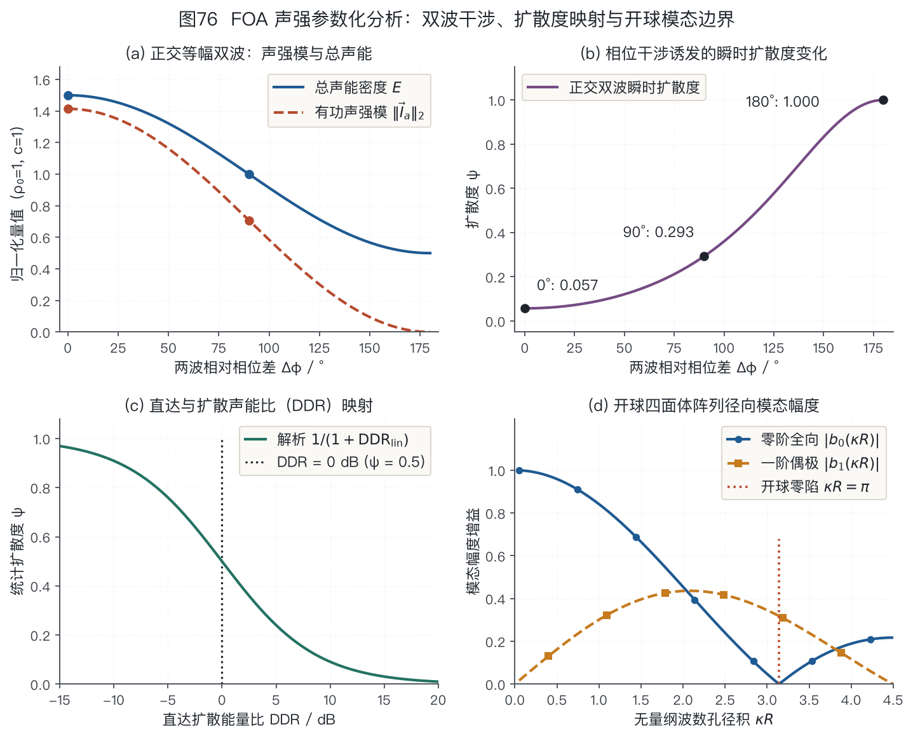
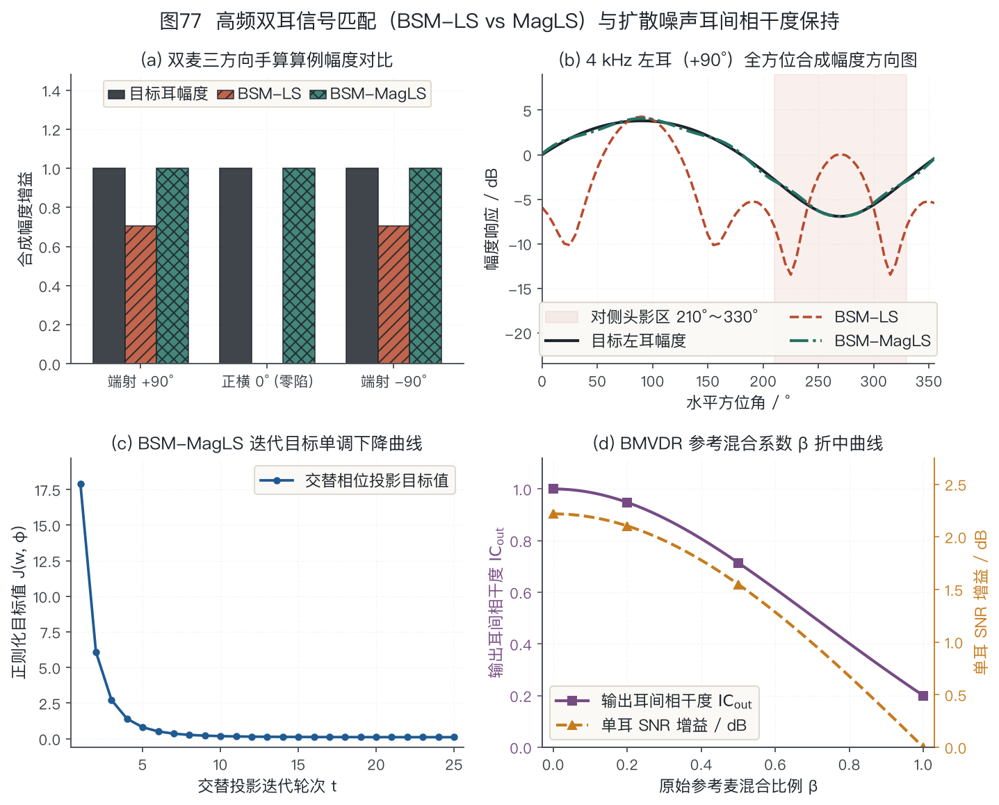
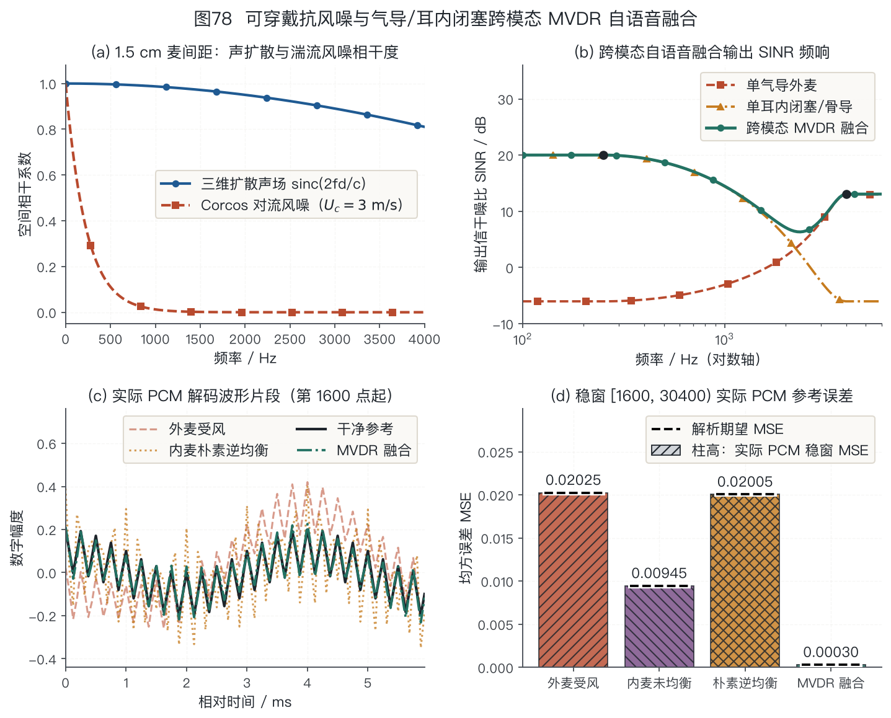
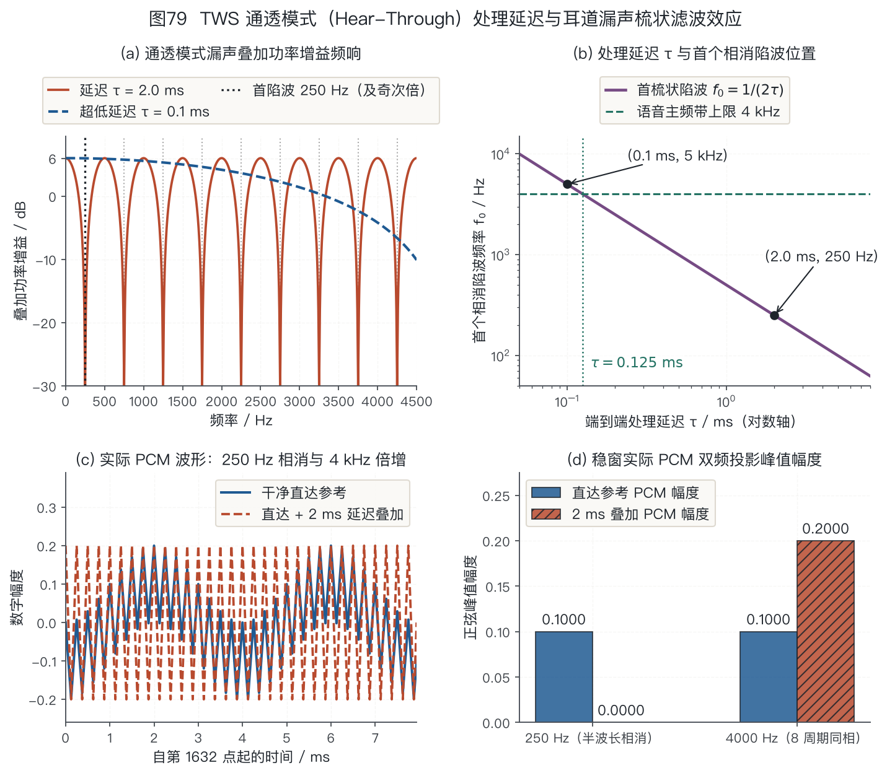

🌐 **简体中文** ｜ [English](../chapters_en/14_spatial-wearable-arrays.md)

> ⚠️ 本篇是本书正文第 14 章（扩展专题Ⅲ；正文共 16 章，即第 0～15 章，其中第 12～15 章为四篇扩展专题，另有附录 A、B），接在第 13 章分布式麦克风协同增强之后，系统介绍三维空间声场采集、参数化空间编码与可穿戴麦克风阵列处理。三维旋转群 $\mathrm{SO}(3)$、Wirtinger 复梯度与球面调和函数推导见[第 0 章 §0.1](00_math-foundations.md#sec-0-1)、[§0.5](00_math-foundations.md#sec-0-5)与[§0.7](00_math-foundations.md#sec-0-7)，全局符号速查见[第 16 章附录 A](16_appendix-symbols-math.md)。
>
> 首页导读：[00_overview.md](00_overview.md) ｜ 上一篇：[13_distributed-enhancement.md](13_distributed-enhancement.md) ｜ 下一篇：[15_target-extraction-diarization.md](15_target-extraction-diarization.md)

---

## 第 14 章：空间声场采集、参数化编码与可穿戴阵列

### 14.1 从单路增强走向全向空间采集与随身听觉

#### 两端需求如何统一在同一套物理波动方程下

前面各章讨论的桌面圆阵、线性电视阵列与会议吊麦，大多追求同一个单声道目标：把远处目标说话人的语音尽可能干净地提取成一路波形，送给自动语音识别或远端通话对端。然而在全景声录制、扩展现实（Extended Reality，XR）头显、智能眼镜、真无线立体声（True Wireless Stereo，TWS）耳机与数字助听器中，音频系统面对的任务发生了两个根本转变。

第一个转变是**输出不再是一路抹平方向的单声道信号，而是携带完整三维方向感与环境包围感的声场或双耳声压**。无论是用紧凑的四胶囊四面体麦克风采集三维一阶全景声（First-Order Ambisonics，FOA），还是用智能眼镜框上的多支微型麦克风合成佩戴者双耳鼓膜处的声学传递响应，系统都必须在保留精确双耳时间差（Interaural Time Difference，ITD）、双耳声级差（Interaural Level Difference，ILD）和环境扩散感的同时完成空间滤波。当佩戴者转动头部时，渲染出的虚拟声像还必须反方向平滑旋转，才能让声源稳稳锚定在真实物理世界中。

第二个转变是**可穿戴设备的物理约束与声学干扰形态截然不同**。TWS 耳机单侧外壳长度通常不足 $2\ \mathrm{cm}$，麦克风间距远小于中低频声波波长；人体头部与耳廓的强散射使自由场平面波导向矢量不再适用；户外行走或骑行时的局部湍流风噪在毫米尺度剧烈起伏，极易淹没外露气导麦克风。

与此同时，开启主动通透模式（Hear-Through）时，哪怕数字处理链路只有 $2\ \mathrm{ms}$ 的端到端延迟，电声重放信号与耳道缝隙被动漏入的直达声叠加后也会在语音频带内切出周期性梳状陷波。为突破单一气导麦克风的物理局限，现代耳戴式设备普遍在封闭耳道内增设内向反馈麦克风或骨导拾音传感器，通过跨模态统计融合提取佩戴者本人的清晰语音。

| 应用形态 | 典型传感器配置 | 期望输出目标 | 核心物理与工程瓶颈 |
|---|---|---|---|
| 紧凑全景声采集 | 正四面体 $4$ 胶囊球阵 | 正交球谐通道与参数化声场流 | 高频空间混叠、开球径向零陷与多源干涉偏置 |
| 智能眼镜 / 头显拾音 | 镜腿与鼻梁 $4$～$6$ 支非规则微麦 | 双耳匹配信号（BSM）或定向增强流 | 高频相位缠绕引发幅度凹坑、头部遮挡散射 |
| 双耳助听器协同增强 | 左右耳挂各 $2$ 支麦克风加双耳无线链路 | 保留双耳线索的低噪双耳音频 | 单目标波束把背景扩散噪声压成头中单点声像 |
| TWS 通话与通透模式 | 耳外双气导麦 + 耳内闭塞麦 / 骨导传感器 | 抗风噪自语音上行流与自然通透重放 | 湍流风噪空间不相干、骨导高频衰减与漏声梳状滤波 |

上表展示了四类典型系统的硬件边界与任务差异。尽管它们的产品形态各异，底层却共享同一套声压—质点振速波动关系、受限孔径空间匹配优化与多传感器二阶统计融合准则。本章便沿着“三维声场球谐表示 $\to$ 声强参数化分析 $\to$ 可穿戴双耳匹配与相干度保持 $\to$ 抗风噪跨模态自语音融合与百微秒以内超低延迟通透重放”的脉络逐层展开。

#### 本章的核心术语与先修路线

本章集中出现的核心术语与缩写汇总如下表，阅读推导时可随时回查：

| 缩写 | 中文名与英文全称 | 在本章中的作用 |
|---|---|---|
| FOA | 一阶全景声（First-Order Ambisonics） | 用零阶全向声压 $W$ 与三个一阶正交偶极分量 $X, Y, Z$ 表征三维局部声场 |
| ACN | 全景声通道编号（Ambisonic Channel Number） | 按球谐阶次 $(l, m)$ 排列的标准通道顺序，一阶对应 $[W, Y, Z, X]^\top$ |
| SN3D | 施密特半归一化三维球谐约定（Schmidt Semi-Normalized 3D） | 使零阶与一阶实球谐基函数峰值幅度统一为 $1$ 的标准幅度归一化 |
| DirAC | 定向音频编码（Directional Audio Coding） | 从短时频域声压与振速估计瞬时波达方向及扩散度 $\psi$ 的参数化空间分析框架 |
| BSM | 双耳信号匹配（Binaural Signal Matching） | 用任意几何可穿戴阵列线性逼近目标头相关传递函数（Head-Related Transfer Function，HRTF）的设计方法 |
| MagLS | 幅度最小二乘（Magnitude Least-Squares） | 在高频放弃刚性相位拟合、通过交替相位投影优先保障方向幅度平滑的准则 |
| IC | 耳间相干度（Interaural Coherence；亦称双耳相干度） | 衡量左右耳背景声场归一化互相关模长的感知指标，决定声像宽度与包围感 |
| OE | 耳道闭塞效应（Occlusion Effect） | 耳塞封闭外耳道后，佩戴者自身发声经颅骨振动在耳道腔内激起低频声压增益的现象 |

阅读本章前，建议先熟悉[第 1 章双耳听觉的三类定位线索](01_problem-definition.md#sec-1-2)、[第 2 章 §2.3 平面波与频域内积约定](02_basics-signal-model.md#sec-2-3)，以及[第 5 章 §5.4 MVDR](05_beamforming.md#sec-5-4)、[§5.5 LCMV 多约束](05_beamforming.md#sec-5-5)与[§5.8 球谐域波束形成](05_beamforming.md#sec-5-8)；三维旋转矩阵 $\mathrm{SO}(3)$、复矩阵 Wirtinger 求导、球贝塞尔函数及实球谐函数预备可参看[第 0 章 §0.1、§0.5、§0.7](00_math-foundations.md#sec-0-1)与[附录 A](16_appendix-symbols-math.md)。全章严格沿用本书前向傅里叶核 $e^{-\mathrm{j}2\pi f t}$（对应正频率复相量时间因子 $e^{+\mathrm{j}\omega t}$，角频率 $\omega = 2\pi f$，波数 $\kappa = \omega / c$）以及共轭内积滤波器输出 $y = \vec w^H \vec x$。

### 14.2 一阶 Ambisonics（FOA）与正四面体阵列编码

#### 球面角、一阶实球谐基与 SN3D / ACN 通道约定

在三维空间声场采集中，首先要厘清坐标轴方向与二维平面阵列正横（broadside）零点的换算关系。按照国际通用的三维全景声右手笛卡尔坐标系（AmbiX / ISO 约定），令原点位于阵列几何中心，$+x$ 轴指向佩戴者正前方，$+y$ 轴指向正左方，$+z$ 轴垂直向上。设远场声源相对原点的水平方位角为 $\theta \in (-\pi, \pi]$（在水平面内从正前方 $+x$ 轴向正左方 $+y$ 轴逆时针旋转为正；对照[第 3 章 §3.1](03_array-geometry.md#sec-3-1) 及[附录 A §16.1](16_appendix-symbols-math.md#sec-16-1) 以 $+y$ 为正横 $0^\circ$、顺时针度量的平面阵列方位角 $\theta_{\mathrm{book}}$，AmbiX 方位角 $\theta$ 满足换算关系 $\theta = 90^\circ - \theta_{\mathrm{book}}$），俯仰角简记为 $\phi \equiv \phi_{\mathrm{el}} \in [-\pi/2, \pi/2]$（向上偏向 $+z$ 轴为正），则从阵列中心**指向声源**的单位波达方向向量 $\vec n_{\mathrm{src}}$ 为：

$$\vec n_{\mathrm{src}}(\theta,\phi)
=\begin{bmatrix}n_x\\n_y\\n_z\end{bmatrix}
=\begin{bmatrix}
\cos\phi\cos\theta\\
\cos\phi\sin\theta\\
\sin\phi
\end{bmatrix}.
\tag{14-1}$$

观察式(14-1)的四个初等函数：$1$ 不随方向改变，恰对应球面上零阶（$l = 0$）全向单极子响应；而 $n_x, n_y, n_z$ 分别沿前后、左右、上下呈正负对称的“8 字形”余弦指向性，恰对应球面上三个正交的一阶（$l = 1$）偶极子实球谐基函数。在 **SN3D（Schmidt Semi-Normalized 3D）** 幅度约定下，零阶与一阶基函数的方向峰值均归一化为 $1$（早期 FuMa 约定曾将零阶 $W$ 额外乘上 $1/\sqrt{2}$，现代工程与开源工具包已普遍转向 AmbiX 标准，即 **ACN 通道序 + SN3D 归一化**）。为打通[第 0 章 §0.7.4](00_math-foundations.md#sec-0-7-4)、[第 5 章 §5.8](05_beamforming.md#sec-5-8) 的单位球面标准正交基 $Y_{l,m}^{\mathrm{ortho}}$（满足 $\int_{S^2}|Y_{l,m}^{\mathrm{ortho}}(\Omega)|^2\,\mathrm{d}\Omega = 1$）以及 `spharpy`、`spaudiopy` 等开源空间音频库常用的 **N3D（Normalized 3D，球面均方归一）** 与 **SN3D**，三套归一化基在任意阶次 $(l, m)$ 下满足精确比例换算：

$$Y_{l,m}^{\mathrm{N3D}}(\Omega)
=\sqrt{2l+1}\,Y_{l,m}^{\mathrm{SN3D}}(\Omega)
=\sqrt{4\pi}\,Y_{l,m}^{\mathrm{ortho}}(\Omega).$$

以一阶偶极基（$l = 1$，$2l + 1 = 3$）逐项核对峰值与球面均方值 $\frac{1}{4\pi}\int_{S^2}|\cdot|^2\,\mathrm{d}\Omega$：$Y_{1,m}^{\mathrm{SN3D}}$（即式(14-1)的 $n_y, n_z, n_x$）方向峰值为 $1$、球面均方为 $1/3$；乘上 $\sqrt{3}$ 后，$Y_{1,m}^{\mathrm{N3D}}$ 的方向峰值升为 $\sqrt{3}$、球面均方归一为 $1$（球面积分为 $4\pi$）；再除以 $\sqrt{4\pi}$ 后，$Y_{1,m}^{\mathrm{ortho}}$ 的方向峰值为 $\sqrt{3/(4\pi)}$、球面积分归一为 $1$（零阶 $l = 0$ 时 $Y_{0,0}^{\mathrm{N3D}} = Y_{0,0}^{\mathrm{SN3D}} = 1$，而 $Y_{0,0}^{\mathrm{ortho}} = 1/\sqrt{4\pi}$）。若一列原点处复声压相量为 $p \in \mathbb{C}$ 的平面波从方向 $\vec n_{\mathrm{src}}(\theta,\phi)$ 入射，其理想一阶 B-format 四通道信号按直观笛卡尔序 $\vec b_{\mathrm{WXYZ}}$ 与标准 ACN 序 $\vec b_{\mathrm{ACN}}$ 分别记作：

$$\begin{aligned}
\vec b_{\mathrm{WXYZ}}
&=\begin{bmatrix}W & X & Y & Z\end{bmatrix}^\top\\
&=p\begin{bmatrix}1 & n_x & n_y & n_z\end{bmatrix}^\top,\\
\vec b_{\mathrm{ACN}}
&=\begin{bmatrix}W & Y & Z & X\end{bmatrix}^\top\\
&=p\begin{bmatrix}1 & n_y & n_z & n_x\end{bmatrix}^\top.
\end{aligned}\tag{14-2}$$

在推导三维几何旋转与声强公式时，采用 $\vec b_{\mathrm{WXYZ}} = [W, X, Y, Z]^\top$ 能让后三维直接对齐笛卡尔坐标 $[x, y, z]^\top$，矩阵分块一目了然；而在读写标准多声道全景声文件时，只需对后三路执行固定置换即可无损切换到 ACN 编号 $[0, 1, 2, 3] \leftrightarrow [W, Y, Z, X]$（配套函数 `reorder_foa` 对两种通道序提供双向严格校验与转换）。

#### 正四面体 A-format 到 B-format 的精确转换矩阵

物理上无法把四个具有理想正交偶极指向性的传感器毫无体积地塞进同一个几何点，工程上最经典的紧凑三维采集结构是**正四面体麦克风阵（Tetrahedral Array）**。在单位立方体的八个顶点中交替选取四个不相邻顶点，即可构成内接于球面的正四面体，其四个胶囊的朝向单位向量（习惯按前左上 FLU、前右下 FRD、后左下 BLD、后右上 BRU 排序，统称 **A-format** 原始四通道）拼成方向矩阵 $\mathbf U \in \mathbb{R}^{4 \times 3}$：

$$\begin{aligned}
\mathbf U
&=\bigl[\vec u_1,\vec u_2,\vec u_3,\vec u_4\bigr]^\top\\
&=\frac{1}{\sqrt{3}}\begin{bmatrix}
+1 & +1 & +1\\
+1 & -1 & -1\\
-1 & +1 & -1\\
-1 & -1 & +1
\end{bmatrix}.
\end{aligned}\tag{14-3}$$

动手算两步内积就能看清正四面体为何如此对称：其一，$\mathbf U$ 的每一列都有两个 $+1$ 和两个 $-1$，故四支胶囊方向之和严格为零向量 $\vec 1_4^\top \mathbf U = \vec 0^\top$；其二，任意两列逐元素相乘后都是两个 $+1$ 加两个 $-1$，严格正交，而每列自身的平方和为 $4/3$，即满足各向同性正交恒等式 $\mathbf U^\top \mathbf U = \frac{4}{3}\mathbf I_3$。

先考察低频共点近似下的指向性胶囊模型。设第 $q$ 支胶囊（$q = 1, 2, 3, 4$）为一阶心形族传感器，一阶混合系数为 $\alpha \in (0, 1)$（标准心形指向性取 $\alpha = 1/2$），对来自 $\vec n_{\mathrm{src}}$、中心声压为 $p$ 的平面波输出响应等于全向项 $(1 - \alpha)p$ 与方向项 $\alpha(\vec u_q^\top\vec n_{\mathrm{src}})p$ 之和。写成四维列向量 $\vec a = [a_1, a_2, a_3, a_4]^\top$，有：

$$\vec a
=(1-\alpha)p\vec 1_4+\alpha p\mathbf U\vec n_{\mathrm{src}}.
\tag{14-4}$$

怎样从四路 A-format 观测 $\vec a$ 中精确解出式(14-2)的 $W = p$ 和 $[X, Y, Z]^\top = p\vec n_{\mathrm{src}}$？利用刚才验证过的两条正交性质直接左乘即可：

1. 用全一向量 $\vec 1_4^\top$ 左乘 $\vec a$：因 $\vec 1_4^\top \mathbf U = \vec 0^\top$，方向项彻底抵消，只剩 $\vec 1_4^\top \vec a = 4(1 - \alpha)p$，两边同除以 $4(1 - \alpha)$ 立得 $W = p$。
2. 用 $\mathbf U^\top$ 左乘 $\vec a$：因 $\mathbf U^\top \vec 1_4 = \vec 0$，全向项彻底抵消，乘积 $\mathbf U^\top\vec a$ 等于 $\frac{4\alpha}{3}p\vec n_{\mathrm{src}}$，两边同乘 $\frac{3}{4\alpha}$ 立得 $[X, Y, Z]^\top = p\vec n_{\mathrm{src}}$。

把因子 $\frac{3}{4\alpha}$ 乘进 $\mathbf U^\top$（化简系数得 $\frac{\sqrt{3}}{4\alpha}$），就得到了共点四面体从 A-format 到 SN3D B-format（`WXYZ` 序）的 $4 \times 4$ 实编码矩阵 $\mathbf E_{\mathrm{A}\to\mathrm{B}}$：

$$\begin{aligned}
\vec b_{\mathrm{WXYZ}}
&=\mathbf E_{\mathrm{A}\to\mathrm{B}}\vec a,\\
\mathbf E_{\mathrm{A}\to\mathrm{B}}
&=\begin{bmatrix}
g_W & g_W & g_W & g_W\\
g_1 & g_1 & -g_1 & -g_1\\
g_1 & -g_1 & g_1 & -g_1\\
g_1 & -g_1 & -g_1 & g_1
\end{bmatrix},
\end{aligned}\tag{14-5}$$

其中全向增益为 $g_W = \frac{1}{4(1 - \alpha)}$，偶极增益为 $g_1 = \frac{\sqrt{3}}{4\alpha}$。代入标准心形胶囊 $\alpha = 1/2$，立得 $g_W = \frac{1}{2}$、$g_1 = \frac{\sqrt{3}}{2} \approx 0.866025$。请留意两个极端退化情形：若 $\alpha \to 0$（四支全向麦重合在同一点），$g_1 \to \infty$，系统丧失空间梯度可观测性；若 $\alpha \to 1$（四支纯 8 字形偶极麦），$g_W \to \infty$，四个偶极子相加恒为零，无法恢复全向声压 $W$。

#### 开球与刚性球径向模态权重及 $\kappa R = \pi$ 禁频零陷

真实四面体阵列的四支胶囊分布在半径 $R > 0$ 的球面上而非几何同一点。若在半径为 $R$ 的假想透声球面（开球阵列，Open Sphere）上放置全向声压麦克风，从 $\vec n_{\mathrm{src}}$ 入射的单位平面波 $p(R,\Omega) = e^{+\mathrm{j}\kappa R\,\vec n_{\mathrm{src}}^\top\vec u(\Omega)}$ 按雅可比—安格尔（Jacobi–Anger）级数展开为 $\sum_{l=0}^{\infty}(2l+1)\mathrm{j}^l j_l(\kappa R)P_l(\vec n_{\mathrm{src}}^\top\vec u)$。配合峰值归一为 $1$ 的 SN3D 实球谐基，定义连续球面上的**球面均值投影**算子：

$$\tilde{B}_{l,m}(\kappa R)
=\frac{1}{4\pi}\int_{S^2}p(R,\Omega)\,
Y_{l,m}^{\mathrm{SN3D}}(\Omega)\,\mathrm{d}\Omega.$$

初看雅可比—安格尔展开的一阶项 $3\mathrm{j}\,j_1(\kappa R)(\vec n_{\mathrm{src}}^\top\vec u)$ 带有阶次系数 $2l + 1 = 3$，为什么最终径向模态权重里这个因子 $3$ 消失了？原因在于连续球面方向余弦的各向同性二阶矩积分 $\frac{1}{4\pi}\int_{S^2}(\vec n_{\mathrm{src}}^\top\vec u)\vec u\,\mathrm{d}\Omega = \frac{1}{3}\vec n_{\mathrm{src}}$：投影产生的因子 $1/3$ 与展开式中的 $2l + 1 = 3$ 恰好相乘抵消，使连续球面投影满足 $\tilde{B}_{l,m}(\kappa R) = b_l^{\mathrm{open}}(\kappa R)\,Y_{l,m}^{\mathrm{SN3D}}(\Omega_{\mathrm{src}})$。由此得到球面均值归一化的开球径向模态权重（与[第 0 章 §0.7.3](00_math-foundations.md#sec-0-7-3) 式(0-63) 及[第 5 章 §5.8](05_beamforming.md#sec-5-8) 式(5-24) 配标准正交基的 $4\pi\mathrm{j}^l j_l(\kappa R)$ 仅相差立体角常数 $4\pi$，而零点位置 $\kappa R = \pi$ 完全一致）：

$$\begin{aligned}
b_0^{\mathrm{open}}(\kappa R)
&=j_0(\kappa R)
=\frac{\sin(\kappa R)}{\kappa R},\\
b_1^{\mathrm{open}}(\kappa R)
&=\mathrm{j}\,j_1(\kappa R)\\
&=\mathrm{j}\,\frac{\sin(\kappa R)-\kappa R\cos(\kappa R)}
{(\kappa R)^2}.
\end{aligned}\tag{14-6}$$

将连续积分近似为四胶囊正四面体的离散等权求积 $\frac{1}{4}[\vec 1_4, \mathbf U]^\top\vec p$ 时，必须看清一处关键离散边界：尽管式(14-3)满足 $\frac{1}{4}\mathbf U^\top\mathbf U = \frac{1}{3}\mathbf I_3$，四元正四面体仅构成**球面 2-design**（仅对满足 $l_1 + l_2 \le 2$ 的球谐乘积求积精确，三阶矩不为零）。因此二阶四极子模态（$l = 2$）与一阶偶极基（$l = 1$）在四点网格上并不正交，斜向入射平面波早在 $\kappa R < 1$ 时便会向 $X, Y, Z$ 通道产生混叠泄漏。以水平面 $\theta = 45^\circ$、$\phi = 0^\circ$ 的单位平面波 $\vec n_{\mathrm{src}} = [1/\sqrt{2}, 1/\sqrt{2}, 0]^\top$ 为例，四胶囊方向投影为 $\mathbf U\vec n_{\mathrm{src}} = [\sqrt{2/3}, 0, 0, -\sqrt{2/3}]^\top$，代入四点全向开球求积 $\frac{1}{4}\mathbf U^\top e^{+\mathrm{j}\kappa R\,\mathbf U\vec n_{\mathrm{src}}}$ 立得闭合解：

$$\begin{aligned}
X&=\frac{\mathrm{j}}{2\sqrt{3}}\sin\!\left(\kappa R\sqrt{\tfrac{2}{3}}\right),\\
Z&=\frac{1}{2\sqrt{3}}\!\left[\cos\!\left(\kappa R\sqrt{\tfrac{2}{3}}\right)-1\right],\\
\frac{|Z|}{|X|}&=\tan\!\left(\frac{\kappa R}{\sqrt{6}}\right).
\end{aligned}$$

可见垂直通道 $Z$ 在 $\kappa R = 0.5$ 时即出现 $|Z|/|X| \approx 20.70\%$ 的虚假泄漏，到 $\kappa R = 1.0$ 时升至 $43.26\%$。此外，商用四面体麦克风大多采用心形（而非全向）胶囊，其径向响应为单极与径向梯度项的线性组合，改变了式(14-6)的模态权重并有效缓解了开球在 $\kappa R = \pi$ 处的全向零陷。

式(14-6)揭示了球面阵列设计中至关重要的两道物理边界：

- **高频开球禁频零陷（$\kappa R = \pi$）与刚性球 $h_l^{(2)}$ 散射闭合解**：当声波半波长恰好等于球半径、即 $\kappa R = \pi$（对应频率 $f_{\mathrm{null}} = \frac{c}{2R}$）时，$\sin(\pi) = 0$ 使 $b_0^{\mathrm{open}}(\pi) = 0$。此时球面上全向声压积分恰好正负相消，无论后端施加多大的数字逆滤波增益，都只能把电路热噪声放大而无法找回丢失的零阶声压 $W$。若将麦克风齐平嵌装在**刚性实心球体（Rigid Sphere）**表面，球面法向振速为零的硬边界条件 $\left.\partial_r p\right|_{r=R} = 0$ 会激发向外辐射的散射波；结合球贝塞尔朗斯基恒等式（详见[第 0 章 §0.7.3](00_math-foundations.md#sec-0-7-3) 式(0-63)），同一球面均值口径下的刚性球径向模态权重闭式解为：

    $$b_l^{\mathrm{rigid}}(\kappa R)
    =\mathrm{j}^l\left[j_l(\kappa R)
    -\frac{j_l'(\kappa R)}{h_l^{(2)\prime}(\kappa R)}\,
    h_l^{(2)}(\kappa R)\right]
    =\frac{\mathrm{j}^{l-1}}
    {(\kappa R)^2\,h_l^{(2)\prime}(\kappa R)}.$$

    这里务必留意时间谐波符号约定：在本书前向傅里叶核 $e^{-\mathrm{j}\omega t}$（对应正频率复相量时间因子 $e^{+\mathrm{j}\omega t}$）下，随半径 $r$ 增大而相位滞后的向外散射行波必须选用**第二类球汉克尔函数** $h_l^{(2)}(\kappa r) = j_l(\kappa r) - \mathrm{j}y_l(\kappa r)$；若误套采用 $e^{-\mathrm{j}\omega t}$ 时间因子的声学文献公式而写成第一类 $h_l^{(1)}(\kappa r)$，散射补偿相位将整体共轭反号。

    由于 $h_l^{(2)\prime}(\kappa R)$ 在正实轴上无零点，刚性球在正实轴上消除了 $\kappa R = \pi$ 处的内部本征零陷。进一步考察低频极限 $x = \kappa R \ll 1$，由 $y_1(x) \approx -1/x^2$ 求导得 $h_1^{(2)\prime}(x) \approx -2\mathrm{j}/x^3$，代入上式即证出 $b_1^{\mathrm{rigid}}(x) \approx \frac{1}{x^2(-2\mathrm{j}/x^3)} = \mathrm{j}\frac{x}{2} \approx \frac{3}{2}b_1^{\mathrm{open}}(x)$——实心球体衍射把一阶偶极有效声学孔径拓宽至开球的 $3/2$ 倍，带来 $20\log_{10}(3/2) \approx +3.52\ \mathrm{dB}$ 的低频偶极子灵敏度增益（[第 3 章 E03-17](03_array-geometry.md#e03-17) 从时差孔径视角验证了同一 $3/2$ 因子）。
- **低频白噪声放大、高频空间混叠与高阶全景声（HOA）扩展**：在极低频 $\kappa R \ll 1$ 时，泰勒展开给出偶极模长 $|b_1(\kappa R)| \approx \kappa R / 3$，以 $6\ \mathrm{dB/oct}$ 斜率随频率下降，因此径向均衡器 $1/b_1(\kappa R)$ 必须大幅提升低频增益（需加 Tikhonov 限幅以免放大传感器底噪）；而在高频段，四胶囊阵列至多提供 $4 = (1 + 1)^2$ 个独立实观测，一旦 $\kappa R > 1$（经验上限 $f_{\mathrm{alias}} \approx \frac{c}{2\pi R}$），二阶及以上高阶球谐波（$l \ge 2$）就会严重混叠污染一阶通道（见 [E14-02](#e14-02)）。若要在更宽频带内获得更窄的空间主瓣并抑制多源串扰，工程上采用 $N$ 阶**高阶全景声（Higher-Order Ambisonics，HOA）**：全三维 $N$ 阶球谐展开需要 $(N + 1)^2$ 个独立通道（对应至少 $Q \ge (N + 1)^2$ 支均匀球面胶囊，例如 $32$ 胶囊刚性球阵列可稳定编码至 $N = 4$ 阶共 $25$ 通道），将空间无混叠上限线性扩展至 $f_{\mathrm{alias}} \approx \frac{N c}{2\pi R}$，同时低频高阶模态按 $(\kappa R)^N$ 更快衰减，必须配合分阶 Tikhonov 径向正则化滤波器避免白噪声剧烈放大（球谐域波束基础见[第 5 章 §5.8](05_beamforming.md#sec-5-8)）。

### 14.3 三维声场旋转与头部追踪坐标变换

#### 欧拉角串联旋转矩阵与零阶全向不变性

FOA 之所以成为全景声制作与虚拟现实渲染的工业基石，核心优势在于：**要在三维空间任意旋转整个声场，无需知道房间里有多少个声源，也不必先做声源分离，只需对四通道 B-format 向量做一次 $4 \times 4$ 实正交矩阵乘法。** 原因就在式(14-2)的几何结构里：$W = p$ 是标量，在任何绕原点的旋转下严格保持不变；而 $[X, Y, Z]^\top = p\vec n_{\mathrm{src}}$ 与三维笛卡尔位置向量具有完全相同的正交旋转变换律。

采用右手系内旋 $Z$-$Y$-$X$ 欧拉角约定，为避免与 §14.2 胶囊指向性系数 $\alpha$ 及 §14.7 参考混合比例 $\beta$ 混淆，本节将偏航角（Yaw，绕竖直 $+z$ 轴）、俯仰角（Pitch，绕侧向 $+y$ 轴）与翻滚角（Roll，绕前向 $+x$ 轴）记作 $(\phi_z, \phi_y, \phi_x)$。三个基本轴旋转矩阵分别为：

$$\begin{aligned}
\mathbf R_z(\phi_z)&=\begin{bmatrix}
\cos\phi_z & -\sin\phi_z & 0\\
\sin\phi_z & \cos\phi_z & 0\\
0 & 0 & 1
\end{bmatrix},\\
\mathbf R_y(\phi_y)&=\begin{bmatrix}
\cos\phi_y & 0 & \sin\phi_y\\
0 & 1 & 0\\
-\sin\phi_y & 0 & \cos\phi_y
\end{bmatrix},\\
\mathbf R_x(\phi_x)&=\begin{bmatrix}
1 & 0 & 0\\
0 & \cos\phi_x & -\sin\phi_x\\
0 & \sin\phi_x & \cos\phi_x
\end{bmatrix}.
\end{aligned}\tag{14-7}$$

将 $\mathbf R_z(\phi_z)$、$\mathbf R_y(\phi_y)$ 与 $\mathbf R_x(\phi_x)$ 依次相乘得到三维旋转矩阵 $\mathbf R_{\mathrm{scene}}$，它属于特殊正交群 $\mathrm{SO}(3)$，其转置 $\mathbf R_{\mathrm{scene}}^\top$ 即等于逆阵 $\mathbf R_{\mathrm{scene}}^{-1}$ 且 $\det\mathbf R_{\mathrm{scene}} = +1$。拼上左上角标量 $1$，即得作用于 $\vec b_{\mathrm{WXYZ}}$ 的 $4 \times 4$ 声场主动旋转矩阵：

$$\vec b'_{\mathrm{WXYZ}}
=\begin{bmatrix}
1 & \vec 0^\top\\
\vec 0 & \mathbf R_{\mathrm{scene}}(\phi_z,\phi_y,\phi_x)
\end{bmatrix}\vec b_{\mathrm{WXYZ}}.
\tag{14-8}$$

注意三维有限角旋转不可交换顺序（例如先偏航 $90^\circ$ 再俯仰 $90^\circ$，与先俯仰 $90^\circ$ 再偏航 $90^\circ$ 最终指向截然不同），工程联调惯性测量单元（Inertial Measurement Unit，IMU）四元数或欧拉角时必须先核对轴序。

将上述旋转推广至 $N$ 阶高阶全景声（HOA）时，旋转操作保持各球谐阶次 $l = 0, 1, \ldots, N$ 的不变子空间不发生跨阶串扰，整体由 $(N + 1)^2 \times (N + 1)^2$ 的分块对角实正交矩阵 $\mathbf D_{\mathrm{HOA}} = \operatorname{blkdiag}\bigl(1, \mathbf D^{(1)}, \ldots, \mathbf D^{(N)}\bigr)$ 执行，其中第 $l$ 阶 $(2l+1) \times (2l+1)$ 实 Wigner-D 块 $\mathbf D^{(l)}$ 在工程上常借助 Ivanic–Ruedenberg 递推从 $\mathbf D^{(1)}$ 逐阶构造；而在 `WXYZ` 通道序下，一阶块精确退化为式(14-8)中的 $\mathbf D^{(1)} = \mathbf R_{\mathrm{scene}}$。

#### 声场主动旋转与佩戴者头部追踪逆旋转

在 XR 头显与空间音频耳机（如动态头部追踪渲染）中，最容易写反的符号是**“把虚拟声源主动转过去”与“佩戴者自己扭了头”之间的转置逆关系**。我们用一个极简例子当场算清：假设世界坐标系正前方 $+x$ 处（$\vec n_{\mathrm{world}} = [1, 0, 0]^\top$）站着一位静止不动的演讲者，其世界系 FOA 向量为 $[1, 1, 0, 0]^\top$。

现在佩戴者把头向左偏航转过 $\phi_z = +90^\circ$（即鼻尖从世界 $+x$ 转向世界 $+y$，右耳朝向世界 $+x$）。站在佩戴者自己的头部局部坐标系看，原本在世界 $+x$ 处的演讲者此刻已经位于佩戴者的**正右方**（即头部坐标系的 $-y_{\mathrm{head}}$ 方向，$\vec n_{\mathrm{head}} = [0, -1, 0]^\top$）。也就是说，当头部姿态相对世界系旋转了 $\mathbf R_{\mathrm{head}} = \mathbf R_{\mathrm{scene}}$ 时，将世界固定声场变换到佩戴者头部坐标系的矩阵必须是其**逆矩阵（正交转置）** $\mathbf R_{\mathrm{head}}^\top$：

$$\vec b_{\mathrm{head}}
=\begin{bmatrix}
1 & \vec 0^\top\\
\vec 0 & \mathbf R_{\mathrm{scene}}^\top(\phi_z,\phi_y,\phi_x)
\end{bmatrix}\vec b_{\mathrm{world}}.
\tag{14-9}$$

一旦代码漏掉了式(14-9)右上角的转置符号 $^\top$，佩戴者向左转头 $+90^\circ$ 时，声源反而会跟着头部再向左偏转 $90^\circ$ 落到脑后，直接引发视听方向倒置与眩晕感（见 [E14-03](#e14-03) 对照验证）。

在把旋转后的声场送入双耳头相关冲激响应（HRIR）卷积渲染之前，工程链路还须把好两道物理关卡。其一是校验 `SOFA`（AES69-2022）测量文件的球面或笛卡尔坐标属性与双耳通道极性，防止球面角度被误读为米制坐标或左右耳颠倒。其二是将姿态传感、无线传输与音频缓冲构成的“动作到声音（Motion-to-Sound）”总延迟压在动态感知容限以内，否则快速转头时的角度滞后仍会破坏声像世界锁定感（定量核算与线性前瞻补偿见 [E14-15](#e14-15)）。

### 14.4 有功声强、总声能密度与参数化空间音频（DirAC）

#### 欧拉动量方程下的声压—振速相位与方向正负号

只靠四路一阶球谐信号直接做线性波束解码（如虚拟心形扬声器馈送），空间主瓣非常宽，在多扬声器或双耳重放时会造成声像展宽与高频音色染色。Pulkki（2007）提出的**定向音频编码（Directional Audio Coding，DirAC）**开辟了另一条参数化路径：人耳在同一时刻、同一临界频带内通常只能分辨一个主导波达方向外加一层环绕扩散感；因此可以在短时傅里叶变换（Short-Time Fourier Transform，STFT）的每个时频格点 $(k, \ell)$ 上，直接由原点声压相量 $p \in \mathbb{C}$ 与三维质点振速相量 $\vec u = [u_x, u_y, u_z]^\top \in \mathbb{C}^3$ 算出能量输运方向及无方向混响占比。

在动笔写声强公式前，必须先把前向傅里叶核 $e^{-\mathrm{j}\omega t}$ 下**波传播方向与声源波达方向的符号**彻底理顺。在线性无黏流体中，牛顿第二定律给出时域欧拉动量方程 $\rho_0 \partial_t \vec u = -\nabla p$，其中 $\rho_0$ 为媒质静态密度。对时间求导在复相量域（逆变换核 $e^{+\mathrm{j}\omega t}$）对应乘以 $+\mathrm{j}\omega$，故频域动量方程为 $+\mathrm{j}\omega\rho_0\vec u = -\nabla p$。

考察一列从声源方向 $\vec n_{\mathrm{src}}$ 入射的平面波：它的波前朝着 $\vec d_{\mathrm{prop}} = -\vec n_{\mathrm{src}}$ 传播，按照本书[第 3 章 §3.1 导向矢量相位约定](03_array-geometry.md#sec-3-1)，靠近声源的位置提前到达（相位超前），令空间相位 $\varphi$ 为 $\kappa\vec n_{\mathrm{src}}^\top\vec r$，声压分布即为 $p(\vec r) = p_0 e^{\mathrm{j}\varphi}$。对其求空间梯度得 $\nabla p = +\mathrm{j}\kappa \vec n_{\mathrm{src}} p$，代入 $+\mathrm{j}\omega\rho_0\vec u = -\nabla p$ 并利用 $\kappa / \omega = 1/c$，立得物理质点振速与 FOA 偶极分量的精确对应关系：

$$\begin{aligned}
\vec u
&=-\frac{p}{\rho_0 c}\vec n_{\mathrm{src}}
=+\frac{p}{\rho_0 c}\vec d_{\mathrm{prop}}\\
&=-\frac{1}{\rho_0 c}\begin{bmatrix}X & Y & Z\end{bmatrix}^\top.
\end{aligned}\tag{14-10}$$

式(14-10)明确区分了声学文献中最易混淆的两组方向正负号：物理质点振速 $\vec u$ 与声压同相时指向**声能流传播方向** $\vec d_{\mathrm{prop}}$，而 FOA 的 $[X, Y, Z]^\top = p\vec n_{\mathrm{src}}$ 指向**声源所在方向** $\vec n_{\mathrm{src}} = -\vec d_{\mathrm{prop}}$。定义复声强 $\vec I_c = \frac{1}{2}p^*\vec u$（分解为 $\vec I_a + \mathrm{j}\vec I_r$），其实部为**时间平均有功声强（Active Intensity）** $\vec I_a$，虚部为来回吞吐而不做净传输的**无功声强（Reactive Intensity）** $\vec I_r$；同时写出势能密度与动能密度之和构成的**时间平均总声能密度** $E$：

$$\begin{aligned}
\vec I_a&=\frac{1}{2}\operatorname{Re}\{p^*\vec u\},\\
\vec I_r&=\frac{1}{2}\operatorname{Im}\{p^*\vec u\},\\
E&=\frac{|p|^2}{4\rho_0 c^2}+\frac{\rho_0\|\vec u\|_2^2}{4}.
\end{aligned}\tag{14-11}$$

注意因子 $1/4$ 的来历：正弦峰值模平方转为时间均方值有一个因子 $1/2$，而瞬时势能密度 $\frac{p^2(t)}{2\rho_0 c^2}$ 与瞬时动能密度 $\frac{1}{2}\rho_0\|\vec u(t)\|_2^2$ 本身各带一个物理系数 $1/2$，两者相乘恰为 $1/4$。检验单列自由场行波：将 $\|\vec u\|_2 = |p|/(\rho_0 c)$ 代入式(14-11)，势能与动能各占 $\frac{|p|^2}{4\rho_0 c^2}$，相加得 $E = \frac{|p|^2}{2\rho_0 c^2}$，而 $\|\vec I_a\|_2 = \frac{|p|^2}{2\rho_0 c} = cE$——声能正好以声速 $c$ 全部向前输运。记平均有功声强为 $\bar{\vec I}_a = \mathbb{E}[\vec I_a]$，当 $\|\bar{\vec I}_a\|_2 > 0$ 时，指向声源的单位波达方向 $\hat{\vec n}_{\mathrm{DOA}}$ 即等于 $-\bar{\vec I}_a / \|\bar{\vec I}_a\|_2$。

#### 扩散度 $\psi \in [0, 1]$ 的严格界证明

在房间混响、驻波或多源干涉场中，一部分声能原地来回振荡或相互抵消，净输运速率 $\|\mathbb{E}[\vec I_a]\|_2$ 低于理论上限 $c\,\mathbb{E}[E]$。据此定义无量纲**声场扩散度（Diffuseness）** $\psi$：

$$\psi
=1-\frac{\|\mathbb{E}[\vec I_a]\|_2}{c\,\mathbb{E}[E]}.
\tag{14-12}$$

为什么式(14-12)中的 $\psi$ 对任意复声压、任意三维复振速和任意快拍统计分布都保证严格落在闭区间 $[0, 1]$ 内？我们用四步初等不等式完整证明。先看单个快拍上的差值 $cE - \|\vec I_a\|_2$：实部范数不超过复向量模长 $|p|\,\|\vec u\|_2$，故

$$\begin{aligned}
cE-\|\vec I_a\|_2
&=\frac{|p|^2}{4\rho_0 c}+\frac{\rho_0 c\|\vec u\|_2^2}{4}
-\frac{1}{2}\|\operatorname{Re}\{p^*\vec u\}\|_2\\
&\ge\frac{|p|^2}{4\rho_0 c}+\frac{\rho_0 c\|\vec u\|_2^2}{4}
-\frac{1}{2}|p|\,\|\vec u\|_2\\
&=\frac{1}{4}\left(\frac{|p|}{\sqrt{\rho_0 c}}
-\sqrt{\rho_0 c}\,\|\vec u\|_2\right)^2\ge 0.
\end{aligned}\tag{14-13}$$

再对多帧快拍取数学期望 $\mathbb{E}[\cdot]$：由向量范数的三角不等式（凸函数 Jensen 不等式），必有 $\|\bar{\vec I}_a\|_2 \le \mathbb{E}[\|\vec I_a\|_2]$，结合式(14-13)即得 $\|\bar{\vec I}_a\|_2 \le c\,\mathbb{E}[E]$。只要 $\mathbb{E}[E] > 0$，两边同除以 $c\,\mathbb{E}[E]$ 立即证得 $0 \le \psi \le 1$。更进一步，从式(14-13)与三角不等式的取等条件可以直接读出两个端点的充要物理意义：

- $\psi = 0$ 当且仅当所有快拍上 $|p| = \rho_0 c\|\vec u\|_2$、声压与振速处处同相（$\vec I_r = \vec 0$）且各快拍的能流方向完全一致——即**纯粹的单方向自由场行进波**。
- $\psi = 1$ 当且仅当时间平均净有功声强 $\mathbb{E}[\vec I_a] = \vec 0$——既包括各向同性的混响扩散声场，也包括两列等幅反向平面波形成的纯驻波（或声压与振速相差 $90^\circ$ 的纯无功近场）。

进一步考察单列稳态平面波（声能密度 $E_{\mathrm{dir}}$，满足 $\|\mathbb{E}[\vec I_{a,\mathrm{dir}}]\|_2 = c E_{\mathrm{dir}}$）与互不相关的各向同性扩散场（声能密度 $E_{\mathrm{diff}}$，满足 $\mathbb{E}[\vec I_{a,\mathrm{diff}}] = \vec 0$）的叠加：由于交叉项期望归零，总能量密度相加为 $\mathbb{E}[E] = E_{\mathrm{dir}} + E_{\mathrm{diff}}$，而净有功声强模长保持 $c E_{\mathrm{dir}}$。定义线性直达扩散声能比 $\mathrm{DDR}_{\mathrm{lin}} = E_{\mathrm{dir}} / E_{\mathrm{diff}}$，代入式(14-12)立得图 76(c) 所绘的闭式映射：

$$\psi
=1-\frac{c E_{\mathrm{dir}}}{c(E_{\mathrm{dir}}+E_{\mathrm{diff}})}
=\frac{1}{1+E_{\mathrm{dir}}/E_{\mathrm{diff}}}
=\frac{1}{1+\mathrm{DDR}_{\mathrm{lin}}}.$$

拿到 $(E, \psi, \hat{\vec n}_{\mathrm{DOA}})$ 后，DirAC 解码器在每个时频格点将输入信号拆成两支：能量占比 $(1 - \psi)E$ 的**直达定向流**按 $\hat{\vec n}_{\mathrm{DOA}}$ 投射到扬声器或对应方向的 HRTF，能量占比 $\psi E$ 的**扩散环境流**则经去相关滤波器均匀馈送到四周，从而兼顾清晰的单源定位与自然的混响包围感。

这一短时参数化思想已成为新一代空间通信与沉浸式媒体国际标准的核心引擎：在 5G 沉浸式语音编解码标准 **3GPP TS 26.253（IVAS）**（2024–2025 年定稿）中，基于 DirAC 演进的**元数据辅助空间音频（Metadata-Assisted Spatial Audio，MASA）**以 $1$～$2$ 路传输音频通道搭配低比特率的波达方向、扩散度与相干度元数据，实现了面向移动终端的实时空间通话与场景采集；在体积式交互媒体侧，**ISO/IEC 23090-4:2025（MPEG-I 沉浸式音频）**则进一步把传统三自由度（3DoF）全景声与 HRTF 渲染拓展至六自由度（6DoF）平动声学建模，将遮挡、衍射与多普勒效应纳入统一的空间声场渲染框架。

#### 锚点手算 14-1：单波、同相双波与正交双波的幻象声像与扩散度

为了亲手核验相位关系如何改变声强与扩散度，我们取归一化媒质常数 $\rho_0 = 1$、$c = 1$，逐步手算三种代表性波场配置（对应函数 `active_intensity_and_diffuseness`）：

1. **单列沿 $+x$ 传播的平面波**：输入 $p = 1$、$\vec u = [1, 0, 0]^\top$。代入式(14-11)得 $\vec I_a = \frac{1}{2}[1, 0, 0]^\top$（模长 $\|\vec I_a\|_2 = 0.5$），总声能密度 $E = \frac{1}{4} + \frac{1}{4} = 0.5$。代入式(14-12)得 $\psi = 1 - \frac{0.5}{0.5} = 0$，准确识别为无扩散纯行波。

2. **两列等幅正交平面波同相叠加（$\Delta\phi = 0^\circ$）**：第 1 波沿 $+x$ 传播（$p_1 = 1$、$\vec u_1 = [1, 0, 0]^\top$），第 2 波沿 $+y$ 传播且同相（$p_2 = 1$、$\vec u_2 = [0, 1, 0]^\top$）。线性叠加后总声压 $p = 2$，总振速 $\vec u = [1, 1, 0]^\top$（范数平方 $\|\vec u\|_2^2 = 2$）。逐项代入得：

    $$\begin{aligned}
    \vec I_a&=\frac{1}{2}\operatorname{Re}\{2\times[1,1,0]^\top\}
    =[1,1,0]^\top,\\
    \|\vec I_a\|_2&=\sqrt{2},\qquad
    E=\frac{|2|^2}{4}+\frac{2}{4}=1.5,\\
    \psi&=1-\frac{\sqrt{2}}{1.5}
    =1-\frac{2\sqrt{2}}{3}\approx 0.057191.
    \end{aligned}$$

    看这个结果：能流方向指向 $[1, 1, 0]^\top / \sqrt{2}$，即夹在两波正中间的 **$45^\circ$ 幻象方向（Phantom Direction）**。同时因为两波在原点处声压相长干涉（$|p|^2 = 4 > 2$），势能密度（$1.0$）超过了动能密度（$0.5$），式(14-13)中的平方项非零，令瞬时扩散度呈现出 $\psi \approx 0.057191$ 的微小非零值。

3. **两列等幅正交平面波正交相移叠加（$\Delta\phi = 90^\circ$）**：保持第 1 波不变，令第 2 波超前 $90^\circ$，即 $p_2 = \mathrm{j}$、$\vec u_2 = [0, \mathrm{j}, 0]^\top$。叠加后总声压 $p = 1 + \mathrm{j}$（模平方 $|p|^2 = 2$），总振速 $\vec u = [1, \mathrm{j}, 0]^\top$（范数平方 $\|\vec u\|_2^2 = |1|^2 + |\mathrm{j}|^2 = 2$）。展开共轭乘积 $p^*\vec u = (1 - \mathrm{j})[1, \mathrm{j}, 0]^\top$，得 $[1 - \mathrm{j},\ 1 + \mathrm{j},\ 0]^\top$：

    $$\begin{aligned}
    \vec I_a&=\frac{1}{2}\operatorname{Re}\{p^*\vec u\}
    =[0.5,0.5,0]^\top,\\
    \vec I_r&=\frac{1}{2}\operatorname{Im}\{p^*\vec u\}
    =[-0.5,+0.5,0]^\top,\\
    \|\vec I_a\|_2&=\frac{1}{\sqrt{2}},\qquad E=0.5+0.5=1.0,\\
    \psi&=1-\frac{1/\sqrt{2}}{1.0}
    =1-\frac{1}{\sqrt{2}}\approx 0.292893.
    \end{aligned}$$

**这个例子说明了什么？** 把两列正交波的相对相位从 $0^\circ$ 改为 $90^\circ$ 后，幻象能流方位角虽仍指在 $45^\circ$，但原本向前输运的一部分耦合能量转化成了横向吞吐的无功声强 $\vec I_r = [-0.5, +0.5, 0]^\top$，导致扩散度从 $0.057191$ 升至 $0.292893$（若两波跨帧互不相关，长窗统计平均同样收敛到 $1 - 1/\sqrt{2} \approx 0.292893$，相位依赖全曲线见图 76(a)(b)）。

**结论在哪些条件下不成立？** 单主方向参数化模型假定每个时频格点至多由一个直达源主导；当两个说话人在同一频点同时发声时，有功声强只能给出两者的能量加权矢量和（幻象折中方向）。特别地，当两源等功率面对面（$+x$ 与 $-x$）发声时，相反能流正负抵消使 $\mathbb{E}[\vec I_a] = \vec 0$、$\psi = 1$，系统会把两路清晰人声误判成纯混响扩散声（见 [E14-05](#e14-05)）。

#### 图 76 解读与参数化空间编码的多源失效边界



读图 76 时，可沿四个子图的横纵轴依次核对双波干涉、混响映射与球阵物理频带边界：

- **子图 (a) 正交等幅双波的声强模与总声能**：横轴为两列正交等幅平面波的相对相位差 $\Delta\phi \in [0^\circ, 180^\circ]$，纵轴为归一化媒质（$\rho_0 = 1$、$c = 1$）下的无量纲能量密度与声强模值。蓝色实线总声能密度 $E(\Delta\phi) = 1 + \frac{1}{2}\cos\Delta\phi$ 与红色虚线有功声强模 $\|\vec I_a(\Delta\phi)\|_2$（等于 $\frac{\sqrt{2}}{2}(1 + \cos\Delta\phi)$）上的圆点标出 $0^\circ$ 与 $90^\circ$ 两组手算锚点；当 $\Delta\phi \to 180^\circ$ 时，原点处于声压波节（$p = 0$），有功声强降为零，但质点振速动能仍保留 $E = 0.5$。
- **子图 (b) 相位干涉诱发的瞬时扩散度变化**：横轴仍为双波相位差 $\Delta\phi$（单位：$^\circ$），纵轴为无量纲瞬时扩散度 $\psi \in [0, 1]$。紫色实线从 $0^\circ$ 时的 $0.057$ 平滑升至 $90^\circ$ 时的 $0.293$，并在 $180^\circ$ 声压相消处触顶 $1.000$，说明实际 DirAC 编码器必须在短时窗上对 $\vec I_a$ 与 $E$ 做时间平滑以抑制单帧干涉跳变。
- **子图 (c) 直达扩散声能比（Direct-to-Diffuse Ratio，DDR）映射**：横轴为稳态平面波与各向同性扩散场声能密度比的分贝值 $\mathrm{DDR}$（定义为 $10\log_{10}(E_{\mathrm{dir}}/E_{\mathrm{diff}})$，单位：$\mathrm{dB}$，范围 $-15$～$+20\ \mathrm{dB}$；注意区别于[第 2 章 §2.4.3](02_basics-signal-model.md#sec-2-4-3) 按房间冲激响应早晚时段积分定义的直达混响比 $\mathrm{DRR}$），纵轴为统计扩散度 $\psi$。绿色实线绘出闭式关系 $\psi = 1/(1 + \mathrm{DDR}_{\mathrm{lin}})$，深灰竖向点线标出 $\mathrm{DDR} = 0\ \mathrm{dB}$ 时 $\psi = 0.5$ 的对称分界点。
- **子图 (d) 开球四面体阵列径向模态幅度**：横轴为无量纲波数孔径积 $\kappa R \in [0.05, 4.5]$，纵轴为开球径向模态幅度增益 $|b_l(\kappa R)|$。蓝色实线零阶全向权重 $|b_0(\kappa R)|$ 从直流 $1.0$ 随频率回落，在红色竖向点线 $\kappa R = \pi$ 处跌入零点；橙色虚线一阶偶极权重 $|b_1(\kappa R)|$ 在 $\kappa R \to 0$ 处趋于零（导致低频逆均衡放大底噪），在 $\kappa R \approx 2.08$ 附近升至约 $0.436$ 的主峰，随后在图右端 $\kappa R \approx 4.493$（满足 $\tan(\kappa R) = \kappa R$）处跌入首个偶极零点，共同框定了紧凑球阵的有效工作频段。

在多扬声器阵列或虚拟扬声器双耳重放中，参数化 DirAC 常与线性全景声解码配合使用（系统三维理论与工程实现详见 Zotter 与 Frank 2019 年专著）。设第 $\ell$ 支扬声器位于单位方向 $\vec u_\ell$ 且实馈送增益为 $d_\ell$，低频段（约 $700\ \mathrm{Hz}$ 以下）保持一阶偶极模态权重 $g_1 = 1$ 的基础（Basic）解码，以还原精确的 **Gerzon 速度矢量** $\vec r_V = \frac{\sum_\ell d_\ell \vec u_\ell}{\sum_\ell d_\ell}$（刻画低频双耳相位差定位）；中高频段则切换为最大化 Gerzon 能量矢量 $\vec r_E$ 模长的 $\max\text{-}r_E$ 阶次加权（二维正多边形环阵取 $1/\sqrt{2}$，三维正八面体球面阵取 $1/\sqrt{3}$）或消除反相负旁瓣的同相（in-phase）加权，从而收窄高频声像展宽并抑制对侧扬声器反相串扰（二维切比雪夫根与三维勒让德根的严格区分见 [E14-14](#e14-14)）。面对家庭影院 5.1/7.1.4 或缺少下半球扬声器的非均匀物理布局，直接求球谐模式匹配逆阵容易病态失真；Zotter 与 Frank（2012）提出的**全向全景声解码（All-Round Ambisonic Decoding，AllRAD）**采用两步解耦设计：先将 FOA/HOA 球谐信号按 $\max\text{-}r_E$ 权重解码到一组覆盖全空间的虚拟均匀球面 $t$-design 扬声器节点上，再通过基于矢量基的幅度平移（VBAP）将每个虚拟节点投影分配给物理布局中最近的三角扬声器组（底部空洞可置虚拟吸声点避免能量倒灌），由此在任意不规则扬声器排布上稳定维持方向能量守恒。

### 14.5 可穿戴非规则小孔径阵列与双耳信号匹配（BSM）

#### 眼镜腿、耳机壳体散射与双耳信号匹配目标函数

进入可穿戴双耳处理前，先划清本节**双耳信号匹配（Binaural Signal Matching，BSM）**与[第 5 章 §5.5](05_beamforming.md#sec-5-5)（及[§5.9](05_beamforming.md#sec-5-9) 掩码自适应前端）中**双耳 LCMV / MVDR** 的任务定位边界：双耳 LCMV / MVDR 面向助听器与嘈杂会谈增强，假定已知特定目标（及强点干扰）方向并施加线性保真约束，利用实时噪声协方差矩阵自适应抑制环境干扰；而本节的 BSM 面向 AR/VR 头显与智能眼镜的全景空间音频采集与回放，不针对单一说话人打零陷，而是用一组时不变固定滤波器在整个三维方向网格上逼近佩戴者的自由场双耳 HRTF 流形，忠实还原任意方向声源的空间方位感。

当我们把视线从规则球面麦克风移向智能眼镜、AR 头显或耳戴式助听器时，正四面体的对称球谐正交性立刻不复存在：$M$ 支微型麦克风被迫分散镶嵌在鼻托、前镜框与两侧镜腿上，中间隔着对中高频声波产生强烈遮挡与衍射的人体头颅。如果直接采集佩戴者的双耳沉浸式录音，或者为重放合成保留真实空间方位的双耳信号，怎样用这组非规则排列的机身麦克风观测 $\vec x(f) \in \mathbb{C}^{M \times 1}$，线性组合出与佩戴者左耳（$e = \mathrm{L}$）和右耳（$e = \mathrm{R}$）鼓膜入口声压尽可能一致的信号 $\hat p_e(f) = \vec w_e^H(f)\vec x(f)$？

这正是近年可穿戴空间音频的核心方法——**BSM**。其建模思路直接而务实：在消声室或边界元仿真中，围绕佩戴者头部选取 $Q$ 个离散采样方向 $\Omega_1, \ldots, \Omega_Q$（覆盖水平面或全空间的方位—俯仰网格）。对固定频率 $f$（后文暂省频率记号），记第 $q$ 个方向单位幅度的远场源到达机身 $M$ 支可穿戴麦克风的阵列流形列向量为 $\vec h(\Omega_q) \in \mathbb{C}^{M \times 1}$，同时记该源到达目标耳（左耳或右耳）的真实头相关传递函数（HRTF）复响应为 $p_e(\Omega_q) \in \mathbb{C}$。将 $Q$ 个方向的阵列传递向量横向拼成矩阵 $\mathbf H \in \mathbb{C}^{M \times Q}$，目标耳复响应排成列向量 $\vec p_e \in \mathbb{C}^{Q \times 1}$：

$$\begin{aligned}
\mathbf H&=\bigl[\vec h(\Omega_1),\ldots,\vec h(\Omega_Q)\bigr]
\in\mathbb{C}^{M\times Q},\\
\vec p_e&=\bigl[p_e(\Omega_1),\ldots,p_e(\Omega_Q)\bigr]^\top
\in\mathbb{C}^{Q\times 1}.
\end{aligned}\tag{14-14}$$

请仔细核对本书共轭内积约定下的合成响应共轭关系：对第 $q$ 个方向，波束输出为 $\hat p_e(\Omega_q) = \vec w_e^H \vec h(\Omega_q)$。若把所有 $Q$ 个方向的合成复响应写成列向量，行向量 $\vec w_e^H \mathbf H$ 转置后为 $\hat{\vec p}_e = \mathbf H^\top \vec w_e^*$；对两边取复共轭，即有 **$\mathbf H^H \vec w_e = \hat{\vec p}_e^*$**。也就是说，在标准左乘列向量 $\vec w_e$ 的矩阵方程中，$\mathbf H^H \vec w_e$ 逼近的是目标耳响应的**复共轭向量 $\vec p_e^*$**（切不可漏掉共轭星号，否则合成相位将整体颠倒，导致左右耳超前滞后彻底反号）。

#### 复数最小二乘（BSM-LS）的正规方程推导

引入非负方向求积权重对角阵 $\mathbf W_\Omega$（对角元为 $w_{\Omega,1},\ldots,w_{\Omega,Q}$，可用于补偿球面非均匀网格面积，或对佩戴者正前方视野赋予更高保真权重）以及抑制传感器自噪声放大的 Tikhonov 正则化系数 $\lambda \ge 0$，**复数最小二乘双耳信号匹配（BSM-LS）**代价函数写为：

$$\begin{aligned}
J_{\mathrm{LS}}(\vec w_e)
&=\bigl(\mathbf H^H\vec w_e-\vec p_e^*\bigr)^H
\mathbf W_\Omega\bigl(\mathbf H^H\vec w_e-\vec p_e^*\bigr)\\
&\quad+\lambda\|\vec w_e\|_2^2.
\end{aligned}\tag{14-15}$$

将式(14-15)完全展开为关于 $\vec w_e$ 和 $\vec w_e^H$ 的二次型：

$$\begin{aligned}
J_{\mathrm{LS}}(\vec w_e)
&=\vec w_e^H\bigl(\mathbf H\mathbf W_\Omega\mathbf H^H
+\lambda\mathbf I_M\bigr)\vec w_e\\
&\quad-\vec w_e^H\mathbf H\mathbf W_\Omega\vec p_e^*
-\vec p_e^\top\mathbf W_\Omega\mathbf H^H\vec w_e\\
&\quad+\vec p_e^\top\mathbf W_\Omega\vec p_e^*.
\end{aligned}$$

按照[第 0 章 §0.5](00_math-foundations.md#sec-0-5)与[附录 A §16.3](16_appendix-symbols-math.md#sec-16-3) 的 Wirtinger 复梯度法则，记加权 Gram 阵为 $\mathbf G = \mathbf H\mathbf W_\Omega\mathbf H^H$、正规矩阵为 $\mathbf A = \mathbf G + \lambda\mathbf I_M$，将 $\vec w_e$ 视为常数对共轭向量 $\vec w_e^*$ 求偏导并令其等于零向量，即得线性正规方程 $\mathbf A\vec w_e = \vec b_e$（其中右端向量 $\vec b_e = \mathbf H\mathbf W_\Omega\vec p_e^*$）。当 $\mathbf A$ 严格正定时，唯一全局最优闭式解为：

$$\begin{aligned}
\mathbf A
&=\mathbf G+\lambda\mathbf I_M,\\
\vec w_{e,\mathrm{LS}}
&=\mathbf A^{-1}\vec b_e
=\mathbf A^{-1}\mathbf H\mathbf W_\Omega\vec p_e^*.
\end{aligned}\tag{14-16}$$

在约 $1.5\ \mathrm{kHz}$ 以下的中低频段，声波波长大于头宽，HRTF 相位跨方向变化平缓，且人耳对低频双耳时间差（ITD）极为敏感，式(14-16)的 BSM-LS 能够同时高精度还原双耳相位差与幅度包络。然而一旦频率跨过 $1.5$～$2\ \mathrm{kHz}$ 进入高频段，这套线性复数拟合就会遭遇严重的幅度塌陷。

还须关注目标声学模型自身的个体失配边界：式(14-14)假定目标耳响应 $\vec p_e$ 与佩戴者本人解剖结构一致；若直接套用 KEMAR 等标准人工头的非个性化通用 HRTF，左右水平方位虽能借 ITD/ILD 维持大致准确，但 $6$～$12\ \mathrm{kHz}$ 的高频耳廓反射陷波频点因人耳廓褶皱形态差异而发生偏移，极易在等时差—等声级差的**混淆锥（Cone of Confusion）**上引发**前后混淆（Front-Back Reversals）**与**俯仰角坍缩（Elevation Collapse）**。为此，高端空间音频系统除引入动态头部追踪借转头时的 ITD 动态梯度解歧义外，还常结合手机 3D 耳廓扫描、人体测量数据库近邻筛选或边界元（BEM）个性化建模来定制 $\vec p_e$。

在智能眼镜与可穿戴自适应增强领域，近年已形成一批具有代表性的公开基准与抗运动阵列架构：Donley 等（2021）发布的 **EasyCom** 数据集（$6$ 麦 AR 眼镜阵列配合第一视角视频与六自由度头部姿态）与 Meta **Project Aria** 研究平台（Engel 等，2023，搭载 $7$ 麦第一视角空间音频阵列）成为评测真实嘈杂交谈与头动场景的标准基准；面向佩戴者快速转头导致的噪声协方差非平稳难题，Hafezi 等（ICASSP 2023）提出**子空间混合波束形成（Subspace Hybrid MVDR）**，将信号无关字典波束与主成分自适应后置滤波结合以兼顾鲁棒性与跟踪敏捷度；而当眼镜阵列与胸前或颈挂可穿戴麦克风联动时，Corey 与 Singer（WASPAA 2019）进一步研究了阵元相对位置随肢体动作形变时的**抗运动形变阵列波束形成**方法。

### 14.6 高频幅度最小二乘（BSM-MagLS）与交替相位投影

#### 为什么高频相位硬匹配会诱发严重幅度梳状凹坑

为什么 BSM-LS 强行拟合复数相位，反而在高频段引起严重的幅度凹陷？根源在于自由度与几何孔径的悬殊对比：一副智能眼镜通常只有 $M = 4$ 支麦克风，却要拟合 $Q = 72$ 甚至数百个空间方向的 HRTF。当频率升至 $4\ \mathrm{kHz}$（波长约 $8.6\ \mathrm{cm}$）以上时，若机身阵列中心与耳道口之间存在几厘米的几何位移，目标耳复响应 $p_e(\Omega_q)$ 的相位会随方位角 $\Omega_q$ 快速旋转缠绕，低维的 $M$ 维阵列流形空间无法同时跟踪如此密集的高频相位变化。

进一步看复平面上的几何代价机制：对于一个模长为 $1$、目标相位为 $180^\circ$（即复数 $-1$）的方向响应，如果受限于低维子空间无法凑出负号而只能输出正实数 $+1$，复数距离平方 $|1 - (-1)|^2 = 4$ 很大；反之，如果求解器直接**将该方向的输出幅度压向 $0$**，复数距离平方 $|0 - (-1)|^2 = 1$ 立刻缩小到原来的四分之一。于是 BSM-LS 为了降低复平面矢量误差，会在相位冲突的方向上形成极深的幅度凹陷，听感上表现为明显的音色空洞与高频能量缺失。

心理声学的双工理论（Duplex Theory）恰好给出了物理突破口：在约 $1.5\ \mathrm{kHz}$ 以上的高频区，人耳听觉神经已无法锁相追踪精细载波相位，空间定位主要依赖由头影遮挡和耳廓散射决定的**双耳声级差（ILD）与单耳频谱包络幅度** $|p_e(\Omega_q)|$。既然高频绝对相位对听感并不敏感，我们便可以把各方向的目标相位释放为自由辅助变量 $\vec\phi = [\phi_1,\ldots,\phi_Q]^\top$（各分量属于 $(-\pi, \pi]$），只要求合成幅度 $|\vec w_e^H\vec h(\Omega_q)|$ 贴紧目标耳幅度 $m_{e,q} = |p_e(\Omega_q)|$——这就是 **BSM-MagLS（幅度最小二乘双耳信号匹配）**（Schörkhuber 等，2018；Madmoni 等，2020 / 2025）。

#### 交替相位投影算法与目标函数单调不增证明

引入自由目标相位向量 $\vec\phi$ 后，将式(14-15)中的固定复目标 $\vec p_e^*$ 替换为带可变相位的目标共轭向量 $\vec m_e \odot e^{-\mathrm{j}\vec\phi}$（其中 $\vec m_e = [m_{e,1},\ldots,m_{e,Q}]^\top \ge 0$，$\odot$ 在此处表示同维向量的逐元素 Hadamard 乘积，注意与子空间协方差字典中的按列 Khatri–Rao 积区分，见[附录 A §16.1](16_appendix-symbols-math.md#sec-16-1)），构造联合优化目标：

$$\begin{aligned}
J_{\mathrm{MagLS}}(\vec w_e,\vec\phi)
&=\bigl\|\mathbf W_\Omega^{1/2}\bigl(\mathbf H^H\vec w_e
-\vec m_e\odot e^{-\mathrm{j}\vec\phi}\bigr)\bigr\|_2^2\\
&\quad+\lambda\|\vec w_e\|_2^2.
\end{aligned}\tag{14-17}$$

注意对于任意给定的滤波器 $\vec w_e$，第 $q$ 项复误差模平方满足下界不等式：

$$\begin{aligned}
\bigl|(\mathbf H^H\vec w_e)_q-m_{e,q}e^{-\mathrm{j}\phi_q}\bigr|^2
&=\bigl|\hat p_e(\Omega_q)-m_{e,q}e^{\mathrm{j}\phi_q}\bigr|^2\\
&\ge\bigl(|\hat p_e(\Omega_q)|-m_{e,q}\bigr)^2,
\end{aligned}$$

当且仅当 $\phi_q = \angle\hat p_e(\Omega_q)$ 时取等号，此时式(14-17)精确化为加权幅度均方误差加正则项。尽管该问题关于 $\vec w_e$ 非凸，但采用**交替相位投影（Alternating Phase Projection）**迭代求解十分简洁且保证每步目标单调不增。复用式(14-16)的正规矩阵 $\mathbf A = \mathbf G + \lambda\mathbf I_M$，设第 $t$ 轮相位初值为 $\vec\phi^{(t)}$，第 $t + 1$ 轮分两步交替更新：

$$\begin{aligned}
\vec w_e^{(t+1)}&=\mathbf A^{-1}\mathbf H\mathbf W_\Omega
\bigl(\vec m_e\odot e^{-\mathrm{j}\vec\phi^{(t)}}\bigr),\\
\phi_q^{(t+1)}
&=\angle\bigl(\vec w_e^{(t+1)H}\vec h(\Omega_q)\bigr),\\
&\quad q=1,\ldots,Q.
\end{aligned}\tag{14-18}$$

（若某方向偶遇 $\vec w_e^{(t+1)H}\vec h(\Omega_q) = 0$，则保持上一轮相位 $\phi_q^{(t+1)} = \phi_q^{(t)}$ 不变。）记式(14-17)目标简写为 $J(\vec w, \vec\phi)$，我们来严格证明目标序列 $J^{(t)} = J(\vec w_e^{(t)}, \vec\phi^{(t)})$ 单调不增：

1. **固定相位更新权重步**：在 $\vec\phi^{(t)}$ 固定时，$J(\vec w_e, \vec\phi^{(t)})$ 是关于 $\vec w_e$ 的严格凸二次函数，式(14-18)第一式正是其唯一全局极小点，更新后目标值 $J(\vec w_e^{(t+1)}, \vec\phi^{(t)})$ 必不大于旧值 $J^{(t)}$。
2. **固定权重投影相位步**：在 $\vec w_e^{(t+1)}$ 固定时，正则项 $\lambda\|\vec w_e^{(t+1)}\|_2^2$ 不随 $\vec\phi$ 改变，而求和中的 $Q$ 个方向彼此完全解耦；对每个方向 $q$，令目标相量对齐当前合成响应相角 $\phi_q^{(t+1)} = \angle\hat p_e^{(t+1)}(\Omega_q)$，使两复数同向相减，模平方由 $|\hat p - m e^{\mathrm{j}\phi^{(t)}}|^2$ 压到最小下界 $(|\hat p| - m)^2$，故投影后目标 $J^{(t+1)}$ 必不大于中间值 $J(\vec w_e^{(t+1)}, \vec\phi^{(t)})$。

两步串联即得 $J^{(t+1)} \le J^{(t)}$，又因目标函数有非负下界 $0$，目标值序列必然收敛。在工程实现中，正规矩阵 $\mathbf A = \mathbf G + \lambda\mathbf I_M$ 在整套迭代中保持不变，只需在循环外做一次 $M \times M$ Cholesky 分解，循环内每次只做三角回代，计算开销很低。

跨频点联调时，需区分两种工程策略并防备时域振铃失真：除对各频点做多轮式(14-18)交替投影（用相邻低一格频点的收敛相位作热启动）外，Schörkhuber 等（2018）还提出了非迭代的**逐频递推 MagLS**，从低频 BSM-LS 过渡频点起逐格向上借用前一频点 $f_{k-1}$ 的合成相位 $\phi_q(f_k) = \angle\bigl[\vec w_e^H(f_{k-1})\vec h(\Omega_q, f_{k-1})\bigr]$ 构造当前频点目标复响应，天然保证跨频相角平滑演化；而在动态头部追踪场景中，头追 BSM 只需按当前头部姿态逆旋转目标耳响应网格 $p_e(\mathbf R_{\mathrm{head}}^\top \Omega_q)$ 并重算对应权重即可实现世界锁定渲染（Madmoni 等，2025）。无论采用迭代还是递推路线，切忌在各频点上彼此独立地任选跳变相位：频域相邻频点间的随机相位跳变经逆傅里叶变换（IFFT）落回有限长时域 FIR 滤波器后，会产生严重的**非因果前振铃（Pre-ringing）与循环卷绕截断伪影**，因此必须在导出时域滤波核前完成跨频相位连续化与全局群延迟对齐。

#### 锚点手算 14-2：双麦三方向 BSM-LS 正横零陷与 MagLS 一步恢复

我们用一个横置在镜框前方的 $M = 2$ 支麦克风、$Q = 3$ 个方向（本一维双麦算例沿用[第 3 章 §3.1](03_array-geometry.md#sec-3-1) 线阵正横起算角约定：左侧端射 $+90^\circ$、正前方正横 $0^\circ$、右侧端射 $-90^\circ$）的精确手算例子，定量对比 BSM-LS 在相位冲突方向造成的 $-\infty\ \mathrm{dB}$ 幅度零陷，以及 BSM-MagLS 如何通过一次交替投影恢复平坦幅度响应（对应函数 `bsm_ls_weights` 与 `bsm_magls_weights`）。取等权 $\mathbf W_\Omega = \mathbf I_3$、无正则 $\lambda = 0$，设阵列传递矩阵 $\mathbf H$ 与目标耳复响应向量 $\vec p_e$（三方向真实幅度全为 $1$，仅正横 $0^\circ$ 方向因耳位偏移带有相位翻转 $-1$）为：

$$\mathbf H
=\begin{bmatrix}
1 & 1 & 1\\
\mathrm{j} & 1 & -\mathrm{j}
\end{bmatrix},\qquad
\vec p_e
=\begin{bmatrix}1\\-1\\1\end{bmatrix}.
\tag{14-19}$$

**先算 BSM-LS 闭式解。** 计算 Gram 矩阵 $\mathbf H\mathbf H^H$ 及其 $2 \times 2$ 逆矩阵：第 $(1,1)$ 与 $(2,2)$ 元均为 $1 + 1 + 1 = 3$，第 $(1,2)$ 元为 $1(-\mathrm{j}) + 1(1) + 1(+\mathrm{j}) = 1$，行列式为 $3 \times 3 - 1 \times 1 = 8$，故

$$\mathbf H\mathbf H^H
=\begin{bmatrix}3 & 1\\1 & 3\end{bmatrix},\qquad
(\mathbf H\mathbf H^H)^{-1}
=\frac{1}{8}\begin{bmatrix}3 & -1\\-1 & 3\end{bmatrix}.$$

接着算右端项 $\mathbf H\vec p_e^*$：第一行为 $1 - 1 + 1 = 1$，第二行为 $\mathrm{j} - 1 - \mathrm{j} = -1$，故 $\mathbf H\vec p_e^* = [1, -1]^\top$。代入式(14-16)解出 BSM-LS 权重与三方向合成响应向量 $\hat{\vec p}_{\mathrm{LS}}$：

$$\begin{aligned}
\vec w_{\mathrm{LS}}
&=\frac{1}{8}\begin{bmatrix}3 & -1\\-1 & 3\end{bmatrix}
\begin{bmatrix}1\\-1\end{bmatrix}
=\begin{bmatrix}1/2\\-1/2\end{bmatrix},\\
\hat{\vec p}_{\mathrm{LS}}
&=\begin{bmatrix}
(1-\mathrm{j})/2 & 0 & (1+\mathrm{j})/2
\end{bmatrix}^\top,\\
|\hat{\vec p}_{\mathrm{LS}}|
&=\begin{bmatrix}1/\sqrt{2} & 0 & 1/\sqrt{2}\end{bmatrix}^\top.
\end{aligned}$$

对比三方向合成幅度可见：原本三个方向全都是 $0\ \mathrm{dB}$（幅度 $1$）的平坦目标，BSM-LS 不仅使两侧端射功率各衰减一半（$-3.01\ \mathrm{dB}$），更在正前方正横 $0^\circ$ 方向（第 $2$ 列 $[1, 1]^\top$）直接相减形成了**幅度严格等于 $0$（$-\infty\ \mathrm{dB}$）的完全相消零陷**。三方向平均幅度均方误差为两侧 $(1/\sqrt{2} - 1)^2$ 与正横 $(0 - 1)^2$ 的算术均值，化简得 $\frac{4 - 2\sqrt{2}}{3} \approx 0.390524$。

**再算 BSM-MagLS 一步迭代。** 取目标幅度 $\vec m_e = |\vec p_e| = [1, 1, 1]^\top$，从零相位初值 $\vec\phi^{(0)} = [0, 0, 0]^\top$ 出发执行式(14-18)第 $1$ 步：右端项变为 $\mathbf H[1, 1, 1]^\top = [3, 1]^\top$，左乘 $(\mathbf H\mathbf H^H)^{-1}$ 得

$$\vec w_{\mathrm{MagLS}}^{(1)}
=\frac{1}{8}\begin{bmatrix}3 & -1\\-1 & 3\end{bmatrix}
\begin{bmatrix}3\\1\end{bmatrix}
=\frac{1}{8}\begin{bmatrix}8\\0\end{bmatrix}
=\begin{bmatrix}1\\0\end{bmatrix}.$$

检验合成响应：$\vec w_{\mathrm{MagLS}}^{(1)H}\mathbf H = [1, 1, 1]$，三方向输出幅度 $|\hat{\vec p}_{\mathrm{MagLS}}^{(1)}| = [1, 1, 1]^\top$（全方向精确 $0\ \mathrm{dB}$），**仅用一步投影便将幅度均方误差降为零（$0.0$）**。

**这个例子说明了什么？** 在高频欠定匹配中，释放人耳不敏感的绝对相位自由度能够避免阵列为了迁就相位反转而牺牲主方向能量。

**结论在哪些条件下不成立？** 在 $1.5\ \mathrm{kHz}$ 以下低频段若直接套用无相位约束的 MagLS，左右耳独立迭代出不一致的自由相位会破坏关键的低频双耳时间差（ITD），因此完整双耳渲染器普遍采用“低频 BSM-LS + 高频 BSM-MagLS”的频带平滑拼接架构。

### 14.7 双耳波束形成中的空间线索保持与参考混合

#### 从双耳 MVDR 共线坍缩到参考混合与 BSM-MagLS 的定位分工

对于双耳助听器与双耳增强耳机，除了还原目标说话人的方向外，**背景环境噪声听起来在什么位置**同样直接决定佩戴舒适度。在真实房间中，四周漫反射的背景噪声在双耳间的归一化互相关模长——即**耳间相干度（Interaural Coherence，IC；亦称双耳相干度）**——在中高频段通常较低（接近零），人耳据此感知到宽广自然、包围在身体外部的环境声场。

如[第 5 章 §5.5](05_beamforming.md#sec-5-5) 所证，对含左右耳参考位 $r_{\mathrm{L}}, r_{\mathrm{R}}$ 的 $M$ 支双耳可穿戴阵列施加单目标无失真约束（$\vec w_e^H\vec a = a_{r_e}$，$e \in \{\mathrm{L}, \mathrm{R}\}$），得到的**双耳最小方差无失真响应（BMVDR）**闭式解具有严格共线的秩一结构：

$$\vec w_{e,\mathrm{BMVDR}}
=\frac{\mathbf R_{nn}^{-1}\vec a}
{\vec a^H\mathbf R_{nn}^{-1}\vec a}a_{r_e}^*,
\qquad e\in\{\mathrm{L},\mathrm{R}\}.
\tag{14-20}$$

由于左右两耳滤波器仅相差标量复比 $a_{r_{\mathrm{R}}}^* / a_{r_{\mathrm{L}}}^*$，其输出残余背景噪声在两耳间严格线性相关，导致耳间相干度坍缩至 $\mathrm{IC}_{\mathrm{out}} \equiv 1$（即[第 5 章 §5.5](05_beamforming.md#sec-5-5) 的 $\mathrm{MSC}_{\mathrm{LR}} \equiv 1$“头中坍缩”现象）。与上节 BSM-MagLS 靠时不变滤波器在全方向网格上逼近 HRTF 包络不同，助听器自适应降噪既要保留高噪声抑制量、又要恢复宽松的扩散背景感——除[第 5 章 §5.5](05_beamforming.md#sec-5-5) 针对点状干扰的 BLCMV 外，处理漫反射背景噪声最经典且算力极低的工程手段便是下面推导的**参考麦克风混合法**。

#### 参考麦克风混合系数 $\beta$ 的耳间相干度与信噪比解析折中

工程上兼顾低算力、目标严格无失真与背景包围感的最经典手段，是**参考麦克风混合法（BMVDR with Reference Mixing）**：引入实混合比例 $\beta \in [0, 1]$，将 $(1 - \beta)$ 倍的 BMVDR 滤波输出与 $\beta$ 倍未滤波的左右耳原始参考麦克风观测（单位抽选向量记作 $\vec e_{r_{\mathrm{L}}}, \vec e_{r_{\mathrm{R}}}$）做凸组合：

$$\begin{aligned}
\tilde{\vec w}_{\mathrm{L}}(\beta)
&=(1-\beta)\vec w_{\mathrm{L},\mathrm{BMVDR}}
+\beta\vec e_{r_{\mathrm{L}}},\\
\tilde{\vec w}_{\mathrm{R}}(\beta)
&=(1-\beta)\vec w_{\mathrm{R},\mathrm{BMVDR}}
+\beta\vec e_{r_{\mathrm{R}}}.
\end{aligned}\tag{14-21}$$

先核验目标保真度：因为 $\vec w_{e,\mathrm{BMVDR}}^H \vec a = a_{r_e}$ 且原始参考麦满足 $\vec e_{r_e}^H \vec a = a_{r_e}$，对任意 $\beta \in [0, 1]$ 都有线性组合响应 $(1 - \beta)a_{r_e} + \beta a_{r_e} = a_{r_e}$，即 $\tilde{\vec w}_e^H(\beta)\vec a = a_{r_e}$——**目标声源的双耳时间差与双耳声级差在任何混合比例下都严格无失真保留。** 与此同时，只要 $\beta > 0$，$\vec e_{r_{\mathrm{L}}}$ 与 $\vec e_{r_{\mathrm{R}}}$ 线性无关，打破了共线秩一锁死。记单耳输出噪声方差为 $\sigma_{e,\mathrm{out}}^2(\beta)$（$e \in \{\mathrm{L}, \mathrm{R}\}$），跨耳噪声互协方差为 $r_{\mathrm{LR}}(\beta)$，定义归一化互相关模长为输出耳间相干度（注意此处取未平方模长 $\mathrm{IC}_{\mathrm{out}} \in [0, 1]$，其平方即[第 5 章 §5.5](05_beamforming.md#sec-5-5)定义的模平方耳间相干度，满足 $\mathrm{MSC}_{\mathrm{LR}}$ 等于 $\mathrm{IC}_{\mathrm{out}}^2$）：

$$\begin{aligned}
\sigma_{e,\mathrm{out}}^2(\beta)
&=\tilde{\vec w}_e^H(\beta)\,\mathbf R_{nn}\,
\tilde{\vec w}_e(\beta),\\
r_{\mathrm{LR}}(\beta)
&=\tilde{\vec w}_{\mathrm{L}}^H(\beta)\,\mathbf R_{nn}\,
\tilde{\vec w}_{\mathrm{R}}(\beta),\\
\mathrm{IC}_{\mathrm{out}}(\beta)
&=\frac{|r_{\mathrm{LR}}(\beta)|}
{\sqrt{\sigma_{\mathrm{L},\mathrm{out}}^2(\beta)\,
\sigma_{\mathrm{R},\mathrm{out}}^2(\beta)}}.
\end{aligned}\tag{14-22}$$

随着 $\beta$ 从 $0$ 增向 $1$，$\mathrm{IC}_{\mathrm{out}}(\beta)$ 从完全相干的 $1$ 平滑回落至真实环境相干度，代价则是让出一部分阵列降噪增益。

#### 锚点手算 14-3：扩散场耳间相干度坍缩与混合恢复（及图 77 解读）

我们用一个双耳两麦（$M = 2$、$r_{\mathrm{L}} = 1$、$r_{\mathrm{R}} = 2$，代码中零基索引为 `(0, 1)`）对称算例把这条折中曲线算清（对应函数 `binaural_coherence_with_mixing`）。设正前方目标到达两耳幅度相位相同 $\vec a = [1, 1]^\top$、干源功率 $\phi_s = 1$（输入单耳信噪比 $0\ \mathrm{dB}$），扩散背景噪声在两耳方差均为 $1$、实相干系数为 $\gamma_{\mathrm{in}} = 0.2$（对角为 $1$、非对角为 $0.2$ 的 $2 \times 2$ 矩阵 $\mathbf R_{nn}$）。

1. **纯 BMVDR（$\beta = 0$）**：由对称性立得两耳权重均为 $[0.5, 0.5]^\top$。输出单耳噪声方差为 $(1 + \gamma_{\mathrm{in}})/2 = 0.6$，信噪比提升 $10\log_{10}(1 / 0.6) \approx +2.22\ \mathrm{dB}$；但因两耳权重完全相同，跨耳噪声互协方差 $r_{\mathrm{LR}}(0)$ 也等于 $0.6$，输出耳间相干度坍缩为 $\mathrm{IC}_{\mathrm{out}}(0) = 1.00000$。

2. **引入参考混合 $\beta \in (0, 1]$**：代入式(14-21)得左耳混合权重 $\frac{1}{2}[1+\beta, 1-\beta]^\top$、右耳混合权重 $\frac{1}{2}[1-\beta, 1+\beta]^\top$。直接展开二次型 $\tilde{\vec w}_{\mathrm{L}}^H\mathbf R_{nn}\tilde{\vec w}_{\mathrm{L}}$ 与跨耳互协方差 $\tilde{\vec w}_{\mathrm{L}}^H\mathbf R_{nn}\tilde{\vec w}_{\mathrm{R}}$ 并合并同类项，得到任意 $\gamma_{\mathrm{in}}$ 与 $\beta$ 的解析通式：

    $$\begin{aligned}
    \sigma_{\mathrm{out}}^2(\beta)
    &=\tfrac{1}{4}\bigl[(1+\beta)^2+(1-\beta)^2
    +2\gamma_{\mathrm{in}}(1-\beta^2)\bigr]\\
    &=\frac{1+\gamma_{\mathrm{in}}}{2}
    +\frac{1-\gamma_{\mathrm{in}}}{2}\beta^2
    =0.6+0.4\beta^2,\\
    r_{\mathrm{LR}}(\beta)
    &=\tfrac{1}{4}\bigl[2(1-\beta^2)
    +\gamma_{\mathrm{in}}\bigl((1+\beta)^2+(1-\beta)^2\bigr)\bigr]\\
    &=\frac{1+\gamma_{\mathrm{in}}}{2}
    -\frac{1-\gamma_{\mathrm{in}}}{2}\beta^2
    =0.6-0.4\beta^2,\\
    \mathrm{IC}_{\mathrm{out}}(\beta)
    &=\frac{0.6-0.4\beta^2}{0.6+0.4\beta^2}
    =\frac{3-2\beta^2}{3+2\beta^2}.
    \end{aligned}$$

    逐点核查关键工作点：取 **$\beta = 0.2$** 时，$\sigma_{\mathrm{out}}^2 = 0.616$（SNR 增益 $+2.10\ \mathrm{dB}$，与纯 BMVDR 的精确差值为 $10\log_{10}(0.616/0.6) \approx 0.11\ \mathrm{dB}$），耳间相干度 $\mathrm{IC}_{\mathrm{out}} = 73/77 \approx 0.94805$；取 **$\beta = 0.5$** 时，$\sigma_{\mathrm{out}}^2 = 0.700$（SNR 增益 $+1.55\ \mathrm{dB}$），背景耳间相干度显著下降至 $\mathrm{IC}_{\mathrm{out}} = 5/7 \approx 0.71429$；取 **$\beta = 1.0$** 时退回原始单耳观测，$\mathrm{IC}_{\mathrm{out}} = 0.20000$，增益 $0\ \mathrm{dB}$。除上述标量参考混合外，在更一般的多通道助听器场景中，Marquardt、Hohmann 与 Doclo（2015）以及 Marquardt 与 Doclo（2018）进一步将耳间相干度保持推广为**带相干度约束的双耳多通道维纳滤波（BMWF-IC）**与**部分噪声估计加谱后置滤波**，在任意非对称阵列与真实头部传递函数下实现更精细的降噪—包围感折中。



图 77 将 §14.5～§14.7 的高频双耳匹配与背景耳间相干度折中汇总在四幅子图中：

- **子图 (a) 双麦三方向手算算例幅度对比**：横轴为端射 $+90^\circ$、正横 $0^\circ$、端射 $-90^\circ$ 三个离散方向，纵轴为无量纲合成幅度增益。在正横 $0^\circ$ 处，红色柱（BSM-LS）因目标反相冲突跌至 $0$，两侧端射也衰减至 $1/\sqrt{2} \approx 0.707$；而绿色柱（BSM-MagLS）经一步投影便与深灰目标柱在全部三个方向等高重合于 $1.0$。
- **子图 (b) $4\ \mathrm{kHz}$ 左耳（$+90^\circ$）全方位合成幅度方向图**：横轴为水平方位角（$0^\circ$～$355^\circ$，步长 $5^\circ$ 共 $Q = 72$ 个方向），纵轴为幅度响应（单位：$\mathrm{dB}$）。实验模拟半径 $2.5\ \mathrm{cm}$ 的正交四麦圆环在等权方向网格（$\mathbf W_\Omega = \mathbf I_{72}$，正则化 $\lambda = 0.05$，目标头影调幅 $1 + 0.55\sin\varphi$）下拟合 $+90^\circ$ 左耳带头影幅度与跨头快速相移的目标耳响应（深灰实线；更粗 $Q = 12$ 网格的敏感性对照见 [E14-06](#e14-06)）：红色虚线（BSM-LS）在以 $270^\circ$ 为中心的 $210^\circ$～$330^\circ$ 对侧头影相位缠绕区出现逾 $12\ \mathrm{dB}$ 的剧烈波纹凹陷（平均幅度均方误差 $0.2483$），而绿色点划线（$25$ 轮 BSM-MagLS）平滑贴合目标声影包络（误差压低至 $0.00058$）。
- **子图 (c) BSM-MagLS 迭代目标单调下降曲线**：横轴为交替相位投影迭代轮次 $t \in [1, 25]$，纵轴为子图 (b) 算例对应的正则化目标值 $J(\vec w, \vec\phi)$。蓝色折线验证了目标值在前 $10$ 轮内迅速下降、全程严格满足 $J^{(t+1)} \le J^{(t)}$ 并平稳收敛。
- **子图 (d) BMVDR 参考混合系数 $\beta$ 折中曲线**：横轴为原始参考麦克风混合比例 $\beta \in [0, 1]$，采用双纵轴分别展示空间属性与降噪收益。左纵轴对应紫色实线及方框锚点（$\beta = 0, 0.2, 0.5, 1.0$），显示输出背景噪声耳间相干度 $\mathrm{IC}_{\mathrm{out}}(\beta)$ 在 $[0, 1]$ 内从完全相干的 $1.0$ 平滑回落至真实环境值 $0.2$；右纵轴对应橙色虚线，直接给出单耳信噪比增益（单位：$\mathrm{dB}$，$\beta = 0$ 处为 $+2.22\ \mathrm{dB}$，$\beta = 1$ 处归零），直观展示小比例混合（如 $\beta \in [0.3, 0.5]$）可用很小的降噪代价换回显著的背景空间包围感。

### 14.8 可穿戴微孔径阵列的湍流风噪物理模型

#### Corcos 对流湍流相干长度为何远短于声波长

戴着 TWS 耳机在户外快步走、骑车或站在微风街口打电话时，最令传统双麦克风波束形成器棘手的干扰是**气流湍流风噪（Wind Noise）**。初学者容易把“风声”想象成远处吹过来的一列低频声波，误以为只要用两支相距 $d = 1.5\ \mathrm{cm}$ 的耳机外麦做差分对消就能滤掉风噪。物理事实恰恰相反：麦克风振膜拾取到的轰鸣风噪并不是以声速 $c \approx 343\ \mathrm{m/s}$ 传播的辐射声波，而是气流掠过耳廓和耳机外壳棱角时脱落的**局部湍流边界层伪声压脉动（Hydrodynamic Pseudo-sound）**。

流体力学中的 **Corcos（1964）湍流脉动互谱模型**定量刻画了这一现象：涡旋团以远低于声速的对流速度 $U_c$（约为来流风速 $U_\infty$ 的 $0.6$～$0.8$ 倍，微风步行或慢跑时典型值仅 $2$～$5\ \mathrm{m/s}$）顺流迁移并迅速耗散。沿流向相距 $d$ 的两支传感器之间，风噪脉动的空间相干度模长 $\gamma_{\mathrm{wind}}(f)$ 按对流波数 $\kappa_c = 2\pi f / U_c$ 呈指数衰减，可与三维各向同性扩散声场的正弦比值核 $\gamma_{\mathrm{acoustic}}(f)$ 直接并列对比：

$$\begin{aligned}
\gamma_{\mathrm{wind}}(f)
&=\exp\!\left(-\alpha_{\mathrm{long}}
\frac{2\pi f d}{U_c}\right),\\
\gamma_{\mathrm{acoustic}}(f)
&=\operatorname{sinc}\!\left(\frac{2fd}{c}\right)\\
&=\frac{\sin(2\pi fd/c)}{2\pi fd/c},
\end{aligned}\tag{14-23}$$

其中 $\alpha_{\mathrm{long}} \approx 0.14$ 为流向衰减常数（横向垂直于流向时衰减更快，$\alpha_{\mathrm{lat}} \approx 0.7$）。注意式(14-23)写出的是复相干度**模长**，在正频率复相量时间因子 $e^{+\mathrm{j}\omega t}$ 下，下游传感器 $2$ 相对上游传感器 $1$ 的完整流向 Corcos 复相干函数带有对流传播滞后相位因子 $e^{-\mathrm{j}2\pi f d / U_c}$，即 $\Gamma_{21,\mathrm{wind}}(f) = \gamma_{\mathrm{wind}}(f)\,e^{-\mathrm{j}2\pi f d / U_c}$。把一组真实耳机参数 $d = 0.015\ \mathrm{m}$、$U_c = 3.0\ \mathrm{m/s}$、$c = 343\ \mathrm{m/s}$ 代入式(14-23)看 $f = 250\ \mathrm{Hz}$ 处的悬殊对比：声波无量纲相位积仅为 $2\pi fd / c \approx 0.0687\ \mathrm{rad}$，扩散声场相干度高达 $\gamma_{\mathrm{acoustic}} \approx 0.9992$（两麦上的环境声几乎同相一致）；而湍流对流相位积高达 $2\pi fd / U_c = 2.5\pi \approx 7.854\ \mathrm{rad}$，不仅模长骤降至 $\gamma_{\mathrm{wind}}(250\ \mathrm{Hz}) \approx 0.333$，且 $e^{-\mathrm{j}2.5\pi} = -\mathrm{j}$ 使实部 $\operatorname{Re}\{\Gamma_{21,\mathrm{wind}}(250\ \mathrm{Hz})\} = 0$，到 $1000\ \mathrm{Hz}$ 时模长更跌至 $0.012$，在两支近在咫尺的麦克风上已近似**空间互不相关**。

#### 小孔径超指向性放大风噪的机理与检测门控

看清“风噪空间不相干”这一物理特性，就能理解[第 5 章 §5.3 超指向波束（Superdirective Beamformer）](05_beamforming.md#sec-5-3) 在户外风中剧烈恶化的根源。对间距 $d$ 的端射双麦差分输出 $y = x_1 - e^{-\mathrm{j}\omega\tau} x_2$（目标声波从麦 $1$ 传向麦 $2$，满足 $x_2 = e^{-\mathrm{j}\kappa d} x_1$），前向目标响应幅度与单路方差为 $\sigma_w^2$ 的对流风噪差分输出方差分别为：

$$\begin{aligned}
|H_{\mathrm{card}}(f)|
&=\bigl|1-e^{-\mathrm{j}2\kappa d}\bigr|=2|\sin(\kappa d)|
\quad(\tau=d/c),\\
|H_{\mathrm{dip}}(f)|
&=\bigl|1-e^{-\mathrm{j}\kappa d}\bigr|=2|\sin(\kappa d/2)|
\quad(\tau=0),\\
\sigma_{\mathrm{diff,wind}}^2(f)
&=2\sigma_w^2\bigl[1-\gamma_{\mathrm{wind}}(f)
\cos(2\pi fd/U_c\pm\omega\tau)\bigr],
\end{aligned}$$

其中 $\pm\omega\tau$ 的正号对应顺风（气流从麦 $1$ 流向麦 $2$，麦 $2$ 的内延时 $\tau$ 与对流滞后 $d/U_c$ 叠加）、负号对应逆风（气流从麦 $2$ 流向麦 $1$，内延时 $\tau$ 与对流滞后部分抵消）。在 $250\ \mathrm{Hz}$（声波波长 $1.37\ \mathrm{m}$）、$d = 1.5\ \mathrm{cm}$ 处，一阶后向零陷心形差分（$\tau = d/c$）的均衡增益 $1/[2\sin(\kappa d)] \approx \frac{c}{4\pi fd} \approx 7.3$ 倍（$+17.25\ \mathrm{dB}$），零内延时偶极差分（$\tau = 0$）则需翻倍至 $\frac{c}{2\pi fd} \approx 14.6$ 倍（$+23.26\ \mathrm{dB}$）。对于空间高度相关的远场环境声，两麦相减能够有效抵消；然而对于对流风噪，零延时偶极在 $250\ \mathrm{Hz}$ 因 $\cos(2.5\pi) = 0$ 精确给出 $2\sigma_w^2$（$+3.01\ \mathrm{dB}$）的方差翻倍，而带声学延时 $\tau = d/c$ 的心形差分因 $\pm\omega\tau$ 项在顺风与逆风下略偏为 $+3.11\ \mathrm{dB}$ 或 $+2.91\ \mathrm{dB}$；叠加前述均衡增益后，心形与偶极差分输出端的低频风噪功率反而比单支裸麦克风分别高出约 $+20.2$～$+20.4\ \mathrm{dB}$ 与 $+26.3\ \mathrm{dB}$。

因此，商业耳机语音链路普遍配备基于**低频跨麦相干度跌落与高能低频斜率**的实时风噪检测器：一旦监测到 $50$～$500\ \mathrm{Hz}$ 子带的麦间实测相干度显著低于声学下界且能量突增，系统立即增大自适应波束的对角加载量（自动退化为正权延迟求和），或者将低频段话音拾取平滑切换给封闭耳道内的跨模态传感器。

### 14.9 气导麦克风与耳道闭塞内麦 / 骨导传感器的跨模态自语音融合

#### 耳道闭塞效应（Occlusion Effect）与高频骨导衰减特性

当佩戴者自己开口说话时，声音通过两条截然不同的物理通道传向耳戴设备：一条是绕过脸颊到达机身外置气导麦克风（Air-Conduction Microphone）的外部空气辐射通路；另一条则是声带与声道壁振动经颌骨、颅骨软骨传导至外耳道壁，在被硅胶耳塞封闭的耳道腔内激起声压（由内向耳道麦克风 In-Ear Microphone 拾取），或直接激励骨导语音拾取传感器（Voice Pickup Unit，VPU，常由贴合耳道壁的骨导振动加速度计实现）。

这两条通路呈现出高度互补的声学镜像特征：

- **低频耳道闭塞增益与防风隔离**：在 $100$～$800\ \mathrm{Hz}$ 中低频段，封闭耳道阻断了骨导声能向外泄放，产生显著的**耳道闭塞效应（Occlusion Effect）**，使耳内自语音声压相对耳外气导提升 $+6$～$+15\ \mathrm{dB}$，同时耳塞物理隔绝了外部气流湍流与大部分环境喧嚣。
- **高频骨导衰减与朴素逆均衡的底噪放大**：在 $2\ \mathrm{kHz}$ 以上的清辅音（如 `/s/`、`/sh/`、`/t/`）频段，颅骨软组织阻尼使骨导振动剧烈衰减（相对耳外气导常跌落 $-15$～$-25\ \mathrm{dB}$），而此时外部风噪能量恰已自然消退，外置气导麦克风拥有良好的高频清晰度。若仅用单支耳内闭塞麦并直接乘上逆滤波 $1/H_{\mathrm{occ}}(f)$ 去拉平高频幅度，就会把耳内传感器自身的电路本底热噪声同步放大数十倍，引入明显的高频白噪。

实际硬件选型时，还须细察**耳内反馈麦克风**与**骨导加速度计（VPU）**的物理差异：虽然后文在统一双通道线性模型中将其合并记作传递函数 $H_{\mathrm{occ}}(f)$，但骨导 VPU 的有效机械拾振带宽上限通常仅约 $1$～$2\ \mathrm{kHz}$（高于此频段软组织与壳体耦合迅速滚降），且其灵敏度高度依赖耳机外壳与耳甲腔软骨的贴合压力——佩戴松动或微移位便会导致 $H_{\mathrm{occ}}(f)$ 幅相漂移；此外，VPU 对外部空气声场近乎免疫，却会直接拾取跑步脚底冲击、咀嚼、吞咽及外壳手指摩擦等非语音体导机械伪影，工程链路须配合语音活动检测与在线相对传递函数自适应跟踪器共同抑噪。

#### 跨模态无失真 MVDR 与维纳后置滤波（MMSE）融合推导

怎样在每个频点上自动取长补短，既不引入闷罐音色失真，又不放大高频底噪？我们把外置参考气导麦复频谱 $Y_{\mathrm{air}}(f)$ 与耳内闭塞麦（或骨导传感器）复频谱 $Y_{\mathrm{in}}(f)$ 纵向拼成二维跨模态观测向量 $\vec y(f)$，并以**外置气导麦上的干净佩戴者自语音 $S_{\mathrm{air}}(f)$** 作为统一音色参考目标（省略频点记号 $f$）：

$$\begin{aligned}
\vec y
&=\begin{bmatrix}Y_{\mathrm{air}}\\Y_{\mathrm{in}}\end{bmatrix}
=\vec c\,S_{\mathrm{air}}+\vec v,\\
\vec c
&=\begin{bmatrix}1\\H_{\mathrm{occ}}\end{bmatrix},\qquad
\mathbf R_{nn}=\mathbb{E}[\vec v\vec v^H].
\end{aligned}\tag{14-24}$$

式(14-24)中，$H_{\mathrm{occ}} \in \mathbb{C}$ 是耳内通道相对外置气导参考通道的自语音跨模态相对传递函数（在低频 $|H_{\mathrm{occ}}| > 1$，在高频 $|H_{\mathrm{occ}}| \ll 1$；实际产品可在佩戴者无风安静说话段在线自适应跟踪更新 $H_{\mathrm{occ}}$），$\phi_s = \mathbb{E}[|S_{\mathrm{air}}|^2] > 0$ 为目标自语音功率谱，$\mathbf R_{nn} \succ \mathbf 0$ 为包含外部风噪、环境干扰与内部传感器热噪声的 $2 \times 2$ 跨模态噪声协方差矩阵，且设目标自语音与加性噪声互二阶矩为零（$\mathbb{E}[S_{\mathrm{air}}\vec v^H] = \vec 0^\top$）。

要求线性融合输出 $\hat S = \vec g^H \vec y$ 对参考音色 $S_{\mathrm{air}}$ 严格无失真（即满足约束 $\vec g^H \vec c = 1$），同时最小化输出残余总噪声方差 $\vec g^H\mathbf R_{nn}\vec g$，即得**跨模态无失真 MVDR 融合权重** $\vec g_{\mathrm{MVDR}}$；在此零互相关前提下进一步最小化均方误差 $\mathbb{E}[|\vec g^H\vec y - S_{\mathrm{air}}|^2]$，观测协方差为 $\mathbf R_{yy} = \phi_s\vec c\vec c^H + \mathbf R_{nn}$，由 Sherman–Morrison / Woodbury 秩一求逆恒等式可得 $\mathbf R_{yy}^{-1}\vec c = \frac{\mathbf R_{nn}^{-1}\vec c}{1 + \phi_s\vec c^H\mathbf R_{nn}^{-1}\vec c}$，代回维纳解 $\vec g_{\mathrm{MMSE}} = \phi_s\mathbf R_{yy}^{-1}\vec c$ 即证得它恰为级联标量维纳后置滤波的 **MMSE（多通道维纳）融合权重**：

$$\begin{aligned}
\vec g_{\mathrm{MVDR}}
&=\frac{\mathbf R_{nn}^{-1}\vec c}
{\vec c^H\mathbf R_{nn}^{-1}\vec c},\\
\sigma_{\mathrm{out,MVDR}}^2
&=\frac{1}{\vec c^H\mathbf R_{nn}^{-1}\vec c},\\
\gamma_{\mathrm{out}}
&=\phi_s\bigl(\vec c^H\mathbf R_{nn}^{-1}\vec c\bigr),\\
\vec g_{\mathrm{MMSE}}
&=\frac{\gamma_{\mathrm{out}}}{1+\gamma_{\mathrm{out}}}
\vec g_{\mathrm{MVDR}}.
\end{aligned}\tag{14-25}$$

式中 $\gamma_{\mathrm{out}} = \mathrm{SINR}_{\mathrm{out}}$ 表示线性输出信干噪比，对应最小均方误差闭式解为：

$$\mathrm{MSE}_{\mathrm{MMSE}}
=\phi_s\bigl(1-\vec c^H\vec g_{\mathrm{MMSE}}\bigr)
=\frac{\phi_s}{1+\gamma_{\mathrm{out}}}.$$

在对角噪声（气导噪声方差 $\sigma_{\mathrm{air}}^2$、耳内噪声方差 $\sigma_{\mathrm{in}}^2$ 互不相关）下把式(14-25)拆成标量分式，记二次型 $q = \vec c^H\mathbf R_{nn}^{-1}\vec c$，物理分工一目了然：

$$\begin{aligned}
q
&=\frac{1}{\sigma_{\mathrm{air}}^2}
+\frac{|H_{\mathrm{occ}}|^2}{\sigma_{\mathrm{in}}^2},\\
g_{\mathrm{MVDR},2}
&=\frac{H_{\mathrm{occ}}/\sigma_{\mathrm{in}}^2}{q}.
\end{aligned}$$

由此可见，**融合后的输出信干噪比精确等于气导单通道信噪比与耳内单通道信噪比的代数和**。同时第 $2$ 路耳内权重 $g_{\mathrm{MVDR},2}$ 自动兼顾了幅度相位均衡与信噪比门控：当低频外麦受强风冲击（$\sigma_{\mathrm{air}}^2 \to \infty$）时，权重趋向 $[0, 1/H_{\mathrm{occ}}^*]^\top$，自动执行闭塞逆均衡还原正常音色；当高频骨导衰减至零（$H_{\mathrm{occ}} \to 0$）时，$\vec g_{\mathrm{MVDR}} \to [1, 0]^\top$，自动切断耳内底噪放大通路。

在线性跨模态融合之上，当强风与高噪同时压垮外麦高频支路、仅剩低通骨导或耳内信号可用时，现代可穿戴产品进一步引入**轻量级神经带宽扩展与注意力门控气骨融合**：继早期时域多模态网络 SEANet（Tagliasacchi 等，2020）之后，Hauret 等（*IEEE/ACM TASLP* 2023）提出 **Configurable EBEN** 以极低时延重建体导语音缺失的高频谐波包络，Sui 等（2024）的混合 Transformer–Mamba 架构 **TRAMBA** 则在受限片上存储预算内实现了移动与耳戴端的骨导超分辨增强，使经典 MVDR/MMSE 统计前端自然衔接至端侧神经语音恢复。

#### 锚点手算 14-4（上）：250 Hz 强风与 4000 Hz 高频衰减下的跨模态融合

设参考自语音功率归一化为 $\phi_s = 1.0$，我们在低频 $250\ \mathrm{Hz}$ 与高频 $4000\ \mathrm{Hz}$ 两个典型频点上手算跨模态融合权重与信干噪比收益（对应函数 `cross_modal_mvdr_mmse`）：

1. **低频 $250\ \mathrm{Hz}$（强风冲击外麦 + 耳道闭塞增效）**：耳道闭塞效应使内麦自语音幅度翻倍 $H_{\mathrm{occ}} = 2.0$（$\vec c = [1, 2]^\top$）；外麦受强风冲击噪声方差达 $\sigma_{\mathrm{air}}^2 = 4.0$（单外麦 $\mathrm{SINR} = -6.02\ \mathrm{dB}$），密封耳道内底噪方差仅为 $\sigma_{\mathrm{in}}^2 = 0.04$（单内麦 $\mathrm{SINR} = 4/0.04 = 100$，即 $+20.00\ \mathrm{dB}$）。代入式(14-25)：

    $$\begin{aligned}
    \mathbf R_{nn}^{-1}\vec c
    &=\begin{bmatrix}1/4.0 & 2.0/0.04\end{bmatrix}^\top
    =\begin{bmatrix}0.25 & 50\end{bmatrix}^\top,\\
    \vec c^H\mathbf R_{nn}^{-1}\vec c
    &=0.25+100=\frac{401}{4},\\
    \vec g_{\mathrm{MVDR}}(250\ \mathrm{Hz})
    &=\frac{4}{401}\begin{bmatrix}0.25\\50\end{bmatrix}
    =\begin{bmatrix}1/401\\200/401\end{bmatrix}.
    \end{aligned}$$

    检验无失真约束：$\frac{1}{401}\times 1 + \frac{200}{401}\times 2 = 1$。融合器将外麦强风权重压低至 $1/401 \approx 0.00249$，同时给内麦赋予接近 $0.5$ 的均衡增益，输出 $\mathrm{SINR}_{\mathrm{out}} = 100.25$（即 **$+20.01\ \mathrm{dB}$**，相比单外麦提升逾 $26\ \mathrm{dB}$）。

2. **高频 $4000\ \mathrm{Hz}$（风噪消退 + 骨导重度衰减）**：高频骨导衰减至 $H_{\mathrm{occ}} = 0.1$（$-20\ \mathrm{dB}$，$\vec c = [1, 0.1]^\top$）；此时外麦风噪已消退至 $\sigma_{\mathrm{air}}^2 = 0.05$（单外麦 $\mathrm{SINR} = 20$，即 $+13.01\ \mathrm{dB}$），内麦传感器底噪仍为 $\sigma_{\mathrm{in}}^2 = 0.04$（单内麦信噪比 $0.01/0.04 = 0.25$，即 $-6.02\ \mathrm{dB}$；若用朴素逆均衡乘上 $1/0.1 = 10$ 倍，内麦底噪方差将放大 $100$ 倍至 $4.0$，恶化 $20.00\ \mathrm{dB}$）。代入式(14-25)：

    $$\begin{aligned}
    \mathbf R_{nn}^{-1}\vec c
    &=\begin{bmatrix}1/0.05 & 0.1/0.04\end{bmatrix}^\top
    =\begin{bmatrix}20 & 2.5\end{bmatrix}^\top,\\
    \vec c^H\mathbf R_{nn}^{-1}\vec c
    &=20+0.25=\frac{81}{4},\\
    \vec g_{\mathrm{MVDR}}(4000\ \mathrm{Hz})
    &=\frac{4}{81}\begin{bmatrix}20\\2.5\end{bmatrix}
    =\begin{bmatrix}80/81\\10/81\end{bmatrix}.
    \end{aligned}$$

    检验无失真约束：$(80 + 1)/81 = 1$。外置气导支路贡献了 $80/81 \approx 98.8\%$ 的无失真目标分量，输出 $\mathrm{SINR}_{\mathrm{out}} = 20.25$（即 **$+13.06\ \mathrm{dB}$**），避免了单内麦逆均衡的高频底噪放大。

#### 图 78 解读：为何朴素逆均衡把高频底噪放大 20 dB



图 78 将理论相干模型、跨频段融合增益与本章 16 位 PCM 合成音频的实测误差逐一对应：

- **子图 (a) $1.5\ \mathrm{cm}$ 麦间距下声扩散与湍流风噪相干度**：横轴为线性频率（$0$～$4000\ \mathrm{Hz}$），纵轴为无量纲空间相干系数（取 $c = 343\ \mathrm{m/s}$、$\alpha_{\mathrm{long}} = 0.14$）。蓝色实线（三维各向同性扩散声场）在 $2\ \mathrm{kHz}$ 以下始终高于 $0.95$，而红色虚线（$U_c = 3\ \mathrm{m/s}$ 对流湍流风噪）在数百赫兹内迅速衰减趋零，直观说明微孔径气导差分无法低噪对消风噪。
- **子图 (b) 跨模态自语音融合输出 SINR 频响**：横轴为对数频率（$100$～$6000\ \mathrm{Hz}$），纵轴为输出信干噪比 $\mathrm{SINR}$（单位：$\mathrm{dB}$）。尽管模型参数 $H_{\mathrm{occ}}(f)$ 与 $\sigma_{\mathrm{air}}^2(f)$ 在 $250$～$4000\ \mathrm{Hz}$ 对数频率轴上按余弦窗单调插值，绿色实线（跨模态 MVDR 融合输出 $\mathrm{SINR}$）本身并非单调曲线：它从 $250\ \mathrm{Hz}$ 手算锚点的 $+20.01\ \mathrm{dB}$ 出发，在 $2.2$～$2.4\ \mathrm{kHz}$ 交越频带（此时骨导增益已衰减而外麦风噪尚未彻底消退）先下探至约 $+6.3\ \mathrm{dB}$ 的局部谷值（约 $2.37\ \mathrm{kHz}$ 处最低为 $+6.34\ \mathrm{dB}$），随后随高频风噪消退回升至 $4000\ \mathrm{Hz}$ 手算锚点的 $+13.06\ \mathrm{dB}$；即便在交越谷底处，它仍全程严格包络在红色虚线（单气导外麦，低频跌入负分贝）与橙色点划线（单耳内闭塞麦，高频跌入负分贝）两条单模态曲线之上。
- **子图 (c) 实际 PCM 解码波形片段**：横轴为自稳定窗起点（第 $1600$ 个采样点）算起的相对时间（$0$～$6\ \mathrm{ms}$，共 $96$ 点），纵轴为 16 位 PCM 解码数字幅度。红色虚线（外麦受风第 $0$ 声道）呈大幅低频慢摆，橙色点线（内麦朴素逆均衡）叠满密集的 $5\ \mathrm{kHz}$ 高频底噪毛刺，而绿色点划线（跨模态 MVDR 融合）与深灰实线（干净参考）紧密重合。
- **子图 (d) 稳窗 $[1600, 30400)$ 实际 PCM 参考均方误差**：横轴依次排列外麦受风、内麦未均衡、朴素逆均衡与 MVDR 融合四组输出，纵轴为相对干净参考的无量纲均方误差 $\mathrm{MSE}$（柱顶数字为 PCM 实测值，黑色短横虚线为解析期望值）。外麦受风实测为 $0.02025$，内麦未均衡虽底噪低但因低频翻倍与高频衰减产生 $0.00945$ 的音色失真误差，朴素逆均衡消除了目标失真却把高频底噪放大百倍使误差回升至 $0.02005$，唯有跨模态 MVDR 融合将总误差压低至 $0.00030$，较单模态方案降低近两个数量级。

### 14.10 真无线耳机通透模式（Hear-Through）与处理延迟梳状滤波

#### 被动耳道漏声与主动电声通路的相干叠加模型

除了把佩戴者的声音清晰发往远端，现代入耳式耳机还必须解决“听清周围世界”的需求——即**主动通透模式（Hear-Through / Transparency Mode）**：用机身外向麦克风拾取外部环境声，经数字滤波器补偿耳塞高频隔声损失后，由耳机微型扬声器（Receiver）实时重放进耳道。

通透模式在声学上最苛刻的硬指标不是频响有多宽，而是**端到端电声处理延迟 $\tau_{\mathrm{proc}}$ 必须压到百微秒以内**。原因在于：外部环境声并非只靠扬声器这一条路进入耳朵——中低频声波还会透过硅胶耳塞壁与耳道皮肤缝隙直接**被动漏入（Passive Acoustic Leakage）**鼓膜。设某频段被动漏声路径幅度增益为 $g_{\mathrm{leak}} \in \mathbb{R}$，主动通透电声路径幅度增益为 $g_{\mathrm{ht}} \in \mathbb{R}$、相对被动漏声的总延迟为 $\tau_{\mathrm{proc}} \ge 0$（含 ADC 抗混叠抽取、DSP 缓冲滤波与 DAC 重建延迟），则鼓膜处的总等效传递函数 $H_{\mathrm{total}}(f)$ 与功率增益 $|H_{\mathrm{total}}(f)|^2$ 为：

$$\begin{aligned}
H_{\mathrm{total}}(f)
&=g_{\mathrm{leak}}
+g_{\mathrm{ht}}e^{-\mathrm{j}2\pi f\tau_{\mathrm{proc}}},\\
|H_{\mathrm{total}}(f)|^2
&=g_{\mathrm{leak}}^2+g_{\mathrm{ht}}^2\\
&\quad+2g_{\mathrm{leak}}g_{\mathrm{ht}}
\cos(2\pi f\tau_{\mathrm{proc}}).
\end{aligned}\tag{14-26}$$

当两路同极性叠加（$g_{\mathrm{leak}} g_{\mathrm{ht}} > 0$）且幅度接近时，一旦延迟相位满足 $2\pi f_m \tau_{\mathrm{proc}} = (2m + 1)\pi$（即延迟恰好等于半波长的奇数倍），余弦项取 $-1$，主动重放声与被动漏声在鼓膜处反相抵消，形成一连串等间距的**周期性梳状陷波（Comb Notches）**：

$$f_m
=\frac{2m+1}{2\tau_{\mathrm{proc}}},\qquad
m=0,1,2,\ldots
\tag{14-27}$$

式(14-27)直接解释了传统长帧频域处理无法用于通透模式的原因：倘若照搬语音通信常用的 $16\ \mathrm{ms}$ STFT 分帧重叠相加算法（即便只计 $8\ \mathrm{ms}$ 帧移延迟），首个相消陷波在 $f_0 = \frac{1}{2 \times 0.008} = 62.5\ \mathrm{Hz}$ 处便已出现，随后每隔 $125\ \mathrm{Hz}$ 产生一处深度陷波；与此同时，在满足 $2\pi f_m^{\mathrm{peak}}\tau_{\mathrm{proc}} = 2m\pi$ 的整数倍周期频率 $f_m^{\mathrm{peak}} = m / \tau_{\mathrm{proc}}\;(m = 0, 1, 2, \ldots)$ 处，余弦项取 $+1$ 形成等间距同极性相长峰值，一峰一谷交替使外部环境声与佩戴者自语音出现明显的金属桶状染色（Hollow / Metallic Coloration）。需要说明的是，实际硅胶耳塞的被动漏声路径 $g_{\mathrm{leak}}(f)$ 呈随频率滚降的低通特性，两路干涉在陷波处相对峰值形成的峰谷深度为 $20\log_{10}\frac{\bigl||g_{\mathrm{leak}}(f)| - |g_{\mathrm{ht}}(f)|\bigr|}{|g_{\mathrm{leak}}(f)| + |g_{\mathrm{ht}}(f)|}$，仅在两路幅度相等（$|g_{\mathrm{leak}}(f)| = |g_{\mathrm{ht}}(f)|$）的交越频段才跌入 $-\infty\ \mathrm{dB}$ 的深谷。在可穿戴整机硬件联调中还须严查电声通路极性：一旦动铁受话器（Balanced Armature Receiver）焊线反相或通透 DSP 通路符号反接导致 $g_{\mathrm{leak}} g_{\mathrm{ht}} < 0$，式(14-26)中的余弦项正负号翻转会使相长峰与相消谷整体互换，原本位于 $f = 0\ \mathrm{Hz}$ 的相长点瞬间变成直流至百赫兹频段的宽带低频相消空洞，佩戴者会立即感到环境低音空瘪发飘。

在完整耳机声学控制环路中，前馈通透均衡并非孤立运行，还与三项紧密耦合的物理约束相互制约：其一是**声学反馈啸叫（Acoustic Feedback Howling）**——受话器发出的声音经通气孔或耳塞缝隙泄回外向麦克风构成反馈路径 $H_{\mathrm{fb}}(f)$，一旦开环响应在相位滞后为 $2\pi$ 整数倍的频点满足 $|G_{\mathrm{ht}}(f) H_{\mathrm{fb}}(f)| \ge 1$（突破 Nyquist 稳定裕度），通透链路便会激起刺耳自激啸叫，要求设计者在高频补偿增益与反馈抵消（AFC）余量之间严格留白；其二是**混合 ANC 与通透模式的平滑耦合切换**，现代耳机常在同一套低延迟前馈/反馈双二阶滤波器上通过系数渐变实现降噪与通透之间的无缝混合；其三是**主动闭塞效应消除（Active Occlusion Effect Cancellation，OEC）**——单纯打开外向通透无法消除佩戴者发声时封闭耳道内的低频闷轰声，需借助耳内反馈麦克风与受话器构成的百微秒级闭环反相控制抵消耳道低频驻压（Liebich 与 Vary，*IEEE/ACM TASLP* 2022），方能实现真正“声学透明”的佩戴听感。

#### 锚点手算 14-4（下）：2 ms 延迟引发的 250 Hz 陷波与图 79 解读

即便把算法压缩到极短帧长，使总延迟降至 $\tau_{\mathrm{proc}} = 2.0\ \mathrm{ms}$（在采样率 $f_s = 16\ \mathrm{kHz}$ 下恰好对应整数 $D = 16000 \times 0.002 = 32$ 个采样点），取等幅漏声与重放 $g_{\mathrm{leak}} = g_{\mathrm{ht}} = 1.0$ 代入式(14-26)～(14-27)手算（对应函数 `hear_through_response`）：

- **梳状陷波序列**：首个相消陷波落在 $f_0 = \frac{1}{2 \times 0.002} = 250\ \mathrm{Hz}$。因为 $250\ \mathrm{Hz}$ 的完整周期为 $4\ \mathrm{ms}$（$64$ 个采样点），$32$ 个采样点的延迟恰好等于半个波长，相移因子为 $e^{-\mathrm{j}\pi} = -1$，总响应 $H_{\mathrm{total}}(250\ \mathrm{Hz}) = 1 - 1 = 0$，基频能量完全相消；随后每隔 $1/\tau_{\mathrm{proc}} = 500\ \mathrm{Hz}$，在 $750, 1250, \ldots, 3750\ \mathrm{Hz}$ 等间距出现深度陷波。
- **高频相长峰**：在 $f = 4000\ \mathrm{Hz}$ 处，$f\tau_{\mathrm{proc}} = 4000 \times 0.002 = 8$ 个完整整数周期，$e^{-\mathrm{j}16\pi} = +1$，总幅度翻倍至 $H_{\mathrm{total}}(4000\ \mathrm{Hz}) = 2.0$（功率增益 $4.0$，即 $+6.02\ \mathrm{dB}$）。
- **无染色延迟上限**：若要求把首个陷波 $f_0$ 推高到耳塞被动隔声已占主导、漏声微弱的 $5\ \mathrm{kHz}$ 以上，由 $\frac{1}{2\tau_{\mathrm{proc}}} \ge 5000\ \mathrm{Hz}$ 解得端到端总延迟必须满足 **$\tau_{\mathrm{proc}} \le 0.1\ \mathrm{ms}$**（即 $100\ \mu\mathrm{s}$）。



图 79 从频域传递增益、延迟标度律到 16 位 PCM 实测波形逐项印证了通透模式的梳状滤波机理：

- **子图 (a) 通透模式漏声叠加功率增益频响**：横轴为线性频率（$0$～$4500\ \mathrm{Hz}$），纵轴为两路等幅叠加功率增益 $10\log_{10}|H_{\mathrm{total}}(f)|^2$（单位：$\mathrm{dB}$，深谷绘图下限截断于 $-30\ \mathrm{dB}$）。红色实线（$\tau = 2.0\ \mathrm{ms}$）在深灰竖点线标出的 $250\ \mathrm{Hz}$ 及 $750, 1250, \ldots, 4250\ \mathrm{Hz}$ 处周期性跌入相消深谷，而在 $500, 1000, \ldots, 4000\ \mathrm{Hz}$ 处同相叠加抬升至 $+6.02\ \mathrm{dB}$；蓝色虚线（超低延迟 $\tau = 0.1\ \mathrm{ms}$）则在核心语音频带内避开了相消梳状陷波（在 $0$～$2.5\ \mathrm{kHz}$ 内相对直流电平保持在 $3\ \mathrm{dB}$ 以内，随后平缓滚降，直至将首个陷波推远至 $5000\ \mathrm{Hz}$）。
- **子图 (b) 处理延迟 $\tau$ 与首个相消陷波位置**：横轴为端到端处理延迟 $\tau$（单位：$\mathrm{ms}$，对数刻度 $0.05$～$8.0\ \mathrm{ms}$），纵轴为首个相消陷波频率 $f_0$（单位：$\mathrm{Hz}$，对数刻度 $50$～$15000\ \mathrm{Hz}$）。紫色斜率为 $-1$ 的直线绘出反比律 $f_0 = 1/(2\tau)$，黑圆点标出 $(0.1\ \mathrm{ms}, 5000\ \mathrm{Hz})$ 与 $(2.0\ \mathrm{ms}, 250\ \mathrm{Hz})$ 两组设计点，绿色水平虚线标出把首陷波推过 $4\ \mathrm{kHz}$ 语音主频带所需的临界延迟上限 $\tau \le 0.125\ \mathrm{ms}$。
- **子图 (c) 实际 PCM 波形片段**：横轴为自第 $1632$ 个采样点（即稳窗起点 $1600$ 再右移 $32$ 点延迟进入完全稳态处）算起的相对时间（$0$～$8\ \mathrm{ms}$，共 $128$ 点，恰含 $250\ \mathrm{Hz}$ 的两个完整周期），纵轴为 PCM 解码数字幅度。蓝色实线（`wearable_clean_ref.wav`）呈现 $4\ \mathrm{ms}$ 周期的 $250\ \mathrm{Hz}$ 慢波承载 $4\ \mathrm{kHz}$ 快波；红色虚线（`wearable_hearthrough_comb.wav`）经 $32$ 点延迟叠加后，$250\ \mathrm{Hz}$ 慢波包络完全抵消拉平，仅剩峰值翻倍至 $0.20$ 的 $4\ \mathrm{kHz}$ 等幅振荡。
- **子图 (d) 稳窗实际 PCM 双频投影峰值幅度**：横轴为 $250\ \mathrm{Hz}$ 与 $4000\ \mathrm{Hz}$ 两个目标频点，纵轴为 $28800$ 点稳窗离散傅里叶正弦投影测得的峰值幅度。蓝色柱显示干净参考在两频点均为 $0.1000$；红色柱显示 $2\ \mathrm{ms}$ 延迟叠加后 $250\ \mathrm{Hz}$ 峰值跌至 $0.0000$，而 $4000\ \mathrm{Hz}$ 峰值精确翻倍至 $0.2000$。

#### 端到端微秒级时域硬件链路与毫瓦级算力预算

这笔延迟账直接决定了可穿戴芯片的**异构双通路音频架构**：

1. **本地超低延迟时域协处理器通路（服务主动降噪 Active Noise Cancellation，ANC 与通透模式）**：不走分帧 FFT，而是以 $96$～$384\ \mathrm{kHz}$ 高采样率配合低阶 $\Sigma$-$\Delta$ 调制转换器逐样本流式运行（单样本周期仅 $2.6$～$10.4\ \mu\mathrm{s}$），采用少量级联二阶 IIR 双二阶节（Biquad）或 $16$～$32$ 抽头短时域 FIR 完成耳道补偿，将模拟麦克风到扬声器的总群延迟严格控制在 $30$～$80\ \mu\mathrm{s}$ 以内。
2. **分帧频域 DSP / NPU 通路（服务上行通话降噪、跨模态融合与空间渲染）**：对端通话听不到佩戴者本人的被动耳道漏声，容许 $10$～$20\ \mathrm{ms}$ 算法缓冲，因此可运行 $16\ \mathrm{kHz}$ 采样率、$N = 256$ 点窗（$16\ \mathrm{ms}$）、$H = 128$ 点帧移（稳定调用周期 $H/f_s = 8\ \mathrm{ms}$）的加权重叠相加（Weighted Overlap-Add，WOLA）时频链路，在 $129$ 个非负频点上执行波束形成与式(14-25)的跨模态融合。受限于耳机几十毫安时的微型纽扣电池，内存与功耗仍须精打细算：以 $M = 3$ 通道（双外麦 + 单内麦）为例，$129$ 个频点维护单精度复数 `complex64`（每复数 $8$ 字节）协方差矩阵仅需 $129 \times 9 \times 8 = 9288$ 字节，全部常驻片上紧耦合 SRAM 即可避免高功耗的外部访存（见 [E14-12](#e14-12)）。

### 14.11 可复算代码入口、合成音频对照与练习（E14-01～E14-15）

#### 本章代码结构与 6 份合成 WAV 对照清单

本章所有公式与锚点算例均由 `codes/chapters/ch14/` 下的纯 NumPy 数值核一一实现：[`spatial_parametric.py`](../codes/chapters/ch14/core/spatial_parametric.py) 实现正四面体 A/B-format 编码、三维欧拉旋转及声强扩散度分析；[`binaural_matching.py`](../codes/chapters/ch14/core/binaural_matching.py) 实现 BSM-LS、单调交替相位投影 BSM-MagLS 与参考混合耳间相干度计算；[`wearable_fusion.py`](../codes/chapters/ch14/core/wearable_fusion.py) 实现跨模态 MVDR/MMSE 融合、通透模式梳状频响与 Corcos 风噪相干模型；[`ambisonic_sofa_rendering.py`](../codes/chapters/ch14/core/ambisonic_sofa_rendering.py) 实现一阶扬声器能量矢量解码、`SOFA` 双耳几何校验与头部追踪延迟核算。

配套音频生成器 [`generate_wearable_audio.py`](../codes/chapters/ch14/examples/generate_wearable_audio.py) 在 `codes/chapters/ch14/wearable_audio/` 下生成 $6$ 份采样率 $16\ \mathrm{kHz}$、长度 $32000$ 点（$2.0\ \mathrm{s}$）的确定性数学合成 PCM16 音频及校验清单 [`MANIFEST.json`](../codes/chapters/ch14/wearable_audio/MANIFEST.json)。全组文件共享导出增益 $1.0$，首尾各设 $1600$ 点升余弦平滑淡入淡出，中间 $[1600, 30400)$ 共 $28800$ 点（$1.8\ \mathrm{s}$）稳定窗恰好容纳所有目标与干扰正弦波的整数个周期。

这组合成样本专用于精确核验跨模态子带权重、16 位量化误差与延迟相消算术，不替代自然语音、真实边界层湍流或实测耳道传递函数；因包含高频纯音，**佩戴耳机试听前请先调低设备音量**：

- [干净双音参考 `wearable_clean_ref.wav`](../codes/chapters/ch14/wearable_audio/wearable_clean_ref.wav)（单声道）：由 $250\ \mathrm{Hz}$ 低音与 $4000\ \mathrm{Hz}$ 高音各按峰值 $0.10$ 叠加而成，每音稳窗均方功率为 $0.005$，总参考均方功率为 $0.010$，听感低高频均衡清晰。
- [外置双气导麦受风观测 `wearable_air_wind_2ch.wav`](../codes/chapters/ch14/wearable_audio/wearable_air_wind_2ch.wav)（双声道）：模拟微孔径双外麦遭遇空间互不相关的强低频风噪——左声道（第 $0$ 路）叠加峰值 $0.20$ 的 $125\ \mathrm{Hz}$ 低频干扰（均方 $0.020$）及 $3500\ \mathrm{Hz}$ 微弱正交环境音（均方 $0.00025$），右声道（第 $1$ 路）叠加正交的 $375\ \mathrm{Hz}$ 低频干扰与 $4500\ \mathrm{Hz}$ 环境音；稳窗跨麦风噪相关严格为零，听感被低频轰鸣掩蔽（相对参考 $\mathrm{MSE} \approx 0.02025$）。
- [耳内闭塞原始观测 `wearable_inear_occluded.wav`](../codes/chapters/ch14/wearable_audio/wearable_inear_occluded.wav)（单声道）：模拟封闭耳道拾音——$250\ \mathrm{Hz}$ 目标获 $2.0$ 倍闭塞增强（峰值 $0.20$），$4000\ \mathrm{Hz}$ 目标衰减至 $0.1$ 倍（峰值 $0.01$），并叠加 $175\ \mathrm{Hz}$ 与 $5000\ \mathrm{Hz}$ 各峰值 $0.02$ 的微弱传感器底噪（各均方 $0.0002$）；听感无风噪但低频偏闷、高频微弱（音色失真加底噪总 $\mathrm{MSE} \approx 0.00945$）。
- [单内麦朴素逆均衡 `wearable_inear_equalized.wav`](../codes/chapters/ch14/wearable_audio/wearable_inear_equalized.wav)（单声道）：对耳内闭塞信号直接乘子带逆增益（低频 $\times 0.5$、高频 $\times 10.0$），目标双音虽恢复为峰值 $0.10$，但 $5000\ \mathrm{Hz}$ 传感器底噪幅度被同步放大 $10$ 倍至 $0.20$（底噪功率放大 $100$ 倍即 $+20\ \mathrm{dB}$ 至 $0.020$），试听时伴随明显的高频底噪（总 $\mathrm{MSE} \approx 0.02005$）。
- [跨模态分频 MVDR 融合 `wearable_fused_output.wav`](../codes/chapters/ch14/wearable_audio/wearable_fused_output.wav)（单声道）：将外麦第 $0$ 声道与耳内闭塞声道在低频带按 $[1/401, 200/401]^\top$、在高频带按 $[80/81, 10/81]^\top$ 无失真融合，同时抑制低频强风与高频底噪放大，听感干净还原参考双音，稳窗实测 $\mathrm{MSE}$ 降至 $0.000297$。
- [通透模式 2 ms 梳状滤波 `wearable_hearthrough_comb.wav`](../codes/chapters/ch14/wearable_audio/wearable_hearthrough_comb.wav)（单声道）：将干净参考与延迟 $32$ 个采样点（$2.0\ \mathrm{ms}$）的因果重放支路等幅相加，试听可见 $250\ \mathrm{Hz}$ 低音因半波长反相完全消失，仅剩幅度翻倍至 $0.20$ 的 $4\ \mathrm{kHz}$ 高频单音（稳态解析 $\mathrm{MSE} = 0.010$）。

在仓库根目录下运行以下命令，即可生成或只读校验音频资产、重绘本章四张插图，或单独执行任意练习题：

```bash
.venv/bin/python -m codes.chapters.ch14.examples.generate_wearable_audio
.venv/bin/python -m codes.chapters.ch14.examples.generate_wearable_audio --check
.venv/bin/python scripts/make_wearable_figures.py
.venv/bin/python -m codes.chapters.ch14.chapter14_exercises --exercise E14-06
```

下面给出 `E14-01`～`E14-15` 共 $15$ 道配套练习的题目、完整复算步骤与边界说明。在三层误差核验中，我们将理论协方差闭式期望（解析层）、导出前的 `float64` 分量分解（浮点层）与重读 16 位整型 WAV 后的无损平方和（PCM 层，按满量程 $32768$ 对齐）分栏记录：

$$\mathrm{NMSE}_{\mathrm{PCM}}
=\frac{\sum_{n=1600}^{30399}\bigl(Y_{\mathrm{int}}[n]
-D_{\mathrm{int}}[n]\bigr)^2}
{\sum_{n=1600}^{30399}D_{\mathrm{int}}[n]^2}.
\tag{14-28}$$

<a id="e14-01"></a>

#### E14-01：正四面体 A-format 到 SN3D B-format 编码矩阵与通道排序

**题目**：验证式(14-3)正四面体四胶囊方向矩阵 $\mathbf U$ 满足 $\vec 1_4^\top\mathbf U = \vec 0^\top$ 与 $\mathbf U^\top\mathbf U = \frac{4}{3}\mathbf I_3$。取标准心形胶囊 $\alpha = 0.5$，手算水平面 $\theta = 45^\circ$、$\phi = 0^\circ$ 单位平面波产生的四路 A-format 响应，并用式(14-5)解码为 `WXYZ` 与 `ACN` 两种通道序的 SN3D B-format 向量。

**参考答案**：$\mathbf U$ 每列均由两个 $+1/\sqrt{3}$ 与两个 $-1/\sqrt{3}$ 组成，列元素和为零，自身平方和为 $4 \times (1/3) = 4/3$，不同列内积为 $(1 - 1 - 1 + 1)/3 = 0$，故 $\mathbf U^\top\mathbf U = \frac{4}{3}\mathbf I_3$。当 $\theta = 45^\circ$、$\phi = 0^\circ$ 时，源单位向量为 $[1/\sqrt{2}, 1/\sqrt{2}, 0]^\top$。代入式(14-4)（$\alpha = 0.5$）：

- 胶囊 1（FLU）与胶囊 4（BRU）中 $u_{q,x} + u_{q,y}$ 分别为 $+2/\sqrt{3}$ 与 $-2/\sqrt{3}$，故 $a_1 = \frac{1}{2} + \frac{1}{\sqrt{6}} \approx 0.908248$，$a_4 = \frac{1}{2} - \frac{1}{\sqrt{6}} \approx 0.091752$；
- 胶囊 2（FRD）与胶囊 3（BLD）中 $+1/\sqrt{3}$ 与 $-1/\sqrt{3}$ 正负抵消，故 $a_2 = a_3 = 0.5$。

左乘式(14-5)编码矩阵（$g_W = 1/2$、$g_1 = \sqrt{3}/2$）：全向项 $W = \frac{1}{2}(a_1 + a_2 + a_3 + a_4) = 1$，方向项由 $\frac{\sqrt{3}}{2}\cdot\frac{2}{\sqrt{6}}$ 化简得 $X = 1/\sqrt{2}$、$Y = 1/\sqrt{2}$、$Z = 0$。因此 `WXYZ` 序输出为 $[1, 1/\sqrt{2}, 1/\sqrt{2}, 0]^\top$，置换为 `ACN` 序（$[W, Y, Z, X]^\top$）即为 $[1, 1/\sqrt{2}, 0, 1/\sqrt{2}]^\top$。

<a id="e14-02"></a>

#### E14-02：开球四面体阵列的模态零陷频率 $\kappa R = \pi$ 与空间混叠边界

**题目**：设开球四面体全向阵列的球面半径为 $R = 1.5\ \mathrm{cm}$，声速 $c = 343\ \mathrm{m/s}$。求：（1）零阶径向权重 $b_0(\kappa R) = 0$ 对应的首个禁频 $f_{\mathrm{null}}$；（2）经验一阶无混叠上限 $\kappa R = 1$ 对应的频率 $f_{\mathrm{alias}}$；（3）在低频 $f = 100\ \mathrm{Hz}$ 处一阶偶极模态幅度 $|b_1(\kappa R)|$ 及径向逆均衡所需的增益分贝数，并说明正四面体作为球面 2-design 在 $\kappa R < 1$ 时的离散混叠泄漏边界。

**参考答案**：（1）令 $\kappa R = 2\pi f R / c = \pi$，解得禁频 $f_{\mathrm{null}} = c / (2R) = 343 / 0.03$，约为 $11433.33\ \mathrm{Hz}$，此处 $b_0(\pi) = 0$，开球全向和彻底丢失零阶声压。（2）令 $\kappa R = 1$，由 $f_{\mathrm{alias}} = c / (2\pi R)$ 算出约 $3639.34\ \mathrm{Hz}$，高于该频率后高阶球谐分量将严重混叠污染一阶估计。（3）在 $f = 100\ \mathrm{Hz}$ 处，无量纲积 $\kappa R = 3\pi / 343 \approx 0.0274775$，代入式(14-6)得 $|b_1| \approx 0.0091585$，逆均衡增益高达 $-20\log_{10}(0.0091585) \approx +40.76\ \mathrm{dB}$，说明超小孔径球阵在低频必须限制径向均衡最大增益以防自噪声淹没信号。离散采样边界方面，由 §14.2 推导的四元球面 2-design 闭合比 $|Z|/|X| = \tan(\kappa R/\sqrt{6})$ 可直接验算：在 $\kappa R = 0.5$ 与 $1.0$ 时，水平 $\theta = 45^\circ$ 平面波分别诱发 $20.70\%$ 与 $43.26\%$ 的二阶混叠垂直泄漏。

<a id="e14-03"></a>

#### E14-03：三维声场旋转与佩戴者头部追踪逆旋转的区别

**题目**：世界系中有两个单位源：源 A 在正前 $+x$（$\vec b_A = [1, 1, 0, 0]^\top$），源 B 在正左 $+y$（$\vec b_B = [1, 0, 1, 0]^\top$）。对比：（1）将声场主动偏航旋转 $\phi_z = +90^\circ$ 后源 A 的新 FOA 向量；（2）声场静止而佩戴者头部向左偏航 $\phi_z = +90^\circ$ 后，源 A 与源 B 在头部坐标系下的 FOA 向量；（3）验证先偏航 $+90^\circ$ 再俯仰 $+90^\circ$ 与交换次序后的矩阵差非零。

**参考答案**：代入式(14-7)中 $\phi_z = \pi/2$ 的偏航阵 $\mathbf R_z(\pi/2)$（把 $+x$ 映为 $+y$、把 $+y$ 映为 $-x$）。（1）声场主动旋转左乘 $\mathbf R_z(\pi/2)$，源 A 变为 $[1, 0, 1, 0]^\top$（移至 $+y$）。（2）佩戴者头部向左转 $+90^\circ$ 时按式(14-9)左乘转置 $\mathbf R_z^\top(\pi/2)$：世界 $+x$ 处的源 A 变为 $[1, 0, -1, 0]^\top$（落在头部正右方 $-y_{\mathrm{head}}$），世界 $+y$ 处的源 B 变为 $[1, 1, 0, 0]^\top$（正对鼻尖 $+x_{\mathrm{head}}$），与物理体验一致。（3）直接计算乘积 $\mathbf R_z(\pi/2)\mathbf R_y(\pi/2)$ 与交换次序后的 $\mathbf R_y(\pi/2)\mathbf R_z(\pi/2)$ 之差，差矩阵含 $6$ 个幅值为 $1$ 的非零元素，其 Frobenius 范数为 $\sqrt{6} \approx 2.4495 > 0$，证得三维有限欧拉旋转不可交换。

<a id="e14-04"></a>

#### E14-04：有功声强、无功声强与扩散度 $\psi \in [0, 1]$ 的边界验证

**题目**：在归一化媒质 $\rho_0 = 1$、$c = 1$ 下，分别计算下列三种波场的 $\vec I_a, \vec I_r, E$ 与 $\psi$：（1）单列 $+x$ 行波 $p = 1$、$\vec u = [1, 0, 0]^\top$；（2）两列反向等幅平面波在原点波腹叠加 $p = 2$、$\vec u = [0, 0, 0]^\top$；（3）纯无功正交场 $p = 1$、$\vec u = [\mathrm{j}, 0, 0]^\top$。

**参考答案**：代入式(14-11)～(14-12)：（1）行波：$\vec I_a = [0.5, 0, 0]^\top$，$\vec I_r = \vec 0$，$E = 0.5$，$\psi = 0$。（2）驻波声压波腹：$\vec I_a = \vec 0$，$\vec I_r = \vec 0$，$E = \frac{4}{4} + 0 = 1.0$，$\psi = 1.0$，净有功能流为零故无明确定义的主波达方向（实现中应显式标记方向估计无效并跳过归一化除法）。（3）纯无功正交场：$p^*\vec u = [\mathrm{j}, 0, 0]^\top$，实部 $\vec I_a = \vec 0$，虚部 $\vec I_r = [0.5, 0, 0]^\top$，$E = \frac{1}{4} + \frac{1}{4} = 0.5$，$\psi = 1.0$，能量仅做局部吞吐而不向外净辐射。

<a id="e14-05"></a>

#### E14-05：DirAC 参数化空间音频主分量与扩散分量能量分解

**题目**：（1）对 $\Delta\phi = 90^\circ$ 的双正交波（$E = 1.0$、$\psi = 1 - 1/\sqrt{2}$），求 DirAC 解码器分给直达定向流 $(1 - \psi)E$ 与扩散环境流 $\psi E$ 的能量；（2）设有两个等功率、跨帧四相正交（相位依次取 $0^\circ, 90^\circ, 180^\circ, 270^\circ$）的反向声源分别沿 $+x$ 与 $-x$ 入射，求四快拍统计平均下的 $\mathbb{E}[E]$、$\mathbb{E}[\vec I_a]$ 与 $\psi$，说明该结果揭示的模型边界。

**参考答案**：分两步核对：

- （1）直达流能量为 $(1 - \psi)E = \frac{1}{\sqrt{2}} \approx 0.707107$，扩散流能量为 $\psi E = 1 - \frac{1}{\sqrt{2}} \approx 0.292893$，两者之和精确守恒为 $1.0$。
- （2）反向双波在第 $k$ 个快拍有 $p_k = 1 + e^{\mathrm{j}\phi_k}$、$u_{x,k} = 1 - e^{\mathrm{j}\phi_k}$。四快拍平均下交叉项抵消，$\mathbb{E}[|p|^2] = 2$、$\mathbb{E}[|u_x|^2] = 2$，故 $\mathbb{E}[E] = 1.0$，而乘积 $p_k^* u_{x,k} = -2\mathrm{j}\sin\phi_k$ 的实部恒为零，故 $\mathbb{E}[\vec I_a] = \vec 0$、$\psi = 1.0$。此时单波 DirAC 会将全部能量路由至去相关扩散器，丢失两侧说话人的点声像；多说话人同频重叠场景需改用高阶 Ambisonics（HOA）或子空间多源参数化方法（如空间重分配或 Epain 与 Jin 2016 年提出的 COMEDIE 协方差扩散度估计）。

<a id="e14-06"></a>

#### E14-06：BSM-MagLS 交替相位投影一步精确恢复与目标单调性验证

**题目**：（1）在式(14-19)（锚点手算 14-2）的双麦三方向阵列上，从零相位初值出发执行 $1$ 步 BSM-MagLS 更新，验证其输出幅度与目标幅度完全一致；（2）作为图 77(b) $Q = 72$ 稠密网格的粗网格敏感性对照，在半径 $2.5\ \mathrm{cm}$ 四麦圆阵、$4\ \mathrm{kHz}$、$Q = 12$ 个等间隔水平方位角（目标调幅 $1 + 0.60\sin\varphi$）与正则化 $\lambda = 0.05$ 下运行 $25$ 轮 BSM-MagLS，核对目标序列单调不增且加权幅度误差显著低于 BSM-LS。

**参考答案**：（1）对照锚点手算 14-2，零初相更新直接得到 $\vec w^{(1)} = [1, 0]^\top$ 与全向平坦幅度 $|\hat{\vec p}| = [1, 1, 1]^\top$，幅度均方误差一步归零（相较同阵列 BSM-LS 的 $(4 - 2\sqrt{2})/3 \approx 0.390524$ 彻底消除正横零陷）。（2）调用 `chapter14_exercises` 的 `E14-06` 条目：在该粗网格 $Q = 12$ 配置下，BSM-LS 的平均幅度均方误差约为 $0.2441$，而 $25$ 轮 BSM-MagLS 将其压低至约 $0.00049$（精确值 $0.000485$，最大方向幅度偏差仅约 $0.34\ \mathrm{dB}$），且全部相邻迭代步严格满足 $J^{(t+1)} - J^{(t)} \le 0$。

<a id="e14-07"></a>

#### E14-07：BSM 方向加权矩阵与 Tikhonov 正则化权衡

**题目**：在式(14-19)模型中，若将方向权重改为优先保护正前方正横 $0^\circ$ 的 $\mathbf W_\Omega = \operatorname{diag}(1, 4, 1)$，分别在 $\lambda = 0$ 与 $\lambda = 2.0$ 下求 BSM-LS 权重 $\vec w$、权重范数平方 $\|\vec w\|_2^2$（白噪声放大指标）及正前方合成幅度 $|\hat p_2|$。

**参考答案**：当 $\mathbf W_\Omega = \operatorname{diag}(1, 4, 1)$ 时：

$$\begin{aligned}
\mathbf H\mathbf W_\Omega\mathbf H^H
&=\begin{bmatrix}6 & 4\\4 & 6\end{bmatrix},\\
\mathbf H\mathbf W_\Omega\vec p_e^*
&=\begin{bmatrix}-2 & -4\end{bmatrix}^\top.
\end{aligned}$$

（1）$\lambda = 0$ 时：行列式为 $36 - 16 = 20$，求逆相乘解得 $\vec w = [0.2, -0.8]^\top$，正前方合成响应 $\hat p_2 = 0.2 - 0.8 = -0.6$（幅度回升至 $0.6$，消除了等权时的零陷），$\|\vec w\|_2^2 = 0.04 + 0.64 = 0.68$。（2）$\lambda = 2.0$ 时：正规矩阵对角元增至 $8$（行列式 $48$），解得 $\vec w = [0, -0.5]^\top$，$\|\vec w\|_2^2$ 降至 $0.25$（白噪声放大减小 $4.35\ \mathrm{dB}$），正前方幅度调整为 $0.5$。

<a id="e14-08"></a>

#### E14-08：参考麦克风混合系数 $\beta$ 对耳间相干度与降噪量的精细折中

**题目**：在锚点手算 14-3 的对称双耳模型（$\gamma_{\mathrm{in}} = 0.2$）中，先核对纯 BMVDR（$\beta = 0$）时的输出相干度与降噪增益，再求解若感知设计规范要求输出背景噪声耳间相干度不得高于 $\mathrm{IC}_{\max} = 0.5$ 时所需的最小参考混合系数 $\beta_{\min}$ 及保留的单耳信噪比增益。

**参考答案**：对照锚点手算 14-3，纯 BMVDR（$\beta = 0$）时输出噪声方差为 $\sigma_{\mathrm{out}}^2 = 0.6$（SNR 增益 $+2.22\ \mathrm{dB}$），但背景耳间相干度坍缩为 $\mathrm{IC}_{\mathrm{out}}(0) = 1.00000$。由解析通式令 $(3 - 2\beta^2)/(3 + 2\beta^2) \le 1/2$，去分母得 $6 - 4\beta^2 \le 3 + 2\beta^2$，即 $6\beta^2 \ge 3$，解得 $\beta \ge 1/\sqrt{2} \approx 0.707107$。取临界值 $\beta_{\min} = 1/\sqrt{2}$ 代入方差公式得 $\sigma_{\mathrm{out}}^2 = 0.6 + 0.4 \times 0.5 = 0.8$，此时目标双耳线索完全无损，背景耳间相干度受控于 $0.50000$，同时仍保留 $10\log_{10}(1 / 0.8) \approx +0.9691\ \mathrm{dB}$ 的双耳协同降噪增益。

<a id="e14-09"></a>

#### E14-09：Corcos 湍流风噪相干长度与声学扩散场相干度计算

**题目**：给定耳机双外麦间距 $d = 1.5\ \mathrm{cm}$、微风对流速度 $U_c = 3.0\ \mathrm{m/s}$、流向衰减系数 $\alpha_{\mathrm{long}} = 0.14$、声速 $c = 343\ \mathrm{m/s}$，计算 $f \in \{100, 250, 500, 1000, 2000\}\ \mathrm{Hz}$ 五个频点上的风噪相干度 $\gamma_{\mathrm{wind}}(f)$ 与声扩散相干度 $\gamma_{\mathrm{acoustic}}(f)$。

**参考答案**：按式(14-23)逐点代入（注意 $\frac{2\pi d}{U_c} = 0.01\pi\ \mathrm{s}$）：

- $100\ \mathrm{Hz}$：$\gamma_{\mathrm{wind}} = e^{-0.14\pi} \approx 0.64415$，$\gamma_{\mathrm{acoustic}} \approx 0.99987$；
- $250\ \mathrm{Hz}$：$\gamma_{\mathrm{wind}} = e^{-0.35\pi} \approx 0.33302$，$\gamma_{\mathrm{acoustic}} \approx 0.99921$；
- $500\ \mathrm{Hz}$：$\gamma_{\mathrm{wind}} = e^{-0.70\pi} \approx 0.11090$，$\gamma_{\mathrm{acoustic}} \approx 0.99686$；
- $1000\ \mathrm{Hz}$：$\gamma_{\mathrm{wind}} = e^{-1.40\pi} \approx 0.01230$，$\gamma_{\mathrm{acoustic}} \approx 0.98746$；
- $2000\ \mathrm{Hz}$：$\gamma_{\mathrm{wind}} = e^{-2.80\pi} \approx 0.00015$，$\gamma_{\mathrm{acoustic}} \approx 0.95042$。

在 $500\ \mathrm{Hz}$ 以上风噪已基本退化为对角白噪声，而环境声直至 $2\ \mathrm{kHz}$ 仍高于 $0.95$，跨麦相干度差值成为区分风噪与远场声的可靠物理判据。

<a id="e14-10"></a>

#### E14-10：气导与耳道闭塞内麦跨模态 MVDR 及 MMSE 融合权重推导

**题目**：在锚点手算 14-4 的低频 $250\ \mathrm{Hz}$（$H_{\mathrm{occ}} = 2.0$，$\mathbf R_{nn} = \operatorname{diag}(4.0, 0.04)$）与高频 $4000\ \mathrm{Hz}$（$H_{\mathrm{occ}} = 0.1$，$\mathbf R_{nn} = \operatorname{diag}(0.05, 0.04)$）两组参数及 $\phi_s = 1$ 下，继续求出式(14-25)的维纳后置增益、$\vec g_{\mathrm{MMSE}}$ 与最小均方误差 $\mathrm{MSE}_{\mathrm{MMSE}}$，并核对单内麦朴素逆均衡在 $4000\ \mathrm{Hz}$ 的噪声放大倍数。

**参考答案**：（1）$250\ \mathrm{Hz}$：已知 $\mathrm{SINR}_{\mathrm{out}} = 100.25 = 401/4$，故维纳标量增益为 $401/405 \approx 0.990123$，$\vec g_{\mathrm{MMSE}} = [1/405, 200/405]^\top$，总均方误差为 $\mathrm{MSE}_{\mathrm{MMSE}} = 4/405 \approx 0.009877$。（2）$4000\ \mathrm{Hz}$：已知 $\mathrm{SINR}_{\mathrm{out}} = 20.25 = 81/4$，维纳标量增益为 $81/85 \approx 0.952941$，$\vec g_{\mathrm{MMSE}} = [80/85, 10/85]^\top$，总均方误差为 $\mathrm{MSE}_{\mathrm{MMSE}} = 4/85 \approx 0.047059$。（3）单内麦朴素逆均衡在 $4000\ \mathrm{Hz}$ 乘增益 $1/0.1 = 10$，将传感器底噪方差从 $0.04$ 放大至 $10^2 \times 0.04 = 4.0$（功率恶化 $10\log_{10}(100) = +20.00\ \mathrm{dB}$），是跨模态 MVDR 残余噪声方差（$4/81 \approx 0.04938$）的 $81$ 倍。

<a id="e14-11"></a>

#### E14-11：TWS 通透模式处理延迟与耳道漏声梳状陷波设计核算

**题目**：设通透模式漏声与电声增益均为 $1.0$。（1）列出 $\tau_{\mathrm{proc}} = 2.0\ \mathrm{ms}$ 时 $[0, 4500]\ \mathrm{Hz}$ 内的全部相消陷波频率；（2）若工程规范要求在 $f \le 2000\ \mathrm{Hz}$ 范围内电声通路相对漏声通路的相位滞后不超过 $30^\circ$（$\pi/6\ \mathrm{rad}$），求允许的最大端到端延迟 $\tau_{\max}$。

**参考答案**：（1）由式(14-27) $f_m = 250(2m + 1)\ \mathrm{Hz}$，在 $4500\ \mathrm{Hz}$ 以内取 $m = 0, \ldots, 8$，共 $9$ 个陷波，依次为 $250, 750, 1250, 1750\ \mathrm{Hz}$ 以及 $2250, 2750, 3250, 3750, 4250\ \mathrm{Hz}$。（2）相位滞后约束 $2\pi f\tau_{\mathrm{proc}} \le \pi/6$ 在最高频 $f = 2000\ \mathrm{Hz}$ 最紧，由 $\tau_{\max} = 1/(12 \times 2000)\ \mathrm{s}$ 解得上限约为 $41.67\ \mu\mathrm{s}$（此时 $2000\ \mathrm{Hz}$ 处两路叠加幅度为 $2\cos 15^\circ \approx 1.9319$，避免相消凹陷）。

<a id="e14-12"></a>

#### E14-12：眼镜与 TWS 超低功耗算力、内存与帧延迟预算核算

**题目**：对比同一颗可穿戴音频 SoC 上的两条流水线：（1）上行通话三通道（双外麦 + 单内麦）WOLA 跨模态融合链路，采样率 $f_s = 16\ \mathrm{kHz}$、FFT 窗长 $N = 256$、跳长 $H = 128$，计算分析窗时长、稳定帧调用周期、非负频点数及保存一套 `complex64` 噪声协方差所需的字节数；（2）本地通透模式单耳 $16$ 抽头时域 FIR 滤波器运行在 $96\ \mathrm{kHz}$ 高采样率下，计算单样本采样周期与每秒乘加次数（MAC/s）。

**参考答案**：按两条通路分别核算：

- （1）上行链路分析窗时长为 $256 / 16000 = 16.0\ \mathrm{ms}$，新增音频帧调用周期为 $H / f_s = 128 / 16000 = 8.0\ \mathrm{ms}$（按[第 10 章 §10.4.2 实时因子口径](10_engineering-practice.md#sec-10-4-2) 式(10-20)，实时因子分母必须取新增源音频时长 $8.0\ \mathrm{ms}$ 而非分析窗长 $16.0\ \mathrm{ms}$）。非负频点数为 $256/2 + 1 = 129$，每频点 $3 \times 3$ 矩阵含 $9$ 个 `complex64` 元素（每元素 $8$ 字节），共占 $129 \times 9 \times 8 = 9288$ 字节（若用 `complex128` 则翻倍为 $18576$ 字节）。
- （2）通透时域链路单样本周期为 $10^6 / 96000 \approx 10.417\ \mu\mathrm{s}$，单耳每秒乘加次数仅为 $96000 \times 16 = 1.536 \times 10^6\ \mathrm{MAC/s}$（约 $1.54\ \mathrm{MMAC/s}$），低乘加密度使其可由毫瓦级超低功耗硬件滤波器常驻运行。

<a id="e14-13"></a>

#### E14-13：6 组可穿戴合成音频的解析期望、双精度浮点与 16 位 PCM 三层对账

**题目**：运行 `chapter14_exercises` 的 `E14-13` 条目，核对稳定窗 $[1600, 30400)$ 上 `wearable_air_wind_2ch`（第 $0$ 声道）、`wearable_inear_equalized`、`wearable_fused_output` 与 `wearable_hearthrough_comb` 四路信号相对干净参考 `wearable_clean_ref` 的解析 MSE、浮点 MSE 与 16 位 PCM 实测 MSE，并解释 `wearable_hearthrough_comb` 解析稳态值与实际因果有限窗值之间微小尾差（浮点 MSE 相差约 $7.83 \times 10^{-9}$，$4000\ \mathrm{Hz}$ 投影幅度相差约 $3.64 \times 10^{-8}$）的物理来源。

**参考答案**：在 $28800$ 点整数周期稳定窗上：

- 外麦受风通道：解析与浮点 MSE 均为 $0.020 + 0.00025 = 0.020250$，16 位 PCM 实测约为 $0.020250$（$\mathrm{NMSE} \approx 2.025$）；
- 内麦朴素逆均衡：目标失真为零，高频底噪放大 $100$ 倍使解析与浮点 MSE 达 $0.00005 + 0.020 = 0.020050$，16 位 PCM 实测约为 $0.020049$（$\mathrm{NMSE} \approx 2.005$）；
- 跨模态 MVDR 融合：解析与浮点 MSE 精确等于 $0.005/100.25 + 0.005/20.25 \approx 0.00029679$，16 位 PCM 实测约为 $0.00029680$（$\mathrm{NMSE} \approx 0.02968$，相对单模态降低逾 $67$ 倍）；
- 通透 $2\ \mathrm{ms}$ 梳状叠加：无限稳态解析 MSE 为 $0.005 + 0.005 = 0.010000$，因果有限窗 `float64` 实测 MSE 约为 $0.010000$（低于稳态值约 $7.83 \times 10^{-9}$），16 位 PCM 实测 MSE 约为 $0.010001$（$\mathrm{NMSE} \approx 1.00011$）。上述 $7.83 \times 10^{-9}$ 微小尾差（同时使 $4000\ \mathrm{Hz}$ 投影峰值幅度略降约 $3.64 \times 10^{-8}$），源于因果延迟波形在窗口最前端 $n \in [1600, 1632)$ 的 $32$ 个采样点处读取了 $n - 32 \in [1568, 1600)$ 升余弦淡入包络最顶端的过渡点（幅度从 $0.999013$ 升至 $1.0$），清晰区分了无限长周期稳态公式与有限长因果序列边界。

<a id="e14-14"></a>

#### E14-14：一阶 Ambisonics 扬声器能量矢量解码与旁瓣抑制

**题目**：设 $L$ 支扬声器等距构成中心对称的 $D$ 维 3-design 各向同性布局，一阶与三阶方向矩归零（$\sum_\ell \vec u_\ell = \vec 0$、$\sum_\ell (\vec u_\ell^\top \vec n_s)^2 \vec u_\ell = \vec 0$），二阶矩 $\mathbf U^\top\mathbf U$ 等于 $\frac{L}{D}\mathbf P_D$（$D = 2$ 取水平面正六边形环阵 $L = 6$，$\mathbf P_2 = \operatorname{diag}(1, 1, 0)$；$D = 3$ 取三维正八面体六轴顶点，$\mathbf P_3 = \mathbf I_3$，注意 §14.2 的四元正四面体仅为球面 2-design，不满足三阶矩归零）。

一阶解码器以偶极阶次权重 $g_1 \ge 0$ 向第 $\ell$ 支扬声器馈送增益，求：（1）证明总辐射功率 $\sum_\ell d_\ell^2$ 与源方向 $\vec n_s$ 无关，导出 Gerzon 能量矢量 $\vec r_E$ 的统一闭式并分别求出 $D = 2$ 与 $D = 3$ 下最大化 $\|\vec r_E\|_2$ 的最优权重 $g_1^{\star}$；（2）对正前方源 $\vec n_s = [1, 0, 0]^\top$，复算二维六边形与三维正八面体在基础解码（$g_1 = 1$）、能量矢量最优解码（$\max\text{-}r_E$）及同相解码（$g_1 = 1/D$）下的 $\|\vec r_E\|_2$、最小增益与正后方旁瓣功率抑制比。

**参考答案**：（1）在满足三阶球面设计的 $D \in \{2, 3\}$ 各向同性流形上，源方向单位向量 $\vec n_s$ 满足一次和 $\sum_{\ell=1}^L (\vec u_\ell^\top \vec n_s) = 0$、二次和 $\sum_{\ell=1}^L (\vec u_\ell^\top \vec n_s)^2 = L / D$ 及三阶奇次矩 $\sum_{\ell=1}^L (\vec u_\ell^\top \vec n_s)^2 \vec u_\ell = \vec 0$。将馈送增益平方后逐项求和，交叉项归零，总功率化简为 $(1 + D g_1^2) / L$，严格不随方向 $\vec n_s$ 变化。再展开加权方向和 $\sum_{\ell=1}^L d_\ell^2 \vec u_\ell$，零次与二次奇对称项全部抵消，仅剩一次交叉项 $\frac{2 g_1}{L}\vec n_s$，相除立得统一能量矢量公式：

$$\begin{aligned}
d_\ell(\vec n_s)
&=\frac{1}{L}\bigl(1+D\,g_1\,\vec u_\ell^\top\vec n_s\bigr),\\
\vec r_E
&=\frac{\sum_{\ell=1}^L d_\ell^2\vec u_\ell}
{\sum_{\ell=1}^L d_\ell^2}
=\frac{2g_1}{1+D\,g_1^2}\,\vec n_s.
\end{aligned}\tag{14-29}$$

对标量函数 $f(g_1) = 2g_1 / (1 + D g_1^2)$ 求导令分子 $2(1 - D g_1^2) = 0$，即得最优阶次权重 $g_1^{\star} = 1 / \sqrt{D}$。二维水平环阵（$D = 2$）对应二阶切比雪夫多项式 $T_2(g_1) = 2g_1^2 - 1 = 0$ 的正根 $1/\sqrt{2} \approx 0.707107$，三维全空间球面阵（$D = 3$）对应二阶勒让德多项式 $P_2(g_1) = \frac{1}{2}(3g_1^2 - 1) = 0$ 的正根 $1/\sqrt{3} \approx 0.577350$，切不可将二维切比雪夫根误套用于三维球面阵。

（2）取 $\vec n_s = [1, 0, 0]^\top$ 逐项核对（对应 `ambisonic_sofa_rendering.py` 与 `E14-14`）：

- **二维正六边形环阵（$D = 2, L = 6$）**：基础解码（$g_1 = 1$）给出 $\|\vec r_E\|_2 = 2/3 \approx 0.666667$，正后方 $-x$ 扬声器增益为 $-1/6 \approx -0.166667$；切换为 $\max\text{-}r_E$（$g_1 = 1/\sqrt{2}$）后，$\|\vec r_E\|_2$ 升至最大值 $1/\sqrt{2} \approx 0.707107$（能量散布角 $2\arccos\|\vec r_E\|_2$ 收窄至 $90.00^\circ$），正后方增益压低至 $(1 - \sqrt{2})/6 \approx -0.069036$，后向串扰功率比 $(\sqrt{2} - 1)^2$ 折合抑制 $-7.66\ \mathrm{dB}$；同相解码（$g_1 = 0.5$）令后方增益精确归零，同时保持 $\|\vec r_E\|_2 = 2/3$。
- **三维正八面体阵（$D = 3, L = 6$）**：基础解码（$g_1 = 1$）下六路增益为 $[2/3, -1/3, 1/6, 1/6, 1/6, 1/6]$，$\|\vec r_E\|_2$ 仅为 $1/2 = 0.500000$，正后方 $-x$ 出现高达 $-1/3$ 的反相旁瓣；切换为三维 $\max\text{-}r_E$（$g_1 = 1/\sqrt{3}$）后，$\|\vec r_E\|_2$ 提升至 $1/\sqrt{3} \approx 0.577350$，正后方增益降至 $(1 - \sqrt{3})/6 \approx -0.122008$，功率比 $((\sqrt{3} - 1)/2)^2$ 折合抑制 $-8.73\ \mathrm{dB}$；三维同相解码（$g_1 = 1/3$）给出非负馈送 $[1/3, 0, 1/6, 1/6, 1/6, 1/6]$，彻底消除偏心听音位的反相染色。

<a id="e14-15"></a>

#### E14-15：SOFA 双耳测量坐标约定与头部追踪延迟容限

**题目**：（1）按 AES69-2022（`SOFA 2.1`）`SimpleFreeFieldHRIR` 规范，球面三元组 `[az_deg, el_deg, r_m]` 对应右手笛卡尔系（$+x$ 正前、$+y$ 正左、$+z$ 正上）下的 $x = r\cos\phi\cos\theta$、$y = r\cos\phi\sin\theta$ 与 $z = r\sin\phi$。手算源位置 `[30, 45, 1.5]` 的精确笛卡尔坐标，并指出默认姿态下双耳接收矩阵 `[[90, 0, 0.09], [-90, 0, 0.09]]` 漏标球面属性以及左右耳写成 `[[0, -0.09, 0], [0, +0.09, 0]]` 分别引发的物理故障；（2）设世界系水平面（$\phi = 0^\circ$）有一单位平面波 $|p| = 1$，佩戴者以偏航角速度 $\dot\theta_{\mathrm{yaw}} = 180^\circ/\mathrm{s}$ 转头，推导总延迟 $\tau_{\mathrm{lag}}$ 引起的角度滞后与一阶 B-format 弦长误差，对比 $20\ \mathrm{ms}$、$80\ \mathrm{ms}$ 链路及施加 $\hat\tau = 65\ \mathrm{ms}$ 线性前瞻预测后的稳态滞后与急停超调。

**参考答案**：（1）代入 $\theta = 30^\circ$（$\cos 30^\circ = \sqrt{3}/2$）、$\phi = 45^\circ$（$\cos 45^\circ = \sin 45^\circ = \sqrt{2}/2$）与 $r = 3/2\ \mathrm{m}$，得精确笛卡尔坐标 $[3\sqrt{6}/8, 3\sqrt{2}/8, 3\sqrt{2}/4]^\top$（单位：$\mathrm{m}$），数值约为 $[0.918559, 0.530330, 1.060660]^\top\ \mathrm{m}$（模长还原 $1.5\ \mathrm{m}$）。默认姿态下听者左耳轴 $\vec v_{\mathrm{up}} \times \vec v_{\mathrm{view}}$ 指向 $+y$，合规球面双耳坐标转换后为左耳 $[0, +0.09, 0]^\top\ \mathrm{m}$、右耳 $[0, -0.09, 0]^\top\ \mathrm{m}$。若漏读 `Type = "spherical"` 属性，解析器会把 $90^\circ$ 当作前方 $x = +90\ \mathrm{m}$ 远场坐标；若首行左耳写成 $y_{\mathrm{L}} = -0.09\ \mathrm{m} < 0$，则双耳 ITD/ILD 左右镜像颠倒（`audit_sofa_simple_freefield_geometry` 自动拦截报警）。

（2）设当前时刻理想头部系方位角为 $\theta$，延迟 $\tau_{\mathrm{lag}}$ 读取的旧姿态使合成方位偏离 $\Delta\theta_{\mathrm{lag}} \in [0, \pi]$（简记为 $\delta$）。因零阶 $W$ 与垂直分量 $Z$ 在纯偏航下不变，误差集中于水平偶极差向量，其模平方由三角恒等式 $2 - 2\cos\delta = 4\sin^2(\delta/2)$ 直接化简，开方即得：

$$\begin{aligned}
\Delta\theta_{\mathrm{lag}}
&=|\dot\theta_{\mathrm{yaw}}|\,\tau_{\mathrm{lag}},\\
\|\vec b_{\mathrm{lag}}-\vec b_{\mathrm{ideal}}\|_2
&=2|p|\cos\phi\,\sin(\Delta\theta_{\mathrm{lag}}/2).
\end{aligned}\tag{14-30}$$

在 $\dot\theta_{\mathrm{yaw}} = 180^\circ/\mathrm{s}$、$|p| = 1$、$\phi = 0^\circ$ 下逐档复算：

- **专用低延迟链路（$\tau_{\mathrm{lag}} = 20\ \mathrm{ms}$）**：$\Delta\theta_{\mathrm{lag}} = 3.60^\circ$（弦长误差 $2\sin 1.80^\circ \approx 0.062822$），虽略高于静态正前最小可觉差（MAA 约 $1^\circ$～$2^\circ$），但仍落在人体快速转头时的动态最小可觉运动角（MAMA 约 $4^\circ$～$6^\circ$）容限之内，听感保持稳定锚定；
- **缓冲无线链路（$\tau_{\mathrm{lag}} = 80\ \mathrm{ms}$）**：$\Delta\theta_{\mathrm{lag}}$ 扩大至 $14.40^\circ$（弦长误差 $\approx 0.250666$），超过静态 MAA 七倍以上且显著突破动态容限，声像在转头瞬间明显拖尾漂移；
- **线性前瞻补偿（$\hat\tau = 65\ \mathrm{ms}$）**：匀速转头段残余延迟压缩至 $|80 - 65| = 15\ \mathrm{ms}$，角度滞后回落至 $2.70^\circ$（弦长误差 $\approx 0.047120$）；但一旦头部突然刹停，未加角加速度阻尼的纯线性外推会产生 $|\dot\theta_{\mathrm{yaw}}|\hat\tau = 11.70^\circ$ 的瞬态反向超调，因此实用空间音频引擎通常将前瞻时域限制在 $20$～$40\ \mathrm{ms}$ 并配合角加速度门控。

### 14.12 原始资料与延伸阅读

#### 空间声场编码、双耳匹配与可穿戴跨模态核心文献

以下原始文献与标准规范支撑本章的球谐表示、参数化声强分析、双耳匹配优化与可穿戴跨模态融合推导：

- Gerzon, M. A.，*Periphony: With-Height Sound Reproduction*，*Journal of the Audio Engineering Society (JAES)* 21(1)，1973，第 2～10 页（[AES E-Library](https://www.aes.org/publications/elibrary-page/?id=2012)）：奠定一阶 Ambisonics（$W, X, Y, Z$）与正四面体球面采集几何基础。
- Nachbar, C.、Zotter, F.、Deleflie, E. 与 Sontacchi, A.，*AmbiX — A Suggested Ambisonics Format*，Ambisonics Symposium 2011：定义现代通用的 ACN 通道编号、SN3D 施密特半归一化约定与旋转变换接口。
- Rafaely, B.，*Fundamentals of Spherical Array Processing*，Springer（第 1 版 2015；第 2 版 2019，第 2～4 章，[DOI](https://doi.org/10.1007/978-3-319-99561-8)）；以及 Zotter, F. 与 Frank, M.，*Ambisonics: A Practical 3D Audio Theory for Recording, Studio Production, Sound Reinforcement, and Virtual Reality*，Springer，2019（[DOI](https://doi.org/10.1007/978-3-030-17207-7)）：系统推导开球与刚性球径向模态权重 $b_l(\kappa R)$、高阶旋转与三维全景声编解码理论。
- Pulkki, V.，*Spatial Sound Reproduction with Directional Audio Coding*，*JAES* 55(6)，2007，第 503～516 页（[AES E-Library](https://www.aes.org/publications/elibrary-page/?id=14170)）；以及 Epain, N. 与 Jin, C. T.，*Spherical Harmonic Signal Covariance and Sound Field Diffuseness*，*IEEE/ACM Transactions on Audio, Speech, and Language Processing* 24(10)，2016，第 1796～1807 页（[DOI](https://doi.org/10.1109/TASLP.2016.2585862)）：前者建立基于有功声强与扩散度 $\psi$ 的 DirAC 参数化框架，后者提出高阶球谐协方差特征值扩散度估计（COMEDIE）。
- 3GPP，*TS 26.253: Codec for Immersive Voice and Audio Services (IVAS); Detailed Algorithmic Description*，2024–2025；以及 ISO/IEC，*ISO/IEC 23090-4:2025: Information Technology — Coded Representation of Immersive Media — Part 4: MPEG-I Immersive Audio*，2025：分别将 DirAC 演进出的 MASA 元数据参数化空间音频纳入 5G 实时语音标准，并将 3DoF 渲染拓展至含遮挡、衍射与多普勒的 6DoF 沉浸声标准。
- Schörkhuber, C.、Zaunschirm, M. 与 Höldrich, R.，*Binaural Rendering of Ambisonic Signals via Magnitude Least Squares*，DAGA 2018，第 339～342 页：提出在高频释放目标相位自由度的幅度最小二乘（MagLS）准则与跨频相位递推方法。
- Madmoni, L.、Donley, J.、Tourbabin, V. 与 Rafaely, B.，*Beamforming-Based Binaural Reproduction by Matching of Binaural Signals*，AES AVAR，2020；以及 Madmoni, L.、Ben-Hur, Z.、Donley, J.、Tourbabin, V. 与 Rafaely, B.，*Design and Analysis of Binaural Signal Matching with Arbitrary Microphone Arrays and Listener Head Rotations*，*EURASIP Journal on Audio, Speech, and Music Processing* 2025:11，2025（[DOI](https://doi.org/10.1186/s13636-025-00402-9)）：建立面向智能眼镜与头戴非规则阵列的 BSM-LS、高频 BSM-MagLS 与头追旋转设计流程。
- Donley, J. 等，*EasyCom: An Augmented Reality Dataset to Support Algorithms for Easy Communication in Noisy Environments*，2021（[arXiv:2107.04174](https://arxiv.org/abs/2107.04174)）；Engel, J. 等，*Project Aria: A New Tool for Egocentric Multi-Modal AI Research*，2023（[arXiv:2308.13561](https://arxiv.org/abs/2308.13561)）；Hafezi, S. 等，*Subspace Hybrid Beamforming for Head-Worn Microphone Arrays*，ICASSP 2023（[arXiv:2303.08967](https://arxiv.org/abs/2303.08967)）；以及 Corey, R. M. 与 Singer, A. C.，*Motion-Tolerant Beamforming with Deformable Microphone Arrays*，IEEE WASPAA 2019（[DOI](https://doi.org/10.1109/WASPAA.2019.8937147)）：建立智能眼镜第一视角空间音频基准与面向快速头动、可形变可穿戴阵列的自适应波束架构。
- Marquardt, D.、Hohmann, V. 与 Doclo, S.，*Interaural Coherence Preservation in Multi-Channel Wiener Filtering-Based Noise Reduction for Binaural Hearing Aids*，*IEEE/ACM Transactions on Audio, Speech, and Language Processing* 23(12)，2015，第 2162～2176 页（[DOI](https://doi.org/10.1109/TASLP.2015.2471096)）：系统分析单目标双耳维纳与 MVDR 滤波的背景噪声耳间相干度坍缩，并建立 BMWF-IC 优化框架。
- Marquardt, D. 与 Doclo, S.，*Interaural Coherence Preservation for Binaural Noise Reduction Using Partial Noise Estimation and Spectral Postfiltering*，*IEEE/ACM Transactions on Audio, Speech, and Language Processing* 26(7)，2018，第 1261～1274 页（[DOI](https://doi.org/10.1109/TASLP.2018.2823081)）：通过部分噪声估计与谱后置滤波在降噪量与背景空间自然度之间实现平滑折中。
- Corcos, G. M.，*The Structure of the Turbulent Pressure Field in Boundary-Layer Flows*，*Journal of Fluid Mechanics* 18(3)，1964，第 353～378 页（[DOI](https://doi.org/10.1017/S002211206400026X)）：建立式(14-23)边界层湍流壁面脉动压力的流向与横向指数互谱衰减模型。
- Tagliasacchi, M. 等，*SEANet: A Multi-Modal Speech Enhancement Network*，Interspeech 2020（[DOI](https://doi.org/10.21437/Interspeech.2020-1563)）；Hauret, J.、Joubaud, T.、Zimpfer, V. 与 Bavu, É.，*Configurable EBEN: Extreme Bandwidth Extension Network to Enhance Body-Conducted Speech Capture*，*IEEE/ACM Transactions on Audio, Speech, and Language Processing* 31，2023，第 3499～3512 页（[DOI](https://doi.org/10.1109/TASLP.2023.3313433)）；以及 Sui, Y. 等，*TRAMBA: A Hybrid Transformer and Mamba Architecture for Practical Audio and Bone Conduction Speech Super Resolution and Enhancement on Mobile and Wearable Platforms*，2024（[arXiv:2405.01242](https://arxiv.org/abs/2405.01242)）：展示从气骨跨模态融合到轻量级神经骨导带宽扩展与端侧增强的演进路线。
- Liebich, S. 与 Vary, P.，*Occlusion Effect Cancellation in Headphones and Hearing Devices—The Sister of Active Noise Cancellation*，*IEEE/ACM Transactions on Audio, Speech, and Language Processing* 30，2022，第 35～48 页（[DOI](https://doi.org/10.1109/TASLP.2021.3130966)；及 Liebich 等，ICASSP 2018）：系统分析封闭耳道闭塞效应机理及主动闭塞消除（OEC）与 ANC 的闭环控制耦合。
- Stone, M. A. 与 Moore, B. C. J.，*Tolerable Hearing Aid Delays. I. Estimation of Limits Imposed by the Auditory Path Alone Using Simulated Hearing Losses*，*Ear and Hearing* 20(3)，1999，第 182～192 页（[DOI](https://doi.org/10.1097/00003446-199906000-00002)）；Denk, F.、Ernst, S. M. A.、Ewert, S. D. 与 Kollmeier, B.，*Adapting Hearing Devices to the Individual Ear Acoustics: Database and Target Response Correction Functions for Various Device Styles*，*Trends in Hearing* 22，2018（[DOI](https://doi.org/10.1177/2331216518779313)）；以及 Denk, F.、Ohlmann, K. 与 Kollmeier, B.，*Detection Mechanisms for Processing Delays in Simulated Vented Hearing Devices*，*JASA Express Letters* 1(1)，014402，2021（[DOI](https://doi.org/10.1121/10.0003064)）：定量研究通透及开放式耳戴设备的处理延迟、漏声梳状滤波与主观音色染色阈限。
- Zotter, F. 与 Frank, M.，*All-Round Ambisonic Panning and Decoding*，*JAES* 60(10)，2012，第 807～820 页（[AES E-Library](https://www.aes.org/publications/elibrary-page/?id=16554)）：提出面向不规则扬声器布局的 AllRAD 解码架构，并系统导出二维环阵与三维球面阵的能量矢量最优阶次权重 $\max\text{-}r_E$ 闭式根与双频带解码准则。
- Audio Engineering Society，*AES69-2022: AES Standard for File Exchange — Spatial Acoustic Data File Format (SOFA 2.1)*，2022（[AES Standards](https://www.aes.org/publications/standards/preview.cfm?ID=99)）：规范头相关冲激响应（`SimpleFreeFieldHRIR`）的球面与笛卡尔坐标体系、听者姿态三轴与双耳接收点元数据规范。

---

> 📄 本篇信息：配图 4 张 ｜ [回首页](00_overview.md)
