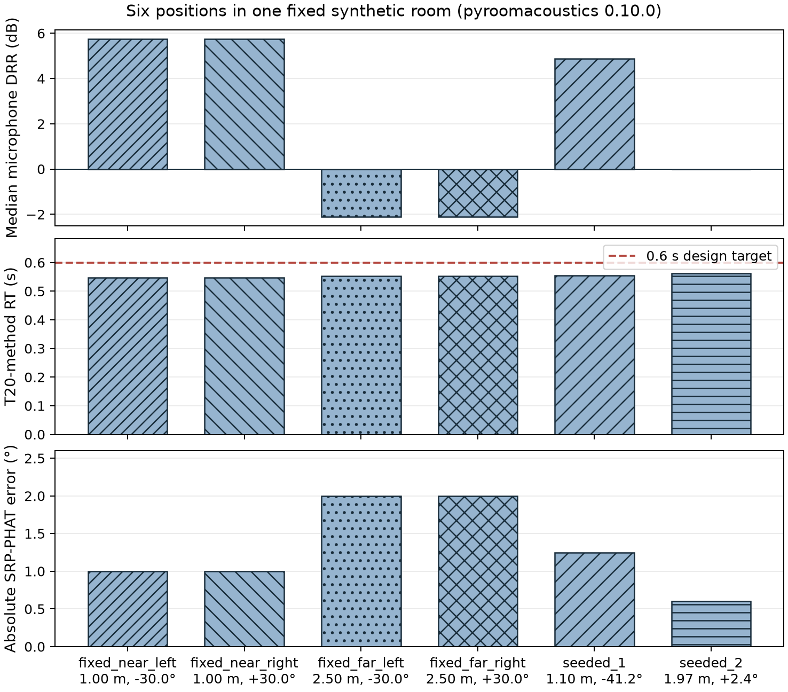
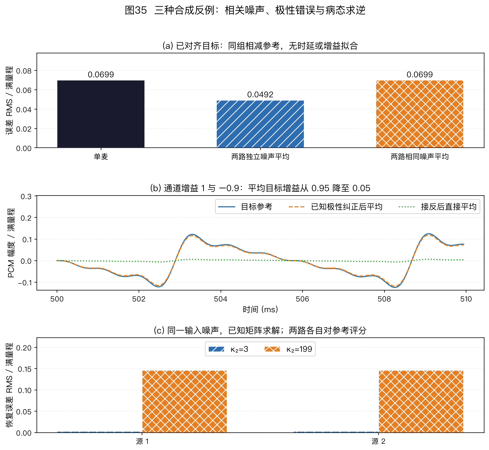
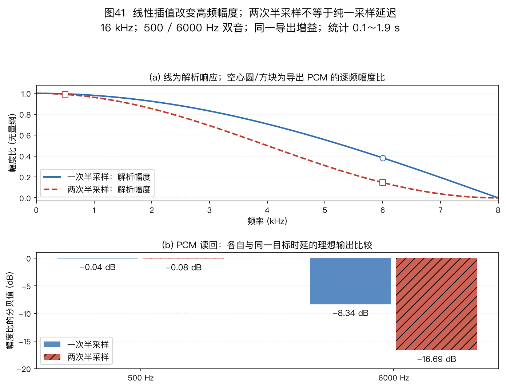
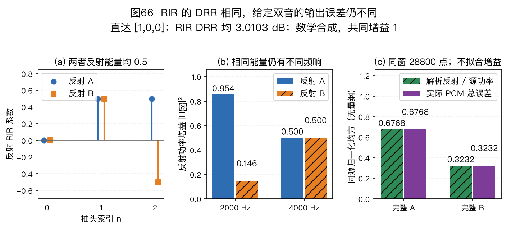

> ⚠️ 本篇是第 15 章，即附录 B（正文与扩展专题共 15 章，其中第 12、13、16、17 章为扩展专题，另有附录 A、B），可独立查阅，前后篇见下方导航。
>
> 🏠 首页导读：[`00_overview.md`](00_overview.md) ｜ 上一篇：[14_appendix-symbols-math.md](14_appendix-symbols-math.md) ｜ 下一篇：（无）

---

## 第 15 章 · 附录 B：学习路径、领域地图、排错、练习与复现

### 15.1 研究生学习路径

如果你准备系统开展麦克风阵列方向的研究或工程研发，建议先吃透经典物理与统计阵列模型，再逐步过渡到开源基线、公开数据集与真实多通道硬件实验。

1. **基础阅读**：Van Veen & Buckley, [*Beamforming: A Versatile Approach to Spatial Filtering*](https://doi.org/10.1109/53.665)（*IEEE ASSP Magazine*，1988）；Krim & Viberg, [*Two Decades of Array Signal Processing Research: The Parametric Approach*](https://doi.org/10.1109/79.526899)（*IEEE Signal Processing Magazine*，1996）。
2. **语音场景综述**：Kumatani、McDonough 与 Raj, [*Microphone Array Processing for Distant Speech Recognition: From Close-Talking Microphones to Far-Field Sensors*](https://doi.org/10.1109/MSP.2012.2205285)（*IEEE Signal Processing Magazine* 29(6):127–140，2012）；Gannot et al., *A Consolidated Perspective on Multimicrophone Speech Enhancement and Source Separation*（*IEEE/ACM TASLP*，2017）。需要注意，Kumatani 等还有一篇主标题相同、副标题为 *Towards Real-World Deployment* 的文章，检索时请连同副标题核对。
3. **奠基论文**：Capon（1969）、[Griffiths & Jim 的 GSC](https://doi.org/10.1109/TAP.1982.1142739)（1982，*An Alternative Approach to Linearly Constrained Adaptive Beamforming*）、[Schmidt 的 MUSIC](https://doi.org/10.1109/TAP.1986.1143830)（1986）、Roy & Kailath 的 ESPRIT（1989）、Allen & Berkley 的镜像声源法（1979）、[Nakatani 等的 WPE](https://doi.org/10.1109/TASL.2010.2052251)（2010）、[Pal & Vaidyanathan 的嵌套阵](https://doi.org/10.1109/TSP.2010.2049264)（2010）。阅读原始文献时，建议回到本书对应章节核对傅里叶符号、导向矢量共轭和归一化约定。
4. **回声消除**：Hänsler & Schmidt, *Acoustic Echo and Noise Control*（Wiley，2004）；近年工业界与学界进展可结合 ICASSP AEC Challenge 系列评测报告阅读。
5. **深度学习方向**：Chakrabarty 与 Habets, [*Multi-Speaker DOA Estimation Using Deep Convolutional Networks Trained With Noise Signals*](https://doi.org/10.1109/JSTSP.2019.2901664)（*IEEE JSTSP* 13(1):8–21，2019）；Gu et al. 全神经波束形成综述（*IEEE/ACM TASLP*, vol. 31, pp. 849–862, DOI 10.1109/TASLP.2022.3229261）。
6. **递进实验路线**：建议每次只引入一类新变量，并把前一步的确定性输出留作下一步的基准对照。

    1. 运行 `codes/` 中仅依赖 NumPy 的教学实现，逐项核对手算算例、张量维度与退化边界。
    2. 在隔离环境中用 pyroomacoustics 验证 DSB、MVDR、MUSIC 和 SRP-PHAT 基线，完整记录房间尺寸、阵列坐标与随机种子。
    3. 先按 §15.7 生成插图所需的合成音频与追踪清单，再运行 `scripts/` 中的 11 个绘图脚本，在固定参数下复现全部 88 张编号图，并对照正文逐图核验成立条件。
    4. 围绕具体任务选定公开数据集与固定版本参考系统，分别核实源码、模型权重和数据集的使用许可与评分口径。
    5. 在多通道采集硬件上实测处理延迟、时钟同步与幅相标定；仿真指标不能代替真实设备测量。

读完第 2、3、5 章后，若关注声源强度反演与区域声场诊断，可选读[扩展专题Ⅰ：声学成像与噪声源诊断](12_acoustic-imaging.md)；读完第 2、5、10 章后，若关注带宽受限与异步时钟下的多设备协同处理，可选读[扩展专题Ⅱ：分布式麦克风协同增强](13_distributed-enhancement.md)。

读完第 1、2、5 章后，若关注全景声球谐采集、双耳信号匹配与可穿戴跨模态降噪，可选读[扩展专题Ⅲ：空间声场采集、参数化编码与可穿戴阵列](16_spatial-wearable-arrays.md)；读完第 5、8、9、10 章后，若关注声纹、近场或视听线索驱动的目标提取与多人重叠日志，可选读[扩展专题Ⅳ：条件目标提取、多通道日志与远场多模态前端](17_target-extraction-diarization.md)。这四篇专题按工程任务按需选学即可，并非基础入门的必经环节。

### 15.2 领域地图：教材、会议、期刊与挑战赛

本节整理了本领域的经典教材、核心会议、主流期刊、公开挑战赛与技术演进脉络，供按需检索。

**教材与专著**（按阅读难度由浅入深排列）：

| 书名与作者 | 内容特点与阅读建议 |
|---|---|
| Benesty, Chen & Huang, *Microphone Array Signal Processing*（Springer，2008） | 篇幅精炼，系统覆盖阵列信号模型、声源定位、波束形成与多通道语音增强 |
| Brandstein & Ward (eds.), *Microphone Arrays: Signal Processing Techniques and Applications*（Springer，2001） | 经典专题论文集，各章由对应子方向的奠基学者执笔 |
| Tashev, *Sound Capture and Processing: Practical Approaches*（Wiley，2009） | 从工程落地视角讨论声学拾音链路、器件非理想性与实时实现权衡 |
| Johnson & Dudgeon, *Array Signal Processing: Concepts and Techniques*（Prentice Hall，1993） | 通用阵列信号处理经典教材，呈现雷达、声呐与声学阵列的同源理论 |
| Van Trees, *Optimum Array Processing*（Wiley，2002） | 严密推导统计最优阵列处理与性能界，适合深入查阅数学细节 |
| Vincent, Virtanen & Gannot (eds.), *Audio Source Separation and Speech Enhancement*（Wiley，2018） | 现代音源分离与多通道语音增强方法的系统合集 |
| Rafaely, *Fundamentals of Spherical Array Processing*（Springer，第一版 2015，DOI 10.1007/978-3-662-45664-4；第二版在线 2018、版权 2019，DOI 10.1007/978-3-319-99561-8） | 系统讲授球面阵列与球谐域波束形成，可配合 §5.8 与[扩展专题Ⅲ §16.2](16_spatial-wearable-arrays.md#sec-16-2) 延伸阅读 |

**核心会议**：ICASSP（信号处理旗舰年会）、Interspeech（语音科学旗舰年会）、WASPAA（音频与声学信号处理研讨会，每两年一届）、IWAENC（声学信号增强国际研讨会）、HSCMA（免提语音通信与麦克风阵列研讨会）、DCASE Workshop（声事件检测与声学场景分析）。

**主流期刊**：[IEEE Transactions on Audio, Speech and Language Processing](https://signalprocessingsociety.org/publications-resources/ieee-transactions-audio-speech-and-language-processing)（现缩写 TASLPRO，本领域核心期刊）、*IEEE JSTSP*（信号处理专题特刊）、*JASA*（美国声学学会会刊）、*Speech Communication*。

**公开挑战赛**是了解真实场景难点与标准评测口径的重要窗口。

CHiME 系列长期聚焦远场、多说话人与多通道语音处理。[CHiME-9](https://www.chimechallenge.org/challenges/chime9/) 设置了 MCoRec（多会话转写与会话聚类）和 ECHI（低延迟助听对话增强）两项任务；[CHiME-10 官方任务页](https://www.chimechallenge.org/challenges/chime10/index)公布了 ECHI-2、URGENT 与 SG-TSE 三项任务，[官方日程页](https://www.chimechallenge.org/challenges/chime10/dates)计划于 2027 年 2 月 4 日开放数据与基线，提交窗口暂定为 2027 年 8～9 月（上述信息核实于 2026 年 11 月 11 日，参赛前请以官网最新通知为准）。

DCASE 2026 的系统提交已于 2026 年 6 月 15 日截止，并于同年 7 月 1 日公布结果；其中 Task 3 转向语义声学成像（Semantic Acoustic Imaging SELD），与 DCASE 2024 Task 3 的声源距离估计任务设定不同（核实于 2026 年 10 月 5 日，详见 [DCASE 2026 官方主页](https://dcase.community/challenge2026/)、[提交说明](https://dcase.community/challenge2026/submission)与[结果公告](https://dcase.community/articles/dcase2026-challenge-results-published)）。

需要留意的是，[DCASE 2026 Task 3](https://dcase.community/challenge2026/task-semantic-acoustic-imaging-for-sound-event-localization-and-detection-from-spatial-audio-and-audiovisual-scenes) 要求同时输出声事件类别与空间能量分布，并按官方图像匹配及相关性指标打分。本书第 12 章的 DAS、DAMAS 或 CMF 虽能给出给定传播模型下的空间功率图，但本身不包含声事件分类器或赛事输出封装；若将其用作前端基线对照，应分别汇报物理成像误差与下游语义评测得分，不能拿功率图颜色或第 12 章的内部残差指标替代赛事总分。

其他代表性评测还包括 REVERB 去混响评测、ICASSP DNS/AEC Challenge，以及已结项的 [SPEAR Challenge 2023](https://signalprocessingsociety.org/publications-resources/data-challenges/speech-enhancement-augmented-reality-spear-challenge-2023)。SPEAR 采用 6 通道头戴设备研究增强现实（AR）场景的语音增强（头戴式双耳信号匹配 BSM/MagLS 与双耳相干度保持原理见[扩展专题Ⅲ §16.5～§16.7](16_spatial-wearable-arrays.md#sec-16-5)），引用时应注明其特定年份、佩戴几何与评测条件，不宜外推为持续更新的通用榜单。

**技术演进脉络**（麦克风阵列处理很大程度上是从雷达、声呐与地震阵列向宽带房间语音迁移并不断融合统计学习的历史）：

| 年代 | 代表性里程碑 |
|---|---|
| 1940～1960 年代 | 雷达与声呐阵列处理奠基（Bartlett 常规波束扫描） |
| 1969 | Capon 提出最小方差无失真谱估计（最初面向地震台阵） |
| 1972 | Frost 提出时域线性约束自适应波束形成 |
| 1979～1982 | Allen & Berkley 提出矩形房间镜像声源法；Griffiths & Jim 提出广义旁瓣相消器（GSC） |
| 1985 | Flanagan 等研制出可数字转向的大孔径会议室麦克风阵列 |
| 1986～1989 | MUSIC（1986）与 ESPRIT（1989）利用子空间正交性估计波达方向；实际分辨力仍受孔径、信噪比、快拍数与流形失配制约 |
| 1990 年代 | Elko 系统化差分麦克风阵列设计，逐步进入助听器与桌面会议终端 |
| 2001～2008 | Brandstein & Ward、Benesty 等专著相继出版，语音阵列信号处理知识体系成型 |
| 2010 | Nakatani 等提出 WPE 盲去混响；Pal & Vaidyanathan 提出嵌套阵（Nested Array） |
| 2011 | 首届 CHiME 挑战赛举办，远场语音识别与增强形成公开基准 |
| 2014 | Amazon Echo 等智能音箱普及消费级多麦远场交互（具体阵元数与构型随硬件代次演进） |
| 2015～2018 | CHiME-3/4/5 推动时频掩码辅助统计波束形成与导引源分离（GSS）成为强基线 |
| 2019～2024 | 深度学习声源定位与追踪（如 Shimada et al. ICASSP 2021 的 ACCDOA 活动与方向联合表示）、全神经多通道前端兴起；CHiME-7/8 引入预训练大模型后端；DCASE 2024 Task 3 基于 STARSS23 数据集评测声源距离估计 |
| 2025～2026 | CHiME-9 聚焦多会话 MCoRec 与低延迟助听 ECHI，2026 年 7 月发布 CHiME-10 三项新任务；DCASE 2026 Task 3 转向语义声学成像并公布评测结果 |

查阅文献时注意，[DCASE 2024 Task 3 官方说明](https://dcase.community/challenge2024/task-audio-and-audiovisual-sound-event-localization-and-detection-with-source-distance-estimation)使用的开发集与评测集名称固定为 STARSS23，数据集后缀年份不随挑战赛举办年份更改。

### 15.3 研究前沿速览（2024—）

本节将前文建立的经典阵列模型与 2024 年以来的代表性研究方向衔接起来。为便于核查，文中引用均指向原论文与固定版本的公开源码入口；本教程对这些外部神经系统仅梳理方法边界与静态接口契约，未在本机下载模型权重或运行深度网络推理。各项实验成绩均以对应论文的数据集、实现细节与评分脚本为前提，赛事日程以官方最新公告为准。

#### 研究方向一：预训练模型用作远场识别后端

在 CHiME-7/8（2023/2024）远场多说话人识别评测中，不少参赛团队采用 Whisper、WavLM 等大规模预训练模型作为识别后端，同时仍有许多高排名系统在前端保留 GSS（导引源分离，详见 §8.4）与解析统计波束形成。这些参赛方案说明预训练后端与经典阵列前端在该评测条件下能够有效互补，并不意味着远场语音处理已简化为单一端到端模型（参见 [CHiME-7/8 综述预印本，arXiv:2507.18161](https://arxiv.org/abs/2507.18161)）。

#### 研究方向二：阵列无关系统

Cornell 等在 [CHiME-8 DASR 任务报告](https://www.isca-archive.org/chime_2024/cornell24_chime.pdf)中定义了跨异构设备的远场多说话人识别任务，并提供了 ESPnet 与 NeMo 两条官方基线。该报告并非针对某一特定通道聚合网络的算法论文，两条基线在说话人日志（说话人分割）、多通道前端增强与识别后端上的具体配置需要对照原文 §5 与 §6 分别查阅，其跨设备泛化表现也以该任务的训练语料、测试硬件与评分脚本为界。

#### 研究方向三：目标说话人提取

目标说话人提取（Target Speaker Extraction，TSE）利用预先录制的注册语音、视觉口型或空间方向提示来刻画目标说话人，再从多源混合语音中分离出对应的单人语音轨。头戴式 AR 眼镜阵列与手机声学微结构则进一步拓展了空间条件线索的获取方式；有关特征级线性调制（FiLM）、目标沉默段双态能量地板损失与近场球面波声学距离气泡的完整推导详见[扩展专题Ⅳ §17.1～§17.3](17_target-extraction-diarization.md#sec-17-1)。

查阅文献时需注意版本演进：发表于 ICASSP 2022 的 [TEA-PSE 原工作](https://doi.org/10.1109/ICASSP43922.2022.9747765)与后续评测迭代的 [TEA-PSE 3.0](https://arxiv.org/abs/2303.07704) 在网络结构与训练配置上存在差异，不宜混为一谈。发表于 ICASSP 2024 的 [CIENet](https://cmsworkshops.com/ICASSP2024/view_paper.php?PaperNum=3147)（方法细节可对照[作者预印本](https://arxiv.org/abs/2402.17146)）则将注册语音与混合语音的时频表示送入跨注意力交互模块，逐帧计算随时间变化的目标关联权重，而非把整段注册语音压缩为单一静态嵌入向量后简单拼接到混合频谱上。

SonicSieve（CHI 2026，见[项目主页](https://www.witechlab.com/sonicsieve.html)与[作者论文 v3](https://arxiv.org/abs/2504.10793v3)，2026-09-22 核实）展示了另一条物理辅助思路：借助手机壳体附加的被动声学微结构改变不同入射方向的传递响应，使神经网络得以依靠方向相关谱特征提取目标语音，不是由注册声纹指定身份。这种能力建立在配套物理微结构与对应训练数据之上，无法仅靠普通手机加载纯软件获得。此外，§6.5 介绍的个性化 AEC 虽同样引入目标说话人条件，但因多出扬声器回声参考支路与双讲保护目标，训练损失与网络接口仍需单独设计。

#### 研究方向四：生成式语音增强与推理加速

以 SGMSE+（Richter et al., *IEEE/ACM TASLP* 2023，[源码与论文](https://github.com/sp-uhh/sgmse)）和 StoRM（Lemercier et al., *IEEE/ACM TASLP* 2023，[源码与论文](https://github.com/sp-uhh/storm)）为代表的生成式增强方法，在复数 STFT 域构建基于随机微分方程（SDE）的扩散先验；其中 StoRM 先用判别式网络给出粗估计，再交由扩散过程细化，从而减轻采样步数负担。近年来的流匹配（Flow Matching）、分布蒸馏与一致性模型也在持续压缩反向采样开销。

与判别式滤波相比，生成式模型在强噪声下往往能改善主观听感，但存在“幻觉”风险——在极低信噪比区间补全出参考语音中并不存在的音素细节，因此评测时必须同时考核感知质量、语音内容一致性与下游识别词错率（WER）。例如，FlowSep（ICASSP 2025，见[原论文](https://doi.org/10.1109/ICASSP49660.2025.10890129)与[锁定源码](https://github.com/Audio-AGI/FlowSep/tree/d8164db58bd461ef5bb6df8ffd372b536ee6afb4)）将整流流（Rectified Flow）用于变分自编码器（VAE）隐空间的文本查询通用音效分离，其单通道隐空间生成机制与许可条件（仓库根目录未附显式再分发许可证，且依赖外部预训练检查点）均不能直接外推至保相多通道语音前端。

若把生成模型扩展到多通道并与 §5.9 的“时频掩码 + 解析波束”对比，除了对齐前瞻帧数、采样步数和算力预算，还要核查跨通道相位与空间协方差是否自洽。做代码级最小核对时也需留心入口细节：在锁定版本的 SGMSE 源码中，`ScoreModel.enhance()` 在 OUVE 分支下实际按 `self.sde.sampler_type` 分派采样器，而且入口直接按输入波形峰值做除法归一化、未设全零静音保护，测试时不能传入全零数组（静态接口核对详见[生成式实现研究](../codes/chapters/ch00/research/04_source_reproduction.md#appendix-b-reproduction)）。

#### 研究方向五：TF-GridNet 与复数谱映射骨干

第 8 章的解析盲源分离依靠源信号统计独立性与线性卷积混合模型；TF-GridNet（见[期刊版预印本](https://arxiv.org/abs/2211.12433)）则直接在复数短时频谱域做端到端映射，把混合频谱的实部和虚部拼作输入特征，直接回归各目标源频谱的实部与虚部，最后经逆 STFT 还原时域波形。每个基本处理块依次沿帧内频率轴、子带内时间轴以及全频带跨帧自注意力路径交换上下文，“时频网格（Grid）”之名便源于这种时间维与频率维的交替建模。

阅读与对比时应区分两个公开版本：Wang 等在 [ICASSP 2023 会议版](https://doi.org/10.1109/ICASSP49357.2023.10094992)中聚焦无混响单通道说话人分离，而在 [*IEEE/ACM TASLP* 2023 期刊版](https://doi.org/10.1109/TASLP.2023.3304482)中进一步扩展到带噪、混响与多通道联合增强分离。做基线对比前应先锁定具体版本，写清输入通道数、目标源数、STFT 窗移参数与数据集划分；在锁定版 ESPnet 的 [`TFGridNet` 实现](https://github.com/espnet/espnet/blob/be79590bb2ff26ffb01bc825c5f68cb9418b7f0d/espnet2/enh/separator/tfgridnet_separator.py)中，还需核对混合信号与参考目标的方差归一化开关，避免把不同混合口径下的 SI-SDRi 混排比较。

#### 研究方向六：几何无关前端的期刊研究

Kamo 等在 *Computer Speech & Language* 95:101820（2026，见[期刊正式页](https://www.sciencedirect.com/science/article/pii/S0885230825000452)与[作者 v2 全文](https://arxiv.org/html/2502.09859v2)）中系统梳理了一套面向真实会议录音的几何无关多说话人远场识别流水线。对照作者 v2 原文第 2 节与第 4.1～4.3.6 节可以看到，系统并非由单个端到端分离掩码包办一切：前端先做局部说话人日志，利用初步 GSS 输出提取说话人声纹嵌入，再经跨块全局聚类确定说话人数，最后由目标说话人语音活动检测（TS-VAD，多通道空谱扩展与排他掩码闭环见[§17.5](17_target-extraction-diarization.md#sec-17-5)）精细修正每人的发声起止区间——说话人活动、总人数与身份归属在级联步骤中各司其职。

在多通道增强环节，系统先按空间协方差最大特征值（EV）和早晚混响能量比（$C_{50}$）筛选可用通道，随后串联 WPE 去混响、GSS 分离与空间预测多通道维纳滤波（SP-MWF），再依据估计输出信噪比挑出参考通道、施加盲解析归一化（BAN）后送入语音识别后端（其中涉及的波束、WPE 与 GSS 原理及手算可分别对照第 5、7、8 章）。这里所说的“几何无关”，是指算法不依赖预先写入的阵列三维坐标，但仍假定参与融合的通道已完成同步对齐，并不能直接免疫跨设备时钟漂移或剧烈的声学域失配。

#### 研究方向七：CHiME-9 与大模型后端

[CHiME-9 官方任务页](https://www.chimechallenge.org/challenges/chime9/index)设置了两项输入模态与优化目标截然不同的赛道：MCoRec 利用房间中央的 360° 全景音视频，要求转写多人对话并聚类出会话群组；ECHI 则面向助听场景，要求佩戴者端以流式因果方式增强对话对象语音，[官方规则](https://www.chimechallenge.org/challenges/chime9/task2/rules)规定算法总延迟不超过 20 ms。因此，两项赛道的得分不能合并为同一张“CHiME-9 语音增强”榜单。

围绕多人重叠语音中“只转写指定说话人”的任务，DiCoW（Polok et al., *Computer Speech & Language* 95:101841，2026，[DOI 10.1016/j.csl.2025.101841](https://doi.org/10.1016/j.csl.2025.101841)）直接把说话人日志给出的时序活动标签作为条件注入 Whisper 模型，端到端输出目标说话人的文本，跳过了“先还原分离波形、再送入常规识别器”的中间环节（与级联链路及 SOT 的选型对比见[§17.7](17_target-extraction-diarization.md#sec-17-7)）。

查阅其公开仓库时需区分代码入口与演进分支：在[演示仓固定提交](https://github.com/BUTSpeechFIT/DiCoW/tree/e9326bd536bf632e823357438b210102903ba620)中，[`example.py`](https://github.com/BUTSpeechFIT/DiCoW/blob/e9326bd536bf632e823357438b210102903ba620/example.py#L8-L14) 调用 DiCoW v1 配合 Pyannote 3.1，而 [`app.py`](https://github.com/BUTSpeechFIT/DiCoW/blob/e9326bd536bf632e823357438b210102903ba620/app.py#L31-L39) 调用 DiCoW v2 配合 Pyannote 3.1，不能仅凭同一仓库提交号视为同一模型版本；配套的[训练与推理源码仓](https://github.com/BUTSpeechFIT/TS-ASR-Whisper/tree/0ea6679d44405f5ff39188030123524686c198e9)则独立维护（演示仓后续主分支新增的 DiariZen 依赖并非上述固定提交的运行前提）。此外，代码与模型权重的许可边界必须分开核查：源码采用 Apache-2.0，[DiCoW v1 权重](https://huggingface.co/BUT-FIT/DiCoW_v1)与 [DiCoW v2 权重](https://huggingface.co/BUT-FIT/DiCoW_v2)采用 CC BY 4.0，后续演示引入的 [DiariZen 权重](https://github.com/BUTSpeechFIT/DiariZen/blob/main/MODEL_LICENSE)限定为非商用的 CC BY-NC 4.0，而 [Pyannote 3.1](https://huggingface.co/pyannote/speaker-diarization-3.1) 则设有门控申请要求。实验对比时应固定说话人活动标签来源、音频切片与文本规范化规则，并留意其面向转写的离线架构不能直接充当 ECHI 赛道的 20 ms 助听增强基线。

#### 研究方向八：扩散先验用于无监督盲分离

ArrayDPS（Xu et al., ICML 2025，[PMLR 267 正式论文](https://proceedings.mlr.press/v267/xu25f.html)）探索了“既无阵列几何与房间冲激响应先验，也无成对干净分离标签”条件下的多通道盲源分离。不同于第 8 章 AuxIVA 仅凭源间统计独立性迭代解混矩阵，ArrayDPS 借助预训练的单说话人扩散先验做后验采样，并在每步反向去噪中联合估计相对房间冲激响应（Relative RIR）以计算混合重构似然梯度。这一框架仍要求预先给定说话人数、各通道采样同步、声学混合满足线性卷积近似，且单说话人先验能够覆盖测试语料声学域。

阅读原文 §2 需特别注意目标定义：该模型恢复的是参考麦克风处各说话人的**混响源图像（reverberant source image）**，而非直接消去混响的干声，因此计算评价指标时参考信号必须按同一参考阵元对齐。若开展最小复现，可对齐[固定作者实现](https://github.com/ArrayDPS/ArrayDPS/tree/750ac2b7c75458f4ca5bad203dafda528f575e55)中的 SMS-WSJ 双说话人、3 通道、8 kHz 配方，固定 `num_speakers=2`、`n_channels=3`、`num_steps=400`，在相同评分口径下与 IVA 初始化输出对照，同时记录总耗时、随机种子与峰值显存（官方说明显存需求超过 7 GB，400 步采样内嵌相对 RIR 优化，定位于离线研究而非低延迟流式部署）。还需核对代码与论文的参数差异：论文正文中前向卷积投影（FCP）写为 512 点 FFT、64 点帧移，而公开源码与 README 默认配置采用 512 点窗长、128 点帧移。

审查其评估脚本还可见两处容易混淆的细节：其一，核心采样器 `Sampler` 的似然引导并不读取干净真值，但外层入口 `separate.py` 在第 161 行读取了真值 `sources[:,0,:]` 计算 SDR，并在第 180～186 行依据真值指标决定提前终止或重跑——这一机制仅适用于离线诊断，实际无参考部署时不能原样沿用；其二，原文 §4.2 区分了五次独立采样得分的均值/标准差（Mean，并非把五条输出波形求平均）、借真值挑最高分的上界诊断（Max），以及仅凭混合信号重构似然挑选样本的无监督准则（ML），引用表格数据时需严格区分（参数层级与接口契约核查见 [ArrayDPS 实现研究](../codes/chapters/ch00/research/02_aec_wpe_separation.md#sec-u-3b78d29bc2)）。

#### 专题：神经网络前端的泛化失配与四类对策

在实验室固定阵列和仿真房间里调优的神经网络前端，一旦迁移到陌生的阵列构型、真实混响环境或新下游任务，性能往往显著滑坡——这一现象统称为**泛化失配**。下面将失配根源拆解为三个维度，并结合前文提到的“阵列无关系统”与“几何无关前端”梳理四类工程对策。

**三类典型失配来源**：

1. **阵列物理失配**：部署设备的阵元排布、通道数量、麦克风幅相一致性或采样时钟与训练集不一致。如果网络输入层隐式绑定了固定的通道排列顺序与特定基线的相位差分布，更换硬件外壳或阵元间距后，学到的空间特征便会失效；直接回归权重的全神经波束形成对此尤为敏感（参见 §5.9 第 2 条）。
2. **声学环境失配**：测试房间的混响衰减时间、背景噪声非平稳结构或说话人拾音距离超出了训练分布。此时时频掩码估计的漏检与误判会直接污染目标与干扰空间协方差矩阵，进而拉低后端 MVDR 权重的空间抑制比。
3. **任务与数据域失配**：仿真训练集忽略了阵元坐标公差、设备障板衍射与频响起伏；测试语种或口音发生迁移；或者把针对人耳主观听感优化的增强网络直接串在自动语音识别（ASR）前端——若是生成式增强前端，还需防范低信噪比下的音素篡改（见上文研究方向四）。

**四类缓解对策**：

1. **多样化数据增广与微调**：在训练阶段混合多种阵列拓扑、房间尺寸、混响时间与真实噪声，再配合少量目标硬件实录样本做域自适应。数据增广的核心在于拓宽网络见过的跨通道幅相流形分布，而非试图穷举世上所有设备。
2. **解耦中间表示与解析滤波**：让神经网络专注于估计对绝对坐标不敏感的中间统计量（如时频掩码、空间协方差或说话人活动概率），再把空间滤波交还给目标函数透明的解析算法。例如，MVDR 严格对指定导向矢量或相对传递函数（RTF）施加无失真单位响应约束；GSS 先借助说话人活动先验稳定空间混合模型聚类，再按选定波束准则提取语音（注意 GSS 整体流水线本身不等同于单一无失真线性约束，详见 §5.9 第 1 条与 §8.4）。这种“神经估计 + 解析求解”的分工仍需在跨阵列测试集上验证中间表示本身的泛化度。
3. **面向对称性的结构与训练正则**：训练中随机丢弃部分通道、随机打乱通道次序并对阵元坐标施加微扰，分别模拟单麦损坏、可变通道数接入与装配公差；同时在网络架构层面严格保证通道维度的置换不变性或置换等变性。
4. **部署期标定与置信度回退**：上机前完成通道增益相位校准，运行期结合信噪比、掩码熵或协方差条件数动态评估风险——当神经前端置信度不足或算力受限时，平滑回退至稳健的解析波束基线。分级切换架构能否带来端到端净收益，仍须在目标硬件上实测确认。

**阵列无关前端的通用积木：TAC 与 VarArray**。跨设备系统的典型范式是：先对每条通道用共享权重独立提取局部时频特征，再通过跨通道池化或自注意力聚合成与通道排列无关的全局上下文。其中最具代表性的基础模块是变换—平均—拼接（Transform-Average-Concatenate，TAC，见[原论文 §2.1 式(1)～式(4)](https://arxiv.org/html/1910.14104v3)）：各通道共享非线性变换后做跨通道算术平均，再把全局平均特征拼回每条通道各自的特征之后。由于算术平均对输入顺序满足**置换不变性**，拼回各通道后的输出便随输入通道同步交换顺序，即满足**置换等变性**。需要留心的是，“结构上支持任意通道数接入”不等于“增减麦克风后输出数值保持恒定”——哪怕只是把第 1 路信号原样复制一份接入，它在跨通道均值中的权重也会从 $1/M$ 变为 $2/(M+1)$，从而改变全部通道的输出（详见后文 [E15-11 的标量手算](#e15-11)）。

VarArray（[ICASSP 2022](https://doi.org/10.1109/ICASSP43922.2022.9746876)）进一步将 TAC 跨通道交互、Conformer 序列建模与通道间相位差（IPD）特征结合，用于几何无关的连续语音分离，并在真实 AMI 会议语料上验证了说话人归属词错率（sa-WER），为前文 CHiME-8 DASR 基线与 Kamo 等的会议识别系统奠定了网络结构基础。复现这类复合系统时，建议先画出完整的数据流框图，逐级标清哪些模块依赖训练分布、哪些模块执行通道聚合、哪些环节施加了解析物理约束。

### 15.4 常见问题与调试指南

工程联调与算法复现中常遇到“跑通了代码，输出指标或听感却异常”的情况。下面先按“典型现象 → 优先排查顺序”列出基础链路最常见的八类问题，再用一张扩展速查表覆盖去混响、分离、追踪、声学成像、分布式阵列、空间可穿戴以及条件目标提取与多人日志的排错要点。

1. **MUSIC 没有峰 / 峰位置不稳定** → 先核查样本协方差矩阵的秩与二范数条件数。若直接用 $T$ 个 $M$ 维频域快拍计算未中心化二阶矩，矩阵秩至多为 $T$，因此 $T<M$ 时必然奇异；若先减去样本均值，中心化后的 $T$ 个向量满足零和约束，矩阵秩至多为 $\min(M,T-1)$，故 $T\le M$ 时必然奇异。即便快拍数越过了这一代数下界，快拍过少仍会导致特征子空间剧烈抖动。

    再检查源数 $K$ 的设定与噪声子空间特征值台阶是否清晰可分，最后排查直达声与强墙面反射是否高度相干。需要留意，前后向或子阵空间平滑仅适用于具备平移不变重叠子阵的规则几何（如均匀线阵），且会折损有效物理孔径，并非所有混响场景的通用解药（详见 §2.5、§4.6）。

2. **GCC-PHAT 峰位置在离散时延格点间跳变** → 多半是没有做亚采样时延细化，或原始互相关时延网格过粗；另一常见原因是室内强反射径的相关峰压过了直达径（见图 13）。本书图 12 采用 16 倍频域互谱补零插值（而非三点抛物线拟合），工程实现中也可按算力选用时域相关峰插值或频域加权相位斜率拟合（详见 §4.2）。

3. **波束形成后目标语音反而失真** → 优先核查目标波达方向（DOA）、相对传递函数（RTF）与通道幅相标定是否自洽，再重点排查空间协方差矩阵里是否混入了目标语音成分（目标相消）。

    噪声协方差既可由确认无目标语音的纯噪声帧统计，也可借助时频掩码加权估计；核心原则是在保留充足有效快拍与避免目标能量泄漏之间取得平衡。在强混响室内，还应核实无失真约束对象是否需从自由场平面波导向矢量切换为包含早期反射的 RTF（详见 §5.4、§5.9）。

4. **超指向输出噪声很大** → 重点检查白噪声增益（WNG）、弥散噪声相干矩阵的条件数、麦克风通道幅相一致性及阵列流形误差。工程上并不存在一个放之四海皆准的“容许失配 dB 常数”，而应根据目标 WNG 下限、最高工作频率与实测波束方向图反推允许公差，并通过对角加载或显式 WNG 不等式约束控制低频病态放大（详见 §5.3、§5.4）。

5. **AEC 残余回声较大** → 按信号流依次排查数字参考信号取点是否遗漏了系统音效或后处理、参考路与采集路的块固定延迟是否对齐、微型扬声器是否发生饱和削波，以及自适应滤波器抽头长度是否覆盖了主要早期回声路径。参考时延失配是常见诱因之一，但不能未经核查就假定所有残余回声都源于时延错位。

    若线性路径已收敛而听感上仍残留与远端播放强相关的谐波或互调失真，再进一步评估[非线性残余处理（NLP）的工作点权衡](06_aec.md#sec-6-12)或[神经辅助/学习型 AEC](06_aec.md#sec-6-5)；WebRTC AEC3 的工程抑制架构可对照 [§6.8](06_aec.md#sec-6-8) 排查。

6. **SRP-PHAT 出现镜像假峰** → 出现对称双峰或多峰时，应先区分以下三类物理根源，切勿一律归咎于阵元间距过大：

    - 几何不可辨识：均匀线阵天然存在前后对称或三维锥面等时延歧义，平面阵则存在上下半球镜像歧义；单纯拓宽信号频带无法消除几何上完全相同的到达时间差（TDOA），详见 §3.1。
    - 空间混叠：联立检查最高分析频率、阵元间距与扫描角域；间距超过半波长将失去全视场无混叠保证，但具体转向角是否落出可见栅瓣仍需定量计算，详见 §2.6 与本章练习 2。
    - 多径反射：镜面墙体强反射会等效出虚声源相关峰，应结合直达路径遮挡情况、房间几何与搜索边界综合研判。缩小角度搜索区间必须有明确的安装先验（如靠墙贴装），不能只为抹掉异常峰而人为裁剪网格。

7. **多麦录音各通道逐渐错位** → 先甄别是恒定的初始触发时差、偶发驱动丢帧，还是跨晶振的采样率偏移（SRO）。单机多麦应优先由硬件主时钟统一驱动同步采样；多台独立设备缺乏共享时钟时，必须持续估计相对采样率偏差并做高精度分数延迟重采样。需要注意，PDM 与 TDM 只是数字音频总线传输协议，本身并不能自动消除跨独立设备的晶振漂移（详见 §10.2）。

8. **仿真很好、实测很差** → 建议采用控制变量法，在仿真链路中逐项注入阵元位置公差、通道幅相失配、设备外壳散射、麦克风频响起伏、采样时钟漂移与扬声器非线性，定位哪一项非理想因素主导了实测退化。

    位置容差应按最高工作频率所允许的相位误差上限（如 $\pi/12$ 或 $\pi/8$）换算为物理毫米数，不同频段与波束算法并不共用同一个固定毫米阈值。完成幅相与几何标定后，还应在公差包络与多个方位距离点上交叉复测。

对于后半部章节涉及的去混响、多源分离、动态追踪以及四篇扩展专题，若调试中遇到输出退化，可按下面这张扩展速查表逐列对照排查（表中第一列为模块名称，第二列描述典型异常表征，第三列给出优先核查的参数与物理边界，第四列指向正文详述章节）：

| 模块与任务 | 典型异常现象 | 优先排查项与物理边界 | 对应章节 |
|---|---|---|---|
| WPE 盲去混响 | 处理后直达语音发闷、辅音能量受损，或静音段底噪突然抬升 | 检查预测延迟 $\Delta$ 是否过小（如 $\Delta=1$ 将本应保留的早期反射纳入预测历史，见图 75 与本章练习 9）；排查时变功率分母的下界保护 $\varepsilon$ 是否过小导致静音帧求逆病态放大；核对帧长、抽头数 $K$ 与迭代次数是否匹配混响尾长 | §7.2、§7.3 |
| 语音分离（GSS / CSS / IVA） | 单块内分离尚可，但跨块拼接处说话人串槽、极性反转或音量跳变 | 在连续语音分离（CSS）中先后核对块间排列对齐、重叠窗相位极性与幅度尺度（排列正确不自动保证极性或增益一致，见图 76）；在 AuxIVA 中核查频点间排列对齐；在掩码波束中检查掩码目标泄漏是否污染干扰协方差 | §8.3～§8.5 |
| 多声源追踪 | 轨迹明显滞后于说话人走动、短暂停顿即断轨重分配 ID，或粒子坍缩 | 区分关联门控阈值过严与状态转移过程噪声过小；核查航迹生命周期管理是否混用了“观测可用时刻龄期”与“物理状态时钟龄期”（见图 77）；在粒子滤波中检查有效粒子数 $N_{\mathrm{eff}}$ 重采样触发率及有界扇区反射边界 | §9.2～§9.4 |
| 声学成像（DAS / DAMAS / CMF） | 常规空间谱主瓣宽大、旁瓣伪峰密集，或反卷积源强和与目标声压级不符 | 先绘制当前频带与网格下的阵列点扩散函数（PSF）排查空间分辨率极限；检查强相干反射是否破坏互谱矩阵（CSM）的不相关源假设；核查 CSM 对角线自噪声剥离是否破坏半正定性，并区分逐格峰值与区域积分口径（见图 67～69、图 80） | §12.1～§12.4 |
| 分布式阵列协同增强 | 多节点融合信噪比反低于单节点本地波束，或随时间推移出现梳状滤波失真 | 首要排查跨节点采样率偏移（SRO）与块起始时差是否破坏跨设备互谱相干性；其次检查无线丢包缺口窗是否把零填充或陈旧统计量混入协方差更新；在 DANSE 迭代中确认广播压缩系数更新后接收端是否同步重组了缓存权重（见图 70～72） | §13.2～§13.4 |
| 空间采集与可穿戴阵列（FOA / BSM / 跨模态 / 通透） | 高频球阵全向能量塌陷、眼镜阵列高频音色空洞、助听背景噪声明显缩进头中、户外低频风噪暴涨或通透模式空心金属声 | 核查开球 $\kappa R=\pi$ 零陷与空间混叠边界；高频切换 BSM-MagLS 释放绝对相位；调节 BMVDR 参考混合系数 $\beta$ 恢复双耳相干度；用跨麦低频相干度检测风噪并切入耳内闭塞麦 MVDR 融合（忌对骨导高频直接做无噪逆均衡）；核查通透链路延迟是否满足 $\tau_{\mathrm{proc}}\le 100\,\mu\mathrm{s}$ | [§16.2～§16.10](16_spatial-wearable-arrays.md#sec-16-2) |
| 条件目标提取与多人日志（TSE / 距离气泡 / TS-VAD / 视听） | 目标沉默时漏出旁人说话声、单人擦音发闷、小孔径距离气泡底噪轰鸣、多人讨论 DER 卡在 $25\%$ 以上或视听前端吞掉词首第一个字 | 启用式(17-6)双态静音地板损失并补充沉默训练切片；开启式(17-8)双槽零重叠能量比旁路；核验菲涅耳半径 $r_F=2D^2/\lambda$ 防 $\mathrm{WNG}\propto d^4$ 塌缩；将单标签聚类升级为多标签空谱 TS-VAD 并用式(17-25)排他掩码驱动 GSS；标定补偿摄像头正滞后 $\Delta t_{\mathrm{av}}$ 并加唇部遮挡置信度回退 | [§17.2～§17.6](17_target-extraction-diarization.md#sec-17-2) |

### 15.5 核心公式速查卡

下表按章节脉络汇总全书正文及四篇扩展专题的核心公式与物理意义（第一列为公式或模型入口，第二列说明物理含义与关键边界条件，第三列指向推导章节），便于日常推导与复习速查；各项严格前提仍以对应章节正文为准。

| 公式 | 含义与关键成立边界 | 章节 |
|---|---|---|
| $10\log_{10}M$ | 目标导向矢量各分量模长为 1、满足无失真归一化且各通道为独立等功率白噪声时，$M$ 元 DSB 的白噪声增益（WNG，单位 dB）；阵元含不等增益时不可直接套用 | §1、§5.2 |
| $r_F=2D^2/\lambda$ | Fraunhofer 远场球面波相位曲率检验尺度，并非远近场硬截断分界；套用平面波流形前仍须联立核查 $r\gg D$、阵元间球面扩散幅度差及容许相位误差 | §2.2、[§17.3](17_target-extraction-diarization.md#sec-17-3) |
| $T_{60} = 0.161V/A$ | 赛宾（Sabine）混响时间经验公式（均匀弱吸声近似扩散声场） | §2.4 |
| $d_c = 0.057\sqrt{QV/T_{60}}$ | 临界距离：直达声与混响声能量相等处；$Q$ 为声源指向因子，$Q=1$ 时退化为全向点源形式 | §2.4 |
| $\vec{x} = \vec{a}(\theta)s + \vec{n}$ | 远场窄带单源阵列接收信号模型 | §2.3 |
| $\hat{\mathbf{R}} = \frac{1}{T}\sum_t \vec{x}\vec{x}^H$ | 未中心化的样本空间二阶矩（阵列处理文献常统称样本空间协方差矩阵） | §2.5 |
| $d < \lambda/2$ | 均匀线阵（ULA）在整个闭可视角域 $[-90^\circ,+90^\circ]$ 内消除端点周期歧义的充分条件；$d=\lambda/2$ 时两端射方向 $\pm 90^\circ$ 相位完全重合，受限扫描角域可另行分析 | §2.6 |
| HPBW、DI、WNG | 主瓣半功率全宽、全空间平均指向性指数与白噪声增益定义，见式(2-11)～式(2-13) | §2.6 |
| CRB 下界 | 给定统计观测模型与正则条件下，任意无偏 DOA 估计器的方差理论下界，见式(2-14) | §2.6 |
| $\hat\theta = \arcsin(c\hat\tau_{12}/d)$ | 双麦远场时延差到前半平面方位角主值的映射；本书约定 $\tau_{12}=t_1-t_2$ 并由 $X_1X_2^*$ 的互相关峰估计，消除前后镜像歧义需额外基线 | §2.1、§4.2 |
| $R(\tau)=\int \Phi(f) X_1(f)X_2^*(f) e^{\mathrm{j}2\pi f\tau}\,\mathrm{d}f$ | 广义互相关（GCC）加权时延谱，$\Phi(f)=1/\lvert X_1(f)X_2^*(f)\rvert$ 时对应 PHAT 加权 | §4.2 |
| $\hat{\vec{p}} = \arg\max_{\vec{r}} \sum R^{\mathrm{PHAT}}$ | 控制响应功率（SRP-PHAT）多麦对空间网格投票定位 | §4.3 |
| $P_{\mathrm{C}}(\theta) = 1/(\vec{a}^H\hat{\mathbf{R}}^{-1}\vec{a})$ | Capon 最小方差空间谱 | §4.5 |
| $P_{\mathrm{MU}}(\theta) = 1/(\vec{a}^H\mathbf{E}_n\mathbf{E}_n^H\vec{a})$ | MUSIC 噪声子空间正交伪谱 | §4.6 |
| $\vec{w}_{\mathrm{DSB}} = \vec{a}/M$ | 单位模长导向矢量（$\vec a^H\vec a=M$）下的延迟求和权重；一般幅度流形下的无失真匹配滤波权重为 $\vec a/(\vec a^H\vec a)$ | §5.2 |
| $\lvert B(\theta)\rvert = \left\lvert\dfrac{\sin(M\psi/2)}{M\sin(\psi/2)}\right\rvert$ | 等权 ULA 归一化阵因子，空间相位差 $\psi=2\pi d(\sin\theta-\sin\theta_0)/\lambda$ | §5.2 |
| $\vec{w}_{\mathrm{SD}}=\dfrac{\mathbf{\Gamma}^{-1}\vec{a}}{\vec{a}^H\mathbf{\Gamma}^{-1}\vec{a}}$ | 超指向波束权重：无失真约束下最小化各向同性弥散噪声输出功率 | §5.3 |
| $\vec{w}_{\mathrm{MVDR}} = \dfrac{\mathbf{R}_{nn}^{-1}\vec{a}}{\vec{a}^H\mathbf{R}_{nn}^{-1}\vec{a}}$ | 最小方差无失真响应（MVDR）波束权重 | §5.4 |
| LCMV 权重，见式(5-11) | 线性约束最小方差波束解；完整矩阵形式与共轭约定在表后展开 | §5.5 |
| SDW-MWF 权重，见式(5-13) | 语音失真加权多通道维纳滤波；完整矩阵形式在表后展开 | [第 5 章 MWF 专题](05_beamforming.md#sec-u-fb93744989) |
| $e=d-y$ | 广义旁瓣相消器（GSC）将固定主支路输出 $d$ 减去阻塞自适应支路输出 $y$；阻塞矩阵理想、自由度充足且收敛时等价于对应 LCMV | §5.6 |
| NLMS 更新式 | 归一化最小均方自适应回声抵消更新，小能量帧按分母保护或跳更规则处理 | §6.1 |
| $\mathrm{ERLE}=10\log_{10}\dfrac{\sum_n\lvert y(n)\rvert^2}{\sum_n\lvert e_{\mathrm{echo}}(n)\rvert^2}$ | 远端单讲窗口内的回声返回损失增强；$y=x*h$ 为抵消前纯回声，$e_{\mathrm{echo}}$ 为残余回声分量 | [§6.7，式(6-29)](06_aec.md#sec-6-7) |
| WPE 预测模型，见式(7-1) | 用带保护间隔 $\Delta$ 的过去频域帧线性预测晚期混响；完整表达式在表后展开 | §7.1 |
| $L_{\mathrm{PIT}}=\min_{\pi\in\mathcal{P}_K}\sum_{k=1}^K \mathcal{L}(\hat{s}_k,s_{\pi(k)})$ | 置换不变训练（PIT）损失：遍历 $K!$ 种输出—参考排列取最小总误差；掩码统计波束则以 $\hat{\mathbf{R}}_\nu=\sum_t\gamma_\nu\vec{x}\vec{x}^H/\sum_t\gamma_\nu$ 估计空间协方差 | §8.2、§8.4 |
| KF 五步递推 | 状态与协方差预测 → 卡尔曼增益 → 状态与协方差更新；圆周方位角新息须先做角度折叠（wrap），有限精度下宜采用 Joseph 对称保正定形式 | §9.2 |
| PHD 强度递推，见式(9-22)、式(9-23) | 概率假设密度（PHD）多目标强度函数的预测与贝叶斯更新；完整积分式在表后展开 | §9.3 |
| $\varepsilon=(f_{s,m}-f_{s,0})/f_{s,0}$，$T_{\mathrm{alg}}=T_{\mathrm{win}}+T_{\mathrm{lookahead}}$ | 异步设备相对采样率偏移（SRO，引发累积时延漂移 $\varepsilon t$ 与频域线性相位旋转 $2\pi f\varepsilon t$）及帧级流式前瞻缓冲下界；端到端延迟还须计入采集缓冲、计算与调度 | §10.1、§10.2 |
| $\mathrm{SI\text{-}SDR}=10\log_{10}\dfrac{\|\alpha s\|^2}{\|\hat{s}-\alpha s\|^2}$，$\max_i J_i$ | 尺度不变信号失真比（投影系数 $\alpha=\langle\hat{s},s\rangle/\|s\|^2$，零能量无定义）与多场景验收中的最坏工况风险（需与场景加权均值 $\sum_i q_i J_i$ 分开考核） | §11.1、§11.2 |
| $b_i=\vec{w}_i^H\hat{\mathbf{R}}\vec{w}_i$，$\vec{b}=\mathbf{P}\vec{q}+\vec{b}_n$（$\vec{q}\ge\vec{0}$） | 互谱矩阵（CSM）扫描功率图与不相关源点扩散正向模型（DAMAS / CMF 反卷积基础；空间功率分布图不等于增强音频波形） | §12.3～§12.5 |
| $\hat d_u=\vec f_u^H\vec x_u+\vec g_u^H\vec z_{-u}$，$\vec z_u=\mathbf F_u^H\vec x_u$ | 分布式节点本地加邻居融合输出与 DANSE 局部压缩广播信号；逼近集中式维纳解需满足同步采样、无丢包缺口及连通拓扑假设 | §13.5、§13.9 |
| $\psi=1-\dfrac{\|\bar{\vec I}_a\|_2}{c\bar E}$，$\psi\in[0,1]$ | FOA 时间平均有功声强 $\bar{\vec I}_a=\mathbb{E}[\vec I_a]$ 与平均声能密度 $\bar E=\mathbb{E}[E]$ 定义的 DirAC 扩散度；多同频反向源干涉时会出现 $\psi\to 1$ 幻象扩散边界 | [§16.4](16_spatial-wearable-arrays.md#sec-16-4) |
| BSM-MagLS 交替投影，见式(16-18)；$f_m=\dfrac{2m+1}{2\tau_{\mathrm{proc}}}$ | 高频释放目标耳绝对相位消除幅度零陷（低频仍须保 ITD 相位）；以及主动通透模式电声重放与被动漏声相消的梳状陷波频率 | [§16.6](16_spatial-wearable-arrays.md#sec-16-6)、[§16.10](16_spatial-wearable-arrays.md#sec-16-10) |
| $\mathcal{L}_{\mathrm{dual}}$ 双态损失，见式(17-6)；气泡 $\mathrm{WNG}=\dfrac{8}{3}\sin^2(\phi_1/2)$ | 解决目标沉默段 $\vec{s}_{\mathrm{ref}}=\vec{0}$ 时 SI-SDR 的 $0/0$ 奇异；三麦正侧向近场距离气泡白噪声增益在微孔径下按 $d^4$ 陡降 | [§17.2](17_target-extraction-diarization.md#sec-17-2)、[§17.3](17_target-extraction-diarization.md#sec-17-3) |
| $\mathrm{DER}$ 下界，见式(17-21)～(17-22)；排他掩码 $m_{k,t}^{\mathrm{tar}}$ 取 $\gamma_{k,t}\prod_{j\ne k}(1-\gamma_{j,t})$ | 漏检、虚警与混淆占参考总说话人时长之比（虚警高时可合法 $>100\%$）；GSS 排他目标掩码防止双讲重叠帧污染目标协方差 | [§17.4](17_target-extraction-diarization.md#sec-17-4)、[§17.5](17_target-extraction-diarization.md#sec-17-5) |

上表中四组带多维上下标或积分号的表达式单独在下方展开，以便在窄屏与印刷版面看清共轭及积分变量；此处沿用原章节记号，不再重复赋予附录公式编号。

**LCMV 权重，见式(5-11)**：设 $\mathbf{R}$ 为待最小化输出功率所对应的空间协方差矩阵，$\mathbf{C}$ 的各列由线性约束导向矢量组成，$\vec{f}$ 为线性方程 $\mathbf{C}^H\vec{w}=\vec{f}$ 右端的约束向量。由于波束对各约束列的实际复响应为 $\vec{w}^H\mathbf{C}=\vec{f}^H$，若希望逐列指定复响应 $g_k=\vec{w}^H\vec{c}_k$，传入的约束元素应取共轭 $f_k=g_k^*$（仅测试 $0$ 或 $1$ 等实数约束无法暴露漏取共轭的程序错误；矩阵不可逆时的秩条件与对角加载处理见 §5.5）：

$$
\vec{w}_{\mathrm{LCMV}}
=\mathbf{R}^{-1}\mathbf{C}
\left(\mathbf{C}^H\mathbf{R}^{-1}\mathbf{C}\right)^{-1}\vec{f}.
$$

**SDW-MWF 权重，见式(5-13)**：设 $\mathbf{R}_{ss}$ 与 $\mathbf{R}_{nn}$ 分别为目标语音和加性干扰噪声的未中心化空间二阶矩（零均值条件下即协方差矩阵），单位坐标向量 $\vec{e}_r$ 负责挑出第 $r$ 号参考麦克风的目标分量，超参数 $\mu>0$ 控制残余噪声抑制与目标语音失真之间的折中（一般秩条件下它不等同于无失真 MVDR 解；目标函数推导与秩一单源特例见[第 5 章 MWF 专题](05_beamforming.md#sec-u-fb93744989)）：

$$
\vec{w}_{\mathrm{SDW}}
=\left(\mathbf{R}_{ss}+\mu\mathbf{R}_{nn}\right)^{-1}\mathbf{R}_{ss}\vec{e}_r.
$$

**WPE 预测模型，见式(7-1)**：沿用第 7 章的频域局部记号，此处 $f$ 表示离散 STFT 频点索引（注意与第 2 章以 Hz 为单位的连续物理频率 $f$ 区分）；$X(n,f)$ 为第 $n$ 帧第 $f$ 频点的观测复谱，求和项利用保护延迟 $\Delta$ 帧之前的 $K$ 帧历史观测线性预测晚期混响，残差 $E(n,f)$ 则是期望保留直达声与早期反射的去混响输出（模型本身并不自动保证残差严格等于真实早期声；多通道联合预测的向量化形式见 [§7.3](07_wpe-dereverberation.md#sec-7-3)）：

$$
X(n,f)=E(n,f)+\sum_{k=\Delta}^{\Delta+K-1}G^*(k,f)X(n-k,f).
$$

**PHD 预测与更新，见式(9-22)、式(9-23)**：多声源随机有限集追踪不直接枚举目标排列，而是在状态空间上演化非负强度函数（一阶矩密度）。预测步将新生目标强度与上一时刻存活目标经状态转移后的强度相加；更新步则由“漏检留存项”加上当前观测集内每条量测按“目标似然与杂波强度之和”归一化的后验贡献组成：

$$\begin{aligned}
D_t^-(x)&=D_{t\vert t-1}(x)=\gamma_t(x)\\
&\quad+\int p_{S,t}(\xi)f_{t\vert t-1}(x\mid\xi)D_{t-1}(\xi)\,\mathrm{d}\xi,
\end{aligned}$$

$$\begin{aligned}
D_t(x)&=[1-p_{D,t}(x)]D_t^-(x)\\
&\quad+\sum_{z\in Z_t}\dfrac{p_{D,t}(x)g_t(z\mid x)D_t^-(x)}{\kappa_t(z)+\int p_{D,t}(\xi)g_t(z\mid\xi)D_t^-(\xi)\,\mathrm{d}\xi}.
\end{aligned}$$

上述两式中，状态变量 $x$ 与积分哑元 $\xi$ 既可以是标量方位角，也可以是包含方位角与角速度的状态向量，积分遍及整个状态空间。预测步里，$D_{t-1}(\xi)$ 为上一帧后验强度，$p_{S,t}(\xi)$ 为状态相关的目标存活概率，$f_{t\vert t-1}(x\mid\xi)$ 为马尔可夫状态转移密度，$\gamma_t(x)$ 为新生目标强度；更新步里，$D_{t\vert t-1}(x)$（工程代码中常简记为先验强度 $D^-(x)$）接收当前帧观测集合 $Z_t$ 的修正，$p_{D,t}(x)$ 为检测概率，$g_t(z\mid x)$ 为单目标观测似然，$\kappa_t(z)$ 为观测空间中对应位置 $z$ 处的虚警杂波强度。注意分母积分号内的 $p_{D,t}(\xi)$ 随积分状态而变，只有当检测概率在全状态空间为常数时才能提到积分号外；强度函数对某区域积分代表该区域内的**期望目标个数**，而非单个目标存在的概率（详见 §9.3）。

**单状态格数值手算示例**。将连续状态空间退化为单个离散状态格以便心算验证：设上一帧该格后验强度为 $0.6$，存活概率 $p_{S,t}=0.9$ 且状态转移完全留在本格，本帧新生强度 $\gamma_t=0.26$，则预测先验强度为 $D_{t\vert t-1}=0.26+0.9\times0.6=0.8$。

再设本帧收到单条观测 $Z_t=\{z_1\}$，该状态格检测概率 $p_{D,t}=0.75$、观测似然 $g_t(z_1\mid x)=0.5$，且同量纲下的杂波强度 $\kappa_t(z_1)=0.1$。代入更新式可得：漏检留存项为 $(1-0.75)\times0.8=0.2$；单条观测似然更新项为 $(0.75\times0.5\times0.8)/(0.1+0.75\times0.5\times0.8)=0.3/0.4=0.75$；两者相加得到后验强度 $D_t=0.2+0.75=0.95$。这一数值代表该格上的后验期望目标数为 $0.95$，不能解读为“观测 $z_1$ 有 $95\%$ 的概率源自真目标”，也不能替代多目标、多量测共存时的全局空间积分。

### 15.6 思考与练习

本节按知识模块编排了 17 道综合思考与实验题（其中第 9 题先借助去混响插图熟悉房间混响尾参数，第 10～11 题再回到自适应回声消除），并在第 15.6.7 节起附有 `E15-01`～`E15-15` 共 15 道定量核验算例。数值计算题均附详细参考答案，开放设计与实验题则提供推导切入点。

动手改写 `scripts/` 中的绘图函数开展参数对比实验时，建议先将相关脚本复制到个人实验目录中运行，把新生成的图片与数值写往独立路径，以免覆盖仓库既有的出版插图或 `codes/chapters/ch00/reports/` 下的基准报告。由于这些绘图函数在设计上绑定了固定出版参数，图题、坐标轴范围与底注文字并不会随局部参数自动改写；当你改动实验变量后，记得同步更新个人副本中的标题、图注与配套 JSON 记录，确保图面标注与实际输入参数一一对应。下表列出了各道动手题对应的绘图入口函数：

| 函数名 | 绘制内容 | 对应题号 |
|---|---|---|
| `fig_geometries` | 常见阵列几何拓扑布局 | 题 4 |
| `fig_gcc_phat` | GCC-PHAT 互相关时延估计原理 | 题 5 |
| `fig_doa_spectrum` | Bartlett、Capon 与 MUSIC 空间谱对比 | 题 6 |
| `fig_wng_di` | 超指向波束的 WNG–DI 频域权衡 | 题 8 |
| `fig_wpe` | WPE 线性预测去混响前后对比 | 题 9 |
| `fig_tracking` | 粒子滤波动态方位追踪 | 题 13 |

其中第 16 题涉及房间镜像声源法仿真，需在隔离虚拟环境中额外安装 `pyroomacoustics==0.10.0`（具体命令见该题说明与仓库根目录 `README.md`）。

此外，本书正文各章还穿插了形如 `E01-01` 的稳定编号计算题，统一汇总在[练习与音频实验手册](../codes/chapters/ch00/research/05_exercises_and_audio.md)中，与本节的 1～17 题采用两套独立编号。代码层面，`codes/chapters/ch00/cross_chapter/exercises_engineering.py` 集中承载了工程预算、方案选型与基础数学核验组，而谱减失配、双时钟状态龄期与实时调度边界等专题练习则拥有各自的独立脚本入口；练习时建议先在纸上完成手算，再按题面或手册标明的稳定 ID 运行对应脚本逐项核对中间量。

#### 15.6.1 基础与几何：第 1～3 章的题 1～4

**第 1 章（问题定义）**

1. 思考题：为什么“双耳拾音 + 自由转头”通常比头部静止不动更容易消除前后方向混淆？

    **提示**：即使头部静止，人耳获得的也并非仅仅两个标量，双耳时间差（ITD）、双耳声级差（ILD）与头相关传递函数（HRTF）耳廓谱凹陷均随频率变化；但在前—后镜像方向上，静态线索仍可能十分接近。一旦佩戴者主动微微转头，前方声源与后方声源对应的双耳时延差会朝相反方向连续变化，结合头部运动姿态即可打破静态几何对称性（可联系 §1.1 与 §3.1 的几何可辨识性分析）。

**第 2 章（基础）**

2. 手算：考虑间距 $d=3$ cm 的 3 元均匀线阵（ULA），远场窄带声源从 $\theta_0=45^\circ$ 入射，工作频率 $f=2$ kHz。试写出阵列导向矢量，并判断该频率下是否满足全视场无混叠条件；若频率升高至 6 kHz，结果又如何？

    **参考答案**：声速取 $c=343$ m/s。当 $f=2$ kHz 时，波长 $\lambda=c/f=17.15$ cm，相邻阵元相位差 $\psi=\frac{2\pi d}{\lambda}\sin 45^\circ\approx0.777$ rad，故导向矢量为 $\vec{a}=[1,\ e^{+\mathrm{j}0.777},\ e^{+\mathrm{j}1.554}]^\top$（按本书坐标与傅里叶变换约定，正方位角声源先到达 $+x$ 半轴后续阵元，对应超前的正相对相位）。此时 $d=3\ \mathrm{cm}<\lambda/2=8.575\ \mathrm{cm}$，严格满足全视场无空间混叠条件。

    当频率升至 6 kHz 时，波长缩短为 $\lambda\approx5.72$ cm，$d>\lambda/2$，已不再具备全视场无混叠保证。但具体到本题转向角 $\theta_0=45^\circ$，令阵因子周期重现条件满足 $\sin\theta=\sin 45^\circ\pm\lambda/d\approx0.707\pm1.906$，两个非零阶解均落在物理实角度域 $[-1,1]$ 之外，因此在该特定转向角下实空间内并未浮现等高栅瓣——这正说明“突破半波长充分条件”与“当前特定转向角是否已落入可见栅瓣”是两个需要分开验算的问题。

3. 用赛宾公式估算你所在房间的混响时间 $T_{60}$ 与临界距离 $d_c$，并判断距离说话人 3 m 处属于直达声占优区还是混响声占优区。

    **参考示例**：以一间长 5 m、宽 4 m、高 2.8 m 的普通客厅为例，房间容积 $V=5\times4\times2.8=56\ \mathrm{m^3}$，六个壁面总表面积 $S=2(5\times4+5\times2.8+4\times2.8)=90.4\ \mathrm{m^2}$。若将各壁面近似简化为均匀平均吸声系数 $\bar\alpha=0.2$，则等效吸声面积 $A=\bar\alpha S=18.08\ \mathrm{m^2}$，代入赛宾公式得 $T_{60}=0.161V/A=0.161\times56/18.08\approx0.499$ s。

    若将声源近似为全向辐射（指向因子 $Q=1$），临界距离为 $d_c=0.057\sqrt{QV/T_{60}}=0.057\sqrt{1\times56/0.499}\approx0.604$ m。3 m 拾音距离远超该临界距离，在均匀吸声扩散场假设下已深入混响占优区（若人嘴高频具有指向性使 $Q>1$，临界距离会按 $\sqrt{Q}$ 比例外推）。需要注意，真实居室存在家具局部强吸声与直达声遮挡，上述手算值仅提供物理量级参考，不能代替现场声学实测。

**第 3 章（几何）**

4. 在个人实验副本中阅读 `fig_geometries` 生成图 8(e) 的代码：原图为圆周 6 麦加圆心 1 麦（共 7 麦）。保持圆心麦与外环半径 $r$ 不变，将外环改为均匀分布的 7 麦（共 8 麦），并同步将副本图题、坐标注释与图注改为“7+1”构型。思考：圆心处的这只麦克风为阵列带来了什么新信息？

    **提示**：圆心麦既提供了与方位无关的自然相位与幅度参考点，又在差分共阵中新增了 7 条由圆心指向外环阵元的径向短基线。需要留心，“圆心到各外环阵元几何距离相等”并不意味着任意方向入射平面波在圆心与外环上同相位。此外，固定外环半径 $r$ 时，原 6 麦外环存在过圆心的对径阵元对，最大物理孔径为 $2r$；改为奇数 7 麦外环后，最远两麦相隔三段圆弧，最大孔径变为 $2r\sin(3\pi/7)\approx1.950r$，略小于 $2r$，而新增圆心麦到外环距离恒为 $r$，并不会增大外径跨度（详见[第 3 章阵列几何](03_array-geometry.md#sec-3-1)）。

#### 15.6.2 定位与波束：第 4、5 章的题 5～8

**第 4 章（定位）**

5. 图 12 对应的 `fig_gcc_phat` 目前仅计算并绘制 PHAT 加权互相关曲线，未叠画未加权的普通互相关。请在个人实验副本中固定同一对观测信号 $x_1,x_2$，对照图 33 或 §4.2 的定义补算普通互相关，并在相同物理时延搜索窗内对比两者的主峰位置；随后逐步增大加性噪声功率，逐次记录随机种子、源频谱形态、噪声方差、FFT 点数、亚采样插值方法与时延估计误差（原图不含室内混响，若进一步考察多径反射，需另行构造并记录 RIR 参数）。对比精度时注意对齐插值倍率，不宜拿整数采样格的普通互相关与 16 倍频域补零插值的 PHAT 直接比大小，也无需预设某个固定的“信噪比崩溃阈值”。

    **提示**：PHAT 归一化抹平了幅度谱起伏，在宽带高信噪比下能把相关峰显著锐化为窄脉冲，但在极低信噪比子带也会把纯噪声相位放大到与语音频带同等权重；孰优孰劣取决于源信号频谱平坦度、有色噪声分布与早期反射结构。

6. 在个人副本的 `fig_doa_spectrum()` 中，将两个等功率独立声源的方位角间距从原图的 $50^\circ$（即 $-20^\circ$ 与 $+30^\circ$）依次缩小到 $15^\circ$ 和 $8^\circ$，观察 Bartlett、Capon 与 MUSIC 三条空间谱主峰从双峰分离到合并的过程。实验前先明确设定两源各自方位角与中心转向角，同步更新副本图题、真值竖线、图注及输出文件名，并完整记录每通道输入信噪比（原设为 20 dB）、快拍数（400 帧）、先验源数（$K=2$）及双峰分辨判据。

    **比较基准**：对于 8 元半波长间距 ULA，正横方向（$\theta_0=0^\circ$）常规波束的主瓣半功率全宽（HPBW）约为 $0.886\lambda/(Md)$ rad，折合角度约 $12.7^\circ$；若按首尾物理跨度 $D=(M-1)d=3.5\lambda$ 估算瑞利尺度 $\lambda/D$ rad，则约为 $16.4^\circ$。当双源中心偏离正横方向时，在方向正弦域 $u=\sin\theta$ 内近似等宽的主瓣映射回角度域 $\theta$ 会按 $1/\cos\theta_0$ 展宽，因此不能把正横方向的 $12.7^\circ$ 当作全角域恒定的分辨率常数。

    对比三种谱估计器时，也不必预先假定某算法在特定角度下必然失效——双峰能否分开同时受快拍数、信噪比、两源相干度、对角加载量与寻峰判据制约；MUSIC 在理想独立源与精确流形下虽能突破常规瑞利限，但遇到强相干反射或阵元幅相失配时同样会发生谱峰融合或偏移。

**第 5 章（波束形成）**

7. 从拉格朗日函数出发，完整推导 MVDR 波束形成器的闭式权重解，再回到 §5.4 核对每一步共轭约定。

    **提示**：构造实值拉格朗日函数 $L(\vec{w},\lambda)=\vec{w}^H\mathbf{R}_{nn}\vec{w}+2\operatorname{Re}\{\lambda^*(\vec{w}^H\vec{a}-1)\}$，利用复梯度算子对 $\vec{w}^*$ 求偏导并令其为零矢量，先得出 $\vec{w}$ 与 $\mathbf{R}_{nn}^{-1}\vec{a}$ 成正比，再代回线性无失真约束 $\vec{w}^H\vec{a}=1$ 解出归一化系数。

8. 图 15 对应的 `fig_wng_di()` 目前展示了六麦均匀圆阵在**对角加载后**的白噪声增益（WNG）与指向性指数（DI）曲线，未画出未加载原始解与空间相干矩阵条件数。请在个人副本中保持六麦圆阵拓扑，将外接圆半径（等于相邻阵元弦长）从 4 cm 分别改为 2 cm 和 8 cm，在同一频率网格上补算球面各向同性弥散噪声相干矩阵 $\mathbf{\Gamma}$ 的二范数条件数，并在矩阵数值可逆的频点补画未加载超指向解（更新副本底注与图注中的半径数值，同时记录对角加载量、矩阵奇异频点及对应频率处的 WNG 与 DI；遇到未加载矩阵奇异时直接如实记录不可逆，不要用伪逆结果冒充原解）。

    **解释重点**：记波数 $\kappa=2\pi f/c$（单位 rad/m），阵元间距为 $d$。在低频段 $\kappa d\ll 1$ 时，各阵元接收到的声场几乎同相，弥散噪声相干矩阵 $\mathbf{\Gamma}$ 趋近于全 1 秩一奇异阵，条件数急剧恶化；此时未加载超指向解为了挤出高指向性，不得不赋予相邻阵元幅值巨大且正负相消的权重，导致分母极小、WNG 跌入负分贝深谷（阵元自噪声与微小标定误差被剧烈放大）。单纯拉大孔径虽能改善低频条件数，却会把高频空间混叠起点提前，工程设计必须在工作频带两端统筹权衡。

#### 15.6.3 增强、分离与追踪：第 6～9 章的题 9～13

**第 7 章（去混响）**

9. 在个人副本中借助 `fig_wpe` 的合成模型做参数敏感性实验：将 **RIR 指数包络的名义衰减参数**从 0.6 s 分别改为 0.3 s 和 1.0 s，再将预测保护延迟 `prediction_delay` 从 6 改为 1，其余保持 `prediction_order=10`、`iters=3` 不变。需要注意，该参数并非从生成的有限长 RIR 重新拟合并测得的 $T_{60}$——原脚本生成的 RIR 仅截断保留 0.8 s，卷积后的接收波形又裁剪为干净语音输入的 1.4 s，因此名义 1.0 s 的长混响尾会受到明显的双侧截断。请逐组记录尾长参数、实际裁剪区间、随机种子、输入输出 DRR、静音段残余能量占比与有声段谱失真，仅就这一有限截断合成模型分析变化规律（图 21 底注原本写为 0.6 s 与 $\Delta=6$，改动参数后请同步更新个人副本图注与报告，或直接用对比表格汇总新数据）。

    **提示**：本仓库 `wpe_past_frames` 接口要求 `delay>=1`，传入 `delay=0` 会触发参数异常而非合法算法配置。在 8 ms 帧移下，`delay=6` 从 48 ms 之前的历史帧起算晚期混响预测，而 `delay=1` 从 8 ms 之前就开始线性消去相关性，极易把对语音清晰度至关重要的直达声拖尾与早期反射一并削弱。

**第 6 章（AEC）**

10. 手算（AEC，承接第 6 章算例 6-1）：设真实三抽头回声路径为 $\vec{h}=[0.8,\ 0.3,\ 0.1]^\top$，远端参考信号为单位脉冲（$x(0)=1$，其余时刻 $n\ne 0$ 均为 $0$）；采用三抽头 NLMS 自适应滤波器，初值 $\hat{\vec{w}}(0)=\vec{0}$，步长 $\mu=0.5$。为方便纸面演算，当回归向量能量 $\|\vec{x}(n)\|^2>0$ 时取正则项 $\varepsilon=0$，而遇到零能量帧时按 §6.1.2 的保护规则跳过权重更新。试手算 $n=0,1,2,3$ 四个时刻的近端回声 $d(n)$、先验误差 $e(n)$ 与更新后权重 $\hat{\vec{w}}(n+1)$，并从几何上解释为何 3 步更新后权重恰好停留在 $0.5\vec{h}$。

    **参考答案**：单位脉冲与 $\vec{h}$ 卷积直接展开为冲激响应本身，故 $n=0$～$3$ 时刻的近端回声序列为 $d=[0.8,\ 0.3,\ 0.1,\ 0]$。逐时刻递推如下：

    - $n=0$：$\vec{x}(0)=[1,0,0]^\top$，滤波输出 $\hat{y}(0)=0$，误差 $e(0)=0.8$，范数平方 $\|\vec{x}(0)\|^2=1$，更新得 $\hat{\vec{w}}(1)=[0.4,\ 0,\ 0]^\top$；
    - $n=1$：$\vec{x}(1)=[0,1,0]^\top$，滤波输出 $\hat{y}(1)=0$，误差 $e(1)=0.3$，范数平方 $\|\vec{x}(1)\|^2=1$，更新得 $\hat{\vec{w}}(2)=[0.4,\ 0.15,\ 0]^\top$；
    - $n=2$：$\vec{x}(2)=[0,0,1]^\top$，滤波输出 $\hat{y}(2)=0$，误差 $e(2)=0.1$，范数平方 $\|\vec{x}(2)\|^2=1$，更新得 $\hat{\vec{w}}(3)=[0.4,\ 0.15,\ 0.05]^\top$；
    - $n=3$：脉冲完全滑出抽头窗口，$\vec{x}(3)=\vec{0}$，触发零能量保护跳过更新，权重保持 $\hat{\vec{w}}(4)=[0.4,\ 0.15,\ 0.05]^\top=0.5\vec{h}$。

    几何原因在于：单个单位脉冲滑过三抽头窗口时，依次张成了三维标准正交基 $[1,0,0]^\top$、$[0,1,0]^\top$ 与 $[0,0,1]^\top$，但每个坐标轴方向上仅有唯一一次非零激励；由于步长取 $\mu=0.5$，每个方向上只消去了一半的投影残差便再无后续能量输入，最终精准停在 $0.5\vec{h}$。若要继续逼近真实路径 $\vec{h}$，必须依赖持续非零且在全子空间持续激励的远端信号（如宽带噪声或连续语音）。

11. 论述题：为什么大多数带动态声源追踪的多麦前端都把多通道独立 AEC 放在自适应波束形成之前（AEC-first），而不是波束形成之后（BF-first）？工程上是否存在例外场景？

    **思路提示**：若自适应波束权重 $\vec{w}(t)$ 随说话人走动或噪声场变化而实时调整，置于波束后端的单路 AEC 所面对的等效回声路径 $h_{\mathrm{eff}}(t)=\vec{w}^H(t)\vec{h}(t)$ 就会变成快速跳变的时变系统，导致自适应回声滤波器频繁失锁。反之，若系统采用固定指向的静态波束阵列（权重不随时间跳变），或者专门构建联合多通道空间—回声状态空间模型，BF-first 在数学与低算力硬件上依然可行，只是路径突变补偿、双讲检测以及多波束并行时的算力复用需要重新统筹设计。

**第 8 章（语音分离）**

12. 手算与系统设计题：

    1. 某双输出语音分离网络对两条参考干净语音计算出的逐对损失矩阵为 $\begin{bmatrix}1.2&0.3\\0.4&1.5\end{bmatrix}$，求置换不变训练（PIT）选出的最优输出—参考对应关系及最小总损失。
    2. 在某一频点上观测到两帧双通道频域快拍 $\vec{x}_1=[1,1]^\top$ 与 $\vec{x}_2=[1,-1]^\top$，已知目标时频掩码序列为 $\gamma=[0.75,0.25]$，试计算归一化掩码加权的目标空间协方差矩阵与互补掩码空间协方差矩阵。
    3. 若将该短片段分离模型部署到长达数十分钟的连续多人会议转写场景，系统层面至少还需补齐哪三类工程机制？

    **参考答案**：

    1. 恒等排列（输出 1 配参考 1、输出 2 配参考 2）的总损失为 $1.2+1.5=2.7$；交叉排列（输出 1 配参考 2、输出 2 配参考 1）的总损失为 $0.3+0.4=0.7$，故 PIT 选中交叉排列，最小损失和为 $0.7$。
    2. 目标掩码之和 $0.75+0.25=1$，互补掩码 $1-\gamma=[0.25,0.75]$ 之和亦为 $1$。代入加权外积得目标协方差 $\mathbf{R}_{\mathrm{tar}}=0.75\vec{x}_1\vec{x}_1^H+0.25\vec{x}_2\vec{x}_2^H=\begin{bmatrix}1&0.5\\0.5&1\end{bmatrix}$，互补掩码协方差 $\mathbf{R}_{\mathrm{int}}=0.25\vec{x}_1\vec{x}_1^H+0.75\vec{x}_2\vec{x}_2^H=\begin{bmatrix}1&-0.5\\-0.5&1\end{bmatrix}$。注意：在“多竞争说话人 + 环境底噪”共存场景下，互补掩码 $1-\gamma$ 聚合的是“除当前目标外的一切干扰与背景之和”，不能一律简称为纯环境底噪。
    3. 迈向连续长会议录音时，至少需要补齐三块机制：① 滑动分块窗长、步长与双侧上下文缓冲设计；② 相邻重叠块之间的输出流排列对齐、极性校正与平滑相加拼接（CSS）；③ 面向可变说话人数的输出通道动态回收与全局说话人身份聚类（若下游需要按人归档文本）。

**第 9 章（追踪）**

13. 在个人副本中打开 `fig_tracking`，按下列对照方案考察大观测噪声下的粒子滤波行为：

    - **当前出版基线**：$N=200$ 个粒子、观测噪声标准差 $7^\circ$、“高斯真目标 + 均匀虚警杂波”混合观测似然（杂波权重 $0.1$）、第 48～57 帧连续量测缺失、$0^\circ$～$120^\circ$ 有界搜索扇区的镜面反射边界，以及有效粒子数低于 $N/2$ 时触发系统重采样；
    - **待改实验变量**：将合成量测生成器的噪声标准差与滤波器参数 `particle_filter_doa(..., observation_std=...)` **同步**从 $7^\circ$ 调大至 $20^\circ$，依次在粒子数 $N=200,500,1000$ 下运行；
    - **受控不变量**：杂波权重、连续缺测帧区间、有界扇区反射规则与 $N/2$ 重采样门限均与基线保持一致；
    - **记录指标**：全段轨迹均方根误差（RMSE）、重采样前有效粒子数 `n_eff` 的最小值与中位数、触发重采样（`resampled` 为真）的总帧数、触碰扇区反射边界的粒子占比 `reflection_fraction` 的最大值/中位数及不低于 $5\%$ 的帧数，并单独统计第 48～57 帧缺测区间的轨迹 RMSE。

    **提示**：原图 22(b) 绘制的是似然更新后、重采样前的 `n_eff` 曲线，主图用橙色竖线标记重采样帧、用紫色叉号标记反射粒子占比不低于 $5\%$ 的帧，若需观察逐帧反射比例连续变化可在副本中增绘一栏子图。务必把合成观测端与滤波器端标准差同步改为 $20^\circ$（仅改一端则变成了观测方差失配实验），同时更新个人副本的报告参数，并在同一条观测序列、独立随机数流下客观评估增大 $N$ 能否降低估计方差。

#### 15.6.4 工程预算与方案选型：题 14～15

**第 10 章（工程实现）**

14. 思考题：某 6 麦智能音箱立项指标规定“用户说完唤醒词尾音到设备发出提示音的端到端响应延迟 < 300 ms”。请对照 §10.1 的延迟拆解账本与关键路径公式分配各环节毫秒预算，并指出三处最值得优先压缩的瓶颈。

    **提示**：按信号流逐段列清算法前瞻（lookahead）、采集与帧移块缓冲、最坏帧计算耗时、线程调度排队等待以及唤醒词后端确认/播报启动延迟。例如，把 STFT 窗长从 32 ms 缩减到 16 ms 仅省去了凑齐单帧窗长的部分等待，并不会让整条 300 ms 链路自动减半；在线流式 WPE 的历史帧开销与两级大小模型唤醒仲裁也必须以目标芯片实测关键路径为准。

    动手核验：运行 `.venv/bin/python -m codes.chapters.ch10.examples.ch10_engineering_baselines`，尝试把串行调度模拟器中两个原本耗时 18 ms 的突发重负载帧逐步调大，观察并记录未能在下一帧到达前处理完的超期次数（字段 `deadline_misses`）、待处理队列水位峰值（字段 `queue_high_water`，含当前正在执行的那一帧）与缓冲溢出丢帧数。该教学脚本采用单工作线程确定性记账，未引入操作系统内核抢占抖动，用于帮助厘清排队论因果关系而非替代上板压测。

**第 11 章（选型）**

15. 思考题：针对“乘用车四音区分布式 4 麦 + 怠速与高速强低频发动机/胎噪 + 免唤醒词全双工连续对话”场景撰写一份前端技术选型方案，分别论证阵列几何布局、音区定位、空间波束与多路回声消除的取舍依据。

    **提示**：先按 §11.1 的需求六问补齐约束边界：排查跨车厢总线或独立采集模块是否存在采样率偏移风险（§10.2）；评估强低频车内噪声下若强推微分超指向波束是否会引发白噪声增益（WNG）崩塌与麦克风振动噪声放大；核查车载娱乐主机经音效均衡、混音与功放后的多声道 AEC 参考回采点是否完整覆盖非线性失真；并明确免唤醒长开启状态下唤醒监听与全通道增强的功耗分级策略（§10.4、§10.9）。

此外，四篇扩展专题各自配有完整的确定性数值与合成音频练习集：[扩展专题Ⅰ](12_acoustic-imaging.md#sec-12-13)（`E12-01`～`E12-18`，入口 `codes.chapters.ch12.chapter12_exercises`）、[扩展专题Ⅱ](13_distributed-enhancement.md#sec-13-16)（`E13-01`～`E13-25`，入口 `codes.chapters.ch13.chapter13_exercises`）、[扩展专题Ⅲ](16_spatial-wearable-arrays.md#sec-16-11)（`E16-01`～`E16-16`，入口 `codes.chapters.ch16.chapter16_exercises`）与[扩展专题Ⅳ](17_target-extraction-diarization.md#sec-17-10)（`E17-01`～`E17-16`，入口 `codes.chapters.ch17.chapter17_exercises`），可在选读对应专题时逐题复核。

#### 15.6.5 房间仿真：第 16 题的输入、测量和结果

16. **确定性房间仿真：声源距离、直达混响能量比（DRR）与定位误差对照**。借助锁定版本的 `pyroomacoustics==0.10.0` 生成目标混响时间 $T_{60}=0.6$ s 的矩形房间冲激响应（RIR），再调用本书的 SRP-PHAT 教学核估计单声源方位角。动手前可先在仓库主环境执行 `.venv/bin/python -m codes.chapters.appendix_b.examples.room_srp_exercise --check`——该只读模式仅校验预设几何配置与已归档资产完整性，无需安装 `pyroomacoustics`，也不会重新触发镜像声源仿真。

**第 16 题：几何输入与镜像声学模型**

仿真空间设定为长 $12$ m、宽 $10$ m、高 $6$ m 的长方体封闭房间。阵列几何中心置于房间正中 $(6,5,3)$ m，四只全向麦克风水平排布于 $z=3$ m 平面内，相对阵列中心的坐标偏移依次为 $(\pm0.03,\pm0.03)$ m（边长 $6$ cm 的正方形四麦阵）。声速固定为 $c=343$ m/s，采样率 $f_s=16$ kHz；水平方位角约定以 $+y$ 半轴为 $0^\circ$，顺时针偏向 $+x$ 半轴为正角。

六个测试声源均与阵列等高（$z=3$ m）：前四个为对称固定点，分别在径向距离 $1$ m 与 $2.5$ m 处各取方位角 $-30^\circ$ 和 $+30^\circ$；后两个由 `PCG64` 随机数发生器（固定种子 `20260924`）在距离区间 1～2.5 m、方位区间 $-60^\circ$～$+60^\circ$ 内均匀抽取。每个位置各自采用独立固定种子的 1 s 零均值白高斯噪声作为干声激励，不额外叠加传感器底噪；注意这六个点同处一个理想均匀吸声合成房间内，不等同于六间真实物理房间的独立抽样。

墙面吸声系数遵循 `pyroomacoustics` 0.10.0 中 `inverse_sabine` 函数的反推公式：先算房间体积 $V=12\times10\times6=720\ \mathrm{m^3}$ 与六面总表面积 $S=2(12\cdot10+12\cdot6+10\cdot6)=504\ \mathrm{m^2}$，代入声速 $c=343\ \mathrm{m/s}$ 与建模目标 $T_{60}=0.6\ \mathrm{s}$，反解出六面统一的能量吸收系数 $\alpha$：

$$
\alpha=\frac{24\ln(10)V}{cST_{60}}
=\frac{24\ln(10)\cdot720}{343\cdot504\cdot0.6}
\approx0.38360.\tag{15-1}
$$

接着按该版本源码的镜像覆盖半径准则确定最大反射阶数：对长宽高两两组合计算面内高度尺度 $ab/\sqrt{a^2+b^2}$ 并取最小值，本房间最小项来自 $10$ m 与 $6$ m 两边，即 $10\cdot6/\sqrt{10^2+6^2}=60/\sqrt{136}\approx5.145$ m；将未舍入的精确值代入阶数上取整公式（$\lceil\cdot\rceil$ 表示向上取整，临界整数附近切勿提前截断中间小数），得到建议镜像阶数 $\lceil343\cdot0.6/(60/\sqrt{136})-1\rceil=40$。仿真全程关闭随机相位微扰、混合射线追踪与空气高频吸收，实际采用的镜像阶数显式写入结果报告。需要强调，式(15-1)算出的 $\alpha$ 与设定的“$0.6$ s”仅是镜像法的输入参数，实际合成出的 RIR 衰减快慢仍须从输出波形重新测量（源码实现可对照[外部源码锁定清单](../codes/chapters/ch00/SOURCES.lock.json)中的 `pyroomacoustics/acoustics.py`）。

**第 16 题：运行指令与三项物理指标口径**

若需亲自重跑房间仿真，请新建一个独立虚拟环境并安装 `pyroomacoustics==0.10.0` 与 `matplotlib`，然后在仓库根目录下调用该隔离环境的解释器执行 `python -m codes.chapters.appendix_b.examples.room_srp_exercise --run --plot /tmp/room_srp_exercise.png`（无需改动仓库默认 `.venv`）。`--run` 会向标准输出打印六个源位的完整 JSON 指标，绘图选项则将各位置的四麦 DRR 中位数、由 $T_{20}$ 外推的 $T_{60}$ 中位数以及 SRP-PHAT 方位绝对误差绘成三栏对照图，并在横轴逐点标注距离与真值角度，防止左右镜像对称点在散点图上完全重合。

定位评估环节的数据截取口径尤为关键：脚本将 1 s 干声激励与四麦完整 RIR 做线性卷积后，**仅截取每通道开头的半开区间 $[0,16000)$ 采样点**送入 SRP-PHAT（而非把包含混响尾部的整段导出 WAV 全部送入，两者的差异将在后文 E15-09 定量剖析）。STFT 采用 512 点周期 Hann 窗、128 点帧移及默认 `center=True`（分析前首尾各补 256 个零），提取 300～2000 Hz 频带内的离散频点，在 $-80^\circ$～$+80^\circ$ 范围内按 $1^\circ$ 步长做一维远场网格搜索，最终汇报估计绝对误差 $|\hat\theta-\theta|$（因此 $1^\circ$ 网格量化步长与近场球面波对远场平面波模型的偏离均自然包含在该误差内）。正方形四麦阵的最大对角孔径为 $0.06\sqrt{2}\approx0.0849$ m，严格小于上限频率 $2$ kHz 对应的半波长 $343/(2\cdot2000)=0.08575$ m，从而排除了分析频带内的空间混叠。

直达声与混响声能量比（DRR）衡量同一阵元处直达路径能量与全部墙面反射能量之比。为了消除分数延迟与高通滤波边界偏差，脚本对每个源位、每只麦克风分别在相同几何、相同采样率、相同总长度及默认 10 Hz 零相位高通设置下生成两条序列：一条是墙面吸收系数为 $\alpha$ 的完整响应 $h_{\mathrm{full}}[n]$，另一条是保持 40 阶镜像框架不变但将墙面能量吸收率设为 $1$（所有非零阶镜像反射能量严格归零）的纯直达响应 $h_{\mathrm{direct}}[n]$。将两者逐样本相减剥离出纯反射响应 $h_{\mathrm{reverb}}[n]=h_{\mathrm{full}}[n]-h_{\mathrm{direct}}[n]$，分别累加平方能量 $E_{\mathrm{direct}}=\sum_n h_{\mathrm{direct}}[n]^2$ 与 $E_{\mathrm{reverb}}=\sum_n h_{\mathrm{reverb}}[n]^2$，即可定义单麦 DRR：

$$
\mathrm{DRR}=10\log_{10}\!\left(\frac{E_{\mathrm{direct}}}{E_{\mathrm{reverb}}}\right).\tag{15-2}
$$

由于时域 RIR 为实序列，平方运算无需加绝对值；当直达声与反射声总能量相等时 $\mathrm{DRR}=0$ dB，反射越微弱则 DRR 正值越大（注意 DRR 刻画的是声学信道能量比，本身并非定位精度指标）。之所以不直接用“零阶镜像生成极短序列再后补零”去减完整长序列，是因为不同序列长度在经过 `pyroomacoustics` 内置零相位高通滤波时会产生不一致的边界振铃，相减后会向反射分量引入伪影（源码细节见锁定版 [`room.py` 的 RIR 组装逻辑](https://github.com/LCAV/pyroomacoustics/blob/0dd39f2614b7fc44b2cc63dbe7d60f4641068890/pyroomacoustics/room.py#L2348-L2432)与[`parameters.py` 默认常数](https://github.com/LCAV/pyroomacoustics/blob/0dd39f2614b7fc44b2cc63dbe7d60f4641068890/pyroomacoustics/parameters.py#L185-L195)）。汇总四麦指标时，先按式(15-2)算出每只麦各自的 dB 值，再取四麦中位数——切勿与“先把四麦能量合并相加再取对数”混用（见后文 E15-04）。

**混响时间 $T_{20}$ 外推口径**。对每只麦克风的完整 RIR 计算 Schroeder 倒向能量积分曲线（归一化使 $t=0$ 处为 $0$ dB），截取首次跌破 $-5$ dB 至首次跌破 $-25$ dB 的衰减段做对数能量关于时间的最小二乘直线拟合；记拟合斜率为 $\beta<0$（单位 dB/s），则按该线性衰减率下降 $60$ dB 所需的外推混响时间为 $-60/\beta$，本书明确称之为“由 $T_{20}$ 外推的 $T_{60}$”（若衰减动态不足以跨越 $-25$ dB 则脚本直接报错拒绝；在带噪实录或短截断序列中的失效边界详见 E15-15）。

以“固定近左”（距离 $1$ m、方位 $-30^\circ$）的第 1 号麦克风为例代入验算：仿真测得直达能量 $E_{\mathrm{direct}}\approx0.96774$、反射能量 $E_{\mathrm{reverb}}\approx0.24448$，代入式(15-2)得单麦 $\mathrm{DRR}=10\log_{10}(0.96774/0.24448)\approx5.975$ dB，四只麦克风各自 DRR 排序后的中位数为 $5.755\ \mathrm{dB}$；同一只麦克风在 $-5$～$-25$ dB 区间的最小二乘拟合斜率约为 $\beta\approx-109.682$ dB/s，故外推混响时间为 $-60/(-109.682)\approx0.547$ s（底层程序全程以双精度未舍入浮点数运算，正文仅截取代表性有效数字展示）。

**第 16 题：六个位置的汇总结果与图形导读**

基线数据最初于 2026 年 9 月 24 日在隔离环境中生成（`pyroomacoustics==0.10.0`、Python 3.13.12、NumPy 2.5.3、SciPy 1.18.1，40 阶镜像，`PRA_NUM_THREADS=2`）；2026 年 10 月 2 日按完全相同的几何与参数复跑归档，当前[机器可读结果报告](../codes/chapters/appendix_b/room_audio/RESULTS.json)在 `environment` 字段完整记录了运行库版本与线程数，在 `source_sha256` 字段绑定了源码摘要（两个日期独立记账，复跑后的浮点末位微差不影响下表三位小数展示，六个源位的 SRP 网格输出仍精确为 $[-29,29,-32,32,-40,3]^\circ$）。下表汇总六个源位的核心指标——其中 $T_{60}$ 与 DRR 均为四麦中位数，距离、真方位、$T_{60}$、DRR 与绝对误差统一保留三位小数（若后续复算差值，请直接读取 JSON 报告中的双精度原值）：

| 声源位置 | 距离 (m) | 真方位 (°) | $T_{20}$ 外推 $T_{60}$ (s) | DRR (dB) | SRP 方位 (°) | 绝对误差 (°) |
|---|---:|---:|---:|---:|---:|---:|
| 固定近左 | 1.000 | −30.000 | 0.546 | 5.755 | −29 | 1.000 |
| 固定近右 | 1.000 | +30.000 | 0.546 | 5.755 | +29 | 1.000 |
| 固定远左 | 2.500 | −30.000 | 0.553 | −2.113 | −32 | 2.000 |
| 固定远右 | 2.500 | +30.000 | 0.553 | −2.113 | +32 | 2.000 |
| 种子位置 1 | 1.099 | −41.244 | 0.555 | 4.866 | −40 | 1.244 |
| 种子位置 2 | 1.973 | +2.396 | 0.563 | −0.003 | +3 | 0.604 |



读这张三栏结果图时，横轴从左到右排列上述六个固定声源位（同时标出径向距离与真值方位角）：上栏展示四麦 DRR 中位数（单位 dB），可见最后一点“种子位置 2”（距离 $1.973$ m）的未舍入 DRR 为 $-0.00304$ dB，恰好落在直达能量与混响能量相等的临界点附近；中栏展示由 $T_{20}$ 外推的 $T_{60}$ 中位数（单位 s），水平虚线标出建模输入的目标值 $0.6$ s，而实际由镜像法合成波形拟合出的六个位置均落在 0.546～0.563 s 之间，直观印证了“赛宾反推建模输入不能代替合成 RIR 实测衰减时间”；下栏展示 $1^\circ$ 扫描网格下的 SRP-PHAT 方位绝对误差（单位 °）。

**第 16 题：镜像阶数收敛性抽检、配套音频与结论边界**

默认脚本针对“固定近左”源位额外补算了一组 32 阶镜像结果并与 40 阶对照：两者的四麦 $T_{60}$ 中位数仅相差约 $2.08\times10^{-6}$ s，DRR 中位数仅相差约 $7.55\times10^{-7}$ dB，远低于本题预设的 $0.02$ s 与 $0.5$ dB 容差（这仅证实该源位的两个汇总能量标量在 32 阶与 40 阶之间已高度平稳，若要全面核查 48 阶下全部六个源位的频谱细部与网格峰值，可在隔离环境执行 `python -m codes.chapters.appendix_b.examples.room_srp_exercise --run --max-order 48` 并逐项比对 `RESULTS.json`）。

配套试听资产已按“6 份单声道干声源 + 6 份四麦完整房间输出 + 6 份四麦纯直达输出”共 18 个 PCM16 WAV 归档于 `codes/chapters/appendix_b/room_audio/`（元数据、公共增益与 SHA256 摘要记录于[房间音频清单](../codes/chapters/appendix_b/room_audio/MANIFEST.json)，独立于全书 109 个主音频样本之外；逐组试听路径见[练习与音频手册第 17 节](../codes/chapters/ch00/research/05_exercises_and_audio.md#17-六位置房间响应与定位)；若需重新导出至个人目录，须指定尚不存在的新路径如 `--audio-dir /tmp/room-srp-audio-new`）。全部 18 个文件共用单一固定导出增益，完整保留了距离衰减与传播时延；注意 WAV 按完整线性卷积全长保存（超过 $1$ s，完整房间输出含混响拖尾，纯直达输出后半段以零填充为主），而上表 SRP 指标仅截取前 $16000$ 点计算，且激励信号为白高斯噪声，试听前请先调低系统播放音量。

解读上表结论时切勿过度外推：在 $\pm30^\circ$ 对称方向上，距离从 $1$ m 拉远至 $2.5$ m 时 DRR 下降、方位绝对误差由 $1^\circ$ 升至 $2^\circ$，但这同时改变了声源相对四壁的反射几何与独立随机波形样本，既不足以单独分离出跨房间平均距离因果效应，也不能预设误差在临界距离处必然出现突变拐点；通道幅相失配、环境加性噪声与三维俯仰角的影响均未纳入本实验。

#### 15.6.6 公开系统复核：题 17

17. **（研究拓展）**精读一篇 CHiME-8 远场多说话人识别参赛系统技术报告（可从 §15.3 引用的文献入口选取），按作者实际部署的数据流绘制完整前端框图，并与本书第 8 章图 23 做模块化对照。

    绘制时请逐一核实声源定位、说话人分割、GSS/统计波束、单路后滤波增强与预训练 ASR 后端是否存在及其先后次序（切勿先入为主地假定高分系统采用同一种标准模板），并指出其跨阵列泛化能力究竟建立在多几何训练语料之上，还是依赖后端的解析空间聚类模块。

#### 15.6.7 补充计算：试听归一化

**E15-01：试听峰值归一化会掩盖什么物理量？** 设有两段四点手算序列 $a=[0,0.4,-0.4,0]$ 与 $b=[0,0.2,-0.2,0]$（仅作算术核验，并非可听语音片段）。试求两者的相对电平差，并对比“共同乘固定增益 $2$”与“各自除以自身绝对峰值”两种导出方式的结果差异。

**逐步计算与结论**：序列 $b$ 的幅度恰为 $a$ 的一半，故 $b$ 的电平比 $a$ 低 $20\log_{10}2\approx6.0206$ dB。若对两条序列共同乘固定常数 $2$，输出峰值分别为 $0.8$ 与 $0.4$，原有的 $6.0206$ dB 物理衰减关系毫发无损；反之，若将两条序列各自除以自身峰值做独立归一化，两者将变成一模一样的 $[0,1,-1,0]$，差值恒为零——真实的幅度衰减被人为抹平了。

运行 `.venv/bin/python -m codes.chapters.ch00.cross_chapter.exercises_engineering` 中的 `E15-01` 即可复核上述计算（完整试听素材见[练习与音频实验手册](../codes/chapters/ch00/research/05_exercises_and_audio.md)）。工程评测回声消除（AEC）残余电平或自动增益控制（AGC）稳态行为时，严禁把处理前后音频各自峰值归一化后再断言“音量未变”；若主观盲听确需拉齐响度以纯粹比较音色失真，也应在保留原始未归一化评分文件的前提下另存一套专供听测的副本。



图 35 基于 16 kHz、PCM16 合成对照文件（每组内部共用同一导出增益，固定随机种子 `20260923`，总长 2 s，配套 13 个音频样本见[音频实验手册第 9～11 节](../codes/chapters/ch00/research/05_exercises_and_audio.md)），从左到右展示了工程链路中三类典型的物理与数值退化：

- **子图 (a) 噪声相关性对平均降噪的制约**：两通道目标信号已精确时延对齐，加性噪声标准差均为 $0.07$。当两路噪声统计独立时，双麦等权平均使输出噪声均方根（RMS）按理论预期下降；而当两路混入的是同一条完全相关的复制噪声时，平均操作对噪声 RMS 毫无抑制作用。
- **子图 (b) 麦克风极性接反引发的目标相消**：两路目标增益分别为 $+1$ 与 $-0.9$（截取 500～510 ms 局部波形展示）。若未察觉第二只麦极性反相而直接相加平均，目标幅度被相消至仅剩 $0.05$ 倍；修正极性符号后再平均，目标幅度立即恢复至正常的 $0.95$ 倍。
- **子图 (c) 病态混合矩阵直接求逆的噪声放大**：对比二范数条件数分别为 $3$（良态）与 $199$（病态）的两个已知混合矩阵，在相同输入传感器噪声标准差 $0.003$ 下直接求逆恢复源波形，并与参考源逐样本相减统计全段误差 RMS（不拟合额外增益或时延）。可以看到病态矩阵求逆将微弱的输入底噪急剧放大（注意图中柱高对应单次固定种子实现值而非蒙特卡洛统计均值，且三个子图物理设定各异，不可跨子图横向排名）。

#### 15.6.8 分数延迟：时延对了，幅度为何仍会变

<a id="e15-02"></a>

**E15-02：连续两次半采样线性插值能否代替一次整采样纯延迟？** 在采样率 $f_s=16$ kHz 下，输入信号由幅度同为 $0.18$ 的 $500$ Hz 低频正弦与 $6000$ Hz 高频正弦叠加而成。试用两点线性插值滤波器分别实现“一次半采样延迟”与“级联两次半采样延迟”，推导并计算两个频率分量的输出幅度比与分贝衰减，进而说明级联两次半采样线性插值能否等价于理想的整一采样纯延迟（本题聚焦固定分数延迟滤波器的频响特性，不涉及跨设备晶振速率估计）。

**第一步：建立离散线性插值滤波器的频率响应**。设目标小数延迟为 $\alpha\in[0,1]$ 个采样周期，两点因果线性插值在当前样本 $x[n]$ 与上一时刻样本 $x[n-1]$ 之间取凸组合：$y[n]=(1-\alpha)x[n]+\alpha x[n-1]$（例如取中点 $\alpha=0.5$，当相邻两样本为 $0.2$ 与 $0.6$ 时输出 $0.4$——它只是拿两点连线的中点近似连续波形，并不知道采样点之间真实的带限包络弯曲情况；该经典模型的频响分析可参阅 Julius O. Smith III《Physical Audio Signal Processing》2010 年版 [Fractional Delay Filtering by Linear Interpolation 图 4.1～4.2](https://ccrma.stanford.edu/~jos/pasp/Fractional_Delay_Filtering_Linear.html)，2026-09-26 核实，以下双音定量数例为本书独立演算）。

将复指数序列 $x[n]=e^{\mathrm{j}\omega n}$（其中归一化数字角频率 $\omega=2\pi f/f_s$ 代表每采样点的相位增量）代入差分方程，立得离散时间频率响应：

$$
\begin{aligned}
y[n]&=e^{\mathrm{j}\omega n}\bigl[(1-\alpha)+\alpha e^{-\mathrm{j}\omega}\bigr],\\
H_\alpha(e^{\mathrm{j}\omega})&=(1-\alpha)+\alpha e^{-\mathrm{j}\omega}.
\end{aligned}\tag{15-3}
$$

将 $H_\alpha(e^{\mathrm{j}\omega})$ 与其复共轭相乘，利用欧拉公式合并交叉项 $2\alpha(1-\alpha)\cos\omega=2\alpha(1-\alpha)[1-2\sin^2(\omega/2)]$，整理得到功率增益表达式：

$$
\lvert H_\alpha(e^{\mathrm{j}\omega})\rvert^2
=1-4\alpha(1-\alpha)\sin^2(\omega/2).\tag{15-4}
$$

观察式(15-4)可知：仅在整数延迟端点 $\alpha=0$ 或 $\alpha=1$，或者在直流频点 $\omega=0$ 处，幅度平方恒等于 $1$；只要 $0<\alpha<1$ 且频率非零，$\lvert H_\alpha(e^{\mathrm{j}\omega})\rvert^2<1$ 恒成立，意味着线性插值天然伴随随频率升高而加剧的低通幅度滚降（注意此处推导的是离散二抽头固定延迟滤波器的严格频响，切勿直接套用连续时间三角插值核的 $\mathrm{sinc}^2$ 公式）。

**一般非对称分数延迟还会同时引入相位（群延迟）偏差**。不妨取四分之一采样延迟 $\alpha=1/4$、工作频率 $f=f_s/4$（即 $\omega=\pi/2$）：代入式(15-3)得 $H_{1/4}(e^{\mathrm{j}\pi/2})=(3-\mathrm{j})/4$，其模长为 $\sqrt{10}/4\approx0.7906$，实际相移为 $-\arctan(1/3)\approx-0.3218$ rad，明显偏离理想四分之一采样延迟所需的目标相移 $-\omega/4=-\pi/8\approx-0.3927$ rad。下文半采样点 $\alpha=1/2$ 之所以相位恰好无偏差，纯粹得益于两抽头系数 $[1/2,1/2]$ 严格对称，这一特例不能推广到其他非半采样小数延迟。

**第二步：聚焦半采样延迟 $\alpha=1/2$ 与两次级联**。在式(15-3)中令 $\alpha=1/2$，提取半采样中心相移因子 $e^{-\mathrm{j}\omega/2}$ 后，首尾两个旋转相量恰好合并为实余弦，级联两次则将频响直接平方：

$$
H_{1/2}(e^{\mathrm{j}\omega})
=e^{-\mathrm{j}\omega/2}\cos(\omega/2),\qquad
H_{1/2}^2(e^{\mathrm{j}\omega})=e^{-\mathrm{j}\omega}\cos^2(\omega/2).\tag{15-5}
$$

在正频率基带 $0\le f<f_s/2$ 内，$\cos(\omega/2)>0$，因此单次滤波器的相移精确对应 $0.5$ 个采样延迟，两次级联的相移也精确对应 $1$ 个采样延迟；然而理想整采样延迟 $z^{-1}$ 的频响为 $e^{-\mathrm{j}\omega}$（全频带幅度恒为 $1$），而级联两次半采样插值的幅度却额外乘上了 $\cos^2(\omega/2)$（到达奈奎斯特折叠频率 $\omega=\pi$ 时幅度彻底归零，零幅度处相位无定义）。将 $500$ Hz 与 $6000$ Hz 代入式(15-5)（先按双精度原值算出幅度比，再取 $20\log_{10}\lvert H\rvert$ 换算为 dB，两次级联的 dB 衰减恰为单次的两倍）：

| 正弦频率 $f$ | 半角 $\omega/2=\pi f/f_s$ | 单次幅度比 $\cos(\omega/2)$ | 两次级联幅度比 $\cos^2(\omega/2)$ | 单次幅度增益 | 两次级联幅度增益 |
|---|---|---|---|---|---|
| 500 Hz | $\pi/32$ | 0.995185 | 0.990393 | −0.04 dB | −0.08 dB |
| 6000 Hz | $3\pi/8$ | 0.382683 | 0.146447 | −8.34 dB | −16.69 dB |

乘回初始幅度 $0.18$ 可见：$6000$ Hz 高频分量经单次半采样线性插值后幅度仅剩 $0.18\times0.382683\approx0.068883$，级联两次后更是萎缩至约 $0.026360$（衰减高达 $16.69$ dB），证明仅凭 $500$ Hz 低频处 $-0.08$ dB 的微小误差绝不能断言宽带语音高频同样无损。从时域冲激响应看更是了然：将二抽头核 $[1/2,1/2]$ 自身卷积一次得到三点弥散序列 $[1/4,1/2,1/4]$，尽管对称中心落在 $n=1$，波形早已不再是理想整采样延迟脉冲 $[0,1,0]$。



图 41 将上述解析推导与已归档 PCM16 波形实测并排对照：左栏子图 (a) 中，连续实线与虚线由式(15-5)解析绘出，空心圆与实心方块则直接从已导出 PCM 文件读回测算单次与两次级联处理的幅度比；右栏子图 (b) 按同一参考口径把 PCM 幅度比换算为分贝衰减，并用柱内纹理区分单次与两次级联（输入为总长 $2$ s 的双音序列，首尾各设 $20\ \mathrm{ms}$ 线性淡入淡出，四个对照文件共用导出增益 $1$，不做独立归一化）。

**音频读回核验方法与选型启示**。核验[四个插值对照 WAV 文件](../codes/chapters/ch00/research/05_exercises_and_audio.md#22-线性分数延迟的幅度失真)时，仅截取平稳中段半开区间 $[1600,30400)$（对应 0.1～1.9 s，共 $N=28800$ 点，避开滤波器初态与首尾淡入淡出窗）。由于该窗口恰好容纳 $500$ Hz 的 $900$ 个整数周期与 $6000$ Hz 的 $10800$ 个整数周期，正交性严格成立，可直接用单频离散傅里叶内积 $2\bigl\lvert\sum_n x[n]e^{-\mathrm{j}2\pi fn/f_s}\bigr\rvert/N$ 提取两频幅度，再除以已知连续双音在对应半采样或整采样目标时刻采样所得的理想参考幅度。运行 `.venv/bin/python -m codes.chapters.appendix_b.interpolation_exercise` 可一键对比解析值与 PCM16 量化读回值（两者仅有微小的 16 位定点舍入差异）。因此，在时域波束形成或跨时钟重采样中选用分数延迟滤波器时，必须面向最高工作频率联立核查幅度滚降、群延迟平坦度与滤波器内部历史状态（高阶窗函数加权 $\mathrm{sinc}$ FIR、全通 Thiran 滤波器等替代方案各有算力权衡；针对 C++ 实时音频库 STK `DelayL` 类的编译接口核验与状态清零反例详见[工业实现研究 I29](../codes/chapters/ch00/research/03_industrial_deployment.md#i29stkdelayl)）。

#### E15-03：六个位置中，距离越远就一定越难定位吗？

**输入与核查口径**。本例直接读取第 16 题已归档的六行仿真汇总表与[双精度原始报告](../codes/chapters/appendix_b/room_audio/RESULTS.json)，不重新生成房间：先在固定方位 $-30^\circ$ 与 $+30^\circ$ 两侧分别对比 $1$ m 近点与 $2.5$ m 远点的 DRR 及方位绝对误差，再联合审视另外两个随机种子源位，考察“距离拉远是否必然导致定位误差单调增大”。

先看对称固定方向：左右两侧近点 DRR 展示值均为 $5.755$ dB，远点均为 $-2.113$ dB；若直接拿表格三位小数相减会得到 $-7.868$ dB，而读取 JSON 双精度原值先相减再保留三位小数，两侧严格均为 $\Delta\mathrm{DRR}=-7.869$ dB，同时 SRP 方位绝对误差均由 $1.000^\circ$ 增至 $2.000^\circ$（净增 $1.000^\circ$）。需要注意两层耦合因素：一方面，左右两侧处于同一间镜像对称的长方体空房间，不能视作两间独立房间的重复验证；另一方面，六个源位各自使用了独立固定种子的白噪声序列，并未让远近两点复用同一条干声波形，因此这 $1.000^\circ$ 的差值同时叠加了源波形样本波动与声源逼近墙面后反射几何的变化，不能简单贴上“纯距离因果效应”的标签。

再看两个随机抽取源位：“种子位置 1”距阵列 $1.099$ m，方位绝对误差为 $1.244^\circ$；而距离更远的“种子位置 2”（$1.973$ m，DRR 已降至约 $0$ dB）方位绝对误差反倒只有 $0.604^\circ$（因其真值 $+2.396^\circ$ 更靠近正横方向且距最近网格 $+3^\circ$ 量化偏差较小）。这一反例直观打破了“六行定位误差随距离严格单调递增”的直觉预设，当然也不能反过来断言拉远距离有助于定位——因为方位角、网格对齐偏置与墙面镜像路径都在同步改变。运行[附录 B 逐步实验](../codes/chapters/appendix_b/appendix_b_experiments.py)中的 `E15-03` 可复核上述未舍入差值；若真要孤立评估距离单因素效应，必须在固定射线方向上锁定同一激励波形、细化亚度级角度网格并逐点记录各阶墙面反射到达角。

#### E15-04：四麦 DRR 的中位数能用合并能量代替吗？

**第一步：对比“逐麦取中位数”与“合并总能量再取比值”**。构造一组便于心算的四麦直达与反射 RIR 能量对 $(E_{\mathrm d},E_{\mathrm r})$（单位均为同一归一化数字幅度平方），依次设为 $(1,1)$、$(4,1)$、$(1,4)$ 与 $(4,1)$，代入式(15-2)逐麦计算：

| 麦克风编号 | 直达能量 $E_{\mathrm d}$ | 反射能量 $E_{\mathrm r}$ | 单麦 DRR（dB） |
|---|---:|---:|---:|
| 1 | 1 | 1 | $0$ |
| 2 | 4 | 1 | $10\log_{10}4\approx6.0206$ |
| 3 | 1 | 4 | $10\log_{10}(1/4)\approx-6.0206$ |
| 4 | 4 | 1 | $10\log_{10}4\approx6.0206$ |

将四个分贝值升序排列为 $[-6.0206,\ 0,\ 6.0206,\ 6.0206]$，中间两项均值给出四麦 DRR 中位数 $(0+6.0206)/2\approx3.0103$ dB；反之，若先把四只麦克风的直达能量相加得 $\sum E_{\mathrm d}=10$、反射能量相加得 $\sum E_{\mathrm r}=7$，再求总体能量比则只有 $10\log_{10}(10/7)\approx1.5490$ dB。两个统计量物理意义不同：前者反映典型单通道信道的直达混响比（抗单麦异常离群值），后者则被高能量阵元主导；第 16 题报表采用的是“逐麦 DRR 中位数”，复算时切勿用合并能量比顶替原列名。

**第二步：区分“脉冲响应能量和”与“卷积输出波形总能量”**。再取一组极短序列：设直达核 $h_{\mathrm d}=[1,0]$、反射核 $h_{\mathrm r}=[0,1/2]$，输入源序列 $x=[1,1]$。分别做完整线性卷积得直达输出 $y_{\mathrm d}=[1,1,0]$（能量 $\|y_{\mathrm d}\|^2=2$）与反射输出 $y_{\mathrm r}=[0,1/2,1/2]$（能量 $\|y_{\mathrm r}\|^2=1/2$），而两者叠加后的总接收波形为 $y_{\mathrm d}+y_{\mathrm r}=[1,3/2,1/2]$，其平方和总能量为：

$$
\|y_{\mathrm d}+y_{\mathrm r}\|^2
=\|y_{\mathrm d}\|^2+\|y_{\mathrm r}\|^2
+2\langle y_{\mathrm d},y_{\mathrm r}\rangle
=2+\tfrac12+1=\tfrac72.
$$

多出来的交叉内积项 $2\langle y_{\mathrm d},y_{\mathrm r}\rangle=1$ 源于直达波与反射波在 $n=1$ 时刻同相叠加，说明一般有色或有限长激励下总输出能量并不等于直达输出能量与反射输出能量之和。本题是手算构造算例，运行[逐步实验](../codes/chapters/appendix_b/appendix_b_experiments.py)中的 `E15-04` 可复核排序中位数与卷积交叉项。

#### E15-05：从 T20 的斜率怎样外推 T60？

**给定三点输入与直线拟合**。设某条归一化 Schroeder 倒向能量积分曲线在时刻 $t=[0.05,\ 0.15,\ 0.25]$ s 处恰好穿过 $[-5,\ -15,\ -25]$ dB——这三个点是本书构造的三点直线算例，用于在无舍入干扰下看清 $T_{20}$ 外推的几何定义。以时间 $t$ 为横轴、相对分贝值 $d$ 为纵轴，在 $[-5,-25]$ dB 区间做直线拟合：首尾两点连线斜率为 $\beta=[-25-(-5)]/(0.25-0.05)=-100\ \mathrm{dB/s}$，中间点 $(0.15,-15)$ 恰好落在该直线上，因此一元最小二乘拟合斜率同样精确为 $-100\ \mathrm{dB/s}$。

**外推计算与适用边界**。能量衰减 $20$ dB 历时 $T_{20}=0.25-0.05=0.20$ s；沿同一衰减斜率外推下降 $60$ dB 所需时长即为 $T_{60}=-60/\beta=-60/(-100)=0.60\ \mathrm{s}=3T_{20}$（若将全部采样时刻整体平移 $+0.10$ s，直线斜率与外推混响时间均严格不变）。需要注意，算出 $0.60$ s 并不代表实测曲线真能无噪跌落至 $-60$ dB，也不保证晚期尾声保持单斜率指数衰减；遇到录音底噪抬高、记录过短未跌破 $-25$ dB 或双斜率耦合空间时，必须如实报告拟合异常而不能强行输出外推数字（可运行[逐步实验](../codes/chapters/appendix_b/appendix_b_experiments.py)中的 `E15-05` 核对）。

#### E15-06：一对麦、一个频点如何给 SRP 候选方向打分？

**符号约定与几何输入**。严格沿用 §4.2 的互谱共轭约定 $X_1(f)X_2^*(f)$ 与时延差定义 $\tau_{12}=t_1-t_2$：设两只全向麦沿 $x$ 轴相距 $d=0.04$ m，声速 $c=343$ m/s，水平角从正横方向 $+y$ 偏向 $+x$（第 2 麦一侧）记为正。当理想远场平面波从真方位 $\theta_{\mathrm{true}}=+30^\circ$ 入射时，波前先到达第 2 麦、后到达第 1 麦，因此 $t_1>t_2$，真实相对时延为正值 $\tau_{12}=d\sin 30^\circ/c=0.020/343\ \mathrm{s}\approx58.3090\ \mu\mathrm{s}$。

**单频点相位补偿打分**。考察单一正频率 $f=1000$ Hz，此时理想无噪 PHAT 归一化互谱的相位为 $-\phi$，其中 $\phi=2\pi f\tau_{12}\approx0.366366$ rad。为便于手算，考察 §4.3 多麦对宽带 SRP 累加和中的单个麦对单频实部打分项 $s(\theta)=\operatorname{Re}\bigl\{e^{-\mathrm{j}\phi}e^{+\mathrm{j}2\pi f d\sin\theta/c}\bigr\}$，在三个对称候选方向上逐一代入：

| 候选扫描方向 $\theta$ | 候选补偿时延 $\tau(\theta)$ | 补偿后净余相位 | 单频点实部分数 $s(\theta)$ |
|---|---|---|---:|
| $-30^\circ$ | $-\tau_{12}$ | $-2\phi$ | $\cos(2\phi)\approx0.743349$ |
| $0^\circ$ | $0$ | $-\phi$ | $\cos\phi\approx0.933635$ |
| $+30^\circ$ | $+\tau_{12}$ | $0$ | $1$ |

当扫描角命中真方位 $+30^\circ$ 时，补偿相移 $+\phi$ 恰好抵消观测互谱相位 $-\phi$，净余相位归零，实部分数达到理论上限 $1$（若把第 1、2 麦通道编号互换，观测互谱共轭相位与候选补偿时延必须同步反号，只改一侧会导致定位左右颠倒）。当然，单一频点在高频下存在 $2\pi$ 整数倍周期相位歧义，单条线阵基线也无法消除三维圆锥面歧义，因此第 16 题实际综合了正方形四麦共 6 个麦对与 300～2000 Hz 内全部离散频点联合投票（可运行[逐步实验](../codes/chapters/appendix_b/appendix_b_experiments.py)中的 `E15-06` 复核上表三项得分）。

#### E15-07：房间 WAV 的共同增益和峰时延各说明什么？

**输入核验目标**。只读解析[房间音频清单](../codes/chapters/appendix_b/room_audio/MANIFEST.json)中“固定近左”源位已发布的三份 16 kHz PCM16 文件（单声道 16000 帧激励源、四声道 38497 帧完整房间响应、四声道 38497 帧纯直达响应），不重跑仿真，分别考察文件幅度峰值与源—麦互相关主峰背后的物理与滤波器含义。

**第一问：为何共用同一导出增益，三份文件的峰值仍各不相同？** 清单记录了量化前的双精度最大绝对幅度：干声源、完整房间输出与纯直达输出依次约为 $4.11995$、$5.15997$ 与 $4.05164$；为了防止 18 份房间音频中最大幅度溢出 $[-1,1)$，导出器对全部 18 份文件统一乘上同一个全局缩放常数 $g\approx0.151697$，缩放后三者量化前峰值依次变为约 $0.624984$、$0.782752$ 与 $0.614621$（经 PCM16 整数舍入再读回后有 $1/32768$ 量级的微小量化截断）。可见三份文件峰值不同恰恰是因为**保留了真实的房间多径叠加与距离衰减比例**（而非逐文件归一化），同时时域瞬时峰值之比也不能用来替代平方和积分定义的 RIR 能量比（DRR）。

**第二问：源—麦互相关峰的滞后点数能直接乘声速换算房间距离吗？** 根据清单几何坐标，“固定近左”声源到第 1 号麦克风的欧氏距离约为 $1.011811$ m，纯声学自由传播时延折合采样点数为 $1.011811\times16000/343\approx47.198$ 点；然而将已发布的干声源 PCM 与纯直达四麦 PCM 做互相关，四通道主峰滞后却依次落在 $+87,+89,+85,+86$ 点——第 1 麦的 $87$ 点比纯声学传播整整多出了约 $40$ 点！原因在于 `pyroomacoustics` 默认采用长度 $81$ 抽头的对称窗函数分数延迟滤波器模拟亚采样到达时刻，该因果滤波器自身引入了 $(81-1)/2=40$ 点的固定群延迟（四麦在相对时延差计算中该公共群延迟会相互抵消，但若拿单路绝对滞后 $87$ 点直接乘 $c/f_s$ 反推源距就会算成荒谬的 $1.86$ m；详见[逐步实验](../codes/chapters/appendix_b/appendix_b_experiments.py)中的 `E15-07`）。

#### E15-08：看见开源代码就算复现论文了吗？

**三级复现证据边界判定**。在撰写技术调研或实验报告时，常需严格区分以下三档不同深度的核查证据包：证据包 **A** 仅核实了论文官方仓库链接、完整 Git 提交哈希值与开源许可证文本，未将代码拉取至本地；证据包 **B** 在 A 的基础上拉取并校验了锁定提交，配齐依赖环境编译通过，并用一段合成短序列跑通了单个推理入口，但未获取论文测试集与官方评分脚本；证据包 **C** 则在 B 的基础上合规取得模型权重与评测数据集，严格对齐预处理、测试集划分、超参数与官方评分器，完整保存了逐样本指标、异常计数、算力环境及同条件基线对照。下表界定了三档证据各自允许写出的最高结论口径：

| 证据层级 | 锁定作者源码版本与许可 | 本地编译及短序列入口跑通 | 对齐权重、测试集、评分器与基线 | 报告中允许写出的最高结论口径 |
|---|---|---|---|---|
| 证据包 A | 是 | 否 | 否 | 已定位并核实固定版本源码入口；无本地构建或运行证据 |
| 证据包 B | 是 | 是 | 否 | 指定代码入口在所记录软硬件条件下可运行；无论文指标复现证据 |
| 证据包 C | 是 | 是 | 是 | 可定量汇报本次实测与原论文表格的真实偏差；仅当偏差落在预设容差内方可称复现原结论 |

这道判据题旨在提醒：源码公开可读、单函数跑通与端到端复现论文榜单分属三个截然不同的验证台阶，且源码许可证（如 Apache-2.0）绝不自动覆盖模型检查点或评测语料的商用授权（运行[逐步实验](../codes/chapters/appendix_b/appendix_b_experiments.py)中的 `E15-08` 可核对各层级的结构化契约字段）。

#### E15-09：前 1 秒与整段 PCM 作 SRP，为何不是同一结果？

**输入与双窗口对照设定**。针对第 16 题已归档的六份四通道完整房间响应 `*_full.wav`，先对照[房间音频清单](../codes/chapters/appendix_b/room_audio/MANIFEST.json)校验 SHA256 摘要、通道顺序与 16 kHz PCM16 格式，将有符号 16 位整数除以 $32768$ 解码回浮点波形。接着对每份文件执行两次参数完全一致的 SRP-PHAT 定位（512 点周期 Hann 窗、128 点帧移、`center=True` 首尾补 256 零，提取 300～2000 Hz 对应的离散频点索引 $k=10,\ldots,64$ 即 312.5～2000 Hz，在 $-80^\circ$～$+80^\circ$ 的 $1^\circ$ 网格上累加全麦对实部得分）：第一次仅截取每通道开头的半开区间 $[0,16000)$ 点（前 1 s 有源激励段），第二次则送入整段 WAV 的全部采样帧（含 1 s 激励停止后的混响衰减尾与静默段）。

**读回实算结果与原因剖析**。由于两次扫描读取的是**同一份已导出 PCM 文件**，阵列几何、采样率与量化噪声完全相同，唯一改变的是纳入频谱帧平均的时间窗口范围。以“固定近左”为例，截取前 $16000$ 点得出的最大得分方位为 $-29^\circ$（归一化峰值分数约 $0.843335$），而扫过整段 $38497$ 点后最大得分方位漂移到了 $-35^\circ$（归一化峰值分数降至约 $0.460251$，注意该分数仅代表频点与麦对余弦对齐均值，并非目标存在的后验概率），两者相差 $-6^\circ$。六个源位的完整对照如下：

| 声源位置 | 完整 WAV 帧数 | 前 1 秒 SRP 方位 | 整段 SRP 方位 | 后者减前者 |
|---|---:|---:|---:|---:|
| 固定近左 | 38497 | $-29^\circ$ | $-35^\circ$ | $-6^\circ$ |
| 固定近右 | 38497 | $+29^\circ$ | $+35^\circ$ | $+6^\circ$ |
| 固定远左 | 38532 | $-32^\circ$ | $-41^\circ$ | $-9^\circ$ |
| 固定远右 | 38532 | $+32^\circ$ | $+39^\circ$ | $+7^\circ$ |
| 种子位置 1 | 38507 | $-40^\circ$ | $-47^\circ$ | $-7^\circ$ |
| 种子位置 2 | 38478 | $+3^\circ$ | $+3^\circ$ | $0^\circ$ |

上表由[逐步实验 `E15-09`](../codes/chapters/appendix_b/appendix_b_experiments.py) 从**量化后 PCM** 独立读回重算（与第 16 题 `RESULTS.json` 基于**量化前双精度卷积前 16000 点**的记录在 $1^\circ$ 网格上恰好给出相同的前 1 秒峰值角度，但底层浮点频谱有细微量化差别，引用时仍须注明数据源）。之所以整段扫描中有五个位置发生 $6^\circ$～$9^\circ$ 的系统性偏移，是因为 $1$ s 之后干声激励已截断归零，后续长达 $1.4$ s 的窗口里只剩下各面墙壁的晚期反射尾声与极低幅度的量化底噪帧，而 PHAT 白化赋予了这些无直达声帧与有声帧同等的单位模长投票权，严重稀释并扭曲了直达波主峰——这也直观说明工程上为何必须用语音活动检测（VAD）把空间谱统计严格限制在直达声活跃段内。

#### E15-10：DRR 一样，反射声的频谱也一样吗？

**构造短 RIR 输入**。取两条长度为 $3$ 的实数因果离散 RIR：直达分量同为 $h_{\mathrm d}=[1,0,0]$，反射分量则分别设为同号双反射 $h_{\mathrm r}^{(A)}=[0,\tfrac12,\tfrac12]$ 与反号双反射 $h_{\mathrm r}^{(B)}=[0,\tfrac12,-\tfrac12]$，完整响应为 $h^{(i)}=h_{\mathrm d}+h_{\mathrm r}^{(i)}\ (i\in\{A,B\})$。下面先按式(15-2)求两者的 DRR，再在直流角频率 $\omega=0$ 与离散时间奈奎斯特折叠角频率 $\omega=\pi$ 处对比反射及完整频率响应 $H(e^{\mathrm{j}\omega})=\sum_{n=0}^{2}h[n]e^{-\mathrm{j}\omega n}$。

**第一步：验证时域能量比完全相同**。两条反射序列的能量均为 $(1/2)^2+(1/2)^2=1/2$，直达能量均为 $1$，因此两组信道拥有一模一样的直达混响能量比 $\mathrm{DRR}=10\log_{10}\bigl(1/(1/2)\bigr)=10\log_{10}2\approx3.0103$ dB——第二个反射抽头的极性反转并不改变时域平方和，单凭一个 DRR 标量根本无法区分信道 A 与信道 B。

**第二步：对比两个端点频率的频率响应**。写出反射滤波器的频响表达式：$H_{\mathrm r}^{(A)}(e^{\mathrm{j}\omega})=\tfrac12 e^{-\mathrm{j}\omega}+\tfrac12 e^{-\mathrm{j}2\omega}$，$H_{\mathrm r}^{(B)}(e^{\mathrm{j}\omega})=\tfrac12 e^{-\mathrm{j}\omega}-\tfrac12 e^{-\mathrm{j}2\omega}$，而直达分量在全频带恒为 $1$。将 $e^{-\mathrm{j}0}=1$、$e^{-\mathrm{j}\pi}=-1$ 与 $e^{-\mathrm{j}2\pi}=1$ 代入可得（注意表中列出的是带正负号的实数频率响应值，若求幅度增益需再取绝对值）：

| 短 RIR 编号 | 反射频响 $H_{\mathrm r}(e^{\mathrm{j}0})$ | 反射频响 $H_{\mathrm r}(e^{\mathrm{j}\pi})$ | 完整频响 $H(e^{\mathrm{j}0})$ | 完整频响 $H(e^{\mathrm{j}\pi})$ |
|---|---:|---:|---:|---:|
| A：双反射同号 | $1$ | $0$ | $2$ | $1$ |
| B：第二反射反号 | $0$ | $-1$ | $1$ | $0$ |

由帕塞瓦尔（Parseval）定理可知，反射总能量相等仅锁定了 $|H_{\mathrm r}(e^{\mathrm{j}\omega})|^2$ 在 $[-\pi,\pi]$ 全频带上的平均积分值，丝毫不限制能量在低频与高频之间如何分配：信道 A 的反射能量集中在低频（直流相长增强至 $2$），信道 B 的反射能量则集中推向高频（折叠频率处直达与反射完全相消归零）。因此，“两间房间 DRR 数值相等”绝不保证有色语音激励下的梳状滤波失真、波束形成或时延估计表现相同（运行[逐步实验 `E15-10`](../codes/chapters/appendix_b/appendix_b_experiments.py) 可复核上述计算；后文 `E15-14` 将进一步结合双频合成 PCM 音频定量演示输出误差差异）。

#### E15-11：TAC 的平均不变，逐通道输出为何只是等变？

<a id="e15-11"></a>

**单帧简化算例与前向公式**。考察单帧内 $M$ 条通道的标量特征 $x_m\ (m=1,\ldots,M)$。按照变换—平均—拼接（TAC，见[原论文 §2.1 式(1)～式(4)](https://arxiv.org/html/1910.14104v3)）模块的数据流：各通道先共享逐通道映射 $P$，跨通道算术平均后再经共享全局映射 $R$，随后将本通道变换特征与全局特征沿特征轴拼接送入共享融合映射 $S$，最后加回本通道残差 $x_m$：

$$
 u_m=P(x_m),\quad \bar u=\frac1M\sum_{m=1}^M u_m,\quad
 o_m=x_m+S\bigl([u_m,R(\bar u)]\bigr).\tag{15-6}
$$

实际深度网络中 $P,R,S$ 均为可训练非线性层（输出维度与残差对齐）；为在纸面上算清对称性质，本例固定取确定性线性映射 $P(x)=2x$、$R(z)=z$、$S([u,v])=u+v$。针对双通道基准输入 $x=[1,3]$，依次手算“原顺序”“交换两通道”“仅复制首通道为三通道”以及“整体等倍复制为四通道”四种情形的中间均值与输出。

**逐步代入对比**。对基准输入 $x=[1,3]$，变换特征为 $u=[2,6]$，跨通道平均 $\bar u=(2+6)/2=4$，故第 1 路输出 $o_1=1+2+4=7$，第 2 路输出 $o_2=3+6+4=13$。四种输入组合的对比如下：

| 输入通道序列 | 变换后全局均值 $\bar u$ | 逐通道最终输出 $o$ |
|---|---|---|
| 基准双通道 $[1,3]$ | $4$ | $[7,13]$ |
| 置换通道顺序 $[3,1]$ | $4$ | $[13,7]$ |
| 单侧复制首通道 $[1,1,3]$ | $10/3$ | $[19/3,19/3,37/3]$ |
| 等倍复制全通道 $[1,3,1,3]$ | $4$ | $[7,13,7,13]$ |

对照表格可以清晰辨析三条性质：① 打乱通道顺序不改变求和与分母 $M$，故全局上下文 $\bar u=4$ 严格**置换不变**，而每路残差与 $P,S$ 逐通道绑定，致使最终输出 $[13,7]$ 随输入同步交换次序，即严格**置换等变**；② 若只把第 1 路信号冗余复制一份变成 $[1,1,3]$，它在均值中的权重便由 $1/2$ 膨胀至 $2/3$，连带改写了全部通道的输出；③ 只有把整组通道等比例复制为 $[1,3,1,3]$ 时，分子分母同乘 $2$，均值才保持 $4$ 不变。该简短算例用于说明结构对称性质（一旦在网络某处混入固定通道位置编码、跨通道展平全连接或非共享滤波器，上述不变/等变性即告失效；运行[逐步实验](../codes/chapters/appendix_b/appendix_b_experiments.py)中的 `E15-11` 可复核四组输出）。

**变长批次补零（zero-padding）与源码契约陷阱**。在批处理不同麦数的样本时，若把双麦样本 $[1,3]$ 末尾补零扩充为三通道张量 $[1,3,0]$，必须配合有效通道掩码只对前两条真实通道求均值（仍得 $\bar u=4$）；一旦漏加掩码把补零虚通道算进分母，均值就会跌落为 $(2+6+0)/3=8/3$（含偏置项的仿射层甚至会把 $0$ 映射为非零常数）。更隐蔽的是：若对补零后的张量做随机通道置换变成 $[0,3,1]$，有效掩码必须跟着通道同步置换，而不能硬编码“只取前 `num_mic` 个前缀切片”。在[作者原源码静态合同报告](../codes/chapters/appendix_b/reports/tac_contracts_current.json)中核查锁定版 FaSNet 源码可以看到：其变长分支正是按前缀切片 `[:num_mic]` 截取有效通道（不支持任意中间位置的零通道穿插），且外层网络显式指定第 0 号通道作为波形输出参考——这提醒我们，局部子模块满足置换等变，并不自动意味着整套端到端系统对任意通道重排和补零位置完全免疫。

#### E15-12：共同缩放不会改变 DRR，为什么直接平方会算错？

<a id="e15-12"></a>

**浮点上溢/下溢机理与对数分解公式**。从数学定义看，若将实数直达分量 $h_{\mathrm d}[n]$ 与反射分量 $h_{\mathrm r}[n]$ 同步乘上任意非零比例常数 $c\ne 0$，分子分母能量同乘 $c^2$，式(15-2)定义的 DRR 严格保持不变。然而在 IEEE 754 双精度浮点（`float64`，最大有限数约 $1.8\times 10^{308}$，最小正非规格化数约 $5\times 10^{-324}$）算术下，若直接执行平方累加 $\sum h[n]^2$，大幅度输入会直接上溢为 `inf`，极微弱输入则会下溢归零变成 `0.0`，导致 `0.0 / 0.0 = nan`——这纯粹是中间平方运算超出了浮点指数表示域，而非物理信号能量消失。

为消除这一数值隐患，先提取两条非零序列各自的最大绝对值作为尺度因子：$s_{\mathrm d}=\max_n\lvert h_{\mathrm d}[n]\rvert>0$，$s_{\mathrm r}=\max_n\lvert h_{\mathrm r}[n]\rvert>0$，再分别计算幅度限制在 $[0,1]$ 内的归一化平方和 $q_{\mathrm d}=\sum_n(h_{\mathrm d}[n]/s_{\mathrm d})^2\ge 1$ 与 $q_{\mathrm r}=\sum_n(h_{\mathrm r}[n]/s_{\mathrm r})^2\ge 1$，将式(15-2)等价改写为对数差形式：

$$
\mathrm{DRR}=20\bigl(\log_{10}s_{\mathrm d}-\log_{10}s_{\mathrm r}\bigr)
 +10\bigl(\log_{10}q_{\mathrm d}-\log_{10}q_{\mathrm r}\bigr).\tag{15-7}
$$

式(15-7)把数量级跨度提前拆解到 $20\log_{10}s$ 线性相减，无需在内存中先构造出极巨大或极微小的平方比值（若某一路分量全为零，本书[房间指标核](../codes/chapters/appendix_b/core/room_metrics.py)拒绝返回人为拼凑的有限哨兵值，而是显式抛出零能量异常交由调用方甄别）。

**三组边界算例对照**：

- **共同极端缩放对照**：取基准短序列 $h_{\mathrm d}=[1,0]$、$h_{\mathrm r}=[0,1/2]$，真值 $\mathrm{DRR}=10\log_{10}4\approx6.0206\ \mathrm{dB}$。当两条序列同步乘上 $10^{200}$（直接平方上溢）或同步乘上 $10^{-200}$（直接平方下溢归零）时，式(15-7)中 $\log_{10}s_{\mathrm d}-\log_{10}s_{\mathrm r}$ 恒等于 $\log_{10}2$，稳定输出 $6.0206\ \mathrm{dB}$。
- **跨量级悬殊比值对照**：设单点直达幅度为 $10^{160}$、反射幅度为 $10^{-160}$，此时 $q_{\mathrm d}=q_{\mathrm r}=1$，即使能量比 $10^{640}$ 早已远超 `float64` 上限（幅度改为 $10^{80}$ 与 $10^{-80}$ 时能量比 $10^{320}$ 同样上溢），式(15-7)仍能轻松算出精确的有限分贝值 $20\times[160-(-160)]=6400\ \mathrm{dB}$（及 $3200\ \mathrm{dB}$）。这里是数值边界测试序列，旨在检验算法鲁棒性而非代表真实房间的物理动态范围。
- **Schroeder 倒向积分曲线的尺度不变性**：同理，计算相对衰减曲线 $10\log_{10}(E[n]/E[0])$ 前先除以整条 RIR 的峰值 $\max_n\lvert h[n]\rvert$，即可保证全局缩放因子精确约消。例如取 $f_s=16000\ \mathrm{Hz}$ 下长度 $32000$ 点（$2$ s）的指数衰减序列 $h[n]=\exp(-3\ln(10)n/(0.6f_s))$，分别整体乘 $1$、$10^{-200}$ 与 $10^{200}$，所得归一化倒向能量曲线与 $T_{20}$ 外推值在浮点精度内完全重合（这是有限长指数测试序列的缩放对照，注意峰值归一化只能防止平方上/下溢，无法补回截断尾部或抹除量化全零静音）。

最后还需区分“加法吸收导致的输入信息永久丢失”与“后处理平方溢出”：假如同一采样时刻直达幅度为 $1$、微弱反射幅度为 $10^{-20}$，在 `float64`（约 15～17 位十进制有效数字）中先把两者相加形成 $h_{\mathrm{full}}$ 时，$1+10^{-20}$ 在存入内存那一刻就已被硬件舍入为精确的 $1.0$；事后再做 $h_{\mathrm{full}}-h_{\mathrm{direct}}$ 只能得到严格零，此时再精妙的对数公式也无力回天（本书指标核检测到此类差分吞没或功率非零区间丢失时会直接报错拒绝）。

#### E15-13：时间原点和时间单位为何不应改变 T20 外推？

<a id="e15-13"></a>

**病态时间戳问题与无量纲条件化公式**。在长时连续采集系统中，采样帧附带的绝对时间戳（如 Unix 纪元秒数或高精度硬件计数器）往往带有巨大的基准偏移 $t_0\gg \Delta t$。若直接把原始大时间戳向量代入一元线性回归的正规方程，设计矩阵的两列 $[1,\ t_i]$ 将趋于数值共线，引发灾难性的有效数字相消。为此，拟合前应先平移时间原点并按观测跨度做无量纲归一化：

$$
\begin{aligned}
 t_0&=t_{\min},\qquad \Delta t=t_{\max}-t_{\min}>0,\\
 z_i&=\frac{t_i-t_0}{\Delta t},\qquad d_i=\alpha+\beta_z z_i,\\
 \beta&=\frac{\beta_z}{\Delta t},\qquad T_{60}=-\frac{60\Delta t}{\beta_z}.
\end{aligned}\tag{15-8}
$$

式(15-8)中，无量纲时间坐标 $z_i\in[0,1]$，$\beta_z$ 表示横跨整个拟合窗口的分贝总降幅，截距 $\alpha$ 直接对应窗口左端点 $t_0$ 处的起始分贝值，彻底避开了用千万秒之外的虚拟零时刻截距反推斜率。

**大起点手算与时间尺度换算验算**：

- **大绝对起点算例**：设三个衰减采样时刻为 $t=[10^{16},\ 10^{16}+2,\ 10^{16}+4]\ \mathrm{s}$，对应相对能量 $d=[-5,-15,-25]\ \mathrm{dB}$。直接用未中心化正规方程在 `float64` 下求解会因 $(10^{16})^2=10^{32}$ 吞没跨度项而彻底失真；而按式(15-8)先减去 $t_0=10^{16}\ \mathrm{s}$ 并除以跨度 $\Delta t=4\ \mathrm{s}$，立即化为良态的 $z=[0,1/2,1]$，心算即得 $\alpha=-5$、$\beta_z=-20$，还原物理斜率 $\beta=-20/4=-5\ \mathrm{dB/s}$，故 $T_{20}=4\ \mathrm{s}$、外推 $T_{60}=12\ \mathrm{s}$。
- **极端时间跨度与单位约定**：仍以秒为单位，若输入极短跨度 $t=[0,\ 10^{-200},\ 2\times 10^{-200}]\ \mathrm{s}$ 配同一组 $d=[-5,-15,-25]\ \mathrm{dB}$，归一化后依然是 $z=[0,1/2,1]$ 与 $\beta_z=-20$，从而稳健还原出 $T_{20}=2\times 10^{-200}\ \mathrm{s}$、$T_{60}=6\times 10^{-200}\ \mathrm{s}$；换成极大跨度 $t=[0,\ 10^{200},\ 2\times 10^{200}]\ \mathrm{s}$ 则同样稳健还原出 $T_{60}=6\times 10^{200}\ \mathrm{s}$。工程调用时注意：通用代数式(15-8)的输出时长单位与输入 $\Delta t$ 同单位，但本仓库接口显式将形参命名为 `times_s` 并约定返回值固定为**秒**——若原始日志以毫秒（ms）记录时间戳，传入接口前必须先除以 $1000$ 换算成秒。

当然，事后条件化无法凭空找回在输入端就已被浮点舍入抹平的时间差（例如在 `float64` 中计算 $10^{20}+1$ 会直接等于 $10^{20}$，导致 $\Delta t=0$，此时接口会因时间序列未严格单调递增而明确拒绝；关于真实声学曲线拟合区间的选取前提，请一并对照 [E15-05](#sec-u-199b14fd60) 与第 16 题）。

#### E15-14：两个同 DRR 的短 RIR，实际 PCM 输出还一样吗？

<a id="e15-14"></a>

**可听频带双音输入与资产约定**。现在把 `E15-10` 构造的两条等 DRR 短脉冲响应放进 16 kHz 可听频带做完整线性卷积：干声源由幅度同为 $0.1$ 的 $2000$ Hz 余弦与 $4000$ Hz 余弦叠加而成，总长 $32000$ 点（$2$ s），首尾各乘 $320$ 点（$20$ ms）斜坡包络 $\min\bigl(1,\ n/320,\ (31999-n)/320\bigr)$ 使两端平滑归零。两条信道的直达核均为 $[1,0,0]$，反射核分别为同号 $h_{\mathrm r}^{(A)}=[0,1/2,1/2]$ 与异号 $h_{\mathrm r}^{(B)}=[0,1/2,-1/2]$。完整卷积输出长度为 $32000+3-1=32002$ 点（参考干声末尾补两点零对齐长度），五份合成 WAV 共用导出增益 $1$ 归档于[同 DRR 频谱响应音频清单](../codes/chapters/appendix_b/response_audio/MANIFEST.json)（只读回放校验命令为 `.venv/bin/python -m codes.chapters.appendix_b.examples.generate_response_audio --check`）。

尽管两条反射核自身的平方和同为 $1/2$（即信道 $\mathrm{DRR}\approx3.0103$ dB 完全相等），但输入干声的能量并非均匀铺满全频带，而是集中在两个离散频点上。由离散时间帕塞瓦尔恒等式，反射输出序列的总能量等于源功率谱对反射滤波器幅频平方的加权积分：

$$
 E_{y_{\mathrm r}}=\frac1{2\pi}\int_{-\pi}^{\pi}
 \lvert X(e^{\mathrm{j}\omega})\rvert^2\lvert H_{\mathrm r}(e^{\mathrm{j}\omega})\rvert^2\,\mathrm{d}\omega.\tag{15-9}
$$

式(15-9)中 $X(e^{\mathrm{j}\omega})$ 为有限长源序列的离散时间傅里叶变换（DTFT），清晰揭示出：**不依赖激励信号的信道 RIR 能量比（DRR），不能直接等同于特定有色语音或双音激励下的实际反射输出功率比**。

**第一步：平稳窗口内的双频解析手算**。截取包络恒等于 $1$ 的平稳中段半开窗口 $[1600,30400)$（共 $N=28800$ 点，恰含 $2000$ Hz 的 $3600$ 个整数周期与 $4000$ Hz 的 $7200$ 个整数周期，两频严格正交）。在 $f_s=16$ kHz 下，$2000$ Hz 对应 $\omega_1=\pi/4$，$4000$ Hz 对应 $\omega_2=\pi/2$；而两条反射核的幅频平方分别为 $\lvert H_{\mathrm r}^{(A)}(e^{\mathrm{j}\omega})\rvert^2=\cos^2(\omega/2)$ 与 $\lvert H_{\mathrm r}^{(B)}(e^{\mathrm{j}\omega})\rvert^2=\sin^2(\omega/2)$。每个幅度 $0.1$ 的余弦分量平均功率均为 $0.1^2/2=0.005$（总参考干声功率为 $0.005+0.005=0.01$）。将两频点功率分别乘对应增益后相加：

| 反射信道类型 | $2000$ Hz 增益平方（$\omega_1=\pi/4$） | $4000$ Hz 增益平方（$\omega_2=\pi/2$） | 平稳窗解析误差功率 |
|---|---|---|---|
| A：同号双反射 | $\cos^2(\pi/8)=(2+\sqrt2)/4$ | $\cos^2(\pi/4)=1/2$ | $0.005(1+\sqrt2/4)$（$\approx0.006767767$） |
| B：异号双反射 | $\sin^2(\pi/8)=(2-\sqrt2)/4$ | $\sin^2(\pi/4)=1/2$ | $0.005(1-\sqrt2/4)$（$\approx0.003232233$） |

此处定义的“误差波形”即完整接收波形减去同源直达参考波形，在未量化浮点域内恒等于反射输出本身；除以参考总功率 $0.01$，即得解析归一化均方误差（NMSE）分别约为 $0.6767767$（A）与 $0.3232233$（B）——明明信道 DRR 分毫不差，实际输出反射干扰功率却相差逾两倍！

**第二步：实际 PCM16 整数读回复算**。对已发布的 16 位有符号整数 PCM 文件（按除以 $32768$ 定标解码，不拟合任何额外增益或时延），由于“完整输出文件”与“直达参考文件”各自独立经历了 16 位定点舍入，两者逐样本整数相减所得的残差并不逐位等同于单独导出的“纯反射 WAV 文件”。在上述 $N=28800$ 点平稳窗内，直接对 PCM16 原始整数统计：参考源整数平方和为 $D=309262788000$，记完整输出整数减去参考源整数的差值平方和为 $E$，则解码幅度域均方误差为 $\mathrm{MSE}=E/(N\cdot 32768^2)=E/30923764531200$，无量纲 $\mathrm{NMSE}=E/D$（先以精确大整数相除再按有效位数展示，可通过[逐步实验](../codes/chapters/appendix_b/appendix_b_experiments.py)中的 `E15-14` 核验）：

| 完整输出 | 整数误差平方和 $E$ | 实际PCM MSE | 实际PCM NMSE |
|---|---:|---:|---:|
| A | 209299622400 | 0.00676824525 | 0.676769500 |
| B | 99939578400 | 0.00323180505 | 0.323154231 |



观察图 66 的三栏对照：左栏画出 A、B 两条短 FIR 的时域抽头极性差异；中栏画出连续幅频平方曲线，标明在 $4000$ Hz 处两者增益同为 $0.5$，而在 $2000$ Hz 处一高一低显著分化；右栏并列解析反射 NMSE 与实际 PCM 整数读回 NMSE，两者高度吻合。读者可先调低播放音量，在恒定音量档位下依次对比试听以下五份合成音频，亲耳分辨“相同 DRR 下截然不同的高低频音色染色”：

- [同源双频参考音频](../codes/chapters/appendix_b/response_audio/response_source.wav)
- [信道 A 纯反射分量](../codes/chapters/appendix_b/response_audio/response_reflection_a.wav)
- [信道 B 纯反射分量](../codes/chapters/appendix_b/response_audio/response_reflection_b.wav)
- [信道 A 完整接收输出](../codes/chapters/appendix_b/response_audio/response_full_a.wav)
- [信道 B 完整接收输出](../codes/chapters/appendix_b/response_audio/response_full_b.wav)

#### E15-15：同一指数尾只保存一部分，T20 外推为什么会变短？

<a id="e15-15"></a>

**截断问题设定与固定输入**。考虑一条无噪声的理想单指数衰减离散冲激响应：采样率 $f_s=16000\ \mathrm{Hz}$，无限长序列的名义混响时间设为 $T_\infty=0.6\ \mathrm{s}$。现在保持序列前缀采样点完全不变，仅人为改变保存的总点数 $N$——分别截取 $N=3200$ 点（名义时长 $0.2$ s）、$N=9600$ 点（名义时长 $0.6$ s）与 $N=32000$ 点（名义时长 $2.0$ s），丢弃 $n\ge N$ 之后的残余尾部。试推导有限保存长度 $N$ 对归一化 Schroeder 倒向能量曲线及 $[-5,-25]$ dB 区间外推 $T_{60}$ 的定量影响，并说明全局乘上非零幅度常数能否挽回截断损失。

**第一步：建立幅度衰减率与单步能量公比**。令无限长指数序列在经过 $T_\infty f_s$ 个采样周期后幅度衰减至 $10^{-3}$（对应能量衰减 $60$ dB 即 $10^{-6}$），写出其时域幅度与相邻采样点能量公比 $q$：

$$
\begin{aligned}
 h_\infty[n]&=10^{-3n/(T_\infty f_s)},\qquad n\ge0,\\
 q&=10^{-6/(T_\infty f_s)},\\
 \lvert h_\infty[n]\rvert^2&=q^n.
\end{aligned}\tag{15-10}
$$

代入 $T_\infty=0.6\ \mathrm{s}$、$f_s=16000\ \mathrm{Hz}$（即 $T_\infty f_s=9600$），单步无量纲能量公比为 $q=10^{-1/1600}\approx0.9985619193472844$。注意指数序列在任意有限时刻均严格大于零，“$0.6$ s 衰减 $60$ dB”绝不意味着 $0.6$ s 之后的尾声能量已经归零。

**第二步：严格推导有限截断倒向能量闭式解**。对于仅保存了前 $N$ 个采样点（$0\le n<N$）的截断记录，从时刻 $n$ 累加至末尾 $N-1$ 的有限倒向能量和 $E_N[n]$ 是一个公比为 $q$ 的有限等比级数（提出首项 $q^n$ 后共 $N-n$ 项，由错位相减法立得分子 $q^n-q^N$）：

$$
\begin{aligned}
 E_N[n]&=\sum_{k=n}^{N-1}q^k
         =\frac{q^n-q^N}{1-q},\\
 R_N[n]&=\frac{E_N[n]}{E_N[0]}
         =\frac{q^n-q^N}{1-q^N},\\
 d_N[n]&=10\log_{10}R_N[n],\qquad 0\le n<N.
\end{aligned}\tag{15-11}
$$

对比无限长理想倒向积分 $E_\infty[n]=q^n/(1-q)$、$R_\infty[n]=q^n$（对数曲线 $d_\infty[n]$ 为严格过原点的直线）可见：有限截断式(15-11)在分子与分母中同时减去了缺失尾部能量对应的 $q^N$——当采样索引 $n$ 越逼近截断末端 $N$，$q^n$ 越接近 $q^N$，相对能量 $R_N[n]$ 便加速向下弯曲跌向 $-\infty$ dB，不再保持对数线性。

**第三步：单点手算直观检验下弯偏移**。取短截断 $N=3200$（$0.2$ s），考察正中点 $n=1600$（$0.1$ s）：由 $q=10^{-1/1600}$ 立得精确幂次 $q^{1600}=10^{-1}=0.1$、$q^{3200}=10^{-2}=0.01$，代入式(15-11)心算即得：

$$
\begin{aligned}
 R_{3200}[1600]&=\frac{0.1-0.01}{1-0.01}
                  =\frac{0.09}{0.99}=\frac1{11},\\
 d_{3200}[1600]&=-10\log_{10}11\\
              &\approx-10.41392685\ \mathrm{dB}.
\end{aligned}\tag{15-12}
$$

而在无限长记录中，同一时刻 $n=1600$ 的倒向相对能量精确为 $d_\infty[1600]=-10\ \mathrm{dB}$。明明 $n=1600$ 处的瞬时脉冲幅度分毫不差，只因丢失了 $0.2$ s 之后的残余尾声，倒向能量曲线在 $0.1$ s 处就已比真值多跌落了约 $0.414$ dB，越往右弯曲越剧烈。

**第四步：锁定离散阈值索引与最小二乘斜率**。按本仓库[房间指标核](../codes/chapters/appendix_b/core/room_metrics.py)中 `measured_t60_from_t20` 的确定性算术路径：先直接由式(15-10)生成双精度序列，平方后逆向累加归一化；拟合起点取首个满足 $d_N[n]\le -5$ dB 的整数索引，终点取首个满足 $d_N[n]\le -25$ dB 的整数索引（包含两端点，不做亚采样阈值插值；零基索引下末点时刻为 $(N-1)/f_s$，比名义时长 $N/f_s$ 少一个采样周期）：

| 保存点数 $N$ | 名义时长 $N/f_s$（s） | 末样本时刻 $(N-1)/f_s$（s） | 纳入拟合的整数索引区间 |
|---|---:|---:|---|
| 3200 | 0.2 | 0.1999375 | 786～3011 |
| 9600 | 0.6 | 0.5999375 | 800～4000 |
| 32000 | 2.0 | 1.9999375 | 800～4000 |

表中 $N=3200$ 因曲线提前下坠，左端点提前到索引 $786$（约 $-5.00557845$ dB）、右端点提前到索引 $3011$（约 $-25.00677294$ dB）；$N=9600$ 两端点值分别约为 $-5.00000939$ dB 与 $-25.00136923$ dB；$N=32000$ 在直接指数计算路径下恰好命中索引 $800$ 与 $4000$（注：若改用单步浮点公比 $q$ 连乘递推，临界点微小的舍入偏置可能使阈值索引移动 $1$ 格，本程序严格保留直接指数路径的精确索引）。随后对区间内全部采样点 $(t_i, d_i)$（其中 $t_i=n_i/f_s$）先中心化减去均值 $\bar t$ 与 $\bar d$，再求一元最小二乘斜率（注意是对区间内全部弯曲点拟合，而非简单连接首尾两点）：

$$
 \beta=\frac{\sum_i(t_i-\bar t)(d_i-\bar d)}
              {\sum_i(t_i-\bar t)^2}.\tag{15-13}
$$

将双精度斜率 $\beta$（单位 dB/s）代入 $T_{20}=-20/\beta$ 与外推 $T_{60}=-60/\beta=3T_{20}$，三档保存长度的结果对比如下：

| 保存点数 $N$ | 最小二乘斜率 $\beta$（dB/s） | 拟合 $T_{20}$（s） | 外推 $T_{60}$（s） |
|---|---:|---:|---:|
| 3200 | −130.1055686025 | 0.15372132196 | 0.46116396588 |
| 9600 | −100.0051915461 | 0.19998961745 | 0.59996885234 |
| 32000 | −100.0000000000 | 0.20000000000 | 0.60000000000 |

结果一目了然：当仅保存 $0.2$ s（$3200$ 点）时，尾部截断引发的下弯把斜率拉陡至约 $-130.11\ \mathrm{dB/s}$，导致外推 $T_{60}$ 被严重低估为约 $0.4612$ s；保存满一个名义混响时间 $0.6$ s（$9600$ 点）时，在 $[-5,-25]$ dB 早期段内截断偏差已缩减至万分之五量级；保存 $2.0$ s（$32000$ 点）时，在 11 位小数精度下已收敛至 $0.60000000000$ s。同时，若将已截断的 $0.2$ s 序列整体乘上任意非零常数 $a$（如 $10^{-200}$ 或 $10^{200}$，在有效定义域内），$E_N[n]$ 与 $E_N[0]$ 同乘 $\lvert a\rvert^2$ 相互抵消，外推结果依然停留在 $0.4612$ s——说明 `E15-12` 的幅度缩放只能防浮点溢出，无法凭空找回式(15-11)中被砍掉的 $n\ge N$ 尾部能量（运行下方命令即可复核含 $0.12$ s、$0.3$ s 在内的五档尾长对照）：

```bash
.venv/bin/python -m codes.chapters.appendix_b.appendix_b_experiments
```

**延伸辨析：加性测量底噪下的反向偏置**。截断无噪尾部会把曲线往下拉陡，而实测录音中的平稳背景底噪则会把曲线往平缓方向托高。设在确定性脉冲响应 $h[n]$ 上叠加零均值、方差为 $\sigma^2$ 的独立白噪声 $v[n]$；因交叉项数学期望为零，含噪倒向能量和的统计期望变为 $\mathbb{E}\bigl[\tilde E_N[n]\bigr]=E_N[n]+(N-n)\sigma^2$。以 $N=32000$ 点为例，哪怕全记录累积噪声期望总能量 $N\sigma^2$ 仅占信号总能量 $E_N[0]$ 的 $1\%$，在原本无噪恰处于 $-25$ dB 的 $n=4000$ 处，期望能量比的对数也会从 $-25$ dB 被显著抬高至（忽略 $10^{-20}$ 量级的微小截断余项）：

$$
10\log_{10}\frac{10^{-2.5}+0.01(1-4000/32000)}{1+0.01}
\approx -19.28\ \mathrm{dB}.
$$

注意上式是对期望能量之比 $\mathbb{E}[\tilde E_N[n]]/\mathbb{E}[\tilde E_N[0]]$ 取对数（而非对数分贝值的期望），但它足以揭示物理本质：当曲线继续向右推进至接近文件末尾 $N$ 时，剩余噪声项 $(N-n)\sigma^2$ 线性趋于零，含噪倒向积分最终仍会穿过 $-25$ dB 门限，但此时的斜率早已由“记录总长 $N$ 与底噪方差 $\sigma^2$”主导，而不再反映房间声学衰减！因此实测 $T_{60}$ 时必须先检查信噪比余量，确保整个 $[-5,-25]$ dB 拟合段远高于噪声拐点（工程噪声底扣除与截断联合补偿算法可参考 [JASA 带噪 RIR 估计研究表 II](https://doi.org/10.1121/1.4943547)，本书教学指标核默认不自动执行盲底噪扣除）。

### 15.7 复现说明

克隆本仓库并配好 Python 虚拟环境后，建议先运行核心工程单元测试与跨章确定性算例脚本，验证本地数值环境与基准输出完全一致：

```bash
.venv/bin/python -m unittest tests.test_codes_engineering -v
.venv/bin/python -m codes.chapters.ch10.examples.ch10_engineering_baselines
.venv/bin/python -m codes.chapters.ch00.cross_chapter.exercises_engineering
.venv/bin/python -m codes.chapters.appendix_b.appendix_b_experiments
.venv/bin/python -m codes.chapters.ch00.cross_chapter.tracking_time_exercises
.venv/bin/python -m codes.chapters.ch00.cross_chapter.engineering_boundary_exercises
```

上述命令各自覆盖不同的确定性核验范围：

- **第 10 章工程基线（`ch10_engineering_baselines`）**：涵盖采样率偏移（SRO）直线拟合与线性重采样、带迟滞门限与尾音保持（hangover）的 VAD、峰值保护 AGC、定长环形缓冲区、非抢占帧处理排队模拟以及 `Q1.15` 定点饱和量化（这些纯 NumPy/Python 教学模块旨在讲透状态机与记账逻辑，实际产品部署仍须替换为带抗混叠多相滤波的流式重采样器、无锁并发队列及目标芯片实测）。
- **附录 B 逐步实验（`appendix_b_experiments`）**：一键复核本章 `E15-03`～`E15-15` 的全部手算中间值与只读 PCM 摘要核验（其中 `E15-09` 先逐文件校验房间 WAV 哈希摘要，再读回波形对比两个时间窗口的 SRP 扫描输出；注意该脚本不重跑第 16 题的 `pyroomacoustics` 镜像仿真，后者须按第 16 题说明在隔离环境中独立执行并对照[房间仿真结果报告](../codes/chapters/appendix_b/room_audio/RESULTS.json)）。
- **状态时钟与工程边界练习**：[状态与时间练习脚本](../codes/chapters/ch00/cross_chapter/tracking_time_exercises.py)（配套[边界单测](../tests/test_codes_time_state_exercises.py)）依次核验 `E09-07` 粒子旧权重递推、`E09-08` 量测时刻至消费时刻的状态外推、`E10-15` 唤醒预卷缓冲与尾音结束事件，以及 `E11-08` 零失败抽样的统计风险上界；[工程边界练习脚本](../codes/chapters/ch00/cross_chapter/engineering_boundary_exercises.py)则重点辨析 `E10-16` 压线完成与真实超期、`E10-17` 物理采样时刻/中断回调时刻/输出播放时刻的三重时间轴，以及 `E11-09` 均值改善与独立配对符号检验的统计区别。

若进一步开展真实硬件或公开评测复现，可从[工业实现研究](../codes/chapters/ch00/research/03_industrial_deployment.md)的 `I01`～`I32` 专题中按需选取采集路由、连续重采样、DSP 定点固件或端侧推理运行时等切入点，严格区分“源码已拉取”“本地已编译”与“目标板已实测”三级状态。复现多说话人会议转写（如 CHiME-8）时，还须锁定数据预处理与文本规范化版本：例如 [CHiME-8 官方评分工具 `chime-utils`](https://github.com/chimechallenge/chime-utils/tree/152882404f572d40769ef02bf91c5a9a9cfc9c78) 定义了 SegLST 转写格式与 cpWER/tcpWER 计算口径（开启忽略缺失场景开关会直接改变分母计分集合），正式跑分前建议先构造涵盖完全匹配、说话人串槽、漏词与时间戳偏移的简短算例核实评分脚本行为。

**全书 88 张编号插图的分组依赖与复现导览**。本教程全部绘图脚本均位于 `scripts/` 目录下，输出至 `figures/`（共 88 张编号插图，外加本章第 16 题的独立房间仿真图 `ROOM_RESULTS.png`）。其中部分插图直接由确定性解析公式绘出，另一部分则需先运行各章音频生成脚本导出带 SHA256 校验清单的合成 PCM16 WAV（使读者既能看到双精度解析曲线，又能核对量化读回的实际整数误差；此外，第 5 章 `E05-27` 配套的四份双耳波束合成样本可通过 `.venv/bin/python -m codes.chapters.ch05.examples.binaural_beamforming_demo --check` 做只读回放校验，详见[双耳波束练习](05_beamforming.md#e05-27)）。下表按图号区间梳理了全书插图的数据来源、前置资产与核心物理检验边界（第一列为图号组，第二列说明前置音频或数据依赖，第三列提炼该组插图验证的核心结论与解读边界）：

| 插图编号区间 | 前置音频 / 清单依赖与生成脚本 | 核心验证内容与解读边界 |
|---|---|---|
| 图 1～39 | 主音频清单（`generate_audio_samples.py`，图 33～38 按需读取）与确定性模型；由 `make_figures.py` 及 `make_aec_figures.py`（图 26～32、37～39）生成 | 覆盖声学传播、空间谱定位、经典/自适应波束、AEC 双讲与非线性抑制、WPE、语音分离及粒子滤波原理基线（其中图 39 为系统状态转移框图） |
| 图 40～49 | 主音频与独立专项音频：含双耳/SRO、线性插值（图 41）、GSS、CSS、独立追踪音频清单（图 44，`chapter09_tracking_audio`）及附录 A 数据 | 定量对照跨通道时钟漂移、分数延迟高频滚降、导引源分离迭代、连续分块拼接、从 GCC 量测门控到卡尔曼滤波的逐帧追踪及多场景选型权衡 |
| 图 50～56 | 纯确定性解析参数直接计算（无需预先生成额外 WAV），由 `make_figures.py` 绘出 | 依次核验有限窗 STFT 逐帧乘积与完整线性卷积的六点偏差（图 50）、近共面几何线性敏感度与六麦圆阵多频流形（图 51～52）、非酉聚焦矩阵噪声着色与双频相干源池化秩（图 53～54）、导数约束波束期望代价（图 55，系解析统计期望而非单次 PCM）及贝叶斯后验组合（图 56） |
| 图 57～60 | 图 57 为解析几何；图 58～60 依次读取第 6 章 APA 六 WAV、第 7 章已知稀疏路径逆（MINT）六 WAV、第 8 章掩码表示边界六 WAV 独立清单 | 图 57～58 展现二阶仿射投影（APA）几何更新及冻结权重留出窗的浮点/PCM 功率分解；图 59 并列已知稀疏多径逆滤波的噪声放大与 27200 点窗口实测误差；图 60 对比 $500$ Hz 幅度截断与 $1250$ Hz 相位旋转下的理想掩码表示上限 |
| 图 61～66 | 图 61（报告存 `ch09/reports/figure61_tracking_information.json`）与图 62 为解析计算；图 63～66 依次读取[第 10 章噪声失配六 WAV 清单](../codes/chapters/ch10/noise_audio/MANIFEST.json)、第 11 章八 WAV、附录 A 加权噪声五 WAV、本章同 DRR 短 RIR 五 WAV | 图 61 揭示相关量测不可重复记作独立信息及纯方位观测的距离—速度尺度不可辨识性；图 62～63 剖析噪声方差软更新、有限尾积分与目标泄漏污染；图 64 对比场景均值与最坏工况风险；图 65～66 验证正确噪声权重与同 DRR 频响差异 |
| 图 67～72、图 80 | 两篇扩展专题控制：图 67～69、图 80 对应[扩展专题Ⅰ：声学成像](12_acoustic-imaging.md)（另配五份快拍音频）；图 70～72 对应[扩展专题Ⅱ：分布式协同增强](13_distributed-enhancement.md)（读取 17 份已知统计合成 WAV） | 图 67～69 检验点扩散函数（PSF）、相干源失配、CSM 对角剥离与区域声功率校准，图 80 在同一合法 CSM 下对比扫描平方残差与完整 Frobenius 残差（对应 `E12-17` 的 $\mathbf{G}=\boldsymbol\Lambda_a\mathbf{P}$、$\vec{h}=\boldsymbol\Lambda_a\vec{b}$ 推导与 `E12-18` 列线性相关分析）；图 70～72 分离展示分布式广播更新、SRO 与丢包缺口误差 |
| 图 73～79 | 7 个独立专项绘图脚本（`make_beamforming_figures.py` 等），分别读取第 5～10 章专项合成 PCM 清单或第 11 章 `E11-27` 三麦解析模型（图 79） | 逐章钉死易错边界：逐频相位失真保持稳态功率却拉大波形误差（图 73）、播放增益跳变与停止后历史回声尾 `near_only` 边界（图 74）、WPE 保护间隔历史对齐（图 75）、CSS 正确排列下的极性/增益反转（图 76）、197 帧双龄期时钟航迹生命周期（图 77）、单麦失效相消与重算权重（图 78）及硬约束先于未测设备指标的选型铁律（图 79） |
| 图 81～84 | `make_wearable_figures.py`；图 81～82 为确定性解析与迭代控制，图 83～84 读取第 16 章可穿戴六 WAV 清单（`generate_wearable_audio.py`） | 检验 FOA 双波干涉扩散度与 $\kappa R=\pi$ 开球零陷（图 81）、高频 BSM-LS 零陷与 MagLS 恢复及双耳参考混合相干度（图 82）、Corcos 风噪与气导/闭塞内麦跨模态融合（图 83）及通透模式 $2\,\mathrm{ms}$ 延迟梳状相消（图 84） |
| 图 85～88 | `make_tse_figures.py`；图 85、87、88 为确定性解析模型，图 86 读取第 17 章距离气泡六 WAV 清单（`generate_tse_audio.py`） | 检验 FiLM 调制、沉默段双态地板损失与单人擦音旁路（图 85）、$10\,\mathrm{cm}$ 对 $2\,\mathrm{cm}$ 近场球面波距离气泡径向抑制与底噪放大（图 86）、六帧重叠会议 DER 下界/超百反例与空谱 TS-VAD+GSS 排他掩码（图 87）及视听异构帧率、`+120 ms` 吃字与遮挡门控回退（图 88） |

按以下顺序依次生成全部合成音频清单并执行 11 个绘图脚本，即可完整重现 `figures/` 目录下的全部 88 张编号插图：

```bash
.venv/bin/python codes/chapters/ch00/examples/generate_audio_samples.py
.venv/bin/python -m codes.chapters.ch01.examples.generate_binaural_cues
.venv/bin/python -m codes.chapters.ch02.examples.generate_stft_convolution
.venv/bin/python -m codes.chapters.ch03.examples.generate_geometry_audio
.venv/bin/python -m codes.chapters.ch04.examples.generate_focus_audio
.venv/bin/python -m codes.chapters.ch05.examples.generate_derivative_audio
.venv/bin/python -m codes.chapters.ch05.examples.generate_phase_audio
.venv/bin/python -m codes.chapters.ch08.examples.generate_css_audio  # 四份独立槽位拼接音频
.venv/bin/python -m codes.chapters.ch08.examples.gss_teaching_demo
.venv/bin/python -m codes.chapters.ch09.examples.moving_source_audio
.venv/bin/python -m codes.chapters.ch09.examples.chapter09_tracking_audio
.venv/bin/python -m codes.chapters.ch06.examples.generate_apa_audio
.venv/bin/python -m codes.chapters.ch06.examples.generate_reference_audio  # 六份已知播放增益/尾声WAV；--check严格只读
.venv/bin/python -m codes.chapters.ch07.examples.mint_teaching_demo
.venv/bin/python -m codes.chapters.ch07.examples.generate_delay_audio
.venv/bin/python -m codes.chapters.ch08.examples.mask_representation_demo
.venv/bin/python -m codes.chapters.ch10.examples.generate_noise_mismatch
.venv/bin/python -m codes.chapters.ch10.examples.generate_channel_audio  # 已知坏麦六独立WAV与清单
.venv/bin/python -m codes.chapters.ch11.examples.generate_selection_audio
.venv/bin/python -m codes.chapters.appendix_a.examples.generate_weighted_audio
.venv/bin/python -m codes.chapters.appendix_b.examples.generate_response_audio
.venv/bin/python -m codes.chapters.ch12.examples.generate_imaging_audio  # 配套成像音频；图67～69由解析控制生成
.venv/bin/python -m codes.chapters.ch13.examples.generate_distributed_audio
.venv/bin/python -m codes.chapters.ch16.examples.generate_wearable_audio
.venv/bin/python -m codes.chapters.ch17.examples.generate_tse_audio
.venv/bin/python scripts/make_figures.py      # 图 1～25、图 33～36、40～72、80
.venv/bin/python scripts/make_aec_figures.py  # 图 26～32、37～39（回声消除专题）
.venv/bin/python scripts/make_beamforming_figures.py  # 图73：已知双音的实际PCM与解析相位
.venv/bin/python scripts/make_reference_figures.py  # 图74：实际PCM播放增益与尾声控制
.venv/bin/python scripts/make_delay_figures.py  # 图75：已知到达与历史PCM控制
.venv/bin/python scripts/make_css_figures.py  # 图76：既定槽位极性/增益与实际PCM
.venv/bin/python scripts/make_tracking_figures.py  # 图77：实际PCM生命周期与两个龄期时钟
.venv/bin/python scripts/make_channel_figures.py  # 图78：已知坏麦、重建约束与实际PCM
.venv/bin/python scripts/make_selection_figures.py  # 图79：已知物理模型的硬条件与设备证据
.venv/bin/python scripts/make_wearable_figures.py  # 图81～84：空间声场编码与可穿戴阵列
.venv/bin/python scripts/make_tse_figures.py  # 图85～88：条件目标提取与多通道日志
.venv/bin/python -m codes.chapters.ch10.examples.generate_channel_audio --check  # 六独立WAV只读核验
```

在 Windows 命令行下只需将 `.venv/bin/python` 替换为 `.venv\Scripts\python`，其余模块参数完全一致。单次运行耗时随处理器主频、Python/科学计算库版本及系统后台负载而异，汇报运行时间时请一并注明软硬件配置、重复次数与统计分位数。

全仓库核心教学代码仅依赖 `numpy`，绘图脚本仅依赖 `numpy` 与 `matplotlib` 并统一锁定随机种子，因此在相同软件版本与输入参数下具备确定性复现能力。各绘图脚本的逐图职责与可选扩展依赖说明详见 `scripts/README.md`；各章节源码映射、外部锁定参考仓库及开源许可证边界详见 `codes/chapters/README.md`、`codes/chapters/ch00/COVERAGE.md` 与 `codes/chapters/ch00/SOURCES.lock.json`。

---

> 📄 本篇信息：编号图 3 张（图35、图41、图66），另有房间题结果图 ｜ [回首页](00_overview.md)
