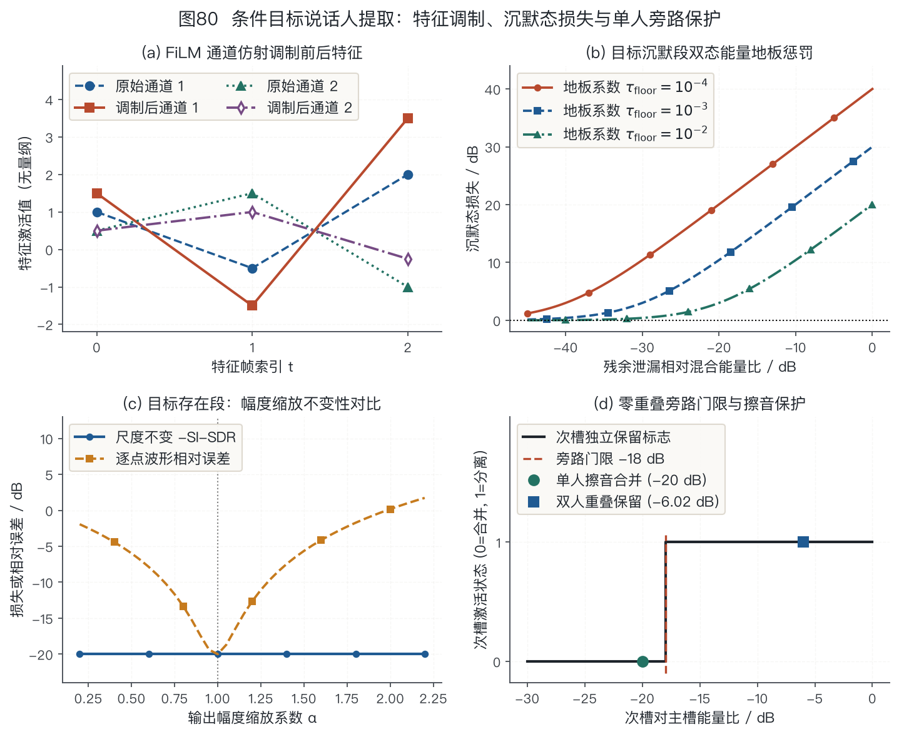
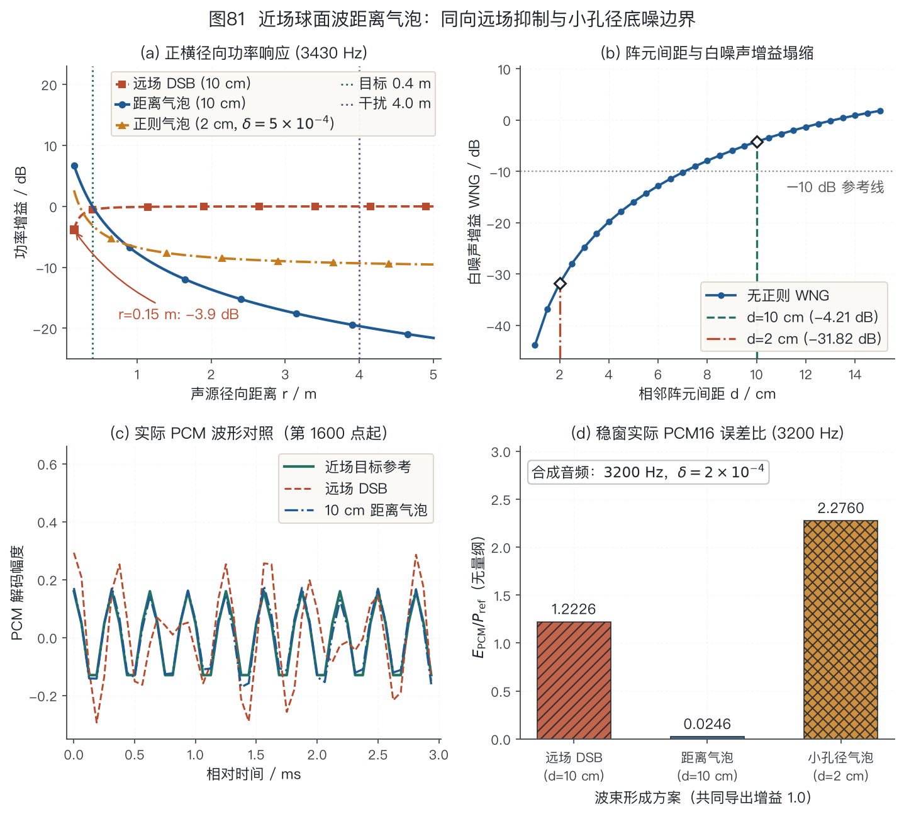
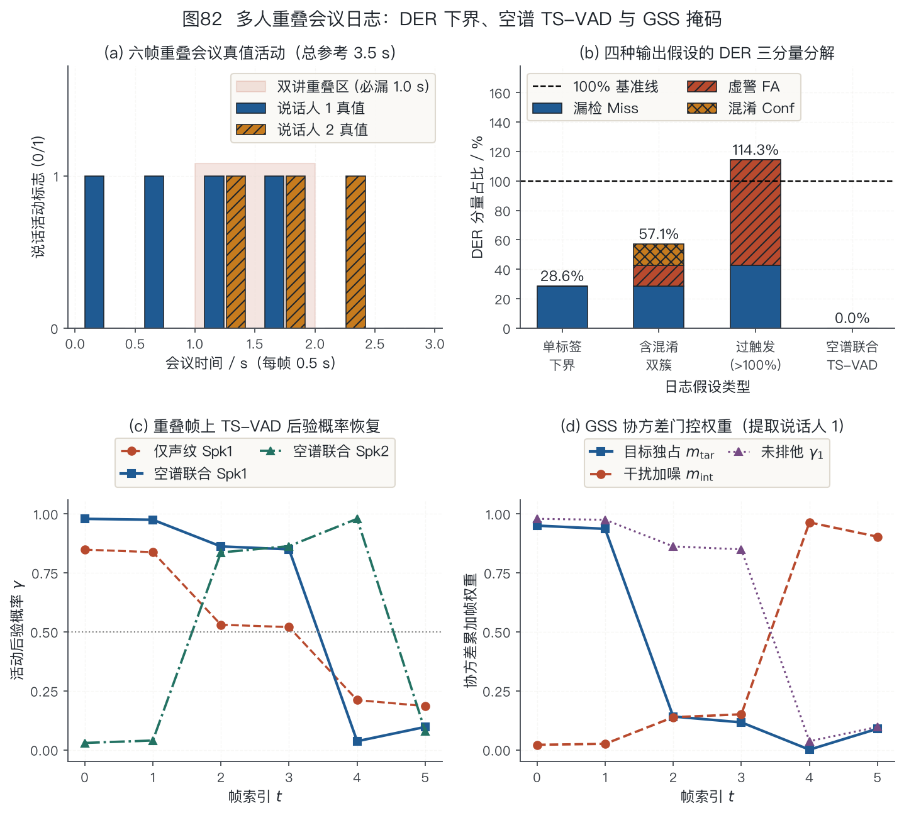
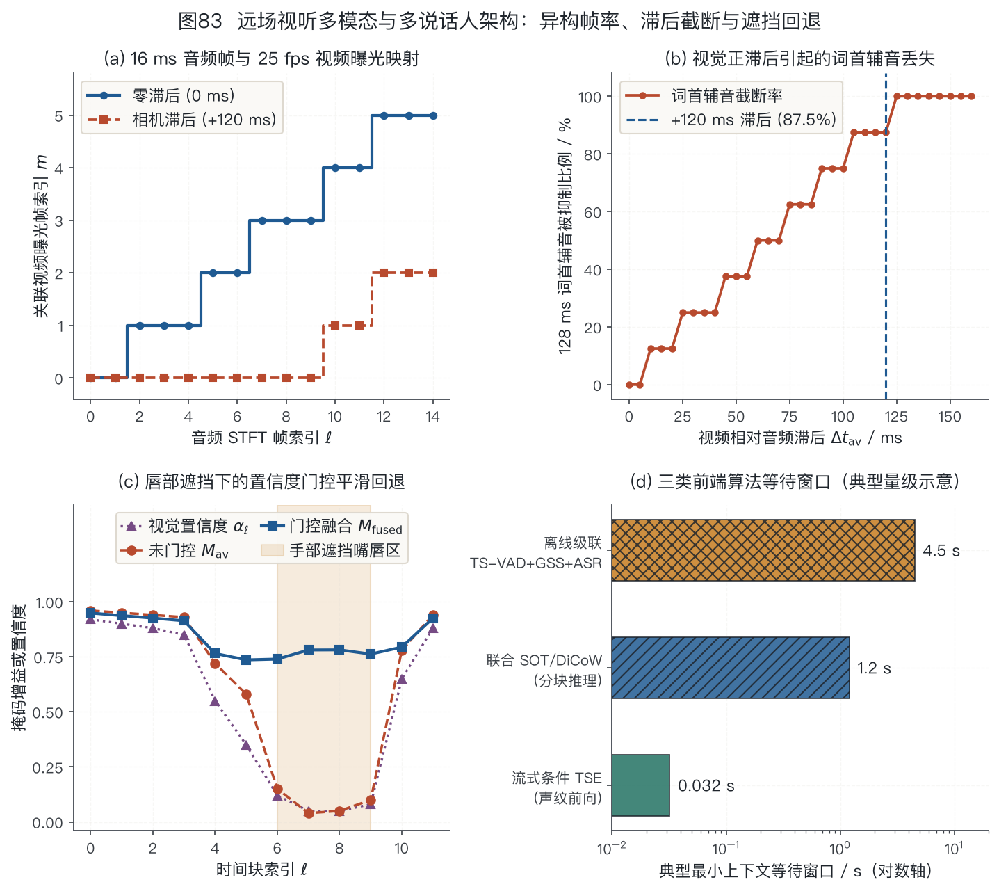

🌐 **简体中文** ｜ [English](../chapters_en/15_target-extraction-diarization.md)

> ⚠️ 本篇是本书正文第 15 章（扩展专题Ⅳ；正文共 16 章，即第 0～15 章，其中第 12～15 章为四篇扩展专题，另有附录 A、B），接在[第 14 章空间声场采集、参数化编码与可穿戴阵列](14_spatial-wearable-arrays.md)之后，讨论当声场中存在多位说话人、同向远端干扰或重叠对话时，拾音前端如何结合声纹、近场距离、说话人日志与视觉唇动线索完成目标说话人提取与多说话人活动检测。菲涅耳球面波近似、约束拉格朗日与匈牙利最优指派推导可回查[第 0 章 §0.1](00_math-foundations.md#sec-0-1)、[§0.5](00_math-foundations.md#sec-0-5)与[§0.6](00_math-foundations.md#sec-0-6)，全局符号与术语速查见[第 16 章附录 A §16.1](16_appendix-symbols-math.md#sec-16-1)。
>
> 首页导读：[00_overview.md](00_overview.md) ｜ 上一篇：[14_spatial-wearable-arrays.md](14_spatial-wearable-arrays.md) ｜ 下一篇：[16_appendix-symbols-math.md](16_appendix-symbols-math.md)

---

## 第 15 章：条件目标提取、多通道日志与远场多模态前端

### 15.1 从盲分离走向线索驱动：我们究竟认识目标的什么？

#### 盲分离的槽位歧义与条件提取的问题切换

回顾[第 8 章 §8.1](08_speech-separation.md#sec-8-1)，盲源分离（Blind Source Separation，BSS）与置换不变训练（Permutation Invariant Training，PIT）试图在不预先指定“谁是目标”的前提下，把混合录音拆成 $K$ 条彼此独立的单人语音流。然而落到真实的智能眼镜、车载座舱、开放式办公位或多人会议系统时，无条件盲分离立刻面临三项结构性限制：

1. **输出槽位缺少全局身份锚点**：两秒钟的分块分离器在这一块把张三放进第 1 槽、李四放进第 2 槽，下一块很可能翻转顺序；系统即使把声音分开了，仍然不知道哪一路才是唤醒设备的主人。
2. **真实说话人数 $K$ 动态未知**：会议室里可能连续五分钟只有一人发言，随后突然出现三人抢话。固定 $K=2$ 或 $K=3$ 的网络在单人发言段容易把清辅音错误拆进空闲槽位，而在四人同时说话时又必然漏掉多余声源。
3. **非目标人声浪费算力与带宽**：智能手表或定向助听器只需要提取佩戴者面前交谈对象的声音，后台把餐厅隔壁桌五位食客的聊天逐一分离重建纯属无效开销。

**目标说话人提取（Target Speaker Extraction，TSE；文献亦称目标语音提取 Target Speech Extraction，系统综述见 [Žmolíková 等，*IEEE Signal Processing Magazine* 2023](https://doi.org/10.1109/MSP.2023.3240008)）**把问题从“分离所有人”切换为“给定一条描述目标的先验线索 $\mathcal C$，直接从多通道混合观测中只提取与 $\mathcal C$ 匹配的单一目标语音”。如果目标在当前时间段正在说话，系统输出不失真的目标波形；如果目标保持沉默而只有旁人在说话，系统应当输出安静的零信号。

#### 五类目标线索的物理形态与缩写对照

在工程设计中，“先验线索 $\mathcal C$”不局限于预先录好的一段注册语音。只要某种物理量或模态能够把目标说话人与周围干扰区分开，就能编码为条件向量驱动提取器。下表对比了远场与可穿戴设备中最常用的五类目标线索及其失效边界：

| 线索模态 | 物理可观测量 | 典型应用场景 | 核心失效条件 |
|---|---|---|---|
| **注册声纹线索** | 3～10 s 注册语音提取的说话人嵌入向量 | 个人手机免提、定制语音助手 | 双胞胎或音色相近、感冒变声、耳语发声 |
| **空间角度锥线索** | 目标方位角与俯仰角区间 $(\theta_0 \pm \Delta\theta)$ | 智能电视前向拾音、车载主副驾分区 | 干扰源恰好站在目标身后同一直线上 |
| **近场距离气泡线索** | 球面波前曲率限定的径向距离 $r \le r_{\mathrm{bubble}}$ | 开放式工位麦克风、双耳智能眼镜 | 阵列孔径过小（$r \gg 2D^2/\lambda$）或低频段 |
| **视觉唇动线索** | 人脸检测框内嘴唇开合与口型时序特征 | 视频会议终端、带摄像头智能屏 | 端杯遮挡嘴唇、侧脸转头、相机管线滞后 |
| **语义/概念提示线索** | 文本标签或事件类别嵌入（如 [Semantic Hearing，UIST 2023](https://doi.org/10.1145/3586183.3606779)） | 听觉场景按需拾音、双耳辅助听觉设备 | 多人同属同一宽泛类别（如两位成年男性） |

表后选型规律十分清晰：没有任何单一模态能在全部物理场景下覆盖所有干扰形态。声纹不怕同方向遮挡但怕音色近似与短促应答词，空间角度不怕陌生人未注册但分不开同向远近两声源；近场距离气泡能压制同向远端串音却受限于物理孔径与声波波长，视觉唇动免疫声学强混响却易受端水杯挡嘴或侧脸转头影响。

因此现代远场与可穿戴拾音前端普遍采用**多模态线索协同与置信度门控回退**，让互补模态在不同退化工况下平稳接管。

本章集中使用的专业缩写汇总如下，后续推导可直接回查：

| 缩写 | 中文名与英文全称 | 在本章中的作用 |
|---|---|---|
| TSE | 目标说话人提取（Target Speaker Extraction，亦称目标语音提取） | 依据给定目标线索 $\mathcal C$ 从混合观测中仅恢复目标语音的条件提取任务 |
| FiLM | 特征级线性调制（Feature-wise Linear Modulation） | 用线索生成的通道缩放与偏置向量对主干网络特征做逐通道仿射调制 |
| SI-SDR | 尺度不变信号失真比（Scale-Invariant Signal-to-Distortion Ratio） | 将估计波形正交投影到真实目标方向后度量能量比，消除整体增益影响 |
| DER | 说话人日志误差率（Diarization Error Rate） | 统计漏检、虚警与说话人混淆三项时长之和占参考总说话人时长的比值 |
| TS-VAD | 目标说话人语音活动检测（Target-Speaker Voice Activity Detection） | 以候选人特征为条件，并行输出每位说话人在每帧的独立活动后验概率 |
| GSS | 导引源分离（Guided Source Separation） | 利用说话人活动时间戳约束空间混合模型与掩码估计，驱动波束形成提取 |
| EEND | 端到端神经说话人日志（End-to-End Neural Diarization） | 直接将多说话人日志建模为多标签帧分类并用置换不变损失训练的网络 |
| SOT | 序列化输出训练（Serialized Output Training） | 用特殊说话人切换标记将重叠多人转写按发言次序串接后单解码器输出 |
| DiCoW | 日志条件化语音识别（Diarization-Conditioned Whisper） | 将帧级说话人活动掩码直接注入预训练大模型编码器层的条件转写架构 |

### 15.2 条件特征调制与目标不存在时的奇异损失

#### 线索向量怎样进入特征主干：FiLM 仿射调制与交叉注意力

假设主干提取网络在第 $\ell$ 层提取出通道数为 $C$、帧数为 $T$ 的实值中间特征图 $\mathbf H \in \mathbb{R}^{C \times T}$（若为时频二维卷积特征 $\mathbf H \in \mathbb{R}^{C \times F \times T}$，则同样沿第 0 维特征通道轴作用），同时线索编码器将注册音频、方位角编码或唇动序列映射为固定维度的条件嵌入向量 $\vec e = g_{\mathrm{clue}}(\mathcal C)$（属于 $\mathbb{R}^D$）。怎样让同一套主干网络权重根据不同的 $\vec e$ 切换滤波行为？

Perez 等人在 2018 年提出的**特征级线性调制（FiLM）**（[AAAI 2018 原文](https://arxiv.org/abs/1709.07871)）可用来讲解条件控制；VoiceFilter（[Wang 等，Interspeech 2019](https://arxiv.org/abs/1810.04826)）与 SpeakerBeam（[Žmolíková 等，IEEE JSTSP 2019](https://doi.org/10.1109/JSTSP.2019.2922820)）采用各自的条件注入结构，不能统一归为完整 FiLM：VoiceFilter 拼接声纹与声学特征，SpeakerBeam 使用乘性适配。以下 FiLM 是独立教学模型，通过两个轻量级线性层把条件向量 $\vec e$ 映射为 $C$ 维通道缩放向量 $\vec\gamma \in \mathbb{R}^C$ 与通道偏置向量 $\vec\beta \in \mathbb{R}^C$：

$$\begin{aligned}
\vec\gamma&=\mathbf W_\gamma\vec e+\vec b_\gamma,\\
\vec\beta&=\mathbf W_\beta\vec e+\vec b_\beta.
\end{aligned}\tag{15-1}$$

式中 $\mathbf W_\gamma \in \mathbb{R}^{C \times D}$ 与 $\mathbf W_\beta \in \mathbb{R}^{C \times D}$ 为投影矩阵，$\vec b_\gamma, \vec b_\beta \in \mathbb{R}^C$ 为偏置向量。随后对特征图 $\mathbf H$ 的第 $c$ 个通道（$c = 1, \ldots, C$）、第 $t$ 帧执行逐通道仿射变换，得到调制后的特征图 $\mathbf Z \in \mathbb{R}^{C \times T}$：

$$\begin{gathered}
Z_{c,t}=\gamma_c H_{c,t}+\beta_c,\\
\mathbf Z=\vec\gamma\odot\mathbf H+\vec\beta.
\end{gathered}\tag{15-2}$$

这里算子 $\odot$ 表示将列向量 $\vec\gamma$ 沿时间帧维广播后逐元素相乘。式(15-2)的物理与几何分工十分直观：

1. **选择性放大与门控关断（$\gamma_c$）**：当某特征通道 $c$ 恰好响应目标说话人的基频谐波簇或目标方位相位差时，$\gamma_c > 1$ 放大该通道响应；当该通道响应干扰源特征时，$\gamma_c \approx 0$ 直接关断传递，甚至在后续接有矫正线性单元 $\operatorname{ReLU}(Z_{c,t}) = \max(0, Z_{c,t})$ 时用 $\gamma_c < 0$ 翻转极性。
2. **激活阈值平移（$\beta_c$）**：负偏置 $\beta_c < 0$ 抬高了进入下一层非线性激活函数的门限，压制微弱的干扰残余；若初始化令 $\vec\gamma = \vec 1_C$、$\vec\beta = \vec 0_C$，式(15-2)精确退化为恒等映射 $\mathbf Z = \mathbf H$，保证网络训练初期不会破坏预训练声学主干。

当目标线索本身是随时间剧烈变化的序列（例如 $T_{\mathrm{v}}$ 帧唇动特征 $\mathbf E_{\mathrm{lip}}$，形状 $D \times T_{\mathrm{v}}$，而非单一静态声纹向量 $\vec e$）时，全局常值 $\vec\gamma, \vec\beta$ 无法表达逐帧口型开合。此时工程上改用**跨模态交叉注意力（Cross-Attention）**调制：以音频特征生成查询矩阵 $\mathbf Q = \mathbf W_Q\mathbf H$（形状 $d_k \times T$），以线索序列生成键矩阵 $\mathbf K = \mathbf W_K\mathbf E_{\mathrm{lip}}$（形状 $d_k \times T_{\mathrm{v}}$）与值矩阵 $\mathbf V = \mathbf W_V\mathbf E_{\mathrm{lip}}$（形状 $C \times T_{\mathrm{v}}$），按缩放点积权重对齐融合：

$$\mathbf Z_{\mathrm{attn}}=\mathbf H
+\mathbf V\,\operatorname{softmax}\!\left(
\frac{\mathbf K^\top\mathbf Q}{\sqrt{d_k}}\right).\tag{15-3}$$

式中 $\operatorname{softmax}(\cdot)$ 沿键帧维（列内）归一化，使每个音频帧 $t$ 自动汇聚与其时间最吻合的视觉口型特征，计算开销为 $\mathcal O\bigl(T T_{\mathrm{v}} (d_k + C)\bigr)$，显著高于式(15-2) FiLM 调制的 $\mathcal O(C T)$ 逐元素开销。因此静态声纹或固定方向锥普遍采用轻量级 FiLM，而帧同步唇动或动态追踪轨迹则优先采用交叉注意力或逐帧时变 FiLM。

#### 声纹嵌入骨干（x-vector / ECAPA-TDNN / WavLM）与空间角度条件网络

静态声纹条件 $\vec e = g_{\mathrm{clue}}(\mathcal C)$ 的判别力直接决定条件提取器的上限。现代声纹编码器经历了三代典型演进：

1. **x-vector（统计池化时延网络）**：[Snyder 等（ICASSP 2018）](https://doi.org/10.1109/ICASSP.2018.8461375) 用多层时延神经网络（TDNN）提取帧级声学表征，再沿整段注册语音计算各维特征的均值与标准差拼接（Statistics Pooling），将变长话段压为定长声纹向量。
2. **ECAPA-TDNN（通道注意力与多尺度聚合）**：[Desplanques 等（Interspeech 2020）](https://arxiv.org/abs/2005.07143) 在一维残差块中引入多尺度 Res2Net 分支、Squeeze-and-Excitation（SE）通道重标定与通道相关的注意力统计池化，重点强化携带声道共振峰与基频个性的活跃浊音帧，成为目前开放式场景最常用的紧凑声纹骨干。
3. **自监督语音基座（如 WavLM）**：[Chen 等（IEEE JSTSP 2022）](https://doi.org/10.1109/JSTSP.2022.3188113) 在预训练阶段主动构造多说话人重叠与噪声混叠任务并预测掩码隐表征，其多层加权特征在多人混叠与低信噪比注册条件下较传统梅尔频谱前端具有明显抗干扰优势。

**注册语音较短时应检查什么？** 片段只覆盖少数音素时，池化特征可能受当前语音内容影响；有效发声时长和注册与测试录音的匹配程度也需要一并考虑。时长的影响可在指定模型与数据上比较：[SpeakerBeam 2019，§VIII-C 与图 10](https://doi.org/10.1109/JSTSP.2019.2922820) 在 WSJ0-2mix 上为每条测试混合指定一条长于 $8.5\,\mathrm{s}$ 的注册语音，去掉开头 $0.5\,\mathrm{s}$ 后，截取 $0.5$～$8\,\mathrm{s}$ 作对照。该实验中，约 $1\,\mathrm{s}$ 的结果已接近较长注册，$0.5\,\mathrm{s}$ 仍有相对混合输入的平均 SDR 提升；作者指出这种趋势依赖训练数据。声纹相似时仍可能错提干扰说话人，因此还应单独评估目标与干扰的混淆情况。

为了缓解声纹编码器与分离主干之间的表征失配，时域提取代表架构 **Time-Domain SpeakerBeam**（[Delcroix 等，ICASSP 2020](https://doi.org/10.1109/ICASSP40776.2020.9054683)）与 **SpEx+**（[Ge 等，Interspeech 2020](https://arxiv.org/abs/2005.04686)）采用不同的适配设计：前者以时域编码和乘性说话人适配为核心，后者在混合与注册支路使用共享多尺度时域编码器并加入说话人分类损失；共享多尺度编码器不能一概归于两者。而当系统面对**未注册陌生说话人**但已知目标方位角 $\theta_0$ 时，多麦前端还可直接构造**空间角度特征（Angle Feature，AF）**作为条件线索：在[第 3 章 §3.1](03_array-geometry.md#sec-3-1) 与后文式(15-10)～(15-11)的远场正横坐标系下，理论通道间相位差为 $\Delta\phi_{pq}(\theta_0, f) = +\frac{2\pi f}{c}(x_p - x_q)\sin\theta_0$，对选定麦克风对集合 $\mathcal P$ 计算实测相位差与理论导向相位差的逐时频点平均余弦匹配度 $AF(f, t) = \frac{1}{|\mathcal P|}\sum_{(p,q)\in\mathcal P}\cos\bigl(\angle(X_p X_q^*) - \Delta\phi_{pq}(\theta_0, f)\bigr)$，将其与多通道谱特征或声纹嵌入联合送入提取网络，即可在免注册条件下锁定目标方向锥，并与声纹线索形成“方向抗同音色、声纹抗同方向”的互补防线。

近年目标提取正沿着**空间区域可编程、语义提示与免声纹池化**三个方向持续演进：在空间与听觉交互侧，**Cone of Silence**（[Jenrungrot 等，NeurIPS 2020](https://arxiv.org/abs/2010.06007)）以二分角窗逐层锁定任意角度声源，**Semantic Hearing**（[Veluri 等，ACM UIST 2023](https://doi.org/10.1145/3586183.3606779)）在约 $6.6\ \mathrm{ms}$ 低延迟双耳因果架构上保留 ITD/ILD 线索实现按语义类别提取，**ReZero**（[Gu 与 Luo，*IEEE/ACM TASLP* 2024](https://doi.org/10.1109/TASLP.2024.3393713)）支持按自定义三维空间区域灵活提取目标声场，而 **SpatialNet**（[Quan 与 Li，*IEEE/ACM TASLP* 2024](https://doi.org/10.1109/TASLP.2024.3357036)）以窄带与跨带交替的多通道空间变换器显著强化了多麦空间线索建模；在声纹条件侧，**USEF-TSE**（[Zeng 与 Li，*IEEE TASLP* 2025](https://arxiv.org/abs/2409.02615)）直接用帧级交叉注意力对齐混合谱与注册语音、绕开定长说话人嵌入池化瓶颈，个性化分带循环网络（pBSRNN）则在连续流式目标提取中兼顾低算力与高音质。

#### 目标沉默时标准 SI-SDR 为何出现零除零奇异

目标说话人提取与盲分离在训练目标上有一个极易被忽视的根本差异：在长对话录音切出的 $2\ \mathrm{s}$～$4\ \mathrm{s}$ 训练片段中，**目标说话人很可能全程保持沉默**（参考真值波形恒为零向量 $\vec s_{\mathrm{ref}} = \vec 0 \in \mathbb{R}^N$），而背景干扰说话人正在讲话（混合输入 $\vec x \ne \vec 0$）。回顾[第 8 章 §8.5](08_speech-separation.md#sec-8-5) 中用于单人增强与盲分离的标准尺度不变信号失真比（SI-SDR，[Le Roux 等，ICASSP 2019](https://arxiv.org/abs/1811.02508)），如果直接将其照搬作负损失，会出现什么代数退化？我们列出正交投影分解以显式定位奇异点：

$$\begin{aligned}
\alpha&=\frac{\hat{\vec s}^\top\vec s_{\mathrm{ref}}}
{\|\vec s_{\mathrm{ref}}\|_2^2},\\
\vec s_{\mathrm{proj}}&=\alpha\vec s_{\mathrm{ref}},\\
\vec e_{\mathrm{noise}}&=\hat{\vec s}-\vec s_{\mathrm{proj}},
\end{aligned}\tag{15-4}$$

$$\mathrm{SI\text{-}SDR}(\hat{\vec s},\vec s_{\mathrm{ref}})
=10\log_{10}\!\left(
\frac{\|\vec s_{\mathrm{proj}}\|_2^2}
{\|\vec e_{\mathrm{noise}}\|_2^2}
\right).\tag{15-5}$$

这里 $\hat{\vec s}, \vec s_{\mathrm{ref}} \in \mathbb{R}^N$ 分别为提取器输出波形与干净目标参考波形，实向量内积写作 $\hat{\vec s}^\top\vec s_{\mathrm{ref}}$。现在把目标沉默条件 $\vec s_{\mathrm{ref}} = \vec 0$ 代入式(15-4)与式(15-5)，立刻暴露出双重结构性失效：

1. **投影分母为零（$0/0$ 代数奇异）**：式(15-4)中 $\|\vec s_{\mathrm{ref}}\|_2^2 = 0$ 且 $\hat{\vec s}^\top\vec 0 = 0$，投影系数 $\alpha$ 变成无定义的 $0/0$（浮点运算直接产生 `NaN` 污染整批梯度）。
2. **尺度不变性与静音保真要求直接冲突**：即便人为在分母加上微小常数 $\varepsilon > 0$ 令 $\vec s_{\mathrm{proj}} = \vec 0$，式(15-5)分子依然恒为零，$\log_{10}(0 / \|\hat{\vec s}\|_2^2) = -\infty$；若再往对数分子分母同时加 $\varepsilon$，惩罚深度便取决于无物理量纲的数值补丁 $\varepsilon$。更重要的是，目标在场时可容忍输出波形整体缩放（尺度不变），**但目标沉默时绝不容忍提取器将干扰人声透传出来**——沉默段误差本质上必须锚定在混合输入能量标尺上做相对能量抑制度量。

#### 双态能量地板损失与单人过切分旁路保护

为了在同一套训练准则下兼顾“目标发声段保真”与“目标沉默段抑噪”，条件提取器采用由参考信号能量门限 $\varepsilon_s \ge 0$ 判别的**双态损失函数（Dual-State TSE Loss）**（关于目标缺席段静音能量约束与误触发评测，参见 [Borsdorf 等，Interspeech 2021](https://doi.org/10.21437/Interspeech.2021-1939) 与 [Delcroix 等，Interspeech 2022](https://doi.org/10.21437/Interspeech.2022-11252)）。设活跃参考能量门限为 $\varepsilon_s$，沉默态相对混合能量地板系数为 $\tau_{\mathrm{floor}} > 0$（典型取值 $10^{-3}$，对应混合信号功率以下 $-30\ \mathrm{dB}$ 的静音底噪目标），记混合能量地板 $E_{\mathrm{floor}}=\tau_{\mathrm{floor}}\|\vec x\|_2^2$，定义双态损失 $\mathcal L_{\mathrm{dual}}$ 为：

$$\mathcal L_{\mathrm{dual}}=
\begin{cases}
-\mathrm{SI\text{-}SDR}(\hat{\vec s},\vec s_{\mathrm{ref}}),
& \|\vec s_{\mathrm{ref}}\|_2^2>\varepsilon_s,\\
10\log_{10}\!\left(1+\dfrac{\|\hat{\vec s}\|_2^2}
{E_{\mathrm{floor}}}\right),
& \|\vec s_{\mathrm{ref}}\|_2^2\le\varepsilon_s.
\end{cases}\tag{15-6}$$

在沉默分支（$\|\vec s_{\mathrm{ref}}\|_2^2 \le \varepsilon_s$ 且 $\|\vec x\|_2^2 > 0$）中将 $E_{\mathrm{floor}}=\tau_{\mathrm{floor}}\|\vec x\|_2^2$ 代回，沉默态惩罚函数显式写作：

$$\mathcal L_{\mathrm{absent}}(\hat{\vec s},\vec x)
=10\log_{10}\!\left(
1+\frac{\|\hat{\vec s}\|_2^2}{\tau_{\mathrm{floor}}\|\vec x\|_2^2}
\right)\ge 0.\tag{15-7}$$

逐项检验式(15-7)的边界行为与梯度性质：

- **理想静音极小点与有界平滑梯度**：当提取器准确输出零波形 $\hat{\vec s} = \vec 0$ 时，$\mathcal L_{\mathrm{absent}} = 0\ \mathrm{dB}$（即 $10\log_{10} 1$），恰好达到全局下界。直接对 $\hat{\vec s}$ 求梯度得：

    $$\nabla_{\hat{\vec s}}\mathcal L_{\mathrm{absent}}
    =\frac{20}{\ln 10}\frac{\hat{\vec s}}
    {E_{\mathrm{floor}}+\|\hat{\vec s}\|_2^2}.$$

    可见梯度在 $\hat{\vec s} = \vec 0$ 处严格归零平滑收敛，且由均值不等式 $E_{\mathrm{floor}} + \|\hat{\vec s}\|_2^2 \ge 2\sqrt{E_{\mathrm{floor}}}\,\|\hat{\vec s}\|_2$ 保证其范数全局有界（$\|\nabla_{\hat{\vec s}}\mathcal L_{\mathrm{absent}}\|_2 \le \frac{10}{\ln 10\sqrt{E_{\mathrm{floor}}}}$），避免未加地板的 $\log_{10}(\|\hat{\vec s}\|_2^2)$ 在零点附近把梯度推向无穷大而引发权重震荡。
- **混合尺度自适应**：分母采用 $E_{\mathrm{floor}}=\tau_{\mathrm{floor}}\|\vec x\|_2^2$ 而非固定绝对常数，意味着无论录音整体数字电平调高 $10\ \mathrm{dB}$ 还是调低 $10\ \mathrm{dB}$，只要提取器对干扰源的相对能量抑制比 $\|\hat{\vec s}\|_2^2 / \|\vec x\|_2^2$ 相同，受到的 dB 惩罚完全一致。一旦残余泄漏远超混合地板（$\|\hat{\vec s}\|_2^2 \gg E_{\mathrm{floor}}$），惩罚随残余功率每增加十倍线性上升 $10\ \mathrm{dB}$。

在部署双槽或多槽前端时，与“目标沉默”对偶的另一个高频工程退化是**单人说话段的清辅音过切分（Over-Splitting）**。当房间里其实只有一位说话人发言时，双输出分离器往往把元音浊音主干放入主槽 $\vec y_1$，却把高频清擦音（如 `/s/`、`/f/`、`/ɕ/`）或词尾送气声误判为“第二个人”塞进次槽 $\vec y_2$，导致主槽听感发闷缺字。为此在后处理阶段设立**零重叠能量比旁路判决**：计算次槽相对主槽的能量比 $R_{21,\mathrm{dB}}$ 并与门限 $\eta_{\mathrm{dB}}$（常取 $-18\ \mathrm{dB}$～$-15\ \mathrm{dB}$）比较：

$$\begin{gathered}
R_{21,\mathrm{dB}}=10\log_{10}\!\left(
\frac{\|\vec y_2\|_2^2}{\|\vec y_1\|_2^2}\right),\\
\vec y_{\mathrm{out}}=\begin{cases}
\vec y_1+\vec y_2, & R_{21,\mathrm{dB}}<\eta_{\mathrm{dB}},\\
\vec y_1, & R_{21,\mathrm{dB}}\ge\eta_{\mathrm{dB}}.
\end{cases}
\end{gathered}\tag{15-8}$$

当 $R_{21,\mathrm{dB}} < \eta_{\mathrm{dB}}$ 时，系统判定次槽并非独立并行的第二位说话人，直接把 $\vec y_1 + \vec y_2$ 相加合并（或在系统架构上旁路双人分离器、切回单通道降噪/波束输出），从而无损找回被误切走的清辅音高频能量。

#### 锚点手算算例 15-1：FiLM 调制、沉默段奇异性与双态损失复算

我们用一组完全可口算的微型数组，把式(15-2)与式(15-5)～(15-8)从头到尾走通一遍（对应代码函数 `film_conditioning`、`tse_dual_state_loss` 与 `zero_overlap_bypass_decision`）。

**1. 输入设定与 FiLM 通道调制复算。** 设两通道三帧特征图 $\mathbf H$ 的第 1 行为 $[1.0, -0.5, 2.0]$、第 2 行为 $[0.5, 1.5, -1.0]$，目标声纹生成的调制参数为 $\vec\gamma = [2.0, 0.5]^\top$、$\vec\beta = [-0.5, 0.25]^\top$。按式(15-2)逐行计算：第 1 行各元素乘 $2.0$ 再减 $0.5$，依次得 $[1.5, -1.5, 3.5]$；第 2 行各元素乘 $0.5$ 再加 $0.25$，依次得 $[0.5, 1.0, -0.25]$，拼成调制特征矩阵 $\mathbf Z$。

**2. 目标发声段与目标沉默段的双态损失对比。** 取四点正交基向量：干净目标 $\vec s_{\mathrm{ref}} = [1, 1, -1, -1]^\top$（能量 $\|\vec s_{\mathrm{ref}}\|_2^2 = 4$），正交干扰 $\vec v = [1, -1, 1, -1]^\top$（满足 $\vec s_{\mathrm{ref}}^\top\vec v = 0$，$\|\vec v\|_2^2 = 4$），地板系数 $\tau_{\mathrm{floor}} = 10^{-3}$，门限 $\varepsilon_s = 10^{-8}$：

- **情形 A（目标在场）**：混合信号为 $\vec x = \vec s_{\mathrm{ref}} + \vec v$，即 $[2, 0, 0, -2]^\top$（$\|\vec x\|_2^2 = 8$）；设提取器输出整体衰减一半的目标并残留少量干扰 $\hat{\vec s} = 0.5\vec s_{\mathrm{ref}} + 0.05\vec v$，即 $[0.55, 0.45, -0.45, -0.55]^\top$。因 $\|\vec s_{\mathrm{ref}}\|_2^2 = 4 > 10^{-8}$，走发声分支：内积 $\hat{\vec s}^\top\vec s_{\mathrm{ref}} = 2.0$，投影系数 $\alpha = 2.0 / 4 = 0.5$，目标投影 $\vec s_{\mathrm{proj}} = 0.5\vec s_{\mathrm{ref}}$（能量 $1.0$），残余失真 $\vec e_{\mathrm{noise}} = 0.05\vec v$（能量 $0.01$）。代入式(15-5)得 $10\log_{10}(1.0 / 0.01) = +20.0\ \mathrm{dB}$，故 $\mathcal L_{\mathrm{dual}} = -20.0\ \mathrm{dB}$。即便输出幅度减半，尺度不变投影依然准确给出了 $20\ \mathrm{dB}$ 分离评价。
- **情形 B（目标沉默）**：令 $\vec s_{\mathrm{ref}} = [0, 0, 0, 0]^\top$，混合输入仅含干扰 $\vec x = \vec v$（$\|\vec x\|_2^2 = 4$）。此时标准 SI-SDR 在式(15-4)遭遇 $0/0$ 奇异；而双态损失切入式(15-7)沉默分支，混合能量地板为 $E_{\mathrm{floor}} = 0.004$（由 $\tau_{\mathrm{floor}}\|\vec x\|_2^2$ 求得），按输出残余能量分三档对比：

    - 若提取器准确输出静音 $\hat{\vec s} = \vec 0$，则 $\|\hat{\vec s}\|_2^2 = 0$，$\mathcal L_{\mathrm{dual}} = 0.0\ \mathrm{dB}$；
    - 若提取器泄漏了能量 $\|\hat{\vec s}\|_2^2 = 0.396$ 的干扰（即 $\hat{\vec s} = \sqrt{0.099}\,\vec v$，约为混合能量的十分之一），对数真数为 $1 + 0.396 / 0.004 = 100$，得 $\mathcal L_{\mathrm{dual}} = +20.0\ \mathrm{dB}$；
    - 若提取器完全失效而原样透传 $\hat{\vec s} = \vec x$（$\|\hat{\vec s}\|_2^2 = 4$），惩罚升至 $10\log_{10}(1001) \approx +30.00\ \mathrm{dB}$。

**3. 结论与适用边界。** 该算例说明双态损失消除了静音段的除零奇异，并能用同一 dB 量纲惩罚干扰透传。但要注意它的失效边界：若在真实录音中把微弱耳语目标误标成零参考（或参考通道串入了邻座说话人声音使 $\|\vec s_{\mathrm{ref}}\|_2^2 > \varepsilon_s$），双态切换开关就会跳错分支，因此在制作训练数据时必须配合近讲麦克风交叉门限清洗参考标签。



图 80 直观展示了条件目标说话人提取四个核心机制的定量行为（生成脚本 `scripts/make_tse_figures.py`）：

- **子图 (a) FiLM 通道仿射调制前后特征**：横轴为特征帧索引 $t \in \{0, 1, 2\}$，纵轴为特征激活值（无量纲）。红色方块实线（调制后通道 1）相比蓝色圆点虚线（原始通道 1）将动态范围放大两倍并整体下移 $0.5$，紫色菱形点划线（调制后通道 2）相比绿色三角点线（原始通道 2）将动态范围压缩一半并整体上移 $0.25$，展示条件向量如何逐通道重塑特征对比度。
- **子图 (b) 目标沉默段双态能量地板惩罚**：横轴为残余泄漏相对混合能量的分贝比 $10\log_{10}(\|\hat{\vec s}\|_2^2/\|\vec x\|_2^2)$，纵轴为沉默态损失 $\mathcal L_{\mathrm{absent}}$，单位均为 dB。三条曲线对应 $\tau_{\mathrm{floor}}=10^{-4},10^{-3},10^{-2}$。令 $r=\|\hat{\vec s}\|_2^2/(\tau_{\mathrm{floor}}\|\vec x\|_2^2)$，损失为 $10\log_{10}(1+r)$，对横轴的斜率是 $r/(1+r)$：极低泄漏时趋于零，地板处 $r=1$ 时为 $1/2$，只有远高于地板时才渐近趋于 $1\ \mathrm{dB/dB}$，并非越过地板就严格线性。
- **子图 (c) 目标存在段的幅度缩放不变性**：横轴为输出幅度缩放系数 $\alpha \in [0.2, 2.2]$（无量纲），纵轴为损失或相对误差（dB）。蓝色实线（$-\mathrm{SI\text{-}SDR}$）在全区间恒定保持 $-20.0\ \mathrm{dB}$；而对 $\hat{\vec s} = \alpha(\vec s_{\mathrm{ref}} + 0.1\vec v)$（$\vec s_{\mathrm{ref}} \perp \vec v$ 且等范数），橙色虚线（逐点波形相对均方误差 $10\log_{10}(\|\hat{\vec s}-\vec s_{\mathrm{ref}}\|_2^2 / \|\vec s_{\mathrm{ref}}\|_2^2) = 10\log_{10}(1.01\alpha^2 - 2\alpha + 1)$）在所画的 $0.05$ 步长网格中于 $\alpha = 1.0$ 处取得最小采样值 $-20.0\ \mathrm{dB}$，向两侧偏离后迅速抬升——由 $1.01\alpha^2 - 2\alpha + 1 < 1$ 解得它仅在 $\alpha \in (0, 2/1.01) \approx (0, 1.9802)$ 内低于 $0\ \mathrm{dB}$（例如在 $\alpha = 0.2$ 处恶化至 $-1.94\ \mathrm{dB}$），在 $\alpha = 2/1.01 \approx 1.98$ 处越过 $0\ \mathrm{dB}$（在 $0.05$ 步长绘图网格上于 $\alpha = 2.0$ 处达到 $+0.17\ \mathrm{dB}$），并在 $\alpha = 2.2$ 处升至 $+1.73\ \mathrm{dB}$，直观解释了为何未标定增益的提取网络需先用正交投影解耦幅度。
- **子图 (d) 零重叠旁路门限与擦音保护**：横轴为次槽对主槽能量比 $R_{21,\mathrm{dB}}$（dB），纵轴为次槽激活状态（$0$ 为合并旁路，$1$ 为独立分离）。红色竖直虚线标出 $-18\ \mathrm{dB}$ 门限；单人清擦音泄漏点（$-20\ \mathrm{dB}$，绿圆点）落在门限左侧触发合并恢复，双人真实重叠点（$-6.02\ \mathrm{dB}$，蓝方块）落在右侧正常保持双流分离。

连续 NMSE 的导数为 $2.02\alpha-2$，故真正最小值在 $\alpha=100/101$，NMSE 为 $1/101$（$-20.0432\ \mathrm{dB}$）；图中 $0.05$ 网格选到的 $\alpha=1$ 则为 $-20\ \mathrm{dB}$。

### 15.3 远场角度失灵时：近场球面波与声学距离气泡

#### 球面波导向矢量与菲涅耳近场距离判据

设想在开放式工位或嘈杂咖啡馆里，用户佩戴智能眼镜或面对桌面阵列说话，距离阵列中心仅 $r_1 = 0.40\ \mathrm{m}$；而在用户正后方同一直线上 $r_2 = 4.00\ \mathrm{m}$ 处，另一位同事也在大声打电话。此时目标与干扰的方位角完全相同（均为正横（broadside）方向 $\theta = 0^\circ$）。回顾[第 5 章 §5.1](05_beamforming.md#sec-5-1)，任何基于**远场平面波假设**的波束形成器只认方向角 $\theta$：既然两者方位角都是 $0^\circ$，平面波导向矢量完全重合，传统角度波束无论怎样调权重，都无法保留近处说话人而单独压制正后方的远处干扰。

破局的物理钥匙在于**波前曲率（Wavefront Curvature）**：近处 $0.40\ \mathrm{m}$ 的声音到达阵列时是一圈明显弯曲的球面波，而远处 $4.00\ \mathrm{m}$ 传来的波前已经接近平直的平面波。借用球面波曲率在阵列前方围出一块只接收 $r \le r_{\mathrm{bubble}}$ 范围内声音、而把同方向更远处声音挡在外面的空间区域，称为**声学距离气泡（Acoustic Distance Bubble）**（如 [Chen 等 Sound Bubbles，Nature Electronics 2024](https://doi.org/10.1038/s41928-024-01276-z) 在可穿戴阵列上演示的可编程球面波距离气泡；与之相关的无线同步双耳自语音近场神经增强系统则见 [Chatterjee 等 ClearBuds，MobiSys 2022](https://doi.org/10.1145/3498361.3538933)）。

我们建立严格的平面几何坐标把曲率相位算清楚。设 $M$ 元均匀线阵（ULA）沿 $x$ 轴对称排列，第 $m$ 支麦克风坐标为 $(x_m, 0)$，阵列中心位于原点 $(0, 0)$，总物理孔径为 $D = \max_m x_m - \min_m x_m$。方位角 $\theta \in [-\pi/2, \pi/2]$ 自正横 $+y$ 轴法线向 $+x$ 轴度量，则距离原点为 $r$、方位角为 $\theta$ 的点声源坐标为 $(r\sin\theta, r\cos\theta)$，它到第 $m$ 支麦克风的精确欧氏传播距离 $r_m(r, \theta)$ 为：

$$\begin{aligned}
r_m(r,\theta)&=\sqrt{(r\sin\theta-x_m)^2+(r\cos\theta)^2}\\
&=\sqrt{r^2+x_m^2-2rx_m\sin\theta}.
\end{aligned}\tag{15-9}$$

为了看清它与远场平面波公式的关系，把根号提出公共因子 $r$，并在 $r \gg |x_m|$ 条件下利用二阶泰勒展开 $\sqrt{1 + u} = 1 + \frac{1}{2}u - \frac{1}{8}u^2$（略去 $\mathcal O(u^3)$，其中 $u = -\frac{2x_m\sin\theta}{r} + \frac{x_m^2}{r^2}$）逐步合并到 $r^{-1}$ 阶：

$$\begin{aligned}
r_m(r,\theta)-r
&=r\Biggl[1+\frac{1}{2}\!\left(
-\frac{2x_m\sin\theta}{r}+\frac{x_m^2}{r^2}\right)\\
&\quad-\frac{1}{8}\!\left(-\frac{2x_m\sin\theta}{r}\right)^2
+\mathcal O\!\left(\frac{|x_m|^3}{r^3}\right)\Biggr]-r\\
&=-x_m\sin\theta+\frac{x_m^2\cos^2\theta}{2r}
+\mathcal O\!\left(\frac{|x_m|^3}{r^2}\right).
\end{aligned}\tag{15-10}$$

仔细对照式(15-10)右端的两项：第一项 $-x_m\sin\theta$ 与距离 $r$ 完全无关，正是远场平面波的方向线性程差；当声源位于正横 $\theta = 0^\circ$ 时，第一项恒为零。**而第二项 $+\frac{x_m^2\cos^2\theta}{2r}$ 在 $\theta = 0^\circ$ 时恰恰达到最大值 $\frac{x_m^2}{2r}$**——它与阵元坐标平方 $x_m^2$ 成正比、与声源距离 $r$ 成反比，这就是使阵列能够分辨同方向不同距离声源的**球面波二次曲率程差**。

按照全书统一的前向傅里叶核 $e^{-\mathrm{j}2\pi f t}$，记波数 $\kappa = 2\pi f / c = 2\pi / \lambda$（$\lambda = c / f$ 为声波波长）。以阵列原点距离 $r$ 为相位与幅度参考，工程建模中必须明确区分两种球面波导向矢量定义——**纯相位曲率导向矢量** $\vec a_{\mathrm{ph}}(r, \theta)$ 与**含相对球面扩散衰减的导向矢量** $\vec a_{\mathrm{att}}(r, \theta)$：

$$\begin{aligned}
\bigl[\vec a_{\mathrm{ph}}(r,\theta)\bigr]_m
&=\exp\bigl(-\mathrm{j}\kappa\,[r_m(r,\theta)-r]\bigr),\\
\bigl[\vec a_{\mathrm{att}}(r,\theta)\bigr]_m
&=\frac{r}{r_m(r,\theta)}\,
\exp\bigl(-\mathrm{j}\kappa\,[r_m(r,\theta)-r]\bigr).
\end{aligned}\tag{15-11}$$

何时阵列还能看清球面波的弯曲，何时球面波已经退化成不可分辨的平面波？声学与天线理论以阵列两端边缘（$\lvert x_m\rvert = D/2$）在正横方向产生的二次曲率相位差等于 $\pi/8$（对应程差 $\Delta r = \lambda / 16$）作为分水岭：令 $\frac{(D/2)^2}{2 r_F} = \frac{\lambda}{16}$，解出 **Fraunhofer 远场边界（菲涅耳二次相位曲率判据）** $r_F = 2D^2/\lambda$：

$$r_F=\frac{2D^2}{\lambda}=\frac{2D^2 f}{c}.\tag{15-12}$$

式(15-12)揭示了硬件尺寸与工作频率的紧密耦合：近场可分辨半径与**阵列总孔径 $D$ 的平方**成正比、与频率 $f$ 成正比。孔径缩小到原来的五分之一，有效近场半径 $r_F$ 就会骤缩到原来的**二十五分之一**。

#### 同方向远场零陷：三麦距离气泡的二阶空间差分闭式解

现在我们在正横 $\theta = 0^\circ$ 的三麦克风对称均匀线阵（阵元坐标 $x_{-1} = -d, x_0 = 0, x_{+1} = +d$，总孔径 $D = 2d$）上，推导“无失真保留近场目标 $(r_1, 0^\circ)$、同时对同方向远场平面波形成精确零陷”的线性约束最小方差（LCMV）波束形成闭式解。

为聚焦波前相位曲率的核心作用，先采用式(15-11)的纯相位模型（$r / r_m$ 幅度修正的定量影响见 [E15-04](#e15-04)）。在正横 $\theta = 0^\circ$ 下，中心阵元距离为 $r_0 = r$，两侧对称阵元距离均为 $\sqrt{r^2 + d^2}$，相对中心阵元的额外传播程差与滞后相位记为：

$$\begin{aligned}
\Delta r(r)&=\sqrt{r^2+d^2}-r,\\
\phi(r)&=-\kappa\,\Delta r(r)
=-\frac{2\pi}{\lambda}\!\left(\sqrt{r^2+d^2}-r\right)<0.
\end{aligned}\tag{15-13}$$

令复单位相量 $u_1 = e^{\mathrm{j}\phi_1}$（其中 $\phi_1 = \phi(r_1)$），则近场目标导向矢量为 $\vec a_1 = [u_1, 1, u_1]^\top$，而同方向无穷远平面波（$r \to \infty$ 时 $\Delta r \to 0$ 且 $\phi \to 0$）的导向矢量为全 $1$ 列向量 $\vec a_\infty = [1, 1, 1]^\top$。在空间白噪声（$\mathbf R_{nn} = \mathbf I_3$）下，最小化传感器自噪声放大功率 $\|\vec w\|_2^2$ 的双约束优化问题写作：

$$\begin{gathered}
\min_{\vec w\in\mathbb{C}^3}\;\|\vec w\|_2^2\\
\text{s.t.}\quad\vec w^H\vec a_1=1,\quad\vec w^H\vec a_\infty=0.
\end{gathered}\tag{15-14}$$

设 $3 \times 2$ 约束矩阵为 $\mathbf C = [\vec a_1, \vec a_\infty]$，期望响应向量为 $\vec f = [1, 0]^\top$，则 $\mathbf C^H\vec w = \vec f$ 的最小范数解为 $\vec w = \mathbf C(\mathbf C^H\mathbf C)^{-1}\vec f$。无需直接展开矩阵求逆，利用左右阵元对称性只需三步初等代数即可写出 $\vec w = [w_{-1}, w_0, w_{+1}]^\top$ 的闭式解：

1. 由对称性（$\vec w$ 落在 $\{\vec a_1, \vec a_\infty\}$ 张成的子空间内），两侧阵元权重必相等，记 $w_{-1} = w_{+1} = w_{\mathrm{out}}$。
2. 代入第二个远场零陷约束 $\vec w^H [1, 1, 1]^\top = 0$，即 $2w_{\mathrm{out}}^* + w_0^* = 0$，两边取共轭立得 $w_0 = -2w_{\mathrm{out}}$。也就是说，**权重向量的空间形态必然正比于二阶空间中心差分算子 $[1, -2, 1]^\top$**：平面波沿阵轴相位拉平（$1 - 2 + 1 = 0$），输出恒为零；只有弯曲的球面波才能穿过这道二阶曲率高通滤波器。
3. 代入第一个近场无失真约束 $\vec w^H [u_1, 1, u_1]^\top = 1$，即 $w_{\mathrm{out}}^*(2u_1 - 2) = 1$，解得 $w_{\mathrm{out}}^* = \frac{1}{2(u_1 - 1)}$，取复共轭（注意 $u_1^* = e^{-\mathrm{j}\phi_1}$）即得闭式最优权重：

$$\vec w_{\mathrm{bubble}}
=\frac{1}{2\bigl(e^{-\mathrm{j}\phi_1}-1\bigr)}
\begin{bmatrix}1\\-2\\1\end{bmatrix}.\tag{15-15}$$

现在将式(15-15)作用于任意正横距离 $r$ 的球面波 $\vec a(r, 0^\circ)$（其三分量为 $[e^{\mathrm{j}\phi(r)}, 1, e^{\mathrm{j}\phi(r)}]^\top$），利用欧拉半角恒等式 $|e^{\mathrm{j}\phi} - 1|^2 = 4\sin^2(\phi / 2)$（由 $2 - 2\cos\phi$ 化简），一步算出**径向距离功率响应函数** $|B(r, 0^\circ)|^2$ 与**白噪声增益（White Noise Gain，WNG）**：

$$\begin{aligned}
|B(r,0^\circ)|^2&=|\vec w_{\mathrm{bubble}}^H\vec a(r,0^\circ)|^2\\
&=\left|\frac{e^{\mathrm{j}\phi(r)}-1}
{e^{\mathrm{j}\phi_1}-1}\right|^2
=\frac{\sin^2\!\bigl(\phi(r)/2\bigr)}{\sin^2(\phi_1/2)},
\end{aligned}\tag{15-16}$$

$$\begin{aligned}
\|\vec w_{\mathrm{bubble}}\|_2^2
&=\frac{1^2+(-2)^2+1^2}{4\,|e^{-\mathrm{j}\phi_1}-1|^2}
=\frac{3}{8\sin^2(\phi_1/2)},\\
\mathrm{WNG}&=\frac{1}{\|\vec w_{\mathrm{bubble}}\|_2^2}
=\frac{8}{3}\sin^2\!\left(\frac{\phi_1}{2}\right).
\end{aligned}\tag{15-17}$$

式(15-16)和式(15-17)清晰刻画了距离气泡的径向选择性与噪声代价：当干扰距离 $r_2 \gg d$ 且目标距离 $r_1 \gg d$ 时，$\phi(r) \approx -\pi d^2 / (\lambda r)$ 与 $1/r$ 成正比；在小角度区域 $\sin(\phi/2) \approx \phi/2$，故远端干扰功率响应按 $|B(r_2, 0^\circ)|^2 \approx (r_1 / r_2)^2$ 衰减——**距离比目标远 10 倍的同向干扰（$r_2 = 10 r_1$），功率天然被压低约 $(1/10)^2 = 1/100$，即约 $20\ \mathrm{dB}$**。

#### 孔径缩水与白噪声增益塌缩：可穿戴小阵列的物理红线

反过来看式(15-17)的代价：普通三麦远场延迟求和波束 $\vec w_{\mathrm{DSB}} = [1/3, 1/3, 1/3]^\top$ 的白噪声增益为 $\mathrm{WNG}_{\mathrm{DSB}} = 3$（即 $+4.77\ \mathrm{dB}$，能压低麦克风底噪）；而距离气泡为了抵消同方向平面波，必须做二阶相减 $[1, -2, 1]^\top$，当阵列孔径 $d$ 太小或频率太低导致曲率相位 $|\phi_1| \ll 1$ 时，$\mathrm{WNG} \approx \frac{2}{3}\phi_1^2$ 正比于 $\frac{d^4 f^2}{r_1^2 c^2}$，即**按阵元间距的四次方陡降**。此时如果不加限制硬解式(15-14)，分母 $e^{-\mathrm{j}\phi_1} - 1 \to 0$ 会把各麦克风的热噪声放大几十甚至上千倍；若改用带正则参数 $\delta > 0$ 的阻尼 Gram 矩阵求解

$$\vec w_{\mathrm{reg}}
=\mathbf C\bigl(\mathbf C^H\mathbf C+\delta\mathbf I_2\bigr)^{-1}
\vec f,\tag{15-18}$$

虽然遏制了权重范数急剧增大，但因为 $\vec a_1$ 与 $\vec a_\infty$ 几乎共线，正则化必然同时牺牲近场目标增益 $\lvert B(r_1, 0^\circ)\rvert^2 < 1$ 与远场零陷深度。需要特别说明的是，式(15-18)必须在**约束空间 Gram 阵**上施加阻尼 $\delta\mathbf I_2$ 而非在传感器空间对 $\mathbf R_{nn} = \mathbf I_3$ 加白噪加载 $\epsilon\mathbf I_3$：后者把 $\mathbf I_3$ 替换为标量倍 $(1 + \epsilon)\mathbf I_3$，该标量在 $\mathbf R_{nn}^{-1}\mathbf C(\mathbf C^H\mathbf R_{nn}^{-1}\mathbf C)^{-1}\vec f$ 中分子分母精确抵消，无法改变无正则解；而式(15-18)等价于 $(\mathbf C\mathbf C^H + \delta\mathbf I_3)^{-1}\mathbf C\vec f$，实际求解的是软约束最小二乘 $\min_{\vec w}\|\mathbf C^H\vec w - \vec f\|_2^2 + \delta\|\vec w\|_2^2$，从而以放宽两项约束为代价压低权重范数。

#### 锚点手算算例 15-2：10 cm 桌面线阵对 2 cm 微型线阵的距离气泡复算

设声速 $c = 343\ \mathrm{m/s}$，工作频率 $f = 3430\ \mathrm{Hz}$（波长恰好为 $\lambda = c / f = 0.10\ \mathrm{m}$），正横近场目标位于 $r_1 = 0.40\ \mathrm{m}$，同方向远端干扰位于 $r_2 = 4.00\ \mathrm{m}$。我们并列复算桌面级阵元间距 $d = 0.10\ \mathrm{m}$（总孔径 $D = 0.20\ \mathrm{m}$）与单侧耳机柄级微型间距 $d = 0.02\ \mathrm{m}$（总孔径 $D = 0.04\ \mathrm{m}$）（对应代码函数 `broadside_distance_bubble_weights`）：

1. **桌面线阵（$d = 0.10\ \mathrm{m}$，$D = 0.20\ \mathrm{m}$）**：

    - 由式(15-12)算菲涅耳边界：$r_F = 2 \times 0.20^2 / 0.10 = 0.80\ \mathrm{m}$，大于 $r_1 = 0.40\ \mathrm{m}$，目标处在菲涅耳近场区内。
    - 由式(15-13)算近场目标程差与曲率相位：$\Delta r_1 = (\sqrt{0.17} - 0.40)\ \mathrm{m}$（约 $12.311\ \mathrm{mm}$），对应滞后相位 $\phi_1 \approx -44.32^\circ$（由 $-360^\circ \times 0.12311$ 算得，弧度 $-0.7735\ \mathrm{rad}$）。
    - 代入式(15-17)算白噪声增益：$\sin(\phi_1/2) \approx -0.37718$（对应半角 $-22.159^\circ$），故 $\mathrm{WNG} = \frac{8}{3}\sin^2(\phi_1/2)$（约为 $0.3794$），折算分贝 $10\log_{10}(0.37937) \approx -4.21\ \mathrm{dB}$——仅付出约 $4.2\ \mathrm{dB}$ 的温和自噪声代价，完全在高质量数字硅麦的信噪比余量之内。
    - 代入式(15-16)算 $r_2 = 4.00\ \mathrm{m}$ 同向干扰抑制比：$\Delta r_2 = (\sqrt{16.01} - 4.00)\ \mathrm{m}$（约 $1.2498\ \mathrm{mm}$），$\phi_2 \approx -4.499^\circ$，$\sin^2(\phi_2 / 2) \approx 0.001541$，故功率比 $|B(r_2, 0^\circ)|^2 \approx 0.01083$（由 $0.001541 / 0.14226$ 求得），即对**同一水平方位角**的 $4\ \mathrm{m}$ 干扰实现了 **$19.65\ \mathrm{dB}$ 的纯物理空间抑制**。

2. **微型线阵（$d = 0.02\ \mathrm{m}$，$D = 0.04\ \mathrm{m}$）**：

    - 菲涅耳边界骤缩 25 倍至 $r_F = 2 \times 0.04^2 / 0.10 = 0.032\ \mathrm{m}$（仅 $3.2\ \mathrm{cm}$，远小于 $r_1 = 0.40\ \mathrm{m}$），此时 $0.40\ \mathrm{m}$ 说话人对该微型阵列而言早已属于远场。
    - 近场程差缩小至 $\Delta r_1 = (\sqrt{0.1604} - 0.40)\ \mathrm{m}$（约 $0.500\ \mathrm{mm}$），曲率相位仅剩 $\phi_1 \approx -1.80^\circ$。
    - 代入式(15-17)得 $\mathrm{WNG} = \frac{8}{3}\sin^2(-0.8994^\circ)$，数值约为 $6.571 \times 10^{-4}$，即 **$\mathrm{WNG} = -31.82\ \mathrm{dB}$**（权重范数达 $\|\vec w\|_2 \approx 39.01$，将传感器底噪功率放大了 $1522$ 倍）。

**结论与工程选型启示**：单靠单侧耳塞柄 $2\ \mathrm{cm}$ 孔径不可能仅凭线性球面波曲率在 $0.4\ \mathrm{m}$～$1.0\ \mathrm{m}$ 形成可用距离气泡；可穿戴设备要想获得真正的近场气泡能力，必须采用**双耳跨头无线同步阵列**（把左右耳间距 $D \approx 0.16\ \mathrm{m}$～$0.18\ \mathrm{m}$ 或眼镜镜框全宽纳入孔径），并在低频段（$f < 800\ \mathrm{Hz}$）自动切换为神经网络掩码或耳间相干度滤波。



图 81 将解析径向响应曲线与本章合成 PCM16 音频的实测波形、误差并列展示：

- **子图 (a) 正横径向功率响应（$3430\ \mathrm{Hz}$）**：横轴为声源径向距离 $r \in [0.15, 5.0]\ \mathrm{m}$，纵轴为功率增益（dB）。红色虚线（传统远场 DSB）在 $r \gtrsim 0.5\ \mathrm{m}$ 区间近乎水平（$0\ \mathrm{dB}$），仅在极近场 $r = 0.15\ \mathrm{m}$ 处因球面波曲率失配略跌至 $-3.86\ \mathrm{dB}$，对 $4.0\ \mathrm{m}$ 同向干扰毫无抑制能力；蓝色实线（$d = 10\ \mathrm{cm}$ 距离气泡）在 $r_1 = 0.40\ \mathrm{m}$ 绿色点线处精确穿过 $0\ \mathrm{dB}$，随后随距离单调滚降，在 $r_2 = 4.00\ \mathrm{m}$ 紫色点线处压低至 $-19.65\ \mathrm{dB}$；橙色点划线（$d = 2\ \mathrm{cm}$ 正则气泡，$\delta = 5\times 10^{-4}$）则因孔径不足同时丢失近场增益与远场抑制斜率。
- **子图 (b) 阵元间距与白噪声增益塌缩**：横轴为相邻阵元间距 $d$（cm），纵轴为无正则白噪声增益 $\mathrm{WNG}$（dB）。蓝色圆点实线直观呈现按 $d^4$ 变化的陡峭滚降，绿色虚线与红色点划线分别标出 $d = 10\ \mathrm{cm}$（$-4.21\ \mathrm{dB}$ 可用工作区）与 $d = 2\ \mathrm{cm}$（$-31.82\ \mathrm{dB}$ 底噪放大禁区）。
- **子图 (c) 实际 PCM 波形对照（第 $1600$ 点起）**：横轴为自稳窗起点算起的相对时间（$0$～$3.0\ \mathrm{ms}$，共 $48$ 个采样点），纵轴为 PCM16 解码幅度（无量纲）。红色虚线（远场 DSB）被 $2500\ \mathrm{Hz}$ 同向干扰强烈拍频调制，而蓝色点划线（$10\ \mathrm{cm}$ 距离气泡）已接近绿色实线（$3200\ \mathrm{Hz}$ 近场目标参考），局部仍有可见误差。
- **子图 (d) 稳窗实际 PCM16 归一化误差比**：横轴为三种波束形成方案（共同导出增益 $1.0$），纵轴为稳窗整型误差能量比 $E_{\mathrm{PCM}} / P_{\mathrm{ref}}$（无量纲）。远场 DSB 误差比达 $1.2226$，$10\ \mathrm{cm}$ 距离气泡骤降至 $0.0246$，而 $d=2\ \mathrm{cm}$ 间距正则气泡（音频设定 $\delta = 2\times 10^{-4}$）因目标衰减与底噪放大升至 $2.2760$。

### 15.4 说话人日志评价指标与硬单标签聚类的重叠盲区

#### 说话人日志误差率（DER）的三项分解与最优排列匹配

当拾音场景从“已知单一目标”扩展到“未知人数或多人自由讨论的会议室”时，前端首先要回答“谁在什么时间段说了话（Who Spoke When）”——即**说话人日志（Speaker Diarization，工程文献亦称说话人分割聚类）**。假设一段会议录音被均匀划分为 $T$ 个评估时间帧（每帧时长 $\Delta T$ 秒，总录音物理时长为 $T_{\mathrm{rec}} = T\Delta T$），真实在场说话人数为 $K_{\mathrm{ref}}$，系统预测的说话人轨道数为 $K_{\mathrm{hyp}}$。令 $K = \max(K_{\mathrm{ref}}, K_{\mathrm{hyp}})$（不足一侧补全零活动空轨道），记二值参考活动矩阵为 $\mathbf R \in \{0, 1\}^{K \times T}$、系统假设活动矩阵为 $\mathbf H \in \{0, 1\}^{K \times T}$，其中 $r_{k,t} = 1$ 表示第 $k$ 位真实说话人在第 $t$ 帧正在发声。

由于日志输出的簇编号（如“说话人 A”“说话人 B”）本身没有顺序意义，国际评测标准（[Fiscus 等 NIST RT-06 评测规范](https://www.nist.gov/itl/iad/mig/rich-transcription-evaluation)）首先在全部双射排列 $\pi \in \mathcal S_K$ 中寻找使全局匹配时长最大的最优一对一映射 $\pi^\star$，再逐帧统计三类互斥物理误差：

1. **参考总说话人时长分母 $T_{\mathrm{ref}}$**：把所有真实说话人各自的发声时长累加（注意：**双人同时说话 $1\ \mathrm{s}$ 计入 $2\ \mathrm{s}$ 的参考说话人时长**，因此存在重叠语音时 $T_{\mathrm{ref}}$ 可以大于录音物理时长 $T_{\mathrm{rec}}$）：

    $$\begin{aligned}
    N_{\mathrm{ref}}(t)&=\sum_{k=1}^{K}r_{k,t},\\
    T_{\mathrm{ref}}&=\Delta T\sum_{t=0}^{T-1}N_{\mathrm{ref}}(t).
    \end{aligned}\tag{15-19}$$

2. **逐帧漏检（Miss）、虚警（False Alarm，FA）与说话人混淆（Speaker Confusion）计数**：固定排列 $\pi$，记第 $t$ 帧预测活跃总人数为 $N_{\mathrm{hyp}}(t) = \sum_{k=1}^K h_{\pi(k),t}$，身份正确命中的活跃说话人数为 $N_{\mathrm{cor}}^{(\pi)}(t)$（即 $\sum_{k=1}^K r_{k,t} h_{\pi(k),t}$），则该帧的三项人数误差定义为：

    $$\begin{aligned}
    E_{\mathrm{miss}}(t)&=\max\bigl(0,\;
    N_{\mathrm{ref}}(t)-N_{\mathrm{hyp}}(t)\bigr),\\
    E_{\mathrm{FA}}(t)&=\max\bigl(0,\;
    N_{\mathrm{hyp}}(t)-N_{\mathrm{ref}}(t)\bigr),\\
    E_{\mathrm{conf}}^{(\pi)}(t)&=\min\bigl(
    N_{\mathrm{ref}}(t),N_{\mathrm{hyp}}(t)\bigr)
    -N_{\mathrm{cor}}^{(\pi)}(t).
    \end{aligned}\tag{15-20}$$

把式(15-20)三式相加做一步关键检验：无论 $N_{\mathrm{ref}}(t) \ge N_{\mathrm{hyp}}(t)$ 还是 $N_{\mathrm{hyp}}(t) > N_{\mathrm{ref}}(t)$，$\max(0, a - b) + \max(0, b - a) + \min(a, b)$ 恒等于 $\max(a, b)$。因此第 $t$ 帧三项误差之和恒等于 $\max(N_{\mathrm{ref}}, N_{\mathrm{hyp}})$ 减去 $N_{\mathrm{cor}}^{(\pi)}(t)$。由于前两项 $E_{\mathrm{miss}}(t)$ 与 $E_{\mathrm{FA}}(t)$ 完全不依赖排列 $\pi$，最小化总误差等价于在 $K \times K$ 整数共现矩阵 $M_{k,j} = \sum_{t=0}^{T-1} r_{k,t} h_{j,t}$ 上求解**最大权二分图匹配问题**（可用精确整数匈牙利算法在 $\mathcal O(K^3)$ 时间内求得全局最优排列 $\pi^\star$）：

$$\begin{aligned}
\pi^\star&=\arg\max_{\pi\in\mathcal S_K}
\sum_{k=1}^{K}\sum_{t=0}^{T-1}r_{k,t}\,h_{\pi(k),t},\\
\mathrm{DER}&=\frac{\sum_{t=0}^{T-1}\bigl[
E_{\mathrm{miss}}(t)+E_{\mathrm{FA}}(t)
+E_{\mathrm{conf}}^{(\pi^\star)}(t)\bigr]}
{\sum_{t=0}^{T-1}N_{\mathrm{ref}}(t)}.
\end{aligned}\tag{15-21}$$

这里必须澄清两项工程新手常犯的评测误区：

1. **$\mathrm{DER}$ 可以合法地超过 $100\%$（即 $\mathrm{DER} > 1.0$），评测代码绝不能强加 $\min(1.0, \cdot)$ 截断**：原因就在式(15-20)的虚警项 $E_{\mathrm{FA}}(t)$——在静音较多或单人简短发言的录音中，前端若因噪声误触发生成多条虚警说话人轨道，累计虚警加混淆时长即可超过真实说话人总时长 $T_{\mathrm{ref}}$。
2. **必须显式声明宽容边界（Forgiveness Collar）与重叠段是否计入评测**：传统 NIST RT 与部分 AMI 基准在每条参考发言起止边界两侧各刨除 $\pm 0.25\ \mathrm{s}$ 的宽容边界（甚至早期部分评测还跳过了重叠语音段），而现代高难评测（如 DIHARD 与 CHiME-6/7/8）普遍要求**零宽容边界（$0\ \mathrm{s}$ collar）且计入全部重叠段**。仅切换 $\pm 0.25\ \mathrm{s}$ 宽容边界就会掩盖大量短促应答词（如“嗯”“好”）与快速抢话切边，使同一套系统的 $\mathrm{DER}$ 绝对读数相差 $5\%$～$10\%$，因此跨论文或跨产品横向对比前必须核对评分口径完全一致。

#### 硬单标签聚类在重叠语音帧上的误差下界证明

早期级联会议系统普遍采用“语音活动检测（VAD）分段 $\to$ 每段提取一个声纹向量（x-vector / d-vector）$\to$ 谱聚类或层次聚类给每帧打上**唯一一个**说话人标签”的流水线。为什么这套流程在自然多人讨论（重叠语音占比常达 $15\%$～$30\%$）中总是表现不佳？

我们用两行不等式给出严格下界：任何硬单标签聚类器在第 $t$ 帧最多只能激活一条预测轨道，即硬约束 $N_{\mathrm{hyp}}(t) \le 1$。于是在任意有 $m_t = N_{\mathrm{ref}}(t) \ge 2$ 人同时说话的重叠帧上，代入式(15-20)第一式必有 $E_{\mathrm{miss}}(t) \ge m_t - 1$（因为 $N_{\mathrm{hyp}}(t) \le 1$）。即便该系统拥有**完美无误的真值 VAD**（静音帧零虚警，$E_{\mathrm{FA}}(t) = 0$）且在单人帧上实现**百分之百正确的声纹分类**（$E_{\mathrm{conf}}(t) = 0$），它在整段录音上的理论最低 $\mathrm{DER}$ 仍被锁死在如下正下界之上：

$$\mathrm{DER}_{\mathrm{single}}
\ge\mathrm{DER}_{\min}^{\mathrm{single}}
=\frac{\sum_{t=0}^{T-1}\max\!\bigl(0,\;N_{\mathrm{ref}}(t)-1\bigr)}
{\sum_{t=0}^{T-1}N_{\mathrm{ref}}(t)}.\tag{15-22}$$

式(15-22)告诉我们：只要不打破“每帧至多一个标签”的模型假设，把单段声纹编码器换得再大、把聚类相似度矩阵调得再精细，也无法削减分毫由 $\max(0, m_t - 1)$ 锁死的重叠漏检下界。处理重叠对话时，日志输出需允许同一帧多条说话人轨同时激活。例如，端到端神经日志（EEND，[Fujita 等，Interspeech 2019](https://arxiv.org/abs/1909.06247)）与目标说话人语音活动检测（TS-VAD，[Medennikov 等，Interspeech 2020](https://arxiv.org/abs/2005.07272)）直接估计各轨活动。

即使允许多轨同帧激活，若整场独立输出轨数仍固定为常数 $K_{\mathrm{fixed}} = 2$（固定双槽置换不变训练 PIT），一旦真实会议出现第 $3$ 位发言人，最优二分图匹配下至少有一名真实说话人的全部发声帧无法分到独立轨道，会产生正比于未分配槽位发言时长的总 DER 下界；误差可表现为漏检或身份混淆，并非任何输出都必有同等漏检量。Horiguchi 等人提出的端到端编码器—解码器吸引子网络（EEND-EDA，[IEEE/ACM TASLP 2022](https://doi.org/10.1109/TASLP.2022.3162080)）通过序列解码动态生成候选说话人吸引子，并以存在性概率门限自动停止扩展，从而在人数未知场景下消除固定槽位截断下界（吸引子停止准则与双槽下界复算见 [E15-13](#e15-13)）。

**面向实时会议的流式在线日志（Streaming Diarization）与 2023–2025 年新进展**：上述基础 EEND-EDA 需要先读完数分钟整段录音再统一解码吸引子，无法直接满足实时字幕的低延迟要求。工程上把神经多标签日志推向流式分块运行主要依赖两条经典路径：一是**说话人追踪缓存（Speaker-Tracing Buffer，STB）**（[Xue 等，IEEE SLT 2021](https://doi.org/10.1109/SLT48900.2021.9383523)），在每个 $1$～$2\ \mathrm{s}$ 流式新块前拼接历史上已确立身份的代表性帧缓存，让自注意力在同一前向传播中锁定跨块一致的槽位编号，消除分块间的排列跳变；二是**局部—全局吸引子架构（EEND-GLA）**（[Horiguchi 等，IEEE/ACM TASLP 2023](https://doi.org/10.1109/TASLP.2022.3233237)），在短分块内用局部吸引子完成低延迟重叠检测，同时通过无监督在线全局聚类将各块局部吸引子增量归并到不设上限的全局说话人库中。近两年多标签日志进一步向幂集分类与到达序排序演进：Plaquet 与 Bredin（[Interspeech 2023](https://doi.org/10.21437/Interspeech.2023-205)）提出**幂集多类交叉熵（Powerset）日志**，原实验基于 `pyannote.audio` 2.1.1 流程：局部块至多有三位说话人，将静音1类、单讲3类和两人重叠3类编码为7个互斥类别，免去逐类二值检测门限调参。其方案随后用于 `pyannote.audio` 3.0 的[分段模型](https://huggingface.co/pyannote/segmentation-3.0)；**Sortformer**（[Park 等，ICML 2025](https://arxiv.org/abs/2409.06656)）以按首次发言时刻排序的 Sort Loss 替代置换不变训练，其后续 **Streaming Sortformer**（[Medennikov、Park 等，Interspeech 2025](https://arxiv.org/abs/2507.18446)）进一步配以到达序说话人缓存（Arrival-Order Speaker Cache，AOSC）支持流式在线日志；**DiariZen**（[Han 等，ICASSP 2025](https://arxiv.org/abs/2409.09408)）则将WavLM 多层加权表征、Conformer 幂集局部分割与带 cannot-link 约束的凝聚层次聚类（AHC）有机结合，在多个远场会议基准上刷新了混合日志精度。

### 15.5 多通道目标说话人语音活动检测（TS-VAD）与 GSS 协同闭环

#### 空间相位差与声纹相似度的对数几率贝叶斯融合

在多麦克风会议室（如 CHiME-6 / CHiME-7 餐厨与客厅多人对话场景）中，单靠单通道声纹做 TS-VAD 仍会在双人强重叠帧上犹豫不决：因为两人声音叠在一起后，该帧混合频谱算出的嵌入向量落在两位说话人声纹中心的中间地带，余弦相似度双双跌落到 $0.45$ 左右。此时麦克风阵列的**空间通道间相位差（Inter-channel Phase Difference，IPD）**恰好提供了与声纹互补的第二维证据——即便两人在同一帧发声，他们在时频平面不同频点上仍暴露出各自不同的到达方向相位。

我们建立一个透明可复算的对数几率（Log-Odds）贝叶斯融合模型，展示多通道 TS-VAD 如何在每个时间块 $t$ 为第 $k$ 位候选说话人独立输出二元活动后验概率 $\gamma_{k,t} = P(z_{k,t} = 1 \mid \mathcal O_t)$（取值于 $(0, 1)$；注意：**不同说话人的 $\gamma_{k,t}$ 各自满足独立伯努利分布，绝不强求 $\sum_{k=1}^K \gamma_{k,t} = 1$**，因此双讲重叠帧完全可以同时输出 $\gamma_{1,t} = 0.90$ 与 $\gamma_{2,t} = 0.88$）。

设第 $k$ 位说话人的先验发声概率为 $\pi_k \in (0, 1)$，第 $t$ 帧观测到的空间相位匹配余弦度量为 $c_{k,t}^{\mathrm{sp}}$（定义为 $\cos(\Delta\psi_t - \Delta\phi_k) \in [-1, 1]$，其中 $\Delta\psi_t$ 为第 $t$ 帧实测麦间相位差，$\Delta\phi_k$ 为说话人 $k$ 的先验方向相位差），帧级声纹嵌入余弦相似度为 $c_{k,t}^{\mathrm{emb}} \in [-1, 1]$。在条件独立指数族似然下，空间对数似然比与声纹对数似然比在对数几率域直接相加（$\kappa_{\mathrm{sp}}, \kappa_{\mathrm{emb}} \ge 0$ 为判别锐度，$\tau_{\mathrm{sp}}, \tau_{\mathrm{emb}}$ 为等似然中性阈值）：

$$\begin{aligned}
\eta_{k,t}&=\ln\!\left(\frac{\pi_k}{1-\pi_k}\right)
+\kappa_{\mathrm{sp}}\bigl(
c_{k,t}^{\mathrm{sp}}-\tau_{\mathrm{sp}}\bigr)\\
&\quad+\kappa_{\mathrm{emb}}\bigl(
c_{k,t}^{\mathrm{emb}}-\tau_{\mathrm{emb}}\bigr),
\end{aligned}\tag{15-23}$$

$$\gamma_{k,t}=\sigma(\eta_{k,t})
=\frac{1}{1+\exp(-\eta_{k,t})}.\tag{15-24}$$

数值实现时（见 `tsvad_spatial_spectral_posterior`），对 $\eta_{k,t} < 0$ 分支改写为等价式 $\frac{\exp(\eta_{k,t})}{1 + \exp(\eta_{k,t})}$，可严格杜绝大负对数几率下 $\exp(-\eta_{k,t})$ 的双精度浮点上溢。

#### 从 TS-VAD 软后验到导引源分离（GSS）与 MVDR 协方差门控

拿到多说话人逐帧活动后验 $\gamma_{k,t}$ 之后，怎样回头驱动麦克风阵列把重叠在一起的声音分离开？Boeddeker 等人在 CHiME-5 评测中提出的**导引源分离（Guided Source Separation，GSS；亦译引导声源分离）**（[CHiME-5 Workshop 2018 原文](https://www.isca-archive.org/chime_2018/boeddecker18_chime.pdf)，其完整复角中心高斯混合模型 cACGMM 见[第 8 章 §8.4](08_speech-separation.md#sec-8-4)）打通了从“说话人日志”到“空间波束形成”的统计接口。

先厘清完整 GSS 与下述**频率无关帧级门控教学简化版**的边界：Boeddeker 原版 GSS 是在每个时频点 $(f, t)$ 上由日志活动约束迭代估计 cACGMM 空间混合后验，因而即便某干扰者全程与目标重叠，只要二者在不同频点上呈谱稀疏分离，可在时频格点级估计各自的协方差，但仍受模型失配与估计误差影响；而下方用全局帧级软后验 $\gamma_{k,t}$ 构造的简化闭式门控便于直观演示“排他性”与“去底噪”两项统计要件，其适用前提是对话窗口内存在目标独白帧与全场静音帧（若某干扰者全程只在重叠帧发声，则不会被纯帧级权重 $1 - \gamma_{k,t}$ 捕获）。

在帧级协方差估计中，必须同时避开两类统计偏差：

1. **排他性门控（Target-Exclusive Gating）**：若直接拿原始后验 $\gamma_{k,t}$ 去累加目标协方差，双讲重叠帧（$\gamma_{1,t} \approx 0.9, \gamma_{2,t} \approx 0.9$）会把干扰说话人强能量按高权重混入目标协方差，拉偏主瓣并引发目标自相消。因此应以“仅目标 $k$ 独占发声”的乘积概率 $m_{k,t}^{\mathrm{tar}}$ 累加单讲观测协方差 $\hat{\mathbf R}_{xx,\mathrm{solo}}^{(k)}$，以 $m_{k,t}^{\mathrm{int}}$ 累加干扰加底噪协方差，并以全体沉默概率 $m_t^{\mathrm{sil}}$ 估计纯背景底噪协方差 $\hat{\mathbf R}_{nn}$：

$$\begin{aligned}
m_{k,t}^{\mathrm{tar}}&=\gamma_{k,t}
\prod_{j\ne k}\bigl(1-\gamma_{j,t}\bigr),\\
m_{k,t}^{\mathrm{int}}&=1-\gamma_{k,t},\\
m_t^{\mathrm{sil}}&=\prod_{j=1}^{K}\bigl(1-\gamma_{j,t}\bigr),
\end{aligned}\tag{15-25}$$

2. **单讲观测协方差的底噪扣除（消除低信噪比 Souden MVDR 畸变偏置）**：切忌把单讲观测协方差 $\hat{\mathbf R}_{xx,\mathrm{solo}}^{(k)}$ 直接当成纯净目标语音协方差 $\hat{\mathbf R}_{ss}^{(k)}$。即便在目标独白帧上，阵列接收的仍是“目标语音加环境底噪”之和（$\vec x_t = \vec a_k s_{k,t} + \vec n_t$），其期望为 $\mathbf R_{ss}^{(k)} + \mathbf R_{nn}$。若未扣除 $\hat{\mathbf R}_{nn}$ 而直接代入 Souden MVDR，设各向同性白底噪 $\mathbf R_{vv} = \sigma_n^2\mathbf I_M$、单麦信噪比 $\rho = \phi_s / \sigma_n^2$（单位模导向矢量 $|a_{k,m}| = 1$，并取参考麦归一化 $a_{k,r} = 1$，更一般情形则对应归一化通带比 $\vec w_k^H\vec a_k / a_{k,r}$），由三行代数即得通带增益收缩：

    $$\begin{aligned}
    \mathbf R_{vv}^{-1}\hat{\mathbf R}_{xx,\mathrm{solo}}^{(k)}
    &=\rho\,\vec a_k\vec a_k^H+\mathbf I_M,\\
    \operatorname{tr}\!\bigl(\mathbf R_{vv}^{-1}
    \hat{\mathbf R}_{xx,\mathrm{solo}}^{(k)}\bigr)
    &=M\rho+M,\\
    \frac{\vec w_k^H\vec a_k}{a_{k,r}}
    &=\frac{\vec e_r^H(\rho\,\vec a_k\vec a_k^H+\mathbf I_M)\vec a_k}
    {(M\rho+M)a_{k,r}}
    =\frac{M\rho+1}{M\rho+M}<1.
    \end{aligned}$$

    在参考麦归一化 $a_{k,r} = 1$ 下，当 $M = 4$ 且背景底噪为 $0\ \mathrm{dB}$（$\rho = 1$）时，目标幅度缩水至 $5/8$（$-4.08\ \mathrm{dB}$）；若干扰协方差另叠加正交强干扰 $\phi_i\vec b\vec b^H$（$\vec b\ne\vec 0, \vec b \perp \vec a_k, \phi_i \to \infty$），$\mathbf R_{vv}^{-1} \to \sigma_n^{-2}(\mathbf I_M - \frac{\vec b\vec b^H}{\vec b^H\vec b})$ 会投影消去 $1$ 维噪声子空间，使分母迹降至 $M\rho + M - 1$，通带比仍缩水至 $\frac{M\rho + 1}{M\rho + M - 1} = 5/7$（$-2.92\ \mathrm{dB}$），产生约 $-3$～$-4\ \mathrm{dB}$ 的无失真约束违背。为此须扣除静音段背景底噪并投影回半正定锥 $(\cdot)_+$（工程上等价或更稳健的做法是对矩阵对 $(\hat{\mathbf R}_{xx,\mathrm{solo}}^{(k)}, \hat{\mathbf R}_{nn})$ 做广义特征值分解，并用同一个背景协方差 $\hat{\mathbf R}_{nn}$ 回着色后提取目标相对传递函数；这里要求两矩阵具有相同背景，不能把含其他说话人的 $\hat{\mathbf R}_{vv}^{(k)}$ 当作等价替代，见[第 5 章 §5.9](05_beamforming.md#sec-5-9) 与[第 13 章 §13.12](13_distributed-enhancement.md#sec-13-12)）：

$$\begin{aligned}
\hat{\mathbf R}_{xx,\mathrm{solo}}^{(k)}
&=\frac{\sum_{t=0}^{T-1}m_{k,t}^{\mathrm{tar}}\,\vec x_t\vec x_t^H}
{\sum_{t=0}^{T-1}m_{k,t}^{\mathrm{tar}}},
\qquad
\hat{\mathbf R}_{nn}
=\frac{\sum_{t=0}^{T-1}m_t^{\mathrm{sil}}\,\vec x_t\vec x_t^H}
{\sum_{t=0}^{T-1}m_t^{\mathrm{sil}}},\\
\hat{\mathbf R}_{ss}^{(k)}
&=\bigl(\hat{\mathbf R}_{xx,\mathrm{solo}}^{(k)}-\hat{\mathbf R}_{nn}\bigr)_+,\\
\hat{\mathbf R}_{vv,0}^{(k)}
&=\frac{\sum_{t=0}^{T-1}m_{k,t}^{\mathrm{int}}\,\vec x_t\vec x_t^H}
{\sum_{t=0}^{T-1}m_{k,t}^{\mathrm{int}}},
\qquad
\hat{\mathbf R}_{vv}^{(k)}
=\hat{\mathbf R}_{vv,0}^{(k)}
+\frac{\delta\,\operatorname{tr}(\hat{\mathbf R}_{vv,0}^{(k)})}{M}
\mathbf I_M.
\end{aligned}\tag{15-26}$$

式中埃尔米特半正定投影算子定义为：对任意埃尔米特矩阵的特征分解 $\mathbf M = \mathbf Q\operatorname{diag}(\lambda_1, \ldots, \lambda_M)\mathbf Q^H$，取 $(\mathbf M)_+ = \mathbf Q\operatorname{diag}\bigl(\max(\lambda_m, 0)\bigr)\mathbf Q^H$，将有限样本相减可能引入的负特征值截断归零。$\hat{\mathbf R}_{vv,0}^{(k)}$ 为对角加载前的原始干扰加噪声协方差（下标 $vv$ 统指目标说话人 $k$ 以外的全部重叠说话人干扰与环境底噪之和，对应[第 5 章 §5.9](05_beamforming.md#sec-5-9) 与[第 8 章 §8.4](08_speech-separation.md#sec-8-4) 中的 $\hat{\mathbf R}_{nn}^{(k)}$），$\delta \ge 0$ 为相对迹加载系数；仅在高环境信噪比（$\rho \gg 1$，如近讲或高信噪比合成演示）时 $\hat{\mathbf R}_{xx,\mathrm{solo}}^{(k)} \approx \hat{\mathbf R}_{ss}^{(k)}$ 才可近似省略减底噪步。随后求解[第 5 章 E05-11](05_beamforming.md#e05-11) 推导的 Souden 参考通道无失真 MVDR 权重（选第 $r$ 支麦克风为单位参考列向量 $\vec e_r$）：

$$\begin{aligned}
\vec w_k&=\frac{\bigl(\hat{\mathbf R}_{vv}^{(k)}\bigr)^{-1}
\hat{\mathbf R}_{ss}^{(k)}\vec e_r}
{\operatorname{tr}\bigl[\bigl(\hat{\mathbf R}_{vv}^{(k)}\bigr)^{-1}
\hat{\mathbf R}_{ss}^{(k)}\bigr]},\\
\hat s_{k,r}[t]&=\vec w_k^H\vec x_t,
\end{aligned}\tag{15-27}$$

并将这组固定空间权重 $\vec w_k$ **反过来作用到包含双讲重叠段在内的全部时间帧上**，从而在重叠帧上把干扰说话人压入空间零陷。

#### 锚点手算算例 15-3：六帧重叠会议的 DER 下界、超百反例与空谱 TS-VAD 恢复

考察一段共 $T = 6$ 帧、每帧 $\Delta T = 0.5\ \mathrm{s}$（录音总物理时长 $3.0\ \mathrm{s}$）的双人会议片段（对应 `compute_der_components`、`single_label_overlap_der_bound` 与 `tsvad_spatial_spectral_posterior`）：

- **真实活动时间表**：帧 $0, 1$（$0.0$～$1.0\ \mathrm{s}$）仅说话人 1 发声；帧 $2, 3$（$1.0$～$2.0\ \mathrm{s}$）说话人 1 与说话人 2 同时重叠发声；帧 $4$（$2.0$～$2.5\ \mathrm{s}$）仅说话人 2 发声；帧 $5$（$2.5$～$3.0\ \mathrm{s}$）全场静音。写成 $2 \times 6$ 二值参考矩阵 $\mathbf R$，第 1 行为 $[1, 1, 1, 1, 0, 0]$，第 2 行为 $[0, 0, 1, 1, 1, 0]$。

1. **核算参考说话人总时长分母**：说话人 1 共发声 $4 \times 0.5 = 2.0\ \mathrm{s}$，说话人 2 共发声 $3 \times 0.5 = 1.5\ \mathrm{s}$，故式(15-19)参考分母为 $T_{\mathrm{ref}} = 2.0 + 1.5 = 3.5\ \mathrm{s}$（因含 $1.0\ \mathrm{s}$ 双讲重叠，$T_{\mathrm{ref}}$ 比 $3.0\ \mathrm{s}$ 录音物理时长多出 $0.5\ \mathrm{s}$）。
2. **硬单标签聚类下界核验**：重叠帧为 $t = 2, 3$（每帧 $N_{\mathrm{ref}}(t) = 2$）。代入式(15-22)，任何硬单标签系统至少漏检 $(2 - 1) + (2 - 1) = 2$ 个说话人帧（即 $1.0\ \mathrm{s}$），理论最低误差率为 $\mathrm{DER}_{\min}^{\mathrm{single}} = 1.0 / 3.5 = 2/7$（约 $28.57\%$）。倘若聚类器还在第 $4$ 帧把说话人 2 误归入簇 1 并在第 $5$ 帧静音处产生一次虚警（即预测矩阵 $\mathbf H$ 第 1 行为 $[1, 1, 1, 0, 1, 0]$、第 2 行为 $[0, 0, 0, 1, 0, 1]$），最优排列 $\pi^\star = (0, 1)$ 下漏检仍为 $1.0\ \mathrm{s}$，外加第 $5$ 帧虚警 $0.5\ \mathrm{s}$、第 $4$ 帧混淆 $0.5\ \mathrm{s}$，总误差率升至 $\mathrm{DER} = 2.0 / 3.5 = 4/7 \approx 57.14\%$。
3. **合法 $\mathrm{DER} > 100\%$ 构造验证**：若前端因高底噪分裂出三条过触发预测轨道 $\mathbf H_{\mathrm{over}}$，三行依次为 $[0, 0, 0, 0, 1, 1]$、$[0, 0, 1, 0, 1, 1]$ 与 $[1, 1, 0, 0, 1, 1]$，补零对齐为 $3 \times 6$ 后求得最优匹配为第 1 真值配第 3 轨（命中帧 $0, 1$）、第 2 真值配第 2 轨（命中帧 $2, 4$），总正确命中 $4$ 帧。逐帧统计得帧 $2, 3$ 共漏检 $3$ 帧（$1.5\ \mathrm{s}$），帧 $4$ 多余两条轨道虚警 $2$ 帧、帧 $5$ 静音处三条轨道全虚警 $3$ 帧（合计虚警 $5$ 帧 $= 2.5\ \mathrm{s}$），混淆 $0\ \mathrm{s}$。总误差时长达 $1.5 + 2.5 = 4.0\ \mathrm{s} > 3.5\ \mathrm{s}$，故真实 $\mathrm{DER} = 4.0 / 3.5 = 8/7 \approx 114.29\%$（严格大于 $100\%$）。
4. **空谱联合 TS-VAD 在重叠帧上的恢复**：取先验 $\pi_k = 0.5$（先验对数几率 $\ln 1 = 0$），设空间参数 $\kappa_{\mathrm{sp}} = 3.0$、$\tau_{\mathrm{sp}} = 0.25$，声纹参数 $\kappa_{\mathrm{emb}} = 4.0$、$\tau_{\mathrm{emb}} = 0.45$。在第 $2$ 帧双讲重叠处，说话人 1 的声纹相似度因混叠跌至 $c_{1,2}^{\mathrm{emb}} = 0.48$：若仅靠声纹（$\kappa_{\mathrm{sp}} = 0$），对数几率仅为 $4.0 \times (0.48 - 0.45) = 0.12$，后验 $\sigma(0.12) \approx 0.530$ 徘徊在判决边界边缘；融合空间相位对齐度 $c_{1,2}^{\mathrm{sp}} = 0.82$ 后，对数几率升至 $3.0 \times (0.82 - 0.25) + 0.12 = 1.83$，后验推高至 $\gamma_{1,2} = \sigma(1.83) \approx 0.862$（同理同帧说话人 2 由 $c_{2,2}^{\mathrm{emb}} = 0.46$ 与 $c_{2,2}^{\mathrm{sp}} = 0.78$ 得 $\eta_{2,2} = 1.63$、$\gamma_{2,2} \approx 0.836$），将 $0.5$ 门限化后的六帧 $\mathrm{DER}$ 降为 $0.00\%$。同时式(15-25)自动将该重叠帧的目标独占权重压低至 $m_{1,2}^{\mathrm{tar}} \approx 0.141$（由 $0.862 \times 0.164$ 求得），而保留单讲帧 $t = 0$ 的高纯度权重 $m_{1,0}^{\mathrm{tar}} \approx 0.950$（由 $0.979 \times 0.971$ 求得），降低送入 MVDR 的目标协方差中的重叠污染；该重叠权重仍非零。



图 82 完整呈现了这段六帧重叠会议从日志误差诊断到波束门控生成的全链条数据：

- **子图 (a) 六帧重叠会议真值活动**：横轴为会议时间（$0.0$～$3.0\ \mathrm{s}$，每帧 $0.5\ \mathrm{s}$），纵轴为二值说话活动标志（$0/1$）。蓝色与橙色柱分别标示两位说话人的发声区间，淡红色背景高亮标出 $1.0$～$2.0\ \mathrm{s}$ 的双讲重叠区（任何单标签聚类在此必漏 $1.0\ \mathrm{s}$）。
- **子图 (b) 四种输出假设的 DER 三分量分解**：横轴为四种日志输出假设，纵轴为误差时长占参考总时长（$3.5\ \mathrm{s}$）的百分比（$\%$）。堆叠柱拆分漏检（蓝）、虚警（红）与说话人混淆（橙）对总 $\mathrm{DER}$ 的贡献，依次对比单标签理论下界（$28.6\%$）、含混淆双簇（$57.1\%$）、越过黑色虚线基准的合法超百过触发案例（$114.3\%$）与空谱联合 TS-VAD（$0.0\%$）。
- **子图 (c) 重叠帧上 TS-VAD 后验概率恢复**：横轴为帧索引 $t \in \{0, \ldots, 5\}$，纵轴为活动后验概率 $\gamma_{k,t}$（无量纲）。红色虚线显示仅用声纹时说话人 1 在帧 $2, 3$ 的后验跌落至 $0.5$ 灰色点线附近；引入双麦空间相位差后，蓝色实线（说话人 1）与绿色点划线（说话人 2）在重叠区双双维持在 $0.83$ 以上。
- **子图 (d) GSS 协方差门控权重**：横轴为帧索引 $t \in \{0, \ldots, 5\}$，纵轴为协方差累加帧权重（无量纲）。对比紫色点线（未排他的原始 $\gamma_{1,t}$）与蓝色实线（排他乘积掩码 $m_{1,t}^{\mathrm{tar}}$），可见重叠帧 $t = 2, 3$ 的权重被显著压低，仅让纯净单讲帧 $t = 0, 1$ 主导目标协方差估计，而红色虚线 $m_{1,t}^{\mathrm{int}}$ 则准确覆盖说话人 2 独白帧 $t = 4$ 与纯背景噪声帧 $t = 5$。

### 15.6 远场视听多模态前端：帧率异构、管线滞后与唇部遮挡

#### 音频 STFT 帧与视频曝光帧的物理时间轴映射

当带屏智能音箱、车载座舱视觉感知或视频会议终端配备摄像头时，视觉唇部运动（Lip Motion）为目标说话人提取提供了免疫房间混响与声学串音的辅助线索（早期经典架构见 [Ephrat 等 Looking to Listen，SIGGRAPH 2018](https://arxiv.org/abs/1804.03619) 与 [Afouras 等 The Conversation，Interspeech 2018](https://arxiv.org/abs/1804.04121)，后继方法包括采用预训练唇读 ResNet18/V-TCN、迭代 A-TCN 与音视频自注册的 **MuSE** [Pan 等，ICASSP 2021](https://arxiv.org/abs/2010.07775) ，以及使用跨模态交叉注意力的 **AV-SepFormer** [Lin 等，ICASSP 2023](https://doi.org/10.1109/ICASSP49357.2023.10094306)）。然而在硬件落地时，工程师首先必须对准**异构采样率与异步硬件管线延迟**：

1. **采样帧率不成整数倍**：远场语音 STFT 通常采用 $f_s = 16\ \mathrm{kHz}$、帧移跳长 $H = 256$ 点（时间步长 $H_{\mathrm{a}} = 16\ \mathrm{ms}$，每秒 $62.5$ 帧）；而会议摄像头常以 $f_{\mathrm{v}} = 25\ \mathrm{fps}$（每帧曝光周期 $T_{\mathrm{v}} = 40\ \mathrm{ms}$）或 $30\ \mathrm{fps}$（$T_{\mathrm{v}} \approx 33.33\ \mathrm{ms}$）运行。以 $16\ \mathrm{ms}$ 与 $40\ \mathrm{ms}$ 为例，比值为 $T_{\mathrm{v}} / H_{\mathrm{a}} = 40 / 16 = 2.5$——即每 $2$ 帧视频（$80\ \mathrm{ms}$）恰好对应 $5$ 帧音频 STFT，呈现出交替重用 `[2 帧, 3 帧, 2 帧, 3 帧, ...]` 的非均匀有理节拍。
2. **图像信号处理器（ISP）与接口传输滞后**：麦克风声学样本经 I2S/TDM 总线进入 DSP 往往只需几毫秒；而 CMOS 图像传感器完成整帧曝光读出、ISP 降噪宽动态处理、USB/MIPI 传输以及人脸检测裁剪，常常比同一物理时刻发出的声音晚到主机 **$\Delta t_{\mathrm{av}} = +60\ \mathrm{ms}$～$+150\ \mathrm{ms}$**。

我们把这两个时间轴关系写成严格公式（对应 `map_video_to_audio_frames`）。设第 $\ell$ 个音频 STFT 跳步区间 $[\ell H_{\mathrm{a}}, (\ell+1)H_{\mathrm{a}})$ 的中心物理时刻为 $t_{\mathrm{a}}[\ell] = (\ell + 0.5)H_{\mathrm{a}}$；第 $m$ 帧视频覆盖物理曝光区间 $[m T_{\mathrm{v}}, (m+1)T_{\mathrm{v}})$，其真实嘴唇曝光中心为 $t_{\mathrm{v}}[m] = (m + 0.5)T_{\mathrm{v}}$，但因相机管线滞后 $\Delta t_{\mathrm{av}} \ge 0$，它抵达主机打上的到达时间戳变成了 $t_{\mathrm{v}}[m] + \Delta t_{\mathrm{av}}$。如果流式程序未经标定补偿，直接拿主机到达时刻去配音频时刻 $t_{\mathrm{a}}[\ell]$，它实际去读取的嘴唇物理时刻就会倒退为 $t_{\mathrm{a}}[\ell] - \Delta t_{\mathrm{av}}$，关联到的视频曝光帧索引 $m[\ell]$ 为：

$$\begin{gathered}
t_{\mathrm{a}}[\ell]=\bigl(\ell+0.5\bigr)H_{\mathrm{a}},\\
m[\ell]=\left\lfloor\frac{t_{\mathrm{a}}[\ell]-\Delta t_{\mathrm{av}}}
{T_{\mathrm{v}}}-\frac{1}{2}\right\rfloor,\qquad
\mathrm{valid}[\ell]=\mathbf{1}\{m[\ell]\ge0\}.
\end{gathered}\tag{15-28}$$

这是曝光中心加管线延迟的教学到达模型；真实整帧完成和推理可用时刻须另测。当右式小于零时没有可用视频帧，返回有效掩码为假。离线配对可以选最近曝光帧，但不能据此声称在线无等待。

#### 摄像头正滞后对词首塞擦辅音的截断效应

切不可低估式(15-28)中 $-\Delta t_{\mathrm{av}}$ 的时间错位。在连续元音段，嘴唇持续张开，晚几帧影响还不明显；**一旦遇到停顿后的词首塞音或清擦音**（如中文“四、十、开”或英文 `"stop"`、`"six"` 起头的 $80$～$130\ \mathrm{ms}$ 辅音段），未补偿的正滞后 $\Delta t_{\mathrm{av}} > 0$ 会直接造成词首辅音丢失（俗称“吃字”）。

看清其中的物理因果链：设说话人在停顿后的物理时刻 $t_{\mathrm{onset}} = \ell_0 H_{\mathrm{a}}$ 张嘴发出词首辅音（持续 $L_{\mathrm{cons}}$ 个音频帧，时长 $T_{\mathrm{cons}} = L_{\mathrm{cons}} H_{\mathrm{a}}$），在此之前嘴唇紧闭。在 $\ell \in [\ell_0, \ell_0 + L_{\mathrm{cons}})$ 期间，音频通道已经清晰收到了辅音高频能量；但因为相机滞后了 $\Delta t_{\mathrm{av}}$，此时到达融合网络的视觉帧所拍摄的嘴唇曝光中心 $(m[\ell] + 0.5)T_{\mathrm{v}}$ 仍然停留在 $t_{\mathrm{onset}}$ 之前的**闭嘴静默状态**。强依赖视觉开合门控的视听掩码网络观测到闭嘴帧，便输出接近零的抑制掩码将词首辅音截断。记词首辅音段内曝光中心早于张嘴时刻 $t_{\mathrm{onset}}$ 的被截断帧数占比为 $R_{\mathrm{clip}}$：

$$R_{\mathrm{clip}}=\frac{1}{L_{\mathrm{cons}}}
\sum_{\ell=\ell_0}^{\ell_0+L_{\mathrm{cons}}-1}
\mathbf{1}\!\Bigl\{m[\ell]<0\ \mathrm{or}\ \bigl(m[\ell]+0.5\bigr)T_{\mathrm{v}}
<t_{\mathrm{onset}}\Bigr\}.\tag{15-29}$$

式中 $\mathbf{1}\{\cdot\}$ 为条件成立取 $1$、否则取 $0$ 的指示函数。从主观视听同步感知标准看，国际电信联盟 **ITU-R BT.1359-1** 规范将人类对音视频不同步的**可察觉阈限（Detectability）**定在音频超前 $+45\ \mathrm{ms}$ 至滞后 $-125\ \mathrm{ms}$，将**可接受阈限（Acceptability）**定在音频超前 $+90\ \mathrm{ms}$ 至滞后 $-185\ \mathrm{ms}$。摄像头管线滞后 $\Delta t_{\mathrm{av}} > 0$ 正好意味着音频超前于视频，因此未标定补偿的百毫秒级相机滞后既会在前端触发词首辅音截断，也已直接突破人眼主观可接受上限。工程上可先在驱动层用同步闪光与拍手信号标定 $\Delta t_{\mathrm{av}}$，再给音频增加等长缓冲，以补偿这笔额外管线偏移；这会增加输出等待，却不能保证消除视频采样与曝光等待造成的基线截断。在下面的离散模型中，即使偏移为零，词首的第一次音频决策仍可能只收到张嘴之前的曝光帧。若产品给定很短的本地预算（例如 $15\ \mathrm{ms}$）而不能等待更多相机帧，可让词首瞬态主要依靠音频，不用视觉直接硬门控高频子带，只让视觉慢速调节空间追踪先验。

#### 唇部遮挡下的视觉置信度门控与纯音频平滑回退

视听多模态前端在真实会议室里的另一类高频退化场景是**视觉退化与遮挡**：说话人端起咖啡杯挡住下半张脸、低头看笔记本、转身在白板上写字，或者逆光导致嘴唇关键点丢失。如果融合网络在干净实验室视频上训练得过度信任视觉分支，一旦嘴唇被水杯挡住看不见开合，离散频点 $k$、时间帧 $\ell$ 上的视听掩码 $M_{\mathrm{av}}[k, \ell] \in [0, 1]$ 就会骤跌至接近 $0$，导致正常讲话的人声中断。

稳健的系统架构必须在人脸关键点检测器或视觉编码器末端并行输出逐帧**视觉可见度置信度** $\alpha_\ell \in [0, 1]$（正脸清晰对焦时 $\alpha_\ell \to 1$，侧脸大角度转头时降至中等值，嘴唇遮挡或丢帧时迅速趋近 $0$），用凸组合门控在纯音频提取掩码 $M_{\mathrm{audio}}[k, \ell]$（由声纹或空间波束单独给出）与视听联合掩码 $M_{\mathrm{av}}[k, \ell]$ 之间平滑插值（见 `av_confidence_gated_mask`）：

$$\begin{aligned}
M_{\mathrm{fused}}[k,\ell]
&=\bigl(1-\alpha_\ell\bigr)M_{\mathrm{audio}}[k,\ell]\\
&\quad+\alpha_\ell\,M_{\mathrm{av}}[k,\ell].
\end{aligned}\tag{15-30}$$

由 $0\le\alpha_\ell\le1$ 及两路掩码均在 $[0,1]$，融合结果仍在该区间。视觉置信度高时可更多采用联合掩码，遮挡时则减小其权重；当 $\alpha_\ell=0$ 时，结果逐点精确等于纯音频掩码。非零的视觉权重仍可能压低目标频点，因此这一插值本身不保证没有语音断流或性能不劣于纯音频，需按词首保留率与下游任务验证门控策略。

#### 锚点手算算例 15-4：异构帧对齐、+120 ms 滞后吃字与遮挡门控复算

固定音频采样率 $f_s = 16\ \mathrm{kHz}$、帧移 $H_{\mathrm{a}} = 16\ \mathrm{ms}$（$256$ 点），视频帧率 $f_{\mathrm{v}} = 25\ \mathrm{fps}$（周期 $T_{\mathrm{v}} = 40\ \mathrm{ms}$）：

1. **零滞后下的在线到达核验**：视频中心到达时刻为 $20,60,100,140,180,\ldots\ \mathrm{ms}$。前五个音频中心为 $8,24,40,56,72\ \mathrm{ms}$，故映射为“无可用帧、0、0、0、1”，不能在 $8\ \mathrm{ms}$ 借用尚未到达的首帧。稳态仍有交替的 2/3 帧复用；离线最近曝光关联由显式 `offline_nearest_exposure` 模式另列。
2. **$+120\ \mathrm{ms}$ 在线滞后核算**：词首八个音频中心为 $168,184,200,216,232,248,264,280\ \mathrm{ms}$；最新已到达视频索引依次为 $0,1,1,1,2,2,3,3$，曝光中心为 $20,60,60,60,100,100,140,140\ \mathrm{ms}$，均早于 $160\ \mathrm{ms}$ 开口。因此本硬门教学模型截断全部八帧（$128\ \mathrm{ms}$，$100\%$）。曝光中心为 $180\ \mathrm{ms}$ 的帧4要到 $300\ \mathrm{ms}$ 才可用。
3. **三阶段遮挡置信度门控复算**：在目标发声段（真实理想掩码为 $1.0$），设纯音频分支稳定给出 $M_{\mathrm{audio}} = 0.82$。依次考察正脸清晰（$\alpha = 0.90, M_{\mathrm{av}} = 0.96$）、侧脸转头（$\alpha = 0.40, M_{\mathrm{av}} = 0.65$）与举杯完全遮挡嘴唇（$\alpha = 0.05, M_{\mathrm{av}} = 0.05$）三个时刻：代入式(15-30)得融合掩码依次为 $0.10 \times 0.82 + 0.90 \times 0.96 = 0.946$、$0.60 \times 0.82 + 0.40 \times 0.65 = 0.752$ 以及 $0.95 \times 0.82 + 0.05 \times 0.05 = 0.7815$。在举杯挡嘴瞬间，未门控视听掩码从 $0.96$ 骤降至 $0.05$（幅度损失高达 $0.95$），而置信度门控将其维持在 $0.7815$（误差仅 $0.2185$）。



图 83 将上述视听同步、滞后吃字与多说话人架构等待窗口放在同一组对照坐标中：

- **子图 (a) 在线视频帧关联**：横轴为音频帧，纵轴为最新已到达的视频索引；无可用帧的时刻留空。零滞后首帧与 $+120\ \mathrm{ms}$ 滞后最初九个音频帧均不能借用未来曝光。
- **子图 (b) 词首硬门控损失**：在所声明的中心到达模型下，$0,40,80,120\ \mathrm{ms}$ 滞后分别截断 $1,4,6,8$ 帧，即 $12.5\%,50\%,75\%,100\%$；零滞后仍有帧率量化等待，不能解读为真实模型的必然识别损失。
- **子图 (c) 唇部遮挡下的置信度门控平滑回退**：横轴为时间块索引 $\ell \in \{0, \ldots, 11\}$，纵轴为掩码增益或置信度（无量纲）。橙色阴影区（$\ell = 6$～$9$）模拟手部挡嘴事件，红色虚线（未门控 $M_{\mathrm{av}}$）最低跌至 $0.04$，而蓝色实线（门控融合 $M_{\mathrm{fused}}$）随紫色点线置信度 $\alpha_\ell$ 下调自动回退至 $0.74$～$0.78$ 区间（完全挡嘴帧 $\ell = 7, 8$ 处保持约 $0.781$）。
- **子图 (d) 架构等待预算示意**：横轴为假定的上下文等待（s），对比流式条件提取 $0.032$、构造的分块联合识别 $1.2$ 与离线全局日志/GSS链 $4.5$。这些是架构示例，不是原 SOT 或 DiCoW 的论文或设备实测延迟。

### 15.7 多人会议转写架构选型：级联模块化链路与端到端联合建模

#### 级联链路（Diarization → GSS → ASR）与联合架构（SOT / DiCoW）对比

当工程团队接到“开发一套支持重叠抢话的远场多人会议纪要系统”任务时，架构评审往往集中在两条技术路线的取舍上：一条是在 CHiME-6 / CHiME-7 / CHiME-8 DASR 及真实办公会议基准 **NOTSOFAR-1**（[Vinnikov 等，Interspeech 2024](https://doi.org/10.21437/Interspeech.2024-1788)）等远场多通道评测中经受长期检验的**模块化级联架构**（多通道 TS-VAD 日志 $\to$ WPE 去混响 + GSS 空间掩码波束形成 $\to$ 单人语音识别大模型 ASR）；另一条是近年快速崛起的**端到端或条件化大模型联合架构**，代表方案包括序列化输出训练（Serialized Output Training，SOT，[Kanda 等，Interspeech 2020](https://arxiv.org/abs/2003.12687)）与日志条件化 Whisper（Diarization-Conditioned Whisper，DiCoW，[Polok 等，*Computer Speech & Language* Vol. 95, 2026](https://doi.org/10.1016/j.csl.2025.101841)）。

我们先看清两类联合方案的内部机制：SOT 不显式输出分离后的多路音频波形，而是在单个注意力解码器的词元序列中插入特殊的说话人切换标记 `<sc>`，约定按各段语音的首次发声先后次序（First-In, First-Out）依次拼写第一位与第二位说话人的重叠词句；DiCoW 则保留外部多标签说话人日志模块输出的帧级活动矩阵，将其编码为静音/目标单讲/目标重叠/非目标四态条件掩码直接注入预训练 Whisper 编码器各层（FDDT 帧级日志依赖变换），从而免去波形分离重建环节，直接按目标说话人逐路解码文字。下表从六个核心工程维度给出选型对照：

| 评估维度 | 级联链路（TS-VAD → GSS → ASR） | 序列化联合识别（SOT） | 日志条件化大模型（DiCoW） |
|---|---|---|---|
| **是否输出独立可听音频** | **是**（生成估计的单人波束波形，可人工复核，仍须检查串音和失真） | **否**（仅输出插入 `<sc>` 分隔符的多人文本流） | **否**（直接由条件编码特征解码目标说话人文本） |
| **物理多麦相位利用率** | 显式利用复空间协方差；在给定导向约束下最小化干扰噪声功率，目标方向的设计响应由约束指定 | 取决于前端多通道编码层，缺少显式线性零陷保证 | 依赖外部日志质量，编码器在特征域抑制非目标语音 |
| **端到端系统等待延迟** | 较高（全局聚类与 GSS 统计通常需要数秒上下文缓冲） | 依具体版本（原 SOT 2020 使用完整双向编码与 FIFO 序列，不能据此赋予流式延迟） | 中至高（受限于前端日志窗口与 Whisper 分块长度） |
| **单模块独立排障与升级** | **极强**（可单独听查 GSS 波形定位是日志漏检还是 ASR 错词） | 较难（分离与语言解码耦合在同一黑盒解码器内） | 中等（日志帧掩码可视可调，识别复用预训练基座） |
| **同时重叠人数上限扩展** | 随日志轨道数线性扩展（每人在各自活动窗内独立求波束） | 结构上不预设人数上限；串接序列随总词元数增长（原论文实验为 $1$～$3$ 人） | 按检测到的每位活跃说话人分别执行一次条件前向推理 |
| **小样本领域热词适配** | 直接替换后端 ASR 语言模型或热词表，无需重训前端 | 检查模型是否支持热词偏置；若微调，应一起复测 `<sc>` 处理与 WER | 原 DiCoW 采用预热后全参数微调的分阶段训练；轻量冻结变体须另行验证 |

若业务要求**保留每位发言人的独立估计波形供复核**（如庭审记录、医疗问诊质检、远程视频会议混音转发），或已配备几何标定清晰的 $4$～$8$ 麦会议阵列，**`TS-VAD + WPE + GSS + 单人 ASR`** 可作为便于逐模块诊断的候选方案，其效果须按实际日志、混响与识别条件验证。若只需文字输出，则可将 `SOT` 或 `DiCoW` 纳入比较：它们直接解码文字，省去独立的波形分离环节；端侧延迟、内存占用与 WER 仍须在目标设备和数据上实测。

在单目标语音识别场景下，也需要比较**级联 `TSE + ASR`** 与**目标说话人语音识别（Target-Speaker ASR，TS-ASR）**：级联方案产出可听波形，便于独立选择或更新后端 ASR；但前端 SI-SDR 的改善不保证后端词错率同步下降，仍须用实际识别结果评估。`TS-ASR` 将目标线索用于识别，直接输出目标说话人的文字，不必先重建分离波形。例如 [Kanda 等，Interspeech 2019，§2.1 与图1](https://www.isca-archive.org/interspeech_2019/kanda19_interspeech.pdf#page=2)将 FBANK 声学特征与注册语音的 i-vector 输入 CNN/TDNN/LSTM 混合声学模型，以 LF-MMI 训练，并加入干扰说话人识别辅助损失；解码时另用四元语言模型。上述 `DiCoW` 则采用日志条件化的 Whisper。选择时要核对是否需要独立波形、可提供哪些目标线索，以及相同任务条件下的 WER、延迟与计算开销。

为了在同一把标尺上公平评测上表三类异构系统的端到端会议纪要质量，可先用以下通用指标比较多说话人转写；CHiME 各赛道的正式评分须依冻结协议核对，部分采用带 collar 的 tcpWER，不能统称为**拼接最小排列词错率（Concatenated Minimum-Permutation Word Error Rate，`cpWER`，多说话人词错率统一口径见[第 11 章 §11.2](11_selection-guide.md#sec-11-2) 式(11-1)）**。对整场会话中的每位真实说话人 $k$ 与每条系统输出说话人轨 $j$，分别按时间顺序将其全部话段拼接为完整词序列 $\mathcal{W}_k^{\mathrm{ref}}$ 与 $\mathcal{W}_j^{\mathrm{hyp}}$（若预测人数与真实人数不等，较少一方补空词序列 $\varnothing$ 对齐集合基数），遍历全部双射排列 $\pi \in \mathcal{P}$（工程上用[第 0 章 §0.6.4](00_math-foundations.md#sec-0-6-4) 匈牙利算法在多项式时间内精确求解）最小化全局总编辑距离：

$$\mathrm{cpWER}
=\min_{\pi\in\mathcal{P}}
\frac{\sum_k \mathrm{EditDist}\bigl(\mathcal{W}_k^{\mathrm{ref}},
\mathcal{W}_{\pi(k)}^{\mathrm{hyp}}\bigr)}
{\sum_k |\mathcal{W}_k^{\mathrm{ref}}|}.$$

发言人串槽可通过删词和插词同时增加错误，但要先分清固定映射与最小排列。在**说话人映射固定、其余词序对齐不变**的控制中，一句正确识别的 $M_w$ 词发言若被挂到另一位参会者轨上，会在真实说话人轨少掉 $M_w$ 词、在另一轨多出 $M_w$ 词，形成 $2M_w$ 次编辑。`cpWER` 还会重新选择整场最优排列，因此不能直接断言它的最小总错数必增 $2M_w$；轨道的其余内容会影响最佳映射与编辑对齐。进一步针对流式系统还需考核**时间约束最小排列词错率（Time-Constrained Minimum-Permutation WER，`tcpWER`，标准评测工具集见 MeetEval，[von Neumann 等，CHiME-7 Workshop 2023](https://doi.org/10.21437/CHiME.2023-6)）**：它在计算词级编辑距离时，将预测词的时间区间两端各向外扩展预定容差（collar，如每端 $5\ \mathrm{s}$），只允许与参考词区间重叠的词对作正确匹配或替换，防止离线系统靠跨话轮长距离漂移侥幸抵消时间戳错位（连续分离跨块拼接、评测口径与选型验收规格分别见[第 8 章 §8.6](08_speech-separation.md#sec-8-6)、[第 10 章 §10.5](10_engineering-practice.md#sec-10-5) 与[第 11 章 §11.5.2](11_selection-guide.md#sec-11-5-2)）。面向原生音频大语言模型（Audio-LLM）与全双工语音到语音（Speech-to-Speech）交互系统对多通道打断检测、低延迟去回声与空间目标保持提出的新一代前端需求，可进一步参见[附录 B §17.3](17_appendix-guide.md#sec-17-3) 研究方向九。

#### 注册声纹漂移、双胞胎音色近似与冷启动工程对策

在部署目标说话人提取（TSE）系统时，切忌把实验室标准注册集上的高分当成无条件保障。纯声纹线索在实际产品中存在四类典型退化边界及配套工程解法：

1. **Lombard 效应与生理声纹漂移**：用户在安静卧室用轻柔语调录制了 $5\ \mathrm{s}$ 注册声纹，走到 $75\ \mathrm{dB(A)}$ 的地铁站或高速行车座舱时会本能地提高嗓门、拉高基频并改变共振峰斜率（Lombard 效应），重感冒鼻塞或清晨沙哑同样会使注册嵌入余弦相似度骤降 $0.15$～$0.25$。工程上应在高置信度单讲唤醒段（高 SNR 且空间方向稳定）对用户声纹模板执行慢速指数滑动均值更新，严禁在双讲重叠段更新模板以防把旁人声纹污染进主人模板。
2. **同性别近亲或近似音色冲突**：当干扰者恰好是音色相近的同性别家庭成员时，单靠全局 d-vector 很容易在目标停顿间隙把干扰者的句子误吸进来（称为目标混淆切换）。此时必须绑定**空间方位锚点**或**唤醒词瞬态位置锁定**：由唤醒词确定目标当前所在的方位角锥 $(\hat\theta_0, \hat r_0)$，用空间与声纹双门限联合约束提取器。
3. **短促应答词冷启动**：目标只说“好”“对”“嗯”等短词（例如不足 $300\ \mathrm{ms}$ 的应答）时，音素覆盖可能不足，声纹判断还受模型与实际声学条件影响。可结合前序追踪状态（见[第 9 章 §9.3](09_source-tracking.md#sec-9-3) 的航迹保持机制）延续已有波束方向，避免仅凭单帧声纹置信度波动切换指向；短词保留效果须用所选模型和实际短词验证。
4. **注册片段串音污染与排他门控池化**：免提录制注册声纹时，用户读完引导句后的尾随停顿常混入邻座同事的高信噪比插话；若仅按能量 VAD 截取高信噪比帧求均值，干扰声纹将线性掺入注册模板并同时激活两位说话人的提取通带。工程上应在注册池化阶段复用式(15-25)的多说话人排他掩码联合门控，剔除旁人抢话帧后再归一化建库（串音余弦漂移闭式分析与门控修复复算见 [E15-14](#e15-14)）。

### 15.8 距离气泡合成音频实验与三层客观评分

#### 六组 16 kHz 数学合成波形与二阶矩正交窗口设计

为了将 §15.3 的近场球面波距离气泡从单频复数公式落到读者可以亲耳试听、逐样本复核的真实时域波形，本章在 `codes/chapters/ch15/tse_audio/` 目录下构建了 6 个采样率 $f_s = 16\ \mathrm{kHz}$、时长 $2.0\ \mathrm{s}$（$32000$ 点）、共同导出增益严格固定为 $1.0$ 的确定性数学合成 PCM16 音频文件（生成核位于 [`codes/chapters/ch15/core/tse_audio.py`](../codes/chapters/ch15/core/tse_audio.py)）。

这里有一个关键的时域实现问题：式(15-15)求出的正横距离气泡权重 $\vec w_{\mathrm{bubble}} \in \mathbb{C}^3$ 是**复向量**，怎样在不引入整块 FFT 循环卷积边界伪影的前提下，把它转化为直接处理实数采样流 $x_m[n]$ 的因果时域滤波器，同时在目标频率 $f_{\mathrm{tar}} = 3200\ \mathrm{Hz}$ 上实现零相位失真、并对正横全频带平面波保持严格零陷？

答案是构造**二抽头因果实系数有限冲激响应（2-Tap Causal Real FIR）**（见 `broadside_two_tap_real_fir`；本节代码与式(15-32)采用零基通道下标 $m \in \{0, 1, 2\}$ 依次对应 §15.3 对称线阵的左、中、右阵元 $\{-1, 0, +1\}$）。对任意严格位于开区间 $(0, f_s / 2)$ 内的数字角频率 $\Omega_{\mathrm{tar}} = 2\pi f_{\mathrm{tar}} / f_s$（属于 $(0, \pi)$；在 $f_{\mathrm{tar}} = 3200\ \mathrm{Hz}$ 与 $f_s = 16000\ \mathrm{Hz}$ 下 $\Omega_{\mathrm{tar}} = 2\pi / 5 = 72^\circ$，$\sin\Omega_{\mathrm{tar}} > 0$），第 $m$ 通道两抽头实滤波器 $h_m[0] + h_m[1]z^{-1}$ 在 $\Omega_{\mathrm{tar}}$ 处的复响应实部为 $h_m[0] + h_m[1]\cos\Omega_{\mathrm{tar}}$、虚部为 $-h_m[1]\sin\Omega_{\mathrm{tar}}$。令其精确等于内积波束输出 $y = \vec w^H\vec x$ 所需的共轭权重 $w_m^*$（实部 $\operatorname{Re} w_m$、虚部 $-\operatorname{Im} w_m$），唯一解出两颗实抽头系数：

$$\begin{aligned}
h_m[1]&=\frac{\operatorname{Im}(w_m)}
{\sin\Omega_{\mathrm{tar}}},\\
h_m[0]&=\operatorname{Re}(w_m)
-h_m[1]\cos\Omega_{\mathrm{tar}},
\end{aligned}\tag{15-31}$$

$$y[n]=\sum_{m=0}^{M-1}\bigl(
h_m[0]\,x_m[n]+h_m[1]\,x_m[n-1]\bigr).\tag{15-32}$$

式(15-31)～(15-32)同时具备两项关键性质：第一，在目标频率 $f_{\mathrm{tar}} = 3200\ \mathrm{Hz}$ 上，它与窄带复数波束 $\vec w^H\vec x$ 的幅度和相位**精确相等**，因此稳态输出波形无需做任何事后增益拟合或时延对齐，即可直接与阵列中心的近场目标干净参考 `tse_near_target_ref.wav` 逐采样点相减计算均方误差；第二，由于正横气泡权重满足 $\sum_{m=0}^2 w_m = 0$（即 §15.3 的 $w_{-1} + w_0 + w_{+1} = 0$），代入式(15-31)线性关系必然同时满足 $\sum_{m=0}^2 h_m[0] = 0$ 且 $\sum_{m=0}^2 h_m[1] = 0$——这意味着**对于正横方向传来的任意频率远场平面波（包括本实验处于另一频率 $f_{\mathrm{int}} = 2500\ \mathrm{Hz}$ 的远端干扰源），两颗抽头在所有频率上自动同步相消**。

实验声学参数设定如下：近场目标位于 $(r_1 = 0.40\ \mathrm{m}, 0^\circ)$，频率 $3200\ \mathrm{Hz}$，峰值幅度 $0.16$（稳态均方功率 $P_{\mathrm{tar}} = 0.0128$）；同方向远端干扰位于 $(r_2 = 4.00\ \mathrm{m}, 0^\circ)$，采用真实 $4.00\ \mathrm{m}$ 球面波传播（而非近似为无穷远平面波），频率 $2500\ \mathrm{Hz}$，峰值幅度同为 $0.16$（输入信干比 $0\ \mathrm{dB}$）；三支麦克风另叠加峰值 $0.012$（功率 $7.2 \times 10^{-5}$，输入信噪比 $+22.5\ \mathrm{dB}$）、频率互异的 $1100 / 1300 / 1700\ \mathrm{Hz}$ 正弦自噪声基底。在首尾各 $800$ 点斜坡包络保护下，中间稳定评分窗取 $\mathcal I = [1600, 30400)$（共 $28800$ 点 $= 1.8\ \mathrm{s}$）：上述五个频率在 $1.8\ \mathrm{s}$ 内分别完成 $5760, 4500, 1980, 2340, 3060$ 个**精确整数周期**，时域内积严格正交。

#### 解析层、双精度浮点层与 PCM16 整型层的对比核验

沿用全书统一的三层核验方法，生成脚本将评分拆为解析期望层、双精度浮点层与重读磁盘 WAV 后的 16 位整型层（按满量程 $32768$ 解码，以近场目标参考在同一稳窗 $\mathcal I$ 内的整型平方和 $P_{\mathrm{ref}}$ 为统一分母）。在仓库根目录下运行以下命令即可生成或只读校验全部资产：

```bash
.venv/bin/python -m codes.chapters.ch15.examples.generate_tse_audio
.venv/bin/python -m codes.chapters.ch15.examples.generate_tse_audio --check
```

六个合成音频文件的声道结构与稳窗客观指标汇总如下（试听前请先将播放设备音量调低；全部参数与整型计数见 [`MANIFEST.json`](../codes/chapters/ch15/tse_audio/MANIFEST.json)）：

| 音频样本（试听与下载） | 声道、信号构成与稳窗指标核对 |
|---|---|
| [近场目标参考](../codes/chapters/ch15/tse_audio/tse_near_target_ref.wav) | 单声道；$r_1 = 0.40\ \mathrm{m}$ 处 $3200\ \mathrm{Hz}$ 纯净目标，稳窗均方功率 $0.0128$，用作统一比较基准 |
| [同向远端干扰参考](../codes/chapters/ch15/tse_audio/tse_far_interferer_ref.wav) | 单声道；$r_2 = 4.00\ \mathrm{m}$ 处 $2500\ \mathrm{Hz}$ 同向等幅干扰，稳窗均方功率 $0.0128$ |
| [三麦近场混合观测](../codes/chapters/ch15/tse_audio/tse_array_3ch.wav) | 三声道；$d = 10\ \mathrm{cm}$ 线阵原始拾音（含底噪），各声道稳窗均方功率 $0.025672$ |
| [传统远场延迟求和](../codes/chapters/ch15/tse_audio/tse_farfield_dsb.wav) | 单声道；等权波束 $[1/3, 1/3, 1/3]$，解析/浮点 NMSE 为 $1.2227$、PCM16 整型 NMSE 为 $1.2226$（$+0.87\ \mathrm{dB}$），同向干扰几乎原样残留 |
| [阵元间距10 cm的距离气泡](../codes/chapters/ch15/tse_audio/tse_bubble_d10cm.wav) | 单声道；无正则二抽头实滤波输出，解析/浮点与 PCM16 整型 NMSE 均降至 **$0.0246$（$-16.10\ \mathrm{dB}$）**，同向 $4\ \mathrm{m}$ 干扰压低 $21.72\ \mathrm{dB}$ |
| [阵元间距2 cm的正则气泡](../codes/chapters/ch15/tse_audio/tse_bubble_d2cm_illcond.wav) | 单声道；$d = 2\ \mathrm{cm}$、阻尼 $\delta = 2\times 10^{-4}$，解析/浮点 NMSE 为 $2.2762$、PCM16 整型 NMSE 为 **$2.2760$（$+3.57\ \mathrm{dB}$）**，目标衰减且底噪显著放大 |

建议按三步顺序对照试听：第一步，先依次播放 `tse_near_target_ref.wav`（较高的 $3200\ \mathrm{Hz}$ 纯音）与 `tse_far_interferer_ref.wav`（较低的 $2500\ \mathrm{Hz}$ 纯音），记住目标与远端干扰各自的音高（注意网页浏览器直接播放三声道文件 `tse_array_3ch.wav` 时可能自动下混声道，建议在音频编辑软件或 Python 中逐声道观察）；第二步，切换对比 `tse_farfield_dsb.wav` 与 `tse_bubble_d10cm.wav`，可以清晰听到传统远场 DSB 中高低双音依然等幅交织，而 $10\ \mathrm{cm}$ 距离气泡将 $2500\ \mathrm{Hz}$ 低音大幅抹去，仅留下纯净的 $3200\ \mathrm{Hz}$ 目标音；第三步，播放 `tse_bubble_d2cm_illcond.wav`，即可直观听到孔径跌破菲涅耳边界后，$1100 / 1300 / 1700\ \mathrm{Hz}$ 三频传感器自噪声和弦反过来压过目标声的物理代价。

### 15.9 工程排障清单与选型决策树

#### 常见线上故障现象、物理根因与定位步骤

在将条件提取、多说话人日志与视听前端推向实际硬件产品时，遇到指标异常或听感退化可按下面这张六维排障表快速锁定根因：

| 线上故障现象 | 高概率物理或算法根因 | 定量核查与工程修复动作 |
|---|---|---|
| 目标不说话时输出端频繁冒出旁人碎语或呼吸声 | 训练语料仅含目标全程发声样本，或仅用尺度不变 SI-SDR 导致静音段无幅度惩罚 | 统计训练集中目标沉默切片占比（建议 $15\%$～$25\%$），启用式(15-6)双态地板损失并核查 $\tau_{\mathrm{floor}}$ |
| 安静房间单人讲话时，句中 `s / sh / f` 清辅音发闷发虚 | 双槽分离网络发生单人过切分，把高频无周期擦音误分流至次槽 | 检查双槽能量比分布，部署式(15-8)零重叠旁路门限（如 $-18\ \mathrm{dB}$）将微弱次槽合并回主输出 |
| 开启近场距离气泡后，远端人声变小但底噪嘶嘶声急剧抬升 | 阵元孔径相对工作频率过小（$r_1 \gg 2D^2/\lambda$），二阶空间差分引起 $\mathrm{WNG}$ 按 $d^4$ 陡降 | 按式(15-17)绘制全频带 $\mathrm{WNG}(f)$ 曲线；在 $r_F(f) < r_1$ 的低频子带加随频正则 $\delta(f)$ 或切回一阶波束 |
| 会议录音 VAD 很准，但多人讨论段 $\mathrm{DER}$ 始终卡在 $25\%$ 左右下不去 | 日志后端仍采用每帧单标签谱聚类，受制于式(15-22)重叠漏检理论下界 | 单独统计参考重叠帧时长与 $T_{\mathrm{ref}}$ 之比；升级为 EEND 或多通道空谱联合 TS-VAD 多标签输出 |
| 视听前端抗噪很好，唯独每次停顿后开口第一个字的前半截被吞掉 | 摄像头 ISP 与 USB 传输存在 $+80$～$+150\ \mathrm{ms}$ 正滞后，开口瞬间仍读到闭嘴旧帧 | 录制拍手闪光同步测试片实测 $\Delta t_{\mathrm{av}}$；在音频进入融合层前补齐精确匹配的 FIFO 延迟缓冲 |
| 目标沉默间隙频繁漏出固定某位邻座同事的清晰整句 | 注册录音尾段混入该同事插话，纯能量 VAD 池化导致注册向量双通带激活 | 检查注册缓冲逐帧说话人后验，按 [E15-14](#e15-14) 叠加排他概率门限剔除串音帧或提示重录 |

#### 远场目标提取与多人前端选型核查清单

在立项阶段确定系统技术栈前，建议依次核对以下四道工程选型问题：

1. **交互目标是“锁定单人”还是“全员转写”？** 个人免提通话、定向助听与唤醒后指令识别应直接选用轻量级目标说话人提取（TSE），省去全局日志聚类等待；会议纪要、庭审与群访转写则须引入多标签日志模块。
2. **可用空间孔径 $D$ 能否覆盖目标距离 $r_1$？** 先代入式(15-12)算 $1\ \mathrm{kHz}$ 与 $3\ \mathrm{kHz}$ 下的菲涅耳距离 $r_F = 2D^2/\lambda$：只有当硬件具备桌面长条阵、笔记本屏幕顶边宽阵或双耳跨头同步孔径（$D \ge 16\ \mathrm{cm}$）且目标在 $0.8\ \mathrm{m}$ 以内时，线性球面波距离气泡才能发挥主力作用；单耳塞微型孔径应依赖骨传导振动传感器或声纹条件网络区分佩戴者本人与旁人。
3. **跨模态时钟与遮挡是否有硬保障？** 引入视觉唇动前必须确认能否接受等待相机管线的缓冲延迟，并强制配备式(15-30)视觉可见度门控回退支路，在视觉失效且置信度为零时精确回退到纯音频分支；部分置信度仍须单独评测，不能保证优于纯音频。
4. **下游消费的是“可听波形”还是“纯文本”？** 需要人工复听录音或对接冻结的商用黑盒 ASR 接口时，优先采用 `TS-VAD + GSS` 线性空间波束链路以便检查独立波形、掩码与空间滤波误差；线性波束形成也不保证零伪影；算力受限且仅需最终文字流时，可评估分块 `SOT` 或 `DiCoW` 条件转写方案。

### 15.10 本章练习（E15-01～E15-15）

以下 15 道练习覆盖双态损失、单人旁路保护、近场距离气泡、重叠日志边界、空谱 TS-VAD/GSS、视听滞后截断、可变人数吸引子、抗串音注册，以及 FiLM 仿射调制与唇部遮挡置信度门控回退的完整计算链。运行全部练习或按题号单独复核（如 `--exercise E15-02`）的命令如下：

```bash
.venv/bin/python -m codes.chapters.ch15.chapter15_exercises
.venv/bin/python -m codes.chapters.ch15.chapter15_exercises --exercise E15-02
```

<a id="e15-01"></a>

#### E15-01：目标沉默段标准 SI-SDR 奇异性与双态地板损失手算

**题目**：设正交四维向量 $\vec s_{\mathrm{ref}} = [1, 1, -1, -1]^\top$、干扰 $\vec v = [1, -1, 1, -1]^\top$。（1）当目标在场、混合信号为 $\vec x = \vec s_{\mathrm{ref}} + \vec v$ 且提取输出为 $\hat{\vec s} = 0.5\vec s_{\mathrm{ref}} + 0.05\vec v$ 时，求式(15-6)双态损失；（2）当目标沉默（$\vec s_{\mathrm{ref}} = \vec 0$，混合输入 $\vec x = \vec v$，$\tau_{\mathrm{floor}} = 10^{-3}$）时，说明标准 SI-SDR 在哪一步失效，并分别求 $\hat{\vec s} = \vec 0$、$\hat{\vec s} = \sqrt{0.099}\,\vec v$ 与 $\hat{\vec s} = \vec v$ 三种输出下的双态损失。

**参考答案**：承接锚点手算算例 15-1：（1）目标在场时 $\|\vec s_{\mathrm{ref}}\|_2^2 = 4 > 10^{-8}$，正交投影给出 $\alpha = 0.5$、$\|\vec s_{\mathrm{proj}}\|_2^2 = 1.0$、$\|\vec e_{\mathrm{noise}}\|_2^2 = 0.01$，故 $\mathrm{SI\text{-}SDR} = 20.0\ \mathrm{dB}$、双态损失为 $-20.0\ \mathrm{dB}$。（2）当 $\vec s_{\mathrm{ref}} = \vec 0$ 时，式(15-4)投影系数遭遇 $0/0$ 奇异；切入式(15-7)沉默分支后地板能量为 $E_{\mathrm{floor}} = 0.004$，三种输出（能量 $0, 0.396, 4.0$）对应双态损失依次为 $0.0\ \mathrm{dB}$、$+20.0\ \mathrm{dB}$ 与 $10\log_{10}(1001) \approx +30.004\ \mathrm{dB}$。

<a id="e15-02"></a>

#### E15-02：单人语音零重叠旁路门限与清擦音过切分恢复

**题目**：承接[第 8 章 E08-26](08_speech-separation.md#e08-26) 的流式连续分离算力与旁路核算，本题在第 15 章双槽条件目标提取语境下单独剥离单人清擦音旁路门限判决：双槽前端主槽输出为 $\vec y_1 = [1.0, 0.0, -1.0, 0.0]^\top$，旁路门限设为 $\eta_{\mathrm{dB}} = -18.0\ \mathrm{dB}$。分别对单人清擦音泄漏次槽 $\vec y_2^{(a)} = [0.0, 0.1, 0.0, -0.1]^\top$ 与双人真实重叠次槽 $\vec y_2^{(b)} = [0.0, 0.5, 0.0, -0.5]^\top$ 计算能量比 $R_{21,\mathrm{dB}}$、旁路判决结果与最终输出能量。

**参考答案**：主槽能量为 $\|\vec y_1\|_2^2 = 2.0$。情形 (a) 次槽能量为 $0.02$，$R_{21,\mathrm{dB}} = -20.0\ \mathrm{dB}$（由 $10\log_{10}(0.02 / 2.0)$ 算出，低于 $-18.0\ \mathrm{dB}$），触发旁路合并 $\vec y_{\mathrm{out}} = \vec y_1 + \vec y_2^{(a)}$，即 $[1.0, 0.1, -1.0, -0.1]^\top$，总输出能量恢复为 $2.02$。

情形 (b) 次槽能量为 $0.5$，$R_{21,\mathrm{dB}} \approx -6.02\ \mathrm{dB}$（由 $10\log_{10}(0.25)$ 算出，不低于 $-18.0\ \mathrm{dB}$），保持双流独立输出，$\vec y_{\mathrm{out}} = \vec y_1$（能量 $2.0$）。

<a id="e15-03"></a>

#### E15-03：三麦正横距离气泡闭式权重、WNG 与同向远场抑制比

**题目**：承接 §15.3 锚点手算算例 15-2 参数（$c = 343\ \mathrm{m/s}$、$f = 3430\ \mathrm{Hz}$、$r_1 = 0.40\ \mathrm{m}$），利用式(15-15)～(15-17)手算 $d = 0.10\ \mathrm{m}$ 与 $d = 0.02\ \mathrm{m}$ 两种孔径下的外侧滞后相位 $\phi_1$、白噪声增益 $\mathrm{WNG}$（dB）以及对同方向 $r_2 = 4.00\ \mathrm{m}$ 干扰源的功率抑制比。

**参考答案**：对照锚点手算算例 15-2：$d = 0.10\ \mathrm{m}$ 时 $\phi_1 \approx -44.32^\circ$、$\mathrm{WNG} \approx 0.37937$（$-4.21\ \mathrm{dB}$），在 $r_2 = 4.00\ \mathrm{m}$（$\phi_2 \approx -4.499^\circ$）处功率比为 $0.01083$（抑制 $19.65\ \mathrm{dB}$）。当孔径缩至 $d = 0.02\ \mathrm{m}$ 时，$\phi_1 \approx -1.799^\circ$、$\mathrm{WNG} \approx 6.571 \times 10^{-4}$（$-31.82\ \mathrm{dB}$，较桌面阵恶化 $27.61\ \mathrm{dB}$）；尽管无噪理想条件下对 $4\ \mathrm{m}$ 干扰的抑制比仍达 $19.99\ \mathrm{dB}$，但传感器热噪声已被放大 $1522$ 倍而无法实用。

<a id="e15-04"></a>

#### E15-04：纯相位导向模型与球面扩散衰减模型下的距离气泡失配分析

**题目**：在 $d = 0.10\ \mathrm{m}$、$r_1 = 0.40\ \mathrm{m}$、$f = 3430\ \mathrm{Hz}$ 下，真实自由场球面波在外侧阵元除相位滞后外还伴有式(15-11)的幅度衰减因子 $\rho = r_1 / \sqrt{r_1^2 + d^2}$。（1）计算 $\rho$ 的数值；（2）若波束形成器仍使用纯相位模型算出的式(15-15)权重去接收含 $\rho$ 衰减的真实近场波，目标功率增益偏离 $0\ \mathrm{dB}$ 多少？对无穷远平面波的零陷是否受影响？

**参考答案**：（1）外侧幅度比为 $\rho = 4 / \sqrt{17} \approx 0.97014$（比中心阵元仅低 $0.26\ \mathrm{dB}$）。

（2）真实含衰减目标导向矢量为 $[\rho u_1, 1, \rho u_1]^\top$（其中 $u_1 = e^{\mathrm{j}\phi_1}$），代入纯相位权重式(15-15)得复响应分子 $\rho u_1 - 1$ 与分母 $u_1 - 1$ 之比，模平方为 $0.9717$（仅偏离 $-0.125\ \mathrm{dB}$）。由于纯相位权重仍满足 $w_{-1} + w_0 + w_{+1} = 0$，它对无穷远平面波 $[1, 1, 1]^\top$ 的零陷依然精确等于 $0$；若在设计端直接按含衰减模型重解式(15-14)，匹配 $\mathrm{WNG}$ 为 $-4.33\ \mathrm{dB}$，$4\ \mathrm{m}$ 抑制比为 $19.53\ \mathrm{dB}$。

<a id="e15-05"></a>

#### E15-05：小孔径病态距离气泡的 Tikhonov 正则化权衡

**题目**：对 $d = 0.02\ \mathrm{m}$、$r_1 = 0.40\ \mathrm{m}$、$f = 3430\ \mathrm{Hz}$ 的病态距离气泡，按式(15-18)依次代入正则参数 $\delta \in \{0, 10^{-4}, 5\times 10^{-4}\}$ 与 $\delta = 2\times 10^{-3}$，观察权重范数 $\|\vec w\|_2$、近场目标功率增益 $|B(r_1)|^2$ 与 $4.0\ \mathrm{m}$ 干扰残留功率 $|B(r_2)|^2$ 的变化趋势并总结物理规律。

**参考答案**：当 $\delta = 0$ 时，$\|\vec w\|_2 \approx 39.01$，$|B(r_1)|^2 = 1.000$，$|B(r_2)|^2 \approx 0.0100$；当 $\delta$ 增至 $10^{-4}, 5\times 10^{-4}, 2\times 10^{-3}$ 时，权重范数迅速回落至 $29.91, 15.47, 5.51$，但近场目标功率增益同步跌至 $0.780, 0.488, 0.325$，同时 $4.0\ \mathrm{m}$ 干扰残留功率从 $0.010$ 升至 $0.037, 0.117, 0.197$。

当外侧阵元曲率相位滞后仅约 $1.80^\circ$、两约束列向量 $\vec a_1$ 与 $\vec a_\infty$ 之间的埃尔米特夹角 $\theta_H = \arccos(|\vec a_\infty^H\vec a_1|/3) = \arcsin\!\bigl(\frac{2\sqrt{2}}{3}|\sin(\phi_1/2)|\bigr)$ 缩窄至仅约 $0.85^\circ$（精确值 $0.8480^\circ$）时，线性正则化只能在“底噪放大”与“目标衰减加干扰漏入”之间折中，无法突破小孔径物理自由度不足的限制。

<a id="e15-06"></a>

#### E15-06：六帧重叠会议的 DER 分解与标签置换不变性核验

**题目**：对 §15.5 锚点算例的六帧参考活动矩阵 $\mathbf R$（两行依次为 $[1, 1, 1, 1, 0, 0]$ 与 $[0, 0, 1, 1, 1, 0]$，$\Delta T = 0.5\ \mathrm{s}$）及双簇预测假设 $\mathbf H$（两行依次为 $[1, 1, 1, 0, 1, 0]$ 与 $[0, 0, 0, 1, 0, 1]$），手算 $2 \times 2$ 共现矩阵 $\mathbf M = \mathbf R\mathbf H^\top$、最优排列、漏检时长、虚警时长、说话人混淆时长与总 $\mathrm{DER}$；再把 $\mathbf H$ 上下两行对调，验证结果是否完全不变。

**参考答案**：矩阵乘法得共现矩阵 $\mathbf M = \mathbf R\mathbf H^\top$ 第 1 行为 $[3, 1]$、第 2 行为 $[2, 1]$（第 2 行第 1 列来自帧 $t = 2$ 与 $t = 4$ 两次共现）：恒等排列 $\pi = (0, 1)$ 命中帧数为 $3 + 1 = 4$，交换排列 $\pi = (1, 0)$ 命中帧数为 $1 + 2 = 3$，故最优排列为 $\pi^\star = (0, 1)$。

逐帧核对 $t = 0\ldots 5$：帧 $2, 3$ 各漏检 $1$ 人（共 $2$ 帧 $= 1.0\ \mathrm{s}$），帧 $5$ 静音处虚警 $1$ 人（$0.5\ \mathrm{s}$），帧 $4$ 真值为说话人 2 而预测为第 1 预测簇（混淆 $1$ 帧 $= 0.5\ \mathrm{s}$）。分母 $T_{\mathrm{ref}} = 7 \times 0.5 = 3.5\ \mathrm{s}$，故 $\mathrm{DER} = 2.0 / 3.5 = 4/7 \approx 57.14\%$；将 $\mathbf H$ 两行对调后最优排列自动翻转为 $(1, 0)$，四项输出完全不变。

<a id="e15-07"></a>

#### E15-07：硬单标签聚类在多人重叠帧上的最低 DER 下界算例

**题目**：若一段 $10\ \mathrm{s}$ 会议录音由 $5\ \mathrm{s}$ 单人独白、$3\ \mathrm{s}$ 双人同时说话和 $2\ \mathrm{s}$ 三人同时说话组成，求参考说话人总时长 $T_{\mathrm{ref}}$ 以及任意硬单标签聚类系统在该录音上所能达到的理论最低 $\mathrm{DER}_{\min}^{\mathrm{single}}$，并用代码核验 §15.5 六帧会议算例的下界。

**参考答案**：参考总说话人时长为 $T_{\mathrm{ref}} = 5 + 6 + 6 = 17\ \mathrm{s}$。硬单标签系统在每个时刻至多输出 $1$ 个标签，因此在 $3\ \mathrm{s}$ 双讲段必漏 $3 \times (2 - 1) = 3\ \mathrm{s}$，在 $2\ \mathrm{s}$ 三人重叠段必漏 $2 \times (3 - 1) = 4\ \mathrm{s}$，合计至少漏检 $7\ \mathrm{s}$，理论最低误差率为 $\mathrm{DER}_{\min}^{\mathrm{single}} = 7 / 17$（约 $41.18\%$）。

在 §15.5 六帧算例上，代码求得重叠帧数 $2$、最少漏检 $1.0\ \mathrm{s}$、下界 $2/7 \approx 28.57\%$，与理想单标签输出一致。

<a id="e15-08"></a>

#### E15-08：虚警与漏检叠加导致合法 DER 超过 100% 的构造算例

**题目**：在 [E15-06](#e15-06) 的六帧参考矩阵 $\mathbf R$（$T_{\mathrm{ref}} = 3.5\ \mathrm{s}$）下，给定三轨道预测矩阵 $\mathbf H$，三行依次为 $[0, 0, 0, 0, 1, 1]$、$[0, 0, 1, 0, 1, 1]$ 与 $[1, 1, 0, 0, 1, 1]$。完整手算补零后的 $3 \times 3$ 最优排列、三项误差秒数与真实 $\mathrm{DER}$，说明为何评测脚本严禁将 $\mathrm{DER}$ 截断到 $100\%$。

**参考答案**：将 $\mathbf R$ 补第 3 行全零后算 $3 \times 3$ 共现矩阵 $\mathbf M_3 = \mathbf R_3\mathbf H_3^\top$（第 1 行 $[0, 1, 2]$、第 2 行 $[1, 2, 1]$，其中 $M_{2,3} = r_{2,4}h_{3,4} = 1$；第 3 行全 $0$），最优排列 $\pi^\star = (2, 1, 0)$ 共命中 $2 + 2 + 0 = 4$ 帧。逐帧统计 $N_{\mathrm{ref}}(t) = [1, 1, 2, 2, 1, 0]$ 与 $N_{\mathrm{hyp}}(t) = [1, 1, 1, 0, 3, 3]$：帧 $2, 3$ 合计漏检 $3$ 帧（$1.5\ \mathrm{s}$），帧 $4, 5$ 合计虚警 $5$ 帧（$2.5\ \mathrm{s}$），所有帧上 $\min(N_{\mathrm{ref}}, N_{\mathrm{hyp}})$ 与命中序列相等故混淆为 $0\ \mathrm{s}$。

总误差时长为 $4.0\ \mathrm{s}$，$\mathrm{DER} = 4.0 / 3.5 = 8/7 \approx 114.29\%$。若人为截断为 $100\%$，就会掩盖多生成一条全静音虚警轨道与两条轨道之间的真实误差差异。

<a id="e15-09"></a>

#### E15-09：空间相位差与声纹相似度的 TS-VAD 对数几率贝叶斯融合

**题目**：设先验 $\pi_k = 0.5$，融合参数取 $\kappa_{\mathrm{sp}} = 3.0$、$\tau_{\mathrm{sp}} = 0.25$、$\kappa_{\mathrm{emb}} = 4.0$、$\tau_{\mathrm{emb}} = 0.45$。在第 $3$ 帧双讲重叠处，测得说话人 1 的空间与声纹余弦分别为 $(0.80, 0.47)$，说话人 2 分别为 $(0.81, 0.49)$。手算仅用声纹（$\kappa_{\mathrm{sp}} = 0$）与空谱联合两种模式下的后验概率，并解释为何两位说话人后验之和可以大于 $1$。

**参考答案**：先验项 $\ln(0.5 / 0.5) = 0$。仅用声纹时：$\eta_1 = 4.0 \times (0.47 - 0.45) = 0.08$（$\gamma_1 \approx 0.520$），$\eta_2 = 4.0 \times (0.49 - 0.45) = 0.16$（$\gamma_2 \approx 0.540$），均接近随机猜测。

引入空间相位差后：$\eta_1 = 3.0 \times 0.55 + 0.08 = 1.73$，得 $\gamma_1 = (1 + e^{-1.73})^{-1} \approx 0.849$；$\eta_2 = 3.0 \times 0.56 + 0.16 = 1.84$，得 $\gamma_2 = (1 + e^{-1.84})^{-1} \approx 0.863$。由于 TS-VAD 将每位说话人的发声状态建模为独立二元随机变量而非互斥单选分类，$\gamma_1 + \gamma_2 \approx 1.712 > 1$ 准确反映了两人此刻同时发声。

<a id="e15-10"></a>

#### E15-10：由 TS-VAD 软后验构造 GSS 排他掩码并驱动 MVDR 波束

**题目**：承接 [E15-09](#e15-09) 求出的重叠帧后验 $(\gamma_1, \gamma_2) = (0.849, 0.863)$，对比直接用原始 $\gamma_1$ 估计目标协方差与用式(15-25)排他掩码 $m_1^{\mathrm{tar}} = \gamma_1(1 - \gamma_2)$ 估计目标协方差的物理差异，核对配套双麦 MVDR 仿真中两者的干扰方向残留增益差，并说明为何该高信噪比教学算例中未显式扣除 $\hat{\mathbf R}_{nn}$ 的通带偏差极小而在低信噪比实录中不可忽略。

**参考答案**：在该双讲重叠帧上，原始 $\gamma_1 = 0.849$ 会把同时在场的说话人 2 能量按 $0.849$ 的高权重掺入目标空间协方差 $\hat{\mathbf R}_{ss}^{(1)}$，导致 Souden MVDR 误把干扰方向也当作需要保护的目标子空间；而式(15-25)算出的排他权重降至 $m_1^{\mathrm{tar}} = 0.849 \times 0.137 \approx 0.116$，显著抑制了重叠污染。

在配套 60 子帧双麦窄带实验中，采用排他掩码的 GSS-MVDR 对说话人 2 方向功率增益压低至约 $-30.5\ \mathrm{dB}$，而未做排他门控的朴素掩码仅压至约 $-19.2\ \mathrm{dB}$，干扰抑制比进一步提升约 $11.3\ \mathrm{dB}$。同时应注意边界条件：本 60 子帧教学算例的底噪幅值为 $0.05$（相对幅值 $1.0$ 的目标对应 $+26\ \mathrm{dB}$ 高环境信噪比，$\rho = 400$），未扣底噪的增益收缩因子 $(M\rho + 1)/(M\rho + M) = 801/802 \approx 0.9988$（仅 $-0.01\ \mathrm{dB}$），因而几乎被掩盖；但在 $0\ \mathrm{dB}$ 强背景噪声房间中，必须按式(15-26)扣除静音底噪 $\hat{\mathbf R}_{nn}$ 并做半正定投影或秩一 GEVD 提纯，否则会带来约 $-3$～$-4\ \mathrm{dB}$ 目标通带衰减。

<a id="e15-11"></a>

#### E15-11：摄像头管线正滞后对词首辅音段的能量截断定量计算

**题目**：在 §15.6 锚点手算算例 15-4 的帧率设定（$H_{\mathrm{a}} = 16\ \mathrm{ms}$、$f_{\mathrm{v}} = 25\ \mathrm{fps}$、$T_{\mathrm{v}} = 40\ \mathrm{ms}$）下，说话人于第 $\ell_0 = 10$ 帧（$t_{\mathrm{onset}} = 160\ \mathrm{ms}$）开口发出持续 $L_{\mathrm{cons}} = 8$ 帧（$128\ \mathrm{ms}$）的词首清擦音。按式(15-28)～(15-29)分别手算相机管线滞后 $\Delta t_{\mathrm{av}}$ 取 $0, 40, 80, 120\ \mathrm{ms}$ 时被闭嘴旧视频帧截断的音频帧数与损失百分比。

**参考答案**：词首辅音覆盖 $\ell = 10, \ldots, 17$，中心时刻依次为 $168, 184, 200, 216, 232, 248, 264, 280\ \mathrm{ms}$。闭嘴旧视频帧为 $m \le 3$（曝光中心不高于 $140\ \mathrm{ms}$），首个张嘴后视频中心为 $180\ \mathrm{ms}$，故在线最新到达策略下，当 $t_{\mathrm{a}}[\ell]<180\ \mathrm{ms}+\Delta t_{\mathrm{av}}$ 时仍被截断。

按最新已到达视频帧逐项枚举，$0,40,80,120\ \mathrm{ms}$ 滞后分别截断 $1,4,6,8$ 帧（$12.5\%,50\%,75\%,100\%$）。未有首帧时 `valid_video_mask=False`，不得将索引 $-1$ 用来读取数组末帧。

<a id="e15-12"></a>

#### E15-12：二抽头因果实滤波器实现正横距离气泡及三层误差核验

**题目**：针对 §15.8 的合成音频参数（$f_s = 16\ \mathrm{kHz}$、$f_{\mathrm{tar}} = 3200\ \mathrm{Hz}$、$f_{\mathrm{int}} = 2500\ \mathrm{Hz}$、$r_1 = 0.40\ \mathrm{m}$、$r_2 = 4.00\ \mathrm{m}$，通道零基下标 $m \in \{0, 1, 2\}$）：（1）证明由式(15-31)构造的三通道二抽头实系数满足 $\sum_{m=0}^2 h_m[0] = 0$ 且 $\sum_{m=0}^2 h_m[1] = 0$；（2）读取远场 DSB、$10\ \mathrm{cm}$ 距离气泡与 $2\ \mathrm{cm}$ 小孔径气泡在解析层、双精度浮点层与 PCM16 整型层的稳窗归一化均方误差并说明三者关系。

**参考答案**：（1）正横平面波零陷约束 $\vec w^H [1, 1, 1]^\top = 0$ 意味着 $\sum_{m=0}^2 w_m = 0$（对应 §15.3 对称下标的 $w_{-1} + w_0 + w_{+1} = 0$），即实部和 $\sum_{m=0}^2 \operatorname{Re}(w_m) = 0$ 且虚部和 $\sum_{m=0}^2 \operatorname{Im}(w_m) = 0$。对式(15-31)第一式求和立得 $\sum_{m=0}^2 h_m[1] = 0$，再对第二式求和立得 $\sum_{m=0}^2 h_m[0] = 0$，故正横任意频率平面波输入 $x_0[n] = x_1[n] = x_2[n] = p[n]$ 代入式(15-32)恒得 $y[n] \equiv 0$。

（2）三层稳窗归一化均方误差彼此吻合：远场 DSB 在解析/浮点层为 $1.2227$、PCM16 整型层为 $1.2226$（同向干扰残留）；$10\ \mathrm{cm}$ 距离气泡在三层均降至 $0.0246$（总残余误差能量——含干扰泄漏与放大后的传感器底噪——降至目标功率的 $2.46\%$，其中同向 $4\ \mathrm{m}$ 干扰能量被压除 $99.33\%$ 即 $21.72\ \mathrm{dB}$，其余残差主要由传感器底噪贡献）；$2\ \mathrm{cm}$ 正则小孔径气泡在解析/浮点层为 $2.2762$、PCM16 整型层为 $2.2760$（目标衰减叠加传感器底噪放大），浮点层与 PCM16 整型层之间约 $1\text{～}2 \times 10^{-4}$ 的尾差来自 16 位定点量化舍入。

<a id="e15-13"></a>

#### E15-13：EEND-EDA 吸引子存在性门控与固定槽位误差下界

**题目**：给定 $D = 3$ 维帧特征矩阵 $\mathbf E \in \mathbb{R}^{3 \times T}$，序列吸引子模块依次解码候选说话人向量 $\vec a_s \in \mathbb{R}^3$（$s = 1, 2, \ldots$），由线性存在头 $\vec w_{\mathrm{exist}} = [1, 1, 1]^\top$、偏置 $b = -1.0$ 与门限 $\tau_{\mathrm{exist}} = 0.5$ 计算存在概率 $p_s$，保留首个跌破 $0.5$ 之前的 $\hat S$ 个吸引子拼成 $\mathbf A = [\vec a_1, \ldots, \vec a_{\hat S}]$ 并输出多标签活动后验：

$$\begin{aligned}
p_s&=\sigma\bigl(\vec w_{\mathrm{exist}}^\top\vec a_s+b\bigr),\\
\hat{\mathbf Y}
&=\sigma\bigl(\mathbf A^\top\mathbf E\bigr)
\in(0,1)^{\hat S\times T}.
\end{aligned}\tag{15-33}$$

求：（1）当双人场景输出候选吸引子 $\vec a_1 = [2, 0, 0]^\top$、$\vec a_2 = [0, 2, 0]^\top$、$\vec a_3 = [0.1, 0.1, 0]^\top$ 时，复算 $p_1, p_2, p_3$ 及停止人数 $\hat S$；（2）当会议切入三人场景（$T = 4$ 帧、每帧 $0.5\ \mathrm{s}$），真值活动矩阵 $\mathbf R_{\mathrm{3spk}}$ 三行依次为 $[1, 1, 1, 0]$、$[0, 1, 1, 0]$ 与 $[0, 0, 1, 1]$，帧嵌入矩阵 $\mathbf E$ 三行依次为 $[2, 2, 2, -2]$、$[-2, 2, 2, -2]$ 与 $[-2, -2, 2, 2]$，候选吸引子为 $\vec a_1 = [2, 0, 0]^\top$、$\vec a_2 = [0, 2, 0]^\top$、$\vec a_3 = [0, 0, 2]^\top$、$\vec a_4 = [0.1, 0.1, 0.1]^\top$ 时，对比 EEND-EDA 的 $\mathrm{DER}$ 与任意固定双槽（$K_{\mathrm{fixed}} = 2$）PIT 模型的理论最低 $\mathrm{DER}$ 下界。

**参考答案**：（1）双人场景下三个候选吸引子的存在对数几率依次为 $2 - 1 = +1.0$、$2 - 1 = +1.0$ 与 $0.2 - 1 = -0.8$，故 $p_1 = p_2 = \sigma(1.0) \approx 0.731059 \ge 0.5$，而第 3 个吸引子 $p_3 = \sigma(-0.8) \approx 0.310026 < 0.5$，解码器准确在 $\hat S = 2$ 处停止。

（2）三人场景下总参考说话人帧数为 $3 + 2 + 2 = 7$ 帧（$T_{\mathrm{ref}} = 3.5\ \mathrm{s}$，其中第 $2$ 帧为三人同时重叠）。EEND-EDA 对前三个正交吸引子均给出 $p_{1,2,3} \approx 0.731059 \ge 0.5$，在第 4 个候选处对数几率为 $0.3 - 1.0 = -0.7$，因 $p_4 = \sigma(-0.7) \approx 0.331812 < 0.5$ 自动停在 $\hat S = 3$；内积矩阵 $\mathbf A^\top\mathbf E$ 在发声格点全为 $+4$（后验 $\sigma(4) \approx 0.982014$）、沉默格点全为 $-4$（后验 $\sigma(-4) \approx 0.017986$），按 $0.5$ 二值化后与 $\mathbf R_{\mathrm{3spk}}$ 完全一致，实现 $\mathrm{DER}_{\mathrm{EDA}} = 0 / 7 = 0.00\%$。反之，任何固定双槽（$K_{\mathrm{fixed}} = 2$）模型在 $1$-对-$1$ 最优匹配下至多匹配两位活跃说话人，总 DER 至少包含 $2$ 个错误帧（$1.0\ \mathrm{s}$），错误可为漏检或身份混淆；本题 oracle 选择丢弃发言最少者，达到该界。因此即便拥有理想双槽掩码，其最低误差率仍受限于 $2 / 7 \approx 28.57\%$（见 `eend_enrollment_robustness.py`）。

<a id="e15-14"></a>

#### E15-14：条件目标提取中的注册声纹串音污染与排他门控

**题目**：设目标说话人与干扰说话人的干净单位声纹嵌入分别为 $\|\vec e_1\|_2 = 1$、$\|\vec e_2\|_2 = 1$，两者余弦内积为 $\rho_{12} = \vec e_1^\top\vec e_2 \in (-1, 1)$。若注册片段因邻座串音混入线性比例 $\alpha > 0$ 的干扰嵌入，归一化后形成受污染注册模板：

$$\begin{aligned}
\vec e_{\mathrm{cont}}
&=\frac{\vec e_1+\alpha\vec e_2}
{\|\vec e_1+\alpha\vec e_2\|_2},\\
\vec e_{\mathrm{cont}}^\top\vec e_1
&=\frac{1+\alpha\rho_{12}}
{\sqrt{1+2\alpha\rho_{12}+\alpha^2}}.
\end{aligned}\tag{15-34}$$

求：（1）取 $\alpha = 0.5$（即 $-6.02\ \mathrm{dB}$ 串音泄漏），分别在正交声纹（$\rho_{12} = 0$）与同性别近似声纹（$\rho_{12} = 0.3$）下，手算目标余弦保持率 $\vec e_{\mathrm{cont}}^\top\vec e_1$、干扰误匹配余弦 $\vec e_{\mathrm{cont}}^\top\vec e_2$，以及在余弦门控 $g_k = \sigma(8(\vec e^\top\vec e_k - 0.40))$ 下正交干扰门控开度膨胀了多少倍；（2）给定 $6$ 帧注册缓冲：前 $4$ 帧为目标独白（帧嵌入 $\vec e_1 = [1, 0, 0]^\top$，$\mathrm{SNR}_t = 20\ \mathrm{dB}$，日志后验 $\gamma_{1,t} = 0.95, \gamma_{2,t} = 0.04$），后 $2$ 帧为目标停顿期干扰插话（帧嵌入 $\vec e_2 = [0, 1, 0]^\top$，$\mathrm{SNR}_t = 15\ \mathrm{dB}$，$\gamma_{1,t} = 0.05, \gamma_{2,t} = 0.92$），对比仅靠能量门限（$\mathrm{SNR}_t \ge 10\ \mathrm{dB}$）池化与叠加式(15-25)排他门限（$m_{1,t}^{\mathrm{tar}} \ge 0.60$）池化所得的模板精度。

**参考答案**：（1）记未归一化模长 $Z = \sqrt{1 + 2\alpha\rho_{12} + \alpha^2}$，将 $\vec e_{\mathrm{cont}}$ 与 $\vec e_2$ 做内积同理可得干扰余弦 $(\rho_{12} + \alpha) / Z$。当 $\alpha = 0.5$ 且 $\rho_{12} = 0$ 时，$Z = \sqrt{5}/2$，目标余弦从 $1.0$ 跌至 $2/\sqrt{5} \approx 0.894427$（角度漂移 $26.57^\circ$），干扰余弦从 $0$ 跃升至 $1/\sqrt{5} \approx 0.447214$；代入门控函数，干净模板对干扰的门控仅为 $\sigma(-3.2) \approx 0.039166$，受污染模板则升至 $\sigma(8(1/\sqrt{5} - 0.40)) \approx 0.593320$，干扰泄漏门控膨胀约 $15.15$ 倍。当同性别声纹存在基础相关 $\rho_{12} = 0.3$ 时，$Z = \sqrt{1.55}$，目标余弦保持为 $1.15 / \sqrt{1.55} \approx 0.923702$，干扰余弦却飙升至 $0.80 / \sqrt{1.55} \approx 0.642575$，极易在目标沉默段放行旁人语音。

（2）在 $6$ 帧注册缓冲中，全部 $6$ 帧均满足 $\mathrm{SNR}_t \ge 10\ \mathrm{dB}$，故纯能量 VAD 池化保留全部 $6$ 帧，算术均值 $\frac{1}{6}(4\vec e_1 + 2\vec e_2)$ 归一化后恰为 $[2/\sqrt{5}, 1/\sqrt{5}, 0]^\top$（重现 $\alpha = 0.5$ 串音污染）。引入式(15-25)排他概率 $m_{1,t}^{\mathrm{tar}} = \gamma_{1,t}(1 - \gamma_{2,t})$ 后，前 $4$ 帧排他概率为 $0.95 \times 0.96 = 0.912 \ge 0.60$，后 $2$ 帧串音处骤降至 $0.05 \times 0.08 = 0.004 < 0.60$ 被自动剔除，池化均值精确还原纯净目标模板 $\hat{\vec e} = [1, 0, 0]^\top$（目标余弦 $1.000000$，干扰余弦 $0.000000$，见 `gated_enrollment_pooling`）。

<a id="e15-15"></a>

#### E15-15：FiLM 仿射条件调制与唇部遮挡下的视觉置信度门控回退

**题目**：（1）**FiLM 仿射调制对比度与动态范围鲁棒性（§15.2）**：设主干网络在某时频格点输出二维通道特征向量 $\vec h = [2.0, -1.0]^\top$（两维分别承载目标与干扰响应，原始通道能量比 $h_1^2 / h_2^2 = 4.0$，即 $+6.02\ \mathrm{dB}$）。线索编码器通过式(15-1)将两位候选目标的注册向量 $\vec e_A = [1, 0]^\top$ 与 $\vec e_B = [0, 1]^\top$ 映射为调制参数 $\vec\gamma_A = [1.5, 0.2]^\top, \vec\beta_A = [0.1, 0.0]^\top$ 以及 $\vec\gamma_B = [0.2, 1.5]^\top, \vec\beta_B = [0.0, 0.1]^\top$。按式(15-2)计算 $\vec h'_k = \vec\gamma_k \odot \vec h + \vec\beta_k$ 对应的输出向量、通道能量比 $h'_{k,1}{}^2 / h'_{k,2}{}^2$（线性值与 dB 值）及切换目标 A/B 产生的总对比度摆幅；再与纯加性偏置条件化 $\vec h^{\mathrm{add}}_k = \vec h + \vec\beta_k$ 对比（并考察混合信号能量整体抬升 $+20\ \mathrm{dB}$、即幅度扩大 $10$ 倍至 $10\vec h$ 时的表现）。

（2）**唇部遮挡下的对数几率视觉置信度门控回退（§15.6）**：与式(15-30)掩码域凸组合回退相呼应，在语音存在检测的对数几率视听融合模型中定义

$$\ell_{\mathrm{AV}}=\ell_A+w_v(c_v)\,\ell_V,\qquad p_{\mathrm{AV}}=\sigma(\ell_{\mathrm{AV}})=\frac{1}{1+e^{-\ell_{\mathrm{AV}}}},\qquad w_v(c_v)=\operatorname{clip}\!\left(\frac{c_v-c_{\min}}{c_{\max}-c_{\min}},\,0,\,1\right),$$

其中门控上下限取 $c_{\min} = 0.3, c_{\max} = 0.8$。当目标说话人正在发声、音频分支给出对数几率 $\ell_A = +2.0$，而摄像头因杯子或手部遮挡误报唇部静止的假阴性视觉对数几率 $\ell_V = -4.0$ 时，分别计算 $p_A, p_V$ 以及以下三种门控条件下的融合对数几率 $\ell_{\mathrm{AV}}$ 与语音存在后验 $p_{\mathrm{AV}}$：（a）未门控固定融合（$w_v = 1.0$）；（b）重度遮挡导致视觉检测置信度跌至 $c_v = 0.25$；（c）部分遮挡置信度 $c_v = 0.45$。并求令判决翻转（$p_{\mathrm{AV}} = 0.5$）的临界视觉置信度 $c_v^\star$。

**参考答案**：（1）代入式(15-2)逐元素计算（对应 `chapter15_exercises` 的 `E15-15` 条目，调用 `film_conditioning`）：

- **目标 A（$\vec\gamma_A = [1.5, 0.2]^\top, \vec\beta_A = [0.1, 0.0]^\top$）**：$\vec h'_A = [1.5 \times 2.0 + 0.1,\ 0.2 \times (-1.0) + 0.0]^\top = [3.1, -0.2]^\top$，通道能量比为 $3.1^2 / (-0.2)^2 = 9.61 / 0.04 = 240.25$（$10\log_{10}(240.25) \approx +23.81\ \mathrm{dB}$）；
- **目标 B（$\vec\gamma_B = [0.2, 1.5]^\top, \vec\beta_B = [0.0, 0.1]^\top$）**：$\vec h'_B = [0.2 \times 2.0 + 0.0,\ 1.5 \times (-1.0) + 0.1]^\top = [0.4, -1.4]^\top$，通道能量比为 $0.4^2 / (-1.4)^2 = 0.16 / 1.96 = 4/49 \approx 0.081633$（$10\log_{10}(4/49) \approx -10.88\ \mathrm{dB}$）。

切换条件向量从 A 到 B 实现了 $23.81 - (-10.88) = 34.69\ \mathrm{dB}$（精确值 $34.688\ \mathrm{dB}$）的乘性对比度摆幅。反观纯加性偏置 $\vec h + \vec\beta_k$：名义尺度下仅得到 $[2.1, -1.0]^\top$（$+6.44\ \mathrm{dB}$）与 $[2.0, -0.9]^\top$（$+6.94\ \mathrm{dB}$），摆幅仅 $-0.49\ \mathrm{dB}$，根本无法翻转两通道的主导关系；当输入混合能量波动 $+20\ \mathrm{dB}$（$10\vec h = [20.0, -10.0]^\top$）时，FiLM 输出 $[30.1, -2.0]^\top$（$+23.55\ \mathrm{dB}$）与 $[4.0, -14.9]^\top$（$-11.42\ \mathrm{dB}$），几乎完整保持了 $34.97\ \mathrm{dB}$ 对比度摆幅（逼近与输入幅度无关的纯乘性极限 $40\log_{10}(1.5/0.2) \approx 35.00\ \mathrm{dB}$），而固定加性偏置被大幅度特征彻底淹没（$[20.1, -10.0]^\top$ 对应 $+6.06\ \mathrm{dB}$ 对 $[20.0, -9.9]^\top$ 对应 $+6.11\ \mathrm{dB}$，摆幅萎缩至 $-0.04\ \mathrm{dB}$）。这就是条件提取主干必须依赖乘性缩放 $\vec\gamma$ 而不能只靠加性偏置的原因。

（2）先算单模态后验概率：$p_A = \sigma(2.0) = (1 + e^{-2})^{-1} \approx 0.880797$（音频清晰检出目标说话），$p_V = \sigma(-4.0) = (1 + e^{4})^{-1} \approx 0.017986$（遮挡视觉严重误报静音）。依次核对三种门控策略：

| 门控工况 | 视觉置信度 $c_v$ | 视觉权重 $w_v$ | 融合对数几率 $\ell_{\mathrm{AV}}$ | 融合后验 $p_{\mathrm{AV}}$ | 判决结果（$p_{\mathrm{AV}} \ge 0.5$） |
|---|---:|---:|---:|---:|---|
| 未门控固定融合 | — | $1.00$ | $-2.00$ | $0.119203$ | 误判静音（目标语音断流） |
| 重度遮挡回退 | $0.25$ | $0.00$ | $+2.00$ | $0.880797$ | 检出（平滑退回纯音频） |
| 部分遮挡降权 | $0.45$ | $0.30$ | $+0.80$ | $0.689974$ | 检出（抑制假阴性下拉） |

令 $\ell_{\mathrm{AV}} = 2.0 - 4.0\,w_v = 0$ 解得临界权重 $w_v^\star = 0.50$，代回线性斜坡得临界视觉置信度 $c_v^\star = 0.3 + 0.50 \times (0.8 - 0.3) = 0.55$。可见一旦嘴唇遮挡发生，若缺少按检测置信度动态收敛的门控权重 $w_v(c_v)$，单个强负视觉对数几率便会把目标语音后验从 $0.880797$ 拉崩至 $0.119203$；而引入门控后，重度遮挡（$c_v = 0.25 < 0.3$）使 $w_v = 0$ 精确退回纯音频基线 $0.880797$，部分遮挡（$c_v = 0.45$）按 $w_v = 0.30$ 降权仍稳妥保持 $p_{\mathrm{AV}} \approx 0.689974 > 0.5$，在本例保持活动判决；$0.689974$ 仍低于纯音频后验 $0.880797$，所以不能推出普遍不劣于音频的保证。

### 15.11 原始资料与延伸阅读

#### 条件提取、近场气泡、多说话人日志与视听前端核心文献

1. **条件调制与声纹嵌入骨干**：Perez, E., Strub, F., de Vries, H., Dumoulin, V., & Courville, A. (2018), *FiLM: Visual Reasoning with a General Conditioning Layer*, AAAI 2018（[arXiv:1709.07871](https://arxiv.org/abs/1709.07871)）；Snyder, D., Garcia-Romero, D., Sell, G., Povey, D., & Khudanpur, S. (2018), *X-Vectors: Robust DNN Embeddings for Speaker Recognition*, ICASSP 2018, pp. 5329–5333（[DOI](https://doi.org/10.1109/ICASSP.2018.8461375)）；Desplanques, B., Thienpondt, J., & Demuynck, K. (2020), *ECAPA-TDNN: Emphasized Channel Attention, Propagation and Aggregation in TDNN Based Speaker Verification*, Interspeech 2020（[arXiv:2005.07143](https://arxiv.org/abs/2005.07143)）；Chen, S., et al. (2022), *WavLM: Large-Scale Self-Supervised Pre-Training for Full Stack Speech Processing*, *IEEE JSTSP*, 16(6), 1505–1518（[DOI](https://doi.org/10.1109/JSTSP.2022.3188113)）。
2. **目标说话人提取、空间语义线索与沉默段防误触发**：Žmolíková, K., Delcroix, M., Ochiai, T., Kinoshita, K., Černocký, J., & Yu, D. (2023), *Neural Target Speech Extraction: An Overview*, *IEEE Signal Processing Magazine*, 40(3), 8–29（[DOI](https://doi.org/10.1109/MSP.2023.3240008)）；Žmolíková, K., et al. (2019), *SpeakerBeam: Speaker Aware Neural Network for Target Speaker Extraction in Speech Mixtures*, *IEEE JSTSP*, 13(4), 800–814（[DOI](https://doi.org/10.1109/JSTSP.2019.2922820)）；Wang, Q., et al. (2019), *VoiceFilter: Targeted Voice Separation by Speaker-Conditioned Spectrogram Masking*, Interspeech 2019（[arXiv:1810.04826](https://arxiv.org/abs/1810.04826)）；Delcroix, M., et al. (2020), *Improving Speaker Discrimination of Target Speech Extraction With Time-Domain SpeakerBeam*, ICASSP 2020（[DOI](https://doi.org/10.1109/ICASSP40776.2020.9054683)）；Ge, M., Xu, C., Wang, L., Chng, E. S., Dang, J., & Li, H. (2020), *SpEx+: A Complete Time Domain Speaker Extraction Network*, Interspeech 2020（[arXiv:2005.04686](https://arxiv.org/abs/2005.04686)）；Jenrungrot, T., Jayaram, V., Seitz, S. M., & Kemelmacher-Shlizerman, I. (2020), *The Cone of Silence: Speech Separation by Localization*, NeurIPS 2020（[arXiv:2010.06007](https://arxiv.org/abs/2010.06007)）；Borsdorf, M., Xu, C., Li, H., & Schultz, T. (2021), *Universal Speaker Extraction in the Presence and Absence of Target Speakers for Speech of One and Two Talkers*, Interspeech 2021, pp. 1469–1473（[DOI](https://doi.org/10.21437/Interspeech.2021-1939)）；Delcroix, M., et al. (2022), *Listen only to me! How well can target speech extraction handle false alarms?*, Interspeech 2022, pp. 216–220（[DOI](https://doi.org/10.21437/Interspeech.2022-11252)）；Veluri, B., Itani, M., Chan, J., Yoshioka, T., & Gollakota, S. (2023), *Semantic Hearing: Programming Acoustic Scenes with Binaural Hearables*, ACM UIST 2023（[DOI](https://doi.org/10.1145/3586183.3606779)）；Gu, R., & Luo, Y. (2024), *ReZero: Region-Customizable Sound Extraction*, *IEEE/ACM TASLP*, 32, 2576–2589（[DOI](https://doi.org/10.1109/TASLP.2024.3393713)）；Quan, C., & Li, X. (2024), *SpatialNet: Extensively Learning Spatial Information for Multichannel Joint Speech Separation, Denoising and Dereverberation*, *IEEE/ACM TASLP*, 32, 1310–1323（[DOI](https://doi.org/10.1109/TASLP.2024.3357036)）；Zeng, B., & Li, M. (2025), *USEF-TSE: Universal Speaker Embedding Free Target Speaker Extraction*, *IEEE TASLP*, 33, 2110–2124（[arXiv:2409.02615](https://arxiv.org/abs/2409.02615)）。
3. **近场声学距离气泡与可穿戴近场增强**：Chen, T., et al. (2024), *Hearable devices with sound bubbles*, *Nature Electronics*, 7, 1047–1058（[DOI](https://doi.org/10.1038/s41928-024-01276-z)）；Chatterjee, I., et al. (2022), *ClearBuds: Wireless Binaural Earbuds for Learning-Based Speech Enhancement*, ACM MobiSys 2022（[DOI](https://doi.org/10.1145/3498361.3538933)）。
4. **多标签说话人日志、流式扩展与 GSS**：Fujita, Y., et al. (2019), *End-to-End Neural Speaker Diarization with Self-Attention*, Interspeech 2019（[arXiv:1909.06247](https://arxiv.org/abs/1909.06247)）；Medennikov, I., et al. (2020), *Target-Speaker Voice Activity Detection: A Novel Approach for Multi-Speaker Diarization in a Dinner Party Scenario*, Interspeech 2020（[arXiv:2005.07272](https://arxiv.org/abs/2005.07272)）；Horiguchi, S., et al. (2022), *Encoder-Decoder Based Attractors for End-to-End Neural Diarization*, *IEEE/ACM TASLP*, 30, 1493–1507（[DOI](https://doi.org/10.1109/TASLP.2022.3162080)）；Xue, Y., et al. (2021), *Online End-to-End Neural Diarization with Speaker-Tracing Buffer*, IEEE SLT 2021（[DOI](https://doi.org/10.1109/SLT48900.2021.9383523)）；Horiguchi, S., et al. (2023), *Online Neural Diarization of Unlimited Numbers of Speakers Using Global and Local Attractors*, *IEEE/ACM TASLP*, 31, 706–720（[DOI](https://doi.org/10.1109/TASLP.2022.3233237)）；Plaquet, A., & Bredin, H. (2023), *Powerset Multi-Class Cross Entropy Loss for Neural Speaker Diarization*, Interspeech 2023（[DOI](https://doi.org/10.21437/Interspeech.2023-205)）；Park, T. J., et al. (2025), *Sortformer: A Novel Approach for Permutation-Resolved Speaker Supervision in Speech-to-Text Systems*, ICML 2025（[arXiv:2409.06656](https://arxiv.org/abs/2409.06656)）；Medennikov, I., Park, T. J., et al. (2025), *Streaming Sortformer: Speaker Cache-Based Online Speaker Diarization with Arrival-Time Ordering*, Interspeech 2025（[arXiv:2507.18446](https://arxiv.org/abs/2507.18446)）；Han, J., et al. (2025), *Leveraging Self-Supervised Learning for Speaker Diarization* (DiariZen), ICASSP 2025（[arXiv:2409.09408](https://arxiv.org/abs/2409.09408)）；Boeddeker, C., et al. (2018), *Front-end Processing for the CHiME-5 Dinner Party Scenario*, CHiME-5 Workshop 2018（[ISCA Archive](https://www.isca-archive.org/chime_2018/boeddecker18_chime.pdf)）。
5. **远场视听融合、会议基准与多说话人联合转写**：Ephrat, A., et al. (2018), *Looking to Listen at the Cocktail Party*, ACM SIGGRAPH 2018（[arXiv:1804.03619](https://arxiv.org/abs/1804.03619)）；Afouras, T., Chung, J. S., & Zisserman, A. (2018), *The Conversation: Deep Audio-Visual Speech Enhancement*, Interspeech 2018（[arXiv:1804.04121](https://arxiv.org/abs/1804.04121)）；Pan, Z., Tao, R., Xu, C., & Li, H. (2021), *MuSE: Multi-Modal Target Speaker Extraction with Visual Cues*, ICASSP 2021（[arXiv:2010.07775](https://arxiv.org/abs/2010.07775)）；Lin, J., et al. (2023), *AV-SepFormer: Cross-Attention SepFormer for Audio-Visual Target Speaker Extraction*, ICASSP 2023（[DOI](https://doi.org/10.1109/ICASSP49357.2023.10094306)）；ITU-R Recommendation BT.1359-1 (1998), *Relative Timing of Sound and Vision for Broadcasting*；Kanda, N., et al. (2019), *Auxiliary Interference Speaker Loss for Target-Speaker Speech Recognition*, Interspeech 2019, pp. 236–240（[DOI](https://doi.org/10.21437/Interspeech.2019-1126)；[原文 PDF](https://www.isca-archive.org/interspeech_2019/kanda19_interspeech.pdf)）；Kanda, N., et al. (2020), *Serialized Output Training for End-to-End Overlapped Speech Recognition*, Interspeech 2020（[arXiv:2003.12687](https://arxiv.org/abs/2003.12687)）；von Neumann, T., Boeddeker, C., Delcroix, M., & Haeb-Umbach, R. (2023), *MeetEval: A Toolkit for Computation of Word Error Rates for Meeting Transcription Systems*, CHiME-7 Workshop 2023（[DOI](https://doi.org/10.21437/CHiME.2023-6)）；Vinnikov, A., et al. (2024), *NOTSOFAR-1 Challenge: New Datasets, Baseline, and Tasks for Distant Meeting Transcription*, Interspeech 2024（[DOI](https://doi.org/10.21437/Interspeech.2024-1788)）；Polok, A., et al. (2026), *DiCoW: Diarization-Conditioned Whisper for Target Speaker Automatic Speech Recognition*, *Computer Speech & Language*, Vol. 95, 101841（[DOI](https://doi.org/10.1016/j.csl.2025.101841)）。

---

> 📄 本篇信息：配图 4 张 ｜ [回首页](00_overview.md)
