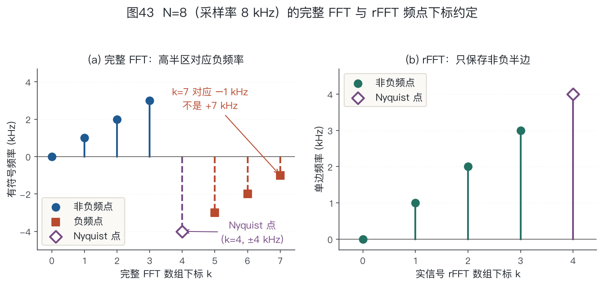
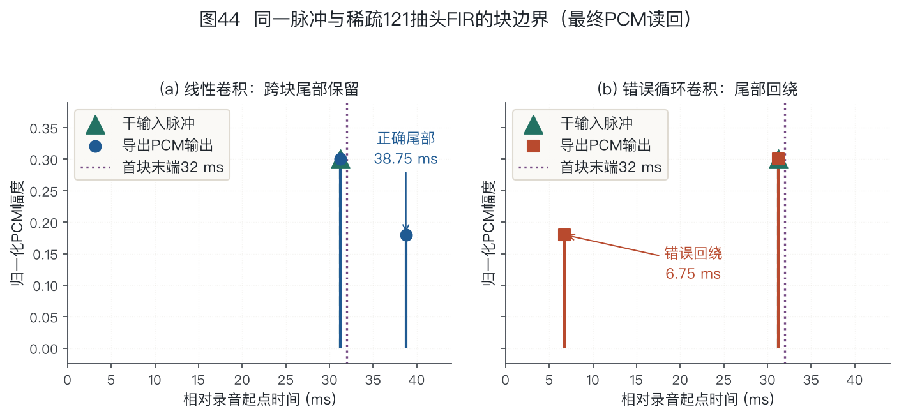
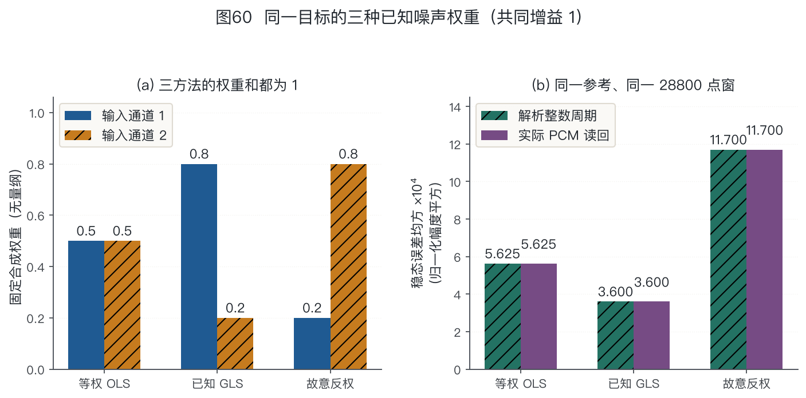

🌐 **简体中文** ｜ [English](../chapters_en/16_appendix-symbols-math.md)

> ⚠️ 本篇是第 16 章，即附录 A（正文共 16 章，即第 0～15 章，其中第 12～15 章为四篇扩展专题，另有附录 A、B），可独立查阅，前后篇见下方导航。
>
> 首页导读：[`00_overview.md`](00_overview.md) ｜ 上一篇：[15_target-extraction-diarization.md](15_target-extraction-diarization.md) ｜ 下一篇：[17_appendix-guide.md](17_appendix-guide.md)

---

## 第 16 章 · 附录 A：符号、术语与数学基础

本附录与[第 0 章全书数学基础与信号分析预备](00_math-foundations.md)互为配套、分工明确：[第 0 章](00_math-foundations.md)面向系统学习提供三角与三维旋转几何、傅里叶/STFT、子空间投影与 SVD、高斯—马尔可夫广义最小二乘、瑞利商与张量积、Wirtinger 变分优化、圆对称复高斯与卡尔曼递推及声学特殊函数的完整分步推导和 16 道基础练习（`E00-01`～`E00-16`）；本附录则定位为随手翻阅的**全局符号基准、中英术语词典与四张高频速查卡**，并在 §16.4 配有 15 道针对频点索引、复共轭符号、数值库陷阱与量化读回边界的复算练习（`E16-01`～`E16-15`），下一篇为附录 B。阅读正文时若遇到陌生的记号或术语，可先查 §16.1～§16.3 快速对齐约定；需要看完整定理证明时再按[第 0 章 §0.8](00_math-foundations.md#sec-0-8)跳转。

### 16.1 符号表

本书的排版约定与 §2.3 保持一致：**斜体表示标量，头顶箭头表示列向量，加粗大写表示矩阵**；上标 $^H$ 表示共轭转置（厄米转置），上标 $^\top$ 表示普通转置，顶帽 $\hat{\ }$ 表示估计量。按照语音信号处理文献的惯例，$X(f)$、$X(f_k,\ell)$ 或离散时频方括号记号 $X_m[k,\ell]$ 这类带频点自变量的大写斜体字母表示单个频点或单个时频格点上的复数**标量**。

本书统一采用前向傅里叶核 $e^{-\mathrm{j}2\pi ft}$，其中 $\mathrm{j}=\sqrt{-1}$ 为虚数单位。

阵列几何参考系约定为：麦 1 位于原点 $x=0$，麦 2 位于 $+x$ 半轴；正横方向（$+y$ 轴）记为 $0^\circ$，正方位角朝麦 2（$+x$ 轴）顺时针旋转度量；方向单位向量 $\vec{u}$ 从阵列参考点指向声源，声波传播方向为 $-\vec{u}$。

球谐域公式通常改用从 $+x$ 轴逆时针起算的方位角 $\alpha$ 和从 $+z$ 轴向下起算的极角（余纬角）$\vartheta$。将其与本书从 $+y$ 朝 $+x$ 起算的声源方位角 $\theta$、从水平面朝 $+z$ 起算的俯仰角 $\phi_{\mathrm{el}}$ 对接时，必须先做角度换算 $\alpha=\pi/2-\theta$（按 $2\pi$ 周期折叠取值）、$\vartheta=\pi/2-\phi_{\mathrm{el}}$，再代入球谐基函数或开源库接口，详见[§5.8](05_beamforming.md#sec-5-8)。同理，国际标准 AmbiX 与一阶全景声（FOA）采用 $+x$ 朝正前方、$+y$ 朝正左方、$+z$ 朝正上方的三维右手系，其水平方位角从 $+x$ 逆时针转向 $+y$、俯仰角从水平面转向 $+z$，与上段平面阵列坐标系（$+y$ 正前、顺时针方位角）之间的对照详见[专题Ⅲ §14.2](14_spatial-wearable-arrays.md#sec-14-2)。

**字母与算符复用**（与 §2.3 一致）：由于阵列、自适应滤波、去混响与多目标追踪分属不同研究传统，同一个字母或算符在不同章节可能承担不同角色。例如本表将波数记为 $\kappa=2\pi f/c$，以区别于离散频点索引 $k$，但部分文献与局部推导仍用 $k$ 记波数，第 6 章 §6.2 另用 $\kappa\in[-1,1]$ 表示 IPNLMS 比例混合系数，第 7 章局部还用 $k$ 记 WPE 的滞后帧号；$D$ 可表示阵列孔径或 PHD 强度函数，$\lambda$ 可表示声波波长、RLS 指数遗忘因子、WPE 时变方差或矩阵特征值，$K$ 可表示声源个数或 WPE 预测阶数，$s$ 可表示源信号或追踪状态，$\varepsilon$ 在第 5 章表示绝对对角加载而在第 10、13 章表示相对采样率偏移（SRO）。算符 $\odot$ 同样遵循领域双重约定：在支撑 §3.3 与 §12.7 的协方差向量化表述（显式写作于[§0.4.3](00_math-foundations.md#sec-0-4-3)与附录 A §16.2/§16.3.2）中表示按列 Khatri–Rao 积，而在频域滤波、时频掩码、BSM 相位投影与 FiLM 特征调制（§5、§6、§8、[§14.5～§14.6](14_spatial-wearable-arrays.md#sec-14-5)、[§15.2](15_target-extraction-diarization.md#sec-15-2)）中表示同维或广播 Hadamard 逐元素乘积。具体含义以所在公式的定义为准。

本表区分 STFT 网格时，默认 $k$ 是频点索引、$\ell$ 是帧索引，$n$ 是离散采样索引，$t$ 是连续时间。各章沿用各自领域的经典记号时会另行声明下标；跨章对照公式时，应当先按下表对齐每条坐标轴的物理意义，不能仅凭字母相同就默认代表同一维度：

| STFT 记号 | 坐标轴顺序 | 适用范围 |
|---|---|---|
| $X_m[k,\ell]$、$X(f_k,\ell)$ | （频点 $k$，帧 $\ell$） | 全书主记号（§0、§2、§16；第 5 章局部记 $\vec{x}(k,n)$） |
| $X_m(f,t)$、$\vec x_f(t)$、$\vec{x}_{ft}$ | （频点 $f$，帧 $t$） | 第 8 章盲源分离与掩码波束（频点在前、帧在后） |
| $X(n,f)$ | （帧 $n$，离散频点 $f$） | 第 7 章 WPE 与附录 B 速查（帧在前、频点在后） |

实信号的**单边谱**取 $0\leq k\leq\lfloor N/2\rfloor$，对应非负物理频率 $f_k=kf_s/N$（单位：Hz）。若在内存中保存完整的 $N$ 点 DFT，后半段索引对应负频率：偶数 $N$ 下的 $k>N/2$ 或奇数 $N$ 下的 $k>(N-1)/2$ 应换算为 $(k-N)f_s/N$。偶数 $N$ 的奈奎斯特（Nyquist）格点 $k=N/2$ 对实信号满足自共轭，在单边谱中常记作 $+f_s/2$；切勿把完整 DFT 的末尾格点误读成接近 $+f_s$ 的新高频分量。练习 [E16-06](#e16-06) 给出了八点序列的逐格复算。

若需要为**完整双边频谱**的每一个离散格点赋予唯一的有符号代表频率，本书采用与 NumPy 的 `fftfreq` 函数一致的排列规则：

$$f_k^{\mathrm{full}}=
\begin{cases}
kf_s/N,&0\leq k<\lceil N/2\rceil,\\
(k-N)f_s/N,&\lceil N/2\rceil\leq k<N.
\end{cases}\tag{16-1}$$

偶数 $N$ 的奈奎斯特格点在式(16-1)双边约定下记为 $-f_s/2$，而在实信号单边谱约定下记为 $+f_s/2$；由于 $e^{-\mathrm{j}\pi n}=e^{+\mathrm{j}\pi n}=(-1)^n$ 在所有整数采样时刻 $n$ 取值完全相同，这两个记号指代同一个离散频点，并非两次独立观测。[NumPy 完整频率排列文档](https://numpy.org/doc/stable/reference/generated/numpy.fft.fftfreq.html)与[实谱单边频率排列文档](https://numpy.org/doc/stable/reference/generated/numpy.fft.rfftfreq.html)分别规定了这两种下标映射（NumPy 2.5 在线文档，2026-09-28 核实）。

| 符号 | 含义 |
|---|---|
| $M$, $d$, $D$ | 麦克风数量、相邻阵元间距、阵列总孔径 |
| $f_s$, $N$, $N_w$, $H$ | 采样率（Hz）、DFT/FFT 点数 $N$、STFT 实分析窗长度 $N_w$（点数，满足 $N\geq N_w$；不作帧内补零时默认 $N=N_w$，见 §2.5 式(2-5)）与帧移 $H$（hop size，相邻两帧起点的采样点数间隔） |
| $N_{\mathrm{tar}}$（第 8 章 OverIVA） | 单独提取的目标声源数量；满足 $N_{\mathrm{tar}}<M$，不同于第 8 章式(8-1)统计全部物理声源数的 $N$，其余背景通道可包含多种混合干扰 |
| $c$, $\lambda$, $f$, $f_k$ | 声速（算例常取 $343\ \mathrm{m/s}$）、波长、连续物理频率（Hz）、单边 DFT/STFT 第 $k$ 个频点的非负物理频率 $f_k=kf_s/N$；完整双边 DFT 的负频率索引按式(16-1)换算 |
| $\kappa=2\pi f/c$ | 波数，单位为 $\mathrm{rad/m}$，使空间传播相位 $\kappa d$ 无量纲，并避免与频点索引 $k$ 混淆。第 6 章 §6.2 的 IPNLMS 均匀/比例混合系数 $\kappa\in[-1,1]$、矩阵二范数条件数 $\kappa_2(\mathbf{A})$ 与球面分布集中度 $\kappa_{\mathrm{vMF}}$ 为各自语境下的独立记号 |
| $\theta$, $\theta_0$ | 从正横方向起算的声源方位角、波束指向角；端射方向为 $\pm90^\circ$ |
| $\vec{u}(\theta)$ | 从阵列参考点指向声源的单位向量；声波传播方向为 $-\vec{u}$ |
| $\phi_{\mathrm{el}}$, $\vec{u}(\theta,\phi_{\mathrm{el}})$（第 3、9 章三维方向） | 俯仰角从水平面朝 $+z$ 为正，取值范围 $[-90^\circ,90^\circ]$；方位角仍从 $+y$ 朝 $+x$ 为正。天顶与天底极点处方位角无唯一定义，球面积分的面积微元因子按弧度写为 $\cos\phi_{\mathrm{el}}$（E09-20） |
| $\mathrm{SO}(3)$, $\mathbf{R}_{\mathrm{WA}}$（第 0、9 章三维姿态） | 三维特殊正交旋转群 $\mathrm{SO}(3)=\{\mathbf{R}\in\mathbb{R}^{3\times 3}:\mathbf{R}^\top\mathbf{R}=\mathbf{I},\ \det\mathbf{R}=+1\}$（[§0.1.3](00_math-foundations.md#sec-0-1-3)）；$\mathbf{R}_{\mathrm{WA}}\in\mathrm{SO}(3)$ 将阵列局部坐标系下的指源单位向量变换到世界坐标系，逆矩阵等于转置 $\mathbf{R}_{\mathrm{WA}}^\top$，注意与空间协方差矩阵区分 |
| $\mathbf{P}_{\mathcal{R}(\mathbf{A})}$, $\mathbf{P}_{\mathcal{R}(\mathbf{A})}^\perp$（第 0、4 章子空间） | 列满秩矩阵 $\mathbf{A}$ 列空间的正交投影矩阵 $\mathbf{A}(\mathbf{A}^H\mathbf{A})^{-1}\mathbf{A}^H$ 及其正交补投影矩阵 $\mathbf{I}-\mathbf{P}_{\mathcal{R}(\mathbf{A})}$，均满足幂等性与厄米对称性（[§0.3.2](00_math-foundations.md#sec-0-3-2)） |
| $\mathbf{U}, \boldsymbol{\Sigma}, \mathbf{V}, \sigma_i$（奇异值分解 SVD） | 矩阵 $\mathbf{A}=\mathbf{U}\boldsymbol{\Sigma}\mathbf{V}^H$ 的左奇异向量酉矩阵 $\mathbf{U}$、右奇异向量酉矩阵 $\mathbf{V}$ 与降序排列的非负奇异值 $\sigma_1\ge\sigma_2\ge\cdots\ge 0$（[§0.3.4](00_math-foundations.md#sec-0-3-4)） |
| $\partial/\partial\vec{w}^*$, $\partial/\partial z^*$（Wirtinger 算子） | 面向实值代价函数的复共轭偏导算子（形式上将 $\vec{w}$ 视作常数、仅对 $\vec{w}^*$ 求导），令 $\partial J/\partial\vec{w}^*=\vec{0}$ 等价于实部与虚部梯度同时为零（[§0.5.1](00_math-foundations.md#sec-0-5-1)、§16.3.2） |
| $\vec{r}_m$, $\vec{p}$ | 第 $m$ 个麦克风的三维位置向量、近场声源位置向量 |
| $t$, $n$, $k$, $\ell$, $L$, $L_{\mathrm{snap}}$ | 连续时间、离散采样索引、频点索引、帧索引、统计平均所用的快拍数；第 2 章式(2-6)、式(2-7)用 $L$，式(2-14) CRLB 用 $L_{\mathrm{snap}}$（以区分滤波器抽头长 $L$），第 8 章等局部亦用 $T$ 记帧数 |
| $v_m[n]$, $\vec{v}(f_k,\ell)$ | 第 $m$ 个麦克风的时域加性传感器噪声与频域多通道噪声列向量（§2.3 主记号）；部分章节在无下标歧义时亦记为 $n_m[n]$ 或 $\vec{n}$ |
| $\psi$ | 相邻两麦经过波束指向相位补偿后的残余空间相位差（§2.6、§5.2）；E09-20 局部用 $\psi$ 记右手绕 $+z$ 轴的姿态偏航角，[专题Ⅲ §14.4](14_spatial-wearable-arrays.md#sec-14-4) 式(14-12) 另用 $\psi\in[0,1]$ 表示声场扩散度（diffuseness） |
| $\vec{a}(\theta)$, $\vec{w}$ | 阵列导向矢量、窄带复数波束权重向量 |
| $\mathbf{R}_{xx}$, $\hat{\mathbf{R}}_{xx}$（或简记 $\mathbf{R}$, $\hat{\mathbf{R}}$），$\mathbf{R}_{vv}$, $\mathbf{R}_{nn}$, $\mathbf{R}_{ss}$ | 总体与样本观测空间协方差矩阵（无下标歧义时简记为 $\mathbf{R}$, $\hat{\mathbf{R}}$，见 §2.5）、加性噪声（或除目标外的总干扰加噪声）空间协方差矩阵 $\mathbf{R}_{vv}$ / $\mathbf{R}_{nn}$、目标语音空间协方差矩阵 $\mathbf{R}_{ss}$ |
| $\mathbf{\Gamma}$ | 三维球面各向同性弥散噪声场的空间相干矩阵；二维水平面各向同性入射模型另见 §5.1 |
| $\mathbf{E}_n$, $\mathbf{E}_s$, $\boldsymbol{\Psi}$（第 4 章子空间） | 噪声子空间特征向量基、信号子空间特征向量基，以及 ESPRIT 算法连接平移不变双子阵信号子空间的旋转不变算子 $\boldsymbol{\Psi}$（§4.6） |
| $\sigma^2$ | 噪声方差（平均功率）；各通道独立同功率空间白噪声的协方差矩阵为 $\sigma^2\mathbf{I}$ |
| $\mathbf{C}$, $\vec{f}$ | LCMV 波束形成器的线性约束矩阵与期望响应向量，满足 $\mathbf{C}^H\vec{w}=\vec{f}$（§5.5） |
| $\vec{e}_r$ | 参考麦克风选择向量（第 $r$ 个分量为 $1$、其余为 $0$ 的标准基向量，用于 MWF 与 SDW-MWF 指定参考通道，见[第 5 章 §5.5.1 MWF 专题](05_beamforming.md#sec-5-5-1)） |
| $U, u$（专题Ⅱ） | 分布式声学传感器网络的节点总数与节点索引；节点 $u$ 配备 $M_u$ 个本地麦克风，全网总麦数 $M=\sum_{u=1}^U M_u$ |
| $S, Q$（专题Ⅱ） | 潜在共同目标信号维数与每个节点向邻居广播的压缩信号维数；经典 DANSE 收敛定理常要求 $Q=S$。注意与房间声学的声源指向因子 $Q$ 区分 |
| $z_u, \vec{z}_u, \vec{z}_{-u}, \mathbf{F}_u$（专题Ⅱ DANSE） | 节点 $u$ 的本地压缩广播信号（单路 $Q=1$ 时为标量 $z_u=\vec{f}_u^H\vec{x}_u$，一般 $Q$ 维时为向量 $\vec{z}_u=\mathbf{F}_u^H\vec{x}_u$，其中 $\mathbf{F}_u\in\mathbb{C}^{M_u\times Q}$ 为压缩矩阵）；$\vec{z}_{-u}$ 为其余 $U-1$ 个远端节点发来广播的拼接向量（[§13.5](13_distributed-enhancement.md#sec-13-5)、[§13.9](13_distributed-enhancement.md#sec-13-9)） |
| $\mathbf{T}_u, \vec{h}_u, \vec{f}_u, \vec{g}_u$（专题Ⅱ） | $\mathbf{T}_u^H$ 将全网观测映射为节点 $u$ 可获取的本地加邻居压缩观测；$\vec{h}_u=[\vec{f}_u^\top,\vec{g}_u^\top]^\top$ 为节点 $u$ 的接收组合权重，其中 $\vec{f}_u$ 作用于本地麦克风信号、$\vec{g}_u$ 作用于接收到的邻居广播信号 |
| $\mathbf{B}$ | 广义旁瓣相消器（GSC）的阻塞矩阵，满足正交阻塞条件 $\mathbf{B}^H\vec{a}(\theta_0)=\vec{0}$（§5.6） |
| $\Phi(f)$ | 在 §4.2 中表示广义互相关（GCC）的频域加权函数；在 §5.7 中表示信号或噪声功率谱密度，阅读时按所在章节公式区分 |
| $\mathbf{P}$, $\mathbf{K}$, $\mathbf{Q}$, $\mathbf{F}$, $\mathbf{H}$ | 卡尔曼滤波核心矩阵：状态估计误差协方差、卡尔曼增益、过程噪声协方差、状态转移矩阵、观测矩阵（§9.2） |
| $\vec{\nu}_t$, $\mathbf{S}_t$, $N_{\mathrm{eff}}$（第 9 章追踪） | 卡尔曼滤波第 $t$ 帧的新息向量（观测减预测）与新息协方差矩阵，以及粒子滤波衡量权重退化程度的有效粒子数 $N_{\mathrm{eff}}=1/\sum_i (w_t^{(i)})^2$（§9.2） |
| $\mu_j$, $c_j$, $L_j$（第 9 章 IMM） | 交互式多模型（IMM）的模式后验概率、经马尔可夫转移混合后的模式先验概率、模式条件观测似然密度。以角度（deg）为单位的标量观测似然密度 $L_j$ 量纲为 $\mathrm{deg}^{-1}$，并非无量纲概率；漏检帧不产生新的 $L_j$（E09-18） |
| $\kappa_{\mathrm{vMF}}$, $\vec{\mu}_{\mathrm{vMF}}$, $A(\kappa)$（第 9 章球面概率） | von Mises–Fisher（vMF）方向分布的无量纲集中度、单位均值方向向量与期望向量模长函数（E09-20 局部简记为 $k$ 与 $\vec{m}$）；完全均匀分布时集中方向无定义。注意与 IMM 模式概率 $\mu_j$ 及 PHD 杂波强度 $\kappa_t(\vec{z})$ 区分 |
| $V$, $A$, $S$, $\bar{\alpha}$ | 房间体积、等效吸声面积、内表面总面积、平均吸声系数（§2.4） |
| $\mu_{\mathrm{NLMS}}$ | 归一化最小均方（Normalized Least Mean Squares，NLMS）步长（§6.1）；第 6 章导出理想无噪单步误差收缩条件 $0<\mu<2$，工程取值还受分母正则项、近端噪声和时变路径制约 |
| $\mu_{\mathrm{SDW}}$ | 语音失真加权多通道维纳滤波（Speech-Distortion-Weighted Multichannel Wiener Filter，SDW-MWF）的失真—降噪折中系数（[第 5 章 §5.5.1 MWF 专题](05_beamforming.md#sec-5-5-1)）；与 NLMS 步长不是同一物理量 |
| $\varepsilon_{\mathrm{NLMS}}$ | NLMS 更新分母中的正定保护常数，与输入信号能量同量纲，防止静音帧除零并抑制极低能量段的权重跳变（§6.1） |
| $\varepsilon$, $\alpha_{\mathrm{dl}}$, $\delta$, $\epsilon$, $\eta$（对角加载与稳健界） | 第 5 章将绝对对角加载写为 $\mathbf{R}+\varepsilon\mathbf{I}$（文献与本附录局部亦记 $\delta$），参数与 $\mathbf{R}$ 同量纲；式(5-10) 将相对对角加载写为 $\mathbf{R}+\alpha_{\mathrm{dl}}\bar{\sigma}^2\mathbf{I}$（其中 $\bar{\sigma}^2=\operatorname{tr}(\mathbf{R})/M$，文献、第 4 章与 [E16-09](#e16-09) 亦记 $\eta$，以区别于 §5.3.1 的 DMA 延迟比 $\alpha$），参数无量纲；第 5 章 §5.4 将白噪声增益权重模方上限写为 $\|\vec{w}\|_2^2\le\delta=1/G_{\min}$；§5.4.1 及式(5-31) 将范数有界导向误差球半径写为 $\|\vec{e}\|_2\le\epsilon$ |
| $\tau_{ij}$，TDOA | $\tau_{ij}=t_i-t_j$，到达时间差（Time Difference of Arrival，TDOA）；远场平面波下相对麦 1 的时差为 $\tau_{m1}=-(\vec{r}_m-\vec{r}_1)^\top\vec{u}/c$ |
| $T_{60}$，DRR，$d_c$，$C_{50}$ | 混响时间、直达混响比（Direct-to-Reverberant Ratio，DRR；常取 dB 读数）、临界距离与语音清晰度指数 $C_{50}$（前 $50\ \mathrm{ms}$ 直达与早期反射能量相对 $50\ \mathrm{ms}$ 后晚期混响能量的分贝比） |
| WNG，DI，HPBW，SLL | 白噪声增益（White Noise Gain，WNG）、指向性指数（Directivity Index，DI）、半功率波束宽度（Half-Power Beamwidth，HPBW）、旁瓣电平（Side-Lobe Level，SLL） |
| RTF | 在波束与空间建模中指相对传递函数（Relative Transfer Function）；在系统评测与选型中指实时因子（Real-Time Factor），即统计窗口内累计处理耗时除以新推进音频时长（帧间重叠样本不得重复计入分母，第 10 章遥测另用 `frame_service_rtf` 记录单帧比值） |
| $x[n], d[n], y[n], \hat{y}[n], e[n]$，$h[n], \hat{\vec{w}}, \lambda$，$E_y, E_e$，ERLE，SER | AEC 远端播放参考、麦克风拾音信号、**真实回声**、**线性估计回声**与残差信号，真实回声路径、自适应滤波器抽头向量、RLS 指数遗忘因子（$0<\lambda\leq 1$），以及同窗纯回声能量 $E_y$、残余回声能量 $E_e$、回声返回损失增强（Echo Return Loss Enhancement，ERLE）与信回比（Signal-to-Echo Ratio，SER；§6.1、§6.2、§6.8） |
| $G(k,f)$, $\lambda_{ft}$, $\Delta$, $K$ | WPE 线性预测系数、目标早期语音的时变方差（功率谱）$\lambda_{ft}$、保护延迟帧数与预测阶数。第 7 章局部用 $k$ 记滞后帧号、$f$ 记**无量纲离散频点索引**（时变方差亦记作 $\lambda(f,t)$），阅读时与按 Hz 计的连续频率 $f$ 区分（§7.1） |
| $\mathbf{W}_f$, $\pi$（第 8 章分离） | 第 $f$ 个频点的盲源分离解混矩阵（$\hat{\vec{s}}_{ft}=\mathbf{W}_f\vec{x}_{ft}$）与对齐输出声道归属的源排列映射 $\pi$（§8.1、§8.3） |
| $\mathrm{SI\text{-}SDR}$, $\mathrm{CI\text{-}SDR}$ | 尺度不变信号失真比（零阶标量正交投影，§8.5、§10.5）与卷积不变信号失真比（短因果 FIR 托普利茨子空间正交投影，允许良性短线性滤波，§8.5） |
| $\mathrm{cpWER}, \mathrm{tcpWER}, \mathrm{ORC\text{-}WER}, \mathrm{sa\text{-}WER}$ | 多说话人会议转写的四类词错误率评测口径：拼接最小排列词错率（cpWER）、时间约束最小排列词错率（tcpWER）、最优参考组合词错率（ORC-WER）与说话人归属词错率（sa-WER；§10.5、§11.2、§15.7） |
| $\varepsilon, f_d$（SRO 时钟偏移） | 异步设备的相对采样率偏移 $\varepsilon=(f_d-f_s)/f_s$（常以百万分之一 ppm 计，设备实际采样率 $f_d=f_s(1+\varepsilon)$，引发累积时延漂移 $\Delta t(T)\approx\varepsilon T$；第 10 章 §10.2 与第 13 章 §13.15 沿用同一记号，注意与第 5 章对角加载 $\varepsilon$ 按语境区分） |
| $L_{\mathrm{e2e}}, L_p$（第 10 章延迟） | 有向数据依赖图的关键路径端到端延迟 $L_{\mathrm{e2e}}=\max_p L_p$，单条路径 $L_p$ 为前瞻、缓冲、计算、调度与解码五项延迟之和（§10.1 式(10-2)） |
| $\mathbf{A}$, $\mathbf{P}$, $\vec{q}$, $\vec{b}$（专题Ⅰ） | 声学成像传播字典、点扩散函数（PSF）矩阵、参考面处的候选源均方强度向量、波束扫描脏图向量；满足 $P_{ij}=\lvert\vec{w}_i^H\vec{a}_j\rvert^2$（行对应扫描格点、列对应真实源格点），注意与第 9 章卡尔曼误差协方差 $\mathbf{P}$ 区分（§12.4） |
| CSM、$\mathbf{R}$、$p_{\mathrm{ref}}$（专题Ⅰ） | 互谱矩阵（Cross-Spectral Matrix）与空气声学参考有效声压 $p_{\mathrm{ref}}=20\ \mu\mathrm{Pa}$；未归一化 FFT 外积、每 Hz 功率谱密度与单频均方幅度的量纲标度不同，数字幅值未经声压灵敏度校准前不得直接标为 $\mathrm{Pa}^2$ 或 dB SPL（§12.3） |
| $W, X, Y, Z$，$\vec{b}_{\mathrm{WXYZ}}$，$\vec{b}_{\mathrm{ACN}}$（专题Ⅲ） | 一阶全景声（FOA）在 SN3D 归一化下的零阶全向与三个一阶偶极通道，以及直观序 $[W,X,Y,Z]^\top$ 与标准 ACN 序 $[W,Y,Z,X]^\top$（[§14.2](14_spatial-wearable-arrays.md#sec-14-2)） |
| $J_n, j_l, y_l, h_l^{(2)}, P_l^m, Y_{l,m}$ | $n$ 阶第一类柱贝塞尔函数 $J_n$，$l$ 阶第一/第二类球贝塞尔函数 $j_l, y_l$ 与第二类球汉克尔函数 $h_l^{(2)}=j_l-\mathrm{j}y_l$（本书 $e^{+\mathrm{j}\omega t}$ 时间因子下的向外散射波），连带勒让德函数 $P_l^m$ 与球谐函数 $Y_{l,m}$（亦记 $Y_n^m$，[§0.7](00_math-foundations.md#sec-0-7)、[§5.8](05_beamforming.md#sec-5-8)、[§14.2](14_spatial-wearable-arrays.md#sec-14-2)）。注意归一化换算 $Y_{l,m}^{\mathrm{N3D}}=\sqrt{2l+1}\,Y_{l,m}^{\mathrm{SN3D}}=\sqrt{4\pi}\,Y_{l,m}^{\mathrm{ortho}}$，故第 14 章球面均值径向模态权重 $b_l(\kappa R)$ 与第 0、5 章标准正交基约定的 $4\pi\mathrm{j}^l j_l(\kappa R)$ 相差常数因子 $4\pi$ |
| $b_l(\kappa R)$（专题Ⅲ） | 半径 $R$ 球面阵列在球面均值（SN3D）口径下的第 $l$ 阶径向模态权重；开球全向阵在 $\kappa R=\pi$ 处出现 $b_0^{\mathrm{open}}(\pi)=0$ 零陷，刚性球由 $h_l^{(2)\prime}(\kappa R)$ 消除正实轴零点（[§14.2](14_spatial-wearable-arrays.md#sec-14-2)） |
| $\vec{n}_{\mathrm{src}}, \vec{u}$；$\vec{I}_a, \vec{I}_r$，$E, \psi$（专题Ⅲ） | 声源入射方向单位向量 $\vec{n}_{\mathrm{src}}$、三维声学质点振速相量 $\vec{u}$（注意与平面阵列指源单位向量 $\vec{u}(\theta)$ 区分），以及时间平均有功声强、无功声强、总声能密度与声场扩散度 $\psi=1-\|\bar{\vec{I}}_a\|_2/(c\bar{E})$（其中 $\bar{\vec{I}}_a=\mathbb{E}[\vec{I}_a]$、$\bar{E}=\mathbb{E}[E]$，取值 $\psi\in[0,1]$，[§14.4](14_spatial-wearable-arrays.md#sec-14-4)） |
| $\mathbf{H}, \vec{p}_e, \vec{\phi}$；$\mathrm{IC}, \beta$（专题Ⅲ） | 可穿戴阵列 $Q$ 方向流形矩阵、目标耳 HRTF 向量与 MagLS 辅助自由相位向量（由 $\mathbf{H}^H\vec{w}_e$ 拟合共轭目标 $\vec{p}_e^*$，[§14.5](14_spatial-wearable-arrays.md#sec-14-5)～[§14.6](14_spatial-wearable-arrays.md#sec-14-6)）；双耳相干度与参考麦混合系数 $\beta\in[0,1]$（[§14.7](14_spatial-wearable-arrays.md#sec-14-7)） |
| $U_c, \gamma_{\mathrm{wind}}(f)$；$H_{\mathrm{occ}}(f)$；$\tau_{\mathrm{proc}}$（专题Ⅲ） | Corcos 湍流风噪对流速度与空间相干度（[§14.8](14_spatial-wearable-arrays.md#sec-14-8)）；耳道闭塞内麦/骨导相对外麦的跨模态自语音传递函数（[§14.9](14_spatial-wearable-arrays.md#sec-14-9)）；主动通透模式端到端处理延迟（[§14.10](14_spatial-wearable-arrays.md#sec-14-10)） |
| $\mathcal{C}, \vec{e}, \vec{\gamma}, \vec{\beta}$；$\mathcal{L}_{\mathrm{dual}}$，$\tau_{\mathrm{floor}}$（专题Ⅳ） | 目标先验线索、条件嵌入向量与 FiLM 通道缩放/偏置向量；兼顾发声段负 SI-SDR 与沉默段相对混合能量地板系数的双态损失（[§15.2](15_target-extraction-diarization.md#sec-15-2)） |
| $r_F=2D^2/\lambda$，$\phi(r), \phi_1$，$\vec{w}_{\mathrm{bubble}}$（专题Ⅳ） | 夫琅禾费远场边界（菲涅耳二次相位曲率判据）$r_F=2D^2/\lambda$、正横距离 $r$ 处两侧阵元相对中心麦的球面波曲率相位滞后 $\phi(r)=-\frac{2\pi}{\lambda}(\sqrt{r^2+d^2}-r)$（目标距离 $r_1$ 处记 $\phi_1=\phi(r_1)$），以及三麦正侧向声学距离气泡二阶空间差分权重（[§15.3](15_target-extraction-diarization.md#sec-15-3)） |
| $\mathrm{DER}$，$E_{\mathrm{miss}}$，$E_{\mathrm{FA}}$，$E_{\mathrm{conf}}$（专题Ⅳ） | 说话人日志误差率及逐帧漏检、虚警、说话人混淆人数误差；虚警较高时合法 $\mathrm{DER}$ 可大于 $100\%$（[§15.4](15_target-extraction-diarization.md#sec-15-4)） |
| $\gamma_{k,t}$，$m_{k,t}^{\mathrm{tar}}$，$m_{k,t}^{\mathrm{int}}$；$\Delta t_{\mathrm{av}}, \alpha_\ell$（专题Ⅳ） | TS-VAD 独立伯努利活动后验与 GSS 目标排他掩码/干扰掩码（[§15.5](15_target-extraction-diarization.md#sec-15-5)）；视听管线正滞后与逐帧视觉可见度置信度门控权重（[§15.6](15_target-extraction-diarization.md#sec-15-6)） |
| $\otimes$, $\odot$, $\operatorname{vec}(\cdot)$ | $\otimes$ 为 Kronecker 积，$\operatorname{vec}(\cdot)$ 为按列优先矩阵拉直算子；算符 $\odot$ 依语境承担双重约定：在支撑 §3.3 与 §12.7 的协方差向量化表述（显式写作于[§0.4.3](00_math-foundations.md#sec-0-4-3)与附录 A §16.2/§16.3.2）中表示按列 Khatri–Rao 积（满足对角拉直恒等式 $(\mathbf B\odot\mathbf A)\vec q$），而在频域滤波、时频掩码、BSM 相位投影与 FiLM 调制（§5、§6、§8、[§14.5～§14.6](14_spatial-wearable-arrays.md#sec-14-5)、[§15.2](15_target-extraction-diarization.md#sec-15-2)）中表示同维或广播 Hadamard 逐元素乘积 |
| PHD / RFS | 概率假设密度（Probability Hypothesis Density，PHD）与随机有限集（Random Finite Set，RFS） |

表中残余相位 $\psi$ 的“残余”二字是相对于波束指向角 $\theta_0$ 而言的：当平面波从方位 $\theta$ 入射时，等间距线阵先按目标方向 $\theta_0$ 施加补偿时延，补偿后相邻两麦之间剩余的相位差即为

$$\psi=\frac{2\pi d}{\lambda}(\sin\theta-\sin\theta_0).$$

式中 $d/\lambda$ 与正弦差均为无量纲比值，因此 $\psi$ 的单位是弧度（rad）。当入射方向恰与指向重合（$\theta=\theta_0$）时，$\psi=0$，各通道信号同相叠加形成主瓣峰值；当 $\theta$ 偏离 $\theta_0$ 时，$\psi$ 随角度的变化规律直接决定了主瓣宽度、零陷位置与旁瓣高度（§5.2）。

在三维球面各向同性弥散噪声场模型下，第 $i,j$ 个麦克风在频率 $f$ 处的空间相干系数为

$$\begin{gathered}
[\mathbf{\Gamma}]_{ij}=\operatorname{sinc}(2fd_{ij}/c),\\
\operatorname{sinc}(x)=\frac{\sin(\pi x)}{\pi x}.
\end{gathered}$$

其中 $d_{ij}=\|\vec{r}_i-\vec{r}_j\|_2$ 为两麦间距，$f$ 为物理频率（Hz），$c$ 为声速；当 $i=j$ 或 $f=0$ 时，按连续极限取 $[\mathbf{\Gamma}]_{ij}=1$。这一 $\operatorname{sinc}$ 公式依赖噪声能量从三维球面均匀入射的几何假设；若噪声仅在二维水平面内各向同性入射，相干系数则变为零阶第一类贝塞尔函数 $J_0(2\pi fd_{ij}/c)$，两类声场模型不能混用（§5.1）。

手算（16.1）：设 $M=6$ 元阵列在目标方向已完成无失真归一化（$\vec{w}^H\vec{a}=1$），各通道传感器自噪声相互独立且功率相等，求等权延迟求和波束形成（DSB）的白噪声增益（WNG，以 dB 表示）；再写出二阶对角空间协方差矩阵 $\operatorname{diag}(4, 1)$ 的两个特征值，并说明其特征向量的物理含义。

输入与代入：在理想等幅目标导向 $|\vec{a}|=[1,\ldots,1]^\top$ 下，满足 $\vec{w}^H\vec{a}=1$ 的等权 DSB 权重为 $\vec{w}=\vec{a}/M$，权重范数平方为 $\|\vec{w}\|_2^2=M\times(1/M)^2=1/M$，故线性白噪声增益为 $\mathrm{WNG}=1/\|\vec{w}\|_2^2=6$，换算为分贝得 $10\log_{10}6\approx7.78\ \mathrm{dB}$（约 $7.8\ \mathrm{dB}$）。对于对角矩阵 $\operatorname{diag}(4, 1)$，非对角元全为零，特征方程 $(4-\lambda)(1-\lambda)=0$ 直接给出两个特征值 $4$ 和 $1$，对应标准正交特征向量 $[1,0]^\top$ 与 $[0,1]^\top$。需要注意，协方差矩阵的特征向量张成的是传感器观测空间中的正交主轴，一般并不直接对应物理空间中的两个声源入射方向。

### 16.2 术语词典

下表按知识模块梳理正文中反复出现的核心术语、物理含义与使用边界。

#### 信号与数学基础

| 术语 | 解释 |
|---|---|
| STFT（短时傅里叶变换） | 将连续长波形按固定帧移切分为重叠短帧，加窗后逐帧计算 DFT，得到时间—频率二维复数谱。窗长与帧移需在频率分辨率、语音短时平稳性与系统延迟之间折中；在满足窄带近似条件时，可把时域宽带卷积拆解为逐频点复数乘加（§2.5） |
| COLA / WOLA（常数重叠相加 / 加权重叠相加） | COLA 要求分析窗与合成窗按帧移 $H$ 平移乘积累加后在整个平稳时间轴上恒为非零常数（$\sum_\ell w_{\mathrm{syn}}[n-\ell H]w_{\mathrm{ana}}[n-\ell H]=C$），是 STFT 无失真完美重建的充要条件；WOLA 在分析与合成两端各施加窗函数（如开方 Hann 双窗）以压制频域修改引发的块边界不连续，详见[§0.2.4](00_math-foundations.md#sec-0-2-4)、§2.5 |
| 快拍（snapshot） | 某一帧、某一频点上，$M$ 个麦克风的复数频谱分量按通道顺序排成的 $M$ 维列向量，相当于阵列在该时频格点拍下的一帧空间采样（§2.5） |
| 空间协方差矩阵 $\mathbf{R}_{xx}$, $\hat{\mathbf{R}}_{xx}$（简记 $\mathbf{R}$, $\hat{\mathbf{R}}$） | 阵列信号处理中常把观测总体二阶矩 $\mathbf{R}_{xx}=\mathbb{E}[\vec{x}\vec{x}^H]$ 与快拍外积的时间平均 $\hat{\mathbf{R}}_{xx}=\frac{1}{L}\sum_\ell \vec{x}_\ell\vec{x}_\ell^H$（无歧义时简记为 $\mathbf{R}$, $\hat{\mathbf{R}}$；加性噪声协方差相应记为 $\mathbf{R}_{vv}$ 或 $\mathbf{R}_{nn}$）统称为空间协方差矩阵。若未先减去样本均值，$\hat{\mathbf{R}}_{xx}$ 严格来说是未中心化样本二阶矩，仅当**当前这批快拍的样本均值恰好为零向量**时才与同分母的中心化样本协方差相等；总体零均值并不能保证有限样本均值为零。它是 Capon、MVDR 与 MUSIC 的核心输入，定义见第 2 章式(2-6)、式(2-7) |
| 特征分解 / 子空间 | 将厄米矩阵分解为实特征值与正交特征向量。要把前 $K$ 个大特征值对应的特征向量解释为 $K$ 维信号子空间，需同时满足源协方差满秩、导向矩阵满列秩、源数 $K<M$、空间白噪声、源与噪声互二阶矩为零以及流形模型准确；其余对应噪声底的特征向量张成噪声子空间（图 6d、§4.6） |
| 超定方程组 | 独立方程条数多于未知数个数的线性方程组。当右端观测向量恰好落在系数矩阵列空间内时存在精确解，不相容时则通过最小二乘寻找残差范数最小的近似解。在 TDOA 定位中，多组麦克风对的时差往往共享同一个参考到达时刻，方程条数增加并不代表独立几何约束等量增加（§4.4） |
| 双曲线定位 | 在二维平面中，一对麦克风测得的非退化到达距离差对应以这两只麦克风为焦点的双曲线的一支；在三维空间中则对应双叶双曲面的一叶。联立多组独立基线求交即可定位近场声源，但在共线或端射退化几何下可能不存在唯一交点（§4.4） |
| 常规波束分辨率 / 超分辨 | 常规延迟求和波束的主瓣角宽量级受限于瑞利限 $\lambda/D$；子空间类方法（如 MUSIC、ESPRIT）在流形准确、信噪比与快拍数充足且声源非完全相干时，能够分辨角间距小于 $\lambda/D$ 的多个声源，故称超分辨（§2.6、§4.6） |
| 波束图（beampattern） | 波束形成器固定权重后对空间各入射方向平面波的复响应模值（或功率增益）随角度变化的曲线，用于直观读取主瓣宽度、旁瓣高度与干扰零陷位置（图 7a） |
| 自由度（DOF） | 优化问题中可独立调节的参数维数。窄带 $M$ 麦波束权重拥有 $M$ 个复自由度；每施加一条**线性独立的复数等式约束**消耗 $1$ 个复自由度，冗余约束不额外消耗自由度，相互矛盾的约束则导致可行集为空（§5.5）。稀疏阵借助差分协同阵可在二阶统计域扩展虚拟阵元数，但虚拟滞后不能等同于真实的物理麦克风通道（§3.3） |
| 抽头（tap） | 有限长冲激响应（FIR）滤波器的单个乘加系数。“128 抽头滤波器”代表共有 128 个脉冲响应系数，对应 $z^{-1}$ 多项式的最高阶数为 127 阶，查阅文献与代码接口时应留意“长度”与“阶数”相差 1 的惯例（§6.1） |
| 优先效应（precedence effect） | 当直达声与短延迟早期反射声从不同方向先后到达双耳且声学特征相近时，人类听觉系统对声源方位的感知主要由先到达的直达声主导；这并不意味着反射声的能量或音色影响被完全忽略。[第 1 章](01_problem-definition.md)双耳线索与机器阵列对照小节给出了现象定义与 Wallach 等（1949）的实验出处，§2.4 讨论了房间脉冲响应建模 |
| 拉格朗日乘子法 | 求解等式约束极值问题的经典解析方法：通过引入拉格朗日乘子将线性约束并入目标函数，构造实值拉格朗日函数并对复权重共轭求驻点，即可导出 MVDR 与 LCMV 的闭式解（[§0.5.2](00_math-foundations.md#sec-0-5-2)、§5.4、§16.3.2） |
| GCC-PHAT 频谱相位加权 | 在每个非零互谱频点将互功率谱 $G_{12}(f)$ 除以其模值 $\lvert G_{12}(f)\rvert$，使各频点幅值归一为 $1$、仅保留相位差信息，零模值频点需加正则分母或跳过。该操作均衡的是单对通道的**频域幅度谱形状**，并不能将多通道间的空间相关噪声白化（§4.2；参见[Knapp 与 Carter（1976）广义互相关论文](https://doi.org/10.1109/TASSP.1976.1162830)） |
| 空间噪声白化（spatial noise whitening） | 在固定频点已知厄米正定噪声协方差 $\mathbf{R}_{nn}$ 时，左乘白化矩阵 $\mathbf{W}$ 使变换后噪声协方差满足 $\mathbf{W}\mathbf{R}_{nn}\mathbf{W}^H=\mathbf{I}$；与此同时，目标导向矢量也必须同步变换为 $\mathbf{W}\vec{a}$。它消除的是通道间的噪声相关性与功率差异，切勿与 GCC-PHAT 的逐频点标量归一化混为一谈（[E16-04](#e16-04)） |
| sinc 函数 | 本书统一采用归一化定义 $\operatorname{sinc}(x)=\sin(\pi x)/(\pi x)$。三维球面各向同性弥散场的两麦空间相干系数服从该形式；二维水平面各向同性场则对应零阶贝塞尔函数 $J_0(2\pi fd/c)$（§5.1）。部分数学文献将未归一化的 $\sin x/x$ 记作 $\operatorname{sinc}(x)$，代入公式前需先核对因子 $\pi$ |
| SNR（信噪比） | 目标信号功率与噪声功率的比值，常取 $10\log_{10}$ 换算为 dB；阵列处理后的输出 SNR 减去参考通道输入 SNR 即为阵列 SNR 增益。在回声消除（AEC）中常另用信回比（SER）衡量近端语音与远端回声的功率比，汇报时须写明参考取点与统计时段（§5.1、§6.1） |
| dB（分贝） | 物理量相对参考值比值的对数标度：功率或能量之比乘 $10\log_{10}$，声压或电压等幅度之比乘 $20\log_{10}$。两种算式仅在分子与分母满足相同的“功率正比于幅度平方”阻抗比例关系时才给出完全一致的分贝值（[§0.2.2](00_math-foundations.md#sec-0-2-2)、§16.3.1） |
| FFT（快速傅里叶变换） | 离散傅里叶变换（DFT）的分治快速算法，将长度为 $N$ 的时域帧映射为 $N$ 个离散频点的复数谱，计算复杂度由 $O(N^2)$ 降至 $O(N\log N)$；STFT 即对滑动加窗帧连续执行 FFT（§2.5） |
| DNN（深度神经网络） | 由多层线性变换与非线性激活函数复合而成的参数化模型，通过大规模带标注或自监督音频数据训练权重。在阵列前端中常用于预测时频掩码、声源方向后验分布或直接映射增强频谱（§4.7、§5.9） |
| 远场 / 近场 | 远场假设声源距离远大于阵列孔径，波前近似为平面波，导向矢量仅取决于入射角度；近场则必须采用球面波模型，同时计入阵元到声源的精确距离差与球面扩散幅度衰减。夫琅禾费距离 $2D^2/\lambda$ 常作为检验波前二次相位弯曲的参考尺度，实际工程中还需结合 $r\gg D$、容许相位误差上限与通道间幅度差综合判定（§2.2） |

#### 房间声学

| 术语 | 解释 |
|---|---|
| RIR（房间脉冲响应） | 在声源位置、麦克风位置固定且声学传播满足线性时不变假设时，从声源发出单位冲激到麦克风接收到的完整时域响应序列（含直达声、早期反射与晚期混响）；干声源与 RIR 做线性卷积即可合成麦克风接收信号（§2.4） |
| $T_{60}$ | 混响时间，定义为稳态声源停止发声后室内声能密度衰减 $60\ \mathrm{dB}$ 所需的时间（秒），其数值随房间体积、墙面吸声材料与测量频带而变化 |
| 直达混响比（Direct-to-Reverberant Ratio，DRR） | RIR 中直达声部分能量与全部反射混响部分能量之比，dB 读数大于 $0\ \mathrm{dB}$ 表示直达声占优，小于 $0\ \mathrm{dB}$ 表示混响能量超过直达声 |
| $C_{50}$（语音清晰度指数） | 脉冲响应中前 $50\ \mathrm{ms}$（直达声加有益早期反射）能量与 $50\ \mathrm{ms}$ 之后晚期混响能量之比的分贝值，常与空间协方差主特征值一起用于远场会议多通道识别的通道质量筛选（§2.4、§17.3） |
| 临界距离 $d_c$ | 在给定声源指向性与稳态扩散混响场假设下，直达声能量与混响声能量恰好相等（即 $\mathrm{DRR}=0\ \mathrm{dB}$）的收发距离；赛宾（Sabine）近似下常写为 $d_c\approx0.057\sqrt{QV/T_{60}}$，其中 $Q$ 为声源指向因子，仅当全向声源 $Q=1$ 时才退化为 $0.057\sqrt{V/T_{60}}$（§2.4） |
| 镜像法（Image-Source Method） | 将刚性或部分吸声墙面的镜面反射等效为墙体背面虚拟镜像声源辐射叠加的几何声学仿真方法（Allen & Berkley，1979），也是 `pyroomacoustics` 规则房间仿真的基础内核 |
| 弥散噪声场（diffuse noise field） | 声能从空间各方向均匀随机入射、不存在单一主传播方向的理想统计声场模型。房间晚期混响尾音常近似为球面弥散场，但麦克风防风罩表面的局部湍流风噪空间相关性极短，不服从声学弥散场相干规律 |

#### 自适应滤波、增强与分离

| 术语 | 解释 |
|---|---|
| LMS / NLMS / RLS | 最小均方（Least Mean Squares，LMS）结构最简；归一化最小均方（Normalized LMS，NLMS）用当前输入帧能量对步长做动态归一化；递归最小二乘（Recursive Least Squares，RLS）利用输入相关矩阵的递推求逆对有色激励做去相关更新，通常收敛更快，但单步复杂度与存储开销也更高。三者的实际权衡取决于激励谱平坦度、滤波器阶数与正则参数（[GSC §5.6](05_beamforming.md#sec-5-6)、[NLMS §6.1](06_aec.md#sec-6-1)、[RLS §6.2](06_aec.md#sec-6-2)） |
| FDKF / APA（频域卡尔曼滤波 / 仿射投影算法） | 频域卡尔曼滤波（FDKF）在分区频域自适应滤波框架内以状态空间模型动态调节步长，天然融合双讲鲁棒性与快速跟踪；仿射投影算法（APA）利用最近 $K$ 个时域样本观测（阶数 $K$，与 PBFDAF 分块数 $P$ 区分）构成仿射子空间投影，在有色语音激励下比单步 NLMS 显著加快去相关收敛（[§6.2](06_aec.md#sec-6-2)） |
| 音乐噪声（musical noise） | 传统谱减或过激实数掩码在噪声功率估计波动时留下的随机孤立窄带谱峰，逆变换回时域后听感类似零星闪烁的水滴或金属泛音（§5.7） |
| ICA / IVA | 独立成分分析（ICA）利用源信号的非高斯统计独立性逐频点估计解混矩阵 $\mathbf{W}_f$；独立向量分析（IVA）将同一声源在全部频点的复分量捆绑为球面联合分布向量统一优化，从源模型层面抑制频点间的排列错位（§8.3） |
| NMF（非负矩阵分解） | 将非负幅度谱或功率谱矩阵近似分解为低秩谱字典基矩阵与时间激活矩阵的乘积；单通道 NMF 本身不包含空间相位信息，不直接给出多通道解混滤波器，见[§8.3](08_speech-separation.md#sec-8-3) |
| AuxIVA | 基于辅助函数（Majorization-Minimization）无步长迭代求解的独立向量分析算法；输出各分离通道的复数谱后，仍需利用投影回推（projection back）恢复参考麦物理尺度，见[§8.3](08_speech-separation.md#sec-8-3) |
| ILRMA | 独立低秩矩阵分析；将正定线性解混模型（AuxIVA）与各声源的 NMF 低秩功率谱模型统一在同一负对数似然代价下交替更新，见[§8.3](08_speech-separation.md#sec-8-3) |
| MNMF | 多通道非负矩阵分解；为每个声源同时拟合 NMF 时频功率谱与满秩空间协方差矩阵，再通过多通道维纳滤波重构各源声像。需要注意，模型能写出欠定混合表达式并不代表所有源在有限数据下都具备参数可辨识性，见[§8.3](08_speech-separation.md#sec-8-3) |
| FastMNMF | 假设各声源的空间协方差矩阵在每个频点可由同一个非奇异变换矩阵联合对角化，从而把矩阵求逆简化为标量运算以大幅加速 MNMF；优化该对角化矩阵时不可漏掉似然函数中的对数行列式雅可比（Jacobian）项，见[§8.3](08_speech-separation.md#sec-8-3)及 E08-18～E08-19 |
| cACGMM | 复角中心高斯混合模型；对单位范数归一化后的多通道复方向向量建立混合分布，利用 EM 算法输出各声源的时频归属后验概率（掩码），方向归一化步骤本身会隐去原始声压绝对功率尺度，见[§8.4.2](08_speech-separation.md#sec-8-4-2) |
| CSS（连续语音分离） | 将长流式音频切分为带重叠的滑动时间窗，逐窗独立分离后对齐相邻窗的输出通道排列 $\pi$ 并拼接输出；工程实现需同时协调重叠区的说话人身份对齐、幅度尺度与相位连续性，见[§8.6](08_speech-separation.md#sec-8-6) |
| TSE（目标说话人提取）与 FiLM | 目标说话人提取（Target Speaker Extraction，TSE）以注册声纹、空间方向/近场距离或视觉口型为条件仅提取指定说话人；特征级线性调制（Feature-wise Linear Modulation，FiLM）将条件嵌入映射为逐通道仿射缩放 $\vec{\gamma}$ 与偏置 $\vec{\beta}$ 调制主干特征，详见[§8.6](08_speech-separation.md#sec-8-6)及[专题Ⅳ §15.1～§15.2](15_target-extraction-diarization.md#sec-15-1) |
| TAC（变换—平均—拼接） | Transform-Average-Concatenate，面向阵列无关/可变通道数前端的基础跨通道交互模块：各通道经共享变换后做置换不变的跨通道算术平均，再拼回各自特征形成置换等变输出；变长批补零时须配套有效通道掩码，详见[§17.3](17_appendix-guide.md#sec-17-3)及 [E17-09](17_appendix-guide.md#e17-09) |
| PIT（排列不变训练） | 监督分离网络的训练准则：在计算单句损失时遍历输出通道的全部排列 $\pi$，选取与真值参考源误差最小的一组排列回传梯度；单窗 PIT 本身不自动维持跨窗长录音的说话人通道固定（§8.1） |
| CI-SDR（卷积不变信号失真比） | 将 SI-SDR 的单标量投影扩展为短因果 FIR 托普利茨子空间正交投影的客观失真指标，容忍良性分数延迟与短线性均衡而不误判为失真，广泛用于多通道与混响语音分离评测（[§8.5](08_speech-separation.md#sec-8-5)） |
| DANSE | 分布式自适应节点特定信号估计；网络中各节点仅向邻居广播线性压缩后的低维本地信号并迭代更新接收组合权重 $\vec{h}_u$。算法的参数迭代异步与硬件晶振的采样时钟异步属于两类不同机制，需分别处理，见[专题Ⅱ](13_distributed-enhancement.md) |
| GEVD | 广义特征值分解；在噪声协方差度量下联合对角化混合协方差与噪声协方差。GEVD-MWF 利用主广义特征向量做低秩目标协方差重构以提升维纳滤波稳健性，其优化准则不同于直接最大化输出信噪比的 GEV 波束，见[专题Ⅱ §13.12](13_distributed-enhancement.md#sec-13-12) |
| 说话人日志（Speaker Diarization）与 DER | 工程文献亦称说话人分割聚类，回答“谁在什么时段说话”；说话人日志误差率（DER）累加漏检、虚警与混淆时长并除以参考总说话人时长，硬单标签聚类在重叠对话中存在理论误差下界，见[专题Ⅳ §15.4](15_target-extraction-diarization.md#sec-15-4) |
| EEND / TS-VAD / SOT / DiCoW | 端到端神经日志（EEND，含动态吸引子 EEND-EDA）将日志建模为多标签逐帧二分类，直接突破单标签聚类重叠下界；目标说话人语音活动检测（TS-VAD）以声纹与空谱特征并行输出多说话人重叠活动后验；序列化输出训练（SOT）与基于日志条件化的 Whisper（DiCoW）则分别代表单流多说话人转写与条件化端到端目标转写架构，见[专题Ⅳ §15.4～§15.7](15_target-extraction-diarization.md#sec-15-4) |

#### 波束形成与阵列度量

| 术语 | 解释 |
|---|---|
| 导向矢量 $\vec{a}(\theta)$ | 在给定频率与声源方向（或近场坐标）下，各麦克风通道相对参考点的复数传递响应列向量；理想远场全向同增益阵列中仅含传播相位差，近场球面波或带障板实测流形则同时包含通道间幅度差与相位差（§2.3） |
| 转向（steering） | 按候选方向的导向矢量补偿各麦克风通道的传播时延或相位差，使波束主瓣对准指定空间方向 |
| 主瓣 / 旁瓣 / 零陷 | 波束方向图中包含目标指向的中心高增益波瓣、主瓣以外的次级局部峰值，以及响应幅度趋近于零的空间抑制凹槽（图 7a） |
| 栅瓣（grating lobe） | 阵元间距过大违背空间奈奎斯特采样条件时产生的空间混叠旁瓣；均匀线阵在高频或大转向角下会出现与主瓣等高的栅瓣，造成真实方向与混叠方向无法由空间滤波区分（§2.6、图 7b） |
| 白噪声增益（White Noise Gain，WNG） | 波束形成器输出端信噪比相对单通道输入端信噪比在空间独立同功率白噪声假设下的比值；满足无失真约束 $\vec{w}^H\vec{a}=1$ 且等幅理想导向时，等权 DSB 取得最大白噪声增益 $10\log_{10}M\ \mathrm{dB}$（§2.6） |
| 指向性指数（Directivity Index，DI） | 波束形成器在目标方向的功率响应与各向同性弥散噪声场平均功率响应之比的分贝值，需注明采用三维球面还是二维水平面弥散场口径（§2.6） |
| 半功率波束宽度（HPBW）/ 旁瓣电平（SLL） | HPBW 为主瓣峰值两侧下降 $3\ \mathrm{dB}$（功率减半）交点之间的角度跨度；SLL 为最高旁瓣峰值相对主瓣峰值的分贝差。若扫描角域内主瓣一侧未跌破 $-3\ \mathrm{dB}$ 或不存在局部次峰，应如实标注该指标未闭合或无旁瓣（§2.6、§5.2） |
| CRLB / CRB（克拉美－罗下界） | 在指定观测概率分布与正则可微条件下，任何无偏参数估计器的协方差矩阵所能达到的理论下界；一旦改变噪声统计假设、未知干扰参数化方式或允许有偏估计，下界本身也会随之改变（§2.6） |
| MVDR（最小方差无失真响应） | 在目标方向线性无失真约束 $\vec{w}^H\vec{a}=1$ 下最小化输出噪声（或干扰加噪声）方差的自适应波束形成器；混响环境中常将自由场导向矢量替换为目标早期相对传递函数（§5.4） |
| MWF（多通道维纳滤波） | 以最小化波束输出与选定参考通道目标语音声像之间的均方误差为准则，允许在微量语音失真与大幅噪声抑制之间折中；SDW-MWF 引入失真加权参数调节该平衡，秩一化简与极限性质见下文独立小节及[第 5 章 §5.5.1 MWF 专题](05_beamforming.md#sec-5-5-1) |
| 相对传递函数（RTF） | 各麦克风通道的目标声学传递函数除以参考麦克风通道传递函数所得的复数比值；取决于估计窗口长度，RTF 可涵盖直达声与部分早期反射，比理想自由场平面波导向更贴合真实房间声像（§5.4） |
| 对角加载（diagonal loading） | 在样本协方差矩阵求逆前向主对角线加上正数项，以压低条件数、增强对导向失配与有限快拍误差的稳健性。第 5 章将绝对加载记为 $\mathbf{R}+\varepsilon\mathbf{I}$（文献与本附录算例亦记 $\delta$），式(5-10) 将相对加载记为 $\mathbf{R}+\alpha_{\mathrm{dl}}\bar{\sigma}^2\mathbf{I}$（其中 $\bar{\sigma}^2=\operatorname{tr}(\mathbf{R})/M$，第 4 章与本附录算例亦记 $\eta$）；前者与协方差同量纲，后者无量纲且随输入功率整体缩放保持条件数不变（§5.4、§16.3.3） |
| 相干源（coherent sources） | 在同一频点上，多个声源信号互为确定性复常数倍（如直达声与强镜面反射），导致源协方差矩阵发生秩亏损，直接破坏标准 MUSIC 对信号子空间维数的满秩前提；满足均匀线阵几何与阵元数条件时可通过空间平滑恢复秩（§4.6） |
| 空间平滑（spatial smoothing） | 第 4 章将均匀线阵划分为若干重叠子阵并对子阵二阶协方差求平均，以牺牲有效孔径换取相干源去相关（矩阵元素量纲为观测幅度平方）；第 3 章差分协同阵空间平滑则对虚拟滞后信号再构造外积矩阵（元素量纲为观测幅度四次方），两者的输入统计量与物理假设不可混用（[§4.6](04_doa-estimation.md#sec-4-6)、[§3.3](03_array-geometry.md#sec-3-3)） |
| 差分协同阵（difference coarray） | 由物理阵元坐标两两作差生成的全部有符号空间滞后集合。在声源互不相关、准平稳且各通道增益一致的假设下，可利用二阶互相关向量重排构造更高维的虚拟均匀线阵协方差，但不能把正负对称滞后跨度误算为物理孔径翻倍（§3.3） |
| GEV 波束形成器 | 直接最大化输出端目标与噪声广义瑞利商（即输出信噪比）的波束形成器，求解广义特征值问题得到主特征向量，常配合盲尺度后滤波（如 BAN）作为神经掩码后端（§5.9） |
| GSS（导引源分离） | §8.4 介绍的经典会议分离框架：利用外部说话人活动起止时间（diarization）硬约束 cACGMM 各混合分量的活跃区间以消除跨频点排列模糊，再由估计掩码统计目标与干扰协方差并执行波束形成；结合 TS-VAD 软后验构造目标排他掩码 $m_{k,t}^{\mathrm{tar}}$ 抑制双讲协方差泄漏的闭环见[专题Ⅳ §15.5](15_target-extraction-diarization.md#sec-15-5) |
| WDO（W-不重叠正交性） | 假设多个语音源在短时傅里叶时频平面上的高能量支撑集几乎互不重叠，使得每个时频格点近似由单一声源主导；该条件严格强于统计不相关或内积正交（例如向量 $[1,1]$ 与 $[1,-1]$ 内积为零，但两个坐标均同时非零，不满足支撑集分离）。强混响拖尾与多人密集叠讲会削弱这一近似（§8.6；参见[Yılmaz 与 Rickard（2004）原始论文](https://doi.org/10.1109/TSP.2004.828896)） |
| FOA / Ambisonics 与 DirAC | 一阶全景声（First-Order Ambisonics）用零阶全向声压 $W$ 与三个一阶正交偶极分量 $X,Y,Z$ 表征三维局部声场；定向音频编码（DirAC）进一步由有功声强与总声能密度估计瞬时波达方向和扩散度 $\psi$，见[专题Ⅲ §14.2](14_spatial-wearable-arrays.md#sec-14-2)、[§14.4](14_spatial-wearable-arrays.md#sec-14-4) |
| BSM / MagLS 与双耳相干度（IC） | 双耳信号匹配（BSM）用非规则可穿戴阵列线性逼近目标耳 HRTF，高频切换幅度最小二乘（MagLS）释放绝对相位以消除幅度凹坑；双耳相干度（IC）衡量左右耳背景场互相关模长，可通过参考麦混合抑制头中缩像，见[专题Ⅲ §14.5～§14.7](14_spatial-wearable-arrays.md#sec-14-5) |
| 声学距离气泡（Acoustic Distance Bubble） | 在夫琅禾费远场边界（菲涅耳二次相位曲率判据）$r_F=2D^2/\lambda$ 内利用球面波前曲率差异，对远场同向平面波施加零陷而保留近处目标的二阶空间差分滤波器；微孔径低频段需严防白噪声增益按 $d^4$ 陡降，见[专题Ⅳ §15.3](15_target-extraction-diarization.md#sec-15-3) |

#### 声学成像与空间分析

| 术语 | 解释 |
|---|---|
| CSM（互谱矩阵） | Cross-Spectral Matrix，即声学成像中在固定频带对多通道复频谱快拍求外积平均得到的厄米矩阵 $\hat{\mathbf{R}}$；工程中常剥离主对角线（DR）以压制非相关风噪与自噪声，但对角剥离可能破坏矩阵半正定性（[§12.3](12_acoustic-imaging.md#sec-12-3)） |
| PSF（点扩散函数） | Point Spread Function，单位强度的孤立点源经过固定扫描波束后在全部候选格点上形成的空间功率响应矩阵 $P_{ij}=\lvert\vec{w}_i^H\vec{a}_j\rvert^2$，决定了常规波束脏图的主瓣展宽与旁瓣串扰结构（[§12.4](12_acoustic-imaging.md#sec-12-4)） |
| DAMAS（声源映射反卷积方法） | Deconvolution Approach for the Mapping of Acoustic Sources，通过非负高斯—赛德尔迭代求解线性非负系统 $\mathbf{P}\vec{q}\approx\vec{b}$（$\vec{q}\ge\vec{0}$），从脏图 $\vec{b}$ 中剥离 PSF 旁瓣以估计不相关源均方强度分布（[§12.5](12_acoustic-imaging.md#sec-12-5)） |
| CLEAN-SC（基于空间源相干性的洁净反卷积） | 从当前脏图主峰出发，直接利用实测 CSM 与主峰波束的**实测空间相干结构**迭代剥离主峰及其相干旁瓣，比依赖理想自由场 PSF 的方法更能容忍一定程度的流形误差，但仍受限于空间分辨率与相干双源抵消（[§12.6](12_acoustic-imaging.md#sec-12-6)） |
| CMF（协方差矩阵拟合） | Covariance Matrix Fitting，跳过脏图投影，直接以最小化 $\|\hat{\mathbf{R}}-\mathbf{A}\operatorname{diag}(\vec{q})\mathbf{A}^H\|_F^2$（借助 Khatri–Rao 字典写为 $\|\operatorname{vec}(\hat{\mathbf{R}})-(\mathbf{A}^*\odot\mathbf{A})\vec{q}\|_2^2$，$\vec{q}\ge\vec{0}$）反演声源功率（[§12.7](12_acoustic-imaging.md#sec-12-7)） |
| NNLS（非负最小二乘） | Non-Negative Least Squares，在约束 $\vec{q}\ge\vec{0}$ 下最小化二次误差 $\|\mathbf{H}\vec{q}-\vec{y}\|_2^2$；其最优解满足 KKT 互补松弛条件，保证反演声功率非负，是 DAMAS、CMF 与多类谱分解的核心凸优化子问题（[§0.5.3](00_math-foundations.md#sec-0-5-3)、[§12.5](12_acoustic-imaging.md#sec-12-5)） |

#### MWF 的参考目标、秩一化简与噪声权重极限

多通道维纳滤波（MWF）拟合的参考目标是选定参考麦克风 $r$ 所接收到的目标语音声像 $s_r=\vec{e}_r^H\vec{s}$，而非声源嘴边的干信号。语音失真加权多通道维纳滤波（SDW-MWF）将“目标语音失真均方 + $\mu$ 倍残余噪声均方”作为联合代价函数。本书第 5 章式(5-13)记混合矩阵 $\mathbf M_\mu=\mathbf R_{ss}+\mu\mathbf R_{nn}$，给出闭式解 $\vec w_{\mathrm{SDW}}$ 为 $\mathbf M_\mu^{-1}\mathbf R_{ss}\vec e_r$；当目标信号与加性噪声的互二阶矩满足 $\mathbb{E}[\vec{s}\vec{n}^H]=\mathbf{0}$（例如零均值且统计不相关；若均值非零，仅协方差为零并不足以消去交叉二阶矩）时，取 $\mu=1$ 即退化为混合观测下的标准 MWF，而调大 $\mu>1$ 则以容忍更大语音衰减为代价换取更深的残余噪声抑制，详见[第 5 章 §5.5.1 MWF 专题](05_beamforming.md#sec-5-5-1)。

当目标声场满足单点源秩一模型 $\mathbf{R}_{ss}=\phi_s\vec{a}\vec{a}^H$（源功率 $\phi_s>0$）、噪声惩罚权重 $\mu>0$、噪声协方差 $\mathbf{R}_{nn}$ 厄米正定，且导向矢量已按参考通道归一化为 $a_r=\vec{e}_r^H\vec{a}=1$ 时，记输出信噪比因子 $q=\vec{a}^H\mathbf{R}_{nn}^{-1}\vec{a}>0$，利用矩阵求逆引理可将 SDW-MWF 分解为“无失真 MVDR 波束权重 $\times$ 标量维纳后滤波增益 $G_\mu=\phi_s q/(\mu+\phi_s q)$”。这里 $\mu>0$ 与 $\mathbf{R}_{nn}\succ\mathbf{0}$ 共同保证了括号内总矩阵可逆；令 $\mu\to0^+$ 在秩一模型下收敛到无失真 MVDR，但不能机械地把 $\mu=0$ 直接代入含不可逆 $\mathbf{R}_{ss}^{-1}$ 的一般公式。

若未做参考通道归一化（即 $a_r\neq 1$），分解式右侧还会保留共轭因子 $a_r^*$，表明滤波器始终以复现参考通道声像为基准（复参考通道算例见[第 5 章 E05-11](05_beamforming.md#e05-11)，理论推导参见[Wang 等（2017）预印本 §§2、3.1～3.2](https://arxiv.org/pdf/1707.00201)）。

进一步考察 $\mu\to\infty$ 的渐近行为：对任意固定的半正定 $\mathbf{R}_{ss}$，只要 $\mathbf{R}_{nn}$ 严格正定，就可提取因子将 $(\mathbf R_{ss}+\mu\mathbf R_{nn})^{-1}$ 改写为 $\mu^{-1}(\mathbf R_{nn}+\mathbf R_{ss}/\mu)^{-1}$。由于括号内矩阵的最小特征值始终不低于 $\lambda_{\min}(\mathbf{R}_{nn})>0$，其逆矩阵二范数一致有界，乘以前面的 $1/\mu$ 后必然随 $\mu\to\infty$ 收敛到零向量。反之，一旦 $\mathbf{R}_{nn}$ 存在非平凡零空间，即便对每一个有限的 $\mu>0$ 总矩阵 $\mathbf{R}_{ss}+\mu\mathbf{R}_{nn}$ 恰好都可逆，落在噪声零空间内的目标分量也不会受到 $\mu$ 的惩罚，极限权重便不再归零——练习 [E16-08](#e16-08) 将用二阶对角阵手算对比这两种情形。

#### 定位与追踪

| 术语 | 解释 |
|---|---|
| 到达时间差（Time Difference of Arrival，TDOA） | 本书定义为 $\tau_{ij}=t_i-t_j$，即同一声波波前到达第 $i$ 个与第 $j$ 个麦克风的带符号时间差，是远场测角与近场双曲线定位的基础观测量（§2.1） |
| DOA（波达方向） | 声源相对阵列参考系的入射角度（一维方位角或二维方位—俯仰角）。紧凑消费级阵列的两麦 TDOA 通常在几十至几百微秒量级；远场平面波假设下可结合阵元间距与声速将 TDOA 反解为入射角（§4.1、§4.4） |
| IPD（通道间相位差） | Inter-channel Phase Difference，两麦克风在同一时频格点复谱的相位角之差 $\angle(X_i X_j^*)$，常以正余弦特征（$\cos\mathrm{IPD}, \sin\mathrm{IPD}$）输入神经分离、多通道 TS-VAD 或 VarArray 前端以避免相位卷绕跳变（§4.2、§8.6、§15.5） |
| ITD / ILD | 双耳时间差（Interaural Time Difference）与双耳声级差（Interaural Level Difference）。本书规定 ITD 取左耳到达时间减右耳到达时间，ILD 取右耳声级减左耳声级（见[第 1 章](01_problem-definition.md)双耳听觉定位线索小节）。瑞利双工理论指出低频细结构相位主要提供 ITD、高频头影效应主要提供 ILD，但这并非绝对分界：近场低频同样存在显著 ILD，高频幅度调制信号也可提供包络 ITD |
| HRTF（头相关传递函数） | 头部、耳廓与躯干对不同空间方向入射声波产生的频域滤波响应；耳廓造成的方向性谱陷是人类判断俯仰角与消解前后镜像模糊的关键声学线索之一（见[第 1 章](01_problem-definition.md)头相关传递函数小节） |
| 鸡尾酒会效应 | 人类听觉系统在多人交谈与强背景噪声环境中将注意力聚焦于单一说话人的感知能力；对应的阵列信号处理任务涵盖定向波束形成、盲源分离与目标说话人提取（[第 1 章](01_problem-definition.md)、§8.1） |
| GCC-PHAT | 采用相位变换加权的广义互相关时延估计：先将非零互功率谱逐频点除以其模值，再做逆傅里叶变换并在物理可行的最大时差范围内搜索主峰。强混响反射、低信噪比、强周期谐波或零互谱频点都可能引起多峰竞争与偏峰（§4.2、[E16-12](#e16-12)） |
| SRP-PHAT（可控响应功率） | 在候选方向或三维空间网格上遍历累积所有麦克风对的 GCC-PHAT 值，寻找全局能量极值点的稳健定位基线方法（§4.3） |
| Capon / MUSIC / ESPRIT | 三类高分辨空间谱与参数化定位方法：Capon 逐方向计算自适应最小方差输出功率；MUSIC 利用目标导向矢量与噪声子空间的正交性构造伪谱尖峰；ESPRIT 利用平移不变双子阵的旋转不变算子 $\boldsymbol{\Psi}$ 直接代数求根。三者对协方差满秩性、已知源数与阵列几何对称性的要求各不相同（§4.5、§4.6） |
| SELD / ACCDOA | 声事件定位与检测（Sound Event Localization and Detection，SELD）联合输出声事件类别与空间方向/距离；活动耦合笛卡尔方向向量（ACCDOA）将某类事件的发声活动概率编码为三维单位方向向量的模长，用单回归分支统一训练（DCASE 基准核心表示，§17.2） |
| GDOP（几何精度因子） | 刻画空间几何布局对测时误差放大倍数的指标。阵列有效孔径偏小、基线近似共线或声源处于端射低灵敏度区时，微小的 TDOA 抖动会被显著放大为较大的坐标或角度误差（§4.4） |
| VAD（语音活动检测） | 逐帧判别当前信号中是否存在人声活动，常用于门控 DOA 输出以及决定何时更新噪声或目标协方差矩阵 |
| 时频掩码（Time-Frequency Mask） | 定义在 STFT 时频网格上的归属度或增益系数。既可以取 $[0,1]$ 区间内的实值权重去加权累加目标与噪声外积协方差，也可以直接逐格点乘在频谱上做时频滤波（复数掩码还能同时修正频谱相位）；工程实现须明确取值范围与作用对象（§5.9、§8.1、§8.4） |
| 新息（innovation） | 卡尔曼滤波在时刻 $t$ 实际接收到的观测量减去由一步预测状态推算出的预测观测量所得的残差 $\vec{\nu}_t$，代表新观测带来的增量信息，乘以卡尔曼增益后修正状态估计（§9.2） |
| EKF / UKF | 处理非线性状态转移或非线性观测方程的两类卡尔曼滤波器：扩展卡尔曼滤波（EKF）在当前估计点用一阶雅可比矩阵做局部泰勒线性化；无迹卡尔曼滤波（UKF）通过一组确定性采样的 Sigma 点直接穿过非线性函数传递均值与协方差。UKF 在强非线性处通常减小了截断误差，但实际稳定性仍取决于噪声协方差标定与正定性数值维护（§9.2） |
| JPDA / MHT / LMB / TBD | 多目标追踪的四类数据关联与航迹滤波框架：联合概率数据关联（JPDA）按边缘概率软加权波门内观测；多假设跟踪（MHT）维护并剪枝多帧假设树；标签多伯努利滤波（LMB）在随机有限集内直接为每个目标维护带身份标签的存在概率与空间密度；检测前追踪（Track-Before-Detect，TBD）跳过硬门限检测，直接利用连续空间谱似然面在低信噪比下累计航迹（§9.3） |
| 锥面模糊（cone of confusion） | 一维均匀线阵只能感知波传播向量在阵列轴上的投影余弦，同一组时延对应绕阵列轴旋转一周的圆锥面；二维平面阵的上下半空间对称性则表现为关于阵列平面的法向镜像歧义，两类几何模糊机制不同（§3.1） |
| FIR 滤波器 | 有限长冲激响应滤波器，当前时刻输出等于最近若干采样时刻输入的有限加权和，其脉冲响应在有限个抽头之后恒为零（§5.1、§6.1） |
| 重采样（粒子滤波） | 当有效粒子数 $N_{\mathrm{eff}}$ 过低、少数粒子垄断权重时，按归一化权重分布有放回地随机抽取新粒子集并将权重重置为 $1/N_p$；高权重粒子被多次复制的概率更大，但这是随机抽样而非硬阈值截断（[§9.2.4 算例 9-2](09_source-tracking.md#sec-9-2-4)） |
| PHD（概率假设密度）滤波 | 在随机有限集（RFS）框架下直接递推多目标点过程的一阶矩强度函数 $D(\vec{x})$。强度函数在任意空间区域上的积分等于该区域内期望存在的目标个数；工程上常从强度峰值或高斯混合分量提取目标航迹，但局部峰的数量本身并不恒等于真实人数（§9.3） |
| OSPA（最优子模式分配距离） | 统一衡量多目标定位偏差与目标基数（漏检或虚警人数）错误的综合度量指标（§9.4、§10.5） |

#### 系统与硬件

| 术语 | 解释 |
|---|---|
| AEC（声学回声消除） | 以设备端已知的扬声器播放参考信号 $x[n]$ 为输入，通过自适应滤波器在线辨识扬声器到麦克风的声学回声路径并从拾音信号 $d[n]$ 中减去估计回声 $\hat{y}[n]$（§6.1） |
| DTD（双讲检测） | 实时判别远端扬声器播放与近端说话人发声是否同时发生，用于在双讲期间冻结或收紧线性自适应滤波器的更新步长，防止近端语音冲毁已收敛的回声滤波器权重（[§6.4](06_aec.md#sec-6-4)） |
| ERLE（回声返回损失增强） | 同一评估窗口内线性或整链处理前后的纯回声功率衰减分贝数；实录测试通常在远端单讲静音近端段统计。双讲期间若无法分离纯回声与近端语音真值，切勿把混合输入与混合残差的总功率比误报为 ERLE（[§6.8](06_aec.md#sec-6-8)） |
| WPE（加权预测误差去混响） | 在 STFT 域跳过早期反射保护延迟 $\Delta$，用过去多帧观测线性预测并减去晚期混响拖尾，同时交替更新目标早期语音的时变方差 $\lambda_{ft}$（§7.1） |
| SI-SDR / STOI / PESQ / WER | 语音增强与分离常用的四项客观指标：尺度不变信号失真比、短时客观可懂度、感知语音质量客观评估与自动语音识别词错误率。四者的对齐规则、量纲与敏感失真类型各异；其中 PESQ 属于侵入式信号级预测模型而非真人主观打分，ITU-T P.862 的历史演进与现行 P.863（POLQA）标准见 §10.5 |
| cpWER / tcpWER / ORC-WER / sa-WER | 多说话人会议自动语音识别的四类标准词错率口径：cpWER 按说话人拼接全句后遍历排列取最小 WER；tcpWER 在 cpWER 上叠加时间戳重叠窗口约束（CHiME-8 核心指标）；ORC-WER 在已知参考话段流前提下找最优流分配以评估纯内容分离质量；sa-WER 按参考说话人身份逐人归属计分（§10.5、§11.2、§15.7） |
| SDR / SIR / SAR | BSS Eval 工具包的经典三项分解指标：信号失真比、信号干扰比与信号伪影比。原始 `bss_eval_sources` 允许对真值参考做短 FIR 滤波对齐，不同开源实现与版本的滤波长度及尺度可变约定不能直接横向混比，汇报时应注明软件版本并与尺度不变的 SI-SDR 区分（§10.5） |
| SRO（采样率偏移） | Sampling Rate Offset，跨独立晶振设备间的实际采样率相对偏差 $\varepsilon=(f_d-f_s)/f_s$（常以 ppm 计），会随时间引起线性增长的时延漂移与频域相位旋转，破坏跨设备互谱相干性与波束零陷，须通过硬件主时钟同步或连续分数延迟重采样消除（§10.2、§13.15） |
| AGC（自动增益控制） | Automatic Gain Control，根据语音活动段电平动态调节输出增益以稳定响度并防止数字削波；须配置静音段防抬噪门限与峰值限幅保护，严禁把未锁定的时变 AGC 插在需要线性时不变假设的 AEC 或波束形成之前（§10.1、§10.4） |
| MEMS 麦克风 | 采用微机电系统（Micro-Electro-Mechanical Systems）硅振膜工艺封装的微型驻极或电容麦克风，具有体积小、回流焊一致性高等特点，广泛用于消费电子与车载麦克风阵列 |
| PDM / I2S / TDM | 板级数字麦克风常用串行传输总线：脉冲密度调制（PDM）、集成电路内置音频总线（I2S）与时分复用总线（TDM）。单根数据线承载的声道上限、位宽与边沿采样时序取决于主控外设配置，同一阵列的全部麦克风必须锁定于同一主采样时钟域（§10.2） |
| dBA | 经过 IEC 标准 A 计权滤波器（模拟人耳对低频不敏感的等响特性）加权后的声压级读数，查阅底噪手册时不可与线性未计权的 dB SPL 直接混比 |
| AOP（声学过载点） | 在芯片手册规定的供电电压与测试频率（常为 $1\ \mathrm{kHz}$）下，麦克风输出总谐波失真（THD）达到指定阈值（如 $10\%$）时的最大输入声压级（§10.2） |
| 孔径（aperture） | 阵列几何外轮廓的最大物理跨度 $D$。常规波束形成的主瓣宽度与 $\lambda/D$ 成正比（具体比例系数随阵型、转向角与窗权变化），但它并不能单独决定子空间或非线性算法的最终测角精度，见[§3.1](03_array-geometry.md#sec-3-1)及[§2.6](02_basics-signal-model.md#sec-2-6) |
| 阵列流形（array manifold） | 固定频率下遍历全部候选空间方向（或位置）所构成的导向矢量集合，代表阵列的完整空间复响应特征；理想几何流形见 §2.3，带壳体衍射的消声室实测标定流形见 §3.4 与 §10.2 |
| AFE（音频前端） | Audio Front End，部署在硬件麦克风采集与后端语音识别、通话编码或声学事件检测之间的信号处理流水线，典型链路串联 AEC、WPE 去混响、波束形成、后置降噪与自动增益控制（§10.1） |
| 双讲（double-talk） | 远端播放声与近端人声同时进入麦克风的工作状态。此时残差 $e[n]$ 中混有强近端语音，不再纯粹反映回声路径拟合误差，若不加控制地全速更新自适应滤波器会导致权重发散并损伤近端音质（[§6.4](06_aec.md#sec-6-4)） |
| MOS（平均意见分） | Mean Opinion Score，按国际标准（如 ITU-T P.800 / P.808）组织受试者试听并在规定量表上打分所得的算术平均主观音质评价；无参考神经网络 MOS 预测器仅在其训练分布内提供近似参考（§10.5） |
| CHiME | 远场多通道语音识别、分离与增强领域的代表性国际公开评测挑战赛系列，各届次的任务设定、阵列配置与官方基线详见附录 B §17.2 |
| KWS（关键词唤醒） | Keyword Spotting，实时监听预定义唤醒词的轻量级识别模块；低功耗待机态与设备外放播放态下的音频取点位置及误唤醒抑制策略见 §10.3、§10.9 |
| BOM（物料清单） | Bill of Materials，量产硬件所需的全部元器件型号与用量清单；BOM 成本需按目标量产阶梯采购价核算，外壳开模、产线声学校准工时与软件授权费需另列计入总工程成本（§11.1） |
| HATS（人工头与躯干模拟器） | Head and Torso Simulator，具备标准声学阻抗耳模拟器、耳廓与躯干衍射结构的电声测量假人；内置测量传声器安装于耳模拟器规定的参考平面以等效鼓膜参考点声压，结构规范与耳模拟器耦合要求分别见 [ITU-T P.58（03/2023，§§3.1.3～3.1.5、9.2）](https://www.itu.int/rec/T-REC-P.58/en) 与 [ITU-T P.57（06/2021）](https://www.itu.int/rec/T-REC-P.57/en)（2026-09-28 核实） |
| NLP / RES（非线性残余抑制） | Non-Linear Processing / Residual Echo Suppression，串联在 AEC 线性自适应滤波器之后的频域增益或神经掩码抑制模块，用于压低微型扬声器谐波失真、机壳振动及路径突变留下的残余回声；抑制深度与双讲保真度的工作点折中见[§6.5](06_aec.md#sec-6-5)，系统级架构见[§6.7](06_aec.md#sec-6-7)（注意 NLP 与自然语言处理同缩写，按上下文区分） |
| PBFDAF | 分区块频域自适应滤波：将长回声脉冲响应切分为若干等长短块，结合重叠保留法用 FFT 高效完成块卷积与梯度计算，在低块延迟下兼顾长混响回声尾覆盖与实时算力开销（§6.2） |
| IPNLMS | 改进比例归一化最小均方算法：按当前滤波器各抽头幅值大小按比例分配更新步长，加速稀疏回声路径收敛。原文献常用 $\alpha$ 记比例混合因子，本书第 6 章改记为 $\kappa\in[-1,1]$：取 $\kappa=-1$（且匹配分母正则 $\varepsilon_{\mathrm{NLMS}}=L\delta_{\mathrm{IPNLMS}}$）时退化为标准均匀步长 NLMS，取 $\kappa=1$ 为纯比例端点（全零初值会导致更新停滞），取 $\kappa=0$ 则均衡兼顾均匀底与稀疏大抽头（§6.2） |
| CNG（舒适噪声生成） | Comfort Noise Generation，当后置降噪或 AEC 非线性抑制将静音段压至极低电平时，人为注入频谱包络匹配的低电平平稳底噪，消除通道开闭切换带来的“忽断忽通”突兀听感（[§6.5](06_aec.md#sec-6-5)） |
| pAEC（个性化回声消除） | 结合注册用户的声纹嵌入向量，在消除远端回声的同时压制房间内非目标旁人干扰的联合神经前端；声纹注册与本地隐私合规要求见[§6.5](06_aec.md#sec-6-5) |
| barge-in（语音打断） | 智能音箱或车载主机正在大音量播报语音合成（TTS）或音乐时，近端用户直接开口说出唤醒词或指令的交互工况；要求 AEC 在高回声电平下完整保留近端语音起始音节供 VAD 与 KWS 检出（§6.5） |
| TCLw（加权终端耦合损耗） | 衡量免提通信终端扬声器至麦克风全链路回声衰减能力的核心认证指标；具体合格门限、测试激励信号与收敛预热时长须严格对照目标市场适用的通信标准条款（[§6.8](06_aec.md#sec-6-8)） |
| 耳道闭塞效应（OE）与主动通透（Hear-Through） | 封闭耳道使佩戴者骨导自语音在耳内低频显著增强而免疫外部湍流风噪，可与外麦做跨模态融合；主动通透模式将外麦拾音实时重放至耳道，端到端处理延迟须控制在百微秒量级以防与被动漏声产生语音频带梳状相消，见[专题Ⅲ §14.9～§14.10](14_spatial-wearable-arrays.md#sec-14-9) |

### 16.3 常用数学与数值速查卡

本节将正文各章高频调用的量纲换算、复矩阵与 Wirtinger 恒等式、正则化参数边界以及 NumPy/SciPy 接口陷阱浓缩为四张速查卡；所有不跳步的完整定理证明、几何图解与基础算例均集中于[第 0 章全书数学基础](00_math-foundations.md)（按需直达 [§0.2](00_math-foundations.md#sec-0-2)～[§0.6](00_math-foundations.md#sec-0-6)）。

#### 16.3.1 分贝与声学量纲速查卡

本书统一采用前向傅里叶核 $e^{-\mathrm{j}2\pi ft}$：时域延迟 $x(t-\tau)$ 对应频域相移 $e^{-\mathrm{j}2\pi f\tau}$，远场平面波导向分量为 $a_m=e^{-\mathrm{j}2\pi f\tau_{m1}}=e^{+\mathrm{j}2\pi f(\vec r_m-\vec r_1)^\top\vec u/c}$（完整推导见[§0.2.1](00_math-foundations.md#sec-0-2-1)、§2.3）。同一负载阻抗下，功率/能量比用 $10\log_{10}(P_2/P_1)$，声压/电压/波形幅度比用 $20\log_{10}(|A_2|/|A_1|)$（[§0.2.2](00_math-foundations.md#sec-0-2-2)）：

| 分贝刻度 | 线性幅度比 $\lvert A_2\rvert/\lvert A_1\rvert$ | 线性功率比 $P_2/P_1$ | 工程典型语义 |
|---|---:|---:|---|
| $+6.02\ \mathrm{dB}$ | $\times 2$ | $\times 4$ | 理想 4 麦 DSB 白噪声增益上限（$10\log_{10}4$） |
| $+3.01\ \mathrm{dB}$ | $\times\sqrt{2}\approx 1.414$ | $\times 2$ | 阵元数翻倍（独立白噪）的理想功率信噪比增量 |
| $0\ \mathrm{dB}$ | $\times 1$ | $\times 1$ | 临界距离处直达声与混响声能量相等（$\mathrm{DRR}=0\ \mathrm{dB}$） |
| $-3.01\ \mathrm{dB}$ | $\times 1/\sqrt{2}\approx 0.707$ | **$\times 1/2$** | 波束主瓣 **$-3\ \mathrm{dB}$ 半功率点**（定义 HPBW） |
| $-6.02\ \mathrm{dB}$ | **$\times 1/2$** | $\times 1/4$ | 波形幅度减半（注意区分于 $-3\ \mathrm{dB}$ 半功率点） |
| $-20\ \mathrm{dB}$ | $\times 0.1$ | $\times 0.01$ | 线性回声抑制 $20\ \mathrm{dB}$ 等价于残余回声功率降至 $1\%$ |

带参考量的标度必须显式标注单位且不可直接混比：$\mathrm{dB\ SPL}$ 相对空气参考声压 $p_{\mathrm{ref}}=20\ \mu\mathrm{Pa}$，$\mathrm{dBFS}$ 相对数字满量程（PCM16 有符号满幅 $32768$），$\mathrm{dBA}$ 叠加了 IEC A 计权曲线（切勿与未计权线性声压级直接相减）。

#### 16.3.2 复矩阵与 Wirtinger 恒等式速查卡

| 类别 | 核心恒等式 / 闭式解 | 前提与完整推导入口 |
|---|---|---|
| 复内积与样本二阶矩 | $\|\vec x\|_2^2=\vec x^H\vec x$；$\hat{\mathbf R}_{xx}=\frac{1}{L}\sum_{\ell=1}^L\vec x_\ell\vec x_\ell^H=\hat{\mathbf C}_L+\bar{\vec x}\bar{\vec x}^H$ | 复向量模方必取共轭；$\hat{\mathbf R}_{xx}=\hat{\mathbf C}_L$ 当且仅当本批样本均值 $\bar{\vec x}=\vec 0$（[§0.3.1](00_math-foundations.md#sec-0-3-1)、[§0.6.1](00_math-foundations.md#sec-0-6-1)） |
| 圆对称复高斯例外 | 伪协方差 $\mathbb{E}[\vec z\vec z^\top]=\mathbf 0$ 时方为圆对称（proper） | 实信号 DFT 的直流（$k=0$）与偶数长 Nyquist（$k=N/2$）恒实，伪协方差非零（[§0.6.1](00_math-foundations.md#sec-0-6-1)、§7.2） |
| Wirtinger 三大法则 | $\frac{\partial(\vec w^H\vec a)}{\partial\vec w^*}=\vec a$，$\frac{\partial(\vec a^H\vec w)}{\partial\vec w^*}=\vec 0$，$\frac{\partial(\vec w^H\mathbf R\vec w)}{\partial\vec w^*}=\mathbf R\vec w$ | $\mathbf R=\mathbf R^H$；实值约束乘子项写为 $2\operatorname{Re}\{\lambda^*(\vec w^H\vec a-1)\}$，求共轭偏导后因子 $2$ 自然消去（[§0.5.1](00_math-foundations.md#sec-0-5-1)） |
| 正交投影与 OLS / GLS | $\mathbf P_{\mathcal R(\mathbf A)}=\mathbf A(\mathbf A^H\mathbf A)^{-1}\mathbf A^H$；$\hat{\vec x}_{\mathrm{WLS}}=(\mathbf A^H\mathbf C^{-1}\mathbf A)^{-1}\mathbf A^H\mathbf C^{-1}\vec b$ | $\mathbf A$ 满列秩、噪声协方差 $\mathbf C=\mathbf L\mathbf L^H\succ\mathbf 0$；Cholesky 白化 $\mathbf W=\mathbf L^{-1}$ 须同步左乘 $\mathbf A$ 与 $\vec b$（[§0.3.2](00_math-foundations.md#sec-0-3-2)、[§0.6.3](00_math-foundations.md#sec-0-6-3)、[E16-15](#e16-15)） |
| MVDR / LCMV 闭式解 | $\vec w_{\mathrm{MVDR}}=\frac{\mathbf R^{-1}\vec a}{\vec a^H\mathbf R^{-1}\vec a}$；$\vec w_{\mathrm{LCMV}}=\mathbf R^{-1}\mathbf C(\mathbf C^H\mathbf R^{-1}\mathbf C)^{-1}\vec f$ | $\mathbf R\succ\mathbf 0$、$\mathbf C$ 满列秩；线性约束 $\mathbf C^H\vec w=\vec f$ 中指定响应 $g_k=\vec w^H\vec c_k$ 须取共轭 $f_k=g_k^*$（[§0.5.2](00_math-foundations.md#sec-0-5-2)、§5.4～§5.5） |
| Woodbury / Sherman–Morrison | $(\mathbf M+\mathbf U\mathbf C\mathbf V)^{-1}=\mathbf M^{-1}-\mathbf M^{-1}\mathbf U$<br>$\cdot(\mathbf C^{-1}+\mathbf V\mathbf M^{-1}\mathbf U)^{-1}\mathbf V\mathbf M^{-1}$；<br>秩一 $(\mathbf M+\vec u\vec v^H)^{-1}=\mathbf M^{-1}-\frac{\mathbf M^{-1}\vec u\vec v^H\mathbf M^{-1}}{1+\vec v^H\mathbf M^{-1}\vec u}$ | 将在线遗忘协方差递推求逆由 $O(M^3)$ 降至 $O(M^2)$；长期有限字长递推须定期对称化 $\frac{1}{2}(\mathbf P+\mathbf P^H)$（[§0.3.5](00_math-foundations.md#sec-0-3-5)） |
| 列优先 $\operatorname{vec}$ / Kronecker / Khatri–Rao | $(\mathbf B_1\otimes\mathbf A_1)(\mathbf B_2\otimes\mathbf A_2)$<br>$=(\mathbf B_1\mathbf B_2)\otimes(\mathbf A_1\mathbf A_2)$；<br>$\operatorname{vec}(\mathbf A\mathbf X\mathbf B^\top)=(\mathbf B\otimes\mathbf A)\operatorname{vec}(\mathbf X)$；<br>$\operatorname{vec}(\mathbf A\operatorname{diag}(\vec q)\mathbf A^H)=(\mathbf A^*\odot\mathbf A)\vec q$ | 统一差分共阵（§3.3）、可分离平面阵（§5.5）与 CMF 成像（§12.7）；左因子须取共轭 $\mathbf A^*$（[§0.4.3](00_math-foundations.md#sec-0-4-3)） |

此外，本书对有限长补零复数序列的离散互相关统一采用第二路取共轭的定义（与 `scipy.signal.correlate` 约定一致，满足反对称关系 $R_{21}[q]=R_{12}^*[-q]$，第 1 路晚到 $q>0$ 点则正滞后出峰，见 [E16-12](#e16-12)）：

$$R_{12}[q]=\sum_{n\in\mathbb{Z}}x_1[n]x_2^*[n-q].\tag{16-2}$$

#### 16.3.3 正则化、伪逆与条件数量纲速查卡

在最小二乘 $\min_{\vec x}\|\mathbf A\vec x-\vec b\|_2^2$（薄奇异值分解 $\mathbf A=\sum_i \sigma_i\vec u_i\vec v_i^H$）与自适应协方差求逆中，不同正则化与截断算子具有截然不同的滤波因子与物理量纲（完整 SVD 解耦推导见[§0.3.4](00_math-foundations.md#sec-0-3-4)）：

$$\begin{aligned}
\hat{\vec x}_{\mathrm{TSVD}}
&=\sum_{\sigma_i>\rho\sigma_{\max}}\frac{\vec u_i^H\vec b}{\sigma_i}\vec v_i,\\
(\mathbf A^H\mathbf A+\delta\mathbf I)\hat{\vec x}_\delta
&=\mathbf A^H\vec b
\;\Longleftrightarrow\;
\hat{\vec x}_\delta=\sum_i\frac{\sigma_i}{\sigma_i^2+\delta}(\vec u_i^H\vec b)\vec v_i.
\end{aligned}\tag{16-3}$$

| 算子 / 策略 | 参数量纲 | 弱方向处理机理 | 典型失效边界与练习入口 |
|---|---|---|---|
| 绝对对角加载 $\mathbf R+\varepsilon\mathbf I$（亦记 $\delta$） | 与 $\mathbf R$ 同量纲 | 全部特征值平移 $+\varepsilon$ | 输入信号整体缩放时相对正则强度改变（[E16-09](#e16-09)） |
| 迹相对加载 $\mathbf{R}+\alpha_{\mathrm{dl}}\bar{\sigma}^2\mathbf{I}$（亦记 $\eta$） | 无量纲（$\bar{\sigma}^2=\operatorname{tr}\mathbf{R}/M$） | 加载量随通道平均功率同比缩放 | 缩放保持权重与 $\kappa_2$ 不变；但全零静音帧 $\operatorname{tr}\mathbf{R}=0$ 时失效，须配正底限（[E16-09](#e16-09)） |
| 截断 SVD（TSVD / `lstsq(rcond=ρ)`） | 相对阈值 $\rho$ 无量纲 | $\sigma_i\le\rho\sigma_{\max}$ 硬置零，滤波因子发生阶跃跳变 | 切勿把无量纲 `rcond` 当作加性岭参数 $\delta$（[E16-11](#e16-11)） |
| 岭正则（Ridge / 零阶 Tikhonov） | $\delta$ 与 $\mathbf A^H\mathbf A$ 同量纲 | 平滑软收缩因子 $\sigma_i^2/(\sigma_i^2+\delta)$ | 弱方向连续压低而非截断清零，残差满足 $\mathbf A^H\hat{\vec r}_\delta=-\delta\hat{\vec x}_\delta$（[E16-11](#e16-11)） |
| Moore–Penrose 伪逆 $\mathbf R^+$ 代逆 | 依赖秩截断门限 | 直接抹除 $\mathbf R$ 的零空间方向 | 奇异 $\mathbf R$ 下若目标导向在零空间有非零投影，伪逆解与 $\delta\to 0^+$ 真 MVDR 极限相悖（[E16-05](#e16-05)） |
| 显式正规方程 $\mathbf A^H\mathbf A$ vs QR / SVD | — | 显式相乘令条件数平方放大至 $\kappa_2(\mathbf A^H\mathbf A)=\kappa_2(\mathbf A)^2$ | $\kappa_2(\mathbf A)\gtrsim 10^8$ 时 `float64` 正规方程将淹没弱方向，代码须直调 QR/SVD（[§0.3.4](00_math-foundations.md#sec-0-3-4)） |

#### 16.3.4 NumPy / SciPy 数值陷阱速查卡

| 常见接口 / 操作 | 默认隐含行为与典型陷阱 | 正确工程校验做法 | 对应练习 |
|---|---|---|---|
| `np.fft.fftfreq` vs `rfftfreq` | 完整双边 DFT 后半区对应负频率（末格 $k=N-1$ 为 $-f_s/N$）；偶数 $N$ 的 Nyquist 格点 $k=N/2$ 在双边记 $-f_s/2$、单边记 $+f_s/2$ | 按式(16-1)对齐正负频率，切勿把数组下标直接当高于 $f_s/2$ 的正频率；单边谱求能量对内部频点乘 $2$、两端点乘 $1$ | [E16-06](#e16-06) |
| `np.linalg.eigh(A, UPLO='L'\|'U')` | 默认仅读单侧三角并**静默丢弃主对角线虚部**，不报错绝不证明输入是合法厄米协方差 | 调用前自检 $\|\hat{\mathbf R}-\hat{\mathbf R}^H\|_F$ 是否在舍入容差内及最小特征值非负 | [E16-13](#e16-13) |
| `np.linalg.lstsq(A, b, rcond=...)` | 行数 $m\le p$ 或数值判秩不满秩时，返回的 `residuals` 字段恒为空数组 `[]`（即便真实残差非零） | 严禁把 `residuals == []` 误判为零误差；始终显式复算 $\|\mathbf A\hat{\vec x}-\vec b\|_2$ | [E16-11](#e16-11) |
| `R.ravel()` vs `R.ravel(order='F')` | NumPy 默认按行（C 序）展平，对复厄米矩阵会颠倒非对角共轭项，破坏 Roth 引理与 Khatri–Rao 字典 | 所有涉及 $\operatorname{vec}(\cdot)$ 的运算显式指定列优先 `order='F'`，并在 $\mathbf A^*\odot\mathbf A$ 中保留左因子共轭 | [§0.4.3](00_math-foundations.md#sec-0-4-3) |
| `scipy.signal.correlate(x1, x2)` | 遵循式(16-2) 对第二路取复共轭；手写复相关漏掉共轭会让真实对齐主峰因实虚部抵消而塌缩归零 | 用一对错位复脉冲校验滞后正负与共轭位置；对调两路输入满足 $R_{21}[q]=R_{12}^*[-q]$ | [E16-12](#e16-12) |
| 分块 FFT 卷积与 Cholesky 白化 | 分块长度 $B$ 与 $L_h$ 抽头滤波器不补零至 $N\ge B+L_h-1$ 或不累加尾部会产生循环绕回；白化观测却漏变设计矩阵 $\mathbf A$ 会静默衰减目标增益 | 卷积单块补零并重叠相加（OLA/OLS）；Cholesky 白化 $\mathbf W=\mathbf L^{-1}$ 须**同步左乘** $\mathbf A$ 与 $\vec b$ | [E16-01](#e16-01)、[E16-07](#e16-07)、[E16-15](#e16-15) |

### 16.4 计算练习

本节共 15 道手算与对照练习，先把短序列或小矩阵在纸上一步步推到底，再运行配套脚本核对数值。其中 E16-01～E16-04 使用跨章工程练习入口复算：

```bash
.venv/bin/python -m codes.chapters.ch00.cross_chapter.exercises_engineering
```

E16-05 的半正定奇异协方差反例使用空间模型练习入口：

```bash
.venv/bin/python -m codes.chapters.ch00.cross_chapter.spatial_model_exercises
```

E16-06～E16-15 使用附录 A 专属实验入口（输出按练习编号分组，并对 E16-07 的主清单音频与 E16-14 的五个独立 WAV 执行只读摘要校验）：

```bash
.venv/bin/python -m codes.chapters.appendix_a.appendix_a_experiments
```

<a id="e16-01"></a>

#### E16-01：FFT 乘法为什么需要补零

给定两条从下标 $0$ 起算的短序列 $x=[1,2]$、$h=[1,0.5]$，先逐点手算完整线性卷积，再对比直接采用 FFT 长度 $N=2$ 与补零至 $N=3$ 后频域相乘逆变换的结果。

**参考答案**：按离散卷积定义 $y[n]=\sum_k h[k]x[n-k]$ 逐点代入：$y[0]=1\times1=1$，$y[1]=1\times0.5+2\times1=2.5$，$y[2]=2\times0.5=1$，完整线性卷积长度为 $2+2-1=3$ 点，即 $[1,2.5,1]$。

若直接取 FFT 长度 $N=2$，频域逐点相乘再做 2 点逆变换给出的是 2 点循环卷积：原本落在 $n=2$ 的尾项 $1$ 按周期 $2$ 折叠加回 $n=0$，输出变成 $[1+1,2.5]=[2,2.5]$，首样本发生混叠错误。唯有把两段序列先补零到长度 $N\geq 3$，频域乘积才与这次有限长线性卷积严格一致（FFT 长度在数学上不必局限于 $2$ 的整次幂，不同合数长度仅影响蝶形分解的运算速度）。若进一步处理长连续音频流，除了单块补足零，还必须用重叠相加法或重叠保留法衔接跨块历史拖尾，详见 [E16-07](#e16-07)。

<a id="e16-02"></a>

#### E16-02：未中心化二阶矩为什么不总等于协方差

在固定频点观测到两路麦克风的两个快拍（$L=2$）：$\vec{x}_1=[1,\mathrm{j}]^\top$、$\vec{x}_2=[1,-\mathrm{j}]^\top$。均以快拍数 $L=2$ 为分母（不采用 $L-1$ 无偏分母），分别计算未中心化样本二阶矩 $\hat{\mathbf{R}}$ 与先减去样本均值后的中心化样本协方差 $\hat{\mathbf{C}}_2$，并说明一般 $L$ 帧快拍减去样本均值对矩阵秩的上界约束。

**参考答案**：逐步代入计算两帧外积（注意第二项必须取共轭转置）：

$$\begin{aligned}
\vec x_1\vec x_1^H&=\begin{bmatrix}
1&-\mathrm{j}\\\mathrm{j}&1
\end{bmatrix},\\
\vec x_2\vec x_2^H&=\begin{bmatrix}
1&\mathrm{j}\\-\mathrm{j}&1
\end{bmatrix}.
\end{aligned}$$

将两个外积相加再除以 $2$，非对角虚部正负抵消，得到未中心化二阶矩 $\hat{\mathbf{R}}=\mathbf{I}$，矩阵满秩（秩为 $2$）。再算样本均值 $\bar{\vec x}=(\vec x_1+\vec x_2)/2=[1,0]^\top$；减去均值后两帧零均值残差分别为 $[0,\mathrm{j}]^\top$ 与 $[0,-\mathrm{j}]^\top$，求外积平均得到中心化协方差 $\hat{\mathbf{C}}_2=\operatorname{diag}(0,1)$，矩阵秩降为 $1$，且满足精确秩一差关系 $\hat{\mathbf{R}}-\hat{\mathbf{C}}_2=\bar{\vec x}\bar{\vec x}^H$。

物理原因很清楚：第一路信号在两帧里恒定为 $1$，具备非零的平均功率，却没有任何围绕样本均值的起伏波动，因此减均值操作直接抹去了这个恒定分量并改变了矩阵秩。推而广之，对任意通道数 $M$ 与快拍数 $L$，由于 $L$ 个中心化残差向量之和恒为零向量，它们至多只能张成 $L-1$ 维子空间，故中心化样本协方差的秩恒不超过 $\min(M, L-1)$（例如 $L=2$ 帧中心化后秩必 $\le 1$，绝不能将有限快拍减均值引发的代数降秩误判为空间中只剩一个物理声源）。顺便核对共轭细节：第二路能量来自 $\mathrm{j}\cdot\mathrm{j}^*=1$，若误用普通转置算出 $\mathrm{j}^2=-1$，就会把正功率算成非物理的负数。

<a id="e16-03"></a>

#### E16-03：零残差是否意味着参数唯一

给定秩亏损线性方程组的系数矩阵与右端观测向量：

$$\mathbf{A}=\begin{bmatrix}1&1\\2&2\end{bmatrix},\qquad
\vec{b}=\begin{bmatrix}2\\4\end{bmatrix}.$$

写出复数域内满足 $\mathbf{A}\vec{x}=\vec{b}$ 的通解，求出其中二范数最小的解，并指出 `numpy.linalg.lstsq` 报告的有效秩。

**参考答案**：观察系数矩阵可知第二行恰为第一行的 $2$ 倍，两条方程等价于同一条标量约束 $x_1+x_2=2$，因此复数域通解可参数化为 $\vec{x}(t)=[t,2-t]^\top$（$t\in\mathbb{C}$）。计算复向量二范数平方时必须对每个分量取模平方（例如取 $t=\mathrm{j}$ 时，真实平方范数为 $|\mathrm{j}|^2+|2-\mathrm{j}|^2=1+5=6$，若误写为不带共轭的平方和 $t^2+(2-t)^2$ 则会得出复数 $2-4\mathrm{j}$）：

$$\left\|\begin{bmatrix}t\\2-t\end{bmatrix}\right\|_2^2
=|t|^2+|2-t|^2
=2|t-1|^2+2.$$

由于模平方 $|t-1|^2\geq 0$ 且仅在 $t=1$ 时取零，最小范数解唯一确定为 $\hat{\vec{x}}_{\min}=[1,1]^\top$，对应矩阵秩为 $1$（两个精确奇异值分别为 $\sqrt{10}$ 与 $0$；双精度浮点 SVD 可能把第二个奇异值算成 $10^{-16}$ 量级的微小正数，通过 `rcond` 阈值截断后正确判秩为 $1$）。

这道题提醒我们：“残差严格为零”只代表当前观测恰好落在 $\mathbf{A}$ 的列空间中，丝毫不代表各个未知参数能够被独立辨识。哪怕沿着同一方向再重复观测一百次 $[1,1]$ 行向量（无论每次测量的随机噪声是否独立），设计矩阵的秩依然停留在 $1$，参数零空间丝毫未减；唯有补充线性无关的新观测方向（例如增补一行 $[1,-1]$ 使矩阵升至秩 $2$），才能从数据本身解开两个参数的耦合。

<a id="e16-04"></a>

#### E16-04：频谱相位加权能使空间噪声白化吗？

在固定频点上，设两通道零均值噪声的空间协方差矩阵为 $\mathbf{R}_{nn}=\operatorname{diag}(4,1)$（两通道量纲一致）。试构造一个对角空间白化矩阵 $\mathbf{W}$ 使白化后噪声协方差变为单位阵；若原坐标系下的目标导向矢量为 $\vec{a}=[1,1]^\top$，白化后应改用哪个导向矢量？再判断对两麦互功率谱做 GCC-PHAT 相位加权能否替代这一空间白化操作。

**参考答案**：由于第一通道噪声方差是第二通道的 $4$ 倍（标准差为 $2$ 倍），只需将第一通道复幅度乘以 $1/2$、第二通道乘以 $1$，即可拉平噪声功率：

$$\mathbf{W}=\begin{bmatrix}1/2&0\\0&1\end{bmatrix},\qquad
\mathbf{W}\mathbf{R}_{nn}\mathbf{W}^H
=\begin{bmatrix}(1/2)^2\!\times4&0\\0&1^2\!\times1\end{bmatrix}
=\mathbf{I},\qquad
\mathbf{W}\vec{a}=\begin{bmatrix}1/2\\1\end{bmatrix}.$$

可以看到，噪声特征值从 $(4,1)$ 拉平为 $(1,1)$ 的同时，目标信号在两通道的相对幅度比也被改写成了 $\tilde{\vec{a}}=\mathbf{W}\vec{a}=[1/2,1]^\top$；倘若数据乘了 $\mathbf{W}$ 却仍拿旧导向矢量 $[1,1]^\top$ 去匹配波束或搜索 DOA，就会引入人为的模型失配（第 4 章 E04-11 在带非对角相关噪声的方向扫描算例中演示过：漏变导向矢量会使谱峰从 $0^\circ$ 真值偏到 $-4.8^\circ$，同步变换导向矢量后才回到 $0^\circ$）。

反观 GCC-PHAT 的运算公式 $G_{12}(f)/|G_{12}(f)|$：它操作的对象是**单一频点上一对通道的标量互功率谱**。只要 $G_{12}(f)\neq 0$，除以其模值只是把该复标量缩放到单位圆上（例如确定性频谱 $X_1=2,X_2=1$ 的互谱为 $2$，PHAT 归一化后变成标量 $1$），根本不会对两路快拍施加不同的通道增益矩阵 $\mathbf{W}$；更何况本题两路噪声互不相关，理论纯噪声互谱 $G_{n_1 n_2}(f)=0$，从零互谱里更不可能反推出通道方差比 $4:1$。因此，GCC-PHAT 的物理作用是拉平宽带激励的**频域幅度谱起伏**以锐化互相关峰，绝不能与消除通道间噪声差异的**空间噪声白化**混为一谈（复算见 [`exercises_engineering.py`](../codes/chapters/ch00/cross_chapter/exercises_engineering.py) 中的 `E16-04`）。

<a id="e16-05"></a>

#### E16-05：奇异协方差中，把逆换成伪逆是否总能得到 MVDR？

考察下面这组半正定奇异协方差输入下的 MVDR 优化问题：

$$\mathbf{R}=\begin{bmatrix}0&0\\0&1\end{bmatrix},\qquad
\vec{a}=\begin{bmatrix}1\\1\end{bmatrix},\qquad
\min_{\vec{w}}\ \vec{w}^H\mathbf{R}\vec{w}
\quad\text{使 }\vec{w}^H\vec{a}=1.$$

物理图景上，第一通道在该理想模型中噪声功率为 $0$，第二通道噪声功率为 $1$，而目标信号在两通道的导向响应均为 $1$。此时 $\mathbf{R}$ 仅半正定而非正定，不再满足第 5 章式(5-9)要求 $\mathbf{R}$ 可逆的前提。试分别求解原约束真解、机械替换为 Moore–Penrose 伪逆的结果以及正对角加载 $\delta\to 0^+$ 的极限，并说明伪逆解何时才恰好有效。

**参考答案**：

**第一步：直接从原约束优化求真解。** 设权重向量为 $\vec{w}=[w_1,w_2]^\top$，则线性约束写作 $w_1^*+w_2^*=1$，输出噪声功率目标函数写作 $\vec{w}^H\mathbf{R}\vec{w}=|w_2|^2\geq 0$。令 $w_2=0,w_1=1$ 既满足无失真约束，又使非负目标函数取到理论下界 $0$，因此唯一全局最优解是全靠无噪第一通道拾音的 $\vec{w}_*=[1,0]^\top$，最小输出噪声功率为 $0$。

**第二步：检验把逆矩阵机械替换为 Moore–Penrose 伪逆的后果。** 对角阵 $\mathbf{R}$ 的伪逆为 $\mathbf{R}^+=\operatorname{diag}(0,1)$。若不检查零空间条件，直接把式(5-9)里的 $\mathbf{R}^{-1}$ 换成 $\mathbf{R}^+$，会算出

$$\vec{w}_+=\frac{\mathbf{R}^+\vec{a}}{\vec{a}^H\mathbf{R}^+\vec{a}}
=\begin{bmatrix}0\\1\end{bmatrix}.$$

注意看发生了什么：分母等于 $1$，代码运行既不报除零错误、也不产生 `NaN`，甚至检验 $\vec{w}_+^H\vec{a}=1$ 也完美成立，可它在原声场下的输出噪声功率却是 $|1|^2=1$。症结在于伪逆 $\mathbf{R}^+$ 会把零特征值对应的零空间方向直接清零，而恰恰是这个零噪声的第一通道方向能够在不付出任何噪声代价的情况下承载目标信号。

**第三步：与正对角加载 $\delta\to 0^+$ 的连续极限对照。** 引入正加载量 $\delta>0$（对应第 5 章绝对加载 $\varepsilon>0$），加载后矩阵 $\mathbf R_\delta=\mathbf R+\delta\mathbf I$ 等于 $\operatorname{diag}(\delta,1+\delta)$ 且严格正定，代入式(5-9)得

$$\begin{aligned}
\vec{w}_\delta
&=\frac{[1/\delta,\ 1/(1+\delta)]^\top}{1/\delta+1/(1+\delta)}\\
&=\frac{1}{1+2\delta}\begin{bmatrix}1+\delta\\\delta\end{bmatrix}.
\end{aligned}$$

为了在同一声场基准下横向公平对比，把各组权重统一代回原始噪声协方差 $\mathbf R$ 计算真实输出噪声功率 $\vec w_\delta^H\mathbf R\vec w_\delta$，化简得 $\delta^2/(1+2\delta)^2$，汇总如下表：

| 方法或加载量 | 第一权重 | 第二权重 | 原声场输出噪声功率 |
|---|---:|---:|---:|
| 机械替换为伪逆 | 0.000000 | 1.000000 | 1.000000 |
| $\delta=1$ | 0.666667 | 0.333333 | 0.111111 |
| $\delta=0.1$ | 0.916667 | 0.083333 | 0.006944 |
| $\delta=0.01$ | 0.990196 | 0.009804 | 0.000096 |
| 直接解原约束问题 | 1.000000 | 0.000000 | 0.000000 |

顺着上表从上往下读：第一列列出求解方案，第二、三列展示两通道权重分配（每行之和均等于 $1$，满足无失真约束），第四列给出原声场输出噪声功率。随着正加载 $\delta$ 从 $1$ 逐步减小到 $0.01$，权重平滑地向第一通道集中，在 $\delta\to 0^+$ 时连续收敛到真解 $[1,0]^\top$（噪声功率归零），与第一行伪逆解 $[0,1]^\top$ 背道而驰——可见伪逆截断与正加载极限是完全不同的代数操作。

**何时伪逆解才恰好有效？** 若固定同一个 $\mathbf{R}=\operatorname{diag}(0,1)$，但把目标导向改为 $\vec{a}=[0,1]^\top$（完全落在 $\mathbf{R}$ 的值域内，在零空间上的正交投影为零），则无失真约束强制 $w_2=1$，无论 $w_1$ 取何值输出噪声功率恒为 $1$，此时归一化伪逆解 $[0,1]^\top$ 确实是最优解之一。一般而言，面对快拍不足或降秩建模导致的奇异协方差：若目标导向在 $\mathbf{R}$ 零空间上的正交投影 $\vec{a}_0\neq\vec{0}$，取 $\vec{a}_0/\|\vec{a}_0\|_2^2$ 即可在满足约束的同时令输出噪声功率为零；唯有当 $\vec{a}_0=\vec{0}$（目标完全位于 $\mathbf{R}$ 值域内）时，归一化伪逆解才给出最优解（真实硬件麦克风总含热底噪，工程上通常结合物理底噪量级施加对角加载，复算见 [`spatial_model_exercises.py`](../codes/chapters/ch00/cross_chapter/spatial_model_exercises.py) 中的 `E16-05`）。

<a id="e16-06"></a>

#### E16-06：完整 FFT 的末格是接近采样率的正频率吗？

设 DFT 点数 $N=8$、采样率 $f_s=8\ \mathrm{kHz}$（前向 DFT 不乘 $1/N$，逆 DFT 乘 $1/N$）。列出完整双边 DFT 从 $k=0$ 到 $k=7$ 的有符号代表频率与实信号单边 FFT 保留的非负频率，再求余弦序列 $x[n]=\cos(2\pi n/8)$ 与交变序列 $z[n]=(-1)^n$（$n=0,\ldots,7$）的非零频谱位置与帕塞瓦尔（Parseval）能量。

**参考答案**：

**频率网格核对。** 频率分辨率间隔为 $f_s/N=1\ \mathrm{kHz}$。按式(16-1)的双边 `fftfreq` 规则，$k=0,\ldots,7$ 依次对应 $[0,1,2,3,-4,-3,-2,-1]\ \mathrm{kHz}$，按实信号单边 `rfftfreq` 规则，$k=0,\ldots,4$ 依次对应 $[0,1,2,3,4]\ \mathrm{kHz}$。因此，末格 $k=7$ 的有符号物理频率是 $-1\ \mathrm{kHz}$：由于离散采样时刻 $e^{+\mathrm{j}2\pi(7)n/8}=e^{-\mathrm{j}2\pi n/8}$ 相差整数倍采样率而完全等价，绝不能把 $k=7$ 误当成 $7\ \mathrm{kHz}$ 的高频新分量。同理，$k=4$ 在双边谱中记作 $-4\ \mathrm{kHz}$、在单边谱中记作 $+4\ \mathrm{kHz}$，指代同一个奈奎斯特格点。

**复谱与能量核对。** 由欧拉公式把 $\cos(2\pi n/8)$ 拆为 $0.5(e^{+\mathrm{j}\pi n/4}+e^{-\mathrm{j}\pi n/4})$，8 点无归一化完整 DFT 仅在共轭对称格点 $X[1]=X[7]=8/2=4$ 处非零（构造阵列导向矢量时，$k=1$ 必须代入 $+1\ \mathrm{kHz}$，若处理完整双边谱的 $k=7$ 则必须代入 $-1\ \mathrm{kHz}$）。而交变序列 $(-1)^n=e^{\mathrm{j}\pi n}=e^{-\mathrm{j}\pi n}$ 仅在奈奎斯特格点 $Z[4]=8$ 处非零。

再用 Parseval 定理 $\sum_{n=0}^7|x[n]|^2=\frac{1}{8}\sum_{k=0}^7|X[k]|^2$ 验算总能量：余弦序列由 $k=1$ 与 $k=7$ 各贡献 $4^2/8=2$，合计为 $4$；交变序列的奈奎斯特格点只存在一份 $8^2/8=8$。因此，用实信号单边谱计算总能量或做逆变换前，内部频点（$1\leq k\leq N/2-1$）需计入未存储负频共轭项的双倍能量，而直流（$k=0$）与偶数长奈奎斯特（$k=N/2$）两个自共轭端点只能计一次且虚部必须保持为零。



对照图 43 的两个子图可以直观记住这一映射：横轴均为 DFT 索引 $k$，纵轴为对应的物理频率（kHz）。子图（a）展示完整 8 点 `fftfreq` 排列，$k=0$～$3$ 线性升至 $+3\ \mathrm{kHz}$，在 $k=4$ 处跳变至 $-4\ \mathrm{kHz}$ 后回升到 $k=7$ 的 $-1\ \mathrm{kHz}$；子图（b）展示实信号 `rfftfreq` 单边排列，仅保留 $k=0$～$4$ 共 5 个格点，并将 $k=4$ 标为 $+4\ \mathrm{kHz}$。两幅图均在 $k=4$ 处用紫色空心菱形标出奈奎斯特格点（$-4\ \mathrm{kHz}\equiv +4\ \mathrm{kHz}$，指代同一个离散采样频率点；复算代码见 [`appendix_a_experiments.py`](../codes/chapters/appendix_a/appendix_a_experiments.py)）。

<a id="e16-07"></a>

#### E16-07：连续信号分块后，尾部能直接丢弃吗？

设离散输入序列为 $x=[1,2,3,4]$、两抽头因果 FIR 滤波器为 $h=[1,0.5]$，按每块新输入 $B=2$ 点分块流式处理。先求整段完整线性卷积，再对比正确的重叠相加法（Overlap-Add）与“每块直接做 2 点 FFT 乘积并拼接输出”的错误做法。

**参考答案**：整段直接做线性卷积的结果为 $[1,2.5,4,5.5,2]$（总长 $4+2-1=5$ 点）。若按块长 $B=2$ 切分，每块与长度 $L_h=2$ 的滤波器做线性卷积都会产生 $B+L_h-1=3$ 点输出，因此单块 FFT 长度至少取 $3$，且跨块重叠点必须累加，如下表逐列所示：

| 输入块 | 本块长度 3 的线性卷积 | 放回全局时间轴 |
|---|---|---|
| $[1,2]$，从 $n=0$ 起 | $[1,2.5,1]$ | 放在 $n=0,1,2$ |
| $[3,4]$，从 $n=2$ 起 | $[3,5.5,2]$ | 放在 $n=2,3,4$ |

阅读上表：第一列给出相邻两帧不重叠的输入块及其全局起始时刻，第二列列出补零至 3 点算出的单块线性卷积，第三列标出放回全局时间轴的区间。由于第一块的尾项（落在 $n=2$ 的 $1$）与第二块的首项（落在 $n=2$ 的 $3$）占据同一个全局采样点，相加后得到 $n=2$ 处的正确值 $1+3=4$，整段还原为 $[1,2.5,4,5.5,2]$。

再来拆解两种常见的工程实现失误：第一种失误是不补零而直接做 2 点循环卷积，两块各自算出 $[2,2.5]$ 与 $[5,5.5]$，硬拼为 $[2,2.5,5,5.5]$——第一块尾项 $1$ 绕回污染了 $n=0$，第二块尾项 $2$ 绕回污染了 $n=2$，且末尾 $n=4$ 彻底丢失；第二种失误是每块虽然补零算出了 3 点线性卷积，却把超出块长 $B=2$ 的第 3 点直接截断丢弃，硬拼成 $[1,2.5,3,5.5]$——虽无本块前向绕回，但 $n=2$ 漏加了上一块的拖尾 $1$，末尾 $n=4$ 同样丢失。可见“单块补足零”与“跨块累加拖尾”缺一不可。



图 44 将这一分块机制放到 $16\ \mathrm{kHz}$ 采样率的脉冲音频上直观对比：横轴为时间（与采样点 $n$ 对应，竖直虚线标出 $n=512$ 即 $32\ \mathrm{ms}$ 的第一块右边界），纵轴为导出 PCM16 后读回的归一化波形幅度。两幅子图共用相同的块长 $B=512$、稀疏 121 抽头（仅 $h[0]=1, h[120]=0.6$ 两个非零抽头）FIR 滤波器与位于 $n=500$（$31.25\ \mathrm{ms}$）的首个输入干脉冲。子图（a）展示正确的重叠相加线性卷积：主脉冲落在块内 $n=500$，延迟 $120$ 点的衰减副脉冲平滑跨过块边界出现在下一块的 $n=620$（$38.75\ \mathrm{ms}$）；子图（b）展示未补零的逐块 512 点循环卷积：由于 $500+120=620$ 超出块长 $512$，副脉冲按模 $512$ 折叠绕回到 $620-512=108$（$6.75\ \mathrm{ms}$），在主脉冲尚未到达之前就凭空制造出一记虚假的“超前伪脉冲”。

下面三段配套[数学合成音频](../codes/chapters/ch00/research/05_exercises_and_audio.md)（均为 $16\ \mathrm{kHz}$、$2\ \mathrm{s}$ 单声道 PCM16，共同导出增益为 $1$，包含 $10$ 记位于 $n=500+3072i$、幅度 $0.3$ 的脉冲）让你直接听辨正确拖尾与循环绕回的差异，试听前请先调低音量：

- [干脉冲](../codes/chapters/appendix_a/audio/math_block_dry.wav)
- [正确线性 FIR](../codes/chapters/appendix_a/audio/math_block_linear.wav)
- [错误逐块循环](../codes/chapters/appendix_a/audio/math_block_circular.wav)

实验脚本先只读校验主音频清单与源文件摘要，再读取 PCM16 整数样值核对：主脉冲量化值为 $9830/32768\approx 0.299988$，正确文件在 $n=620$ 处的副脉冲与错误文件绕回到 $n=108$ 处的伪脉冲均为 $5898/32768\approx 0.179993$（错误文件在真实延迟位置 $n=620$ 处读数为 $0$）。

<a id="e16-08"></a>

#### E16-08：SDW-MWF 的噪声权重趋大时一定归零吗？

固定目标语音空间协方差 $\mathbf{R}_{ss}=\operatorname{diag}(1,0)$ 与第一通道参考选择向量 $\vec{e}_r=[1,0]^\top$。分别考察半正定奇异噪声协方差 $\mathbf{R}_{nn}=\operatorname{diag}(0,1)$ 与严格正定噪声协方差 $\mathbf{R}_{nn}=\mathbf{I}$ 两种输入，记 $\mathbf M_\mu=\mathbf R_{ss}+\mu\mathbf R_{nn}$，代入式(5-13) $\vec w_\mu=\mathbf M_\mu^{-1}\mathbf R_{ss}\vec e_r$，计算 $\mu=1,10,10^6$ 时的权重以及 $\mu\to\infty$ 的渐近极限。

**参考答案**：

**情形一：噪声协方差含零空间（$\mathbf{R}_{nn}=\operatorname{diag}(0,1)$）。** 对任意有限的 $\mu>0$，括号内总矩阵 $\mathbf R_{ss}+\mu\mathbf R_{nn}$ 等于 $\operatorname{diag}(1,\mu)$，处处严格可逆。右端向量为 $\mathbf{R}_{ss}\vec{e}_r=[1,0]^\top$，左乘逆矩阵 $\operatorname{diag}(1,1/\mu)$ 后，无论 $\mu$ 取 $1$、$10$ 还是 $10^6$，权重恒为 $\vec{w}_\mu=[1,0]^\top$，$\mu\to\infty$ 的极限仍是 $[1,0]^\top$ 而非零向量。物理原因在于第一通道恰好落在噪声零空间内，调大噪声惩罚系数 $\mu$ 对零噪声通道毫无约束力。

**情形二：噪声协方差严格正定（$\mathbf{R}_{nn}=\mathbf{I}$）。** 此时总矩阵为 $\operatorname{diag}(1+\mu,\mu)$，解得 $\vec{w}_\mu=[1/(1+\mu),0]^\top$：在 $\mu=1,10,10^6$ 时第一权重依次衰减为 $0.5$、约 $0.090909$、约 $9.99999\times10^{-7}$，当 $\mu\to\infty$ 时严格收敛到 $\vec{0}$。两组算例共用完全相同的目标与参考通道，有力印证了 §16.2 的结论：必须要求 $\mathbf{R}_{nn}\succ\mathbf{0}$，才能保证 $\mu\to\infty$ 时 SDW-MWF 权重归零；仅仅满足“每个有限 $\mu>0$ 下总矩阵可逆”并不足以推出零极限（复算见 [`appendix_a_experiments.py`](../codes/chapters/appendix_a/appendix_a_experiments.py)）。

<a id="e16-09"></a>

#### E16-09：绝对与相对对角加载在整体缩放后有何不同？

设两麦阵列（$M=2$）在某频点的空间协方差为 $\mathbf{R}=\operatorname{diag}(4,1)$，目标导向矢量为 $\vec{a}=[1,1]^\top$。分别采用绝对加载参数 $\delta=1$（即第 5 章记号 $\varepsilon=1$）与相对加载参数 $\eta=0.4$（即第 5 章记号 $\alpha_{\mathrm{dl}}=0.4$），按第 5 章式(5-9)求 MVDR 权重与加载后矩阵的二范数条件数；随后将输入信号整体放大使协方差变为 $10\mathbf{R}=\operatorname{diag}(40,10)$，保持参数 $\delta=1$、$\eta=0.4$ 不变，重新核算并对比。

**参考答案**：

**第一步：初始协方差下的加载量与权重。** 初始矩阵对角平均功率为 $\operatorname{tr}(\mathbf{R})/M=(4+1)/2=2.5$，因此相对加载项 $\eta\,\operatorname{tr}(\mathbf{R})/M=0.4\times 2.5=1$，数值上与绝对加载 $\delta=1$ 完全重合，两者都给出加载后矩阵 $\mathbf{D}=\operatorname{diag}(5,2)$（注意 $\delta$ 与协方差同量纲，而 $\eta$ 无量纲）。对任意正二阶对角阵 $\mathbf{D}=\operatorname{diag}(d_1,d_2)$，代入式(5-9)有 $\mathbf{D}^{-1}\vec{a}=[1/d_1,1/d_2]^\top$，归一化分母为 $1/d_1+1/d_2=(d_1+d_2)/(d_1 d_2)$，化简得通式 $\vec{w}=[d_2/(d_1+d_2),\ d_1/(d_1+d_2)]^\top$。代入 $d_1=5,d_2=2$ 得初始权重 $[2/7,5/7]^\top$（满足 $\vec{w}^H\vec{a}=1$），条件数 $\kappa_2(\mathbf{D})=5/2=2.5$。

**第二步：协方差整体乘 $10$ 后的分化。** 缩放后 $10\mathbf{R}=\operatorname{diag}(40,10)$ 的对角平均功率变为 $25$：固定绝对加载 $\delta=1$ 时只加上常数 $1$，得到 $\operatorname{diag}(41,11)$；固定无量纲相对加载 $\eta=0.4$ 时加载量同比放大为 $0.4\times 25=10$，得到 $\operatorname{diag}(50,20)$。将三种工况汇总对照如下：

| 情况 | 加载矩阵 $\mathbf{D}$ | MVDR 权重 $\vec{w}$ | $\kappa_2(\mathbf{D})$ |
|---|---|---|---:|
| 初始，两种参数 | $\operatorname{diag}(5,2)$ | $[2/7,5/7]^\top$ | $2.5$ |
| $10\mathbf{R}$，绝对 $\delta=1$ | $\operatorname{diag}(41,11)$ | $[11/52,41/52]^\top$ | $41/11\approx3.7273$ |
| $10\mathbf{R}$，相对 $\eta=0.4$ | $\operatorname{diag}(50,20)$ | $[2/7,5/7]^\top$ | $2.5$ |

对比上表第二行与第三行：当录音电平或 FFT 归一化改变使 $\mathbf{R}$ 整体乘以 $10$ 时，相对加载矩阵整体变为初始时的 $10$ 倍，公因子 $10$ 在式(5-9)分子与分母中完美约掉，MVDR 权重 $[2/7,5/7]^\top$ 与条件数 $2.5$ 纹丝不动；而固定数值的绝对加载被大信号能量“稀释”，有效正则强度减弱，条件数升至约 $3.7273$，权重也偏移为 $[11/52,41/52]^\top$。工程选型时，若设备已完成固定声压标定且希望锚定已知的传感器热噪声底，宜选同量纲绝对加载；若面对说话人远近音量大幅波动的未标定流式音频，则常选无量纲相对加载并辅以微小正底限（防止全零帧 $\mathbf{R}=\mathbf{0}$ 时相对加载失效）。

<a id="e16-10"></a>

#### E16-10：复数最小二乘残差正交于谁？

给定单列复设计矩阵 $\mathbf{A}=[1,\mathrm{j}]^\top$ 与观测向量 $\vec{b}=[1,1]^\top$，未知参数 $x\in\mathbb{C}$ 为复标量。记残差向量为 $\vec{r}=\mathbf{A}x-\vec{b}$，求普通最小二乘解 $\hat{x}$、残差二范数平方 $\|\hat{\vec{r}}\|_2^2$ 及内积 $\mathbf{A}^H\hat{\vec{r}}$；并检验若把共轭转置 $\mathbf{A}^H$ 误写为普通转置 $\mathbf{A}^\top$ 会发生什么。

**参考答案**：先取共轭转置 $\mathbf{A}^H=[1,-\mathrm{j}]$，算得标量正规方程左端系数 $\mathbf{A}^H\mathbf{A}=1+(-\mathrm{j})\mathrm{j}=2$、右端投影 $\mathbf{A}^H\vec{b}=1-\mathrm{j}$，解出 $\hat{x}=(1-\mathrm{j})/2$。代回拟合值 $\mathbf A\hat x=0.5[1-\mathrm{j},1+\mathrm{j}]^\top$，减去 $\vec b=[1,1]^\top$ 得到最优残差与平方范数：

$$\begin{gathered}
\hat{\vec r}=\frac{1}{2}\begin{bmatrix}
-1-\mathrm{j}\\-1+\mathrm{j}
\end{bmatrix},\\
\|\hat{\vec r}\|_2^2=\frac{1}{2}+\frac{1}{2}=1.
\end{gathered}$$

逐项验算复欧氏内积 $\mathbf A^H\hat{\vec r}$：首项 $(-1-\mathrm{j})/2$ 加次项 $(-\mathrm{j})(-1+\mathrm{j})/2=(1+\mathrm{j})/2$，实部与虚部双双抵消为 $0$，残差与设计列严格正交。反之，若在代码里漏掉共轭误写成普通转置，正规方程分母会算出 $\mathbf{A}^\top\mathbf{A}=1^2+\mathrm{j}^2=0$——明明是满列秩的非零向量，却因用错了内积而触发除零崩溃（复算见 [`appendix_a_experiments.py`](../codes/chapters/appendix_a/appendix_a_experiments.py) 中的 `E16-10`）。

<a id="e16-11"></a>

#### E16-11：数值判秩截断与 ridge 是否是同一种操作？

给定病态对角矩阵 $\mathbf{A}=\operatorname{diag}(1,10^{-8})$ 与右端观测 $\vec{b}=[1,10^{-8}]^\top$（数学精确解为 $[1,1]^\top$）。先分别传入显式阈值 `rcond=1e-10` 与 `rcond=1e-6` 调用 `numpy.linalg.lstsq`，记录数值秩与真实残差；再按式(16-3)计算 $\delta=10^{-16}$ 时的岭正则（Ridge）解析解并对比。

**参考答案**：

**第一步：对比两种 `rcond` 门限下的硬截断。** $\mathbf{A}$ 的两个奇异值为 $\sigma_1=1$ 与 $\sigma_2=10^{-8}$。当设 `rcond=1e-10` 时，截断门限为 $10^{-10}$，两个奇异值均保留，报告数值秩为 $2$，返回完整解 $[1,1]^\top$，真实残差为零；当设 `rcond=1e-6` 时，$\sigma_2=10^{-8}<10^{-6}$ 被硬性置零，报告数值秩降为 $1$，返回截断最小范数解 $[1,0]^\top$，代回原方程算得真实残差为 $[0,-10^{-8}]^\top$（二范数为 $10^{-8}$）。特别留意接口细节：由于本题行数 $m=2$ 不大于列数 $p=2$，两次调用返回的 `residuals` 字段均为空数组——哪怕第二次实际存在 $10^{-8}$ 的非零残差也是如此，因此工程代码必须显式用 $\|\mathbf{A}\hat{\vec{x}}-\vec{b}\|_2$ 复算残差。

**第二步：对比 $\delta=10^{-16}$ 的 Ridge 软收缩。** 将 $\delta=10^{-16}$ 代入式(16-3)的两条解耦标量方程 $(1+\delta)x_1=1$ 与 $(10^{-16}+\delta)x_2=10^{-8}$，精确解为 $\hat{\vec{x}}_\delta=[1/(1+10^{-16}),\ 1/2]^\top$（双精度浮点下第一分量会舍入显示为 $1.0$）：由于在弱方向上恰有 $\delta=\sigma_2^2=10^{-16}$，软收缩因子 $\frac{\sigma_2^2}{\sigma_2^2+\delta}=\frac{1}{2}$ 将第二分量平滑压缩为精确值的一半，既不像全秩解那样原样放行，也不像 TSVD 那样一刀砍成 $0$；其残差内积 $\mathbf A^H\hat{\vec r}_\delta$ 等于 $-\delta\hat{\vec x}_\delta$。这也再次印证了无量纲相对比值 `rcond` 与同量纲惩罚系数 $\delta$ 对应着不同的数学目标。

<a id="e16-12"></a>

#### E16-12：复相关漏共轭会把真正的延迟峰抵消吗？

设同起点（$n=0$）的两段复数短序列为 $x_2=[1,\mathrm{j},0]$、$x_1=[0,1,\mathrm{j}]$（区间外为零，第 1 路严格等于第 2 路延迟 $1$ 个采样点）。按式(16-2)逐点计算 $q=-2,-1,0,1,2$ 处的正确复互相关 $R_{12}[q]$ 与交换顺序后的 $R_{21}[q]$，再观察若漏掉第二路复共轭会发生什么。

**参考答案**：按正确定义 $R_{12}[q]=\sum_n x_1[n]x_2^*[n-q]$ 逐点代入：$q=-2,-1$ 无重叠非零项故为 $0$，$q=0$ 仅有 $n=1$ 处的 $1\times\mathrm{j}^*=-\mathrm{j}$，$q=1$ 两点完全对齐给出 $1\times 1^*+\mathrm{j}\times\mathrm{j}^*=1+1=2$，$q=2$ 仅有 $n=2$ 处的 $\mathrm{j}\times 1^*=\mathrm{j}$。故五个滞后点依次为 $[0,0,-\mathrm{j},2,\mathrm{j}]$，模长主峰清晰落在真实延迟 $q=+1$（与实脉冲特例“第 1 路晚到 $1$ 点则在 $q=+1$ 出峰、对调输入则移至 $q=-1$”一致）。作求和下标代换 $m=n-q$ 可证共轭反对称性质 $R_{21}[q]=R_{12}^*[-q]$，因此交换输入后的五点取值为 $[-\mathrm{j},2,\mathrm{j},0,0]$，主峰移至 $q=-1$（比实序列多了一次复共轭翻转）。

倘若写代码时漏掉了共轭号、误算成 $\sum_n x_1[n]x_2[n-q]$，在真实对齐点 $q=1$ 处两项乘积变成 $1\times 1+\mathrm{j}\times\mathrm{j}=1-1=0$，五点结果塌缩为 $[0,0,\mathrm{j},0,\mathrm{j}]$——明明两路波形一模一样仅差 $1$ 点延迟，真正的对齐主峰却因实部与虚部自相抵消而彻底归零。

<a id="e16-13"></a>

#### E16-13：eigh 返回有限特征值能证明输入是协方差吗？

向 NumPy 的厄米特征分解函数 `numpy.linalg.eigh` 分别传入二阶上三角非对称实矩阵 $\mathbf A$（首行 $[1,100]$、次行 $[0,2]$，先后指定 `UPLO='L'` 与 `UPLO='U'`）以及对角线带虚部的二阶对角阵 $\mathbf D$（对角元为 $1+5\mathrm{j}$ 与 $2-3\mathrm{j}$）。读取返回的特征值对角阵 $\boldsymbol\Lambda$ 与特征向量矩阵 $\mathbf E$，直接用**原始输入矩阵**核算特征方程残差 $\|\mathbf A\mathbf E-\mathbf E\boldsymbol\Lambda\|_F$。

**参考答案**：对矩阵 $\mathbf{A}$ 指定默认下三角 `UPLO='L'` 时，`eigh` 完全无视上三角的 $100$，把它当成 $\operatorname{diag}(1,2)$ 分解，返回特征值 $(1,2)$ 与单位特征向量阵 $\mathbf{E}=\mathbf{I}$；代回原矩阵检验得 $\|\mathbf A-\operatorname{diag}(1,2)\|_F=100$（$\mathbf I$ 根本不是上三角阵 $\mathbf A$ 的右特征向量基）。改用上三角 `UPLO='U'` 时，`eigh` 又把左下角镜像补成 $100$，按非对角元均为 $100$ 的实对称阵解特征方程 $(1-\lambda)(2-\lambda)-10000=0$，返回一正一负两个特征值 $1.5\pm\sqrt{10000.25}$（约 $-98.50125$ 与 $101.50125$）；因酉矩阵右乘保持 Frobenius 范数不变，相对原输入 $\mathbf A$ 的特征残差依然高达 $100$。

再看复对角阵 $\mathbf D$：`eigh` 直接抹去对角线虚部，返回实特征值 $(1,2)$，代回原输入算得残差范数为 $\sqrt{5^2+(-3)^2}=\sqrt{34}\approx 5.831$。

上述行为并非库函数的缺陷，而是[NumPy 官方 `eigh` 文档](https://numpy.org/doc/stable/reference/generated/numpy.linalg.eigh.html)明确声明的接口约定：调用方有责任保证传入矩阵本身满足厄米对称。因此，在把估计出的互谱矩阵送入子空间分解或波束求逆之前，应当先核验 $\|\hat{\mathbf{R}}-\hat{\mathbf{R}}^H\|_F$ 是否处于浮点舍入容差之内，以及最小特征值是否非负。

<a id="e16-14"></a>

#### E16-14：已知对角噪声协方差怎样改变最小二乘与双通道音频输出？

（1）**单快拍解析对角加权模型**（承接[第 1 章 E01-03](01_problem-definition.md#e01-03) 的双麦标量反方差加权，将其推广到矩阵 GLS 正交性与五段 WAV 的 PCM16 实算验证）：在线性观测 $\vec{b}=\mathbf{A}x_*+\vec{n}$ 中，设单列设计矩阵 $\mathbf{A}=[1,1]^\top$、零均值噪声已知对角协方差 $\mathbf{C}=\operatorname{diag}(1,4)$。先在单次读数 $\vec{b}=[0,2]^\top$ 上对比普通最小二乘（OLS）与加权最小二乘（WLS/GLS）估计值及残差正交度量，再用配方证明权重 $(4/5,1/5)$ 在全体无偏线性估计中达到最小总体方差。

（2）**双通道合成音频实算验证**：构造共享同一目标源的双通道观测 $x_1[n]=s[n]+n_1[n]$、$x_2[n]=s[n]+n_2[n]$（采样率 $f_s=16000\ \mathrm{Hz}$，总长 $32000$ 点即 $2.0\ \mathrm{s}$，两端斜坡包络 $e[n]=\min(1,n/640,(31999-n)/640)$）：

$$\begin{aligned}
s[n]&=0.2e[n]\cos(2\pi\cdot 700n/16000),\\
n_1[n]&=0.03e[n]\cos(2\pi\cdot 3500n/16000),\\
n_2[n]&=0.06e[n]\cos(2\pi\cdot 4000n/16000).
\end{aligned}$$

在稳定内窗 $\mathcal{W}=\{1600,\ldots,30399\}$（长 $N_{\mathcal{W}}=28800$ 点即 $1.8\ \mathrm{s}$）内，对比 OLS $(1/2,1/2)$、GLS $(4/5,1/5)$ 与反权 $(1/5,4/5)$ 的解析均方误差与导出 PCM16 实际读回误差。

**参考答案**：

**第一步：解析 WLS 正交度量与 Gauss–Markov 最小方差证明。** 对 $\vec{b}=[0,2]^\top$，OLS 等权平均给出 $\hat{x}_{\mathrm{OLS}}=1$；WLS 代入精度矩阵 $\mathbf{C}^{-1}=\operatorname{diag}(1,1/4)$，由 $(\mathbf{A}^H\mathbf{C}^{-1}\mathbf{A})^{-1}\mathbf{A}^H\mathbf{C}^{-1}\vec{b}$ 得 $\hat{x}_{\mathrm{WLS}}=(1/2)/(5/4)=2/5$，即按组合权重 $(4/5)b_1+(1/5)b_2$ 向更安静的第一通道倾斜。此时 WLS 残差 $\hat{\vec r}_{\mathrm{WLS}}=[2/5,-8/5]^\top$ 在加权内积下严格正交（$\mathbf{A}^H\mathbf{C}^{-1}\hat{\vec r}_{\mathrm{WLS}}=0$，加权代价 $4/5$），而在普通欧氏内积下非零（$\mathbf{A}^H\hat{\vec r}_{\mathrm{WLS}}=-6/5$）；反观 OLS 残差 $[1,-1]^\top$ 的加权代价为 $5/4$。

任意满足无偏条件（权重之和为 $1$）的复线性估计均可写成 $\hat{x}(t)=t b_1+(1-t)b_2$（$t\in\mathbb{C}$），其总体方差配方为 $|t|^2\cdot 1+|1-t|^2\cdot 4=5|t-4/5|^2+4/5$。平方项非负，故 $t=4/5$（WLS）唯一取得最小总体方差 $4/5$，而 $t=1/2$（OLS）的总体方差为 $5/4$。

**第二步：双通道稳态窗解析误差与 PCM16 读回对照。** 在 $N_{\mathcal{W}}=28800$ 点稳态内窗中，$700\ \mathrm{Hz}$、$3500\ \mathrm{Hz}$ 与 $4000\ \mathrm{Hz}$ 恰含整数个周期且两两离散正交：目标均方功率 $P_s=0.2^2/2=0.02$，两路干扰功率分别为 $P_{n_1}=0.03^2/2=0.00045$ 与 $P_{n_2}=0.06^2/2=0.0018$（功率比恰为 $1:4$）。在线性组合 $y[n]=w_1 x_1[n]+w_2 x_2[n]$（$w_1+w_2=1$）下，固定时间轴与增益定义窗口 MSE 与无量纲 NMSE：

$$\begin{aligned}
\mathrm{MSE}_{\mathcal{W}}
&=\frac{1}{N_{\mathcal{W}}}\sum_{n\in\mathcal{W}}|y[n]-s[n]|^2,\\
\mathrm{NMSE}_{\mathcal{W}}
&=\frac{\sum_{n\in\mathcal{W}}|y[n]-s[n]|^2}
{\sum_{n\in\mathcal{W}}|s[n]|^2}.
\end{aligned}\tag{16-4}$$

因目标相减抵消且两频正交，解析 MSE 精确等于 $w_1^2 P_{n_1}+w_2^2 P_{n_2}$。五段 $16\ \mathrm{kHz}$、$32000$ 点 PCM16 合成音频（共同导出增益 $1$，按除以 $32768$ 解码，精确大整数平方和与 SHA 摘要见[独立清单](../codes/chapters/appendix_a/weighted_audio/MANIFEST.json)）的解析与实测对照如下：

| 权重方案 | 误差均方逐项分解 | 解析 MSE | 实际 PCM MSE | 解析 NMSE | 实际 PCM NMSE |
|---|---|---:|---:|---:|---:|
| OLS $(1/2,1/2)$ | $0.25(0.00045)+0.25(0.0018)$ | $5.6250\times 10^{-4}$ | $5.6250\times 10^{-4}$ | 0.028125 | 0.028125 |
| GLS $(4/5,1/5)$ | $0.64(0.00045)+0.04(0.0018)$ | $3.6000\times 10^{-4}$ | $3.5997\times 10^{-4}$ | 0.018000 | 0.017998 |
| 反权 $(1/5,4/5)$ | $0.04(0.00045)+0.64(0.0018)$ | $1.1700\times 10^{-3}$ | $1.1700\times 10^{-3}$ | 0.058500 | 0.058497 |

GLS 将高噪第 2 路的平方权重压低到 $0.04$，使 NMSE 从 OLS 的 $0.028125$ 降至 $0.018000$；而反权把大权重压在高噪通道上，NMSE 恶化到 $0.058500$——清晰说明增益源于**权重与真实噪声协方差匹配**，而非“不等权”本身。实际 PCM16 读回值与解析值的极微弱尾数差异仅源于 16 位定点量化舍入，丝毫不改变 $\text{GLS}<\text{OLS}<\text{反权}$ 的排序。



图 60 将上述解析计算与实际导出 PCM16 音频的读回误差并排对照：左子图 (a) 横轴为三组加权方案、纵轴为无量纲通道权重值（每组两柱之和均为 $1$）；右子图 (b) 横轴同为三组方案，纵轴绘制**稳态误差均方 $\mathrm{MSE}\times 10^4$**（归一化幅度平方，解析柱依次为 $5.625$、$3.600$、$11.700$；因参考干声均方功率 $P_s=0.02=1/50$，绝对 $\mathrm{MSE}$ 恰为无量纲 $\mathrm{NMSE}$ 的 $1/50$），解析柱与实际 PCM16 读回柱高度吻合。五段配套试听音频如下（双通道输入文件左声道为 $x_1$、右声道为 $x_2$，播放前请先调低音量）：

- [目标参考](../codes/chapters/appendix_a/weighted_audio/weighted_target.wav)
- [双通道输入](../codes/chapters/appendix_a/weighted_audio/weighted_array.wav)
- [OLS 输出](../codes/chapters/appendix_a/weighted_audio/weighted_ols.wav)
- [GLS 输出](../codes/chapters/appendix_a/weighted_audio/weighted_gls.wav)
- [反权输出](../codes/chapters/appendix_a/weighted_audio/weighted_reversed.wav)

复算与只读资产校验分别运行 `.venv/bin/python -m codes.chapters.appendix_a.appendix_a_experiments` 与 `.venv/bin/python -m codes.chapters.appendix_a.examples.generate_weighted_audio --check`，核心合成逻辑见 [`weighted_audio.py`](../codes/chapters/appendix_a/core/weighted_audio.py)；遇到真实录音中通道间噪声相关的情况，则转入下一题的一般矩阵白化框架。

<a id="e16-15"></a>

#### E16-15：相关噪声为什么会产生负权重，白化后还须改变什么？

设两通道观测共享同一个未知确定性标量 $x_*$，线性模型为 $\vec{b}=\vec{a}x_*+\vec{n}$，其中单列设计矩阵为 $\mathbf{A}=\vec{a}=[1,1]^\top$，零均值噪声 $\vec{n}$ 的真实空间协方差矩阵已知为

$$\mathbf{C}=\begin{bmatrix}1&3/2\\3/2&4\end{bmatrix}.$$

两通道噪声的相关系数高达 $(3/2)/\sqrt{1\times 4}=3/4$；一阶顺序主子式为 $1>0$，行列式为 $1\times 4-(3/2)^2=7/4>0$，故 $\mathbf{C}$ 严格正定并存在可逆 Cholesky 分解（无需假设噪声服从高斯分布）。求线性无偏估计 $\hat{x}=\vec{h}^H\vec{b}$ 的最小方差权重，与 OLS 等权及忽略非对角相关项的对角加权对比；再用显式 Cholesky 白化独立复算，并检验漏变设计矩阵造成的目标缩放偏差。

**参考答案**：

**第一步：保留非对角相关项，手算完整 GLS 权重。** 无偏条件要求 $\vec{h}^H\vec{a}=1$。记 $q_c=\vec a^H\mathbf C^{-1}\vec a$，由 §16.3.2 的 GLS 闭式解知最优组合向量为 $\vec h=\mathbf C^{-1}\vec a/q_c$。先由二阶矩阵伴随求逆公式写出

$$\mathbf{C}^{-1}=\frac{4}{7}
\begin{bmatrix}4&-3/2\\-3/2&1\end{bmatrix}.\tag{16-5}$$

右乘 $\vec{a}=[1,1]^\top$ 得 $\mathbf{C}^{-1}\vec{a}=[10/7,-2/7]^\top$，再算归一化分母 $\vec{a}^H\mathbf{C}^{-1}\vec{a}=10/7-2/7=8/7$，相除即得最优权重 $\vec{h}=[5/4,-1/4]^\top$。注意看：第二个通道的权重变成了负数 $-1/4$，但两通道权重之和 $5/4+(-1/4)=1$ 依然精确保持目标无失真通过。

为什么负权重反而能降噪？将第二路噪声正交分解为 $n_2=(3/2)n_1+\xi$，由协方差矩阵算得 $\mathbb{E}[n_1\xi^*]=0$ 且独立残差功率 $\mathbb{E}[|\xi|^2]=4-(9/4)\times 1=7/4$；代入输出噪声 $(5/4)n_1-(1/4)n_2=(7/8)n_1-(1/4)\xi$，部分共模相关噪声 $n_1$ 被相减抵消，剩余两正交项功率之和仅为 $(7/8)^2\times 1+(1/4)^2\times(7/4)=49/64+7/64=7/8$（可见线性滤波权重允许取负值或大于 $1$，不能套用 $[0,1]$ 时频活动掩码的直觉）。

**第二步：在同一真实协方差 $\mathbf{C}$ 下横向核算方差。** 对任意满足无偏条件的权重 $\vec{h}$，估计误差为 $\hat{x}-x_*=\vec{h}^H\vec{n}$，真实总体方差必须统一用完整的 $\vec{h}^H\mathbf{C}\vec{h}$ 评估（包括忽略相关项算出的对角加权 $[4/5,1/5]^\top$）：

| 方案 | 原观测的有效权重 | 目标响应 | 真实误差方差 |
|---|---|---:|---:|
| OLS | $[1/2,1/2]^\top$ | 1 | $2$ |
| 只使用对角方差 | $[4/5,1/5]^\top$ | 1 | $32/25=1.28$ |
| 完整协方差 GLS | $[5/4,-1/4]^\top$ | 1 | $7/8=0.875$ |

逐行核对上表第四列的二次型展开：OLS 展开为 $0.25(1)+0.25(4)+2(0.25)(1.5)=2$；只看对角方差的权重展开为 $(16+4+12)/25=32/25=1.28$；完整 GLS 的两项自身功率之和虽升至 $\frac{25}{16}+\frac{4}{16}=\frac{29}{16}$，但正负异号权重在非对角相关项上产生负交叉功率 $2(5/4)(-1/4)(3/2)=-15/16$，使总方差大幅降至 $\frac{14}{16}=\frac{7}{8}=0.875$。

**第三步：复数域配方证明全局唯一最优。** 任意满足 $\vec{h}^H\vec{a}=1$ 的复线性无偏权重均可写为 $\vec{h}=[t,1-t]^\top$（$t\in\mathbb{C}$）。将其代入真实误差方差 $V(t)=|t|^2+4|1-t|^2+3\operatorname{Re}\{t^*(1-t)\}$，利用 $|1-t|^2=1-2\operatorname{Re}t+|t|^2$ 与 $\operatorname{Re}\{t^*(1-t)\}=\operatorname{Re}t-|t|^2$ 合并同类项并配方：

$$\begin{aligned}
V(t)&=2|t|^2-5\operatorname{Re}t+4,\\
&=2|t-5/4|^2+7/8.
\end{aligned}\tag{16-6}$$

由于模平方 $2|t-5/4|^2\geq 0$ 且仅当 $t=5/4$ 时取零，证明 $[5/4,-1/4]^\top$ 在全体复线性无偏估计器中唯一达到理论最低方差 $7/8$。

**第四步：用 Cholesky 白化路线复算。** 直接矩阵相乘可验算 $\mathbf{C}=\mathbf{L}\mathbf{L}^H$ 及其逆矩阵 $\mathbf{W}=\mathbf{L}^{-1}$：

$$\begin{aligned}
\mathbf{L}&=\begin{bmatrix}1&0\\3/2&\sqrt{7}/2\end{bmatrix},\\
\mathbf W&=\frac{1}{\sqrt{7}}\begin{bmatrix}
\sqrt{7}&0\\-3&2
\end{bmatrix}.
\end{aligned}\tag{16-7}$$

虽然下三角阵 $\mathbf{W}$ 本身不是厄米矩阵，但它严格满足 $\mathbf{W}\mathbf{C}\mathbf{W}^H=\mathbf{I}$。将设计列与观测同步左乘 $\mathbf{W}$ 得到白化模型 $\vec{b}'=\vec{a}'x_*+\vec{n}'$，其中 $\vec{a}'=\mathbf{W}\vec{a}=[1,-1/\sqrt{7}]^\top$、$\vec{b}'=\mathbf{W}\vec{b}$、$\mathbb{E}[\vec{n}'\vec{n}'^H]=\mathbf{I}$（与[LAPACK《用户指南》广义线性模型说明](https://netlib.org/lapack/lug/node28.html)一致）。在白化空间解普通最小二乘：因 $\vec{a}'^H\vec{a}'=1+1/7=8/7$，白化坐标下的组合权重 $\vec h'=\vec a'/(8/7)$ 等于 $[7/8,-\sqrt{7}/8]^\top$；代回原观测内积 $(\mathbf W^H\vec h')^H\vec b$，折算回原坐标的有效权重恰为 $\mathbf{W}^H\vec{h}'=[5/4,-1/4]^\top$，与第一步严丝合缝。

**第五步：检验“只白化观测、漏变设计矩阵”造成的有偏衰减。** 假如代码把输入换成了 $\mathbf{W}\vec{b}$，却忘了同步更新模型、仍拿旧设计列 $[1,1]^\top$ 去做等权平均 $\vec{h}'_{\mathrm{wrong}}=[1/2,1/2]^\top$，折算回原观测的错误权重 $\vec h_{\mathrm{wrong}}=\mathbf W^H[1/2,1/2]^\top$ 变为 $[(1-3/\sqrt{7})/2,\ 1/\sqrt{7}]^\top$，其真实目标响应跌落为

$$\begin{aligned}
H_{\mathrm{wrong}}&=\vec{h}_{\mathrm{wrong}}^H\vec{a},\\
&=\frac{1-1/\sqrt{7}}{2},\\
&\approx0.3110177635.
\end{aligned}\tag{16-8}$$

程序运行不会报任何数值异常，噪声也确实被白化了，但目标幅度被静默衰减了近七成，破坏了无偏性。若代入单次读数 $\vec{b}=[0,2]^\top$，OLS、对角加权与完整 GLS 分别输出 $1$、$2/5$ 与 $-1/2$（注意 $-1/2$ 是带噪单次参数估计值，而非负方差），而上述漏变设计列的错误链路则给出 $2/\sqrt{7}\approx 0.7559$（完整复算见[附录 A 实验入口](../codes/chapters/appendix_a/appendix_a_experiments.py)中的 `correlated_gls_demo()`；实际阵列处理中若协方差估计存在偏差或目标通道增益失配，过高幅度的正负相消权重会放大模型误差，这正是第 5 章需配合对角加载约束白噪声增益的原因）。

---

> 📄 本篇信息：配图 3 张（图43、图44、图60） ｜ [回首页](00_overview.md)
