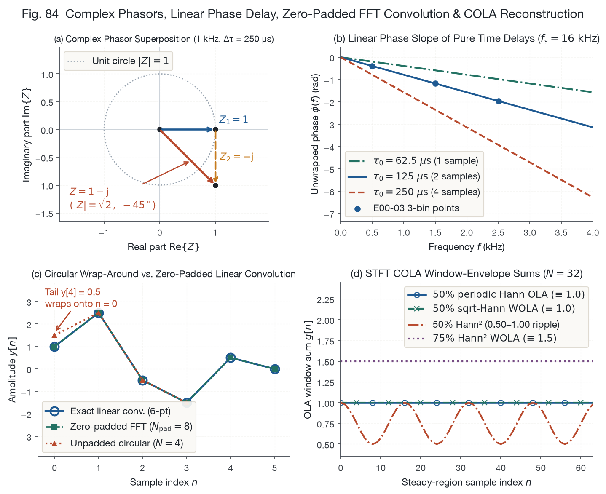
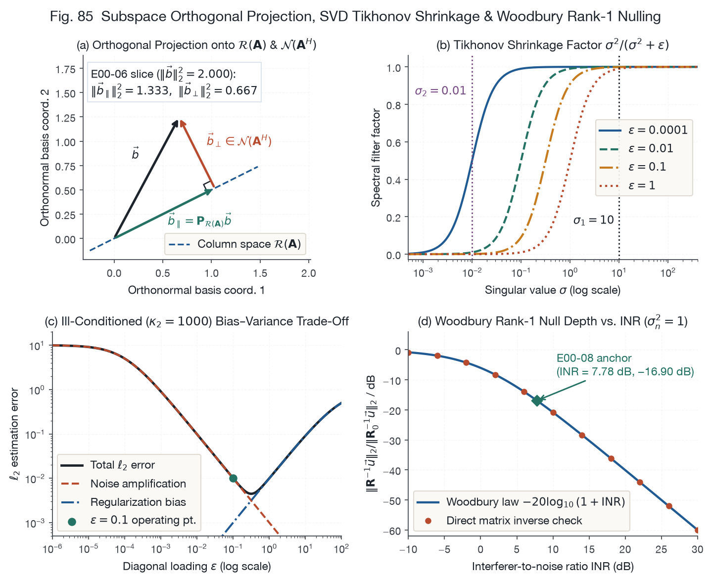
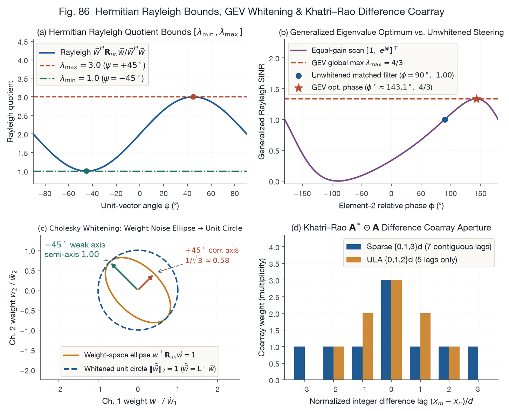
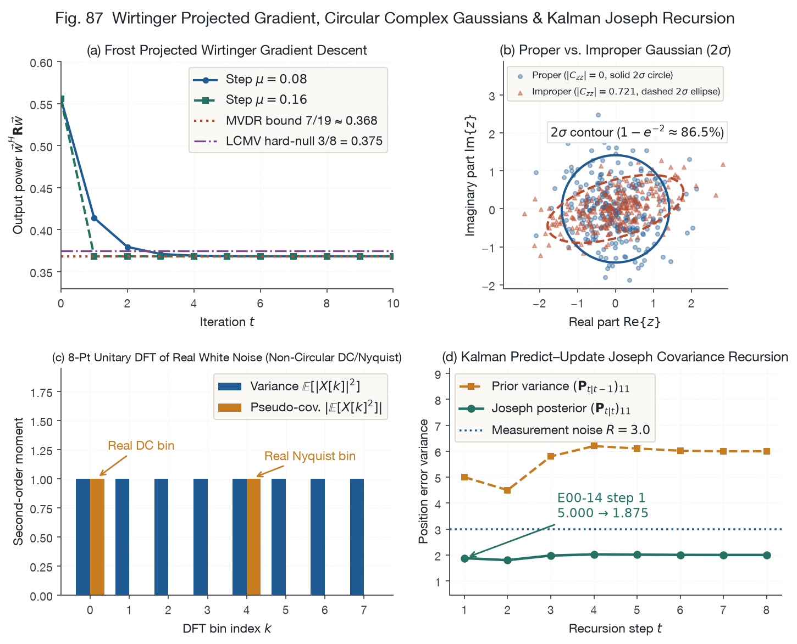

🌐 [简体中文](../chapters/00_math-foundations.md) ｜ **English**

> This is Chapter 0 (of 16 main and special-topic chapters—Chapters 0–15, where Chapters 12–15 are four extended special topics, accompanied by Appendices A and B). Designed for readers with zero prior background in array processing, it starts from elementary vectors, complex numbers, matrices, and probability and derives without skipping steps all core mathematical tools, hand-worked numerical examples, and engineering failure boundaries used across Chapters 1–15 and Appendices A–B; readers already familiar with parts of this material may also look up individual derivations on demand via the master index in §0.8.
>
> Overview: [00_overview.md](00_overview.md) | Next: [01_problem-definition.md](01_problem-definition.md)

---

## 0. Mathematical Foundations and Signal Analysis Preliminaries

Modern microphone array signal processing spans spatial geometry, Fourier and Z-domain time-frequency analysis, complex matrix linear algebra, complex-variable calculus, statistical estimation, and spherical harmonic expansions. When newcomers read papers on beamforming, acoustic echo cancellation, or dereverberation, the stumbling block is rarely physical acoustics itself—more often it lies in complex conjugate inner products, block matrix inversion, Cholesky whitening, Wirtinger conjugate partial derivatives, circularly symmetric complex Gaussians, or spherical special functions invoked mid-derivation.

This chapter organizes the entire mathematical chain in **strict forward-dependency-free order**: complex exponentials are never sneaked in before complex numbers are defined, and determinants or cyclic trace identities are never invoked before matrices are introduced. Every major module opens with a zero-background warm-up and a pen-and-paper $2\times 2$ toy example, then derives core theorems without skipping steps and pinpoints numerical failure boundaries. The five in-text worked anchor examples and the sixteen end-of-chapter runnable exercises (`E00-01`–`E00-16`) use mutually non-overlapping parameter sets; all exercises and core operators are bit-reproducibly backed by the pure-NumPy core module `codes/chapters/ch00/core/chapter00_math.py` and CLI runner `codes/chapters/ch00/chapter00_exercises.py`.

| Acronym / Symbol | Full Name | Role in This Chapter and Across the Book |
|---|---|---|
| TDOA | Time Difference of Arrival | Arrival-time difference of a direct acoustic wave between two microphones; physical foundation of localization and beam alignment |
| $\mathrm{SO}(3)$ | Special Orthogonal Group in 3D | Group of 3D rigid-body rotation matrices ($\mathbf R^\top\mathbf R = \mathbf I_3,\ \det\mathbf R = +1$), used in moving arrays and head tracking |
| DFT / STFT | Discrete / Short-Time Fourier Transform | Converts discrete time-domain convolution into per-bin complex phasor algebra and narrowband spatial filtering |
| PSD | Power Spectral Density | Frequency-domain second-order statistic describing how stationary random signal power distributes across frequency (Fourier transform of autocorrelation) |
| COLA / WOLA | Constant / Weighted Overlap-Add | Necessary and sufficient windowing condition guaranteeing distortionless time-domain waveform stitching after framed spectral processing |
| SVD | Singular Value Decomposition | Diagnoses effective rank and $\ell_2$ condition number of propagation matrices, quantifying noise amplification under ill-conditioned inversion |
| GEV / GEVD | Generalized Eigenvalue Problem / Decomposition | Solves for maximum-SINR beamformer weights under spatially colored noise via whitening congruence transforms |
| MVDR / LCMV | Minimum Variance Distortionless Response / Linearly Constrained Minimum Variance | Closed-form solutions to complex linearly constrained quadratic programs for single-direction distortionless pickup and multi-direction nulling |
| KKT | Karush–Kuhn–Tucker Conditions | First-order necessary and sufficient optimality conditions for inequality-constrained convex optimization (such as Non-Negative Least Squares, NNLS) |
| NNLS / MM | Non-Negative Least Squares / Majorization–Minimization | Iterative optimization frameworks handling non-negative source power constraints and non-smooth sparse/reweighted objectives |
| Proper $\mathcal{CN}$ | Circularly Symmetric / Proper Complex Gaussian | Statistical cornerstone of frequency-domain speech and noise modeling, requiring both zero mean and zero pseudo-covariance |
| FIM / CRLB | Fisher Information Matrix / Cramér–Rao Lower Bound | Theoretical minimum-variance floor of any unbiased estimator, characterizing how aperture, bandwidth, and SNR bound localization accuracy |
| WLS / GLS | Weighted / Generalized Least Squares | Minimum-variance linear unbiased estimator under known heteroscedastic or correlated noise covariance (Gauss–Markov optimal) |
| LMMSE / RLS | Linear Minimum Mean Square Error / Recursive Least Squares | Second-order optimal filtering framework underlying Wiener filtering, multichannel speech enhancement, and fast adaptive echo cancellation |

### 0.1 Trigonometric Identities, 3D Spatial Geometry, and Spherical Coordinate Systems

#### 0.1.1 Trigonometric Identities, 3D Vector Inner Product, and the Four-Frame Coordinate Bridge

The physical starting point of array processing is completely intuitive: sound from the same source travels different path lengths to differently positioned microphones, path-length differences produce propagation delays, and on a single-frequency sinusoid a propagation delay appears as a phase shift. To express path differences cleanly in geometric language, let us first review the two most elementary operations on three-dimensional real vectors. Given two 3D real column vectors $\vec a = [a_1, a_2, a_3]^\top$ and $\vec b = [b_1, b_2, b_3]^\top$ (where superscript $^\top$ denotes the **transpose** swapping rows and columns), their **Euclidean dot product (inner product)** and **Euclidean $\ell_2$ norm (length)** are defined by:

$$\vec a^\top\vec b = a_1 b_1 + a_2 b_2 + a_3 b_3 = \|\vec a\|_2\|\vec b\|_2\cos\gamma,\qquad
\|\vec a\|_2 = \sqrt{\vec a^\top\vec a} = \sqrt{a_1^2 + a_2^2 + a_3^2},$$

where $\gamma \in [0, \pi]$ is the spatial angle between the two vectors. When $\|\vec u\|_2 = 1$, we call $\vec u$ a **unit direction vector**, and the signed projection length of any vector $\vec r$ along direction $\vec u$ is simply the dot product $\vec r^\top\vec u$.

Next, consider the three real trigonometric identities essential for superposing sinusoids. For any real angles $\alpha, \beta \in \mathbb{R}$, starting from the angle-addition formulas $\cos(\alpha \mp \beta) = \cos\alpha\cos\beta \pm \sin\alpha\sin\beta$, adding or subtracting $\cos(\alpha-\beta)$ and $\cos(\alpha+\beta)$ with $A = \alpha + \beta,\ B = \alpha - \beta$ (so $\alpha = \frac{A+B}{2},\ \beta = \frac{A-B}{2}$) yields the sum-to-product identities; setting $\alpha = \beta = \delta/2$ in $\cos(\delta) = \cos^2(\delta/2) - \sin^2(\delta/2) = 1 - 2\sin^2(\delta/2)$ and rearranging yields the half-angle identities:

$$\begin{aligned}
\cos(\alpha \mp \beta) &= \cos\alpha\cos\beta \pm \sin\alpha\sin\beta,\\
\cos A + \cos B &= 2\cos\!\left(\frac{A+B}{2}\right)\cos\!\left(\frac{A-B}{2}\right),\\
\cos A - \cos B &= -2\sin\!\left(\frac{A+B}{2}\right)\sin\!\left(\frac{A-B}{2}\right),\\
1 - \cos\delta &= 2\sin^2\!\left(\frac{\delta}{2}\right),\qquad
1 + \cos\delta = 2\cos^2\!\left(\frac{\delta}{2}\right).
\end{aligned}\tag{0-1}$$

Using purely real trigonometry in Eq. (0-1) alone, we can already see how the simplest two-microphone array "picks out a direction." Suppose two microphones receive equal-amplitude single-frequency waves separated by phase offset $\psi$, written $\cos(\omega t)$ and $\cos(\omega t - \psi)$:

- **In-phase addition (delay-and-sum prototype)**: Applying line 2 of Eq. (0-1) gives $\cos(\omega t) + \cos(\omega t - \psi) = 2\cos(\psi/2)\cos(\omega t - \psi/2)$. The output envelope amplitude is $2\lvert\cos(\psi/2)\rvert$, and the power ratio relative to one microphone is $4\cos^2(\psi/2) = 2(1+\cos\psi)$—amplifying power $4\times$ at $\psi = 0$ (facing the source) and canceling completely at $\psi = \pm\pi$.
- **Anti-phase subtraction (first-order differential cardioid/dipole prototype; see [Chapter 3 §3.1](03_array-geometry.md#sec-3-1) and [Chapter 5 §5.3.1](05_beamforming.md#sec-5-3-1), and the second-order near-field differential extension in [Chapter 15 §15.3](15_target-extraction-diarization.md#sec-15-3))**: Applying line 3 of Eq. (0-1) gives $\cos(\omega t) - \cos(\omega t - \psi) = -2\sin(\psi/2)\sin(\omega t - \psi/2)$, with power ratio $4\sin^2(\psi/2) = 2(1-\cos\psi)$—carving a deep null at $\psi = 0$ and peaking at $\psi = \pm\pi$.

Notice immediately: real sum-to-product identities remain manageable for two microphones, but generalizing to $M = 8$ or $64$ microphones via repeated real trigonometric expansions quickly becomes intractable—which is our direct motivation for introducing complex numbers and Euler's formula in §0.2.1.

Before computing 3D spatial angles and path differences, let us establish the **four 3D spatial coordinate systems** used across the book together with their exact conversion bridge, preventing silent left–right directional sign flips when cross-reading papers and open-source libraries:

| Coordinate System | Chapters & Standards | Cartesian Basis Definition | Azimuth Origin & Positive Sense | Elevation / Polar Angle Definition |
|---|---|---|---|---|
| Right-handed Cartesian $(x,y,z)$ | Shared Euclidean inner-product basis book-wide | Sensor positions $\vec r_m$, source $\vec p = r\vec u$ | — | — |
| Book planar-array frame $(\theta_{\mathrm{book}}, \phi_{\mathrm{el}}, r)$ | Default in Chapters 2–13 | Linear array along $x$-axis, $+y$ broadside front, $+z$ up | $\theta_{\mathrm{book}}$ **clockwise** from $+y$ toward $+x$ | $\phi_{\mathrm{el}} \in [-90^\circ, +90^\circ]$ upward from horizontal plane |
| Shared-basis spherical-harmonic frame $(\alpha, \vartheta, r)$ | Chapter 5 §5.8 and §0.7 | Same $(x,y,z)$ axes as above | $\alpha \in (-\pi, \pi]$ **counterclockwise** from $+x$ toward $+y$ | Colatitude $\vartheta \in [0, \pi]$ downward from $+z$ zenith |
| Listener-local AmbiX / AES69 (`SOFA`) frame | [Chapter 3 §3.1.1 3D Coordinate Comparison](03_array-geometry.md#sec-3-1-1) and [Chapter 14 §14.2](14_spatial-wearable-arrays.md#sec-14-2) | Listener front $+x_{\mathrm{A}}$, left $+y_{\mathrm{A}}$, up $+z_{\mathrm{A}}$ | Horizontal azimuth **counterclockwise** from $+x_{\mathrm{A}}$ toward $+y_{\mathrm{A}}$ | Elevation positive upward from horizontal plane |

> **AES69 / SOFA Notation Distinction**: The international AES69 (`SOFA`) standard officially names its spherical coordinates `(azimuth, elevation, radius)`, with default listener orientation `ListenerView = [1, 0, 0]` ($+x_{\mathrm{A}}$ front), head-up `ListenerUp = [0, 0, 1]` ($+z_{\mathrm{A}}$ up), and listener left $+y_{\mathrm{A}}$. To avoid colliding with this book's elevation symbol $\phi_{\mathrm{el}}$, we denote AES69 / SOFA `(azimuth, elevation)` by $(\phi_{\mathrm{SOFA}}, \delta_{\mathrm{SOFA}})$. When listener front aligns with our $+y$ broadside axis, a $90^\circ$ right-handed rotation gives the Cartesian axis bridge $(x_{\mathrm{A}}, y_{\mathrm{A}}, z_{\mathrm{A}}) = (y, -x, z)$.

Consequently, given book spherical coordinates $(\theta_{\mathrm{book}}, \phi_{\mathrm{el}}, r)$, the source-pointing unit vector $\vec u$ and exact conversion formulas across all four systems close cleanly:

$$\begin{aligned}
\alpha &= 90^\circ - \theta_{\mathrm{book}} \pmod{360^\circ}\text{ (wrapped to }(-180^\circ, 180^\circ]\text{)},\qquad
\vartheta = 90^\circ - \phi_{\mathrm{el}},\\
\phi_{\mathrm{SOFA}} &= -\theta_{\mathrm{book}} \pmod{360^\circ}\text{ (wrapped to }(-180^\circ, 180^\circ]\text{)},\qquad
\delta_{\mathrm{SOFA}} = \phi_{\mathrm{el}},\\
\vec u &= \begin{bmatrix}
\cos\phi_{\mathrm{el}}\sin\theta_{\mathrm{book}}\\
\cos\phi_{\mathrm{el}}\cos\theta_{\mathrm{book}}\\
\sin\phi_{\mathrm{el}}
\end{bmatrix}
= \begin{bmatrix}
\sin\vartheta\cos\alpha\\
\sin\vartheta\sin\alpha\\
\cos\vartheta
\end{bmatrix},\qquad
\vec p = r\vec u = \begin{bmatrix}x\\ y\\ z\end{bmatrix},\\
\vec u_{\mathrm{A}} &= \begin{bmatrix}
\cos\delta_{\mathrm{SOFA}}\cos\phi_{\mathrm{SOFA}}\\
\cos\delta_{\mathrm{SOFA}}\sin\phi_{\mathrm{SOFA}}\\
\sin\delta_{\mathrm{SOFA}}
\end{bmatrix}
= \begin{bmatrix}u_y\\ -u_x\\ u_z\end{bmatrix},\qquad
\vec p_{\mathrm{A}} = r\vec u_{\mathrm{A}} = \begin{bmatrix}y\\ -x\\ z\end{bmatrix}.
\end{aligned}\tag{0-2}$$

**Why must Cartesian-to-angle inversion use two-argument $\operatorname{atan2}$?** Ordinary single-argument arctangent $\arctan(x/y)$ outputs principal values strictly inside $(-\pi/2, \pi/2)$: it divides by zero whenever $y = 0$, and it cannot distinguish $(+1, +1)$ (first quadrant) from $(-1, -1)$ (third quadrant)—both yield quotient $+1$, losing half the circle. The two-argument four-quadrant function $\operatorname{atan2}(\text{opposite}, \text{adjacent})$ inspects the signs of numerator and denominator independently, mapping the full circle onto $(-\pi, \pi]$. Inverting $\vec p = [x, y, z]^\top \neq \vec 0$: first compute $r = \sqrt{x^2+y^2+z^2}$ and $\phi_{\mathrm{el}} = \arcsin(z/r)$, then compute book azimuth $\theta_{\mathrm{book}} = \operatorname{atan2}(x, y)$ (note $x$ first, $y$ second), whereas counterclockwise azimuth is $\alpha = \operatorname{atan2}(y, x)$ and SOFA azimuth is $\phi_{\mathrm{SOFA}} = \operatorname{atan2}(y_{\mathrm{A}}, x_{\mathrm{A}}) = \operatorname{atan2}(-x, y)$; azimuth is non-unique only directly at the zenith or nadir poles ($|z| = r$, zero horizontal projection).

#### 0.1.2 Spherical Law of Cosines, Taylor Expansion, and Near-Field Fresnel Criterion

With the explicit unit direction vector $\vec u(\theta, \phi_{\mathrm{el}})$ in Eq. (0-2), we immediately derive the subtended spatial angle $\gamma \in [0, \pi]$ between two directions $(\theta_1, \phi_{\mathrm{el},1})$ and $(\theta_2, \phi_{\mathrm{el},2})$. Computing the Euclidean dot product $\vec u_1^\top\vec u_2$, factoring $\cos\phi_{\mathrm{el},1}\cos\phi_{\mathrm{el},2}$ out of the first two terms, and applying line 1 of Eq. (0-1), $\sin\theta_1\sin\theta_2 + \cos\theta_1\cos\theta_2 = \cos(\theta_1 - \theta_2)$, yields the **spherical law of cosines** in two steps:

$$\begin{aligned}
\cos\gamma &= \vec u_1^\top\vec u_2
= \cos\phi_{\mathrm{el},1}\cos\phi_{\mathrm{el},2}\bigl(\sin\theta_1\sin\theta_2 + \cos\theta_1\cos\theta_2\bigr)
+ \sin\phi_{\mathrm{el},1}\sin\phi_{\mathrm{el},2}\\
&= \sin\phi_{\mathrm{el},1}\sin\phi_{\mathrm{el},2}
+ \cos\phi_{\mathrm{el},1}\cos\phi_{\mathrm{el},2}\cos(\theta_1 - \theta_2).
\end{aligned}\tag{0-3}$$

Next, we derive the exact boundary separating far-field plane waves from near-field spherical waves. Place the reference origin at the array geometric center $\vec 0$, a sound source at $\vec p = r\vec u$ ($r = \|\vec p\|_2 > 0$), and the $m$-th microphone at $\vec r_m$ (radial offset $\rho_m = \|\vec r_m\|_2$). Expanding the squared Euclidean norm of the difference vector gives the exact propagation distance $r_m = \|\vec p - \vec r_m\|_2$:

$$\begin{aligned}
r_m &= \|\,r\vec u - \vec r_m\,\|_2
= \sqrt{(r\vec u - \vec r_m)^\top(r\vec u - \vec r_m)}\\
&= \sqrt{r^2 - 2r\,\vec r_m^\top\vec u + \rho_m^2}
= r\sqrt{1 - \frac{2\,\vec r_m^\top\vec u}{r} + \frac{\rho_m^2}{r^2}}.
\end{aligned}\tag{0-4}$$

When the source sits much farther than the array size ($\rho_m / r \ll 1$), define the dimensionless small quantity $\xi = -\frac{2\,\vec r_m^\top\vec u}{r} + \frac{\rho_m^2}{r^2}$. We expand the smooth function $f(\xi) = \sqrt{1 + \xi} = (1+\xi)^{1/2}$ around $\xi = 0$ via its **second-order Taylor series** $f(\xi) = f(0) + f'(0)\xi + \frac{1}{2!}f''(0)\xi^2 + O(\xi^3)$: differentiating sequentially gives $f(0) = 1$, $f'(\xi) = \frac{1}{2}(1+\xi)^{-1/2} \Rightarrow f'(0) = \frac{1}{2}$, and $f''(\xi) = -\frac{1}{4}(1+\xi)^{-3/2} \Rightarrow f''(0) = -\frac{1}{4}$, hence $\sqrt{1+\xi} = 1 + \frac{1}{2}\xi - \frac{1}{8}\xi^2 + O(\xi^3)$.

Now expand $\xi^2$ completely without skipping a single term:

$$\xi^2 = \left(-\frac{2\,\vec r_m^\top\vec u}{r} + \frac{\rho_m^2}{r^2}\right)^2
= \frac{4(\vec r_m^\top\vec u)^2}{r^2}
\underbrace{- \frac{4(\vec r_m^\top\vec u)\rho_m^2}{r^3} + \frac{\rho_m^4}{r^4}}_{O(\rho_m^3/r^3)\text{ (since }|\vec r_m^\top\vec u|\le\rho_m\text{)}}.$$

Substituting $\xi$ and $\xi^2$ into $\Delta r_m = r_m - r = r\bigl(\frac{1}{2}\xi - \frac{1}{8}\xi^2 + O(\xi^3)\bigr)$—noting that multiplying $O(\rho_m^3/r^3)$ inside the brackets by $r$ yields $O(\rho_m^3/r^2)$—gives the **second-order Fresnel path-difference expansion** bridging far-field plane waves and near-field spherical waves:

$$\begin{aligned}
\Delta r_m &= r_m - r
= r\Biggl[\frac{1}{2}\left(-\frac{2\,\vec r_m^\top\vec u}{r} + \frac{\rho_m^2}{r^2}\right)
- \frac{1}{8}\cdot\frac{4(\vec r_m^\top\vec u)^2}{r^2} + O\!\left(\frac{\rho_m^3}{r^3}\right)\Biggr]\\
&= \underbrace{-\vec r_m^\top\vec u}_{\text{1st-order far-field plane-wave term }\Delta r_{m,1}}
+ \underbrace{\frac{\|\vec r_m\|_2^2 - (\vec r_m^\top\vec u)^2}{2r}}_{\text{2nd-order spherical curvature term}}
+ O\!\left(\frac{\rho_m^3}{r^2}\right).
\end{aligned}\tag{0-5}$$

On a 1D linear array along the $x$-axis, $\vec r_m = [x_m, 0, 0]^\top$, and a horizontal-plane source ($\phi_{\mathrm{el}} = 0^\circ$) gives $\vec r_m^\top\vec u = x_m\sin\theta$, so the numerator of the second-order curvature term simplifies to $x_m^2(1 - \sin^2\theta) = x_m^2\cos^2\theta$. Equation (0-5) immediately reveals the origin of the Fraunhofer far-field distance $r_{\mathrm{F}} = 2D^2/\lambda$ in [Chapter 2 §2.2](02_basics-signal-model.md#sec-2-2): for total array aperture $D$ with edge sensors at $|x_m| \le D/2$, the second-order curvature path difference peaks at broadside ($\cos\theta = 1$) at $\Delta r_{\mathrm{curv},\max} = \frac{(D/2)^2}{2r} = \frac{D^2}{8r}$. Because a single-frequency wave spans $2\pi\ \mathrm{rad}$ of phase per wavelength $\lambda = c/f$, imposing the engineering tolerance that edge-of-aperture curvature phase error stay within $\frac{2\pi}{\lambda}\Delta r_{\mathrm{curv},\max} \le \frac{\pi}{8}\ \mathrm{rad}$ ($22.5^\circ$) and canceling $\pi/8$ from both sides yields $r \ge \frac{2D^2}{\lambda}$. To be precise: under this $\pi/8$ edge-phase criterion, coherent summation loss is about $0.06\ \mathrm{dB}$ for a **uniform continuous aperture** (and remains below $0.1\ \mathrm{dB}$ for dense linear arrays with $M \ge 8$), whereas for sparse small arrays with only $M = 3$ or $4$ microphones—where edge sensors carry a larger share of total weight—summation loss at the same boundary reaches roughly $0.13$–$0.15\ \mathrm{dB}$.

**Worked Anchor 0-1 (Four-Frame Coordinate Bridge, Spherical Angle, and Near-Field Fresnel Path-Difference Verification; `E00-01` uses independent parameters).**

- **(1) Four-frame coordinate bridge and spherical angle**: Take book coordinates $\theta_{\mathrm{book}} = 60^\circ$, $\phi_{\mathrm{el}} = 30^\circ$, and range $r = 2.0\ \mathrm{m}$. Equation (0-2) immediately gives spherical-harmonic angles $\alpha = 90^\circ - 60^\circ = 30^\circ$ and $\vartheta = 90^\circ - 30^\circ = 60^\circ$, together with AES69/SOFA angles $\phi_{\mathrm{SOFA}} = -60^\circ$ and $\delta_{\mathrm{SOFA}} = +30^\circ$. Using $\sin 30^\circ = \cos 60^\circ = 1/2$ and $\cos 30^\circ = \sin 60^\circ = \sqrt{3}/2$, componentwise substitution gives:

    $$\begin{aligned}
    \vec u &= \begin{bmatrix}\frac{\sqrt{3}}{2}\cdot\frac{\sqrt{3}}{2}\\ \frac{\sqrt{3}}{2}\cdot\frac{1}{2}\\ \frac{1}{2}\end{bmatrix}
    = \begin{bmatrix}0.750000\\ 0.433013\\ 0.500000\end{bmatrix},\qquad
    \vec p = 2\vec u = \begin{bmatrix}1.500000\\ 0.866025\\ 1.000000\end{bmatrix}\ \mathrm{m},\\
    \vec p_{\mathrm{A}} &= \begin{bmatrix}y\\ -x\\ z\end{bmatrix}
    = \begin{bmatrix}0.866025\\ -1.500000\\ 1.000000\end{bmatrix}\ \mathrm{m}.
    \end{aligned}$$

    Cross-checking directly from SOFA spherical angles: $2[\cos 30^\circ\cos(-60^\circ),\ \cos 30^\circ\sin(-60^\circ),\ \sin 30^\circ]^\top = [\frac{\sqrt{3}}{2}, -\frac{3}{2}, 1]^\top = \vec p_{\mathrm{A}}$, exact agreement. Now take a second direction $(\theta_2, \phi_{\mathrm{el},2}) = (0^\circ, 30^\circ)$; substituting into Eq. (0-3) gives $\cos\gamma = \sin^2 30^\circ + \cos^2 30^\circ\cos 60^\circ = \frac{1}{4} + \frac{3}{4}\cdot\frac{1}{2} = \frac{5}{8} = 0.625$, so the subtended spatial angle is $\gamma = \arccos(0.625) \approx 51.32^\circ$.
- **(2) Near-field Fresnel path-difference check**: Set $c = 343\ \mathrm{m/s}$, $f = 1715\ \mathrm{Hz}$ (wavelength $\lambda = 0.20\ \mathrm{m}$), and linear aperture $D = 0.40\ \mathrm{m}$, putting the Fraunhofer far-field boundary at $r_{\mathrm{F}} = 2(0.40)^2 / 0.20 = 1.60\ \mathrm{m}$. Consider a near-field broadside source at $r = 1.00\ \mathrm{m} < r_{\mathrm{F}}$, $\theta = 0^\circ$ arriving at the right-hand edge sensor $x_m = +0.20\ \mathrm{m}$: Eq. (0-4) yields exact distance $r_m = \sqrt{1.00^2 + 0.20^2} = \sqrt{1.04} \approx 1.019804\ \mathrm{m}$ and exact path difference $\Delta r_{\mathrm{exact}} = +19.804\ \mathrm{mm}$. The first-order plane-wave approximation predicts $\Delta r_1 = 0\ \mathrm{mm}$—an error of $19.804\ \mathrm{mm}$ (phase error $35.65^\circ$, well past the $22.5^\circ$ tolerance). Adding the second-order curvature term from Eq. (0-5) gives $\Delta r_2 = 0 + \frac{0.20^2\times 1^2}{2\times 1.00} = +20.000\ \mathrm{mm}$, slashing residual path error to $0.196\ \mathrm{mm}$ (phase error just $0.35^\circ$, over $100\times$ more accurate).

**What does this example show?** Inside the near field, the first-order plane-wave model misses crucial spherical wavefront curvature (the very physical signature exploited by near-field distance bubbles in Chapter 15 to separate near from far talkers), whereas the second-order Fresnel expansion already holds phase error below $1^\circ$ even at $r \sim 0.6\,r_{\mathrm{F}}$. **When does this conclusion fail?** When the source moves right up to the array so $|x_m|/r \to 1$, higher-order Taylor remainders $O(\rho_m^3/r^2)$ become non-negligible and one must compute the exact square root in Eq. (0-4).

#### 0.1.3 3D Orthogonal Rotation Group $\mathrm{SO}(3)$ Composition, Non-Commutativity, and Active/Passive Inverse Mapping

In moving-array tracking ([Chapter 9 §9.4](09_source-tracking.md#sec-9-4)) and head-tracked wearable spatial rendering ([Chapter 14 §14.3](14_spatial-wearable-arrays.md#sec-14-3)), rigid-body 3D rotations are described by $3\times 3$ real matrices. Before launching full complex matrix algebra in §0.3, here are the self-contained $3\times 3$ matrix rules needed for this subsection:

> **Self-Contained $3\times 3$ Matrix Quickstart**: If matrix $\mathbf R = [\vec r_1, \vec r_2, \vec r_3]$ stacks three column vectors side by side, left-multiplying $\vec v = [v_1, v_2, v_3]^\top$ forms the linear combination $\mathbf R\vec v = v_1\vec r_1 + v_2\vec r_2 + v_3\vec r_3$—in other words, **the $j$-th column of $\mathbf R$ is the image of the $j$-th coordinate basis vector $\vec e_j$ after rotation.** Matrix multiplication composes two transforms row-by-column, $(\mathbf A\mathbf B)_{ij} = \sum_{k=1}^3 A_{ik}B_{kj}$ (so $(\mathbf A\mathbf B)\vec v = \mathbf A(\mathbf B\vec v)$). Transposing $\mathbf R^\top$ swaps rows and columns and reverses product order, $(\mathbf A\vec v)^\top = \vec v^\top\mathbf A^\top$, so entry $(i, j)$ of $\mathbf R^\top\mathbf R$ is the column dot product $\vec r_i^\top\vec r_j$; the $3\times 3$ determinant $\det\mathbf R$ measures signed volume scaling of the unit cube ($+1$ preserves right-handedness, $-1$ includes a mirror reflection); and the **Frobenius norm** is the square root of the sum of all squared entries, $\|\mathbf A\|_F = \sqrt{\sum_{i,j} A_{ij}^2}$.

A rigid-body rotation must simultaneously satisfy orthogonality $\mathbf R^\top\mathbf R = \mathbf I_3$ (three mutually perpendicular unit columns) and right-handed orientation $\det\mathbf R = +1$; all such matrices form the three-dimensional special orthogonal group $\mathrm{SO}(3)$. Using the rule "column $j$ equals the image of basis vector $\vec e_j$," we write all three elementary right-handed axis-rotation matrices without skipping steps—and see directly **why the $\sin\beta$ signs in $\mathbf R_y(\beta)$ flip opposite to $\mathbf R_z$ and $\mathbf R_x$**:

- **Rotation by $\alpha$ about $+z$ (yaw)**: Pointing the right thumb along $+z$, fingers curl from $+x$ toward $+y$, so $\vec e_x \mapsto [\cos\alpha, \sin\alpha, 0]^\top$, $\vec e_y \mapsto [-\sin\alpha, \cos\alpha, 0]^\top$, and $\vec e_z$ stays fixed;
- **Rotation by $\beta$ about $+y$ (pitch)**: Pointing the right thumb along $+y$, right-handed cyclic cross product $\vec e_z \times \vec e_x = +\vec e_y$ means fingers curl **from $+z$ toward $+x$** (not from $+x$ toward $+z$), so $\vec e_z \mapsto [\sin\beta, 0, \cos\beta]^\top$ ($+\sin\beta$ at the top of column 3) while $\vec e_x$ tips downward toward $-z$, giving $\vec e_x \mapsto [\cos\beta, 0, -\sin\beta]^\top$ ($-\sin\beta$ at the bottom of column 1)—the exact geometric reason $\mathbf R_y(\beta)$ reverses sign placement;
- **Rotation by $\gamma$ about $+x$ (roll)**: Pointing the right thumb along $+x$, fingers curl from $+y$ toward $+z$, so $\vec e_y \mapsto [0, \cos\gamma, \sin\gamma]^\top$ and $\vec e_z \mapsto [0, -\sin\gamma, \cos\gamma]^\top$.

Placing these basis images into columns yields the three elementary rotation matrices:

$$\begin{aligned}
\mathbf R_z(\alpha) &= \begin{bmatrix}
\cos\alpha & -\sin\alpha & 0\\
\sin\alpha & \cos\alpha & 0\\
0 & 0 & 1
\end{bmatrix},\qquad
\mathbf R_y(\beta) = \begin{bmatrix}
\cos\beta & 0 & \sin\beta\\
0 & 1 & 0\\
-\sin\beta & 0 & \cos\beta
\end{bmatrix},\\
\mathbf R_x(\gamma) &= \begin{bmatrix}
1 & 0 & 0\\
0 & \cos\gamma & -\sin\gamma\\
0 & \sin\gamma & \cos\gamma
\end{bmatrix}.
\end{aligned}\tag{0-6}$$

Direct determinant expansion confirms $\det\mathbf R_z(\alpha) = \cos^2\alpha + \sin^2\alpha = 1$ (and identically for $\mathbf R_y, \mathbf R_x$), while orthogonality $\mathbf R^\top\mathbf R = \mathbf I_3$ immediately implies two corollaries: first, rotations strictly preserve vector lengths and angles, $\|\mathbf R\vec v\|_2^2 = (\mathbf R\vec v)^\top(\mathbf R\vec v) = \vec v^\top(\mathbf R^\top\mathbf R)\vec v = \|\vec v\|_2^2$; second, inversion requires no elimination, $\mathbf R^{-1} = \mathbf R^\top$. In engineering deployment, guard against two pitfalls: first, **finite 3D rotations do not commute** (for instance, applying $\mathbf R_x(90^\circ)$ then $\mathbf R_z(90^\circ)$ to $\vec e_y = [0, 1, 0]^\top$ produces $\mathbf R_z(90^\circ)[0,0,1]^\top = [0,0,1]^\top$, whereas reversing the order gives $\mathbf R_x(90^\circ)[-1,0,0]^\top = [-1,0,0]^\top$, pointing in a completely different direction; `E00-02` systematically evaluates the commutator norm between $\mathbf R_z\mathbf R_y$ and $\mathbf R_y\mathbf R_z$); second, **active source rotation and passive listener-head rotation are transpose inverses**—if the wearer's head rotates relative to the world frame by $\mathbf R_{\mathrm{head}}$, a world-fixed source at $\vec v_{\mathrm{world}}$ has head-local coordinates $\mathbf R_{\mathrm{head}}^\top\vec v_{\mathrm{world}}$, and omitting the transpose swings virtual acoustic images twice as far in the wrong direction.

---

### 0.2 Complex Phasors, Decibel Scales, Fourier Analysis, and Discrete LTI Systems

#### 0.2.1 Complex Arithmetic, Euler's Formula, and the $M$-Element Dirichlet Kernel

In §0.1.1 we saw that summing phase-shifted waves across many microphones using real trigonometric identities quickly grows unwieldy. Introducing the imaginary unit $\mathrm{j} = \sqrt{-1}$ (satisfying $\mathrm{j}^2 = -1$), any **complex number** takes algebraic form $z = a + \mathrm{j}b \in \mathbb{C}$ (real part $a = \operatorname{Re}\{z\}$, imaginary part $b = \operatorname{Im}\{z\}$), corresponding geometrically to point $(a, b)$ on the 2D complex plane. Mastering the following four rules suffices for all complex algebra in this book:

1. **Addition, subtraction, and multiplication**: Expand like ordinary polynomials and substitute $\mathrm{j}^2 = -1$, giving $(a+\mathrm{j}b)(c+\mathrm{j}d) = (ac - bd) + \mathrm{j}(ad + bc)$;
2. **Complex conjugation**: Negate the imaginary part, $z^* = a - \mathrm{j}b$ (mirror reflection across the real axis), obeying $(z_1 + z_2)^* = z_1^* + z_2^*$ and $(z_1 z_2)^* = z_1^* z_2^*$;
3. **Modulus and squared modulus**: Distance from the origin is $|z| = \sqrt{a^2 + b^2}$, and $z z^* = (a+\mathrm{j}b)(a-\mathrm{j}b) = a^2 + b^2 = |z|^2 \ge 0$ is always real and non-negative; hence complex division simply multiplies numerator and denominator by the denominator's conjugate to rationalize the denominator: $\frac{z_1}{z_2} = \frac{z_1 z_2^*}{|z_2|^2}$;
4. **Euler's formula and polar multiplication/division**: Consider the unit-circle curve $g(\phi) = \cos\phi + \mathrm{j}\sin\phi$. Differentiating with respect to $\phi$ yields $g'(\phi) = -\sin\phi + \mathrm{j}\cos\phi = \mathrm{j}(\cos\phi + \mathrm{j}\sin\phi) = \mathrm{j}g(\phi)$ with initial value $g(0) = 1$—matching the exact same differential equation and initial condition as $(e^{\mathrm{j}\phi})' = \mathrm{j}e^{\mathrm{j}\phi}$ (equivalently verified term-by-term from the Taylor series of $\cos\phi$, $\sin\phi$, and $e^x$). This yields **Euler's formula** and polar arithmetic:

$$\begin{aligned}
e^{\mathrm{j}\phi} &= \cos\phi + \mathrm{j}\sin\phi,\qquad
\cos\phi = \frac{e^{\mathrm{j}\phi} + e^{-\mathrm{j}\phi}}{2},\qquad
\sin\phi = \frac{e^{\mathrm{j}\phi} - e^{-\mathrm{j}\phi}}{2\mathrm{j}},\\
z_1 z_2 &= (|z_1|e^{\mathrm{j}\phi_1})(|z_2|e^{\mathrm{j}\phi_2}) = |z_1||z_2|\,e^{\mathrm{j}(\phi_1+\phi_2)},\qquad
\frac{z_1}{z_2} = \frac{|z_1|}{|z_2|}\,e^{\mathrm{j}(\phi_1-\phi_2)}.
\end{aligned}\tag{0-7}$$

Equation (0-7) reduces complex multiplication directly to multiplying moduli and adding phases. Let us immediately solve the multi-microphone summation left open in §0.1.1—deriving the **$M$-element uniform linear array beampattern factor (Dirichlet kernel)** appearing throughout Chapters 2, 3, and 5. First prove the finite geometric sum: for ratio $q \neq 1$, write $S = \sum_{m=0}^{M-1} q^m = 1 + q + \cdots + q^{M-1}$, multiply by $q$ to get $qS = q + q^2 + \cdots + q^M$, and subtract so all interior terms cancel, giving $(1-q)S = 1 - q^M \Rightarrow S = \frac{1-q^M}{1-q}$. Setting $q = e^{-\mathrm{j}\psi}$, where $\psi = \kappa d(\sin\theta_0 - \sin\theta) = \frac{2\pi d}{\lambda}(\sin\theta_0 - \sin\theta)$ is the adjacent-sensor residual phase lag after equal-weight delay-and-sum steering to $\theta_0$ (see Eq. (0-9) below and [Appendix A §16.1](16_appendix-symbols-math.md#sec-16-1); reversing the sign to $\psi' = \kappa d(\sin\theta - \sin\theta_0)$ as in [Chapter 2 §2.6](02_basics-signal-model.md#sec-2-6) and [Chapter 5 Eq. (5-5)](05_beamforming.md#sec-5-2) merely conjugates the leading phase factor while leaving the magnitude kernel identical), factoring out half the phase shift from numerator and denominator, and applying the $\sin$ expression in Eq. (0-7) gives:

$$\begin{aligned}
A_M(\psi) &= \sum_{m=0}^{M-1} e^{-\mathrm{j}m\psi}
= \frac{1 - e^{-\mathrm{j}M\psi}}{1 - e^{-\mathrm{j}\psi}}
= \frac{e^{-\mathrm{j}\frac{M\psi}{2}}\bigl(e^{+\mathrm{j}\frac{M\psi}{2}} - e^{-\mathrm{j}\frac{M\psi}{2}}\bigr)}
{e^{-\mathrm{j}\frac{\psi}{2}}\bigl(e^{+\mathrm{j}\frac{\psi}{2}} - e^{-\mathrm{j}\frac{\psi}{2}}\bigr)}\\
&= e^{-\mathrm{j}\frac{M-1}{2}\psi}\,\frac{\sin(M\psi/2)}{\sin(\psi/2)}\qquad(\psi \neq 2k\pi).
\end{aligned}\tag{0-8}$$

Equation (0-8) lays the physics completely bare: as $\psi \to 0$, the limit reaches $M$ (mainlobe peak); when $M\psi/2 = \pm\pi$, i.e., $\psi = \pm 2\pi/M$, it hits the first null (more sensors narrow the mainlobe); and critically, whenever $|\psi| = 2\pi$, numerator and denominator vanish simultaneously again, sending the magnitude back up to $M$—a **spatial grating lobe** just as tall as the mainlobe. Because $|\sin\theta_0 - \sin\theta| \le 2$ (attaining $2$ when steering to endfire $\theta_0 = +90^\circ$ with incidence at $\theta = -90^\circ$), strictly excluding grating lobes across all steering and incidence angles requires $\frac{2\pi d}{\lambda}\cdot 2 < 2\pi$, yielding the classic half-wavelength anti-aliasing condition **$d < \lambda/2$** (at the boundary $d = \lambda/2$ steered to $+90^\circ$, a grating lobe enters right at $-90^\circ$; when endfire steering is excluded, engineering practice often writes $d \le \lambda/2$; see [Chapter 2 §2.6](02_basics-signal-model.md#sec-2-6) and [Chapter 3 §3.2](03_array-geometry.md#sec-3-2)).

Extending Eq. (0-7) to continuous-time Fourier analysis, this book uniformly adopts the **forward Fourier kernel $e^{-\mathrm{j}2\pi f t}$** (paired with inverse synthesis kernel $e^{+\mathrm{j}2\pi f t}$). When continuous waveform $x(t)$ experiences a propagation delay $\tau_0 > 0$ becoming $y(t) = x(t - \tau_0)$, substituting $u = t - \tau_0$ ($\mathrm{d}t = \mathrm{d}u$) yields:

$$\begin{aligned}
Y(f) &= \int_{-\infty}^{\infty} x(t - \tau_0)\,e^{-\mathrm{j}2\pi f t}\,\mathrm{d}t
= \int_{-\infty}^{\infty} x(u)\,e^{-\mathrm{j}2\pi f(u + \tau_0)}\,\mathrm{d}u\\
&= e^{-\mathrm{j}2\pi f\tau_0}\int_{-\infty}^{\infty} x(u)\,e^{-\mathrm{j}2\pi f u}\,\mathrm{d}u
= e^{-\mathrm{j}2\pi f\tau_0}\,X(f).
\end{aligned}\tag{0-9}$$

Equation (0-9) fixes the phase-sign convention of array signal processing: **a delayed arrival $\tau_0 > 0$ produces a negative phase lag $\phi(f) = -2\pi f\tau_0$ at positive frequencies $f > 0$**. Substituting the first-order far-field path difference $\Delta r_{m,1} = -\vec r_m^\top\vec u$ from Eq. (0-5) (giving arrival delay $\tau_m = -x_m\sin\theta/c$ for $x_m = md$ along an $x$-axis ULA) into Eq. (0-9) immediately yields the book-wide plane-wave steering-vector entry $a_m(\theta) = e^{-\mathrm{j}2\pi f\tau_m} = e^{+\mathrm{j}\kappa\vec r_m^\top\vec u} = e^{+\mathrm{j}\kappa x_m\sin\theta}$ (with wavenumber $\kappa = 2\pi f/c$, matching [Chapter 2 §2.3](02_basics-signal-model.md#sec-2-3), [Chapter 4 §4.6](04_doa-estimation.md#sec-4-6), and [Chapter 5 §5.1](05_beamforming.md#sec-5-1); taking equal steering weights $w_m = \frac{1}{M}e^{+\mathrm{j}\kappa x_m\sin\theta_0}$, the delay-and-sum output $\sum_{m=0}^{M-1} w_m^* a_m(\theta) = \frac{1}{M}\sum_{m=0}^{M-1}e^{-\mathrm{j}m\kappa d(\sin\theta_0-\sin\theta)} = \frac{1}{M}A_M(\psi)$ recovers Eq. (0-8) identically—§0.3.1 introduces the compact Hermitian inner product notation $\vec w^H\vec a(\theta)$ for this sum). For a general phase response $\phi(f)$, distinguish **phase delay** $\tau_p(f) = -\frac{\phi(f)}{2\pi f}$ (delay of single-frequency carrier wavefronts) from **group delay** $\tau_g(f) = -\frac{1}{2\pi}\frac{\mathrm{d}\phi(f)}{\mathrm{d}f}$ (delay of signal envelopes): for a pure delay, unwrapped phase is a straight line through the origin, so both coincide and equal $\tau_0$ identically (see [Chapter 2 §2.3](02_basics-signal-model.md#sec-2-3) and GCC-PHAT in [Chapter 4 §4.2](04_doa-estimation.md#sec-4-2)). Meanwhile, because any real waveform satisfies $x^*(t) = x(t)$, conjugating its Fourier integral yields:

$$X^*(f) = \left(\int_{-\infty}^{\infty} x(t)\,e^{-\mathrm{j}2\pi f t}\,\mathrm{d}t\right)^*
= \int_{-\infty}^{\infty} x(t)\,e^{+\mathrm{j}2\pi f t}\,\mathrm{d}t
= \int_{-\infty}^{\infty} x(t)\,e^{-\mathrm{j}2\pi (-f) t}\,\mathrm{d}t = X(-f),$$

establishing **Hermitian conjugate symmetry** $X(-f) = X^*(f)$ for real signals: even magnitude $|X(-f)| = |X(f)|$ and odd phase $\phi(-f) = -\phi(f)$, ensuring that inverse synthesis reconstructs a strictly real-valued waveform.

#### 0.2.2 Power Decibels $10\log_{10}$, Amplitude Decibels $20\log_{10}$, Quantization Noise, and Block-Averaging Pitfalls

Because acoustic pressures and digital signal energies span several orders of magnitude, engineering uses base-$10$ logarithms $\log_{10}$ (turning products into sums $\log_{10}(ab) = \log_{10}a + \log_{10}b$ and bringing exponents out front $\log_{10}(a^k) = k\log_{10}a$) to define **decibels ($\mathrm{dB}$)**. Fundamentally, decibels are *always* anchored to a **ratio of powers (or energies, or variances)**; only when two compared quantities share the same acoustic impedance or normalization so that $P \propto |A|^2$ does bringing out exponent $2$ turn the factor $10$ into $20$:

$$\Delta L_{\mathrm{dB}} = 10\log_{10}\!\left(\frac{P_2}{P_1}\right)
= 10\log_{10}\!\left(\frac{|A_2|^2}{|A_1|^2}\right)
= 20\log_{10}\!\left(\frac{|A_2|}{|A_1|}\right).\tag{0-10}$$

The table below summarizes the most common decibel landmarks in acoustic engineering (remember: "$-3\ \mathrm{dB}$ is half power, $-6\ \mathrm{dB}$ is half amplitude"):

| Decibel Value $\Delta L_{\mathrm{dB}}$ | Linear Amplitude Ratio $\lvert A_2/A_1\rvert$ | Linear Power Ratio $P_2/P_1$ | Typical Acoustic & Array Engineering Meaning |
|---|---|---|---|
| $+6.02\ \mathrm{dB}$ | $\times 2$ | $\times 4$ | Free-field sound pressure jump when halving distance, or coherent two-mic target power gain |
| $+3.01\ \mathrm{dB}$ | $\times \sqrt{2} \approx 1.414$ | $\times 2$ | Power doubling, or ideal two-mic SNR gain against spatially white noise |
| $0\ \mathrm{dB}$ | $\times 1$ | $\times 1$ | Distortionless unity-gain reference |
| $-3.01\ \mathrm{dB}$ | $\times 1/\sqrt{2} \approx 0.707$ | $\times 1/2$ | **Half-power point**: $-3\ \mathrm{dB}$ mainlobe beamwidth and filter cutoff definition |
| $-6.02\ \mathrm{dB}$ | $\times 1/2 = 0.500$ | $\times 1/4$ | **Half-amplitude point**: waveform amplitude halved, power quartered |
| $-20.00\ \mathrm{dB}$ | $\times 0.1$ | $\times 0.01$ | $10\times$ amplitude attenuation, $100\times$ power attenuation |

Applying Eq. (0-10) together with the table immediately settles the white-noise array-gain ledger: suppose $M$ microphones carry time-aligned unit-amplitude target signals; summing in phase scales target amplitude by $M$ and power by $M^2$, giving target gain $20\log_{10}M = 10\log_{10}(M^2)$. Meanwhile, summing $M$ mutually uncorrelated noise channels each of variance $\sigma^2$ cancels all cross-expectations (detailed in §0.6.1 via the linear-combination variance formula), so total noise variance **adds linearly in power** to $M\sigma^2$, yielding a noise power gain of only $10\log_{10}M$. Subtracting the two gives the net white-noise SNR gain $10\log_{10}M$ (e.g., $+3.01\ \mathrm{dB}$ for $M = 2$ and $+9.03\ \mathrm{dB}$ for $M = 8$; `E00-03` verifies $M = 4$).

When evaluating multi-frame speech SNR or Echo Return Loss Enhancement (ERLE; see [Chapter 6 §6.8](06_aec.md#sec-6-8)), beware also of the **averaging-order pitfall** caused by concavity of the logarithm: because the second derivative of $f(x) = \log_{10}x$ is strictly negative, $f''(x) = -\frac{1}{x^2\ln 10} < 0$, it is a **strictly concave function** obeying Jensen's inequality $\frac{1}{B}\sum_{b=1}^B f(r_b) \le f\!\left(\frac{1}{B}\sum_{b=1}^B r_b\right)$. Consequently, for positive power ratios $\{r_b\}_{b=1}^B$, taking $\mathrm{dB}$ frame-by-frame and averaging computes the **decibel of the geometric mean** $10\log_{10}\bigl(\prod_b r_b\bigr)^{1/B}$, which is always less than or equal to taking the arithmetic mean first and converting to $\mathrm{dB}$ once, $10\log_{10}\bigl(\frac{1}{B}\sum_b r_b\bigr)$ (which equals pooled energy $\mathrm{dB}$ under equal per-frame denominator power). For example, across two frames under equal per-frame denominator power with power ratios $4$ ($+6.02\ \mathrm{dB}$) and $16$ ($+12.04\ \mathrm{dB}$), the frame-wise $\mathrm{dB}$ average is $+9.03\ \mathrm{dB}$ (geometric mean $\sqrt{64} = 8$), whereas pooled energy $\mathrm{dB}$ is $10\log_{10}(10) = +10.00\ \mathrm{dB}$, and the gap widens rapidly with dynamic range (`E00-03` illustrates an extreme case of $1$ and $99$ differing by over $7\ \mathrm{dB}$).

> **Engineering Card: Fixed-Point Uniform Quantization Noise and $\mathrm{SQNR} = 6.02B + 1.76\ \mathrm{dB}$** ([Chapter 10 §10.4](10_engineering-practice.md#sec-10-4))
> Consider a $B$-bit signed uniform quantizer spanning full scale $[-A, +A]$ with step size $\Delta = \frac{2A}{2^B}$. When signal amplitude is much larger than $\Delta$ and varies actively across levels, rounding error $e$ is well modeled as uniform over $[-\Delta/2, +\Delta/2]$, giving mean-square quantization noise power directly by definite integration: $\sigma_e^2 = \frac{1}{\Delta}\int_{-\Delta/2}^{\Delta/2} e^2\,\mathrm{d}e = \frac{\Delta^2}{12}$. A full-scale sinusoid $A\cos(\omega t)$ has average power $P_s = \frac{A^2}{2}$; substituting into $10\log_{10}$ gives the classic Signal-to-Quantization-Noise Ratio formula:
>
> $$\begin{aligned}
> \mathrm{SQNR}_{\mathrm{dB}} &= 10\log_{10}\!\left(\frac{A^2 / 2}{\Delta^2 / 12}\right)
> = 10\log_{10}\!\left(\frac{3}{2}\cdot 2^{2B}\right)\\
> &= 20B\log_{10}2 + 10\log_{10}(1.5)
> \approx 6.02B + 1.76\ \mathrm{dB}.
> \end{aligned}\tag{0-11}$$
>
> Each added bit buys roughly $6.02\ \mathrm{dB}$ of dynamic range ($\approx 98.1\ \mathrm{dB}$ for a 16-bit full-scale sine); because human speech carries a crest factor $10$–$12\ \mathrm{dB}$ higher than a sinusoid, hardware headroom must always be budgeted against true speech RMS.

#### 0.2.3 Sampling Theorem, DFT Frequency Axis, Circular Convolution Theorem, and Discrete Cross-Correlation

Sampling a continuous acoustic wave $x(t)$ uniformly at rate $f_s$ (sampling period $T_s = 1/f_s$) into discrete sequence $x[n] = x(nT_s)$ replicates its spectrum periodically at every integer multiple of $f_s$. By the **Nyquist–Shannon sampling theorem**, periodic spectral replicas stay disjoint if and only if the highest signal frequency lies strictly below the Nyquist frequency $f_s / 2$; any component $f_0 > f_s/2$ folds down into an aliased image $|f_0 - m f_s| \le f_s/2$ (e.g., an unfiltered $10\ \mathrm{kHz}$ sine sampled at $f_s = 16\ \mathrm{kHz}$ aliases down to $6\ \mathrm{kHz}$).

For a finite $N$-point sequence $x[0], \ldots, x[N-1]$, the standard forward **DFT**, inverse **IDFT**, and signed physical frequency axis (matching `numpy.fft.fftfreq` and real one-sided `rfftfreq`) are defined as:

$$\begin{aligned}
X[k] &= \sum_{n=0}^{N-1} x[n]\,e^{-\mathrm{j}\frac{2\pi}{N}kn}\qquad(0 \le k < N),\\
x[n] &= \frac{1}{N}\sum_{k=0}^{N-1} X[k]\,e^{+\mathrm{j}\frac{2\pi}{N}kn}\qquad(0 \le n < N),\\
f_k^{\mathrm{full}} &= \begin{cases}
\dfrac{k}{N}f_s, & 0 \le k < \lceil N/2\rceil,\\
\dfrac{k - N}{N}f_s, & \lceil N/2\rceil \le k < N.
\end{cases}
\end{aligned}\tag{0-12}$$

For even $N$, two-sided `fftfreq` splits at $\lceil N/2\rceil$ and assigns the Nyquist bin $k = N/2$ to $-f_s/2$, whereas one-sided `rfftfreq` (keeping $0 \le k \le \lfloor N/2\rfloor$) assigns $k = N/2$ to $+f_s/2$ (both denote the exact same discrete frequency since $e^{\pm\mathrm{j}\pi n} = (-1)^n$ for every integer $n$; matching [Appendix A Eq. (16-1)](16_appendix-symbols-math.md#sec-16-1) verbatim). Never feed upper-half full-DFT bins $k > N/2$ as positive frequencies above $f_s/2$ into a steering vector $e^{-\mathrm{j}2\pi f_k\tau}$.

We now prove the three foundational DFT theorems—**Parseval energy conservation**, the **circular convolution theorem**, and the **discrete cross-correlation (Wiener–Khinchin) theorem**. All three share one master key—root-of-unity orthogonality: by the geometric sum in §0.2.1, for any integer $d$, if $d \equiv 0 \pmod N$ every term equals $1$ and the sum equals $N$; otherwise ratio $q = e^{-\mathrm{j}\frac{2\pi}{N}d} \neq 1$ satisfies $q^N = 1$, making numerator $1 - q^N = 0$. Hence $\frac{1}{N}\sum_{k=0}^{N-1} e^{-\mathrm{j}\frac{2\pi}{N}kd} = \delta_N[d]$ (modulo-$N$ Kronecker impulse).

**1. Parseval's energy-conservation theorem**: Expand the frequency-domain sum of squared magnitudes and interchange the finite sums:

$$\begin{aligned}
\frac{1}{N}\sum_{k=0}^{N-1}\lvert X[k]\rvert^2
&= \frac{1}{N}\sum_{k=0}^{N-1}\left(\sum_{n=0}^{N-1}x[n]e^{-\mathrm{j}\frac{2\pi}{N}kn}\right)
\left(\sum_{m=0}^{N-1}x^*[m]e^{+\mathrm{j}\frac{2\pi}{N}km}\right)\\
&= \sum_{n=0}^{N-1}\sum_{m=0}^{N-1}x[n]x^*[m]
\underbrace{\left(\frac{1}{N}\sum_{k=0}^{N-1}e^{-\mathrm{j}\frac{2\pi}{N}k(n-m)}\right)}_{\delta[n-m]}
= \sum_{n=0}^{N-1}\lvert x[n]\rvert^2.
\end{aligned}\tag{0-13}$$

**2. Circular convolution theorem and zero-padded linear convolution equivalence**: Multiply two $N$-point DFTs bin-by-bin, $Y[k] = X[k]H[k]$, take the $N$-point IDFT, expand definitions, and apply root-of-unity orthogonality:

$$\begin{aligned}
y_{\mathrm{circ}}[n]
&= \frac{1}{N}\sum_{k=0}^{N-1} X[k]H[k]\,e^{+\mathrm{j}\frac{2\pi}{N}kn}\\
&= \sum_{r=0}^{N-1}\sum_{m=0}^{N-1} x[r]h[m]\left(\frac{1}{N}\sum_{k=0}^{N-1}e^{+\mathrm{j}\frac{2\pi}{N}k(n-r-m)}\right)\\
&= \sum_{m=0}^{N-1} h[m]\,x\bigl[(n - m)\bmod N\bigr]
\triangleq (x \circledast_N h)[n].
\end{aligned}$$

The proof makes the mechanism transparent: because root-of-unity orthogonality selects $r \equiv n - m \pmod N$, bin-wise spectral multiplication computes **modulo-$N$ circular convolution**. By contrast, a physical causal room impulse response computes non-periodic **linear convolution** $y_{\mathrm{lin}}[n] = \sum_{m=0}^{L_h-1} h[m]x[n-m]$: when $x$ has support length $L_x$ and $h$ has support length $L_h$, full linear convolution spans $L_{\mathrm{lin}} = L_x + L_h - 1$ samples. Taking $N = L_x$ without zero-padding wraps the $L_h - 1$ tail samples at $n \ge N$ back onto the leading indices $n \bmod N$ (time-domain circular wrap-around aliasing; see FDAF in [Chapter 6 §6.2.1](06_aec.md#sec-6-2-1)). Eliminating wrap-around aliasing requires and suffices to zero-pad both sequences before transforming to length $N_{\mathrm{pad}}$:

$$\begin{aligned}
N_{\mathrm{pad}} \ge L_x + L_h - 1
\quad\Longrightarrow\quad
&\operatorname{IDFT}_{N_{\mathrm{pad}}}\!\bigl\{X_{\mathrm{pad}}[k]\,H_{\mathrm{pad}}[k]\bigr\}[n]
= (x * h)[n]\\
&\qquad(0 \le n < L_x + L_h - 1).
\end{aligned}\tag{0-14}$$

**3. Discrete cross-correlation and Wiener–Khinchin power-spectrum theorem**: To measure alignment between two discrete signals at relative lag $q$, this book uniformly adopts the **complex discrete cross-correlation** convention matching `scipy.signal.correlate` (zero-padded outside support):

$$\begin{aligned}
R_{12}[q] &\triangleq \sum_{n\in\mathbb{Z}} x_1[n]\,x_2^*[n - q],\\
\operatorname{DFT}_{N_{\mathrm{pad}}}\!\bigl\{R_{12}\bigr\}[k]
&= X_{1,\mathrm{pad}}[k]\,X_{2,\mathrm{pad}}^*[k],\\
S_{xx}[k] &= \operatorname{DFT}_{N_{\mathrm{pad}}}\!\bigl\{R_{xx}\bigr\}[k] = \lvert X_{\mathrm{pad}}[k]\rvert^2.
\end{aligned}\tag{0-15}$$

*Two-line proof and lag-sign check*: View $R_{12}[q] = \sum_n x_1[n]\,x_2^*[-(q-n)]$ as the linear convolution of $x_1[n]$ with the time-reversed conjugate sequence $\tilde x_2[n] = x_2^*[-n]$. The DFT of $\tilde x_2$ is $\sum_n x_2^*[-n]e^{-\mathrm{j}\frac{2\pi}{N}kn} = \bigl(\sum_m x_2[m]e^{-\mathrm{j}\frac{2\pi}{N}km}\bigr)^* = X_2^*[k]$; applying Eq. (0-14) immediately proves $\operatorname{DFT}\{R_{12}\} = X_1 X_2^*$ (setting $x_1 = x_2$ gives the discrete **Wiener–Khinchin theorem** pairing autocorrelation and power spectrum; GCC-PHAT in [Chapter 4 §4.2](04_doa-estimation.md#sec-4-2) normalizes the magnitude of cross-spectrum $X_1 X_2^*$ before taking the IDFT). Checking the lag sign and array indexing: if mic 1 receives a unit impulse $1$ sample later than mic 2 ($x_2 = [1, 0, 0]$, $x_1 = [0, 1, 0]$), shifting $x_2$ right by $q = +1$ sample aligns it onto $x_1$, yielding $R_{12}[+1] = \sum x_1[n]x_2^*[n-1] = x_1[1]x_2^*[0] = 1$ (positive peak at $q = +1$), whereas reversing order puts the peak of $R_{21}[q]$ at $q = -1$; inside a finite $N_{\mathrm{pad}}$-point IDFT array, non-negative lags $q \ge 0$ live at leading indices $0, 1, \ldots$, while negative lags $q < 0$ wrap modulo $N_{\mathrm{pad}}$ to trailing indices $N_{\mathrm{pad}} + q$ (requiring `fftshift` or modular index folding when reading symmetric lag windows).

**Worked Anchor 0-2 (Parseval Energy, Pointwise Linear Convolution, and Circular Aliasing Check; `E00-04` uses independent sequences).**

Take $L_x = 4$-sample input $x = [1, 1, -1, 0]^\top$ and $L_h = 3$-tap causal filter $h = [1, -0.5, 0.5]^\top$. Time-domain energy is $1^2 + 1^2 + (-1)^2 + 0^2 = 3.0$. Using twiddle factor $W_4 = e^{-\mathrm{j}\pi/2} = -\mathrm{j}$ in Eq. (0-12), compute the $4$-point DFT by hand:

$$\begin{aligned}
X[0] &= 1 + 1 - 1 + 0 = 1,\qquad
X[1] = 1 + 1(-\mathrm{j}) + (-1)(-1) + 0 = 2 - \mathrm{j},\\
X[2] &= 1 - 1 - 1 + 0 = -1,\qquad
X[3] = 1 + 1(\mathrm{j}) + (-1)(-1) + 0 = 2 + \mathrm{j} = X^*[1].
\end{aligned}$$

Frequency-domain energy is $\frac{1}{4}\bigl(1^2 + (2^2+1^2) + (-1)^2 + (2^2+1^2)\bigr) = \frac{12}{4} = 3.0$, verifying Eq. (0-13) exactly. Next, evaluate all $L_{\mathrm{lin}} = 4 + 3 - 1 = 6$ samples of linear convolution $y_{\mathrm{lin}}[n] = \sum_{m=0}^2 h[m]x[n-m]$:

- $y[0] = 1(1) = 1.0$; $y[1] = 1(1) + (-0.5)(1) = 0.5$;
- $y[2] = 1(-1) + (-0.5)(1) + 0.5(1) = -1.0$; $y[3] = 1(0) + (-0.5)(-1) + 0.5(1) = 1.0$;
- $y[4] = (-0.5)(0) + 0.5(-1) = -0.5$; $y[5] = 0.5(0) = 0.0$.

Without zero-padding, multiplying $N = 4$-point FFTs and taking the IDFT folds tail sample $y_{\mathrm{lin}}[4] = -0.5$ onto $4 \bmod 4 = 0$, corrupting the leading sample from $1.0$ to $1.0 + (-0.5) = 0.5$ and outputting $[0.5, 0.5, -1.0, 1.0]^\top$. Zero-padding both sequences to $N_{\mathrm{pad}} = 8 \ge 6$ recovers all $6$ samples $[1.0, 0.5, -1.0, 1.0, -0.5, 0.0]^\top$ exactly.

#### 0.2.4 Short-Time Fourier Transform (STFT) Spectral Leakage and COLA / WOLA Perfect Reconstruction

Because speech and ambient noise are strongly non-stationary, engineering front ends slice long waveforms into overlapping short frames with an analysis window $w_a[r]$ of length $N$ and hop size $H$, computing the Short-Time Fourier Transform (STFT):

$$X[k, \ell] = \sum_{r=0}^{N-1} x[\ell H + r]\,w_a[r]\,e^{-\mathrm{j}\frac{2\pi}{N}kr}\qquad(0 \le k < N,\ \ell \in \mathbb{Z}).$$

> **Unified Book-Wide STFT Axis Convention**: Chapters 2, 5, and 8 and Appendix A uniformly place **frequency-bin index $k$ first and time-frame index $\ell$ second**, written $X_m[k, \ell]$ (matching the default `F × T` 2D spectrogram layout in Python / SciPy / Librosa). Only in Chapter 7 (WPE dereverberation), following Nakatani and `nara_wpe` literature convention, do we locally write frame-first $X(n, f)$; always check axis order at software API boundaries.

**What is spectral leakage?** Truncating an infinite single-frequency sinusoid to a finite $N$-sample frame multiplies it by window $w_a[r]$ in time, which convolves its ideal spectral impulse with the window's spectrum in frequency. Cutting a frame with no taper (equivalent to a **rectangular window**) gives the narrowest mainlobe (highest raw frequency resolution) but suffers a high **$-13.3\ \mathrm{dB}$** first sidelobe, allowing strong narrowband tones to "leak" across adjacent bins and bury weaker speech components. Switching to a smoothly tapered **periodic (DFT-even) Hann window** $w_{\mathrm{Hann}}[r] = \frac{1}{2}\bigl(1 - \cos\frac{2\pi r}{N}\bigr) = \frac{1}{2} - \frac{1}{4}e^{+\mathrm{j}\frac{2\pi r}{N}} - \frac{1}{4}e^{-\mathrm{j}\frac{2\pi r}{N}}$ ($0 \le r < N$, denominator $N$ rather than $N-1$) superposes a centered Dirichlet kernel minus two half-amplitude kernels shifted by $\pm 1$ bin whose far-out sidelobes cancel to leading order: mainlobe width doubles, yet the first sidelobe drops to **$-31.5\ \mathrm{dB}$** (with high-frequency roll-off steepening from $6\ \mathrm{dB/oct}$ to $18\ \mathrm{dB/oct}$), substantially curbing inter-bin leakage.

If unmodified frame spectra $X[k, \ell]$ undergo $N$-point IDFT, multiplication by synthesis window $w_s[r]$, and overlap-add accumulation at hop $H$, the IDFT cancels the DFT identically (restoring $x[\ell H + r]w_a[r]$), so global sample $n$ reconstructs as (setting $r = n - \ell H$, zero outside window support):

$$\hat x[n] = \sum_{\ell \in \mathbb{Z}} \bigl(x[n]\,w_a[n - \ell H]\bigr)\,w_s[n - \ell H]
= x[n]\underbrace{\sum_{\ell \in \mathbb{Z}} w_a[n - \ell H]\,w_s[n - \ell H]}_{g[n]}.$$

Therefore, over the interior region fully covered by overlapping frames, perfect reconstruction ($\hat x[n] = x[n]$) holds if and only if the **Weighted Constant Overlap-Add (COLA / WOLA) condition** holds:

$$g[n] \triangleq \sum_{\ell \in \mathbb{Z}} w_a[n - \ell H]\,w_s[n - \ell H] = 1\qquad(\forall\,n \in \mathbb{Z}).\tag{0-16}$$

Let us verify step by step the three canonical periodic-Hann sums at $50\%$ and $75\%$ overlap (requiring only cosine phase reversal and the double-angle identity $\cos^2\theta = \frac{1+\cos 2\theta}{2}$):

$$\begin{aligned}
&\text{(1) 50\% overlap (}H=N/2\text{) linear sum:}\\
&\quad w_{\mathrm{Hann}}[r] + w_{\mathrm{Hann}}\!\left[r+\tfrac{N}{2}\right]
= \frac{1-\cos\frac{2\pi r}{N}}{2} + \frac{1+\cos\frac{2\pi r}{N}}{2} = 1;\\
&\text{(2) 50\% overlap squared sum (counterexample):}\\
&\quad w_{\mathrm{Hann}}^2[r] + w_{\mathrm{Hann}}^2\!\left[r+\tfrac{N}{2}\right]
= \frac{1+\cos^2\frac{2\pi r}{N}}{2}
= \frac{3}{4} + \frac{1}{4}\cos\frac{4\pi r}{N} \in [0.50,\ 1.00];\\
&\text{(3) 75\% overlap (}H=N/4\text{) 4-frame squared sum:}\\
&\quad \sum_{q=0}^{3} w_{\mathrm{Hann}}^2\!\left[r+\tfrac{qN}{4}\right]
= \left(\frac{3}{4}+\frac{1}{4}\cos\frac{4\pi r}{N}\right) + \left(\frac{3}{4}-\frac{1}{4}\cos\frac{4\pi r}{N}\right)
= 1.5.
\end{aligned}\tag{0-17}$$

Equation (0-17) maps cleanly onto three industrial practices: (1) periodic Hann analysis with rectangular synthesis (pure OLA, $50\%$ overlap, $g \equiv 1$); (2) symmetric **square-root Hann windows** $w_a = w_s = \sqrt{w_{\mathrm{Hann}}}$ on both analysis and synthesis (WOLA, $50\%$ overlap, $w_a w_s = w_{\mathrm{Hann}} \Rightarrow g \equiv 1$, suppressing frame-boundary clicks after spectral editing); (3) applying full Hann on *both* ends at $50\%$ overlap without dividing by $g[n]$ imprints $6.02\ \mathrm{dB}$ of periodic amplitude tremolo—requiring $75\%$ overlap ($H = N/4$) divided by constant $1.5$ for distortionless reconstruction (see `E00-05`).



When reading Figure 84, trace the four core time-frequency results of §0.2 across panels (a)–(d):

- **Panel (a) Complex-plane phasor addition**: At $f = 1\ \mathrm{kHz}$, direct phasor $Z_1 = 1$ (solid blue arrow) adds tip-to-tail with a second path delayed by $\Delta\tau = 250\ \mu\mathrm{s}$ (quarter period, phase shift $-\pi/2$), $Z_2 = -\mathrm{j}$ (dashed orange arrow), forming resultant phasor $Z = 1 - \mathrm{j}$ (solid red arrow) of modulus $\sqrt{2} \approx 1.414$ and phase $-45^\circ$.
- **Panel (b) Linear phase slope of pure-delay transfer functions ($f_s = 16\ \mathrm{kHz}$)**: Delays of $1, 2, 4$ samples ($62.5, 125, 250\ \mu\mathrm{s}$) form three negative-slope straight lines through the origin; blue markers highlight the three frequency samples of `E00-03`.
- **Panel (c) Circular wrap-around vs. zero-padded linear convolution**: Hollow blue circles mark the exact $6$-sample linear convolution of `E00-04`, matched point-for-point by green squares from an $N_{\mathrm{pad}} = 8$ zero-padded FFT product; red triangles show unpadded $N = 4$ circular convolution wrapping $y[4] = 0.5$ back onto $n = 0$ to produce an aliased $1.5$.
- **Panel (d) STFT overlap-add synthesis denominator envelopes ($N = 32$)**: Over the steady interior interval, $50\%$-overlap periodic-Hann OLA (solid blue circles) and sqrt-Hann WOLA (dashed green crosses) sit flat at $1.0$; $75\%$-overlap squared Hann (dotted purple) sits flat at $1.5$; unnormalized $50\%$-overlap squared Hann (dash-dotted red) oscillates severely between $0.50$ and $1.00$.

#### 0.2.5 Discrete LTI Systems, Z-Transform, Poles/Zeros, Coprimeness, and Fractional Delay

In acoustic echo cancellation ([Chapter 6](06_aec.md)), multichannel inverse filtering dereverberation (MINT, [Chapter 7 §7.1](07_wpe-dereverberation.md#sec-7-1)), and Root-MUSIC ([Chapter 4 §4.6](04_doa-estimation.md#sec-4-6)), discrete Linear Time-Invariant (LTI) systems are routinely analyzed on the complex $z$-plane. Given a causal impulse response $h[n]$, its **unilateral Z-transform** (transfer function) is defined as $H(z) = \sum_{n=0}^{\infty} h[n]\,z^{-n}$: evaluating on the unit circle $z = e^{\mathrm{j}\omega}$ (normalized digital radian frequency $\omega = 2\pi f / f_s$) recovers the Discrete-Time Fourier Transform (DTFT) $H(e^{\mathrm{j}\omega})$, while time-domain convolution $y = x * h$ converts into polynomial/rational multiplication $Y(z) = H(z)X(z)$.

- **FIR vs. IIR and pole-zero stability**: A Finite Impulse Response (**FIR**, $L$-tap) filter is a polynomial in $z^{-1}$, $H(z) = \sum_{k=0}^{L-1} h[k]z^{-k}$, possessing only finitely many **zeros** (roots of $H(z) = 0$) and trivial poles at the origin—hence it is **unconditionally BIBO stable** (a symmetric FIR obeys $h[L-1-k] = h[k]$, factoring out the midpoint phase as $H(e^{\mathrm{j}\omega}) = e^{-\mathrm{j}\omega(L-1)/2}A(\omega)$ with real $A(\omega)$, giving strictly constant group delay $\tau_g = \frac{L-1}{2}$ samples). An Infinite Impulse Response (**IIR**) filter is a rational function $H(z) = B(z)/A(z)$ whose denominator roots $p_k$ are **poles**: partial-fraction expansion decomposes $h[n]$ into causal modes $p_k^n u[n]$, so absolute summability (BIBO stability) holds if and only if **all poles lie strictly inside the unit circle** ($|p_k| < 1$). Whenever a room transfer function $H(z)$ has **non-minimum-phase zeros** outside the unit circle ($|z_0| > 1$), its single-channel direct inverse $1/H(z)$ places unstable poles outside the unit circle and diverges—the algebraic reason Chapter 7 cannot simply invert a single-microphone room response.
- **Multichannel Bézout coprimeness identity (foundation of MINT)**: Although a single non-minimum-phase room response cannot be inverted stably, capturing the same source with $M \ge 2$ microphones gives polynomial transfer functions $H_1(z), \ldots, H_M(z)$. Algebra's **Bézout identity** guarantees that as long as these $M$ polynomials **share no common zeros (are coprime)**, there exist finite-length FIR inverse filters $G_1(z), \ldots, G_M(z)$ satisfying exactly:

$$\begin{aligned}
H(z) &= \sum_{n=0}^{\infty} h[n]\,z^{-n},\qquad
\tau_p(\omega) = -\frac{\phi(\omega)}{\omega},\qquad
\tau_g(\omega) = -\frac{\mathrm{d}\phi(\omega)}{\mathrm{d}\omega},\\
\sum_{m=1}^{M} H_m(z)\,G_m(z) &= 1.
\end{aligned}\tag{0-18}$$

In time-domain matrix form, the exact Bézout inverse in Eq. (0-18) corresponds to full row rank (i.e., linearly independent rows; rank is defined formally in §0.3.1) of the block **Sylvester convolution matrix** built from all channels (necessary and sufficient for $M = 2$ when trailing taps are not both zero, and generic for $M \ge 3$ once column-count bounds are met; see [Chapter 7 §7.1](07_wpe-dereverberation.md#sec-7-1) and exercises `E07-16`–`E07-17`). Likewise, in ULA Root-MUSIC under the book's positive-phase convention from Eqs. (0-5) and (0-9), noise-subspace polynomial roots corresponding to true far-field plane waves lie right on the unit circle at $z_k = e^{+\mathrm{j}\kappa d\sin\theta_k}$ ($|z_k| = 1$; see [Chapter 4 §4.6](04_doa-estimation.md#sec-4-6)), enabling grid-free DOA estimation by picking the $K$ roots closest to the unit circle.

- **Fractional delay and interpolation roll-off**: Delay-and-sum alignment and asynchronous Sampling Rate Offset compensation (SRO; [Chapter 10 §10.2](10_engineering-practice.md#sec-10-2), [Chapter 13](13_distributed-enhancement.md)) frequently require non-integer sample shifts $\tau = n_0 + \alpha$ ($\alpha \in (0, 1)$). Taking the inverse DTFT of ideal delay transfer function $e^{-\mathrm{j}\omega\tau}$ over $[-\pi, \pi]$ yields the infinite non-causal **Shannon–Whittaker $\operatorname{sinc}$ kernel**. If low compute prompts replacing it with **two-point linear interpolation** $y[n] = (1-\alpha)x[n] + \alpha x[n-1]$, setting $z = e^{\mathrm{j}\omega}$, expanding $\lvert(1-\alpha)+\alpha e^{-\mathrm{j}\omega}\rvert^2 = (1-\alpha)^2 + \alpha^2 + 2\alpha(1-\alpha)\cos\omega = 1 - 2\alpha(1-\alpha)(1-\cos\omega)$, and applying the half-angle identity $1-\cos\omega = 2\sin^2(\omega/2)$ from Eq. (0-1) gives its exact magnitude response:

$$\begin{aligned}
h_{\mathrm{ideal}}[n] &= \frac{\sin\bigl(\pi(n - \tau)\bigr)}{\pi(n - \tau)} = \operatorname{sinc}(n - \tau),\\
\bigl\lvert H_{\mathrm{lin}}(e^{\mathrm{j}\omega})\bigr\rvert
&= \bigl\lvert (1 - \alpha) + \alpha e^{-\mathrm{j}\omega}\bigr\rvert
= \sqrt{1 - 4\alpha(1 - \alpha)\sin^2\!\left(\frac{\omega}{2}\right)}.
\end{aligned}\tag{0-19}$$

Equation (0-19) reveals that at half-sample delay $\alpha = 0.5$, $\lvert H_{\mathrm{lin}}(e^{\mathrm{j}\omega})\rvert = \lvert\cos(\omega/2)\rvert$: fairly flat at low frequencies, yet **rolling off to zero** at the Nyquist frequency $\omega = \pi$ (already hitting $-3\ \mathrm{dB}$ at $f_s/4$). High-fidelity wideband fractional delays therefore require windowed truncated $\operatorname{sinc}$ or higher-order Lagrange / Farrow filters (see [Appendix B Figure 36](17_appendix-guide.md)).

---

### 0.3 Complex Linear Algebra, Orthogonal Projections, Matrix Decompositions, and Block Inversion

#### 0.3.1 Matrix Arithmetic Warm-Up, Complex Inner-Product Norms, and the Cauchy–Schwarz Inequality

Entering narrowband multichannel frequency-domain processing, complex phasors across $M$ microphones at a single bin stack into column vector $\vec x = [x_1, \ldots, x_M]^\top \in \mathbb{C}^{M\times 1}$, while multichannel linear systems and second-order statistics live in complex matrices $\mathbf A \in \mathbb{C}^{M\times K}$. Five foundational warm-up rules lock down every matrix operator used in this book:

1. **Matrix multiplication and conjugate transpose**: For $\mathbf A \in \mathbb{C}^{M\times K}$ and $\mathbf B \in \mathbb{C}^{K\times P}$, product entries $(\mathbf A\mathbf B)_{ij} = \sum_{k=1}^K A_{ik}B_{kj}$ generally do not commute ($\mathbf A\mathbf B \neq \mathbf B\mathbf A$). The **conjugate transpose (Hermitian transpose)** transposes and complex-conjugates every element: $(\mathbf A^H)_{ij} = A_{ji}^*$, obeying the order-reversal law $(\mathbf A\mathbf B)^H = \mathbf B^H\mathbf A^H$.
2. **$2\times 2$ determinant, inverse, and linear independence / rank**: The maximum number of linearly independent columns of $\mathbf A$ is its **rank**, $\operatorname{rank}(\mathbf A)$. For a $2\times 2$ matrix $\mathbf M = \begin{bmatrix}a & b\\ c & d\end{bmatrix}$, nonzero determinant $\det\mathbf M = ad - bc \neq 0$ is necessary and sufficient for full rank and invertibility, with a closed-form inverse (swap diagonal entries, negate off-diagonal entries, divide by determinant); e.g., $\mathbf M = \begin{bmatrix}2 & 1\\ 1 & 2\end{bmatrix}$ has $\det = 3$ and $\mathbf M^{-1} = \frac{1}{3}\begin{bmatrix}2 & -1\\ -1 & 2\end{bmatrix}$, multiplying back to $\mathbf I_2$.
3. **Eigenvalues and eigenvectors**: If scalar $\lambda$ and nonzero vector $\vec v$ satisfy $\mathbf A\vec v = \lambda\vec v$ (the linear map only scales $\vec v$ without rotating it), then $\lambda$ is an eigenvalue and $\vec v$ an eigenvector, found from characteristic equation $\det(\mathbf A - \lambda\mathbf I) = 0$. For $\mathbf M = \begin{bmatrix}2 & 1\\ 1 & 2\end{bmatrix}$, $(2-\lambda)^2 - 1 = 0 \Rightarrow \lambda_1 = 3$ ($\vec v_1 \propto [1, 1]^\top$) and $\lambda_2 = 1$ ($\vec v_2 \propto [1, -1]^\top$), whose sum equals the trace $4$ and product equals the determinant $3$.
4. **Matrix trace and cyclic invariance**: The **trace** of a square matrix is the sum of its main-diagonal entries, $\operatorname{tr}(\mathbf C) = \sum_i C_{ii}$. For any compatible $\mathbf A \in \mathbb{C}^{M\times K}$ and $\mathbf B \in \mathbb{C}^{K\times M}$, simply swapping two finite sums proves the **cyclic trace identity** used throughout the book: $\operatorname{tr}(\mathbf A\mathbf B) = \sum_{i=1}^M \sum_{j=1}^K A_{ij}B_{ji} = \sum_{j=1}^K \sum_{i=1}^M B_{ji}A_{ij} = \operatorname{tr}(\mathbf B\mathbf A)$.
5. **Vector and matrix norms**: Among vector $\ell_p$ norms, we use the $\ell_1$ norm $\|\vec x\|_1 = \sum_i |x_i|$ (promoting sparsity), Euclidean $\ell_2$ norm $\|\vec x\|_2 = \sqrt{\vec x^H\vec x} = \sqrt{\sum_i |x_i|^2}$ (square root of energy), and $\ell_\infty$ norm $\|\vec x\|_\infty = \max_i |x_i|$ (peak magnitude); for matrices, we use the **Frobenius norm** $\|\mathbf A\|_F = \sqrt{\sum_{i,j}|A_{ij}|^2} = \sqrt{\operatorname{tr}(\mathbf A^H\mathbf A)}$ and **spectral $\ell_2$ norm** $\|\mathbf A\|_2 = \max_{\|\vec x\|_2 = 1}\|\mathbf A\vec x\|_2$ (maximum amplification factor).

$$\begin{aligned}
\begin{bmatrix}a & b\\ c & d\end{bmatrix}^{-1}
&= \frac{1}{ad - bc}\begin{bmatrix}d & -b\\ -c & a\end{bmatrix}\quad(ad \neq bc),\qquad
\operatorname{tr}(\mathbf A\mathbf B) = \operatorname{tr}(\mathbf B\mathbf A),\\
\|\vec x\|_2^2 &= \vec x^H\vec x = \sum_{m=1}^M \lvert x_m\rvert^2,\qquad
\|\mathbf A\|_F = \sqrt{\operatorname{tr}(\mathbf A^H\mathbf A)}.
\end{aligned}\tag{0-20}$$

In complex space $\mathbb{C}^M$, the inner product *must* complex-conjugate one argument; otherwise $\vec x^\top\vec x = \sum x_m^2$ can be negative or imaginary (for instance, for $\vec x = [1, \mathrm{j}]^\top$, $\vec x^\top\vec x = [1, \mathrm{j}][1, \mathrm{j}]^\top = 1 - 1 = 0$, giving a nonzero vector zero "length"). Throughout this book, linear beamformer output is defined as the conjugate inner product $y = \vec w^H\vec x = \sum_{m=1}^M w_m^* x_m$. For arbitrary $\vec u, \vec v \in \mathbb{C}^M$, the **Cauchy–Schwarz inequality** asserts:

$$\lvert\vec u^H \vec v\rvert^2 \le (\vec u^H \vec u)(\vec v^H \vec v) = \|\vec u\|_2^2\,\|\vec v\|_2^2,\tag{0-21}$$

with equality if and only if $\vec u$ and $\vec v$ are complex collinear ($\vec u = \alpha\vec v$ for some $\alpha \in \mathbb{C}$, or one vector vanishes). *Step-by-step proof*: If $\vec v = \vec 0$, both sides are zero; if $\vec v \neq \vec 0$, define projection scalar $\alpha = \frac{\vec v^H\vec u}{\vec v^H\vec v}$ (so $\alpha^* = \frac{\vec u^H\vec v}{\vec v^H\vec v}$) and expand the non-negative residual squared norm:

$$\begin{aligned}
0 \le \|\vec u - \alpha\vec v\|_2^2
&= (\vec u - \alpha\vec v)^H(\vec u - \alpha\vec v)
= \vec u^H\vec u - \alpha\vec u^H\vec v - \alpha^*\vec v^H\vec u + |\alpha|^2\vec v^H\vec v\\
&= \|\vec u\|_2^2 - \frac{|\vec u^H\vec v|^2}{\|\vec v\|_2^2} - \frac{|\vec u^H\vec v|^2}{\|\vec v\|_2^2} + \frac{|\vec u^H\vec v|^2}{\|\vec v\|_2^2}
= \|\vec u\|_2^2 - \frac{|\vec u^H\vec v|^2}{\|\vec v\|_2^2}.
\end{aligned}$$

Rearranging and multiplying by $\|\vec v\|_2^2$ proves Eq. (0-21), with equality solely when $\vec u - \alpha\vec v = \vec 0$. This gives an elementary proof that matched filtering (delay-and-sum beamforming $\vec w \propto \vec a$; see [Chapter 5 §5.2](05_beamforming.md#sec-5-2)) maximizes White Noise Gain under spatially white noise.

#### 0.3.2 The Four Fundamental Subspaces, Complex Column-Space Orthogonal Projections, and 1D SI-SDR Projection

Let $\mathbf A \in \mathbb{C}^{M\times K}$ be a complex matrix (for instance, the steering matrix of $K$ sources, of rank $r = \operatorname{rank}(\mathbf A)$). The set of all linear combinations of its columns (or rows) forms a subspace; any maximal linearly independent subset forms a basis, whose size is the subspace dimension. The Fundamental Theorem of Linear Algebra partitions input space $\mathbb{C}^K$ and observation space $\mathbb{C}^M$ into two orthogonal-complement pairs (complex spaces *must* pair with $\mathbf A^H$, never $\mathbf A^\top$):

| Fundamental Subspace | Mathematical Definition | Ambient Space & Dimension | Typical Physical Meaning in Array Processing |
|---|---|---|---|
| Column space $\mathcal R(\mathbf A)$ | $\{\mathbf A\vec z : \vec z \in \mathbb{C}^K\}$ | $\mathbb{C}^M$, dim $r$ | Signal (or known-interferer) subspace spanned by $K$ steering vectors |
| Left nullspace $\mathcal N(\mathbf A^H)$ | $\{\vec y \in \mathbb{C}^M : \mathbf A^H\vec y = \vec 0\}$ | $\mathbb{C}^M$, dim $M - r$ | MUSIC noise subspace or GSC blocking subspace orthogonal to $\mathcal R(\mathbf A)$ |
| Row (conjugate) space $\mathcal R(\mathbf A^H)$ | $\{\mathbf A^H\vec y : \vec y \in \mathbb{C}^M\}$ | $\mathbb{C}^K$, dim $r$ | Space of source-amplitude combinations uniquely identifiable from sensor data |
| Nullspace $\mathcal N(\mathbf A)$ | $\{\vec z \in \mathbb{C}^K : \mathbf A\vec z = \vec 0\}$ | $\mathbb{C}^K$, dim $K - r$ | Ambiguous source subspace to which the array is completely blind (aliasing / duplicate columns) |

When $\mathbf A$ has full column rank ($r = K$), every nonzero $\vec z \in \mathbb{C}^K$ satisfies $\mathbf A\vec z \neq \vec 0$, so $\vec z^H(\mathbf A^H\mathbf A)\vec z = \|\mathbf A\vec z\|_2^2 > 0$—proving in two lines that the Gram matrix $\mathbf A^H\mathbf A \in \mathbb{C}^{K\times K}$ is strictly positive definite and invertible. Given any observation $\vec b \in \mathbb{C}^M$, finding the closest approximation $\vec b_\parallel = \mathbf A\hat{\vec z}$ in $\mathcal R(\mathbf A)$ geometrically requires the residual $\vec b_\perp = \vec b - \mathbf A\hat{\vec z}$ to be orthogonal to every column of $\mathbf A$, yielding the complex normal equations $\mathbf A^H(\vec b - \mathbf A\hat{\vec z}) = \vec 0$. Solving $\hat{\vec z} = (\mathbf A^H\mathbf A)^{-1}\mathbf A^H\vec b$ and left-multiplying by $\mathbf A$ produces the column-space orthogonal projector, its left-nullspace orthogonal-complement projector, and—in the $K = 1$ real-waveform special case projecting onto reference $\vec s \neq \vec 0$—the **1D SI-SDR (Scale-Invariant Signal-to-Distortion Ratio) projection formula** anchoring speech separation evaluation ([Chapter 8 §8.5](08_speech-separation.md#sec-8-5), [Chapter 15 §15.2](15_target-extraction-diarization.md#sec-15-2)):

$$\begin{aligned}
\mathbf P_{\mathcal R(\mathbf A)} &= \mathbf A(\mathbf A^H\mathbf A)^{-1}\mathbf A^H,\qquad
\mathbf P_{\mathcal R(\mathbf A)}^\perp = \mathbf I_M - \mathbf P_{\mathcal R(\mathbf A)},\\
\vec s_{\mathrm{target}} &= \frac{\vec s^\top\hat{\vec s}}{\|\vec s\|_2^2}\,\vec s,\qquad
\vec e_{\mathrm{noise}} = \hat{\vec s} - \vec s_{\mathrm{target}},\qquad
\mathrm{SI\text{-}SDR} = 10\log_{10}\!\left(\frac{\|\vec s_{\mathrm{target}}\|_2^2}{\|\vec e_{\mathrm{noise}}\|_2^2}\right).
\end{aligned}\tag{0-22}$$

Every valid orthogonal projector $\mathbf P$ satisfies Hermitian symmetry $\mathbf P^H = \mathbf P$ and idempotence $\mathbf P^2 = \mathbf P$ (projecting twice equals projecting once), confining its eigenvalues exclusively to $\{0, 1\}$; the cyclic trace identity in Eq. (0-20) yields $\operatorname{tr}(\mathbf P_{\mathcal R(\mathbf A)}) = \operatorname{tr}\bigl((\mathbf A^H\mathbf A)^{-1}\mathbf A^H\mathbf A\bigr) = \operatorname{tr}(\mathbf I_K) = K$. Because $\vec b_\parallel^H\vec b_\perp = \vec b^H(\mathbf P - \mathbf P^2)\vec b = 0$, the complex Pythagorean theorem $\|\vec b\|_2^2 = \|\vec b_\parallel\|_2^2 + \|\vec b_\perp\|_2^2$ holds identically. Line 2 of Eq. (0-22) also exposes directly the silent-target trap in Chapter 15: when the target talker is silent ($\vec s = \vec 0$), denominator $\|\vec s\|_2^2 = 0$ triggers a $0/0$ singularity, forcing a switch to a dedicated silence-energy loss.

**Worked Anchor 0-3 (Element-by-Element Complex Column-Space Projection; `E00-06` uses an independent matrix).**

Take full-column-rank complex matrix $\mathbf A = \begin{bmatrix}1 & 0\\ 0 & 1\\ \mathrm{j} & 1\end{bmatrix} \in \mathbb{C}^{3\times 2}$ and observation $\vec b = [1, 1, 0]^\top$ ($\|\vec b\|_2^2 = 2$). Writing conjugate transpose $\mathbf A^H = \begin{bmatrix}1 & 0 & -\mathrm{j}\\ 0 & 1 & 1\end{bmatrix}$ (conjugating $+\mathrm{j}$ in column 3 to $-\mathrm{j}$), evaluate every product step by step:

$$\begin{aligned}
\mathbf A^H\mathbf A &= \begin{bmatrix}1\cdot 1 + 0 + (-\mathrm{j})\mathrm{j} & 0 + 0 + (-\mathrm{j})\cdot 1\\ 0 + 0 + 1\cdot\mathrm{j} & 0 + 1\cdot 1 + 1\cdot 1\end{bmatrix}
= \begin{bmatrix}2 & -\mathrm{j}\\ \mathrm{j} & 2\end{bmatrix}\quad(\det = 4 - 1 = 3),\\
(\mathbf A^H\mathbf A)^{-1} &= \frac{1}{3}\begin{bmatrix}2 & \mathrm{j}\\ -\mathrm{j} & 2\end{bmatrix},\qquad
\mathbf A^H\vec b = \begin{bmatrix}1\\ 1\end{bmatrix},\qquad
\hat{\vec z} = (\mathbf A^H\mathbf A)^{-1}\mathbf A^H\vec b = \frac{1}{3}\begin{bmatrix}2+\mathrm{j}\\ 2-\mathrm{j}\end{bmatrix},\\
\vec b_\parallel &= \mathbf A\hat{\vec z} = \frac{1}{3}\begin{bmatrix}2+\mathrm{j}\\ 2-\mathrm{j}\\ \mathrm{j}(2+\mathrm{j}) + (2-\mathrm{j})\end{bmatrix} = \frac{1}{3}\begin{bmatrix}2+\mathrm{j}\\ 2-\mathrm{j}\\ 1+\mathrm{j}\end{bmatrix},\qquad
\vec b_\perp = \vec b - \vec b_\parallel = \frac{1}{3}\begin{bmatrix}1-\mathrm{j}\\ 1+\mathrm{j}\\ -1-\mathrm{j}\end{bmatrix}.
\end{aligned}$$

Checking orthogonality gives $\vec b_\parallel^H\vec b_\perp = \frac{1}{9}\bigl((2-\mathrm{j})(1-\mathrm{j}) + (2+\mathrm{j})(1+\mathrm{j}) + (1-\mathrm{j})(-1-\mathrm{j})\bigr) = \frac{1}{9}\bigl((1-\mathrm{j}3)+(1+\mathrm{j}3)-2\bigr) = 0$; squared norms $\|\vec b_\parallel\|_2^2 = \frac{5+5+2}{9} = \frac{4}{3}$ and $\|\vec b_\perp\|_2^2 = \frac{2+2+2}{9} = \frac{2}{3}$ sum exactly to $2 = \|\vec b\|_2^2$. **When does this conclusion fail?** When two columns of $\mathbf A$ become nearly collinear ($\det(\mathbf A^H\mathbf A) \to 0$), forming $(\mathbf A^H\mathbf A)^{-1}$ explicitly amplifies round-off error by the squared condition number; instead, form an orthonormal column basis $\mathbf U_r\mathbf U_r^H$ via QR or SVD from §0.3.4.

#### 0.3.3 Spectral Theorem for Hermitian Matrices, Cholesky Algorithm, and Matrix Square-Root Noise Coloring

A spatial covariance matrix $\mathbf R_{xx} = \mathbb{E}[\vec x\vec x^H] \in \mathbb{C}^{M\times M}$ automatically satisfies **Hermitian symmetry** $\mathbf R^H = \mathbf R$, and for every $\vec w$, quadratic form $\vec w^H\mathbf R_{xx}\vec w = \mathbb{E}[|\vec w^H\vec x|^2] \ge 0$ is real and non-negative (positive semidefinite, written $\mathbf R \succeq \mathbf 0$; strictly positive for all $\vec w \neq \vec 0$ means positive definite, $\mathbf R \succ \mathbf 0$). Why must every Hermitian matrix have real eigenvalues and orthogonal eigenvectors across distinct eigenvalues? Two lines prove both:

- **Real eigenvalues**: Let $\mathbf R\vec u = \lambda\vec u$ ($\vec u \neq \vec 0$). Left-multiplying by $\vec u^H$ gives $\lambda\|\vec u\|_2^2 = \vec u^H\mathbf R\vec u$; taking the conjugate transpose of the scalar and using $\mathbf R^H = \mathbf R$ yields $\lambda^*\|\vec u\|_2^2 = (\vec u^H\mathbf R\vec u)^H = \vec u^H\mathbf R\vec u = \lambda\|\vec u\|_2^2$, hence $\lambda^* = \lambda \in \mathbb{R}$.
- **Orthogonal eigenvectors**: If $\mathbf R\vec u_1 = \lambda_1\vec u_1$ and $\mathbf R\vec u_2 = \lambda_2\vec u_2$ with $\lambda_1 \neq \lambda_2$, compare $\vec u_2^H(\mathbf R\vec u_1) = \lambda_1\vec u_2^H\vec u_1$ with $(\mathbf R\vec u_2)^H\vec u_1 = \lambda_2\vec u_2^H\vec u_1$; subtracting yields $(\lambda_1 - \lambda_2)\vec u_2^H\vec u_1 = 0 \Rightarrow \vec u_2^H\vec u_1 = 0$.

Thus the **Hermitian spectral theorem** guarantees unitary diagonalization $\mathbf R = \mathbf U\boldsymbol{\Lambda}\mathbf U^H$ ($\mathbf U^H\mathbf U = \mathbf I_M$). Whenever $\mathbf R \succ \mathbf 0$, we gain two fundamental "matrix square roots"—the lower-triangular **Cholesky factorization** $\mathbf R = \mathbf L\mathbf L^H$ (half the flops of Gaussian elimination) and the **unique Hermitian positive-definite square root** $\mathbf R^{1/2} = \mathbf U\boldsymbol{\Lambda}^{1/2}\mathbf U^H$:

$$\begin{aligned}
\mathbf R &= \mathbf U\boldsymbol{\Lambda}\mathbf U^H = \sum_{m=1}^M \lambda_m\vec u_m\vec u_m^H,\qquad
\mathbf R^{\pm 1/2} = \mathbf U\boldsymbol{\Lambda}^{\pm 1/2}\mathbf U^H,\\
\mathbf R &= \mathbf L\mathbf L^H\quad\Longleftrightarrow\quad
L_{jj} = \sqrt{R_{jj} - \sum_{k=1}^{j-1}\lvert L_{jk}\rvert^2},\\
L_{ij} &= \frac{1}{L_{jj}}\!\left(R_{ij} - \sum_{k=1}^{j-1} L_{ik}L_{jk}^*\right)\qquad(i > j).
\end{aligned}\tag{0-23}$$

In the ubiquitous $2\times 2$ case, expanding $\begin{bmatrix}L_{11} & 0\\ L_{21} & L_{22}\end{bmatrix}\begin{bmatrix}L_{11} & L_{21}^*\\ 0 & L_{22}\end{bmatrix} = \begin{bmatrix}R_{11} & R_{12}\\ R_{21} & R_{22}\end{bmatrix}$ gives the closed-form Cholesky factor in three steps: $L_{11} = \sqrt{R_{11}}$, $L_{21} = R_{21} / L_{11}$, and $L_{22} = \sqrt{R_{22} - |L_{21}|^2}$. For example, $\mathbf R = \begin{bmatrix}4 & 2\\ 2 & 5\end{bmatrix}$ yields $L_{11} = 2$, $L_{21} = 1$, $L_{22} = \sqrt{5-1} = 2$, i.e., integer factor $\mathbf L = \begin{bmatrix}2 & 0\\ 1 & 2\end{bmatrix}$.

**Acoustic roles of $\mathbf R^{1/2}$ and Cholesky $\mathbf L$**: (1) **Correlated noise coloring** (such as diffuse-noise simulation in [Chapter 2 §2.5.2](02_basics-signal-model.md#sec-2-5-2))—multiplying unit white noise $\vec w$ ($\mathbb{E}[\vec w\vec w^H] = \mathbf I_M$) by $\mathbf R^{1/2}$ or $\mathbf L$ gives $\vec v = \mathbf R^{1/2}\vec w$ with exact covariance $\mathbf R^{1/2}\mathbf I_M(\mathbf R^{1/2})^H = \mathbf R$; (2) **Pre-whitening**—left-multiplying by $\mathbf R^{-1/2}$ or $\mathbf L^{-1}$ maps correlated noise back to isotropic white noise $\mathbf I_M$. Remember sharply: **invertibility ($\lambda_m \neq 0$) does *not* imply positive definiteness ($\lambda_m > 0$)**; if covariance subtraction introduces a negative eigenvalue, Cholesky aborts at a negative square root and direct inversion yields unphysical negative power estimates.

#### 0.3.4 Singular Value Decomposition (SVD), QR, Pseudoinverse, and Tikhonov / TSVD Regularization

For rectangular or non-Hermitian matrices $\mathbf G \in \mathbb{C}^{M\times N}$ (e.g., acoustic-imaging dictionaries in [Chapter 12 §12.7](12_acoustic-imaging.md#sec-12-7) or binaural matching matrices in [Chapter 14 §14.5](14_spatial-wearable-arrays.md#sec-14-5)), eigendecomposition does not apply—yet $\mathbf G^H\mathbf G \in \mathbb{C}^{N\times N}$ is always Hermitian positive semidefinite. Applying spectral decomposition Eq. (0-23) gives $\mathbf G^H\mathbf G = \mathbf V\boldsymbol{\Lambda}\mathbf V^H$; taking square roots of the $r = \operatorname{rank}(\mathbf G)$ positive eigenvalues defines **singular values** $\sigma_i = \sqrt{\lambda_i} > 0$ and left singular vectors $\vec u_i = \frac{1}{\sigma_i}\mathbf G\vec v_i$ (immediately orthonormal since $\vec u_i^H\vec u_j = \frac{1}{\sigma_i\sigma_j}\vec v_i^H(\mathbf G^H\mathbf G)\vec v_j = \delta_{ij}$). Completing $\vec u_1, \ldots, \vec u_r$ into an $M\times M$ unitary matrix $\mathbf U$ rigorously establishes the universal **Singular Value Decomposition (SVD)**, the **Moore–Penrose pseudoinverse** $\mathbf G^+$, and the **normal-equations condition-number squaring law**:

$$\begin{aligned}
\mathbf G &= \mathbf U\boldsymbol{\Sigma}\mathbf V^H = \sum_{i=1}^r \sigma_i\,\vec u_i\vec v_i^H\qquad(\sigma_1 \ge \cdots \ge \sigma_r > 0),\\
\mathbf G^+ &= \mathbf V\boldsymbol{\Sigma}^+\mathbf U^H = \sum_{i=1}^r \frac{1}{\sigma_i}\,\vec v_i\vec u_i^H,\qquad
\kappa_2(\mathbf G^H\mathbf G) = \frac{\sigma_1^2}{\sigma_r^2} = \kappa_2(\mathbf G)^2.
\end{aligned}\tag{0-24}$$

Geometrically, SVD shows that any linear map is purely a three-step chain: rotate ($\mathbf V^H$) $\to$ stretch along orthogonal axes by $\sigma_i$ ($\boldsymbol{\Sigma}$) $\to$ rotate ($\mathbf U$). Three vital numerical principles follow immediately:

1. **Why do numerical solvers prefer QR / SVD over explicitly forming normal equations $\mathbf G^H\mathbf G$?** When $\mathbf G$ has full column rank, **QR factorization** ($\mathbf G = \mathbf Q\mathbf R$ via Gram–Schmidt or Householder reflections into orthonormal columns $\mathbf Q$ and upper-triangular $\mathbf R$) reduces $\|\mathbf G\vec x - \vec y\|_2$ directly to triangular back-substitution $\mathbf R\vec x = \mathbf Q^H\vec y$ at condition number $\kappa_2(\mathbf G) = \sigma_1/\sigma_r$. Forming $\mathbf G^H\mathbf G$ first squares the condition number to $\kappa_2(\mathbf G)^2$ by Eq. (0-24) (e.g., $\kappa_2(\mathbf G) = 10^5$ squares to $10^{10}$, wiping out 10 decimal digits in double precision).
2. **Rank deficiency and pseudoinverse $\mathbf G^+$**: When $\mathbf G$ is rank-deficient or underdetermined, infinitely many least-squares minimizers exist; $\hat{\vec x} = \mathbf G^+\vec y$ uniquely picks the minimum-$\ell_2$-norm solution.
3. **Ill-conditioned noise amplification and step-by-step TSVD / Tikhonov derivation**: For noisy observations $\vec y = \vec y_0 + \Delta\vec y$ ($\vec y_0 = \mathbf G\vec x_{\mathrm{true}}$), direct inversion gives $\mathbf G^+\vec y = \vec x_{\mathrm{true}} + \sum_{i=1}^r \frac{\vec u_i^H\Delta\vec y}{\sigma_i}\vec v_i$: any weak singular value $\sigma_r \ll \sigma_1$ divides noise along $\vec u_r$ by $\sigma_r$; multiplying the two nonnegative inequalities $\|\Delta\vec x\|_2 = \|\mathbf G^+\Delta\vec y\|_2 \le \frac{1}{\sigma_r}\|\Delta\vec y\|_2$ and $\|\vec y_0\|_2 = \|\mathbf G\vec x_{\mathrm{true}}\|_2 \le \sigma_1\|\vec x_{\mathrm{true}}\|_2$ and dividing both sides by the positive scalar $\|\vec x_{\mathrm{true}}\|_2\|\vec y_0\|_2$ (for nonzero $\vec x_{\mathrm{true}}\in\mathcal{R}(\mathbf G^H)$) yields the tight relative-error bound $\frac{\|\Delta\vec x\|_2}{\|\vec x_{\mathrm{true}}\|_2} \le \kappa_2(\mathbf G)\frac{\|\Delta\vec y\|_2}{\|\vec y_0\|_2}$. To tame weak modes, consider the **Tikhonov (ridge / diagonal loading)** objective $J_\varepsilon(\vec x) = \|\mathbf G\vec x - \vec y\|_2^2 + \varepsilon\|\vec x\|_2^2$ ($\varepsilon > 0$). Using unitary norm preservation to rotate coordinates $\tilde{\vec x} = \mathbf V^H\vec x$ and $\tilde{\vec y} = \mathbf U^H\vec y$ ($\tilde y_i = \vec u_i^H\vec y$) decouples the matrix problem completely into independent scalar quadratics:

$$J_\varepsilon(\vec x) = \|\boldsymbol{\Sigma}\tilde{\vec x} - \tilde{\vec y}\|_2^2 + \varepsilon\|\tilde{\vec x}\|_2^2
= \sum_{i=1}^r \Bigl(\lvert\sigma_i\tilde x_i - \tilde y_i\rvert^2 + \varepsilon\lvert\tilde x_i\rvert^2\Bigr)
+ \sum_{i>r}^M \lvert\tilde y_i\rvert^2 + \varepsilon\sum_{i>r}^N \lvert\tilde x_i\rvert^2.$$

Completing the complex square directly on each scalar mode gives $\lvert\sigma_i\tilde x_i - \tilde y_i\rvert^2 + \varepsilon\lvert\tilde x_i\rvert^2 = (\sigma_i^2 + \varepsilon)\bigl\lvert\tilde x_i - \frac{\sigma_i}{\sigma_i^2+\varepsilon}\tilde y_i\bigr\rvert^2 + \frac{\varepsilon}{\sigma_i^2+\varepsilon}\lvert\tilde y_i\rvert^2$, showing immediately that the unique minimizer is $\tilde x_i = \frac{\sigma_i}{\sigma_i^2 + \varepsilon}\tilde y_i$ ($\tilde x_i = 0$ for $i > r$). Left-multiplying back by $\mathbf V$ and matching $\mathbf V(\boldsymbol{\Sigma}^\top\boldsymbol{\Sigma} + \varepsilon\mathbf I_N)^{-1}\boldsymbol{\Sigma}^\top\mathbf U^H\vec y = (\mathbf G^H\mathbf G + \varepsilon\mathbf I_N)^{-1}\mathbf G^H\vec y$ derives both **Tikhonov soft shrinkage** and **Truncated SVD (TSVD) hard thresholding** (relative threshold $\rho \ge 0$):

$$\begin{aligned}
\hat{\vec x}_\varepsilon &= (\mathbf G^H\mathbf G + \varepsilon\mathbf I_N)^{-1}\mathbf G^H\vec y
= \sum_{i=1}^r \underbrace{\left(\frac{\sigma_i^2}{\sigma_i^2 + \varepsilon}\right)}_{\text{soft shrinkage }w_i(\varepsilon)}\frac{\vec u_i^H\vec y}{\sigma_i}\,\vec v_i,\\
\hat{\vec x}_{\mathrm{TSVD}} &= \sum_{\sigma_i > \rho\sigma_1} \frac{\vec u_i^H\vec y}{\sigma_i}\,\vec v_i.
\end{aligned}\tag{0-25}$$

Whereas TSVD abruptly keeps or discards modes across $\sigma_i = \rho\sigma_1$, Tikhonov smoothly passes strong modes ($\sigma_i^2 \gg \varepsilon$) nearly unbiased while suppressing ill-conditioned inverse gain from $1/\sigma_i$ down to $\sigma_i/\varepsilon$ ($\sigma_i^2 \ll \varepsilon$). On spatial covariances, carefully distinguish **absolute loading** $\mathbf R + \varepsilon\mathbf I$ (carrying power units—miscalibrated if input gain scales $10\times$) from **dimensionless relative loading** $\mathbf R + \alpha\frac{\operatorname{tr}(\mathbf R)}{M}\mathbf I$ (scale-invariant, though requiring a noise floor during silence when $\operatorname{tr}(\mathbf R) = 0$; see `E00-07` and [Appendix A §16.3](16_appendix-symbols-math.md#sec-16-3)).

#### 0.3.5 Sherman–Morrison–Woodbury Lemma and Block Schur-Complement Inversion

In Recursive Least Squares (RLS; [Chapter 6 §6.2.6](06_aec.md#sec-6-2-6)), online WPE ([Chapter 7 §7.4](07_wpe-dereverberation.md#sec-7-4)), and single-interferer analytical MVDR, covariance matrices routinely take the form "easily inverted base $\mathbf A \in \mathbb{C}^{M\times M}$ plus low-rank update $\mathbf U\mathbf C\mathbf V$" ($\mathbf U \in \mathbb{C}^{M\times K}, \mathbf C \in \mathbb{C}^{K\times K}, \mathbf V \in \mathbb{C}^{K\times M}, K \ll M$). Whenever $\mathbf A$, $\mathbf C$, and the capacitance matrix $\mathbf C^{-1} + \mathbf V\mathbf A^{-1}\mathbf U$ are invertible, the **Sherman–Morrison–Woodbury matrix inversion lemma** cuts $O(M^3)$ inversion down to $O(K^3)$:

$$(\mathbf A + \mathbf U\mathbf C\mathbf V)^{-1}
= \mathbf A^{-1} - \mathbf A^{-1}\mathbf U\bigl(\mathbf C^{-1} + \mathbf V\mathbf A^{-1}\mathbf U\bigr)^{-1}\mathbf V\mathbf A^{-1}.\tag{0-26}$$

*Direct product proof*: Right-multiply $(\mathbf A + \mathbf U\mathbf C\mathbf V)$ into the right-hand side of Eq. (0-26) and factor out $(\mathbf C^{-1} + \mathbf V\mathbf A^{-1}\mathbf U)^{-1}\mathbf V\mathbf A^{-1}$:

$$\begin{aligned}
&\quad(\mathbf A + \mathbf U\mathbf C\mathbf V)\Bigl[\mathbf A^{-1} - \mathbf A^{-1}\mathbf U(\mathbf C^{-1} + \mathbf V\mathbf A^{-1}\mathbf U)^{-1}\mathbf V\mathbf A^{-1}\Bigr]\\
&= \mathbf I_M + \mathbf U\mathbf C\mathbf V\mathbf A^{-1}
- \mathbf U\mathbf C\bigl(\mathbf C^{-1} + \mathbf V\mathbf A^{-1}\mathbf U\bigr)
(\mathbf C^{-1} + \mathbf V\mathbf A^{-1}\mathbf U)^{-1}\mathbf V\mathbf A^{-1}
= \mathbf I_M.
\end{aligned}$$

Setting $\mathbf A = \sigma_n^2\mathbf I_M$, $\mathbf U = \vec u$, $\mathbf C = [\sigma_i^2]$, and $\mathbf V = \vec u^H$ specializes Eq. (0-26) into the classic **Sherman–Morrison rank-one inversion formula**:

$$\bigl(\sigma_n^2\mathbf I_M + \sigma_i^2\vec u\vec u^H\bigr)^{-1}
= \frac{1}{\sigma_n^2}\left(\mathbf I_M - \frac{\sigma_i^2\,\vec u\vec u^H}{\sigma_n^2 + \sigma_i^2\|\vec u\|_2^2}\right).\tag{0-27}$$

Right-multiplying Eq. (0-27) by interferer steering vector $\vec u$ yields $\mathbf R^{-1}\vec u = \frac{1}{\sigma_n^2(1+\mathrm{INR})}\vec u$ (with array-level interference-to-noise ratio $\mathrm{INR} = \frac{\sigma_i^2\|\vec u\|_2^2}{\sigma_n^2}$), proving directly that covariance inversion carves an automatic null of depth $(1+\mathrm{INR})^{-1}$ toward strong interference. In long-running online rank-one subtractive recursions for $\mathbf P$, floating-point drift can erode Hermitian positive definiteness; periodically re-symmetrize $\mathbf P \leftarrow \frac{1}{2}(\mathbf P + \mathbf P^H)$ or use Cholesky / QR square-root recursions.

A closely related block-elimination tool is the **Schur complement**. For partitioned matrix $\mathbf M = \begin{bmatrix}\mathbf A_{11} & \mathbf A_{12}\\ \mathbf A_{21} & \mathbf A_{22}\end{bmatrix}$ ($\mathbf A_{11}$ invertible), define the Schur complement of $\mathbf A_{11}$ as $\mathbf S_2 = \mathbf A_{22} - \mathbf A_{21}\mathbf A_{11}^{-1}\mathbf A_{12}$. Performing left and right block Gaussian elimination produces the exact **block LDU factorization**; because unit block-triangular matrices have determinant $1$ and invert simply by negating their off-diagonal block and reversing product order, we obtain both the **block determinant formula** and the **block matrix inverse** needed to invert the Fisher information matrix in §0.6.2 (symmetric elimination from $\mathbf A_{22}$ gives the final top-left block form when $\mathbf A_{22}$ is also invertible):

$$\begin{aligned}
\begin{bmatrix}\mathbf A_{11} & \mathbf A_{12}\\ \mathbf A_{21} & \mathbf A_{22}\end{bmatrix}
&= \begin{bmatrix}\mathbf I & \mathbf 0\\ \mathbf A_{21}\mathbf A_{11}^{-1} & \mathbf I\end{bmatrix}
\begin{bmatrix}\mathbf A_{11} & \mathbf 0\\ \mathbf 0 & \mathbf S_2\end{bmatrix}
\begin{bmatrix}\mathbf I & \mathbf A_{11}^{-1}\mathbf A_{12}\\ \mathbf 0 & \mathbf I\end{bmatrix},\\
\det\mathbf M &= \det(\mathbf A_{11})\,\det(\mathbf S_2)
= \det(\mathbf A_{11})\,\det\!\bigl(\mathbf A_{22} - \mathbf A_{21}\mathbf A_{11}^{-1}\mathbf A_{12}\bigr),\\
\mathbf M^{-1} &=\\
&\quad\begin{bmatrix}
\mathbf A_{11}^{-1} + \mathbf A_{11}^{-1}\mathbf A_{12}\mathbf S_2^{-1}\mathbf A_{21}\mathbf A_{11}^{-1} & -\mathbf A_{11}^{-1}\mathbf A_{12}\mathbf S_2^{-1}\\
-\mathbf S_2^{-1}\mathbf A_{21}\mathbf A_{11}^{-1} & \mathbf S_2^{-1}
\end{bmatrix},\\
\bigl[\mathbf M^{-1}\bigr]_{11} &= \bigl(\mathbf A_{11} - \mathbf A_{12}\mathbf A_{22}^{-1}\mathbf A_{21}\bigr)^{-1}\qquad(\mathbf A_{22}\text{ invertible}).
\end{aligned}\tag{0-28}$$

As an immediate bonus, Eq. (0-28) proves **Sylvester's determinant identity** $\det(\mathbf I_M + \mathbf U\mathbf V) = \det(\mathbf I_K + \mathbf V\mathbf U)$ in three lines: form $\mathbf N = \begin{bmatrix}\mathbf I_M & -\mathbf U\\ \mathbf V & \mathbf I_K\end{bmatrix}$; eliminating the bottom-left block gives $\det\mathbf N = \det(\mathbf I_M)\det(\mathbf I_K + \mathbf V\mathbf U)$, whereas eliminating the top-right block gives $\det\mathbf N = \det(\mathbf I_K)\det(\mathbf I_M + \mathbf U\mathbf V)$, equating the two.

#### 0.3.6 Three Structured Matrices in Acoustics: Toeplitz, Circulant, and Vandermonde

Most fast structured solvers and identifiability guarantees in array signal processing stem from three special matrix families:

1. **Toeplitz matrices (stationary autocorrelation and ULA covariance)**: Every diagonal parallel to the main diagonal is constant, $T_{ij} = t_{i-j}$ (such as stationary speech autocorrelation matrices and ULA diffuse-noise coherence matrices in Chapters 2, 4, and 6; Hermitian Toeplitz additionally obeys $t_{-k} = t_k^*$), requiring only $O(N)$ storage instead of $O(N^2)$.
2. **Circulant matrices (the algebraic foundation of FFT diagonalization)**: A special Toeplitz matrix in which each column cyclically shifts the previous column down by one entry, $C_{ij} = c_{(i-j)\bmod N}$. Let $\mathbf F$ be the $N$-point unitary DFT matrix ($F_{kn} = \frac{1}{\sqrt{N}}e^{-\mathrm{j}\frac{2\pi}{N}kn}$, $\mathbf F^H\mathbf F = \mathbf I_N$), and act with $\mathbf C$ on the $k$-th conjugate Fourier basis vector $\vec f_k$ ($(\vec f_k)_n = \frac{1}{\sqrt{N}}e^{+\mathrm{j}\frac{2\pi}{N}kn}$):

$$(\mathbf C\vec f_k)_m = \sum_{n=0}^{N-1} c_{(m-n)\bmod N}\,\frac{1}{\sqrt{N}}e^{+\mathrm{j}\frac{2\pi}{N}kn}
= \left(\sum_{r=0}^{N-1} c_r\,e^{-\mathrm{j}\frac{2\pi}{N}kr}\right)\frac{1}{\sqrt{N}}e^{+\mathrm{j}\frac{2\pi}{N}km}
= \lambda_k\,(\vec f_k)_m.$$

Those four lines prove directly that **every circulant matrix shares the exact same Fourier eigenvectors, with eigenvalues equal to the $N$-point DFT of its first column $\vec c$**—which is why frequency-domain block adaptive filtering (FDAF, Chapter 6) collapses matrix convolution into diagonal scalar multiplies in $O(N\log N)$ time via FFT.
3. **Vandermonde matrices (ULA manifolds and spatial identifiability)**: Under the book's positive-phase convention from Eqs. (0-5) and (0-9), the steering matrix of an $M$-element ULA for $K$ far-field sources has entries $A_{mk} = z_k^{m-1}$ ($m = 1, \ldots, M$, $z_k = e^{+\mathrm{j}\kappa d\sin\theta_k}$)—a complex Vandermonde matrix. When $M = K$, its determinant evaluates to the following closed-form product (*two-sentence proof*: viewed as a degree-$(K-1)$ polynomial in $z_K$, the determinant vanishes whenever $z_K = z_i$ for $i < K$ because two columns coincide, so it contains $\prod_{i < K}(z_K - z_i)$; cofactor expansion along the last column shows the leading $z_K^{K-1}$ coefficient is the $(K-1)\times(K-1)$ Vandermonde determinant, and induction completes the proof):

$$\begin{aligned}
\mathbf F\mathbf C\mathbf F^H &= \operatorname{diag}\!\bigl(\operatorname{DFT}(\vec c)\bigr),\\
\det\!\begin{bmatrix}
1 & 1 & \cdots & 1\\
z_1 & z_2 & \cdots & z_K\\
\vdots & \vdots & \ddots & \vdots\\
z_1^{K-1} & z_2^{K-1} & \cdots & z_K^{K-1}
\end{bmatrix}
&= \prod_{1 \le i < j \le K} (z_j - z_i).
\end{aligned}\tag{0-29}$$

Line 2 of Eq. (0-29) supplies the exact multi-source identifiability criterion for a ULA: as long as $K \le M$ and all source phasors $z_1, \ldots, z_K$ are pairwise distinct (distinct directions with no $d > \lambda/2$ grating-lobe folding), the Vandermonde steering matrix is guaranteed full column rank (the geometric prerequisite for MUSIC and ESPRIT in Chapter 4).



When reading Figure 85, inspect four core linear-algebraic mechanisms side by side:

- **Panel (a) Column-space orthogonal projection and left-nullspace decomposition**: A length-preserving 2D orthogonal cross-section of `E00-06` ($\|\vec b\|_2^2 = 2.000$), decomposing observation $\vec b$ uniquely into its column-space projection $\vec b_\parallel = \mathbf P_{\mathcal R(\mathbf A)}\vec b$ (green arrow, $\|\vec b_\parallel\|_2^2 = 1.333$) and orthogonal left-nullspace residual $\vec b_\perp$ (red arrow, $\|\vec b_\perp\|_2^2 = 0.667$), verifying the Pythagorean sum directly on the axes.
- **Panel (b) Tikhonov spectral shrinkage factors**: Plotting retention weight $\sigma^2/(\sigma^2+\varepsilon)$ against log singular value $\sigma$. At $\varepsilon = 0.1$ (orange dash-dotted curve), strong mode $\sigma_1 = 10$ retains weight $0.999$, whereas ill-conditioned mode $\sigma_2 = 0.01$ is suppressed down to $\approx 10^{-3}$, blocking near-zero division blowup.
- **Panel (c) Ill-conditioned inversion bias–variance trade-off**: As loading $\varepsilon$ sweeps from $10^{-6}$ to $10^2$, weak-mode noise amplification (dashed red) falls monotonically while regularization shrinkage bias (dash-dotted blue) rises gently, carving a clean total-error minimum (solid black) at $\varepsilon^\star \approx 0.3169$ (inside $\varepsilon \in [0.2, 0.4]$).
- **Panel (d) Woodbury rank-one interference suppression depth ($\sigma_n^2 = 1$)**: The analytical curve $-20\log_{10}(1+\mathrm{INR})$ (blue) aligns exactly with direct matrix inversion samples (red dots); the green diamond marks the `E00-08` anchor at $\mathrm{INR} = 6$ ($7.78\ \mathrm{dB}$), attaining $1/7$ ($-16.90\ \mathrm{dB}$) attenuation relative to the white-noise inverse $\mathbf R_0^{-1}\vec u$.

---

### 0.4 Rayleigh Quotient Extrema, Generalized Eigenvalues, and Tensor Matrix Products

#### 0.4.1 Hermitian Rayleigh Quotient Extrema (Courant–Fischer Variational Principle)

In principal component analysis and unconstrained energy maximization, we examine the ratio of quadratic form to squared norm for nonzero weight $\vec w \in \mathbb{C}^M \setminus \{\vec 0\}$—the **Rayleigh quotient** $R(\mathbf H, \vec w) = \frac{\vec w^H\mathbf H\vec w}{\vec w^H\vec w}$ ($\mathbf H = \mathbf H^H$, eigenvalues ordered $\lambda_1 \ge \lambda_2 \ge \cdots \ge \lambda_M$). Substituting spectral decomposition Eq. (0-23), $\mathbf H = \mathbf U\boldsymbol{\Lambda}\mathbf U^H$, and changing to unitary coordinates $\vec z = \mathbf U^H\vec w$ ($\|\vec z\|_2^2 = \|\vec w\|_2^2 > 0$) turns the Rayleigh quotient into a convex weighted average of eigenvalues (weights $p_m = |z_m|^2 / \|\vec z\|_2^2 \ge 0,\ \sum p_m = 1$):

$$\begin{aligned}
R(\mathbf H, \vec w) &= \frac{\vec z^H\boldsymbol{\Lambda}\vec z}{\vec z^H\vec z}
= \sum_{m=1}^M \lambda_m\,\frac{\lvert z_m\rvert^2}{\|\vec z\|_2^2}
\in \bigl[\lambda_M,\ \lambda_1\bigr],\\
\lambda_k(\mathbf H) &= \max_{\dim\mathcal V = k}\ \min_{\vec w \in \mathcal V \setminus \{\vec 0\}} R(\mathbf H, \vec w),\qquad
\max_{\mathbf W^H\mathbf W = \mathbf I_K} \operatorname{tr}(\mathbf W^H\mathbf H\mathbf W) = \sum_{k=1}^K \lambda_k.
\end{aligned}\tag{0-30}$$

Line 1 proves immediately that the Rayleigh quotient stays trapped within $[\lambda_{\min}, \lambda_{\max}]$, attaining its maximum solely along $\vec w \propto \vec u_1$ and its minimum solely along $\vec w \propto \vec u_M$. Line 2 states both the **Courant–Fischer min-max variational principle** characterizing any $k$-th eigenvalue and the **Ky Fan trace maximization theorem** underlying multichannel subspace extraction (such as PCA and multi-source signal subspaces: among all $K$-column orthonormal matrices $\mathbf W$, choosing the top $K$ principal eigenvectors maximizes total captured energy at $\sum_{k=1}^K \lambda_k$).

#### 0.4.2 Generalized Rayleigh Quotient, Generalized Eigenvalue Problem (GEV), and Whitened Joint Diagonalization

In real rooms and binaural hearing aids, background noise is strongly correlated across channels ($\mathbf R_{nn} \neq \sigma^2\mathbf I_M$). Maximizing narrowband output SINR (Max-SNR / GEV beamforming; see [Chapter 5 §5.9](05_beamforming.md#sec-5-9) and [Chapter 13 §13.12](13_distributed-enhancement.md#sec-13-12)) then amounts to maximizing the **generalized Rayleigh quotient** $\frac{\vec w^H\mathbf R_{ss}\vec w}{\vec w^H\mathbf R_{nn}\vec w}$ ($\mathbf R_{ss} \succeq \mathbf 0$, $\mathbf R_{nn} \succ \mathbf 0$).

Never feed the non-Hermitian product $\mathbf R_{nn}^{-1}\mathbf R_{ss}$ to a generic non-symmetric eigensolver. The numerically cleanest and geometrically clearest method computes the Cholesky factor Eq. (0-23) $\mathbf R_{nn} = \mathbf L\mathbf L^H$ and applies the **whitening change of variables** $\tilde{\vec w} = \mathbf L^H\vec w$ (i.e., $\vec w = \mathbf L^{-H}\tilde{\vec w}$, where $\mathbf L^{-H} \triangleq (\mathbf L^H)^{-1}$):

$$\begin{aligned}
\frac{\vec w^H\mathbf R_{ss}\vec w}{\vec w^H\mathbf R_{nn}\vec w}
&= \frac{\tilde{\vec w}^H\bigl(\mathbf L^{-1}\mathbf R_{ss}\mathbf L^{-H}\bigr)\tilde{\vec w}}
{\tilde{\vec w}^H\bigl(\mathbf L^{-1}\mathbf L\mathbf L^H\mathbf L^{-H}\bigr)\tilde{\vec w}}\\
&= \frac{\tilde{\vec w}^H\,\tilde{\mathbf R}_{ss}\,\tilde{\vec w}}{\tilde{\vec w}^H\tilde{\vec w}}\qquad
\bigl(\tilde{\mathbf R}_{ss} \triangleq \mathbf L^{-1}\mathbf R_{ss}\mathbf L^{-H}\bigr).
\end{aligned}\tag{0-31}$$

Verify directly that the whitened target matrix $\tilde{\mathbf R}_{ss}$ stays strictly Hermitian positive semidefinite: $\tilde{\mathbf R}_{ss}^H = (\mathbf L^{-H})^H\mathbf R_{ss}^H(\mathbf L^{-1})^H = \mathbf L^{-1}\mathbf R_{ss}\mathbf L^{-H} = \tilde{\mathbf R}_{ss}$, and for any $\vec z$, $\vec z^H\tilde{\mathbf R}_{ss}\vec z = (\mathbf L^{-H}\vec z)^H\mathbf R_{ss}(\mathbf L^{-H}\vec z) \ge 0$. Applying Eq. (0-30), let unitary $\mathbf Q = [\vec q_1, \ldots, \vec q_M]$ diagonalize $\tilde{\mathbf R}_{ss} = \mathbf Q\boldsymbol{\Lambda}_{\mathrm{GEV}}\mathbf Q^H$ (i.e., $\mathbf L^{-1}\mathbf R_{ss}\mathbf L^{-H}\vec q_m = \lambda_m^{\mathrm{GEV}}\vec q_m$). Setting $\vec\phi_m = \mathbf L^{-H}\vec q_m$ (so $\vec q_m = \mathbf L^H\vec\phi_m$) and left-multiplying by $\mathbf L$ yields $\mathbf R_{ss}\vec\phi_m = \lambda_m^{\mathrm{GEV}}\mathbf L\mathbf L^H\vec\phi_m = \lambda_m^{\mathrm{GEV}}\mathbf R_{nn}\vec\phi_m$. Stacking $\boldsymbol{\Phi} = \mathbf L^{-H}\mathbf Q$ achieves **simultaneous congruence diagonalization** of both matrices:

$$\begin{aligned}
\boldsymbol{\Phi}^H\mathbf R_{nn}\boldsymbol{\Phi} &= \mathbf Q^H\mathbf L^{-1}(\mathbf L\mathbf L^H)\mathbf L^{-H}\mathbf Q = \mathbf I_M,\\
\boldsymbol{\Phi}^H\mathbf R_{ss}\boldsymbol{\Phi} &= \mathbf Q^H\tilde{\mathbf R}_{ss}\mathbf Q = \boldsymbol{\Lambda}_{\mathrm{GEV}}
= \operatorname{diag}\!\bigl(\lambda_1^{\mathrm{GEV}}, \ldots, \lambda_M^{\mathrm{GEV}}\bigr).
\end{aligned}\tag{0-32}$$

For a rank-one point target $\mathbf R_{ss} = \phi_s\vec a\vec a^H$, $\tilde{\mathbf R}_{ss} = \phi_s(\mathbf L^{-1}\vec a)(\mathbf L^{-1}\vec a)^H$ carries a single nonzero eigenvalue $\lambda_{\max}^{\mathrm{GEV}} = \phi_s\|\mathbf L^{-1}\vec a\|_2^2 = \phi_s\vec a^H\mathbf R_{nn}^{-1}\vec a$, attained along optimal weight direction $\vec w_{\mathrm{GEV}} \propto \mathbf L^{-H}(\mathbf L^{-1}\vec a) = \mathbf R_{nn}^{-1}\vec a$. Notice also a two-line proof of the practical **speech-leakage compression law**: if noise covariance estimation is contaminated by $\epsilon$ times target speech, $\tilde{\mathbf R}_{nn} = \mathbf R_{nn} + \epsilon\mathbf R_{ss}$, substituting into $\mathbf R_{ss}\vec w = \tilde\lambda(\mathbf R_{nn} + \epsilon\mathbf R_{ss})\vec w$ rearranges to $(1 - \epsilon\tilde\lambda)\mathbf R_{ss}\vec w = \tilde\lambda\mathbf R_{nn}\vec w \Rightarrow \frac{\tilde\lambda}{1 - \epsilon\tilde\lambda} = \lambda^{\mathrm{GEV}}$, so $\tilde\lambda = \frac{\lambda^{\mathrm{GEV}}}{1 + \epsilon\lambda^{\mathrm{GEV}}}$—although the generalized eigenvector direction temporarily survives, the eigenvalue ceiling gets compressed, corrupting GEV-BAN / Wiener post-filter scaling dependent on $\lambda^{\mathrm{GEV}}$.

**Worked Anchor 0-4 (Integer Cholesky Whitening and Asymmetric Correlated-Noise GEV Gain Check; `E00-09` uses symmetric-noise parameters).**

Take asymmetric correlated noise covariance $\mathbf R_{nn} = \begin{bmatrix}4 & 2\\ 2 & 5\end{bmatrix}$ ($\det = 16$, $\mathbf R_{nn}^{-1} = \frac{1}{16}\begin{bmatrix}5 & -2\\ -2 & 4\end{bmatrix}$) and target steering vector $\vec a = [2, \mathrm{j}2]^\top$ ($\mathbf R_{ss} = \vec a\vec a^H$, $\|\vec a\|_2^2 = 8$). The $2\times 2$ Cholesky formula in §0.3.3 gives exact integer lower-triangular factor $\mathbf L = \begin{bmatrix}2 & 0\\ 1 & 2\end{bmatrix}$ with inverse $\mathbf L^{-1} = \frac{1}{4}\begin{bmatrix}2 & 0\\ -1 & 2\end{bmatrix}$ and whitened target vector $\mathbf L^{-1}\vec a = \begin{bmatrix}1\\ -0.5 + \mathrm{j}\end{bmatrix}$. Comparing unwhitened matched filtering ($\vec w = \vec a$) against the optimal GEV beamformer:

$$\begin{aligned}
\mathrm{SINR}_{\mathrm{MF}}
&= \frac{\|\vec a\|_2^4}{\vec a^H\mathbf R_{nn}\vec a}
= \frac{64}{4(4) + 2(2)(-\mathrm{j}2) + 2(2)(\mathrm{j}2) + 5(4)}
= \frac{64}{36} = \frac{16}{9} \approx 1.7778\quad(+2.50\ \mathrm{dB}),\\
\lambda_{\max}^{\mathrm{GEV}}
&= \|\mathbf L^{-1}\vec a\|_2^2 = 1^2 + (-0.5)^2 + 1^2 = \frac{9}{4} = 2.2500\quad(+3.52\ \mathrm{dB}),\\
\vec w_{\mathrm{GEV}} &\propto \mathbf R_{nn}^{-1}\vec a
= \frac{1}{16}\begin{bmatrix}5 & -2\\ -2 & 4\end{bmatrix}\begin{bmatrix}2\\ \mathrm{j}2\end{bmatrix}
= \frac{1}{8}\begin{bmatrix}5 - \mathrm{j}2\\ -2 + \mathrm{j}4\end{bmatrix}.
\end{aligned}$$

**What does this example show?** Under asymmetric correlated noise, GEV uses $\mathbf R_{nn}^{-1}$ to simultaneously optimize both channel magnitude ratio ($\sqrt{29} : \sqrt{20}$) and relative phase, reclaiming $+1.02\ \mathrm{dB}$ of SINR without adding sensors (whereas under equal-diagonal noise like `E00-09`, optimal weights stay equal-magnitude and adjust only relative phase). **When does this conclusion fail?** If speech leaks into $\mathbf R_{nn}$ alongside steering-vector mismatch, enforcing a distortionless constraint causes severe target self-cancellation (see [Chapter 5 §5.4.1](05_beamforming.md#sec-5-4-1)).

#### 0.4.3 Column-Major Vectorization $\operatorname{vec}$, Kronecker, Hadamard, and Khatri–Rao Products

In multichannel dereverberation ([Chapter 7 §7.3](07_wpe-dereverberation.md#sec-7-3)), sparse coarray localization ([Chapter 3 §3.3](03_array-geometry.md#sec-3-3)), and cross-spectral acoustic imaging ([Chapter 12 §12.7](12_acoustic-imaging.md#sec-12-7)), unknown variables often sit sandwiched inside two-sided matrix products. Paired with the cyclic trace identity from §0.3.1 (which immediately rewrites sample quadratic averages as $\frac{1}{L}\sum_{\ell=1}^L \vec x_\ell^H\mathbf R\vec x_\ell = \operatorname{tr}(\mathbf R\hat{\mathbf R}_{xx})$), four tensor operators flatten matrix equations into standard linear systems:

1. **Column-major vectorization $\operatorname{vec}(\mathbf X)$**: Stacks columns of $\mathbf X = [\vec x_1, \ldots, \vec x_N] \in \mathbb{C}^{M\times N}$ vertically from column $1$ to column $N$ into $[\vec x_1^\top, \ldots, \vec x_N^\top]^\top \in \mathbb{C}^{MN\times 1}$ (NumPy `X.reshape(-1, order='F')`—never default row-major `'C'`).
2. **Kronecker product $\mathbf A \otimes \mathbf B \in \mathbb{C}^{MP\times NQ}$**: Replaces every scalar entry $A_{ij}$ of $\mathbf A$ by block $A_{ij}\mathbf B$. Block-by-block multiplication proves the mixed-product property $(\mathbf A\otimes\mathbf B)(\mathbf C\otimes\mathbf D) = (\mathbf A\mathbf C)\otimes(\mathbf B\mathbf D)$; summing diagonal blocks gives the trace product law $\operatorname{tr}(\mathbf P\otimes\mathbf Q) = \sum_i P_{ii}\operatorname{tr}(\mathbf Q) = \operatorname{tr}(\mathbf P)\operatorname{tr}(\mathbf Q)$; applying $(\mathbf P\otimes\mathbf Q)(\vec u_i\otimes\vec v_j) = (\mathbf P\vec u_i)\otimes(\mathbf Q\vec v_j) = \lambda_i\mu_j(\vec u_i\otimes\vec v_j)$ immediately proves the eigenvalue outer-product law $\operatorname{eig}(\mathbf P\otimes\mathbf Q) = \{\lambda_i\mu_j\}$.
3. **Hadamard (elementwise) product $\mathbf A \circ \mathbf B$**: Multiplies matching positions $(A\circ B)_{ij} = A_{ij}B_{ij}$. Because $\mathbf A \circ \mathbf B$ is a principal submatrix extracted from $\mathbf A \otimes \mathbf B$ on matching indices $(i, i)$, and the Kronecker product of two positive-semidefinite matrices has eigenvalues $\lambda_i\mu_j \ge 0$, every principal submatrix is positive semidefinite—proving the **Schur product theorem** in two sentences.
4. **Column-wise Khatri–Rao product $\mathbf B \odot \mathbf A \in \mathbb{C}^{PM\times K}$**: For matrices $\mathbf B = [\vec b_1, \ldots, \vec b_K]$ and $\mathbf A = [\vec a_1, \ldots, \vec a_K]$ with identical column counts, concatenates column-by-column Kronecker products horizontally: $\mathbf B \odot \mathbf A = [\vec b_1\otimes\vec a_1,\ \ldots,\ \vec b_K\otimes\vec a_K]$.

> **Cross-Chapter Alert on Operator $\odot$ (synchronized with [Appendix A §16.1](16_appendix-symbols-math.md#sec-16-1))**: In covariance-vectorization contexts across Chapter 0, Chapter 3, Chapter 12, and Appendix A, $\circ$ denotes the Hadamard product and $\odot$ denotes the column-wise Khatri–Rao product; in time-frequency masking, BSM phase projection, and FiLM conditioning across Chapters 5, 6, 8, 14, and 15, following DSP and deep-learning convention, $\odot$ is reused for elementwise Hadamard multiplication. Always follow each chapter's local definition.

**Mini $2\times 2$ Numerical Comparison**: For $\mathbf P = \begin{bmatrix}1 & 2\\ 0 & 3\end{bmatrix}$ and $\mathbf Q = \begin{bmatrix}4 & 5\\ 6 & 7\end{bmatrix}$, the three products have completely distinct shapes and entries:

$$\begin{gathered}
\mathbf P \circ \mathbf Q = \begin{bmatrix}4 & 10\\ 0 & 21\end{bmatrix}\text{ (}2\times 2\text{)},\qquad
\mathbf P \odot \mathbf Q = \begin{bmatrix}4 & 10\\ 6 & 14\\ 0 & 15\\ 0 & 21\end{bmatrix}\text{ (}4\times 2\text{)},\\
\mathbf P \otimes \mathbf Q = \begin{bmatrix}
4 & 5 & 8 & 10\\
6 & 7 & 12 & 14\\
0 & 0 & 12 & 15\\
0 & 0 & 18 & 21
\end{bmatrix}\text{ (}4\times 4\text{).}
\end{gathered}$$

Two core vectorization identities (Roth's column lemma and the diagonal vectorization identity) bind these products together:

$$\begin{aligned}
\operatorname{vec}(\mathbf A\mathbf X\mathbf B) &= (\mathbf B^\top \otimes \mathbf A)\operatorname{vec}(\mathbf X),\\
\operatorname{vec}\!\bigl(\mathbf A\operatorname{diag}(\vec p)\mathbf B^\top\bigr) &= (\mathbf B \odot \mathbf A)\vec p.
\end{aligned}\tag{0-33}$$

*Step-by-step derivation and complex-conjugate warning*: For line 1, write $\mathbf X = \sum_{j=1}^N \vec x_j\vec e_j^\top$; column $k$ of $\mathbf A\mathbf X\mathbf B$ equals $\sum_{j=1}^N (\vec e_j^\top\mathbf B\vec e_k)\mathbf A\vec x_j = \sum_{j=1}^N (\mathbf B^\top)_{kj}\mathbf A\vec x_j$. Stacking $k = 1, \ldots, Q$ vertically equals $(\mathbf B^\top \otimes \mathbf A)\operatorname{vec}(\mathbf X)$—**always plain transpose $\mathbf B^\top$, *never* conjugate transpose $\mathbf B^H$** (mistakenly using $\mathbf B^H$ in `E00-10` triggers a reconstruction error of $30.53$). For line 2, column $p$ of rank-one outer product $\vec a_k\vec b_k^\top$ is $b_{pk}\vec a_k$, so stacking columns gives $\operatorname{vec}(\vec a_k\vec b_k^\top) = \vec b_k\otimes\vec a_k$; applying $\operatorname{vec}$ term-by-term to $\mathbf A\operatorname{diag}(\vec p)\mathbf B^\top = \sum_{k=1}^K p_k\vec a_k\vec b_k^\top$ immediately yields $\sum_k p_k(\vec b_k\otimes\vec a_k) = (\mathbf B\odot\mathbf A)\vec p$. Setting $\mathbf B = \mathbf A^*$ (since $\mathbf A^H = (\mathbf A^*)^\top$) immediately produces the virtual-aperture equation powering sparse difference coarrays ([Chapter 3 §3.3](03_array-geometry.md#sec-3-3)):

$$\begin{aligned}
\mathbf R_{xx} &= \mathbf A\operatorname{diag}(\vec p)\mathbf A^H + \sigma_v^2\mathbf I_M,\\
\operatorname{vec}(\mathbf R_{xx}) &= (\mathbf A^* \odot \mathbf A)\vec p + \sigma_v^2\operatorname{vec}(\mathbf I_M).
\end{aligned}\tag{0-34}$$

Inspecting entries of virtual manifold column $\vec a_k^*\otimes\vec a_k$ in Eq. (0-34) gives $e^{-\mathrm{j}\kappa x_n\sin\theta_k}e^{+\mathrm{j}\kappa x_m\sin\theta_k} = e^{+\mathrm{j}\kappa(x_m - x_n)\sin\theta_k}$: algebraically identical to a virtual sensor placed at pairwise lag $x_m - x_n$. The **Kruskal rank** $k_{\mathbf A}$ of matrix $\mathbf A$ is defined as the largest integer $k$ such that every subset of $k$ columns is linearly independent; always $k_{\mathbf A} \le \operatorname{rank}(\mathbf A)$, with equality for full-column-rank matrices or Vandermonde matrices with distinct nodes. Combined with the Vandermonde rank criterion (§0.3.6) and the Sidiropoulos–Bro Kruskal-rank bound $k_{\mathbf A^*\odot\mathbf A} \ge \min(k_{\mathbf A^*} + k_{\mathbf A} - 1, K)$, placing just $3$ physical microphones sparsely at $\{0, 1, 3\}d$ populates all $7$ contiguous virtual lags $\{-3, -2, -1, 0, +1, +2, +3\}d$ ($2$ more degrees of freedom than the $5$ lags of a $3$-element ULA), breaking the classical $M - 1$ source-count barrier.



When reading Figure 86, walk through the four spectral-geometry takeaways:

- **Panel (a) Standard Hermitian Rayleigh quotient trajectory**: For `E00-09`'s $\mathbf R_{nn} = \begin{bmatrix}2 & 1\\ 1 & 2\end{bmatrix}$, sweeping real unit vector $\vec w(\psi) = [\cos\psi, \sin\psi]^\top$ traces $2 + \sin(2\psi)$ strictly bounded between horizontal tangent ceilings $\lambda_{\min} = 1.0$ ($\psi = -45^\circ$) and $\lambda_{\max} = 3.0$ ($\psi = +45^\circ$).
- **Panel (b) Generalized Rayleigh quotient peak vs. unwhitened matched filtering**: Under `E00-09`'s correlated noise, unwhitened matched filtering (blue dot at $\phi = 90^\circ$) attains only $\mathrm{SINR} = 1.00$, whereas the optimal GEV weight (red star at $\phi^\star \approx 143.1^\circ$) touches the global upper bound $\lambda_{\max} = 4/3 \approx 1.333$ on the equal-magnitude phase curve.
- **Panel (c) Whitening congruence transform (2D real-weight slice)**: In the original weight space, the unit output noise-power locus $\vec w^\top\mathbf R_{nn}\vec w = 1$ (solid orange ellipse) shrinks to semi-minor axis $1/\sqrt{3}\approx 0.58$ along the strongly correlated $+45^\circ$ sum axis (red arrow) while keeping semi-major axis $1.00$ along the weakly correlated $-45^\circ$ difference axis (green arrow). Applying Cholesky whitening $\tilde{\vec w} = \mathbf L^\top\vec w$ maps the ellipse into an isotropic unit circle $\tilde{\vec w}^\top\tilde{\vec w} = 1$ (dashed blue), completely removing directional eccentricity.
- **Panel (d) Khatri–Rao difference coarray virtual aperture comparison**: With the exact same $3$ physical sensors, sparse layout $\{0, 1, 3\}d$ (blue bars) fills all $7$ contiguous lags from $-3d$ to $+3d$ with zero holes, whereas uniform layout $\{0, 1, 2\}d$ (orange bars) spends redundancy on duplicate $\pm 1d$ lags and spans only $5$ lags.

---

### 0.5 Complex Wirtinger Calculus, Constrained Optimization, and Iterative Algorithms

#### 0.5.1 Wirtinger Conjugate Partial Derivatives and Matrix Log-Determinant Gradients

When tuning complex beamformer weights $\vec w = \vec w_{\mathrm{R}} + \mathrm{j}\vec w_{\mathrm{I}} \in \mathbb{C}^M$ to minimize real-valued output power $J(\vec w) = \vec w^H\mathbf R\vec w \in \mathbb{R}$, newcomers often ask a natural question: classical complex analysis demands that a complex-differentiable (holomorphic) function $f(w) = u(w_{\mathrm{R}}, w_{\mathrm{I}}) + \mathrm{j}v(w_{\mathrm{R}}, w_{\mathrm{I}})$ satisfy the **Cauchy–Riemann equations** $\frac{\partial u}{\partial w_{\mathrm{R}}} = \frac{\partial v}{\partial w_{\mathrm{I}}}$ and $\frac{\partial u}{\partial w_{\mathrm{I}}} = -\frac{\partial v}{\partial w_{\mathrm{R}}}$. A real-valued objective has $v \equiv 0$, so unless it is constant it fails Cauchy–Riemann everywhere and is not holomorphic—then why do beamforming papers routinely differentiate with respect to $\vec w^*$?

The reason is completely straightforward: although $J : \mathbb{C}^M \to \mathbb{R}$ is not holomorphic, it is smooth and differentiable as a real multivariable function of its $2M$ real and imaginary components $(\vec w_{\mathrm{R}}, \vec w_{\mathrm{I}}) \in \mathbb{R}^{2M}$. **Wirtinger calculus ($\mathbb{CR}$-calculus; Wirtinger 1927; Brandwood 1983)** avoids doubling matrix dimensions into real block form by introducing a pair of linear differential operators that let us treat $(\vec w, \vec w^*)$ formally as **independent variables**:

$$\begin{aligned}
\frac{\partial}{\partial\vec w}
&\triangleq \frac{1}{2}\left(\frac{\partial}{\partial\vec w_{\mathrm{R}}} - \mathrm{j}\frac{\partial}{\partial\vec w_{\mathrm{I}}}\right),\qquad
\frac{\partial}{\partial\vec w^*}
\triangleq \frac{1}{2}\left(\frac{\partial}{\partial\vec w_{\mathrm{R}}} + \mathrm{j}\frac{\partial}{\partial\vec w_{\mathrm{I}}}\right).
\end{aligned}\tag{0-35}$$

(Note: Brandwood (1983) and several adaptive-filtering texts define $\nabla_{\vec w^*}^{\mathrm{Br}} = \frac{\partial}{\partial\vec w_{\mathrm{R}}} + \mathrm{j}\frac{\partial}{\partial\vec w_{\mathrm{I}}}$ without the $\frac{1}{2}$ factor in Eq. (0-35), doubling gradient magnitudes—e.g., $\nabla_{\vec w^*}^{\mathrm{Br}}(\vec w^H\mathbf R\vec w) = 2\mathbf R\vec w$—while leaving all stationary points identical.) Direct scalar verification on $w = u + \mathrm{j}v$ confirms $\frac{\partial w}{\partial w} = \frac{1}{2}(1 - \mathrm{j}^2) = 1$, $\frac{\partial w}{\partial w^*} = \frac{1}{2}(1 + \mathrm{j}^2) = 0$, and similarly $\frac{\partial w^*}{\partial w^*} = 1$, $\frac{\partial w^*}{\partial w} = 0$. Expanding componentwise for column vector $\vec w \in \mathbb{C}^M$: differentiating $\vec w^H\vec a = \sum_m w_m^* a_m$ with respect to $w_m^*$ leaves $a_m$; $\vec a^H\vec w = \sum_m a_m^* w_m$ contains no $w_m^*$ so its derivative vanishes; and differentiating Hermitian quadratic form $\vec w^H\mathbf R\vec w = \sum_{m,i} w_m^* R_{mi} w_i$ with respect to $w_m^*$ while holding $w_i$ fixed yields row $m$ of the matrix product, $\sum_i R_{mi} w_i = [\mathbf R\vec w]_m$. This produces the **three workhorse complex-vector Wirtinger identities** (writing $\nabla_{\vec w^*} \equiv \frac{\partial}{\partial\vec w^*}$):

$$\begin{aligned}
\nabla_{\vec w^*}\bigl(\vec a^H\vec w\bigr) &= \vec 0,\qquad
\nabla_{\vec w^*}\bigl(\vec w^H\vec a\bigr) = \vec a,\\
\nabla_{\vec w^*}\bigl(\vec w^H\mathbf R\vec w\bigr) &= \mathbf R\vec w\qquad(\mathbf R = \mathbf R^H).
\end{aligned}\tag{0-36}$$

*Why does steepest descent point along $-\nabla_{\vec w^*}J$?* Expand the first-order differential of real-valued $J(\vec w)$ under complex perturbation $\delta\vec w = \delta\vec w_{\mathrm{R}} + \mathrm{j}\delta\vec w_{\mathrm{I}}$:

$$\begin{aligned}
\mathrm{d}J &= \left(\frac{\partial J}{\partial\vec w_{\mathrm{R}}}\right)^\top\delta\vec w_{\mathrm{R}}
+ \left(\frac{\partial J}{\partial\vec w_{\mathrm{I}}}\right)^\top\delta\vec w_{\mathrm{I}}\\
&= 2\operatorname{Re}\left\{\frac{1}{2}\left(\frac{\partial J}{\partial\vec w_{\mathrm{R}}} - \mathrm{j}\frac{\partial J}{\partial\vec w_{\mathrm{I}}}\right)^\top
\bigl(\delta\vec w_{\mathrm{R}} + \mathrm{j}\delta\vec w_{\mathrm{I}}\bigr)\right\}
= 2\operatorname{Re}\Bigl\{\bigl(\nabla_{\vec w^*}J\bigr)^H\delta\vec w\Bigr\}.
\end{aligned}\tag{0-37}$$

By Cauchy–Schwarz Eq. (0-21), for fixed step length $\|\delta\vec w\|_2$, choosing $\delta\vec w = -\mu\,\nabla_{\vec w^*}J$ ($\mu > 0$) yields the steepest decrease $\mathrm{d}J = -2\mu\|\nabla_{\vec w^*}J\|_2^2 \le 0$, and unconstrained stationarity is equivalent to $\nabla_{\vec w^*}J = \vec 0$ (explaining why complex LMS updates in [Chapter 6 §6.1](06_aec.md#sec-6-1) take the form $\vec w \leftarrow \vec w + \mu\vec x e^*$, conjugating the error $e$ rather than the input $\vec x$).

**Matrix Wirtinger derivatives and log-determinant gradients** (indispensable for WPE in [Chapter 7 §7.2](07_wpe-dereverberation.md#sec-7-2) and AuxIVA / ILRMA / FastMNMF in [Chapter 8 §8.3](08_speech-separation.md#sec-8-3)): In blind source separation and maximum-likelihood estimation, the optimization variable is an invertible demixing matrix $\mathbf W \in \mathbb{C}^{M\times M}$ or Hermitian positive-definite covariance $\mathbf R \succ \mathbf 0$, and the first-order differential becomes the real trace inner product $\mathrm{d}J = 2\operatorname{Re}\!\left\{\operatorname{tr}\!\left[\left(\frac{\partial J}{\partial\mathbf W^*}\right)^H\mathrm{d}\mathbf W\right]\right\}$. Two steps derive the key log-determinant and inverse-matrix gradients:

- **Jacobi's determinant differential and inverse differential**: For any invertible $\mathbf X$, Laplace expansion along row $i$ reads $\det\mathbf X = \sum_j X_{ij} C_{ij}$ ($C_{ij}$ cofactors, $(\mathbf X^{-1})_{ji} = C_{ij}/\det\mathbf X$), so $\frac{\partial\det\mathbf X}{\partial X_{ij}} = (\det\mathbf X)(\mathbf X^{-1})_{ji}$, collecting into **Jacobi's formula** $\mathrm{d}(\ln\det\mathbf X) = \operatorname{tr}(\mathbf X^{-1}\mathrm{d}\mathbf X)$. Differentiating $\mathbf R\mathbf R^{-1} = \mathbf I$ yields $(\mathrm{d}\mathbf R)\mathbf R^{-1} + \mathbf R\,\mathrm{d}(\mathbf R^{-1}) = \mathbf 0$, hence $\mathrm{d}(\mathbf R^{-1}) = -\mathbf R^{-1}(\mathrm{d}\mathbf R)\mathbf R^{-1}$.
- **Log-determinant gradient for general invertible $\mathbf W$**: To avoid multi-valued complex logarithm branches, differentiate the real function $\ln\lvert\det\mathbf W\rvert^2 = \ln\bigl((\det\mathbf W)(\det\mathbf W^*)\bigr)$ directly with respect to $\mathbf W^*$ while holding $\mathbf W$ fixed: $\mathrm{d}_{\mathbf W^*}\ln\lvert\det\mathbf W\rvert^2 = \frac{\mathrm{d}_{\mathbf W^*}\det\mathbf W^*}{\det\mathbf W^*} = \operatorname{tr}\!\bigl((\mathbf W^*)^{-1}\mathrm{d}\mathbf W^*\bigr) = \operatorname{tr}\!\bigl((\mathbf W^{-H})^\top\mathrm{d}\mathbf W^*\bigr)$, giving $\frac{\partial\ln\lvert\det\mathbf W\rvert^2}{\partial\mathbf W^*} = \mathbf W^{-H}$ and dividing by $2$ to obtain $\frac{\partial\ln\lvert\det\mathbf W\rvert}{\partial\mathbf W^*} = \frac{1}{2}\mathbf W^{-H}$.
- **Maximum-likelihood covariance gradient**: Differentiating the complex-Gaussian negative log-likelihood objective $\mathcal L(\mathbf R) = \ln\det\mathbf R + \operatorname{tr}(\mathbf R^{-1}\hat{\mathbf R})$ (the probability likelihood and sample covariance $\hat{\mathbf R}$ are derived formally in §0.6.1; here we differentiate it purely as a scalar matrix function) via cyclic trace invariance gives $\mathrm{d}\mathcal L = \operatorname{tr}\!\bigl(\mathbf R^{-1}\mathrm{d}\mathbf R - \mathbf R^{-1}(\mathrm{d}\mathbf R)\mathbf R^{-1}\hat{\mathbf R}\bigr) = \operatorname{tr}\!\bigl((\mathbf R^{-1} - \mathbf R^{-1}\hat{\mathbf R}\mathbf R^{-1})\mathrm{d}\mathbf R\bigr) = 0$, which holds if and only if $\mathbf R^{-1} = \mathbf R^{-1}\hat{\mathbf R}\mathbf R^{-1} \Longleftrightarrow \hat{\mathbf R}_{\mathrm{MLE}} = \hat{\mathbf R}$.

$$\begin{aligned}
\frac{\partial\operatorname{tr}(\mathbf A\mathbf W^H)}{\partial\mathbf W^*} &= \mathbf A,\qquad
\frac{\partial\operatorname{tr}(\mathbf W^H\mathbf R\mathbf W)}{\partial\mathbf W^*} = \mathbf R\mathbf W,\\
\frac{\partial\ln\lvert\det\mathbf W\rvert}{\partial\mathbf W^*} &= \frac{1}{2}\mathbf W^{-H}
\quad\Longleftrightarrow\quad
\frac{\partial\ln\lvert\det\mathbf W\rvert^2}{\partial\mathbf W^*} = \mathbf W^{-H},\\
\mathrm{d}\Bigl(\ln\det\mathbf R + \operatorname{tr}(\mathbf R^{-1}\hat{\mathbf R})\Bigr)
&= \operatorname{tr}\!\Bigl(\bigl(\mathbf R^{-1} - \mathbf R^{-1}\hat{\mathbf R}\mathbf R^{-1}\bigr)\mathrm{d}\mathbf R\Bigr).
\end{aligned}\tag{0-38}$$

(Centered finite-difference checks in pure-NumPy kernel `matrix_wirtinger_logdet_check` on complex $2\times 2$ matrices match the analytical expression $\frac{1}{2}\mathbf W^{-H}$ to within $< 10^{-10}$ across all real and imaginary entries.)

#### 0.5.2 Complex Linearly Constrained Lagrange Multipliers: Closed-Form MVDR and LCMV

The geometric intuition behind Lagrange multipliers is transparent: at the lowest point along an equality-constraint hyperplane, the objective gradient must sit **perpendicular to the constraint plane** (otherwise sliding tangentially along the plane would decrease the objective further), meaning the gradient must be a linear combination of the constraint normal vectors.

Let $\mathbf R \in \mathbb{C}^{M\times M}$ be strictly positive definite, $\mathbf C \in \mathbb{C}^{M\times K}$ ($K \le M$) have full column rank, and $\vec f \in \mathbb{C}^K$ specify desired complex responses. To minimize output power $\vec w^H\mathbf R\vec w$ subject to $\mathbf C^H\vec w = \vec f$ (carrying $2K$ real constraints), form the **real-valued Lagrangian** using the conjugate-symmetric pairing $2\operatorname{Re}\{\vec\lambda^H(\mathbf C^H\vec w - \vec f)\}$:

$$\mathcal L(\vec w, \vec\lambda)
= \vec w^H\mathbf R\vec w + \vec\lambda^H(\mathbf C^H\vec w - \vec f) + (\vec w^H\mathbf C - \vec f^H)\vec\lambda.\tag{0-39}$$

Setting the Wirtinger conjugate gradient from Eq. (0-36) to zero (note the middle term contains no $\vec w^*$ and vanishes, cleanly canceling any factor of $2$):

$$\begin{aligned}
\nabla_{\vec w^*}\mathcal L &= \mathbf R\vec w + \mathbf C\vec\lambda = \vec 0
\quad\Longrightarrow\quad \vec w = -\mathbf R^{-1}\mathbf C\vec\lambda,\\
\mathbf C^H\vec w &= -\bigl(\mathbf C^H\mathbf R^{-1}\mathbf C\bigr)\vec\lambda = \vec f
\quad\Longrightarrow\quad \vec\lambda = -\bigl(\mathbf C^H\mathbf R^{-1}\mathbf C\bigr)^{-1}\vec f.
\end{aligned}$$

Because $\mathbf R \succ \mathbf 0$ and $\mathbf C$ has full column rank, $\mathbf C^H\mathbf R^{-1}\mathbf C \succ \mathbf 0$ is guaranteed invertible. Substituting $\vec\lambda$ back and specializing to $K = 1$ ($\mathbf C = \vec a, f = 1$) gives closed-form LCMV and MVDR solutions:

$$\begin{aligned}
\vec w_{\mathrm{LCMV}} &= \mathbf R^{-1}\mathbf C\bigl(\mathbf C^H\mathbf R^{-1}\mathbf C\bigr)^{-1}\vec f,\qquad
P_{\min}^{\mathrm{LCMV}} = \vec f^H\bigl(\mathbf C^H\mathbf R^{-1}\mathbf C\bigr)^{-1}\vec f,\\
\vec w_{\mathrm{MVDR}} &= \frac{\mathbf R^{-1}\vec a}{\vec a^H\mathbf R^{-1}\vec a},\qquad
P_{\min}^{\mathrm{MVDR}} = \frac{1}{\vec a^H\mathbf R^{-1}\vec a}.
\end{aligned}\tag{0-40}$$

**Strict global-uniqueness proof (completing the square)**: Take any other feasible weight $\vec w = \vec w_* + \vec d$ satisfying $\mathbf C^H\vec w = \vec f$ ($\vec w_* = \vec w_{\mathrm{LCMV}}$), so $\mathbf C^H\vec d = \vec 0$. Since $\mathbf R\vec w_* = \mathbf C(\mathbf C^H\mathbf R^{-1}\mathbf C)^{-1}\vec f$, the cross term $\vec d^H\mathbf R\vec w_* = (\mathbf C^H\vec d)^H(\mathbf C^H\mathbf R^{-1}\mathbf C)^{-1}\vec f = 0$ vanishes identically, giving $\vec w^H\mathbf R\vec w = \vec w_*^H\mathbf R\vec w_* + \vec d^H\mathbf R\vec d$. Because $\mathbf R \succ \mathbf 0$, every nonzero $\vec d$ satisfies $\vec d^H\mathbf R\vec d > 0$, proving global uniqueness in one line. Note carefully: if you want complex beamformer response $\vec w^H\vec c_k = g_k$ (non-real $g_k$), because $(\mathbf C^H\vec w)_k = (\vec w^H\vec c_k)^*$, the right-hand side must carry the **conjugated** target $f_k = g_k^*$.

**Worked Anchor 0-5 (Complete Step-by-Step Inversion for MVDR and Two-Constraint Hard-Null LCMV; `E00-11` uses an independent complex-interferer example).**

On a 3-microphone array, let target steering vector $\vec a_{\mathrm{tar}} = [1, 1, 1]^\top$ and interferer steering vector $\vec a_{\mathrm{int}} = [1, -1, 1]^\top$ ($\vec a_{\mathrm{tar}}^H\vec a_{\mathrm{int}} = 1$, $\|\vec a_{\mathrm{int}}\|_2^2 = 3$), with total covariance $\mathbf R = \mathbf I_3 + \vec a_{\mathrm{int}}\vec a_{\mathrm{int}}^H$. Sherman–Morrison Eq. (0-27) immediately yields $\mathbf R^{-1} = \mathbf I_3 - \frac{1}{4}\vec a_{\mathrm{int}}\vec a_{\mathrm{int}}^H$:

- **(1) Single-constraint MVDR**: $\mathbf R^{-1}\vec a_{\mathrm{tar}} = \vec a_{\mathrm{tar}} - \frac{1}{4}\vec a_{\mathrm{int}} = \frac{1}{4}[3, 5, 3]^\top$ and quadratic denominator $\vec a_{\mathrm{tar}}^H\mathbf R^{-1}\vec a_{\mathrm{tar}} = 3 - \frac{1}{4} = \frac{11}{4}$, giving:

    $$\vec w_{\mathrm{MVDR}} = \frac{1}{11}\begin{bmatrix}3\\ 5\\ 3\end{bmatrix},\qquad
    P_{\min}^{\mathrm{MVDR}} = \frac{4}{11} \approx 0.363636,\qquad
    \vec w_{\mathrm{MVDR}}^H\vec a_{\mathrm{int}} = \frac{3 - 5 + 3}{11} = \frac{1}{11} \neq 0.$$

- **(2) Two-constraint hard-null LCMV (complete $2\times 2$ inversion)**: Set $\mathbf C = [\vec a_{\mathrm{tar}}, \vec a_{\mathrm{int}}]$ and $\vec f = [1, 0]^\top$. Using $\mathbf R^{-1}\vec a_{\mathrm{int}} = \frac{1}{4}\vec a_{\mathrm{int}}$, construct $\mathbf R^{-1}\mathbf C$, the constraint Gram matrix, and its $2\times 2$ inverse via Eq. (0-20):

    $$\begin{aligned}
    \mathbf R^{-1}\mathbf C &= \frac{1}{4}\begin{bmatrix}3 & 1\\ 5 & -1\\ 3 & 1\end{bmatrix},\qquad
    \mathbf C^H\mathbf R^{-1}\mathbf C = \frac{1}{4}\begin{bmatrix}11 & 1\\ 1 & 3\end{bmatrix}
    \quad\left(\det = \frac{33 - 1}{16} = 2\right),\\
    \bigl(\mathbf C^H\mathbf R^{-1}\mathbf C\bigr)^{-1} &= \frac{1}{8}\begin{bmatrix}3 & -1\\ -1 & 11\end{bmatrix},\qquad
    \bigl(\mathbf C^H\mathbf R^{-1}\mathbf C\bigr)^{-1}\vec f = \frac{1}{8}\begin{bmatrix}3\\ -1\end{bmatrix},\\
    \vec w_{\mathrm{LCMV}} &= \frac{1}{32}\begin{bmatrix}3\cdot 3 - 1\cdot 1\\ 3\cdot 5 - 1(-1)\\ 3\cdot 3 - 1\cdot 1\end{bmatrix}
    = \begin{bmatrix}1/4\\ 1/2\\ 1/4\end{bmatrix},\qquad
    P_{\min}^{\mathrm{LCMV}} = \frac{3}{8} = 0.375000.
    \end{aligned}$$

**What does this example show?** Hard-null LCMV enforces $\vec w^H\vec a_{\mathrm{tar}} = 1$ and $\vec w^H\vec a_{\mathrm{int}} = 0$ identically, but adding the extra constraint shrinks the feasible set, raising total output power above MVDR by $\frac{3}{8} - \frac{4}{11} = \frac{1}{88} \approx 0.0114$; only as interferer power tends to infinity does MVDR converge in the limit to the same hard-null solution.

#### 0.5.3 Convex Optimization, NNLS KKT Conditions, Frost Projected Gradient, and Alternating Projections

Acoustic imaging non-negativity ([Chapter 12 §12.5](12_acoustic-imaging.md#sec-12-5)), robust beamforming ([Chapter 5 §5.4](05_beamforming.md#sec-5-4)), multi-metric selection ([Chapter 11 §11.5](11_selection-guide.md#sec-11-5)), and high-frequency binaural MagLS ([Chapter 14 §14.6](14_spatial-wearable-arrays.md#sec-14-6)) build upon four modern optimization pillars:

**1. Convex sets, convex functions, Jensen's inequality, and SOCP / Pareto geometry**: A set $\mathcal C$ is **convex** if the line segment joining any two of its points lies inside $\mathcal C$; a function is **convex** if $f(\theta\vec x + (1-\theta)\vec y) \le \theta f(\vec x) + (1-\theta)f(\vec y)$ for $\theta \in [0, 1]$ (for smooth functions, equivalent to positive-semidefinite Hessian $\nabla^2 f \succeq \mathbf 0$; reversing the inequality defines concavity). Inducting over any non-negative normalized weights $p_i \ge 0,\ \sum_i p_i = 1$ gives **Jensen's inequality** for finite convex combinations, $f\!\bigl(\sum_i p_i x_i\bigr) \le \sum_i p_i f(x_i)$; replacing weights by probabilities yields the expectation form $f(\mathbb{E}[X]) \le \mathbb{E}[f(X)]$ (defined formally in §0.6.1). The fundamental property of convex optimization is that **every local minimizer is automatically a global minimizer**. Two convex-geometry tools recur across this book: **Second-Order Cone Programming (SOCP)** casts norm-bounded robustness constraints $\|\mathbf A\vec w + \vec b\|_2 \le \vec c^\top\vec w + d$ (e.g., worst-case steering-mismatch robust MVDR in Chapter 5) into globally solvable polynomial-time conic programs; and in multi-objective selection, the **Pareto frontier** collects all non-dominated designs, whereas linear scalarization $\min_i (w u_i + (1-w)v_i)$ sweeps only supporting hyperplanes of the **lower-left convex hull**, potentially missing Pareto-optimal points inside non-convex indentations (Chapter 11 §11.5).

**2. Necessary and sufficient KKT conditions for Non-Negative Least Squares (NNLS)**: For convex problem $\min_{\vec q \ge \vec 0} \frac{1}{2}\|\mathbf P\vec q - \vec b\|_2^2$, Lagrangian $\mathcal L(\vec q, \vec\mu) = \frac{1}{2}\|\mathbf P\vec q - \vec b\|_2^2 - \vec\mu^\top\vec q$ (multipliers $\vec\mu \ge \vec 0$) gives stationarity $\vec\mu^\star = \vec g(\vec q^\star) = \mathbf P^\top(\mathbf P\vec q^\star - \vec b)$, so $\vec q^\star$ is globally optimal if and only if the **KKT conditions** hold:

$$\begin{aligned}
f\!\left(\sum_i p_i x_i\right) &\le \sum_i p_i f(x_i)\qquad\Bigl(p_i \ge 0,\ \sum_i p_i = 1\Bigr),\\
f\bigl(\mathbb{E}[X]\bigr) &\le \mathbb{E}\bigl[f(X)\bigr]\qquad\text{(expectation form)},\\
\vec q^\star &\ge \vec 0,\qquad
\vec g(\vec q^\star) = \mathbf P^\top(\mathbf P\vec q^\star - \vec b) \ge \vec 0,\\
q_i^\star\,g_i(\vec q^\star) &= 0\qquad(\forall\,i,\text{ complementary slackness}).
\end{aligned}\tag{0-41}$$

*One-line sufficiency proof and geometric meaning*: By convexity of $f(\vec q) = \frac{1}{2}\|\mathbf P\vec q - \vec b\|_2^2$, every feasible $\vec q \ge \vec 0$ satisfies $f(\vec q) \ge f(\vec q^\star) + \vec g(\vec q^\star)^\top(\vec q - \vec q^\star) = f(\vec q^\star) + \vec g(\vec q^\star)^\top\vec q \ge f(\vec q^\star)$ (using complementary slackness $\vec g(\vec q^\star)^\top\vec q^\star = 0$ and $\vec g(\vec q^\star), \vec q \ge \vec 0$). Geometrically, Eq. (0-41) is equally transparent: for components pinned at the boundary $q_i^\star = 0$, staying at zero is optimal whenever stepping positive increases cost ($g_i \ge 0$); for strictly positive active components ($q_j^\star > 0$), the gradient must vanish identically ($g_j = 0$). Simply clipping negative entries of an unconstrained least-squares solution to zero violates this rule and fails to find the true NNLS minimizer (see the numerical counterexample in `E00-12`).

**3. Frost projected Wirtinger gradient descent and step-size stability bound** ([Chapter 5 §5.5](05_beamforming.md#sec-5-5) and Figure 87a): Online adaptive LCMV avoids inverting $\mathbf R$ every frame by taking one negative conjugate-gradient step $\vec w^{(t)} - \mu\mathbf R\vec w^{(t)}$ and orthogonally projecting back onto affine constraint plane $\{\vec w : \mathbf C^H\vec w = \vec f\}$. Defining quiescent minimum-norm weight $\vec w_{\mathrm{q}} = \mathbf C(\mathbf C^H\mathbf C)^{-1}\vec f$ and orthogonal-complement projector $\mathbf P_\perp = \mathbf I_M - \mathbf C(\mathbf C^H\mathbf C)^{-1}\mathbf C^H$ ($\mathbf C^H\mathbf P_\perp = \mathbf 0$, $\mathbf P_\perp\vec w_{\mathrm{q}} = \vec 0$), one **Frost projected gradient step** and its error contraction equation read:

$$\begin{aligned}
\vec w^{(t+1)} &= \mathbf P_\perp\bigl(\vec w^{(t)} - \mu\,\mathbf R\vec w^{(t)}\bigr) + \vec w_{\mathrm{q}},\\
\vec e^{(t+1)} &\triangleq \vec w^{(t+1)} - \vec w_{\mathrm{LCMV}}
= \bigl(\mathbf I_M - \mu\,\mathbf P_\perp\mathbf R\mathbf P_\perp\bigr)\vec e^{(t)},\\
0 &< \mu < \frac{2}{\lambda_{\max}(\mathbf P_\perp\mathbf R\mathbf P_\perp)}.
\end{aligned}\tag{0-42}$$

*Two-line convergence proof*: Because $\vec w^{(t)}$ and $\vec w_{\mathrm{LCMV}}$ both lie on the constraint plane, error $\vec e^{(t)}$ satisfies $\mathbf P_\perp\vec e^{(t)} = \vec e^{(t)}$; at the optimum, $\mathbf P_\perp\mathbf R\vec w_{\mathrm{LCMV}} = \vec 0$. Subtracting gives $\vec e^{(t+1)} = (\mathbf I - \mu\mathbf P_\perp\mathbf R\mathbf P_\perp)\vec e^{(t)}$. Within the orthogonal-complement subspace, every nonzero eigenvalue of Hermitian $\mathbf P_\perp\mathbf R\mathbf P_\perp$ is positive, so requiring $|1 - \mu\lambda_i| < 1$ across all modes yields the exact step-size bound $0 < \mu < 2/\lambda_{\max}(\mathbf P_\perp\mathbf R\mathbf P_\perp)$. In the white-noise plus rank-one-interferer example of Figure 87a, $\mathbf P_\perp\mathbf R\mathbf P_\perp$ has two nonzero eigenvalues $\{1,\ 19/3\}$; because the iteration starts from the quiescent weight $\vec w^{(0)} = \vec w_{\mathrm{q}}$, the initial projected gradient $\mathbf P_\perp\mathbf R\vec w_{\mathrm{q}} = 2(\vec a_{\mathrm{int}}^H\vec w_{\mathrm{q}})\mathbf P_\perp\vec a_{\mathrm{int}}$ places the initial error $\vec e^{(0)}$ purely inside the 1D eigenspace of $\lambda_{\max} = 19/3$, so picking $\mu^\star = 1/\lambda_{\max} = 3/19 \approx 0.1579$ **converges in a single step** to the exact closed-form MVDR solution (any component along the $\lambda = 1$ mode from a general feasible initialization would instead contract by $16/19$ per step).

**4. Alternating projections and MagLS phase iteration** ([Chapter 14 §14.6](14_spatial-wearable-arrays.md#sec-14-6)): To find a point common to two closed sets $\mathcal C_1, \mathcal C_2$ (or minimize Euclidean distance $\min_{\vec u\in\mathcal C_1,\ \vec v\in\mathcal C_2}\|\vec u - \vec v\|_2^2$), **alternating projections** project back and forth: $\vec v^{(t)} = \Pi_{\mathcal C_2}(\vec u^{(t)})$, $\vec u^{(t+1)} = \Pi_{\mathcal C_1}(\vec v^{(t)})$. By the nearest-point property of orthogonal projection, every iteration obeys the non-increasing chain $\|\vec u^{(t+1)} - \vec v^{(t)}\|_2 \le \|\vec u^{(t)} - \vec v^{(t)}\|_2 \le \|\vec u^{(t)} - \vec v^{(t-1)}\|_2$ (for intersecting subspaces or convex sets, von Neumann's theorem guarantees convergence to the intersection). In high-frequency binaural rendering **MagLS (Magnitude Least Squares)** and phase reconstruction (Griffin–Lim), setting $\mathcal C_1 = \{\mathbf A\vec c : \vec c \in \mathbb{C}^Q\}$ (array-realizable complex responses) and $\mathcal C_2 = \{\vec d \in \mathbb{C}^K : |d_k| = m_k\}$ (target-magnitude phase manifold) reduces alternating projections to two closed-form lines:

$$\begin{aligned}
\text{Phase alignment (project onto }\mathcal C_2\text{):}\quad
d_k^{(t)} &= m_k\,\frac{(\mathbf A\vec c^{(t)})_k}{\lvert(\mathbf A\vec c^{(t)})_k\rvert},\\
\text{Linear fit (project onto }\mathcal C_1\text{):}\quad
\vec c^{(t+1)} &= \mathbf A^+\vec d^{(t)},\\
\bigl\lVert\,\lvert\mathbf A\vec c^{(t+1)}\rvert - \vec m\,\bigr\rVert_2
&\le \bigl\lVert\,\lvert\mathbf A\vec c^{(t)}\rvert - \vec m\,\bigr\rVert_2.
\end{aligned}\tag{0-43}$$

Although torus $\mathcal C_2$ is non-convex (so global uniqueness is not guaranteed), Eq. (0-43) strictly and monotonically lowers high-frequency magnitude error, decisively outperforming complex least squares forced to fit rapidly wrapping phases.

#### 0.5.4 Majorization–Minimization (MM), EM Algorithm, KL/IS Divergences, and Gauss–Newton

Many statistical array objectives (time-varying WPE variance, AuxIVA, ILRMA, cACGMM spatial mixture models, sparse imaging) lack closed-form solutions yet all fall under one step-size-free, monotonically convergent parent framework—**Majorization–Minimization (MM)**. To minimize a difficult objective $J(\vec x)$, construct at current iterate $\vec x^{(t)}$ an easy-to-minimize surrogate upper bound $Q(\vec x \mid \vec x^{(t)})$ satisfying **global majorization** $Q(\vec x \mid \vec x^{(t)}) \ge J(\vec x)$ ($\forall\,\vec x$) and **tangency** $Q(\vec x^{(t)} \mid \vec x^{(t)}) = J(\vec x^{(t)})$. Setting $\vec x^{(t+1)} = \arg\min_{\vec x} Q(\vec x \mid \vec x^{(t)})$ locks in monotonic descent in one line:

$$J\bigl(\vec x^{(t+1)}\bigr) \le Q\bigl(\vec x^{(t+1)} \mid \vec x^{(t)}\bigr)
\le Q\bigl(\vec x^{(t)} \mid \vec x^{(t)}\bigr) = J\bigl(\vec x^{(t)}\bigr).$$

*Step-by-step IRLS derivation for smoothed sparse $\ell_1$*: Minimize $J(\vec x) = \frac{1}{2}\|\mathbf A\vec x - \vec y\|_2^2 + \lambda\sum_{i=1}^N \sqrt{|x_i|^2 + \delta^2}$ ($\delta > 0$). For real scalar $g(u) = \sqrt{u}$ ($u > 0$), $g'(u) = \frac{1}{2\sqrt{u}}$ and $g''(u) = -\frac{1}{4u^{3/2}} < 0$, so $g$ is **strictly concave** and sits everywhere below its tangent line: $g(u) \le g(u^{(t)}) + \frac{u - u^{(t)}}{2\sqrt{u^{(t)}}}$. Setting $u_i = |x_i|^2 + \delta^2$ and weights $w_i^{(t)} = 1/\sqrt{|x_i^{(t)}|^2 + \delta^2}$ constructs a quadratic surrogate; setting the Wirtinger gradient Eq. (0-36) with respect to $\vec x^*$ to zero, $\frac{1}{2}(\mathbf A^H\mathbf A\vec x - \mathbf A^H\vec y) + \lambda\cdot\frac{1}{2}\operatorname{diag}(\vec w^{(t)})\vec x = \vec 0$, and canceling $\frac{1}{2}$ yields closed-form Iteratively Reweighted Least Squares (IRLS):

$$\begin{aligned}
Q\bigl(\vec x \mid \vec x^{(t)}\bigr)
&= \frac{1}{2}\|\mathbf A\vec x - \vec y\|_2^2
+ \lambda\sum_{i=1}^N\left[\sqrt{u_i^{(t)}} + \frac{\lvert x_i\rvert^2 - \lvert x_i^{(t)}\rvert^2}{2\sqrt{u_i^{(t)}}}\right],\\
\vec x^{(t+1)}
&= \Bigl(\mathbf A^H\mathbf A + \lambda\operatorname{diag}\!\bigl(\vec w^{(t)}\bigr)\Bigr)^{-1}\mathbf A^H\vec y,\qquad
w_i^{(t)} = \frac{1}{\sqrt{\lvert x_i^{(t)}\rvert^2 + \delta^2}}.
\end{aligned}\tag{0-44}$$

**Expectation–Maximization (EM), KL / Itakura–Saito divergences, and NMF multiplicative updates** ([Chapter 8 §8.3–§8.4](08_speech-separation.md#sec-8-3)): When maximizing marginal log-likelihood $\ln p(\vec x; \theta) = \ln\sum_z p(\vec x, z; \theta)$ over latent variable $z$ (e.g., speaker label per time-frequency bin; probability densities and maximum-likelihood estimation are defined formally in §0.6.1, and the derivation below uses only non-negative weights $q(z) \ge 0,\ \sum_z q(z) = 1$), strict concavity of $\ln$ and Jensen's inequality Eq. (0-41) give the **Evidence Lower Bound (ELBO)**:

$$\ln p(\vec x; \theta) = \ln\sum_z q(z)\frac{p(\vec x, z; \theta)}{q(z)}
\ge \sum_z q(z)\ln\frac{p(\vec x, z; \theta)}{q(z)}
= \ln p(\vec x; \theta) - D_{\mathrm{KL}}\bigl(q(z)\,\|\,p(z\mid\vec x;\theta)\bigr).$$

The non-negative **Kullback–Leibler (KL) divergence** $D_{\mathrm{KL}}(q \| p) = \sum_z q(z)\ln\frac{q(z)}{p(z)} \ge 0$ (again proven via Jensen's inequality on convex $-\ln$) vanishes if and only if $q(z) = p(z \mid \vec x; \theta^{(t)})$—precisely the **E-step** making the surrogate lower bound tangent at $\theta^{(t)}$, followed by the **M-step** maximizing that bound for $\theta^{(t+1)}$. Thus **EM is a maximization instance of MM**, automatically guaranteeing non-decreasing log-likelihood. In spectral Non-Negative Matrix Factorization (NMF / ILRMA, $\mathbf V \approx \mathbf W\mathbf H$ with non-negative entries), the scale-invariant spectrogram divergence mirroring the complex-Gaussian negative log-likelihood Eq. (0-49) is the **Itakura–Saito (IS) divergence**; majorizing convex $1/y$ via Jensen and concave $\ln y$ via its tangent line forms a separable MM surrogate $Q(H_{kt} \mid \mathbf H^{(r)}) = \frac{c_1}{H_{kt}} + c_2 H_{kt} + \text{const}$, whose stationarity equation $\frac{\partial Q}{\partial H_{kt}} = -\frac{c_1}{H_{kt}^2} + c_2 = 0$ solves to $H_{kt} = \sqrt{c_1/c_2}$, yielding the monotonically non-increasing, elementwise non-negativity-preserving **IS-NMF multiplicative update** with square-root exponent $1/2$ (Févotte & Idier 2011; see [Chapter 8 Eq. (8-12)](08_speech-separation.md#sec-8-3)):

$$\begin{aligned}
D_{\mathrm{KL}}(q \| p) &= \sum_i q_i\ln\frac{q_i}{p_i} \ge 0,\qquad
D_{\mathrm{IS}}(v \| \hat v) = \frac{v}{\hat v} - \ln\frac{v}{\hat v} - 1 \ge 0,\\
\mathbf H &\leftarrow \mathbf H \circ \left(\frac{\mathbf W^\top\bigl((\mathbf W\mathbf H)^{\circ(-2)} \circ \mathbf V\bigr)}{\mathbf W^\top(\mathbf W\mathbf H)^{\circ(-1)}}\right)^{\circ(1/2)}.
\end{aligned}\tag{0-45}$$

Finally, for nonlinear geometric TDOA least squares $\min_{\vec p} \frac{1}{2}\|\vec r(\vec p)\|_2^2$ ([Chapter 4 §4.4](04_doa-estimation.md#sec-4-4)), first-order Taylor linearization around $\vec p^{(t)}$, $\vec r(\vec p^{(t)} + \Delta\vec p) \approx \vec r^{(t)} + \mathbf J^{(t)}\Delta\vec p$ (Jacobian $[\mathbf J]_{mi} = \partial r_m/\partial p_i$), plus damping $\frac{\lambda_{\mathrm{LM}}}{2}\|\Delta\vec p\|_2^2$, leads by setting the gradient of $\frac{1}{2}\|\vec r^{(t)} + \mathbf J^{(t)}\Delta\vec p\|_2^2 + \frac{\lambda_{\mathrm{LM}}}{2}\|\Delta\vec p\|_2^2$ with respect to $\Delta\vec p$ to zero—$(\mathbf J^\top\mathbf J)\Delta\vec p + \mathbf J^\top\vec r + \lambda_{\mathrm{LM}}\Delta\vec p = \vec 0$—to the **Gauss–Newton / Levenberg–Marquardt (LM)** iteration:

$$\Bigl(\mathbf J^\top\bigl(\vec p^{(t)}\bigr)\mathbf J\bigl(\vec p^{(t)}\bigr) + \lambda_{\mathrm{LM}}\mathbf I\Bigr)\Delta\vec p^{(t)}
= -\mathbf J^\top\bigl(\vec p^{(t)}\bigr)\vec r\bigl(\vec p^{(t)}\bigr),\qquad
\vec p^{(t+1)} = \vec p^{(t)} + \Delta\vec p^{(t)}.\tag{0-46}$$

Large damping $\lambda_{\mathrm{LM}}$ falls back safely to damped gradient descent, while shrinking $\lambda_{\mathrm{LM}}$ near the valley floor restores fast near-quadratic local convergence.

---

### 0.6 Probability, Complex Gaussian Estimation, Wiener–Kalman Filtering, and Assignment Algorithms

#### 0.6.1 Probability Preliminaries, Circularly Symmetric Complex Gaussians, and Non-Gaussian Acoustic Priors

Before modeling complex random vectors, four foundational probability and estimation rules establish our baseline intuition:

1. **Linearity of expectation and variance of linear combinations**: For any random variables $X_1, \ldots, X_M$ and constants $a_i$, expectation is always linear, $\mathbb{E}[\sum a_i X_i] = \sum a_i\mathbb{E}[X_i]$; expanding the variance of a sum brings in pairwise covariances ($\operatorname{Cov}(X_i, X_j) = \mathbb{E}[(X_i-\mu_i)(X_j-\mu_j)]$): variances add directly if and only if channels are uncorrelated ($\operatorname{Cov} = 0$), rigorously proving the $M\sigma^2$ white-noise sum variance used in §0.2.2.
2. **Bayes' rule, log-odds updating, and Sigmoid / Softmax**: Given prior $P(H_1)$ and likelihood $P(E \mid H_1)$, joint-probability symmetry $P(H_1 \mid E)P(E) = P(E \mid H_1)P(H_1)$ yields **Bayes' theorem**. In Voice Activity Detection (VAD) and multichannel diarization fusion ([Chapter 15 §15.5](15_target-extraction-diarization.md#sec-15-5)), taking logarithms of the posterior ratio produces **log-odds** $\ell = \ln\frac{p}{1-p}$, turning multiplicative fusion of conditionally independent cues into clean addition; mapping real log-odds back to $(0, 1)$ probability is the neural **Sigmoid** $\sigma(\ell) = \frac{1}{1 + e^{-\ell}}$, generalized to $K$ mutually exclusive classes by **Softmax**:

$$\begin{aligned}
\operatorname{Var}\!\left(\sum_{i=1}^M a_i X_i\right)
&= \sum_{i=1}^M a_i^2\operatorname{Var}(X_i) + 2\sum_{1\le i<j\le M} a_i a_j\operatorname{Cov}(X_i, X_j),\\
\ln\frac{P(H_1\mid E)}{P(H_0\mid E)}
&= \ln\frac{P(H_1)}{P(H_0)} + \ln\frac{P(E\mid H_1)}{P(E\mid H_0)},\\
\sigma(\ell) &= \frac{1}{1+e^{-\ell}},\qquad
\operatorname{softmax}_k(\vec z) = \frac{e^{z_k}}{\sum_{j=1}^K e^{z_j}}.
\end{aligned}\tag{0-47}$$

3. **Real Gaussian density and three estimation criteria (MLE / MAP / MMSE)**: An $M$-dimensional real Gaussian $\vec x \sim \mathcal N(\vec\mu, \boldsymbol{\Sigma})$ ($\boldsymbol{\Sigma} \succ \mathbf 0$) has density $p(\vec x) = (2\pi)^{-M/2}(\det\boldsymbol{\Sigma})^{-1/2}\exp\!\bigl(-\frac{1}{2}(\vec x-\vec\mu)^\top\boldsymbol{\Sigma}^{-1}(\vec x-\vec\mu)\bigr)$. Inferring unknown parameters $\vec\theta$ from noisy data $\vec x$ uses three criteria across this book: **Maximum Likelihood Estimation (MLE)** maximizes observation likelihood alone, $\arg\max_\theta p(\vec x\mid\theta)$, with no prior; **Maximum A Posteriori (MAP)** maximizes the posterior peak $\arg\max_\theta p(\vec x\mid\theta)p(\theta)$ (under a Gaussian prior, equivalent to Tikhonov ridge regularization); and **Minimum Mean Square Error (MMSE)** takes posterior mean $\mathbb{E}[\theta\mid\vec x]$ to minimize expected squared error (coinciding with MAP in linear-Gaussian systems, giving Wiener and Kalman filters in §0.6.3).
4. **Population moments vs. finite-sample covariance**: Given $L$ snapshots $\{\vec x_\ell\}_{\ell=1}^L$ at one bin with sample mean $\bar{\vec x} = \frac{1}{L}\sum_\ell \vec x_\ell$, expanding the centered sample covariance $\hat{\mathbf C} = \frac{1}{L}\sum_\ell (\vec x_\ell - \bar{\vec x})(\vec x_\ell - \bar{\vec x})^H$ gives the exact rank-one shift $\hat{\mathbf C} = \hat{\mathbf R} - \bar{\vec x}\bar{\vec x}^H$ ($\hat{\mathbf R} = \frac{1}{L}\sum_\ell \vec x_\ell\vec x_\ell^H$). Even when true mean is zero, finite-sample $\bar{\vec x}$ is rarely zero, and whenever $L < M$, $\operatorname{rank}(\hat{\mathbf R}) \le L < M$ makes $\hat{\mathbf R}$ strictly singular.

Now consider a complex random vector $\vec z = \vec u + \mathrm{j}\vec v \in \mathbb{C}^M$ (starting with zero mean). Knowing only Hermitian covariance $\mathbf R_{zz} = \mathbb{E}[\vec z\vec z^H]$ is incomplete—one must also inspect the unconjugated **pseudo-covariance** $\mathbf C_{zz} = \mathbb{E}[\vec z\vec z^\top]$. On scalar $z = u + \mathrm{j}v$, expanding makes this clear:

$$\begin{aligned}
R_{zz} &= \mathbb{E}[\lvert z\rvert^2] = \sigma_u^2 + \sigma_v^2,\qquad
C_{zz} = \mathbb{E}[z^2] = (\sigma_u^2 - \sigma_v^2) + \mathrm{j}\,2\mathbb{E}[uv].
\end{aligned}\tag{0-48}$$

For a general complex random vector with mean $\vec\mu = \mathbb{E}[\vec z]$, the centered pseudo-covariance is defined as $\mathbf C_{zz} = \mathbb{E}[(\vec z - \vec\mu)(\vec z - \vec\mu)^\top]$. If and only if **$\mathbf C_{zz} = \mathbf 0$** (for a scalar: equal real/imaginary variances $\sigma_u^2 = \sigma_v^2 = R_{zz}/2$ and zero cross-correlation $\operatorname{Cov}(u, v) = 0$), $\vec z$ is called second-order **Proper**—a property that permits a nonzero mean $\vec\mu \neq \vec 0$ (as in Eq. (0-49)). Strict **circular symmetry** is the stronger distributional invariance $\vec z \overset{d}{=} e^{\mathrm{j}\alpha}\vec z$, which forces $\vec\mu = \vec 0$ (for zero-mean complex Gaussians, propriety and circular symmetry are strictly equivalent; see Schreier & Scharf 2010).

**Why does the proper complex Gaussian density have no factor of $\frac{1}{2}$?** Stack $\vec z = \vec u + \mathrm{j}\vec v$ into real $2M$-vector $\vec r = [\vec u^\top, \vec v^\top]^\top$. Zero pseudo-covariance $\mathbf C_{zz} = \mathbf 0$ forces the joint real–imaginary covariance into skew-symmetric block form $\boldsymbol{\Sigma}_{2M} = \frac{1}{2}\begin{bmatrix}\operatorname{Re}\mathbf R_{zz} & -\operatorname{Im}\mathbf R_{zz}\\ \operatorname{Im}\mathbf R_{zz} & \operatorname{Re}\mathbf R_{zz}\end{bmatrix}$. Check the scalar case $M = 1$ ($\mathbf R_{zz} = \sigma^2,\ \boldsymbol{\Sigma}_2 = \frac{\sigma^2}{2}\mathbf I_2$): plugging into the 2D real Gaussian formula yields $p(u, v) = \frac{1}{2\pi\cdot(\sigma^2/2)}\exp\!\bigl(-\frac{u^2+v^2}{2(\sigma^2/2)}\bigr) = \frac{1}{\pi\sigma^2}\exp\!\bigl(-\frac{|z|^2}{\sigma^2}\bigr)$, where both factors of $2$ cancel cleanly. For general $M$, the complex-real isomorphism determinant identity $\det\boldsymbol{\Sigma}_{2M} = 2^{-2M}(\det\mathbf R_{zz})^2$ and $\frac{1}{2}\vec r^\top\boldsymbol{\Sigma}_{2M}^{-1}\vec r = \vec z^H\mathbf R_{zz}^{-1}\vec z$ convert the $2M$-dimensional real Gaussian directly into the **Proper complex Gaussian $\mathcal{CN}(\vec\mu, \mathbf R_{zz})$**. Taking $-\frac{1}{L}\ln\prod_{\ell=1}^L p(\vec z_\ell)$ over $L$ i.i.d. zero-mean snapshots, dropping constant $M\ln\pi$, and applying the cyclic trace law from §0.3.1, $\frac{1}{L}\sum_\ell \vec z_\ell^H\mathbf R_{zz}^{-1}\vec z_\ell = \operatorname{tr}(\mathbf R_{zz}^{-1}\hat{\mathbf R})$, yields the mean negative log-likelihood (whose matrix Wirtinger derivative in Eq. (0-38) immediately gives $\hat{\mathbf R}_{\mathrm{MLE}} = \hat{\mathbf R}$):

$$\begin{aligned}
p(\vec z) &= \frac{1}{\pi^M\det(\mathbf R_{zz})}\exp\!\Bigl(-(\vec z - \vec\mu)^H\mathbf R_{zz}^{-1}(\vec z - \vec\mu)\Bigr),\\
\mathcal L_{\mathrm{NLL}}(\mathbf R_{zz})
&= -\frac{1}{L}\sum_{\ell=1}^L \ln p(\vec z_\ell) - M\ln\pi
= \ln\det\mathbf R_{zz} + \operatorname{tr}\!\bigl(\mathbf R_{zz}^{-1}\hat{\mathbf R}\bigr).
\end{aligned}\tag{0-49}$$

| Comparison Axis | $M$-D Real Gaussian $\mathcal N(\vec\mu, \boldsymbol{\Sigma})$ | $M$-D Proper (Circular if Zero-Mean) Complex Gaussian $\mathcal{CN}(\vec\mu, \mathbf R_{zz})$ |
|---|---|---|
| Second-order specification | Symmetric positive definite $\boldsymbol{\Sigma} \succ \mathbf 0$ | Hermitian positive definite $\mathbf R_{zz} \succ \mathbf 0$ *and* centered pseudo-covariance $\mathbf C_{zz} = \mathbf 0$ |
| Normalization prefactor | $(2\pi)^{-M/2}(\det\boldsymbol{\Sigma})^{-1/2}$ | $\pi^{-M}(\det\mathbf R_{zz})^{-1}$ (no $-1/2$ exponent) |
| Exponent & NLL coefficients | $-\frac{1}{2}(\vec x-\vec\mu)^\top\boldsymbol{\Sigma}^{-1}(\vec x-\vec\mu)$; $\frac{1}{2}\ln\det\boldsymbol{\Sigma}$ | $-(\vec z-\vec\mu)^H\mathbf R_{zz}^{-1}(\vec z-\vec\mu)$; $\ln\det\mathbf R_{zz}$ |
| Even-$N$ real-signal DFT bins | DC $k=0$ and Nyquist $k=N/2$ (purely real) | Interior complex bins $1 \le k < N/2$ |

**Two-line proof of real-signal DFT endpoint non-circularity (Figure 87c and `E00-13`)**: For real white noise $x[n] \sim \mathcal N(0, \sigma^2)$ ($\mathbb{E}[x[n]x[m]] = \sigma^2\delta[n-m]$) transformed by an even-length $N$-point **unitary DFT** $X[k] = \frac{1}{\sqrt{N}}\sum_{n=0}^{N-1} x[n]e^{-\mathrm{j}\frac{2\pi}{N}kn}$, compute pseudo-variance directly:

$$C_{XX}[k] = \mathbb{E}\bigl[X[k]^2\bigr]
= \frac{1}{N}\sum_{n=0}^{N-1}\sum_{m=0}^{N-1} \mathbb{E}[x[n]x[m]]\,e^{-\mathrm{j}\frac{2\pi}{N}k(n+m)}
= \frac{\sigma^2}{N}\sum_{n=0}^{N-1} e^{-\mathrm{j}\frac{4\pi}{N}kn}.$$

For every interior bin $1 \le k < N/2$ (and its conjugate image), $2k$ is not a multiple of $N$, so root-of-unity orthogonality forces $C_{XX}[k] = 0$ (strictly Proper); solely at DC $k = 0$ and Nyquist $k = N/2$ does $e^{-\mathrm{j}\frac{4\pi}{N}kn} \equiv 1$, yielding $C_{XX}[0] = C_{XX}[N/2] = \sigma^2 \neq 0$—those two endpoints follow 1D real Gaussians $\mathcal N(0, \sigma^2)$, requiring the $\frac{1}{2}$ prefactor in exact log-likelihoods.

> **Quick Reference on Non-Gaussian Acoustic Priors and Discrete Distributions** ([Chapter 8 §8.3–§8.4](08_speech-separation.md#sec-8-3), [Chapter 9](09_source-tracking.md), [Chapter 15](15_target-extraction-diarization.md)): (1) **Super-Gaussian spherical Laplace prior** $p(\vec s) \propto \exp(-\|\vec s\|_2/\sigma)$ is sharper at zero and heavier-tailed than Gaussian, capturing speech time-frequency sparsity and cross-frequency co-modulation so AuxIVA breaks Gaussian rotational ambiguity; (2) **Complex Angular Central Gaussian (cACG) distribution** lives on unit-normalized observations $\tilde{\vec z} = \vec z / \|\vec z\|_2$, $p(\tilde{\vec z}; \mathbf B) = \frac{(M-1)!}{2\pi^M\det\mathbf B}(\tilde{\vec z}^H\mathbf B^{-1}\tilde{\vec z})^{-M}$, remaining strictly invariant to signal level scaling for cACGMM / GSS spatial clustering; (3) Source presence/miss detection uses **Bernoulli** $\mathrm{Bern}(p)$ (mean $p$, variance $p(1-p)$), while sudden source births and false-alarm clutter counts follow **Poisson** $\mathrm{Pois}(\lambda)$ (mean and variance both $\lambda$).

#### 0.6.2 Fisher Information Matrix, CRLB, and Information Criteria (AIC / MDL)

For any unbiased estimator $\hat{\vec\theta}(\vec x)$ ($\mathbb{E}[\hat{\vec\theta}] = \vec\theta \in \mathbb{R}^P$), the **Cramér–Rao Lower Bound (CRLB)** sets an unbreakable lower bound on its error covariance via the **Fisher Information Matrix (FIM)** $\mathbf I(\vec\theta)$:

$$\begin{aligned}
\operatorname{Cov}(\hat{\vec\theta}) &= \mathbb{E}\!\bigl[(\hat{\vec\theta} - \vec\theta)(\hat{\vec\theta} - \vec\theta)^\top\bigr] \succeq \mathbf I^{-1}(\vec\theta),\\
[\mathbf I(\vec\theta)]_{ij} &= \mathbb{E}\!\left[\frac{\partial\ln p(\vec x;\vec\theta)}{\partial\theta_i}\frac{\partial\ln p(\vec x;\vec\theta)}{\partial\theta_j}\right],\\
[\mathbf I(\vec\theta)]_{ij}^{\mathrm{SB}} &= L\operatorname{tr}\!\bigl(\mathbf C^{-1}\partial_i\mathbf C\,\mathbf C^{-1}\partial_j\mathbf C\bigr)\\
&\quad + 2L\operatorname{Re}\!\bigl\{(\partial_i\vec\mu)^H\mathbf C^{-1}(\partial_j\vec\mu)\bigr\}.
\end{aligned}\tag{0-50}$$

*Origins of 1D CRLB and the Slepian–Bangs formula in two steps*:
1. **1D CRLB (direct via Cauchy–Schwarz)**: Differentiating unbiasedness $\int \hat\theta(\vec x)p(\vec x;\theta)\,\mathrm{d}\vec x = \theta$ with respect to $\theta$, using $\partial_\theta p = p\,\partial_\theta\ln p$ and $\int \theta\,\partial_\theta p\,\mathrm{d}\vec x = \theta\frac{\partial}{\partial\theta}(1) = 0$, yields $\mathbb{E}\bigl[(\hat\theta - \theta)\,\partial_\theta\ln p\bigr] = 1$. Squaring and applying Cauchy–Schwarz $\bigl(\mathbb{E}[AB]\bigr)^2 \le \mathbb{E}[A^2]\mathbb{E}[B^2]$ gives $\operatorname{Var}(\hat\theta)\cdot I(\theta) \ge 1$.
2. **General Slepian–Bangs formula and white-noise specialization (last line of Eq. (0-50))**: For $L$ i.i.d. proper complex Gaussian snapshots $\vec x_\ell \sim \mathcal{CN}(\vec\mu(\vec\theta), \mathbf C(\vec\theta))$, the general **Slepian–Bangs formula** combines the parameter-dependent covariance trace term $L\operatorname{tr}(\mathbf C^{-1}\partial_i\mathbf C\,\mathbf C^{-1}\partial_j\mathbf C)$ with the mean-derivative term (Stoica & Nehorai 1989, 1990; Kay 1993). Under parameter-independent isotropic white noise $\mathbf C = \sigma_v^2\mathbf I_M$ ($\partial_i\mathbf C = \mathbf 0$), the trace term vanishes: Eq. (0-49) gives $\ln p = -\frac{1}{\sigma_v^2}\sum_\ell (\vec x_\ell - \vec\mu)^H(\vec x_\ell - \vec\mu) + \text{const}$, whose derivative with respect to real $\theta_i$ produces score $s_i = \frac{2}{\sigma_v^2}\sum_\ell \operatorname{Re}\{(\partial_{\theta_i}\vec\mu)^H\vec v_\ell\}$. Expanding $2\operatorname{Re}\{a\} = a + a^*$ inside $\mathbb{E}[s_i s_j]$, circularity $\mathbb{E}[\vec v_\ell\vec v_\ell^\top] = \mathbf 0$ kills all unconjugated cross terms, reducing the formula to $[\mathbf I(\vec\theta)]_{ij} = \frac{2L}{\sigma_v^2}\operatorname{Re}\{(\partial_i\vec\mu)^H(\partial_j\vec\mu)\}$.

Combining this with the **block matrix inverse Eq. (0-28)** proved in §0.3.5 derives the narrowband two-mic TDOA CRLB without skipping a single step: set $\vec\mu(\tau, \varphi) = A e^{\mathrm{j}\varphi}[1,\ e^{-\mathrm{j}\omega\tau}]^\top$ and $\mathrm{SNR} = |A|^2/\sigma_v^2$. Differentiating gives $\partial_\tau\vec\mu = A e^{\mathrm{j}\varphi}[0,\ -\mathrm{j}\omega e^{-\mathrm{j}\omega\tau}]^\top$ and $\partial_\varphi\vec\mu = \mathrm{j}A e^{\mathrm{j}\varphi}[1,\ e^{-\mathrm{j}\omega\tau}]^\top$; plugging into Slepian–Bangs yields the $2\times 2$ joint FIM:

$$\begin{aligned}
I_{\tau\tau} &= \frac{2L}{\sigma_v^2}\omega^2|A|^2 = 2L\omega^2\mathrm{SNR},\qquad
I_{\varphi\varphi} = \frac{2L}{\sigma_v^2}(2|A|^2) = 4L\mathrm{SNR},\\
I_{\tau\varphi} &= \frac{2L}{\sigma_v^2}\operatorname{Re}\!\bigl\{(\mathrm{j}\omega)(+\mathrm{j})|A|^2\bigr\} = -2L\omega\mathrm{SNR}.
\end{aligned}$$

If initial phase $\varphi$ is known (active pilot), variance is bounded by $1/I_{\tau\tau}$; when $\varphi$ is unknown (standard passive speech localization), block inversion Eq. (0-28), $[\mathbf I^{-1}]_{11} = (I_{\tau\tau} - I_{\tau\varphi}^2 / I_{\varphi\varphi})^{-1}$, cuts effective information exactly in half. Furthermore, when estimating unknown source count $K$ in [Chapter 4 §4.6.1](04_doa-estimation.md#sec-4-6-1), raw likelihood always favors over-parameterized models, so **Information Criteria (AIC / MDL)** penalize negative log-likelihood by the free-parameter count $p_k$: under the complex Gaussian spatially white noise model, $k$ signal eigenvalues and a $k$-dimensional orthonormal signal subspace carry **$p_k = k(2M - k)$** independent real degrees of freedom (plus $+1$ for the noise variance $\sigma^2$, independent of $k$ and omitted in model comparison; see the five-term derivation in [Chapter 4 §4.6.1 Eq. (4-28)](04_doa-estimation.md#sec-4-6-1)). MDL's $\ln L$ penalty ensures strong consistency as $L \to \infty$, while Wax–Kailath (1985) measures noise whiteness via the ratio of geometric to arithmetic mean of the trailing $M - k$ eigenvalues:

$$\begin{aligned}
I_{\mathrm{eff}}(\tau) &= I_{\tau\tau} - \frac{I_{\tau\varphi}^2}{I_{\varphi\varphi}} = L\omega^2\mathrm{SNR},\qquad
\operatorname{Var}(\hat\tau) \ge \frac{1}{4\pi^2 f^2 L\,\mathrm{SNR}},\\
\mathrm{AIC}(k) &= -2\ln\mathcal L(\hat{\vec\theta}_k) + 2p_k,\qquad
\mathrm{MDL}(k) = -\ln\mathcal L(\hat{\vec\theta}_k) + \frac{1}{2}p_k\ln L,\\
-\ln\mathcal L_{\mathrm{WK}}(k) &= -L(M - k)\ln\!\left[\frac{\bigl(\prod_{i=k+1}^M \hat\lambda_i\bigr)^{1/(M-k)}}{\frac{1}{M-k}\sum_{i=k+1}^M \hat\lambda_i}\right].
\end{aligned}\tag{0-51}$$

Notice an illuminating exact equivalence: substituting two-mic geometry $\tau = (d\sin\theta)/c$ into Eq. (0-51) matches the CRLB in [Chapter 2 §2.6.6](02_basics-signal-model.md#sec-2-6-6) (Eq. (2-14))—which assumes an independently unknown complex source amplitude $s_\ell = A_\ell e^{\mathrm{j}\varphi_\ell}$ on every snapshot—**identically** for $M = 2$. Two reasons explain why: first, the radial amplitude derivative $\partial_A\vec\mu$ is strictly orthogonal to tangential phase derivative $\partial_\tau\vec\mu$ under $\operatorname{Re}\{\cdot\}$ ($\operatorname{Re}\{-\mathrm{j}\omega A\} = 0$), so unknown real amplitude costs zero delay information; second, with two microphones, whether frames share one unknown phase $\varphi$ or carry independent per-frame phases $\varphi_\ell$, each snapshot extracts delay information strictly from the noisy phase difference between mic 2 and mic 1, adding both sensor noises to halve per-frame information and producing the identical $L$-frame total $L\omega^2\mathrm{SNR}$.

#### 0.6.3 Gauss–Markov Weighted Least Squares, Wiener Orthogonality Principle, and Kalman Filtering

**1. Gauss–Markov theorem and Generalized / Weighted Least Squares (GLS / WLS)** (Chan localization in [Chapter 4 §4.4](04_doa-estimation.md#sec-4-4), WPE in [Chapter 7 §7.2](07_wpe-dereverberation.md#sec-7-2), and [Appendix A §16.3](16_appendix-symbols-math.md#sec-16-3)): Consider linear observations $\vec b = \mathbf A\vec x_* + \vec n$ ($\mathbf A \in \mathbb{C}^{m\times p}$ full column rank, $\mathbb{E}[\vec n] = \vec 0$, known positive-definite noise covariance $\mathbf C_{nn} = \mathbb{E}[\vec n\vec n^H] \succ \mathbf 0$). When channel noise powers differ or correlate, Ordinary Least Squares (OLS) weights residuals equally and loses optimality. Applying **Cholesky whitening** from §0.3.3—factor $\mathbf C_{nn} = \mathbf L\mathbf L^H$ and left-multiply by $\mathbf W = \mathbf L^{-1}$ to obtain $\tilde{\vec b} = \tilde{\mathbf A}\vec x_* + \tilde{\vec n}$—turns noise covariance into $\mathbb{E}[\tilde{\vec n}\tilde{\vec n}^H] = \mathbf L^{-1}(\mathbf L\mathbf L^H)\mathbf L^{-H} = \mathbf I_m$ (standard white noise). Solving OLS in the whitened space, $\min_{\vec x} \|\tilde{\mathbf A}\vec x - \tilde{\vec b}\|_2^2 = (\mathbf A\vec x - \vec b)^H\mathbf C_{nn}^{-1}(\mathbf A\vec x - \vec b)$ (since $\mathbf W^H\mathbf W = \mathbf C_{nn}^{-1}$), yields the closed-form GLS / WLS estimator and weighted orthogonality:

$$\begin{aligned}
\hat{\vec x}_{\mathrm{GLS}} &= \bigl(\mathbf A^H\mathbf C_{nn}^{-1}\mathbf A\bigr)^{-1}\mathbf A^H\mathbf C_{nn}^{-1}\vec b,\\
\operatorname{Cov}(\hat{\vec x}_{\mathrm{GLS}}) &= \bigl(\mathbf A^H\mathbf C_{nn}^{-1}\mathbf A\bigr)^{-1},\\
\mathbf A^H\mathbf C_{nn}^{-1}(\mathbf A\hat{\vec x}_{\mathrm{GLS}} - \vec b) &= \vec 0,\\
\operatorname{Cov}(\tilde{\vec x}) - \operatorname{Cov}(\hat{\vec x}_{\mathrm{GLS}}) &= \mathbf D\mathbf C_{nn}\mathbf D^H \succeq \mathbf 0.
\end{aligned}\tag{0-52}$$

*Three-line proof of the Gauss–Markov BLUE theorem*: Write $\mathbf G_{\mathrm{GLS}} = (\mathbf A^H\mathbf C_{nn}^{-1}\mathbf A)^{-1}\mathbf A^H\mathbf C_{nn}^{-1}$. Any linear unbiased estimator $\tilde{\vec x} = (\mathbf G_{\mathrm{GLS}} + \mathbf D)\vec b$ obeys $(\mathbf G_{\mathrm{GLS}} + \mathbf D)\mathbf A = \mathbf I_p \Longleftrightarrow \mathbf D\mathbf A = \mathbf 0$, annihilating the cross term $\mathbf G_{\mathrm{GLS}}\mathbf C_{nn}\mathbf D^H = (\mathbf A^H\mathbf C_{nn}^{-1}\mathbf A)^{-1}(\mathbf D\mathbf A)^H = \mathbf 0$. Hence $\operatorname{Cov}(\tilde{\vec x}) = \operatorname{Cov}(\hat{\vec x}_{\mathrm{GLS}}) + \mathbf D\mathbf C_{nn}\mathbf D^H \succeq \operatorname{Cov}(\hat{\vec x}_{\mathrm{GLS}})$, proving without any Gaussian assumption that GLS is the **Best Linear Unbiased Estimator (BLUE)**. Notably, under strongly positively correlated noise (e.g., $\mathbf C_{nn} = \begin{bmatrix}1 & 1.2\\ 1.2 & 2\end{bmatrix}$, $\mathbf A = [1, 1]^\top$), GLS can even assign a **negative weight** to the noisier channel (here $[+1.333, -0.333]^\top$, still summing to $1$) to subtract out common-mode noise.

**2. Wiener–Hopf orthogonality principle and MVDR + scalar post-filter equivalence**: Given random target $s$ (variance $\phi_s$) and cross-correlation $\vec r_{xs} = \mathbb{E}[\vec x s^*]$, expanding $\mathrm{MSE}(\vec w) = \phi_s - \vec w^H\vec r_{xs} - \vec r_{xs}^H\vec w + \vec w^H\mathbf R_{xx}\vec w$ and setting Wirtinger gradient Eq. (0-36) $\nabla_{\vec w^*}\mathrm{MSE} = -\vec r_{xs} + \mathbf R_{xx}\vec w = \vec 0$ yields the **Wiener–Hopf equations** and **orthogonality principle**. For a rank-one target in independent noise, $\vec x = \vec a s + \vec v$ ($\mathbf R_{xx} = \mathbf R_{vv} + \phi_s\vec a\vec a^H$, $\vec r_{xs} = \phi_s\vec a$), Woodbury Eq. (0-26) with $\alpha = \vec a^H\mathbf R_{vv}^{-1}\vec a$ ($\mathrm{SINR}_{\mathrm{MVDR}} = \phi_s\alpha$) gives in one line:

$$\mathbf R_{xx}^{-1}\vec a = \left(\mathbf R_{vv}^{-1} - \frac{\phi_s\mathbf R_{vv}^{-1}\vec a\vec a^H\mathbf R_{vv}^{-1}}{1 + \phi_s\alpha}\right)\vec a
= \left(1 - \frac{\phi_s\alpha}{1+\phi_s\alpha}\right)\mathbf R_{vv}^{-1}\vec a
= \frac{\mathbf R_{vv}^{-1}\vec a}{1 + \phi_s\alpha}.$$

Multiplying by $\phi_s$ and factoring out $\vec w_{\mathrm{MVDR}} = \mathbf R_{vv}^{-1}\vec a / \alpha$ proves that the Multichannel Wiener Filter factors identically into a **distortionless MVDR spatial beamformer cascaded with a real single-channel Wiener post-filter** ([Chapter 5 §5.5.1](05_beamforming.md#sec-5-5-1)):

$$\begin{aligned}
\vec w_{\mathrm{W}} &= \mathbf R_{xx}^{-1}\vec r_{xs},\qquad
\mathbb{E}\!\bigl[(s - \vec w_{\mathrm{W}}^H\vec x)\vec x^H\bigr] = \vec 0^\top,\\
\mathrm{MMSE} &= \phi_s - \vec r_{xs}^H\mathbf R_{xx}^{-1}\vec r_{xs},\\
\vec w_{\mathrm{W}} &= \left(\frac{\mathrm{SINR}_{\mathrm{MVDR}}}{1 + \mathrm{SINR}_{\mathrm{MVDR}}}\right)\vec w_{\mathrm{MVDR}}\qquad
\bigl(\mathrm{SINR}_{\mathrm{MVDR}} = \phi_s\vec a^H\mathbf R_{vv}^{-1}\vec a\bigr).
\end{aligned}\tag{0-53}$$

**3. Step-by-step Kalman filter and Joseph-stabilized covariance derivation** ([Chapter 6 §6.2.7](06_aec.md#sec-6-2-7) and [Chapter 9 §9.2](09_source-tracking.md#sec-9-2)): Consider linear-Gaussian state-space dynamics $\vec s_t = \mathbf F\vec s_{t-1} + \vec w_t$ ($\vec w_t \sim \mathcal N(\vec 0, \mathbf Q)$) and measurements $\vec z_t = \mathbf H\vec s_t + \vec v_t$ ($\vec v_t \sim \mathcal N(\vec 0, \mathbf R)$), with process noise, measurement noise, and prior estimation error mutually independent. Four transparent steps derive every Kalman equation from scratch:

- **Step 1 (Time-prediction error propagation)**: Predicted state $\hat{\vec s}_{t|t-1} = \mathbf F\hat{\vec s}_{t-1|t-1}$ has prior error $\tilde{\vec s}_{t|t-1} = \vec s_t - \hat{\vec s}_{t|t-1} = \mathbf F\tilde{\vec s}_{t-1|t-1} + \vec w_t$. By independence of $\vec w_t$ and $\tilde{\vec s}_{t-1|t-1}$, outer-product cross terms vanish, yielding predicted covariance $\mathbf P_{t|t-1} = \mathbf F\mathbf P_{t-1|t-1}\mathbf F^\top + \mathbf Q$.
- **Step 2 (Innovation and linear update error)**: Measurement innovation $\vec\nu_t = \vec z_t - \mathbf H\hat{\vec s}_{t|t-1} = \mathbf H\tilde{\vec s}_{t|t-1} + \vec v_t$ has covariance $\mathbf S_t = \mathbb{E}[\vec\nu_t\vec\nu_t^\top] = \mathbf H\mathbf P_{t|t-1}\mathbf H^\top + \mathbf R$. For **any** gain matrix $\mathbf K$, the linear update $\hat{\vec s}_{t|t} = \hat{\vec s}_{t|t-1} + \mathbf K\vec\nu_t$ leaves posterior error:

    $$\tilde{\vec s}_{t|t} = \vec s_t - \hat{\vec s}_{t|t}
    = \tilde{\vec s}_{t|t-1} - \mathbf K(\mathbf H\tilde{\vec s}_{t|t-1} + \vec v_t)
    = (\mathbf I - \mathbf K\mathbf H)\tilde{\vec s}_{t|t-1} - \mathbf K\vec v_t.$$

- **Step 3 (Joseph-stabilized covariance)**: Taking $\mathbf P_{t|t}(\mathbf K) = \mathbb{E}[\tilde{\vec s}_{t|t}\tilde{\vec s}_{t|t}^\top]$ and using independence of $\tilde{\vec s}_{t|t-1}$ and $\vec v_t$ immediately produces the **Joseph covariance update**, which is **exact for every gain $\mathbf K$** and manifestly symmetric positive semidefinite.
- **Step 4 (Trace differentiation for optimal Kalman gain)**: Expanding $\operatorname{tr}(\mathbf P_{t|t}(\mathbf K)) = \operatorname{tr}(\mathbf P_{t|t-1}) - 2\operatorname{tr}(\mathbf K\mathbf H\mathbf P_{t|t-1}) + \operatorname{tr}(\mathbf K\mathbf S_t\mathbf K^\top)$, symmetry and the cyclic trace law Eq. (0-20) give the first differential $\mathrm{d}\operatorname{tr}(\mathbf P_{t|t}(\mathbf K)) = 2\operatorname{tr}\!\bigl((\mathbf S_t\mathbf K^\top - \mathbf H\mathbf P_{t|t-1})\,\mathrm{d}\mathbf K\bigr)$; setting the coefficient of $\mathrm{d}\mathbf K$ to zero gives $-2\mathbf P_{t|t-1}\mathbf H^\top + 2\mathbf K\mathbf S_t = \mathbf 0 \Longrightarrow \mathbf K_t = \mathbf P_{t|t-1}\mathbf H^\top\mathbf S_t^{-1}$.

$$\begin{aligned}
\hat{\vec s}_{t|t-1} &= \mathbf F\hat{\vec s}_{t-1|t-1},\qquad
\mathbf P_{t|t-1} = \mathbf F\mathbf P_{t-1|t-1}\mathbf F^\top + \mathbf Q,\\
\vec\nu_t &= \vec z_t - \mathbf H\hat{\vec s}_{t|t-1},\qquad
\mathbf S_t = \mathbf H\mathbf P_{t|t-1}\mathbf H^\top + \mathbf R,\\
\mathbf K_t &= \mathbf P_{t|t-1}\mathbf H^\top\mathbf S_t^{-1},\qquad
\hat{\vec s}_{t|t} = \hat{\vec s}_{t|t-1} + \mathbf K_t\vec\nu_t,\\
\mathbf P_{t|t} &= (\mathbf I - \mathbf K_t\mathbf H)\mathbf P_{t|t-1}(\mathbf I - \mathbf K_t\mathbf H)^\top
+ \mathbf K_t\mathbf R\mathbf K_t^\top.
\end{aligned}\tag{0-54}$$

Sharply distinguish the Joseph form from the textbook shortcut $(\mathbf I - \mathbf K_t\mathbf H)\mathbf P_{t|t-1}$: substituting $\mathbf K_t\mathbf S_t = \mathbf P_{t|t-1}\mathbf H^\top$ cancels the trailing terms $-\mathbf P_{t|t-1}\mathbf H^\top\mathbf K_t^\top + \mathbf K_t\mathbf S_t\mathbf K_t^\top$ *only* for the exact optimal gain. Whenever fixed-point quantization or approximation perturbs gain to $\tilde{\mathbf K}_t$, the shortcut breaks symmetry and can produce negative eigenvalues causing filter divergence, whereas the Joseph form sums two positive-semidefinite congruences and stays unconditionally robust (Bucy & Joseph 1968; see `E00-14`). For complex-valued proper Gaussian state-space models such as frequency-domain Kalman filtering (FDKF, [Chapter 6 §6.2.7](06_aec.md#sec-6-2-7)), simply replace every real transpose $^\top$ in Eq. (0-54) with the Hermitian conjugate transpose $^H$; all recursions and Joseph positive definiteness carry over unchanged.

#### 0.6.4 Discrete Markov Chains, Nonlinear Tracking Primer, and Hungarian Optimal Assignment

This subsection connects three discrete and nonlinear statistical tools required for tracking and separation ([Chapter 8 §8.6](08_speech-separation.md#sec-8-6), [Chapter 9 §9.2–§9.3](09_source-tracking.md#sec-9-2), [Chapter 15 §15.4](15_target-extraction-diarization.md#sec-15-4)):

**1. Discrete Markov chains and stationary distributions**: A first-order homogeneous discrete Markov chain satisfies the memoryless property $P(q_t = j \mid q_{t-1} = i, q_{t-2}, \ldots) = P_{ij}$ with row-stochastic transition matrix $\mathbf P \in \mathbb{R}^{K\times K}$ ($P_{ij} \ge 0$, $\sum_j P_{ij} = 1$). State distributions propagate via $\vec\pi_t^\top = \vec\pi_{t-1}^\top\mathbf P$, converging to the **stationary distribution** $\vec\pi_\infty^\top\mathbf P = \vec\pi_\infty^\top$:

$$\sum_{j=1}^K P_{ij} = 1\quad(P_{ij}\ge 0),\qquad
\pi_{t,j} = \sum_{i=1}^K \pi_{t-1,i} P_{ij},\qquad
\vec\pi_\infty^\top\mathbf P = \vec\pi_\infty^\top.\tag{0-55}$$

*Mini $2\times 2$ hand check (active-speech / silence chain)*: Let active-to-silence transition probability be $P_{12} = 0.2$ (stay $0.8$) and silence-to-active be $P_{21} = 0.3$ (stay $0.7$), i.e., $\mathbf P = \begin{bmatrix}0.8 & 0.2\\ 0.3 & 0.7\end{bmatrix}$. Detailed balance $0.2\pi_1 = 0.3\pi_2$ with $\pi_1 + \pi_2 = 1$ yields stationary active fraction $\vec\pi_\infty = [0.6, 0.4]^\top$ in one line (IMM tracking uses the exact same Markov mixing across constant-velocity and maneuvering motion models).

**2. Circular angle wrapping, nonlinear filtering (EKF / UKF / Particle Filter), and RFS / PHD primer** ([Chapter 9 §9.2–§9.3](09_source-tracking.md#sec-9-2)):

- **Circular statistics and shortest wrapped angle difference**: Azimuth wraps seamlessly across the $\pm 180^\circ$ branch cut; naive subtraction miscomputes $+179^\circ$ vs. $-179^\circ$ as $358^\circ$ instead of $2^\circ$, so differences must always wrap via Eq. (0-56) onto $[-180^\circ, 180^\circ)$ (if the half-open interval $(-180^\circ, 180^\circ]$ is required instead, as in Eq. (0-2) or `wrap_angle_pm180_deg`, additionally map the boundary value $-180^\circ$ to $+180^\circ$). The directional Gaussian analogue on the circle/sphere is the **von Mises–Fisher (vMF) distribution** $p(\vec u; \vec\mu, \kappa) \propto e^{\kappa\vec\mu^\top\vec u}$ (larger concentration $\kappa \ge 0$ tightens spread around mean direction $\vec\mu$).
- **EKF, UKF, and Particle Filtering (PF)**: When transitions $\vec s_t = f(\vec s_{t-1}) + \vec w_t$ or measurements $\vec z_t = h(\vec s_t) + \vec v_t$ are nonlinear (such as bearing $\operatorname{atan2}$ from Cartesian coordinates): the **Extended Kalman Filter (EKF)** evaluates first-order Jacobians $\mathbf F_t = \frac{\partial f}{\partial\vec s},\ \mathbf H_t = \frac{\partial h}{\partial\vec s}$ at the current estimate and plugs into Eq. (0-54); the **Unscented Kalman Filter (UKF)** avoids derivatives by propagating deterministic Cholesky Sigma points through the exact nonlinearity to recover mean and covariance; and the **Particle Filter (PF)** represents arbitrary multimodal non-Gaussian posteriors via $N_p$ weighted samples $\{\vec s_t^{(i)}, w_t^{(i)}\}$, updating weights by likelihood $w_t^{(i)} \propto w_{t-1}^{(i)} p(\vec z_t \mid \vec s_t^{(i)})$ and monitoring **Effective Sample Size (ESS)** $N_{\mathrm{eff}} = 1/\sum_{i=1}^{N_p}(w_t^{(i)})^2 \in [1, N_p]$—triggering resampling whenever weight degeneracy pushes $N_{\mathrm{eff}}$ below threshold.
- **Dirac $\delta$ measure and Random Finite Sets (RFS) / PHD intensity**: In multi-target tracking, the target count itself fluctuates as talkers enter and leave. The **Probability Hypothesis Density (PHD)** intensity function $D_t(\vec x) \ge 0$ represents spatial density of an unknown number of targets (a single point target corresponds to Dirac measure $\delta(\vec x - \vec x_k)$ with $\int_A \delta(\vec x - \vec x_k)\,\mathrm{d}\vec x = \mathbf 1\{\vec x_k \in A\}$): integrating $D_t(\vec x)$ over any region $A$ returns not a probability, but the **expected number of targets inside $A$**:

$$\begin{aligned}
\operatorname{wrap}_{180}(\Delta\theta) &= \bigl((\Delta\theta + 180^\circ)\bmod 360^\circ\bigr) - 180^\circ,\qquad
N_{\mathrm{eff}} = \frac{1}{\sum_{i=1}^{N_p} \bigl(w_t^{(i)}\bigr)^2},\\
\mathbb{E}\bigl[\lvert X_t \cap A\rvert\bigr] &= \int_A D_t(\vec x)\,\mathrm{d}\vec x.
\end{aligned}\tag{0-56}$$

**3. Permutation-invariant bipartite Hungarian optimal assignment (unified 1-based mathematical indexing)**: In multi-speaker PIT training ([Chapter 8 §8.6](08_speech-separation.md#sec-8-6)), DER scoring ([Chapter 15 §15.4](15_target-extraction-diarization.md#sec-15-4)), and multi-track GNN data association ([Chapter 9 §9.3](09_source-tracking.md#sec-9-3)), given a $K\times K$ cost matrix $\mathbf C = [C_{ij}]$ (mathematical indices $i, j \in \{1, \ldots, K\}$; subtract $1$ for 0-based Python arrays), we seek the minimum-cost bijection $\pi \in \mathcal S_K$ across all $K!$ permutations. Its LP relaxation and dual potential vectors $(\vec u, \vec v) \in \mathbb{R}^K \times \mathbb{R}^K$ satisfy **strong duality**:

$$\min_{\pi \in \mathcal S_K}\sum_{i=1}^K C_{i,\pi(i)}
= \max_{\vec u, \vec v \in \mathbb{R}^K}\left\{\sum_{i=1}^K u_i + \sum_{j=1}^K v_j \;\middle|\; u_i + v_j \le C_{ij},\ \forall\,i,j\right\}.\tag{0-57}$$

*Two steps showing how dual potentials $(\vec u, \vec v)$ certify global optimality*: For any dual-feasible potentials (reduced costs $\tilde C_{ij} = C_{ij} - u_i - v_j \ge 0$), every permutation $\pi$ satisfies $\sum_i C_{i,\pi(i)} = \sum_i u_i + \sum_j v_j + \sum_i \tilde C_{i,\pi(i)} \ge \sum_i u_i + \sum_j v_j$; thus as soon as $K$ matched edges sit purely on **zero reduced-cost entries** ($\tilde C_{i,\pi(i)} = 0$), the duality gap is identically zero, algebraically proving global optimality. The classical **Hungarian (Kuhn–Munkres)** algorithm iterates two simple moves: (1) **Row/column reduction**—subtract each row minimum into $u_i$, then each column minimum into $v_j$; (2) **Zero-cover and dual update**—if $K$ independent zeros exist, stop; otherwise cover all zeros with the fewest horizontal/vertical lines, take minimum uncovered entry $\delta > 0$, add $\delta$ to uncovered-row potentials $u_i$ and subtract $\delta$ from covered-column potentials $v_j$ (creating new zero edges while keeping $\tilde C \ge 0$), terminating in at most $O(K^3)$ operations. For $2\times 2$ matrix $\begin{bmatrix}1 & 2\\ 2 & 8\end{bmatrix}$, local greedy grabs $C_{11} = 1$ and gets trapped with $C_{22} = 8$ (total $9$), whereas subtracting row minima $u = [1, 2]^\top$ and column minima $v = [0, 1]^\top$ gives reduced matrix $\begin{bmatrix}0 & 0\\ 0 & 5\end{bmatrix}$, immediately picking zero edges $(1\mapsto 2,\ 2\mapsto 1)$ at total cost $2 + 2 = 4 = (1+2)+(0+1)$ (`E00-15` demonstrates the full dual certificate on a $3\times 3$ matrix).

#### 0.6.5 Confidence Intervals, Mahalanobis $\chi^2$ Gating, and Multiple-Testing Correction

In tracker outlier rejection ([Chapter 9 §9.2](09_source-tracking.md#sec-9-2)), statistical DOA benchmarking ([Chapter 4 Figure 13](04_doa-estimation.md)), and system acceptance testing ([Chapter 11 §11.5](11_selection-guide.md#sec-11-5)), single point estimates are never enough—three rigorous statistical tools are mandatory:

1. **Mahalanobis distance and $\chi^2_m$ gating (NIS)**: For Kalman innovation $\vec\nu_t \sim \mathcal N(\vec 0, \mathbf S_t)$ ($\vec\nu_t \in \mathbb{R}^m$), whitening via $\mathbf S_t^{-1/2}$ from §0.3.3 gives $\tilde{\vec\nu}_t = \mathbf S_t^{-1/2}\vec\nu_t \sim \mathcal N(\vec 0, \mathbf I_m)$, whose squared Euclidean norm is the **squared Mahalanobis distance** (Normalized Innovation Squared, NIS) $d_t^2 = \vec\nu_t^\top\mathbf S_t^{-1}\vec\nu_t = \sum_{i=1}^m \tilde\nu_{t,i}^2$—a sum of $m$ independent standard normal squares, hence strictly **chi-squared distributed $\chi^2_m$**. Choosing gate threshold $\gamma_G$ (e.g., $95\%$ thresholds: $3.84$ for $m = 1$, $5.99$ for $m = 2$, $7.81$ for $m = 3$), any observation with $d_t^2 > \gamma_G$ is gated out as a likely multipath ghost or outlier.
2. **Zero-failure binomial upper bound and Wilson score confidence interval**: When $n$ independent Bernoulli trials record $k = 0$ failures at true failure rate $p$, the probability of zero failures is $(1 - p)^n$. Solving $(1 - p_U)^n = \alpha$ gives the exact one-sided $(1 - \alpha)$ upper confidence bound $p_U = 1 - \alpha^{1/n}$ (for instance, guaranteeing failure rate $< 1\%$ at $95\%$ confidence requires $1 - 0.05^{1/n} < 0.01$: $n = 298$ still leaves $p_U \approx 1.00024\%$ above target, so at least $n = 299$ consecutive passes are needed to reach $0.99691\% < 1\%$). For general failure count $k \ge 0$ (empirical rate $\hat p = k/n$), never use the naive Wald normal interval $\hat p \pm z\sqrt{\hat p(1-\hat p)/n}$ (which degenerately collapses to zero width $[0, 0]$ when $k = 0$). The **Wilson score confidence interval** keeps the true unknown variance $p(1-p)/n$ inside boundary equation $\frac{(\hat p - p)^2}{p(1-p)/n} = z^2$, expanding into quadratic $(1 + \frac{z^2}{n})p^2 - (2\hat p + \frac{z^2}{n})p + \hat p^2 = 0$ and solving by the quadratic formula (e.g., $k = 0, n = 20, z = 1.96$ gives $[0, 16.1\%]$, honestly exposing small-sample uncertainty).
3. **Bonferroni multiple-testing correction**: When simultaneously testing $K$ metrics or scenarios with individual Type-I false-positive events $E_i$, probability's **union bound (Boole's inequality)** $P\!\bigl(\bigcup_{i=1}^K E_i\bigr) \le \sum_{i=1}^K P(E_i)$ guarantees that tightening each individual significance level to $\alpha_i = \alpha / K$ bounds the Family-Wise Error Rate (FWER) by $\alpha$ with zero independence assumptions:

$$\begin{aligned}
d_t^2 &= \vec\nu_t^\top\mathbf S_t^{-1}\vec\nu_t \sim \chi^2_m,\qquad
p_U(k=0) = 1 - \alpha^{1/n},\\
P\!\left(\bigcup_{i=1}^K E_i\right) &\le \sum_{i=1}^K P(E_i),\\
p_{\mathrm{Wilson}} &= \frac{\hat p + \frac{z^2}{2n} \pm z\sqrt{\frac{\hat p(1-\hat p)}{n} + \frac{z^2}{4n^2}}}{1 + \frac{z^2}{n}}.
\end{aligned}\tag{0-58}$$



When reading Figure 87, cross-check all four panels against the optimization and statistical derivations in §0.5–§0.6:

- **Panel (a) Frost projected Wirtinger gradient descent**: Starting from equal-weight delay-and-sum under Eq. (0-42), both step sizes rapidly descend within 10 iterations to the closed-form `E00-11` MVDR floor $7/19 \approx 0.368$ (dotted red, below the dash-dotted purple hard-null LCMV power $3/8 = 0.375$): here projected operator $\mathbf P_\perp\mathbf R\mathbf P_\perp$ has largest eigenvalue $\lambda_{\max} = 19/3$, stability limit $2/\lambda_{\max} = 6/19 \approx 0.3158$, and one-step optimal step $1/\lambda_{\max} = 3/19 \approx 0.1579$ (so dashed green $\mu = 0.16$ hits the optimum on iteration 1).
- **Panel (b) Proper vs. improper complex Gaussian distributions ($2\sigma$ contours)**: Blue circles and the solid circle show Proper circular samples ($|C_{zz}| = 0$), while red triangles and the dashed ellipse show improper samples ($|C_{zz}| \approx 0.721$); both closed curves mark Mahalanobis radius $d = 2$ (2D $\chi^2_2$ level $d^2 = 4$, theoretical coverage $1 - e^{-4/2} \approx 86.5\%$).
- **Panel (c) Non-circularity at real-signal $8$-point unitary DFT endpoints**: Although per-bin variance (blue bars) is flat at $1.0$ across all $8$ bins, pseudo-covariance magnitude (orange bars) spikes to $1.0$ at DC ($k = 0$) and Nyquist ($k = 4$), visualizing real-Gaussian degeneration at the two real endpoints.
- **Panel (d) Kalman predict–innovation–Joseph covariance recursion**: Despite noisy measurements at $R = 3.0$ (dotted blue) and process noise pushing predicted variance $(\mathbf P_{t|t-1})_{11}$ (dashed orange) up toward $\approx 6.0$, fusing innovations via the Joseph update reduces position variance from the step-1 prior $(\mathbf P_{1|0})_{11} = 5.000$ to posterior $(\mathbf P_{1|1})_{11} = 1.875$ (solid green) and settles near $2.0$.

---

### 0.7 Acoustic Special Functions, Orthogonal Polynomials, and Spherical Harmonics Primer

#### 0.7.1 Normalized $\operatorname{sinc}$ Function and 3D Spherical Diffuse-Field Cross-Spectrum Derivation

When analyzing reverberant background noise ([Chapter 5 §5.1](05_beamforming.md#sec-5-1) and [Chapter 14 §14.8](14_spatial-wearable-arrays.md#sec-14-8)), the 3D isotropic diffuse sound field models ambient noise as a superposition of independent, equal-power plane waves arriving uniformly from all solid angles $\Omega = (\vartheta, \alpha)$ on the unit sphere $S^2$. Why is the spatial coherence between two omnidirectional microphones separated by $d = \|\vec r_i - \vec r_j\|_2$ at wavenumber $\kappa = 2\pi f/c$ (throughout this book we use $\kappa$ to distinguish wavenumber from DFT bin index $k$) given exactly by the $\operatorname{sinc}$ function?

First picture the unit-sphere solid-angle element $\mathrm{d}\Omega = \sin\vartheta\,\mathrm{d}\vartheta\,\mathrm{d}\alpha$: at colatitude $\vartheta$, the horizontal circle of latitude has radius $\sin\vartheta$, so moving along azimuth spans arc $\sin\vartheta\,\mathrm{d}\alpha$, multiplied by meridian arc $\mathrm{d}\vartheta$ to yield surface area element $\mathrm{d}\Omega$ (integrating $\int_0^{2\pi}\mathrm{d}\alpha\int_0^\pi\sin\vartheta\,\mathrm{d}\vartheta = 4\pi$ steradians). Using rotational invariance from §0.1.3 to align the sensor pair along the $+z$-axis gives plane-wave phase difference $\kappa d\cos\vartheta$; substituting $x = \cos\vartheta$ ($\mathrm{d}x = -\sin\vartheta\,\mathrm{d}\vartheta$) produces the book-wide 3D diffuse coherence formula in three lines:

$$\begin{aligned}
\gamma_{\mathrm{3D}}(f)
&= \frac{1}{4\pi}\int_0^{2\pi}\mathrm{d}\alpha\int_0^\pi e^{\mathrm{j}\kappa d\cos\vartheta}\sin\vartheta\,\mathrm{d}\vartheta
= \frac{1}{2}\int_{-1}^{1} e^{\mathrm{j}\kappa d x}\,\mathrm{d}x\\
&= \frac{e^{\mathrm{j}\kappa d} - e^{-\mathrm{j}\kappa d}}{2\mathrm{j}\kappa d}
= \frac{\sin(\kappa d)}{\kappa d}
= \operatorname{sinc}\!\left(\frac{2fd}{c}\right)\qquad
\left(\operatorname{sinc}(u) \triangleq \frac{\sin(\pi u)}{\pi u}\right).
\end{aligned}\tag{0-59}$$

Its first spatial zero-coherence point falls squarely at half-wavelength spacing $d = \lambda/2$ ($\kappa d = \pi$).

#### 0.7.2 Cylindrical Bessel Functions $J_n(x)$, 2D Ring-Diffuse Coherence, and Jacobi–Anger Expansion

If ambient noise arrives uniformly strictly within the 2D horizontal plane ($\vartheta = \pi/2$, $\alpha \in [0, 2\pi)$), the spherical average reduces to the circular mean $\gamma_{\mathrm{2D}}(f) = \frac{1}{2\pi}\int_0^{2\pi} e^{\mathrm{j}\kappa d\cos\alpha}\,\mathrm{d}\alpha$, defining the zeroth-order **cylindrical Bessel function of the first kind** $J_0(\kappa d)$. General integer orders $n \in \mathbb{Z}_{\ge 0}$ are uniquely characterized by power series, integral representation, and three-term recurrence (with negative orders obeying $J_{-n}(x) = (-1)^n J_n(x)$):

$$\begin{aligned}
J_n(x) &= \sum_{m=0}^{\infty}\frac{(-1)^m}{m!(n+m)!}\left(\frac{x}{2}\right)^{2m+n}
= \frac{1}{\pi}\int_0^\pi \cos(n\alpha - x\sin\alpha)\,\mathrm{d}\alpha,\\
J_{n-1}(x) + J_{n+1}(x) &= \frac{2n}{x}J_n(x).
\end{aligned}\tag{0-60}$$

Note that the first zero of $J_0(x)$ sits at $x \approx 2.4048$—significantly earlier than the 3D $\sin(x)/x$ first zero at $\pi \approx 3.1416$—so never interchange 2D and 3D diffuse models. Next, expand the smooth $2\pi$-periodic circular plane-wave kernel $f(\phi) = e^{\mathrm{j}\kappa r\cos\phi}$ ($\phi = \alpha - \alpha_s$) as a Fourier series $\sum_{m=-\infty}^{\infty} c_m e^{\mathrm{j}m\phi}$. Substituting $\phi = \beta - \pi/2$ ($\cos\phi = \sin\beta$, $e^{-\mathrm{j}m\phi} = \mathrm{j}^m e^{-\mathrm{j}m\beta}$) turns the $m$-th coefficient directly into the integral in Eq. (0-60), $c_m = \frac{\mathrm{j}^m}{2\pi}\int_{-\pi}^\pi e^{\mathrm{j}(\kappa r\sin\beta - m\beta)}\,\mathrm{d}\beta = \mathrm{j}^m J_m(\kappa r)$, yielding the **Jacobi–Anger plane-wave expansion** underpinning circular modal beamforming:

$$e^{\mathrm{j}\kappa r\cos(\alpha - \alpha_s)}
= \sum_{m=-\infty}^{\infty}\mathrm{j}^m\,J_m(\kappa r)\,e^{\mathrm{j}m(\alpha - \alpha_s)}.\tag{0-61}$$

Once $|m| > \lceil e\kappa r/2\rceil$, $|J_m(\kappa r)|$ decays super-exponentially, permitting high-accuracy finite-order circular harmonic truncation.

#### 0.7.3 Helmholtz Equation, Spherical Bessel/Hankel Functions, and Rigid-Sphere Null-Elimination Proof

Small-amplitude 3D acoustic pressure $p(\vec r, t)$ in air obeys the wave equation $\nabla^2 p - \frac{1}{c^2}\frac{\partial^2 p}{\partial t^2} = 0$ ($\nabla^2 = \frac{\partial^2}{\partial x^2} + \frac{\partial^2}{\partial y^2} + \frac{\partial^2}{\partial z^2}$). Substituting harmonic time dependence $p(\vec r, t) = p(\vec r)e^{+\mathrm{j}\omega t}$ ($\omega = 2\pi f = \kappa c$) pulls down $-\omega^2$, yielding the frequency-domain **Helmholtz equation** $(\nabla^2 + \kappa^2)p(\vec r) = 0$. Separating variables $p(r, \vartheta, \alpha) = R_n(r)Y_n^m(\vartheta, \alpha)$ in spherical coordinates produces radial solutions—the **spherical Bessel function of the first kind** $j_n(x) = \sqrt{\frac{\pi}{2x}}J_{n+1/2}(x)$ (regular standing wave at the origin) and **second kind** $y_n(x)$ (singular at the origin)—combining into the outgoing **spherical Hankel function of the second kind** $h_n^{(2)}(x) = j_n(x) - \mathrm{j}y_n(x)$ (matching time factor $e^{+\mathrm{j}\omega t}$):

$$\begin{aligned}
\left[\frac{1}{r^2}\frac{\partial}{\partial r}\!\left(r^2\frac{\partial}{\partial r}\right)
+ \frac{1}{r^2\sin\vartheta}\frac{\partial}{\partial\vartheta}\!\left(\sin\vartheta\frac{\partial}{\partial\vartheta}\right)\right.&\\
\left.+ \frac{1}{r^2\sin^2\vartheta}\frac{\partial^2}{\partial\alpha^2} + \kappa^2\right] p &= 0,\\
j_0(x) = \frac{\sin x}{x},\qquad y_0(x) &= -\frac{\cos x}{x},\\
j_1(x) = \frac{\sin x}{x^2} - \frac{\cos x}{x},\qquad
y_1(x) &= -\frac{\cos x}{x^2} - \frac{\sin x}{x}.
\end{aligned}\tag{0-62}$$

Differentiating the zeroth-order functions directly by the quotient rule gives $j_0'(x) = \frac{x\cos x - \sin x}{x^2}$ and $y_0'(x) = \frac{x\sin x + \cos x}{x^2}$, immediately verifying the spherical Bessel **Wronskian identity** (valid across all orders $n \ge 0$):

$$\begin{aligned}
W\{j_0, y_0\}(x) &= j_0(x)y_0'(x) - j_0'(x)y_0(x)\\
&= \frac{\sin x(x\sin x+\cos x) + \cos x(x\cos x-\sin x)}{x^3}
= \frac{x(\sin^2 x + \cos^2 x)}{x^3} = \frac{1}{x^2}.
\end{aligned}$$

*Two-line proof for arbitrary order $n \ge 0$ (Abel's identity)*: The radial spherical Bessel ODE reads $(x^2 f')' + [x^2 - n(n+1)]f = 0$; multiplying the $y_n$ equation by $j_n$, subtracting the $j_n$ equation multiplied by $y_n$, and canceling $[x^2 - n(n+1)]j_n y_n$ gives $\frac{\mathrm{d}}{\mathrm{d}x}\bigl(x^2 W\{j_n, y_n\}(x)\bigr) = 0$, so $x^2 W\{j_n, y_n\}(x)$ is constant. Evaluating the large-argument asymptotics $j_n(x) \sim \frac{\sin(x - n\pi/2)}{x}$ and $y_n(x) \sim -\frac{\cos(x - n\pi/2)}{x}$ fixes this constant identically to $1$, proving $W\{j_n, y_n\}(x) = 1/x^2$ for all $n \ge 0$.

This Wronskian is the algebraic basis for **how a rigid spherical baffle completely eliminates high-frequency open-sphere nulls** ([Chapter 5 §5.8](05_beamforming.md#sec-5-8), [Chapter 14 §14.2](14_spatial-wearable-arrays.md#sec-14-2)): an open-sphere array carries $n$-th-order radial weight $b_n^{\mathrm{open}}(\kappa R) = 4\pi\mathrm{j}^n j_n(\kappa R)$, vanishing at standing-wave zeros $j_n(\kappa R) = 0$ (e.g., $\kappa R = \pi$ for $n = 0$) where inverse equalization divides by zero and blows up sensor noise. Enforcing zero normal velocity on a rigid sphere $\left.\partial_r p_{\mathrm{tot}}\right|_{r=R} = 0$ excites an outgoing scattered term $-\frac{j_n'(\kappa R)}{h_n^{(2)\prime}(\kappa R)}h_n^{(2)}(\kappa R)$ whose common-denominator numerator collapses straight to the Wronskian:

$$\begin{aligned}
b_n^{\mathrm{rigid}}(\kappa R)
&= 4\pi\mathrm{j}^n\left[j_n(\kappa R) - \frac{j_n'(\kappa R)}{h_n^{(2)\prime}(\kappa R)}h_n^{(2)}(\kappa R)\right]\\
&= \frac{4\pi\mathrm{j}^n}{h_n^{(2)\prime}(\kappa R)}
\Bigl[j_n(\kappa R)\bigl(j_n'(\kappa R) - \mathrm{j}y_n'(\kappa R)\bigr)\\
&\qquad\qquad\qquad - j_n'(\kappa R)\bigl(j_n(\kappa R) - \mathrm{j}y_n(\kappa R)\bigr)\Bigr]\\
&= 4\pi\mathrm{j}^n\,\frac{-\mathrm{j}\,W\{j_n, y_n\}(\kappa R)}{h_n^{(2)\prime}(\kappa R)}
= \frac{4\pi\mathrm{j}^{n-1}}{(\kappa R)^2\,h_n^{(2)\prime}(\kappa R)},\\
\bigl\lvert b_n^{\mathrm{rigid}}(\kappa R)\bigr\rvert
&= \frac{4\pi}{(\kappa R)^2\,\bigl\lvert h_n^{(2)\prime}(\kappa R)\bigr\rvert} > 0.
\end{aligned}\tag{0-63}$$

Because real part $j_n'(x)$ and imaginary part $-y_n'(x)$ share no positive real zeros, the denominator never vanishes while the numerator stays identically $4\pi$. Evaluating explicitly at $\kappa R = \pi$: $j_0'(\pi) = -\frac{1}{\pi}$ and $y_0'(\pi) = -\frac{1}{\pi^2}$, so $h_0^{(2)\prime}(\pi) = -\frac{1}{\pi} + \mathrm{j}\frac{1}{\pi^2}$ with modulus $\lvert h_0^{(2)\prime}(\pi)\rvert = \sqrt{(-1/\pi)^2 + (1/\pi^2)^2} = \frac{1}{\pi}\sqrt{1 + 1/\pi^2}$. Substituting into Eq. (0-63) cancels one factor of $\pi$ against $\pi^2$ in the denominator and the remaining $\pi$ against the numerator, giving exactly:

$$\bigl\lvert b_0^{\mathrm{rigid}}(\pi)\bigr\rvert
= \frac{4\pi}{\pi^2 \cdot \frac{1}{\pi}\sqrt{1 + 1/\pi^2}}
= \frac{4}{\sqrt{1 + 1/\pi^2}}
= \frac{4\pi}{\sqrt{\pi^2 + 1}} \approx 3.8116,$$

whereas the open-sphere zeroth-order magnitude collapses to machine zero ($4.90 \times 10^{-16}$; see `E00-16`). The table below contrasts all four acoustic spatial kernels:

| Physical Field / Array Structure | Symmetry Assumption | Core Special-Function Expression | First Null or Characteristic Boundary |
|---|---|---|---|
| 3D spherical isotropic diffuse field | Uniform independent arrival over full $4\pi$ solid angle | $\frac{\sin(\kappa d)}{\kappa d} = \operatorname{sinc}\!\left(\frac{2fd}{c}\right)$ | $\kappa d = \pi$ (spacing $d = \lambda/2$) |
| 2D horizontal-ring isotropic field | Uniform independent arrival around horizontal $2\pi$ circle | $J_0(\kappa d) = J_0\!\left(\frac{2\pi fd}{c}\right)$ | $\kappa d \approx 2.4048$ (earlier than 3D zero) |
| Open-sphere array radial mode | Unbaffled free-field spherical sampling | $b_n^{\mathrm{open}}(\kappa R) = 4\pi\mathrm{j}^n j_n(\kappa R)$ | $n = 0$ hits standing-wave null at $\kappa R = \pi$ |
| Rigid-sphere array radial mode | Hard boundary with zero normal particle velocity | $\lvert b_n^{\mathrm{rigid}}(\kappa R)\rvert = \frac{4\pi}{(\kappa R)^2\lvert h_n^{(2)\prime}(\kappa R)\rvert}$ | Strictly zero-free on $\mathbb{R}_+$ (protected by Wronskian) |

#### 0.7.4 Orthogonal Legendre Polynomials, Real/Complex Spherical Harmonics, and Gauss–Legendre Quadrature

The angular part of Eq. (0-62) separates out **Legendre polynomials** $P_n(x)$ on $x = \cos\vartheta \in [-1, 1]$ ($P_0(x) = 1$, $P_1(x) = x$, $P_2(x) = \frac{1}{2}(3x^2 - 1)$; Bonnet recurrence $(n+1)P_{n+1}(x) = (2n+1)xP_n(x) - nP_{n-1}(x)$; parity $P_n(-x) = (-1)^n P_n(x)$; orthogonality $\int_{-1}^1 P_m(x)P_n(x)\,\mathrm{d}x = \frac{2}{2n+1}\delta_{mn}$) and **associated Legendre functions** with Condon–Shortley phase $P_n^m(x) = (-1)^m(1-x^2)^{m/2}\frac{\mathrm{d}^m}{\mathrm{d}x^m}P_n(x)$ ($0 \le m \le n$). These build the orthonormal **complex spherical harmonics** $Y_n^m(\vartheta, \alpha)$ on $S^2$ (with $Y_n^{-|m|} = (-1)^{|m|}(Y_n^{|m|})^*$) and the **spherical harmonic addition theorem**:

$$\begin{aligned}
Y_n^m(\vartheta, \alpha)
&= \sqrt{\frac{2n+1}{4\pi}\frac{(n-m)!}{(n+m)!}}\,P_n^m(\cos\vartheta)\,e^{\mathrm{j}m\alpha}\quad(m \ge 0),\\
\sum_{m=-n}^{n} Y_n^m(\vartheta_1, \alpha_1)&\bigl(Y_n^m(\vartheta_2, \alpha_2)\bigr)^*
= \frac{2n+1}{4\pi}\,P_n\bigl(\vec u_1^\top\vec u_2\bigr).
\end{aligned}\tag{0-64}$$

*Explicit $n = 0, 1$ check of the addition theorem*: Eq. (0-64) gives $Y_0^0 = \frac{1}{\sqrt{4\pi}}$, $Y_1^0 = \sqrt{\frac{3}{4\pi}}\cos\vartheta$, and $Y_1^{\pm 1} = \mp\sqrt{\frac{3}{8\pi}}\sin\vartheta e^{\pm\mathrm{j}\alpha}$. Summing $n = 1$:

$$\begin{aligned}
\sum_{m=-1}^1 Y_1^m(\Omega_1)\bigl(Y_1^m(\Omega_2)\bigr)^*
&= \frac{3}{4\pi}\cos\vartheta_1\cos\vartheta_2
+ \frac{3}{8\pi}\sin\vartheta_1\sin\vartheta_2\bigl(e^{\mathrm{j}(\alpha_1-\alpha_2)} + e^{-\mathrm{j}(\alpha_1-\alpha_2)}\bigr)\\
&= \frac{3}{4\pi}\bigl(\vec u_1^\top\vec u_2\bigr) = \frac{3}{4\pi}P_1(\vec u_1^\top\vec u_2).
\end{aligned}$$

Because the sum depends solely on the cosine of the inter-direction angle (completely independent of coordinate rotation), spherical-harmonic-domain beamformers can steer arbitrary axisymmetric beampatterns using real per-order modal weights (such as `max-rE` decoding in [Chapter 14 §14.11](14_spatial-wearable-arrays.md#sec-14-11)).

**Real spherical harmonics and industrial Ambisonics conventions (ACN channel ordering / SN3D / N3D; [Chapter 14 §14.2](14_spatial-wearable-arrays.md#sec-14-2))**: Spatial audio standards recombine $Y_n^{\pm m}$ into real-valued spherical harmonics indexed by $\mathrm{ACN} = n^2 + n + m$ (Nachbar et al. 2011; Zotter & Frank 2019). Three convention details are critical when interfacing with Eq. (0-64): (1) **AmbiX explicitly omits the Condon–Shortley phase $(-1)^m$**, so all first-order dipoles $(Y, Z, X)$ carry positive signs (when converting from `scipy.special.sph_harm`, which includes $(-1)^m$, multiply odd-$m$ terms by $-1$); (2) AmbiX channels $(W, Y, Z, X)$ are defined in the **listener-local frame** of Eq. (0-2), $\vec u_{\mathrm{A}} = [n_{x,\mathrm{A}}, n_{y,\mathrm{A}}, n_{z,\mathrm{A}}]^\top = [\cos\delta_{\mathrm{SOFA}}\cos\phi_{\mathrm{SOFA}},\ \cos\delta_{\mathrm{SOFA}}\sin\phi_{\mathrm{SOFA}},\ \sin\delta_{\mathrm{SOFA}}]^\top$ ($+x_{\mathrm{A}}$ forward, $+y_{\mathrm{A}}$ left, $+z_{\mathrm{A}}$ up), rather than the book's planar-array frame $\vec u$ (requiring $(n_{x,\mathrm{A}}, n_{y,\mathrm{A}}, n_{z,\mathrm{A}}) = (u_y, -u_x, u_z)$); (3) **SN3D normalization** attains peak magnitude exactly $1$ only for FOA ($n \le 1$), whereas for higher-order HOA ($n \ge 2$) it guarantees peak magnitude $\le 1$ (e.g., $\sqrt{3}/2 \approx 0.866$ for $n = 2, m = \pm 1, \pm 2$). The three FOA normalizations compare as follows:

| ACN Index | $(n, m)$ & Channel | SN3D (AmbiX; FOA peak $= 1$, HOA $\le 1$) | N3D (sphere RMS $1$, $\sqrt{2n+1}\cdot\text{SN3D}$) | Orthonormal on $S^2$ ($\frac{1}{\sqrt{4\pi}}\cdot\text{N3D}$) |
|---|---|---|---|---|
| 0 | $(0, 0)$ Omni $W$ | $1$ | $1$ | $1/\sqrt{4\pi}$ |
| 1 | $(1, -1)$ Dipole $Y$ | $n_{y,\mathrm{A}}$ | $\sqrt{3}\,n_{y,\mathrm{A}}$ | $\sqrt{3/(4\pi)}\,n_{y,\mathrm{A}}$ |
| 2 | $(1, 0)$ Dipole $Z$ | $n_{z,\mathrm{A}}$ | $\sqrt{3}\,n_{z,\mathrm{A}}$ | $\sqrt{3/(4\pi)}\,n_{z,\mathrm{A}}$ |
| 3 | $(1, +1)$ Dipole $X$ | $n_{x,\mathrm{A}}$ | $\sqrt{3}\,n_{x,\mathrm{A}}$ | $\sqrt{3/(4\pi)}\,n_{x,\mathrm{A}}$ |

**Gauss–Legendre numerical quadrature**: To evaluate $\int_{-1}^1 f(x)\,\mathrm{d}x \approx \sum_{q=1}^Q w_q f(x_q)$ accurately, placing nodes $x_q$ at the $Q$ real roots of $P_Q(x)$ with interpolatory positive weights $w_q$ achieves exact polynomial degree **$2Q - 1$** (vastly surpassing uniform trapezoidal rules). *Two-line proof*: For any polynomial $f(x)$ with $\deg f \le 2Q - 1$, polynomial division by $P_Q(x)$ yields $f(x) = q(x)P_Q(x) + r(x)$ with $\deg q, \deg r \le Q - 1$; Legendre orthogonality gives $\int_{-1}^1 q(x)P_Q(x)\,\mathrm{d}x = 0$, while $P_Q(x_q) = 0$ at every node, reducing both the exact integral and the quadrature sum to $r(x)$, for which $Q$-point interpolatory quadrature is exact. Thus `E00-16` needs only $Q = 5$ nodes to integrate every polynomial up to degree $9$ with zero truncation error (covering all pairwise products of $0$th–$3$rd-order Legendre polynomials up to degree $6$).

---

### 0.8 Book-Wide On-Demand Mathematical Lookup Index

#### 0.8.1 Mathematical Dependency Map for Chapters 1–15 and Appendices A–B

Readers who already know parts of linear algebra or statistics can jump directly from any derivation in Chapters 1–15 or Appendices A–B back to the corresponding section and equation below:

| Chapter | Core Acoustic & DSP Algorithms | Prerequisite Sections & Equations Here | Frequent Math Mistakes & Numerical Traps |
|---|---|---|---|
| [Chapter 1](01_problem-definition.md) ([Binaural Cues](01_problem-definition.md#sec-1-2)) | Multi-mic coherent averaging, diffuse noise coloring, ITD and ILD | §0.2.2 Eq. (0-10) dB; §0.3.3 Eq. (0-23) $\mathbf R^{1/2}$ coloring; §0.6.1 sum variance & sample covariance | Mixing $20\log_{10}$ amplitude with $10\log_{10}$ uncorrelated noise power; computing noise floor without DC removal |
| [Chapter 2 §2.2](02_basics-signal-model.md#sec-2-2), [§2.5](02_basics-signal-model.md#sec-2-5) | Near/far-field boundary, Dirichlet kernel, STFT, and fractional delay | §0.1.2 Eq. (0-5) Fresnel; §0.2.1 Eqs. (0-8)–(0-9); §0.2.4 Eq. (0-16) COLA; §0.2.5 Eq. (0-19) | Flipping positive-frequency delay phase lag to $+$; multiplying full Hann on both analysis & synthesis at $50\%$ overlap |
| [Chapter 3 §3.2](03_array-geometry.md#sec-3-2), [§3.3](03_array-geometry.md#sec-3-3) | Aperture resolution, spatial aliasing, sparse coarrays, and baseline calibration | §0.1.1 Eq. (0-2) coordinate bridge; §0.2.1 Eq. (0-8) grating lobes; §0.3.4 SVD / §0.3.6 Vandermonde; §0.4.3 Eq. (0-34) | Mixing 2D/3D angle origins; writing $\mathbf B^H$ instead of $\mathbf B^\top$ inside $\operatorname{vec}(\mathbf A\mathbf X\mathbf B)$ |
| [Chapter 4 §4.2](04_doa-estimation.md#sec-4-2), [§4.6](04_doa-estimation.md#sec-4-6) | GCC-PHAT, SRP-PHAT, Chan/LM localization, MUSIC/ESPRIT, and MDL source count | §0.2.3 Eq. (0-15) cross-correlation; §0.3.2 Eq. (0-22) orthogonal complement; §0.5.4 Eq. (0-46) LM; §0.6.2 Eq. (0-51) CRLB/MDL | Coherent reflections causing rank loss and missed MUSIC peaks; sample subspace collapse when $L < M$ |
| [Chapter 5 §5.4](05_beamforming.md#sec-5-4), [§5.8](05_beamforming.md#sec-5-8) | DSB, loaded superdirective, MVDR, LCMV, Frost/GSC, MWF, and SH beamforming | §0.3.1 Eq. (0-21); §0.4.2 Eq. (0-32) GEV; §0.5.2 Eq. (0-40) LCMV; §0.5.3 Eq. (0-42) Frost/SOCP; §0.7 Eqs. (0-59), (0-64) | Forgetting complex conjugation on LCMV complex constraint targets; omitting loading at low frequencies on compact arrays |
| [Chapter 6 §6.1](06_aec.md#sec-6-1), [§6.2](06_aec.md#sec-6-2) | LMS/NLMS, FDAF, affine projection, RLS, and Kalman echo cancellation | §0.2.3 Eq. (0-14) zero-padded conv.; §0.2.5 Z-transform; §0.3.5 Eq. (0-26) Woodbury; §0.3.6 circulant; §0.5.1 Eq. (0-36); §0.6.3 Eq. (0-54) | Omitting FDAF gradient constraint causing wrap-around; failing to freeze during double-talk so near-end speech corrupts taps |
| [Chapter 7 §7.2](07_wpe-dereverberation.md#sec-7-2), [§7.4](07_wpe-dereverberation.md#sec-7-4) | Offline/online multichannel WPE dereverberation and MINT inverse filtering | §0.2.5 Eq. (0-18) Bézout coprimeness; §0.3.5 Woodbury; §0.4.3 Kronecker; §0.5.4 MM; §0.6.1 Eq. (0-49); §0.6.3 Eq. (0-52) | Letting silence variance $\lambda_{ft}\to 0$ divide by zero without flooring; overlooking real-Gaussian DC/Nyquist factor |
| [Chapter 8 §8.3](08_speech-separation.md#sec-8-3), [§8.6](08_speech-separation.md#sec-8-6) | AuxIVA, ILRMA, cACGMM/GSS spatial mixtures, PIT, and SI-SDR | §0.3.2 Eq. (0-22) SI-SDR; §0.5.1 Eq. (0-38) matrix log-det gradient; §0.5.4 Eqs. (0-44)–(0-45) MM/EM/IS-NMF; §0.6.1 cACG; §0.6.4 Eq. (0-57) | Cross-bin permutation mismatch scrambling reconstructed spectra; greedy cross-chunk stitching flipping speakers across silence |
| [Chapter 9 §9.2](09_source-tracking.md#sec-9-2), [§9.3](09_source-tracking.md#sec-9-3) | Kalman/EKF/UKF/IMM, particle filter, vMF, PHD, and multi-target GNN association | §0.1.3 Eq. (0-6) $\mathrm{SO}(3)$; §0.6.3 Eq. (0-54) Joseph; §0.6.4 Eqs. (0-55)–(0-57); §0.6.5 Eq. (0-58) Mahalanobis $\chi^2$ gating | Losing positive definiteness under quantization with shortcut $(\mathbf I - \tilde{\mathbf K}\mathbf H)\mathbf P$; forgetting angle wrap at $\pm 180^\circ$ |
| [Chapter 10 §10.2](10_engineering-practice.md#sec-10-2), [§10.4](10_engineering-practice.md#sec-10-4) | Sampling Rate Offset (SRO), fixed-point quantization range, and RTF budgets | §0.2.2 Eqs. (0-10)–(0-11) dB & SQNR; §0.2.4 hop buffering; §0.2.5 fractional delay; §0.3.4 condition number & precision | Using window length $N/f_s$ instead of hop $H/f_s$ in RTF denominator; confusing mean-of-dB vs. dB-of-mean across blocks |
| [Chapter 11 §11.3](11_selection-guide.md#sec-11-3), [§11.5](11_selection-guide.md#sec-11-5) | Joint geometry–algorithm selection, Pareto frontier, and statistical acceptance | §0.1.2 aperture-wavelength scaling; §0.3.4 bias–variance; §0.5.3 Pareto hull; §0.6.5 Eq. (0-58) Wilson CI & Bonferroni | Mistaking scenario-weight shifts for real algorithmic gains; applying Wald interval to $k=0$ passes to claim zero risk |
| [Chapter 12 §12.5](12_acoustic-imaging.md#sec-12-5), [§12.7](12_acoustic-imaging.md#sec-12-7) | Dirty beam maps, PSF, DAMAS, NNLS, and CSM fitting | §0.4.3 Eqs. (0-33)–(0-34) vectorization; §0.5.3 Eq. (0-41) NNLS KKT complementary slackness | Clipping negative unconstrained LS entries to zero as fake NNLS; labeling uncalibrated maps as $\mathrm{dB\ SPL}$ |
| [Chapter 13 §13.3](13_distributed-enhancement.md#sec-13-3), [§13.12](13_distributed-enhancement.md#sec-13-12) | Centralized & distributed multichannel Wiener (DANSE) and GEV compression | §0.3.2 lossless subspace compression; §0.4.2 Eqs. (0-31)–(0-32) joint diagonalization; §0.6.3 Eq. (0-53) Wiener | Inter-node SRO breaking cross-node coherence; broadcasting fewer dimensions than target subspace rank |
| [Chapter 14 §14.2](14_spatial-wearable-arrays.md#sec-14-2), [§14.6](14_spatial-wearable-arrays.md#sec-14-6) | FOA/HOA, ACN/SN3D/N3D, DirAC, BSM-MagLS binaural matching, and head tracking | §0.1.1/§0.1.3 SOFA & passive head rotation; §0.3.1 Eq. (0-21); §0.5.3 Eq. (0-43) MagLS; §0.7.3–§0.7.4 Eqs. (0-63)–(0-64) | Dropping transpose $\mathbf R^\top$ in head-tracked rendering; blindly inverting open-sphere modal nulls at $\kappa R = \pi$ |
| [Chapter 15 §15.2](15_target-extraction-diarization.md#sec-15-2), [§15.3](15_target-extraction-diarization.md#sec-15-3), [§15.4](15_target-extraction-diarization.md#sec-15-4) | Conditioned target extraction, near-field distance bubble, log-odds fusion, DER | §0.1.2 Eq. (0-5) near-field curvature; §0.3.2 Eq. (0-22) SI-SDR zero-target singularity; §0.6.1 Eq. (0-47); §0.6.4 Eq. (0-57) | Evaluating standard SI-SDR on silent target causing $\vec 0/\lVert\vec 0\rVert_2$ NaN; assuming valid $\mathrm{DER}$ cannot exceed $100\%$ |
| [Appendix A §16.1](16_appendix-symbols-math.md#sec-16-1), [§16.3](16_appendix-symbols-math.md#sec-16-3) | Master notation table, signed DFT axis, WLS/GLS, and scale-invariant loading | §0.2.3 Eq. (0-12) `fftfreq`; §0.3.4 Eqs. (0-24)–(0-25) pseudoinverse/TSVD/ridge; §0.6.3 Eq. (0-52) Gauss–Markov | Treating upper-half DFT bins $k > N/2$ as above-Nyquist positive frequencies; forgetting to rescale absolute loading |
| [Appendix B §17.4](17_appendix-guide.md#sec-17-4), [§17.5](17_appendix-guide.md#sec-17-5) | Study paths, troubleshooting cards, formula cheat sheet, and room simulation | All conservation laws & checks across §0.1–§0.7 (condition number, Parseval, orthogonality, PSD spectrum, phase slope) | Debugging solely from listening or a single aggregate score while skipping per-stage invariant assertions |

When diagnosing anomalies with the table above, follow a three-step diagnostic order—"conservation laws first $\to$ matrix spectra second $\to$ statistical assumptions third": for framed spectral processing, check Parseval energy Eq. (0-13) and COLA denominator Eq. (0-16); for inversion and subspaces, check Hermitian minimum eigenvalues and $\ell_2$ condition number $\kappa_2$; for maximum-likelihood or recursive tracking, inspect circular pseudo-covariance, Mahalanobis gating, and Joseph covariance positive definiteness.

#### 0.8.2 Classic Mathematical and Acoustic Signal Processing References

The following original papers and standard textbooks underpin the definitions, theorems, and derivations across this chapter:

- Wirtinger, W., *Zur formalen Theorie der Funktionen von mehr komplexen Veränderlichen*, *Mathematische Annalen* 97, 1927, pp. 357–375; and Brandwood, D. H., *A Complex Gradient Operator and Its Application in Adaptive Array Theory*, *IEE Proceedings F* 130(1), 1983, pp. 11–16: establish the complex Wirtinger partial derivative operator in §0.5 and its applications to adaptive beamforming and constrained extrema.
- Horn, R. A. and Johnson, C. R., *Matrix Analysis* (2nd ed.), Cambridge University Press, 2012; Golub, G. H. and Van Loan, C. F., *Matrix Computations* (4th ed.), Johns Hopkins University Press, 2013; and Sidiropoulos, N. D. and Bro, R., *On the Uniqueness of Multilinear Decomposition of N-Way Arrays*, *Journal of Chemometrics* 14(3), 2000, pp. 229–239: comprehensive references for the four fundamental subspaces, QR/SVD perturbation bounds, Sherman–Morrison–Woodbury lemma, Schur complements, Toeplitz/circulant/Vandermonde matrices, Rayleigh variational principles, and Kronecker/Khatri–Rao products with Kruskal-rank uniqueness bounds in §0.3–§0.4.
- Oppenheim, A. V. and Schafer, R. W., *Discrete-Time Signal Processing* (3rd ed.), Pearson, 2009; Griffin, D. W. and Lim, J. S., *Signal Estimation from Modified Short-Time Fourier Transform*, *IEEE TASSP* 32(2), 1984, pp. 236–243; and Smith, J. O., *Spectral Audio Signal Processing*, W3K Publishing (CCRMA), 2011: canonical foundation for the sampling theorem, DFT/STFT spectral leakage, COLA/WOLA reconstruction, iterative phase reconstruction, Z-transform pole-zero stability, and fractional-delay filters in §0.2.
- Schreier, P. J. and Scharf, L. L., *Statistical Signal Processing of Complex-Valued Data: The Theory of Improper and Noncircular Signals*, Cambridge University Press, 2010: rigorous treatment of complex covariance vs. pseudo-covariance, Proper vs. circularly symmetric complex Gaussians, and real-endpoint DFT degeneration in §0.6.1.
- Kay, S. M., *Fundamentals of Statistical Signal Processing: Estimation Theory* (Vol. 1), Prentice Hall, 1993; Stoica, P. and Nehorai, A., *MUSIC, Maximum Likelihood, and Cramér–Rao Bound*, *IEEE TASSP* 37(5), 1989, pp. 720–741 (and *Performance Study of Conditional and Unconditional Direction-of-Arrival Estimation*, *IEEE TSP* 38(12), 1990, pp. 2140–2150); Wax, M. and Kailath, T., *Detection of Signals by Information Theoretic Criteria*, *IEEE TASSP* 33(2), 1985, pp. 387–392; Bucy, R. S. and Joseph, P. D., *Filtering for Stochastic Processes with Applications to Guidance*, Interscience, 1968; and Wilson, E. B., *Probable Inference, the Law of Succession, and Statistical Inference*, *Journal of the American Statistical Association* 22(158), 1927, pp. 209–212: general complex Gaussian Slepian–Bangs FIM, CRLB, AIC/MDL source-count estimation, Gauss–Markov WLS, Wiener orthogonality, Joseph covariance recursions, and Wilson score confidence intervals in §0.6.2–§0.6.5.
- Kuhn, H. W., *The Hungarian Method for the Assignment Problem*, *Naval Research Logistics Quarterly* 2(1–2), 1955, pp. 83–97; Hunter, D. R. and Lange, K., *A Tutorial on MM Algorithms*, *The American Statistician* 58(1), 2004, pp. 30–37; and Févotte, C. and Idier, J., *Algorithms for Nonnegative Matrix Factorization with the $\beta$-Divergence*, *Neural Computation* 23(9), 2011, pp. 2421–2456: primal–dual bipartite Hungarian assignment (§0.6.4), monotonic Majorization–Minimization theory (§0.5.4), and the square-root IS-NMF multiplicative update.
- Williams, E. G., *Fourier Acoustics: Sound Radiation and Nearfield Acoustical Holography*, Academic Press, 1999; Rafaely, B., *Fundamentals of Spherical Array Processing*, Springer, 2015; Nachbar, C., Zotter, F., Deleflie, E., and Sontacchi, A., *AmbiX — A Suggested Ambisonics Format*, *Ambisonics Symposium*, 2011; and Zotter, F. and Frank, M., *Ambisonics: A Practical 3D Audio Theory for Recording, Studio Production, Sound Reinforcement, and Virtual Reality*, Springer, 2019: cylindrical/spherical Bessel functions, Jacobi–Anger expansion, rigid-sphere Wronskian identity, real/complex spherical harmonic addition theorems, and the AmbiX ACN/SN3D standard in §0.7.

---

### 0.9 Sixteen Runnable Mathematical Foundation Exercises

The sixteen exercises below (`E00-01`–`E00-16`) align one-to-one with the core theorems of §0.1–§0.7 using parameters completely independent of the in-text worked anchors, with every required input matrix and test point stated in full. Work each derivation on paper first, then run the pure-NumPy CLI runner to check every intermediate matrix and final metric (printing verification results directly to the terminal):

```bash
.venv/bin/python codes/chapters/ch00/chapter00_exercises.py --list
.venv/bin/python codes/chapters/ch00/chapter00_exercises.py --exercise E00-11 --json
```

<a id="e00-01"></a>

#### E00-01: Spherical/AES69 Coordinate Transforms, Direction Cosines, and Second-Order Fresnel Path-Difference Approximation

**Problem.** (1) Given book planar-array coordinates $\theta_{\mathrm{book}} = 30^\circ$, elevation $\phi_{\mathrm{el}} = 45^\circ$, and range $r = 1.5\ \mathrm{m}$, compute spherical-harmonic counterclockwise azimuth $\alpha$, colatitude $\vartheta$, AES69/SOFA angles $(\phi_{\mathrm{SOFA}}, \delta_{\mathrm{SOFA}})$, book 3D Cartesian position $\vec p$, and AmbiX/SOFA local Cartesian position $\vec p_{\mathrm{A}}$, and apply the spherical law of cosines to find subtended angle $\gamma$ against second direction $(\theta_2, \phi_{\mathrm{el},2}) = (-60^\circ, 0^\circ)$. (2) With $c = 343\ \mathrm{m/s}$, $f = 3430\ \mathrm{Hz}$, and linear aperture $D = 0.20\ \mathrm{m}$, compute the Fraunhofer far-field distance $r_{\mathrm{F}}$, and compare the exact path difference, first-order plane-wave error, and second-order Fresnel phase error for a near-field source at $r = 0.50\ \mathrm{m}$, $\theta = 30^\circ$ arriving at edge sensor $x_m = +0.10\ \mathrm{m}$.

**Solution.** Follow Eqs. (0-2)–(0-5) in two parts:

- **(1) Four-frame bridge, AES69/SOFA conversion, and spatial angle**: Eq. (0-2) yields $\alpha = 90^\circ - 30^\circ = 60.0^\circ$, $\vartheta = 90^\circ - 45^\circ = 45.0^\circ$, AES69/SOFA azimuth $\phi_{\mathrm{SOFA}} = -\theta_{\mathrm{book}} = -30.0^\circ$, and elevation $\delta_{\mathrm{SOFA}} = \phi_{\mathrm{el}} = +45.0^\circ$. Using $\sin 30^\circ = \frac{1}{2}$, $\cos 30^\circ = \frac{\sqrt{3}}{2}$, and $\sin 45^\circ = \cos 45^\circ = \frac{\sqrt{2}}{2}$ gives book and AmbiX/SOFA coordinates:

    $$\begin{aligned}
    \vec u &= \begin{bmatrix}\frac{\sqrt{2}}{2}\cdot\frac{1}{2}\\ \frac{\sqrt{2}}{2}\cdot\frac{\sqrt{3}}{2}\\ \frac{\sqrt{2}}{2}\end{bmatrix}
    = \begin{bmatrix}\frac{\sqrt{2}}{4}\\ \frac{\sqrt{6}}{4}\\ \frac{\sqrt{2}}{2}\end{bmatrix}
    \approx \begin{bmatrix}0.353553\\ 0.612372\\ 0.707107\end{bmatrix},\qquad
    \vec p = 1.5\vec u \approx \begin{bmatrix}0.530330\\ 0.918559\\ 1.060660\end{bmatrix}\ \mathrm{m},\\
    \vec u_{\mathrm{A}} &= \begin{bmatrix}u_y\\ -u_x\\ u_z\end{bmatrix}
    = \begin{bmatrix}\frac{\sqrt{6}}{4}\\ -\frac{\sqrt{2}}{4}\\ \frac{\sqrt{2}}{2}\end{bmatrix}
    \approx \begin{bmatrix}0.612372\\ -0.353553\\ 0.707107\end{bmatrix},\qquad
    \vec p_{\mathrm{A}} = 1.5\vec u_{\mathrm{A}} \approx \begin{bmatrix}0.918559\\ -0.530330\\ 1.060660\end{bmatrix}\ \mathrm{m}.
    \end{aligned}$$

    Direct SOFA check: $[\cos 45^\circ\cos(-30^\circ),\ \cos 45^\circ\sin(-30^\circ),\ \sin 45^\circ]^\top = [\frac{\sqrt{6}}{4}, -\frac{\sqrt{2}}{4}, \frac{\sqrt{2}}{2}]^\top = \vec u_{\mathrm{A}}$ (residual $0.0$). For direction $(-60^\circ, 0^\circ)$, $\vec u_2 = [-\frac{\sqrt{3}}{2}, \frac{1}{2}, 0]^\top$ and $\theta_1 - \theta_2 = 90^\circ$, so both the dot product and Eq. (0-3) give $\cos\gamma = 0 + \frac{\sqrt{2}}{2}\cdot 1\cdot\cos 90^\circ = 0$, confirming exact orthogonality ($\gamma = 90.0^\circ$).

- **(2) Near-field Fresnel accuracy comparison**: Wavelength $\lambda = 343 / 3430 = 0.10\ \mathrm{m}$ puts $r_{\mathrm{F}} = 2(0.20)^2 / 0.10 = 0.80\ \mathrm{m} > r = 0.50\ \mathrm{m}$ (near field). Eq. (0-4) gives exact distance $r_m = \sqrt{0.50^2 - 2(0.50)(0.10)(0.5) + 0.10^2} = \sqrt{0.21} \approx 0.458258\ \mathrm{m}$ and exact path difference $\Delta r_{\mathrm{exact}} = \sqrt{0.21} - 0.50 \approx -0.041742\ \mathrm{m}$. First-order plane-wave approximation $\Delta r_1 = -0.10\sin 30^\circ = -0.050000\ \mathrm{m}$ incurs error $8.258\ \mathrm{mm}$ ($360^\circ\times 0.008258/0.10 \approx 29.73^\circ$ phase error); using $\cos^2 30^\circ = 3/4 = 0.75$ in Eq. (0-5) yields $\Delta r_2 = -0.05 + \frac{0.01\times 0.75}{2\times 0.50} = -0.042500\ \mathrm{m}$, cutting error to $0.758\ \mathrm{mm}$ ($2.73^\circ$ phase error, a $10.9\times$ gain in accuracy).

<a id="e00-02"></a>

#### E00-02: 3D Orthogonal Rotation Group $\mathrm{SO}(3)$ Composition, Norm-Preserving Inverse, and Rigid-Body Mapping

**Problem.** Construct elementary rotation matrices $\mathbf R_z(90^\circ)$ and $\mathbf R_y(90^\circ)$ from Eq. (0-6): (1) explicitly compute $\mathbf R_{zy} = \mathbf R_z(90^\circ)\mathbf R_y(90^\circ)$ and $\mathbf R_{yz} = \mathbf R_y(90^\circ)\mathbf R_z(90^\circ)$, compare their actions on $\vec e_x = [1, 0, 0]^\top$, and compute commutator Frobenius norm $\|\mathbf R_{zy} - \mathbf R_{yz}\|_F$; (2) for $\vec v = [1, 2, 2]^\top$, verify norm preservation and transpose inversion $\mathbf R_{zy}^\top(\mathbf R_{zy}\vec v) = \vec v$.

**Solution.** Substituting $\cos 90^\circ = 0,\ \sin 90^\circ = 1$ and multiplying in both orders:

$$\begin{aligned}
\mathbf R_{zy} &= \begin{bmatrix}0 & -1 & 0\\ 1 & 0 & 0\\ 0 & 0 & 1\end{bmatrix}
\begin{bmatrix}0 & 0 & 1\\ 0 & 1 & 0\\ -1 & 0 & 0\end{bmatrix}
= \begin{bmatrix}0 & -1 & 0\\ 0 & 0 & 1\\ -1 & 0 & 0\end{bmatrix},\\
\mathbf R_{yz} &= \begin{bmatrix}0 & 0 & 1\\ 0 & 1 & 0\\ -1 & 0 & 0\end{bmatrix}
\begin{bmatrix}0 & -1 & 0\\ 1 & 0 & 0\\ 0 & 0 & 1\end{bmatrix}
= \begin{bmatrix}0 & 0 & 1\\ 1 & 0 & 0\\ 0 & 1 & 0\end{bmatrix},\qquad
\mathbf R_{zy} - \mathbf R_{yz} = \begin{bmatrix}0 & -1 & -1\\ -1 & 0 & 1\\ -1 & -1 & 0\end{bmatrix}.
\end{aligned}$$

- **(1) Orthogonality and non-commutativity**: $\mathbf R_{zy}^\top\mathbf R_{zy} = \mathbf I_3$ (error $0.0$) and $\det\mathbf R_{zy} = +1.0$. Acting on $\vec e_x$ (first column) gives $\mathbf R_{zy}\vec e_x = [0, 0, -1]^\top$ vs. $\mathbf R_{yz}\vec e_x = [0, 1, 0]^\top$; the commutator matrix holds six $\pm 1$ entries, giving $\|\mathbf R_{zy} - \mathbf R_{yz}\|_F = \sqrt{6} \approx 2.449490$.
- **(2) Norm preservation and passive inverse**: $\|\vec v\|_2 = \sqrt{1+4+4} = 3.0$, active image $\mathbf R_{zy}\vec v = [-2, 2, -1]^\top$ keeps norm $\sqrt{4+4+1} = 3.0$, and left-multiplying by $\mathbf R_{zy}^\top$ restores $[1, 2, 2]^\top$ to machine precision ($\approx 2.22 \times 10^{-16}$).

<a id="e00-03"></a>

#### E00-03: Complex Phasor Addition, Microsecond Delay Phase Slope, and Amplitude/Power Decibel Scales

**Problem.** (1) At $f_0 = 1000\ \mathrm{Hz}$, compute the resultant modulus and phase when summing a unit direct phasor with a delayed path at $\tau_q = 250\ \mu\mathrm{s}$ and at $\tau_d = 500\ \mu\mathrm{s}$. (2) A pure-delay channel exhibits unwrapped phases $\{-\pi/8, -3\pi/8, -5\pi/8\}\ \mathrm{rad}$ at $\{500, 1500, 2500\}\ \mathrm{Hz}$; verify linearity and invert group delay $\tau_0$. (3) Compute coherent target gain, uncorrelated white-noise gain, and net SNR gain for $M = 4$ microphones, and compare frame-wise mean $\mathrm{dB}$ against pooled-power $\mathrm{dB}$ for power ratios $\{1, 99\}$.

**Solution.** Apply Eqs. (0-7), (0-9), and (0-10):

- **(1) Two-path phasor interference**: Period at $1000\ \mathrm{Hz}$ is $1000\ \mu\mathrm{s}$. At $\tau_q = 250\ \mu\mathrm{s}$, phase shift is $-2\pi(1000)(2.5\times 10^{-4}) = -\pi/2$, giving $1 + e^{-\mathrm{j}\pi/2} = 1 - \mathrm{j}$ with modulus $\sqrt{2} \approx 1.414214$, power $2.0$, and phase $\operatorname{atan2}(-1, 1) = -45.0^\circ$; at $\tau_d = 500\ \mu\mathrm{s}$, phase shift is $-\pi$, giving $1 + e^{-\mathrm{j}\pi} = 0$ (complete cancellation).
- **(2) Delay from linear phase slope**: Adjacent frequency gaps $\Delta f = 1000\ \mathrm{Hz}$ all give identical phase step $-\pi/4\ \mathrm{rad}$ (strictly collinear); slope $\frac{\mathrm{d}\phi}{\mathrm{d}f} = -\frac{\pi}{4000}\ \mathrm{rad/Hz}$ gives $\tau_0 = -\frac{1}{2\pi}\left(-\frac{\pi}{4000}\right) = \frac{1}{8000}\ \mathrm{s} = 125.0\ \mu\mathrm{s}$.
- **(3) Decibel conventions and Jensen discrepancy**: Coherent 4-mic target amplitude scales $4\times$ (power $16\times$), yielding target gain $20\log_{10}(4) = 10\log_{10}(16) \approx +12.0412\ \mathrm{dB}$; uncorrelated noise variance sums $4\times$, yielding noise gain $10\log_{10}(4) \approx +6.0206\ \mathrm{dB}$; net white-noise SNR gain is $+6.0206\ \mathrm{dB}$. For power ratios $\{1, 99\}$, geometric mean is $\sqrt{99} \approx 9.9499$ vs. arithmetic mean $50$:

    $$\begin{aligned}
    \overline{L}_{\mathrm{dB}} &= 10\log_{10}\sqrt{99} \approx +9.9782\ \mathrm{dB},\\
    L_{\mathrm{pool},\mathrm{dB}} &= 10\log_{10}(50) \approx +16.9897\ \mathrm{dB}\quad(\text{gap }7.0115\ \mathrm{dB}).
    \end{aligned}$$

<a id="e00-04"></a>

#### E00-04: DFT Parseval Energy Conservation, Circular Wrap-Around Aliasing, and Zero-Padded Linear Convolution

**Problem.** Given $x = [1, 2, -1, 0]^\top$ and $h = [1, 0.5, -0.5]^\top$: (1) compute the $4$-point DFT $X[k]$ and verify conjugate symmetry and Parseval's identity Eq. (0-13); (2) compute the exact $6$-point linear convolution sample by sample, comparing unpadded $N = 4$ circular wrap-around error against zero-padded $N_{\mathrm{pad}} = 8$ FFT convolution maximum absolute error.

**Solution.** Verify energy conservation and convolution boundaries in two steps:

- **(1) DFT and Parseval**: With twiddle factor $W_4 = e^{-\mathrm{j}\pi/2} = -\mathrm{j}$, the $4$-point DFT matrix product evaluates to:

    $$\begin{bmatrix}X[0]\\ X[1]\\ X[2]\\ X[3]\end{bmatrix}
    = \begin{bmatrix}
    1 & 1 & 1 & 1\\
    1 & -\mathrm{j} & -1 & \mathrm{j}\\
    1 & -1 & 1 & -1\\
    1 & \mathrm{j} & -1 & -\mathrm{j}
    \end{bmatrix}
    \begin{bmatrix}1\\ 2\\ -1\\ 0\end{bmatrix}
    = \begin{bmatrix}2\\ 2 - \mathrm{j}2\\ -2\\ 2 + \mathrm{j}2\end{bmatrix},$$

    confirming $X[3] = X^*[1]$ and real endpoints $X[0], X[2] \in \mathbb{R}$. Time-domain energy $1^2 + 2^2 + (-1)^2 + 0^2 = 6.0$ matches frequency-domain energy $\frac{1}{4}(4 + 8 + 4 + 8) = 6.0$ with zero error.

- **(2) Pointwise linear convolution and wrap-around**: $L_{\mathrm{lin}} = 4 + 3 - 1 = 6$, expanding $y_{\mathrm{lin}}[n] = \sum_{m=0}^2 h[m]x[n-m]$:
  - $y[0] = 1(1) = 1.0$; $y[1] = 1(2) + 0.5(1) = 2.5$;
  - $y[2] = 1(-1) + 0.5(2) - 0.5(1) = -0.5$; $y[3] = 1(0) + 0.5(-1) - 0.5(2) = -1.5$;
  - $y[4] = 0.5(0) - 0.5(-1) = +0.5$; $y[5] = -0.5(0) = 0.0$.

  Unpadded $N = 4$ FFT multiplication ($H_4 = [1, 1.5 - \mathrm{j}0.5, 0, 1.5 + \mathrm{j}0.5]^\top$) wraps $y_{\mathrm{lin}}[4] = +0.5$ back onto $4 \bmod 4 = 0$, outputting $[1.5, 2.5, -0.5, -1.5]^\top$ ($\ell_2$ aliasing error $0.5$). Zero-padding to $N_{\mathrm{pad}} = 8 \ge 6$ via Eq. (0-14) matches all $6$ true linear-convolution samples to within $5.55 \times 10^{-17}$.

<a id="e00-05"></a>

#### E00-05: COLA Perfect-Reconstruction Verification for Periodic Hann and Square-Root Hann Windows

**Problem.** For an $N = 8$-point periodic Hann window $w_{\mathrm{Hann}}[r] = \frac{1}{2}\bigl(1 - \cos\frac{2\pi r}{8}\bigr)$ ($r = 0, \ldots, 7$) on the $32$-sample dual-tone sequence $x[n] = \cos\!\left(\frac{2\pi\cdot 3n}{32}\right) + 0.5\sin\!\left(\frac{2\pi\cdot 7n}{32}\right)$ ($n = 0, 1, \ldots, 31$), compare interior overlap-add denominator envelopes and maximum reconstruction errors across four setups: (1) $50\%$-overlap Hann analysis + rectangular synthesis OLA; (2) $50\%$-overlap dual sqrt-Hann WOLA; (3) unnormalized $50\%$-overlap dual full Hann; (4) normalized $75\%$-overlap dual full Hann.

**Solution.** The $8$-point periodic Hann taps are $[0,\ \frac{2-\sqrt{2}}{4},\ 0.5,\ \frac{2+\sqrt{2}}{4},\ 1.0,\ \frac{2+\sqrt{2}}{4},\ 0.5,\ \frac{2-\sqrt{2}}{4}]^\top$ ($\approx [0, 0.146447, 0.5, 0.853553, 1.0, 0.853553, 0.5, 0.146447]^\top$):

- **Setups (1) and (2)**: By line 1 of Eq. (0-17) at $50\%$ overlap ($H = 4$), $w_{\mathrm{Hann}}[r] + w_{\mathrm{Hann}}[r+4] \equiv 1$, so both pure OLA and dual sqrt-Hann WOLA maintain a flat denominator $1.000000$ across steady interior $[4, 28)$, with max reconstruction errors $2.22 \times 10^{-16}$ and $4.44 \times 10^{-16}$.
- **Setup (3) counterexample**: Multiplying full Hann on both ends at $H = 4$ gives by line 2 of Eq. (0-17):

    $$w_{\mathrm{Hann}}^2[r] + w_{\mathrm{Hann}}^2[r + 4]
    = \frac{3}{4} + \frac{1}{4}\cos\frac{\pi r}{2} \in [0.50,\ 1.00],$$

    peaking at $1.00$ ($r = 0, 4$) and dipping to $0.50$ ($r = 2, 6$; ripple $0.50$, peak-to-valley $6.0206\ \mathrm{dB}$), creating a large $0.6929$ maximum absolute reconstruction error on the $32$-sample test sequence.
- **Setup (4) high-overlap fix**: Raising overlap to $75\%$ ($H = 2$) covers every interior sample with $4$ frames; line 3 of Eq. (0-17) pairs two half-cycle-shifted ripples $\bigl(\frac{3}{4} + \frac{1}{4}\cos\frac{\pi r}{2}\bigr) + \bigl(\frac{3}{4} - \frac{1}{4}\cos\frac{\pi r}{2}\bigr) \equiv 1.500000$ (check $r = 0$: $0^2 + 0.5^2 + 1^2 + 0.5^2 = 1.5$). Dividing by $1.5$ brings max error back down to $4.44 \times 10^{-16}$.

<a id="e00-06"></a>

#### E00-06: Complex Column-Space Orthogonal Projector $\mathbf P_{\mathcal R(\mathbf A)}$, Idempotent Hermiticity, and Four-Subspace Decomposition

**Problem.** For full-column-rank complex matrix $\mathbf A = \begin{bmatrix}1 & 0\\ \mathrm{j} & 1\\ 0 & -\mathrm{j}\end{bmatrix}$ and vector $\vec b = [1, 0, \mathrm{j}]^\top$, compute column-space projector $\mathbf P_{\mathcal R(\mathbf A)}$, unit left-nullspace basis vector $\vec u_n \in \mathcal N(\mathbf A^H)$, and orthogonal split $\vec b = \vec b_\parallel + \vec b_\perp$, verifying idempotence, zero inner product, and the Pythagorean norm identity.

**Solution.** Writing $\mathbf A^H = \begin{bmatrix}1 & -\mathrm{j} & 0\\ 0 & 1 & \mathrm{j}\end{bmatrix}$, compute Gram matrix $\mathbf A^H\mathbf A = \begin{bmatrix}2 & -\mathrm{j}\\ \mathrm{j} & 2\end{bmatrix}$ ($\det = 4 - 1 = 3$) and inverse $(\mathbf A^H\mathbf A)^{-1} = \frac{1}{3}\begin{bmatrix}2 & \mathrm{j}\\ -\mathrm{j} & 2\end{bmatrix}$. Computing $\mathbf A(\mathbf A^H\mathbf A)^{-1} = \frac{1}{3}\begin{bmatrix}2 & \mathrm{j}\\ \mathrm{j} & 1\\ -1 & -\mathrm{j}2\end{bmatrix}$ and right-multiplying by $\mathbf A^H$ yields the complementary projector pair Eq. (0-22):

$$\begin{aligned}
\mathbf P_{\mathcal R(\mathbf A)} &= \frac{1}{3}\begin{bmatrix}2 & -\mathrm{j} & -1\\ \mathrm{j} & 2 & \mathrm{j}\\ -1 & -\mathrm{j} & 2\end{bmatrix},\qquad
\mathbf P_{\mathcal R(\mathbf A)}^\perp = \mathbf I_3 - \mathbf P_{\mathcal R(\mathbf A)}
= \frac{1}{3}\begin{bmatrix}1 & \mathrm{j} & 1\\ -\mathrm{j} & 1 & -\mathrm{j}\\ 1 & \mathrm{j} & 1\end{bmatrix} = \vec u_n\vec u_n^H.
\end{aligned}$$

Solving $\mathbf A^H\vec u = \vec 0$ ($u_1 - \mathrm{j}u_2 = 0$, $u_2 + \mathrm{j}u_3 = 0$) with $u_3 = 1$ gives $u_2 = -\mathrm{j}$, $u_1 = \mathrm{j}(-\mathrm{j}) = 1$, normalizing to $\vec u_n = \frac{1}{\sqrt{3}}[1, -\mathrm{j}, 1]^\top$. From $\mathbf A^H\vec b = [1, -1]^\top$ we get $\hat{\vec z} = \frac{1}{3}[2-\mathrm{j}, -2-\mathrm{j}]^\top$, $\vec b_\parallel = \mathbf A\hat{\vec z} = \frac{1}{3}[2-\mathrm{j}, -1+\mathrm{j}, -1+\mathrm{j}2]^\top$, and $\vec b_\perp = \vec b - \vec b_\parallel = \frac{1}{3}[1+\mathrm{j}, 1-\mathrm{j}, 1+\mathrm{j}]^\top$. Checks confirm $\operatorname{tr}(\mathbf P_{\mathcal R(\mathbf A)}) = 2.0$, idempotence error $1.57 \times 10^{-16}$, orthogonality $|\vec b_\parallel^H\vec b_\perp| \approx 6.48 \times 10^{-17}$, and Pythagorean sum $\frac{4}{3} + \frac{2}{3} = 2.0 = \|\vec b\|_2^2$ (matching Figure 85a).

<a id="e00-07"></a>

#### E00-07: SVD $\ell_2$ Condition Number, Ill-Conditioned Noise Amplification, and Tikhonov Diagonal Loading

**Problem.** Let $\mathbf G = \mathbf U\operatorname{diag}(10.0, 0.01)$ with $\mathbf U = [\vec u_1, \vec u_2] = \frac{1}{\sqrt{2}}\begin{bmatrix}1 & 1\\ 1 & -1\end{bmatrix}$ and $\mathbf V = \mathbf I_2$, true source $\vec x_{\mathrm{true}} = [1, 0]^\top$, and perturbation along the weak left singular vector $\Delta\vec y = 0.10\vec u_2$ ($1\%$ relative observation perturbation). Compute condition number $\kappa_2(\mathbf G)$, unregularized direct-inverse error, and Tikhonov-loaded ($\varepsilon = 0.10$) estimate and error reduction factor.

**Solution.** Singular values are $\sigma_1 = 10.0$ and $\sigma_2 = 0.01$, so $\kappa_2(\mathbf G) = \sigma_1/\sigma_2 = 1000.0$. Clean observation $\vec y_0 = \mathbf G\vec x_{\mathrm{true}} = 10.0\vec u_1$ ($\|\vec y_0\|_2 = 10.0$) gives relative perturbation $\|\Delta\vec y\|_2 / \|\vec y_0\|_2 = 0.10 / 10.0 = 1\%$:

- **Unregularized noise explosion**: Since $\mathbf G^{-1} = \operatorname{diag}(1/10, 1/0.01)\mathbf U^\top$, we have $\mathbf G^{-1}\vec u_1 = [0.1, 0]^\top$ and $\mathbf G^{-1}\vec u_2 = [0, 100]^\top$, giving $\hat{\vec x}_{\mathrm{unreg}} = \vec x_{\mathrm{true}} + 0.10[0, 100]^\top = [1.0, 10.0]^\top$. Solution $\ell_2$ error reaches $10.0$, saturating the worst-case theoretical tight bound $\kappa_2(\mathbf G)\frac{\|\Delta\vec y\|_2}{\|\vec y_0\|_2} = 1000 \times 0.01 = 10.0$.
- **Tikhonov spectral shrinkage**: Applying Eq. (0-25) with $\varepsilon = 0.10$ to projections $\vec u_1^H\vec y = 10.0$ and $\vec u_2^H\vec y = 0.10$:

    $$\begin{aligned}
    \hat x_1 &= \frac{\sigma_1}{\sigma_1^2 + \varepsilon}(\vec u_1^H\vec y)
    = \frac{10}{100.1}\times 10 = \frac{100}{100.1} \approx 0.999001,\\
    \hat x_2 &= \frac{\sigma_2}{\sigma_2^2 + \varepsilon}(\vec u_2^H\vec y)
    = \frac{0.01}{0.1001}\times 0.10 \approx 0.009990,\\
    \|\hat{\vec x}_{0.1} - \vec x_{\mathrm{true}}\|_2
    &= \sqrt{(-0.000999)^2 + 0.009990^2} \approx 0.010040\text{ (error cut by }996.03\times\text{).}
    \end{aligned}$$

<a id="e00-08"></a>

#### E00-08: Sherman–Morrison–Woodbury Inversion Lemma, Rank-One Covariance Update, and Block Schur-Complement Determinant

**Problem.** Let $\mathbf R = \mathbf I_3 + 2\vec u\vec u^H$ with $\vec u = [1, \mathrm{j}, -1]^\top$: (1) write $\mathbf R$ explicitly, compute $\mathbf R^{-1}$ via Eq. (0-27), and evaluate interference norm compression ratio $\|\mathbf R^{-1}\vec u\|_2 / \|\vec u\|_2$; (2) partition $\mathbf R$ into top-left $2\times 2$ block $\mathbf A_{11}$ and bottom-right scalar $a_{22}$, compute Schur complement $S$, and verify Eq. (0-28) $\det\mathbf R = \det(\mathbf A_{11})\cdot S = 1 + 2\|\vec u\|_2^2$.

**Solution.** Outer product $\vec u\vec u^H = \begin{bmatrix}1 & -\mathrm{j} & -1\\ \mathrm{j} & 1 & -\mathrm{j}\\ -1 & \mathrm{j} & 1\end{bmatrix}$ gives $\mathbf R = \begin{bmatrix}3 & -\mathrm{j}2 & -2\\ \mathrm{j}2 & 3 & -\mathrm{j}2\\ -2 & \mathrm{j}2 & 3\end{bmatrix}$:

- **(1) Rank-one inversion and nulling**: With $\|\vec u\|_2^2 = 3$, the Eq. (0-27) denominator is $1 + 2\times 3 = 7$ ($\mathrm{INR} = 6 \approx 7.78\ \mathrm{dB}$):

    $$\mathbf R^{-1} = \mathbf I_3 - \frac{2}{7}\vec u\vec u^H
    = \frac{1}{7}\begin{bmatrix}5 & \mathrm{j}2 & 2\\ -\mathrm{j}2 & 5 & \mathrm{j}2\\ 2 & -\mathrm{j}2 & 5\end{bmatrix},\qquad
    \mathbf R^{-1}\vec u = \left(1 - \frac{6}{7}\right)\vec u = \frac{1}{7}\vec u,$$

    matching direct inversion to Frobenius error $1.36 \times 10^{-16}$, with exact compression ratio $1/7 \approx 0.142857$ ($-16.90\ \mathrm{dB}$, green diamond in Figure 85d).

- **(2) Block Schur-complement determinant**: Top-left $\mathbf A_{11} = \begin{bmatrix}3 & -\mathrm{j}2\\ \mathrm{j}2 & 3\end{bmatrix}$ ($\det\mathbf A_{11} = 9 - 4 = 5$, $\mathbf A_{11}^{-1} = \frac{1}{5}\begin{bmatrix}3 & \mathrm{j}2\\ -\mathrm{j}2 & 3\end{bmatrix}$), top-right $\vec a_{12} = [-2, -\mathrm{j}2]^\top$, $a_{22} = 3$. Computing $\mathbf A_{11}^{-1}\vec a_{12} = \frac{1}{5}[-6+4,\ \mathrm{j}4-\mathrm{j}6]^\top = \frac{1}{5}[-2, -\mathrm{j}2]^\top$ gives $\vec a_{12}^H\mathbf A_{11}^{-1}\vec a_{12} = \frac{4+4}{5} = \frac{8}{5}$ and Schur complement $S = 3 - \frac{8}{5} = \frac{7}{5} = 1.4$; product $\det(\mathbf A_{11})\cdot S = 5 \times 1.4 = 7.0$ matches Sylvester's identity $1 + 2(3) = 7.0$ identically.

<a id="e00-09"></a>

#### E00-09: Hermitian Rayleigh Quotient Extrema, Generalized Eigenvalue Problem (GEV), and Whitened Joint Diagonalization

**Problem.** Given symmetric correlated noise $\mathbf R_{nn} = \begin{bmatrix}2 & 1\\ 1 & 2\end{bmatrix}$ and rank-one target $\mathbf R_{ss} = \vec a\vec a^H$ ($\vec a = [1, \mathrm{j}]^\top$), hand-calculate Cholesky factor $\mathbf L$, whitened target vector $\mathbf L^{-1}\vec a$, generalized eigenvalues, and joint-diagonalizer $\boldsymbol{\Phi}$, comparing optimal GEV SINR against unwhitened matched filtering $\vec w = \vec a$.

**Solution.** Follow Eqs. (0-23) and (0-31)–(0-32):

- **Step 1 ($2\times 2$ Cholesky and forward substitution)**: $L_{11} = \sqrt{2}$, $L_{21} = 1/\sqrt{2}$, $L_{22} = \sqrt{2 - 1/2} = \sqrt{3/2}$. Solving $\mathbf L\vec y = \vec a$: row 1 gives $\sqrt{2}y_1 = 1 \Rightarrow y_1 = \frac{1}{\sqrt{2}}$; row 2 gives $\frac{1}{\sqrt{2}}\cdot\frac{1}{\sqrt{2}} + \sqrt{\frac{3}{2}}y_2 = \mathrm{j} \Rightarrow y_2 = \frac{-1/2 + \mathrm{j}}{\sqrt{3/2}} = \frac{-1 + \mathrm{j}2}{\sqrt{6}}$:

    $$\mathbf L = \begin{bmatrix}\sqrt{2} & 0\\ \frac{1}{\sqrt{2}} & \sqrt{\frac{3}{2}}\end{bmatrix},\qquad
    \vec y = \mathbf L^{-1}\vec a = \begin{bmatrix}\frac{1}{\sqrt{2}}\\ \frac{-1 + \mathrm{j}2}{\sqrt{6}}\end{bmatrix},\qquad
    \lambda_{\max}^{\mathrm{GEV}} = \|\vec y\|_2^2 = \frac{1}{2} + \frac{1+4}{6} = \frac{4}{3}.$$

- **Step 2 (Back-substitution $\mathbf L^H\vec\phi_2 = \vec q_2$ and congruence check)**: Whitened $\tilde{\mathbf R}_{ss} = \vec y\vec y^H$ has eigenvalues $\{0, 4/3\}$ and principal unit eigenvector $\vec q_2 = \vec y / \|\vec y\|_2 = \frac{\sqrt{3}}{2}\vec y = \bigl[\frac{\sqrt{3}}{2\sqrt{2}},\ \frac{-1+\mathrm{j}2}{2\sqrt{2}}\bigr]^\top$. Solving upper-triangular $\mathbf L^H\vec\phi_2 = \vec q_2$: row 2 yields $\sqrt{\frac{3}{2}}\phi_{22} = \frac{-1+\mathrm{j}2}{2\sqrt{2}} \Rightarrow \phi_{22} = \frac{-1+\mathrm{j}2}{2\sqrt{3}}$; row 1 yields $\sqrt{2}\phi_{21} + \frac{1}{\sqrt{2}}\phi_{22} = \frac{\sqrt{3}}{2\sqrt{2}} \Rightarrow \phi_{21} = \frac{2-\mathrm{j}}{2\sqrt{3}}$, i.e., $\vec\phi_2 \approx [0.577350-\mathrm{j}0.288675,\ -0.288675+\mathrm{j}0.577350]^\top$ (equal channel magnitudes with relative phase $\phi^\star \approx 143.13^\circ$, red star in Figure 86b). Forming $\boldsymbol{\Phi} = \mathbf L^{-H}\mathbf Q$ achieves $\|\boldsymbol{\Phi}^H\mathbf R_{nn}\boldsymbol{\Phi} - \mathbf I_2\|_F \approx 5.50 \times 10^{-16}$ and $\|\boldsymbol{\Phi}^H\mathbf R_{ss}\boldsymbol{\Phi} - \operatorname{diag}(0, 4/3)\|_F \approx 1.35 \times 10^{-16}$.
- **Step 3 (SINR gain)**: Unwhitened matched filtering gives $\mathrm{SINR}_{\mathrm{MF}} = \frac{|\vec a^H\vec a|^2}{\vec a^H\mathbf R_{nn}\vec a} = \frac{4}{4} = 1.0000$, whereas GEV attains $4/3 \approx 1.333333$, a net gain of $10\log_{10}(4/3) \approx +1.2494\ \mathrm{dB}$.

<a id="e00-10"></a>

#### E00-10: Column-Major $\operatorname{vec}(\mathbf A\mathbf X\mathbf B)$, Kronecker Spectral Laws, and Khatri–Rao Coarray Identity

**Problem.** (1) Given complex $2\times 2$ matrices $\mathbf A = \begin{bmatrix}1 & \mathrm{j}2\\ -\mathrm{j} & 0.5\end{bmatrix}$, $\mathbf X = \begin{bmatrix}2 & -1+\mathrm{j}\\ \mathrm{j}0.5 & 3\end{bmatrix}$, and $\mathbf B = \begin{bmatrix}1+\mathrm{j} & -0.5\\ 2 & 1-\mathrm{j}2\end{bmatrix}$, verify Eq. (0-33) $\operatorname{vec}(\mathbf A\mathbf X\mathbf B) = (\mathbf B^\top\otimes\mathbf A)\operatorname{vec}(\mathbf X)$ and compute the $\ell_2$ error when mistakenly using $(\mathbf B^H\otimes\mathbf A)\operatorname{vec}(\mathbf X)$. (2) Verify Kronecker trace and eigenvalue spectrum for $\mathbf P = \operatorname{diag}(2, 5)$ and $\mathbf Q = \begin{bmatrix}3 & 1\\ 1 & 3\end{bmatrix}$. (3) For a 3-sensor sparse array at $\{0, 1, 3\}d$ with two sources at spatial phases $\psi_1 = 0.35\pi,\ \psi_2 = -0.55\pi$ (using the book-wide positive-phase convention $A_{mk} = e^{+\mathrm{j}p_m\psi_k}$), powers $\vec p = [2, 1]^\top$, and white noise $\sigma_v^2 = 0.25$, verify Eq. (0-34) Khatri–Rao virtual aperture expansion and Hadamard positive semidefiniteness.

**Solution.** Check all three tensor identities:

- **(1) Vectorization transpose pitfall**: Column stacking gives $\operatorname{vec}(\mathbf X) = [2,\ \mathrm{j}0.5,\ -1+\mathrm{j},\ 3]^\top$ and plain transpose $\mathbf B^\top = \begin{bmatrix}1+\mathrm{j} & 2\\ -0.5 & 1-\mathrm{j}2\end{bmatrix}$ (imaginary signs **unchanged**). Comparing $\operatorname{vec}(\mathbf A\mathbf X\mathbf B)$ against $(\mathbf B^\top\otimes\mathbf A)\operatorname{vec}(\mathbf X)$ gives exact max error $0.0$; mistakenly using conjugate transpose $\mathbf B^H$ produces an $\ell_2$ error of $30.5328$.
- **(2) Kronecker spectral product law**: $\operatorname{tr}(\mathbf P\otimes\mathbf Q) = \operatorname{tr}(\mathbf P)\operatorname{tr}(\mathbf Q) = (2+5)(3+3) = 42.0$; since $\operatorname{eig}(\mathbf P) = \{2, 5\}$ and $\operatorname{eig}(\mathbf Q) = \{2, 4\}$, the four Kronecker eigenvalues are exactly the pairwise products $\{4.0, 8.0, 10.0, 20.0\}$.
- **(3) Khatri–Rao virtual aperture and Schur's theorem**: Pairwise differences $\{p_m - p_n\}$ of $\{0, 1, 3\}$ fill all $7$ contiguous lags $\{-3, -2, -1, 0, +1, +2, +3\}$ (blue bars in Figure 86d); Eq. (0-34) $(\mathbf A^*\odot\mathbf A)\vec p + 0.25\operatorname{vec}(\mathbf I_3)$ matches $\operatorname{vec}(\mathbf R_{xx})$ to $2.22 \times 10^{-16}$; and the Hadamard product of PSD matrices $(\mathbf A\mathbf A^H)$ and $(\mathbf A\mathbf A^H)^*$ has minimum eigenvalue $+0.3093 > 0$, confirming Schur's product theorem.

<a id="e00-11"></a>

#### E00-11: Wirtinger Conjugate Gradient Verification and Closed-Form MVDR/LCMV via Lagrange Multipliers

**Problem.** On a 3-mic array with covariance $\mathbf R = \mathbf I_3 + 2\vec a_{\mathrm{int}}\vec a_{\mathrm{int}}^H$ ($\vec a_{\mathrm{tar}} = [1, 1, 1]^\top$, $\vec a_{\mathrm{int}} = [1, \mathrm{j}, -1]^\top$): (1) at test point $\vec w_0 = [0.4-\mathrm{j}0.2,\ -0.3+\mathrm{j}0.5,\ 0.2+\mathrm{j}0.1]^\top$ and perturbation $\delta\vec w = [0.3+\mathrm{j}0.4,\ -0.2+\mathrm{j}0.1,\ 0.5-\mathrm{j}0.3]^\top$, verify Eq. (0-36) Wirtinger conjugate gradient $\nabla_{\vec w^*}(\vec w^H\mathbf R\vec w) = \mathbf R\vec w$ and Eq. (0-37) directional derivative via centered finite differences ($\epsilon = 10^{-6}$); (2) compute single-constraint MVDR and two-constraint hard-null LCMV ($\mathbf C = [\vec a_{\mathrm{tar}}, \vec a_{\mathrm{int}}],\ \vec f = [1, 0]^\top$) step by step and compare output powers.

**Solution.** Carry out both finite-difference checks and $2\times 2$ constrained inversion:

- **(1) Wirtinger finite-difference check**: Analytical conjugate gradient $\mathbf R\vec w_0 = [1.8-\mathrm{j}0.2,\ -0.3+\mathrm{j}1.9,\ -1.2+\mathrm{j}0.1]^\top$ matches centered difference $\frac{1}{2}(\partial_{\vec w_{\mathrm{R}}}J + \mathrm{j}\partial_{\vec w_{\mathrm{I}}}J)$ within $7.74 \times 10^{-11}$; directional derivative $2\operatorname{Re}\{(\mathbf R\vec w_0)^H\delta\vec w\} = 0.160000$ matches centered difference within $8.42 \times 10^{-11}$.
- **(2) Complete MVDR and hard-null LCMV hand calculation**: Reuse the rank-one inverse from `E00-08`, $\mathbf R^{-1} = \mathbf I_3 - \frac{2}{7}\vec a_{\mathrm{int}}\vec a_{\mathrm{int}}^H$ (with $\vec a_{\mathrm{int}}^H\vec a_{\mathrm{tar}} = -\mathrm{j}$ and $\mathbf R^{-1}\vec a_{\mathrm{int}} = \frac{1}{7}\vec a_{\mathrm{int}}$):
  - **MVDR**: $\mathbf R^{-1}\vec a_{\mathrm{tar}} = \vec a_{\mathrm{tar}} - \frac{2(-\mathrm{j})}{7}\vec a_{\mathrm{int}} = \frac{1}{7}[7+\mathrm{j}2,\ 5,\ 7-\mathrm{j}2]^\top$ and denominator $\vec a_{\mathrm{tar}}^H\mathbf R^{-1}\vec a_{\mathrm{tar}} = 3 - \frac{2}{7} = \frac{19}{7}$; substituting into Eq. (0-40) gives $\vec w_{\mathrm{MVDR}} = \frac{1}{19}[7+\mathrm{j}2,\ 5,\ 7-\mathrm{j}2]^\top$, $P_{\min}^{\mathrm{MVDR}} = \frac{7}{19} \approx 0.368421$, and residual interferer leakage $\vec w_{\mathrm{MVDR}}^H\vec a_{\mathrm{int}} = \frac{\mathrm{j}}{19}$.
  - **Two-constraint LCMV (complete $2\times 2$ inversion)**: Forming $\mathbf R^{-1}\mathbf C$ and constraint Gram matrix $\mathbf G = \mathbf C^H\mathbf R^{-1}\mathbf C$:

    $$\begin{aligned}
    \mathbf R^{-1}\mathbf C &= \frac{1}{7}\begin{bmatrix}7+\mathrm{j}2 & 1\\ 5 & \mathrm{j}\\ 7-\mathrm{j}2 & -1\end{bmatrix},\qquad
    \mathbf G = \mathbf C^H\mathbf R^{-1}\mathbf C = \frac{1}{7}\begin{bmatrix}19 & \mathrm{j}\\ -\mathrm{j} & 3\end{bmatrix},\\
    \det(7\mathbf G) &= 19\times 3 - (\mathrm{j})(-\mathrm{j}) = 56\quad\Longrightarrow\quad
    \mathbf G^{-1} = \frac{7}{56}\begin{bmatrix}3 & -\mathrm{j}\\ \mathrm{j} & 19\end{bmatrix} = \frac{1}{8}\begin{bmatrix}3 & -\mathrm{j}\\ \mathrm{j} & 19\end{bmatrix},\\
    \vec w_{\mathrm{LCMV}} &= (\mathbf R^{-1}\mathbf C)\bigl(\mathbf G^{-1}\vec f\bigr)
    = \frac{1}{56}\begin{bmatrix}7+\mathrm{j}2 & 1\\ 5 & \mathrm{j}\\ 7-\mathrm{j}2 & -1\end{bmatrix}\begin{bmatrix}3\\ \mathrm{j}\end{bmatrix}\\
    &= \frac{1}{56}\begin{bmatrix}21+\mathrm{j}7\\ 14\\ 21-\mathrm{j}7\end{bmatrix}
    = \frac{1}{8}\begin{bmatrix}3+\mathrm{j}\\ 2\\ 3-\mathrm{j}\end{bmatrix},
    \end{aligned}$$

    yielding total output power $P_{\mathrm{LCMV}} = (\mathbf G^{-1})_{11} = \frac{3}{8} = 0.375000$ (up by $\frac{1}{152} \approx 0.006579$ over MVDR) with exact zero interferer response (numerical residual $3.69 \times 10^{-17}$).

<a id="e00-12"></a>

#### E00-12: NNLS KKT Complementary Slackness Check and Monotonic Majorization–Minimization (MM) Descent

**Problem.** (1) For $\mathbf P = \begin{bmatrix}1.0 & 0.5\\ 0.5 & 1.0\end{bmatrix}$ and $\vec b = [1.0, -0.2]^\top$, compare unconstrained LS, naive clipping $\max(\vec q_{\mathrm{LS}}, \vec 0)$, and exact NNLS in terms of objective value and Eq. (0-41) KKT conditions. (2) Given $\mathbf A = \begin{bmatrix}1.0 & 0.6 & -0.3\\ 0.2 & 1.0 & 0.5\end{bmatrix}$ and noiseless observation $\vec y = \mathbf A\vec x_{\mathrm{sp}} = [1.74, -0.10]^\top$ from sparse truth $\vec x_{\mathrm{sp}} = [1.5, 0, -0.8]^\top$, hand-calculate step 1 of IRLS starting from $\vec x^{(0)} = \vec 0$ on $J(\vec x) = \frac{1}{2}\|\mathbf A\vec x - \vec y\|_2^2 + 0.05\sum_{i=1}^3\sqrt{\lvert x_i\rvert^2 + 10^{-4}}$ ($\delta = 10^{-2}$), and verify surrogate majorization and monotonic descent over $25$ MM iterations.

**Solution.** Verify KKT optimality and MM monotonic descent:

- **(1) NNLS vs. naive-clipping counterexample**: $\mathbf P^{-1} = \frac{4}{3}\begin{bmatrix}1 & -0.5\\ -0.5 & 1\end{bmatrix}$ gives unconstrained $\vec q_{\mathrm{LS}} = [22/15, -14/15]^\top \approx [1.466667, -0.933333]^\top$. Naive clipping $[1.466667, 0]^\top$ leaves nonzero gradient $+0.933333$ on active component $q_1 > 0$, violating Eq. (0-41) complementary slackness with high cost $49/90 \approx 0.544444$. Re-projecting onto column $\vec p_1 = [1.0, 0.5]^\top$ over active set $q_2^\star = 0$ yields:

    $$\begin{aligned}
    q_1^\star &= \frac{\vec p_1^\top\vec b}{\|\vec p_1\|_2^2} = \frac{1.0 - 0.1}{1.25} = 0.72,\\
    \vec\mu^\star &= \mathbf P^\top(\mathbf P\vec q^\star - \vec b)
    = \begin{bmatrix}1.0 & 0.5\\ 0.5 & 1.0\end{bmatrix}\begin{bmatrix}-0.28\\ +0.56\end{bmatrix}
    = \begin{bmatrix}0.00\\ +0.42\end{bmatrix} \ge \vec 0,
    \end{aligned}$$

    with complementary slackness residual $1.60 \times 10^{-16}$ and optimal cost dropping to $0.196000$.

- **(2) MM IRLS first step and $25$-step convergence**: At $\vec x^{(0)} = \vec 0$, $J(\vec 0) = \frac{1}{2}(1.74^2 + 0.10^2) + 0.05(3\times 0.01) = 1.520300$, initial weights $w_i^{(0)} = 1/\delta = 100$, so $\lambda w_i^{(0)} = 5.0$. Solving Eq. (0-44) $(\mathbf A^\top\mathbf A + 5\mathbf I_3)\vec x^{(1)} = \mathbf A^\top\vec y = [1.72, 0.944, -0.572]^\top$ gives $\vec x^{(1)} \approx [0.265378,\ 0.120299,\ -0.104386]^\top$ and drops objective to $J(\vec x^{(1)}) \approx 0.989012$; across $25$ iterations, $Q(\vec x^{(t+1)}\mid\vec x^{(t)}) \ge J(\vec x^{(t+1)})$ holds at every step while $J$ decreases monotonically to $0.111532$.

<a id="e00-13"></a>

#### E00-13: Proper vs. Improper Complex Gaussian Pseudo-Covariance, Real-Endpoint DFT Exception, and Scalar Delay CRLB

**Problem.** (1) Compute variance $R_{zz}$ and pseudo-covariance $C_{zz}$ for zero-mean complex random variables with $(\sigma_u^2, \sigma_v^2, \rho) = (0.5, 0.5, 0)$ and $(0.8, 0.2, 0.5)$. (2) Compute theoretical per-bin variance and pseudo-covariance across all $8$ bins of the unitary DFT of unit-variance real white noise. (3) At $f = 1000\ \mathrm{Hz}$, $\mathrm{SNR} = 10$, and $L = 25$ snapshots, write the $2\times 2$ joint FIM and compute two-mic TDOA CRLB standard deviations for known vs. unknown source phase.

**Solution.** Apply Eqs. (0-48) and (0-51):

- **(1) Proper pseudo-covariance test**: Both cases carry total power $R_{zz} = \sigma_u^2 + \sigma_v^2 = 1.0$. Case 1 gives $C_{zz} = (0.5 - 0.5) + \mathrm{j}0 = 0$ (Proper circular); Case 2 gives $C_{zz} = (0.8 - 0.2) + \mathrm{j}2(0.5)\sqrt{0.16} = 0.6 + \mathrm{j}0.4$ ($|C_{zz}| = \sqrt{0.52} \approx 0.721110 > 0$, dashed red ellipse in Figure 87b).
- **(2) Real white-noise $8$-point unitary DFT endpoints**: By §0.6.1, $C_{XX}[k] = \frac{1}{8}\sum_{n=0}^7 e^{-\mathrm{j}\frac{4\pi}{8}kn} = \frac{1}{8}\sum_{n=0}^7 (-\mathrm{j})^{kn}$. For $k \in \{1,2,3,5,6,7\}$, geometric sum vanishes (residual $\le 8.88 \times 10^{-16}$); solely at $k = 0$ (DC) and $k = 4$ (Nyquist), every summand equals $+1$, giving $C_{XX}[0] = C_{XX}[4] = +1.0$ (Figure 87c).
- **(3) $2\times 2$ FIM and two-mic delay CRLB**: With $\omega = 2000\pi\ \mathrm{rad/s}$ and $L\cdot\mathrm{SNR} = 250$, joint FIM is $\mathbf I(\tau, \varphi) = \begin{bmatrix}500\omega^2 & -500\omega\\ -500\omega & 1000\end{bmatrix}$. Known phase takes $I_{\tau\tau}^{-1}$; unknown phase applies the Schur complement $I_{\mathrm{eff}}(\tau) = 500\omega^2 - \frac{(-500\omega)^2}{1000} = 250\omega^2$:

    $$\begin{aligned}
    \sigma_{\tau,\mathrm{known}} &= \frac{1}{2000\pi\sqrt{500}} \approx 7.1176\ \mu\mathrm{s},\\
    \sigma_{\tau,\mathrm{unknown}} &= \frac{1}{2000\pi\sqrt{250}} = \sqrt{2}\,\sigma_{\tau,\mathrm{known}} \approx 10.0658\ \mu\mathrm{s}.
    \end{aligned}$$

<a id="e00-14"></a>

#### E00-14: LMMSE Wiener–Hopf Orthogonality Check and Linear-Gaussian Kalman Predict–Innovation–Joseph Update

**Problem.** (1) Let $\vec x = \vec a s + \vec v$ with $\phi_s = 2.0$, $\vec a = [1, 1]^\top$, and $\mathbf R_{vv} = \begin{bmatrix}1.0 & 0.5\\ 0.5 & 1.0\end{bmatrix}$; find Wiener weight $\vec w_{\mathrm{W}}$ and $\mathrm{MMSE}$, verify orthogonality $\mathbb{E}[e\vec x^H] = \vec 0^\top$, and confirm Eq. (0-53) MVDR + scalar Wiener post-filter factorization. (2) For constant-velocity state $\mathbf F = \begin{bmatrix}1 & 1\\ 0 & 1\end{bmatrix}$, $\mathbf H = [1, 0]$, $\mathbf Q = \operatorname{diag}(0, 1)$, $R = 3.0$, initial $\hat{\vec s}_{0|0} = [10, 2]^\top$, $\mathbf P_{0|0} = \operatorname{diag}(4, 1)$, and observation $z_1 = 13.5$, compute one full Kalman predict–gain–Joseph update step by hand, and measure both the asymmetry distortion of shortcut $(\mathbf I - \tilde{\mathbf K}\mathbf H)\mathbf P_{1|0}$ and its Frobenius error against true Joseph posterior covariance under quantized gain $\tilde{\mathbf K} = [0.75, 0.20]^\top$.

**Solution.** Verify batch Wiener and recursive Kalman updates:

- **(1) Wiener orthogonality and MVDR cascade**: $\mathbf R_{xx} = \begin{bmatrix}3.0 & 2.5\\ 2.5 & 3.0\end{bmatrix}$, $\vec r_{xs} = [2, 2]^\top$. Because $\mathbf R_{xx}[1, 1]^\top = 5.5[1, 1]^\top$, we immediately obtain $\vec w_{\mathrm{W}} = [4/11, 4/11]^\top \approx [0.363636, 0.363636]^\top$, zero orthogonality residual, and $\mathrm{MMSE} = 2 - \frac{16}{11} = \frac{6}{11} \approx 0.545455$. Meanwhile $\vec w_{\mathrm{MVDR}} = [0.5, 0.5]^\top$ yields noise power $0.75$ and $\mathrm{SINR}_{\mathrm{MVDR}} = 2/0.75 = 8/3$; multiplying by scalar Wiener gain $\frac{8/3}{1 + 8/3} = \frac{8}{11}$ reproduces $[4/11, 4/11]^\top$ to $1.24 \times 10^{-16}$.
- **(2) Step-by-step Kalman and Joseph matrix expansion**: Substituting into Eq. (0-54):
  - Predict: $\hat{\vec s}_{1|0} = \begin{bmatrix}1 & 1\\ 0 & 1\end{bmatrix}\begin{bmatrix}10\\ 2\end{bmatrix} = \begin{bmatrix}12\\ 2\end{bmatrix}$, $\mathbf P_{1|0} = \begin{bmatrix}1 & 1\\ 0 & 1\end{bmatrix}\begin{bmatrix}4 & 0\\ 0 & 1\end{bmatrix}\begin{bmatrix}1 & 0\\ 1 & 1\end{bmatrix} + \begin{bmatrix}0 & 0\\ 0 & 1\end{bmatrix} = \begin{bmatrix}5 & 1\\ 1 & 2\end{bmatrix}$;
  - Innovation & gain: $\nu_1 = 13.5 - 12 = 1.5$, $S_1 = 5 + 3 = 8.0$, $\mathbf K_1 = \frac{1}{8}[5, 1]^\top = [0.625, 0.125]^\top$, posterior state $\hat{\vec s}_{1|1} = [12, 2]^\top + 1.5[0.625, 0.125]^\top = [12.9375, 2.1875]^\top$;
  - Two-term Joseph sum: With $\mathbf I - \mathbf K_1\mathbf H = \begin{bmatrix}0.375 & 0\\ -0.125 & 1\end{bmatrix}$:

    $$\begin{aligned}
    \mathbf P_{1|1}^{\mathrm{Joseph}}
    &= \underbrace{\begin{bmatrix}0.703125 & 0.140625\\ 0.140625 & 1.828125\end{bmatrix}}_{(\mathbf I - \mathbf K_1\mathbf H)\mathbf P_{1|0}(\mathbf I - \mathbf K_1\mathbf H)^\top}
    + \underbrace{\begin{bmatrix}1.171875 & 0.234375\\ 0.234375 & 0.046875\end{bmatrix}}_{\mathbf K_1 R\mathbf K_1^\top}\\
    &= \begin{bmatrix}1.875 & 0.375\\ 0.375 & 1.875\end{bmatrix}\quad(\text{min eigenvalue }1.5 > 0).
    \end{aligned}$$

  - Quantized-gain comparison: At $\tilde{\mathbf K} = [0.75, 0.20]^\top$, shortcut $(\mathbf I - \tilde{\mathbf K}\mathbf H)\mathbf P_{1|0} = \begin{bmatrix}1.25 & 0.25\\ 0.00 & 1.80\end{bmatrix}$ becomes asymmetric (asymmetry Frobenius norm $\sqrt{2\times 0.25^2} \approx 0.3536$), whereas true posterior covariance (Joseph) is symmetric positive definite $\begin{bmatrix}2.00 & 0.45\\ 0.45 & 1.92\end{bmatrix}$—the shortcut deviates from true covariance by $0.9052$.

<a id="e00-15"></a>

#### E00-15: Permutation-Invariant Cost Matrix, Greedy Suboptimality Counterexample, and Hungarian Global Optimal Assignment

**Problem.** For $3\times 3$ cost matrix $\mathbf C = \begin{bmatrix}1 & 2 & 9\\ 2 & 9 & 9\\ 9 & 3 & 4\end{bmatrix}$ (1-based mathematical indices $1, 2, 3$), compute local greedy assignment vs. Hungarian globally optimal assignment and total costs, construct LP dual potentials $(\vec u, \vec v)$ certifying zero duality gap, and verify permutation invariance under simultaneous row/column permutation $[3, 1, 2]$ (0-based `[2, 0, 1]`).

**Solution.** Compare greedy lock-in against the global dual-certified optimum (0-based Python indices in parentheses):

- **Greedy local trap**: Global minimum entry is $C_{11} = 1$; grabbing $(1\mapsto 1)$ locks out column $1$, forcing row $2$ onto penalty $9$ in columns $2, 3$ and yielding greedy assignment $(1\mapsto 1,\ 2\mapsto 3,\ 3\mapsto 2)$ (0-based `[0, 2, 1]`) with total cost $1 + 9 + 3 = 13.0$.
- **Hungarian reduction and strong-duality certificate**: (1) **Row reduction**: subtract row minima $\vec u^{(0)} = [1, 2, 3]^\top$ to get $\begin{bmatrix}0 & 1 & 8\\ 0 & 7 & 7\\ 6 & 0 & 1\end{bmatrix}$; (2) **Column reduction**: subtract column-3 minimum $1$ ($\vec v^{(0)} = [0, 0, 1]^\top$) to get $\begin{bmatrix}0 & 1 & 7\\ 0 & 7 & 6\\ 6 & 0 & 0\end{bmatrix}$; (3) **Zero-cover and dual update**: column $1$ and row $3$ cover all zeros with just two lines, minimum uncovered entry is $\delta = 1$ at $(1, 2)$; adding $\delta = 1$ to uncovered rows $1, 2$ and subtracting $\delta = 1$ from covered column $1$ yields $\vec u^{(1)} = [2, 3, 3]^\top,\ \vec v^{(1)} = [-1, 0, 1]^\top$ (shifting $\vec u$ by $+1$ and $\vec v$ by $-1$ produces the solver's equivalent optimal dual potentials $\vec u = [3, 4, 4]^\top,\ \vec v = [-2, -1, 0]^\top$, with identical reduced matrix and dual sum):

    $$\mathbf C - (\vec u\vec 1^\top + \vec 1\vec v^\top)
    = \begin{bmatrix}0 & 0 & 6\\ 0 & 6 & 5\\ 7 & 0 & 0\end{bmatrix} \ge \mathbf 0,\qquad
    \sum_{i=1}^3 u_i + \sum_{j=1}^3 v_j = 11 - 3 = 8.0.$$

    Optimal assignment $(1\mapsto 2,\ 2\mapsto 1,\ 3\mapsto 3)$ (0-based `[1, 0, 2]`) picks three zero reduced-cost edges with total cost $2 + 2 + 4 = 8.0$ (saving $5.0$ over greedy) and exact zero duality gap; simultaneous row/column permutation preserves optimal cost $8.0$ identically.

<a id="e00-16"></a>

#### E00-16: Cylindrical/Spherical Bessel Recurrence, Legendre Interval Orthogonality, and Spherical Harmonic Addition Theorem

**Problem.** (1) Evaluate $J_0(2), J_1(2), J_2(2)$ at $x = 2.0$ to verify Eq. (0-60) three-term recurrence, and verify Eq. (0-61) Jacobi–Anger expansion truncated at $|m| \le 18$ for $\kappa r = 1.8,\ \alpha - \alpha_s = 0.65\ \mathrm{rad}$. (2) At the first open-sphere null $\kappa R = \pi$, verify the spherical Bessel Wronskian from $j_0'(x), y_0'(x)$ and compare open-sphere vs. rigid-sphere zeroth-order modal magnitudes $\lvert b_0(\pi)\rvert$. (3) Using $5$-point Gauss–Legendre quadrature, verify orthogonality of $P_0$–$P_3$ over $[-1, 1]$, check odd parity $P_3(-0.6) + P_3(0.6) = 0$, and verify the complex spherical harmonic addition theorem Eq. (0-64) across orders $n = 0, 1, 2, 3$ for $(\vartheta_1, \alpha_1) = (0.70, 0.45)\ \mathrm{rad}$ and $(\vartheta_2, \alpha_2) = (1.25, -0.85)\ \mathrm{rad}$.

**Solution.** Verify all three acoustic special-function identities:

- **(1) Cylindrical Bessel recurrence and Jacobi–Anger**: At $x = 2.0$, power series gives $J_0(2) \approx 0.223891$, $J_1(2) \approx 0.576725$, and $J_2(2) \approx 0.352834$, obeying $\frac{2\times 1}{2}J_1(2) = J_0(2) + J_2(2)$ (residual $2.22 \times 10^{-16}$); Eq. (0-61) truncated to $|m| \le 18$ matches exact $e^{\mathrm{j}1.8\cos 0.65}$ to $2.62 \times 10^{-16}$.
- **(2) Rigid-sphere Wronskian null elimination**: From §0.7.3, $j_0'(x) = \frac{x\cos x - \sin x}{x^2}$ and $y_0'(x) = \frac{x\sin x + \cos x}{x^2}$. Evaluating at $x = \pi$ ($\sin\pi = 0,\ \cos\pi = -1$) gives $j_0(\pi) = 0$, $y_0(\pi) = +\frac{1}{\pi}$, $j_0'(\pi) = -\frac{1}{\pi}$, and $y_0'(\pi) = -\frac{1}{\pi^2}$, hence $h_0^{(2)\prime}(\pi) = j_0'(\pi) - \mathrm{j}y_0'(\pi) = -\frac{1}{\pi} + \mathrm{j}\frac{1}{\pi^2}$ with modulus $\lvert h_0^{(2)\prime}(\pi)\rvert = \sqrt{(-1/\pi)^2 + (1/\pi^2)^2} = \frac{1}{\pi}\sqrt{1 + 1/\pi^2} = \frac{\sqrt{\pi^2 + 1}}{\pi^2}$. Substituting into the Wronskian and Eq. (0-63):

    $$\begin{aligned}
    W\{j_0, y_0\}(\pi) &= 0\cdot\left(-\frac{1}{\pi^2}\right) - \left(-\frac{1}{\pi}\right)\cdot\frac{1}{\pi}
    = \frac{1}{\pi^2} \approx 0.101321,\\
    \bigl\lvert b_0^{\mathrm{rigid}}(\pi)\bigr\rvert
    &= \frac{4\pi}{\pi^2\sqrt{(-1/\pi)^2 + (1/\pi^2)^2}}
    = \frac{4}{\sqrt{1 + 1/\pi^2}}
    = \frac{4\pi}{\sqrt{\pi^2 + 1}} \approx 3.811562,
    \end{aligned}$$

    while the open-sphere zeroth-order gain $\lvert 4\pi j_0(\pi)\rvert \approx 4.90 \times 10^{-16}$ collapses to zero and the rigid sphere preserves full sensitivity.

- **(3) Legendre orthogonality and spherical harmonic addition theorem**: $5$-point Gauss–Legendre quadrature (roots of $P_5(x)$) integrates all polynomials up to degree $9$ exactly, matching theoretical inner-product diagonal $\operatorname{diag}(2,\ 2/3,\ 2/5,\ 2/7)$ to Frobenius error $1.36 \times 10^{-16}$; odd polynomial $P_3(x) = \frac{1}{2}(5x^3 - 3x)$ satisfies $|P_3(-0.6) + P_3(0.6)| = 0.0$; and at $(\vartheta_1, \alpha_1) = (0.70, 0.45)\ \mathrm{rad}$, $(\vartheta_2, \alpha_2) = (1.25, -0.85)\ \mathrm{rad}$, both sides of Eq. (0-64) agree across $n = 0, 1, 2, 3$ to maximum absolute error $8.33 \times 10^{-17}$.

---

> 📄 Chapter info: 4 figures | [Back to Overview](00_overview.md)
