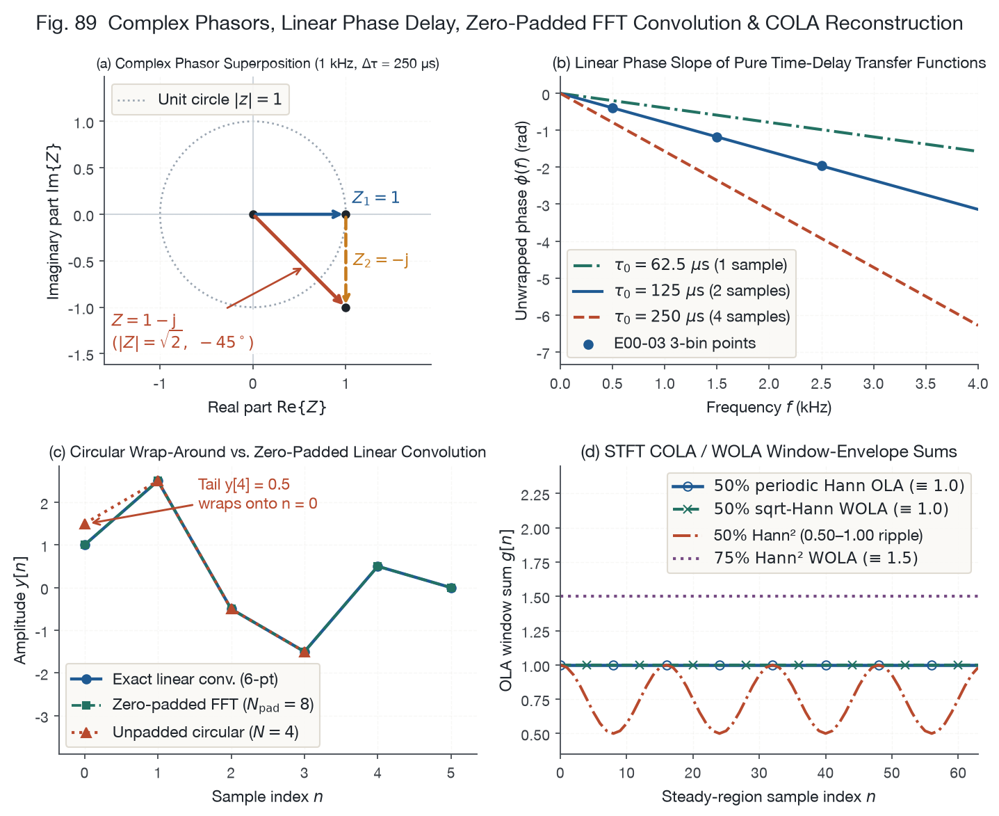
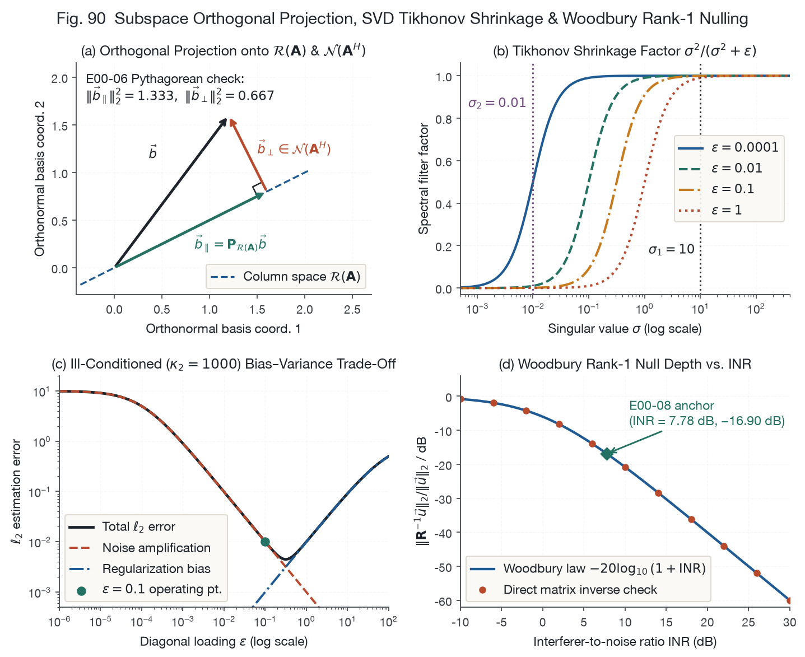
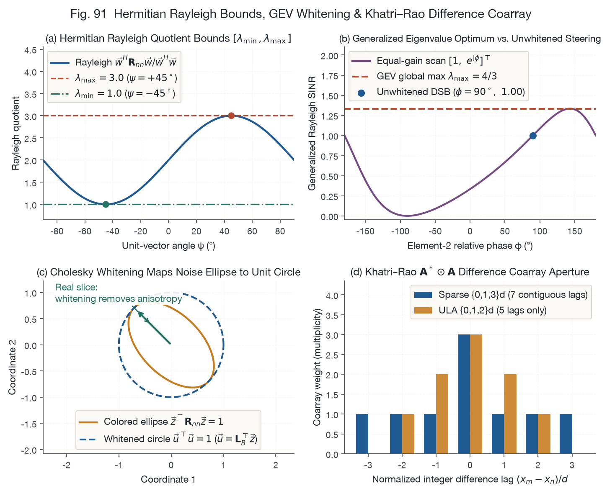
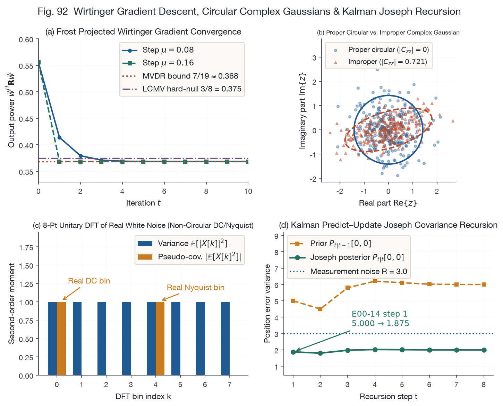

> This is Chapter 0 (of 16 main and special-topic chapters—Chapters 0–15, where Chapters 12–15 are four extended special topics, accompanied by Appendices A and B), systematically deriving and connecting all core mathematical tools, geometric intuition, hand-worked anchor examples, and engineering failure boundaries used throughout Chapters 1–15 and Appendices A–B; readers already familiar with parts of the background may also look up individual derivations on demand via the master index in §0.8.
>
> Overview: [00_overview.md](00_overview.md) | Next: [01_problem-definition.md](01_problem-definition.md)

---

## 0. Mathematical Foundations and Signal Analysis Preliminaries

Modern microphone array signal processing spans three-dimensional spatial geometry, Fourier time-frequency analysis, complex matrix linear algebra, complex-variable calculus, statistical estimation, and spherical harmonic expansions. When newcomers read papers on beamforming, acoustic echo cancellation, or dereverberation, the stumbling block is rarely physical acoustics itself—more often it lies in complex conjugate inner-product conventions, block matrix inversion lemmas, generalized eigenvalue whitening, Wirtinger conjugate derivatives, or circularly symmetric complex Gaussian assumptions invoked midway through a derivation.

This chapter consolidates all prerequisite mathematical machinery needed across Chapters 1–15 and Appendices A–B into a single self-contained derivation chain: each time an operator or theorem is introduced, we first build intuition from an observable geometric or acoustic phenomenon, then carry out the core algebraic derivation without skipping steps, immediately verify it by hand on a small-scale numerical anchor example, and finally pinpoint the engineering boundaries where models degenerate or become numerically ill-conditioned. Every worked example and all sixteen runnable exercises (`E00-01`–`E00-16`) in this chapter are bit-reproducibly backed by the pure-NumPy numerical kernel `codes/chapters/ch00/core/chapter00_math.py` and CLI runner `codes/chapters/ch00/chapter00_exercises.py`.

| Acronym / Symbol | Full Name | Role in This Chapter and Across the Book |
|---|---|---|
| DFT / STFT | Discrete / Short-Time Fourier Transform | Converts discrete time-domain convolution into per-bin complex phasor algebra and narrowband spatial filtering |
| COLA / WOLA | Constant / Weighted Overlap-Add | Necessary and sufficient windowing condition guaranteeing distortionless waveform stitching after framed spectral processing |
| SVD | Singular Value Decomposition | Diagnoses effective rank and $\ell_2$ condition number of propagation matrices, quantifying noise amplification under ill-conditioned inversion |
| GEV / GEVD | Generalized Eigenvalue Problem / Decomposition | Solves for maximum-SINR beamformer weights under spatially colored noise via whitening congruence transforms |
| MVDR / LCMV | Minimum Variance Distortionless Response / Linearly Constrained Minimum Variance | Closed-form solutions to complex linearly constrained quadratic programs for single-direction distortionless pickup and multi-direction nulling |
| NNLS / MM | Non-Negative Least Squares / Majorization–Minimization | Iterative optimization frameworks handling non-negative acoustic source power constraints and non-smooth sparse/reweighted objectives |
| Proper $\mathcal{CN}$ | Circularly Symmetric / Proper Complex Gaussian | Statistical cornerstone of frequency-domain speech and noise modeling, requiring both zero mean and zero pseudo-covariance |
| CRLB | Cramér–Rao Lower Bound | Theoretical minimum-variance floor of any unbiased estimator, characterizing how aperture, bandwidth, and SNR bound localization accuracy |

### 0.1 Trigonometric Identities, 3D Spatial Geometry, and Spherical Coordinate Systems

#### 0.1.1 Sum-to-Product, Product-to-Sum Identities, and Array Spatial Factor

Array signal processing starts from a simple physical fact: *sound from the same source travels slightly different path lengths to differently positioned microphones, and on a narrowband sinusoid a path-length difference manifests as a phase difference*. When summing multiple sinusoids or complex exponentials carrying arithmetic phase progressions, mainlobe width and sidelobe nulls are governed entirely by trigonometric sum-and-difference identities. For arbitrary real angles $\alpha, \beta \in \mathbb{R}$, the angle-addition, sum-to-product, and half-angle identities read:

$$\begin{aligned}
\cos(\alpha \mp \beta) &= \cos\alpha\cos\beta \pm \sin\alpha\sin\beta,\\
\cos\alpha + \cos\beta &= 2\cos\!\left(\frac{\alpha+\beta}{2}\right)\cos\!\left(\frac{\alpha-\beta}{2}\right),\\
1 - \cos\delta &= 2\sin^2\!\left(\frac{\delta}{2}\right).
\end{aligned}\tag{0-1}$$

The half-angle identity on the third line of Eq. (0-1) appears everywhere in array analysis. For instance, when two microphones sum equal-amplitude signals carrying phase offset $\psi$ in phase, the combined squared magnitude is $|1 + e^{-\mathrm{j}\psi}|^2 = (1 + \cos\psi)^2 + \sin^2\psi = 2(1 + \cos\psi) = 4\cos^2(\psi/2)$; switching to anti-phase subtraction to form a first-order differential cardioid or dipole pickup (see the near-field distance bubble in [Chapter 15 §15.3](15_target-extraction-diarization.md#sec-15-3)) immediately turns the squared magnitude into $|1 - e^{-\mathrm{j}\psi}|^2 = 2(1 - \cos\psi) = 4\sin^2(\psi/2)$, letting us read off the null locations $\psi = 2m\pi$ and peak locations $\psi = (2m+1)\pi$ at a glance without expanding tedious complex products.

#### 0.1.2 Planar and Spherical Laws of Cosines, Second-Order Fresnel Expansion, and Far-Field Criterion

To decide whether a talker standing several meters away should be modeled as a spherical wave or a plane wave, we establish the exact geometric distance equation in three-dimensional Euclidean space $\mathbb{R}^3$. Place the reference origin at the array geometric center $\vec 0$, let the sound source sit at position $\vec p = r\vec u$ at range $r = \|\vec p\|_2 > 0$ along the unit source-pointing direction vector $\vec u$ ($\|\vec u\|_2 = 1$), and let the $m$-th microphone sit at $\vec r_m$ with radial offset $\rho_m = \|\vec r_m\|_2$ and direction cosine $\cos\gamma_m = (\vec r_m^\top \vec u)/\rho_m$. Expanding the Euclidean norm of the difference vector gives the exact propagation distance $r_m = \|\vec p - \vec r_m\|_2$:

$$\begin{aligned}
r_m &= \|\,r\vec u - \vec r_m\,\|_2
= \sqrt{(r\vec u - \vec r_m)^\top(r\vec u - \vec r_m)}\\
&= \sqrt{r^2 - 2r\,\vec r_m^\top\vec u + \|\vec r_m\|_2^2}
= r\sqrt{1 - \frac{2\,\vec r_m^\top\vec u}{r} + \frac{\rho_m^2}{r^2}}.
\end{aligned}\tag{0-2}$$

When source range substantially exceeds array size ($\rho_m / r \ll 1$), define the small quantity $\xi = -\frac{2\,\vec r_m^\top\vec u}{r} + \frac{\rho_m^2}{r^2}$ and apply the second-order Taylor expansion $\sqrt{1+\xi} = 1 + \frac{1}{2}\xi - \frac{1}{8}\xi^2 + O(\xi^3)$ around $\xi = 0$. Substituting $\xi$ along with $\xi^2 = \frac{4(\vec r_m^\top\vec u)^2}{r^2} + O(\rho_m^3/r^3)$ and collecting terms up to order $r^{-1}$ yields the **second-order Fresnel path-difference expansion** bridging the far field and near field:

$$\begin{aligned}
\Delta r_m &= r_m - r\\
&= r\Biggl[\frac{1}{2}\left(-\frac{2\,\vec r_m^\top\vec u}{r} + \frac{\rho_m^2}{r^2}\right)\\
&\quad - \frac{1}{8}\cdot\frac{4(\vec r_m^\top\vec u)^2}{r^2} + O\!\left(\frac{\rho_m^3}{r^3}\right)\Biggr]\\
&= \underbrace{-\vec r_m^\top\vec u}_{\text{1st-order far-field plane-wave term }\Delta r_{m,1}}
+ \underbrace{\frac{\|\vec r_m\|_2^2 - (\vec r_m^\top\vec u)^2}{2r}}_{\text{2nd-order spherical curvature term}}
+ O\!\left(\frac{\rho_m^3}{r^2}\right).
\end{aligned}\tag{0-3}$$

For a one-dimensional linear array placed along the $x$-axis with $\vec r_m = [x_m, 0, 0]^\top$ and a horizontal-plane source ($0^\circ$ elevation) at clockwise azimuth $\theta$ from the $+y$ broadside axis, $\vec r_m^\top\vec u = x_m\sin\theta$, so $\|\vec r_m\|_2^2 - (\vec r_m^\top\vec u)^2 = x_m^2(1 - \sin^2\theta) = x_m^2\cos^2\theta$. Equation (0-3) transparently reveals the origin of the Fraunhofer far-field distance $r_{\mathrm{F}} = 2D^2/\lambda$ in [Chapter 2 §2.2](02_basics-signal-model.md#sec-2-2): for total array aperture $D$ with edge sensors at $|x_m| \le D/2$, the second-order curvature path difference peaks at broadside ($\cos\theta = 1$) at $\Delta r_{\mathrm{curv},\max} = \frac{(D/2)^2}{2r} = \frac{D^2}{8r}$. Requiring the maximum spherical-curvature phase error $\frac{2\pi}{\lambda}\Delta r_{\mathrm{curv},\max}$ across the aperture edges not to exceed $\frac{\pi}{8}\ \mathrm{rad}$ ($22.5^\circ$, keeping coherent summation loss below $0.1\ \mathrm{dB}$) gives $\frac{2\pi}{\lambda}\cdot\frac{D^2}{8r} \le \frac{\pi}{8}$; canceling $\pi/8$ from both sides immediately yields $r \ge \frac{2D^2}{\lambda}$.

Furthermore, when computing the spatial subtended angle $\gamma \in [0, \pi]$ directly between two spherical bearing pairs $(\theta_1, \phi_{\mathrm{el},1})$ and $(\theta_2, \phi_{\mathrm{el},2})$, taking the Euclidean dot product of their unit direction vectors yields the **spherical law of cosines**:

$$\cos\gamma = \vec u_1^\top\vec u_2
= \sin\phi_{\mathrm{el},1}\sin\phi_{\mathrm{el},2}
+ \cos\phi_{\mathrm{el},1}\cos\phi_{\mathrm{el},2}\cos(\theta_1 - \theta_2).\tag{0-4}$$

#### 0.1.3 Exact Conversion Bridge Across Four Common Spatial Coordinate Conventions

When cross-reading array papers and open-source codebases, the single most common source of silent directional sign flips is mismatched angular origins and rotation senses. Four three-dimensional coordinate conventions appear across this book:

1. **Right-handed Cartesian coordinates $(x, y, z)$**: The shared 3D Euclidean basis underlying all spherical parameterizations, in which sensor coordinates $\vec r_m$ and source positions $\vec p = r\vec u$ take inner products and norms.
2. **Book planar-array reference frame (default in Chapters 2–13)**: Sensors lie along the $x$-axis, $+y$ points straight ahead toward broadside ($\theta_{\mathrm{book}} = 0^\circ$), horizontal azimuth $\theta_{\mathrm{book}}$ increases **clockwise** from $+y$ toward $+x$, and elevation $\phi_{\mathrm{el}} \in [-90^\circ, +90^\circ]$ is measured upward from the horizontal plane toward $+z$.
3. **Shared-basis spherical-harmonic polar frame ([Chapter 5 §5.8](05_beamforming.md#sec-5-8) and §0.7)**: Sharing the exact same Cartesian axes $(x, y, z)$ as items 1 and 2, this convention measures horizontal azimuth $\alpha \in (-\pi, \pi]$ **counterclockwise** from $+x$ toward $+y$, and polar angle (colatitude) $\vartheta \in [0, \pi]$ downward from the $+z$ zenith.
4. **Listener-centric Ambisonic AmbiX and AES69 (`SOFA`) frame ([Chapter 1 SOFA Coordinate Comparison](01_problem-definition.md#sec-u-fc1c3d209e) and [Chapter 14 §14.2](14_spatial-wearable-arrays.md#sec-14-2))**: Listener front is $+x_{\mathrm{A}}$, listener left is $+y_{\mathrm{A}}$, and listener up is $+z_{\mathrm{A}}$, with horizontal azimuth measured **counterclockwise** from front toward left and elevation positive upward from the horizontal plane (note carefully: the AES69 / SOFA standard denotes **horizontal azimuth** by $\phi_{\mathrm{SOFA}}$ and elevation by $\delta_{\mathrm{SOFA}}$—never confuse $\phi_{\mathrm{SOFA}}$ with this book's elevation symbol $\phi_{\mathrm{el}}$!). Aligning listener front with our $+y$ broadside axis gives $\phi_{\mathrm{SOFA}} = -\theta_{\mathrm{book}}$; comparing counterclockwise angles $(\alpha, \phi_{\mathrm{el}}, r)$ directly against book angles $(\theta_{\mathrm{book}}, \phi_{\mathrm{el}}, r)$ on the shared Cartesian axes $(x, y, z)$ obeys the exact conversion bridge:

$$\begin{aligned}
\alpha &= 90^\circ - \theta_{\mathrm{book}}\pmod{360^\circ}\text{ (wrapped to }(-180^\circ, 180^\circ]\text{)},\qquad
\vartheta = 90^\circ - \phi_{\mathrm{el}},\\
\vec u &= \begin{bmatrix}
\cos\phi_{\mathrm{el}}\sin\theta_{\mathrm{book}}\\
\cos\phi_{\mathrm{el}}\cos\theta_{\mathrm{book}}\\
\sin\phi_{\mathrm{el}}
\end{bmatrix}
= \begin{bmatrix}
\sin\vartheta\cos\alpha\\
\sin\vartheta\sin\alpha\\
\cos\vartheta
\end{bmatrix},\qquad
\vec p = r\vec u.
\end{aligned}\tag{0-5}$$

Inverting Cartesian coordinates $\vec p = [x, y, z]^\top \neq \vec 0$ back to spherical parameters proceeds by computing range $r = \sqrt{x^2+y^2+z^2}$ and elevation $\phi_{\mathrm{el}} = \arcsin(z/r)$ first, followed by two-argument four-quadrant arctangent $\theta_{\mathrm{book}} = \operatorname{atan2}(x, y)$ (note carefully that $\theta_{\mathrm{book}}$ passes $x$ as numerator and $y$ as denominator, whereas counterclockwise azimuth $\alpha = \operatorname{atan2}(y, x)$ passes $y$ first and $x$ second; at the zenith/nadir poles $|z| = r$, horizontal projection vanishes and azimuth is undefined).

**Worked Anchor 0-1 (Coordinate Bridge and Near-Field Fresnel Path-Difference Verification, matching `E00-01`).**

- **(1) 3D coordinate bridge and spherical orthogonality**: Given book spherical coordinates $\theta_{\mathrm{book}} = 30^\circ$, $\phi_{\mathrm{el}} = 45^\circ$, and range $r = 1.5\ \mathrm{m}$, Eq. (0-5) yields counterclockwise azimuth $\alpha = 90^\circ - 30^\circ = 60^\circ$ and colatitude $\vartheta = 90^\circ - 45^\circ = 45^\circ$. Since $\sin 30^\circ = 1/2$, $\cos 30^\circ = \sqrt{3}/2$, and $\sin 45^\circ = \cos 45^\circ = \sqrt{2}/2$, the unit direction vector $\vec u$ equals $[\frac{\sqrt{2}}{4}, \frac{\sqrt{6}}{4}, \frac{\sqrt{2}}{2}]^\top$ ($\approx [0.353553, 0.612372, 0.707107]^\top$), and the 3D Cartesian position $\vec p = 1.5\vec u$ equals $[\frac{3\sqrt{2}}{8}, \frac{3\sqrt{6}}{8}, \frac{3\sqrt{2}}{4}]^\top\ \mathrm{m}$ ($\approx [0.530330, 0.918559, 1.060660]^\top\ \mathrm{m}$). Taking a second horizontal direction $(\theta_2, \phi_{\mathrm{el},2}) = (-60^\circ, 0^\circ)$, since $\theta_1 - \theta_2 = 90^\circ$, Eq. (0-4) immediately yields $\cos\gamma = 0 + \cos 45^\circ \cdot 1 \cdot \cos 90^\circ = 0$, confirming exact orthogonality ($\gamma = 90^\circ$).
- **(2) Near-field Fresnel path difference and phase error**: With sound speed $c = 343\ \mathrm{m/s}$, frequency $f = 3430\ \mathrm{Hz}$ (wavelength $\lambda = 0.10\ \mathrm{m}$), and linear aperture $D = 0.20\ \mathrm{m}$, the Fraunhofer far-field boundary sits at $r_{\mathrm{F}} = 2(0.20)^2 / 0.10 = 0.80\ \mathrm{m}$. For a near-field source at $r = 0.50\ \mathrm{m} < r_{\mathrm{F}}$ and bearing $\theta = 30^\circ$ reaching the right-hand edge sensor $x_m = +0.10\ \mathrm{m}$, Eq. (0-2) gives the exact distance $r_m = \sqrt{0.25 - 2(0.50)(0.10)(0.5) + 0.01} = \sqrt{0.21} \approx 0.458258\ \mathrm{m}$ and exact path difference $\Delta r_{\mathrm{exact}} = \sqrt{0.21} - 0.50 \approx -0.041742\ \mathrm{m}$. The first-order plane-wave approximation gives $\Delta r_1 = -0.10\sin 30^\circ = -0.050000\ \mathrm{m}$—a path error of $8.258\ \mathrm{mm}$, corresponding to a $29.73^\circ$ phase error (violating the $22.5^\circ$ far-field tolerance). Switching to the second-order Fresnel expansion in Eq. (0-3), $\Delta r_2 = -0.05 + \frac{0.01 \times 0.75}{2 \times 0.50} = -0.042500\ \mathrm{m}$, slashes residual path error down to $0.758\ \mathrm{mm}$ (a phase error of just $2.73^\circ$, nearly an $11\times$ accuracy improvement).

**What does this example show?** Once a talker steps inside half a meter, the plane-wave model incurs nearly $30^\circ$ of systematic phase mismatch, whereas the second-order Fresnel spherical-curvature term not only corrects this bias, but also supplies the physical wavefront curvature exploited by near-field distance bubbles in Chapter 15 to separate near from far talkers. **When does this conclusion fail?** When a source moves so close that $|x_m|/r \to 1$ (comparable to the aperture itself), higher-order Taylor remainder terms are no longer negligible, and one must evaluate the exact Euclidean square root in Eq. (0-2) without polynomial truncation.

#### 0.1.4 3D Orthogonal Rotation Group $\mathrm{SO}(3)$ Composition, Non-Commutativity, and Active/Passive Inverse Mapping

In moving-array tracking ([Chapter 9 §9.4](09_source-tracking.md#sec-9-4)) and head-tracked wearable spatial rendering ([Chapter 14 §14.3](14_spatial-wearable-arrays.md#sec-14-3)), rigid-body attitude rotations are governed by the three-dimensional special orthogonal group $\mathrm{SO}(3) \subset \mathbb{R}^{3\times 3}$ satisfying orthogonality $\mathbf R^\top\mathbf R = \mathbf I_3$ and right-handed orientation preservation $\det\mathbf R = +1$. Under a right-handed frame, elementary rotations about $+z$ (yaw), $+y$ (pitch), and $+x$ (roll) are:

$$\begin{aligned}
\mathbf R_z(\alpha) &= \begin{bmatrix}
\cos\alpha & -\sin\alpha & 0\\
\sin\alpha & \cos\alpha & 0\\
0 & 0 & 1
\end{bmatrix},\\
\mathbf R_y(\beta) &= \begin{bmatrix}
\cos\beta & 0 & \sin\beta\\
0 & 1 & 0\\
-\sin\beta & 0 & \cos\beta
\end{bmatrix},\\
\mathbf R_x(\gamma) &= \begin{bmatrix}
1 & 0 & 0\\
0 & \cos\gamma & -\sin\gamma\\
0 & \sin\gamma & \cos\gamma
\end{bmatrix}.
\end{aligned}\tag{0-6}$$

Orthogonality $\mathbf R^\top\mathbf R = \mathbf I_3$ carries two foundational corollaries: first, rotations strictly preserve Euclidean inner products and vector norms, $\|\mathbf R\vec v\|_2^2 = \vec v^\top\mathbf R^\top\mathbf R\vec v = \|\vec v\|_2^2$; second, matrix inversion requires zero Gaussian elimination, $\mathbf R^{-1} = \mathbf R^\top$. In engineering code, two pitfalls must be guarded against: first, **finite 3D rotations do not commute** (as verified in `E00-02`, rotating $[1, 0, 0]^\top$ by $90^\circ$ about $y$ then $90^\circ$ about $z$ maps it to $[0, 0, -1]^\top$, whereas reversing the order maps it to $[0, 1, 0]^\top$, with commutator Frobenius norm $\|\mathbf R_z\mathbf R_y - \mathbf R_y\mathbf R_z\|_F = \sqrt{6} \approx 2.4495$); second, **active source rotation and passive listener-frame rotation are transpose inverses of each other**—if a listener's head rotates relative to the world frame by $\mathbf R_{\mathrm{head}}$, a world-fixed source at $\vec v_{\mathrm{world}}$ appears in the head-local frame at $\mathbf R_{\mathrm{head}}^\top\vec v_{\mathrm{world}}$; omitting the transpose swings virtual acoustic images twice as far in the wrong direction.

---

### 0.2 Complex Phasors, Decibel Scales, and Fourier Time-Frequency Analysis

#### 0.2.1 Euler's Formula, Positive/Negative Frequency Conjugate Pairs, and Fourier Kernel Convention

Expanding delayed and filtered real sinusoids directly via trigonometric identities quickly becomes unwieldy; introducing the imaginary unit $\mathrm{j} = \sqrt{-1}$ and Euler's formula $e^{\mathrm{j}\phi} = \cos\phi + \mathrm{j}\sin\phi$ turns *time translation* into *complex multiplication*. For any complex scalar $z = a + \mathrm{j}b = |z|e^{\mathrm{j}\phi} \in \mathbb{C}$, its squared modulus is $|z|^2 = zz^* = a^2 + b^2$, and a real sinusoid $\cos(2\pi f_0 t + \varphi)$ decomposes into the sum of counter-rotating conjugate phasors $\frac{1}{2}e^{\mathrm{j}\varphi}e^{+\mathrm{j}2\pi f_0 t}$ and $\frac{1}{2}e^{-\mathrm{j}\varphi}e^{-\mathrm{j}2\pi f_0 t}$.

Throughout this book we uniformly adopt the **forward Fourier kernel $e^{-\mathrm{j}2\pi f t}$** (paired with inverse synthesis kernel $e^{+\mathrm{j}2\pi f t}$). Under this convention, delaying a continuous waveform $x(t)$ by propagation lag $\tau_0 > 0$ into $y(t) = x(t - \tau_0)$ and substituting $u = t - \tau_0$ ($\mathrm{d}t = \mathrm{d}u$) gives:

$$\begin{aligned}
Y(f) &= \int_{-\infty}^{\infty} x(t - \tau_0)\,e^{-\mathrm{j}2\pi f t}\,\mathrm{d}t
= \int_{-\infty}^{\infty} x(u)\,e^{-\mathrm{j}2\pi f(u + \tau_0)}\,\mathrm{d}u\\
&= e^{-\mathrm{j}2\pi f\tau_0}\int_{-\infty}^{\infty} x(u)\,e^{-\mathrm{j}2\pi f u}\,\mathrm{d}u
= e^{-\mathrm{j}2\pi f\tau_0}\,X(f).
\end{aligned}\tag{0-7}$$

Equation (0-7) establishes the single most important physical mapping in array signal processing: **a delayed arrival $\tau_0 > 0$ induces a negative phase lag $\phi(f) = -2\pi f\tau_0$ at positive frequencies $f > 0$**, where the unwrapped phase forms an exact straight line through the origin against frequency $f$ whose negative slope divided by $2\pi$ recovers group delay $\tau_g = -\frac{1}{2\pi}\frac{\mathrm{d}\phi(f)}{\mathrm{d}f} = \tau_0$ (see [Chapter 2 §2.3](02_basics-signal-model.md#sec-2-3) and GCC-PHAT in [Chapter 4 §4.2](04_doa-estimation.md#sec-4-2)). Simultaneously, because a real signal satisfies $x(t) = x^*(t)$, its spectrum obeys Hermitian conjugate symmetry $X(-f) = X^*(f)$: the negative-frequency phasor $e^{-\mathrm{j}2\pi(-f)\tau_0} = e^{+\mathrm{j}2\pi f\tau_0}$ automatically flips sign, pairing with positive frequencies so inverse synthesis remains strictly real-valued.

#### 0.2.2 Power Decibels $10\log_{10}$, Amplitude Decibels $20\log_{10}$, and Block-Averaging Pitfalls

Because acoustic pressures and electronic signals span many orders of magnitude, engineering universally expresses relative ratios in base-$10$ logarithmic decibels ($\mathrm{dB}$). A decibel is *always* anchored to a **ratio of powers (or energies, mean squares, or variances)**; if and only if two quantities measured across identical impedance or normalization satisfy power proportionality to squared amplitude ($P \propto |A|^2$), the logarithmic exponent rule $\log_{10}(|A_2/A_1|^2) = 2\log_{10}(|A_2|/|A_1|)$ turns the leading factor from $10$ into $20$:

$$\Delta L_{\mathrm{dB}} = 10\log_{10}\!\left(\frac{P_2}{P_1}\right)
= 10\log_{10}\!\left(\frac{|A_2|^2}{|A_1|^2}\right)
= 20\log_{10}\!\left(\frac{|A_2|}{|A_1|}\right).\tag{0-8}$$

Equation (0-8) immediately settles the array-gain ledger in [Chapter 1](01_problem-definition.md): suppose $M = 4$ microphones carry time-aligned unit-amplitude target speech; summing them coherently quadruples target amplitude (multiplying power by $4^2 = 16$), so target gain computed via amplitude $20\log_{10}(4) \approx +12.04\ \mathrm{dB}$ matches power $10\log_{10}(16) \approx +12.04\ \mathrm{dB}$ identically. By contrast, summing four mutually uncorrelated white-noise processes each of variance $\sigma^2$ **adds variances linearly to $4\sigma^2$** (multiplying RMS amplitude by only $\sqrt{4} = 2$), giving a noise gain of $10\log_{10}(4) = 20\log_{10}(2) \approx +6.02\ \mathrm{dB}$—whose difference yields the net 4-mic white-noise SNR gain of $+6.02\ \mathrm{dB}$.

When evaluating multi-frame speech SNR or Echo Return Loss Enhancement (ERLE; see [Chapter 6 §6.7](06_aec.md#sec-6-7)), beware also of the **Jensen's-inequality ordering discrepancy** caused by concavity of the logarithm: given positive block power ratios $\{r_b\}_{b=1}^B$, converting each block to $\mathrm{dB}$ first and taking the arithmetic mean computes the decibel of the *geometric mean*, $\frac{1}{B}\sum_b 10\log_{10} r_b = 10\log_{10}(\prod_b r_b)^{1/B}$, which is strictly less than or equal to pooling average power first and taking $\mathrm{dB}$ once, $10\log_{10}(\frac{1}{B}\sum_b r_b)$. For instance, across two equal-length blocks with power ratios $1$ ($0\ \mathrm{dB}$) and $99$ ($19.96\ \mathrm{dB}$), the frame-wise mean $\mathrm{dB}$ is only $+9.98\ \mathrm{dB}$, whereas the pooled energy ratio in $\mathrm{dB}$ is $10\log_{10}(50) \approx +16.99\ \mathrm{dB}$—a gap exceeding $7\ \mathrm{dB}$ (`E00-03`).

#### 0.2.3 Discrete Fourier Transform (DFT), Parseval's Theorem, and Zero-Padded Linear Convolution Equivalence

For a finite-length $N$-point sequence $x[0], \ldots, x[N-1]$, the standard forward DFT and inverse IDFT are defined by:

$$\begin{aligned}
X[k] &= \sum_{n=0}^{N-1} x[n]\,e^{-\mathrm{j}\frac{2\pi}{N}kn}\qquad(0 \le k < N),\\
x[n] &= \frac{1}{N}\sum_{k=0}^{N-1} X[k]\,e^{+\mathrm{j}\frac{2\pi}{N}kn}\qquad(0 \le n < N).
\end{aligned}\tag{0-9}$$

Proving **Parseval's energy-conservation theorem** requires only root-of-unity orthogonality $\sum_{k=0}^{N-1} e^{-\mathrm{j}\frac{2\pi}{N}k(n-m)} = N\delta[n-m]$ (summing $N$ ones when $n=m$, and vanishing identically when $n\neq m$ via geometric-series numerator $1 - e^{-\mathrm{j}2\pi(n-m)} = 0$). Expanding the frequency-domain sum of squared magnitudes and interchanging finite summations gives:

$$\begin{aligned}
\frac{1}{N}\sum_{k=0}^{N-1}\lvert X[k]\rvert^2
&= \frac{1}{N}\sum_{k=0}^{N-1}\left(\sum_{n=0}^{N-1}x[n]e^{-\mathrm{j}\frac{2\pi}{N}kn}\right)
\left(\sum_{m=0}^{N-1}x^*[m]e^{+\mathrm{j}\frac{2\pi}{N}km}\right)\\
&= \sum_{n=0}^{N-1}\sum_{m=0}^{N-1}x[n]x^*[m]
\underbrace{\left(\frac{1}{N}\sum_{k=0}^{N-1}e^{-\mathrm{j}\frac{2\pi}{N}k(n-m)}\right)}_{\delta[n-m]}
= \sum_{n=0}^{N-1}\lvert x[n]\rvert^2.
\end{aligned}\tag{0-10}$$

When we multiply two $N$-point DFTs bin-by-bin as $Y_{\mathrm{circ}}[k] = X[k]H[k]$ and take an $N$-point IDFT, modulo-$N$ periodicity of the roots of unity yields **modulo-$N$ circular convolution** in the time domain rather than causal physical **linear convolution**. If input frame $x[n]$ has support length $L_x$ and filter $h[n]$ has support length $L_h$, full linear convolution $y_{\mathrm{lin}}[n] = \sum_{m=0}^{L_h-1} h[m]x[n-m]$ spans $L_{\mathrm{lin}} = L_x + L_h - 1$ samples. Taking $N = L_x$ without zero-padding folds the $L_h - 1$ tail samples at $n \ge N$ back onto the leading samples $n = 0, \ldots, L_h - 2$ modulo $N$, causing time-domain wrap-around aliasing (see [Appendix A §16.3.3](16_appendix-symbols-math.md#sec-16-3-3) and overlap-save block frequency-domain adaptive filtering in [Chapter 6 §6.2.1](06_aec.md#sec-6-2-1)). Eliminating wrap-around aliasing requires and suffices to zero-pad both sequences prior to transformation up to length $N_{\mathrm{pad}}$ satisfying:

$$\begin{aligned}
N_{\mathrm{pad}} &\ge L_x + L_h - 1\\
\Longrightarrow\quad
\operatorname{IDFT}_{N_{\mathrm{pad}}}\!\bigl\{X_{\mathrm{pad}}[k]\,H_{\mathrm{pad}}[k]\bigr\}[n]
&= (x * h)[n]\quad(0 \le n < L_x + L_h - 1).
\end{aligned}\tag{0-11}$$

**Worked Anchor 0-2 (Parseval Energy and Circular Wrap-Around Aliasing Verification, matching `E00-04`).**

Take $L_x = 4$-sample input $x = [1, 2, -1, 0]^\top$ and $L_h = 3$-tap impulse response $h = [1, 0.5, -0.5]^\top$. Time-domain energy is $1^2 + 2^2 + (-1)^2 + 0^2 = 6$; evaluating the $4$-point DFT by hand via Eq. (0-9) (with twiddle factor $e^{-\mathrm{j}\pi/2} = -\mathrm{j}$) gives $X[0] = 2$, $X[1] = 1 + 2(-\mathrm{j}) + (-1)(-1) = 2 - \mathrm{j}2$, $X[2] = 1 - 2 - 1 = -2$, and $X[3] = 2 + \mathrm{j}2$, whose frequency-domain energy $\frac{1}{4}(4 + 8 + 4 + 8) = 6$ matches Eq. (0-10) identically.

Next, full $L_{\mathrm{lin}} = 4 + 3 - 1 = 6$-point linear convolution evaluates to $y_{\mathrm{lin}} = [1.0, 2.5, -0.5, -1.5, 0.5, 0.0]^\top$. Multiplying unpadded $N = 4$-point FFTs folds the tail sample $+0.5$ at $n = 4$ onto $n = 4 \bmod 4 = 0$, corrupting the initial sample from $1.0$ to $1.5$ ($\ell_2$ error $0.5$); zero-padding to $N_{\mathrm{pad}} = 8 \ge 6$ restores all $6$ samples to exact ground truth (floating-point error $< 10^{-16}$).

#### 0.2.4 Short-Time Fourier Transform (STFT) Spectral Leakage and COLA / WOLA Perfect Reconstruction

Because speech and ambient sounds are non-stationary, practical front ends slice long waveforms into overlapping frames via a sliding analysis window $w_a[n]$ of length $N$ and hop size $H$, computing per-frame spectra $X(\ell, k) = \sum_{r=0}^{N-1} x[\ell H + r]w_a[r]e^{-\mathrm{j}2\pi kr/N}$ (throughout the main prose we place **time-frame index $\ell$ first and frequency-bin index $k$ second**; from Chapter 2 onward, where unambiguous, we also abbreviate frame and frequency indices as $(t, f)$ in $X_m(t, f)$, whereas 2D arrays in software libraries often store $F\times T$ "frequency-major, time-minor"—always verify axis ordering at API boundaries). When unmodified spectra undergo inverse DFT, multiplication by synthesis window $w_s[r]$, and overlap-add accumulation at hop $H$, sample $n$ accumulates $\hat x[n] = \sum_{\ell} x[n]\,w_a[n - \ell H]w_s[n - \ell H]$. Over the interior interval fully covered by overlapping frames, exact distortionless waveform reconstruction ($\hat x[n] = x[n]$) holds if and only if the **Constant / Weighted Overlap-Add (COLA / WOLA) condition** is satisfied:

$$g[n] \triangleq \sum_{\ell \in \mathbb{Z}} w_a[n - \ell H]\,w_s[n - \ell H] = 1\qquad(\forall\,n \in \mathbb{Z}).\tag{0-12}$$

Inspect the **periodic (DFT-even) Hann window** used across this book, $w_{\mathrm{Hann}}[r] = \frac{1}{2}\bigl(1 - \cos\frac{2\pi r}{N}\bigr)$ for $0 \le r < N$ (note denominator $N$, rather than $N-1$ used in symmetric FIR filter design). At $50\%$ overlap ($H = N/2$), exactly two adjacent frames at local offsets $r$ and $r + N/2$ overlap at every sample; because $\cos\bigl(\frac{2\pi(r+N/2)}{N}\bigr) = \cos(\frac{2\pi r}{N} + \pi) = -\cos\frac{2\pi r}{N}$, the cosine terms cancel identically:

$$\begin{aligned}
w_{\mathrm{Hann}}[r] + w_{\mathrm{Hann}}\!\left[r + \frac{N}{2}\right]
&= \frac{1}{2}\left(1 - \cos\frac{2\pi r}{N}\right)
+ \frac{1}{2}\left(1 + \cos\frac{2\pi r}{N}\right)\\
&= 1.
\end{aligned}\tag{0-13}$$

Equation (0-13) simultaneously validates two industrial-standard window pairings: (1) periodic Hann analysis $w_a = w_{\mathrm{Hann}}$ paired with rectangular synthesis $w_s = 1$ (pure OLA); and (2) symmetric **square-root Hann windows** $w_a = w_s = \sqrt{w_{\mathrm{Hann}}}$ on both analysis and synthesis (WOLA—suppressing frame-edge truncation artifacts after spectral masking while keeping the product $w_a w_s = w_{\mathrm{Hann}}$ summing identically to $1$ at $50\%$ overlap). Conversely, mistakenly applying full Hann windows on *both* analysis and synthesis at $50\%$ overlap without denominator normalization turns the overlap gain $w_{\mathrm{Hann}}^2[r] + w_{\mathrm{Hann}}^2[r+N/2]$ into $\frac{3}{4} + \frac{1}{4}\cos\frac{4\pi r}{N} \in [0.50, 1.00]$, imprinting up to $6.02\ \mathrm{dB}$ of periodic amplitude tremolo onto the output (using dual full Hann windows with a flat denominator requires raising overlap to $75\%$, i.e., $H = N/4$, where the constant sum equals $1.5$ and dividing by $1.5$ restores exact reconstruction; see `E00-05`).



When reading Figure 89, trace the four core time-frequency results of §0.2 across panels (a)–(d):

- **Panel (a) Complex-plane phasor addition**: At $f = 1\ \mathrm{kHz}$, the direct-path unit phasor $Z_1 = 1$ (solid blue arrow) adds tip-to-tail with a second path lagging by $\Delta\tau = 250\ \mu\mathrm{s}$ (exactly a quarter period, phase shift $-\pi/2$), $Z_2 = -\mathrm{j}$ (dashed orange arrow), forming resultant phasor $Z = 1 - \mathrm{j}$ (red arrow) of magnitude $\sqrt{2} \approx 1.414$ and phase lag $-45^\circ$.
- **Panel (b) Linear phase slope of pure-delay transfer functions**: Plotting unwrapped phase $\phi(f)$ ($\mathrm{rad}$) against frequency $f \in [0, 4]\ \mathrm{kHz}$ at $16\ \mathrm{kHz}$ sampling rate, delays of $1, 2, 4$ samples ($62.5, 125, 250\ \mu\mathrm{s}$) form three straight lines of negative slope through the origin—larger delays tilt downward more steeply with frequency.
- **Panel (c) Circular wrap-around vs. zero-padded linear convolution**: Solid blue circles show exact $6$-sample time-domain linear convolution, overlaid sample-for-sample by dashed green squares from an $N_{\mathrm{pad}} = 8$ zero-padded FFT product; dotted red triangles show unpadded $N = 4$ circular convolution folding $y[4] = 0.5$ onto $n = 0$ to produce an aliased $1.5$.
- **Panel (d) STFT overlap-add synthesis denominator envelopes**: Across interior samples, $50\%$-overlap periodic-Hann OLA (solid blue) and sqrt-Hann WOLA (dashed green) stay flat at $1.0$; $75\%$-overlap squared Hann (dotted purple) stays flat at $1.5$; only unnormalized $50\%$-overlap squared Hann (dash-dotted red) oscillates severely between $0.50$ and $1.00$.

---

### 0.3 Complex Inner-Product Spaces, Subspace Orthogonal Projections, SVD, and Block Matrix Inversion

#### 0.3.1 Complex Vector Hermitian Inner Product, Norms, and the Cauchy–Schwarz Inequality

In narrowband multichannel frequency-domain processing, complex phasors across $M$ microphones at a single bin stack into column vector $\vec x \in \mathbb{C}^{M\times 1}$. Complex Euclidean space $\mathbb{C}^M$ differs fundamentally from real space $\mathbb{R}^M$ in one non-negotiable rule: **the inner product must complex-conjugate one of its two arguments**, otherwise a vector's inner product with itself $z^2$ could be negative or imaginary, forfeiting well-defined length and energy. Throughout this book we define linear beamformer output as the conjugate inner product $y = \vec w^H \vec x = \sum_{m=1}^M w_m^* x_m$, paired with squared $\ell_2$ norm $\|\vec x\|_2^2 = \vec x^H \vec x = \sum_{m=1}^M |x_m|^2 \ge 0$. For arbitrary $\vec u, \vec v \in \mathbb{C}^M$, the **Cauchy–Schwarz inequality** states:

$$\lvert\vec u^H \vec v\rvert^2 \le (\vec u^H \vec u)(\vec v^H \vec v) = \|\vec u\|_2^2\,\|\vec v\|_2^2,\tag{0-14}$$

with equality if and only if $\vec u$ and $\vec v$ are complex collinear ($\vec u = \alpha\vec v$ for some $\alpha \in \mathbb{C}$, or one vector vanishes). *Proof*: If $\vec v = \vec 0$, both sides vanish; if $\vec v \neq \vec 0$, form residual $\vec r = \vec u - \alpha\vec v$ with optimal projection scalar $\alpha = \frac{\vec v^H\vec u}{\vec v^H\vec v}$. Expanding the non-negative squared norm $\|\vec u - \alpha\vec v\|_2^2$ gives $\vec u^H\vec u - \alpha\vec u^H\vec v - \alpha^*\vec v^H\vec u + |\alpha|^2\vec v^H\vec v = \|\vec u\|_2^2 - \frac{|\vec u^H\vec v|^2}{\|\vec v\|_2^2} \ge 0$; rearranging and multiplying by $\|\vec v\|_2^2$ proves Eq. (0-14), with equality solely when $\vec r = \vec 0$ ($\vec u = \alpha\vec v$). This equality condition furnishes an immediate geometric proof that matched filtering (delay-and-sum beamforming $\vec w \propto \vec a$; [Chapter 5 §5.2](05_beamforming.md#sec-5-2)) maximizes White Noise Gain under spatially white noise.

#### 0.3.2 The Four Fundamental Subspaces and Complex Column-Space Orthogonal Projectors

Let $\mathbf A \in \mathbb{C}^{M\times K}$ be a complex matrix (for instance, an array manifold matrix of $K$ interferers with $M \ge K$ and rank $r = \operatorname{rank}(\mathbf A)$). The Fundamental Theorem of Linear Algebra partitions domain $\mathbb{C}^K$ and codomain $\mathbb{C}^M$ into two orthogonal-complement subspace pairs (note that complex spaces *must* use conjugate transpose $\mathbf A^H$, never plain transpose $\mathbf A^\top$):

| Fundamental Subspace | Mathematical Definition | Ambient Space & Dimension | Typical Physical Meaning in Array Processing |
|---|---|---|---|
| Column space $\mathcal R(\mathbf A)$ | $\{\mathbf A\vec z : \vec z \in \mathbb{C}^K\}$ | $\mathbb{C}^M$, dim $r$ | Signal (or known-interferer) subspace spanned by $K$ steering vectors |
| Left nullspace $\mathcal N(\mathbf A^H)$ | $\{\vec y \in \mathbb{C}^M : \mathbf A^H\vec y = \vec 0\}$ | $\mathbb{C}^M$, dim $M - r$ | MUSIC noise subspace or GSC blocking subspace orthogonal to $\mathcal R(\mathbf A)$ |
| Row (conjugate) space $\mathcal R(\mathbf A^H)$ | $\{\mathbf A^H\vec y : \vec y \in \mathbb{C}^M\}$ | $\mathbb{C}^K$, dim $r$ | Space of source-amplitude combinations uniquely identifiable from sensor data |
| Nullspace $\mathcal N(\mathbf A)$ | $\{\vec z \in \mathbb{C}^K : \mathbf A\vec z = \vec 0\}$ | $\mathbb{C}^K$, dim $K - r$ | Ambiguous source subspace to which the array is completely blind (aliasing / duplicate columns) |

When $\mathbf A$ has full column rank ($r = K$), finding the closest approximation $\vec b_\parallel = \mathbf A\hat{\vec z}$ inside $\mathcal R(\mathbf A)$ to any observation $\vec b \in \mathbb{C}^M$ requires forcing residual $\vec b_\perp = \vec b - \mathbf A\hat{\vec z}$ into the left nullspace $\mathcal N(\mathbf A^H)$, giving the complex normal equations $\mathbf A^H(\vec b - \mathbf A\hat{\vec z}) = \vec 0$. Because Gram matrix $\mathbf A^H\mathbf A \in \mathbb{C}^{K\times K}$ is strictly positive definite, solving $\hat{\vec z} = (\mathbf A^H\mathbf A)^{-1}\mathbf A^H\vec b$ and left-multiplying by $\mathbf A$ yields the orthogonal projector onto $\mathcal R(\mathbf A)$ and its orthogonal-complement projector onto $\mathcal N(\mathbf A^H)$:

$$\begin{aligned}
\mathbf P_{\mathcal R(\mathbf A)} &= \mathbf A(\mathbf A^H\mathbf A)^{-1}\mathbf A^H,\\
\mathbf P_{\mathcal R(\mathbf A)}^\perp &= \mathbf I_M - \mathbf P_{\mathcal R(\mathbf A)}.
\end{aligned}\tag{0-15}$$

Every valid orthogonal projector $\mathbf P$ carries two algebraic fingerprints: **Hermitian symmetry** $\mathbf P^H = \mathbf P$ and **idempotence** $\mathbf P^2 = \mathbf P$ (projecting twice equals projecting once), restricting its eigenvalues exclusively to $\{0, 1\}$, while cyclic trace invariance gives $\operatorname{tr}(\mathbf P_{\mathcal R(\mathbf A)}) = \operatorname{tr}\bigl((\mathbf A^H\mathbf A)^{-1}\mathbf A^H\mathbf A\bigr) = \operatorname{tr}(\mathbf I_K) = K$, matching subspace dimension identically. Evaluating $\vec b_\parallel^H\vec b_\perp = \vec b^H\mathbf P^H(\mathbf I_M - \mathbf P)\vec b = \vec b^H(\mathbf P - \mathbf P^2)\vec b = 0$ immediately establishes the complex Pythagorean theorem $\|\vec b\|_2^2 = \|\vec b_\parallel\|_2^2 + \|\vec b_\perp\|_2^2$. Both MUSIC spatial spectra ([Chapter 4 §4.6](04_doa-estimation.md#sec-4-6)) and Generalized Sidelobe Canceller (GSC) blocking matrices ([Chapter 5 §5.6](05_beamforming.md#sec-5-6)) rely on $\mathbf P_{\mathcal R(\mathbf A)}^\perp$ to null out target or known-interferer subspaces exactly.

**Worked Anchor 0-3 (Complex Column-Space Projection and Pythagorean Decomposition, matching `E00-06`).**

Take full-column-rank $\mathbf A \in \mathbb{C}^{3\times 2}$ with columns $[1, \mathrm{j}, 0]^\top$ and $[0, 1, -\mathrm{j}]^\top$, and observation $\vec b = [1, 0, \mathrm{j}]^\top$ ($\|\vec b\|_2^2 = 2$). Writing out conjugate transpose $\mathbf A^H = \begin{bmatrix}1 & -\mathrm{j} & 0\\ 0 & 1 & \mathrm{j}\end{bmatrix}$ (taking care to conjugate $-\mathrm{j}$ into $+\mathrm{j}$ in column 3), compute the Gram matrix, inverse, least-squares coordinates, and orthogonal components step by step:

$$\begin{aligned}
\mathbf A^H\mathbf A &= \begin{bmatrix}2 & -\mathrm{j}\\ \mathrm{j} & 2\end{bmatrix}\quad(\det = 3),\qquad
(\mathbf A^H\mathbf A)^{-1} = \frac{1}{3}\begin{bmatrix}2 & \mathrm{j}\\ -\mathrm{j} & 2\end{bmatrix},\\
\hat{\vec z} &= (\mathbf A^H\mathbf A)^{-1}\mathbf A^H\vec b
= \frac{1}{3}\begin{bmatrix}2 & \mathrm{j}\\ -\mathrm{j} & 2\end{bmatrix}\begin{bmatrix}1\\ -1\end{bmatrix}
= \frac{1}{3}\begin{bmatrix}2 - \mathrm{j}\\ -2 - \mathrm{j}\end{bmatrix},\\
\vec b_\parallel &= \mathbf A\hat{\vec z} = \frac{1}{3}\begin{bmatrix}2 - \mathrm{j}\\ -1 + \mathrm{j}\\ -1 + \mathrm{j}2\end{bmatrix},\qquad
\vec b_\perp = \vec b - \vec b_\parallel = \frac{1}{3}\begin{bmatrix}1 + \mathrm{j}\\ 1 - \mathrm{j}\\ 1 + \mathrm{j}\end{bmatrix}.
\end{aligned}$$

Checking the conjugate inner product $\vec b_\parallel^H\vec b_\perp = \frac{1}{9}\bigl((2+\mathrm{j})(1+\mathrm{j}) + (-1-\mathrm{j})(1-\mathrm{j}) + (-1-\mathrm{j}2)(1+\mathrm{j})\bigr) = \frac{1}{9}\bigl((1+\mathrm{j}3) - 2 + (1-\mathrm{j}3)\bigr) = 0$, while squared norms $\|\vec b_\parallel\|_2^2 = \frac{5+2+5}{9} = \frac{4}{3}$ and $\|\vec b_\perp\|_2^2 = \frac{2+2+2}{9} = \frac{2}{3}$ sum to $\frac{4}{3} + \frac{2}{3} = 2 = \|\vec b\|_2^2$.

**What does this example show?** Complex column-space projection strips out interference $\vec b_\parallel$ while preserving all remaining energy strictly orthogonally inside left-nullspace residual $\vec b_\perp$ with zero cross-term leakage. **When does this conclusion fail?** When two sources sit nearly on top of each other so columns of $\mathbf A$ become nearly collinear ($\det(\mathbf A^H\mathbf A) \to 0$), $(\mathbf A^H\mathbf A)^{-1}$ magnifies rounding error catastrophically; in practice, compute an orthonormal basis $\mathbf U_r\mathbf U_r^H$ via QR factorization or truncated SVD instead of forming the normal equations explicitly.

#### 0.3.3 Spectral Theorem for Hermitian Matrices, Positive-Semidefinite Cone, and Cholesky Factorization

A spatial covariance matrix $\mathbf R_{xx} = \mathbb{E}[\vec x\vec x^H] \in \mathbb{C}^{M\times M}$ inherently satisfies conjugate symmetry $\mathbf R_{xx}^H = \mathbf R_{xx}$ (**Hermitian matrix**), and for any weight vector $\vec w \in \mathbb{C}^M$, quadratic form $\vec w^H\mathbf R_{xx}\vec w = \mathbb{E}[\lvert\vec w^H\vec x\rvert^2] \ge 0$ equals mean output power, hence is real and non-negative. The Hermitian spectral theorem guarantees that every $M\times M$ Hermitian matrix $\mathbf R$ can be unitarily diagonalized via $\mathbf U^H\mathbf U = \mathbf U\mathbf U^H = \mathbf I_M$ into real eigenvalues:

$$\mathbf R = \mathbf U\boldsymbol{\Lambda}\mathbf U^H
= \sum_{m=1}^M \lambda_m\,\vec u_m\vec u_m^H\qquad(\lambda_1 \ge \lambda_2 \ge \cdots \ge \lambda_M \in \mathbb{R}).\tag{0-16}$$

Here one must sharply distinguish two properties often conflated: **invertibility (all $\lambda_m \neq 0$) is NOT equivalent to positive definiteness (all $\lambda_m > 0$)**. If covariance subtraction or finite-precision truncation introduces a negative eigenvalue $\lambda_M < 0$, even when the determinant is nonzero and the condition number looks benign, the matrix is no longer a valid covariance—plugging it into an adaptive beamformer yields negative power estimates or severely distorted patterns. Whenever $\mathbf R$ is strictly positive definite ($\mathbf R \succ \mathbf 0$, i.e., $\lambda_M > 0$), it admits a unique lower-triangular **Cholesky factor** $\mathbf L \in \mathbb{C}^{M\times M}$ with strictly positive diagonal entries satisfying $\mathbf R = \mathbf L\mathbf L^H$, running in roughly half the flops of Gaussian elimination and supplying the numerically cleanest square-root whitening operator $\mathbf L^{-1}$ in §0.4.

#### 0.3.4 Singular Value Decomposition (SVD), $\ell_2$ Condition Number, and Tikhonov Diagonal Loading

For rectangular or non-Hermitian propagation matrices $\mathbf G \in \mathbb{C}^{M\times N}$ (such as acoustic-imaging transfer dictionaries in [Chapter 12 §12.7](12_acoustic-imaging.md#sec-12-7) or binaural signal matching matrices in [Chapter 14 §14.5](14_spatial-wearable-arrays.md#sec-14-5)), eigendecomposition does not apply; its universal replacement is the **Singular Value Decomposition (SVD)**:

$$\mathbf G = \mathbf U\boldsymbol{\Sigma}\mathbf V^H
= \sum_{i=1}^r \sigma_i\,\vec u_i\vec v_i^H\qquad(\sigma_1 \ge \sigma_2 \ge \cdots \ge \sigma_r > 0),\tag{0-17}$$

where $r = \operatorname{rank}(\mathbf G) \le \min(M, N)$, left singular vectors $\mathbf U \in \mathbb{C}^{M\times M}$ and right singular vectors $\mathbf V \in \mathbb{C}^{N\times N}$ are unitary, and $\sigma_i = \sqrt{\lambda_i(\mathbf G^H\mathbf G)}$ are real singular values. When $M = N = r$, the $\ell_2$ condition number is the ratio of largest to smallest singular value, $\kappa_2(\mathbf G) = \|\mathbf G\|_2\|\mathbf G^{-1}\|_2 = \sigma_1 / \sigma_N \ge 1$. Under noisy observations $\vec y = \mathbf G\vec x_{\mathrm{true}} + \Delta\vec y$, direct inversion $\hat{\vec x}_{\mathrm{unreg}} = \mathbf G^{-1}\vec y = \vec x_{\mathrm{true}} + \sum_{i=1}^N \frac{\vec u_i^H\Delta\vec y}{\sigma_i}\vec v_i$ divides weak-mode sensor thermal noise along $\vec u_N$ by tiny $\sigma_N \ll \sigma_1$ (typical of low-frequency compact differential arrays), blowing up relative error up to the tight bound $\|\Delta\vec x\|_2 / \|\vec x_{\mathrm{true}}\|_2 \le \kappa_2(\mathbf G)\|\Delta\vec y\|_2 / \|\vec y_0\|_2$.

To suppress noise explosion along weak singular modes, **Tikhonov regularization (ridge regression / diagonal loading)** adds an $\ell_2$ penalty $\min_{\vec x} \|\mathbf G\vec x - \vec y\|_2^2 + \varepsilon\|\vec x\|_2^2$ ($\varepsilon > 0$, sharing units with $\sigma_i^2$), yielding closed-form normal equations and SVD spectral shrinkage:

$$\begin{aligned}
\hat{\vec x}_\varepsilon &= (\mathbf G^H\mathbf G + \varepsilon\mathbf I_N)^{-1}\mathbf G^H\vec y\\
&= \sum_{i=1}^r \underbrace{\left(\frac{\sigma_i^2}{\sigma_i^2 + \varepsilon}\right)}_{\text{spectral shrinkage factor }w_i(\varepsilon)}
\frac{\vec u_i^H\vec y}{\sigma_i}\,\vec v_i.
\end{aligned}\tag{0-18}$$

Equation (0-18) makes the mechanics of diagonal loading crystal clear: strong signal modes ($\sigma_i^2 \gg \varepsilon$) pass nearly unattenuated with shrinkage $\frac{\sigma_i^2}{\sigma_i^2 + \varepsilon} \approx 1$, whereas ill-conditioned noise modes ($\sigma_i^2 \ll \varepsilon$) have their divergent inverse gain $1/\sigma_i$ damped smoothly to $\sigma_i/\varepsilon \to 0$. As verified in `E00-07`, when $\sigma_1 = 10$, $\sigma_2 = 0.01$ ($\kappa_2 = 1000$) and just $1\%$ perturbation ($\|\Delta\vec y\|_2 = 0.1$) hits the weak mode, unregularized inversion incurs an error norm of $10.0$ ($1000\%$ distortion), whereas loading with $\varepsilon = 0.1$ drops total error to $0.01004$—a $996\times$ reduction.

#### 0.3.5 Sherman–Morrison–Woodbury Matrix Inversion Lemma and Block Schur Complement

In Recursive Least Squares (RLS; [Chapter 6 §6.2.5](06_aec.md#sec-6-2-5)), online WPE dereverberation ([Chapter 7 §7.4](07_wpe-dereverberation.md#sec-7-4)), and analytical single-interferer MVDR analysis, covariance matrices frequently take the form "easily invertible base matrix $\mathbf A \in \mathbb{C}^{M\times M}$ plus low-rank update $\mathbf U\mathbf C\mathbf V$" (with $\mathbf U \in \mathbb{C}^{M\times K}$, $\mathbf C \in \mathbb{C}^{K\times K}$, $\mathbf V \in \mathbb{C}^{K\times M}$, and $K \ll M$). Whenever $\mathbf A$, $\mathbf C$, and capacitance matrix $\mathbf C^{-1} + \mathbf V\mathbf A^{-1}\mathbf U$ are invertible, the **Sherman–Morrison–Woodbury matrix inversion lemma** reduces an $M\times M$ inversion to a $K\times K$ inversion:

$$(\mathbf A + \mathbf U\mathbf C\mathbf V)^{-1}
= \mathbf A^{-1} - \mathbf A^{-1}\mathbf U\bigl(\mathbf C^{-1} + \mathbf V\mathbf A^{-1}\mathbf U\bigr)^{-1}\mathbf V\mathbf A^{-1}.\tag{0-19}$$

*Direct algebraic verification*: Multiply $(\mathbf A + \mathbf U\mathbf C\mathbf V)$ on the right by the right-hand side of Eq. (0-19), expand all four terms, and factor out $(\mathbf C^{-1} + \mathbf V\mathbf A^{-1}\mathbf U)^{-1}\mathbf V\mathbf A^{-1}$ on the right:

$$\begin{aligned}
&\quad(\mathbf A + \mathbf U\mathbf C\mathbf V)\Bigl[\mathbf A^{-1} - \mathbf A^{-1}\mathbf U(\mathbf C^{-1} + \mathbf V\mathbf A^{-1}\mathbf U)^{-1}\mathbf V\mathbf A^{-1}\Bigr]\\
&= \mathbf I_M + \mathbf U\mathbf C\mathbf V\mathbf A^{-1}
- \mathbf U(\mathbf C^{-1} + \mathbf V\mathbf A^{-1}\mathbf U)^{-1}\mathbf V\mathbf A^{-1}
- \mathbf U\mathbf C\mathbf V\mathbf A^{-1}\mathbf U(\mathbf C^{-1} + \mathbf V\mathbf A^{-1}\mathbf U)^{-1}\mathbf V\mathbf A^{-1}\\
&= \mathbf I_M + \mathbf U\mathbf C\mathbf V\mathbf A^{-1}
- \mathbf U\mathbf C\bigl(\mathbf C^{-1} + \mathbf V\mathbf A^{-1}\mathbf U\bigr)
(\mathbf C^{-1} + \mathbf V\mathbf A^{-1}\mathbf U)^{-1}\mathbf V\mathbf A^{-1}
= \mathbf I_M.
\end{aligned}$$

In the canonical special case of a rank-one directional interferer riding on spatially white noise, $\mathbf R = \sigma_n^2\mathbf I_M + \sigma_i^2\vec u\vec u^H$, setting $\mathbf A = \sigma_n^2\mathbf I_M$, $\mathbf U = \vec u$, $\mathbf C = [\sigma_i^2]$, and $\mathbf V = \vec u^H$ specializes Eq. (0-19) to the **Sherman–Morrison rank-one update formula**:

$$\bigl(\sigma_n^2\mathbf I_M + \sigma_i^2\vec u\vec u^H\bigr)^{-1}
= \frac{1}{\sigma_n^2}\left(\mathbf I_M - \frac{\sigma_i^2\,\vec u\vec u^H}{\sigma_n^2 + \sigma_i^2\|\vec u\|_2^2}\right).\tag{0-20}$$

Right-multiplying Eq. (0-20) by interferer steering vector $\vec u$ immediately yields $\mathbf R^{-1}\vec u = \frac{1}{\sigma_n^2}\bigl(1 - \frac{\mathrm{INR}}{1+\mathrm{INR}}\bigr)\vec u = \frac{1}{\sigma_n^2(1+\mathrm{INR})}\vec u$, where array-level interference-to-noise ratio is $\mathrm{INR} = \frac{\sigma_i^2\|\vec u\|_2^2}{\sigma_n^2}$: without a single numerical approximation, algebra proves that covariance inversion automatically carves an adaptive spatial null of depth $(1+\mathrm{INR})^{-1}$ toward a strong interferer!

In real-time streaming systems, beware of the **long-horizon numerical failure boundary** of repeated Woodbury rank-one subtractions: when RLS or an online adaptive beamformer updates inverse correlation matrix $\mathbf P$ across thousands of frames in finite-precision floating point, round-off errors accumulate and erode Hermitian symmetry and positive definiteness—once the smallest eigenvalue drifts negative, filter weights diverge explosively. Production implementations therefore enforce per-step Hermitian symmetrization $\mathbf P \leftarrow \frac{1}{2}(\mathbf P + \mathbf P^H)$ plus diagonal floors, or propagate Cholesky / QR square-root factors whose condition number is halved in log scale.

Closely related is the **Schur complement**. Given block matrix $\mathbf M = [[\mathbf A_{11}, \mathbf A_{12}], [\mathbf A_{21}, \mathbf A_{22}]]$ with invertible $\mathbf A_{11}$, block Gaussian elimination of the lower-left block yields the Schur complement $\mathbf S = \mathbf A_{22} - \mathbf A_{21}\mathbf A_{11}^{-1}\mathbf A_{12}$ of $\mathbf A_{11}$ in $\mathbf M$ along with the determinant product identity:

$$\begin{aligned}
\begin{bmatrix}\mathbf I & \mathbf 0\\ -\mathbf A_{21}\mathbf A_{11}^{-1} & \mathbf I\end{bmatrix}
\begin{bmatrix}\mathbf A_{11} & \mathbf A_{12}\\ \mathbf A_{21} & \mathbf A_{22}\end{bmatrix}
&= \begin{bmatrix}\mathbf A_{11} & \mathbf A_{12}\\ \mathbf 0 & \mathbf A_{22} - \mathbf A_{21}\mathbf A_{11}^{-1}\mathbf A_{12}\end{bmatrix},\\
\det\mathbf M &= \det(\mathbf A_{11})\,\det\!\bigl(\mathbf A_{22} - \mathbf A_{21}\mathbf A_{11}^{-1}\mathbf A_{12}\bigr).
\end{aligned}\tag{0-21}$$

Equation (0-21) not only yields Sylvester's determinant identity $\det(\mathbf I_M + \mathbf U\mathbf V) = \det(\mathbf I_K + \mathbf V\mathbf U)$, but also directly governs how unknown nuisance parameters (such as unknown initial source phase) reduce effective Fisher information in §0.6.



When reading Figure 90, match its four panels against the linear-algebraic mechanisms of §0.3:

- **Panel (a) Column-space orthogonal projection and left-nullspace decomposition**: Any observation $\vec b$ splits uniquely and orthogonally into best column-space approximation $\vec b_\parallel = \mathbf P_{\mathcal R(\mathbf A)}\vec b$ (green arrow) plus orthogonal left-nullspace residual $\vec b_\perp$ (red arrow), annotated with the `E00-06` complex Pythagorean check $1.333 + 0.667 = 2.000$.
- **Panel (b) Tikhonov spectral shrinkage factor**: Plotting retention weight $\sigma^2/(\sigma^2+\varepsilon)$ against log singular value $\sigma$, loading $\varepsilon = 0.1$ (dash-dotted orange) keeps $0.999$ weight at $\sigma_1 = 10$ while crushing ill-conditioned $\sigma_2 = 0.01$ below $10^{-3}$, cleanly blocking small-singular-value blowup.
- **Panel (c) Ill-conditioned inverse bias–variance trade-off**: Sweeping loading $\varepsilon$ from $10^{-6}$ to $10^2$ drives weak-mode noise amplification (dashed red) monotonically down while regularization shrinkage bias (dash-dotted blue) creeps up, forming a crisp U-shaped total-error valley (solid black) around $\varepsilon \in [0.1, 0.3]$.
- **Panel (d) Woodbury rank-one interference suppression depth**: The analytical curve $-20\log_{10}(1+\mathrm{INR})$ (solid blue) coincides point-for-point with direct matrix inversions (red dots), with the green diamond marking `E00-08` at $\mathrm{INR} = 6$ ($7.78\ \mathrm{dB}$) achieving $1/7$ ($-16.90\ \mathrm{dB}$) nulling.

---

### 0.4 Rayleigh Quotient Extrema, Generalized Eigenvalues, and Tensor Matrix Products

#### 0.4.1 Rayleigh Quotient Extremal Theorem for Hermitian Matrices (Courant–Fischer Principle)

In unconstrained power maximization (such as principal component analysis and conventional Bartlett scanning), we optimize the ratio of a Hermitian quadratic form to squared vector norm for $\vec w \in \mathbb{C}^M \setminus \{\vec 0\}$—the **Rayleigh quotient** $R(\mathbf H, \vec w) = \frac{\vec w^H\mathbf H\vec w}{\vec w^H\vec w}$ with $\mathbf H = \mathbf H^H$. Substituting spectral decomposition $\mathbf H = \mathbf U\boldsymbol{\Lambda}\mathbf U^H$ from Eq. (0-16) and defining rotated coordinates $\vec z = \mathbf U^H\vec w$ ($\|\vec z\|_2^2 = \|\vec w\|_2^2 > 0$) turns the Rayleigh quotient into a convex combination of eigenvalues:

$$\begin{aligned}
R(\mathbf H, \vec w) &= \frac{\vec z^H\boldsymbol{\Lambda}\vec z}{\vec z^H\vec z}
= \sum_{m=1}^M \lambda_m\,\frac{\lvert z_m\rvert^2}{\|\vec z\|_2^2},\\
\lambda_{\min}(\mathbf H) &\le \frac{\vec w^H\mathbf H\vec w}{\vec w^H\vec w} \le \lambda_{\max}(\mathbf H).
\end{aligned}\tag{0-22}$$

Because non-negative weights $p_m = \lvert z_m\rvert^2 / \|\vec z\|_2^2$ sum to $1$, their convex average is strictly bracketed between $\lambda_M = \lambda_{\min}$ and $\lambda_1 = \lambda_{\max}$, attaining $\lambda_{\max}$ if and only if $\vec w$ aligns with principal eigenvector $\vec u_1$ (up to arbitrary nonzero complex phase $e^{\mathrm{j}\theta}$) and $\lambda_{\min}$ along $\vec u_M$.

#### 0.4.2 Generalized Rayleigh Quotient, Generalized Eigenvalue Problem (GEV), and Whitening Congruence Diagonalization

In reverberant rooms and binaural hearing aids, background noise is strongly correlated across sensors ($\mathbf R_{nn} \neq \sigma^2\mathbf I_M$). Maximizing narrowband output SINR (Max-SNR / GEV beamforming; see [Chapter 5 §5.9](05_beamforming.md#sec-5-9) and [Chapter 13 §13.12](13_distributed-enhancement.md#sec-13-12)) then amounts to maximizing the **generalized Rayleigh quotient** $\frac{\vec w^H\mathbf R_{ss}\vec w}{\vec w^H\mathbf R_{nn}\vec w}$ with target speech covariance $\mathbf R_{ss} \succeq \mathbf 0$ and strictly positive-definite noise covariance $\mathbf R_{nn} \succ \mathbf 0$.

Never pass the non-Hermitian product $\mathbf R_{nn}^{-1}\mathbf R_{ss}$ to a generic non-symmetric eigensolver (which easily loses real eigenvalues and eigenvector orthogonality in finite precision)! Instead, apply Cholesky factorization $\mathbf R_{nn} = \mathbf L\mathbf L^H$ from §0.3.3 to perform the **whitening change of variables** $\tilde{\vec w} = \mathbf L^H\vec w$ ($\vec w = \mathbf L^{-H}\tilde{\vec w}$, where $\mathbf L^{-H} \triangleq (\mathbf L^H)^{-1}$):

$$\begin{aligned}
\frac{\vec w^H\mathbf R_{ss}\vec w}{\vec w^H\mathbf R_{nn}\vec w}
&= \frac{\tilde{\vec w}^H\bigl(\mathbf L^{-1}\mathbf R_{ss}\mathbf L^{-H}\bigr)\tilde{\vec w}}
{\tilde{\vec w}^H\bigl(\mathbf L^{-1}\mathbf L\mathbf L^H\mathbf L^{-H}\bigr)\tilde{\vec w}}\\
&= \frac{\tilde{\vec w}^H\,\tilde{\mathbf R}_{ss}\,\tilde{\vec w}}{\tilde{\vec w}^H\tilde{\vec w}}\qquad
\bigl(\tilde{\mathbf R}_{ss} \triangleq \mathbf L^{-1}\mathbf R_{ss}\mathbf L^{-H}\bigr).
\end{aligned}\tag{0-23}$$

In whitened coordinates, anisotropic ellipsoidal noise maps onto the isotropic unit sphere (reducing the denominator to standard Euclidean norm $\tilde{\vec w}^H\tilde{\vec w}$) while numerator matrix $\tilde{\mathbf R}_{ss}$ remains strictly Hermitian positive semidefinite! Applying Eq. (0-22) via unitary eigendecomposition $\tilde{\mathbf R}_{ss} = \mathbf Q\boldsymbol{\Lambda}_{\mathrm{GEV}}\mathbf Q^H$ and mapping back via nonsingular $\boldsymbol{\Phi} = \mathbf L^{-H}\mathbf Q$ simultaneously solves the generalized eigenproblem $\mathbf R_{ss}\vec\phi_m = \lambda_m^{\mathrm{GEV}}\mathbf R_{nn}\vec\phi_m$ and achieves **simultaneous congruence diagonalization** of both covariance matrices:

$$\begin{aligned}
\boldsymbol{\Phi}^H\mathbf R_{nn}\boldsymbol{\Phi} &= \mathbf I_M,\\
\boldsymbol{\Phi}^H\mathbf R_{ss}\boldsymbol{\Phi} &= \boldsymbol{\Lambda}_{\mathrm{GEV}}
= \operatorname{diag}\!\bigl(\lambda_1^{\mathrm{GEV}}, \ldots, \lambda_M^{\mathrm{GEV}}\bigr).
\end{aligned}\tag{0-24}$$

Note the essential distinction between congruence $\boldsymbol{\Phi}^H(\cdot)\boldsymbol{\Phi}$ and similarity $\mathbf T^{-1}(\cdot)\mathbf T$: unless $\boldsymbol{\Phi}$ is unitary ($\mathbf R_{nn} = \mathbf I_M$), $\lambda_m^{\mathrm{GEV}}$ are *not* the standalone eigenvalues of $\mathbf R_{ss}$, though congruence strictly preserves positive-semidefinite sign inertia (Sylvester's law of inertia). When target speech is a rank-one point source $\mathbf R_{ss} = \phi_s\vec a\vec a^H$, whitened $\tilde{\mathbf R}_{ss} = \phi_s(\mathbf L^{-1}\vec a)(\mathbf L^{-1}\vec a)^H$ possesses a single nonzero eigenvalue $\lambda_{\max}^{\mathrm{GEV}} = \phi_s\|\mathbf L^{-1}\vec a\|_2^2 = \phi_s\vec a^H\mathbf R_{nn}^{-1}\vec a$ along optimal weight direction $\vec w_{\mathrm{GEV}} \propto \mathbf L^{-H}(\mathbf L^{-1}\vec a) = \mathbf R_{nn}^{-1}\vec a$—collinear with the MVDR beamformer derived in §0.5 up to a distortionless scalar gain.

**Worked Anchor 0-4 (Correlated Noise Whitening and GEV Gain Verification, matching `E00-09`).**

Given two-mic correlated noise covariance $\mathbf R_{nn} = \begin{bmatrix}2 & 1\\ 1 & 2\end{bmatrix}$ (eigenvalues $3$ and $1$, determinant $3$, inverse $\frac{1}{3}\begin{bmatrix}2 & -1\\ -1 & 2\end{bmatrix}$), target steering vector $\vec a = [1, \mathrm{j}]^\top$, and unit-power rank-one target covariance $\mathbf R_{ss} = \vec a\vec a^H = \begin{bmatrix}1 & -\mathrm{j}\\ \mathrm{j} & 1\end{bmatrix}$, compare unwhitened matched filtering against whitened GEV filtering:

$$\begin{aligned}
\mathrm{SINR}_{\mathrm{MF}}
&= \frac{\vec a^H\mathbf R_{ss}\vec a}{\vec a^H\mathbf R_{nn}\vec a}
= \frac{\lvert\vec a^H\vec a\rvert^2}{[1, -\mathrm{j}][2+\mathrm{j},\ 1+\mathrm{j}2]^\top}\\
&= \frac{4}{(2+\mathrm{j}) + (2-\mathrm{j})} = 1.0000\quad(0.00\ \mathrm{dB}),\\
\lambda_{\max}^{\mathrm{GEV}}
&= \vec a^H\mathbf R_{nn}^{-1}\vec a
= \frac{1}{3}[1, -\mathrm{j}]\begin{bmatrix}2 - \mathrm{j}\\ -1 + \mathrm{j}2\end{bmatrix}\\
&= \frac{(2-\mathrm{j}) + (2+\mathrm{j})}{3} = \frac{4}{3} \approx 1.3333\quad(+1.25\ \mathrm{dB}).
\end{aligned}$$

**What does this example show?** Even though target amplitudes are equal across both sensors, the $+0.5$ inter-sensor noise correlation allows GEV to adjust relative amplitude and phase via $\mathbf R_{nn}^{-1}$, winning an extra $+1.25\ \mathrm{dB}$ of SINR without adding hardware. **When does this conclusion fail?** When target speech leaks into the estimated noise covariance as $\tilde{\mathbf R}_{nn} = \mathbf R_{nn} + \epsilon\mathbf R_{ss}$, the principal generalized eigenvalue compresses rationally to $\frac{\lambda_{\max}^{\mathrm{GEV}}}{1 + \epsilon\lambda_{\max}^{\mathrm{GEV}}}$ (corrupting GEV-BAN or Wiener post-filter scaling), and once combined with steering mismatch or finite-snapshot perturbations, distortionless MVDR treats the leaked target as an interferer and steers a self-cancellation null onto the talker ([Chapter 5 §5.4.1](05_beamforming.md#sec-5-4-1) and [§5.9](05_beamforming.md#sec-5-9)).

#### 0.4.3 Cyclic Trace Property, Column-Major $\operatorname{vec}$, Kronecker, Hadamard, and Khatri–Rao Products

In multichannel WPE dereverberation ([Chapter 7 §7.3](07_wpe-dereverberation.md#sec-7-3)), sparse coarray DOA ([Chapter 3 §3.3](03_array-geometry.md#sec-3-3)), and cross-spectral acoustic imaging ([Chapter 12 §12.7](12_acoustic-imaging.md#sec-12-7)), unknown parameters often sit sandwiched inside two-sided matrix products. Mastering the trace operator alongside four structured matrix products flattens coupled matrix equations directly into standard linear systems.

First, matrix trace (sum of diagonal entries) obeys **cyclic permutation invariance**: whenever dimensions conform, $\operatorname{tr}(\mathbf A\mathbf B) = \sum_i\sum_j A_{ij}B_{ji} = \operatorname{tr}(\mathbf B\mathbf A)$. Any scalar quadratic form therefore rewrites as a matrix inner product $\vec x^H\mathbf R\vec x = \operatorname{tr}(\vec x^H\mathbf R\vec x) = \operatorname{tr}(\mathbf R\vec x\vec x^H)$, moving sample averaging cleanly inside the trace: $\frac{1}{L}\sum_{\ell=1}^L \vec x_\ell^H\mathbf R\vec x_\ell = \operatorname{tr}(\mathbf R\hat{\mathbf R}_{xx})$.

Second, define the **column-major vectorization operator** $\operatorname{vec}(\mathbf X)$ stacking columns $1, \ldots, N$ of $\mathbf X = [\vec x_1, \ldots, \vec x_N] \in \mathbb{C}^{M\times N}$ vertically into $[\vec x_1^\top, \ldots, \vec x_N^\top]^\top \in \mathbb{C}^{MN\times 1}$ (matching NumPy's `X.reshape(-1, order='F')`—never accidentally use Python's default row-major `'C'` order!). Alongside $\operatorname{vec}$, define three matrix products:

1. **Kronecker product** $\mathbf A \otimes \mathbf B \in \mathbb{C}^{MP\times NQ}$ ($\mathbf A \in \mathbb{C}^{M\times N}, \mathbf B \in \mathbb{C}^{P\times Q}$): replaces every scalar entry $A_{ij}$ with block $A_{ij}\mathbf B$. Satisfies the mixed-product rule $(\mathbf A\otimes\mathbf B)(\mathbf C\otimes\mathbf D) = (\mathbf A\mathbf C)\otimes(\mathbf B\mathbf D)$, trace multiplicativity $\operatorname{tr}(\mathbf P\otimes\mathbf Q) = \operatorname{tr}(\mathbf P)\operatorname{tr}(\mathbf Q)$, and eigenvalue outer product $\operatorname{eig}(\mathbf P\otimes\mathbf Q) = \{\lambda_i(\mathbf P)\mu_j(\mathbf Q)\}$.
2. **Hadamard (elementwise) product** $\mathbf A \circ \mathbf B$: multiplies matching entries $(A\circ B)_{ij} = A_{ij}B_{ij}$. The **Schur product theorem** guarantees that the Hadamard product of two positive-semidefinite Hermitian matrices remains positive semidefinite (e.g., $(\mathbf A\mathbf A^H)\circ(\mathbf A\mathbf A^H)^* \succeq \mathbf 0$ verified in `E00-10`).
3. **Column-wise Khatri–Rao product** $\mathbf B \odot \mathbf A \in \mathbb{C}^{PM\times K}$ (for matrices sharing column count $K$, $\mathbf B = [\vec b_1, \ldots, \vec b_K] \in \mathbb{C}^{P\times K}$ and $\mathbf A = [\vec a_1, \ldots, \vec a_K] \in \mathbb{C}^{M\times K}$): concatenates column-by-column Kronecker products horizontally, $\mathbf B \odot \mathbf A = [\vec b_1 \otimes \vec a_1,\ \ldots,\ \vec b_K \otimes \vec a_K]$.

| Operator / Product | Notation & Input Shapes | Output Shape | Core Algebraic Property & Array Role |
|---|---|---|---|
| Column-major $\operatorname{vec}$ | $\mathbf X \in \mathbb{C}^{M\times N}$ | $MN \times 1$ | Stacks columns (`order='F'`), turning matrix unknowns into standard vectors |
| Kronecker product $\otimes$ | $\mathbf A_{M\times N},\ \mathbf B_{P\times Q}$ | $MP \times NQ$ | Block tensor product, $\operatorname{eig}(\mathbf P\otimes\mathbf Q)=\{\lambda_i\mu_j\}$, multichannel WPE covariance |
| Hadamard product $\circ$ | $\mathbf A_{M\times N},\ \mathbf B_{M\times N}$ | $M \times N$ | Elementwise product; preserves PSD cone (Schur product theorem) |
| Khatri–Rao product $\odot$ | $\mathbf B_{P\times K},\ \mathbf A_{M\times K}$ | $PM \times K$ | Column-wise Kronecker product; $\mathbf A^*\odot\mathbf A$ unfolds virtual difference coarrays |

Two foundational identities bridge matrix multiplication with column vectorization:

$$\begin{aligned}
\operatorname{vec}(\mathbf A\mathbf X\mathbf B)
&= (\mathbf B^\top \otimes \mathbf A)\operatorname{vec}(\mathbf X),\\
\operatorname{vec}\!\bigl(\mathbf A\operatorname{diag}(\vec p)\mathbf B^\top\bigr)
&= (\mathbf B \odot \mathbf A)\vec p.
\end{aligned}\tag{0-25}$$

*Derivation & critical sign warning*: Writing $\mathbf X = \sum_{j=1}^N \vec x_j\vec e_j^\top$, column $k$ of $\mathbf A\mathbf X\mathbf B$ equals $(\mathbf A\mathbf X\mathbf B)\vec e_k = \sum_{j=1}^N (\vec e_j^\top\mathbf B\vec e_k)\mathbf A\vec x_j = \sum_{j=1}^N (\mathbf B^\top)_{kj}\mathbf A\vec x_j$; stacking $k = 1,\ldots,Q$ vertically yields $(\mathbf B^\top \otimes \mathbf A)\operatorname{vec}(\mathbf X)$. **Watch the superscript closely: it is plain transpose $\mathbf B^\top$, NEVER conjugate transpose $\mathbf B^H$** (mistakenly writing $\mathbf B^H$ on complex $\mathbf B$ in `E00-10` causes an error norm of $30.53$)! Next, for $K$ uncorrelated far-field sources with power vector $\vec p = [p_1, \ldots, p_K]^\top$ and manifold $\mathbf A \in \mathbb{C}^{M\times K}$, since $\mathbf A^H = (\mathbf A^*)^\top$, setting $\mathbf B = \mathbf A^*$ in the second line of Eq. (0-25) immediately yields the virtual-aperture equation underlying sparse difference coarrays:

$$\begin{aligned}
\mathbf R_{xx} &= \mathbf A\operatorname{diag}(\vec p)\mathbf A^H + \sigma_v^2\mathbf I_M,\\
\operatorname{vec}(\mathbf R_{xx}) &= (\mathbf A^* \odot \mathbf A)\vec p + \sigma_v^2\operatorname{vec}(\mathbf I_M).
\end{aligned}\tag{0-26}$$

Inspect entry $(n, m)$ of virtual manifold column $\vec a_k^* \otimes \vec a_k$: $e^{-\mathrm{j}\kappa x_n\sin\theta_k}e^{+\mathrm{j}\kappa x_m\sin\theta_k} = e^{+\mathrm{j}\kappa(x_m - x_n)\sin\theta_k}$ behaves identically to a virtual sensor placed at difference coordinate $x_m - x_n$! Placing just $3$ physical sensors at sparse integer positions $\{0, 1, 3\}d$ spans all $7$ contiguous difference lags $\{-3, -2, -1, 0, +1, +2, +3\}d$ (whereas a $3$-sensor ULA $\{0, 1, 2\}d$ spans only $5$ lags), breaking past the classical $M - 1$ physical-sensor source ceiling ([Chapter 3 §3.3](03_array-geometry.md#sec-3-3) and [Chapter 4 §4.6](04_doa-estimation.md#sec-4-6)).



When reading Figure 91, follow the four spectral-geometric takeaways across panels (a)–(d):

- **Panel (a) Standard Hermitian Rayleigh quotient trajectory**: For $\mathbf R_{nn} = \begin{bmatrix}2 & 1\\ 1 & 2\end{bmatrix}$, sweeping real unit vector $\vec w(\psi) = [\cos\psi, \sin\psi]^\top$ traces $2 + \sin(2\psi)$, strictly bracketed between horizontal asymptotes $\lambda_{\min} = 1.0$ ($\psi = -45^\circ$) and $\lambda_{\max} = 3.0$ ($\psi = +45^\circ$).
- **Panel (b) Generalized Rayleigh quotient peak vs. unwhitened matched filter**: Under correlated noise in `E00-09`, unwhitened matched filtering (blue dot at $\phi = 90^\circ$) achieves only $\mathrm{SINR} = 1.00$, whereas the GEV solution attains the global ceiling $\lambda_{\max} = 4/3 \approx 1.333$ (dashed red line).
- **Panel (c) Whitening congruence transform (2D real symmetric cross-section)**: On real slice $\vec z \in \mathbb{R}^2$, the correlated-noise contour ellipse $\vec z^\top\mathbf R_{nn}\vec z = 1$ compressed along $+45^\circ$ (solid orange) maps under Cholesky whitening onto the isotropic unit circle $\tilde{\vec z}^\top\tilde{\vec z} = 1$ (dashed blue), removing directional noise eccentricity.
- **Panel (d) Khatri–Rao difference-coarray virtual aperture**: Using the exact same $3$ sensors, sparse layout $\{0, 1, 3\}d$ (blue bars) fills all $7$ contiguous lags from $-3d$ to $+3d$ without holes, whereas ULA $\{0, 1, 2\}d$ (orange bars) wastes redundancy on duplicate $\pm 1d$ lags and covers only $5$.

---

### 0.5 Complex Wirtinger Calculus, Constrained Lagrange Multipliers, and Iterative Optimization

#### 0.5.1 Why Real-Valued Cost Functions Cannot Be Holomorphic, and Three Rules of Wirtinger Calculus

When tuning complex filter weights $\vec w = \vec w_{\mathrm{R}} + \mathrm{j}\vec w_{\mathrm{I}} \in \mathbb{C}^M$ to minimize real-valued mean output power $J(\vec w) = \vec w^H\mathbf R\vec w \in \mathbb{R}$, newcomers almost always ask: *"If classical complex analysis proves that $|w|^2 = ww^*$ violates the Cauchy–Riemann equations and is nowhere complex-differentiable away from zero, how can beamforming papers differentiate with respect to $\vec w^*$ on every page?"*

The resolution is refreshingly direct: although real-valued cost $J : \mathbb{C}^M \to \mathbb{R}$ is non-holomorphic, viewed as a real multivariable function of its $2M$ real and imaginary components $(\vec w_{\mathrm{R}}, \vec w_{\mathrm{I}}) \in \mathbb{R}^{2M}$ it is infinitely smooth! **Wirtinger calculus ($\mathbb{CR}$-calculus; Wirtinger 1927; Brandwood 1983)** avoids splitting every complex matrix equation into clumsy doubled $2M\times 2M$ real block matrices by defining linear differential operators that treat $(\vec w, \vec w^*)$ formally as **algebraically independent** variables:

$$\begin{aligned}
\frac{\partial}{\partial\vec w}
&\triangleq \frac{1}{2}\left(\frac{\partial}{\partial\vec w_{\mathrm{R}}} - \mathrm{j}\frac{\partial}{\partial\vec w_{\mathrm{I}}}\right),\\
\frac{\partial}{\partial\vec w^*}
&\triangleq \frac{1}{2}\left(\frac{\partial}{\partial\vec w_{\mathrm{R}}} + \mathrm{j}\frac{\partial}{\partial\vec w_{\mathrm{I}}}\right).
\end{aligned}\tag{0-27}$$

Verify on scalar $w = u + \mathrm{j}v$ why Eq. (0-27) grants formal independence between $w$ and $w^*$: substituting the definitions gives $\frac{\partial w}{\partial w} = \frac{1}{2}\bigl(\frac{\partial(u+\mathrm{j}v)}{\partial u} - \mathrm{j}\frac{\partial(u+\mathrm{j}v)}{\partial v}\bigr) = \frac{1}{2}(1 - \mathrm{j}^2) = 1$ whereas $\frac{\partial w}{\partial w^*} = \frac{1}{2}(1 + \mathrm{j}^2) = 0$; symmetrically, $\frac{\partial w^*}{\partial w^*} = 1$ and $\frac{\partial w^*}{\partial w} = 0$! Extending the product rule to column vectors $\vec w \in \mathbb{C}^M$ yields the **three fundamental Wirtinger conjugate-gradient identities** used throughout this book (defining column operator $\nabla_{\vec w^*} \equiv \frac{\partial}{\partial\vec w^*}$):

$$\begin{aligned}
\nabla_{\vec w^*}\bigl(\vec a^H\vec w\bigr) &= \vec 0,\\
\nabla_{\vec w^*}\bigl(\vec w^H\vec a\bigr) &= \vec a,\\
\nabla_{\vec w^*}\bigl(\vec w^H\mathbf R\vec w\bigr) &= \mathbf R\vec w\qquad(\mathbf R = \mathbf R^H).
\end{aligned}\tag{0-28}$$

*Why must gradient descent and stationarity differentiate with respect to the conjugate $\vec w^*$ rather than $\vec w$?* Write out the first-order real differential $\mathrm{d}J$ of smooth real cost $J(\vec w)$ under perturbation $\delta\vec w = \delta\vec w_{\mathrm{R}} + \mathrm{j}\delta\vec w_{\mathrm{I}}$, which equals $\bigl(\frac{\partial J}{\partial\vec w_{\mathrm{R}}}\bigr)^\top\delta\vec w_{\mathrm{R}} + \bigl(\frac{\partial J}{\partial\vec w_{\mathrm{I}}}\bigr)^\top\delta\vec w_{\mathrm{I}}$, and compare it against the real part of the complex inner product:

$$\begin{aligned}
2\operatorname{Re}\Bigl\{\bigl(\nabla_{\vec w^*}J\bigr)^H\delta\vec w\Bigr\}
&= 2\operatorname{Re}\left\{\frac{1}{2}\left(\frac{\partial J}{\partial\vec w_{\mathrm{R}}} - \mathrm{j}\frac{\partial J}{\partial\vec w_{\mathrm{I}}}\right)^\top
\bigl(\delta\vec w_{\mathrm{R}} + \mathrm{j}\delta\vec w_{\mathrm{I}}\bigr)\right\}\\
&= \left(\frac{\partial J}{\partial\vec w_{\mathrm{R}}}\right)^\top\delta\vec w_{\mathrm{R}}
+ \left(\frac{\partial J}{\partial\vec w_{\mathrm{I}}}\right)^\top\delta\vec w_{\mathrm{I}}
= \mathrm{d}J.
\end{aligned}\tag{0-29}$$

By Cauchy–Schwarz, Eq. (0-29) pins down steepest ascent and descent directly: for fixed step norm $\|\delta\vec w\|_2$, stepping along $\delta\vec w = -\mu\,\nabla_{\vec w^*}J(\vec w)$ ($\mu > 0$) yields steepest decrease $\mathrm{d}J = -2\mu\|\nabla_{\vec w^*}J\|_2^2 \le 0$! Simultaneously, $\mathrm{d}J = 0$ holds for all $\delta\vec w$ at an unconstrained stationary point if and only if **$\nabla_{\vec w^*}J(\vec w) = \vec 0$** (which is the exact algebraic reason why complex LMS/NLMS weight updates $\vec w \leftarrow \vec w + \mu\vec x e^*$ in [Chapter 6 §6.1](06_aec.md#sec-6-1) leave input $\vec x$ unconjugated while conjugating error $e^*$).

#### 0.5.2 Complex Linearly Constrained Lagrange Multipliers: Deriving MVDR and LCMV Without Skipping Steps

Equipped with Eq. (0-28), the flagship beamforming equations of the entire book—**LCMV (Linearly Constrained Minimum Variance)** and **MVDR (Minimum Variance Distortionless Response)**—derive cleanly from scratch in six lines. Let $\mathbf R \in \mathbb{C}^{M\times M}$ be strictly positive definite, constraint matrix $\mathbf C \in \mathbb{C}^{M\times K}$ ($K \le M$) have full column rank $\operatorname{rank}(\mathbf C) = K$, and $\vec f \in \mathbb{C}^{K\times 1}$ specify desired complex responses. We minimize output power $\vec w^H\mathbf R\vec w$ subject to $\mathbf C^H\vec w = \vec f$.

Because complex equality $\mathbf C^H\vec w - \vec f = \vec 0$ enforces $2K$ real scalar constraints (both real and imaginary parts), forming a **real-valued Lagrangian** requires pairing complex multiplier vector $\vec\lambda \in \mathbb{C}^K$ via twice the real part $2\operatorname{Re}\{\vec\lambda^H(\mathbf C^H\vec w - \vec f)\} = \vec\lambda^H(\mathbf C^H\vec w - \vec f) + (\vec w^H\mathbf C - \vec f^H)\vec\lambda$:

$$\mathcal L(\vec w, \vec\lambda)
= \vec w^H\mathbf R\vec w + \vec\lambda^H(\mathbf C^H\vec w - \vec f) + (\vec w^H\mathbf C - \vec f^H)\vec\lambda.\tag{0-30}$$

Taking the Wirtinger gradient of Eq. (0-30) with respect to $\vec w^*$ and setting it to zero (the second term depends only on $\vec w$ and vanishes by Eq. (0-28), while the third term differentiates to $\mathbf C\vec\lambda$) gives:

$$\begin{aligned}
\nabla_{\vec w^*}\mathcal L
&= \mathbf R\vec w + \mathbf C\vec\lambda = \vec 0
\quad\Longrightarrow\quad
\vec w = -\mathbf R^{-1}\mathbf C\vec\lambda,\\
\mathbf C^H\vec w &= -\bigl(\mathbf C^H\mathbf R^{-1}\mathbf C\bigr)\vec\lambda = \vec f
\quad\Longrightarrow\quad
\vec\lambda = -\bigl(\mathbf C^H\mathbf R^{-1}\mathbf C\bigr)^{-1}\vec f.
\end{aligned}$$

Since $\mathbf R \succ \mathbf 0$ and $\mathbf C$ has full column rank, $\mathbf C^H\mathbf R^{-1}\mathbf C \in \mathbb{C}^{K\times K}$ is strictly positive definite and invertible. Substituting $\vec\lambda$ back into $\vec w = -\mathbf R^{-1}\mathbf C\vec\lambda$, and writing out the single-constraint special case $K = 1$ ($\mathbf C = \vec a$, $f = 1$, i.e., distortionless constraint $\vec w^H\vec a = 1$), yields the closed-form LCMV and MVDR solutions:

$$\begin{aligned}
\vec w_{\mathrm{LCMV}} &= \mathbf R^{-1}\mathbf C\bigl(\mathbf C^H\mathbf R^{-1}\mathbf C\bigr)^{-1}\vec f,\\
\vec w_{\mathrm{MVDR}} &= \frac{\mathbf R^{-1}\vec a}{\vec a^H\mathbf R^{-1}\vec a},\qquad
P_{\min}^{\mathrm{MVDR}} = \frac{1}{\vec a^H\mathbf R^{-1}\vec a}.
\end{aligned}\tag{0-31}$$

Check constraint conjugation carefully: for $K = 1$, $\mathbf C^H\vec w = \vec a^H\vec w = 1$ conjugates directly to $\vec w^H\vec a = 1$; for $K > 1$, if you want beamformer response $\vec w^H\vec c_k$ along column $\vec c_k$ to equal complex target $g_k$, since $(\mathbf C^H\vec w)_k = (\vec w^H\vec c_k)^*$, the right-hand vector entry must pass the conjugate $f_k = g_k^*$ (real gains $1$ or $0$ are self-conjugate, but complex phase targets must never omit conjugation!).

**Worked Anchor 0-5 (Exact Variance Comparison Between MVDR and Hard-Null LCMV, matching `E00-11`).**

On a 3-element array with $\vec a_{\mathrm{tar}} = [1, 1, 1]^\top$, interferer manifold $\vec a_{\mathrm{int}} = [1, \mathrm{j}, -1]^\top$ ($\vec a_{\mathrm{tar}}^H\vec a_{\mathrm{int}} = \mathrm{j}$), and total covariance $\mathbf R = \mathbf I_3 + 2\vec a_{\mathrm{int}}\vec a_{\mathrm{int}}^H$, plug the Eq. (0-20) rank-one inverse $\mathbf R^{-1} = \mathbf I_3 - \frac{2}{7}\vec a_{\mathrm{int}}\vec a_{\mathrm{int}}^H$ into Eq. (0-31):

$$\begin{aligned}
\mathbf R^{-1}\vec a_{\mathrm{tar}}
&= \vec a_{\mathrm{tar}} - \frac{2(-\mathrm{j})}{7}\vec a_{\mathrm{int}}
= \frac{1}{7}\begin{bmatrix}7 + \mathrm{j}2\\ 5\\ 7 - \mathrm{j}2\end{bmatrix},\\
\vec a_{\mathrm{tar}}^H\mathbf R^{-1}\vec a_{\mathrm{tar}}
&= 3 - \frac{2}{7}\lvert\mathrm{j}\rvert^2 = \frac{19}{7},\\
\vec w_{\mathrm{MVDR}}
&= \frac{1}{19}\begin{bmatrix}7 + \mathrm{j}2\\ 5\\ 7 - \mathrm{j}2\end{bmatrix},\qquad
P_{\min}^{\mathrm{MVDR}} = \frac{7}{19} \approx 0.368421.
\end{aligned}$$

Notice that MVDR leaves a tiny nonzero residual response $\vec w_{\mathrm{MVDR}}^H\vec a_{\mathrm{int}} = \frac{\mathrm{j}}{19} \neq 0$ toward the interferer—trading residual interferer power optimally against white sensor-noise amplification rather than forcing a rigid zero. Adding a second constraint via LCMV ($\mathbf C = [\vec a_{\mathrm{tar}}, \vec a_{\mathrm{int}}]$, $\vec f = [1, 0]^\top$) to force an exact hard null $\vec w^H\vec a_{\mathrm{int}} = 0$ yields $\vec w_{\mathrm{LCMV}} = \frac{1}{8}[3+\mathrm{j},\ 2,\ 3-\mathrm{j}]^\top$, raising total output power to $\frac{3}{8} = 0.375000 > \frac{7}{19}$ (higher by $\frac{1}{152} \approx 0.006579$).

**What does this example show?** Every added linear equality constraint consumes one spatial degree of freedom and shrinks the feasible weight set, so hard-null LCMV output variance is always greater than or equal to single-constraint MVDR. **When does this conclusion fail?** In the infinite-INR limit ($\sigma_i^2 \to \infty$), the MVDR variance converges smoothly to $\frac{3}{8}$, coinciding with hard-null LCMV.

#### 0.5.3 KKT Complementary Slackness for Non-Negative Least Squares (NNLS) and Majorization–Minimization (MM)

Whenever optimization variables obey inequality constraints (such as non-negative physical source powers $\vec q \ge \vec 0$ in acoustic imaging, [Chapter 12 §12.5](12_acoustic-imaging.md#sec-12-5)) or objectives lack closed-form solutions (such as alternating time-varying variance updates in WPE [Chapter 7 §7.2](07_wpe-dereverberation.md#sec-7-2), AuxIVA [Chapter 8 §8.3](08_speech-separation.md#sec-8-3), and MagLS [Chapter 14 §14.6](14_spatial-wearable-arrays.md#sec-14-6)), two modern optimization workhorses step in.

First are the necessary and sufficient **Karush–Kuhn–Tucker (KKT) optimality conditions** for convex NNLS $\min_{\vec q \ge \vec 0} f(\vec q) = \frac{1}{2}\|\mathbf P\vec q - \vec b\|_2^2$. Forming Lagrangian $\mathcal L(\vec q, \vec\mu) = f(\vec q) - \vec\mu^\top\vec q$, point $\vec q^\star$ is globally optimal if and only if gradient $\vec g(\vec q^\star) = \mathbf P^\top(\mathbf P\vec q^\star - \vec b)$ (matching dual multiplier $\vec\mu^\star = \vec g(\vec q^\star)$) satisfies all three conditions:

$$\begin{aligned}
\vec q^\star &\ge \vec 0\qquad\text{(primal non-negativity)},\\
\vec g(\vec q^\star) &= \mathbf P^\top(\mathbf P\vec q^\star - \vec b) \ge \vec 0\qquad\text{(dual gradient non-negativity)},\\
q_i^\star\,g_i(\vec q^\star) &= 0\qquad(\forall\,i,\ \text{complementary slackness}).
\end{aligned}\tag{0-32}$$

**Complementary slackness** on the third line of Eq. (0-32) exposes why "solving unconstrained least squares $\vec q_{\mathrm{LS}} = \mathbf P^{-1}\vec b$ and clipping negative entries via $\max(\vec q_{\mathrm{LS}}, \vec 0)$" is fundamentally wrong: when $q_2^\star = 0$ sits clamped at zero, having $g_2(\vec q^\star) > 0$ is perfectly optimal (moving positive increases cost), **but every strictly positive active entry $q_1^\star > 0$ must be re-solved so its gradient vanishes identically, $g_1(\vec q^\star) = 0$**! In `E00-12`, $\mathbf P = \begin{bmatrix}1 & 0.5\\ 0.5 & 1\end{bmatrix}$ and $\vec b = [1.0, -0.2]^\top$ give unconstrained $\vec q_{\mathrm{LS}} = [1.4667, -0.9333]^\top$; naive clipping $[1.4667, 0]^\top$ leaves nonzero gradient $+0.9333 \neq 0$ on entry 1 with cost $0.5444$, whereas the exact KKT solution $\vec q^\star = [0.72, 0]^\top$ (gradient $[0, +0.42]^\top$) cuts cost down to $0.1960$.

Second is the step-size-free **Majorization–Minimization (MM)** principle guaranteeing monotonic cost descent. To minimize $J(\vec x)$, at iterate $\vec x^{(t)}$ we construct a tractable quadratic surrogate $Q(\vec x \mid \vec x^{(t)})$ satisfying **global upper-bounding** $Q(\vec x \mid \vec x^{(t)}) \ge J(\vec x)$ ($\forall\,\vec x$) and **tangent equality** $Q(\vec x^{(t)} \mid \vec x^{(t)}) = J(\vec x^{(t)})$. Updating $\vec x^{(t+1)} = \arg\min_{\vec x} Q(\vec x \mid \vec x^{(t)})$ locks in monotonic descent via a three-step chain:

$$J\bigl(\vec x^{(t+1)}\bigr)
\le Q\bigl(\vec x^{(t+1)} \;\big|\; \vec x^{(t)}\bigr)
\le Q\bigl(\vec x^{(t)} \;\big|\; \vec x^{(t)}\bigr)
= J\bigl(\vec x^{(t)}\bigr).\tag{0-33}$$

For instance, on smoothed sparse objective $J(\vec x) = \frac{1}{2}\|\mathbf A\vec x - \vec y\|_2^2 + \lambda\sum_{i=1}^N \sqrt{\lvert x_i\rvert^2 + \delta^2}$ ($\delta > 0$), bounding concave $g(u) = \sqrt{u}$ above by its tangent line at $u_i^{(t)} = \lvert x_i^{(t)}\rvert^2 + \delta^2 > 0$, $g(u) \le g(u_i^{(t)}) + \frac{u - u_i^{(t)}}{2\sqrt{u_i^{(t)}}}$, yields an explicit quadratic surrogate and closed-form Iteratively Reweighted Least Squares (IRLS) update:

$$\begin{aligned}
Q\bigl(\vec x \;\big|\; \vec x^{(t)}\bigr)
&= \frac{1}{2}\|\mathbf A\vec x - \vec y\|_2^2
+ \lambda\sum_{i=1}^N\left[\sqrt{u_i^{(t)}} + \frac{\lvert x_i\rvert^2 - \lvert x_i^{(t)}\rvert^2}{2\sqrt{u_i^{(t)}}}\right],\\
\vec x^{(t+1)}
&= \arg\min_{\vec x} Q\bigl(\vec x \;\big|\; \vec x^{(t)}\bigr)
= \Bigl(\mathbf A^H\mathbf A + \lambda\operatorname{diag}\!\bigl(\vec w^{(t)}\bigr)\Bigr)^{-1}\mathbf A^H\vec y,\\
w_i^{(t)} &= \frac{1}{\sqrt{\lvert x_i^{(t)}\rvert^2 + \delta^2}}\qquad(i = 1, \ldots, N).
\end{aligned}$$

Each iteration solves one closed-form diagonally weighted ridge regression with guaranteed monotonic convergence (`E00-12`). Meanwhile, for nonlinear geometric TDOA least squares $\min_{\vec p}\frac{1}{2}\|\vec r(\vec p)\|_2^2$ ([Chapter 4 §4.4](04_doa-estimation.md#sec-4-4)), first-order Taylor linearization $\vec r(\vec p^{(t)} + \Delta\vec p) \approx \vec r(\vec p^{(t)}) + \mathbf J(\vec p^{(t)})\Delta\vec p$ with Jacobian $[\mathbf J]_{mi} = \partial r_m / \partial p_i$ and damping $\lambda_{\mathrm{LM}} \ge 0$ yields the **Gauss–Newton / Levenberg–Marquardt** normal equations:

$$\begin{aligned}
\Bigl(\mathbf J^\top\bigl(\vec p^{(t)}\bigr)\mathbf J\bigl(\vec p^{(t)}\bigr) + \lambda_{\mathrm{LM}}\mathbf I\Bigr)\Delta\vec p^{(t)}
&= -\mathbf J^\top\bigl(\vec p^{(t)}\bigr)\vec r\bigl(\vec p^{(t)}\bigr),\\
\vec p^{(t+1)} &= \vec p^{(t)} + \Delta\vec p^{(t)},
\end{aligned}$$

combining stable gradient-like descent far from the minimum with rapid quadratic-like convergence near the basin.

---

### 0.6 Probability, Circular Complex Gaussians, Wiener Filtering, and Bayesian Recursion

#### 0.6.1 Sample Covariance, Pseudo-Covariance Criterion, and the Real-Bin Exception for Circular Complex Gaussians

When modeling random speech and noise, first distinguish **population mathematical expectation** from **finite-snapshot sample statistics** (see Eq. (1-1) in [Chapter 1](01_problem-definition.md) and [Appendix A §16.3.4](16_appendix-symbols-math.md#sec-16-3-4)). Given $L$ observed column vectors $\{\vec x_\ell\}_{\ell=1}^L$ at a fixed frequency bin with sample mean $\bar{\vec x} = \frac{1}{L}\sum_{\ell=1}^L \vec x_\ell$, expanding centered sample covariance $\hat{\mathbf C}$ term by term yields its exact rank-one difference from uncentered second moment $\hat{\mathbf R}$:

$$\begin{aligned}
\hat{\mathbf C}
&\triangleq \frac{1}{L}\sum_{\ell=1}^L (\vec x_\ell - \bar{\vec x})(\vec x_\ell - \bar{\vec x})^H\\
&= \frac{1}{L}\sum_{\ell=1}^L\Bigl(\vec x_\ell\vec x_\ell^H - \vec x_\ell\bar{\vec x}^H - \bar{\vec x}\vec x_\ell^H + \bar{\vec x}\bar{\vec x}^H\Bigr)\\
&= \underbrace{\frac{1}{L}\sum_{\ell=1}^L \vec x_\ell\vec x_\ell^H}_{\hat{\mathbf R}}
- \bar{\vec x}\bar{\vec x}^H - \bar{\vec x}\bar{\vec x}^H + \bar{\vec x}\bar{\vec x}^H
= \hat{\mathbf R} - \bar{\vec x}\bar{\vec x}^H.
\end{aligned}$$

Population zero mean $\mathbb{E}[\vec x] = \vec 0$ guarantees equality only in population expectation—it does *not* force finite-sample mean $\bar{\vec x}$ to vanish; moreover, whenever snapshot count falls below sensor count ($L < M$), $\operatorname{rank}(\hat{\mathbf R}) \le L < M$ is guaranteed rank-deficient and cannot be inverted without regularization.

For a zero-mean complex random vector $\vec z = \vec u + \mathrm{j}\vec v \in \mathbb{C}^M$, Hermitian covariance $\mathbf R_{zz} = \mathbb{E}[\vec z\vec z^H]$ alone does *not* completely specify second-order coupling between real and imaginary parts! One must also inspect the unconjugated **pseudo-covariance (complementary covariance) matrix** $\mathbf C_{zz} = \mathbb{E}[\vec z\vec z^\top]$. Expanding scalar $z = u + \mathrm{j}v$ illustrates why:

$$\begin{aligned}
R_{zz} &= \mathbb{E}[\lvert z\rvert^2] = \sigma_u^2 + \sigma_v^2,\\
C_{zz} &= \mathbb{E}[z^2] = (\sigma_u^2 - \sigma_v^2) + \mathrm{j}\,2\mathbb{E}[uv].
\end{aligned}\tag{0-34}$$

If and only if $\mathbb{E}[\vec z] = \vec 0$ and **pseudo-covariance vanishes identically, $\mathbf C_{zz} = \mathbb{E}[\vec z\vec z^\top] = \mathbf 0$** (on a scalar, equal variances $\sigma_u^2 = \sigma_v^2 = R_{zz}/2$ and zero correlation $\mathbb{E}[uv] = 0$), $\vec z$ is called second-order **proper (or circularly symmetric)**—since multiplying by $e^{\mathrm{j}\alpha}$ leaves rotated pseudo-covariance $e^{\mathrm{j}2\alpha}\mathbf C_{zz} = \mathbf C_{zz}$ invariant. For strictly positive-definite $\mathbf R_{zz} \succ \mathbf 0$, the probability density function of proper complex Gaussian $\vec z \sim \mathcal{CN}(\vec\mu, \mathbf R_{zz})$ (with respect to Lebesgue measure on $\mathbb{R}^{2M}$) and the per-frame negative log-likelihood across $L$ zero-mean i.i.d. snapshots ($\hat{\mathbf R} = \frac{1}{L}\sum_{\ell=1}^L\vec z_\ell\vec z_\ell^H$, dropping constant $M\ln\pi$) read:

$$\begin{aligned}
p(\vec z) &= \frac{1}{\pi^M\det(\mathbf R_{zz})}\exp\!\Bigl(-(\vec z - \vec\mu)^H\mathbf R_{zz}^{-1}(\vec z - \vec\mu)\Bigr),\\
\mathcal L_{\mathrm{NLL}}(\mathbf R_{zz}) &= \ln\det\mathbf R_{zz} + \operatorname{tr}\!\bigl(\mathbf R_{zz}^{-1}\hat{\mathbf R}\bigr).
\end{aligned}\tag{0-35}$$

The table below contrasts multivariate real Gaussians against proper complex Gaussians across normalization constants, quadratic exponents, log-determinant weights, and even-length DFT bin validity:

| Dimension of Comparison | $M$-D Real Gaussian $\mathcal N(\vec\mu, \boldsymbol{\Sigma})$ | $M$-D Proper Complex Gaussian $\mathcal{CN}(\vec\mu, \mathbf R_{zz})$ |
|---|---|---|
| Second-moment completeness | Symmetric positive-definite $\boldsymbol{\Sigma} \succ \mathbf 0$ | Hermitian $\mathbf R_{zz} \succ \mathbf 0$ *and* pseudo-covariance $\mathbf C_{zz} = \mathbf 0$ |
| Normalization prefactor | $(2\pi)^{-M/2}(\det\boldsymbol{\Sigma})^{-1/2}$ | $\pi^{-M}(\det\mathbf R_{zz})^{-1}$ (no $-1/2$ exponent) |
| Exponent & log-likelihood | $-\frac{1}{2}(\vec x-\vec\mu)^\top\boldsymbol{\Sigma}^{-1}(\vec x-\vec\mu)$;\ $\frac{1}{2}\ln\det\boldsymbol{\Sigma}$ | $-(\vec z-\vec\mu)^H\mathbf R_{zz}^{-1}(\vec z-\vec\mu)$;\ $\ln\det\mathbf R_{zz}$ |
| Even-$N$ real-signal DFT bins | DC $k=0$ and Nyquist $k=N/2$ (strictly zero imaginary part) | Interior complex bins $1 \le k < N/2$ |

Notice the crucial factor-of-$2$ difference between Eq. (0-35) and an $M$-dimensional real Gaussian (whose prefactor carries $-1/2$ and whose exponent and log-determinant carry $1/2$): **complex Gaussians omit the leading $1/2$** (splitting $M$ proper complex components into $2M$ half-variance real components turns $\frac{1}{2}\ln\det\boldsymbol{\Sigma}_{2M}$ into $\ln\det\mathbf R_{zz}$). This directly triggers the **real-bin exception (`E00-13` and Figure 92c)** in spectral audio processing: applying an even-$N$ **unitary DFT (scaled by $1/\sqrt{N}$)** to real white Gaussian noise $\mathcal N(0, \sigma^2)$ yields $C_{XX}[k] = 0$ and proper $\mathcal{CN}(0, \sigma^2)$ across all interior bins $1 \le k < N/2$; **however, at DC $k = 0$ and Nyquist $k = N/2$ all twiddle factors are $\pm 1$, forcing spectral coefficients to be purely real (zero imaginary part) with nonzero pseudo-covariance $C_{XX}[0] = C_{XX}[N/2] = \sigma^2 \neq 0$ obeying 1D real Gaussian $\mathcal N(0, \sigma^2)$** (under the unscaled DFT of Eq. (0-9), variances and endpoint pseudo-covariances scale together by $N$)! Consequently, exact full-band log-likelihood evaluations in WPE ([Chapter 7 §7.2](07_wpe-dereverberation.md#sec-7-2)) and blind source separation ([Chapter 8 §8.3](08_speech-separation.md#sec-8-3)) must restore the $1/2$ factor on DC and Nyquist $\ln\det$ terms.

#### 0.6.2 Fisher Information Matrix and Cramér–Rao Lower Bound (CRLB): Scalar vs. Unknown-Phase TDOA Limits

Under parametric likelihood $p(\vec x; \vec\theta)$ ($\vec\theta \in \mathbb{R}^P$), the error covariance of any regular unbiased estimator $\hat{\vec\theta}(\vec x)$ ($\mathbb{E}[\hat{\vec\theta}] = \vec\theta$) is bounded below in positive-semidefinite order by the inverse **Fisher Information Matrix (FIM)** $\mathbf I(\vec\theta)$:

$$\begin{aligned}
\operatorname{Cov}(\hat{\vec\theta})
&= \mathbb{E}\!\bigl[(\hat{\vec\theta} - \vec\theta)(\hat{\vec\theta} - \vec\theta)^\top\bigr]
\succeq \mathbf I^{-1}(\vec\theta),\\
[\mathbf I(\vec\theta)]_{ij}
&= \mathbb{E}\!\left[\frac{\partial\ln p(\vec x;\vec\theta)}{\partial\theta_i}
\frac{\partial\ln p(\vec x;\vec\theta)}{\partial\theta_j}\right].
\end{aligned}\tag{0-36}$$

For $L$ i.i.d. snapshots of a deterministic signal in proper complex white Gaussian noise, $\vec x_\ell \sim \mathcal{CN}(\vec\mu(\vec\theta), \sigma_v^2\mathbf I_M)$, substituting Eq. (0-35) into Eq. (0-36) yields the Slepian–Bangs deterministic-mean formula $[\mathbf I(\vec\theta)]_{ij} = \frac{2L}{\sigma_v^2}\operatorname{Re}\bigl\{(\partial_{\theta_i}\vec\mu)^H(\partial_{\theta_j}\vec\mu)\bigr\}$. Pairing this with the Schur complement of §0.3.5 pins down the exact narrowband two-microphone TDOA precision floor ([Chapter 4 §4.2](04_doa-estimation.md#sec-4-2)): let $\vec\mu(\tau, \varphi) = A e^{\mathrm{j}\varphi}[1,\ e^{-\mathrm{j}\omega\tau}]^\top$ with per-sensor $\mathrm{SNR} = |A|^2/\sigma_v^2$. Differentiating gives $\partial_\tau\vec\mu = A e^{\mathrm{j}\varphi}[0,\ -\mathrm{j}\omega e^{-\mathrm{j}\omega\tau}]^\top$ and $\partial_\varphi\vec\mu = \mathrm{j}A e^{\mathrm{j}\varphi}[1,\ e^{-\mathrm{j}\omega\tau}]^\top$:

- When initial source phase $\varphi$ is **known** (active sonar or calibrated sine sweeps), scalar Fisher information equals $I_{\tau\tau} = \frac{2L}{\sigma_v^2}\omega^2|A|^2 = 2L\omega^2\mathrm{SNR}$;
- When initial source phase $\varphi$ is **unknown** (the universal norm in passive speech localization), the $2\times 2$ FIM over $[\tau, \varphi]^\top$ has diagonal entries $I_{\tau\tau} = 2L\omega^2\mathrm{SNR}$ and $I_{\varphi\varphi} = 4L\mathrm{SNR}$ coupled by off-diagonal $I_{\tau\varphi} = -2L\omega\mathrm{SNR}$. By the Schur complement (Eq. (0-21)), nuisance-phase coupling deducts exactly half the information, leaving effective delay information and CRLB variance:

$$\begin{aligned}
I_{\mathrm{eff}}(\tau) &= I_{\tau\tau} - \frac{I_{\tau\varphi}^2}{I_{\varphi\varphi}}
= 2L\omega^2\mathrm{SNR} - \frac{4L^2\omega^2\mathrm{SNR}^2}{4L\mathrm{SNR}}
= L\omega^2\mathrm{SNR},\\
\operatorname{Var}(\hat\tau) &\ge \frac{1}{I_{\mathrm{eff}}(\tau)}
= \frac{1}{4\pi^2 f^2 L\,\mathrm{SNR}}.
\end{aligned}\tag{0-37}$$

The physical picture of Eq. (0-37) is transparent: without knowing source emission phase, one must difference noisy phases across sensor 1 and sensor 2, doubling noise variance and halving Fisher information; simultaneously, RMS delay error scales inversely with **frequency $f$, $\sqrt{L}$, and $\sqrt{\mathrm{SNR}}$**—explaining why high-frequency wideband speech localizes vastly more sharply than low-frequency hum (in `E00-13` at $f = 1\ \mathrm{kHz}$, $\mathrm{SNR} = 10$, and $L = 25$, the unknown-phase TDOA standard deviation floor sits at $\approx 10.07\ \mu\mathrm{s}$). Substituting two-mic geometry $\tau = (d\sin\theta)/c$ ($\mathrm{d}\tau/\mathrm{d}\theta = (d\cos\theta)/c$) into Eq. (0-37) matches the $M$-mic bearing CRLB Eq. (2-14) in [Chapter 2 §2.6.6](02_basics-signal-model.md#sec-2-6-6) (derived under fully unknown complex amplitude $A e^{\mathrm{j}\varphi}$) **identically** at $M = 2$! Geometrically, radial amplitude sensitivity $\partial_A\vec\mu = e^{\mathrm{j}\varphi}[1,\ e^{-\mathrm{j}\omega\tau}]^\top$ is strictly orthogonal to tangential delay sensitivity $\partial_\tau\vec\mu$ (and phase sensitivity $\partial_\varphi\vec\mu = \mathrm{j}A\partial_A\vec\mu$) under the Slepian–Bangs real inner product, $\operatorname{Re}\bigl\{(\partial_A\vec\mu)^H(\partial_\tau\vec\mu)\bigr\} = \operatorname{Re}\{-\mathrm{j}\omega A\} = 0$, so unknown real amplitude $A$ costs zero Fisher information on TDOA or DOA.

#### 0.6.3 Wiener–Hopf Orthogonality Principle and Kalman Predict–Innovation–Joseph Recursion

When target signal $s \in \mathbb{C}$ is itself a zero-mean second-order random variable (variance $\phi_s = \mathbb{E}[\lvert s\rvert^2]$, cross-correlation $\vec r_{xs} = \mathbb{E}[\vec x s^*]$ with multichannel observation $\vec x \in \mathbb{C}^M$), the Linear Minimum Mean-Square Error (LMMSE) estimator minimizes $\mathrm{MSE}(\vec w) = \mathbb{E}[\lvert s - \vec w^H\vec x\rvert^2] = \phi_s - \vec w^H\vec r_{xs} - \vec r_{xs}^H\vec w + \vec w^H\mathbf R_{xx}\vec w$. Setting Wirtinger gradient $\nabla_{\vec w^*}\mathrm{MSE} = -\vec r_{xs} + \mathbf R_{xx}\vec w = \vec 0$ immediately yields the **Wiener–Hopf equations** and **Orthogonality Principle**:

$$\begin{aligned}
\vec w_{\mathrm{W}} &= \mathbf R_{xx}^{-1}\vec r_{xs},\\
\mathbb{E}\!\bigl[(s - \vec w_{\mathrm{W}}^H\vec x)\vec x^H\bigr] &= \vec r_{xs}^H - \vec w_{\mathrm{W}}^H\mathbf R_{xx} = \vec 0^\top,\\
\mathrm{MMSE} &= \phi_s - \vec r_{xs}^H\mathbf R_{xx}^{-1}\vec r_{xs}.
\end{aligned}\tag{0-38}$$

The orthogonality principle guarantees that optimal estimation error $e_{\mathrm{opt}} = s - \vec w_{\mathrm{W}}^H\vec x$ is uncorrelated with every input channel (so estimate power plus MMSE equals signal variance $\phi_s = \mathbb{E}[\lvert\hat s\rvert^2] + \mathrm{MMSE}$—Pythagoras once again in Hilbert random-variable space!). Moreover, under the rank-one signal-plus-noise model $\vec x = \vec a s + \vec v$ ($\mathbf R_{xx} = \phi_s\vec a\vec a^H + \mathbf R_{vv}$, $\vec r_{xs} = \phi_s\vec a$), substituting Woodbury Eq. (0-20) into $\mathbf R_{xx}^{-1}\vec a$ yields $\vec w_{\mathrm{W}} = \bigl[\mathrm{SINR}_{\mathrm{MVDR}} / (1 + \mathrm{SINR}_{\mathrm{MVDR}})\bigr]\vec w_{\mathrm{MVDR}}$ with $\mathrm{SINR}_{\mathrm{MVDR}} = \phi_s\vec a^H\mathbf R_{vv}^{-1}\vec a$—proving algebraically that Multichannel Wiener Filtering decomposes identically into distortionless MVDR beamforming cascaded with a single-channel real Wiener post-filter ([Chapter 5 §5.5.1](05_beamforming.md#sec-5-5-1), [§5.7](05_beamforming.md#sec-5-7), and `E00-14`).

When latent states evolve sequentially under Markov dynamics (as in frequency-domain Kalman AEC [Chapter 6 §6.2.6](06_aec.md#sec-6-2-6) and moving-talker trajectory tracking [Chapter 9 §9.2](09_source-tracking.md#sec-9-2)), batch Wiener filtering generalizes to the recursive Bayesian **Kalman filter**. Given state dynamics $\vec s_t = \mathbf F\vec s_{t-1} + \vec w_t$ ($\vec w_t \sim \mathcal N(\vec 0, \mathbf Q)$), measurement model $\vec z_t = \mathbf H\vec s_t + \vec v_t$ ($\vec v_t \sim \mathcal N(\vec 0, \mathbf R)$), and prior posterior $(\hat{\vec s}_{t-1|t-1}, \mathbf P_{t-1|t-1})$, one step comprises prediction followed by innovation update:

$$\begin{aligned}
\hat{\vec s}_{t|t-1} &= \mathbf F\hat{\vec s}_{t-1|t-1},\qquad
\mathbf P_{t|t-1} = \mathbf F\mathbf P_{t-1|t-1}\mathbf F^\top + \mathbf Q,\\
\vec\nu_t &= \vec z_t - \mathbf H\hat{\vec s}_{t|t-1},\qquad
\mathbf S_t = \mathbf H\mathbf P_{t|t-1}\mathbf H^\top + \mathbf R,\qquad
\mathbf K_t = \mathbf P_{t|t-1}\mathbf H^\top\mathbf S_t^{-1},\\
\hat{\vec s}_{t|t} &= \hat{\vec s}_{t|t-1} + \mathbf K_t\vec\nu_t,\\
\mathbf P_{t|t} &= (\mathbf I - \mathbf K_t\mathbf H)\mathbf P_{t|t-1}(\mathbf I - \mathbf K_t\mathbf H)^\top
+ \mathbf K_t\mathbf R\mathbf K_t^\top.
\end{aligned}\tag{0-39}$$

Pay special attention to the **Joseph-form stabilized covariance update** on the final line of Eq. (0-39)! Introductory texts often write the shorthand $\mathbf P_{t|t} = (\mathbf I - \mathbf K_t\mathbf H)\mathbf P_{t|t-1}$, which holds *only* when $\mathbf K_t$ equals the exact optimal Kalman gain; under fixed-point quantization or approximate gain $\tilde{\mathbf K}_t$, the asymmetric product $(\mathbf I - \tilde{\mathbf K}_t\mathbf H)\mathbf P_{t|t-1}$ loses symmetry and can subtract its way to negative eigenvalues and filter divergence, whereas the Joseph form sums two symmetric positive-semidefinite congruence terms—equaling the exact posterior error covariance and guaranteeing symmetry and positive semidefiniteness for **any** gain matrix $\tilde{\mathbf K}_t$ (`E00-14`).

#### 0.6.4 Discrete Markov Chains and Permutation-Invariant Bipartite Hungarian Optimal Assignment

In Interacting Multiple Model tracking ([Chapter 9 §9.2.3](09_source-tracking.md#sec-9-2-3)), multi-target data association ([Chapter 9 §9.3](09_source-tracking.md#sec-9-3)), Permutation Invariant Training (PIT; [Chapter 8 §8.6](08_speech-separation.md#sec-8-6)), and Diarization Error Rate (DER; [Chapter 15 §15.4](15_target-extraction-diarization.md#sec-15-4)) scoring, discrete state transitions meet cross-slot identity matching.

A first-order time-homogeneous discrete **Markov chain** obeys memorylessness $P(q_t = j \mid q_{t-1} = i, q_{t-2}, \ldots) = P_{ij}$ under row-stochastic transition matrix $\mathbf P \in \mathbb{R}^{K\times K}$ ($P_{ij} \ge 0$, $\sum_{j=1}^K P_{ij} = 1$), propagating state-probability row vectors via $\vec\pi_t^\top = \vec\pi_{t-1}^\top\mathbf P$:

$$\sum_{j=1}^K P_{ij} = 1\quad(P_{ij} \ge 0),\qquad
\pi_{t,j} = \sum_{i=1}^K \pi_{t-1,i}\,P_{ij}.\tag{0-40}$$

Meanwhile, aligning unordered multi-output slots against reference talkers under a $K\times K$ cost matrix $\mathbf C = [C_{ij}]$ (e.g., pairwise reconstruction error or speaker confusion duration) minimizes total cost over all $K!$ bijections $\pi \in \mathcal S_K$ (equivalently doubly stochastic $0$-$1$ permutation matrices), paired with its linear-programming dual:

$$\min_{\pi \in \mathcal S_K}\sum_{i=1}^K C_{i,\pi(i)}
= \max_{\vec u, \vec v \in \mathbb{R}^K}\left\{\sum_{i=1}^K u_i + \sum_{j=1}^K v_j \;\middle|\; u_i + v_j \le C_{ij},\ \forall\,i,j\right\}.\tag{0-41}$$

**Why can greedy "pick the smallest remaining entry" matching NEVER safely replace the $O(K^3)$ Hungarian (Kuhn–Munkres) algorithm?** Inspect the $3\times 3$ counterexample in `E00-15`, $\mathbf C = \begin{bmatrix}1 & 2 & 9\\ 2 & 9 & 9\\ 9 & 3 & 4\end{bmatrix}$: greedy matching grabs global minimum $C_{11} = 1$ first, locking out column 1 and forcing row 2 to swallow a massive penalty of $9$ from $\{9, 9\}$ for a total cost of $1 + 9 + 3 = 13$; by contrast, the Hungarian algorithm uses shortest augmenting paths and dual potentials $(\vec u, \vec v) = ([3, 4, 4]^\top, [-2, -1, 0]^\top)$ to coordinate mutual trade-offs, selecting $(1\mapsto 2,\ 2\mapsto 1,\ 3\mapsto 3)$ at global minimum cost $2 + 2 + 4 = 8 = \sum u_i + \sum v_j$ (zero duality gap, certifying global optimality algebraically).



When reading Figure 92, verify the optimization and statistical lessons of §0.5–§0.6 across panels (a)–(d):

- **Panel (a) Wirtinger projected conjugate-gradient convergence**: Starting from delay-and-sum weights and stepping along $-\mu\mathbf R\vec w$ projected onto the distortionless hyperplane (Frost's algorithm), both step sizes converge within 10 iterations to the closed-form MVDR floor $7/19 \approx 0.368$ (dotted red, sitting below the dual-constraint hard-null LCMV floor $3/8 = 0.375$ in dash-dotted purple): because $\lambda_{\max}(\mathbf P_\perp\mathbf R\mathbf P_\perp) = 19/3$, stability requires $\mu < 2/\lambda_{\max} = 6/19 \approx 0.3158$, while exact rank-one single-step convergence occurs at $1/\lambda_{\max} = 3/19 \approx 0.1579$ (so dashed green $\mu = 0.16$ hits optimality on step 1).
- **Panel (b) Proper vs. improper complex Gaussian clouds**: Proper samples ($|C_{zz}| = 0$, blue dots and solid circle) stay rotationally isotropic in $\mathbb{C}$, whereas improper samples ($|C_{zz}| \approx 0.721$, red triangles and dashed ellipse) stretch along a tilted principal axis.
- **Panel (c) Noncircularity at real bins of an $8$-point unitary DFT of real white noise**: Although variance (blue bars) equals $1.0$ across all $8$ bins, pseudo-covariance magnitude (orange bars) jumps to $1.0$ at DC $k = 0$ and Nyquist $k = 4$, visualizing real-Gaussian endpoint degeneration.
- **Panel (d) Kalman predict–innovation–Joseph covariance recursion**: Despite noisy per-frame measurements ($R = 3.0$, dotted blue) and process noise inflating prior variance toward $\approx 6.0$ (dashed orange), innovation updates drive Joseph posterior position variance (solid green) down from $5.000$ to $1.875$ on step 1, settling near $2.0$.

---

### 0.7 Acoustic Special Functions, Orthogonal Polynomials, and Spherical Harmonics

#### 0.7.1 Normalized $\operatorname{sinc}$ Function and 3D Spherically Isotropic Diffuse Noise Coherence

When modeling ambient room noise ([Chapter 5 §5.1](05_beamforming.md#sec-5-1) and [Chapter 14 §14.8](14_spatial-wearable-arrays.md#sec-14-8)), a **3D spherically isotropic diffuse sound field** superposes uncorrelated equal-power plane waves arriving uniformly from every solid angle $\Omega = (\vartheta, \alpha)$ over the unit sphere $S^2$. Why does the spatial coherence between two omnidirectional microphones separated by $d = \|\vec r_i - \vec r_j\|_2$ at wavenumber $\kappa = 2\pi f/c$ ($\mathrm{rad/m}$; continuous-wave sections in Chapters 2–3 without discrete bin index $k$ also write $k = 2\pi f/c$, whereas here we write $\kappa$ to avoid colliding with DFT bin $k$) equal a $\operatorname{sinc}$ function?

By rotational invariance (§0.1.4), align the $+z$-axis along the inter-microphone vector so $\vec r_i - \vec r_j = [0, 0, d]^\top$; a plane wave arriving from colatitude $\vartheta \in [0, \pi]$ then incurs path difference $\vec u(\vartheta, \alpha)^\top(\vec r_i - \vec r_j) = d\cos\vartheta$ independent of azimuth $\alpha$. Averaging over solid-angle element $\mathrm{d}\Omega = \sin\vartheta\,\mathrm{d}\vartheta\,\mathrm{d}\alpha$ ($\iint_{S^2}\mathrm{d}\Omega = 4\pi$) via $x = \cos\vartheta$ ($\mathrm{d}x = -\sin\vartheta\,\mathrm{d}\vartheta$) gives:

$$\begin{aligned}
\gamma_{\mathrm{3D}}(f)
&= \frac{1}{4\pi}\int_0^{2\pi}\mathrm{d}\alpha\int_0^\pi e^{\mathrm{j}\kappa d\cos\vartheta}\sin\vartheta\,\mathrm{d}\vartheta
= \frac{1}{2}\int_{-1}^{1} e^{\mathrm{j}\kappa d x}\,\mathrm{d}x\\
&= \frac{e^{\mathrm{j}\kappa d} - e^{-\mathrm{j}\kappa d}}{2\mathrm{j}\kappa d}
= \frac{\sin(\kappa d)}{\kappa d}
= \operatorname{sinc}\!\left(\frac{2fd}{c}\right)\qquad
\left(\operatorname{sinc}(u) \triangleq \frac{\sin(\pi u)}{\pi u}\right).
\end{aligned}\tag{0-42}$$

Three lines of elementary calculus derive the diffuse-field coherence invoked throughout the book (taking continuous L'Hôpital limit $1$ at $d = 0$ or $f = 0$, with first zero crossing at half-wavelength spacing $d = \lambda/2$, i.e., $2fd/c = 1$).

#### 0.7.2 Cylindrical Bessel Functions $J_n(x)$, 2D Cylindrically Isotropic Coherence, and Jacobi–Anger Expansion

If diffuse noise arrives uniformly only around the 2D horizontal plane ($\vartheta = \pi/2$, $\alpha \in [0, 2\pi)$—typical of shallow corridors or horizontal loudspeaker rings), the spherical average collapses to circular integral $\gamma_{\mathrm{2D}}(f) = \frac{1}{2\pi}\int_0^{2\pi} e^{\mathrm{j}\kappa d\cos\alpha}\,\mathrm{d}\alpha$. Unable to close in elementary sines and cosines, this integral defines the zeroth-order **cylindrical Bessel function of the first kind** $J_0(\kappa d)$! For general integer order $n \in \mathbb{Z}_{\ge 0}$, $J_n(x)$ is uniquely defined by its convergent power series, integral representation, and three-term recurrence:

$$\begin{aligned}
J_n(x) &= \sum_{m=0}^{\infty}\frac{(-1)^m}{m!(n+m)!}\left(\frac{x}{2}\right)^{2m+n}
= \frac{1}{\pi}\int_0^\pi \cos(n\alpha - x\sin\alpha)\,\mathrm{d}\alpha,\\
J_{n-1}(x) + J_{n+1}(x) &= \frac{2n}{x}J_n(x),
\end{aligned}\tag{0-43}$$

extended to negative orders via $J_{-n}(x) = (-1)^n J_n(x)$. Notice that the first zero of $J_0(x)$ sits at $x \approx 2.4048$, whereas 3D $\sin(x)/x$ first crosses zero at $x = \pi \approx 3.1416$—never interchange 3D spherical diffuse coherence $\operatorname{sinc}(2fd/c)$ with 2D cylindrical coherence $J_0(2\pi fd/c)$! Expanding a circular plane-wave kernel between sensor polar angle $\alpha$ and wave azimuth $\alpha_s$ into a Fourier series yields the **Jacobi–Anger plane-wave expansion** underlying circular modal beamforming:

$$e^{\mathrm{j}\kappa r\cos(\alpha - \alpha_s)}
= \sum_{m=-\infty}^{\infty}\mathrm{j}^m\,J_m(\kappa r)\,e^{\mathrm{j}m(\alpha - \alpha_s)}.\tag{0-44}$$

For bounded $\kappa r$, $|J_m(\kappa r)|$ decays super-exponentially past $|m| > \lceil e\kappa r / 2\rceil$ (in `E00-16`, truncating $\kappa r = 1.8$ at $|m| \le 18$ leaves truncation error $2.62 \times 10^{-16}$), representing continuous infinite-dimensional wavefields to machine precision via finitely many circular harmonics.

#### 0.7.3 Spherical Bessel/Hankel Functions and the Wronskian Proof of Rigid-Sphere Null Elimination

On three-dimensional spherical microphone arrays ([Chapter 5 §5.8](05_beamforming.md#sec-5-8) and [Chapter 14 §14.2](14_spatial-wearable-arrays.md#sec-14-2)), separating variables in the Helmholtz equation $(\nabla^2 + \kappa^2)p = 0$ isolates radial **spherical Bessel functions of the first kind** $j_n(x) = \sqrt{\frac{\pi}{2x}}J_{n+1/2}(x)$ (regular standing waves) and **second kind** $y_n(x) = \sqrt{\frac{\pi}{2x}}Y_{n+1/2}(x)$ (singular at the origin), which combine into inward/outward **spherical Hankel functions** $h_n^{(1,2)}(x) = j_n(x) \pm \mathrm{j}y_n(x)$ (under our inverse synthesis kernel $e^{+\mathrm{j}2\pi ft}$, outward-radiating scattered waves take $h_n^{(2)}$). Orders $0$ and $1$ reduce to elementary trigonometric closed forms:

$$\begin{aligned}
j_0(x) &= \frac{\sin x}{x},\qquad
y_0(x) = -\frac{\cos x}{x},\\
j_1(x) &= \frac{\sin x}{x^2} - \frac{\cos x}{x},\qquad
y_1(x) = -\frac{\cos x}{x^2} - \frac{\sin x}{x}.
\end{aligned}\tag{0-45}$$

Why does a suspended **open-sphere** microphone array suffer catastrophic modal blind spots at high frequencies, whereas flush-mounting microphones onto a solid **rigid sphere** eliminates radial nulls completely? The exact algebraic proof lies in the spherical Bessel **Wronskian identity** $W\{j_n(x), y_n(x)\} \triangleq j_n(x)y_n'(x) - j_n'(x)y_n(x) = \frac{1}{x^2}$!
For an open sphere of radius $R$, the $n$-th radial modal strength is $b_n^{\mathrm{open}}(\kappa R) = 4\pi\mathrm{j}^n j_n(\kappa R)$: whenever frequency lands on a root $j_n(\kappa R) = 0$ (e.g., zeroth omnidirectional mode at $\kappa R = \pi$ where $\sin\pi/\pi = 0$), standing-wave nodes vanish across the shell and radial equalization divides sensor noise by zero. On a rigid sphere, vanishing normal particle velocity $\left.\frac{\partial p_{\mathrm{tot}}}{\partial r}\right|_{r=R} = 0$ adds scattered field $-\frac{j_n'(\kappa R)}{h_n^{(2)\prime}(\kappa R)}h_n^{(2)}(\kappa R)$; putting both terms over a common denominator collapses the numerator directly into the Wronskian:

$$\begin{aligned}
b_n^{\mathrm{rigid}}(\kappa R)
&= 4\pi\mathrm{j}^n\left[j_n(\kappa R) - \frac{j_n'(\kappa R)}{h_n^{(2)\prime}(\kappa R)}h_n^{(2)}(\kappa R)\right]\\
&= \frac{4\pi\mathrm{j}^n}{h_n^{(2)\prime}(\kappa R)}
\Bigl[j_n(\kappa R)\bigl(j_n'(\kappa R) - \mathrm{j}y_n'(\kappa R)\bigr)\\
&\qquad\qquad\quad - j_n'(\kappa R)\bigl(j_n(\kappa R) - \mathrm{j}y_n(\kappa R)\bigr)\Bigr]\\
&= 4\pi\mathrm{j}^n\,\frac{-\mathrm{j}\,W\{j_n, y_n\}(\kappa R)}{h_n^{(2)\prime}(\kappa R)}
= \frac{4\pi\mathrm{j}^{n-1}}{(\kappa R)^2\,h_n^{(2)\prime}(\kappa R)},\\
\bigl\lvert b_n^{\mathrm{rigid}}(\kappa R)\bigr\rvert
&= \frac{4\pi}{(\kappa R)^2\,\bigl\lvert h_n^{(2)\prime}(\kappa R)\bigr\rvert} > 0.
\end{aligned}\tag{0-46}$$

Because real part $j_n'(x)$ and imaginary part $-y_n'(x)$ share no positive real roots, the denominator stays bounded while the numerator stays nonzero: as verified in `E00-16` at $\kappa R = \pi$, open-sphere $|b_0^{\mathrm{open}}(\pi)|$ collapses to machine zero ($4.90 \times 10^{-16}$), whereas rigid-sphere $|b_0^{\mathrm{rigid}}(\pi)|$ holds steady at $\frac{4\pi}{\pi^2\lvert h_0^{(2)\prime}(\pi)\rvert} = \frac{4}{\pi\sqrt{1 + 1/\pi^2}} \approx 3.8116$! The table below summarizes geometry assumptions, closed-form kernels, and first characteristic frequencies across all four spatial acoustic structures:

| Acoustic Field / Array Structure | Geometric Symmetry Assumption | Core Special-Function Kernel | First Root or Characteristic Boundary |
|---|---|---|---|
| 3D spherically isotropic diffuse field | Uniform uncorrelated incidence over $4\pi$ sr | $\frac{\sin(\kappa d)}{\kappa d} = \operatorname{sinc}\!\left(\frac{2fd}{c}\right)$ | $\kappa d = \pi$ (half-wavelength spacing $d = \lambda/2$) |
| 2D cylindrically isotropic diffuse field | Uniform uncorrelated incidence over $2\pi$ rad | $J_0(\kappa d) = J_0\!\left(\frac{2\pi fd}{c}\right)$ | $\kappa d \approx 2.4048$ (below the 3D spherical root) |
| Suspended open-sphere radial mode | Free-field non-scattering spherical shell | $b_n^{\mathrm{open}}(\kappa R) = 4\pi\mathrm{j}^n j_n(\kappa R)$ | $n=0$ hits standing-wave null at $\kappa R = \pi$ |
| Solid rigid-sphere radial mode | Zero normal velocity hard-baffle scattering | $\lvert b_n^{\mathrm{rigid}}(\kappa R)\rvert = \frac{4\pi}{(\kappa R)^2\lvert h_n^{(2)\prime}(\kappa R)\rvert}$ | Strictly zero-free on $\kappa R > 0$ (Wronskian-protected) |

#### 0.7.4 Orthogonal Legendre Polynomials and the Spherical Harmonic $Y_n^m$ Addition Theorem

Angular separation of variables in spherical coordinates yields **Legendre polynomials** $P_n(x)$ and associated Legendre functions $P_n^m(x)$ over $x = \cos\vartheta \in [-1, 1]$. Starting from $P_0(x) = 1$, $P_1(x) = x$, and $P_2(x) = \frac{1}{2}(3x^2 - 1)$, Bonnet's three-term recurrence $(n+1)P_{n+1}(x) = (2n+1)x P_n(x) - n P_{n-1}(x)$ generates higher orders obeying parity $P_n(-x) = (-1)^n P_n(x)$ and orthogonality $\int_{-1}^1 P_m(x)P_n(x)\,\mathrm{d}x = \frac{2}{2n+1}\delta_{mn}$ (decoupling even and odd Legendre bases automatically when fitting symmetric intervals $[-1, 1]$).

Pairing associated Legendre functions $P_n^{|m|}(\cos\vartheta)$ (including the Condon–Shortley phase $(-1)^{|m|}$) with azimuthal harmonics $e^{\mathrm{j}m\alpha}$ defines orthonormal **complex spherical harmonics** $Y_n^m(\vartheta, \alpha)$ on $S^2$ ($n \ge 0,\ -n \le m \le n$, with negative degrees obeying $Y_n^{-|m|} = (-1)^{|m|}(Y_n^{|m|})^*$) and the celebrated **Spherical Harmonic Addition Theorem**:

$$\begin{aligned}
Y_n^m(\vartheta, \alpha)
&= \sqrt{\frac{2n+1}{4\pi}\frac{(n-m)!}{(n+m)!}}\,P_n^m(\cos\vartheta)\,e^{\mathrm{j}m\alpha}\quad(m \ge 0),\\
\sum_{m=-n}^{n} Y_n^m(\vartheta_1, \alpha_1)\bigl(Y_n^m(\vartheta_2, \alpha_2)\bigr)^*
&= \frac{2n+1}{4\pi}\,P_n\bigl(\vec u_1^\top\vec u_2\bigr).
\end{aligned}\tag{0-47}$$

The addition theorem on the second line of Eq. (0-47) is the soul of spherical-harmonic array processing: summing the inner product across all $(2n+1)$ degree-$m$ channels within order $n$ **depends solely on the subtended cosine $\cos\gamma = \vec u_1^\top\vec u_2$ between the two directions**, invariant to coordinate-axis rotation! This single identity enables spherical arrays to steer axisymmetric superdirective beams toward arbitrary 3D directions using purely real order-dependent weights (such as 3D $\max\text{-}r_E$ Legendre-root decoding in `E14-17` of [Chapter 14 §14.11](14_spatial-wearable-arrays.md#sec-14-11)).

---

### 0.8 Master On-Demand Mathematical Lookup Index Across All Chapters

#### 0.8.1 Mathematical Dependency Lookup Table for Chapters 1–15 and Appendices A–B

Readers already comfortable with parts of linear algebra or estimation theory may jump directly from any downstream chapter back to the exact prerequisite section and equation number via the table below:

| Chapter | Core Acoustic & DSP Algorithms | Prerequisite Sections & Equations Here | Common Mathematical Pitfalls & Numerical Traps |
|---|---|---|---|
| [Chapter 1](01_problem-definition.md) ([Binaural Cues](01_problem-definition.md#sec-u-1d5f9c4fa9)) | Coherent multi-mic averaging, ITD & ILD | §0.2.2 Eq. (0-8) dB scaling; §0.6.1 sample MS vs. centered variance | Mixing amplitude $20\log_{10}$ with uncorrelated noise power $10\log_{10}$; computing noise floors without removing DC offset |
| [Chapter 2 §2.2](02_basics-signal-model.md#sec-2-2), [§2.5](02_basics-signal-model.md#sec-2-5) | Near/far-field boundary, steering vectors, STFT & sample covariance | §0.1.2 Eq. (0-3) Fresnel expansion; §0.2.1 Eq. (0-7) delay phase lag; §0.2.4 Eq. (0-12) COLA | Flipping positive-frequency phase lag of delayed signals to $+$; applying full Hann twice at $50\%$ overlap causing $6\ \mathrm{dB}$ ripple |
| [Chapter 3 §3.2](03_array-geometry.md#sec-3-2), [§3.3](03_array-geometry.md#sec-3-3) | Aperture resolution, spatial aliasing, sparse coarrays & baseline calibration | §0.1.3 Eq. (0-5) coordinate bridge; §0.3.4 SVD $\kappa_2$; §0.4.3 Eq. (0-26) Khatri–Rao | Mixing 2D/3D azimuth origins; writing $\mathbf B^H$ instead of plain transpose $\mathbf B^\top$ inside $\operatorname{vec}(\mathbf A\mathbf X\mathbf B)$ |
| [Chapter 4 §4.2](04_doa-estimation.md#sec-4-2), [§4.6](04_doa-estimation.md#sec-4-6) | GCC-PHAT, SRP-PHAT, MUSIC subspace spectra & ESPRIT | §0.2.1 linear phase slope; §0.3.2 Eq. (0-15) nullspace projector; §0.6.2 Eq. (0-37) TDOA CRLB | Coherent specular reflections collapsing source covariance rank in MUSIC; degenerate subspaces when snapshots $L < M$ |
| [Chapter 5 §5.4](05_beamforming.md#sec-5-4), [§5.8](05_beamforming.md#sec-5-8) | DSB, superdirective loading, MVDR, LCMV, GSC, MWF & SH beamforming | §0.3.1 Eq. (0-14) Cauchy–Schwarz; §0.5.2 Eq. (0-31) complex Lagrangian; §0.7 Eqs. (0-42), (0-47) | Forgetting right-hand conjugation on complex LCMV response targets; unloaded compact low-frequency inversion collapsing WNG |
| [Chapter 6 §6.1](06_aec.md#sec-6-1), [§6.2](06_aec.md#sec-6-2) | LMS/NLMS, PBFDAF, APA, RLS & frequency-domain Kalman AEC | §0.2.3 Eq. (0-11) zero-padded linear conv.; §0.3.5 Eq. (0-19) Woodbury; §0.5.1 Eq. (0-28) | Unconstrained wrap-around gradients causing circular aliasing in FDAF; adapting through double-talk corrupting echo weights |
| [Chapter 7 §7.2](07_wpe-dereverberation.md#sec-7-2), [§7.4](07_wpe-dereverberation.md#sec-7-4) | Offline/online multichannel WPE dereverberation & time-varying variance | §0.3.5 Woodbury recursion; §0.4.3 Kronecker structure; §0.5.3 MM descent; §0.6.1 Eq. (0-35) | Division-by-zero blowup when silence frame power $\lambda_{ft}\to 0$ lacks a floor; ignoring real-Gaussian $1/2$ weight at DC/Nyquist |
| [Chapter 8 §8.3](08_speech-separation.md#sec-8-3), [§8.6](08_speech-separation.md#sec-8-6) | AuxIVA, ILRMA, GSS spatial mixture clustering & PIT | §0.5.1 Wirtinger $\ln\det$ gradient; §0.5.3 Eq. (0-33) MM surrogate; §0.6.4 Eq. (0-41) Hungarian | Frequency-bin permutation mismatch corrupting separated timbre; greedy cross-chunk stitching swapping talkers across pauses |
| [Chapter 9 §9.2](09_source-tracking.md#sec-9-2), [§9.3](09_source-tracking.md#sec-9-3) | Kalman/EKF tracking, IMM, particle filtering & multi-target association | §0.1.4 Eq. (0-6) $\mathrm{SO}(3)$; §0.6.3 Eq. (0-39) Joseph update; §0.6.4 Eqs. (0-40)–(0-41) | Losing symmetry/PSD under quantized gains in shorthand $(\mathbf I - \tilde{\mathbf K}\mathbf H)\mathbf P$; omitting modular wrapping across $\pm 180^\circ$ |
| [Chapter 10 §10.2](10_engineering-practice.md#sec-10-2), [§10.4](10_engineering-practice.md#sec-10-4) | SRO phase drift, fixed-point dynamic range & Real-Time Factor (RTF) | §0.2.2 Eq. (0-8) dB conventions; §0.2.4 hop vs. frame buffering; §0.3.4 $\kappa_2$ & precision | Dividing compute time by window $N/f_s$ instead of hop $H/f_s$ in RTF; conflating block-mean dB with pooled-power dB |
| [Chapter 11 §11.3](11_selection-guide.md#sec-11-3), [§11.5](11_selection-guide.md#sec-11-5) | Joint geometry/algorithm selection, worst-case scenario intervals & specs | §0.1.2 aperture–wavelength scaling; §0.3.4 bias–variance trade-off; §0.6 confidence intervals | Mistaking test-mix weight shifts for algorithmic gains; treating single-run extrema as statistical guarantees |
| [Chapter 12 §12.5](12_acoustic-imaging.md#sec-12-5), [§12.7](12_acoustic-imaging.md#sec-12-7) | Dirty maps, PSF, DAMAS, NNLS & Covariance Matrix Fitting (CMF) | §0.4.3 Eqs. (0-25)–(0-26) $\operatorname{vec}$; §0.5.3 Eq. (0-32) NNLS KKT complementary slackness | Clipping negative unconstrained LS entries to zero instead of solving KKT-compliant NNLS; reporting uncalibrated dB as $\mathrm{dB\ SPL}$ |
| [Chapter 13 §13.3](13_distributed-enhancement.md#sec-13-3), [§13.12](13_distributed-enhancement.md#sec-13-12) | Centralized vs. distributed MWF (DANSE) & GEV broadcast compression | §0.3.2 lossless subspace dimension; §0.4.2 Eqs. (0-23)–(0-24) GEVD; §0.6.3 Eq. (0-38) Wiener | Uncompensated inter-node SRO destroying cross-node covariance coherence; compressing below target subspace rank |
| [Chapter 14 §14.2](14_spatial-wearable-arrays.md#sec-14-2), [§14.6](14_spatial-wearable-arrays.md#sec-14-6) | FOA Ambisonics, DirAC intensity/diffuseness, BSM-MagLS & wearable fusion | §0.1.3–§0.1.4 passive $\mathbf R^\top$; §0.3.1 Eq. (0-14) diffuseness bound; §0.5.3 MM; §0.7.3 Eq. (0-46) | Omitting transpose $\mathbf R^\top$ in head tracking; inverting open-sphere $\kappa R = \pi$ radial nulls and blowing up self-noise |
| [Chapter 15 §15.3](15_target-extraction-diarization.md#sec-15-3), [§15.4](15_target-extraction-diarization.md#sec-15-4) | Dual-state TSE loss, near-field distance bubble & multichannel DER | §0.1.2 Eq. (0-3) spherical curvature; §0.3.2 zero-target projection singularity; §0.6.4 Eq. (0-41) | Evaluating standard SI-SDR on silent target segments ($\vec 0/\lVert\vec 0\rVert_2$ NaN); assuming valid $\mathrm{DER}$ cannot exceed $100\%$ |
| [Appendix A §16.1](16_appendix-symbols-math.md#sec-16-1), [§16.3](16_appendix-symbols-math.md#sec-16-3) | Master notation, two-sided/one-sided DFT bins, WLS & scale-invariant loading | §0.2.3 conjugate symmetry; §0.3.4 Eq. (0-18) absolute vs. trace-relative loading; §0.6.3 BLUE | Misreading upper DFT indices $k > N/2$ as positive supra-Nyquist frequencies; scaling $\mathbf R$ without scaling absolute loading |
| [Appendix B §17.4](17_appendix-guide.md#sec-17-4), [§17.5](17_appendix-guide.md#sec-17-5) | Study routes, troubleshooting cards, formula cheat sheet & room reproduction | §0.1–§0.7 invariants ($\kappa_2$, Parseval energy, orthogonality, PSD eigenvalues & phase slope) | Debugging solely from end-to-end listening or aggregate scores while skipping stage-by-stage conservation & subspace assertions |

When debugging anomalous behavior against the table above, follow a disciplined three-stage diagnostic sequence—**Conservation Laws $\to$ Matrix Spectrum $\to$ Statistical Assumptions**: for any framed spectral pipeline, check Parseval energy Eq. (0-10) and COLA denominator Eq. (0-12) first; for any matrix inversion or subspace method, check minimum Hermitian eigenvalue and $\ell_2$ condition number $\kappa_2$ second; and for any maximum-likelihood or recursive tracker, check proper pseudo-covariance and Joseph covariance symmetry/positive definiteness third.

#### 0.8.2 Classic Mathematical and Acoustic Signal Processing References

The definitions, theorems, and derivations across this chapter build upon the following foundational papers and monographs:

- Wirtinger, W., *Zur formalen Theorie der Funktionen von mehr komplexen Veränderlichen*, *Mathematische Annalen* 97, 1927, pp. 357–375; and Brandwood, D. H., *A Complex Gradient Operator and Its Application in Adaptive Array Theory*, *IEE Proceedings F* 130(1), 1983, pp. 11–16: establish the Wirtinger complex differential operators of §0.5 and their application to adaptive beamforming and constrained Lagrangian optimization.
- Horn, R. A. and Johnson, C. R., *Matrix Analysis* (2nd ed.), Cambridge University Press, 2012; and Golub, G. H. and Van Loan, C. F., *Matrix Computations* (4th ed.), Johns Hopkins University Press, 2013: provide comprehensive treatments of the four fundamental subspaces, SVD perturbation bounds, Sherman–Morrison–Woodbury lemma, Schur complement, Courant–Fischer Rayleigh quotient variational principles, and Kronecker/Khatri–Rao products in §0.3–§0.4.
- Schreier, P. J. and Scharf, L. L., *Statistical Signal Processing of Complex-Valued Data: The Theory of Improper and Noncircular Signals*, Cambridge University Press, 2010: rigorously develops second-order covariance and pseudo-covariance characterization, circularly symmetric proper complex Gaussians, and real-DFT endpoint behavior in §0.6.1.
- Kay, S. M., *Fundamentals of Statistical Signal Processing: Estimation Theory* (Vol. 1), Prentice Hall, 1993: derives the deterministic and stochastic complex Gaussian Slepian–Bangs Fisher information matrices, CRLB, Wiener–Hopf orthogonality principle, and linear Kalman filter recursions in §0.6.2–§0.6.3.
- Kuhn, H. W., *The Hungarian Method for the Assignment Problem*, *Naval Research Logistics Quarterly* 2(1–2), 1955, pp. 83–97; and Hunter, D. R. and Lange, K., *A Tutorial on MM Algorithms*, *The American Statistician* 58(1), 2004, pp. 30–37: establish primal–dual bipartite Hungarian assignment (§0.6.4) and Majorization–Minimization monotonic descent theory (§0.5.3).
- Williams, E. G., *Fourier Acoustics: Sound Radiation and Nearfield Acoustical Holography*, Academic Press, 1999; and Rafaely, B., *Fundamentals of Spherical Array Processing*, Springer, 2015: systematically derive cylindrical and spherical Bessel functions, Jacobi–Anger plane-wave expansions, rigid-sphere Wronskian identities, and the spherical harmonic addition theorem in §0.7.

---

### 0.9 Sixteen Runnable Mathematical Foundation Exercises

The sixteen exercises below (`E00-01`–`E00-16`) map one-to-one onto the core equations of §0.1–§0.7. Work through each step by hand first, then run the pure-NumPy CLI entry point below to verify every intermediate matrix and final numerical metric (the runner performs zero disk writes and zero network access):

```bash
.venv/bin/python codes/chapters/ch00/chapter00_exercises.py --list
.venv/bin/python codes/chapters/ch00/chapter00_exercises.py --exercise E00-11 --json
```

<a id="e00-01"></a>

#### E00-01: Spherical/AES69 Coordinate Transforms, Direction Cosines, and Second-Order Fresnel Path-Difference Approximation

**Problem.** (1) Given book planar-array bearing $\theta_{\mathrm{book}} = 30^\circ$, elevation $\phi_{\mathrm{el}} = 45^\circ$, and range $r = 1.5\ \mathrm{m}$, find counterclockwise azimuth $\alpha$, spherical-harmonic colatitude $\vartheta$, and 3D Cartesian coordinates $\vec p$, then compute subtended angle $\gamma$ to $(\theta_2, \phi_{\mathrm{el},2}) = (-60^\circ, 0^\circ)$ via the spherical law of cosines; (2) at $c = 343\ \mathrm{m/s}$, $f = 3430\ \mathrm{Hz}$, and aperture $D = 0.20\ \mathrm{m}$, compute Fraunhofer distance $r_{\mathrm{F}}$, and compare exact path difference, plane-wave error, and second-order Fresnel phase error at edge sensor $x_m = +0.10\ \mathrm{m}$ for a source at $r = 0.50\ \mathrm{m}$, $\theta = 30^\circ$.

**Solution.** Evaluate the coordinate bridge and near-field Taylor expansion in two steps:

- **(1) Coordinate bridge and subtended angle**: Equation (0-5) yields $\alpha = 90^\circ - 30^\circ = 60.0^\circ$ and colatitude $\vartheta = 90^\circ - 45^\circ = 45.0^\circ$. Substituting exact trigonometric values gives unit direction vector and 3D position:

    $$\begin{aligned}
    \vec u &= \begin{bmatrix}\frac{\sqrt{2}}{4}\\ \frac{\sqrt{6}}{4}\\ \frac{\sqrt{2}}{2}\end{bmatrix}
    \approx \begin{bmatrix}0.353553\\ 0.612372\\ 0.707107\end{bmatrix},\\
    \vec p &= 1.5\vec u
    \approx \begin{bmatrix}0.530330\\ 0.918559\\ 1.060660\end{bmatrix}\ \mathrm{m}.
    \end{aligned}$$

    For $(\theta_2, \phi_{\mathrm{el},2}) = (-60^\circ, 0^\circ)$, $\vec u_2 = [-\frac{\sqrt{3}}{2}, \frac{1}{2}, 0]^\top$; both direct dot product and spherical law of cosines Eq. (0-4) give $\cos\gamma = 0$, i.e., $\gamma = 90.0^\circ$.

- **(2) Fresnel path-difference accuracy**: Wavelength $\lambda = 343 / 3430 = 0.10\ \mathrm{m}$ gives Fraunhofer boundary $r_{\mathrm{F}} = 2(0.20)^2 / 0.10 = 0.80\ \mathrm{m}$, placing $r = 0.50\ \mathrm{m}$ inside the radiating near-field Fresnel zone. Exact sensor range $r_m = \sqrt{0.25 - 0.05 + 0.01} = \sqrt{0.21} \approx 0.458258\ \mathrm{m}$ yields $\Delta r_{\mathrm{exact}} = -0.041742\ \mathrm{m}$; first-order plane-wave $\Delta r_1 = -0.050000\ \mathrm{m}$ incurs $8.258\ \mathrm{mm}$ ($29.73^\circ$ phase) bias, whereas second-order Fresnel $\Delta r_2 = -0.05 + \frac{0.01\times 0.75}{1.0} = -0.042500\ \mathrm{m}$ cuts path error to $0.758\ \mathrm{mm}$ ($2.73^\circ$ phase error).

<a id="e00-02"></a>

#### E00-02: 3D Orthogonal Rotation Group $\mathrm{SO}(3)$ Composition, Norm Preservation, and Rigid-Body Inverse Mapping

**Problem.** Construct elementary rotation matrices $\mathbf R_z(90^\circ)$ and $\mathbf R_y(90^\circ)$ from Eq. (0-6): (1) compare composite mappings $\mathbf R_{zy} = \mathbf R_z(90^\circ)\mathbf R_y(90^\circ)$ vs. $\mathbf R_{yz} = \mathbf R_y(90^\circ)\mathbf R_z(90^\circ)$ acting on $\vec e_x = [1, 0, 0]^\top$ along with commutator norm $\|\mathbf R_{zy} - \mathbf R_{yz}\|_F$; (2) verify norm preservation and transpose-inverse recovery $\mathbf R_{zy}^\top(\mathbf R_{zy}\vec v) = \vec v$ on $\vec v = [1, 2, 2]^\top$.

**Solution.** Multiply the two elementary orthogonal matrices in both axis orders:

$$\begin{aligned}
\mathbf R_{zy} &= \begin{bmatrix}0 & -1 & 0\\ 1 & 0 & 0\\ 0 & 0 & 1\end{bmatrix}
\begin{bmatrix}0 & 0 & 1\\ 0 & 1 & 0\\ -1 & 0 & 0\end{bmatrix}
= \begin{bmatrix}0 & -1 & 0\\ 0 & 0 & 1\\ -1 & 0 & 0\end{bmatrix},\\
\mathbf R_{yz} &= \begin{bmatrix}0 & 0 & 1\\ 1 & 0 & 0\\ 0 & 1 & 0\end{bmatrix}.
\end{aligned}$$

- **(1) Non-commutativity check**: $\mathbf R_{zy}$ satisfies $\|\mathbf R_{zy}^\top\mathbf R_{zy} - \mathbf I_3\|_F = 0$ and $\det\mathbf R_{zy} = +1.0$. Acting on $\vec e_x$ gives $\mathbf R_{zy}\vec e_x = [0, 0, -1]^\top$ vs. $\mathbf R_{yz}\vec e_x = [0, 1, 0]^\top$; their difference contains $6$ nonzero entries of magnitude $1$, yielding commutator Frobenius norm $\sqrt{6} \approx 2.449490$.
- **(2) Norm preservation & passive inverse**: Input norm $\|\vec v\|_2 = \sqrt{1+4+4} = 3.0$ stays $3.0$ after active rotation $\mathbf R_{zy}\vec v = [-2, 2, -1]^\top$; left-multiplying by transpose inverse $\mathbf R_{zy}^\top$ recovers $[1, 2, 2]^\top$ (residual $\approx 2.22 \times 10^{-16}$).

<a id="e00-03"></a>

#### E00-03: Complex Phasor Superposition, Microsecond Delay Phase Slopes, and Amplitude/Power Decibel Scaling

**Problem.** (1) At $f_0 = 1000\ \mathrm{Hz}$, find resultant magnitude and phase when superposing a unit direct phasor with delayed unit phasors at $\tau_q = 250\ \mu\mathrm{s}$ and $\tau_d = 500\ \mu\mathrm{s}$; (2) given unwrapped phases $\{-\pi/8, -3\pi/8, -5\pi/8\}\ \mathrm{rad}$ at $\{500, 1500, 2500\}\ \mathrm{Hz}$ across a pure-delay channel, recover group delay $\tau_0$; (3) compute coherent target gain, uncorrelated white-noise gain, and net SNR gain for $M = 4$ mics, and compare frame-mean dB vs. pooled-energy dB on block power ratios $\{1, 99\}$.

**Solution.** Substitute directly into the complex phasor and decibel definitions:

- **(1) Two-path interference phasors**: One period at $1000\ \mathrm{Hz}$ spans $1000\ \mu\mathrm{s}$. At $\tau_q = 250\ \mu\mathrm{s}$, phase shift $-2\pi f_0\tau_q = -\pi/2$ yields $1 + e^{-\mathrm{j}\pi/2} = 1 - \mathrm{j}$ of magnitude $\sqrt{2} \approx 1.414214$, power $2.0$, and phase $-45.0^\circ$; at $\tau_d = 500\ \mu\mathrm{s}$, phase shift $-\pi$ cancels completely to magnitude $0$.
- **(2) Delay from linear phase slope**: Across $\Delta f = 2000\ \mathrm{Hz}$, unwrapped phase shifts by $\Delta\phi = -\pi/2\ \mathrm{rad}$ (slope $-\pi/4000\ \mathrm{rad/Hz}$), giving $\tau_0 = -\frac{1}{2\pi}\frac{\Delta\phi}{\Delta f} = \frac{1}{8000}\ \mathrm{s} = 125.0\ \mu\mathrm{s}$.
- **(3) Decibel conventions & block pooling**: Coherent 4-mic target gain is $20\log_{10}(4) = 10\log_{10}(16) \approx +12.0412\ \mathrm{dB}$, uncorrelated noise power gain is $10\log_{10}(4) \approx +6.0206\ \mathrm{dB}$, and net white-noise SNR gain is $+6.0206\ \mathrm{dB}$. Across two blocks $\{1, 99\}$, compare averaging orders:

    $$\begin{aligned}
    \overline{L}_{\mathrm{dB}}
    &= \frac{1}{2}\bigl(10\log_{10}1 + 10\log_{10}99\bigr)
    \approx \frac{1}{2}(0 + 19.9564) = +9.9782\ \mathrm{dB},\\
    L_{\mathrm{pool},\mathrm{dB}}
    &= 10\log_{10}\!\left(\frac{1 + 99}{2}\right)
    = 10\log_{10}(50) \approx +16.9897\ \mathrm{dB}.
    \end{aligned}$$

<a id="e00-04"></a>

#### E00-04: DFT Parseval Energy Conservation, Circular Wrap-Around Aliasing, and Zero-Padded Linear Convolution

**Problem.** Given $x = [1, 2, -1, 0]^\top$ and $h = [1, 0.5, -0.5]^\top$: (1) compute $4$-point DFT $X[k]$ and verify conjugate symmetry and Parseval's identity Eq. (0-10); (2) compute exact $6$-point linear convolution and compare wrap-around error under unpadded $N = 4$ circular convolution against maximum error under $N_{\mathrm{pad}} = 8$ zero-padded FFT convolution.

**Solution.** Verify spectral energy conservation and convolution boundaries in two steps:

- **(1) DFT & Parseval's identity**: With $W_4 = e^{-\mathrm{j}\pi/2} = -\mathrm{j}$, evaluate the $4$-point DFT matrix product:

    $$\begin{bmatrix}X[0]\\ X[1]\\ X[2]\\ X[3]\end{bmatrix}
    = \begin{bmatrix}
    1 & 1 & 1 & 1\\
    1 & -\mathrm{j} & -1 & \mathrm{j}\\
    1 & -1 & 1 & -1\\
    1 & \mathrm{j} & -1 & -\mathrm{j}
    \end{bmatrix}
    \begin{bmatrix}1\\ 2\\ -1\\ 0\end{bmatrix}
    = \begin{bmatrix}2\\ 2 - \mathrm{j}2\\ -2\\ 2 + \mathrm{j}2\end{bmatrix},$$

    confirming real-signal conjugate symmetry $X[3] = X^*[1]$ and real endpoints $X[0], X[2] \in \mathbb{R}$. Time-domain energy $\sum_{n=0}^3 x[n]^2 = 1 + 4 + 1 + 0 = 6.0$ matches spectral energy $\frac{1}{4}(4 + 8 + 4 + 8) = 6.0$ with zero error.

- **(2) Circular wrap-around vs. zero-padding**: Supports $L_x = 4$ and $L_h = 3$ span $L_{\mathrm{lin}} = 6$ samples with $y_{\mathrm{lin}} = [1.0, 2.5, -0.5, -1.5, 0.5, 0.0]^\top$. Unpadded $N = 4$ circular convolution wraps tail $y_{\mathrm{lin}}[4] = +0.5$ onto $n = 0$ to yield $[1.5, 2.5, -0.5, -1.5]^\top$ ($\ell_2$ aliasing error $0.5$); zero-padding to $N_{\mathrm{pad}} = 8 \ge 6$ cuts max absolute error across the $6$ samples to $5.55 \times 10^{-17}$.

<a id="e00-05"></a>

#### E00-05: Periodic Hann and Sqrt-Hann Analysis–Synthesis COLA Perfect Reconstruction Check

**Problem.** Using an $N = 8$ periodic Hann window $w_{\mathrm{Hann}}[r] = \frac{1}{2}(1 - \cos(2\pi r/8))$ on a $32$-sample dual-tone test signal, compare interior synthesis-denominator envelopes and reconstruction errors across four setups: (1) $50\%$-overlap Hann analysis + rectangular synthesis OLA; (2) $50\%$-overlap dual sqrt-Hann WOLA; (3) unnormalized $50\%$-overlap dual full-Hann; (4) denominator-normalized $75\%$-overlap dual full-Hann.

**Solution.** The $8$-point periodic Hann taps are $[0,\ 0.146447,\ 0.5,\ 0.853553,\ 1.0,\ 0.853553,\ 0.5,\ 0.146447]^\top$:

- **Setups (1) & (2)**: At $50\%$ overlap ($H = 4$), $w_{\mathrm{Hann}}[r] + w_{\mathrm{Hann}}[r+4] = 1$, keeping interior synthesis denominators flat at $1.000000$ for both OLA and dual sqrt-Hann WOLA with max reconstruction errors $2.22 \times 10^{-16}$ and $4.44 \times 10^{-16}$.
- **Setup (3) counterexample**: Multiplying full Hann windows at both ends under $50\%$ overlap gives adjacent-frame squared sum:

    $$\begin{aligned}
    w_{\mathrm{Hann}}^2[r] + w_{\mathrm{Hann}}^2[r + 4]
    &= \frac{1}{4}\left(1 - \cos\frac{\pi r}{4}\right)^2 + \frac{1}{4}\left(1 + \cos\frac{\pi r}{4}\right)^2\\
    &= \frac{1}{2}\left(1 + \cos^2\frac{\pi r}{4}\right)
    = \frac{3}{4} + \frac{1}{4}\cos\frac{\pi r}{2} \in [0.50,\ 1.00],
    \end{aligned}$$

    oscillating between $1.00$ at $r=0$ and $0.50$ at $r=2$ (ripple $0.50$, peak-to-valley $6.0206\ \mathrm{dB}$, max waveform error $0.6929$).

- **Setup (4) higher-overlap recovery**: Shortening hop size to $75\%$ overlap ($H = 2$) flattens the four-frame squared sum to $1.500000$; dividing by $1.5$ restores max error to $4.44 \times 10^{-16}$.

<a id="e00-06"></a>

#### E00-06: Complex Column-Space Projector $\mathbf P_{\mathcal R(\mathbf A)}$, Idempotent Hermitian Properties, and Four-Subspace Decomposition

**Problem.** For full-column-rank $\mathbf A = \begin{bmatrix}1 & 0\\ \mathrm{j} & 1\\ 0 & -\mathrm{j}\end{bmatrix}$ and $\vec b = [1, 0, \mathrm{j}]^\top$, compute column-space projector $\mathbf P_{\mathcal R(\mathbf A)}$, unit left-nullspace basis vector $\vec u_n \in \mathcal N(\mathbf A^H)$, and orthogonal split $\vec b = \vec b_\parallel + \vec b_\perp$, verifying idempotence, orthogonality, and the Pythagorean norm identity.

**Solution.** With Gram matrix $\mathbf A^H\mathbf A = \begin{bmatrix}2 & -\mathrm{j}\\ \mathrm{j} & 2\end{bmatrix}$ ($\det = 3$), Eq. (0-15) gives complementary orthogonal projectors:

$$\begin{aligned}
\mathbf P_{\mathcal R(\mathbf A)} &= \frac{1}{3}\begin{bmatrix}
2 & -\mathrm{j} & -1\\
\mathrm{j} & 2 & \mathrm{j}\\
-1 & -\mathrm{j} & 2
\end{bmatrix},\\
\mathbf P_{\mathcal R(\mathbf A)}^\perp &= \mathbf I_3 - \mathbf P_{\mathcal R(\mathbf A)}
= \frac{1}{3}\begin{bmatrix}
1 & \mathrm{j} & 1\\
-\mathrm{j} & 1 & -\mathrm{j}\\
1 & \mathrm{j} & 1
\end{bmatrix} = \vec u_n\vec u_n^H,
\end{aligned}$$

spanned by unit left-nullspace vector $\vec u_n = \frac{1}{\sqrt{3}}[1, -\mathrm{j}, 1]^\top$ ($\mathbf A^H\vec u_n = \vec 0$). Acting on $\vec b$ yields LS coordinates $\hat{\vec z} = \frac{1}{3}[2-\mathrm{j},\ -2-\mathrm{j}]^\top$, projection $\vec b_\parallel = \frac{1}{3}[2-\mathrm{j},\ -1+\mathrm{j},\ -1+\mathrm{j}2]^\top$, and residual $\vec b_\perp = \frac{1}{3}[1+\mathrm{j},\ 1-\mathrm{j},\ 1+\mathrm{j}]^\top$. Checks confirm $\operatorname{tr}(\mathbf P_{\mathcal R(\mathbf A)}) = 2.0$, idempotence error $1.57 \times 10^{-16}$, inner product $|\vec b_\parallel^H\vec b_\perp| \approx 6.48 \times 10^{-17}$, and squared norms $\frac{4}{3} + \frac{2}{3} = 2.0 = \|\vec b\|_2^2$.

<a id="e00-07"></a>

#### E00-07: SVD $\ell_2$ Condition Number, Ill-Conditioned Noise Amplification, and Tikhonov Diagonal Loading

**Problem.** Let $\mathbf G = \frac{1}{\sqrt{2}}\begin{bmatrix}1 & 1\\ 1 & -1\end{bmatrix}\operatorname{diag}(10.0, 0.01)$, ground truth $\vec x_{\mathrm{true}} = [1, 0]^\top$, and weak-mode perturbation $\Delta\vec y = 0.10\vec u_2$ ($1\%$ relative data perturbation). Compute $\kappa_2(\mathbf G)$, unregularized inverse error, and Tikhonov-loaded ($\varepsilon = 0.10$) error reduction factor.

**Solution.** Singular values $\sigma_1 = 10.0$, $\sigma_2 = 0.01$ give condition number $\kappa_2(\mathbf G) = \sigma_1/\sigma_2 = 1000.0$, with clean observation norm $\|\vec y_0\|_2 = \|\mathbf G\vec x_{\mathrm{true}}\|_2 = 10.0$:

- **Unregularized blowup**: Direct inversion divides noise along $\vec u_2$ by $\sigma_2 = 0.01$, yielding $\hat{\vec x}_{\mathrm{unreg}} = [1.0,\ 0.10/0.01]^\top = [1.0, 10.0]^\top$ with $\ell_2$ error $10.0$, saturating worst-case relative bound $\kappa_2(\mathbf G)\frac{\|\Delta\vec y\|_2}{\|\vec y_0\|_2} = 1000 \times 0.01 = 10.0$.
- **Tikhonov spectral shrinkage**: Substituting $\varepsilon = 0.10$ into Eq. (0-18) gives dominant-mode retention, damped weak-mode gain, and regularized estimate:

    $$\begin{aligned}
    \frac{\sigma_1^2}{\sigma_1^2 + \varepsilon} &= \frac{100}{100.1} \approx 0.999001,\qquad
    \frac{\sigma_2}{\sigma_2^2 + \varepsilon} = \frac{0.01}{0.1001} \approx 0.099900,\\
    \hat{\vec x}_{0.1} &= \begin{bmatrix}0.999001\\ 0.009990\end{bmatrix},\qquad
    \|\hat{\vec x}_{0.1} - \vec x_{\mathrm{true}}\|_2 \approx 0.010040\text{ (error reduced }996.03\times\text{).}
    \end{aligned}$$

<a id="e00-08"></a>

#### E00-08: Sherman–Morrison–Woodbury Lemma, Rank-One Covariance Inversion, and Block Schur Complement Determinant

**Problem.** Given $\mathbf R = \mathbf I_3 + 2\vec u\vec u^H$ with $\vec u = [1, \mathrm{j}, -1]^\top$: (1) compute $\mathbf R^{-1}$ by hand via Eq. (0-20) and evaluate interferer compression ratio $\|\mathbf R^{-1}\vec u\|_2 / \|\vec u\|_2$; (2) partition $\mathbf R$ into upper-left $2\times 2$ block $\mathbf A_{11}$ and lower-right scalar $a_{22}$, compute Schur complement $S$, and verify $\det\mathbf R = \det(\mathbf A_{11})\cdot S = 1 + 2\|\vec u\|_2^2$.

**Solution.** Verify low-rank inversion and block determinants in two steps:

- **(1) Rank-one inverse & interferer nulling**: Since $\|\vec u\|_2^2 = 3$, Eq. (0-20) has scalar denominator $1 + 2\times 3 = 7$, giving explicit inverse and interferer response:

    $$\begin{aligned}
    \mathbf R^{-1} &= \mathbf I_3 - \frac{2}{7}\vec u\vec u^H
    = \frac{1}{7}\begin{bmatrix}
    5 & \mathrm{j}2 & 2\\
    -\mathrm{j}2 & 5 & \mathrm{j}2\\
    2 & -\mathrm{j}2 & 5
    \end{bmatrix},\\
    \mathbf R^{-1}\vec u &= \left(1 - \frac{6}{7}\right)\vec u = \frac{1}{7}\vec u.
    \end{aligned}$$

    Frobenius discrepancy against direct inversion is $1.36 \times 10^{-16}$, diagonal entries equal $5/7 \approx 0.714286$, and interferer norm compression is $1/7 \approx 0.142857$ ($-16.90\ \mathrm{dB}$).

- **(2) Block Schur determinant**: Upper-left block $\mathbf A_{11} = \begin{bmatrix}3 & -\mathrm{j}2\\ \mathrm{j}2 & 3\end{bmatrix}$ has $\det(\mathbf A_{11}) = 9 - 4 = 5$ and $\mathbf A_{11}^{-1}\vec a_{12} = \frac{1}{5}[-2, -\mathrm{j}2]^\top$, giving Schur complement $S = 3 - \frac{4+4}{5} = \frac{7}{5} = 1.4$ and product $\det(\mathbf A_{11})\cdot S = 5 \times 1.4 = 7.0 = 1 + 2\|\vec u\|_2^2$.

<a id="e00-09"></a>

#### E00-09: Hermitian Rayleigh Quotient Extrema, Generalized Eigenvalues (GEV), and Whitening Congruence Diagonalization

**Problem.** Given noise covariance $\mathbf R_{nn} = \begin{bmatrix}2 & 1\\ 1 & 2\end{bmatrix}$ and rank-one target covariance $\mathbf R_{ss} = \vec a\vec a^H$ ($\vec a = [1, \mathrm{j}]^\top$), solve for generalized eigenvalues and congruence diagonalizer $\boldsymbol{\Phi}$ via Cholesky whitening, comparing optimal GEV SINR against unwhitened matched filtering $\vec w = \vec a$.

**Solution.** $\mathbf R_{nn}$ has standard eigenvalues $\{1.0, 3.0\}$, lower Cholesky factor $\mathbf L$, and whitened steering vector:

$$\begin{aligned}
\mathbf L &= \begin{bmatrix}\sqrt{2} & 0\\ \frac{1}{\sqrt{2}} & \sqrt{\frac{3}{2}}\end{bmatrix},\qquad
\mathbf L^{-1}\vec a = \begin{bmatrix}\frac{1}{\sqrt{2}}\\ \frac{-1 + \mathrm{j}2}{\sqrt{6}}\end{bmatrix},\\
\lambda_{\max}^{\mathrm{GEV}} &= \|\mathbf L^{-1}\vec a\|_2^2 = \frac{1}{2} + \frac{5}{6} = \frac{4}{3}.
\end{aligned}$$

Diagonalizing $\tilde{\mathbf R}_{ss} = (\mathbf L^{-1}\vec a)(\mathbf L^{-1}\vec a)^H$ yields generalized eigenvalues $\{0.0,\ 4/3\}$, and $\boldsymbol{\Phi} = \mathbf L^{-H}\mathbf Q$ simultaneously satisfies $\|\boldsymbol{\Phi}^H\mathbf R_{nn}\boldsymbol{\Phi} - \mathbf I_2\|_F \approx 5.50 \times 10^{-16}$ and $\|\boldsymbol{\Phi}^H\mathbf R_{ss}\boldsymbol{\Phi} - \operatorname{diag}(0, 4/3)\|_F \approx 1.35 \times 10^{-16}$. Principal eigenvector $\vec\phi_2 \approx [0.577350-\mathrm{j}0.288675,\ -0.288675+\mathrm{j}0.577350]^\top$ achieves SINR $4/3 \approx 1.333333$, beating unwhitened matched filtering ($1.000000$) by $10\log_{10}(4/3) \approx +1.2494\ \mathrm{dB}$.

<a id="e00-10"></a>

#### E00-10: Column Vectorization $\operatorname{vec}(\mathbf A\mathbf X\mathbf B)$, Kronecker Spectra, and Khatri–Rao Coarray Identity

**Problem.** (1) Verify Eq. (0-25) $\operatorname{vec}(\mathbf A\mathbf X\mathbf B) = (\mathbf B^\top\otimes\mathbf A)\operatorname{vec}(\mathbf X)$ on complex $2\times 2$ matrices and compute the norm error when mistakenly writing $(\mathbf B^H\otimes\mathbf A)\operatorname{vec}(\mathbf X)$; (2) check Kronecker trace and eigenvalues for $\mathbf P = \operatorname{diag}(2, 5)$ and $\mathbf Q = \begin{bmatrix}3 & 1\\ 1 & 3\end{bmatrix}$; (3) verify Eq. (0-26) Khatri–Rao coarray expansion and virtual lag count on sparse layout $\{0, 1, 3\}d$ under source powers $\vec p = [2, 1]^\top$ and white noise $0.25$.

**Solution.** Verify all three structured tensor-product identities:

- **(1) Vectorization transpose trap**: Plain transpose $(\mathbf B^\top\otimes\mathbf A)\operatorname{vec}(\mathbf X)$ matches $\operatorname{vec}(\mathbf A\mathbf X\mathbf B)$ with exact $0.0$ max error; mistakenly conjugating $\mathbf B^H$ inflates $\ell_2$ error to $30.5328$.
- **(2) Kronecker spectral rules**: $\operatorname{tr}(\mathbf P\otimes\mathbf Q) = \operatorname{tr}(\mathbf P)\operatorname{tr}(\mathbf Q) = 7 \times 6 = 42.0$; with $\operatorname{eig}(\mathbf P) = \{2, 5\}$ and $\operatorname{eig}(\mathbf Q) = \{2, 4\}$, eigenvalues of $\mathbf P\otimes\mathbf Q$ equal pairwise products $\{4.0, 8.0, 10.0, 20.0\}$.
- **(3) Khatri–Rao virtual coarray**: Pairwise differences of $\{0, 1, 3\}$ span all $7$ contiguous lags $\{-3, -2, -1, 0, 1, 2, 3\}$; Eq. (0-26) $(\mathbf A^*\odot\mathbf A)\vec p + 0.25\operatorname{vec}(\mathbf I_3)$ matches $\operatorname{vec}(\mathbf R_{xx})$ within $2.22 \times 10^{-16}$, and Hadamard product $(\mathbf A\mathbf A^H)\circ(\mathbf A\mathbf A^H)^*$ has minimum eigenvalue $+0.3093 > 0$.

<a id="e00-11"></a>

#### E00-11: Wirtinger Conjugate Gradient Verification and Closed-Form Lagrangian MVDR / LCMV Derivation

**Problem.** Under $\mathbf R = \mathbf I_3 + 2\vec a_{\mathrm{int}}\vec a_{\mathrm{int}}^H$ ($\vec a_{\mathrm{tar}} = [1, 1, 1]^\top$, $\vec a_{\mathrm{int}} = [1, \mathrm{j}, -1]^\top$): (1) verify Wirtinger conjugate gradient $\nabla_{\vec w^*}(\vec w^H\mathbf R\vec w) = \mathbf R\vec w$ and directional derivative Eq. (0-29) via central finite differences at $\vec w_0 = [0.4-\mathrm{j}0.2,\ -0.3+\mathrm{j}0.5,\ 0.2+\mathrm{j}0.1]^\top$; (2) compute closed-form MVDR and dual-constraint hard-null LCMV weights and compare total output power.

**Solution.** Check complex calculus and constrained optimal weights in two steps:

- **(1) Finite-difference Wirtinger check**: Analytical conjugate gradient $\mathbf R\vec w_0 = [1.8-\mathrm{j}0.2,\ -0.3+\mathrm{j}1.9,\ -1.2+\mathrm{j}0.1]^\top$ matches real/imaginary central differences $\frac{1}{2}(\partial_{\vec w_{\mathrm{R}}}J + \mathrm{j}\partial_{\vec w_{\mathrm{I}}}J)$ ($\epsilon = 10^{-6}$) within $7.74 \times 10^{-11}$; directional derivative $2\operatorname{Re}\{(\mathbf R\vec w_0)^H\delta\vec w\} = 0.160000$ along $\delta\vec w = [0.3+\mathrm{j}0.4,\ -0.2+\mathrm{j}0.1,\ 0.5-\mathrm{j}0.3]^\top$ matches central differences within $8.42 \times 10^{-11}$.
- **(2) Closed-form MVDR vs. hard-null LCMV**: Equation (0-31) yields:

    $$\begin{aligned}
    \vec w_{\mathrm{MVDR}} &= \frac{1}{19}\begin{bmatrix}7+\mathrm{j}2\\ 5\\ 7-\mathrm{j}2\end{bmatrix}\qquad\left(P_{\min} = \frac{7}{19} \approx 0.368421\right),\\
    \vec w_{\mathrm{LCMV}} &= \frac{1}{8}\begin{bmatrix}3+\mathrm{j}\\ 2\\ 3-\mathrm{j}\end{bmatrix}\qquad\left(P_{\mathrm{LCMV}} = \frac{3}{8} = 0.375000\right).
    \end{aligned}$$

    LCMV crushes residual interferer gain from $\mathrm{j}/19$ to machine zero ($3.69 \times 10^{-17}$) at an output-variance premium of $1/152 \approx 0.006579$.

<a id="e00-12"></a>

#### E00-12: Non-Negative Least Squares (NNLS) KKT Complementary Slackness and Majorization–Minimization (MM) Descent

**Problem.** (1) For $\mathbf P = \begin{bmatrix}1.0 & 0.5\\ 0.5 & 1.0\end{bmatrix}$ and $\vec b = [1.0, -0.2]^\top$, compare objective values and KKT conditions Eq. (0-32) across unconstrained LS, naive negative clipping $\max(\vec q_{\mathrm{LS}}, \vec 0)$, and exact NNLS; (2) run $25$ quadratic-surrogate MM iterations on smoothed sparse objective $J(\vec x) = \frac{1}{2}\|\mathbf A\vec x - \vec y\|_2^2 + 0.05\sum_i\sqrt{\lvert x_i\rvert^2 + 10^{-4}}$, verifying upper-bounding and monotonic descent.

**Solution.** Audit inequality KKT conditions and MM surrogate descent:

- **(1) NNLS vs. naive negative clipping**: Unconstrained LS gives $\vec q_{\mathrm{LS}} = [22/15, -14/15]^\top \approx [1.466667, -0.933333]^\top$. Zeroing the negative coordinate into $[1.466667, 0]^\top$ leaves residual gradient $+0.933333 \neq 0$ on active coordinate 1, violating KKT complementary slackness with cost $49/90 \approx 0.544444$. Re-projecting onto active column $\vec p_1 = [1.0, 0.5]^\top$ with $q_2^\star = 0$ gives:

    $$\begin{aligned}
    q_1^\star &= \frac{\vec p_1^\top\vec b}{\|\vec p_1\|_2^2}
    = \frac{1.0(1.0) + 0.5(-0.2)}{1.0^2 + 0.5^2}
    = \frac{0.90}{1.25} = 0.72,\\
    \vec\mu^\star &= \mathbf P^\top(\mathbf P\vec q^\star - \vec b)
    = \begin{bmatrix}1.0 & 0.5\\ 0.5 & 1.0\end{bmatrix}\begin{bmatrix}-0.28\\ +0.56\end{bmatrix}\\
    &= \begin{bmatrix}0.00\\ +0.42\end{bmatrix} \ge \vec 0,
    \end{aligned}$$

    satisfying complementary slackness within $1.60 \times 10^{-16}$ and cutting optimal cost to $0.196000$.

- **(2) Monotonic MM descent**: Across all $25$ IRLS updates, surrogate $Q(\vec x^{(t+1)}\mid\vec x^{(t)}) \ge J(\vec x^{(t+1)})$ holds at every step while objective $J$ descends monotonically from $1.520300$ at zero initialization down to $0.111532$.

<a id="e00-13"></a>

#### E00-13: Proper vs. Improper Complex Gaussian Pseudo-Covariance, Real-DFT Endpoint Exception, and Scalar TDOA CRLB

**Problem.** (1) Compute variance $R_{zz}$ and pseudo-covariance $C_{zz}$ for zero-mean complex pairs $(\sigma_u^2, \sigma_v^2, \rho) = (0.5, 0.5, 0)$ and $(0.8, 0.2, 0.5)$; (2) evaluate theoretical variance and pseudo-covariance across all $8$ bins of a unitary DFT of unit-variance real white noise; (3) at $f = 1000\ \mathrm{Hz}$, $\mathrm{SNR} = 10$, and $L = 25$ snapshots, compute two-mic TDOA CRLB standard deviations under known vs. unknown source phase.

**Solution.** Evaluate Eqs. (0-34) and (0-37) step by step:

- **(1) Proper pseudo-covariance check**: Both pairs have total variance $R_{zz} = \sigma_u^2 + \sigma_v^2 = 1.0$; pair 1 has $C_{zz} = (0.5 - 0.5) + \mathrm{j}0 = 0$ (proper circular), whereas pair 2 has $C_{zz} = (0.8 - 0.2) + \mathrm{j}2(0.5)\sqrt{0.16} = 0.6 + \mathrm{j}0.4$ ($|C_{zz}| = \sqrt{0.52} \approx 0.721110 > 0$, improper elliptical).
- **(2) Real white-noise DFT endpoint exception**: For $\vec x \sim \mathcal N(\vec 0, \mathbf I_8)$, unitary DFT variance equals $1.0$ at every bin; interior bins $k \in \{1,2,3,5,6,7\}$ satisfy $\mathbb{E}[X[k]^2] = 0$ (floating-point residual $8.88 \times 10^{-16}$), whereas purely real DC $k = 0$ and Nyquist $k = 4$ exhibit $\mathbb{E}[X[0]^2] = \mathbb{E}[X[4]^2] = +1.0$.
- **(3) Two-mic TDOA CRLB**: With $\omega = 2000\pi\ \mathrm{rad/s}$, compare known-phase vs. Schur-reduced unknown-phase floors:

    $$\begin{aligned}
    \sigma_{\tau,\mathrm{known}}
    &= \frac{1}{\sqrt{2L\omega^2\mathrm{SNR}}}
    = \frac{1}{2000\pi\sqrt{500}} \approx 7.1176\ \mu\mathrm{s},\\
    \sigma_{\tau,\mathrm{unknown}}
    &= \frac{1}{\sqrt{L\omega^2\mathrm{SNR}}}
    = \sqrt{2}\,\sigma_{\tau,\mathrm{known}} \approx 10.0658\ \mu\mathrm{s}.
    \end{aligned}$$

<a id="e00-14"></a>

#### E00-14: LMMSE Wiener–Hopf Orthogonality Verification and Linear-Gaussian Kalman Joseph Covariance Update

**Problem.** (1) Given $\vec x = \vec a s + \vec v$ with $\phi_s = 2.0$, $\vec a = [1, 1]^\top$, and $\mathbf R_{vv} = \begin{bmatrix}1.0 & 0.5\\ 0.5 & 1.0\end{bmatrix}$, compute Wiener weights $\vec w_{\mathrm{W}}$ and $\mathrm{MMSE}$, verifying $\mathbb{E}[e\vec x^H] = \vec 0^\top$ and equivalence to MVDR cascaded with a scalar Wiener post-filter; (2) for constant-velocity model $\mathbf F = \begin{bmatrix}1 & 1\\ 0 & 1\end{bmatrix}$, $\mathbf H = [1, 0]$, $\mathbf Q = \operatorname{diag}(0, 1)$, $R = 3.0$, prior $\hat{\vec s}_{0|0} = [10, 2]^\top$, $\mathbf P_{0|0} = \operatorname{diag}(4, 1)$, and measurement $z_1 = 13.5$, compute one Kalman predict–gain–posterior–Joseph step by hand.

**Solution.** Verify batch Wiener filtering and recursive Kalman updates:

- **(1) Wiener orthogonality & MVDR–postfilter equivalence**: $\mathbf R_{xx} = \begin{bmatrix}3.0 & 2.5\\ 2.5 & 3.0\end{bmatrix}$ and $\vec r_{xs} = [2, 2]^\top$. Because $[1, 1]^\top$ is an eigenvector of $\mathbf R_{xx}$ with eigenvalue $5.5 = 11/2$, $\vec w_{\mathrm{W}} = [4/11, 4/11]^\top \approx [0.363636, 0.363636]^\top$ with zero orthogonality residual and $\mathrm{MMSE} = 2 - \frac{16}{11} = \frac{6}{11} \approx 0.545455$. Meanwhile $\vec w_{\mathrm{MVDR}} = [0.5, 0.5]^\top$ gives output noise $0.75$ and $\mathrm{SINR}_{\mathrm{MVDR}} = 8/3$; multiplying by scalar Wiener gain $\frac{8/3}{1 + 8/3} = 8/11$ reproduces $[4/11, 4/11]^\top$ within $1.24 \times 10^{-16}$.
- **(2) Kalman prediction & Joseph covariance**: Substituting into Eq. (0-39) gives:

    $$\begin{aligned}
    \hat{\vec s}_{1|0} &= \begin{bmatrix}12\\ 2\end{bmatrix},\qquad
    \mathbf P_{1|0} = \begin{bmatrix}5 & 1\\ 1 & 2\end{bmatrix},\qquad
    S_1 = 5 + 3 = 8.0,\\
    \mathbf K_1 &= \begin{bmatrix}0.625\\ 0.125\end{bmatrix},\qquad
    \hat{\vec s}_{1|1} = \begin{bmatrix}12.9375\\ 2.1875\end{bmatrix},\qquad
    \mathbf P_{1|1}^{\mathrm{Joseph}} = \begin{bmatrix}1.875 & 0.375\\ 0.375 & 1.875\end{bmatrix},
    \end{aligned}$$

    whose minimum eigenvalue is $1.5 > 0$. Applying shorthand $(\mathbf I - \tilde{\mathbf K}\mathbf H)\mathbf P_{1|0}$ to quantized gain $\tilde{\mathbf K} = [0.75, 0.20]^\top$ introduces $0.3536$ asymmetry and deviates from true posterior error covariance by $0.9052$.

<a id="e00-15"></a>

#### E00-15: Permutation-Invariant Cost Matrix, Suboptimal Greedy Counterexample, and Hungarian Optimal Assignment

**Problem.** On $3\times 3$ assignment cost matrix $\mathbf C = \begin{bmatrix}1 & 2 & 9\\ 2 & 9 & 9\\ 9 & 3 & 4\end{bmatrix}$, compute assignments and total costs under greedy minimum selection vs. Hungarian global optimization, provide LP dual potentials $(\vec u, \vec v)$ certifying zero duality gap, and verify permutation invariance under simultaneous row/column shuffling.

**Solution.** Contrast local greedy lock-in against primal–dual global optimality:

- **Suboptimal greedy lock-in**: Global minimum entry sits at $(0, 0)$ (cost $1.0$); locking row $0$ to column $0$ traps row $1$ into paying $9.0$ across columns $\{1, 2\}$, yielding assignment $[0, 2, 1]$ at total cost $1 + 9 + 3 = 13.0$.
- **Hungarian global optimum & strong-duality certificate**: Equation (0-41) selects $[1, 0, 2]$ ($0\mapsto 1,\ 1\mapsto 0,\ 2\mapsto 2$) at total cost $2.0 + 2.0 + 4.0 = 8.0$ (saving $5.0$ over greedy). Dual potentials $\vec u = [3, 4, 4]^\top$ and $\vec v = [-2, -1, 0]^\top$ yield non-negative reduced costs:

    $$\begin{aligned}
    \mathbf C - (\vec u\vec 1^\top + \vec 1\vec v^\top)
    &= \begin{bmatrix}
    0 & 0 & 6\\
    0 & 6 & 5\\
    7 & 0 & 0
    \end{bmatrix} \ge \mathbf 0,\\
    \sum_{i=1}^3 u_i + \sum_{j=1}^3 v_j &= 11 - 3 = 8.0,
    \end{aligned}$$

    with all three matched edges $(0,1), (1,0), (2,2)$ sitting on zero reduced-cost entries (exact zero duality gap); permuting rows and columns by $[2, 0, 1]$ leaves optimal cost invariant at $8.0$.

<a id="e00-16"></a>

#### E00-16: Cylindrical/Spherical Bessel Recurrences, Legendre Orthogonality, and Spherical Harmonic Addition Theorem Check

**Problem.** (1) Evaluate cylindrical Bessel functions $J_0(2), J_1(2), J_2(2)$ at $x = 2.0$ to check recurrence Eq. (0-43), and test Jacobi–Anger truncation $|m| \le 18$ at $\kappa r = 1.8,\ \alpha - \alpha_s = 0.65\ \mathrm{rad}$; (2) at first open-sphere null $\kappa R = \pi$, verify the spherical Bessel Wronskian and compare open-sphere vs. rigid-sphere zeroth modal strengths $\lvert b_0(\pi)\rvert$; (3) verify orthogonality of Legendre polynomials $P_0,\ldots,P_3$ on $[-1, 1]$ via $5$-point Gauss–Legendre quadrature, and check the complex spherical harmonic addition theorem Eq. (0-47) across orders $0$–$3$.

**Solution.** Verify all three families of acoustic special-function identities:

- **(1) Cylindrical Bessel recurrence & Jacobi–Anger**: Power series at $x = 2.0$ give $J_0(2) \approx 0.223891$, $J_1(2) \approx 0.576725$, and $J_2(2) \approx 0.352834$, satisfying $\frac{2\times 1}{2}J_1(2) = J_0(2) + J_2(2)$ within $2.22 \times 10^{-16}$; truncating Jacobi–Anger Eq. (0-44) at $|m| \le 18$ matches $e^{\mathrm{j}1.8\cos 0.65}$ within $2.62 \times 10^{-16}$.
- **(2) Rigid-sphere Wronskian null-elimination check**: At $\kappa R = \pi$, $j_0(\pi) = 0$, $y_0(\pi) = 1/\pi$, $j_0'(\pi) = -1/\pi$, and $y_0'(\pi) = 1/\pi^2$; substituting into the Wronskian and Eq. (0-46) gives:

    $$\begin{aligned}
    W\{j_0, y_0\}(\pi)
    &= 0\cdot\frac{1}{\pi^2} - \left(-\frac{1}{\pi}\right)\cdot\frac{1}{\pi}
    = \frac{1}{\pi^2} \approx 0.101321,\\
    \bigl\lvert b_0^{\mathrm{rigid}}(\pi)\bigr\rvert
    &= \frac{4\pi}{\pi^2\sqrt{(-1/\pi)^2 + (-1/\pi^2)^2}}
    = \frac{4}{\sqrt{\pi^2 + 1}} \approx 3.811562,
    \end{aligned}$$

    confirming robust rigid-sphere modal gain right where open-sphere $\lvert 4\pi j_0(\pi)\rvert \approx 4.90 \times 10^{-16}$ vanishes.

- **(3) Legendre orthogonality & addition theorem**: Exact up to degree $9$, $5$-point Gauss–Legendre quadrature matches theoretical Gram matrix $\operatorname{diag}(2,\ 2/3,\ 2/5,\ 2/7)$ across orders $0$–$3$ within Frobenius error $1.36 \times 10^{-16}$, with odd-parity residual $|P_3(-0.6) + P_3(0.6)| = 0.0$; across $(\vartheta_1, \alpha_1) = (0.70, 0.45)$ and $(\vartheta_2, \alpha_2) = (1.25, -0.85)$, left and right sides of Eq. (0-47) agree across $n = 0, 1, 2, 3$ within $8.33 \times 10^{-17}$.

---

> 📄 Page Info: 4 figures | [Back to Overview](00_overview.md)
