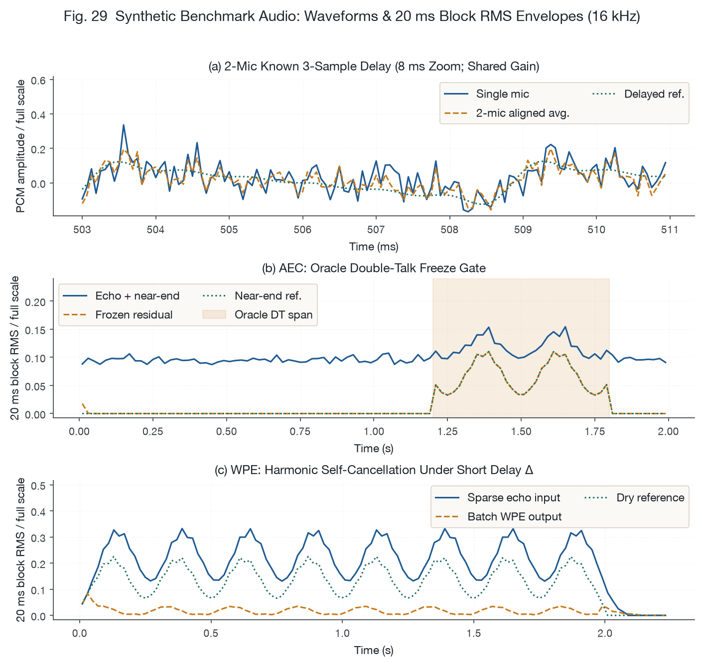

# Microphone Array Signal Processing Tutorial · Overview & Navigation

🌐 [简体中文](../chapters/00_overview.md) ｜ **English**

Welcome to the master navigation page for the entire book. This tutorial comprises **19 main-text documents**—this overview page, **16 core and frontier chapters** (Chapters 0–15, including Chapter 0 on book-wide mathematical foundations and four extended special topics in Chapters 12–15), and **2 quick-reference and troubleshooting appendices**—accompanied by **360 runnable pure-NumPy exercises**, **283 companion audio clips**, **87 script-reproducible figures** (plus 1 supplementary room-simulation figure in Appendix B), and **6 [Source Research Manuals](../codes/chapters/ch00/research_en/README.md)** (which focus on third-party upstream implementations and reproduction boundaries, and are not counted among the main tutorial chapters).

**Quick-Start Entry Points**:

- **Systematic study from scratch**: Begin with [Chapter 0 · Mathematical Foundations](00_math-foundations.md) and [Chapter 1 · Problem Definition](01_problem-definition.md), or jump first to [Section 8](#sec-u-6d43c0086f) on this page to listen to the two-microphone before/after alignment comparison alongside Figure 29.
- **Direct lookup by algorithmic task**: Jump straight to [Chapter 4: Localization](04_doa-estimation.md), [Chapter 5: Beamforming](05_beamforming.md), [Chapter 6: Acoustic Echo Cancellation](06_aec.md), [Chapter 7: WPE Dereverberation](07_wpe-dereverberation.md), [Chapter 8: Speech Separation](08_speech-separation.md), or [Chapter 9: Source Tracking](09_source-tracking.md).
- **Hardware implementation, selection & acceptance**: Go directly to [Chapter 10: Engineering Practice](10_engineering-practice.md), [Chapter 11: Selection Guide](11_selection-guide.md), and the [Appendix B Troubleshooting Table](17_appendix-guide.md#sec-17-4); the top of every chapter provides quick navigation links to the previous chapter, the next chapter, and back to this overview page.

---

## 1. What Kind of Tutorial This Is

This book is a comprehensive tutorial on microphone array signal processing spanning from introductory fundamentals to industrial practice. Chapter 0 systematically builds the prerequisite foundations in trigonometric spatial geometry, complex phasors and time-frequency transforms, subspace linear algebra, complex-variable optimization, statistical filtering, and special functions; Chapters 1–3 establish acoustic wave propagation models and array geometry intuition; Chapters 4–9 derive and compare core array processing algorithms step by step; Chapters 10–11 place those algorithms back into real-time device processing pipelines—examining clock synchronization, channel calibration, processing latency, compute/power budgets, and engineering acceptance testing; and Chapters 12–15 extend the scope to acoustic imaging, distributed microphone arrays, three-dimensional spatial sound fields and wearable micro-arrays, as well as conditioned target speaker extraction and multichannel meeting speaker diarization.

No prior coursework in array signal processing is required to read this book. Readers who prefer to build a solid mathematical and signal-analysis foundation first may read sequentially starting from [Chapter 0](00_math-foundations.md); readers who prefer to dive directly into physical acoustic scenarios may start at [Chapter 1](01_problem-definition.md), using the master lookup index in [Chapter 0 §0.8](00_math-foundations.md#sec-0-8) to jump back to specific derivation sections whenever unfamiliar mathematical tools arise, or consulting the notation table and glossary in [Appendix A §16.1](16_appendix-symbols-math.md#sec-16-1). After completing the main arc, the numbered equations, failure boundaries, and troubleshooting checklists in each chapter serve as a desk reference manual for engineering work.

On your very first visit, you may turn to Figure 29 in [Section 8](#sec-u-6d43c0086f) of this page, play the "alignment and averaging" audio set, and return here with two intuitive questions in mind: *By how much does the exact same sound arrive earlier at one microphone than another? Once those arrival-time differences are aligned and averaged, which components add up coherently and which background noises get suppressed?*

The main storyline unfolds from an everyday scenario: you stand 3 meters away speaking to a smart speaker—how does the device extract your clear voice from ambient noise, room reflections, and the sound playing from its own loudspeaker? If someone next to you speaks at the same time, or if you walk around while talking, the system must also handle multi-speaker separation and trajectory tracking. The table below distinguishes these six core tasks by module role, delivered output, and required prior information:

| Task | What It Solves in This Scenario | Output or Required Information |
|---|---|---|
| Sound Source Localization: Direction of Arrival (DOA) Estimation | Determines from which direction relative to the array the speech arrives | Directional angle or coordinate estimate; does not directly output enhanced speech |
| Beamforming | Exploits multichannel spatial differences for directional pickup and off-axis interference suppression | Single-channel or binaural audio synthesized via multichannel weighting; requires target direction or spatial statistics |
| Acoustic Echo Cancellation (AEC) | Cancels the device's own loudspeaker playback coupled back into the microphones via the room | Residual audio after subtracting estimated echo; requires a reference signal synchronized with actual playback |
| Weighted Prediction Error (WPE) Dereverberation | Attenuates late reverberation tails caused by multiple wall reflections | Audio after subtracting delayed multi-frame linear predictions; must also verify that target speech is unharmed |
| Speech Separation | Unmixes simultaneously speaking sources into independent tracks or extracts a designated speaker | Multiple separated tracks or a target speaker track; must resolve output slot permutation and cross-block identity stitching |
| Source Tracking | Links noisy, intermittent directional observations into smooth, continuous motion trajectories | Time-updated direction, angular velocity state, and uncertainty; must specify the exact timestamp represented by the state |

When reading the table above, pay close attention to the third column ("Output or Required Information"): localization and tracking deliver spatial angles and trajectory states, whereas beamforming, AEC, WPE, and separation deliver audio waveforms. Moreover, in real product pipelines, not every scenario chains all six modules together; the activation conditions and reference-tap dependencies across modules are consolidated in [§10.1](10_engineering-practice.md#sec-10-1).

---

## 2. All 19 Documents at a Glance

| No. | File | Figures | Difficulty | Suggested Study Units |
|---|---|---|---|---|
| Overview | `00_overview.md` (this page) | Fig. 29 | Introductory | Navigation and reproduction entry point |
| Chapter 0 | `00_math-foundations.md` | Figs. 84–87 (4 total) | Introductory–Intermediate | Trigonometry & 3D spatial geometry; complex phasors & time-frequency analysis; subspace algebra, complex optimization & statistical filtering (3 units) |
| Chapter 1 | `01_problem-definition.md` | Fig. 1 | Introductory | Problem definition, SNR conventions, and binaural localization cues |
| Chapter 2 | `02_basics-signal-model.md` | Figs. 2–7, 45 (7 total) | Intermediate | Time delays & manifolds; short-time spectra & statistics; beam metrics (3 units) |
| Chapter 3 | `03_array-geometry.md` | Figs. 8–10, 46–47 (5 total) | Intermediate | Geometric observability; channel calibration & sparse coarrays |
| Chapter 4 | `04_doa-estimation.md` | Figs. 11–14, 28, 48–49 (7 total) | Advanced | TDOA & spatial scanning; subspace methods; wideband focusing & resolution limits |
| Chapter 5 | `05_beamforming.md` | Figs. 15–17, 50–51, 68 (6 total) | Advanced | Linearly constrained solutions; robust design; time-frequency masks & binaural/phase interfaces |
| Chapter 6 | `06_aec.md` | Figs. 18, 19, 25–27, 31–34, 52–53, 69 (12 total; also cites Fig. 22) | Advanced | Reference & convolution; adaptive updates; double-talk control & nonlinear processing (4 units) |
| Chapter 7 | `07_wpe-dereverberation.md` | Figs. 20, 23, 54, 70 (4 total) | Intermediate | Delayed linear prediction model; iterative solvers & multi-mic timing boundaries |
| Chapter 8 | `08_speech-separation.md` | Figs. 37–38, 55, 71 (4 total; cites Fig. 22) | Intermediate | Statistical blind source separation; activity-guided GSS; neural masks & cross-block stitching |
| Chapter 9 | `09_source-tracking.md` | Figs. 21, 39, 56, 72 (4 dedicated; also cites Fig. 22) | Intermediate | Bayesian state recursion; multi-target data association & track lifecycle management |
| Chapter 10 | `10_engineering-practice.md` | Figs. 22, 24, 35, 40, 57–58, 73 (7 total) | Intermediate | Module cascade dependencies; hardware clocks & latency; compute budgets & evaluation (3 units) |
| Chapter 11 | `11_selection-guide.md` | Figs. 41, 42, 59, 74 (4 total) | Introductory | Hard-constraint screening, Pareto trade-offs, cross-scenario scoring & acceptance specs |
| Chapter 12 (Special Topic I) | `12_acoustic-imaging.md` | Figs. 62–64, 75 (4 total) | Advanced | Cross-spectral matrix, point spread function, deconvolved source maps & acoustic metrological calibration |
| Chapter 13 (Special Topic II) | `13_distributed-enhancement.md` | Figs. 65–67 (3 total) | Advanced | Per-node linear compression, distributed iterative updates, clock offset & packet-loss resilience |
| Chapter 14 (Special Topic III) | `14_spatial-wearable-arrays.md` | Figs. 76–79 (4 total) | Advanced | Spherical harmonics & parametric sound fields, binaural signal matching, wind-robust cross-modal fusion & hear-through latency |
| Chapter 15 (Special Topic IV) | `15_target-extraction-diarization.md` | Figs. 80–83 (4 total) | Advanced | Conditioned feature modulation, near-field distance bubbles, spatio-spectral speaker diarization & audio-visual alignment |
| Appendix A | `16_appendix-symbols-math.md` | Figs. 43, 44, 60 (3 total) | Reference | Master notation table, bilingual glossary & four core math/numerical cheat sheets |
| Appendix B | `17_appendix-guide.md` | Figs. 30, 36, 61 (3 numbered figs + 1 room exercise fig) | Reference | Staged study roadmaps, literature & challenge map, troubleshooting & capstone exercises |

The rightmost column suggests manageable study units; longer chapters such as Chapters 0, 2, 6, and 10 can be spread across multiple sessions, working through the corresponding end-of-chapter exercises after each unit. When pressed for time, read this overview, Chapter 1, and Chapter 11 first to clarify problem boundaries and selection frameworks, then read Chapter 2 to establish the shared signal model (looking up derivation tools via Chapter 0 §0.8 as needed); next, pick task-specific chapters from Chapters 4–9, pairing engineering work with Chapter 10 and the Appendix B troubleshooting guide, or academic research with Chapters 4 and 9 and the frontier roadmap in Appendix B.

---

## 3. Chapter Summaries and Learning Objectives

### [00 · Mathematical Foundations and Signal Analysis Preliminaries](00_math-foundations.md)

Accompanied by 4 figures (Figures 84–87), this chapter serves both as a self-contained preparatory course for newcomers and as an on-demand mathematical foundation for subsequent derivations (complementing [Appendix A](16_appendix-symbols-math.md), which focuses on rapid symbol lookup and terminology):

- **Geometric and Time-Frequency Language (§0.1–§0.2)**: Derives trigonometric product-to-sum and sum-to-product identities, the three-dimensional orthogonal rotation group $\mathrm{SO}(3)$, spherical coordinates with the AES69 elevation convention, and the second-order Fresnel spherical-wave path-difference expansion; connects complex Euler phasors, amplitude vs. power decibel scales, Discrete Fourier Transform (DFT) Parseval energy conservation, zero-padded linear convolution equivalence, and Short-Time Fourier Transform (STFT) Constant Overlap-Add (COLA) perfect-reconstruction conditions.
- **Complex Linear Algebra and Matrix Decompositions (§0.3–§0.4)**: Establishes complex inner-product spaces, column-space orthogonal projections, and the four fundamental subspaces; analyzes Singular Value Decomposition (SVD) condition numbers, ill-conditioned inversion noise amplification, Tikhonov diagonal loading, and the Sherman–Morrison–Woodbury rank-one update lemma; derives Hermitian Rayleigh quotient extrema, Generalized Eigenvalue (GEV) whitening joint diagonalization, and identities linking column-major vectorization $\operatorname{vec}$, Kronecker products, and Khatri–Rao products.
- **Complex-Variable Optimization, Statistical Estimation, and Acoustic Special Functions (§0.5–§0.9)**: Uses Wirtinger conjugate calculus to derive closed-form Lagrange multiplier solutions for MVDR and LCMV without skipping steps; explains Karush–Kuhn–Tucker (KKT) complementary slackness for Non-Negative Least Squares (NNLS), Majorization–Minimization (MM) surrogate monotonic descent, and bipartite Hungarian optimal assignment; establishes the circularly symmetric complex Gaussian pseudo-covariance criterion, Cramér–Rao Lower Bound (CRLB), Wiener orthogonality principle, and Joseph-form positive-semidefinite Kalman covariance updates; and introduces cylindrical/spherical Bessel functions, orthogonal Legendre polynomials, and the spherical harmonic addition theorem. Ends with a book-wide mathematical lookup table ([§0.8](00_math-foundations.md#sec-0-8)) and 16 runnable exercises `E00-01`–`E00-16` ([§0.9](00_math-foundations.md#sec-0-9)).

After completing this chapter, readers will be able to perform complex phasor delay conversions, hand-calculate orthogonal projections and diagonal loading, differentiate constrained complex objectives via Wirtinger calculus, and verify Wiener–Kalman recursions—entering the concrete acoustic problems of Chapters 1–15 without getting stuck on algebraic manipulations.

### [01 · Problem Definition and Binaural Inspiration](01_problem-definition.md)

Accompanied by 1 figure and written for beginners, this chapter opens with far-field voice interaction in a living room, systematically dissecting five physical challenges—ambient background noise, room reverberation, competing talkers, microphone self-noise, and loudspeaker echo—while clarifying the distinct input/output boundaries of sound source localization, beamforming, and source tracking.

On evaluation conventions, the chapter first distinguishes overall waveform volume scaling from genuine Signal-to-Noise Ratio (SNR) improvement, exposes how A-weighted ($\mathrm{dB(A)}$) datasheet SNR ratings on silicon MEMS microphones mask low-frequency $1/f$ self-noise, and contrasts three classes of array gain metrics: White Noise Gain (WNG) under spatially uncorrelated equal-variance noise, Directivity Index (DI) in an isotropic diffuse sound field, and null depth toward directional interferers—culminating in eigendecomposition square-root noise coloring for arbitrary positive-semidefinite spatial coherence matrices.

Next, drawing on human auditory Interaural Time Difference (ITD), Interaural Level Difference (ILD), and Head-Related Transfer Function (HRTF) spectral cues, the chapter clarifies the similarities and differences among geometric diffraction models, psychoacoustic just-noticeable differences, and high-frequency spatial phase aliasing in machine arrays, while contrasting AES69 (SOFA) spherical elevation angles against spherical-harmonic colatitude conventions.

After completing this chapter, readers will be able to explain what spatial observables synchronized microphones unlock beyond a single microphone, hand-compute the ideal 4-mic averaging gain under spatially white noise, spatial noise coloring matrices, and first-order differential low-frequency self-noise budgets, and relate binaural auditory cues to machine array manifolds.

### [02 · Basics: What Happens When Sound Reaches an Array](02_basics-signal-model.md)

Accompanied by 7 figures, this chapter builds the shared physical and mathematical model used throughout the rest of the book; we recommend reading it thoroughly once and keeping it handy when checking notation later:

- **Propagation Time Delay (§2.1)**: A sound wave arrives at different sensors at slightly different instants. At a $16\ \mathrm{kHz}$ sampling rate, adjacent samples are separated by $62.5\ \mu\mathrm{s}$, during which sound at $343\ \mathrm{m/s}$ travels roughly $2.14\ \mathrm{cm}$; resolving finer angular shifts usually requires estimating subsample delays via cross-correlation interpolation or frequency-domain phase slopes, backed by synchronized multichannel sampling clocks.
- **Near-Field Spherical Waves vs. Far-Field Plane Waves (§2.2)**: When a source is sufficiently far from the array, spherical wavefronts across the array aperture can be approximated as planar; the near-to-far-field transition scale depends jointly on array aperture size and acoustic wavelength.
- **Frequency-Domain Phase and Steering Vectors (§2.3)**: Time-domain propagation delays map to linear phase rotations in the frequency domain. The equal-amplitude far-field model stacks each sensor's complex phase relative to a reference point into the steering vector—the central geometric descriptor for spatial scanning and beamforming—while near-field or baffled arrays incorporate radial amplitude variation and measured transfer responses.
- **Room Impulse Response and Reverberation (§2.4)**: Indoor reflections partition room acoustics into direct sound, early reflections, and dense late reverberation, commonly characterized by reverberation time $T_{60}$ (time required for sound energy to decay by $60\ \mathrm{dB}$) and Direct-to-Reverberant Ratio (DRR).
- **Short-Time Spectra and Spatial Covariance (§2.5)**: Windowed, framed Short-Time Fourier Transform (STFT) processing converts multichannel waveforms into complex time-frequency spectra, across which multichannel spatial covariance matrices are estimated—carefully delineating when per-frame frequency-domain multiplication approximates full linear convolution and where that approximation breaks down.
- **Beampatterns and Performance Bounds (§2.6)**: Formally defines mainlobe beamwidth, sidelobe level, spatial nulls, grating lobes from spatial aliasing, DI, and WNG, and introduces the Cramér–Rao Lower Bound (CRLB) governing the minimum variance of unbiased parameter estimators.

After completing this chapter, readers will be able to derive frequency-domain steering vectors directly from geometric delays, interpret both diagonal and off-diagonal entries of spatial covariance matrices physically, and read all core metrics on a polar or Cartesian beampattern.

### [03 · Array Geometry](03_array-geometry.md)

Accompanied by 5 figures, this chapter focuses on *how microphones are arranged, and what physical ceilings that arrangement imposes*.

Starting from broadside versus endfire directional behavior on a two-microphone baseline, the chapter compares uniform linear, circular, planar rectangular, spherical, spiral, and distributed arrays side by side. Collinear arrays align all sensors along a single axis, rendering them unable to distinguish azimuth angles around a cone of revolution about that axis (front–back or up–down mirror ambiguity), and near endfire the derivative of time delay with respect to angle approaches zero, magnifying small TDOA measurement errors into large angular errors.

Around geometry selection, the chapter distills four core principles: the ratio of aperture to wavelength governs spatial resolution; circular and planar arrays maintain a more uniform effective aperture across horizontal azimuths; device enclosures and rigid baffles alter scattered fields and array manifolds; and while adding microphones improves ideal WNG and statistical robustness, overly small spacing leaves low-frequency differential processing vulnerable to channel mismatch and self-noise, whereas overly large spacing triggers high-frequency spatial aliasing. It also introduces sparse virtual difference coarrays (such as a 6-microphone nested array generating 23 contiguous signed virtual lags) as well as sensor-position and fixed-channel-delay calibration methods.

After completing this chapter, readers will be able to determine the observable angular domain, effective aperture, and alias-free bandwidth of a given geometry, and select appropriate array topologies for specific industrial form factors and angular coverage requirements.

### [04 · Sound Source Localization (DOA Estimation)](04_doa-estimation.md)

Accompanied by 7 figures, this chapter systematically explains how to estimate a sound source's Direction of Arrival relative to an array from synchronized multichannel observations, organized into four major algorithmic families:

- **Two-Stage TDOA Solvers**: First whiten spectral magnitudes via Generalized Cross-Correlation with Phase Transform (GCC-PHAT) to extract inter-microphone time-difference-of-arrival peaks from phase slopes, then solve for source coordinates via Chan's closed-form estimator or iterative Taylor-series linearization, quantifying sensor-placement error amplification via Geometric Dilution of Precision (GDOP). Controlled reverberation experiments further reveal how $T_{60}$, DRR, and analysis window length jointly govern correlation peak sharpness.
- **Spatial Scanning Spectral Estimators**: Steered Response Power (SRP-PHAT) accumulates pairwise cross-correlations across candidate spatial grids to locate maxima, paired with coarse-to-fine hierarchical search to cut grid-evaluation cost; narrowband and wideband scanning sections contrast conventional delay-and-sum scanning (Bartlett) against minimum-variance adaptive scanning (Capon) in resolving closely spaced angles.
- **High-Resolution Subspace Methods**: Multiple Signal Classification (MUSIC) exploits orthogonality between signal and noise subspaces to form sharp spectral peaks, yet suffers signal-covariance rank deficiency under strongly coherent multipath reflections—recoverable on uniform linear arrays via spatial smoothing; Estimation of Signal Parameters via Rotational Invariance Techniques (ESPRIT) leverages shift-invariant subarray pairs to solve directly for directional roots without grid search.
- **Wideband Focusing, Sparse Recovery, and Deep Learning**: Covers coherent signal-subspace focusing transforms for wideband speech (contrasting unitary vs. non-unitary focusing with respect to noise whiteness preservation), sparse representation recovery, and Deep Neural Network (DNN) data-driven localization features along with cross-array and cross-room generalization boundaries. Ties the chapter's concepts together with the [§4.2](04_doa-estimation.md#sec-4-2) four-microphone subsample TDOA worked synthesis and CRLB variance benchmarks.

After completing this chapter, readers will be able to choose an appropriate localization method given array topology, source count, room reverberation, and compute budget, and explain—both physically and algebraically—why multipath broadens cross-correlation peaks and why coherent reflections break subspace estimators.

### [05 · Beamforming](05_beamforming.md)

Accompanied by 6 figures, this chapter examines spatiotemporal and spatio-frequency linear multichannel filtering designed to preserve speech from a target direction distortionlessly while suppressing background noise and off-axis interferers.

The chapter first distinguishes three canonical designs by noise-field structure: against mutually uncorrelated sensor self-noise, the equal-weight Delay-and-Sum Beamformer (DSB) attains the linear WNG ceiling $M$; against low-frequency approximately isotropic diffuse noise, superdirective beamformers boost Directivity Index (DI) substantially on compact apertures at the expense of severe low-frequency WNG degradation (for instance, a two-mic endfire pair spaced at $0.05\lambda$ achieves $6.0\ \mathrm{dB}$ DI while WNG drops to roughly $-10.6\ \mathrm{dB}$, and halving the spacing incurs roughly another $6\ \mathrm{dB}$ of self-noise amplification); against strong directional interferers, Minimum Variance Distortionless Response (MVDR) uses the interference-plus-noise covariance matrix to steer deep spatial nulls automatically toward interferers.

Building on these foundations, the chapter develops Linearly Constrained Minimum Variance (LCMV, including derivative mainlobe-flatness constraints), the Generalized Sidelobe Canceller (GSC) decomposing constrained optimization into a fixed reference branch plus a target-blocking adaptive cancellation branch, the Multichannel Wiener Filter (MWF) trading noise reduction against speech distortion, and diagonal loading robustness strategies—before extending to inter-frequency phase consistency, binaural beamforming preserving interaural localization cues, spectral post-filtering, spherical-harmonic-domain beamforming, and time-frequency mask-driven neural beamforming.

After completing this chapter, readers will be able to compute WNG–DI trade-off curves fluently, derive closed-form MVDR weights from scratch, explain how diagonal loading bounds self-noise amplification, and understand the clean division of labor between neural time-frequency masks and statistical beamformers.

### [06 · Acoustic Echo Cancellation (AEC)](06_aec.md)

Accompanied by 12 figures (and citing the system-wide pipeline diagram in Figure 22), this chapter provides an in-depth treatment of acoustic echo cancellation in full-duplex voice interaction: when loudspeaker playback couples back into the device's own microphones through the power amplifier, transducer, and room multipath reflections, how does the system subtract that echo cleanly using the playback reference without damaging near-end speech?

Along the linear adaptive filtering thread, starting from Normalized Least Mean Squares (NLMS), the chapter dissects Partitioned-Block Frequency-Domain Adaptive Filtering (PBFDAF—essential for long room echo tails, clarifying its overlap-save and gradient-projection equivalence to exact block-frequency-domain multi-tap NLMS), and compares subband filtering (including cross-band aliasing terms), Improved Proportionate NLMS (IPNLMS) for sparse impulse responses, the Affine Projection Algorithm (APA) reusing multi-frame history to accelerate convergence on colored speech, and the Frequency-Domain Kalman Filter (FDKF) explicitly tracking state uncertainty.

On engineering control, the chapter scrutinizes reference loopback tap placement (showing why time-varying digital playback volume gain does not commute with room acoustic convolution, how reference delays exceeding filter length cause complete failure, and how residual echo tails persist right after playback enters silence), Double-Talk Detection (DTD) and weight freezing when near-end and far-end talkers overlap, linear cancellation ceilings imposed by amplifier and micro-speaker nonlinearities, and hybrid architectures pairing linear adaptive filters with residual echo suppression or neural post-filters.

On system integration and evaluation, it maps out cascade ordering between AEC and multichannel beamforming (aligned with §10.1), inspects the open-source industrial reference WebRTC AEC3, and stresses joint verification across far-end single-talk Echo Return Loss Enhancement (ERLE), double-talk stability, and near-end speech fidelity.

After completing this chapter, readers will be able to plan hardware loopback tap points and bulk-delay alignment buffers properly, diagnose convergence failures caused by clock drift, nonlinearity, or double-talk, and design complete AEC acceptance protocols across diverse product form factors.

### [07 · WPE Dereverberation](07_wpe-dereverberation.md)

Accompanied by 4 figures, this chapter investigates how cross-frame linear prediction attenuates late room reverberation tails blindly—without access to any clean playback or dry source reference.

Operating in the STFT domain, the Weighted Prediction Error (WPE) algorithm skips a small number of frames immediately preceding the current frame—called the prediction delay (or guard interval) $\Delta$—using only older historical frames to linearly predict and subtract the late reverberation component in the current frame, while weighting each frame inversely by time-varying speech variance so high-energy direct speech does not dominate filter fitting. The guard interval $\Delta$ protects both direct sound and intelligibility-enhancing early reflections from being mistakenly canceled; in multi-microphone arrays, inter-channel arrival-time offsets must also be accounted for so they do not erode the effective guard window on lagging channels.

The chapter derives the objective function and closed-form iterative/recursive updates for both single-channel and multichannel offline and online WPE, contrasts them against known-RIR Multichannel Inverse Filtering (MINT—revealing post-path sensor noise amplification near approximate common zeros and regularized trade-offs), cepstral liftering, and spectral subtraction dereverberation, and provides practical tuning guidelines tying frame size, prediction order, and $\Delta$ together to avoid over-canceling periodic harmonic speech.

After completing this chapter, readers will be able to derive multichannel WPE update equations independently, configure $\Delta$ and prediction order safely, and evaluate dereverberation jointly in terms of late-tail decay and target speech preservation.

### [08 · Speech Separation](08_speech-separation.md)

Accompanied by 4 figures (and citing Figure 22), this chapter tackles overlapping multi-speaker speech (the "cocktail party problem"), explaining how statistical independence, speaker activity priors, and deep time-frequency masks interface with array beamforming:

- **Statistical Blind Source Separation ([§8.3](08_speech-separation.md#sec-8-3))**: Starting from frequency-wise permutation ambiguity in frequency-domain Independent Component Analysis, derives Independent Vector Analysis (IVA / OverIVA) exploiting cross-frequency source co-modulation to avoid per-bin permutation alignment, Independent Low-Rank Matrix Analysis (ILRMA) coupling IVA with Non-Negative Matrix Factorization source models, and Multichannel NMF (MNMF), along with scale restoration via projection back onto a reference microphone.
- **Activity-Guided Source Separation ([§8.4](08_speech-separation.md#sec-8-4))**: Details Guided Source Separation (GSS)—widely deployed in meeting transcription pipelines—showing how diarization activity intervals constrain spatial mixture-model clustering to estimate target and interference time-frequency masks driving MVDR beamforming.
- **Deep Neural Separation and Continuous Stream Stitching ([§8.6](08_speech-separation.md#sec-8-6))**: Covers Permutation Invariant Training (PIT), representation boundaries of bounded real, unbounded real, and complex time-frequency masks, time-domain encoder–separator–decoder networks, target speaker extraction, and Continuous Speech Separation (CSS) on long recordings using inter-window overlap regions to align output slot order, polarity, and gain across chunks. Pipeline ordering and terminology lookups appear in [§8.2](08_speech-separation.md#sec-8-2), §10.1, and [Appendix A §16.2](16_appendix-symbols-math.md#sec-16-2).

After completing this chapter, readers will be able to distinguish the three separation paradigms by source count, spatial-rank assumptions, and available priors, reproduce core IVA, ILRMA, and GSS updates, and resolve cross-chunk permutation and sign flips in streaming separation.

### [09 · Source Tracking](09_source-tracking.md)

Accompanied by 4 dedicated figures (and citing Figure 22), this chapter examines how frame-by-frame directional observations corrupted by random jitter, reflection outliers, and speech pauses are fused into temporally coherent motion trajectories as talkers walk, pause, or cross paths.

Acoustic tracking faces four domain-specific hurdles: speech is inherently intermittent (yielding zero valid acoustic observations during natural pauses), room reflections spawn spurious directional outliers, the number of active talkers changes dynamically, and Cartesian source motion maps nonlinearly into array bearing angles. Addressing these challenges, the chapter first develops the Kalman Filter (KF) predict–innovation-gate–update loop (including modular angle wrapping across the $\pm 180^\circ$ branch cut and the information impact of temporally correlated measurement noise), followed by Particle Filtering (PF) with resampling for nonlinear/non-Gaussian posteriors, and Interacting Multiple Model (IMM) filtering for smooth switching between stationary and maneuvering motion regimes.

For multi-speaker scenes and online state management, the chapter dissects track initiation, consecutive-hit confirmation, and timeout termination lifecycles (explicitly distinguishing physical frame-center timestamps from end-of-frame causal availability timestamps), contrasts Probability Hypothesis Density (PHD), Labeled Multi-Bernoulli (LMB), and Track-Before-Detect (TBD) formulations, and provides slew-rate limiting, silence coasting, and re-acquisition rules in §9.4 when feeding tracked bearings back to steer adaptive beamformers.

After completing this chapter, readers will be able to build an end-to-end tracking pipeline from multichannel WAV TDOA extraction through Mahalanobis gating to smoothed state output, and tune confirmation, coasting, and beam-steering feedback parameters for moving-talker systems.

### [10 · Engineering Implementation, Evaluation, and Industrial Practice](10_engineering-practice.md)

Accompanied by 7 figures, this chapter brings the algorithms of Chapters 1–9 onto real hardware and embedded real-time platforms, answering the practical question: *Once a simulation works in Python, what still breaks in embedded deployment?*

At the system architecture level, Figure 22 and §10.1 map out cascade ordering and signal tap dependencies across AEC, WPE, DOA, beamforming, post-filtering, and Automatic Gain Control (AGC), breaking down the end-to-end latency critical path across algorithmic lookahead, frame-hop buffering, compute execution time, non-preemptive scheduling queues, and downstream decoding. At the hardware and channel layer, the chapter analyzes fixed-point vs. floating-point dynamic range, microphone sensitivity and phase mismatch, cross-device Sampling Rate Offset (SRO—showing how a $100\ \mathrm{ppm}$ crystal offset causes periodic destructive cancellation in a two-mic sum over time), and reduced-dimension covariance/steering-vector reconstruction when an individual microphone channel fails.

At the resource and acceptance layer, [§10.4](10_engineering-practice.md#sec-10-4) establishes rigorous accounting rules for Multiply-Accumulate operations per second (MACs/s), Real-Time Factor (processing time divided by newly ingested audio duration), peak RAM footprint, and battery life ($\mathrm{Wh}$ divided by system-wide average power); [§10.5](10_engineering-practice.md#sec-10-5) compares applicability boundaries across waveform distortion ratios, intelligibility scores, perceptual speech quality metrics, Automatic Speech Recognition Word Error Rate (WER), multi-target tracking errors, and formal subjective listening tests, while diagnosing common engineering pitfalls such as noise-PSD estimation contamination and block-AGC step transients.

After completing this chapter, readers will be able to compile latency, clock-synchronization, channel-calibration, and compute/power budget sheets independently, and design self-consistent objective and subjective acceptance suites for real products.

### [11 · Summary and Selection Guide](11_selection-guide.md)

Accompanied by 4 figures, this chapter serves as the capstone of the core curriculum and a structured engineering decision manual:

- **Structured Problem Specification (§11.1–§11.3)**: Defines engineering problems along six orthogonal dimensions—delivered output format, spatial coverage, operating bandwidth, dominant interference class, target motion speed, and hardware cost/power envelope—consolidating front-end module activation/pruning rules and linking array geometry ceilings directly to downstream algorithmic limits.
- **Candidate Screening and Multi-Scenario Trade-Offs (§11.4–§11.5)**: Walks through four representative product archetypes—smart speakers, automotive hands-free cabins, conference-room table pods, and wearable devices—demonstrating how to eliminate infeasible candidates via hard latency, memory, and power cutoffs first, then trade target fidelity, interference suppression, and WNG along the non-dominated Pareto frontier, carefully distinguishing fixed-weight composite scores from worst-case scenario guarantees.
- **Writing Testable Acceptance Specifications (§11.5–§11.6)**: Shows how to turn vague goals like "good noise reduction" into executable acceptance specifications complete with acoustic test conditions, statistical confidence intervals, pass/fail thresholds, and explicit pending-hardware verification items, reinforced by end-to-end decision exercises.

After completing this chapter, readers will be able to specify microphone array geometries, algorithmic pipelines, and quantitative acceptance criteria independently for concrete product requirements.

### [12 · Special Topic I: Acoustic Imaging and Noise Source Diagnostics](12_acoustic-imaging.md)

This special topic (Chapter 12, 4 figures) targets industrial rattle/squeak localization, wind-tunnel aeroacoustic testing, and environmental noise diagnostics; we recommend reading it after Chapters 2, 3, and 5. Unlike voice front ends delivering a single enhanced audio waveform, acoustic imaging aims to map radiated source strength quantitatively across a candidate spatial grid.

Starting from synchronized multichannel frequency snapshots forming the Cross-Spectral Matrix (CSM), the chapter explains how, for uncorrelated sources, the Point Spread Function (PSF) matrix maps true source powers to a conventional delay-and-sum dirty map; this mapping becomes spatial convolution when the PSF is translation invariant—meaning bright-spot widths and sidelobe ghosts on a dirty map do not equal true per-grid-point acoustic powers. It then derives and compares Deconvolution Approach for the Mapping of Acoustic Sources (DAMAS), Non-Negative Least Squares (NNLS), CLEAN based on Spatial Source Coherence (CLEAN-SC), and Covariance Matrix Fitting (CMF), analyzing coherent sources, off-grid sources, CSM diagonal removal, and transducer amplitude/phase calibration errors, while strictly distinguishing dimensionless digital mean-square values, mean-square sound pressure ($\mathrm{Pa}^2$), and radiated sound power ($\mathrm{W}$) along with spatial integration rules.

### [13 · Special Topic II: Distributed Microphone Collaborative Enhancement](13_distributed-enhancement.md)

This special topic (Chapter 13, 3 figures) addresses scenarios where multiple smart devices, multi-pod conference microphones, or wireless acoustic sensor networks collaborate over bandwidth-constrained links to enhance a shared target source; we recommend reading it after Chapters 2, 5, and 10.

Each node hosts a local microphone subarray, but link bandwidth and battery constraints prohibit uploading all raw multichannel waveforms to a central fusion center; instead, nodes broadcast low-dimensional linearly compressed signals to neighbors or a sink. Taking centralized Multichannel Wiener Filtering (MWF) as the optimality benchmark, this chapter derives the algebraic conditions under which cross-node linear compression attains exact centralized optimality (revealing that even when target speech cancels out inside a remote node's broadcast signal, its correlated interference observation still helps the local node cancel noise), and analyzes convergence of Distributed Adaptive Node-Specific Signal Estimation (DANSE and topology-independent TI-DANSE) under sequential, simultaneous, and relaxed finite-step updates.

Addressing real wireless links, the chapter further examines transport quantization noise, covariance coordinate transforms across broadcast-compressor version switches, inter-node Sampling Rate Offset (e.g., $100\ \mathrm{ppm}$ clock skew) phase compensation, and zero-filling vs. local-subarray fallback under packet loss (wireless experiment design and current reproduction scope appear in [§13.15](13_distributed-enhancement.md#sec-13-15)).

### [14 · Special Topic III: Spatial Sound Field Capture, Parametric Coding, and Wearable Arrays](14_spatial-wearable-arrays.md)

This special topic (Chapter 14, 4 figures) targets Ambisonic spatial recording, extended-reality (XR) headsets, smart glasses, True Wireless Stereo (TWS) earbuds, and digital hearing aids; we recommend reading it after Chapters 1, 2, and 5. Unlike tabletop arrays delivering monaural speech to an ASR engine, spatial capture and wearable devices must preserve three-dimensional directional cues and natural auditory envelopment under miniature apertures and head/body scattering.

Starting from First-Order Ambisonics (FOA) ACN/SN3D conventions, tetrahedral radial equalization, and head-tracked 3D sound-field counter-rotation, the chapter derives Directional Audio Coding (DirAC) active intensity and diffuseness analysis; develops Binaural Signal Matching on irregular wearable arrays (complex BSM-LS vs. high-frequency Magnitude Least Squares MagLS) alongside analytical reference-microphone mixing to prevent interaural background-noise head-center collapse; and dissects the Corcos turbulent wind-noise coherence model, air-conduction plus occluded in-ear microphone cross-modal MVDR own-voice fusion, and sub-millisecond comb-filtering latency limits in Hear-Through transparency mode (companion exercises `E14-01`–`E14-16` and `wearable_audio` appear in [§14.11](14_spatial-wearable-arrays.md#sec-14-11)).

### [15 · Special Topic IV: Conditioned Target Speaker Extraction, Multichannel Diarization, and Far-Field Multimodal Front Ends](15_target-extraction-diarization.md)

This special topic (Chapter 15, 4 figures) addresses personalized target speaker extraction and multi-speaker overlapping meeting transcription; we recommend reading it after Chapters 2, 5, and 8. Because unconditioned blind separation outputs lack speaker identity anchors, fail when near and far talkers share the same azimuth, and struggle during rapid conversational turn-taking, practical front ends fuse voiceprint embeddings, near-field distance cues, diarization posteriors, and visual lip motion.

The chapter first derives Feature-wise Linear Modulation (FiLM) and cross-attention conditioning, dual-state training losses eliminating $0/0$ singularities when the target speaker is silent, and zero-overlap unvoiced-fricative bypass criteria during single-speaker segments—followed by a closed-form three-microphone broadside spherical-wave *acoustic distance bubble* separating co-directional near-field targets from far-field interferers, proving its fourth-power aperture ($d^4$) self-noise floor. It then decomposes Diarization Error Rate (DER) into its three error components, formulates spatio-spectral Target-Speaker Voice Activity Detection (TS-VAD) exclusive product gating for GSS, analyzes heterogeneous audio-visual frame-rate alignment, camera pipeline positive-lag onset clipping, and lip-occlusion confidence fallback, and compares modular cascades (`TS-VAD→GSS→ASR`) against joint recognition architectures (`SOT`, `DiCoW`) (companion exercises `E15-01`–`E15-15` and `tse_audio` appear in [§15.8–§15.10](15_target-extraction-diarization.md#sec-15-8)).

### [16 · Appendix A: Symbols, Terminology, and Mathematics](16_appendix-symbols-math.md)

Accompanied by 3 figures, this appendix serves as an always-at-hand desk reference (full step-by-step derivations and 16 foundational exercises live in [Chapter 0](00_math-foundations.md), whereas this appendix concentrates on global notation standards, a bilingual glossary, and four compact cheat sheets) and need not be read cover to cover:

- **§16.1 Master Notation Table**: Standardizes book-wide conventions for scalars, column vectors, matrices, transpose vs. conjugate transpose, frequency variables, and physical constants.
- **§16.2 Bilingual Terminology Glossary**: Explains core concepts grouped across seven themes—signals & math foundations, room acoustics, adaptive filtering & blind separation, beamforming & array metrics, acoustic imaging & spatial analysis, localization & tracking, and hardware & system evaluation.
- **§16.3–§16.4 Four Cheat Sheets and Verification Exercises**: Compactly summarizes four quick-reference cheat sheets—decibel units, complex matrix & Wirtinger identities, regularization/pseudoinverse condition numbers, and NumPy/SciPy numerical pitfalls (cross-linking back to full derivations in Chapter 0)—paired with 15 runnable verification exercises cementing matrix shapes, conjugate signs, and numerical rank criteria.

### [17 · Appendix B: Learning Paths, Domain Map, Frontiers, Troubleshooting, Exercises, and Reproduction](17_appendix-guide.md)

Accompanied by 3 numbered figures plus 1 supplementary room-simulation figure, this appendix gathers advanced study guides and practical debugging tools:

- **§17.1–§17.3 Study Schedules, Domain Map, and Research Frontiers**: Organizes staged study plans, curates classic monographs, key surveys, flagship journals/conferences, representative open datasets, and international challenge lineages, and surveys frontier research directions including joint front-end and ASR optimization, cross-array adaptation (e.g., Transform-Average-Concatenate, TAC), generative diffusion enhancement, and passive acoustic metamaterials/microstructures.
- **§17.4–§17.5 Engineering Troubleshooting Guide and Formula Cheat Sheet**: Catalogs recurring failure modes in a structured *Symptom → Likely Root Cause → Minimal Diagnostic Test → Fix Direction* table (including non-COLA modulation, MEMS acoustic gasket leaks, PDM/TDM slot misalignment, and real-time xrun frame drops), alongside a single-page summary of the book's core numbered equations and their validity assumptions.
- **§17.6–§17.7 Capstone Exercises and Full Figure Reproduction**: Provides 17 cross-chapter analytical problems, 13 stably numbered coding exercises (spanning fractional-delay interpolation roll-off, equal-DRR spectral differences, inverted polarity, and multi-source indoor image-source localization), and one-command reproduction instructions for all figures in the book.

---

## 4. Recommended Reading Order

1. Read this overview first; if you want a systematic refresher on complex phasors, Fourier transforms, matrix projections, and statistical estimation, read [Chapter 0](00_math-foundations.md) straight through (or start directly at Chapter 1 and consult [Chapter 0 §0.8](00_math-foundations.md#sec-0-8) on demand), then read Chapter 1 to clarify the five far-field acoustic degradations, three spatial tasks, and baseline SNR conventions.

2. Read Chapter 2 carefully to master the shared time-delay, steering-vector, STFT, and spatial-covariance models; flip to Appendix A whenever unfamiliar symbols appear.

3. Follow the **Array Geometry Thread** through Chapter 3 to understand how sensor topology dictates observable directions and spatial-aliasing ceilings, pairing it with §11.1–§11.3 to sketch an initial hardware geometry.

4. Follow the **Spatial Processing Thread** linking Chapter 4 (DOA localization), Chapter 9 (source tracking), and Chapter 5 (beamforming); the time-frequency masks introduced across Chapters 2, 5, and 8 act as the statistical bridge estimating target and noise spatial covariances to connect deep learning with optimal beamforming.

5. Follow the **Time-Frequency Interference Cancellation Thread** selectively across Chapter 6 (AEC), Chapter 7 (WPE dereverberation), and Chapter 8 (overlapping speech separation), using §10.1 and Figure 22 to pin down their cascade order and reference-signal dependencies across the full front end.

6. Follow the **Engineering Systems Thread** through Chapter 10 to verify clock synchronization, real-time latency, compute/power budgets, and objective/subjective evaluation metrics, culminating in Chapter 11 with a complete system selection and testable acceptance specification.

For industrial noise-source mapping and metrological diagnostics, branch into [Special Topic I](12_acoustic-imaging.md) after Chapters 2, 3, and 5; for bandwidth-constrained multi-device collaborative enhancement, branch into [Special Topic II](13_distributed-enhancement.md) after Chapters 2, 5, and 10. For Ambisonic spatial audio, smart glasses, and TWS/hearing-aid algorithms, branch into [Special Topic III](14_spatial-wearable-arrays.md) after Chapters 1, 2, and 5; for personalized target speaker extraction and multi-speaker meeting diarization, branch into [Special Topic IV](15_target-extraction-diarization.md) after Chapters 2, 5, and 8.

After finishing Chapter 11, engineering readers can combine §10.9 and §17.4 to draft board-bringup and debugging checklists, while research readers can combine §17.3 with Problems 16 and 17 in §17.6 to build room-simulation baselines and review published challenge systems.

---

## 5. Three Tailored Reading Routes

### Route A: Beginner Track (From Scratch to Running Demos)

1. Read this page alongside [Chapter 0 §0.1](00_math-foundations.md#sec-0-1) and [§0.2](00_math-foundations.md#sec-0-2) (working through `E00-01` and `E00-03`–`E00-05` to practice direction cosines, complex phasor delays, decibel scaling, and STFT reconstruction), then read Chapter 1 and skim [§11.1–§11.3](11_selection-guide.md#sec-11-1) to see what input specifications must be pinned down before designing a microphone array system.

2. Read Chapter 2 across three study sessions. On your first pass, focus on Figures 2–7 and physical interpretations before re-reading the algebraic derivations; consult [Chapter 0 §0.3](00_math-foundations.md#sec-0-3), [§0.5](00_math-foundations.md#sec-0-5), and Appendix A whenever subspace projections, SVD regularization, or constrained complex derivatives come up. Afterward, run [E01-01](01_problem-definition.md#e01-01) (verifying why multi-mic averaging depends on spatial noise correlation) and [E01-02](01_problem-definition.md#e01-02) (distinguishing quieter volume from genuine SNR improvement).

3. In Chapter 3, focus on the geometry comparison tables and worked examples. In Chapter 4, read [§4.2](04_doa-estimation.md#sec-4-2) and [§4.3](04_doa-estimation.md#sec-4-3) alongside Figures 12 and 14, then complete [E04-01](04_doa-estimation.md#e04-01) to see how swapping channels flips the TDOA sign. In [E04-07](04_doa-estimation.md#e04-07), estimate the direction from the four-channel WAV and use that estimate to align the channels. Compare the result with averaging without alignment and with steering to the wrong side. In Chapter 5, read [§5.1](05_beamforming.md#sec-5-1), [§5.2](05_beamforming.md#sec-5-2), and [§5.4](05_beamforming.md#sec-5-4), hand-calculating a two-mic target response before running [E05-04](05_beamforming.md#e05-04) with Figure 16 to see how diagonal loading affects robustness and null depth.

4. For AEC, start with playback references, convolutive modeling, and NLMS updates in [§6.1](06_aec.md#sec-6-1), then inspect array cascade ordering in [§6.6](06_aec.md#sec-6-6) and industrial engine implementations in [§6.7](06_aec.md#sec-6-7) (alongside Figure 18).

    For dereverberation, read [§7.1](07_wpe-dereverberation.md#sec-7-1) and [§7.8](07_wpe-dereverberation.md#sec-7-8) to see how guard delay, prediction order, and STFT frame length interact (Figures 20 and 23). For speech separation, read [§8.1](08_speech-separation.md#sec-8-1) and [§8.4](08_speech-separation.md#sec-8-4) to grasp multi-talker separation goals and activity-guided clustering. For source tracking, read [§9.2](09_source-tracking.md#sec-9-2) (optionally pairing with `E00-14` in [Chapter 0 §0.6](00_math-foundations.md#sec-0-6)) and work through a single Kalman predict–update step by hand.

5. Read [§10.1](10_engineering-practice.md#sec-10-1), [§10.4](10_engineering-practice.md#sec-10-4), and [§10.6](10_engineering-practice.md#sec-10-6) to grasp front-end signal flows, real-time compute metrics, and room simulation basics; finally, complete Problems 2, 3, 5, 7, 10, 11, and 14 in Appendix B, review common failure diagnostics in [§17.4](17_appendix-guide.md#sec-17-4), and run the baseline scripts in Section 8 of this page to verify your numbers.

### Route B: Engineering Track (Building a Verifiable Front-End Architecture)

1. Use [§11.1–§11.5](11_selection-guide.md#sec-11-1) to structure product tasks, physical mounting envelopes, target acoustic scenarios, module activation rules, and quantitative acceptance criteria.

    On the algorithmic side, concentrate on production-critical links: in Chapter 5, focus on MVDR, diagonal-loading robustness, and post-filtering (referring back to [Chapter 0 §0.3](00_math-foundations.md#sec-0-3) for condition numbers and Woodbury updates); in Chapter 6, verify echo reference tap points, double-talk freeze logic, and AEC–beamformer ordering; in Chapter 7, weigh target room $T_{60}$ to decide whether WPE pays off; in Chapter 8, select a separation architecture only when overlapping talkers are a genuine product requirement. Before changing industrial enclosures or array dimensions, read the cross-array generalization discussion in [§17.3](17_appendix-guide.md#sec-17-3).

2. Read Chapter 10 thoroughly, decomposing end-to-end latency along the critical path, distinguishing inter-device synchronization from Sampling Rate Offset (SRO), and standardizing objective metrics, MACs, and whole-device power accounting; then cross-check the troubleshooting table in [§17.4](17_appendix-guide.md#sec-17-4) and complete Problems 7, 8, 9, 11, 14, and 15 in [§17.6](17_appendix-guide.md#sec-17-6).

    If your project involves acoustic cameras or quantitative noise-source diagnostics, add [Special Topic I](12_acoustic-imaging.md) for microphone calibration and physical acoustic units; if it involves narrowband multi-device collaborative pickup, add [Special Topic II](13_distributed-enhancement.md) for signal compression, iterative updates, and wireless clock compensation; if it involves smart glasses, TWS earbuds, or hearing aids, add [Special Topic III](14_spatial-wearable-arrays.md) for binaural matching, wind-robust cross-modal fusion, and hear-through latency budgets; if it involves personalized target speaker extraction, near-field distance bubbles, or overlapping-meeting diarization front ends, add [Special Topic IV](15_target-extraction-diarization.md) for conditional modulation, silent-target/single-speaker bypass, spatio-spectral exclusive gating, and audio-visual lag alignment.

3. Suggested milestone deliverables: produce three concrete budget tables—latency, clock synchronization, and channel calibration—for your target hardware platform; benchmarking against mature industrial baselines such as WebRTC AEC3, measure far-end single-talk ERLE, double-talk stability, near-end speech fidelity, real-time CPU load, and subjective listening quality on actual prototype hardware.

### Route C: Research Reproduction & Public Benchmarks (Long-Term)

1. Sound source localization: First separate *insufficient physical observability in the array* from *suboptimal statistical extraction by the estimator*. Combining [Chapter 0 §0.4](00_math-foundations.md#sec-0-4) (Rayleigh quotients and Khatri–Rao products), [§0.6](00_math-foundations.md#sec-0-6) (circular complex Gaussians and CRLB), Chapter 2 CRLB, and Chapter 3 geometric observability, study [§4.6](04_doa-estimation.md#sec-4-6) and [§4.7](04_doa-estimation.md#sec-4-7) carefully—comparing spatial smoothing, wideband focusing, and deep localization networks under finite snapshots, strong coherent reflections, and channel mismatch.

2. Beamforming and echo cancellation: Clarify optimization constraints and state-space recursions (see [Chapter 0 §0.5](00_math-foundations.md#sec-0-5) for Wirtinger calculus, KKT, and MM surrogate bounds, and [§0.7](00_math-foundations.md#sec-0-7) for spherical harmonics). In Chapter 5, compare Relative Transfer Function (RTF) constraints, spherical-harmonic processing, mask-driven MVDR, and end-to-end neural networks; in Chapter 6, analyze what latent states frequency-domain Kalman filters and neural-assisted hybrid architectures actually track; in Chapter 7, verify historical frame indexing, recursive covariance updates, and lookahead latency in online WPE. Before training neural modifications, first establish a numerically checkable analytical DSP baseline.

3. Speech separation, target extraction, and multi-target tracking: Pin down how multiple output slots map to persistent speaker identities. In Chapter 8, contrast statistical blind separation (IVA/ILRMA), activity-guided GSS, and streaming CSS, then continue into [Special Topic IV](15_target-extraction-diarization.md) for conditioned target speaker extraction, spatio-spectral TS-VAD diarization, and audio-visual multimodal fusion; in Chapter 9, distinguish unlabeled point-set localization error, cardinality estimation error, and track identity-switch rates; for generative diffusion priors in blind separation, consult [§17.3](17_appendix-guide.md#sec-17-3).

4. Public datasets and benchmark protocols: Match benchmarks carefully to your research task—for instance, [CHiME-8 Task 1](https://www.chimechallenge.org/challenges/chime8/task1/) targets multi-device far-field meeting ASR and diarization, [LibriCSS](https://github.com/chenzhuo1011/libri_css) provides re-recorded indoor continuous overlapping speech separation and recognition benchmarks, and [STARSS23 v1.1.0](https://zenodo.org/records/7880637) targets 3D sound event localization and detection (entry links verified 2026-10-04). Because channel layouts, annotation granularities, and official scoring scripts vary widely across benchmarks, lock down data splits, reference definitions, and scoring protocols upfront following [§10.5](10_engineering-practice.md#sec-10-5) and [§10.6](10_engineering-practice.md#sec-10-6).

5. Use [§17.2](17_appendix-guide.md#sec-17-2) to navigate seminal papers, read matching frontier surveys in §17.3, and work through Problems 6, 8, 12, 13, 16, and 17 in [§17.6](17_appendix-guide.md#sec-17-6) (spanning super-resolution DOA, robust beamforming, blind separation, multi-target tracking, room simulation, and published system reproductions). When dissecting CHiME challenge system descriptions, map each team's multi-module block diagram directly onto Figure 22; for deconvolved acoustic imaging, distributed arrays, 3D wearable arrays, and multichannel meeting extraction/diarization, extend into [Special Topic I](12_acoustic-imaging.md), [Special Topic II](13_distributed-enhancement.md), [Special Topic III](14_spatial-wearable-arrays.md), and [Special Topic IV](15_target-extraction-diarization.md), maintaining a fully reproducible experimental log pairing analytical DSP baselines alongside deep neural models on public benchmarks.

---

## 6. Figure Map: Where All 87 Numbered Figures Live

The table below lists all 87 numbered figures in sequential order along with their filenames, host chapters, visual types, and core physical takeaways for rapid lookup and verification:

| Fig. | Filename | Doc | Type | Core Takeaway |
|---|---|---|---|---|
| Fig. 1 | fig01_binaural | 01 | Geometry + curves | Interaural time difference (rigid spherical head diffraction vs. unobstructed two-point free field), level difference, and validity regimes of Duplex Theory |
| Fig. 2 | fig02_dsin_geometry | 02 | Geometry diagram | Right-triangle path-length difference for a far-field plane wave impinging on adjacent sensors |
| Fig. 3 | fig03_near_far_field | 02 | Geometry diagram | Boundary criterion separating near-field spherical wavefront curvature from the far-field plane-wave approximation |
| Fig. 4 | fig04_delay_phase | 02 | Diagram + curves | Exact correspondence between time-domain propagation delay and frequency-domain linear phase slope (foundation for cross-correlation TDOA) |
| Fig. 5 | fig05_room_acoustics | 02 | Diagram + curves | Three-stage structure of a room impulse response, reverberation time $T_{60}$, critical distance, and Direct-to-Reverberant Ratio (DRR) |
| Fig. 6 | fig06_stft_cov | 02 | Simulation + heatmaps | Framed short-time spectrogram, multichannel spatial covariance magnitude/phase structure, and eigenvalue spectrum |
| Fig. 7 | fig07_beampattern_anatomy | 02 | Beampattern tutorial | How to read mainlobes, sidelobes, spatial nulls, half-power beamwidth, and spatial-aliasing grating lobes |
| Fig. 8 | fig08_geometries | 03 | Array layout diagram | Topological comparison of uniform linear, circular, spherical, spiral, and distributed microphone arrays |
| Fig. 9 | fig09_tradeoffs | 03 | Analytical curves | (a) Ideal array gain $\mathrm{WNG}_{\mathrm{dB}} =$ $10\log_{10}M$ under i.i.d. spatially white noise; (b) scaling orders of channel count $M$, unordered pairs $M(M-1)/2$, and covariance entries $M^2$ |
| Fig. 10 | fig10_sparse_array | 03 | Set diagram | Virtual difference coarray formed by ordered sensor-position differences: a 6-mic nested array yields 23 contiguous signed virtual lags |
| Fig. 11 | fig11_doa_spectrum | 04 | Spatial spectrum sim. | Spatial spectra of Bartlett, Capon (relative loading $\eta=10^{-6}$), and MUSIC at 20 dB per-sensor SNR, 400 snapshots, and $K=2$ known sources |
| Fig. 12 | fig12_gcc_phat | 04 | Diagram + simulation | Subsample TDOA via GCC-PHAT: true delay $\approx 0.933$ samples localized via $16\times$ spectral zero-padding interpolation at $0.9375$ samples ($58.59375\ \mu\mathrm{s}$, $\approx 30.16^\circ$) |
| Fig. 13 | fig13_gcc_reverb | 04 | Controlled reverb exp. | Joint impact of $T_{60}$ and DRR on TDOA accuracy at 16 kHz, 64 ms frames under a fixed reverb-tail model (150 trials per point with 95% Wilson intervals and IQR) |
| Fig. 14 | fig14_srp_grid | 04 | Geometry + grid scan | Coarse-grid illustration and $90\times68$ fine-grid SRP-PHAT spatial map highlighting intersecting pairwise TDOA hyperbolas |
| Fig. 15 | fig15_wng_di | 05 | Analytical trade-off | Frequency-dependent WNG vs. DI trade-off between delay-and-sum and superdirective beamforming (relative loading $10^{-6}$) on a 4 cm radius 6-mic UCA |
| Fig. 16 | fig16_beampattern | 05 | Beampattern comparison | Three canonical unit-target-gain patterns: half-wavelength DSB vs. MVDR ($20^\circ$ interferer null) and $0.2\lambda$ compact superdirective beam (distinct setups illustrating response shapes) |
| Fig. 17 | fig17_gsc | 05 | Block diagram | Three-branch Generalized Sidelobe Canceller (GSC): fixed reference beamformer, target blocking matrix, and multichannel adaptive canceller |
| Fig. 18 | fig18_aec | 06 | 4-panel diagram + sim. | Linear AEC signal-model block diagram, 256-tap synthetic echo path, 50 ms short-window swimlane waveforms, and double-talk frozen vs. unfrozen ERLE convergence comparison |
| Fig. 19 | fig19_aec_pipeline | 06 | System block diagram | Classical pure-DSP AEC pipeline contrasted against a hybrid "linear adaptive filter + neural residual echo suppressor" pipeline |
| Fig. 20 | fig20_wpe | 07 | Spectrogram & metrics | Shared-colorbar comparison of dry speech, reverberant input, and WPE output, reporting delay-compensated (10 ms) silence-tail energy ratios and active-frame spectral error |
| Fig. 21 | fig21_tracking | 09 | Trajectory simulation | Single-speaker particle-filter bearing tracking with effective sample size evolution, alongside a two-target Probability Hypothesis Density (PHD) spatial intensity map |
| Fig. 22 | fig22_pipeline | 10; cited in 06, 08, 09 | Master block diagram | Multi-module voice front-end cascade: playback-reference backbone plus signal tap points and gating logic for localization, GSS, and blind separation branches |
| Fig. 23 | fig23_wpe_frames | 07 | Frame timeline diagram | WPE STFT prediction window geometry: skipping the immediate guard interval of $\Delta$ frames to predict late reverberation strictly from older history |
| Fig. 24 | fig24_latency_budget | 10 | Latency waterfall | End-to-end real-time voice front-end latency breakdown across frame length, hop size, algorithmic lookahead, compute time, and scheduling buffers |
| Fig. 25 | fig25_aec_nlms | 06 | Convergence curves | Early NLMS snapshots (0/300/1200/6000 steps) of tap weights progressively approaching the true room impulse response, illustrating the step-size trade-off between fast convergence and steady-state misadjustment |
| Fig. 26 | fig26_aec_delay_dtd | 06 | Bulk-delay alignment | Pure propagation delay (300 samples) exceeding filter length (128 taps) collapses ERLE to $\approx 2\ \mathrm{dB}$; 300-sample reference alignment restores single-talk ERLE to $\approx 28\ \mathrm{dB}$ |
| Fig. 27 | fig27_aec_nonlinear | 06 | Nonlinear residual floor | Residual echo floor of a linear adaptive filter over a purely linear acoustic path vs. a path containing hyperbolic-tangent ($\tanh$) soft clipping |
| Fig. 28 | fig28_gcc_two_ways | 04 | Exact equivalence check | Sample-by-sample identity between 256-point zero-padded FFT cross-spectrum IFFT and direct time-domain sliding correlation on two 128-sample sequences |
| Fig. 29 | fig29_audio_examples | Overview | Waveforms & block RMS | Direct readout of in-repo 16 kHz WAVs showing (a) two-mic delay-aligned averaging, (b) AEC double-talk freeze, and (c) offline WPE harmonic target self-cancellation |
| Fig. 30 | fig30_audio_counterexamples | 17 | Failure counterexamples | Side-by-side waveform diagnostics of strongly spatially correlated noise, inverted microphone polarity, and unregularized ill-conditioned matrix inversion |
| Fig. 31 | fig31_nonlinear_echo | 06 | Harmonic distortion | A 500 Hz pure tone passing through a cubic nonlinearity spawns a 1500 Hz third harmonic, showing why linear FIR filters cannot cancel newly generated frequencies |
| Fig. 32 | fig32_aec_subband | 06 | Algebraic structure | Under a two-subband Haar filterbank, a single-sample echo delay induces cross-subband coupling terms missed by purely diagonal subband approximations |
| Fig. 33 | fig33_aec_four_methods | 06 | Internal state anatomy | Small-scale visual inspection of IPNLMS proportionate step weights, RLS inverse correlation matrices, and Kalman state-gain matrices |
| Fig. 34 | fig34_aec_pbfdaf_flow | 06 | Algorithm flowchart | Complete Partitioned-Block Frequency-Domain Adaptive Filter (PBFDAF) loop: historical frequency-partition multiply-accumulate, overlap-save slicing, freeze gating, and time-domain gradient truncation |
| Fig. 35 | fig35_clock_drift | 10 | Clock-skew analysis | Linear sample-offset drift, single-tone sum beating envelope, and dual-tone mean power loss when two capture clocks differ by 100 ppm |
| Fig. 36 | fig36_interpolation_error | 17 | Interpolation response | High-frequency magnitude roll-off from linear fractional-delay interpolation: cascading two half-sample linear interpolators vs. an exact one-sample shift |
| Fig. 37 | fig37_gss_flow | 08 | System dataflow | Guided Source Separation (GSS) pipeline: multichannel spectral normalization, speaker-activity-constrained CACGMM clustering, raw-spectrum covariance estimation, and MVDR |
| Fig. 38 | fig38_css_overlap | 08 | Cross-chunk stitching | Restoring speaker stream continuity via overlap-region correlation matching when Continuous Speech Separation (CSS) flips output slots across adjacent windows |
| Fig. 39 | fig39_tracking_audio | 09 | Audio tracking run | Extracting per-frame GCC-PHAT bearings from a moving-source stereo WAV, running innovation gating and Kalman filtering, and contrasting frame-center vs. frame-ready timestamps |
| Fig. 40 | fig40_agc_blocks | 10 | Block-state comparison | Block RMS measurement and end-of-block staircase gain trajectories comparing 10 ms vs. 100 ms block Automatic Gain Control (AGC) |
| Fig. 41 | fig41_selection_pareto | 11 | Multi-objective Pareto | Two-stage candidate selection across four designs: pruning latency/power violations first, then ranking non-dominated Pareto candidates under task weights |
| Fig. 42 | fig42_selection_audio_tradeoff | 11 | FIR tap-order trade-off | Three-tone mixture filtered by 3-tap vs. 9-tap FIR designs, comparing 500/1500 Hz target retention, 3500 Hz interference suppression, and group-delay alignment error |
| Fig. 43 | fig43_fft_frequencies | 16 | Bin-index diagram | Two-sided signed frequency layout of an 8-point DFT vs. one-sided non-negative real-FFT bin indexing (highlighting the unique Nyquist bin) |
| Fig. 44 | fig44_fft_block_boundary | 16 | Block convolution check | Exact zero-padded overlap-add linear block convolution vs. unpadded circular block convolution exhibiting wrap-around aliasing at 512-sample boundaries |
| Fig. 45 | fig45_stft_convolution | 02 | Per-frame approx. limit | 4-point Hann-windowed per-frame spectral multiplication vs. exact linear convolution: even an 8-point zero-padded FFT misses cross-frame filter support |
| Fig. 46 | fig46_near_planar_sensitivity | 03 | Sensitivity curves | Vertical direction-cosine perturbation amplification and up–down mirror TDOA margin across three normal heights in near-coplanar arrays |
| Fig. 47 | fig47_hexagon_multifrequency | 03 | Multi-frequency manifold | Dual-frequency manifold projections on a 6-mic UCA across two directions: 8 kHz single-bin coherence hits 1 (aliasing), whereas adding 4 kHz drops coherence to $1/9$ |
| Fig. 48 | fig48_focus_noise | 04 | Focusing noise coloring | Non-unitary focusing matrices align steering vectors yet color spatially white noise; noise pre-whitening restores signal/noise subspace orthogonality |
| Fig. 49 | fig49_coherent_frequency_rank | 04 | Focused rank recovery | A dual-frequency coherent pair exhibits rank-1 signal subspaces per bin and under unfocused averaging, recovering full rank 2 via unitary permutation focusing |
| Fig. 50 | fig50_derivative_constraints | 05 | Mainlobe broadening | Imposing first- and second-order zero-derivative target constraints widens the flat mainlobe zone against pointing errors at the cost of reduced WNG |
| Fig. 51 | fig51_omlsa_probability | 05 | Soft-mask gain curves | Log-spectral geometric weighting linking prior speech-absence probability, posterior speech-presence probability, and minimum gain floor in OM-LSA |
| Fig. 52 | fig52_affine_projection_geometry | 06 | Parameter-space geom. | Two-tap geometric view of Affine Projection (APA): single-hyperplane projection (NLMS) vs. two-hyperplane intersection and regularized damped updates |
| Fig. 53 | fig53_affine_projection_learning | 06 | Projection-order trade | Under strongly autocorrelated colored reference signals, comparing NLMS against order-2 and order-4 APA convergence speed and noisy steady-state amplification |
| Fig. 54 | fig54_mint_noise_tradeoff | 07 | Regularized MINT | Near approximate common zeros of two room impulse responses, exact Multichannel Inverse Filtering (MINT) severely amplifies sensor noise while regularization balances tail vs. noise |
| Fig. 55 | fig55_mask_representation | 08 | Mask representation | Bounded $[0,1]$ real, unbounded real, and complex masks: anti-phase cancellation requires gains $>1$, while quadrature interference requires complex phase rotation |
| Fig. 56 | fig56_tracking_information | 09 | Observability & FIM | Range–velocity scale ambiguity under bearings-only observations, and reduced two-step Fisher information when measurement noise is temporally correlated |
| Fig. 57 | fig57_engineering_limits | 10 | Real-time boundaries | Noise-floor smoothing lag, truncated finite-length inverse-filter residual energy, and head-of-line blocking from a long task in single-threaded non-preemptive scheduling |
| Fig. 58 | fig58_noise_mismatch | 10 | Noise-PSD mismatch | Wiener filter degradation under abrupt background-noise steps and target-speech leakage into noise estimation windows vs. an oracle noise-variance reference |
| Fig. 59 | fig59_selection_scenarios | 11 | Robust scenario scoring | Across test mixes combining single-tone and dual-tone scenarios at varying proportions $q$, comparing fixed-weight error, interval-worst error, and worst-single-scenario error |
| Fig. 60 | fig60_weighted_noise | 16 | Inverse-variance BLUE | Under two-channel independent unequal-variance noise, comparing output MSE across equal averaging, exact inverse-variance BLUE weighting, and swapped weights |
| Fig. 61 | fig61_equal_drr_response | 17 | Equal-DRR comb spectra | Two short impulse responses sharing the exact same DRR yet opposite reflection tap polarities produce starkly opposite comb-filtering boost/cut on a dual-tone input |
| Fig. 62 | fig62_imaging_psf | 12 | PSF dirty-map imaging | Two-grid hand calculation and 441-point planar dirty map showing how array Point Spread Function (PSF) sidelobe coupling shifts multi-source scan peaks away from true locations |
| Fig. 63 | fig63_imaging_model_checks | 12 | Deconvolution checks | Forward vs. bidirectional Gauss–Seidel sweep order in DAMAS, coherent-source failure of power additivity, and full-CSM coherent stripping via CLEAN-SC |
| Fig. 64 | fig64_imaging_calibration | 12 | Metrological calibration | Impact of sensor gain mismatch, diagonal-removed aperture normalization, and weighted Covariance Matrix Fitting (CMF) norms on quantitative source power accuracy |
| Fig. 65 | fig65_distributed_compression | 13 | Node compression | Comparing local single-node filtering, centralized MWF, exact-statistics linear broadcast compression, stale compressor mismatch, and transport quantization |
| Fig. 66 | fig66_distributed_updates | 13 | Distributed iterations | Two-node alternating broadcast trajectories with cached receive weights under finite local solver steps converging toward centralized optimal MWF |
| Fig. 67 | fig67_distributed_transport | 13 | Clock correction & packet loss | Synthetic audio comparing errors before and after known-rate linear interpolation, and zero filling versus local filtering over a prescribed packet gap |
| Fig. 68 | fig68_phase_reference | 05 | Inter-bin phase & crest | Dual-tone signals with identical per-bin magnitudes but distinct inter-frequency phases: equal analytical power yet markedly different crest factors, envelopes, and PCM quantization errors |
| Fig. 69 | fig69_reference_timing | 06 | Playback gain & tail | Demonstrating non-commutativity between time-varying playback volume gain and room convolution, plus post-mute room echo tails mimicking near-end activity |
| Fig. 70 | fig70_prediction_delays | 07 | Multi-mic guard window | Distinct direct-path arrival delays across microphones shrink effective guard intervals on earlier/later channels: uniform vs. arrival-aligned history indexing |
| Fig. 71 | fig71_css_polarity_gain | 08 | Cross-chunk sign & gain | Once speaker slot permutations are aligned across adjacent CSS chunks, overlap-region least-squares regression corrects inter-chunk sign flips and gain jumps |
| Fig. 72 | fig72_tracking_lifecycle | 09 | Lifecycle & dual clocks | Tentative creation, consecutive-hit confirmation, and timeout deletion state machine on real stereo TDOA tracks, contrasting frame-center vs. frame-ready age counters |
| Fig. 73 | fig73_channel_failure | 10 | Dead-channel fallback | When a microphone fails, zero-filling the dead channel under stale beamformer weights vs. slicing out its row/column across observations, steering vector, and covariance |
| Fig. 74 | fig74_selection_evidence | 11 | Multi-metric check | Jointly verifying interference suppression, WNG, and complex target distortion on a single array while explicitly flagging unmeasured hardware items as insufficient evidence |
| Fig. 75 | fig75_imaging_objectives | 12 | Imaging objective contours | Contours over nonnegative 2D source powers for a valid CSM: dirty-power least squares reaches its minimum at $(16/17,0)$ whereas full-CSM Frobenius fitting hits $(1,0)$ exactly |
| Fig. 76 | fig76_foa_intensity_diffuseness | 14 | FOA sound-field params | Active acoustic intensity phantom direction, diffuseness mapping, and open-sphere radial Bessel modal nulls under two-plane-wave First-Order Ambisonic interference |
| Fig. 77 | fig77_bsm_ls_vs_magls | 14 | Binaural matching | High-frequency complex Binaural Signal Matching (BSM-LS) phase-conflict notches vs. Magnitude Least Squares (MagLS) recovery and reference mixing for IC preservation |
| Fig. 78 | fig78_own_voice_fusion | 14 | Cross-modal own-voice | Under Corcos wind noise and bone-conducted high-frequency roll-off, naive in-ear inverse equalization noise boost vs. air/in-ear cross-modal MVDR fusion |
| Fig. 79 | fig79_hear_through_comb | 14 | Hear-through comb | Periodic comb-filter notches caused by coherent superposition of passive ear-canal leakage with 2 ms delayed active playback in TWS Hear-Through mode |
| Fig. 80 | fig80_tse_conditioning_modes | 15 | Conditioned extraction | FiLM feature modulation, dual-state silent-target energy-floor loss, and zero-overlap single-speaker bypass preserving high-frequency unvoiced fricatives |
| Fig. 81 | fig81_nearfield_distance_bubble | 15 | Acoustic distance bubble | Radial suppression of co-directional far-field interference via a three-mic broadside spherical-wave distance bubble, and its $d^4$ miniature-aperture noise ceiling |
| Fig. 82 | fig82_diarization_tsvad_gss | 15 | Diarization–GSS loop | Three-part Diarization Error Rate (DER) breakdown, spatio-spectral TS-VAD posteriors, and exclusive product masks protecting GSS target covariances |
| Fig. 83 | fig83_av_asynchrony_occlusion | 15 | Audio-visual alignment | Heterogeneous audio/video frame mapping, word-initial consonant clipping under positive camera pipeline lag, and confidence-gated fallback during lip occlusion |
| Fig. 84 | fig84_complex_phasor_fourier | 00 | Phasors & STFT COLA | Complex phasor rotation, delay-induced linear phase slope, zero-padded linear convolution equivalence, and COLA overlap-add perfect reconstruction |
| Fig. 85 | fig85_subspace_projection_svd | 00 | Subspaces & SVD | Column-space orthogonal projection geometry, singular-value spectra, Tikhonov diagonal loading, and Sherman–Morrison–Woodbury rank-one updates |
| Fig. 86 | fig86_hermitian_rayleigh_gev | 00 | Rayleigh & Khatri–Rao | Hermitian Rayleigh quotient extremal trajectories, GEV whitening joint diagonalization, and Khatri–Rao virtual coarray expansion |
| Fig. 87 | fig87_wirtinger_probability_bayesian | 00 | Optimization & Bayes | Wirtinger projected gradient descent, complex Gaussian circularity & real-bin non-circularity, and Joseph-form Kalman recursion |

When inspecting geometric diagrams above, check coordinate axes, wavefront projections, and sign conventions first; on controlled simulation plots, check horizontal/vertical physical units, extrema or knee points, and caption-specified SNR, snapshot count, and sensor spacing; on system block diagrams, trace every arrow to verify exactly where each input, reference tap, and state feedback originates.

---

## 7. Ten Cross-Chapter Threads

As you read across chapters, use the ten threads below to weave concepts scattered across separate documents into a single unified mental model:

1. **The Localization–Tracking–Beamforming Closed Loop**: Chapter 4 estimates per-frame directions, Chapter 9 rejects outliers and smooths continuous trajectories, and Chapter 5 updates steering vectors in real time for directional pickup—see §9.4 and Figure 22 for the complete feedback loop.
2. **Front-End Module Cascade Ordering and Reference Dependencies**: Which of AEC, WPE, beamforming, and separation runs first—and where each taps its reference signal—is consolidated in §10.1 and Figure 22.
3. **Steering Vectors Thread Through Every Spatial Chapter**: Defined from propagation delays in Chapter 2 §2.3, the steering vector underpins spatial scanning in Chapter 4, constrained beamforming in Chapter 5, guided separation in Chapter 8, and deconvolved acoustic imaging in Chapter 12.
4. **Spatial Covariance and Diagonal Loading**: Introduced in Chapter 2 §2.5, sample spatial covariance matrices undergo eigendecomposition or inversion repeatedly across Chapters 4, 5, 6, and 8; positive diagonal loading improves ill-conditioned condition numbers and bounds self-noise amplification, yet cannot conjure directional observability absent from the physical array geometry (see [Appendix A E16-03](16_appendix-symbols-math.md#e16-03)).
5. **The Physical WNG–DI Trade-Off**: Defined in Chapter 2 §2.6, derived as superdirective vs. robust Pareto curves in Chapter 5, and translated into hardware aperture and MEMS selection constraints in Chapter 11; Chapter 14 ([§14.8–§14.9](14_spatial-wearable-arrays.md#sec-14-8)) and Chapter 15 ([§15.3](15_target-extraction-diarization.md#sec-15-3)) extend this trade-off to turbulent wind-noise amplification and air/in-ear cross-modal fusion on miniature wearables, plus the fourth-power ($d^4$) self-noise floor of second-order near-field distance bubbles.
6. **Multi-Module Defense Against Room Reverberation**: Chapter 2 §2.4 models room impulse responses, Chapter 4 analyzes correlation-peak broadening under multipath, Chapter 5 bounds spatial suppression of diffuse reverb, Chapter 6 covers long echo tails via partitioned frequency-domain filters, and Chapter 7 strips late reverberation directly via cross-frame linear prediction.
7. **Time-Frequency Masks as the Statistical Bridge**: Chapter 2 introduces approximate W-disjoint orthogonality of speech, Chapters 5 and 8 use neural or spatial-clustering soft masks to accumulate target and interference-plus-noise covariance matrices driving robust MVDR beamformers, and Chapter 15 ([§15.5](15_target-extraction-diarization.md#sec-15-5)) sharpens this further via spatio-spectral TS-VAD exclusive product masks $m_{k,t}^{\mathrm{tar}}$ to reduce overlapping-talker contamination in target covariances.
8. **Waveform Subtraction vs. Spectral Multiplication**: Chapter 6 [§6.1](06_aec.md#sec-6-1) exploits a known playback reference to estimate complex echo waveforms and subtract them directly; Chapter 5 [§5.7](05_beamforming.md#sec-5-7) scales magnitude spectra via real gains when only power statistics are known; and Chapter 8 [§8.6](08_speech-separation.md#sec-8-6) uses complex masks to adjust both magnitude and phase.
9. **Hardware Geometry Sets Algorithmic Ceilings**: Mirror ambiguities, aperture resolution limits, and spatial-aliasing cutoffs proven in Chapter 3 directly bound DOA localization in Chapter 4, 3D tracking in Chapter 9, and enclosure layout in Chapter 10.
10. **Channel Synchronization and Calibration Diagnostics**: Chapter 10 §10.2 builds forward from hardware clock trees and factory calibration, whereas Appendix B §17.4 works backward from anomalous algorithmic symptoms to isolate clock drift and channel mismatch.

---

<a name="sec-u-6d43c0086f"></a>

## 8. Hands-On Reproduction

To see how several stages act on the same audio, try the [two-microphone front-end experiment](09_source-tracking.md#same-recording-front-end). It compares waveform error through AEC, WPE, and separation on one PCM recording, then checks how WPE changes localization and tracking.

The [`codes/`](../codes/chapters/README_EN.md) directory provides compact, equation-by-equation educational implementations for every chapter, and `scripts/` contains the generation scripts for all figures. We recommend running the baseline verification scripts first to check delay signs, matrix shapes, linear constraint residuals, and degenerate inputs before reproducing full experimental curves. Exact implementation scope across the repository is cataloged in the [Algorithm Coverage Matrix](../codes/chapters/ch00/COVERAGE_EN.md), and upstream open-source versions and licenses are recorded in [Third-Party Attributions](../codes/chapters/ch00/THIRD_PARTY_EN.md).

If you landed on this page from the web, run `python3 -m venv .venv && .venv/bin/pip install -r requirements.txt` at the [repository root](../README_EN.md) first to create a Python virtual environment and install the pinned dependencies in [`requirements.txt`](../requirements.txt). Execute all commands below from the repository root (on Windows, replace `.venv/bin/python` with `.venv\Scripts\python`):

```bash
.venv/bin/python -m codes.chapters.ch00.chapter00_exercises
.venv/bin/python codes/chapters/ch00/cross_chapter/ch02_05_baselines.py
.venv/bin/python codes/chapters/ch00/cross_chapter/ch06_09_baselines.py
.venv/bin/python codes/chapters/ch10/examples/ch10_engineering_baselines.py
```

The first command verifies all sixteen Chapter 0 mathematical foundation exercises (`E00-01`–`E00-16`), while the next three scripts print key intermediate quantities and baseline results across the main acoustic chapters directly to the terminal. On your first run, check each printed quantity against its physical meaning and hand-calculated reference in the table below:

| Printed Output | How to Verify It | Core Property Validated |
|---|---|---|
| `STFT round-trip maximum error` | Near machine epsilon in IEEE-754 float64 ($\approx 8.9\times10^{-16}$ on reference hardware; last digit may vary slightly by platform) | Under COLA-compliant windowing and hop size, unmodified STFT analysis followed by ISTFT synthesis reconstructs the waveform losslessly |
| `GCC-PHAT tau12 (samples): 3.0` | Channel 1 impulse sits at zero-based index 23, channel 2 at index 20; $3/16000\ \mathrm{s}=187.5\ \mu\mathrm{s}$ | Confirms the sign convention when channel 1 lags channel 2 by 3 samples; swapping input channel order negates the reported delay |
| `DSB target response`, `MVDR target response` | Complex inner product has real part 1 and imaginary part at floating-point rounding level; verify by hand via $\vec w^H\vec a$ | Confirms that beamformer weights satisfy the distortionless unit-gain constraint $\vec w^H\vec a=1$ along the steered manifold vector |
| `matched-noiseless ERLE` | Echo generated by a known 3-tap FIR path with zero near-end speech and zero background noise | Checks whether the adaptive filter converges to the exact impulse response under ideal matched noiseless conditions (numerical convergence ceiling) |
| `WPE known one-tap predictor` | Known 1-tap autoregressive sequence with relative diagonal loading $10^{-6}$; mean spectral power across 29 valid frames drops from $\approx 1.708\times10^{-2}$ to $1.708\times10^{-14}$ | Validates the cross-frame linear prediction normal equations and the tiny regularization residual induced by diagonal loading; see [§7.2](07_wpe-dereverberation.md#sec-7-2) |
| `PIT permutation: (1, 0)` | Pairing the two output channels in swapped order `(1, 0)` against references yields mean Scale-Invariant Signal-to-Distortion Ratio (SI-SDR) $\approx 40.0\ \mathrm{dB}$ | Validates permutation-invariant scoring in identifying the optimal output-slot assignment within an utterance; see [§8.1](08_speech-separation.md#sec-8-1) |
| `Kalman state` | Updated bearing $\approx -178.66^\circ$, angular velocity $\approx 2.16^\circ/\mathrm{s}$; predicted $179^\circ+2\times1=181^\circ$ wraps to $-179^\circ$, yielding $+1^\circ$ innovation against $-178^\circ$ measurement | Confirms modular angle wrapping across the $\pm 180^\circ$ branch cut during prediction and innovation computation, preventing false $359^\circ$ jumps ([§9.2](09_source-tracking.md#sec-9-2)) |
| Engineering `Schedule` | Five consecutive frames take 6, 7, 18, 18, and 4 ms under a 10 ms hop period, causing 3 deadline overruns and a peak queue wait of 16 ms | Uses a deterministic frame-runtime sequence to illustrate backlog accumulation and buffer wait times in single-threaded real-time streaming |

Once baseline outputs check out, run the unit-test suite to verify nominal inputs, degenerate edge cases, and invalid-input guards; to debug an individual chapter, locate its modules and test files via the [Code Directory Map](../codes/chapters/README_EN.md):

```bash
.venv/bin/python -m unittest discover -s tests -p 'test_codes*.py' -v
```

To regenerate audio suites or re-plot figures from scratch, follow the [Build & Reproduction Guide](../scripts/README_EN.md) and Appendix B [§17.7](17_appendix-guide.md#sec-17-7) (note that the Appendix B room-simulation exercise requires an isolated environment with pinned `pyroomacoustics`). Across the entire book, 360 stably numbered coding exercises (`E00-01` through `E17-13`) are provided: 329 exercises covering Chapters 0–13 and Appendices A–B are consolidated in [Chapter Coding Exercises & Audio Experiments](../codes/chapters/ch00/research_en/05_exercises_and_audio.md) (including all 16 Chapter 0 exercises `E00-01`–`E00-16`), while the 31 exercises for Chapters 14 and 15 appear in [Special Topic III §14.11](14_spatial-wearable-arrays.md#sec-14-11) and [Special Topic IV §15.10](15_target-extraction-diarization.md#sec-15-10), each specifying exact inputs, CLI entry points, and verifiable numerical outputs.

<a id="audio-assets"></a>

Companion audio assets fall into two categories: aside from the final DEMAND row—which excerpts a real multichannel natural-environment recording—the other 31 suites are deterministic synthetic WAVs generated from controlled mathematical models (designed to isolate individual physical mechanisms and compare closed-form analytical values against 16-bit Pulse-Code Modulation (PCM) readback values). Please lower your headphone or speaker volume before listening; browser audio players never autoplay. The table below catalogs all 32 audio suites with manifest links, WAV counts, and listening/inspection highlights:

| Asset Suite & Manifest | WAV Count | Audio Content and Inspection Focus |
|---|---|---|
| [Main Synthetic Manifest](../codes/chapters/ch00/audio/MANIFEST.json) | 27 groups, 109 WAVs | Covers multi-mic delay alignment & averaging, AEC double-talk freeze, WPE dereverberation, known-mixing separation, clock drift, and polarity inversion (full group breakdown in the experiment manual) |
| [Binaural ITD & ILD Cues](../codes/chapters/ch01/binaural_audio/MANIFEST.json) | 5 WAVs | Stereo comparisons independently isolating pure Interaural Time Difference (ITD), pure Interaural Level Difference (ILD), congruent reinforcement, and trading/conflicting cues |
| [Directional Spectral Cues & Source Weighting](../codes/chapters/ch01/spectral_audio/MANIFEST.json) | 4 WAVs | Identical two-tap stereo FIR filters excited by equal-amplitude vs. tilted dual-tone sources, contrasting source-invariant per-bin ILD against source-weighted broadband ILD |
| [Digital Sweep & Path Identification](../codes/chapters/ch02/sweep_audio/MANIFEST.json) | 4 WAVs | Exponential sine-sweep excitation paired with complete, noisy, and tail-truncated responses, testing frequency-domain deconvolution accuracy and leakage over a known 161-tap support |
| [Known-Bearing Baseline & Fixed Channel Delay](../codes/chapters/ch03/baseline_audio/MANIFEST.json) | 6 WAVs | Stereo phase observations across four training directions and one held-out test direction, jointly inverting a 3D baseline vector alongside fixed hardware channel delay |
| [Finite-Window STFT Convolution](../codes/chapters/ch02/stft_audio/MANIFEST.json) | 3 WAVs | Comparing unmodified STFT round-trip reconstruction, exact time-domain linear convolution, and per-frame spectral multiplication on the exact same source signal |
| [Multi-Frequency Array Geometry](../codes/chapters/ch03/geometry_audio/MANIFEST.json) | 3 WAVs | Dual-frequency observations on a 6-mic UCA at 32 kHz across two incident directions, eliminating unknown source complex amplitudes per bin to resolve spatial aliasing jointly across frequencies |
| [Coherent Reflection & False Peak](../codes/chapters/ch04/reflection_audio/MANIFEST.json) | 4 WAVs | Stereo observations combining direct sound with a strong coherent specular reflection, demonstrating how pure coherent phasor superposition biases apparent DOA away from the true direct path |
| [Known Unitary Focusing](../codes/chapters/ch04/focus_audio/MANIFEST.json) | 4 WAVs | Four-microphone dual-frequency coherent source observations contrasting rank-1 unfocused cross-frequency averaging against full rank-2 recovery under known unitary permutation focusing |
| [Derivative-Constrained 3-Mic Array](../codes/chapters/ch05/derivative_audio/MANIFEST.json) | 4 WAVs | Noisy three-microphone free-field dual-tone observations comparing single-point distortionless steering against mainlobe derivative-flatness constraints in target retention vs. noise boost |
| [Binaural Beamforming](../codes/chapters/ch05/binaural_beamforming_audio/MANIFEST.json) | 4 WAVs | Preserving target speech and suppressing off-axis interference while contrasting binaural MVDR vs. binaural LCMV preservation of target and background interaural cues |
| [Known Per-Bin Phase](../codes/chapters/ch05/phase_audio/MANIFEST.json) | 3 WAVs | Three dual-tone signals sharing identical per-frequency magnitudes under in-phase, anti-phase, and quadrature inter-bin phases for audible and waveform-envelope inspection |
| [Colored-Reference APA](../codes/chapters/ch06/apa_audio/MANIFEST.json) | 6 WAVs | Strongly autocorrelated colored reference driving a 16-tap echo path, comparing held-out residual echo and noise amplification across frozen NLMS, 2nd-order APA, and 4th-order APA |
| [Playback Gain Step & Echo Tail](../codes/chapters/ch06/reference_audio/MANIFEST.json) | 6 WAVs | Demonstrating residual mismatch when loudspeaker volume steps occur before vs. after room convolution, plus the 100 ms lingering room echo tail immediately after playback mutes |
| [Known-Path MINT & Regularization](../codes/chapters/ch07/mint_audio/MANIFEST.json) | 6 WAVs | Well-conditioned vs. near-common-zero two-channel sparse FIR scenarios contrasting post-path sensor noise blowup in exact MINT against regularized inversion |
| [Oracle Mask Representations](../codes/chapters/ch08/mask_audio/MANIFEST.json) | 6 WAVs | Comparing target magnitude and phase reconstruction errors across bounded real, unbounded real, and complex masks on known multi-tone mixtures |
| [GSS Teaching Pipeline](../codes/chapters/ch08/gss_audio/MANIFEST.json) | 5 WAVs | Step-by-step intermediate audio outputs tracing speaker-activity-constrained spatial clustering mask estimation into MVDR beamforming |
| [Free-Field Moving Source](../codes/chapters/ch09/moving_audio/MANIFEST.json) | 3 WAVs | Multichannel waveforms synthesized with continuously time-varying propagation delays and spherical $1/r$ spreading, paired with exact sample-by-sample ground-truth coordinates |
| [PCM Observations to Tracking](../codes/chapters/ch09/tracking_audio/MANIFEST.json) | 2 WAVs | End-to-end readback from continuous-motion stereo WAVs through per-frame GCC-PHAT TDOA extraction, Mahalanobis gating, and Kalman trajectory filtering |
| [Noise-PSD Estimation Mismatch](../codes/chapters/ch10/noise_audio/MANIFEST.json) | 6 WAVs | Comparing Wiener filtering on the exact same noisy input using a stale leading-silence noise PSD, a target-contaminated noise PSD, and oracle noise variance |
| [Dead-Channel Constraint Reconstruction](../codes/chapters/ch10/channel_audio/MANIFEST.json) | 6 WAVs | Contrasting zero-filled dead-mic audio passed through stale beamformer weights against reduced-dimension weight recomputation slicing out the failed sensor |
| [Two-Scenario Filter Selection](../codes/chapters/ch11/scenario_audio/MANIFEST.json) | 8 WAVs | Single-tone and dual-tone test scenarios passed through candidate 3-tap and 9-tap FIR filters, illustrating group-delay-aligned cross-scenario trade-offs |
| [Acoustic Imaging Snapshots](../codes/chapters/ch12/imaging_audio/MANIFEST.json) | 5 WAVs | Contrasting cross-spectral matrices at 24 kHz between orthogonal-phase-coded snapshots canceling cross-source terms and fully coherent in-phase two-source superposition |
| [Distributed Collaborative Enhancement](../codes/chapters/ch13/distributed_audio/MANIFEST.json) | 17 WAVs | Two-node four-channel comparisons across local filtering, centralized MWF, linear broadcast compression, 16-bit link quantization, 100 ppm SRO phase compensation, and packet-loss fallback |
| [Wearable Cross-Modal & Hear-Through](../codes/chapters/ch14/wearable_audio/MANIFEST.json) | 6 WAVs | Controlled 16 kHz dual-tone comparisons across wind-corrupted air mics, naive occluded in-ear inverse-EQ noise boost, cross-modal MVDR fusion, and 2 ms Hear-Through comb notches |
| [Near-Field Distance Bubble](../codes/chapters/ch15/tse_audio/MANIFEST.json) | 6 WAVs | Co-directional broadside near-field target (0.4 m) plus far-field interferer (4.0 m) comparing far-field DSB failure, 10 cm 3-mic distance-bubble extraction, and 2 cm ill-conditioned regularization |
| [Known Inverse-Variance Noise Weighting](../codes/chapters/appendix_a/weighted_audio/MANIFEST.json) | 5 WAVs | Two-channel unequal-variance noise comparing equal averaging, optimal inverse-variance BLUE weighting, and swapped suboptimal weights |
| [Equal-DRR Distinct Comb Spectra](../codes/chapters/appendix_b/response_audio/MANIFEST.json) | 5 WAVs | Two short impulse responses with identical reflection energy (equal DRR) but opposite tap signs, demonstrating opposite comb-filtering boost vs. cancellation on a dual-tone source |
| [Multi-Mic Arrival & History Indexing](../codes/chapters/ch07/delay_audio/MANIFEST.json) | 6 WAVs | Under distinct per-microphone direct arrival times, contrasting uniform historical prediction start indices against channel-arrival-aligned history windows for target preservation |
| [Aligned-Slot CSS Polarity & Gain](../codes/chapters/ch08/css_audio/MANIFEST.json) | 4 WAVs | Across two adjacent CSS chunks with resolved speaker slot order and shared clock, demonstrating overlap-region linear regression correcting sign inversion and gain steps |
| [Six-Position Room Exercise](../codes/chapters/appendix_b/room_audio/MANIFEST.json) | 18 WAVs | Image-source indoor simulations across six source positions (dry source, direct-only, and full reverberant multichannel WAVs per position) paired with SRP-PHAT error analysis |
| [DEMAND Real Excerpt & Derived Mixes](../codes/chapters/ch02/real_audio/MANIFEST.json) | 4 WAVs | First 10 seconds of the 16-channel synchronized `NRIVER` river recording from DEMAND, alongside derived 1-mic, 2-mic average, and 16-mic average audio clips |

Every synthetic suite applies a single shared export gain across all member WAVs (never per-file peak normalization), so perceived loudness differences faithfully reflect physical amplitude changes. Aside from the 109 WAVs in the main manifest, the 30 specialized synthetic suites (170 WAVs total) and 4 real-recording files live in dedicated directories with independent read-only verification. You can verify asset integrity without regenerating any files via:

```bash
.venv/bin/python codes/chapters/ch00/examples/generate_audio_samples.py --check
.venv/bin/python codes/chapters/ch02/examples/prepare_real_recordings.py --check
```

The real-environment excerpt is drawn from the first 10 seconds of the 16-channel synchronized `NRIVER` streamside scene in the public [DEMAND v1.0 official record](https://zenodo.org/records/1227121) (CC BY-SA 3.0 license, verified 2026-10-04; exact sample slice, channel ordering, and derived-mix processing are documented in [MANIFEST.json](../codes/chapters/ch02/real_audio/MANIFEST.json) and [ATTRIBUTION.txt](../codes/chapters/ch02/real_audio/ATTRIBUTION.txt)). Listening back-to-back to the 1-mic, 2-mic average, and 16-mic average tracks makes immediately audible how frequency-dependent spatial coherence in natural wind and rushing water governs multi-microphone averaging gain.

Below, pairing Figure 29 with nine companion synthetic WAVs walks you through three of the most representative signal-processing phenomena in the book (on narrow screens, click [open Figure 29 full resolution](../figures_en/fig29_audio_examples.png) to zoom in):



When reading Figure 29, **first note the deliberate change in horizontal and vertical physical axes between panel `(a)` and panels `(b)`–`(c)`**:

- **Panel `(a)` inspects millisecond-scale instantaneous waveforms**: the horizontal axis zooms into a narrow $8\ \mathrm{ms}$ window ($503.0$–$511.0\ \mathrm{ms}$), and the vertical axis plots signed instantaneous `PCM amplitude / full scale` so you can verify peak/zero-crossing phase alignment and high-frequency random noise spikes cycle by cycle;
- **Panels `(b)` and `(c)` switch to second-scale short-time energy envelopes**: the horizontal axis spans the full $0$–$2.0\ \mathrm{s}$ (or $2.2\ \mathrm{s}$) clip duration, and the vertical axis plots non-negative `20 ms block RMS / full scale` (root-mean-square amplitude computed every $20\ \mathrm{ms}$). This axis switch is essential because adaptive-filter convergence, double-talk transitions, and reverberation-tail decay unfold over hundreds of milliseconds to seconds, where block-RMS envelopes reveal energy trajectories cleanly at a glance.

Combining the three panels with the nine audio clips below (in each trio, the first "Inspection Reference" clip lets you hear and compare the underlying target structure—it is *not* fed into the algorithm as prior side information) highlights three foundational lessons:

**(a) Two-microphone delay alignment and averaging (setup detailed in [Audio Manual §3](../codes/chapters/ch00/research_en/05_exercises_and_audio.md#sec-u-560a2e89d2)).** In panel `(a)`, the solid blue trace (`Single mic`) rides on visible high-frequency random noise spikes; the dotted green trace (`Delayed reference`) is the clean target waveform delayed by 3 samples; and the dashed orange trace (`Aligned average`), after compensating the 3-sample inter-microphone propagation delay and averaging equally across channels, tracks the green reference closely at every peak and zero crossing while visibly shrinking random noise excursions:

- [Inspection reference: delayed clean target](../codes/chapters/ch01/audio/spatial_reference.wav)
- [Input shown: single microphone](../codes/chapters/ch01/audio/spatial_mic1.wav)
- [Processed output: delay-aligned average](../codes/chapters/ch01/audio/spatial_aligned.wav)

**(b) AEC convergence and double-talk weight freezing (setup detailed in [Audio Manual §4](../codes/chapters/ch00/research_en/05_exercises_and_audio.md#sec-u-0f3ea05cf9)).** In panel `(b)`, the solid blue trace (`Echo + near-end`) hovers around $0.10$ block RMS during the $0$–$1.2\ \mathrm{s}$ far-end single-talk interval, then rises to roughly $0.15$ inside the light-orange shaded $1.2$–$1.8\ \mathrm{s}$ known double-talk interval where near-end speech joins in.

Focus on the dashed orange trace (`Frozen residual`): within the first few tens of milliseconds it plunges rapidly toward $0.00$, confirming accurate linear echo cancellation; then, throughout the $1.2$–$1.8\ \mathrm{s}$ double-talk window, because filter adaptation is frozen promptly, the dashed orange trace lies nearly right on top of the dotted green trace (`Near-end reference`—distinct from the far-end playback reference `aec_far.wav`), neither diverging nor canceling the near-end talker:

- [Inspection reference: clean near-end speech](../codes/chapters/ch06/audio/aec_near.wav)
- [Input shown: microphone mixture](../codes/chapters/ch06/audio/aec_microphone.wav)
- [Processed output: residual with oracle double-talk freeze](../codes/chapters/ch06/audio/aec_frozen.wav)

**(c) WPE linear prediction and the risk of periodic-harmonic target self-cancellation (setup detailed in [Audio Manual §5](../codes/chapters/ch00/research_en/05_exercises_and_audio.md#sec-u-1958d3c7fa)).** In panel `(c)`, the dotted green trace (`Dry reference`) modulates cleanly across $0$–$2.0\ \mathrm{s}$ and drops sharply to zero at $2.0\ \mathrm{s}$; the solid blue trace (`Sparse echo input`), superposing delayed reflections at $40\ \mathrm{ms}$ and $80\ \mathrm{ms}$, peaks around $0.33$ during active speech and drags out a decaying tail past $2.0\ \mathrm{s}$. Now inspect the dashed orange trace (`Batch WPE output`): although it suppresses the post-$2.0\ \mathrm{s}$ reverb tail, during the active $0$–$2.0\ \mathrm{s}$ interval it collapses below $0.04$—far beneath the green dry reference.

Why? Because this synthetic target is a strongly periodic harmonic signal whose past frames tens of milliseconds earlier remain linearly predictive of the current target frame itself, causing offline WPE to subtract the harmonic target right alongside its reflections. This panel delivers a vital engineering warning: **lower output energy does not automatically mean better dereverberation**—one must always inspect post-offset tail decay and active-speech target fidelity together:

- [Inspection reference: anechoic synthetic target](../codes/chapters/ch07/audio/wpe_dry.wav)
- [Input shown: sparse-echo mixture](../codes/chapters/ch07/audio/wpe_reverberant.wav)
- [Processed output: offline WPE](../codes/chapters/ch07/audio/wpe_output.wav)

Additional engineering counterexamples and deep-dive diagrams appear in Appendix B Figure 30 (strongly correlated noise, inverted polarity, ill-conditioned inversion) and Chapter 6 Figures 31–34 (nonlinear harmonic residuals, subband cross-terms, IPNLMS/RLS/Kalman internal states, and PBFDAF partitioned frequency-domain dataflow, with companion audio in Sections 15–18 of the experiment manual). To inspect production-grade open-source codebases alongside the equations, continue into the [Source Research Manuals](../codes/chapters/ch00/research_en/README.md):

- [Spatial Processing & Source Tracking](../codes/chapters/ch00/research_en/01_spatial_and_tracking.md): Wideband DOA, spherical-harmonic processing, deconvolved acoustic imaging, and multi-target data-association source analyses;
- [AEC, WPE & Speech Separation](../codes/chapters/ch00/research_en/02_aec_wpe_separation.md): Adaptive step-size & double-talk control, online WPE cross-frame state management, blind source separation, and deep neural separation analyses;
- [Industrial Deployment & Evaluation](../codes/chapters/ch00/research_en/03_industrial_deployment.md): Real-time audio I/O backends, asynchronous resampling, embedded fixed-point firmware, inference runtimes, and public challenge scorers.

Exact commit hashes and archive digests for external reference repositories are pinned in [SOURCES.lock.json](../codes/chapters/ch00/SOURCES.lock.json) and [ARCHIVE_SOURCES.lock.json](../codes/chapters/ch00/ARCHIVE_SOURCES.lock.json) (with local verification status recorded in [SOURCE_STATUS.json](../codes/chapters/ch00/SOURCE_STATUS.json) and [ARCHIVE_SOURCE_STATUS.json](../codes/chapters/ch00/ARCHIVE_SOURCE_STATUS.json)); readers may fetch them into git-ignored local directories on demand, respecting each upstream project's license across source code, pretrained weights, and public datasets.

---

## 9. Frequently Asked Questions

**What if images fail to render?**

Keep the repository's directory hierarchy intact and open Markdown files inside the workspace; figures use relative paths, so copying a standalone `.md` file into another folder breaks relative image links.

**Which chapter should I read first?**

Start with this overview page; if you want a structured math warm-up first, read [Chapter 0](00_math-foundations.md), whereas if you prefer to jump straight into acoustics, read Chapter 1 for problem boundaries and SNR conventions, skim Chapter 11 for the system-selection big picture, then read Chapter 2 carefully to lock down the shared signal model before following one of the three tracks in Section 5.

**What if an equation derivation feels opaque?**

Use the master index in [Chapter 0 §0.8](00_math-foundations.md#sec-0-8) to jump to the underlying mathematical derivation, and cross-check symbol definitions in Chapter 2 and Appendix A; when a derivation feels abstract, build geometric intuition from its companion figure first—e.g., Figures 85–86 for Chapter 0 subspaces and Rayleigh quotients, Figures 11–12 for Chapter 4 localization, Figures 15–16 for Chapter 5 beamforming trade-offs, Figures 23 and 20 for Chapter 7 WPE prediction windows, and Figures 37–38 for Chapter 8 GSS dataflow and cross-chunk stitching—then work through the small-scale numerical anchor example in the text by hand line by line.

**How should I start running experiments?**

Run the Chapter 0 exercises, the three cross-chapter baseline scripts, and the unit-test suite in Section 8 first to confirm that your local setup matches the book's sign and scaling conventions; afterward, re-plot the book's figures or build indoor image-source simulations with pinned `pyroomacoustics`. Advanced project ideas and public dataset portals are detailed in Appendix B §17.1, §17.2, and §17.6.

**Can raw numerical scores from different experiments be compared directly?**

Whenever array aperture, microphone count, room $T_{60}$, input SNR, evaluation dataset, or metric variant (e.g., absolute gain vs. relative reduction, total mixture energy ratio vs. component-wise SNR) differs, raw numbers cannot be ranked across studies directly. Always interpret parameter trends within fixed experimental setups first, and align the exact test split, array input, preprocessing, and scoring script whenever benchmarking algorithms head-to-head.

---

## Appendix: Next-Steps Checklist

- [ ] Finish this overview page and pick the learning route in Section 5 best aligned with your goals (optionally pairing with [Chapter 0](00_math-foundations.md) and running `E00-01`–`E00-16`).
- [ ] Read Chapters 1 and 11 to clarify core far-field voice front-end tasks and engineering selection dimensions.
- [ ] Read Chapter 2 thoroughly, using Figure 7 to practice reading mainlobes, sidelobes, nulls, half-power beamwidth, and spatial-aliasing grating lobes.
- [ ] Complete E01-01, E01-02, E04-01, and E05-04 by hand and in code to master spatial noise correlation, volume scaling vs. SNR, TDOA sign conventions, and diagonal-loading robustness trade-offs.
- [ ] Work through Chapters 4–9 unit by unit following Section 2; after each algorithm family, hand-calculate the anchor example before running the Python script.
- [ ] Follow Section 8 to reproduce and inspect all 87 numbered figures in `figures_en/`.
- [ ] Run the Chapter 0 exercises and three cross-chapter baseline scripts under `codes/chapters/`, then inspect an upstream reference implementation of interest via `codes/chapters/ch00/COVERAGE_EN.md`.
- [ ] Complete the Appendix B capstone exercises (Problems 2, 3, 5, 7, 10, 11, and 14 first for beginners; Problems 6, 8, 12, 13, 16, and 17 next for advanced study).
- [ ] Practice diagnosing failure modes against Appendix B §17.4, and draft sample latency, clock-synchronization, and channel-calibration budget tables following Chapter 10.

For readers continuing hands-on into the four extended special topics: the 18 coding exercises and synthetic snapshot audio suite for acoustic imaging appear in [Special Topic I](12_acoustic-imaging.md) and [Experiment Manual Section 47](../codes/chapters/ch00/research_en/05_exercises_and_audio.md#sec-47-1); the 21 coding exercises and multi-node audio suite for distributed microphone enhancement appear in [Special Topic II](13_distributed-enhancement.md) and [Experiment Manual Section 48](../codes/chapters/ch00/research_en/05_exercises_and_audio.md#sec-48-1). The 16 coding exercises and cross-modal/hear-through synthetic audio suite (`wearable_audio`) for spatial sound fields and wearable arrays appear in [Special Topic III §14.11](14_spatial-wearable-arrays.md#sec-14-11); and the 15 coding exercises and near-field distance-bubble synthetic audio suite (`tse_audio`) for conditioned target speaker extraction and multichannel meeting diarization appear in [Special Topic IV §15.8–§15.10](15_target-extraction-diarization.md#sec-15-8).
