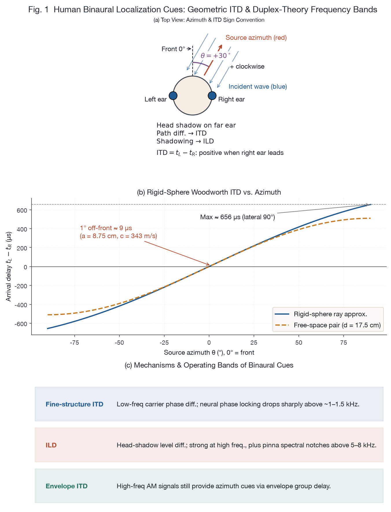

> This is Chapter 1 of the main text; the book comprises 16 main and special-topic chapters (Chapters 0–15, where Chapter 0 covers mathematical foundations and Chapters 12–15 are four extended special topics), accompanied by Appendices A and B. This chapter can be read self-contained; navigation links appear below.
>
> Overview: [00_overview.md](00_overview.md) | Previous: [00_math-foundations.md](00_math-foundations.md) | Next: [02_basics-signal-model.md](02_basics-signal-model.md)

---

## 1. Starting from an Everyday Scenario: Problem Definition

Starting from far-field voice interaction in a living room, this chapter first clarifies what signals enter and what outputs leave sound source localization, beamforming, and source tracking, then works step by step by hand to answer two central questions: *Why does summing and averaging waveforms recorded across multiple microphones suppress random noise floors? And if time delays are misaligned or noises are correlated across sensors, why can averaging fail to reduce noise—or even damage target speech and amplify sensor self-noise?* Next, using human binaural hearing as a physical reference, we dissect the spatial information carried by interaural time differences, interaural level differences, and direction-dependent spectral cues, examining how far machine microphone arrays can borrow from human audition and where they obey fundamentally different physical laws.

After completing this chapter, you will be able to derive the ideal four-microphone averaging gain under spatially white noise along with its exact validity assumptions; distinguish overall loudness scaling, uncentered mean-square power, centered variance, and component-wise Signal-to-Noise Ratio (SNR); calculate the low-frequency $1/f$ self-noise penalty hidden behind A-weighted ($\mathrm{dB(A)}$) MEMS microphone datasheet ratings as well as matrix coloring for spatially correlated noise; and contrast geometric propagation formulas against human psychoacoustic discrimination thresholds.

### Task Definitions and Ideal Array Gains

#### The Distant-Speech Problem in a Living Room

Imagine sitting on your living-room sofa and asking a smart speaker 3 meters away, *"What's the weather like today?"* During a close-talking phone call, your lips sit just a few centimeters from the handset microphone, so direct speech dwarfs ambient noise; once you step back to 3 meters, however, direct speech attenuates substantially en route, and to hear your utterance clearly the speaker must contend simultaneously with five physically distinct classes of degradation:

1. **Ambient background noise**: Air-conditioner airflow, street traffic outside the window, or refrigerator hum entering the microphones continuously from all directions.
2. **Room reverberation**: Each syllable you utter bounces repeatedly off walls, floors, tabletops, and ceilings before arriving at the microphones in staggered waves; late reflections drag out long decaying tails that smear across subsequent syllables and blur consonant articulation.
3. **Off-axis competing talkers**: Family members conversing nearby or a news anchor speaking on the television. Because these interferers share the exact harmonic and formant structure of natural speech, merely "detecting whether human voice is present" cannot tell who actually addressed the device.
4. **Microphone self-noise**: Thermal Brownian agitation of the sensor diaphragm plus electronic noise generated inside the preamplifier ASIC itself. Even inside a perfectly soundproof anechoic chamber, self-noise persists; worse, if a downstream spatial algorithm applies large opposing positive and negative weights to cancel external interference, it will dramatically amplify this internal noise floor.
5. **Loudspeaker acoustic echo**: Whenever the smart speaker is playing music, sound radiated by its own loudspeaker couples directly through the enclosure and reflects off room surfaces back into its microphones—often 10 to 30 dB louder than a talker 3 meters away. Unlike an external television, however, the device has internal access to the exact digital audio stream being sent to its loudspeaker as a known reference signal.

Confronted with this tangled acoustic field, a single microphone records only scalar sound-pressure fluctuations at one point in space, collapsing waves arriving from every direction irreversibly into a single one-dimensional waveform. Humans converse effortlessly at noisy cocktail parties largely because our left and right ears are separated in space. Inspired by this, machines deploy **an array of synchronously sampled microphones** observing the sound field simultaneously across distinct spatial positions: propagation arrival times, amplitude attenuation, and scattering frequency responses from a given source vary systematically with direction (whether a spherical wavefront at 3 meters can be approximated as a flat plane wave must be judged jointly from array aperture and acoustic wavelength—we derive the quantitative boundary in §2.2).

We emphasize **synchronous sampling** upfront because spatial time-delay cues are minuscule: sound in air travels at roughly $343\ \mathrm{m/s}$, covering about $2.14\ \mathrm{cm}$ in just $62.5\ \mu\mathrm{s}$ (precisely 1 sample period at a $16\ \mathrm{kHz}$ sampling rate). Only when all microphones share a common hardware sampling clock—so identical sample indices correspond to the exact same physical instant—do inter-channel sample offsets faithfully reflect acoustic path differences; uncalibrated clock skew or buffer slips inject artificial delays that corrupt directional estimates and can destructively cancel high-frequency target speech upon summation (Exercise E01-05 calculates by hand how a mere 1-sample misalignment penalizes high frequencies far more severely than low frequencies).

#### Three Spatial Processing Tasks

Given synchronized multichannel recordings, three interconnected yet distinct tasks revolve around *spatial direction*:

| Task | Intuitive Analogy | Core Question Answered |
|---|---|---|
| **Sound Source Localization** | Closing your eyes and judging where someone is calling from | At what directional angle (or spatial coordinate) relative to the array is the source located? |
| **Beamforming** | Focusing auditory attention toward the target talker | How should multichannel signals be combined to preserve target-direction sound while suppressing off-axis interference? |
| **Source Tracking** | Turning your head smoothly to follow someone walking across the room | How is the target moving over time, and does our bearing estimate remain reliable across brief speech pauses or occlusions? |

Tracing a synchronized four-channel recording through the table above highlights the clean division of inputs, outputs, and evaluation criteria across these three modules:

- **Sound source localization** ingests synchronized multichannel audio, analyzes inter-channel time delays, phase differences, or spatial spectra, and outputs one or more candidate bearing angles (plus range in near-field or distributed geometries). Localization algorithms typically attach a spatial-spectrum peak height or cross-correlation score to rank candidates; note carefully that this raw score measures phase-alignment coherence—it is *not* a calibrated probability that a physical source exists at that angle.
- **Beamforming** ingests multichannel audio, applies appropriate delay compensation and real/complex linear weights steered toward a designated target direction (either supplied dynamically by localization/tracking or fixed ahead of time toward broadside), and outputs an audio stream in which the target direction stands out while off-axis noise is attenuated.
- **Source tracking** ingests frame-by-frame directional observations from the localizer and recursively updates bearing and angular-velocity states through a dynamical motion model; when a talker pauses briefly between words (causing missing observations) or room reflections trigger single-frame angular outliers, the tracker smooths trajectories, coasts short-term predictions, and resolves *which historical track owns each new observation* when multiple talkers cross paths.

In practical pipelines, localization and tracking routinely feed real-time steering angles into an adaptive beamformer, yet their acceptance metrics must never be conflated: localization is judged by angular error, beamforming by target fidelity and noise suppression, and tracking additionally by missed-track rates and identity switches—a louder beamformer output never proves that the localizer found a more accurate angle.

Purely directional spatial filtering also obeys hard physical limits. If a target talker and a blaring television sit along the exact same line of sight from the array, both waves traverse virtually identical inter-microphone delays and cannot be separated by far-field directional beamforming alone; moreover, because every physical array has finite size, its spatial acceptance zone behaves like a flashlight beam with nonzero angular width (the mainlobe beamwidth detailed in §2.6) rather than an infinitely thin geometric ray, allowing nearby interferers close to the target bearing to leak partially into the output.

Removing the device's own loudspeaker echo, stripping late room reverberation tails from the target talker, and unmixing co-directional or closely spaced overlapping talkers require, respectively, playback-referenced **Acoustic Echo Cancellation (AEC)**, cross-frame linear prediction dereverberation, and speech separation—developed systematically across Chapters 6–8.

#### Distinguishing Loudness, Power, and Signal-to-Noise Ratio First

Before claiming that an array "reduced noise by $X$ dB," we must get the exact accounting right among waveform amplitude, mean-square power, variance, and SNR. Throughout this book, discrete time-domain average power is measured uniformly via the sequence **mean square**: for a real sequence $u[0], u[1], \ldots, u[N-1]$ of length $N$, square each sample, sum, and divide by $N$:

$$
P_u = \frac{1}{N}\sum_{n=0}^{N-1}u[n]^2. \tag{1-1}
$$

In Eq. (1-1), $n$ denotes the zero-based sample index ($0$ to $N-1$) and $N$ the window length in samples. When $u[n]$ represents dimensionless digital full-scale amplitude normalized to $[-1, 1]$ after analog-to-digital conversion, $P_u$ is likewise dimensionless digital mean-square power; converting it into physical mean-square sound pressure ($\mathrm{Pa}^2$) or acoustic power ($\mathrm{W}$) requires transducer sensitivity and acoustic calibration constants.

Observant readers may ask: why doesn't Eq. (1-1) subtract the sample mean first? Denoting the sample mean over these $N$ samples by $\bar u = \frac{1}{N}\sum_{n=0}^{N-1} u[n]$ and computing the mean-subtracted **centered sample variance** $V_N$ with the same denominator $N$, expanding the square reveals their exact identity:

$$
\begin{aligned}
V_N &= \frac{1}{N}\sum_{n=0}^{N-1}\bigl(u[n]-\bar u\bigr)^2 \\
&= \frac{1}{N}\sum_{n=0}^{N-1}
\bigl(u[n]^2 - 2\bar u\,u[n] + \bar u^2\bigr) \\
&= \frac{1}{N}\sum_{n=0}^{N-1}u[n]^2
- 2\bar u\left(\frac{1}{N}\sum_{n=0}^{N-1}u[n]\right) + \bar u^2 \\
&= P_u - 2\bar u^2 + \bar u^2 = P_u - \bar u^2.
\end{aligned}
$$

The identity $P_u = V_N + \bar u^2$ carries two immediate engineering lessons. First, real electret or silicon MEMS microphones and ADC front ends routinely exhibit a small **DC offset**, causing even a recording made in dead silence to hover slightly above or below zero at $\bar u \neq 0$; evaluating Eq. (1-1) without mean subtraction or a DC-blocking high-pass filter lets inaudible DC energy $\bar u^2$ artificially inflate measured noise-floor power.

Second, even when a theoretical stochastic noise process has exact zero population mean ($\mathbb{E}[u[n]]=0$, where population mean square equals population variance), any finite $N$-sample realization will almost never have sample mean $\bar u$ equal to exact zero (Exercise E01-04).

In controlled simulations where clean target speech $s[n]$ and additive noise $v[n]$ are stored separately, evaluating Eq. (1-1) over the shared window $[0, N-1]$ yields target power $P_s$ and noise power $P_v$. This defines power-based **Signal-to-Noise Ratio (SNR)** and post-processing SNR gain $G$ (decibel scaling and power/amplitude conversions are reviewed in [Chapter 0 §0.2](00_math-foundations.md#sec-0-2)):

$$
\begin{aligned}
\mathrm{SNR} &= \frac{P_s}{P_v}, &
\mathrm{SNR}_{\mathrm{dB}} &= 10\log_{10}\frac{P_s}{P_v}, \\
G_{\mathrm{dB}} &= 10\log_{10}G, &
G &= \frac{\mathrm{SNR}_{\mathrm{out}}}
{\mathrm{SNR}_{\mathrm{in}}}.
\end{aligned} \tag{1-2}
$$

Always check positivity of numerators and denominators before applying Eq. (1-2): $\mathrm{SNR}_{\mathrm{in}}$, $\mathrm{SNR}_{\mathrm{out}}$, and gain $G$ are finite positive numbers only when $P_{s,\mathrm{in}}$, $P_{v,\mathrm{in}}$, and $P_{v,\mathrm{out}}$ are all strictly positive. Three degenerate boundary cases require explicit handling:

- **Pure-silence input segments ($P_{s,\mathrm{in}}=0$)**: Input SNR vanishes and cannot sit in the denominator of $G$—which is why Chapter 10 speech evaluations segment active speech from silence first.
- **Complete anti-phase target cancellation ($P_{s,\mathrm{out}}=0$ with $P_{v,\mathrm{out}}>0$)**: Target speech present at the input is wiped out by anti-phase channel cancellation while noise survives, giving linear $\mathrm{SNR}_{\mathrm{out}}=0$ ($-\infty\ \mathrm{dB}$ in the limit).
- **Noiseless alignment checks ($P_v=0$)**: Zero denominator leaves SNR undefined; measure target amplitude or mean-square power retention ratios directly instead of dividing by zero (Exercise E01-05).

In field recordings, we observe only the superimposed mixture $x[n]=s[n]+v[n]$, whose total power $P_x$ alone cannot uniquely separate $P_s$ from $P_v$ (expanding the square also introduces a target–noise cross-term, dissected in Exercise E01-07).

Build quick intuition with a minimal numerical check: suppose a single microphone has $P_s=1$ and $P_v=1$, giving linear $\mathrm{SNR}=1/1=1$ ($10\log_{10}1=0\ \mathrm{dB}$). A processor that preserves $P_s=1$ while cutting noise power to $0.25$ raises linear $\mathrm{SNR}$ to $4$ ($10\log_{10}4\approx 6.02\ \mathrm{dB}$); conversely, merely turning the volume knob down by half—multiplying both target and noise amplitudes by $0.5$—quarters both powers to $0.25$ and $0.25$: the audio sounds quieter, yet $\mathrm{SNR}=0.25/0.25=1$ ($0\ \mathrm{dB}$) has not improved by a fraction of a decibel.

#### Datasheet dBA SNR Ratings and the Low-Frequency Self-Noise Trap

When selecting hardware transducers, watch out for how commercial microphone datasheets report SNR. Opening a silicon MEMS microphone datasheet typically reveals a headline figure such as `SNR = 65 dB(A)`: its numerator fixes a $1\ \mathrm{kHz}$, $94\ \mathrm{dB\ SPL}$ ($1\ \mathrm{Pa}$ RMS) sinusoidal reference power, whereas its denominator multiplies the sensor's anechoic self-noise power spectral density by the international standard IEC 61672-1 **A-weighting** power curve before integrating across the audio band ($20\ \mathrm{Hz}$–$20\ \mathrm{kHz}$).

Designed to mimic quiet-listening human equal-loudness contours referenced to $0\ \mathrm{dB}$ at $1\ \mathrm{kHz}$, A-weighting heavily attenuates low frequencies. Inspecting key IEC 61672-1 weights below shows that at $100\ \mathrm{Hz}$ only $\approx 0.0122$ of noise power is counted (filtering out nearly $98.8\%$), and at $50\ \mathrm{Hz}$ barely $0.00094$ survives—neatly hiding the steep low-frequency **$1/f$ flicker noise** generated by MEMS ASIC transistors and diaphragm acoustic vent resistance:

| Frequency $f$ | Relative A-Weighting $A(f)$ | Linear Power Weight $g_{\mathrm{A}}^2(f)$ | Share of Noise Power Counted |
|---|---|---|---|
| $50\ \mathrm{Hz}$ | $-30.27\ \mathrm{dB}$ | $0.000939$ | $\approx 0.094\%$ |
| $100\ \mathrm{Hz}$ | $-19.14\ \mathrm{dB}$ | $0.012182$ | $\approx 1.22\%$ |
| $200\ \mathrm{Hz}$ | $-10.85\ \mathrm{dB}$ | $0.082298$ | $\approx 8.23\%$ |
| $500\ \mathrm{Hz}$ | $-3.25\ \mathrm{dB}$ | $0.473405$ | $\approx 47.3\%$ |
| $1000\ \mathrm{Hz}$ | $0.00\ \mathrm{dB}$ | $1.000000$ | $100\%$ (reference) |
| $2500\ \mathrm{Hz}$ | $+1.27\ \mathrm{dB}$ | $1.339883$ | $\approx 134\%$ |

For single-microphone direct human listening, A-weighting roughly tracks perceived hiss; once MEMS sensors are mounted into a compact array for first-order differential or superdirective beamforming (§5.3), however, the picture flips completely upside down. When inter-sensor spacing $d$ is much smaller than a wavelength, subtracting adjacent microphones cancels rear interference but also rolls off low-frequency target speech sinusoidally at $-6.02\ \mathrm{dB}$ per octave; restoring flat target speech requires an equalization filter boosting low-frequency power proportional to $1/f^2$ ($+6.02\ \mathrm{dB}$/octave), which—multiplied onto the sensor's native $1/f$ flicker noise—blows up low-frequency output self-noise as $1/f^3$ ($+9.03\ \mathrm{dB}$/octave)! Budgeting low-frequency noise on compact arrays therefore demands unweighted self-noise PSD curves rather than a single $\mathrm{dB(A)}$ headline number (Exercise E01-12 calculates a concrete reversal where a MEMS mic boasting a $\approx 1.59\ \mathrm{dB}$ better $\mathrm{dB(A)}$ rating across $50\ \mathrm{Hz}$–$8\ \mathrm{kHz}$ degrades speech-band output noise by $\approx 5\ \mathrm{dB}$ on a $1\ \mathrm{cm}$ differential pair).

#### Three Classes of Array Gain and White Noise Gain

How many decibels of noise an array removes depends critically on the spatial structure of the noise field. Engineering practice uses three distinct yardsticks matched to three canonical spatial noise models:

| Spatial Assumption on Input Noise / Interference | Core Metric | What This Metric Tells Us |
|---|---|---|
| Zero-mean, equal-power, mutually uncorrelated noise across channels | **White Noise Gain (WNG)** | Array SNR improvement over one mic under ideal independent self-noise; widely used to monitor sensor self-noise amplification |
| Equal-strength plane waves arriving isotropically from all directions | **Directivity Index (DI)** | Target-direction gain over background noise averaged over the full sphere (or horizontal circle), expressed in dB |
| Strong point-source interferer arriving from a specific bearing | **Interferer Response / Null Depth** | Attenuation in dB at that specific interferer bearing; characterizes only that angle, not quietness elsewhere |

The single most common point of confusion in this table is the word "white" inside WNG. In single-channel DSP, "temporally white noise" means flat power spectral density across all frequencies; **White Noise Gain (WNG)**, by contrast, refers to **spatially white** noise—meaning that at a given frequency (or after target alignment), noise across distinct microphones is mutually uncorrelated (zero cross-channel expectation) with equal variance on every channel.

Spatial whiteness is a *cross-channel* statistical property completely distinct from single-channel spectral flatness: if you generate spectrally flat white noise and copy that identical waveform into four channels, the four noises are $100\%$ spatially coherent and averaging reduces zero noise; conversely, independent low-frequency $1/f$ circuit noises across four matched sensors are spectrally colored yet satisfy the spatially white assumption bin by bin.

Indoors, late reverberation after many wall bounces is often approximated as an isotropic diffuse field, making DI a useful proxy for diffuse-reverb suppression; as Chapter 5 (§5.3–§5.4) demonstrates, pushing low-frequency DI high on a compact aperture forces aggressive inter-channel subtraction that drives $\mathrm{WNG}_{\mathrm{dB}}$ negative (amplifying sensor self-noise), while deep directional nulls must always be evaluated alongside target distortion and pointing-error sensitivity.

#### From Summation to Averaging: How Four Microphones Deliver 6 dB

Let us derive the foundational array-gain benchmark by hand. Suppose a far-field target impinges on $M$ matched microphones whose arrival-time differences have already been compensated exactly. The $m$-th aligned channel ($m=1,\ldots,M$) reads

$$
x_m[n] = s[n] + v_m[n],
$$

sharing identical aligned target waveform $s[n]$ of power $P_s=\mathbb{E}[s[n]^2]>0$ (even in the near field, compensating both propagation delays and spherical $1/r$ attenuation into common $s[n]$ obeys the exact same algebra). Assume additive noises $v_m[n]$ have zero mean ($\mathbb{E}[v_m[n]]=0$), equal variance ($\mathbb{E}[v_m[n]^2]=P_v>0$), and zero cross-channel correlation ($\mathbb{E}[v_m[n]v_\ell[n]]=0$ for $m\ne \ell$; expectation properties are reviewed in [Chapter 0 §0.6](00_math-foundations.md#sec-0-6)), giving single-mic input $\mathrm{SNR}_{\mathrm{in}}=P_s/P_v$.

**Step 1: Direct summation across $M$ channels.** Denote raw sum $z[n]$ and equal-weight average $y[n]$ by:

$$
\begin{aligned}
z[n] &= \sum_{m=1}^{M}x_m[n] = M s[n] + \sum_{m=1}^{M}v_m[n], \\
y[n] &= \frac{z[n]}{M} = s[n] + \frac{1}{M}\sum_{m=1}^{M}v_m[n].
\end{aligned} \tag{1-3}
$$

Evaluate target and noise powers inside raw sum $z[n]$ separately:

- **Coherent target addition**: Summing $M$ identical copies of $s[n]$ produces $M s[n]$, scaling amplitude by $M$ and squared power to $\mathbb{E}\bigl[(M s[n])^2\bigr]=M^2 P_s$.
- **Incoherent noise power addition**: Expanding $\bigl(\sum_{m=1}^{M}v_m[n]\bigr)^2$ yields $M$ diagonal squares $v_m[n]^2$ plus $M(M-1)$ off-diagonal cross-products $v_m[n]v_\ell[n]$ ($m\ne\ell$)—e.g., $(v_1+v_2)^2 = v_1^2 + v_2^2 + 2v_1 v_2$ for $M=2$. Taking population expectation term by term gives:

$$
\begin{aligned}
\mathbb{E}\!\left[\left(\sum_{m=1}^{M}v_m[n]\right)^2\right]
&= \sum_{m=1}^{M}\mathbb{E}\bigl[v_m[n]^2\bigr] \\
&\quad + \sum_{m=1}^{M}\sum_{\substack{\ell=1\\\ell\ne m}}^{M}
\mathbb{E}\bigl[v_m[n]v_\ell[n]\bigr] \\
&= M P_v + 0 = M P_v.
\end{aligned}
$$

Because cross-channel noises are uncorrelated, all $M(M-1)$ cross-terms vanish in expectation, leaving only $M$ diagonal terms: summed noise power grows only to $M P_v$ while target power grows to $M^2 P_s$!

**Step 2: Dividing by $M$ for equal-weight averaging.** Scaling $z[n]$ by $1/M$ into $y[n]$ divides both target and noise powers by $M^2$: output target power returns to single-mic scale $M^2 P_s / M^2 = P_s$, while output noise power shrinks to $M P_v / M^2 = P_v / M$. Substituting into Eq. (1-2) immediately yields output SNR and array gain:

$$
\begin{aligned}
\mathrm{SNR}_{\mathrm{out}} &= \frac{P_s}{P_v/M} \\
&= M\,\mathrm{SNR}_{\mathrm{in}}, \quad
G_{\mathrm{dB}} = 10\log_{10}M.
\end{aligned} \tag{1-4}
$$

Note that Eq. (1-4) expresses the ratio of population second moments ($\mathbb{E}[\cdot]$); computing per-clip finite-window SNRs across short clips and averaging afterward estimates a different statistic due to random finite-sample cross-terms and nonlinearity of ratios/logarithms. For $M=4$ microphones with $P_s=1$ and $P_v=1$, comparing single mic, raw 4-mic sum, and 4-mic average side by side makes every column transparent:

| Processing Mode | Output Target Power | Output Noise Power | Linear Output SNR | SNR Gain vs. 1 Mic |
|---|---|---|---|---|
| Single-microphone baseline | 1 | 1 | 1 | 0.00 dB |
| Aligned 4-mic raw sum $z[n]$ | 16 | 4 | 4 | 6.02 dB |
| Aligned 4-mic equal average $y[n]$ | 1 | 0.25 | 4 | 6.02 dB |

Notice in the bottom two rows that raw summation and equal averaging achieve **the exact same output SNR** ($4$, or $10\log_{10}4 \approx 6.02\ \mathrm{dB}$). Engineering pipelines prefer equal-weight averaging ($1/M$) because it preserves nominal target speech level—allowing fair A/B comparisons against a single mic and preventing fixed-point overflow clipping when summing many channels. Under spatially white noise, $8$ microphones yield $10\log_{10}8 \approx 9.03\ \mathrm{dB}$—**every doubling of microphone count adds a fixed $10\log_{10}2 \approx 3.01\ \mathrm{dB}$ of ideal White Noise Gain**.

Better still, elementary completing-the-square proves that among *all* distortionless linear weightings, equal averaging $w_m = 1/M$ already attains the theoretical ceiling on WNG. Applying real weights $w_1,\ldots,w_M$ to form $y[n] = \sum_{m=1}^{M}w_m x_m[n]$ yields target $\bigl(\sum_{m=1}^{M}w_m\bigr)s[n]$ and noise $\sum_{m=1}^{M}w_m v_m[n]$. Preserving target speech unscaled requires $\sum_{m=1}^{M}w_m = 1$, under which unit-variance spatially white noise ($P_v=1$) produces output noise power $\sum_{m=1}^{M}w_m^2$. Expanding squared deviations from $1/M$ without skipping a step gives:

$$
\begin{aligned}
0 &\le \sum_{m=1}^{M}\left(w_m-\frac{1}{M}\right)^2 \\
&= \sum_{m=1}^{M}
\left(w_m^2 - \frac{2}{M}w_m + \frac{1}{M^2}\right) \\
&= \sum_{m=1}^{M}w_m^2 - \frac{2}{M}\sum_{m=1}^{M}w_m
+ M\cdot\frac{1}{M^2} \\
&= \sum_{m=1}^{M}w_m^2 - \frac{2}{M}\cdot 1 + \frac{1}{M}
= \sum_{m=1}^{M}w_m^2 - \frac{1}{M}.
\end{aligned}
$$

Rearranging proves $\sum_{m=1}^{M}w_m^2 \ge \frac{1}{M}$, with equality if and only if $w_m = \frac{1}{M}$ for every $m$ (Chapters 2 and 5 extend this identical ceiling to complex frequency-domain weights via Cauchy–Schwarz). Under equal-amplitude aligned targets and equal-variance spatially white noise, no linear beamformer can ever exceed linear WNG $M$, and plain delay-and-sum hits that ceiling exactly.

Conversely, even when $\sum_{m=1}^{M}w_m = 1$ preserves target speech, choosing large opposing positive and negative weights to cancel directional interference (e.g., $w_1=2, w_2=-1$ in Exercise E01-09) drives $\sum_{m=1}^{M}w_m^2 \gg 1$, making output self-noise substantially louder than a single microphone. Readers interested in how far-field arrays serve ASR engines may consult Kumatani, McDonough, and Raj, ["Microphone Array Processing for Distant Speech Recognition: From Close-Talking Microphones to Far-Field Sensors" (*IEEE Signal Processing Magazine*, 29(6), 127–140, 2012)](https://doi.org/10.1109/MSP.2012.2205285) ([public CMU course copy](https://course.ece.cmu.edu/~ece792/handouts/KumataniEtAl12.pdf)).

#### Matrix Coloring and Positive-Semidefinite Boundaries for Spatially Correlated Noise

When sensor noises are correlated across microphones—like HVAC airflow or diffuse room reverberation rather than independent thermal noise—how do we synthesize multichannel test noise obeying realistic spatial statistics? At frequency $f$ with unit per-mic variance, pairwise complex correlation coefficients across $M$ sensors form an $M \times M$ **spatial coherence matrix** $\mathbf{\Gamma}(f)$ obeying conjugate symmetry $\mathbf{\Gamma}^H = \mathbf{\Gamma}$ (Hermitian symmetry and eigendecomposition are derived in [Chapter 0 §0.3](00_math-foundations.md#sec-0-3) and [Appendix A §16.3](16_appendix-symbols-math.md#sec-16-3)). Mixing zero-mean spatially white $\vec z$ ($\mathbb{E}[\vec z\vec z^H] = \mathbf{I}_M$) through linear coloring matrix $\mathbf{C}$ as $\vec v = \mathbf{C}\vec z$ achieves $\mathbb{E}[\vec v\vec v^H] = \mathbf{C}\mathbf{C}^H = \mathbf{\Gamma}(f)$ via matrix square-root factorization (for classic spherical and cylindrical isotropic noise generation, see [Habets et al., *JASA*, 124(5), 2911–2917, 2008](https://doi.org/10.1121/1.2987429)).

Not every symmetric matrix qualifies as a physical spatial coherence matrix. For any complex weight vector $\vec w \in \mathbb{C}^M$, mean output power of $\vec w^H\vec v$ can never be negative; pairing non-negative power with unitary eigendecomposition $\mathbf\Gamma = \mathbf U\mathbf\Lambda\mathbf U^H$ gives:

$$
\begin{aligned}
\mathbb{E}\bigl[|\vec w^H\vec v|^2\bigr]
&= \vec w^H\mathbb{E}[\vec v\vec v^H]\vec w
= \vec w^H\mathbf{\Gamma}\vec w \ge 0, \\
\mathbf\Gamma^{1/2} &= \mathbf U\mathbf\Lambda^{1/2}\mathbf U^H.
\end{aligned}
$$

Physical power non-negativity holds if and only if every real eigenvalue of $\mathbf{\Gamma}(f)$ satisfies $\lambda_m \ge 0$—i.e., $\mathbf{\Gamma}(f)$ is **positive semidefinite (PSD)**. Standard numerical routines often call lower-triangular Cholesky factorization ($\mathbf{\Gamma} = \mathbf{L}\mathbf{L}^H$), which requires *strict* positive definiteness ($\lambda_m > 0$); at DC in a diffuse field (where all sensors move identically in phase, $\mathbf{\Gamma}(0)=\vec{1}\vec{1}^\top$, rank $1$) or at the negative-correlation singular boundary $\rho = -1/(M-1)$ in Exercise E01-01, zero eigenvalues cause naive Cholesky pivots to vanish or go tiny-negative in float64 and fail, whereas the Hermitian eigendecomposition square root $\mathbf{\Gamma}^{1/2}$ above remains uniquely well-defined across every rank-deficient PSD boundary (Exercise E01-11 works out rational 2-mic and singular 4-mic cases by hand).

### Three Binaural Localization Cues in Human Hearing

Before deriving arbitrary microphone array geometries, inspecting nature's evolved two-channel receiver—human left and right ears—builds invaluable physical intuition. Acoustically, our two ears act like sensors mounted on opposite sides of a rigid spherical baffle (the head) behind asymmetric directional waveguides (the pinnae), backed by active head motion, prior memory, and brainstem neural circuits. Figure 1 separates Interaural Time Difference, Interaural Level Difference, and directional spectral cues visually (on narrow screens, click [open Figure 1 full resolution](../figures_en/fig01_binaural.png) to zoom in):



Read Figure 1 sequentially along `(a) → (b) → (c)` from geometric acoustics to perceptual boundaries:

- **Panel `(a)` Top-down geometry and sign convention**: Viewing the head from above with blue dots marking left and right ears, the upward black arrow defines straight-ahead $0^\circ$, with clockwise rightward bearings positive (purple arc marks a source at $\theta=+30^\circ$ front-right, red outward arrow points toward the source, and parallel slanted blue arrows depict incoming far-field wavefronts). Because the source sits on the right, wavefronts strike the ipsilateral right ear first while the contralateral left ear sits inside the head's acoustic shadow—forcing sound both to travel an extra creeping path around the head to reach the left ear (creating positive Interaural Time Difference $\mathrm{ITD}=t_L-t_R>0$) and to lose high-frequency energy to head shadowing (creating Interaural Level Difference $\mathrm{ILD}$).
- **Panel `(b)` Theoretical ITD curves under two geometric models**: Plotting arrival delay $t_L - t_R$ ($\mu\mathrm{s}$) against azimuth $\theta \in [-90^\circ, +90^\circ]$ at effective head radius $a=8.75\ \mathrm{cm}$ and $c=343\ \mathrm{m/s}$, comparing the solid blue curve (rigid-sphere creeping-ray approximation) against the dashed orange curve (unobstructed free-field point pair spaced at $17.5\ \mathrm{cm}$ with the head removed) reveals three features: first, near $\theta=0^\circ$ both curves overlap almost linearly at roughly $9\ \mu\mathrm{s}$ per $1^\circ$ shift (red annotation); second, toward lateral angles the free-field sine curve flattens out to $\approx 510\ \mu\mathrm{s}$ at $+90^\circ$, whereas the rigid-sphere curve—unable to tunnel straight through the skull—climbs to $\approx 656\ \mu\mathrm{s}$; third, odd symmetry makes left-hemisphere sources ($\theta<0^\circ$) arrive at the left ear first with negative ITD.
- **Panel `(c)` Operating regimes across three binaural cues**: Stacked blue, red, and green bars compare pure-tone fine-structure ITD, ILD, and modulated high-frequency envelope ITD. This panel dispels the oversimplified textbook myth that "low frequencies use only ITD and high frequencies use only ILD": although neural phase locking to cycle-by-cycle pure-tone carrier phase fades out near $\approx 1.4\ \mathrm{kHz}$ in controlled headphone tasks, slowly modulated high-frequency sounds still convey clear envelope ITDs, just as near-field or baffled low frequencies can exhibit nonzero ILDs.

#### Interaural Time Difference: Getting the Geometric Model Right

**Interaural Time Difference (ITD)** measures the arrival-time lag of a wavefront between the two ears. Following Figure 1(a) with $0^\circ$ straight ahead and clockwise bearings positive, denoting arrival instants at the left and right ears by $t_L$ and $t_R$ defines $\tau = t_L - t_R$: a right-side source ($\theta>0^\circ$) reaches the right ear earlier ($t_L > t_R$, so $\tau > 0$), while a symmetric left-side source gives $\tau < 0$.

Why does head diffraction produce extra path length $a\sin\theta + a\theta$? Trace the classic **Woodworth high-frequency rigid-sphere ray model** step by step. Model the head as a rigid sphere of radius $a$ centered at origin $O$ with right ear $R$ at $(a, 0)$ and left ear $L$ at $(-a, 0)$. For a far-field plane wave arriving from front-right bearing $0 \le \theta \le \pi/2$ (unit source vector $(\sin\theta, \cos\theta)$, wavefront perpendicular to it):

1. **Ipsilateral straight-line lead $a\sin\theta$**: Right ear $R$ sits on the illuminated hemisphere facing the source. Relative to the parallel reference wavefront passing through sphere center $O$, $R$ projects a distance $a\sin\theta$ closer to the source—so after striking $R$, the wavefront travels an additional straight distance $a\sin\theta$ before reaching the center reference plane.
2. **Contralateral creeping arc $a\theta$ from the tangent point**: On the opposite side toward left ear $L$, one grazing ray touches the sphere tangentially at point $T$. Because radius $OT$ is perpendicular to the incident ray, **tangent point $T$ lies on the exact same center reference wavefront passing through $O$**! Moreover, the central angle subtended between $OT$ and left-ear radius $OL$ equals $\theta$ (in radians). Unable to penetrate the rigid skull past $T$, the wave creeps along the spherical arc of length $a\theta$ into the shadow zone to reach $L$.

Adding straight segment $a\sin\theta$ (from $R$ to the $O$–$T$ wavefront) to spherical arc $a\theta$ (from $T$ to $L$) gives total path difference $\Delta d = a(\theta + \sin\theta)$; dividing by sound speed $c$ (and extending to $-\pi/2 \le \theta \le \pi/2$ by odd symmetry) yields Woodworth's formula:

$$
\tau_{\mathrm{sphere}}(\theta)
= \frac{a}{c}\bigl(\theta+\sin\theta\bigr). \tag{1-5}
$$

Watch units carefully when evaluating Eq. (1-5) by hand: with $a$ in meters ($\mathrm{m}$) and $c$ in $\mathrm{m/s}$, the standalone angle $\theta$ inside the parentheses **must be in radians ($\mathrm{rad}$)** so $a\theta$ represents arc length in meters and the quotient has units of seconds ($\mathrm{s}$).

Substituting typical adult head radius $a = 8.75\ \mathrm{cm} = 0.0875\ \mathrm{m}$ and $c = 343\ \mathrm{m/s}$ reproduces both key landmarks on Figure 1(b):

- **Lateral extremum ($\theta = 90^\circ = \pi/2\ \mathrm{rad}$)**: Here $\sin(\pi/2)=1$ (one radius $a$ straight to the center plane) plus a quarter-circle creeping arc $\frac{\pi}{2}a$ around the head to the shadowed ear gives

    $$
    \begin{aligned}
    \tau_{\mathrm{sphere}}(90^\circ)
    &= \frac{0.0875}{343}\left(\frac{\pi}{2}+1\right) \\
    &\approx 0.000655815\ \mathrm{s} \approx 656\ \mu\mathrm{s}.
    \end{aligned}
    $$

- **One-degree shift off midline ($\theta = 1^\circ$)**: Converting $\theta = \pi/180 \approx 0.0174533\ \mathrm{rad}$ with $\sin 1^\circ \approx 0.0174524$ gives $\tau_{\mathrm{sphere}}(1^\circ) \approx 8.9045\ \mu\mathrm{s}$ (annotated as $\approx 9\ \mu\mathrm{s}$ in Figure 1(b)). Note that $9\ \mu\mathrm{s}$ is the *physical acoustic delay increment* per degree near midline; whether human listeners can actually discriminate $9\ \mu\mathrm{s}$ must be measured empirically via psychoacoustic experiments rather than asserted from geometry alone.

By contrast, removing the head to leave two unobstructed free-field point microphones separated by $d = 2a = 17.5\ \mathrm{cm}$ replaces creeping arc $a\theta$ with a second straight projection $a\sin\theta$, yielding the free-field two-point delay formula:

$$
\tau_{\mathrm{free}}(\theta) = \frac{2a}{c}\sin\theta. \tag{1-6}
$$

At $2a = 0.175\ \mathrm{m}$ and $\theta = 90^\circ$, the unobstructed maximum delay is only $0.175 / 343 \approx 510\ \mu\mathrm{s}$—roughly $146\ \mu\mathrm{s}$ shorter than around a spherical head! Near straight-ahead ($\theta \to 0$), first-order Taylor approximation $\sin\theta \approx \theta$ collapses both Eqs. (1-5) and (1-6) to $\frac{2a}{c}\theta$, explaining geometrically why the blue and orange curves hug each other near $0^\circ$ and diverge progressively toward $\pm 90^\circ$.

Keep in mind that Woodworth's formula is an asymptotic high-frequency ray approximation valid when wavelength is small relative to head size; low-frequency wave diffraction and actual ear-canal offsets away from exact antipodes are analyzed in detail by [Aaronson and Hartmann (*JASA*, 135(2), 817–823, 2014)](https://doi.org/10.1121/1.4861243).

#### Level Differences, Fine Structure, and Envelopes Must Be Evaluated Separately

Beyond arrival timing, sound pressure level also differs across the ears. **Interaural Level Difference (ILD)** measures the level difference between right and left ears. At mid-to-high frequencies where wavelength is shorter than head diameter, the head casts an acoustic shadow over the far ear, dropping contralateral level substantially below ipsilateral level; at low frequencies where wavelength far exceeds head diameter, waves diffract effortlessly around the skull and ILD shrinks toward zero. Far-field binaural ILD thus arises primarily from frequency-dependent head scattering and shadowing rather than negligible free-field $1/r$ spreading across $17.5\ \mathrm{cm}$.

Throughout this book we define ILD as **right-ear level minus left-ear level**: louder right ear gives $\mathrm{ILD} > 0$, louder left ear gives $\mathrm{ILD} < 0$. Under this convention, a right-hemisphere source produces both positive ITD and positive ILD (when reading external papers, check whether left-minus-right is used instead; Exercise E01-08 verifies amplitude ratios, power ratios, and channel-gain offsets on ILD).

As early as 1907, Lord Rayleigh proposed in ["On our perception of sound direction"](https://doi.org/10.1080/14786440709463595) that human localization relies primarily on interaural phase/time cues at low frequencies and interaural intensity cues at high frequencies—celebrated ever since as **Duplex Theory**. Modern psychoacoustics shows, however, that these cues do not flip like a hard mechanical switch at one cutoff frequency. Interpreting experimental data accurately requires separating two temporal scales: **fine structure** refers to rapid millisecond/sub-millisecond cycle-by-cycle carrier oscillations, whereas **envelope** refers to slower amplitude modulations riding atop the carrier—a $4\ \mathrm{kHz}$ tone has a tiny carrier period yet can carry a slow envelope fluctuating tens of times per second. The table below pairs accurate experimental findings from Figure 1(c) against overgeneralizations to avoid:

| Experimental Stimulus | Experimentally Supported Conclusion | Overgeneralization to Avoid |
|---|---|---|
| Headphone pure-tone fine-structure ITD | Under controlled discrimination tasks, human sensitivity to cycle-by-cycle pure-tone phase ITD tops out near $\approx 1.4\ \mathrm{kHz}$ | Assuming *every* temporal cue in *every* sound vanishes abruptly above $1.4\ \mathrm{kHz}$ |
| Directional Interaural Level Difference (ILD) | Head shadowing produces large mid/high-frequency ILDs, and near-field sources also create substantial low-frequency ILDs | Assuming zero physical level difference can ever exist below some fixed frequency |
| High-frequency sounds with slow amplitude envelopes | Even on multi-kilohertz carriers, interaural envelope timing shifts evoke clear lateralization | Inferring from envelope ITD sensitivity that auditory nerve fibers phase-lock to multi-kHz pure-tone carriers |

Where does the oft-cited "$\approx 1.4\ \mathrm{kHz}$" figure come from? Inspect the experimental protocol in [Brughera, Dunai, and Hartmann (*JASA*, 2013, §II.A–B, pp. 2840–2843)](https://pmc.ncbi.nlm.nih.gov/articles/PMC3663869/) ([author institutional repository PDF](https://riunet.upv.es/server/api/core/bitstreams/f65b9337-1b1e-4013-9020-8338ac77ad6b/content)): listeners wore headphones presenting equal-level $70\ \mathrm{dB\ SPL}$, $500\ \mathrm{ms}$ pure tones (shaped with $100\ \mathrm{ms}$ onset/offset ramps to eliminate transient click cues) in a **two-interval forced-choice (2IFC)** task—playing a first tone at $+\Delta\mathrm{ITD}/2$ (say $+10\ \mu\mathrm{s}$ right) followed by a second tone at $-\Delta\mathrm{ITD}/2$ ($-10\ \mu\mathrm{s}$ left, total jump $\Delta\mathrm{ITD}=20\ \mu\mathrm{s}$) and asking whether the second tone shifted left or right.

Thresholds were tracked via a **3-down, 1-up adaptive staircase**: three consecutive correct answers shrank $\Delta\mathrm{ITD}$ by one step, whereas a single mistake widened $\Delta\mathrm{ITD}$ by one step. Why does a 3-down, 1-up staircase converge to the $\approx 79.4\%$ correct point? Denoting single-trial probability of a correct response at equilibrium by $p$, three independent correct answers occur with probability $p^3$; upward and downward steps balance when $p^3 = 0.5$, yielding $p = 0.5^{1/3} \approx 0.7937$ ($\approx 79.4\%$).

Across listeners, individual cutoffs varied noticeably: the two most sensitive listeners still achieved finite thresholds at $1400\ \mathrm{Hz}$, whereas at $1450\ \mathrm{Hz}$ the staircase diverged for every subject regardless of phase shift—establishing the precise empirical meaning of fine-structure ITD sensitivity "up to $\approx 1.4\ \mathrm{kHz}$."

For high-frequency envelopes, [Bernstein and Trahiotis (*JASA*, 2003)](https://doi.org/10.1121/1.1570431) crafted **$4\ \mathrm{kHz}$ transposed stimuli** by half-wave rectifying and low-pass filtering low-frequency waveforms (mimicking cochlear inner-hair-cell transduction envelopes) and modulating that slow envelope onto a $4\ \mathrm{kHz}$ carrier—confirming acute lateralization sensitivity to microsecond envelope ITDs even though the $4\ \mathrm{kHz}$ carrier fine structure lies far beyond neural phase locking.

Contrasting human neural phase locking against **machine microphone arrays** immediately clarifies a vital distinction: electronic ADCs sample $2\ \mathrm{kHz}$ or $8\ \mathrm{kHz}$ sinusoids without a trace of "neural fatigue"; what trips up machine arrays at high frequencies is periodic $2\pi$ phase wrapping—**spatial aliasing** (analyzed thoroughly in Chapters 2 and 3). Define single-frequency **Interaural Phase Difference (IPD)** as right-channel phase minus left-channel phase. Under a pure delay $\tau = t_L - t_R$ with nonzero magnitudes, right-minus-left phase equals $2\pi f\tau$ ($\mathrm{rad}$), which wraps indistinguishably every full cycle $2\pi$ ($360^\circ$).

Work out the numbers on a continuous $f = 2\ \mathrm{kHz}$ pure tone, whose period is $T = 1/2000 = 0.0005\ \mathrm{s} = 500\ \mu\mathrm{s}$:

- Compare $\tau_1 = +100\ \mu\mathrm{s}$ and $\tau_2 = +600\ \mu\mathrm{s}$: separated by one full $500\ \mu\mathrm{s}$ period, they yield identical wrapped phases $360^\circ \times 2000 \times 0.0001 = 72^\circ$ and $432^\circ \equiv 72^\circ\ (\bmod\ 360^\circ)$ at $2\ \mathrm{kHz}$. On a $17.5\ \mathrm{cm}$ free-field pair, however, physical delays cannot exceed $\pm 510\ \mu\mathrm{s}$ (Eq. (1-6)), ruling $+600\ \mu\mathrm{s}$ out geometrically.
- Now inspect a genuinely ambiguous pair: **$\tau_1 = +450\ \mu\mathrm{s}$ (far front-right) vs. $\tau_2 = -50\ \mu\mathrm{s}$ (slight front-left)**. Both delays lie squarely inside the physically valid $[-510, +510]\ \mu\mathrm{s}$ interval while differing by exactly $500\ \mu\mathrm{s}$! At $2\ \mathrm{kHz}$, $+450\ \mu\mathrm{s}$ gives $+324^\circ$ and $-50\ \mu\mathrm{s}$ gives $-36^\circ$, which coincide modulo $360^\circ$ ($324^\circ - 360^\circ = -36^\circ$)—making left vs. right impossible to tell from $2\ \mathrm{kHz}$ alone. Fortunately, natural speech spans a wide bandwidth: if that same talker simultaneously radiates energy at $1\ \mathrm{kHz}$, the shared physical delay maps $+450\ \mu\mathrm{s}$ to $+162^\circ$ and $-50\ \mu\mathrm{s}$ to $-18^\circ$ at $1\ \mathrm{kHz}$, breaking the tie instantly!

Machine arrays resolve high-frequency phase aliasing via three levers: tighter inter-sensor spacing to shrink physically admissible delays, wideband phase-slope fusion across frequencies, or non-uniform sensor spacings (see §2.6 and §3.2, and listen to [E04-18 Pure-Tone vs. Multi-Frequency TDOA](04_doa-estimation.md#sec-u-56493f2d40) alongside [Audio Experiment Manual Section 26](../codes/chapters/ch00/research_en/05_exercises_and_audio.md#sec-u-50bb14a451) after Chapter 4). Also remember that once enclosure scattering or transducer responses add frequency-dependent phase shifts, inter-channel phase ceases to equal pure $2\pi f\tau$ and cannot simply be divided by $2\pi f$ to read off geometric delay (Exercise E01-10 and [§2.3](02_basics-signal-model.md#sec-2-3)).

#### Direction-Dependent Spectra and Head-Related Transfer Functions

If localization relied solely on left–right ITD and ILD, whenever a source moved overhead from straight ahead to straight behind—or up and down within the median sagittal plane—left and right ears would remain symmetric with near-zero ITD and ILD; how, then, do humans tell front from back and up from down? The answer lies in the intricate ridges and cavities of the outer ear (pinna) plus head-and-torso reflections and diffraction: waves arriving from distinct elevations and front/back angles undergo micro-multipath interference just outside the ear canal, reinforcing certain frequency bands into **spectral peaks** while canceling others into **spectral notches**—stamping a directional "spectral fingerprint" onto incoming broadband sound.

Acoustics captures this complete spatial filtering process via the **Head-Related Transfer Function (HRTF)**: defined as the complex frequency response from a point source at a specified spatial coordinate to the left (or right) ear-canal entrance, divided by the free-field frequency response at the head-center reference point with the listener absent. Because a binaural HRTF pair records exact magnitude and phase across all frequencies, ITD, ILD, and pinna spectral notches are not three disconnected signals—they are phase, broadband-energy, and fine-spectral slices of one unified binaural transfer function pair.

Inferring direction from monaural or binaural spectral shape faces an inherent identifiability hurdle: the spectrum received at the ear equals **unknown source spectrum multiplied by directional transfer function**. If energy is weak around $6\ \mathrm{kHz}$, did a pinna notch carve it out, or did the sound source simply radiate little energy at $6\ \mathrm{kHz}$? A single pure tone probes only one spectral line and reveals zero spectral contour; only broadband sources let the auditory system inspect cross-frequency spectral profiles or form interaural complex ratios across active bins to cancel unknown shared source spectra (Exercise E01-10 demonstrates on a two-tap FIR pair how bin-wise ratios cancel source spectra exactly whereas broadband ILD shifts dramatically with source timbre). In natural hearing, the brain fuses ITD, ILD, broadband HRTF notches, and dynamic head-turn cues to resolve front–back and elevation ambiguities (reviewed comprehensively by [Middlebrooks and Green, *Annual Review of Psychology*, 1991](https://doi.org/10.1146/annurev.ps.42.020191.001031)).

#### Three-Dimensional HRTF Coordinate Conventions: SOFA Elevation vs. Colatitude

When loading public measured HRTF datasets or spherical array calibration files in code, mismatched 3D angular conventions are a notorious bug magnet. Audio Engineering Society standard **AES69 (Spatially Oriented Format for Acoustics, `SOFA`)** specifies a listener-local right-handed Cartesian frame with $+x_{\mathrm{SOFA}}$ straight ahead, $+y_{\mathrm{SOFA}}$ due left, and $+z_{\mathrm{SOFA}}$ straight up; spherical coordinates $(\phi_{\mathrm{SOFA}}, \delta_{\mathrm{SOFA}}, r)$ measure horizontal azimuth $\phi_{\mathrm{SOFA}}$ **counterclockwise** from front $+x_{\mathrm{SOFA}}$ toward left $+y_{\mathrm{SOFA}}$ (opposite in sign to our clockwise azimuth $\theta$ in Figure 1(a), obeying $\phi_{\mathrm{SOFA}} \equiv -\theta \pmod{360^\circ}$), and **elevation** $\delta_{\mathrm{SOFA}} \in [-90^\circ, +90^\circ]$ upward from the horizontal plane toward $+z_{\mathrm{SOFA}}$.

Meanwhile, spherical-harmonic array formulations ([Chapter 0 §0.1](00_math-foundations.md#sec-0-1), [§0.7](00_math-foundations.md#sec-0-7), [§5.8](05_beamforming.md#sec-5-8), [§14.2](14_spatial-wearable-arrays.md#sec-14-2), and [Appendix A §16.1](16_appendix-symbols-math.md#sec-16-1)) parameterize polar angle downward from the $+z$ zenith as **colatitude** $\vartheta = 90^\circ - \delta_{\mathrm{SOFA}} \in [0^\circ, 180^\circ]$—note carefully that the horizontal equator sits at $\vartheta = 90^\circ$, *not* $0^\circ$! The table below cross-checks six unit-distance ($r=1\ \mathrm{m}$) directions across all four representations for unit-testing data loaders (hand derivations and bug diagnostics appear in Exercise E01-12; `libmysofa` spherical interpolation details appear in [Source Research Manual 1](../codes/chapters/ch00/research_en/01_spatial_and_tracking.md)):

| Physical Direction | Book Azimuth $\theta$ | SOFA Spherical $(\phi_{\mathrm{SOFA}}, \delta_{\mathrm{SOFA}})$ | SH Colatitude $\vartheta$ | SOFA Cartesian $(x, y, z)\ [\mathrm{m}]$ |
|---|---|---|---|---|
| Horizontal straight ahead | $0^\circ$ | $0^\circ,\ 0^\circ$ | $90^\circ$ | $(1, 0, 0)$ |
| Horizontal due right | $+90^\circ$ | $-90^\circ$ (or $270^\circ$), $0^\circ$ | $90^\circ$ | $(0, -1, 0)$ |
| Horizontal due left | $-90^\circ$ | $+90^\circ,\ 0^\circ$ | $90^\circ$ | $(0, 1, 0)$ |
| Horizontal straight behind | $\pm 180^\circ$ | $180^\circ,\ 0^\circ$ | $90^\circ$ | $(-1, 0, 0)$ |
| Overhead zenith | arbitrary (polar singularity) | $0^\circ,\ +90^\circ$ | $0^\circ$ | $(0, 0, 1)$ |
| $30^\circ$ front-right, $+30^\circ$ elevation | $+30^\circ$ | $-30^\circ$ (or $330^\circ$), $+30^\circ$ | $60^\circ$ | $(0.75, -0.4330, 0.5)$ |

#### Mapping Binaural Cues onto Machine Microphone Arrays

Indoors, wall reflections arrive just a few to a few dozen milliseconds after direct sound from completely different angles—yet in everyday conversation we still perceive speech as coming straight from the talker's mouth. Psychoacoustics terms this the **precedence effect**: when two similar sounds arrive in rapid succession within a short fusion window, perceived direction is dominated by the earliest-arriving direct wavefront (seminal experiments in [Wallach, Newman, and Rosenzweig, 1949](https://doi.org/10.2307/1418275); modern review of time windows and breakdown boundaries in [Brown, Stecker, and Tollin, 2015](https://pmc.ncbi.nlm.nih.gov/articles/PMC4310855/)). Precedence does not mean early reflections are erased—they enrich perceived loudness and spaciousness, whereas excessive late reverberation still degrades speech intelligibility.

Mapping five pillars of human binaural hearing onto engineered microphone arrays sketches the roadmap for the rest of this book:

| Binaural Phenomenon or Observable | Machine Microphone Array Counterpart | Chapters |
|---|---|---|
| Interaural Time Difference (ITD) | Pairwise Time Difference of Arrival (TDOA) estimation coupled with array geometry | §4.2 |
| Head and pinna diffraction/shadowing | Cylindrical speaker enclosures, display bezels, and tabletops reshaping directional amplitude/phase | §3.2 |
| Head-Related Transfer Function (HRTF) | Calibrating or modeling directional complex response vectors (steering vectors) and full manifolds | §3.4, §10.2 |
| Precedence effect on early reflections | Separating beneficial direct + early reflections from late tails via WPE guard delay $\Delta$ | §2.4, §7.1 |
| Cocktail party effect in noisy rooms | Combining adaptive spatial beamforming with time-frequency separation and target tracking | Ch. 5, §8.1, Ch. 15 |

Comparing both columns reveals a clean principle: **physical array geometry and enclosure acoustics dictate what spatial differences are observable at the sensors**, while **signal-processing and machine-learning algorithms dictate how cleanly those observables are distilled into enhanced target output**.

Before writing equations, engineers must also ask *who will listen to the output—a machine recognizer or human ears?* ASR front ends typically collapse multichannel audio into a single monaural stream; hearing aids, AR/VR headsets, and smart glasses, however, must deliver left and right ear signals—feeding the identical monaural beamformer output into both earbuds forces their non-zero spectral ratio identically to $1$ ($\mathrm{ILD}=0\ \mathrm{dB}$, $\mathrm{IPD}=0$), collapsing the entire acoustic world unnaturally inside the center of the wearer's skull.

Cue-preserving binaural beamforming is developed in [Chapter 5 §5.5](05_beamforming.md#sec-5-5), while irregular-array Binaural Signal Matching (BSM), air/in-ear cross-modal own-voice fusion, and sub-millisecond Hear-Through comb-filtering limits for glasses and TWS earbuds are derived in [Chapter 14](14_spatial-wearable-arrays.md#sec-14-5). Next, in Chapter 2, starting from basic propagation delays, we cast these physical phenomena into a rigorous mathematical array signal model.

### Chapter Exercises

Exercises E01-01–E01-03 run via cross-chapter script [`exercises_spatial.py`](../codes/chapters/ch00/cross_chapter/exercises_spatial.py), and Exercises E01-04–E01-12 run via chapter script [`chapter01_experiments.py`](../codes/chapters/ch01/chapter01_experiments.py). Neither script requires internet access; run both directly from the repository root:

```bash
.venv/bin/python -m codes.chapters.ch00.cross_chapter.exercises_spatial
.venv/bin/python -m codes.chapters.ch01.chapter01_experiments
```

The first command is the shared spatial verification runner across Chapters 1–5 (printing 28 exercises in total, including 200-trial Monte Carlo statistics across 7 settings for Chapter 4 Minimum Description Length (MDL) source-enumeration); while studying Chapter 1, simply inspect E01-01–E01-03 at the top of the printout. The second command runs E01-04–E01-12 specifically. Every worked example and companion WAV in this chapter is generated deterministically in IEEE-754 float64 (tables rounded to displayed significant digits), letting you verify every step by hand and compare exact float64 values against 16-bit PCM quantization readback.

#### E01-01: Four Microphones Do Not Automatically Yield 6 dB

Target speech is already equal-amplitude aligned across four channels, while four zero-mean noises each have unit variance $\mathbb{E}[v_m^2]=1$ and uniform pairwise correlation $\rho$ across distinct channels ($\mathbb{E}[v_m v_\ell]=\rho$ for $m\ne\ell$). Under four-channel equal averaging, compute output noise power and SNR gain over a single microphone at $\rho=0$, $0.5$, and $1$, explaining why identical noise across all four channels cannot be reduced by averaging.

**Reference Solution.** Equal averaging produces output noise $v_{\mathrm{out}}=(v_1+v_2+v_3+v_4)/4$. Expanding the squared four-term sum inside the numerator yields $4$ diagonal squares $v_m^2$ plus $\binom{4}{2}=6$ distinct pairs each appearing twice ($v_m v_\ell$ and $v_\ell v_m$) for $12$ cross-product terms in total. Taking expectation with unit diagonals and pairwise correlation $\rho$ gives:

$$
\begin{aligned}
P_{v,\mathrm{out}}
&= \mathbb{E}\!\Bigl[
\bigl((v_1+v_2+v_3+v_4)/4\bigr)^2\Bigr] \\
&= \frac{4\times 1 + 12\rho}{16}
= \frac{1+3\rho}{4}.
\end{aligned} \tag{1-7}
$$

Because aligned target power stays fixed at $P_s$, SNR improvement over one microphone equals $G = 1/P_{v,\mathrm{out}}$ ($10\log_{10}G$ in dB):

| Noise Correlation $\rho$ | Output Noise Power $P_{v,\mathrm{out}}$ | SNR Gain vs. 1 Mic |
|---|---|---|
| $0$ | $0.250$ | $6.02\ \mathrm{dB}$ |
| $0.5$ | $0.625$ | $2.04\ \mathrm{dB}$ |
| $1$ | $1.000$ | $0.00\ \mathrm{dB}$ |

Inspect the bottom row: at $\rho=1$, all four microphones record the exact same zero-mean unit-power noise waveform ($v_1=v_2=v_3=v_4$); summing four identical copies and dividing by $4$ returns that identical noise waveform untouched. Multi-microphone averaging suppresses noise only insofar as distinct channels fluctuate independently and cancel partially upon addition—piling on more sensors never automatically suppresses strongly coherent interference.

**Further Reflection: Can $\rho$ take arbitrary negative values?** Looking at Eq. (1-7) algebraically suggests smaller $\rho$ always lowers noise, yet physically **the mean-square power of any real linear combination can never be negative**, locking $\rho$ into a strict admissible interval:

1. Mean-square power of the raw sum $(v_1+v_2+v_3+v_4)$ equals $4(1+3\rho)\ge 0$, dividing by $4$ to force $\rho \ge -1/3$. Plugging $\rho=-0.4$ blindly into Eq. (1-7) produces impossible negative power $P_{v,\mathrm{out}}=-0.05$—proving no four-channel random process can ever have uniform pairwise correlation $-0.4$.
2. Mean-square power of any pairwise difference $(v_1-v_2)$ expands to:

    $$
    \begin{aligned}
    \mathbb{E}\bigl[(v_1-v_2)^2\bigr]
    &= \mathbb{E}[v_1^2] - 2\mathbb{E}[v_1 v_2] + \mathbb{E}[v_2^2] \\
    &= 1 - 2\rho + 1 = 2(1-\rho) \ge 0,
    \end{aligned}
    $$

    dividing by $2$ to force $\rho \le 1$.

3. Conversely, for arbitrary real weights $w_1,w_2,w_3,w_4$, expanding $\mathbb{E}\bigl[(\sum_{m=1}^4 w_m v_m)^2\bigr]$ rearranges to

    $$
    \mathbb{E}\!\left[\left(\sum_{m=1}^{4}w_m v_m\right)^2\right]
    = (1-\rho)\sum_{m=1}^{4}w_m^2
    + \rho\left(\sum_{m=1}^{4}w_m\right)^2.
    $$

    Paired with $4\sum_{m=1}^{4}w_m^2 \ge \bigl(\sum_{m=1}^4 w_m\bigr)^2$ proven earlier, every $-1/3 \le \rho \le 1$ guarantees non-negative power across all weights (generalized in Chapter 2 §2.5 and [Appendix A §16.3](16_appendix-symbols-math.md#sec-16-3) as positive semidefiniteness of the spatial covariance matrix).

For example, legal $\rho=-0.2$ gives $P_{v,\mathrm{out}}=0.1$ ($10\ \mathrm{dB}$ SNR gain)—not violating the $6.02\ \mathrm{dB}$ 4-mic WNG ceiling because negatively correlated noise is no longer spatially white; at singular boundary $\rho=-1/3$, ideal four-channel noise sums identically to zero, though any tiny independent sensor self-noise or gain mismatch immediately breaks perfect cancellation in hardware. Moreover, diffuse room correlation varies strongly with frequency and spacing (§2.6) rather than holding constant across broadband speech.

#### E01-02: Is a Quieter Sound Necessarily Cleaner?

Multiply length-4 sequence $[0,1,0,-1]$ uniformly by scale factor $0.5$, computing the mean-square power ratio and level change (dB). If both target speech and noise inside a noisy recording are multiplied by $0.5$, does SNR improve?

**Reference Solution.** Applying Eq. (1-1), squared entries $[0,1,0,1]$ give original mean square $(0+1+0+1)/4 = 0.5$; scaling by $0.5$ yields $[0, 0.5, 0, -0.5]$ with squared sum $0.25 + 0.25 = 0.5$ and mean square $0.5 / 4 = 0.125$.

The power ratio is $0.125 / 0.5 = 0.25$, corresponding to digital level change $10\log_{10}0.25 = 20\log_{10}0.5 \approx -6.02\ \mathrm{dB}$ (digital mean-square drop, *not* calibrated acoustic $\mathrm{dB\ SPL}$). Scaling both target and noise by $0.5$ multiplies numerator $P_s$ and denominator $P_v$ alike by $0.25$, canceling out identically and leaving SNR unchanged. Consequently, A/B listening comparisons across algorithms must share a common export gain—peak-normalizing each clip individually to full scale masks real target attenuation or noise boost.

#### E01-03: How Much Weight Should a Noisier Microphone Receive?

Two channels carry equal-amplitude aligned target speech plus zero-mean mutually uncorrelated noises of powers $P_{v_1}=1$ and $P_{v_2}=4$. Forming linear combination $y = w_1 x_1 + w_2 x_2$ subject to distortionless constraint $w_1 + w_2 = 1$, evaluate output noise power under equal averaging ($w_1=w_2=0.5$) first, then find the optimal weights minimizing output noise power.

**Reference Solution.** Constraint $w_1 + w_2 = 1$ keeps target output equal to $(w_1+w_2)s = s$. Because zero-mean noises are uncorrelated, cross-terms vanish and output noise power equals $w_1^2 P_{v_1} + w_2^2 P_{v_2}$:

- Under **equal averaging** ($w_1=w_2=0.5$), output noise power is $0.5^2\times 1 + 0.5^2\times 4 = 0.25 + 1.00 = 1.25$—worse than throwing microphone 2 away and listening to clean microphone 1 alone (noise power $1$)!
- Substituting $w_2 = 1 - w_1$ and completing the square locates the global optimum:

$$
\begin{aligned}
P_{v,\mathrm{out}} &= w_1^2 \cdot 1 + (1-w_1)^2 \cdot 4 \\
&= 5w_1^2 - 8w_1 + 4 \\
&= 5(w_1 - 0.8)^2 + 0.8.
\end{aligned}
$$

Since $5(w_1 - 0.8)^2 \ge 0$, output noise attains its global minimum $0.8$ uniquely at $w_1 = 0.8$, $w_2 = 1 - 0.8 = 0.2$ (check: $0.8^2\times 1 + 0.2^2\times 4 = 0.64 + 0.16 = 0.8$).

This calculation delivers a fundamental engineering insight: **a noisier microphone is NOT useless**—weighting sensors inversely proportional to their noise variances ($1:1/4 = 4:1$, giving $0.2$ weight to mic 2) beats even the cleanest single microphone alone ($0.8 < 1.0$)! When reporting dB gains, always state the baseline explicitly: optimal weighting beats equal averaging by $10\log_{10}(1.25/0.8)\approx 1.94\ \mathrm{dB}$, and beats single mic 1 by $10\log_{10}(1/0.8)\approx 0.97\ \mathrm{dB}$. Minimum Variance Distortionless Response (MVDR) beamforming in Chapter 5 generalizes this exact principle—"lock unit target gain, minimize output variance according to noise covariance"—to complex frequency-domain weights and arbitrary spatially correlated noise.

#### E01-04: Why Cross-Terms Cannot Be Dropped in Short Windows

Given deterministic length-4 sequences $v_1=[1,1,-1,-1]$ and $v_2=[1,-1,1,-1]$, evaluate uncentered Eq. (1-1) channel mean squares $P_1, P_2$, sample product mean $C_{12}$, and equal-average output mean square over all 4 samples first, then over just the leading 3 samples.

**Reference Solution.** For any window length $N$, squaring and averaging $\bigl(v_1[n]+v_2[n]\bigr)/2$ yields the exact algebraic identity without statistical approximations:

$$
\begin{aligned}
P_{\mathrm{avg}} &= \frac{P_1+P_2+2C_{12}}{4}, \\
C_{12} &= \frac{1}{N}\sum_{n=0}^{N-1}v_1[n]v_2[n].
\end{aligned} \tag{1-8}
$$

Here $C_{12}$ is the uncentered sample cross-moment (over the 3-sample prefix, $\bar v_1 = \bar v_2 = 1/3 \ne 0$, so $C_{12}$ differs from centered sample covariance). Plugging both windows in side by side:

| Window Slice | Samplewise $v_1[n]v_2[n]$ | $P_1, P_2$ | Cross-Term $C_{12}$ | Equal-Average Sequence | Average Output MS |
|---|---|---|---|---|---|
| All 4 samples ($N=4$) | $[1,-1,-1,1]$ | $1, 1$ | $0$ | $[1,0,0,-1]$ | $2/4=0.5$ |
| First 3 samples ($N=3$) | $[1,-1,-1]$ | $1, 1$ | $-1/3$ | $[1,0,0]$ | $1/3$ |

Checking Eq. (1-8): over $N=4$, $\bigl(1+1+2\times 0\bigr)/4 = 0.5$ ($10\log_{10}(1/0.5)\approx 3.01\ \mathrm{dB}$ below mic 1); over $N=3$, the uncanceled negative product gives $\bigl(1+1+2\times(-1/3)\bigr)/4 = 1/3$ ($10\log_{10}3 \approx 4.77\ \mathrm{dB}$ below mic 1). On finite windows, one can never drop $2C_{12}$ by appealing to asymptotic zero correlation—shifting window bounds alters finite-sample cross-terms noticeably (conversely, observing $C_{12}=0$ over 4 samples indicates empirical orthogonality, *not* stochastic independence).

#### E01-05: Why a One-Sample Misalignment Hurts High Frequencies Much More

At sampling rate $f_s = 16000\ \mathrm{Hz}$, two noiseless equal-amplitude sinusoidal target channels carry $s[n]$ and $1$-sample-delayed $s[n-1]$ (residual misalignment $1/f_s = 62.5\ \mu\mathrm{s}$). Averaging both channels directly without delay compensation, compute target amplitude and mean-square power retention at $f = 1\ \mathrm{kHz}$ vs. $f = 4\ \mathrm{kHz}$.

**Reference Solution.** Denote discrete angular frequency by $\Omega_{\mathrm{d}} = 2\pi f / f_s$ ($\mathrm{rad}/\text{sample}$) and set $s[n] = \cos(\Omega_{\mathrm{d}} n)$. Applying the sum-to-product cosine identity with $\alpha = \Omega_{\mathrm{d}} n$ and $\beta = \Omega_{\mathrm{d}}(n-1)$—half-difference $\frac{\alpha-\beta}{2} = \frac{\pi f}{f_s}$ and half-sum $\frac{\alpha+\beta}{2} = \Omega_{\mathrm{d}}(n - 0.5)$—reduces the unaligned average to:

$$
\begin{aligned}
y[n] &= \frac{1}{2}\Bigl[\cos(\Omega_{\mathrm{d}} n)
+ \cos\bigl(\Omega_{\mathrm{d}}(n-1)\bigr)\Bigr] \\
&= \cos\!\left(\frac{\pi f}{f_s}\right)
\cos\!\left(\Omega_{\mathrm{d}}\left(n-\frac{1}{2}\right)\right).
\end{aligned} \tag{1-9}
$$

The second cosine factor shifts the output waveform by half a sample relative to channel 1; the leading factor $\cos(\pi f/f_s)$ governs target amplitude retention (positive at both $1\ \mathrm{kHz}$ and $4\ \mathrm{kHz}$), squaring to $\cos^2(\pi f/f_s)$ for mean-square power retention:

| Target Frequency $f$ | Half-Angle $\pi f/f_s$ | Amplitude Retention | Power Retention | Target Level Loss |
|---|---|---|---|---|
| $1\ \mathrm{kHz}$ | $\pi/16$ | $0.980785$ | $0.961940$ | $-0.17\ \mathrm{dB}$ |
| $4\ \mathrm{kHz}$ | $\pi/4$ | $0.707107$ | $0.500000$ | $-3.01\ \mathrm{dB}$ |

The exact same $62.5\ \mu\mathrm{s}$ (1-sample) misalignment spans barely one-sixteenth of a cycle at $1\ \mathrm{kHz}$—losing just $0.17\ \mathrm{dB}$—yet spans a full quarter-cycle ($90^\circ$ quadrature) at $4\ \mathrm{kHz}$, slashing target power in half ($-3.01\ \mathrm{dB}$), and reaches complete anti-phase cancellation at the $8\ \mathrm{kHz}$ Nyquist frequency ($\pi f/f_s = \pi/2$)! Fixing this in a causal real-time pipeline cannot "peek into the future to advance lagging channel 2"; instead, we buffer leading channel 1 by 1 sample into $s[n-1]$, restoring full amplitude at the modest cost of 1 sample of shared bulk delay.

**Listening & PCM Readback Check.** The in-repo `alignment_error` audio group synthesizes a $2\ \mathrm{s}$ superposition of $1\ \mathrm{kHz}$ and $4\ \mathrm{kHz}$ tones (each tone peak amplitude $0.18$, $20\ \mathrm{ms}$ linear onset/offset ramps, shared export gain $1$; parameters and SHA-256 digests recorded in the [Main Audio Manifest](../codes/chapters/ch00/audio/MANIFEST.json), generated by [`alignment_error_case()`](../codes/chapters/ch00/core/audio_samples.py)):

- Two-channel misaligned input: [`alignment_array.wav`](../codes/chapters/ch02/audio/alignment_array.wav)
- Uncompensated direct average (visibly muffled $4\ \mathrm{kHz}$ high tone): [`alignment_unaligned.wav`](../codes/chapters/ch02/audio/alignment_unaligned.wav)
- Delay-aligned average after 1-sample buffer on leading mic: [`alignment_aligned.wav`](../codes/chapters/ch02/audio/alignment_aligned.wav)
- Clean reference sharing the 1-sample bulk delay: [`alignment_reference.wav`](../codes/chapters/ch02/audio/alignment_reference.wav)

Switching between the second and third clips makes the $3\ \mathrm{dB}$ loss on the crisp $4\ \mathrm{kHz}$ tone immediately audible. Reading back the exported 16-bit PCM files over the integer-period steady-state window $[1600, 30400)$ ($0.1$–$1.9\ \mathrm{s}$, skipping ramps) via least-squares sinusoidal fitting confirms exact agreement (the aligned and reference WAVs match sample for sample with amplitude ratio $1$):

| Frequency | PCM Reference Sine Peak | PCM Unaligned Sine Peak | PCM Amplitude Ratio | PCM Level Change |
|---|---|---|---|---|
| $1\ \mathrm{kHz}$ | $0.180004$ | $0.176546$ | $0.980788$ | $-0.16849\ \mathrm{dB}$ |
| $4\ \mathrm{kHz}$ | $0.180000$ | $0.127279$ | $0.707107$ | $-3.01030\ \mathrm{dB}$ |

Sixteen-bit integer rounding perturbs only the fifth and sixth decimal places, matching our hand calculation from Eq. (1-9) to precision.

#### E01-06: With a Head vs. Without a Head—How Much Does ITD Change?

Using spherical-head Eq. (1-5) and unobstructed free-field two-point Eq. (1-6) with $a=0.0875\ \mathrm{m}$ ($2a=0.175\ \mathrm{m}$) and $c=343\ \mathrm{m/s}$, evaluate theoretical ITDs at $0^\circ$, $1^\circ$, $30^\circ$, and $90^\circ$, state the sign rule for negative left-side bearings, and express the $90^\circ$ spherical-head maximum delay in sample periods at $16\ \mathrm{kHz}$.

**Reference Solution.** Convert degrees to radians via $\pi/180$ first: at $\theta=30^\circ=\pi/6\ \mathrm{rad}$ with $\sin 30^\circ=0.5$, the spherical-head formula gives $(0.0875/343)(\pi/6 + 0.5) \approx 261.122\ \mu\mathrm{s}$, whereas the free-field pair gives $(0.175/343)\times 0.5 \approx 255.102\ \mu\mathrm{s}$. Across all four bearings:

| Source Azimuth $\theta$ | Rigid Spherical Head ITD (Eq. (1-5)) | Free-Field Two-Point ITD (Eq. (1-6)) |
|---|---|---|
| $0^\circ$ | $0.000\ \mu\mathrm{s}$ | $0.000\ \mu\mathrm{s}$ |
| $1^\circ$ | $8.905\ \mu\mathrm{s}$ | $8.904\ \mu\mathrm{s}$ |
| $30^\circ$ | $261.122\ \mu\mathrm{s}$ | $255.102\ \mu\mathrm{s}$ |
| $90^\circ$ | $655.815\ \mu\mathrm{s}$ | $510.204\ \mu\mathrm{s}$ |

Because both $\theta$ and $\sin\theta$ are odd functions, moving to $-\theta$ on the left preserves magnitude and flips ITD negative. At $f_s = 16\ \mathrm{kHz}$, $655.815\ \mu\mathrm{s}$ at $90^\circ$ equals $0.000655815 \times 16000 \approx 10.493$ sample periods—a non-integer value underscoring that physical propagation delays vary continuously across space; restricting compensation to integer sample shifts leaves up to a $0.5$-sample residual alignment error (motivating fractional-delay filters and cross-correlation interpolation in Chapters 2 and 4).

Meanwhile, the $\approx 146\ \mu\mathrm{s}$ discrepancy at $90^\circ$ reminds us that flush-mounting microphones on a baffled smart-speaker enclosure vs. suspending them in free air requires matching the physical array manifold accordingly.

#### E01-07: How Much About SNR Can Total Mixture Power Actually Tell Us?

Fix length-4 target $s=[1,-1,1,-1]$ and superpose three known interferers: $v=[1,1,-1,-1]$, $v=s$, and $v=-s$. For each case, evaluate $P_s$, $P_v$, sample product mean $C_{sv}$, and mixture mean-square power $P_x$ of $x=s+v$: when all three share component $\mathrm{SNR} = 0\ \mathrm{dB}$, must total mixture power $P_x$ be the same?

Conversely, given *only* observed mixture $x=[2,0,-2,0]$, Proposal A claims $s=x/2, v=x/2$ while Proposal B claims $s=3x/4, v=x/4$: do both decompositions reconstruct the exact same $x$, and do they report the same SNR?

**Step 1: Expand squared mixture power completely.** Applying Eq. (1-1) across $N$ real samples yields the exact mixture-power identity:

$$
\begin{aligned}
P_x &= \frac{1}{N}\sum_{n=0}^{N-1}\bigl(s[n]+v[n]\bigr)^2
= P_s + P_v + 2C_{sv}, \\
C_{sv} &= \frac{1}{N}\sum_{n=0}^{N-1}s[n]v[n].
\end{aligned} \tag{1-10}
$$

Here $C_{sv}$ is the uncentered target–interference cross-moment within a single channel (distinct from inter-channel noise cross-moment $C_{12}$ in E01-04). Total mixture power equals $P_s + P_v$ if and only if $C_{sv}=0$.

**Step 2: Identical component SNR, wildly different mixture power.** Across all three cases, $s^2$ and $v^2$ equal $[1,1,1,1]$, giving $P_s = P_v = 1$ and true component $\mathrm{SNR} = 1/1 = 1$ ($0\ \mathrm{dB}$)—yet $C_{sv}$ varies from $+1$ to $-1$:

| Interferer $v$ | Samplewise $s[n]v[n]$ | Cross-Term $C_{sv}$ | Mixture $x=s+v$ | Mixture MS $P_x$ |
|---|---|---|---|---|
| $[1,1,-1,-1]$ | $[1,-1,-1,1]$ | $0$ | $[2,0,0,-2]$ | $1+1+0=2$ |
| $v=s$ (in-phase) | $[1,1,1,1]$ | $1$ | $[2,-2,2,-2]$ | $1+1+2=4$ |
| $v=-s$ (anti-phase) | $[-1,-1,-1,-1]$ | $-1$ | $[0,0,0,0]$ | $1+1-2=0$ |

Inspect the final row: anti-phase interference wipes out the mixture into dead silence ($P_x=0$)—not because noise was cleanly removed, but because target and interferer annihilated each other!

**Step 3: From one observed mixture alone, component decomposition is non-unique.** Given $x=[2,0,-2,0]$ ($P_x = (4+0+4+0)/4 = 2$):

- Proposal A ($s=v=[1,0,-1,0]$) has $P_s = P_v = 0.5$, $C_{sv} = 0.5$, checking $0.5 + 0.5 + 2\times 0.5 = 2$, with $\mathrm{SNR} = 0.5/0.5 = 1$ ($0\ \mathrm{dB}$);
- Proposal B ($s=[1.5,0,-1.5,0]$, $v=[0.5,0,-0.5,0]$) sums sample-for-sample to the exact same $[2,0,-2,0]$ with $P_s = 4.5/4 = 1.125$, $P_v = 0.5/4 = 0.125$, $C_{sv} = 1.5/4 = 0.375$, and $P_x = 1.125 + 0.125 + 2\times 0.375 = 2$—yet reports linear $\mathrm{SNR} = 1.125/0.125 = 9$ ($10\log_{10}9 \approx 9.54\ \mathrm{dB}$)!

This establishes a bedrock rule of speech-enhancement evaluation: **total mixture energy before and after processing can NEVER uniquely determine true SNR gain**—simulation benchmarks must evaluate separately stored clean/noise components passed through linear weights (Chapter 10 §10.5), while live field tests without clean references must pair speech/silence segmented estimates cautiously with multi-dimensional listening tests.

#### E01-08: Half the Amplitude on the Left—What Is the ILD?

Under our right-minus-left convention over a shared window and calibration scale, suppose right RMS amplitude is $A_R = 0.4$ and left RMS amplitude is $A_L = 0.2$. Compute ILD via both amplitude and power ratios; re-evaluate ILD after scaling both channels by $0.5$ vs. scaling only the right channel by $0.5$; finally, verify on five synthetic stereo WAVs whether earlier right-ear arrival and louder right-ear level must occur together.

**Step 1: Connecting RMS amplitude ratio and mean-square power ratio.** With mean-square powers $P_L, P_R$ and RMS amplitudes $A_L = \sqrt{P_L}$, $A_R = \sqrt{P_R}$ referenced to common $A_0 > 0$ ($A_L, A_R > 0$), subtracting $L_L = 20\log_{10}(A_L/A_0)$ from $L_R = 20\log_{10}(A_R/A_0)$ cancels $A_0$ identically:

$$
\mathrm{ILD} = L_R - L_L
= 20\log_{10}\frac{A_R}{A_L}
= 10\log_{10}\frac{P_R}{P_L}. \tag{1-11}
$$

Physically meaningful ILD requires matched microphone sensitivities across left and right channels.

**Step 2: Verifying $20\log_{10}$ vs. $10\log_{10}$ consistency.** Amplitude ratio $A_R/A_L = 0.4/0.2 = 2$ gives $\mathrm{ILD} = 20\log_{10}2 \approx +6.02\ \mathrm{dB}$; squaring to powers $P_R = 0.16$ and $P_L = 0.04$ gives power ratio $0.16/0.04 = 4$ and $10\log_{10}4 \approx +6.02\ \mathrm{dB}$ identically (avoid the classic slip of plugging amplitude ratio $2$ into $10\log_{10}2 \approx 3.01\ \mathrm{dB}$!).

**Step 3: Common scaling vs. unilateral gain mismatch.** Scaling both channels by $0.5$ turns RMS into $0.2$ and $0.1$ (ratio $2$, $\mathrm{ILD} = +6.02\ \mathrm{dB}$ unchanged); scaling only the right channel by $0.5$ equalizes both RMS values to $0.2$ and zeroes $\mathrm{ILD}$ ($0\ \mathrm{dB}$). In general, independent analog preamp gains or unlinked per-channel Automatic Gain Control (AGC) factors $g_L, g_R$ inject spurious bias $20\log_{10}(g_R/g_L)$—which is why binaural hearing aids and microphone arrays strictly forbid unlinked per-channel AGCs.

**Step 4: Independent manipulation of ITD and ILD with PCM readback.** We synthesize a $2\ \mathrm{s}$ ($f_s = 16000\ \mathrm{Hz}$) four-tone source $s[n]$ ($500, 800, 1300, 2400\ \mathrm{Hz}$, peak $0.08$ per tone, $20\ \mathrm{ms}$ linear ramps, zero-padded outside) and generate five stereo PCM16 WAVs via pure integer delay plus gain:

$$
\begin{aligned}
x_L[n] &= g_L s[n-d_L], &
x_R[n] &= g_R s[n-d_R], \\
\tau &= \frac{d_L-d_R}{f_s}, &
f_s &= 16000\ \mathrm{Hz}.
\end{aligned} \tag{1-12}
$$

Fixing $d_R = 0$ and setting $d_L \in \{0, 8\}$ samples ($8/16000 = +500\ \mu\mathrm{s}$), each stereo WAV retains $32008$ frames to preserve the $8$-sample tail under shared export gain $1$ (listen at low volume over L/R-verified headphones):

| Stereo Audio Sample (Left Ch. 0, Right Ch. 1) | Left Delay $d_L$ | Gains $g_L, g_R$ | Analytical ITD | Analytical ILD |
|---|---|---|---|---|
| [Reference: diotic in-phase, equal level](../codes/chapters/ch01/binaural_audio/reference.wav) | $0$ | $1, 1$ | $0\ \mu\mathrm{s}$ | $0.00\ \mathrm{dB}$ |
| [Pure ITD shift](../codes/chapters/ch01/binaural_audio/itd_only.wav) | $8$ | $1, 1$ | $+500\ \mu\mathrm{s}$ | $0.00\ \mathrm{dB}$ |
| [Pure ILD shift](../codes/chapters/ch01/binaural_audio/ild_only.wav) | $0$ | $0.5, 1$ | $0\ \mu\mathrm{s}$ | $+6.02\ \mathrm{dB}$ |
| [Congruent cues (both right)](../codes/chapters/ch01/binaural_audio/consistent.wav) | $8$ | $0.5, 1$ | $+500\ \mu\mathrm{s}$ | $+6.02\ \mathrm{dB}$ |
| [Conflicting cues (time right, level left)](../codes/chapters/ch01/binaural_audio/conflicting.wav) | $8$ | $1, 0.5$ | $+500\ \mu\mathrm{s}$ | $-6.02\ \mathrm{dB}$ |

In `consistent.wav`, the right ear leads by $+500\ \mu\mathrm{s}$ *and* is $+6.02\ \mathrm{dB}$ louder; in `conflicting.wav`, the right ear still leads by $+500\ \mu\mathrm{s}$ while the left ear is $6.02\ \mathrm{dB}$ louder—making time–intensity trading palpably audible over headphones.

In numerical verification, unshifted channels score over integer-period steady window $[1600, 30400)$ ($28800$ samples) and $8$-sample-delayed channels over $[1608, 30408)$: orthogonal sinusoids give exact analytical mean square $4\times(0.08^2/2)=0.0128$ ($\mathrm{RMS}\approx 0.113137$) at gain $1$ and $0.0032$ ($\mathrm{RMS}\approx 0.056569$) at gain $0.5$.

ITD is estimated on the unshifted stereo timeline by peak-picking normalized cross-correlation over integer lags $[-16, +16]$. Reading back the 16-bit PCM WAVs (measured MS $\approx 0.01280018$ at gain $1$ and $\approx 0.00319997$ at gain $0.5$; metadata and implementation in [MANIFEST.json](../codes/chapters/ch01/binaural_audio/MANIFEST.json), [`generate_binaural_cues.py`](../codes/chapters/ch01/examples/generate_binaural_cues.py), and [`binaural_cues.py`](../codes/chapters/ch01/core/binaural_cues.py)) yields:

| Sample | PCM Est. ITD (samples) | PCM Est. ITD | PCM Measured ILD (R − L) |
|---|---|---|---|
| Reference | $0$ | $0\ \mu\mathrm{s}$ | $0.0000\ \mathrm{dB}$ |
| Pure ITD shift | $8$ | $+500\ \mu\mathrm{s}$ | $0.0000\ \mathrm{dB}$ |
| Pure ILD shift | $0$ | $0\ \mu\mathrm{s}$ | $+6.0207\ \mathrm{dB}$ |
| Congruent cues | $8$ | $+500\ \mu\mathrm{s}$ | $+6.0207\ \mathrm{dB}$ |
| Conflicting cues | $8$ | $+500\ \mu\mathrm{s}$ | $-6.0207\ \mathrm{dB}$ |

#### E01-09: Preserving the Target Unchanged—Why Does Self-Noise Still Blow Up?

Given aligned two-microphone inputs $x_1 = s + v_1$ and $x_2 = s + v_2$ ($P_s > 0$) with zero-mean uncorrelated unit-power self-noises ($\mathbb{E}[v_1 v_2]=0$, $\mathbb{E}[v_1^2]=\mathbb{E}[v_2^2]=1$), evaluate target gain, output noise power, linear WNG, and $\mathrm{WNG}_{\mathrm{dB}}$ for $(w_1, w_2) = (0.5, 0.5)$ vs. $(w_1, w_2) = (2, -1)$, explaining why a negative weight fails to subtract independent noise power.

**Step 1: Check distortionless target preservation.** Output $y = (w_1+w_2)s + w_1 v_1 + w_2 v_2$ satisfies $0.5 + 0.5 = 1$ and $2 + (-1) = 1$, preserving target $s$ at output power $P_s$ in both cases.

**Step 2: Expand squared output noise power.** Because $\mathbb{E}[v_1 v_2]=0$, cross-term $2w_1 w_2 \mathbb{E}[v_1 v_2]$ vanishes, leaving the sum of squared weights:

$$
\begin{aligned}
P_{v,\mathrm{out}} &= \mathbb{E}\bigl[(w_1 v_1 + w_2 v_2)^2\bigr]
= w_1^2 + w_2^2, \\
\mathrm{WNG} &= \frac{P_s/1}{P_s/(w_1^2+w_2^2)}
= \frac{1}{w_1^2+w_2^2}, \\
\mathrm{WNG}_{\mathrm{dB}} &= 10\log_{10}\mathrm{WNG}.
\end{aligned} \tag{1-13}
$$

Evaluating Eq. (1-13) across both weight pairs:

| Weight Pair $(w_1, w_2)$ | Target Gain $w_1+w_2$ | Output Noise Power $w_1^2+w_2^2$ | Linear WNG | $\mathrm{WNG}_{\mathrm{dB}}$ |
|---|---|---|---|---|
| $(0.5, 0.5)$ | $0.5+0.5=1$ | $0.5^2+0.5^2=0.5$ | $1/0.5=2$ | $+3.01\ \mathrm{dB}$ |
| $(2, -1)$ | $2-1=1$ | $2^2+(-1)^2=5$ | $1/5=0.2$ | $-6.99\ \mathrm{dB}$ |

**Step 3: Why a minus sign cancels coherent signals yet adds independent noise.** Under $(2, -1)$, identical target waveforms across both mics satisfy $2s - 1s = s$; independent thermal noises $v_1$ and $v_2$, however, fluctuate completely independently—inverting $v_2$ into $-v_2$ never makes it mirror $v_1$, so $(-1)^2 = +1$ adds directly onto $2^2 = +4$ to quintuple output self-noise!

Negative $\mathrm{WNG}_{\mathrm{dB}} \approx -6.99\ \mathrm{dB}$ indicates nearly $7\ \mathrm{dB}$ of SNR *degradation* relative to one microphone (not negative power)—the central physical price paid by compact differential and superdirective beamformers in Chapter 5 whenever large opposing weights subtract spatial interference.

#### E01-10: When Source Timbre Changes, How Does Binaural ILD Change?

Whereas E01-08 used frequency-flat gains and delays, fix a pair of two-tap Finite Impulse Response (FIR) filters $h_L=[1, 0.5]$ and $h_R=[1, -0.5]$ (zero-based indices) and excite them successively with two distinct source spectra to test which of **per-bin ILD/IPD** vs. **broadband total ILD** stays invariant and which shifts with source timbre.

**Step 1: Minimal Euler-phasor setup for two-tap frequency responses.** Using unit impulse $\delta[n]$, the difference equations read $y_L[n] = s[n] + 0.5s[n-1]$ and $y_R[n] = s[n] - 0.5s[n-1]$ (zero outside source support).

Translating a 1-sample delay to the frequency domain invokes **Euler's formula** (reviewed in [Chapter 0 §0.2](00_math-foundations.md#sec-0-2) and [Appendix A §16.3](16_appendix-symbols-math.md#sec-16-3)): with $\mathrm{j}^2 = -1$, $e^{\mathrm{j}\phi} = \cos\phi + \mathrm{j}\sin\phi$ and $e^{-\mathrm{j}\phi} = \cos\phi - \mathrm{j}\sin\phi$ have unit modulus and sum to $e^{\mathrm{j}\phi} + e^{-\mathrm{j}\phi} = 2\cos\phi$.

At discrete angular frequency $\Omega_{\mathrm{d}} = 2\pi f / f_s$ ($\mathrm{rad}/\text{sample}$) under forward Fourier kernel $e^{-\mathrm{j}\Omega_{\mathrm{d}} n}$, delaying $s[n-1]$ multiplies source spectrum $S(f)$ by $e^{-\mathrm{j}\Omega_{\mathrm{d}}}$, yielding output spectra $Y_L(f), Y_R(f)$ and squared magnitude responses:

$$
\begin{aligned}
H_L(f) &= 1 + 0.5e^{-\mathrm{j}\Omega_{\mathrm{d}}}, &
H_R(f) &= 1 - 0.5e^{-\mathrm{j}\Omega_{\mathrm{d}}}, \\
Y_L(f) &= S(f)H_L(f), &
Y_R(f) &= S(f)H_R(f), \\
|H_L(f)|^2 &= 1.25 + \cos\Omega_{\mathrm{d}}, &
|H_R(f)|^2 &= 1.25 - \cos\Omega_{\mathrm{d}}.
\end{aligned} \tag{1-14}
$$

Verify the bottom row by multiplying $H_L(f)$ with its complex conjugate:

$$
\begin{aligned}
|H_L(f)|^2
&= \bigl(1+0.5e^{-\mathrm{j}\Omega_{\mathrm{d}}}\bigr)
\bigl(1+0.5e^{\mathrm{j}\Omega_{\mathrm{d}}}\bigr) \\
&= 1 + 0.25 + 0.5\bigl(e^{-\mathrm{j}\Omega_{\mathrm{d}}}
+ e^{\mathrm{j}\Omega_{\mathrm{d}}}\bigr) \\
&= 1.25 + \cos\Omega_{\mathrm{d}},
\end{aligned}
$$

while replacing $+0.5$ by $-0.5$ flips $H_R(f)$ to $1.25 - \cos\Omega_{\mathrm{d}}$ (strictly positive everywhere between $0.25$ and $2.25$).

**Step 2: Canceling unknown source spectrum at active bins.** Wherever $S(f)\ne 0$ and $H_L(f), H_R(f)\ne 0$, binaural complex ratio $B_{RL}(f) = Y_R(f)/Y_L(f)$ cancels unknown $S(f)$ cleanly:

$$
\begin{aligned}
B_{RL}(f) &= \frac{Y_R(f)}{Y_L(f)} = \frac{H_R(f)}{H_L(f)}, \\
\mathrm{ILD}(f) &= 20\log_{10}|B_{RL}(f)|, \quad
\mathrm{IPD}(f) = \arg B_{RL}(f).
\end{aligned} \tag{1-15}
$$

Here $\mathrm{ILD}(f)$ is per-bin right-minus-left level difference ($\mathrm{dB}$) and $\mathrm{IPD}(f) \in [-\pi, \pi)$ is principal-value right-minus-left phase difference ($\mathrm{rad}$; note $Y_R/Y_L$ and cross-spectrum $Y_R Y_L^*$ differ only by positive real $|Y_L|^2$, sharing identical principal argument). Rationalizing $B_{RL}(f)$ by multiplying numerator and denominator by $(1 + 0.5e^{\mathrm{j}\Omega_{\mathrm{d}}})$ gives:

$$
\begin{aligned}
B_{RL}(f)
&= \frac{\bigl(1-0.5e^{-\mathrm{j}\Omega_{\mathrm{d}}}\bigr)
\bigl(1+0.5e^{\mathrm{j}\Omega_{\mathrm{d}}}\bigr)}
{|1+0.5e^{-\mathrm{j}\Omega_{\mathrm{d}}}|^2} \\
&= \frac{1 - 0.25 + 0.5\bigl(e^{\mathrm{j}\Omega_{\mathrm{d}}}
- e^{-\mathrm{j}\Omega_{\mathrm{d}}}\bigr)}
{1.25 + \cos\Omega_{\mathrm{d}}} \\
&= \frac{0.75 + \mathrm{j}\sin\Omega_{\mathrm{d}}}
{1.25 + \cos\Omega_{\mathrm{d}}}.
\end{aligned}
$$

Because $1.25 + \cos\Omega_{\mathrm{d}} > 0$ and real part $0.75 > 0$ (general quadrants require two-argument `atan2`), $\mathrm{IPD}(f)$ closes to $\arctan(\sin\Omega_{\mathrm{d}} / 0.75)$!

At $f_s = 16000\ \mathrm{Hz}$, inspect complementary bins $f_1 = 1\ \mathrm{kHz}$ ($\Omega_{\mathrm{d}}=\pi/8$) and $f_2 = 7\ \mathrm{kHz}$ ($\Omega_{\mathrm{d}}=7\pi/8$): opposite cosines ($\cos(\pi/8)\approx +0.923880$, $\cos(7\pi/8)\approx -0.923880$) swap left/right power gains and negate per-bin ILD, whereas identical sines ($\sin(\pi/8) = \sin(7\pi/8) \approx 0.382683$) yield the exact same IPD $\arctan(0.382683/0.75) \approx +27.032701^\circ$:

| Frequency $f$ | Left Power Gain $\lvert H_L(f)\rvert^2$ | Right Power Gain $\lvert H_R(f)\rvert^2$ | Analytical Bin ILD | Analytical Bin IPD (R − L) |
|---|---|---|---|---|
| $1\ \mathrm{kHz}$ | $2.173880$ | $0.326120$ | $-8.238574\ \mathrm{dB}$ | $+27.032701^\circ$ |
| $7\ \mathrm{kHz}$ | $0.326120$ | $2.173880$ | $+8.238574\ \mathrm{dB}$ | $+27.032701^\circ$ |

Because this two-tap pair is dispersive rather than a pure delay, $\mathrm{IPD}(f)$ does not obey $2\pi f\tau$ and cannot be divided by $2\pi f$ to read off a single geometric delay.

**Step 3: Broadband total ILD remains weighted by source spectrum.** Although $S(f)$ cancels at each individual bin in Eq. (1-15), summing squared broadband waveforms in the time domain weights each frequency by the source's own spectral power! Construct two $2\ \mathrm{s}$ ($32000$-sample, $20\ \mathrm{ms}$ ramps) dual-tone ($1\ \mathrm{kHz} + 7\ \mathrm{kHz}$) sources:

- **Equal-amplitude source `flat`**: peak amplitudes $(0.1, 0.1)$, steady-state per-tone MS $0.1^2/2 = 0.005$;
- **Low-heavy source `tilted`**: peak amplitudes $(0.12, 0.04)$, steady-state per-tone MS $0.12^2/2 = 0.0072$ and $0.04^2/2 = 0.0008$.

Full linear convolution with $h_L, h_R$ retains the 1-sample tail ($32001$ stereo frames, shared export gain $1$). Over steady window $[1600, 30400)$ ($28800$ samples—whose 1-sample lag also lies inside steady state, spanning exact integer $1800$ and $12600$ cycles at $1\ \mathrm{kHz}$ and $7\ \mathrm{kHz}$ with zero cross-tone product), Parseval additivity gives $P_L = P_{s,1}|H_L(f_1)|^2 + P_{s,2}|H_L(f_2)|^2$ (and similarly for $P_R$):

- Under **`flat`**, $P_L = 0.005\times(2.173880 + 0.326120) = 0.0125 = P_R$, giving broadband ILD $10\log_{10}(P_R/P_L) = 0\ \mathrm{dB}$;
- Under **`tilted`**, with identical filters $h_L, h_R$ untouched, concentrating source power at $1\ \mathrm{kHz}$ (where left gain dominates) makes total output strongly left-dominant:

$$
\begin{aligned}
P_L &= 0.0072\times 2.1738795 + 0.0008\times 0.3261205 \\
&\approx 0.015912829, \\
P_R &= 0.0072\times 0.3261205 + 0.0008\times 2.1738795 \\
&\approx 0.004087171,
\end{aligned}
$$

jumping broadband ILD to $10\log_{10}(P_R / P_L) \approx -5.903246\ \mathrm{dB}$! **Changing source timbre leaves per-bin transfer ratio $H_R(f)/H_L(f)$ completely invariant while shifting broadband total ILD by nearly $6\ \mathrm{dB}$** (and shows why arithmetic averaging of per-bin dB values never equals broadband ILD).

**Step 4: Listen to the four companion WAVs and verify PCM readback.** Listen to both mono sources and stereo outputs (Left Ch. 0, Right Ch. 1; comparing clips 2 and 4 over headphones makes the leftward image shift under identical filters unmistakable):

- Flat-spectrum mono source: [`flat_source.wav`](../codes/chapters/ch01/spectral_audio/flat_source.wav)
- Flat-spectrum stereo output (broadband ILD $\approx 0\ \mathrm{dB}$): [`flat_stereo.wav`](../codes/chapters/ch01/spectral_audio/flat_stereo.wav)
- Tilted-spectrum mono source: [`tilted_source.wav`](../codes/chapters/ch01/spectral_audio/tilted_source.wav)
- Tilted-spectrum stereo output (broadband ILD $\approx -5.90\ \mathrm{dB}$): [`tilted_stereo.wav`](../codes/chapters/ch01/spectral_audio/tilted_stereo.wav)

Script E01-10 decodes signed 16-bit integers over $[1600, 30400)$ (dividing by $32768$, so integer sum of squares $E$ divided by exact denominator $D = 28800 \times 32768^2 = 30923764531200$ yields digital MS $P = E/D$):

| Input Source | Left PCM Integer $E_L$ | Right PCM Integer $E_R$ | Left PCM MS | Right PCM MS | Broadband PCM ILD |
|---|---|---|---|---|---|
| `flat` | `386556004800` | `386556004800` | $0.012500289$ | $0.012500289$ | $0.000000\ \mathrm{dB}$ |
| `tilted` | `492118106400` | `126383569200` | $0.015913913$ | $0.004086940$ | $-5.903787\ \mathrm{dB}$ |

Projecting orthogonally onto $\sum_n y[n]e^{-\mathrm{j}\Omega_{\mathrm{d}} n}\cdot(2/N_w)$ over $N_w = 28800$ samples extracts complex $1\ \mathrm{kHz}$ and $7\ \mathrm{kHz}$ amplitudes after PCM quantization ([MANIFEST.json](../codes/chapters/ch01/spectral_audio/MANIFEST.json) and [`spectral_cues.py`](../codes/chapters/ch01/core/spectral_cues.py)):

| Input Source | Test Bin | PCM Per-Bin ILD | PCM Per-Bin IPD (R − L) |
|---|---|---|---|
| `flat` | $1\ \mathrm{kHz}$ | $-8.237377\ \mathrm{dB}$ | $+27.027252^\circ$ |
| `flat` | $7\ \mathrm{kHz}$ | $+8.237377\ \mathrm{dB}$ | $+27.027252^\circ$ |
| `tilted` | $1\ \mathrm{kHz}$ | $-8.239027\ \mathrm{dB}$ | $+27.023913^\circ$ |
| `tilted` | $7\ \mathrm{kHz}$ | $+8.237087\ \mathrm{dB}$ | $+27.026835^\circ$ |

Even as broadband ILD swings from $0\ \mathrm{dB}$ to $-5.90\ \mathrm{dB}$, per-bin ILD and IPD stay locked to analytical $\mp 8.2386\ \mathrm{dB}$ and $+27.03^\circ$ (with tiny last-digit jitter from independent 16-bit rounding). Verify read-only integrity from the repository root via:

```bash
.venv/bin/python -m codes.chapters.ch01.examples.generate_spectral_cues --check
```

**Physical Boundaries and Zero Counterexamples.** Canceling source spectra via Eq. (1-15) breaks down at two zero loci:

- **Source spectral nulls ($S(f)=0$)**: Where the source radiates zero energy, both channels vanish into undefined $0/0$—practical estimators gate ratios on bins significantly above the noise floor.
- **Channel transfer zeros ($H_L(f)=0$ or $H_R(f)=0$)**: Changing taps to $h_L=[1, 1]$ and $h_R=[1, -1]$ zeroes $H_L$ at Nyquist $f=f_s/2$ ($\Omega_{\mathrm{d}} = \pi$, $|H_R|=2$, $\mathrm{ILD}\to +\infty$) and zeroes $H_R$ at DC $f=0$ ($\Omega_{\mathrm{d}} = 0$, $|H_L|=2$, $\mathrm{ILD}\to -\infty$), erasing phase references at zeroed bins.

Finally, mapping measured $B_{RL}(f)$ back to physical bearing angles still requires a calibrated direction-to-response array manifold (§3.4).

<a id="e01-11"></a>

#### E01-11: Eigendecomposition Noise Coloring for Arbitrary Spatial Coherence Matrices

At frequency $f$, given zero-mean spatially white $\vec z \in \mathbb{C}^M$ ($\mathbb{E}[\vec z\vec z^H]=\mathbf{I}_M$), synthesize multichannel sensor noise $\vec v = \mathbf{C}\vec z$ matching a specified Hermitian PSD spatial coherence matrix $\mathbf{\Gamma} \in \mathbb{C}^{M\times M}$ (`hermitian_psd_sqrt_coloring` in [`spatial_coherence_and_dba.py`](../codes/chapters/ch01/core/spatial_coherence_and_dba.py)):

1. For $2\times 2$ real coherence $\mathbf{\Gamma}_2$ with unit diagonal and off-diagonal $\rho = 24/25 = 0.96$, hand-calculate Hermitian square root $\mathbf{\Gamma}_2^{1/2}$ and lower Cholesky factor $\mathbf{L}_2$; left-multiply both onto the $2\times 4$ orthogonal sequence matrix $\mathbf{Z}$ from E01-04 to verify distinct samplewise waveforms sharing the exact same finite-sample second-moment matrix; then replace the off-diagonal with purely imaginary $\gamma_{12} = +0.96\mathrm{j}$ ($\gamma_{21} = -0.96\mathrm{j}$) to verify why conjugate transpose $^H$ is essential for diagonal power conservation.
2. For equicorrelated four-mic $\mathbf{\Gamma}_4(\rho) = (1-\rho)\mathbf{I}_4 + \rho\vec{1}\vec{1}^\top$ (from E01-01), find all 4 eigenvalues, show column by column at singular boundary $\rho = -1/3$ why lower-triangular Cholesky hits a zero 4th pivot radicand whereas eigendecomposition $\mathbf{\Gamma}_4(-1/3)^{1/2}$ yields an exact closed form, and explain why $\rho = -0.4$ must be rejected as unphysical.

**Step 1: General Hermitian PSD square-root coloring formula.** Unitary eigendecomposition $\mathbf\Gamma = \mathbf U\mathbf\Lambda\mathbf U^H$ ($\mathbf U^H\mathbf U=\mathbf I_M$, $\lambda_m \ge 0$) defines the unique Hermitian PSD square root $\mathbf\Gamma^{1/2}$ via non-negative scalar roots $\sqrt{\lambda_m} \ge 0$:

$$
\begin{aligned}
\mathbf\Gamma &= \mathbf U\mathbf\Lambda\mathbf U^H, &
\mathbf\Gamma^{1/2} &= \mathbf U\mathbf\Lambda^{1/2}\mathbf U^H, \\
\vec v &= \mathbf\Gamma^{1/2}\vec z, &
\mathbb{E}[\vec v\vec v^H]
&= \mathbf\Gamma^{1/2}\mathbf I_M(\mathbf\Gamma^{1/2})^H
= \mathbf\Gamma.
\end{aligned} \tag{1-16}
$$

**Step 2: Rational two-microphone example and conjugate-transpose check.** For $\mathbf{\Gamma}_2$ ($\rho = 24/25 = 0.96$), orthonormal eigenvectors $\vec u_- = \frac{1}{\sqrt{2}}[1, -1]^\top$ (differential mode) and $\vec u_+ = \frac{1}{\sqrt{2}}[1, 1]^\top$ (common mode) have exact rational square eigenvalues:

$$
\begin{aligned}
\lambda_- &= 1 - \frac{24}{25} = \frac{1}{25} = 0.04, &
\sqrt{\lambda_-} &= \frac{1}{5} = 0.2, \\
\lambda_+ &= 1 + \frac{24}{25} = \frac{49}{25} = 1.96, &
\sqrt{\lambda_+} &= \frac{7}{5} = 1.4.
\end{aligned}
$$

Summing $0.2\vec u_-\vec u_-^\top + 1.4\vec u_+\vec u_+^\top$ gives $\mathbf{\Gamma}_2^{1/2}$ with diagonal $(1.4+0.2)/2 = 0.8$ and off-diagonal $(1.4-0.2)/2 = 0.6$, while $L_{11}=1, L_{21}=0.96, L_{22}=\sqrt{1-0.96^2}=\sqrt{49/625}=0.28$ gives lower Cholesky factor $\mathbf{L}_2$:

$$
\mathbf{\Gamma}_2^{1/2} = \begin{bmatrix}
0.80 & 0.60 \\
0.60 & 0.80
\end{bmatrix}, \qquad
\mathbf{L}_2 = \begin{bmatrix}
1.00 & 0.00 \\
0.96 & 0.28
\end{bmatrix}.
$$

Acting on four-point orthogonal matrix $\mathbf{Z}$ with rows $[1, 1, -1, -1]$ and $[1, -1, 1, -1]$ ($\frac{1}{4}\mathbf{Z}\mathbf{Z}^\top = \mathbf{I}_2$), $\mathbf{\Gamma}_2^{1/2}\mathbf{Z}$ yields symmetric rows $[1.4, 0.2, -0.2, -1.4]$ and $[1.4, -0.2, 0.2, -1.4]$, whereas $\mathbf{L}_2\mathbf{Z}$ leaves row 1 untouched and mixes row 2 into $[1.24, 0.68, -0.68, -1.24]$. Despite distinct sample waveforms, both satisfy $\frac{1}{4}\mathbf{V}\mathbf{V}^\top = \mathbf{\Gamma}_2$ identically (diagonals $1.00$, off-diagonals $0.96$)!

Switching to quadrature imaginary coherence $\gamma_{12} = +0.96\mathrm{j}$ ($\gamma_{21} = -0.96\mathrm{j}$) preserves eigenvalues $0.04, 1.96$ and yields Hermitian square root:

$$
\mathbf{C}_{\mathbb{C}}
= \mathbf\Gamma_{2,\mathbb{C}}^{1/2}
= \begin{bmatrix}
0.8 & 0.6\mathrm{j} \\
-0.6\mathrm{j} & 0.8
\end{bmatrix}.
$$

Evaluating $\mathbf{C}_{\mathbb{C}}\mathbf{C}_{\mathbb{C}}^H$ gives diagonal $0.8^2 + |0.6\mathrm{j}|^2 = 0.64 + 0.36 = 1.00$; mistakenly coding plain transpose `.T` instead of `.conj().T` turns $(0.6\mathrm{j})^2 = -0.36$ and corrupts single-mic diagonal power in $\mathbf{C}_{\mathbb{C}}\mathbf{C}_{\mathbb{C}}^\top$ to $0.64 - 0.36 = 0.28$!

**Step 3: Four-mic singular boundary $\rho = -1/3$ and unphysical rejection guard.** Defining common-mode projector $\mathbf P_{\parallel} = (1/4)\vec 1\vec 1^\top$ and zero-sum orthogonal complement $\mathbf P_{\perp} = \mathbf I_4 - \mathbf P_{\parallel}$ decomposes $\mathbf{\Gamma}_4(\rho)$ directly into:

$$
\mathbf{\Gamma}_4(\rho)
= (1+3\rho)\mathbf{P}_{\parallel}
+ (1-\rho)\mathbf{P}_{\perp},
$$

exposing simple eigenvalue $\lambda_{\parallel} = 1 + 3\rho$ and triple eigenvalue $\lambda_{\perp} = 1 - \rho$. At $\rho = -1/3$, $\lambda_{\parallel} = 0$ and $\lambda_{\perp} = 4/3$ (rank $3$):

- **Columnwise Cholesky breakdown**: Pivots 1–3 equal $L_{11}=1$, $L_{22}=\frac{2\sqrt{2}}{3} \approx 0.942809$, and $L_{33}=\frac{\sqrt{6}}{3} \approx 0.816497$; on row 4, $L_{41}=-1/3$, $L_{42}=-\frac{\sqrt{2}}{3}$, and $L_{43}=-\frac{\sqrt{6}}{3}$ have squared sum $\frac{1}{9}+\frac{2}{9}+\frac{6}{9}=1$, driving the 4th pivot radicand to $1 - 1 = 0$ (physically, $v_4 = -(v_1+v_2+v_3)$ has zero conditional variance given mics 1–3), where strict-PD `np.linalg.cholesky` raises `LinAlgError` under float64 rounding.
- **Closed-form eigendecomposition square root**: Equation (1-16) gives $\frac{2}{\sqrt{3}}\,\mathbf{P}_{\perp}$ with diagonals $\frac{\sqrt{3}}{2} \approx 0.866025$ and off-diagonals $-\frac{\sqrt{3}}{6} \approx -0.288675$; since $\vec{1}^\top\mathbf{P}_{\perp} = \vec{0}^\top$, any colored vector sums across all four channels identically to zero.
- **Unphysical input rejection**: Passing $\rho = -0.4 < -1/3$ yields $\lambda_{\parallel} = 1 + 3(-0.4) = -0.2 < 0$. Production code clamps only tiny numerical noise inside $[-10^{-10}\lambda_{\max}, 10^{-10}\lambda_{\max}]$ to zero while explicitly raising `LinAlgError` whenever a genuinely negative eigenvalue exceeds tolerance. Note also that Eq. (1-16) colors complex spectra at a known single-bin coherence matrix—distinct from blind covariance estimation or broadband RIR synthesis.

<a id="e01-12"></a>

#### E01-12: Silicon MEMS dBA SNR Trap and SOFA Spherical Coordinate Verification

Hardware kickoffs routinely pair sensor datasheet screening with 3D calibration coordinate checks (`iec61672_a_weighting`, `differential_1f_noise_budget`, and `sofa_spherical_to_cartesian_and_colatitude` in [`spatial_coherence_and_dba.py`](../codes/chapters/ch01/core/spatial_coherence_and_dba.py)):

1. **MEMS low-frequency self-noise reversal**: Suppose `Mic A` has flat unweighted self-noise PSD $S_A(f) = S_0$, whereas `Mic B` halves high-frequency thermal noise but exhibits $1/f$ flicker noise with corner $f_{\mathrm{c}} = 1000\ \mathrm{Hz}$, $S_B(f) = 0.5\,S_0(1 + 1000/f)$. Evaluate unweighted noise ratio at $100\ \mathrm{Hz}$ and A-weighted total noise ratio over $[50, 8000]\ \mathrm{Hz}$ ($10\ \mathrm{Hz}$ grid, $796$ bins); then mount two identical sensors into a $d = 1\ \mathrm{cm}$ endfire first-order differential array ($c = 343\ \mathrm{m/s}$), derive equalized output self-noise PSD, and compare `Mic B` vs. `Mic A` speech-band ($[100, 4000]\ \mathrm{Hz}$) noise penalty under continuous asymptotic integration vs. exact $10\ \mathrm{Hz}$ discrete summation.
2. **AES69 (SOFA) spherical coordinate check**: Convert book coordinates "azimuth $\theta = +30^\circ$ front-right, elevation $+30^\circ$, range $r = 1\ \mathrm{m}$" into SOFA spherical $(\phi_{\mathrm{SOFA}}, \delta_{\mathrm{SOFA}}, r)$, spherical-harmonic colatitude $\vartheta$, and both right-handed Cartesian triples, quantifying the geometric errors caused by passing elevation $\delta_{\mathrm{SOFA}}=0^\circ$ or $\delta_{\mathrm{SOFA}}=-30^\circ$ directly into spherical harmonics in place of colatitude $\vartheta$.

**Step 1: IEC 61672-1 A-weighting and endfire differential equalization.** IEC 61672-1 specifies A-weighting via four pole frequencies $f_1 = 20.598997\ \mathrm{Hz}$, $f_2 = 107.65265\ \mathrm{Hz}$, $f_3 = 737.86223\ \mathrm{Hz}$, and $f_4 = 12194.217\ \mathrm{Hz}$, normalized to $0\ \mathrm{dB}$ at $1000\ \mathrm{Hz}$ ($R_{\mathrm{A}}(1000) \approx 0.794360$, offset $-20\log_{10}R_{\mathrm{A}}(1000) \approx +2.000\ \mathrm{dB}$).

For an endfire two-mic rear-null differential pair spaced at $d$ (§5.3), axial forward waves incur inter-mic phase lag $\phi_{\mathrm{d}} = 2\pi f d / c$ ($180^\circ$ rear waves incur $-\phi_{\mathrm{d}}$): delaying mic 2 by $e^{-\mathrm{j}\phi_{\mathrm{d}}}$ and subtracting from mic 1 nulls rear interference identically while giving forward complex gain $g_{\mathrm{tar}} = 1 - e^{-\mathrm{j}2\phi_{\mathrm{d}}}$ with $|g_{\mathrm{tar}}|^2 = 4\sin^2\phi_{\mathrm{d}}$.

Subtracting two uncorrelated sensor self-noises doubles raw noise PSD to $2 S_{vv}(f)$; dividing by $g_{\mathrm{tar}}$ for unit forward target response divides noise PSD by $4\sin^2\phi_{\mathrm{d}}$, canceling $2$:

$$
\begin{aligned}
R_{\mathrm{A}}(f)
&= \frac{f_4^2 f^4}{(f^2+f_1^2)
\sqrt{(f^2+f_2^2)(f^2+f_3^2)}(f^2+f_4^2)}, \\
A(f) &= 20\log_{10}R_{\mathrm{A}}(f)
- 20\log_{10}R_{\mathrm{A}}(1000), \\
S_{vv,\mathrm{out}}(f)
&= \frac{S_{vv}(f)}{2\sin^2(2\pi f d/c)}.
\end{aligned} \tag{1-17}
$$

Denominator $2\sin^2(2\pi f d/c)$ in Eq. (1-17) is precisely the narrowband linear $\mathrm{WNG}(f)$ of the endfire dipole/cardioid pair (at spatial-aliasing frequencies $f = k c/(2d)$ where $\sin(2\pi f d/c)=0$, forward target and rear null coincide and equalization diverges).

**Step 2: Auditing the datasheet `dB(A)` win vs. differential speech-band loss.** Substituting $S_A(f)=S_0$ and $S_B(f)=0.5 S_0(1+1000/f)$:

- **Unweighted $100\ \mathrm{Hz}$ noise & differential boost**: At $100\ \mathrm{Hz}$, $S_B(100)/S_A(100) = 0.5\times(1+10) = 5.5$ (`Mic B` is $+7.4036\ \mathrm{dB}$ noisier); meanwhile, at $d = 0.01\ \mathrm{m}$, $100\ \mathrm{Hz}$ linear WNG is just $2\sin^2(2\pi/343) \approx 0.00067105$ ($-31.7325\ \mathrm{dB}$, amplifying self-noise power $1490.2\times$), climbing by $20\ \mathrm{dB}$ over one decade to $0.066365$ ($-11.7806\ \mathrm{dB}$) at $1000\ \mathrm{Hz}$.
- **The $[50, 8000]\ \mathrm{Hz}$ A-weighted datasheet illusion**: Across the $796$-bin $10\ \mathrm{Hz}$ grid, because `Mic B` approaches $0.5 S_0$ across heavily weighted $1\text{--}8\ \mathrm{kHz}$ while A-weighting suppresses its low-frequency $1/f$ rise, A-weighted noise power of `Mic B` is $0.692639\times$ `Mic A`—giving `Mic B` a **$+1.5949\ \mathrm{dB}$ higher datasheet `SNR (dBA)`** (e.g., `66.6 dB(A)` vs. `65.0 dB(A)`)!
- **Differential output noise across $[100, 4000]\ \mathrm{Hz}$ speech band**: For $2\pi f d/c \ll 1$, $\sin(2\pi f d/c) \approx 2\pi f d/c$ cancels common geometry factors in the ratio, yielding exact rational asymptotic integrals:

$$
\begin{aligned}
I_A &= \int_{100}^{4000} f^{-2}\,\mathrm{d}f
= \frac{1}{100} - \frac{1}{4000} = \frac{39}{4000}, \\
I_B &= 0.5\int_{100}^{4000}
\bigl(f^{-2} + 1000 f^{-3}\bigr)\,\mathrm{d}f \\
&= 0.5\left[\frac{39}{4000}
+ 500\left(\frac{1}{10^4} - \frac{1}{1.6\times 10^7}\right)\right]
= \frac{1911}{64000}, \\
\frac{I_B}{I_A} &= \frac{1911/64000}{39/4000}
= \frac{1911}{624} = \frac{49}{16} = 3.0625.
\end{aligned}
$$

Continuous asymptotic noise penalty is $10\log_{10}(49/16) = 20\log_{10}(7/4) \approx +4.8608\ \mathrm{dB}$; summing exact $\sin^2$ Eq. (1-17) across all $391$ discrete $10\ \mathrm{Hz}$ bins in $[100, 4000]\ \mathrm{Hz}$ (where steeper $f^{-3}$ weights the left endpoint $100\ \mathrm{Hz}$ slightly above the continuous integral) yields power ratio $3.179328$ (**$+5.0234\ \mathrm{dB}$ worse**). Winning on the datasheet by $\approx 1.6\ \mathrm{dB(A)}$ ends up losing by $\approx 5.0\ \mathrm{dB}$ on a $1\ \mathrm{cm}$ differential array—a $6.6\ \mathrm{dB}$ swing!

**Step 3: AES69 (SOFA) spherical conversion and colatitude bug diagnostics.** Under right-handed AES69 ($+x_{\mathrm{SOFA}}$ front, $+y_{\mathrm{SOFA}}$ left, $+z_{\mathrm{SOFA}}$ up) and colatitude $\vartheta \in [0^\circ, 180^\circ]$:

$$
\begin{aligned}
x_{\mathrm{SOFA}}
&= r\cos\delta_{\mathrm{SOFA}}\cos\phi_{\mathrm{SOFA}}, \\
y_{\mathrm{SOFA}}
&= r\cos\delta_{\mathrm{SOFA}}\sin\phi_{\mathrm{SOFA}}, \\
z_{\mathrm{SOFA}} &= r\sin\delta_{\mathrm{SOFA}}, \quad
\vartheta = 90^\circ - \delta_{\mathrm{SOFA}}.
\end{aligned} \tag{1-18}
$$

For book front-right $\theta = +30^\circ$, elevation $+30^\circ$, and $r = 1\ \mathrm{m}$: counterclockwise SOFA azimuth is $\phi_{\mathrm{SOFA}} = -30^\circ$ ($330^\circ$ in $[0^\circ, 360^\circ)$), $\delta_{\mathrm{SOFA}} = +30^\circ$, and colatitude is $\vartheta = 90^\circ - 30^\circ = 60^\circ$. With $\cos 30^\circ = \sqrt{3}/2$ and $\sin 30^\circ = 1/2$:

- **SOFA Cartesian**: exact $(3/4, -\sqrt{3}/4, 1/2)\ \mathrm{m} \approx (0.75, -0.433013, 0.5)\ \mathrm{m}$ (front-right has $y_{\mathrm{SOFA}} < 0$);
- **Book Cartesian** ($+x_{\mathrm{book}}$ right, $+y_{\mathrm{book}}$ front, $+z_{\mathrm{book}}$ up): orthogonal axis permutation $x_{\mathrm{book}} = -y_{\mathrm{SOFA}}$, $y_{\mathrm{book}} = x_{\mathrm{SOFA}}$, $z_{\mathrm{book}} = z_{\mathrm{SOFA}}$ gives $(\sqrt{3}/4, 3/4, 1/2)\ \mathrm{m} \approx (0.433013, 0.75, 0.5)\ \mathrm{m}$.

Omitting $\vartheta = 90^\circ - \delta_{\mathrm{SOFA}}$ and passing elevation $\delta_{\mathrm{SOFA}}$ directly into spherical harmonics $Y_n^m(\vartheta, \phi)$ triggers two severe geometric bugs:

- **Horizontal-plane collapse**: Horizontal sources ($\delta_{\mathrm{SOFA}}=0^\circ$) set $\sin\vartheta = \sin 0^\circ = 0$, collapsing the entire $360^\circ$ horizontal ring onto the overhead zenith pole $(0,0,1)$;
- **Lower-hemisphere reflection plus $180^\circ$ azimuth flip**: Lower-hemisphere $\delta_{\mathrm{SOFA}}=-30^\circ$ (true colatitude $120^\circ$) flips vertical $\cos(-30^\circ)=+\sqrt{3}/2 > 0$ into the upper hemisphere while negative $\sin(-30^\circ)=-0.5 < 0$ simultaneously inverts horizontal azimuth by $180^\circ$! All synthetic audio clips across this chapter and beyond are cataloged in [Chapter Coding Exercises & Audio Experiments](../codes/chapters/ch00/research_en/05_exercises_and_audio.md)—we encourage listening alongside the hand-worked tables above.

---

> 📄 Page Info: 1 figure | [Back to Overview](00_overview.md)
