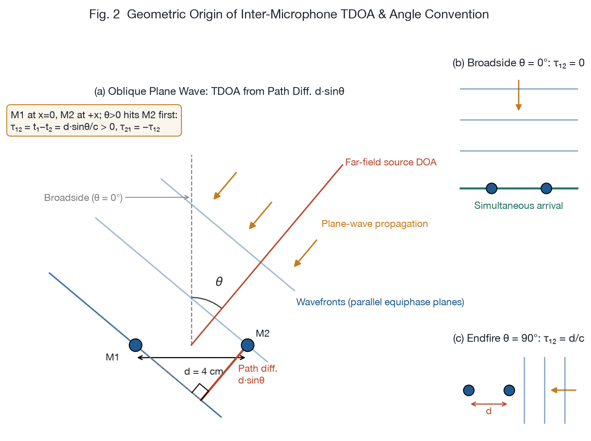
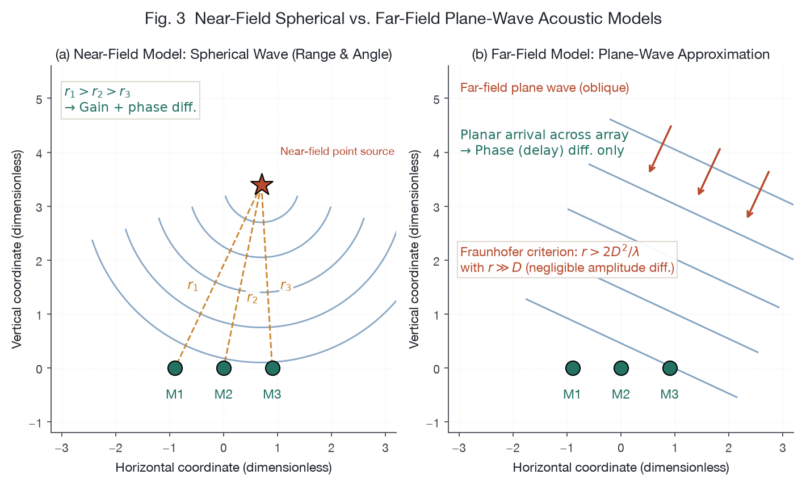
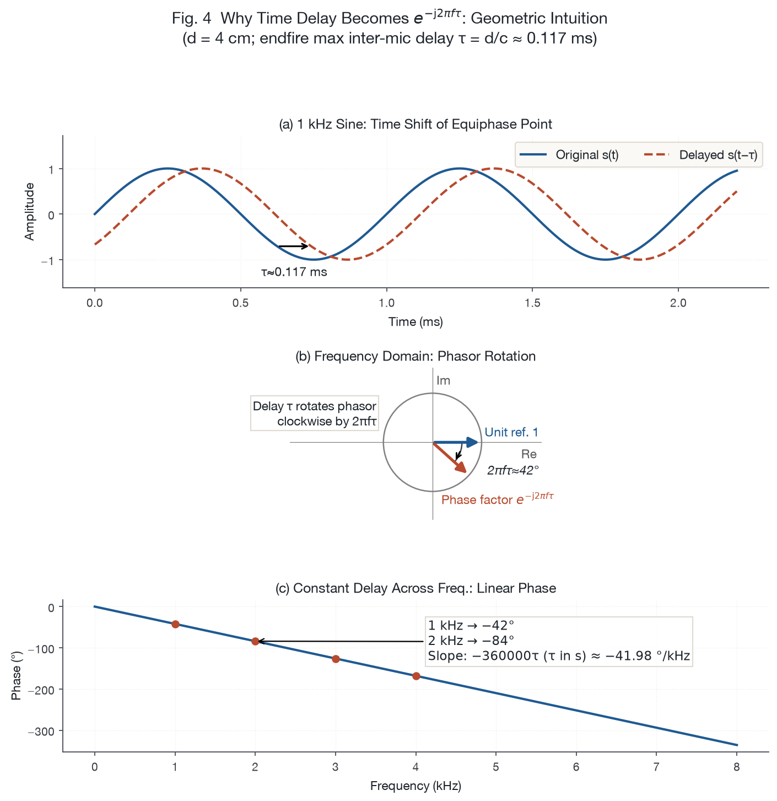
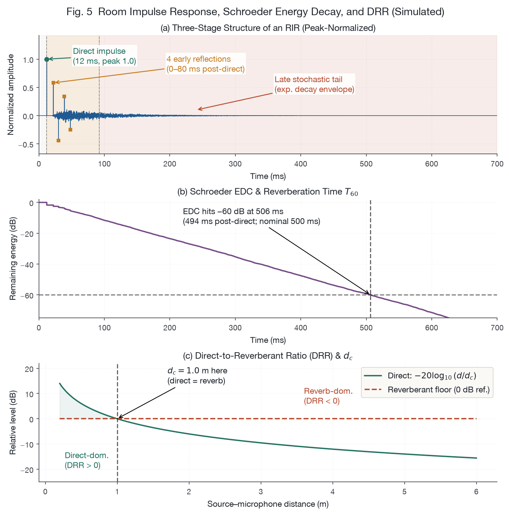
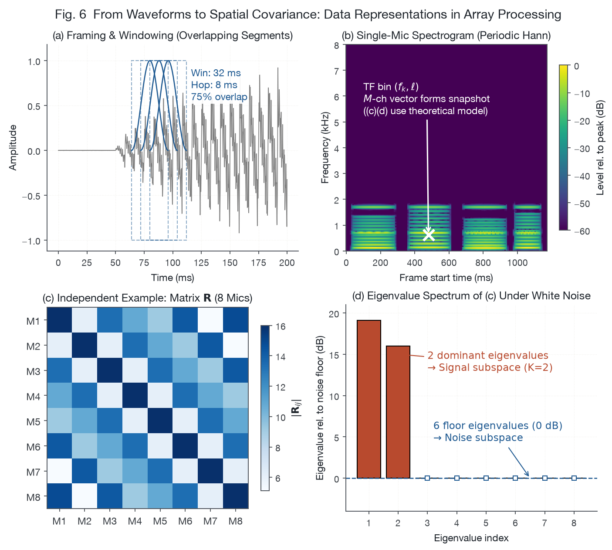
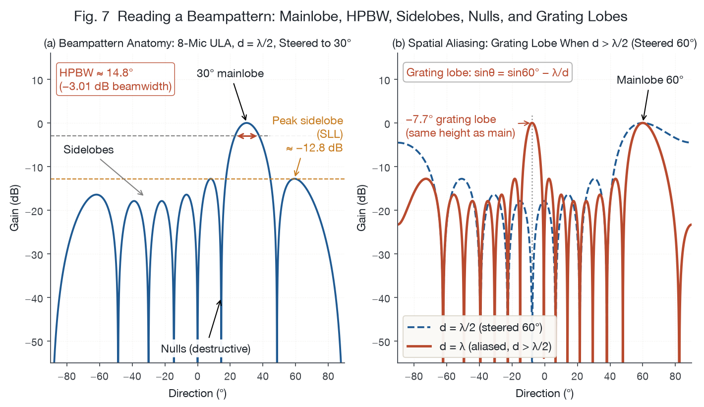
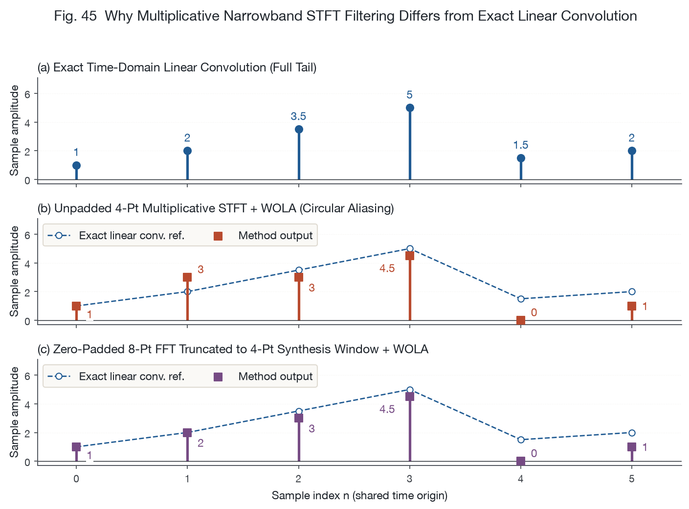

🌐 [简体中文](../chapters/02_basics-signal-model.md) ｜ **English**

> This is Chapter 2 of the main text; the book comprises 16 main and special-topic chapters (Chapters 0–15, where Chapter 0 covers mathematical foundations and Chapters 12–15 are four extended special topics), accompanied by Appendices A and B. This chapter can be read self-contained; navigation links appear below.
>
> Overview: [00_overview.md](00_overview.md) | Previous: [01_problem-definition.md](01_problem-definition.md) | Next: [03_array-geometry.md](03_array-geometry.md)

---

## 2. Basics: What Happens When Sound Reaches an Array

### 2.1 The Core Physical Fact: The Same Sound Reaches Different Microphones at Different Instants

Microphone arrays can determine direction and enhance speech because of one physical starting point: acoustic waves radiated by a single sound source traverse slightly different path lengths before reaching differently positioned microphones. Following a clear progression—*geometric path difference → propagation time delay → frequency-domain complex phase → multichannel statistical matrices → beampattern metrics*—this chapter first casts free-field direct sound into a verifiable linear-algebraic model, then introduces room reflections and short-time spectral data organization, spelling out both the exact conditions under which each idealization holds and how real recordings deviate from it.

#### 2.1.1 Fixing Coordinate Axes and TDOA Signs Upfront

Throughout all worked examples in this book, we adopt a nominal speed of sound $c\approx343\ \mathrm{m/s}$, corresponding to dry air at roughly $20\ ^\circ\mathrm{C}$; ambient temperature, humidity, and gas composition all shift sound speed, and precision metrology formulas with exact validity ranges appear in [Cramer (1993), *JASA* 93(5)](https://doi.org/10.1121/1.405827).

Consider first two microphones separated by $d=4\ \mathrm{cm}$. When sound arrives end-on along the line connecting the two sensors, the wavefront strikes the nearer microphone first and the farther microphone later, reaching its maximum time-delay magnitude of roughly $0.04/343\approx0.1166\ \mathrm{ms}$; when sound arrives perpendicular to the baseline, the wavefront hits both microphones simultaneously with zero time difference. This arrival-time offset is called the **Time Difference of Arrival (TDOA)**.

Because sign errors on delays and phases are the single most common pitfall in array derivations, we lock down one consistent geometric and sign convention before writing a single equation (for trigonometric identities and 3D direction cosines, see [Chapter 0 §0.1](00_math-foundations.md#sec-0-1)): place microphone 1 at origin $x=0$ and microphone 2 at $x=d>0$; define **broadside** perpendicular to the baseline as $\theta=0^\circ$, with positive azimuth $\theta$ measured clockwise from $+y$ toward $+x$ (i.e., tilting toward microphone 2). Let unit vector $\vec u(\theta)$ point *from* the array *toward* the sound source, so the incoming wave propagates along $-\vec u(\theta)$. Define the signed arrival-time difference between microphone $i$ and microphone $j$ uniformly as $\tau_{ij}=t_i-t_j$.

Under this convention, whenever a source sits at a positive angle ($\theta>0^\circ$), microphone 2 sits closer to the source, so the wavefront strikes microphone 2 first and microphone 1 later: $t_2<t_1$, giving $\tau_{21}=t_2-t_1<0$ and $\tau_{12}=t_1-t_2>0$. Under the far-field plane-wave approximation, microphone 1 lies a signed extra path length $d\sin\theta$ farther from the source than microphone 2; dividing by $c$ yields the signed pairwise TDOAs:

$$\begin{aligned}
\tau_{12}&=t_1-t_2=\frac{d\sin\theta}{c},\\
\tau_{21}&=t_2-t_1=-\frac{d\sin\theta}{c}.
\end{aligned}$$

Here $d$ is inter-microphone spacing ($\mathrm{m}$), $\theta$ is source azimuth, and $c$ is sound speed ($\mathrm{m/s}$). When only magnitude matters, one may write $|\tau_{12}|=d|\sin\theta|/c$; once plugged into any equation distinguishing left from right, however, signs must be preserved rigorously.

Within the horizontal plane, $\theta=0^\circ$ corresponds to broadside (simultaneous arrival, zero delay), whereas **endfire** along the baseline corresponds to $\theta=\pm90^\circ$, where path-difference magnitude spans the full spacing $d$ and TDOA magnitude attains its extremum.

Unless explicitly noted otherwise, all horizontal azimuths in later chapters follow this convention; three-dimensional elevation is denoted $\phi_{\mathrm{el}}$ (positive upward from the horizontal plane toward $+z$), while sensor polar angles and spherical-harmonic colatitudes are stated locally where used. Papers measuring angles from the array axis instead write $\Delta\tau=d\cos\theta/c$—shifted by $90^\circ$—so always verify zero-angle origin and rotation sense before comparing formulas across papers.

Read Figure 2 across its three panels to cement these geometric relationships visually:

- **Panel (a) Oblique plane-wave incidence**: Microphone 1 sits on the left at $x=0$ and microphone 2 on the right at $x=4\ \mathrm{cm}$. The vertical dashed gray line marks broadside $\theta=0^\circ$, the red ray points toward a far-field source at positive azimuth $\theta$ in the upper right, slanted parallel blue lines depict equal-phase wavefronts, and orange arrows show wavefront propagation toward the lower left. Dropping a perpendicular from microphone 1 onto the propagation ray passing through microphone 2 forms a right triangle of hypotenuse $d$, whose solid red leg equals the extra distance $d\sin\theta$ traveled to microphone 1—directly giving $\tau_{12}=d\sin\theta/c>0$ and $\tau_{21}=-\tau_{12}<0$.
- **Panel (b) Broadside incidence ($\theta=0^\circ$)**: Horizontal wavefronts travel straight downward and hit both sensors simultaneously, yielding zero path difference and $\tau_{12}=0$.
- **Panel (c) Positive endfire incidence ($\theta=90^\circ$)**: Vertical wavefronts sweep leftward from microphone 2 to microphone 1 along the baseline, stretching path difference to the full spacing $d$ and reaching the positive endfire ceiling $\tau_{12}=d/c$.

#### 2.1.2 Discrete Sampling, Clock Synchronization, and Sound-Speed Mismatch

Digital hardware observes discrete samples spaced at fixed sampling intervals rather than continuous-time waveforms. At a standard $16\ \mathrm{kHz}$ sampling rate, adjacent samples are separated by $1/16000=62.5\ \mathrm{\mu s}$, during which sound travels roughly $343\times62.5\times10^{-6}\approx2.14\ \mathrm{cm}$. Across a $4\ \mathrm{cm}$ microphone pair, the maximum physical TDOA is only $\approx 116.6\ \mathrm{\mu s}$—less than two sample periods. Peak-picking cross-correlation strictly at integer sample lags would quantize the entire hemisphere into barely a handful of coarse bearings, so practical localizers rely on **subsample TDOA estimation**—via parabolic or sinc peak interpolation, spectral zero-padding upsampling, or frequency-domain cross-phase slope fitting (§4.2). Likewise, compensating non-integer delays in the time domain cannot naively substitute two-point linear interpolation for higher-order fractional-delay FIR filters without suffering severe high-frequency roll-off and null collapse (Exercise E02-20 compares two-point linear interpolation quantitatively against windowed-sinc FIR filters).

Comparing microsecond delays across microphones also demands a tightly synchronized sampling clock across all channels. Single-enclosure devices typically drive a multichannel Analog-to-Digital Converter (ADC) from one shared crystal oscillator; ad-hoc distributed arrays formed from phones and laptops, by contrast, run on independent crystals. A mere $50\ \mathrm{ppm}$ ($50$ parts per million) relative clock offset between two devices accumulates $50\times10^{-6}\times3600=0.18\ \mathrm{s}$ of drift over $1$ hour ($3600\ \mathrm{s}$)—over three orders of magnitude larger than microsecond acoustic TDOAs—requiring hardware clock synchronization or online Sampling Rate Offset (SRO) compensation (§10.2).

Even on a single PCB sharing one master clock, mismatched analog anti-aliasing RC tolerances, DMA buffer muxing, or trace routing can introduce fixed inter-channel delays; single-microphone SPL sensitivity calibration alone cannot detect timing or phase offsets, so pre-deployment verification must test phase and delay consistency across channels using a known acoustic source.

Mismatch between true ambient sound speed and the nominal value hardcoded in software maps directly into systematic angular bias. In $0\ ^\circ\mathrm{C}$ dry air where true sound speed drops to $\approx 331\ \mathrm{m/s}$, a source at $\theta=60^\circ$ generates physical delay $\tau_{12}=d\sin 60^\circ/331$; inverting that delay under hardcoded $343\ \mathrm{m/s}$ yields

$$\begin{aligned}
\hat\theta&=\arcsin\!\left(\frac{343}{331}\sin 60^\circ\right)\\
&\approx63.8^\circ,
\end{aligned}$$

biasing the estimate toward endfire by $\approx 3.8^\circ$. Automotive cabins and outdoor arrays operating across wide temperature swings typically read onboard thermistors to update $c$ dynamically or jointly estimate effective sound speed during calibration.

All path-difference formulas in this section assumed straight-line (3D planar) wavefronts. When a talker steps close to the array, wavefront curvature and inter-sensor $1/r$ amplitude differences emerge, requiring a clear boundary between near-field and far-field regimes.

### 2.2 Near Field and Far Field

#### 2.2.1 What Spherical-Wave and Plane-Wave Models Each Retain or Omit

A point source in free space radiates expanding concentric spherical waves. Depending on source range relative to array aperture, acoustic propagation models fall into two tiers:

- **Near-field model** (source close to the array): wavefronts (surfaces of constant phase) exhibit pronounced spherical curvature, source-to-sensor distances differ noticeably across the array, and received signals differ in **both arrival time and amplitude**;
- **Far-field model** (source range much larger than array aperture): the small patch of spherical wavefront intercepted by the array is nearly flat and approximated as a plane wave, sensor amplitudes are treated as equal, and inter-channel differences reduce purely to direction-dependent **relative time delays**.

#### 2.2.2 Deriving Phase Tolerance from Path-Length Error

When can spherical waves safely be simplified into plane waves? Array literature widely cites the **Fraunhofer distance** $r_F=2D^2/\lambda$ (with maximum array aperture $D$ and wavelength $\lambda=c/f$) as a reference scale for wavefront **phase curvature**. Deriving its geometric origin by hand makes every hidden assumption transparent.

Consider a centro-symmetric linear or planar aperture of half-aperture $a = D/2$ with a point source located on the broadside normal at distance $r$ from the array center:

1. **Exact spherical path-length difference**: Whereas a broadside plane wave strikes center and edge sensors simultaneously, a spherical wave travels distance $r$ to the center and hypotenuse $\sqrt{r^2+a^2}$ to the outermost sensor, giving excess edge path $\Delta r=\sqrt{r^2+a^2}-r$.
2. **First-order Taylor expansion for $r\gg a$**: Factoring out $r$ and applying the first-order binomial expansion from [Chapter 0 §0.1.2 Eq. (0-5)](00_math-foundations.md#sec-0-1-2) ($\sqrt{1+x}\approx1+x/2$ for $x=(a/r)^2\ll1$) gives $\Delta r \approx a^2/(2r)$.
3. **Applying the $\lambda/16$ phase-error tolerance**: Excess path $\Delta r$ induces phase error $2\pi\Delta r/\lambda$. Adopting the conventional $\Delta r\le\lambda/16$ tolerance (limiting phase curvature error to $2\pi/16=\pi/8=22.5^\circ$) yields

    $$\begin{aligned}
    \frac{a^2}{2r}\le\frac{\lambda}{16}
    \quad\Longrightarrow\quad r\ge\frac{8a^2}{\lambda}.
    \end{aligned}$$

    Substituting $a=D/2$ for a centered aperture gives the familiar $r\ge 2D^2/\lambda=r_F$; if the reference origin is not centered, retain maximum sensor radius $a$ directly inside $8a^2/\lambda$.

Why choose $\lambda/16$ ($22.5^\circ$)? Summing a worst-case pair of equal-amplitude edge phasors misaligned by $\pi/8\ \mathrm{rad}$ yields normalized magnitude $|1+e^{\mathrm{j}\pi/8}|/2=\cos(\pi/16)\approx0.9808$—a negligible $0.17\ \mathrm{dB}$ loss on a conventional delay-and-sum mainlobe (for a continuous uniform aperture, the integrated loss is even smaller at $\approx 0.06\ \mathrm{dB}$; see [Chapter 0 §0.1.2](00_math-foundations.md#sec-0-1-2)). This $\lambda/16$ convention originated in aperture antenna range testing (see [ETSI ETR 273-1-1 Clause 7.2.3.1, p. 76](https://www.etsi.org/deliver/etsi_etr/200_299/2730101/01_60/etr_2730101e01p.pdf)). Adaptive beamformers steering deep cancellation nulls require tighter phase tolerances and correspondingly larger transition distances than $2D^2/\lambda$.

Solving $\sqrt{r^2+a^2}\le r+\lambda/16$ ($r\ge 0$) exactly without Taylor approximation by squaring both sides yields $r \ge \max\!\left(0,\; \frac{8a^2}{\lambda} - \frac{\lambda}{32}\right)$ (for tiny half-apertures $a\le\lambda/16$, excess path never exceeds $\lambda/16$ even as $r\to 0$). Crucially, however, $r_F$ checks *only* broadside phase curvature—it replaces neither the two companion Fraunhofer criteria $r\gg D$ and $r\gg\lambda$ nor checks on $1/r_m$ amplitude ratios across sensors. Two concrete geometries illustrate both failure directions:

- On a compact $D=7\ \mathrm{cm}$ smart-speaker circular array at $1\ \mathrm{kHz}$ ($\lambda=0.343\ \mathrm{m}$), $r_F=2\times0.07^2/0.343\approx2.86\ \mathrm{cm}$. Yet a talker lips-on at $3\ \mathrm{cm}$ violates $r\gg D$ completely—near-edge and far-edge sensor distances differ several-fold with large $1/r_m$ amplitude imbalance, so $r>2.86\ \mathrm{cm}$ does *not* justify a far-field plane-wave model.
- Conversely, on a large $D=1.26\ \mathrm{m}$ conference-room linear array at $1\ \mathrm{kHz}$, $r_F=2\times1.26^2/0.343\approx9.26\ \mathrm{m}$: inside a typical conference room only a few meters wide, talkers sit permanently inside the array's radiating near field, where plane-wave steering vectors suffer substantial spherical curvature mismatch.

Fraunhofer distance is therefore a smooth scaling guideline rather than a sharp physical boundary; before adopting a plane-wave model, always check phase curvature at the highest operating frequency alongside range-to-aperture ratio $r/D$, electrical range $r/\lambda$, and inter-sensor amplitude ratios (tabulated side by side in Exercise E02-09).

In close-talking headsets, handsets, and near-mouth pickup scenarios, one must further distinguish the **radiating Fresnel near field** from the **acoustic reactive near field**. In classical aperture field theory (Balanis, *Antenna Theory: Analysis and Design*, Ch. 2), the radiating Fresnel zone for electrically large apertures spans $0.62\sqrt{D^3/\lambda} \le r < 2D^2/\lambda$; for acoustically small point monopoles, particle velocity combines a propagating $1/r$ component with an inertial near-field $1/r^2$ component whose reactive boundary sits at dimensionless electrical range $\kappa r = 2\pi r/\lambda = 1$ (i.e., $r \approx \lambda/(2\pi) = c/(2\pi f)$): at an adult male pitch fundamental of $150\ \mathrm{Hz}$, the reactive near-field radius spans roughly $36\ \mathrm{cm}$, shrinking to $\approx 5.5\ \mathrm{cm}$ at $1\ \mathrm{kHz}$. Once a source enters the reactive zone $\kappa r \lesssim 1$, acoustic pressure and particle velocity develop a strong quadrature phase shift and the pressure gradient climbs as $1/r^2$—much faster than scalar pressure's $1/r$ scaling—giving rise to the pronounced low-frequency boost known as the **proximity effect** in pressure-gradient microphones and close-talk first-order differential arrays (examined further in Chapter 5 §5.3).

Figure 3 contrasts both propagation regimes visually:

- **Panel (a) Near-field spherical-wave model**: A red star marks an off-axis near-field point source, concentric blue arcs trace curved spherical wavefronts, and dashed orange rays show distinct distances $r_1>r_2>r_3$ to three green microphones. Because both range and incidence angle vary across sensors, the three channels differ in nonlinear curvature delays as well as $1/r_m$ amplitudes, coupling range and bearing together.
- **Panel (b) Far-field plane-wave model**: Once the source moves sufficiently far away, wavefronts intercepted locally across the array straighten into parallel blue lines orthogonal to the red propagation vector, sweeping across all three sensors with virtually equal amplitudes and purely direction-dependent linear delays—the exact physical premise of §2.3.

### 2.3 Signal Model: Casting Staggered Arrival Times into Mathematics

Before stacking multichannel waveforms into matrix equations, we establish book-wide mathematical notation so scalars, vectors, and matrices remain unmistakable at a glance:

> **Book-Wide Notation Conventions**
>
> - **Scalars, vectors, and matrices**: Scalars use lightface italics ($s$, $\tau$, $\theta$, $\sigma^2$); column vectors carry an overhead arrow ($\vec{x}$, $\vec{a}$, $\vec{w}$, zero vector $\vec{0}$); matrices use boldface upright capitals ($\mathbf{R}$, $\mathbf{C}$, $\mathbf{\Gamma}$, $\mathbf{I}$). Following speech-processing custom, uppercase italics $X(f)$ or $X(f_k,\ell)$ denote complex spectral values at a single frequency or time-frequency bin—they remain complex scalars, *not* matrices.
> - **Imaginary unit, transpose, and conjugate transpose**: The imaginary unit is upright $\mathrm{j}$ ($\mathrm{j}^2=-1$); scalar conjugation uses an asterisk ($X_2^*$); plain transpose uses superscript $^\top$, whereas conjugate (Hermitian) transpose uses superscript $^H$; mathematical expectation is $\mathbb{E}[\cdot]$, estimators wear a hat $\hat{\ }$, scalar modulus is $|\cdot|$, and Euclidean vector norm is $\|\cdot\|$.
> - **Frequency, wavenumber, and discrete sample index**: Continuous frequency is $f$ ($\mathrm{Hz}$), angular frequency is $\omega=2\pi f$ ($\mathrm{rad/s}$), and wavenumber is $\kappa=\omega/c=2\pi f/c$ ($\mathrm{rad/m}$). Because $n$ indexes discrete-time samples, this chapter denotes additive noise by $v_m(t)$, $v_m[n]$, and frequency-domain $\vec v$ to avoid colliding with sample index $n$ (later chapters without discrete-time index $n$ also use $\vec n$ where noted).
> - **DFT bin mapping and signed frequencies**: STFT frequency bin is $k$ and time frame is $\ell$. One-sided real-FFT bins $0\le k\le\lfloor N/2\rfloor$ map to physical frequencies $f_k=kf_s/N$; upper bins $k>N/2$ of a full two-sided $N$-point DFT map to negative frequencies $(k-N)f_s/N$. Always plug physical frequency $f$ (or mapped $f_k$ in $\mathrm{Hz}$) into $e^{-\mathrm{j}2\pi f\tau}$—never raw dimensionless bin integer $k$. Where standard literature reuses a symbol across topics (e.g., $\lambda$ for wavelength vs. eigenvalue), local definitions take precedence; consult [Chapter 0 §0.8](00_math-foundations.md#sec-0-8) and the [Appendix A Master Notation Table](16_appendix-symbols-math.md#sec-16-1) anytime.

With notation locked down, we turn geometric delays from §2.1 into our multichannel frequency-domain equation in three short steps: write per-sensor time waveforms first, convert time shifts into complex phase rotations second, and stack all $M$ channels into a column vector third.

#### 2.3.1 Time Domain: Relative Time Shifts Across Microphones

Under a single far-field free-field source with sensor coordinates $\vec r_m$ ($m=1,2,\dots,M$), designate microphone 1 as the reference sensor and define each sensor's signed arrival delay relative to microphone 1 as $\tau_{m1}=t_m-t_1$. By plane-wave geometry (§2.1), Euclidean inner product $(\vec r_m-\vec r_1)^\top\vec u$ measures **how many meters closer toward the source** microphone $m$ sits relative to microphone 1; sitting closer means earlier arrival, placing a minus sign in front of relative delay:

$$\tau_{m1}=-\frac{(\vec r_m-\vec r_1)^\top\vec u}{c}.$$

Plug our two-microphone coordinates from §2.1 directly into this dot product to verify exact agreement with trigonometry: in the horizontal plane with $\vec r_1=[0,0]^\top$, $\vec r_2=[d,0]^\top$ ($\vec r_2-\vec r_1=[d,0]^\top$), and clockwise azimuth $\theta$ from $+y$ toward $+x$ giving $\vec u(\theta)=[\sin\theta,\cos\theta]^\top$, componentwise multiplication yields

$$\begin{aligned}
(\vec r_2-\vec r_1)^\top\vec u(\theta)
&=d\cdot\sin\theta+0\cdot\cos\theta=d\sin\theta,
\end{aligned}$$

recovering $\tau_{21}=-(d\sin\theta)/c$ identically. On a Uniform Linear Array (ULA) arrayed along $+x$, any $\theta>0^\circ$ yields $\tau_{m1}<0$ for all $m>1$—sensors farther right receive the wavefront progressively earlier.

Taking direct arrival at microphone 1 as our waveform reference, the continuous-time signal observed at microphone $m$ reads

$$x_m(t) = s(t - \tau_{m1}) + v_m(t).$$

Check each physical quantity carefully:

- $x_m(t)$ is the waveform captured at channel $m\in\{1,\dots,M\}$ at continuous time $t$;
- $s(t)$ is the clean direct target waveform *at reference microphone 1*—absorbing bulk source-to-mic-1 propagation delay and bulk $1/r$ attenuation once and for all, so under equal-amplitude far-field propagation it carries no channel subscript $m$ and appears on every other sensor as shifted copy $s(t-\tau_{m1})$;
- $\tau_{m1}$ is the signed arrival delay ($\mathrm{s}$) of microphone $m$ relative to microphone 1, varying with source bearing (with $\tau_{11}=0$ identically);
- $v_m(t)$ lumps ambient background noise and sensor self-noise on channel $m$.

In the time domain, unknown bearing information $\tau_{m1}$ sits trapped inside the argument of unknown waveform $s(t-\tau_{m1})$, preventing clean algebraic separation of direction from source waveform. Taking the Fourier transform pulls time shifts right out of the argument as multiplicative complex phase factors.

#### 2.3.2 Frequency Domain: Phase Factors via Change of Variables

Adopting the forward continuous-time Fourier transform (complex phasors, Euler's formula, and Fourier properties are derived in [Chapter 0 §0.2](00_math-foundations.md#sec-0-2); with $\omega=2\pi f$, the kernel also reads $e^{-\mathrm{j}\omega t}$):

$$\begin{aligned}
X(f)&=\int_{-\infty}^{\infty}
x(t)e^{-\mathrm{j}2\pi ft}\,\mathrm{d}t.
\end{aligned}$$

Under this transform, the change of variables $u'=t-\tau$ in [Chapter 0 §0.2.1 Eq. (0-9)](00_math-foundations.md#sec-0-2-1) directly shows that delaying a signal by $\tau$ seconds multiplies its spectrum by a unit-modulus complex exponential:

$$\begin{aligned}
s(t-\tau)\ \xrightarrow{\mathcal{F}}\ 
S(f)\,e^{-\mathrm{j}2\pi f\tau}
=S(f)\,e^{-\mathrm{j}\omega\tau}.
\end{aligned}$$

When a sensor lags the reference ($\tau>0$), phase $-2\pi f\tau$ is negative; when a sensor leads the reference ($\tau<0$), the double negative makes $-2\pi f\tau$ positive. Double-check directly on a real cosine $s(t)=\cos(2\pi ft)$: delaying by $\tau$ gives

$$\begin{aligned}
s(t-\tau)&=\cos\bigl(2\pi f(t-\tau)\bigr)
=\cos(2\pi ft - 2\pi f\tau)\\
&=\operatorname{Re}\!\bigl\{e^{-\mathrm{j}2\pi f\tau}
e^{+\mathrm{j}2\pi ft}\bigr\},
\end{aligned}$$

confirming directly that under DSP forward kernel $e^{-\mathrm{j}2\pi ft}$ and inverse kernel $e^{+\mathrm{j}2\pi ft}$, *later arrival $\tau>0$ always carries negative phase lag $e^{-\mathrm{j}2\pi f\tau}$*. When reading physical acoustics monographs that adopt harmonic time dependence $e^{-\mathrm{j}\omega t}$ for synthesis, remember that all delay exponents and steering-vector conjugates flip sign globally relative to DSP convention.

Geometrically, Euler's formula $e^{\mathrm{j}\phi}=\cos\phi+\mathrm{j}\sin\phi$ shows that $e^{-\mathrm{j}2\pi f\tau}$ has unit modulus $\sqrt{\cos^2(2\pi f\tau)+\sin^2(2\pi f\tau)}=1$—**a unit-length rotating phasor on the complex unit circle**: for $f>0$, positive lag $\tau>0$ rotates the phasor *clockwise* by $2\pi f\tau\ \mathrm{rad}$, whereas negative lag $\tau<0$ (early arrival) rotates it *counterclockwise* by $2\pi f|\tau|\ \mathrm{rad}$. Sanity-check at a full-period delay $\tau=1/f$: phase rotation $-2\pi f(1/f)=-2\pi$ sweeps one complete clockwise revolution back to its starting point, matching a sinusoid shifted by one full period coinciding with itself.

Using the endfire delay magnitude $\tau=d/c=0.04/343\approx0.1166\ \mathrm{ms}$ of a $d=4\ \mathrm{cm}$ pair, Figure 4 ties waveform shift, complex phasor rotation, and cross-frequency phase slope together:

- **Panel (a) Time-domain waveform shift**: Solid blue shows a $1\ \mathrm{kHz}$ sinusoid $s(t)$ ($1\ \mathrm{ms}$ period), and dashed red shows delayed $s(t-\tau)$ at $\tau\approx0.117\ \mathrm{ms}$. The horizontal black arrow connecting matching falling edges shows positive lag $\tau>0$ shifting the waveform **rightward (later in time)**—matching microphone 1 lagging microphone 2 for positive endfire ($\tau=\tau_{12}=+d/c>0$).
- **Panel (b) Complex-plane phasor rotation**: Taking the reference phasor along $+1$ on the real axis (blue arrow at $0^\circ$), at $f=1\ \mathrm{kHz}$ positive lag $\tau=+0.1166\ \mathrm{ms}$ rotates $e^{-\mathrm{j}2\pi f\tau}$ **clockwise** by $2\pi\times1000\times0.1166\times10^{-3}\approx 0.733\ \mathrm{rad}$ ($42^\circ$) into the fourth quadrant (red arrow). Conversely, referencing microphone 2 to microphone 1 as in §2.3.3 makes early arrival $\tau_{21}=-0.1166\ \mathrm{ms}<0$, rotating $e^{-\mathrm{j}2\pi f\tau_{21}}$ by $+42^\circ$ **counterclockwise into the first quadrant**. Locking down this clockwise-lag / counterclockwise-lead picture eliminates sign confusion across every DOA and beamforming paper.
- **Panel (c) Straight-line phase across frequency**: Holding physical lag $\tau=0.1166\ \mathrm{ms}$ fixed while sweeping $f$ from $0$ to $8\ \mathrm{kHz}$, unwrapped phase $\phi(f)=-\omega\tau=-2\pi f\tau$ traces a straight line through the origin of slope $-2\pi\tau\ \mathrm{rad/Hz}$—or $-360\times1000\tau\approx-41.98\ ^\circ/\mathrm{kHz}$ in plotted units, passing through $-42^\circ$ at $1\ \mathrm{kHz}$, $-84^\circ$ at $2\ \mathrm{kHz}$, and $-126^\circ$ at $3\ \mathrm{kHz}$. Generalized Cross-Correlation with Phase Transform (GCC-PHAT) in Chapter 4 §4.2 estimates delays directly from this cross-frequency linear phase slope; remember, however, that observed complex spectra wrap phase into $[-180^\circ,180^\circ)$ whenever $|2\pi f\tau|>\pi$, while noise and room reflections perturb individual bins around the line.

#### 2.3.3 Multichannel Form: Steering Vector and Dimensionality Checks

Applying the frequency-shift property to channel $m\in\{1,\dots,M\}$ at frequency $f$ gives the scalar equation:

$$\begin{aligned}
X_m(f)&=e^{-\mathrm{j}2\pi f\tau_{m1}(\theta)}\,S(f)
+V_m(f).
\end{aligned}$$

Here $X_m(f)$, $S(f)$, and $V_m(f)$ are complex scalars representing channel-$m$ observation, reference-mic target spectrum, and channel-$m$ noise at frequency $f$, while $e^{-\mathrm{j}2\pi f\tau_{m1}(\theta)}$ is a unit-modulus complex scalar. Writing projected baseline $d_{m1}=(\vec r_m-\vec r_1)^\top\vec u(\theta)$ with $\tau_{m1}=-d_{m1}/c$ expresses the $m$-th phase factor in two interchangeable forms:

$$\begin{aligned}
a_m(f,\theta)&=e^{-\mathrm{j}2\pi f\tau_{m1}(\theta)}\\
&=e^{+\mathrm{j}(2\pi f/c)d_{m1}}
=e^{+\mathrm{j}\kappa d_{m1}}.
\end{aligned}$$

Stacking all $M$ scalar equations vertically into column vectors $\vec x(f)$, $\vec a(f,\theta)$, and $\vec v(f)$, and factoring shared scalar source spectrum $S(f)$ to the right gives:

$$\begin{aligned}
\begin{bmatrix}X_1(f)\\X_2(f)\\\vdots\\X_M(f)\end{bmatrix}
&=\begin{bmatrix}
e^{-\mathrm{j}2\pi f\tau_{11}(\theta)}\\
e^{-\mathrm{j}2\pi f\tau_{21}(\theta)}\\
\vdots\\
e^{-\mathrm{j}2\pi f\tau_{M1}(\theta)}
\end{bmatrix}S(f)
+\begin{bmatrix}V_1(f)\\V_2(f)\\\vdots\\V_M(f)\end{bmatrix}.
\end{aligned}$$

Suppressing explicit $(f)$ at a fixed frequency bin and writing lowercase italic scalar $s$ for $S(f)$ yields the narrowband far-field array observation equation used throughout this book:

$$\vec{x} = \vec{a}(\theta)\,s + \vec{v}.\tag{2-1}$$

Verify physical meaning, matrix shapes, and physical units on every symbol in Eq. (2-1):

- $\vec{x}\in\mathbb{C}^{M\times1}$ is the $M$-channel observed spectral column vector;
- $\vec{a}(\theta)\in\mathbb{C}^{M\times1}$ is the **steering vector**, whose first entry equals $1$ ($\tau_{11}=0$) and whose remaining entries encode relative plane-wave phases across the array from direction $\theta$;
- $s\in\mathbb{C}$ is the scalar target spectrum at microphone 1 ($1\times1$); multiplying $M\times1$ vector $\vec a(\theta)$ by scalar $s$ produces an $M\times1$ vector matching noise vector $\vec{v}\in\mathbb{C}^{M\times1}$;
- $\vec a(\theta)$ is dimensionless with unit-modulus entries under equal-amplitude far-field propagation ($\|\vec a(\theta)\|_2^2=M$), while $\vec x$, $s$, and $\vec v$ share identical physical amplitude units and DFT scaling conventions.

Localization algorithms probe observations $\vec x$ against candidate $\vec a(\theta)$ across directions to estimate unknown $\theta$; beamformers use known $\vec a(\theta_0)$ to design linear weights realigning staggered channel phases coherently.

**Worked Example: Steering Vector of a 3-Microphone Uniform Linear Array**

- **Inputs & convention**: Sensors 1, 2, 3 of a 3-mic ULA lie along $+x$ at $x=0,0.04,0.08\ \mathrm{m}$ ($d=0.04\ \mathrm{m}$), $c=343\ \mathrm{m/s}$, far-field tone at $\theta=+30^\circ$ and $f=1000\ \mathrm{Hz}$, referenced to microphone 1.
- **Step-by-step substitution**: Because $+30^\circ$ sits closer to right-hand sensors, arrival delays relative to microphone 1 are

    $$\begin{aligned}
    \tau_{21}&=-\frac{0.04\sin 30^\circ}{343}=-\frac{0.02}{343}
    \approx-58.31\ \mathrm{\mu s},\\
    \tau_{31}&=2\tau_{21}\approx-116.62\ \mathrm{\mu s}.
    \end{aligned}$$

    Evaluating $a_m=e^{-\mathrm{j}2\pi f\tau_{m1}}$ with unrounded delays gives inter-element phase step

    $$\begin{aligned}
    \Delta\phi&=-2\pi\times1000\times\left(-\frac{0.02}{343}\right)\\
    &=\frac{40\pi}{343}\approx+0.3664\ \mathrm{rad}
    \approx+20.99^\circ.
    \end{aligned}$$

- **Final result**:

    $$\begin{aligned}
    \vec a(1\ \mathrm{kHz},30^\circ)
    &=\begin{bmatrix}
    1 & e^{+\mathrm{j}0.3664} & e^{+\mathrm{j}0.7327}
    \end{bmatrix}^\top.
    \end{aligned}$$

- **Physical check & boundary**: Microphone 2 leads microphone 1 by $58.31\ \mathrm{\mu s}$ and microphone 3 leads by $116.62\ \mathrm{\mu s}$; under forward kernel $e^{-\mathrm{j}2\pi ft}$, *earlier arrival always manifests as positive phase lead* relative to the reference sensor. Once the talker steps into the near field or room walls add multipath reflections, inter-channel transfer ceases to be pure unit-modulus phase shifts, motivating the room impulse response model next.

### 2.4 Room Acoustics: Where Reverberation Actually Comes From

When someone speaks indoors, microphones capture not only the direct wave traveling straight from the talker's mouth, but also thousands of delayed reflections bouncing off the ceiling, floor, table, and walls. The Room Impulse Response captures how those reflections superpose into the recording, Reverberation Time measures how rapidly the acoustic tail decays, and Direct-to-Reverberant Ratio quantifies the energy balance between direct sound and reflections.

#### 2.4.1 Room Impulse Response and Early vs. Late Reflections

With room geometry, temperature/humidity, and source/microphone coordinates held fixed, the acoustic propagation channel from the source to microphone $m$ behaves as a Linear Time-Invariant (LTI) system whose response to a unit impulse is the **Room Impulse Response (RIR)**.

In discrete time, denoting the dry digital source sequence by $u[n]$, the $Q$-tap discrete RIR from source to microphone $m$ by $h_m[q]$, and additive noise at microphone $m$ by $v_m[n]$ (using $v$ to avoid colliding with sample index $n$), the $m$-th microphone recording is the linear convolution of source and RIR plus noise:

$$\begin{aligned}
x_m[n]&=\sum_{q=0}^{Q-1}h_m[q]\,u[n-q]+v_m[n].
\end{aligned}\tag{2-2}$$

Read Eq. (2-2) as a weighted sum of delayed echoes: every nonzero tap $h_m[q]$ represents a propagation path delayed by $q$ samples and scaled by $h_m[q]$. Distinguish source excitation $u[n]$ in Eq. (2-2) carefully from reference-mic target $s(t)$ in Eq. (2-1): $u[n]$ lives at the talker's mouth so direct propagation lag and $1/r$ attenuation reside inside the direct tap of $h_m[q]$, whereas $s(t)$ in §2.3 has already absorbed propagation to microphone 1.

Verify the limiting case reducing Eq. (2-2) back to free-field Eq. (2-1): in an anechoic room with zero wall reflections, $h_m[q]$ collapses to a single direct tap $\alpha_m\delta[q-q_m]$, reducing Eq. (2-2) to $x_m[n]=\alpha_m u[n-q_m]+v_m[n]$. Returning to continuous time with direct lag $\tau_m$, defining $s(t)=\alpha_1 u(t-\tau_1)$ under far-field equal attenuation $\alpha_m/\alpha_1\approx1$ and relative delay $\tau_{m1}=\tau_m-\tau_1$ gives $x_m(t)=s(t-\tau_{m1})+v_m(t)$, whose Fourier transform recovers Eq. (2-1) identically. Exercise E02-13 computes all 6 samples of a 4-sample source convolved with a 3-tap RIR by hand.

Clapping your hands in an empty room makes the crisp direct arrival and decaying tail audible, yet a recorded handclap is *not* a metrological RIR: a clap has finite duration, non-flat spectrum, and directional radiation compounded by microphone response. Quantitative RIR measurement plays a controlled broadband excitation (such as the exponential sine sweep at the end of this section) followed by deconvolution.

Ordered by arrival time and perceptual/algorithmic role, an indoor RIR partitions into three regimes as illustrated in Figure 5(a):

1. **Direct sound**: The earliest pulse arriving along the shortest unobstructed line of sight, whose inter-microphone arrival differences carry true source bearing.
2. **Early reflections**: Sparse, individually resolvable pulses arriving within the first few tens of milliseconds after direct sound via one or two wall/table bounces. Architectural acoustics quantifies clarity via early-to-late energy ratios—music clarity $C_{80}$ and speech clarity $C_{50}$ integrate early energy up to $80\ \mathrm{ms}$ and $50\ \mathrm{ms}$ after direct arrival, respectively ([Lee et al., *JASA* 2018, Eq. (1)](https://doi.org/10.1121/1.5040480)). The dashed line placed $80\ \mathrm{ms}$ after direct sound (at $92\ \mathrm{ms}$ absolute time) in Figure 5(a) borrows this pedagogical convention rather than marking an abrupt physical phase transition. Strongly coherent with direct sound, early reflections fuse perceptually to boost speech loudness for human listeners, yet distort inter-microphone phase slopes and bias TDOA localizers.
3. **Late reverberation**: A dense, exponentially decaying tail formed by myriad higher-order bounces. *Spatially*, well-mixed late reverberation is often approximated as an isotropic diffuse field—underpinning Directivity Index (DI) in §2.6; *temporally*, however, late reverberation remains a linearly filtered tail of past speech carrying strong cross-frame correlation rather than temporally white noise—precisely what Chapter 7 Weighted Prediction Error (WPE) exploits via delayed multi-frame linear prediction to strip late tails.

Compare horizontal and vertical physical quantities across the three panels of Figure 5:

- **Panel (a) Room Impulse Response waveform**: Plotting normalized amplitude against time ($\mathrm{ms}$), the direct-sound pulse arrives at $12\ \mathrm{ms}$ (normalized main-peak amplitude $1$), followed immediately by four clearly distinguishable discrete early reflection spikes that transition into a dense exponentially decaying late stochastic reflection tail; the dashed vertical line at $92\ \mathrm{ms}$ ($80\ \mathrm{ms}$ post-direct) marks the nominal early/late split. Note that in strongly reflective or occluded rooms, the direct tap is not guaranteed to be the tallest peak in the RIR.
- **Panel (b) Remaining energy decay curve and $T_{60}$**: Because raw bipolar RIR oscillations obscure decay slopes, the vertical axis plots backward-integrated remaining acoustic energy in $\mathrm{dB}$ from time $t$ to $\infty$ (Schroeder integration, formalized next) against time ($\mathrm{ms}$). The elapsed time over which this smooth curve drops from $0\ \mathrm{dB}$ at direct arrival down to $-60\ \mathrm{dB}$ defines reverberation time $T_{60}$.
- **Panel (c) Direct-to-Reverberant Ratio and critical distance**: Plotting level ($\mathrm{dB}$) relative to the steady reverberant floor ($0\ \mathrm{dB}$ dashed red) against source-to-mic distance $d$ ($\mathrm{m}$), inverse-square direct sound follows $-20\log_{10}(d/d_c)$ (solid green). Normalized here to critical distance $d_c=1.0\ \mathrm{m}$, direct energy dominates inside $d<1.0\ \mathrm{m}$ ($\mathrm{DRR}>0\ \mathrm{dB}$, green shading), matches reverberant energy at $d=1.0\ \mathrm{m}$ ($\mathrm{DRR}=0\ \mathrm{dB}$), and falls below reverberant energy beyond $1.0\ \mathrm{m}$ ($\mathrm{DRR}<0\ \mathrm{dB}$).

#### 2.4.2 Reverberation Time: Computing Decay from Acoustic Absorption

Once a sound source stops radiating, the time required for indoor acoustic energy to decay by $60\ \mathrm{dB}$ (to one-millionth of its initial value) is the **reverberation time** $T_{60}$ (Figure 5(b)). Standardized measurement protocols appear in [ISO 3382-1:2009](https://www.iso.org/standard/40979.html) for performance spaces and [ISO 3382-2:2008](https://www.iso.org/standard/36201.html) for ordinary rooms.

Engineering sizing most commonly uses **Sabine's formula**, originating in Wallace C. Sabine's classic essay "Reverberation" in *Collected Papers on Acoustics* (Harvard University Press, 1922; [bibliographic record](https://books.google.com/books/about/Collected_Papers_on_Acoustics.html?id=G25LAAAAMAAJ)):

$$\begin{aligned}
T_{60}&=\frac{0.161\,V}{A},\\
A&=\sum_i S_i\alpha_i.
\end{aligned}\tag{2-3}$$

Here $V$ is room volume ($\mathrm{m^3}$); $S_i$ and $\alpha_i\in[0,1]$ are the surface area ($\mathrm{m^2}$) and energy absorption coefficient ($0$ for perfect reflection, $1$ for total absorption) of the $i$-th interior surface; and $A$ is the **equivalent absorption area** ($\mathrm{m^2}$). Because absorption coefficients of drywall, glass, carpet, and furniture vary across frequency bands and incidence angles, $A$ is generally smaller than total surface area $S=\sum_i S_i$, and $T_{60}$ is routinely budgeted octave band by octave band.

Check typical numbers for a $5\ \mathrm{m}\times4\ \mathrm{m}\times2.8\ \mathrm{m}$ living room ($V=56\ \mathrm{m^3}$): with furnishings yielding $A=18\ \mathrm{m^2}$, Eq. (2-3) gives $T_{60}=0.161\times56/18\approx0.50\ \mathrm{s}$. Adding thick rugs or acoustic drapes increases $A$ and shortens $T_{60}$ proportionally.

Where does the constant $0.161$ in Eq. (2-3) come from? Under an ideal diffuse field with weak absorption, first evaluate the acoustic energy flux striking unit wall area per second, unifying the mean free path, Sabine's formula, and critical distance in one sweep:

1. **Diffuse-field premise and hemispherical cosine flux integral**: Let indoor reverberant energy density $E(t)$ ($\mathrm{J/m^3}$) be spatially uniform and distributed isotropically over all $4\pi\ \mathrm{sr}$, carrying $E/(4\pi)$ per steradian. Taking a small wall patch with inward normal as polar axis $\vartheta=0$ in spherical coordinates $(\vartheta,\varphi)$, only the incident hemisphere ($0\le\vartheta\le\pi/2$, $0\le\varphi<2\pi$) delivers energy onto the wall at normal velocity component $c\cos\vartheta$ across solid-angle element $\mathrm{d}\Omega=\sin\vartheta\,\mathrm{d}\vartheta\,\mathrm{d}\varphi$. Integrating over the incident hemisphere yields incident wall energy flux $J_{\mathrm{in}}$ ($\mathrm{W/m^2}$):

    $$\begin{aligned}
    J_{\mathrm{in}}
    &=\int_0^{2\pi}\!\!\int_0^{\pi/2}\frac{E}{4\pi}
    (c\cos\vartheta)\sin\vartheta\,
    \mathrm{d}\vartheta\,\mathrm{d}\varphi\\
    &=\frac{E c}{4\pi}\cdot2\pi
    \int_0^{\pi/2}\sin\vartheta\cos\vartheta\,\mathrm{d}\vartheta
    =\frac{E c}{4}.
    \end{aligned}$$

2. **Wall-collision rate and mean free path**: With total interior surface area $S$ and total acoustic energy $E V$, total power striking the walls equals $J_{\mathrm{in}} S = E c S/4$; dividing by $E V$ yields the average number of wall collisions per second $\frac{J_{\mathrm{in}} S}{E V}=\frac{cS}{4V}$—equivalently, the convex-enclosure **mean free path** $\ell_{\mathrm{mfp}}=4V/S$ (e.g., $\ell_{\mathrm{mfp}}=4L_0^3/(6L_0^2)=2L_0/3$ in a cube of side $L_0$).
3. **Fractional energy loss rate**: Each boundary bounce absorbs average fraction $\bar\alpha=A/S$, yielding a fractional power loss rate of $\frac{cS\bar\alpha}{4V}=\frac{cA}{4V}$.
4. **First-order differential equation**:

    $$\begin{aligned}
    \frac{\mathrm{d}E(t)}{\mathrm{d}t}&=-\frac{cA}{4V}\,E(t)\\
    \Longrightarrow\quad E(t)&=E_0\,e^{-\frac{cA}{4V}t}.
    \end{aligned}$$

5. **Evaluating the $60\ \mathrm{dB}$ decay point**: $10\log_{10}(E(T_{60})/E_0) = -60\ \mathrm{dB}$ means $E(T_{60})/E_0=10^{-6}$ (one-millionth in energy, not $10^{-3}$). Setting $e^{-\frac{cA}{4V}T_{60}}=10^{-6}$, taking natural logs $\frac{cA}{4V}T_{60}=6\ln10$, and substituting $c=343\ \mathrm{m/s}$ gives:

    $$\begin{aligned}
    T_{60}&=\frac{24\ln10}{c}\frac{V}{A}
    \approx\frac{55.262}{343}\frac{V}{A}\\
    &\approx0.161\,\frac{V}{A}.
    \end{aligned}$$

Numerator $24\ln10$ is simply $6\ln10$ times the geometric factor $4$ from the hemispherical flux integral, giving constant $0.161$ physical units of $\mathrm{s/m}$.

Steps 3–4 linearized discrete survival factor $(1-\bar\alpha)$ per bounce under $\bar\alpha\ll1$. In heavily treated rooms where $\bar\alpha$ is no longer small, $N_c=\frac{cS}{4V}t$ bounces leave exact survival fraction $(1-\bar\alpha)^{N_c} = e^{N_c\ln(1-\bar\alpha)}$, yielding **Eyring's reverberation formula** ([Eyring 1930](https://doi.org/10.1121/1.1915175)):

$$T_{60}=\frac{-0.161\,V}{S\ln(1-\bar\alpha)}.$$

Check both limits: as $\bar\alpha\to0^+$, $-\ln(1-\bar\alpha)\approx\bar\alpha$ reduces $S\bar\alpha=A$ back to Sabine's formula; formally as $\bar\alpha\to1^-$, $-\ln(1-\bar\alpha)\to+\infty$ drives Eyring's $T_{60}\to 0$ cleanly, whereas Sabine's formula falsely predicts residual $0.161V/S$ (though of course an anechoic chamber ceases to host a diffuse field).

When absorption is distributed highly unevenly across the three orthogonal surface pairs—for example, an acoustically tiled ceiling and carpeted floor paired with bare reflective side walls (the flat-room geometry analyzed in Exercise E02-19)—both Sabine and Eyring formulas lose accuracy because they rely on a single surface-averaged $\bar\alpha$. For such rooms, Fitzroy (*JASA*, 31(7), 893–897, 1959; see also Kuttruff, *Room Acoustics*) gives the area-weighted three-axis estimate using opposing-pair areas $S_x,S_y,S_z$ and mean absorptions $\bar\alpha_x,\bar\alpha_y,\bar\alpha_z$:

$$\begin{aligned}
T_{60} &= \frac{0.161\,V}{S^2}
\biggl[\frac{S_x}{-\ln(1-\bar\alpha_x)} \\
&\quad + \frac{S_y}{-\ln(1-\bar\alpha_y)}
+ \frac{S_z}{-\ln(1-\bar\alpha_z)}\biggr].
\end{aligned}$$

#### 2.4.3 Direct-to-Reverberant Ratio and Critical Distance

While $T_{60}$ characterizes tail duration, it does not say whether direct sound or reverberation dominates at the microphone position. **Direct-to-Reverberant Ratio (DRR)** compares direct-path energy $E_d$ against reverberant energy $E_r$ at the sensor:

$$\begin{aligned}
\mathrm{DRR}&=10\log_{10}\frac{E_d}{E_r}
\ \text{(dB)}.
\end{aligned}$$

$\mathrm{DRR}>0\ \mathrm{dB}$ indicates direct-energy dominance and $\mathrm{DRR}<0\ \mathrm{dB}$ reverberant dominance. Comparing DRR numbers across studies requires matching the direct/reverberant window split, frequency band, and reference channel; finite dB values require $E_d, E_r > 0$ ($\mathrm{DRR}\to +\infty\ \mathrm{dB}$ in free space and $-\infty\ \mathrm{dB}$ under complete line-of-sight blockage).

As a talker steps farther away, direct energy falls off as $1/r^2$ ($\approx -6\ \mathrm{dB}$ per distance doubling) while steady diffuse reverberant density stays roughly uniform across the room. The distance at which direct and reverberant energy densities balance ($\mathrm{DRR}=0\ \mathrm{dB}$) is the **critical distance** $d_c$. For an omnidirectional source:

$$d_c\approx0.057\sqrt{\frac{V}{T_{60}}}\ \text{(m)}.\tag{2-4}$$

For a directional source (such as a human mouth radiating higher on-axis intensity than its spherical mean by directivity factor $Q$, with $Q=1$ for omnidirectional radiation), multiply $Q$ inside the radical: $d_c\approx0.057\sqrt{QV/T_{60}}$.

Reusing the incident wall energy flux $J_{\mathrm{in}}=E_r c/4$ derived from the hemispherical cosine integral in the previous section, critical distance follows immediately in four short steps:

1. **Direct energy density $E_d$**: An omnidirectional source of acoustic power $W$ ($\mathrm{W}$) produces spherical intensity $I_d=W/(4\pi r^2)$ and traveling-wave energy density $E_d=I_d/c=W/(4\pi r^2 c)$ (multiplied by $Q$ for directional sources).
2. **Steady-state reverberant energy density $E_r$**: Absorbed wall power across equivalent absorption area $A$ equals $P_{\mathrm{abs}}=(E_r c/4)A$. Steady-state power balance $W = E_r cA/4$ gives $E_r=4W/(cA)$.
3. **Equating $E_d(d_c)=E_r$**: Canceling $W$ and $c$ from both sides (proving along the way that speaking louder or softer in a linear room scales direct and reverberant fields identically without altering $\mathrm{DRR}$ or $d_c$):

    $$\begin{aligned}
    \frac{W}{4\pi d_c^2c}&=\frac{4W}{cA}
    \quad\Longrightarrow\quad d_c^2=\frac{A}{16\pi}.
    \end{aligned}$$

4. **Eliminating $A$ via Sabine's formula**: Substituting $A=0.161V/T_{60}$ from Eq. (2-3) and taking the square root gives

    $$\begin{aligned}
    d_c&=\sqrt{\frac{0.161\,V}{16\pi\,T_{60}}}
    =\sqrt{0.003203\,\frac{V}{T_{60}}}\\
    &\approx0.057\sqrt{\frac{V}{T_{60}}}\ \text{(m)},
    \end{aligned}$$

    where $0.057$ rounds $\sqrt{0.161/(16\pi)}\approx0.0566$ to two significant digits ($V$ in $\mathrm{m^3}$, $T_{60}$ in $\mathrm{s}$, $d_c$ in $\mathrm{m}$).

**Worked Synthesis: Connecting All Room-Acoustic Quantities on One Room**

On our $5\ \mathrm{m}\times4\ \mathrm{m}\times2.8\ \mathrm{m}$ room ($V=56\ \mathrm{m^3}$), total six-wall surface area is $S = 2\times(5\times4+5\times2.8+4\times2.8) = 90.4\ \mathrm{m^2}$; with $A=18\ \mathrm{m^2}$, area-weighted mean absorption is $\bar\alpha=18/90.4\approx0.1991$:

| Acoustic Quantity | Formula Evaluated | Result |
|---|---|---:|
| Sabine reverberation time ($T_{60}$) | $0.161\times56/18$ | $0.5009\ \mathrm{s}$ |
| Eyring reverberation time ($T_{60}$) | $-0.161\times56/[90.4\ln(1-18/90.4)]$ | $0.4492\ \mathrm{s}$ |
| Omnidirectional critical distance ($Q=1$) | $\sqrt{18/(16\pi)}$ | $0.5984\ \mathrm{m}$ |
| Directional source critical distance ($Q=4$) | $\sqrt{4\times18/(16\pi)}$ | $1.1968\ \mathrm{m}$ |

(Note: the first two rows show four decimal places solely for exact arithmetic verification of the `0.161` formula—unrounded $24\ln 10/343\approx 0.161114$ yields $0.5012\ \mathrm{s}$ and $0.4495\ \mathrm{s}$—whereas physical accuracy is at most two to three significant digits.)

Three practical takeaways follow from this table:

- **Rows 1 vs. 2**: Because $-\ln(1-\bar\alpha)\approx0.2220>\bar\alpha\approx0.1991$, Eyring predicts slightly faster decay than first-order Sabine for identical $A$; both assume diffuse mixing, so real-room accuracy depends on absorber placement and frequency band.
- **Rows 3 vs. 4 and room constant $R$**: Evaluating exact Sabine $\sqrt{QA/(16\pi)}$ (avoiding intermediate $0.057$ rounding) shows reverberation matching an omnidirectional talker by just $\approx 0.60\ \mathrm{m}$, whereas $Q=4$ directional radiation doubles $d_c$ to $\approx 1.20\ \mathrm{m}$. Under Hopkins–Stryker / Eyring accounting (where direct waves lose fraction $\bar\alpha$ on their first bounce before entering the reverberant field; see Beranek and Kuttruff), reverberant density becomes $E_r = 4W(1-\bar\alpha)/(cS\bar\alpha) = 4W/(cR)$ with **room constant** $R = \frac{S\bar\alpha}{1-\bar\alpha}$ and $d_c = \sqrt{QR/(16\pi)}$; for this room ($S=90.4\ \mathrm{m^2}, A=18\ \mathrm{m^2}, \bar\alpha\approx0.1991$), $R\approx 22.48\ \mathrm{m^2}$ gives omnidirectional $d_c = 0.669\ \mathrm{m}$ ($+11.7\%$ above Sabine's $0.598\ \mathrm{m}$).
- **Beyond critical distance**: $d_c$ marks $\mathrm{DRR}=0\ \mathrm{dB}$, *not* an algorithmic cliff where pickup stops working. On Figure 5(c) ($d_c=1.0\ \mathrm{m}$), standing at $3\ \mathrm{m}$ gives $\mathrm{DRR}=-20\log_{10}(3/1)\approx-9.5\ \mathrm{dB}$—reverberant energy is nearly $9\times$ direct energy, explaining why smart speakers and meeting pods combine beamforming (suppressing off-axis reflections) with WPE dereverberation (stripping late tails).

**Low-Frequency Breakdown of the Diffuse-Field Assumption: Schroeder Frequency**

Sabine's formula, critical distance, and the spherical $\operatorname{sinc}$ diffuse noise model in §2.6.8 all rely on the statistical-acoustics premise that many overlapping room normal modes mix the sound field uniformly. Once frequency drops low enough that wavelength approaches the room dimensions, the sound field ceases to be uniformly diffuse and becomes dominated by sparsely separated discrete standing-wave resonances (the **modal regime**)—moving a microphone by half a meter between a pressure antinode and node can swing sound pressure level by over ten decibels. Acoustician M. R. Schroeder (1954, 1962; review in [Schroeder 1996, *JASA* 99(5)](https://doi.org/10.1121/1.414868)) defined the crossover separating the modal regime from the statistical **diffuse regime** by requiring threefold modal overlap $M_{\mathrm{ov}} = \Delta f_{-3\mathrm{dB}}\cdot\frac{\mathrm{d}N}{\mathrm{d}f} = 3$, using single-mode half-power bandwidth $\Delta f_{-3\mathrm{dB}} = \frac{6\ln 10}{2\pi T_{60}} \approx \frac{2.20}{T_{60}}$ and Weyl's asymptotic modal density $\frac{\mathrm{d}N}{\mathrm{d}f} \approx \frac{4\pi V f^2}{c^3}$:

$$\begin{aligned}
\frac{6\ln 10}{2\pi T_{60}}\cdot\frac{4\pi V f^2}{c^3} &= 3 \\
\Longrightarrow\quad f_{\mathrm{Sch}}
&= \sqrt{\frac{c^3}{4\ln 10}}\sqrt{\frac{T_{60}}{V}} \\
&\approx 2000\sqrt{\frac{T_{60}}{V}}\ \text{(Hz)},
\end{aligned}$$

where room volume $V$ is in $\mathrm{m^3}$ and reverberation time $T_{60}$ is in $\mathrm{s}$ (at $c=343\ \mathrm{m/s}$, the exact coefficient $\sqrt{c^3/(4\ln 10)}\approx 2093$ is conventionally rounded to $2000$ following Schroeder 1962/1996). Checking our $5\ \mathrm{m}\times4\ \mathrm{m}\times2.8\ \mathrm{m}$ room ($V=56\ \mathrm{m^3}$, lowest axial standing-wave mode at $c/(2\times5)=34.3\ \mathrm{Hz}$): substituting Sabine $T_{60}\approx0.50\ \mathrm{s}$ puts the Schroeder frequency at $f_{\mathrm{Sch}}\approx2000\sqrt{0.50/56}\approx\mathbf{189\ \mathrm{Hz}}$ ($\approx 179\ \mathrm{Hz}$ using Eyring's $0.45\ \mathrm{s}$). In small living rooms, bedrooms, and car cabins (where $V$ of only a few cubic meters pushes $f_{\mathrm{Sch}}$ up to $300\text{--}500\ \mathrm{Hz}$), human vocal fundamentals lie squarely inside the modal regime below $f_{\mathrm{Sch}}$—never blindly apply Sabine decay or isotropic diffuse-coherence models there.

Returning to Figure 5(b), extracting $T_{60}$ cleanly from a single RIR uses **[Schroeder backward energy integration](https://doi.org/10.1121/1.1909343)** (Energy Decay Curve, EDC), integrating remaining squared impulse energy from $t\ge t_0$ onward normalized to total energy at direct arrival $t_0$:

$$\begin{aligned}
E_{\mathrm{rem}}(t)&=\int_t^{\infty}h^2(\tau)\,\mathrm{d}\tau,\\
D(t)&=10\log_{10}\frac{E_{\mathrm{rem}}(t)}
{E_{\mathrm{rem}}(t_0)}.
\end{aligned}$$

Because $h^2(\tau)\ge0$, advancing lower limit $t$ makes $D(t)$ strictly monotonically non-increasing, smoothing away zero-crossing oscillations (discrete summation Eq. (2-18) is verified in Exercise E02-11). In Figure 5(b), nominal exponential $T_{60}=500\ \mathrm{ms}$ starts at direct arrival $t_0=12\ \mathrm{ms}$; superposing $4$ discrete early reflections with an exponentially decaying late tail causes the EDC to cross $-60\ \mathrm{dB}$ for the first time at absolute time $506\ \mathrm{ms}$ (i.e., $494\ \mathrm{ms}$ after direct arrival), closely matching the nominal $500\ \mathrm{ms}$ envelope decay (always subtract the $12\ \mathrm{ms}$ pre-arrival propagation silence and measure reverberation time from direct onset).

In real rooms, ambient background noise flattens the decay curve into a horizontal floor well before $-60\ \mathrm{dB}$. Accordingly, [ISO 3382-2:2008 §3.5, §6](https://www.iso.org/standard/36201.html) (see also [ISO 26101-2:2024 §3.1 Note 2 preview](https://cdn.standards.iteh.ai/samples/80878/f518546e15e14344a88592ebc8222e9b/ISO-26101-2-2024.pdf)) fits linear decay slopes over clean mid-decay intervals—such as $-5$ to $-25\ \mathrm{dB}$ extrapolated to $T_{20}$, or $-5$ to $-35\ \mathrm{dB}$ extrapolated to $T_{30}$—avoiding both the initial direct-path drop and the late noise floor.

#### 2.4.4 Simulating and Measuring Room Impulse Responses

Algorithm development relies on both ground-truth room simulations and real-room acoustic measurements:

- **Geometric Image-Source simulation**: Allen and Berkley's classic **Image-Source Method** ([Allen & Berkley 1979](https://doi.org/10.1121/1.382599)) replaces every specular wall bounce with free-field radiation from a virtual mirror source reflected across the wall plane, summing hundreds or thousands of mirror images by path length and reflection order. Open-source `pyroomacoustics` provides a ready implementation (used in the companion code and appendix experiments: [pyroomacoustics 0.10.0](https://pypi.org/project/pyroomacoustics/0.10.0/)). When configuring image-source runs, carefully distinguish **energy absorption** $\alpha$ from **pressure amplitude reflection** $\beta=\sqrt{1-\alpha}$, and always re-evaluate the Schroeder EDC on the synthesized RIR to check actual decay time under finite reflection order.
- **Exponential Sine-Sweep (ESS) measurement**: To measure real rooms, industry widely uses Farina's **Exponential Sine Sweep** ([Farina 2000, AES Convention Paper 5093 §2](https://www.angelofarina.it/Public/papers/134-AES00.PDF); [AES e-Library record](https://aes.org/publications/elibrary-page/?id=10211)): a loudspeaker plays a sinusoid whose instantaneous frequency sweeps exponentially upward (rate constant $L_s = T_s/\ln(f_2/f_1)$) while microphones record the full response (including post-sweep reverb tail), followed by inverse-sweep deconvolution—because an ESS has a pink power spectrum ($-3\ \mathrm{dB/oct}$), the matched time-reversed inverse filter applies an exponential decay envelope $e^{-t/L_s}$ (halving amplitude per downward octave in time, i.e., $-6\ \mathrm{dB/oct}$ envelope weighting, giving the inverse filter a $+3\ \mathrm{dB/oct}$ spectrum that cancels the sweep's $-3\ \mathrm{dB/oct}$ slope to whiten the deconvolved response). Provided the room stays approximately time-invariant without ADC/amp hard clipping over a sufficiently long sweep, the $k$-th loudspeaker harmonic distortion impulse shifts cleanly ahead of the linear IR by exact negative lag $\Delta t_k = L_s\ln k$ (requiring $L_s\ln 2 > T_{60}$ so the second-harmonic tail does not overlap the linear response; see Novak, Lotton, and Simon, *JAES*, 63(10), 786–798, 2015, for the synchronized swept-sine exact phase formulation). Exercise E02-17 walks from a 4-point hand calculation through $16\ \mathrm{kHz}$ digital sine-sweep audio to quantify regularized deconvolution, additive measurement noise, tail truncation, and 16-bit PCM quantization step by step.

When playing sweeps is infeasible, blind $T_{60}$ or DRR estimation from natural speech obeys distinct identifiability constraints: two-mic spatial coherence reflects direct-to-diffuse energy ratio directly, whereas $T_{60}$ cannot be inferred from a static power ratio alone and requires tracking free-decay slopes across speech offsets. Upstream tool APIs and precision sound-speed models are documented in [Source Research Manual 1](../codes/chapters/ch00/research_en/01_spatial_and_tracking.md).

Having traced sound waves from the talker through the room to the microphones, we next organize multichannel discrete waveforms into the exact three-dimensional data arrays consumed by spatial algorithms.

### 2.5 How Data Is Organized: STFT, Snapshots, and Covariance Matrices

Nearly every localization, beamforming, dereverberation, and separation algorithm in later chapters operates on one shared three-dimensional tensor representation: transform each microphone waveform into a Short-Time Fourier Transform (STFT) grid first, slice multichannel **snapshots** at each time-frequency bin second, and accumulate **spatial covariance matrices** across frames third.

#### 2.5.1 From Waveforms to Per-Bin Short-Time Spectra

Speech is broadband and non-stationary, so a single global DFT across an entire utterance erases temporal phoneme dynamics. The **Short-Time Fourier Transform (STFT)** slices each channel into overlapping short frames multiplied by a smooth analysis window prior to an FFT, producing a 2D complex grid of *frequency bin × time frame*. Every entry on this grid retains both magnitude and phase; spectrograms like Figure 6(b) plot only log-magnitude in color while keeping inter-channel phase differences intact inside the complex array.

Window length and hop size follow downstream task requirements: speech enhancement and beamforming commonly pair a $32\ \mathrm{ms}$ window with an $8\ \mathrm{ms}$ hop ($75\%$ overlap), whereas ASR feature extractors such as [Kaldi's standard MFCC recipe](https://kaldi-asr.org/doc/feat.html) pair a $25\ \mathrm{ms}$ frame with a $10\ \mathrm{ms}$ shift. Always match sampling rate, window function, window length, and hop size when reproducing published systems.

For real analysis window $g[q]$ of length $N_w$ samples, hop size $H$ samples, and FFT size $N\ge N_w$, the unpadded forward STFT starting at frame $\ell=0$ (unnormalized forward FFT) reads:

$$\begin{aligned}
z_{m,\ell}[q]&=x_m[\ell H+q]\,g[q],\\
X_m[k,\ell]&=\sum_{q=0}^{N_w-1}z_{m,\ell}[q]\,
e^{-\mathrm{j}2\pi kq/N},\\
f_k&=\frac{kf_s}{N},\qquad 0\le k\le\lfloor N/2\rfloor.
\end{aligned}\tag{2-5}$$

Here $x_m[\cdot]$ is channel-$m$ real audio, $z_{m,\ell}[q]$ is the windowed frame ($q=0,\dots,N_w-1$), and $X_m[k,\ell]\in\mathbb{C}$ is the short-time complex coefficient at bin $k$, frame $\ell$. Because real inputs obey conjugate symmetry across negative frequencies, implementations typically store only one-sided non-negative bins $0\le k\le\lfloor N/2\rfloor$.

In a full two-sided $N$-point DFT array, upper indices $k>N/2$ represent negative physical frequencies $(k-N)f_s/N<0$, and for even $N$, bin $k=N/2$ is the shared Nyquist bin $\pm f_s/2$. Centered boundary padding or tail padding simply zero-extends $x_m$ prior to evaluating Eq. (2-5).

By default our educational code sets $N_w=N$, distinguishing them only when examining within-frame zero-padding ($N>N_w$). Using the periodic Hann window $g[q]=\tfrac12-\tfrac12\cos(2\pi q/N_w)$ ($q=0,\dots,N_w-1$), Exercise E02-12 works out every windowed sample, FFT bin, and overlap-add denominator on a 4-point sequence by hand.

The core service performed by the STFT is converting one broadband time-delay problem into parallel **approximately narrowband** subproblems. Because fixed delay $\tau$ induces phase rotation $-2\pi f_k\tau$ proportional to $f_k$, every bin $k$ must use its own frequency-specific steering vector $\vec a(f_k,\theta)$.

Why "approximately" narrowband? Because finite window length $N_w$ gives each STFT bin a nonzero mainlobe passband width: components offset by $|\Delta f|\le B$ from bin center $f_k$ incur up to $2\pi B|\tau|\ \mathrm{rad}$ phase approximation error when modeled solely at $f_k$ (e.g., $B=125\ \mathrm{Hz}$ and $|\tau|=0.5\ \mathrm{ms}$ give $\pi/8=22.5^\circ$). Note that passband width $B$ is set by physical window length $N_w$—zero-padding the FFT alone interpolates bin spacing without narrowing the window's mainlobe.

More fundamentally, contrast time-domain linear convolution against short-time spectral multiplication: whereas the infinite-length DTFT turns LTI convolution into exact bin-wise multiplication, under a finite-window STFT, Avargel and Cohen ([2007, *IEEE TASLP* 15(4), 1305–1319, §II Eqs. (7)–(11)](https://webee.technion.ac.il/Sites/People/IsraelCohen/Publications/TASL_May2007.pdf); *IEEE SPL* 14(8), 537–540) prove that exact LTI convolution requires **cross-band filters** coupling both frames and frequency bins:

$$
X_m[k,\ell] = \sum_{k'}\sum_{p} H_m[k,k',p]\,S[k',\ell-p] + V_m[k,\ell].
$$

The ratio of channel impulse-response length $Q$ to window length $N_w$ dictates how far this exact sum can be truncated:

- **Convolutive Transfer Function (CTF) model**: Dropping cross-band coupling ($k'\ne k$) while retaining a $P$-tap cross-frame convolution inside each subband $k$ yields the CTF model ([Talmon, Cohen, and Gannot 2009, *IEEE TASLP* 17(4)](https://doi.org/10.1109/TASL.2008.2009576)):

  $$
  X_m[k,\ell] \approx \sum_{p=0}^{P-1} H_m[k,p]\,S[k,\ell-p] + V_m[k,\ell],
  $$

  where $H_m[k,p]$ is the $p$-th frame tap of subband $k$ and the required frame order scales as $P \approx \lceil (Q + N_w - 1)/H \rceil$. When indoor reverberation far exceeds a single STFT frame (e.g., $T_{60}=0.5\ \mathrm{s}$ vs. $32\ \mathrm{ms}$ window), Chapter 7 Weighted Prediction Error (WPE) dereverberation and Chapter 6 frequency-domain subband acoustic echo cancellation operate within this CTF framework to model and cancel long tails.
- **Multiplicative Transfer Function (MTF) approximation**: When the analysis window far exceeds the primary impulse-response span ($N_w \gg Q$), dropping cross-frame taps ($p>0$) as well reduces Eq. (2-2) at each cell to single-frame multiplication $X_m[k,\ell] \approx H_m[k]\,S[k,\ell] + V_m[k,\ell]$. The free-field narrowband steering model $\vec x \approx \vec a(f_k,\theta)\,s + \vec v$ used across Chapters 2–5 is a special case of MTF. Exercise E02-14 (with companion `framewise_mtf.wav` audio comparison) dissects the error of per-frame MTF multiplication relative to exact linear convolution sample by sample on a 4-point window.

**Worked Example: STFT Tensor Dimensions for 1 Second of 4-Microphone Audio**

- **Inputs & convention**: $M=4$ microphones, $f_s=16\ \mathrm{kHz}$, duration $1\ \mathrm{s}$ ($16000$ samples/channel), $32\ \mathrm{ms}$ analysis window, $8\ \mathrm{ms}$ hop, one-sided real FFT with zero extra FFT padding.
- **Step-by-step numbers**:
  - Window length $N_w=16000\times0.032=512$ samples ($N=512$);
  - Hop size $H=16000\times0.008=128$ samples, frame overlap $(512-128)/512=75\%$;
  - Unpadded (`center=False`) full frames: $\lfloor(16000-512)/128\rfloor+1=121+1=122$ frames;
  - One-sided real FFT bins per frame: $\lfloor 512/2\rfloor+1=257$ bins ($0\text{--}8\ \mathrm{kHz}$), bin spacing $f_s/N=16000/512=31.25\ \mathrm{Hz}$.

Bin grid spacing $31.25\ \mathrm{Hz}$ should not be confused with spectral two-tone resolution, which depends on window mainlobe width ([Harris 1978](https://doi.org/10.1109/PROC.1978.10837)).

Also watch boundary padding defaults in software libraries: [`spectral.py`](../codes/chapters/ch02/core/spectral.py) defaults to `center=True`—prepending and appending half-windows ($256$ zeros each) plus tail completion to produce $126$ frames on $1\ \mathrm{s}$ of audio, whereas `center=False` produces $122$ frames ([SciPy `stft` `boundary` and `padded` flags](https://docs.scipy.org/doc/scipy/reference/generated/scipy.signal.stft.html) separate these two controls explicitly).

Never confuse boundary zero-padding (which adds *time frames*) with within-frame FFT zero-padding from $512$ to $1024$ (which refines *frequency bins*). Under our unpadded $122$-frame count, $1\ \mathrm{s}$ of 4-mic audio yields $257\times122=31354$ time-frequency cells, each holding a $4\times1$ complex vector—providing $122$ snapshots per bin for covariance estimation next.

#### 2.5.2 From Multichannel Snapshots to Spatial Second-Moment Matrices

Fixing frequency bin $k$ and frame $\ell$, stacking all $M$ complex sensor coefficients into an $M\times1$ column vector $\vec x(f_k,\ell)$ forms a **snapshot**—an instantaneous narrowband "spatial phase photograph" across the array (marked by the white cross on Figure 6(b)).

A single snapshot fluctuates randomly and has algebraic rank at most $1$. Collecting $L$ snapshots at bin $f_k$ (re-indexed $\ell=1,\dots,L$) and averaging their Hermitian outer products yields the sample **spatial second-moment matrix**—universally termed the sample **spatial covariance matrix** in array literature (complex inner-product spaces, rank-one outer products, and Hermitian eigendecomposition are developed in [Chapter 0 §0.3](00_math-foundations.md#sec-0-3)):

$$\begin{aligned}
\vec x_\ell&=\vec x(f_k,\ell),\\
\hat{\mathbf R}_{xx}(f_k)
&=\frac1L\sum_{\ell=1}^{L}\vec x_\ell\vec x_\ell^H.
\end{aligned}\tag{2-6}$$

Where unambiguous, $\hat{\mathbf R}_{xx}(f_k)$ is abbreviated $\hat{\mathbf R}(f_k)$. Notice that Eq. (2-6) averages $\vec x_\ell\vec x_\ell^H$ directly without subtracting sample mean $\bar{\vec x}=\frac1L\sum_{\ell=1}^L\vec x_\ell$. Even when the underlying stochastic process has zero **population mean**, finite-sample **empirical mean** $\bar{\vec x}$ rarely vanishes identically. Defining centered sample covariance $\hat{\mathbf C}_L$ with denominator $L$ satisfies the exact identity:

$$\begin{aligned}
\hat{\mathbf C}_L
&=\frac1L\sum_{\ell=1}^{L}
(\vec x_\ell-\bar{\vec x})(\vec x_\ell-\bar{\vec x})^H,\\
\hat{\mathbf R}_{xx}
&=\hat{\mathbf C}_L+\bar{\vec x}\bar{\vec x}^{H}.
\end{aligned}\tag{2-7}$$

Expanding the first line into four terms and substituting $\frac1L\sum_{\ell=1}^L\vec x_\ell=\bar{\vec x}$ gives:

$$\begin{aligned}
\hat{\mathbf C}_L
&=\frac1L\sum_{\ell=1}^{L}\bigl(
\vec x_\ell\vec x_\ell^H-\vec x_\ell\bar{\vec x}^H
-\bar{\vec x}\vec x_\ell^H+\bar{\vec x}\bar{\vec x}^H\bigr)
=\hat{\mathbf R}_{xx}-\bar{\vec x}\bar{\vec x}^H,
\end{aligned}$$

which rearranges directly to the second line of Eq. (2-7) (exact matrix counterpart to Chapter 1 scalar identity $P_u=V_N+\bar u^2$). Thus $\hat{\mathbf R}_{xx}$ and $\hat{\mathbf C}_L$ coincide if and only if $\bar{\vec x}=\vec 0$, while unbiased unknown-mean i.i.d. covariance replaces denominator $L$ with $L-1$ ($\frac{L}{L-1}\hat{\mathbf C}_L$). Check immediately on two real snapshots $\vec x_1=[1,0]^\top$ and $\vec x_2=[1,2]^\top$: sample mean $\bar{\vec x}=[1,1]^\top$ has outer product $\bar{\vec x}\bar{\vec x}^H=\begin{bmatrix}1&1\\1&1\end{bmatrix}$, leaving uncentered $\hat{\mathbf R}_{xx}=\begin{bmatrix}1&1\\1&2\end{bmatrix}$ (full rank $2$) whereas both centered $\hat{\mathbf C}_L=\begin{bmatrix}0&0\\0&1\end{bmatrix}$ and unbiased $\hat{\mathbf C}_{L-1}=\begin{bmatrix}0&0\\0&2\end{bmatrix}$ have rank $1$—choosing between them must follow the physical signal model, never opportunistic invertibility.

Evaluate one concrete two-mic outer product $\vec x=[1,2\mathrm{j}]^\top$ to inspect every entry of this $M\times M$ matrix:

$$\begin{aligned}
\vec x\vec x^H
&=\begin{bmatrix}1\\2\mathrm{j}\end{bmatrix}
\begin{bmatrix}1 & -2\mathrm{j}\end{bmatrix}
=\begin{bmatrix}1&-2\mathrm{j}\\2\mathrm{j}&4\end{bmatrix}.
\end{aligned}$$

Notice how conjugate transposition turns $2\mathrm{j}$ into $-2\mathrm{j}$. Main-diagonal entries $1$ and $4$ equal squared channel magnitudes $|X_1|^2, |X_2|^2$ (non-negative real channel energies); off-diagonal entries $X_1X_2^*=-2\mathrm{j}$ and $X_2X_1^*=+2\mathrm{j}$ are complex conjugates ($\mathbf R^H=\mathbf R$, **Hermitian**), whose phase angles preserve inter-channel phase lags.

Different algorithms plug distinct statistics into this same outer-product machinery: Capon scanning and MUSIC localization typically form mixture $\hat{\mathbf R}_{xx}$, whereas [§5.4 MVDR beamforming](05_beamforming.md#sec-5-4) ideally requires interference-plus-noise covariance $\hat{\mathbf R}_{vv}$ (often denoted $\hat{\mathbf R}_{nn}$; substituting mixture $\hat{\mathbf R}_{xx}$ yields Minimum Power Distortionless Response, MPDR).

Inspect next the population second-moment structure under $K$ far-field sources $\vec x=\mathbf A\vec s+\vec v$ with $M\times K$ manifold $\mathbf A=[\vec a(\theta_1),\dots,\vec a(\theta_K)]$, source covariance $\mathbf R_{ss}=\mathbb{E}[\vec s\vec s^H]$, noise covariance $\mathbf R_{vv}=\mathbb{E}[\vec v\vec v^H]$, and $K\times M$ source–noise cross-covariance $\mathbf C_{sv}=\mathbb{E}[\vec s\vec v^H]$:

$$\begin{aligned}
\mathbf R_{xx}=\mathbb{E}[\vec x\vec x^H]
&=\mathbf A\mathbf R_{ss}\mathbf A^H+\mathbf R_{vv}\\
&\quad+\mathbf A\mathbf C_{sv}
+\mathbf C_{sv}^H\mathbf A^H.
\end{aligned}$$

The canonical textbook split $\mathbf A\mathbf R_{ss}\mathbf A^H + \sigma^2\mathbf I$ relies simultaneously on *two independent* statistical assumptions: first, zero source–noise cross-covariance $\mathbf C_{sv}=\mathbf 0$ eliminating the last two terms; second, **spatially white noise** $\mathbf R_{vv}=\sigma^2\mathbf I$ at the current bin (note again that $\sigma^2(f)$ varying across frequency—temporally colored noise—does not violate spatial whiteness). Crucially, $\mathbf R_{vv}=\sigma^2\mathbf I$ does *not* imply $\mathbf C_{sv}=\mathbf 0$—Exercise E02-15 constructs an explicit counterexample where spatially white noise negatively correlated with the source cancels the signal eigenvalue completely.

Trace the complete array dataflow across panels `(a) → (b) → (c) → (d)` of Figure 6:

- **Panel (a) Overlapping windowed framing**: Over the leading $200\ \mathrm{ms}$ of a $1.2\ \mathrm{s}$, $16\ \mathrm{kHz}$ synthetic harmonic signal (seed `6001`, gray), dashed blue boxes and bell curves show a $32\ \mathrm{ms}$ ($512$-sample) periodic Hann window hopping rightward every $8\ \mathrm{ms}$ ($128$ samples, $75\%$ overlap).
- **Panel (b) Single-mic spectrogram & snapshot extraction**: Plotting one-sided frequency ($0\text{--}8\ \mathrm{kHz}$) vs. frame start time ($\mathrm{ms}$) in relative digital dB $20\log_{10}(|S|/\max|S|)$ ($[-60, 0]\ \mathrm{dB}$), the white cross marks zero-based frame $\ell=60$ ($480\ \mathrm{ms}$), bin $k=20$ ($625\ \mathrm{Hz}$)—slicing all $M$ channels at $(k,\ell)$ forms spatial snapshot $\vec x(f_k,\ell)$.
- **Panel (c) Spatial covariance magnitude $|\mathbf R_{xx}|$**: To display subspace structure cleanly, panels `(c)`–`(d)` evaluate an analytical 8-mic half-wavelength ULA hosting two uncorrelated far-field sources at $-20^\circ$ (power $10$) and $30^\circ$ (power $5$), $\mathbf R_{ss}=\operatorname{diag}(10,5)$, plus uncorrelated unit spatially white noise $\mathbf I_8$. Notice the crisp **diagonal-stripe (Hermitian Toeplitz) pattern**: main diagonal $i=j$ equals total per-mic power $10+5+1=16$ everywhere, and every sub-diagonal of constant lag $i-j$ shares identical magnitude because equal-lag ULA pairs share identical baseline $(i-j)d$ (directional phases reside inside the off-diagonal complex arguments).
- **Panel (d) Eigenvalue spectrum & subspace split**: Plotting the $8$ eigenvalues of `(c)` in $10\log_{10}(\lambda_m/1)\ \mathrm{dB}$ shows the leading $K=2$ red bars standing well above $0\ \mathrm{dB}$ (spanning the 2D **signal subspace**) while the trailing $M-K=6$ noise eigenvalues sit flat on the $0\ \mathrm{dB}$ noise floor (unit noise variance, spanning the 6D **noise subspace**). Chapter 4 MUSIC exploits exact orthogonality between true steering vectors and the noise subspace—requiring an accurate narrowband manifold, $K<M$, full column rank $\mathbf A$, non-coherent sources (full-rank $\mathbf R_{ss}$), $\mathbf C_{sv}=\mathbf 0$, and spatially white noise; coherent early reflections or scarce snapshots blur this sharp step.

On finite data, estimating $\hat{\mathbf R}_{xx}(f_k)$ via Eq. (2-6) hits two practical algebraic boundaries:

1. **Rank deficiency under scarce snapshots**: Summing $L$ rank-one outer products bounds rank by

    $$\operatorname{rank}(\hat{\mathbf R}_{xx})\le \min(M,L).$$

    Whenever $L<M$, uncentered $M\times M$ $\hat{\mathbf R}_{xx}$ is guaranteed singular; subtracting empirical mean $\bar{\vec x}$ in $\hat{\mathbf C}_L$ imposes $\sum_{\ell=1}^L(\vec x_\ell-\bar{\vec x})=\vec 0$ and caps rank at $L-1$, making $\hat{\mathbf C}_L$ singular whenever $L\le M$.

2. **Correlated overlapping frames & ill-conditioned inversion**: Even for $L\ge M$, $75\%$-overlapping STFT frames share three-quarters of their samples, leaving effective degrees of freedom well below $L$ so trailing eigenvalues jitter near zero and amplify $\hat{\mathbf R}^{-1}$ in Capon/MVDR. No fixed rule like "$L\ge 2M$ is always safe" replaces condition-number monitoring and regularization.

Two remedies stabilize finite-sample covariances. First is **linear shrinkage** (equivalent to trace-normalized diagonal loading in §5.4), pulling $\hat{\mathbf R}_{xx}$ toward scaled identity $\bar\sigma_x^2\mathbf I$ with $\bar\sigma_x^2=\operatorname{tr}\hat{\mathbf R}_{xx}/M$:

$$\begin{aligned}
\hat{\mathbf R}_{\mathrm{shrink}}(f_k)
&=(1-\rho)\,\hat{\mathbf R}_{xx}(f_k)
+\rho\,\bar\sigma_x^2\mathbf I,
\end{aligned}\tag{2-8}$$

where $\rho\in[0,1]$ shifts every eigenvalue $\lambda_i\ge 0$ to $(1-\rho)\lambda_i+\rho\bar\sigma_x^2$—strictly positive whenever $\bar\sigma_x^2>0$ and $\rho>0$, while leaving all-zero inputs cleanly at zero.

Second is weighting snapshots by speech/noise **time-frequency masks** to isolate target vs. interference-plus-noise covariances (§8.4)—suppressing target leakage while reducing effective snapshot count during silence/overlap, so masked covariances are almost always paired with shrinkage/loading.

**Matrix Coloring and Positive-Semidefinite Boundaries for Spatially Correlated Noise**: Conversely, synthesizing multichannel diffuse or directional test noise with a prescribed unit-diagonal **spatial coherence matrix** $\mathbf\Gamma(f)$ from uncorrelated white noise $\vec z$ ($\mathbb{E}[\vec z\vec z^H]=\mathbf I_M$; spherical/cylindrical methods in [Habets et al., *JASA* 124(5), 2008](https://doi.org/10.1121/1.2987429)) requires a coloring factor $\mathbf C$ with $\vec v=\mathbf C\vec z$ and $\mathbf C\mathbf C^H=\mathbf\Gamma(f)$. Non-negative output power for arbitrary weights requires Hermitian positive semidefiniteness (PSD); applying the spectral decomposition $\mathbf\Gamma=\mathbf U\mathbf\Lambda\mathbf U^H$ in [Chapter 0 §0.3.3](00_math-foundations.md#sec-0-3-3) yields the Hermitian square root $\mathbf C=\mathbf\Gamma^{1/2}=\mathbf U\mathbf\Lambda^{1/2}\mathbf U^H$ satisfying $\mathbb{E}[\vec v\vec v^H]=\mathbf\Gamma$. Unlike lower-triangular Cholesky factorization—which requires strict positive definiteness and fails on rank-deficient boundaries such as DC diffuse noise ($\mathbf\Gamma(0)=\vec 1\vec 1^\top$, rank $1$) or the Chapter 1 E01-01 four-mic bound $\rho=-1/3$—$\mathbf\Gamma^{1/2}$ remains exact and unique across all PSD boundaries, while matrices with genuinely negative eigenvalues (e.g., $\rho=-0.4$, $\lambda_{\min}=-0.2$) must be rejected explicitly as unphysical (reference implementation in [`spatial_coherence_and_dba.py`](../codes/chapters/ch01/core/spatial_coherence_and_dba.py)).

#### 2.5.3 STFT Synthesis: NOLA and Real-Spectrum Endpoints

After frequency-domain beamforming or masking, short-time spectra must synthesize back into playable real waveforms. In [`spectral.py`](../codes/chapters/ch02/core/spectral.py), multichannel STFT tensors have shape `channels × freq_bins × frames` ($M\times F\times L$), from which [`covariance.py`](../codes/chapters/ch03/core/covariance.py) accumulates $F$ matrices of shape $M\times M$. On unmodified spectra, inverse real FFT recovers windowed frame $z_{m,\ell}[q]=x_m[\ell H+q]g[q]$; multiplying again by synthesis window $g[q]$, overlap-adding across frames covering sample $n$, and dividing samplewise by squared-window sum $D_g[n]$ executes **Weighted Overlap-Add (WOLA)**:

$$\begin{aligned}
q_\ell&=n-\ell H,\qquad
D_g[n]=\sum_\ell g^2[q_\ell],\\
\hat x_m[n]
&=\frac{1}{D_g[n]}\sum_\ell g[q_\ell]\,z_{m,\ell}[q_\ell].
\end{aligned}\tag{2-9}$$

Here $q_\ell=n-\ell H$ is local frame offset (zero outside $[0,N_w-1]$). Substituting unmodified $z_{m,\ell}[q_\ell]=x_m[n]g[q_\ell]$ turns the numerator into $x_m[n]\sum_\ell g^2[q_\ell]=x_m[n]D_g[n]$, guaranteeing exact reconstruction wherever $D_g[n]>0$—the **Nonzero Overlap-Add (NOLA)** condition ([SciPy `check_NOLA` documentation](https://docs.scipy.org/doc/scipy/reference/generated/scipy.signal.check_NOLA.html)). To prevent tiny positive denominators from blowing up rounding noise in float64, our `istft` enforces $D_g[n]>10^{-12}$ (scaled with squared window amplitude).

Enabling `center=True` pads half-windows at both ends so leading and trailing samples sit under nonzero interior window weights during offline processing; in real-time streaming, however, offline zero-lag alignment *never* means zero algorithmic latency—end-to-end latency budgets must faithfully count frame-fill buffering, window length, hop size, and DMA block sizes.

Whenever spectral modifications alter a one-sided spectrum prior to inverse transformation, **real-signal Hermitian endpoint constraints** apply: DC ($k=0$) must be purely real, and for even $N$, self-conjugate Nyquist ($k=N/2$) must likewise be purely real (for odd $N$, no Nyquist bin exists and top bin $k=(N-1)/2$ remains a general complex positive frequency). Matching [NumPy `irfft` conventions](https://numpy.org/doc/stable/reference/generated/numpy.fft.irfft.html), our synthesizer discards imaginary parts written onto DC or even-$N$ Nyquist (tested in Exercise E02-12). Even when every individual frame obeys real-endpoint symmetry, modified adjacent frames generally disagree on shared overlap samples—Exercise E02-18 shows how WOLA resolves inter-frame conflicts via least squares and why re-taking the STFT alters the spectrum.

#### 2.5.4 Recursive Covariance: Initialization and Effective Weight

Offline batch processing averages across an utterance via Eq. (2-6); real-time streaming systems tracking moving talkers and non-stationary noise instead update covariances frame by frame via a forgetting-factor **Exponential Moving Average (EMA)**. At bin $f_k$ with non-negative frame mask weight $q_\ell\ge0$ ($q_\ell=1$ unmasked) and forgetting factor $\alpha\in(0,1)$, starting from $\mathbf S_0=\mathbf 0$ and scalar weight accumulator $b_0=0$:

$$\begin{aligned}
\mathbf S_\ell&=\alpha\,\mathbf S_{\ell-1}
+(1-\alpha)\,q_\ell\,\vec x_\ell\vec x_\ell^H,\\
b_\ell&=\alpha\,b_{\ell-1}+(1-\alpha)\,q_\ell,\qquad
\hat{\mathbf R}_\ell=\frac{\mathbf S_\ell}{b_\ell}.
\end{aligned}$$

Why propagate scalar weight $b_\ell$ alongside matrix $\mathbf S_\ell$? Unmasked ($q_\ell\equiv1$) from zero initialization, step 1 produces $\mathbf S_1=(1-\alpha)\vec x_1\vec x_1^H$—shrunk to $(1-\alpha)$ of true scale. Dividing by $b_\ell=1-\alpha^\ell$ removes startup bias completely (verified over steps 1–3 in Exercise E02-05, while Exercise E02-07 derives how $\alpha$ rescales with hop size to hold physical forgetting time constant $\tau_{\mathrm{ema}}=-\Delta t_{\mathrm{upd}}/\ln\alpha$ invariant). Starting from PSD $\mathbf S_0$ with non-negative weights preserves algebraic Hermitian positive semidefiniteness at every step.

When every frame at a bin has zero mask weight ($b_\ell=0$), zero valid observations exist—production code must explicitly flag missing statistics and fall back to the prior valid matrix or fixed beamforming rather than adding $\varepsilon$ into the denominator to fabricate an all-zero matrix. When mask weights are positive but tiny across frames, normalizing by $\max_t q_t$ prior to accumulation leaves $\hat{\mathbf R}$ invariant while preventing float64 underflow (Exercise E02-06).

Tiny asymmetric floating-point rounding drift is cleaned via $\frac12(\hat{\mathbf R}+\hat{\mathbf R}^H)$, and trace-relative loading $\alpha_{\mathrm{load}}\bar\sigma_R^2\mathbf I$ ($\bar\sigma_R^2=\operatorname{tr}(\hat{\mathbf R})/M$) scales regularization automatically with input signal level. Deploying online covariance estimation in practice also requires pairing voice-activity gating, condition-number monitoring, and singular fallback policies (runnable streaming baselines live in [`ch02_05_baselines.py`](../codes/chapters/ch00/cross_chapter/ch02_05_baselines.py)).

#### 2.5.5 Real Recordings: Why Cross-Terms Cannot Be Casually Dropped

Textbook derivations routinely assume "uncorrelated noise across channels drops by $1/M$ upon $M$-mic averaging." Real acoustic environments rarely oblige. Let us test this directly on synchronized 16-channel natural recordings from the `NRIVER` (rushing river) scene of the public [DEMAND multichannel ambient noise corpus](https://zenodo.org/records/1227121): slicing the leading $10\ \mathrm{s}$ at $16\ \mathrm{kHz}$ (`[0, 160000)`, $N_{\mathrm{sig}}=160000$ samples/channel), we form equal-weight averages $y[n]=\frac1M\sum_{m=1}^M x_m[n]$ across channels $1\text{--}2$ and channels $1\text{--}16$ (CC BY-SA 3.0; array geometry and processing provenance documented in [`real_audio/README.md`](../codes/chapters/ch02/real_audio/README.md)).

Decoding signed 16-bit PCM integers by dividing by $32768$ into full-scale normalized float64 and evaluating uncentered cross-channel second moments $R_{ij}=\frac{1}{N_{\mathrm{sig}}}\sum_{n=0}^{N_{\mathrm{sig}}-1}x_i[n]x_j[n]$ splits averaged mean-square power into diagonal vs. off-diagonal cross-terms:

$$\begin{aligned}
\frac{1}{N_{\mathrm{sig}}}\sum_{n=0}^{N_{\mathrm{sig}}-1}y^2[n]
&=\frac{1}{M^2}\sum_{i=1}^{M}\sum_{j=1}^{M}R_{ij}\\
&=\frac{1}{M^2}\sum_{i=1}^{M}R_{ii}
+\frac{1}{M^2}\sum_{i\ne j}R_{ij}.
\end{aligned}$$

Term 1 ($\frac{1}{M^2}\sum_{i=1}^M R_{ii}$) gives the uncorrelated prediction retaining true per-channel variances without assuming equal gains, while Term 2 ($\frac{1}{M^2}\sum_{i\ne j}R_{ij}$) sums inter-channel spatial correlations:

| Averaged Channels | Diagonal-Only Predicted Power | Actual Averaged Power (with Cross-Terms) | Deviation vs. Diagonal Prediction (dB) |
|---|---:|---:|---:|
| Channels 1–2 ($M=2$) | $5.653\times10^{-6}$ | $6.684\times10^{-6}$ | $+0.73$ |
| Channels 1–16 ($M=16$) | $6.857\times10^{-7}$ | $1.810\times10^{-6}$ | $+4.21$ |

Powers are reported in dimensionless digital full-scale squared ($\mathrm{FS}^2$, uncalibrated to $\mathrm{Pa}^2$).

The physical lesson is clear: rushing river water is a spatially extended propagating acoustic field rather than independent electronic thermal hiss, making off-diagonal $R_{ij}$ ($i\ne j$) substantially positive across a compact array. Averaging 2 channels underpredicts residual noise by $\approx 0.73\ \mathrm{dB}$; averaging all 16 channels accumulates $16\times15=240$ positive cross-terms, leaving actual residual noise **$4.21\ \mathrm{dB}$ higher** ($2.64\times$ in power) than naive "$1/M$" white-noise scaling. Never extrapolate electronic white-noise "$10\log_{10}M$" gains onto real ambient sound fields (step-by-step Exercise R01 calculations, 10-segment $1\ \mathrm{s}$ fluctuations, and audio links appear in [Real River Recording Experiment R01](../codes/chapters/ch00/research_en/05_exercises_and_audio.md#12-r01-spatial-cross-terms-in-a-real-16-mic-river-recording)).

#### 2.5.6 How Speech Signals Reshape Estimation Conditions

While the narrowband equations above hold for arbitrary waveforms, natural human speech possesses three distinctive time-frequency properties that shape every downstream algorithm:

1. **Wideband span with harmonic pitch structure**: Voiced vowels pack dense pitch harmonics across hundreds of hertz while unvoiced fricatives extend above several kilohertz. Strong vowel periodicity causes raw time-domain cross-correlation to produce secondary pitch peaks rivaling the true TDOA peak—motivating spectral magnitude whitening in GCC-PHAT (§4.2).
2. **Short-time quasi-stationarity vs. long-term non-stationarity**: Vocal-tract articulation stays roughly stable over $20\text{--}30\ \mathrm{ms}$ yet jumps abruptly across syllables and pauses—justifying tens-of-milliseconds STFT windows paired with forgetting-factor or mask-gated covariance tracking.
3. **Approximate W-disjoint orthogonality (time-frequency sparsity)**: Even when two or three talkers overlap in time, unfolding the mixture onto a fine STFT grid leaves most individual $(f_k,\ell)$ cells dominated by a single talker—enabling Chapter 8 spatial clustering and mask-based covariance estimation (§8.4), though heavy room reverberation smears energy across frames and erodes sparsity.

Spanning several octaves simultaneously creates a geometric tension: at low frequencies where wavelengths are meters long, compact arrays exhibit tiny phase shifts and wide mainlobes; at high frequencies (above $\approx 4.3\ \mathrm{kHz}$ at $4\ \mathrm{cm}$ spacing, or $\approx 5.7\ \mathrm{kHz}$ at $3\ \mathrm{cm}$ spacing), inter-sensor spacing exceeds half a wavelength and triggers spatial aliasing. Balancing resolution, aliasing, and noise amplification quantitatively requires the four beam metrics developed next.

### 2.6 How to Judge Whether a Beam Is Good: Reading a Beampattern First

Judging a beamformer cannot stop at vague praise like "strong directivity"—it must answer four distinct, non-interchangeable questions: *How narrow is the main peak around the target direction* (Half-Power Beamwidth, HPBW)? *How high is the worst off-axis leakage* (Side Lobe Level, SLL)? *By how many decibels does it improve SNR inside an isotropic diffuse reverberant field* (Directivity Index, DI)? *And is internal microphone electronic self-noise attenuated or amplified at the output* (White Noise Gain, WNG)?

Write out narrowband linear spatial filtering at a single frequency first. For weight column vector $\vec w\in\mathbb{C}^{M\times1}$ and snapshot $\vec x\in\mathbb{C}^{M\times1}$, scalar beamformer output $y$ and complex spatial response $B(f,\Omega)$ to a unit plane wave arriving from 3D direction $\Omega$ read:

$$\begin{aligned}
y&=\vec w^H\vec x,\\
B(f,\Omega)&=\vec w^H\vec a(f,\Omega).
\end{aligned}\tag{2-10}$$

When weights satisfy the **distortionless constraint** $\vec w^H\vec a(f,\Omega_0)=1$ toward target direction $\Omega_0$, the reference-mic target component arriving from $\Omega_0$ passes through with unit gain and zero phase shift (note: dividing a plotted curve by its peak so the maximum touches $0\ \mathrm{dB}$ is purely a plotting normalization—seeing $0\ \mathrm{dB}$ on a figure does *not* by itself prove $\vec w^H\vec a=1$). On a simple aligned two-mic pair ($\vec a=[1,1]^\top$) with equal weights $\vec w=[1/2,1/2]^\top$, target response is $B=\frac12+\frac12=1$ while uncorrelated white noises of variance $\sigma^2$ combine to $\sigma^2\bigl((1/2)^2+(1/2)^2\bigr)=\sigma^2/2$—halving noise power at unchanged target power for a $10\log_{10}2\approx3.01\ \mathrm{dB}$ SNR gain.

Plotting directional magnitude gain $|B(f,\Omega)|$ across angle at fixed frequency forms a **beampattern**. Locate four anatomical landmarks on Figure 7(a) first:

- **Main lobe**: The primary peak centered on the steered target bearing ($30^\circ$ here), where sensor signals add constructively in phase;
- **Half-Power Beamwidth (HPBW)**: The angular span between the two points on either flank of the mainlobe where gain drops by $\approx 3.01\ \mathrm{dB}$ (half power), marked by the horizontal red double arrow;
- **Side lobes**: Secondary local peaks flanking the mainlobe caused by spatial-frequency ringing from finite aperture truncation, through which off-axis interferers leak attenuated into the output;
- **Nulls**: Directions where multichannel phases cancel in exact pairs so $|B(f,\Omega)|=0$ (sharp downward notches on a dB plot)—remembering that nulls on a single-frequency plot hold at *that* frequency, whereas wideband interferers encounter frequency-shifting null positions unless broadband constraints are imposed.

Comparing the left and right panels of Figure 7 shows immediately what happens when inter-sensor spacing crosses half a wavelength:

- **Panel (a) Alias-free beampattern anatomy**: Plotting normalized gain ($\mathrm{dB}$) across horizontal angle ($[-90^\circ, 90^\circ]$) for an 8-mic ULA at half-wavelength spacing $d=\lambda/2$ steered equally to $\theta_0=30^\circ$, the mainlobe stands cleanly at $30^\circ$ with $-3.01\ \mathrm{dB}$ width $\approx 14.8^\circ$ (red double arrow; narrow-beam Eq. (2-11) gives $\approx 14.7^\circ$), highest sidelobe $\approx -12.8\ \mathrm{dB}$ (dashed orange), and crisp cancellation nulls on both sides.
- **Panel (b) Grating lobe triggered above half-wavelength spacing**: Steering the same 8-mic ULA to $\theta_0=60^\circ$, dashed blue keeps $d=\lambda/2$ with a single $0\ \mathrm{dB}$ peak at $60^\circ$; solid red doubles spacing to $d=\lambda$, narrowing the $60^\circ$ mainlobe while creating an equally tall $0\ \mathrm{dB}$ replica peak at $\theta\approx-7.7^\circ$—a **grating lobe** that renders the array completely blind to the difference between $60^\circ$ and $-7.7^\circ$ at this frequency.

#### 2.6.1 Half-Power Beamwidth: How Wide Is the Mainlobe?

**Half-Power Beamwidth (HPBW)** is the angular separation between the two points on either side of the mainlobe peak where power response drops to $1/2$ of its peak. On a decibel scale, half power is $10\log_{10}(0.5)\approx-3.01\ \mathrm{dB}$; in amplitude, half power corresponds to $1/\sqrt{2}\approx0.7071$, giving the identical $20\log_{10}(1/\sqrt{2})\approx-3.01\ \mathrm{dB}$. Thus "half-power points" and "$-3\ \mathrm{dB}$ points" refer to the same angles (whereas half *amplitude* is $-6.02\ \mathrm{dB}$, or quarter power).

In conventional delay-and-sum spatial scanning, once two equal-power sources sit closer together than one HPBW, their mainlobes merge into a single peak. For an $M$-element equal-weight ULA of spacing $d$ steered to $\theta_0$ away from endfire at moderate-to-large $M$, HPBW (in $\mathrm{rad}$) obeys the classic narrow-beam approximation:

$$\begin{aligned}
\mathrm{HPBW}&\approx\frac{0.886\,\lambda}{Md\cos\theta_0}.
\end{aligned}\tag{2-11}$$

Where do $0.886$ and denominator $Md$ come from? Placing sensors at $md$ ($m=0,1,\dots,M-1$) with $\kappa=2\pi/\lambda$ and equal delay-and-sum weights $w_m=\frac1M e^{+\mathrm{j}\kappa md\sin\theta_0}$, a plane wave from $\theta$ leaves inter-element residual phase $\psi=\kappa d(\sin\theta-\sin\theta_0)$. Substituting into Eq. (2-10) and applying the finite geometric-series identity from [Chapter 0 §0.2.1 Eq. (0-8)](00_math-foundations.md#sec-0-2-1) (noting that Chapter 0 sums $e^{-\mathrm{j}m\psi}$ whereas here $a_m = e^{+\mathrm{j}\kappa x_m\sin\theta}$ and $B=\vec w^H\vec a$ sum the conjugate $e^{+\mathrm{j}m\psi}$, leaving $|B(\psi)|$ identical and reversing only the linear phase prefactor) yields, for $\psi\notin 2\pi\mathbb{Z}$:

$$\begin{aligned}
B(\psi)&=\frac{1}{M}\sum_{m=0}^{M-1}e^{\mathrm{j}m\psi}
=e^{\mathrm{j}(M-1)\psi/2}\,
\frac{\sin(M\psi/2)}{M\sin(\psi/2)}.
\end{aligned}$$

Taking modulus yields the discrete **Dirichlet kernel** $|B(\psi)|=|\sin(M\psi/2)|/|M\sin(\psi/2)|$. For large $M$ and small $|\psi|\ll1$ near the mainlobe, $M\sin(\psi/2)\approx M\psi/2$; setting $x=M\psi/2$, solving $|\sin x/x|=1/\sqrt{2}$ numerically gives $x_{3\mathrm{dB}}\approx1.39156$, or one-sided phase half-width $\psi_{3\mathrm{dB}}=2x_{3\mathrm{dB}}/M$. Linearizing $\Delta\psi\approx\kappa d\cos\theta_0\,\Delta\theta$ around $\theta_0$ gives full two-sided beamwidth:

$$\begin{aligned}
\mathrm{HPBW}=2\Delta\theta
&\approx\frac{2\psi_{3\mathrm{dB}}}{(2\pi d/\lambda)\cos\theta_0}\\
&=\frac{2\times1.39156}{\pi}\,\frac{\lambda}{Md\cos\theta_0}
\approx\frac{0.886\,\lambda}{Md\cos\theta_0}.
\end{aligned}$$

Tracing this derivation exposes both physical scaling laws and exact breakdown boundaries of Eq. (2-11):

- **Electrical aperture & steering broadening**: Larger array length in wavelengths (higher frequency / shorter $\lambda$, or wider aperture) sharpens the mainlobe; steering away from broadside ($\cos 0^\circ=1$) toward endfire ($\theta_0\to\pm90^\circ$, $\cos\theta_0\to0$) foreshortens projected aperture and broadens the mainlobe. Checking Figure 7(a) ($M=8$, $d=\lambda/2$, $\theta_0=30^\circ$) gives $0.886/(4\cos 30^\circ) \approx 0.2558\ \mathrm{rad} \approx 14.7^\circ$, matching exact numerical $14.8^\circ$ closely.
- **$Md$ vs. physical span $(M-1)d$**: The Dirichlet denominator carries $Md$, whereas center-to-center physical span between end sensors is $D_{\mathrm{phys}}=(M-1)d$—close at large $M$, but never interchangeable on 3- or 4-mic arrays.
- **Never plug low-frequency wide beams blindly into Eq. (2-11)**: Small-angle linearization fails once the mainlobe grows wide. On a $7\ \mathrm{cm}$ array at $1\ \mathrm{kHz}$ ($\lambda=0.343\ \mathrm{m}$), $0.886\lambda/0.07\approx4.34\ \mathrm{rad}\approx249^\circ$—exceeding the entire $[-90^\circ,90^\circ]$ visible hemisphere. At low frequencies or near endfire, evaluate the exact Dirichlet kernel to check whether $-3.01\ \mathrm{dB}$ crossings even exist (Chapter 3 Worked Example 3-4); achieving low-frequency directivity on centimeter-scale arrays requires differential or superdirective weighting (Chapter 5 §5.3).

#### 2.6.2 Side Lobe Level: How Much Leaks In from Other Directions?

**Side Lobe Level (SLL)** is the decibel ratio of the tallest sidelobe peak inside the visible angular domain to the mainlobe peak. On an equal-weight ULA with large $M$ whose first sidelobe falls inside visible space, the Dirichlet kernel near the mainlobe approaches continuous rectangular-aperture $\sin x/x$; differentiating $|\sin x/x|$ gives $\tan x=x$ at $x\approx4.4934$, where $|\sin(4.4934)/4.4934|\approx0.2172$ yields the textbook asymptotic SLL $20\log_{10}0.2172\approx-13.26\ \mathrm{dB}$ ($\approx 0.047$ in power).

By Fourier duality, uniform sensor weights act as a hard rectangular spatial window accompanied by sinc sidelobe ringing; tapering weights higher in the middle and softer at the edges (Hamming or Dolph–Chebyshev shading) suppresses sidelobes substantially at the price of a wider mainlobe. Suppressing only specific strong interferers without broadening the mainlobe uses adaptive MVDR nulling (§5.4).

On small-channel-count arrays, do not blindly quote the $-13.26\ \mathrm{dB}$ asymptotic limit. On Figure 7(a)'s 8-mic ULA at $30^\circ$, visible SLL is $\approx -12.8\ \mathrm{dB}$; on a 4-mic half-wave ULA at broadside $\theta_0=0^\circ$ ($u=\sin\theta$), exact Dirichlet magnitude $\bigl|\frac{\sin(2\pi u)}{4\sin(\pi u/2)}\bigr|$ simplifies via double-angle identities to $|\cos(\pi u/2)\cos(\pi u)| = |z(2z^2-1)|$ for $z=\cos(\pi|u|/2)$ on $1/2<|u|<1$, peaking at $z=1/\sqrt{6}$ with magnitude $2/(3\sqrt{6})\approx0.2722$—an exact SLL of $20\log_{10}[2/(3\sqrt{6})]\approx-11.30\ \mathrm{dB}$; and on a 2-mic half-wave broadside pair, the mainlobe rolls monotonically down to endfire nulls with *zero* sidelobes in visible space.

#### 2.6.3 Directivity Index: Target-Direction Advantage in a Diffuse Field

Inside late room reverberation arriving from all directions, checking a single sidelobe peak is insufficient—we measure the ratio of target-direction power response to spherical-average power response across all directions: the **Directivity Index (DI)** (note that local turbulent wind noise acts as low-coherence non-acoustic convective pressure fluctuations rather than an acoustic diffuse field, so acoustic DI does not measure wind-noise rejection). In a 3D spherically isotropic diffuse field:

$$\begin{aligned}
\mathrm{DI}&=10\log_{10}\frac{|B(\Omega_0)|^2}
{\frac{1}{4\pi}\int_{4\pi} |B(\Omega)|^2\,\mathrm{d}\Omega}.
\end{aligned}\tag{2-12}$$

Here $\Omega=(\theta,\phi_{\mathrm{el}})$, $\Omega_0$ is target direction, and solid-angle element $\mathrm{d}\Omega = \cos\phi_{\mathrm{el}}\,\mathrm{d}\theta\,\mathrm{d}\phi_{\mathrm{el}}$ integrates to $4\pi$ over the sphere. Notice that $|B(\Omega)|^2$ is squared *before* integrating (summing mutually uncorrelated directional powers, never squaring $\int B(\Omega)\,\mathrm{d}\Omega$). Only axisymmetric patterns (such as linear arrays) reduce this 2D spherical integral to a 1D integral (contrasted numerically against 2D horizontal circular averaging in Exercise E02-10).

For positive finite numerator and denominator, $\mathrm{DI}=0\ \mathrm{dB}$ means target power gain equals spherical-mean gain (every ideal omnidirectional single mic has $\mathrm{DI}=0\ \mathrm{dB}$); larger $\mathrm{DI}$ indicates tighter spatial concentration and stronger diffuse-reverberation rejection—the defining design objective of superdirective beamforming in Chapter 5 §5.3.

#### 2.6.4 White Noise Gain: How Uncorrelated Sensor Self-Noise Enters the Output

Every electret or MEMS transducer and preamplifier generates internal thermal/electronic self-noise, modeled at a given bin as equal-variance ($\sigma^2$) cross-channel uncorrelated spatially white noise $\mathbf R_{vv}=\sigma^2\mathbf I$ (if shared power-rail ripple injects correlated electrical hum, measure dark-noise covariance first). **White Noise Gain (WNG)** is the output-to-input SNR improvement ratio under spatially white noise; extending Chapter 1 Eq. (1-13) to complex weights $\vec w\ne\vec 0$:

$$\begin{aligned}
\mathrm{WNG}&=\frac{|\vec w^H\vec a(\theta_0)|^2}{\|\vec w\|_2^2},\\
\mathrm{WNG}_{\mathrm{dB}}&=10\log_{10}\mathrm{WNG}.
\end{aligned}\tag{2-13}$$

Two lines verify Eq. (2-13): single-mic input SNR is $|s|^2/\sigma^2$; filtering through $\vec w$ yields output target power $|\vec w^H\vec a(\theta_0)|^2|s|^2$ and output white-noise power $\vec w^H(\sigma^2\mathbf I)\vec w = \sigma^2\|\vec w\|_2^2$, whose ratio divided by $|s|^2/\sigma^2$ leaves Eq. (2-13).

Under distortionless $\vec w^H\vec a(\theta_0)=1$, linear WNG reduces to reciprocal squared weight norm $\mathrm{WNG}=1/\|\vec w\|_2^2$:

- Whenever aggressive opposing weights make $\|\vec w\|_2^2>1$, $\mathrm{WNG}<1$ and $\mathrm{WNG}_{\mathrm{dB}}<0\ \mathrm{dB}$—warning not of negative power, but that **beamformer output electronic self-noise is louder than a single microphone**, accompanied by acute sensitivity to sensor gain/phase/position tolerances;
- Conversely, for equal-amplitude far-field $\vec a(\theta_0)$ ($\|\vec a(\theta_0)\|_2^2=M$), Cauchy–Schwarz $|\vec w^H\vec a|^2\le\|\vec w\|_2^2\|\vec a\|_2^2$ caps linear $\mathrm{WNG}$ at $M$ ($10\log_{10}M\ \mathrm{dB}$), attained uniquely when $\vec w\propto\vec a(\theta_0)$—equal-weight Delay-and-Sum (DSB).

DI and WNG form a classic seesaw on compact arrays (derived systematically in [Bitzer & Simmer 2001, *Superdirective Microphone Arrays* §2.2.3, §2.2.5](https://doi.org/10.1007/978-3-662-04619-7_2)): forcing high low-frequency DI on a centimeter-scale aperture demands large weight norms and low WNG, so practical designs always constrain DI and WNG jointly (§5.3 and Figure 15).

#### 2.6.5 Resolution Scale and Spatial Aliasing

Conventional delay-and-sum beamwidth $\sim\lambda/D$ sets the non-adaptive Rayleigh resolution scale, *not* an unbreakable physical barrier for all estimators: subspace methods such as MUSIC and ESPRIT in Chapter 4 resolve sources closer than $\lambda/D$ (**super-resolution**) when manifold accuracy, SNR, and snapshots suffice, at the cost of heightened sensitivity to coherent multipath and calibration mismatch.

The hard geometric counterpart to mainlobe width is **spatial aliasing (grating lobes)**. Once spacing $d$ grows too large relative to $\lambda$, distinct physical bearings imprint identical modulo-$2\pi$ discrete phase sequences across all sensors. On Figure 7(b)'s 8-mic ULA steered to $\theta_0=60^\circ$ at $d=\lambda$, grating-lobe condition $\sin\theta-\sin\theta_0=\pm\lambda/d$ along the minus branch gives

$$\begin{aligned}
\sin\theta&=\sin 60^\circ-1\approx0.8660-1=-0.1340\\
\Longrightarrow\quad\theta&=\arcsin(-0.1340)\approx-7.7^\circ,
\end{aligned}$$

pinpointing the full-height $0\ \mathrm{dB}$ grating lobe at $-7.7^\circ$ in Figure 7(b). Across consumer microphone spacings $d=2\text{--}4\ \mathrm{cm}$, half-wavelength condition $f\le c/(2d)$ places the alias-free ceiling between $343/(2\times0.04)\approx4.29\ \mathrm{kHz}$ and $343/(2\times0.02)\approx8.58\ \mathrm{kHz}$—the exact spatial dual of Nyquist's temporal sampling theorem ($f_s\ge 2f_{\max}$ vs. $d\le\lambda/2$).

**Why $d \le \lambda/2$ Is the Full-Field Safe Line** (three-step proof):

1. Adjacent sensors experience plane-wave phase lag $\psi = 2\pi d\sin\theta/\lambda$ (measured from broadside);
2. Modulo-$2\pi$ periodicity makes $\psi$ and $\psi+2\pi$ indistinguishable: whenever $\frac{2\pi d}{\lambda}(\sin\theta-\sin\theta_0)=2\pi$, i.e., $\sin\theta-\sin\theta_0=\frac{\lambda}{d}$, direction $\theta$ produces the same sensor phases as $\theta_0$, creating a unit-height grating lobe;
3. Because $\sin\in[-1,1]$ bounds $|\sin\theta-\sin\theta_0|\le2$, setting $d<\lambda/2$ forces $\lambda/d>2$, leaving *zero* real solutions across visible space. Conversely, $d>\lambda/2$ forfeits full-field protection—whether a grating lobe actually enters visible space at a given steering angle $\theta_0$ depends on whether $\sin\theta_0 \pm \lambda/d$ lands inside $[-1,1]$.

Check the exact boundary $d=\lambda/2$: steering to $\theta_0=-90^\circ$ leaves $\sin(+90^\circ)-\sin(-90^\circ)=2=\lambda/d$, giving $+\pi$ and $-\pi$ inter-sensor phases (differing by $2\pi$) at opposite endfires. Strict uniqueness over closed $[-90^\circ,90^\circ]$ thus requires $d<\lambda/2$; the engineering rule "$d\le\lambda/2$" simply excludes endfire-to-endfire boundary degeneracy.

**Unified Wave-Vector $\vec k$-Space (`k-space`) Perspective**: Extending 1D linear arrays to arbitrary 2D planar or 3D spherical arrays becomes transparent upon introducing the **wave vector** $\vec k = -\kappa\vec u = -\frac{2\pi}{\lambda}\vec u$ ($\mathrm{rad/m}$) pointing along wave propagation, so steering components read uniformly $a_m(\vec k)=e^{-\mathrm{j}\vec k^\top(\vec r_m-\vec r_1)}$. Every physically propagating far-field plane wave lies on the **dispersion sphere** $\|\vec k\|_2=\omega/c$ (the "visible region") in wavenumber space. Placing microphones on a regular spatial grid samples the continuous sound-pressure field at discrete lattice sites—by multidimensional Fourier duality, the beampattern $B(\vec k)$ repeats periodically across the **reciprocal lattice** in wavenumber space, and visible grating lobes appear whenever any shifted replica falls inside the dispersion sphere (comprehensive treatment in Johnson & Dudgeon 1993 / Van Trees 2002). This single spatial-sampling theorem unifies the 1D ULA threshold $d<\lambda/2$ with the 6-mic regular hexagonal ring threshold $d<\lambda/\sqrt{3}$ derived in Chapter 3 §3.2.2.

#### 2.6.6 Theoretical Precision Floor: The Cramér–Rao Lower Bound

Whereas HPBW asks *when two sources can be separated*, single-source localization asks: *Given sensor coordinates, SNR, and snapshot count, what is the smallest error variance achievable by any unbiased bearing estimator?* That statistical yardstick is the **Cramér–Rao Lower Bound (CRLB, or CRB)**. On a first reading, focus on the qualitative scaling of the five denominator factors in Eq. (2-14), returning for matrix details alongside Chapter 4 DOA benchmarks.

Every CRLB formula depends on its exact signal and noise model (circular complex Gaussians and FIM basics appear in [Chapter 0 §0.6](00_math-foundations.md#sec-0-6); full matrix derivation in [Stoica & Nehorai 1989](https://doi.org/10.1109/29.17564)): here we adopt the **single-source, narrowband far-field, deterministic unknown source waveform** model—$L_{\mathrm{snap}}$ independent snapshots with unknown deterministic complex source amplitudes $s_\ell$ treated as nuisance parameters (so amplitude fluctuations cannot masquerade as angle cues), an $M$-sensor ULA of spacing $d$, spatially white circular complex Gaussian noise of variance $\sigma^2$, and per-sensor linear $\mathrm{SNR}=\frac{1}{L_{\mathrm{snap}}\sigma^2}\sum_{\ell=1}^{L_{\mathrm{snap}}}|s_\ell|^2$.

Why do unknown complex source amplitudes project angular information onto the orthogonal complement? In the partitioned Fisher information matrix over $(\theta, s_1, \dots, s_{L_{\mathrm{snap}}})$, any scaling or rotation of the observation mean along $\vec a(\theta)$ is absorbed completely by unknown $s_\ell$; eliminating the nuisance parameters $\{s_\ell\}$ via a **block Schur complement** (tools in [Chapter 0 §0.3.5](00_math-foundations.md#sec-0-3-5) and [§0.6.2](00_math-foundations.md#sec-0-6-2)) projects steering derivative $\vec a'=\partial\vec a/\partial\theta$ orthogonally onto the subspace perpendicular to $\vec a$, $\vec a'_\perp = \bigl(\mathbf I - \frac{\vec a\vec a^H}{M}\bigr)\vec a'$, yielding effective bearing Fisher information $J_\theta = 2 L_{\mathrm{snap}}\,\mathrm{SNR}\,\|\vec a'_\perp\|_2^2$ (factor $2$ from independent real and imaginary parts of proper complex Gaussian noise). On a ULA $x_m=md$ ($m=0,1,\dots,M-1$), setting $\mathbf D_m=\operatorname{diag}(0,1,\dots,M-1)$, $\bar m=(M-1)/2$, and $\eta(\theta)=\frac{2\pi d}{\lambda}\cos\theta$ expands the projection directly:

$$\begin{aligned}
\vec a'(\theta) &= \mathrm{j}\eta(\theta)\mathbf D_m\vec a(\theta), \\
\frac{\vec a^H\vec a'}{M} &= \mathrm{j}\eta(\theta)\frac{1}{M}\sum_{m=0}^{M-1} m
= \mathrm{j}\eta(\theta)\bar m, \\
\vec a'_\perp &= \left(\mathbf I - \frac{\vec a\vec a^H}{M}\right)\vec a'
= \mathrm{j}\eta(\theta)(\mathbf D_m - \bar m\mathbf I)\vec a(\theta), \\
\|\vec a'_\perp\|_2^2 &= \eta^2(\theta)\sum_{m=0}^{M-1}(m-\bar m)^2
= \eta^2(\theta)\frac{M(M^2-1)}{12}.
\end{aligned}$$

Substituting $\|\vec a'_\perp\|_2^2$ into $J_\theta = 2 L_{\mathrm{snap}}\,\mathrm{SNR}\,\|\vec a'_\perp\|_2^2$ and inverting gives the unbiased azimuth variance floor (in $\mathrm{rad}^2$):

$$\begin{aligned}
\eta(\theta)&=\frac{2\pi d}{\lambda}\cos\theta,\\
G_\theta&=M(M^2-1)\eta^2(\theta),\\
\mathrm{CRLB}(\theta)&=\frac{6}{L_{\mathrm{snap}}\,\mathrm{SNR}\,G_\theta}.
\end{aligned}\tag{2-14}$$

Unpack each physical factor in Eq. (2-14):

- **Phase-sensitivity factor $\eta(\theta) = \frac{2\pi d}{\lambda}\cos\theta$**: Differentiating $\kappa d\sin\theta$ with respect to $\theta$ gives inter-sensor phase sensitivity per radian; approaching endfire ($\theta\to\pm90^\circ$, $\cos\theta\to0$) eliminates angular phase sensitivity ($\eta(\theta)\to0$) and sends $\mathrm{CRLB}(\theta)\to\infty$, confirming severe endfire bearing degradation on linear arrays.
- **Sensor-index variance $M(M^2-1)$**: Comes from centered squared sensor indices $\sum_{m=0}^{M-1}(m-\frac{M-1}{2})^2=\frac{M(M^2-1)}{12}$ (identical whether indices start at $0$ or $1$). Distinguish two ways of "adding microphones": **fixing spacing $d$** while adding sensors outward grows aperture so $M(M^2-1)d^2 \sim M^3d^2$ cuts variance as $1/M^3$; **fixing total enclosure span $D=(M-1)d$** while packing sensors denser inside sets $d=D/(M-1)$ so $M(M^2-1)d^2=\frac{M(M+1)}{M-1}D^2 \sim MD^2$ improves variance only linearly as $1/M$—never claim $1/M^3$ gains inside a fixed enclosure.
- **Deterministic vs. stochastic source models at low SNR**: Eq. (2-14) applies to the deterministic (conditional) unknown-source model (Stoica & Nehorai 1989). Under the **stochastic (unconditional)** circular-Gaussian source model (Stoica & Nehorai, *IEEE TASSP*, 38(12), 2140–2150, 1990; Van Trees, *Optimum Array Processing*, 2002, §8.4), the single-source ULA CRLB acquires an extra factor $\bigl(1 + \frac{1}{M\cdot\mathrm{SNR}}\bigr)$: negligible when $M\cdot\mathrm{SNR}\gg 1$, but scaling as $1/\mathrm{SNR}^2$ in the low-SNR regime ($M\cdot\mathrm{SNR}\ll 1$).
- **Local curvature vs. global aliasing**: CRLB evaluates *local* log-likelihood curvature around true $\theta$ and is blind to *global* grating lobes. On a 4-mic ULA at $d=\lambda$, $\theta=+30^\circ$ and $\theta=-30^\circ$ share identical steering vector $[1,-1,1,-1]^\top$; plugging $L_{\mathrm{snap}}=100, \mathrm{SNR}=10$ into Eq. (2-14) reports a small local bound $\approx0.105^\circ$ even though *no* estimator can tell $-30^\circ$ from $+30^\circ$. Always verify global manifold identifiability before quoting CRLB.

#### 2.6.7 Worked Example 2-1: Evaluating All Five CRLB Factors and Comparing Observation Budgets

Walk through Eq. (2-14) on a compact tabletop array and compare quantitatively how SNR, snapshot count, and incidence angle move the bearing floor:

- **Inputs & convention**: $M=6$-mic ULA, spacing $d=1.4\ \mathrm{cm}=0.014\ \mathrm{m}$ (physical span $(6-1)\times1.4=7.0\ \mathrm{cm}$), $c=343\ \mathrm{m/s}$, $f=1\ \mathrm{kHz}$ ($\lambda=0.343\ \mathrm{m}$), baseline broadside target $\theta=0^\circ$ ($\cos 0^\circ=1$), $L_{\mathrm{snap}}=100$ independent snapshots, per-sensor $\mathrm{SNR}=10\ \mathrm{dB}$; also compare $0\ \mathrm{dB}$, $20\ \mathrm{dB}$, $1000$ snapshots, and off-broadside $60^\circ$.
- **Step-by-step substitution**: At $10\ \mathrm{dB}$ ($\mathrm{SNR}=10$), the five denominator factors are:

    1. Independent snapshots $L_{\mathrm{snap}}=100$;
    2. Linear $\mathrm{SNR}=10$;
    3. Index-moment factor $M(M^2-1)=6\times(36-1)=210$;
    4. Squared electrical spacing $(2\pi d/\lambda)^2=(0.028\pi/0.343)^2\approx0.06577$;
    5. Projection factor $\cos^2 0^\circ=1$.

    Multiplying all five gives $L_{\mathrm{snap}}\,\mathrm{SNR}\,G_\theta\approx1.381\times10^4$; substituting into Eq. (2-14):

    $$\begin{aligned}
    \mathrm{CRLB}(0^\circ)
    &\approx\frac{6}{100\times10\times210\times0.06577}\\
    &\approx4.344\times10^{-4}\ \mathrm{rad}^2.
    \end{aligned}$$

- **Observation-budget comparison** (taking square root and multiplying by $180/\pi$ for degree standard-deviation floor):

    | Observation Budget | Variance Floor $\mathrm{CRLB}$ ($\mathrm{rad}^2$) | Std. Dev. Floor (°) | Physical Scaling Relation |
    |---|---:|---:|---|
    | $100$ snapshots, $10\ \mathrm{dB}$, $0^\circ$ (baseline) | $4.344\times10^{-4}$ | $1.19$ | Baseline condition |
    | $100$ snapshots, $0\ \mathrm{dB}$, $0^\circ$ | $4.344\times10^{-3}$ | $3.78$ | $-10\ \mathrm{dB}$ SNR scales std. dev. by $\sqrt{10}$ |
    | $100$ snapshots, $20\ \mathrm{dB}$, $0^\circ$ | $4.344\times10^{-5}$ | $0.38$ | $+10\ \mathrm{dB}$ SNR shrinks std. dev. by $1/\sqrt{10}$ |
    | $1000$ snapshots, $10\ \mathrm{dB}$, $0^\circ$ | $4.344\times10^{-5}$ | $0.38$ | $10\times$ independent snapshots algebraically equivalent to $+10\ \mathrm{dB}$ |
    | $100$ snapshots, $10\ \mathrm{dB}$, $60^\circ$ | $1.738\times10^{-3}$ | $2.39$ | $\cos^2 60^\circ=1/4$ quadruples variance and doubles std. dev. |

- **Physical note & boundaries**: Raising SNR by $10\ \mathrm{dB}$ and accumulating $10\times$ independent snapshots are algebraically equivalent, yet accumulating $10\times$ stationary snapshots demands a much longer dwell window (during which moving talkers may already shift bearing); indoors, overlapping-frame correlation reduces effective independent snapshots, while early reflections and channel phase mismatch inject systematic bias outside this unbiased floor.

#### 2.6.8 Worked Example 2-2: DI and WNG on the Same Array

Consider an $M=4$ half-wavelength ULA ($d=\lambda/2$, physical span $1.5\lambda$) using broadside ($\theta_0=0^\circ$) equal-weight delay-and-sum ($w_m=1/4$), verifying why both metrics coincide at $\approx 6\ \mathrm{dB}$ at this exact spacing:

- **WNG in dB**: At broadside $\vec a(0^\circ)=[1,1,1,1]^\top$ and $\vec w=[1/4,1/4,1/4,1/4]^\top$, $\vec w^H\vec a=1$ and $\|\vec w\|_2^2=4\times(1/16)=1/4$ hit the linear ceiling $\mathrm{WNG}=4$, giving $\mathrm{WNG}_{\mathrm{dB}} = 10\log_{10}4 \approx$ **6.02 dB** ($\approx$ **6 dB**);
- **DI**: Integrating the 4-mic half-wavelength DSB pattern over the full 3D sphere in Eq. (2-12) (worked out term by term in E02-10) yields the identical $\mathrm{DI} = 10\log_{10}4 \approx$ **6.02 dB** ($\approx$ **6 dB**).

    Why does 3D spherically isotropic $\mathrm{DI}$ equal electronic $\mathrm{WNG}_{\mathrm{dB}}$ identically at $d=\lambda/2$? As proven in [Chapter 0 §0.7](00_math-foundations.md#sec-0-7) and Chapter 5 §5.1 (foundational derivation and reverberation-chamber measurement in [Cook, Waterhouse, Berendt, Edelman, and Thompson, *JASA* 27(6), 1072–1077, 1955](https://doi.org/10.1121/1.1908122)), 3D spherical diffuse spatial coherence across omnidirectional sensors separated by $r_{mn}$ equals $\operatorname{sinc}(2r_{mn}/\lambda)$. At half-wavelength spacing $d=\lambda/2$, sensors separated by $q=|m-n|$ lags satisfy $2r_{mn}/\lambda=q$, giving coherence $\operatorname{sinc}(q) = 0$ for every distinct pair ($q\ne0$). At this frequency, the 3D diffuse spatial covariance matrix collapses to $\mathbf I_M$—sharing identical second-order spatial statistics with uncorrelated white sensor noise.

    *Convention note*: Throughout this book ([Chapter 0 §0.7](00_math-foundations.md#sec-0-7), §5.1, [Appendix A](16_appendix-symbols-math.md#sec-16-1)), normalized $\operatorname{sinc}(x)=\sin(\pi x)/(\pi x)$ ($\operatorname{sinc}(0)=1$) places zeros at nonzero integers $q$; papers defining unnormalized $\sin x/x$ place those same zeros at $q\pi$. Also note that in automotive cabins or acoustically tiled, carpeted low-ceiling conference rooms where vertical reflections are heavily absorbed, residual noise hugs the horizontal plane closer to a 2D cylindrical diffuse field with coherence $J_0(\kappa d)$ (Exercise E02-19 quantifies the zero-crossing shift and excess noise leakage when 3D superdirective weights operate in a 2D cabin).

Scaling takeaway: at half-wavelength spacing under 3D diffuse statistics, 4-mic DSB delivers $\approx 6\ \mathrm{dB}$ on both $\mathrm{WNG}_{\mathrm{dB}}$ and $\mathrm{DI}$. At low frequencies ($d\ll\lambda/2$) where diffuse noise becomes strongly correlated ($\operatorname{sinc}(2d/\lambda)\approx1$), DSB keeps $\mathrm{WNG}_{\mathrm{dB}} = 6\ \mathrm{dB}$ while $\mathrm{DI}$ collapses toward $0\ \mathrm{dB}$—whereas switching to superdirective weights holds $\mathrm{DI}$ up at the cost of plunging $\mathrm{WNG}_{\mathrm{dB}}$.

All four metrics above used far-field plane-wave manifolds; when a talker moves into the near field (§2.2), steering vectors, scan grids, and parameter vectors must incorporate range explicitly.

### 2.7 Near-Field Model: Spherical Steering, Range Observability, and Model Selection

Whereas far-field plane-wave delays depend solely on bearing ($\theta$ in 2D, $(\theta,\phi_{\mathrm{el}})$ in 3D) and cannot infer source distance from relative phase, near-field spherical wavefront curvature makes **true sensor-to-source distances** modulate both propagation phases and $1/r_m$ amplitudes—unlocking range estimation under suitable geometry.

#### 2.7.1 Reference-Microphone-Normalized Spherical Steering Vector

For an isotropic free-field point source at $\vec p$ and omnidirectional microphone $m$ at $\vec r_m$ separated by Euclidean distance $r_m=\|\vec p-\vec r_m\|_2>0$, complex acoustic pressure scales inversely with range while accumulating propagation phase $-2\pi f r_m/c$:

$$\frac{e^{-\mathrm{j}2\pi f r_m/c}}{r_m},\qquad
r_m=\|\vec p-\vec r_m\|_2.$$

Keeping the same reference normalization as §2.3—referencing to direct arrival at microphone 1 (absorbing $\frac{1}{r_1}e^{-\mathrm{j}2\pi f r_1/c}$ into scalar $s$)—yields the **near-field spherical-wave steering vector** $\vec a(f,\vec p)$ parameterized by 3D position $\vec p$:

$$\begin{aligned}
\phi_m&=\frac{2\pi f}{c}(r_m-r_1),\\
a_m(f,\vec p)&=\frac{r_1}{r_m}e^{-\mathrm{j}\phi_m}.
\end{aligned}\tag{2-15}$$

Contrast Eq. (2-15) against far-field Eq. (2-1) across two structural changes:

1. **Exact spherical phase $\phi_m$**: Multiplies exact distance difference $r_m-r_1$ ($\mathrm{m}$) by $\kappa=2\pi f/c$, preserving wavefront curvature instead of linearizing to $-(\vec r_m-\vec r_1)^\top\vec u$;
2. **Inverse-distance amplitude ratio $r_1/r_m$**: Sensors closer to the source than microphone 1 have $|a_m|>1$ and farther sensors have $|a_m|<1$, with $a_1(f,\vec p)=1$ at the reference sensor.

On baffled enclosures or directional capsules, hardware directional gain ratios $G_m(f,\Omega_m)/G_1(f,\Omega_1)$ multiply atop $r_1/r_m$—calibration and ranging must never mistake enclosure shadowing for geometric $r_1/r_m$.

#### 2.7.2 Range Observability and Unidentifiable Degeneracies

How does a near-field array sense range $r$? Centering the coordinate origin at the array centroid with source $\vec p=r\vec u$ ($r=\|\vec p\|_2$, $\|\vec u\|_2=1$) and sensor offsets $\vec q_m$, applying the second-order binomial expansion from [Chapter 0 §0.1.2 Eq. (0-5)](00_math-foundations.md#sec-0-1-2) to $r_m^2=\|r\vec u-\vec q_m\|_2^2 = r^2-2r\vec u^\top\vec q_m+\|\vec q_m\|_2^2$ for $\|\vec q_m\|_2/r\ll1$ gives:

$$\begin{aligned}
r_m&=r-\vec u^\top\vec q_m
+\frac{\|\vec q_m\|_2^2-(\vec u^\top\vec q_m)^2}{2r}\\
&\quad+O\!\left(\frac{\|\vec q_m\|_2^3}{r^2}\right).
\end{aligned}\tag{2-16}$$

Equation (2-16) cleanly separates three physical orders:

- **Zeroth-order common range $r$**: Cancels out identically upon subtracting reference $r_1$;
- **First-order linear projection $-\vec u^\top\vec q_m$**: Depends solely on unit bearing $\vec u$ (far-field DOA cue);
- **Second-order curvature $\frac{\|\vec q_m\|_2^2-(\vec u^\top\vec q_m)^2}{2r}$**: Writing transverse sensor offset perpendicular to line of sight $\vec u$ as $\vec q_{m,\perp}$, numerator $\|\vec q_m\|_2^2-(\vec u^\top\vec q_m)^2$ equals $\|\vec q_{m,\perp}\|_2^2$. At broadside ($\vec u^\top\vec q_m=0$) with edge offset $D/2$, this recovers Fraunhofer excess path $D^2/(8r)$ from §2.2. Smaller $r$ and wider transverse aperture amplify quadratic phase curvature, making $r$ observable from phase.

Equation (2-16) simultaneously exposes an instructive geometric degeneracy: on a collinear array when a near-field point source lies strictly along **endfire** ($\vec q_m \parallel \vec u$ for every $m$), transverse offsets vanish identically ($\|\vec q_m\|_2^2-(\vec u^\top\vec q_m)^2=0$), exact distances reduce purely to the first-order linear term, and **spherical phase curvature vanishes identically**. Phase alone then conveys zero curvature range cue, even though inverse-distance amplitude ratios $r_1/r_m$ remain large (at $0.2\ \mathrm{m}$ endfire in E02-09, the nearest sensor receives $2\times$ the center amplitude despite $0^\circ$ phase curvature error). More broadly, whenever $D^2/(r\lambda)\ll1$, single-aperture ranging becomes ill-conditioned, and robust 3D localization deploys spatially separated subarrays via triangulation.

#### 2.7.3 Model Selection Must Check Both Phase and Amplitude

Combining §2.2 and §2.7, choosing between far-field $\vec a(f,\theta)$ and near-field $\vec a(f,\vec p)$ requires checking three criteria at the **highest operating frequency** (shortest wavelength $\lambda_{\min}$): whether $r\gg a$, whether quadratic curvature phase stays inside algorithmic tolerance ($r>2D^2/\lambda_{\min}$ for conventional beams, stricter for deep adaptive nulls), and whether $r_{\max}/r_{\min}\approx 1$. Violating any of the three calls for spherical manifold Eq. (2-15) and expanding Chapter 4 search grids from pure bearing to bearing–range or 3D Cartesian grids (as in §4.3 SRP-PHAT).

Closed-form three-microphone broadside *acoustic distance bubbles* exploiting Eq. (2-16) curvature to preserve a near talker while nulling a co-directional far interferer—along with their $d^4$ self-noise boundary—are derived in [Chapter 15 §15.3](15_target-extraction-diarization.md#sec-15-3).

With the physical and mathematical foundations of array signal processing firmly in place—spanning geometric delays, complex phasors, near/far-field manifolds, room acoustics, STFT/WOLA framing, spatial covariances, and beampattern metrics—Chapter 3 turns to physical sensor layouts across linear, circular, planar, spherical, and sparse coarray geometries.

### Chapter Exercises

This chapter provides 20 graded exercises—work through the key intermediate numbers by hand before running the verification scripts below (all synthetic WAVs in this chapter are generated from exact deterministic models using shared export gain $1$ to isolate physical mechanisms, distinct from real room speech recordings; full 16-bit PCM quantization breakdowns and reproduction steps appear in [Chapter Coding Exercises & Audio Experiments](../codes/chapters/ch00/research_en/05_exercises_and_audio.md)):

- **E02-01–E02-06**: Verified by [`exercises_spatial.py`](../codes/chapters/ch00/cross_chapter/exercises_spatial.py), practicing STFT frame counts, NOLA reconstruction, cross-spectrum phase signs, and masked/recursive covariance normalization;
- **E02-07–E02-08**: Verified by [`spatial_precision_exercises.py`](../codes/chapters/ch00/cross_chapter/spatial_precision_exercises.py) and [`spatial_model_exercises.py`](../codes/chapters/ch00/cross_chapter/spatial_model_exercises.py), checking EMA physical time constants and one-sided Parseval power scaling;
- **E02-09–E02-20**: Unified runner [`chapter02_experiments.py`](../codes/chapters/ch02/chapter02_experiments.py), testing near-field amplitude/phase mismatch, 3D vs. 2D DI integration, $T_{60}$ vs. DRR decoupling, 4-point STFT & endpoint conventions, short-RIR destructive interference, finite-window MTF convolution approximation, correlated source–noise counterexamples, dual window normalizations, ESS sweep deconvolution, STFT consistency projection, 3D vs. 2D diffuse coherence mismatch, and fractional-delay FIR filters.

#### E02-01: Why Does the Same Recording Yield Two Different Frame Counts?

On a $1\ \mathrm{s}$, $8\ \mathrm{kHz}$ signal with $256$-sample window and $64$-sample hop, compare `center=False` vs. `center=True`, and compare $256$-point vs. $512$-point real FFTs on the same $256$-sample frame: which array dimensions change, and what physical information remains unchanged?

**Reference Solution**: Window length is $8000\times0.032=256$ samples ($32\ \mathrm{ms}$), hop is $8000\times0.008=64$ samples ($8\ \mathrm{ms}$, $75\%$ overlap). Unpadded `center=False` yields $\lfloor(8000-256)/64\rfloor+1=122$ frames; `center=True` pads $128$ zeros at each end to length $8256$, yielding $\lfloor(8256-256)/64\rfloor+1=126$ frames.

Taking $256$-point vs. $512$-point one-sided real FFTs outputs $256/2+1=129$ vs. $512/2+1=257$ frequency bins at spacings $8000/256=31.25\ \mathrm{Hz}$ vs. $8000/512=15.625\ \mathrm{Hz}$. Within-frame zero-padding interpolates the DTFT grid more finely without increasing observation duration or narrowing window mainlobe resolution; similarly, the $4$ extra boundary-padded frames contain zero newly captured acoustic samples.

#### E02-02: Checking Channel Order Using Complex Covariance.

Each of two channels has power $2$, with microphone 1 leading microphone 2 in phase by $30^\circ$. Construct two snapshots $\vec x$ and $-\vec x$ with zero empirical mean, and compute the second-moment matrix, eigenvalues, and off-diagonal phase after swapping channel order.

**Reference Solution**: Take $\vec x=\sqrt{2}\,[e^{\mathrm{j}\pi/6},1]^\top$. Because $\vec x$ and $-\vec x$ share identical outer products, their two-frame average has diagonals $R_{11}=R_{22}=2$, upper-right entry $R_{12}=2e^{\mathrm{j}\pi/6}=\sqrt{3}+\mathrm{j}$, and lower-left entry $R_{21}=R_{12}^*=\sqrt{3}-\mathrm{j}$, with $\det = 4-|R_{12}|^2=0$, trace $4$, and eigenvalues $\{0, 4\}$.

If PCB wiring or audio channel indexing swaps the two channels without swapping sensor coordinates in software, $R_{12}$ conjugates to $\sqrt{3}-\mathrm{j}$, flipping phase from $+30^\circ$ to $-30^\circ$ and mirroring estimated bearings left-to-right.

Always check conjugation conventions on third-party cross-spectral routines as well: [SciPy `csd(x, y)`](https://docs.scipy.org/doc/scipy/reference/generated/scipy.signal.csd.html) computes $X^*Y$, whereas Eq. (2-6) places $X_1X_2^*$ in entry $(1,2)$. Test with an 8-point unit impulse: placing mic 1 at sample $1$ ($X_1=e^{-\mathrm{j}\pi/4}$ at bin $1$) and mic 2 at sample $0$ ($X_2=1$) makes $X_1X_2^*$ and $X_1^*X_2$ conjugates whose IDFTs peak at circular lags $+1$ (index $1$) vs. $-1$ (index $7$). Because both conventions produce valid Hermitian PSD matrices, checking non-negative eigenvalues alone never catches flipped conjugation—always run a known-delay impulse test.

#### E02-03: With Plenty of Overlap, Why Can the Very First Sample Still Be Unrecoverable?

Draw $1\ \mathrm{s}$ of $8\ \mathrm{kHz}$ zero-mean Gaussian samples (seed `20260922`) using a $256$-point periodic Hann window and $64$-sample hop, comparing `center=True` vs. `center=False` STFT/iSTFT round-trips.

**Reference Solution**: With `center=True` trimmed back to original length, float64 round-trip max absolute error stays below $10^{-12}$. With `center=False` (no leading half-window pad), initial sample $n=0$ is covered solely by frame $0$'s leading tap $g[0]=0$, forcing denominator $D_g[0]=0$ in Eq. (2-9) in violation of [SciPy's NOLA condition](https://docs.scipy.org/doc/scipy/reference/generated/scipy.signal.check_NOLA.html)—so our `istft` raises an explicit non-invertibility error rather than silently zeroing sample $0$. Checking "$75\%$ overlap" is not enough—every retained sample must satisfy $D_g[n]>0$; causal streaming systems without lookahead padding either use asymmetric nonzero startup windows or discard the initial half-window ramp.

#### E02-04: Does a Nonzero Mask Sum Guarantee an Invertible Covariance?

Given three two-channel snapshots $[1,0]^\top$, $[0,1]^\top$, and $[1,1]^\top$, evaluate $\sum_t q_t\vec x_t\vec x_t^H/\sum_t q_t$ under masks $[1,0,1]$ vs. $[1,0,0]$, and test whether doubling the first mask to $[2,0,2]$ alters the result.

**Reference Solution**: Mask $[1,0,1]$ averages frames 1 and 3 (weight sum $2$), whereas $[1,0,0]$ retains only frame 1:

$$\mathbf R_A=\begin{bmatrix}1&1/2\\1/2&1/2\end{bmatrix},\qquad
\mathbf R_B=\begin{bmatrix}1&0\\0&0\end{bmatrix}.$$

$\mathbf R_A$ has $\det = 1/4$ and full rank $2$ (invertible), whereas $\mathbf R_B$ has $\det = 0$ and rank $1$ (singular). Scaling $[1,0,1]$ to $[2,0,2]$ cancels $2$ between numerator and denominator, leaving $\mathbf R_A$ unchanged.

Effective frame count $L_w=(\sum_t q_t)^2/\sum_t q_t^2$ equals $2$ vs. $1$ here, yet large $L_w$ alone never guarantees full rank—$100$ identical collinear snapshots with $q_t=1$ give $L_w=100$ and rank $1$. When $q_t\equiv 0$, reject estimation explicitly rather than dividing by tiny $\varepsilon$.

#### E02-05: Why Is Recursive Covariance Biased Low at Startup?

For constant snapshot $\vec x=[1,2]^\top$ initialized at $\mathbf S_0=\mathbf 0$ under $\mathbf S_t=0.5\mathbf S_{t-1}+0.5\vec x\vec x^H$, evaluate unnormalized $\mathbf S_t$, cumulative weight $b_t$, and normalized $\mathbf S_t/b_t$ across steps $t=1,2,3$.

**Reference Solution**: With $\mathbf Q=\vec x\vec x^H = \begin{bmatrix}1&2\\2&4\end{bmatrix}$, steps $1,2,3$ accumulate $0.5\mathbf Q$, $(0.5^2+0.5)\mathbf Q=0.75\mathbf Q$, and $(0.5^3+0.5^2+0.5)\mathbf Q=0.875\mathbf Q$:

| Step $t$ | Cumulative Weight $b_t=1-2^{-t}$ | Unnormalized $\mathbf S_t$ | Normalized $\mathbf S_t/b_t$ |
|---:|---:|---|---|
| 1 | $0.500$ | $0.500\mathbf Q$ | $\mathbf Q$ |
| 2 | $0.750$ | $0.750\mathbf Q$ | $\mathbf Q$ |
| 3 | $0.875$ | $0.875\mathbf Q$ | $\mathbf Q$ |

The slow ramp-up of $\mathbf S_t$ is purely a zero-initialization artifact ($b_t<1$) rather than growing signal power; dividing by $b_t$ restores unbiased $\mathbf Q$ immediately at step 1 (while keeping rank $1$, since scale correction never adds spatial diversity). Under frame skipping, VAD pauses, or soft masks, propagate $b_t=\alpha b_{t-1}+(1-\alpha)q_t$ dynamically rather than hardcoding $1-2^{-t}$.

#### E02-06: Does a Tiny Mask Value Mean No Data Exists?

Extending the positive scale invariance of E02-04 on snapshots $[1,0]^\top, [0,1]^\top, [1,1]^\top$ across multiple orders of magnitude, test $q_t=c\,[1,0,1]$ for $c\in\{10^{-4},1,10^4\}$ on both $\hat{\mathbf R}$ and distortionless MVDR weights, contrasting small positive $c$ against all-zero $q_t\equiv 0$.

**Reference Solution**: For any $c>0$, dividing weighted sum $c\begin{bmatrix}2&1\\1&1\end{bmatrix}$ by total weight $2c$ cancels $c$ identically, recovering the same $\hat{\mathbf R}=\begin{bmatrix}1&1/2\\1/2&1/2\end{bmatrix}$ as in E02-04 and leaving $\vec w_{\mathrm{MVDR}}=\hat{\mathbf R}^{-1}\vec a/(\vec a^H\hat{\mathbf R}^{-1}\vec a)$ strictly invariant across all three scales (in fact, $c$ cancels inside MVDR even without $2c$ normalization).

Hardcoding an arbitrary threshold like "declare silence whenever $\sum_t q_t<10^{-3}$" falsely discards valid unnormalized soft masks ($c=10^{-4}$), whereas exact $q_t\equiv 0$ carries zero information and must trigger explicit fallback. Converting log-likelihoods via `log-sum-exp` and dividing weights by $q_{\max}=\max_t q_t$ prevents float64 underflow/overflow cleanly across arbitrary dynamic ranges.

#### E02-07: Under the Same Forgetting Factor, Why Does Changing Hop Size Slow Tracking Down?

Under $\mathbf S_t=\alpha\mathbf S_{t-1}+(1-\alpha)\mathbf Q_t$ at fixed $\alpha=0.98$, compare $1/e$ decay time constant $\tau_{\mathrm{ema}}$ across update intervals $\Delta t_{\mathrm{upd}}=8\ \mathrm{ms}$ vs. $16\ \mathrm{ms}$, and compute the $\alpha$ values required to maintain a $\tau_{\mathrm{ema}}=0.4\ \mathrm{s}$ physical time constant in both cases.

**Reference Solution**: After $k$ updates spaced by physical interval $\Delta t_{\mathrm{upd}}$ ($\Delta t_{\mathrm{upd}}=H/f_s$ when updating every frame), initial state weight decays to $\alpha^k$. Equating $\alpha^{t/\Delta t_{\mathrm{upd}}}=e^{-t/\tau_{\mathrm{ema}}}$ at $t=k\,\Delta t_{\mathrm{upd}}$ gives $\tau_{\mathrm{ema}}=-\Delta t_{\mathrm{upd}}/\ln\alpha$ and inverse formula $\alpha=e^{-\Delta t_{\mathrm{upd}}/\tau_{\mathrm{ema}}}$:

| Update Interval $\Delta t_{\mathrm{upd}}$ | Time Constant $\tau_{\mathrm{ema}}$ at Fixed $\alpha=0.98$ | Required $\alpha=e^{-\Delta t_{\mathrm{upd}}/\tau_{\mathrm{ema}}}$ for $\tau_{\mathrm{ema}}=0.4\ \mathrm{s}$ |
|---:|---:|---:|
| $0.008\ \mathrm{s}$ | $0.3960\ \mathrm{s}$ | $0.9802$ |
| $0.016\ \mathrm{s}$ | $0.7920\ \mathrm{s}$ | $0.9608$ |

Doubling hop size from $8\ \mathrm{ms}$ to $16\ \mathrm{ms}$ halves updates per second—keeping $\alpha=0.98$ doubles memory tail from $\approx 0.40\ \mathrm{s}$ to $\approx 0.79\ \mathrm{s}$ and makes adaptive beams lag behind moving talkers. Always recompute $\alpha=e^{-\Delta t_{\mathrm{upd}}/\tau_{\mathrm{ema}}}$ whenever hop size or frame-decimation changes (during VAD freeze, state holds constant rather than decaying with wall-clock time). Note also that asymptotic EMA weights $q_k=(1-\alpha)\alpha^k$ satisfy $\sum_{k=0}^\infty q_k=1$ and $\sum_{k=0}^\infty q_k^2=(1-\alpha)/(1+\alpha)$, giving $L_w=(1+\alpha)/(1-\alpha)=99$ at $\alpha=0.98$—though $75\%$ frame overlap means $L_w=99$ is far fewer than $99$ independent snapshots.

#### E02-08: Why Doesn't the Sum of Squared One-Sided Spectral Magnitudes Equal Signal Power?

On four real unwindowed samples $x=[1,0,-1,0]$, NumPy's unnormalized forward `rfft(x)` returns `[0, 2, 0]`. Compute original four-sample mean square, then zero-pad the FFT to 8 points and check whether original mean square changes.

**Reference Solution**:

1. **Time-domain ground truth**: $(1^2+0^2+(-1)^2+0^2)/4=0.5$ (discrete mean square; $\mathrm{Pa}^2$ if calibrated).
2. **Restoring omitted negative-frequency energy**: Full 4-point DFT is `[0, 2, 0, 2]`, whereas `rfft` keeps only non-negative `[0, 2, 0]`. Interior positive bins paired with conjugate negative bins must carry weight $2$, while unpaired DC ($k=0$) and even-$N$ Nyquist ($k=N/2$) carry weight $1$. For $N_x$-sample input zero-padded to $N\ge N_x$ with one-sided $X_+[k]$, Parseval's identity gives total energy $E_x$ and original-support mean square $P_x$:

    $$\begin{aligned}
    E_x&=\sum_{n=0}^{N_x-1}|x[n]|^2
    =\frac{1}{N}\sum_{k=0}^{\lfloor N/2\rfloor}c_k|X_+[k]|^2,\\
    P_x&=\frac{1}{N N_x}\sum_{k=0}^{\lfloor N/2\rfloor}c_k|X_+[k]|^2,\qquad
    c_k=\begin{cases}
    1,&k\in\mathcal{E},\\
    2,&k\notin\mathcal{E},
    \end{cases}
    \end{aligned}\tag{2-17}$$

    where self-conjugate endpoint set is $\mathcal{E}=\{0\}$ for odd $N$ and $\mathcal{E}=\{0,N/2\}$ for even $N$. At $N_x=N=4$, weighted sum $1\times0^2+2\times2^2+1\times0^2=8$ divided by $N N_x=16$ gives $P_x=8/16=0.5$.

3. **Five representative sequences & zero-padding checks** ("Weighted Sum" = $\sum_k c_k|X_+[k]|^2$):

    | Sequence & Operation | Support $N_x$ | FFT $N$ | Weighted Sum | Original Mean Square $P_x$ |
    |---|---:|---:|---:|---:|
    | $[1,0,-1,0]$, unpadded | 4 | 4 | 8 | $0.5000$ |
    | $[1,1,1,1]$, pure DC | 4 | 4 | 16 | $1.0000$ |
    | $[1,-1,1,-1]$, pure Nyquist | 4 | 4 | 16 | $1.0000$ |
    | $[1,0,-1,0]$, padded with 4 zeros | 4 | 8 | 16 | $0.5000$ |
    | $[1,-1,0]$, odd-length FFT | 3 | 3 | 6 | $0.6667$ |

Zero-padding $[1,0,-1,0]$ to $N=8$ yields one-sided $[0,1+\mathrm{j},2,1-\mathrm{j},0]$ with weighted sum $2\times(2+4+2)=16$; dividing by $N N_x=8\times4=32$ preserves $P_x=0.5$ identically (mistakenly dividing by $N^2=64$ dilutes power across the 4 appended zeros to $0.25$). On odd $N=3$ without a Nyquist bin, `[0, 1.5+j*sqrt(3)/2]` carries weight $c_1=2$ on its top bin to give $6/(3\times3)=2/3$. Meanwhile, one-sided periodogram PSD $S_{xx}[k]=c_k|X_+[k]|^2/(f_s N_x)$ ($\text{power}/\mathrm{Hz}$) multiplied by bin width $f_s/N$ sums straight back to Eq. (2-17) ([NumPy `rfft`](https://numpy.org/doc/stable/reference/generated/numpy.fft.rfft.html), [SciPy `periodogram`](https://docs.scipy.org/doc/scipy/reference/generated/scipy.signal.periodogram.html)).

#### E02-09: When Phase Error Is Tiny, Can Amplitude Differences Be Ignored?

Three omnidirectional mics sit at $x=[-0.1,0,0.1]\ \mathrm{m}$ referenced to the center mic at $c=343\ \mathrm{m/s}$, $f=1\ \mathrm{kHz}$. Compare exact spherical steering against equal-amplitude plane-wave steering at ranges $0.2\ \mathrm{m}$ and $2\ \mathrm{m}$ across broadside $0^\circ$ and positive endfire $90^\circ$.

**Reference Solution**: At broadside $0^\circ$, outer sensors sit at $\sqrt{r^2+0.1^2}$ vs. center $r$; at endfire $90^\circ$ ($r>0.1\ \mathrm{m}$ along $+x$), distances are $[r+0.1,\,r,\,r-0.1]$. By Eq. (2-15), amplitude ratio is $r/r_m$ and unwrapped spherical-minus-planar phase error is $-360f\,[r_m-r+x_m\sin\theta]/c$ (deg):

| Source Range & Bearing | Left / Center / Right Amplitude $r/r_m$ | Left / Center / Right Phase Error (°) |
|---|---|---|
| $0.2\ \mathrm{m}$, $0^\circ$ | $0.894427$ / $1$ / $0.894427$ | $-24.776814$ / $0$ / $-24.776814$ |
| $2\ \mathrm{m}$, $0^\circ$ | $0.998752$ / $1$ / $0.998752$ | $-2.622269$ / $0$ / $-2.622269$ |
| $0.2\ \mathrm{m}$, $90^\circ$ | $0.666667$ / $1$ / $2.000000$ | $0$ / $0$ / $0$ |
| $2\ \mathrm{m}$, $90^\circ$ | $0.952381$ / $1$ / $1.052632$ | $0$ / $0$ / $0$ |

At $0.2\ \mathrm{m}$ broadside, $\sqrt{0.05}\approx0.2236068\ \mathrm{m}$ gives $0.0236068\ \mathrm{m}$ excess path and $-24.78^\circ$ phase error. Notably, row 3 ($0.2\ \mathrm{m}$, $90^\circ$ endfire) has collinear distances $0.3,0.2,0.1\ \mathrm{m}$ minus $0.2\ \mathrm{m}$ matching planar projections $\mp0.1\ \mathrm{m}$ identically, giving **exact $0^\circ$ phase curvature error**—yet the right sensor at $0.1\ \mathrm{m}$ receives **$2\times$ the center amplitude and $3\times$ the left amplitude**. Near-field checks must always inspect phase curvature and amplitude ratios together.

#### E02-10: Why Do Spherical Averaging and Horizontal Circular Averaging Give Different DI Values?

On a 4-element half-wavelength broadside Uniform Linear Array with $w_m=1/4$ and axial direction cosine $u$, normalized response $B(u)=\tfrac14\sum_{m=0}^{3}e^{\mathrm{j}\pi mu}$ satisfies $B(0)=1$. Compute the average power response and Directivity Index (DI) under a 3D spherically isotropic sound field vs. a 2D horizontal circularly isotropic sound field, compare both against $\mathrm{WNG}_{\mathrm{dB}}$, and explain the geometric reason why the two DI values differ.

**Reference Solution**:

- **3D spherically isotropic field**: Axisymmetric spherical solid-angle integration maps onto $u\in[-1,1]$ with uniform density $\frac12\,\mathrm{d}u$:

    $$\begin{aligned}
    \overline{P}_{\mathrm{3D}}
    &=\frac12\int_{-1}^{1}|B(u)|^2\,\mathrm{d}u\\
    &=\frac{1}{16}\sum_{m=0}^{3}\sum_{n=0}^{3}
    \frac12\int_{-1}^{1}e^{\mathrm{j}\pi(m-n)u}\,\mathrm{d}u\\
    &=\frac{4}{16}=\frac14,
    \end{aligned}$$

    since the $4$ diagonal integrals ($m=n$) equal $1$ while off-diagonals vanish via $\frac{\sin[\pi(m-n)]}{\pi(m-n)}=0$—giving $\mathrm{DI}_{\mathrm{3D}} = -10\log_{10}(1/4) = 10\log_{10}4\approx6.020600\ \mathrm{dB}$, matching $\mathrm{WNG}_{\mathrm{dB}}=10\log_{10}4$ identically.

- **2D horizontal circularly isotropic field**: Averaging $|B(\sin\theta)|^2$ uniformly over $\theta\in[0,2\pi)$ yields $\overline{P}_{\mathrm{2D}}\approx0.168327$, or $\mathrm{DI}_{\mathrm{2D}}\approx7.7385\ \mathrm{dB}$. Why higher? Uniform $\theta$ lingers near endfire $\theta=\pm90^\circ$ where $\mathrm{d}u=\cos\theta\,\mathrm{d}\theta\to0$, concentrating integration weight right where $B(\pm 1)=0$ and shrinking denominator power. Always verify whether a paper's DI integrates over the 3D sphere or the 2D horizontal circle.

#### E02-11: With the Same Reverberation Time, Can DRR Still Differ?

Using a shared synthetic source and explicitly separated RIR components—direct tap at $12\ \mathrm{ms}$ plus a stochastic reflection tail starting $20\ \mathrm{ms}$ post-direct built from a fixed Gaussian sequence multiplied by envelope $\exp[-3\ln(10)t/T_{60}]$ and scaled to target energy—compare three nominal pairs: $(T_{60},\mathrm{DRR})=(0.2\ \mathrm{s},0\ \mathrm{dB})$, $(0.6\ \mathrm{s},0\ \mathrm{dB})$, and $(0.6\ \mathrm{s},6\ \mathrm{dB})$.

**Reference Solution**:

1. **Five-point hand calculation of backward energy integration**: Take $h=[1,0,0.5,0,0.25]$ (tap $0$ direct, rest reflections). Squared taps $[1,0,1/4,0,1/16]$ sum backward from right to left into $[21/16,\,5/16,\,5/16,\,1/16,\,1/16]$, normalizing by $21/16$ to $[1,\,5/21,\,5/21,\,1/21,\,1/21]$. Direct energy $E_d=1$ and reflection energy $E_r=1/4+1/16=5/16$ give $\mathrm{DRR}=10\log_{10}(16/5)\approx 5.051500\ \mathrm{dB}$. Prepending two leading propagation-delay zeros shifts the curve rightward by $2$ samples without changing decay relative to direct arrival.
2. **Decoupling DRR from $T_{60}$ on exponential tails**: For discrete $h[n]$ of length $N_h$, discrete Schroeder remaining energy $E[n]$ and dB decay $D[n]$ normalized at $n_0$ ($E[n_0]>0$) read:

    $$\begin{aligned}
    E[n]&=\sum_{q=n}^{N_h-1}|h[q]|^2,\\
    D[n]&=10\log_{10}\frac{E[n]}{E[n_0]}.
    \end{aligned}\tag{2-18}$$

    Squaring amplitude envelope $\exp[-3\ln(10)t/T_{60}]$ gives power decay $\exp[-6\ln(10)t/T_{60}]=10^{-6t/T_{60}}$—so $T_{60}$ independently sets tail slope while overall tail gain independently sets $E_r/E_d$ ($E_r=E_d$ at $0\ \mathrm{dB}$ vs. $E_r=10^{-0.6}E_d\approx0.251189E_d$ at $6\ \mathrm{dB}$). At $f_s=16\ \mathrm{kHz}$, tail length $1.2\ \mathrm{s}$, and seed `2026092802`, compare $-60\ \mathrm{dB}$ crossings under full-RIR vs. tail-only normalization:

| Nominal $T_{60}$ (s) / DRR (dB) | Full-RIR First $-60\ \mathrm{dB}$ Post-Direct (ms) | Tail-Only Normalized First $-60\ \mathrm{dB}$ Post-Tail-Start (ms) |
|---|---:|---:|
| $0.2$ / $0$ | $209.7500$ | $199.6875$ |
| $0.6$ / $0$ | $587.6250$ | $600.6250$ |
| $0.6$ / $6$ | $550.1875$ | $600.6250$ |

Comparing rows 2 and 3 makes the mechanism clear: both share the identical $0.6\ \mathrm{s}$ exponential tail profile, with row 3 scaling total tail energy down by $6\ \mathrm{dB}$. Normalized to tail-start energy alone (right column), both cross $-60\ \mathrm{dB}$ at the same $600.6250\ \mathrm{ms}$; normalized to full RIR energy $E[n_0]$ including the strong direct tap (middle column), stepping past the direct tap drops row 3 down a steep initial step so remaining tail energy hits $-60\ \mathrm{dB}$ of total energy earlier at $550.1875\ \mathrm{ms}$—explaining why ISO 3382 fits decay slope $\beta$ ($T_{60}=-60/\beta$) starting from $-5\ \mathrm{dB}$ below the direct step.

Listen directly to how *decay rate* sounds distinct from *reverberation level* across four synthetic WAVs (keep playback volume fixed; details in [Room Decay Audio Section 24](../codes/chapters/ch00/research_en/05_exercises_and_audio.md#24-decoupling-reverberation-decay-time-t-from-direct-to-reverberant-ratio-drr)): [Delay-aligned dry reference](../codes/chapters/ch07/audio/room_decay_dry.wav), [Short decay / 0 dB DRR](../codes/chapters/ch07/audio/room_decay_short_drr0.wav), [Long decay / 0 dB DRR](../codes/chapters/ch07/audio/room_decay_long_drr0.wav), and [Long decay / 6 dB DRR](../codes/chapters/ch07/audio/room_decay_long_drr6.wav).

#### E02-12: How Does a 4-Point STFT Window, Transform, and Reconstruct?

For frame $x=[1,2,3,4]$, periodic Hann window $g=[0,1/2,1,1/2]$, and unnormalized $N=4$ FFT, compute the windowed frame and one-sided spectrum, then check hop-$2$ overlap synthesis.

**Reference Solution**: Elementwise windowing gives $z=[0,1,3,2]$. Evaluating the 4-point DFT ($e^{-\mathrm{j}\pi kq/2}$) gives DC $Z[0]=0+1+3+2=6$, positive bin $Z[1]=0+1(-\mathrm{j})+3(-1)+2(\mathrm{j})=-3+\mathrm{j}$, and Nyquist $Z[2]=0-1+3-2=0$, i.e., `rfft(z)=[6, -3+1j, 0]`. Single-frame `irfft` returns windowed $z=[0,1,3,2]$ where $g[0]=0$ has erased $x[0]=1$.

Extending input to $6$ samples $[1,2,3,4,5,6]$ across frames starting at $0$ and $2$: frame $2$ windows $[3,4,5,6]$ into $[0,2,5,3]$; multiplying synthesis windows and overlap-adding via Eq. (2-9) gives numerators $[0,1/2,3,2,5,3/2]$ and denominators $D_g[n]=[0,1/4,1,1/2,1,1/4]$. At interior shared sample $n=3$ where both windows equal $1/2$, numerator $(1/2)^2x[3]+(1/2)^2x[3]=x[3]/2$ divided by $1/4+1/4=1/2$ recovers $x[3]=4$ exactly; at unpadded left endpoint $n=0$, $D_g[0]=0$ leaves $x[0]$ unrecoverable, reproducing the exact `center=False` boundary breakdown seen in E02-03.

**Follow-up: What does `irfft` output if imaginary parts are injected onto one-sided endpoints?** Using a rectangular window: at even `n=4`, `irfft([4+9j, 0, 0], n=4)` returns `[1, 1, 1, 1]` and `irfft([0, 0, 4+9j], n=4)` returns `[1, -1, 1, -1]`—discarding $+9\mathrm{j}$ on self-conjugate DC and Nyquist completely; at odd `n=5`, however, top bin $k=2$ in `irfft([0, 0, 1j], n=5)` is *not* Nyquist—paired with $-\mathrm{j}$ at $k=3$, it synthesizes real sinusoid $x[n]=-\frac25\sin(4\pi n/5) \approx [0,-0.2351,0.3804,-0.3804,0.2351]$ (blindly zeroing the last bin's imaginary part on odd $N$ removes valid high-frequency audio).

#### E02-13: How Does a Single Reflection Alter Six Output Samples?

Convolve source $u=[1,2,0,-1]$ with discrete RIR $h=[1,0,0.5]$ (zero outside support) retaining the full tail without truncation.

**Reference Solution**: By Eq. (2-2), $x[n]=u[n]+0.5\,u[n-2]$ spans $4+3-1=6$ samples:

| Sample $n$ | Direct $u[n]$ | Reflection $0.5\,u[n-2]$ | Output $x[n]$ |
|---:|---:|---:|---:|
| 0 | $1$ | $0$ | $1$ |
| 1 | $2$ | $0$ | $2$ |
| 2 | $0$ | $0.5$ | $0.5$ |
| 3 | $-1$ | $1$ | $0$ |
| 4 | $0$ | $0$ | $0$ |
| 5 | $0$ | $-0.5$ | $-0.5$ |

Inspect sample $n=3$: direct $-1$ meets delayed reflection $+1$ (from peak $2$ two samples earlier) in exact **destructive interference**, zeroing $x[3]=0$. Total energies reflect this directly: direct energy is $1+4+0+1=6$ and standalone reflection energy is $0.25\times6=1.5$, yet combined output energy is $1+4+0.25+0+0+0.25=5.5<6$ due to negative coherent cross-term $2\sum_n u[n](0.5u[n-2])=2\times(-1)=-2$ ($6+1.5-2=5.5$). Energies add directly only for orthogonal or uncorrelated signals—coherent early reflections can cancel direct speech just as readily as reinforce it.

#### E02-14: After Zero-Padding the FFT, Does Per-Frame Multiplication (MTF) Equal Full Linear Convolution?

Take source $u=[1,2,3,4]$ and filter $h=[1,0,1/2]$ (full linear convolution length $4+3-1=6$, zero-extending $u$ to $[1,2,3,4,0,0]$ for aligned 6-sample comparison). Using 4-point periodic Hann analysis and synthesis windows $g=[0,1/2,1,1/2]$ at hop $2$ with `center=True` frame starts $-2,0,2,4$, compare exact time-domain linear convolution, 4-point per-frame FFT circular multiplication, and 8-point zero-padded per-frame linear multiplication (keeping the leading 4 samples per frame prior to WOLA Eq. (2-9)).

**Reference Solution**:

1. **Exact 6-sample linear convolution**: $x[n]=u[n]+\frac12 u[n-2] = [1,2,3.5,5,1.5,2]$ (e.g., $4+2/2=5$ at $n=3$, plus post-offset tail $1.5, 2$).
2. **Unfiltered round-trip check**: Across $[0, 5]$, $D_g[n]=[1,1/2,1,1/2,1,1/2] > 0$ recovers $[1,2,3,4,0,0]$ identically:

    | Frame Start $b$ | Sliced 4-Point Source | Windowed $z_b$ |
    |---:|---|---|
    | $-2$ | $[0,0,1,2]$ | $[0,0,1,1]$ |
    | $0$ | $[1,2,3,4]$ | $[0,1,3,2]$ |
    | $2$ | $[3,4,0,0]$ | $[0,2,0,0]$ |
    | $4$ | $[0,0,0,0]$ | $[0,0,0,0]$ |

3. **4-point circular vs. 8-point padded per-frame products**: 4-point multiplication computes $v_4[q]=z[q]+\frac12 z[(q-2)\bmod 4]$ (wrapping frame tails onto frame heads); 8-point zero-padding computes exact 6-point frame convolution, yet standard WOLA slices only leading 4 samples $v_8[q]=z[q]+\frac12 z[q-2]$ (discarding overflow at $q=4,5$):

    | Frame Start $b$ | 4-Point Circular $v_4$ | Leading 4 of 8-Point Linear $v_8$ |
    |---:|---|---|
    | $-2$ | $[0.5,0.5,1,1]$ | $[0,0,1,1]$ |
    | $0$ | $[1.5,2,3,2.5]$ | $[0,1,3,2.5]$ |
    | $2$ | $[0,2,0,1]$ | $[0,2,0,1]$ |
    | $4$ | $[0,0,0,0]$ | $[0,0,0,0]$ |

4. **WOLA synthesis comparison**: At $n=1$, 4-point WOLA gives $(1\cdot\frac12+2\cdot\frac12)/(1/2)=3$ (wrap-around error) while 8-point WOLA recovers $(\frac12+\frac12)/(1/2)=2$. At $n=3$, however, *both* give $(2.5\cdot\frac12+2\cdot\frac12)/(1/2)=4.5$—missing $0.5$ from true $5$.

    | Computation Path | 6-Sample Output |
    |---|---|
    | Exact time-domain linear convolution | $[1,2,3.5,5,1.5,2]$ |
    | 4-point per-frame FFT product + WOLA | $[1,3,3,4.5,0,1]$ |
    | 8-point padded per-frame product (4-pt slice) + WOLA | $[1,2,3,4.5,0,1]$ |

Why does within-frame zero-padding still miss exact linear convolution? Compare convolving first then windowing ($w_b[q]$) against windowing first then convolving ($v_b[q]$) over $q\in\{0,1,2,3\}$:

$$\begin{aligned}
w_b[q]&=g[q]\sum_{p=0}^{Q-1}h[p]\,u[b+q-p],\\
v_b[q]&=\sum_{p=0}^{Q-1}h[p]\,u[b+q-p]\,g[q-p],\\
w_b[q]-v_b[q]&=\sum_{p=0}^{Q-1}h[p]\,u[b+q-p]\,
\bigl(g[q]-g[q-p]\bigr).
\end{aligned}\tag{2-19}$$

The cause is non-commutativity $g[q]-g[q-p]\ne0$ (with $g=0$ outside $[0,3]$): a $p$-sample-delayed tap weights earlier input $u[b+q-p]$ by current window $g[q]$ in true convolution, whereas pre-windowing multiplied it by shifted $g[q-p]$. At $b=0,q=2$, $w_0[2]=g[2](u[2]+\frac12 u[0])=3.5$, whereas $v_0[2]=g[2]u[2]+\frac12 g[0]u[0]=3+0=3$ because $g[0]=0$ already zeroed $u[0]=1$ before the FFT ran (exact block frequency-domain FIR filtering requires overlap-add keeping full $N_w+Q-1$ tails or overlap-save / PBFDAF in Chapter 6 [§6.2.1](06_aec.md#sec-6-2-1)).

Trace sample index $n=0,1,2,3,4,5$ down the three panels of Figure 45 (unfiltered STFT round-trip already verified to match $[1,2,3,4,0,0]$):

- **Panel `(a)` Exact time-domain linear convolution**: Blue stem plot $[1,2,3.5,5,1.5,2]$ retaining early reflection superposition at $n=2,3$ and post-offset tail at $n=4,5$.
- **Panel `(b)` Per-frame 4-point FFT product + WOLA**: Filled red squares $[1,3,3,4.5,0,1]$ vs. open blue reference circles, rising spuriously to $3$ at $n=1$ due to circular wrap-around.
- **Panel `(c)` Per-frame 8-point zero-padded product (4-pt slice) + WOLA**: Filled purple squares $[1,2,3,4.5,0,1]$ fixing circular wrap-around at $n=1$ while still deviating by $[-0.5,-0.5,-1.5,-1.0]$ across $n=2,3,4,5$ due to 4-point slicing and Eq. (2-19) window non-commutativity.

**Companion Audio Comparison**: Three $16\ \mathrm{kHz}$ synthetic WAVs render this on a $2\ \mathrm{s}$ four-chord source filtered by unit direct tap plus a $320$-sample ($20\ \mathrm{ms}$), $0.5$-gain reflection ($512$-point periodic Hann / $128$-hop `center=True` STFT):

- [Unfiltered STFT round-trip](../codes/chapters/ch02/stft_audio/stft_roundtrip.wav) (unfiltered tail-padded dry source check, float64 error $<10^{-16}$ vs. dry source)
- [Exact time-domain convolution](../codes/chapters/ch02/stft_audio/full_convolution.wav) (true filtered benchmark $x_{\mathrm{full}}[n]$)
- [Per-frame multiplicative approximation](../codes/chapters/ch02/stft_audio/framewise_mtf.wav) (single-frame MTF output $\hat x[n]$)
- [STFT convolution metadata](../codes/chapters/ch02/stft_audio/MANIFEST.json) (records parameters and float/PCM error metrics for all three WAVs)

Referenced to $x_{\mathrm{full}}[n]$ across all $N=32320$ samples, define MSE and dimensionless relative error energy $\varepsilon_E$:

$$\begin{aligned}
e[n]&=\hat x[n]-x_{\mathrm{full}}[n],\qquad
\mathrm{MSE}=\frac1N\sum_{n=0}^{N-1}e^2[n],\\
\varepsilon_E&=\frac{\sum_{n=0}^{N-1}e^2[n]}
{\sum_{n=0}^{N-1}x_{\mathrm{full}}^2[n]}.
\end{aligned}\tag{2-20}$$

Because the $320$-sample reflection delay already spans $62.5\%$ of the $512$-sample analysis window, per-frame MTF multiplication incurs $\mathrm{MSE}\approx6.30\times10^{-4}$ and relative error energy $\varepsilon_E\approx17.9\%$ against exact convolution (while the unfiltered round-trip's $\mathrm{MSE}\approx7.07\times10^{-4}$ vs. full convolution simply reflects the absent reflection), quantifying clearly why exceeding the short-window regime forces the transition from MTF to CTF (details in [`stft_convolution.py`](../codes/chapters/ch02/core/stft_convolution.py) and [Audio Experiment Manual](../codes/chapters/ch00/research_en/05_exercises_and_audio.md)).

#### E02-15: Noise Is Spatially White—Why Is No Signal Eigenvalue Visible?

In two-mic model $\vec x=\vec a s+\vec v$ with $\vec a=[1,1]^\top$, let independent Rademacher variables $s,\xi_1,\xi_2 \in \{-1, +1\}$ each take $\pm 1$ with probability $1/2$ (zero mean, unit variance), and construct noise:

$$\begin{aligned}
v_1&=-\frac{s}{2}+\frac{\xi_1}{2}+\frac{\xi_2}{\sqrt{2}},\\
v_2&=-\frac{s}{2}+\frac{\xi_1}{2}-\frac{\xi_2}{\sqrt{2}}.
\end{aligned}$$

Evaluate $\mathbf R_{vv}$, source–noise cross-covariance $\mathbf C_{sv}$, and mixture $\mathbf R_{xx}$, contrasting against the cross-term-omitted formula.

**Reference Solution**:

1. **Exact enumeration over all 8 equiprobable population states** ($1/8$ probability each—exact population expectation with zero finite-sample variance). Defining $a=(-s+\xi_1)/2$ and $b=(s+\xi_1)/2$ writes $\vec v=[a+\xi_2/\sqrt{2},\,a-\xi_2/\sqrt{2}]^\top$ and $\vec x=[b+\xi_2/\sqrt{2},\,b-\xi_2/\sqrt{2}]^\top$:

    | $s$ | $\xi_1$ | $\xi_2$ | $a=(-s+\xi_1)/2$ | $b=(s+\xi_1)/2$ |
    |---:|---:|---:|---:|---:|
    | $-1$ | $-1$ | $-1$ | $0$ | $-1$ |
    | $-1$ | $-1$ | $1$ | $0$ | $-1$ |
    | $-1$ | $1$ | $-1$ | $1$ | $0$ |
    | $-1$ | $1$ | $1$ | $1$ | $0$ |
    | $1$ | $-1$ | $-1$ | $-1$ | $0$ |
    | $1$ | $-1$ | $1$ | $-1$ | $0$ |
    | $1$ | $1$ | $-1$ | $0$ | $1$ |
    | $1$ | $1$ | $1$ | $0$ | $1$ |

2. **Confirming exact spatial whiteness of $\vec v$**: Zero pairwise correlations give $\mathbb{E}[v_1^2]=\mathbb{E}[v_2^2]=(-1/2)^2+(1/2)^2+(1/\sqrt{2})^2=1$ and $\mathbb{E}[v_1v_2]=1/4+1/4-1/2=0$, so $\mathbf R_{vv}=\mathbb{E}[\vec v\vec v^H]=\mathbf I_2$ is strictly spatially white.
3. **Nonzero source–noise cross-covariance**: Shared $-s/2$ gives $\mathbb{E}[sv_1]=\mathbb{E}[sv_2]=-1/2$, i.e., $\mathbf C_{sv}=[-1/2,-1/2]$. Expanding full second moment for $\vec x=\mathbf A\vec s+\vec v$:

    $$\begin{aligned}
    \mathbf C_{sv}&=\mathbb{E}[\vec s\vec v^H],\\
    \mathbf R_{xx}&=\mathbf A\mathbf R_{ss}\mathbf A^H+\mathbf R_{vv}
    +\mathbf A\mathbf C_{sv}+\mathbf C_{sv}^H\mathbf A^H.
    \end{aligned}\tag{2-21}$$

    With $\vec a\vec a^H = \mathbf J=\begin{bmatrix}1&1\\1&1\end{bmatrix}$, cross-terms $\vec a\mathbf C_{sv}$ and $\mathbf C_{sv}^H\vec a^H$ each equal $-\frac12\mathbf J$, summing to $-\mathbf J$ and canceling $\mathbf J$ completely in Eq. (2-21):

    $$\mathbf R_{xx}=\mathbf J+\mathbf I_2-\mathbf J=\mathbf I_2.$$

Checking $x_1=s/2+\xi_1/2+\xi_2/\sqrt{2}$ and $x_2=s/2+\xi_1/2-\xi_2/\sqrt{2}$ directly confirms unit variances and zero correlation: $\mathbf R_{xx}=\mathbf I_2$ has eigenvalues $\{1, 1\}$ with *zero* excess signal eigenvalue. Blindly dropping cross-terms into $\vec a\vec a^H+\mathbf R_{vv}=\begin{bmatrix}2&1\\1&2\end{bmatrix}$ falsely predicts $\{3, 1\}$—proving that subspace source enumeration requires *both* spatial whiteness and source–noise orthogonality independently.

#### E02-16: Why Can't Amplitude Correction and Power Correction Share the Same Factor on a Hann Window?

Using an 8-point periodic Hann window and unnormalized forward DFT, compare a unit-amplitude bin-centered cosine at $k_0=2$ against the equiprobable ensemble of all $256$ binary sequences in $\{-1,+1\}^8$. Compute coherent gain, incoherent power factor, and Equivalent Noise Bandwidth (ENBW), verifying tone amplitude vs. noise power normalizations.

**Reference Solution**: For length-$N$ real window $g[q]$ ($\sum_q g[q]\ne0$), define coherent gain $G_g$, power factor $U_g$, and ENBW in DFT bins ([Harris 1978, §II–IV](https://doi.org/10.1109/PROC.1978.10837)):

$$\begin{aligned}
G_g&=\frac1N\sum_{q=0}^{N-1}g[q],\qquad
U_g=\frac1N\sum_{q=0}^{N-1}g^2[q],\\
\mathrm{ENBW}_{\mathrm{bins}}
&=\frac{N\sum_q g^2[q]}{\bigl(\sum_q g[q]\bigr)^2}
=\frac{U_g}{G_g^2}.
\end{aligned}\tag{2-22}$$

1. **Exact constants for 8-point periodic Hann**: With $a=(2-\sqrt{2})/4, b=(2+\sqrt{2})/4$ ($a+b=1, a^2+b^2=3/4$), $g=[0,a,1/2,b,1,b,1/2,a]$ gives $\sum_q g[q]=4$ and $\sum_q g^2[q]=1+2(\frac14)+2(\frac34)=3$: $G_g=1/2$, $U_g=3/8=0.375$, and $\mathrm{ENBW}_{\mathrm{bins}}=(3/8)/(1/4)=1.5$ ($1.5\,f_s/N\ \mathrm{Hz}$), showing $G_g^2=1/4\ne U_g=3/8$.
2. **Coherent tone peak scales with $G_g$**: $x[q]=\cos(2\pi\cdot 2q/8)=[1,0,-1,0,1,0,-1,0]$ (MS $0.5$) windows to $z=[0,0,-1/2,0,1,0,-1/2,0]$ with $Z[2]=2$; dividing $2|Z[2]|$ by $NG_g=4$ recovers exact unit tone amplitude $1$.
3. **Stationary white-noise power scales with $U_g$**: Across all $256$ sequences $\vec\xi\in\{-1,1\}^8$ ($\mathbb{E}[\vec\xi\vec\xi^\top]=\mathbf I_8$, unit MS), $g^2[q]\xi_q^2=g^2[q]$ gives exact windowed MS $U_g=3/8$ on every realization:

    | Input Signal | Raw MS | Windowed MS | Corrected by $U_g=3/8$ | Mis-Corrected by $G_g^2=1/4$ |
    |---|---:|---:|---:|---:|
    | 8-pt $k_0=2$ unit cosine | $0.5$ | $0.1875$ | $0.5$ | $0.75$ |
    | $256$-sequence $\pm1$ ensemble | $1$ | $0.375$ | $1$ | $1.5$ |

Dividing noise power by coherent $G_g^2$ overestimates white-noise PSD by $\mathrm{ENBW}_{\mathrm{bins}}=1.5\times$ ($+1.76\ \mathrm{dB}$). Always normalize isolated tone amplitudes by $\sum_q g[q]$ and broadband noise PSDs by $f_s\sum_q g^2[q]$ ([SciPy `periodogram`](https://docs.scipy.org/doc/scipy/reference/generated/scipy.signal.periodogram.html); on non-stationary short ramps like $[1,2,3,4]$ in E02-12, dividing by $U_g$ yields window-square-weighted MS $28/3\approx9.333$ vs. raw $7.5$).

#### E02-17: Given a Known Excitation Signal, How Do We Invert an Unknown Acoustic Path?

Reversing E02-13 and E02-14—where $h$ was known and $x$ computed—simulate acoustic room measurement (known-excitation system identification; contrast Chapter 7 MINT, which assumes known multichannel paths to invert an unknown source):

1. Given two-tap test excitation $u=[1,1/2]$ and ground-truth three-tap path $h=[1,0,1/2]$ (yielding full linear convolution output $x=[1,1/2,1/2,1/4]$), compute the unregularized bin-wise 4-point DFT division, then derive both the 4-point circular-space Tikhonov regularized solution at $\varepsilon=1/4$ and the time-domain regularized solution under a known 3-tap finite-support prior, explaining why the two differ;
2. Replace the excitation with Nyquist-null sequence $u=[1,1]$ (output $[1,1,1/2,1/2]$), and contrast identifiability under bin-wise 4-point division vs. 3-tap time-domain convolution-matrix inversion;
3. Using the companion $16\ \mathrm{kHz}$ Exponential Sine Sweep (ESS) audio suite, analyze the error mechanisms of preserving the full reverb tail, additive measurement noise, and 16-bit PCM quantization.

**Reference Solution**:

1. **Four-point noiseless rational example and bin-wise division**: Zero-padding $u=[1,1/2]$ and $h=[1,0,1/2]$ to $4$ points gives unnormalized DFTs:

    | 4-Point Bin $k$ | Excitation $U[k]$ | Output $X[k]$ | True Path $H[k]$ |
    |---:|---|---|---|
    | 0 | $3/2$ | $9/4$ | $3/2$ |
    | 1 | $1-\mathrm{j}/2$ | $1/2-\mathrm{j}/4$ | $1/2$ |
    | 2 | $1/2$ | $3/4$ | $3/2$ |
    | 3 | $1+\mathrm{j}/2$ | $1/2+\mathrm{j}/4$ | $1/2$ |

    Because $X[k]=U[k]H[k]$ with all $U[k]\ne 0$, IDFT of $X[k]/U[k]$ recovers $[1,0,1/2,0]$ exactly.

2. **Additive measurement noise & Tikhonov regularized deconvolution**: Under $X[k]=U[k]H[k]+V[k]$, direct division $X[k]/U[k] = H[k]+V[k]/U[k]$ diverges severely wherever $|U[k]|\ll1$. Penalizing $|z|^2$ per bin via Tikhonov regularization gives:

    $$\begin{aligned}
    \widehat H[k]&=\mathop{\arg\min}_{z\in\mathbb{C}}
    \Bigl(|U[k]z-X[k]|^2+\varepsilon|z|^2\Bigr),\\
    \widehat H[k]&=\frac{U^*[k]X[k]}{|U[k]|^2+\varepsilon}.
    \end{aligned}\tag{2-23}$$

    Expanding the objective and setting its gradient to zero yields Eq. (2-23) ($\varepsilon\ge0$ shares the dimension of $|U[k]|^2$; the sweep experiment below parameterizes dimensionless $\varepsilon=\rho\max_k|U[k]|^2$). Substituting $X[k]=U[k]H[k]+V[k]$ into Eq. (2-23) separates shrinkage bias from noise gain:

    $$\begin{aligned}
    \widehat H[k]&=\gamma_k H[k]
    +\frac{U^*[k]V[k]}{|U[k]|^2+\varepsilon},\\
    \gamma_k&=\frac{|U[k]|^2}{|U[k]|^2+\varepsilon}.
    \end{aligned}\tag{2-24}$$

    Plugging the noiseless table above with $\varepsilon=1/4$ gives $|U[k]|^2 = [9/4,5/4,1/4,5/4]$, $\gamma_k = [9/10,5/6,1/2,5/6]$, and $\widehat H=[27/20,5/12,3/4,5/12]$, whose 4-point IDFT is $\widehat h=[11/15,\,3/20,\,19/60,\,3/20]$. Notice tap $4$ becomes nonzero ($3/20$) because unconstrained bin-wise inversion optimizes across all $4$ circular taps freely.

3. **Finite-support prior & spectral-null identifiability**: Under a known 3-tap causal support, the time-domain linear model reads $\vec x=\mathbf T_u\vec h$:

    $$\mathbf T_u=\begin{bmatrix}
    1&0&0\\
    1/2&1&0\\
    0&1/2&1\\
    0&0&1/2
    \end{bmatrix}.$$

    Solving the 3D regularized normal equations $(\mathbf T_u^\top\mathbf T_u+\frac14\mathbf I_3)\vec h=\mathbf T_u^\top\vec x$ yields exact rational $\vec h=[67/84,\,3/28,\,8/21]^\top$—distinct from truncating $\widehat h$. Moreover, for Nyquist-null excitation $u=[1,1]$, 4-point DFT division hits $0/0$ at $k=2$ ($[1,-1,1,-1]$ lies in the circular nullspace), yet under 3-tap support the leading $3\times 3$ block of $\mathbf T_u$ is unit-diagonal lower triangular ($\det = 1$), uniquely recovering $h_0=1,h_1=0,h_2=1/2$ from $[1,1,1/2,1/2]$ (reference implementation in [`deconvolution.py`](../codes/chapters/ch02/core/deconvolution.py)).

4. **Long-sequence digital sine-sweep audio verification (full tail, noise, and quantization)**: Following §2.4.4's Exponential Sine Sweep (ESS; [Farina 2000 §2](https://www.angelofarina.it/Public/papers/134-AES00.PDF); synchronized phase refinement in Novak et al., 2015), integrating instantaneous frequency $f(t)=f_1\exp[t\ln(f_2/f_1)/T_s]$ gives phase and discrete sweep sequence:

    $$\begin{aligned}
    L_s&=\frac{T_s}{\ln(f_2/f_1)},\qquad
    \varphi(t)=2\pi f_1 L_s\left(e^{t/L_s}-1\right),\\
    u[n]&=A_s\,a[n]\sin\varphi(n/f_s).
    \end{aligned}\tag{2-25}$$

    Here the time-reversed inverse filter applies exponential envelope weighting $e^{-t/L_s}$ (halving amplitude per octave, i.e., $-6\ \mathrm{dB/oct}$, to whiten the pink sweep spectrum) and isolates the $k$-th harmonic distortion impulse at negative lag $\Delta t_k = L_s\ln k$ ahead of the linear IR. At $f_s=16\ \mathrm{kHz}$, a $2\ \mathrm{s}$ ($32000$-sample) sweep from $f_1=100\ \mathrm{Hz}$ to $f_2=6000\ \mathrm{Hz}$ ($A_s=0.2$, $10\ \mathrm{ms}$ fades) drives two-tap FIR path $h[0]=0.8, h[160]=0.25$ (full response retains the $160$-sample reflection tail for $32160$ samples), archived as four companion WAVs ([sweep excitation](../codes/chapters/ch02/sweep_audio/sweep_source.wav), [complete response](../codes/chapters/ch02/sweep_audio/sweep_complete.wav), [noisy response](../codes/chapters/ch02/sweep_audio/sweep_noisy.wav), and [tail-cut response](../codes/chapters/ch02/sweep_audio/sweep_cut.wav); metadata and verification metrics in [`MANIFEST.json`](../codes/chapters/ch02/sweep_audio/MANIFEST.json)). Define full-$N_{\mathrm{FFT}}=65536$ relative IR error energy $\varepsilon_h$:

    $$\begin{aligned}
    \varepsilon_h&=\frac{\sum_{n=0}^{N_{\mathrm{FFT}}-1}|\widehat h[n]-h[n]|^2}
    {\sum_{n=0}^{N_{\mathrm{FFT}}-1}|h[n]|^2}.
    \end{aligned}\tag{2-26}$$

    Four representative comparisons appear below (all 12 float64 and PCM16 diagnostic settings appear in [Audio Experiment Manual](../codes/chapters/ch00/research_en/05_exercises_and_audio.md)):

    | Experimental Condition | Relative $\rho$ | Float64 Full-IR $\varepsilon_h$ | PCM16 Readback $\varepsilon_h$ | Core Physical Takeaway |
    |---|---:|---:|---:|---|
    | Complete tail, noiseless | $0$ | $1.37\times10^{-23}$ | $0.423$ | Weak stopband ($6\text{--}8\ \mathrm{kHz}$) denominator amplifies 16-bit quantization noise |
    | Complete tail, noiseless | $10^{-8}$ | $0.131$ | $0.133$ | Small regularization suppresses stopband division amplification |
    | Complete tail, noisy ($\sigma=0.003$) | $0$ / $10^{-4}$ | $1.07\times10^5$ / $0.249$ | $6.60\times10^4$ / $0.249$ | Unregularized estimate buried in noise; $\rho=10^{-4}$ stabilizes with band-limited shrinkage |
    | $160$-sample tail truncated | $0$ / $10^{-6}$ | $290$ / $0.264$ | $301$ / $0.264$ | Premature stop breaks linear-convolution tail, amplifying unregularized error $100\times$ |

    Consequently, practical RIR measurements must record trailing silence longer than $T_{60}$, apply in-band regularization matched to the measurement noise floor, and restrict evaluation to the loudspeaker's truly excited passband.

#### E02-18: Every Frame Inverts Cleanly—Why Is It Still an Inconsistent STFT?

E02-12 checked single-frame real DC and Nyquist constraints. Now keep every frame's real-spectrum endpoints completely valid and test **whether adjacent overlapping frames impose contradictory demands on shared time-domain samples**. With 4-point rectangular window $g=[1,1,1,1]$, hop $H=2$, and `center=True` over a 4-sample domain (three frames at starts $-2,0,2$ with flat $D_g[n]\equiv 2$, strictly satisfying NOLA), prescribe three valid one-sided spectra $Y_\ell[k]$ ($k=0,1,2$):

| Frame Start | Prescribed $[Y_\ell[0],Y_\ell[1],Y_\ell[2]]$ | Single-Frame `irfft` Sequence |
|---:|---|---|
| $-2$ | $[0,0,0]$ | $[0,0,0,0]$ |
| $0$ | $[0,2,0]$ | $[1,0,-1,0]$ |
| $2$ | $[0,0,0]$ | $[0,0,0,0]$ |

Identify which samples suffer inter-frame conflicts, compute the WOLA-synthesized waveform $\widehat x$ via Eq. (2-9) and re-analyzed consistent spectrum $P(Y)$, and verify Pythagoras's theorem across the original energy, consistent projection, and conflict residual.

**Reference Solution**:

1. **Pinpointing inter-frame contradiction**: Every frame has real DC and Nyquist, yet global sample $n=0$ is demanded to equal $0$ by frame $-2$ (at local $q=2$) *and* simultaneously demanded to equal $1$ by frame $0$ (at local $q=0$). Likewise $n=2$ is demanded to equal $-1$ and $0$. *No* 4-sample real waveform has this STFT.
2. **WOLA least-squares compromise**: Equation (2-9) averages $(0+1)/2=1/2$ at $n=0$ and $(-1+0)/2=-1/2$ at $n=2$, outputting $\widehat x=[1/2,0,-1/2,0]$ (minimizing $(x[0]-0)^2+(x[0]-1)^2$).
3. **Re-analyzing $\widehat x$ changes the STFT**: Taking the forward STFT of $\widehat x=[1/2,0,-1/2,0]$ gives:

    | Frame Start | Sliced 4-Point Frame | Re-Analyzed One-Sided $P(Y)$ |
    |---:|---|---|
    | $-2$ | $[0,0,1/2,0]$ | $[1/2,-1/2,1/2]$ |
    | $0$ | $[1/2,0,-1/2,0]$ | $[0,1,0]$ |
    | $2$ | $[-1/2,0,0,0]$ | $[-1/2,-1/2,-1/2]$ |

Center bin $k=1$ shrank from $2$ to $1$ while $\pm 1/2$ leaked into the flanking frames. Denoting forward STFT by $\mathcal{S}$ and perfect-reconstruction WOLA by $\mathcal{T}$ ($\mathcal{T}\mathcal{S}x=x$), $P(Y)=\mathcal{S}(\mathcal{T}Y)$ is an idempotent projector:

$$\begin{aligned}
P(Y)&=\mathcal{S}(\mathcal{T}Y),\\
P(P(Y))&=P(Y),\\
Y&=P(Y)\quad\text{defines STFT consistency}.
\end{aligned}\tag{2-27}$$

Under Parseval bin weights $c=[1,2,1]$ from E02-08, squared spectral distance

$$\begin{aligned}
D(Y,Z)&=\sum_\ell\sum_{k=0}^{2}
c_k|Y_\ell[k]-Z_\ell[k]|^2
\end{aligned}\tag{2-28}$$

splits input energy $D(Y,0)=2\times2^2=8$ orthogonally into consistent $D(P(Y),0)=1+2+1=4$ plus discarded inconsistent $D(Y,P(Y))=1+2+1=4$, satisfying Pythagoras's identity $8=4+4$ (classic least-squares synthesis in [Griffin & Lim 1984, §II Eqs. (4)–(6)](https://doi.org/10.1109/TASSP.1984.1164317) / [PDF](https://dub.ucsd.edu/CATbox/Reader/GriffinLimMSTFT.pdf) and [SciPy `istft`](https://docs.scipy.org/doc/scipy/reference/generated/scipy.signal.istft.html); verified in [`stft_consistency.py`](../codes/chapters/ch02/core/stft_consistency.py), and leveraged in Chapter 8 to refine neural speech-separation outputs).

#### E02-19: By How Much Do Coherence Zeros Differ Between Spherical and Cylindrical Diffuse Fields?

For two omnidirectional mics spaced at $d=4\ \mathrm{cm}=0.04\ \mathrm{m}$ ($c=343\ \mathrm{m/s}$, $\kappa=2\pi f/c$), derive 3D spherical vs. 2D horizontal cylindrical diffuse coherence functions and their first zero-crossing frequencies; then place a 3D-designed endfire ($\theta_0=+90^\circ$, $\vec a(f)=[1,e^{\mathrm{j}\kappa d}]^\top$) superdirective pair inside a 2D cylindrical cabin field and evaluate predicted vs. actual noise power and DI in the low-frequency limit and at $500\ \mathrm{Hz}$, $3282.0\ \mathrm{Hz}$, and $4287.5\ \mathrm{Hz}$ ([`diffuse_and_fractional.py`](../codes/chapters/ch02/core/diffuse_and_fractional.py)).

**Reference Solution**:

1. **Closed-form spherical vs. circular integrals**: Full derivations appear in [Chapter 0 §0.7.1–§0.7.2 Eqs. (0-59)–(0-60)](00_math-foundations.md#sec-0-7-1) (seminal 3D $\operatorname{sinc}$ derivation and measurement in [Cook et al., *JASA* 27(6), 1955](https://doi.org/10.1121/1.1908122)): aligning the polar axis along the baseline ($u=\cos\vartheta\in[-1,1]$) vs. integrating around horizontal azimuth $\alpha\in[0,2\pi)$ gives:

    $$\begin{aligned}
    \Gamma_{\mathrm{3D}}(f,d)
    &=\frac{1}{2}\int_{-1}^{1}e^{\mathrm{j}\kappa d u}\,\mathrm{d}u
    =\frac{\sin(\kappa d)}{\kappa d}
    =\operatorname{sinc}\!\left(\frac{2fd}{c}\right),\\
    \Gamma_{\mathrm{2D}}(f,d)
    &=\frac{1}{2\pi}\int_0^{2\pi}
    e^{\mathrm{j}\kappa d\cos\alpha}\,\mathrm{d}\alpha
    =J_0(\kappa d).
    \end{aligned}\tag{2-29}$$

    Low-frequency Taylor expansions $1-(\kappa d)^2/6$ (3D) vs. $1-(\kappa d)^2/4$ (2D) show faster horizontal decorrelation in 2D ($\mathbb{E}[\cos^2\alpha]=1/2 > \mathbb{E}[\cos^2\vartheta]=1/3$) when ceiling/carpet absorption removes steep elevation waves.

2. **First zero crossing shifts $23.45\%$ lower**: 3D hits zero at $\kappa d=\pi$, $f_{0,\mathrm{3D}}=c/(2d)=343/0.08 =$ **4287.5 Hz** (where 2D is already strongly negative at $J_0(\pi)\approx\mathbf{-0.3042}$); 2D hits zero at the first root of $J_0$, $j_{0,1}\approx2.4048\ \mathrm{rad}$, $f_{0,\mathrm{2D}}=c\,j_{0,1}/(2\pi d) \approx$ **3282.0 Hz**—$23.45\%$ lower (where 3D is still $+0.2794$).

3. **Excess noise leakage & DI inflation inside a 2D cabin**: For distortionless $\vec w^H\vec a=1$, actual 2D output noise power and directivity factor read:

    $$\begin{aligned}
    P_{\mathrm{out,2D}}(\vec w)
    &=\vec w^H\mathbf{\Gamma}_{\mathrm{2D}}\vec w,\\
    Q_{\mathrm{2D}}(\vec w)
    &=\frac{|\vec w^H\vec a|^2}
    {\vec w^H\mathbf{\Gamma}_{\mathrm{2D}}\vec w}.
    \end{aligned}\tag{2-30}$$

    In the low-frequency limit $\kappa d\to 0^+$, any distortionless first-order endfire pattern has the form $B(\vartheta)=\alpha+(1-\alpha)\cos\vartheta$ ($B(0)=1$). Using $\mathbb{E}_{\mathrm{3D}}[\cos^2\vartheta]=1/3$ and $\mathbb{E}_{\mathrm{2D}}[\cos^2\alpha]=1/2$, its 3D and 2D diffuse output powers are $P_{\mathrm{3D}}(\alpha)=\alpha^2+\frac{1}{3}(1-\alpha)^2$ and $P_{\mathrm{2D}}(\alpha)=\alpha^2+\frac{1}{2}(1-\alpha)^2$. Setting derivatives to zero yields the 3D-optimal hypercardioid at $\alpha=1/4$ (null $\arccos(-1/3)\approx 109.47^\circ$, $P_{\mathrm{out,3D}}=1/4$, $Q_{\mathrm{3D}}=4$, $\mathrm{DI}_{\mathrm{3D}}=6.02\ \mathrm{dB}$), which in a 2D cylindrical cabin leaks $P_{\mathrm{2D}}(1/4)=\frac{1}{16}+\frac{9}{32}=\frac{11}{32}=\mathbf{0.34375}$ (**$+1.38\ \mathrm{dB}$** extra noise), dropping actual 2D DI to $10\log_{10}(32/11)\approx\mathbf{4.64\ \mathrm{dB}}$; minimizing $P_{\mathrm{2D}}(\alpha)$ directly gives the 2D-optimal supercardioid at $\alpha=1/3$ (null $\arccos(-1/2)=120^\circ$, $P_{\mathrm{out,2D}}=1/3$, $Q_{\mathrm{2D}}=3$, $4.77\ \mathrm{dB}$, with milder WNG penalty). At finite frequencies, evaluating the closed-form solution $\vec w_{\mathrm{SD,3D}}=\mathbf{\Gamma}_{\mathrm{3D}}^{-1}\vec a/(\vec a^H\mathbf{\Gamma}_{\mathrm{3D}}^{-1}\vec a)$ (derived in [Chapter 0 §0.5.2](00_math-foundations.md#sec-0-5-2) and [Chapter 5 §5.3](05_beamforming.md#sec-5-3)) across all three frequencies gives:

    | Frequency (Hz) | $\Gamma_{\mathrm{3D}}$ / $\Gamma_{\mathrm{2D}}$ | 3D Pred. DI (dB) | Actual 2D DI (dB) | 2D Excess Noise (dB) | 2D-Optimal DI (dB) |
    |---:|---|---:|---:|---:|---:|
    | $500.0$ | $+0.9778$ / $+0.9667$ | $5.98$ | $4.60$ | $+1.38$ | $4.74$ |
    | $3282.0$ | $+0.2794$ / $0.0000$ | $4.18$ | $2.91$ | $+1.27$ | $3.01$ |
    | $4287.5$ | $0.0000$ / $-0.3042$ | $3.01$ | $1.86$ | $+1.15$ | $1.86$ |

    At $4287.5\ \mathrm{Hz}$ ($\kappa d=\pi$, $\vec a=[1,-1]^\top$), the 3D model assumes zero noise correlation ($\vec w_{\mathrm{SD,3D}}=[1/2,-1/2]^\top$, predicting $3.01\ \mathrm{dB}$), whereas negative 2D coherence $J_0(\pi)\approx-0.3042$ adds constructively under subtraction to $(1-J_0(\pi))/2\approx0.6521$, reducing actual gain to $1.86\ \mathrm{dB}$. Fixed superdirective designs for car cabins and low-ceiling conference rooms should always calibrate prior coherence against empty-cabin measurements rather than hardcoding 3D $\operatorname{sinc}$.

#### E02-20: Why Does Half-Sample Linear Interpolation Ruin High-Frequency Beams and Nulls?

At $f_s=16\ \mathrm{kHz}$, suppose time-domain alignment requires integer delay $M_0$ on channel 1 and half-sample delay $M_0+0.5$ on channel 2. Applying two-point linear interpolation $y[n]=\frac12 x[n]+\frac12 x[n-1]$ to channel 2: (1) hand-calculate magnitude response at DC, $4\ \mathrm{kHz}$ ($f_s/4$), and $8\ \mathrm{kHz}$ (Nyquist) on 4-point sequences; (2) evaluate equal-weight DSB target loss and two-mic blocking-subtraction null residual; (3) switch to a causal DC-normalized $8$-tap Hamming-windowed sinc FIR ($D=3.5$ samples, delaying channel 1 by $3$ integer samples to match group delay) and compare at $1,4,6,8\ \mathrm{kHz}$, noting the Type-II Nyquist boundary.

**Reference Solution**:

1. **Two-point linear interpolator response & 4-point check**: With $\Omega_{\mathrm{d}}=2\pi f/f_s\in[0,\pi]$, fractional $\eta\in[0,1]$ linear interpolation and causal DC-normalized $K_{\mathrm{tap}}=2M_h$-tap windowed sinc ($D=(M_h-1)+\eta$) read:

    $$\begin{aligned}
    H_{\mathrm{lin}}(\Omega_{\mathrm{d}};\eta)
    &=(1-\eta)+\eta e^{-\mathrm{j}\Omega_{\mathrm{d}}},\\
    H_{\mathrm{lin}}(\Omega_{\mathrm{d}};0.5)
    &=e^{-\mathrm{j}\Omega_{\mathrm{d}}/2}
    \cos\!\left(\frac{\Omega_{\mathrm{d}}}{2}\right),\\
    h_{\mathrm{wsinc}}[n]
    &=\frac{w[n]\,\operatorname{sinc}(n-D)}
    {\sum_{q=0}^{K_{\mathrm{tap}}-1}w[q]\,\operatorname{sinc}(q-D)}.
    \end{aligned}\tag{2-31}$$

    Factor $\cos(\Omega_{\mathrm{d}}/2)$ reveals the cause directly: while phase $e^{-\mathrm{j}\Omega_{\mathrm{d}}/2}$ is exact, magnitude is attenuated by a cosine low-pass roll-off. Checking 4-point kernel $h_{\mathrm{lin},4}=[1/2,1/2,0,0]$ (DFT $[1,\,0.5-0.5\mathrm{j},\,0,\,0.5+0.5\mathrm{j}]$): DC $[1,1,1,1]\to[1,1,1,1]$ ($0\ \mathrm{dB}$); quarter-rate $4\ \mathrm{kHz}$ $[1,0,-1,0]\to[0.5,0.5,-0.5,-0.5]$, whose underlying sinusoidal peak amplitude shrinks to $1/\sqrt{2}\approx\mathbf{0.7071}$ (sampled at $\pm 45^\circ$ to $\pm 0.5$, matching RMS ratio $0.5/(1/\sqrt{2})=1/\sqrt{2}$, or **$-3.01\ \mathrm{dB}$**); and $8\ \mathrm{kHz}$ $[1,-1,1,-1]\to[0,0,0,0]$ (**$-\infty\ \mathrm{dB}$ complete Nyquist notch**).

2. **High-frequency degradation when pairing integer and half-sample channels**: With group-delay-compensated $\tilde H = H(\Omega_{\mathrm{d}})e^{+\mathrm{j}D\Omega_{\mathrm{d}}}$, two-mic DSB target gain drops to $\frac12|1+\tilde H|$ while blocking-matrix null leakage rises to $|1-\tilde H|$. Comparing linear interpolation against the symmetric $8$-tap Hamming-windowed sinc (first half $\approx [-0.00733,0.03248,-0.13734,0.61219]$, second half mirrored):

    | Frequency (kHz) | Linear Interp. DSB (dB) | Linear Blocking Leakage (dB) | 8-Tap Sinc DSB (dB) | 8-Tap Sinc Blocking Leakage (dB) |
    |---:|---:|---:|---:|---:|
    | $1$ | $-0.08$ | $-34.33$ | $+0.02$ | $-44.89$ |
    | $4$ | $-1.38$ | $-10.67$ | $+0.02$ | $-48.66$ |
    | $6$ | $-3.21$ | $-4.19$ | $-0.97$ | $-13.47$ |
    | $8$ | $-6.02$ | $0.00$ | $-6.02$ | $0.00$ |

3. **Engineering takeaway & Type-II Nyquist boundary**: At $4\ \mathrm{kHz}$ inside core consonant speech, two-point linear interpolation degrades cancellation nulls to **$-10.67\ \mathrm{dB}$**, whereas an $8$-tap Hamming-windowed sinc (with $M_h-1=3$ integer delay on channel 1) deepens the null to **$-48.66\ \mathrm{dB}$** (nearly $38\ \mathrm{dB}$ improvement; $16$ taps pushes $6\ \mathrm{kHz}$ to $-45.14\ \mathrm{dB}$). Finally, inspect $8\ \mathrm{kHz}$ ($\Omega_{\mathrm{d}}=\pi$): *every* even-length symmetric ($h[n]=h[K_{\mathrm{tap}}-1-n]$, Type-II) linear-phase FIR at $\eta=0.5$ cancels in pairs under alternating sum $\sum_{n=0}^{K_{\mathrm{tap}}-1}(-1)^n h[n] = 0$. High-fidelity time-domain wideband beamformers therefore combine higher-order windowed-sinc or Lagrange fractional-delay filters with a slight oversampling guard band below $f_s/2$.

---

> 📄 Page Info: 7 figures | [Back to Overview](00_overview.md)
