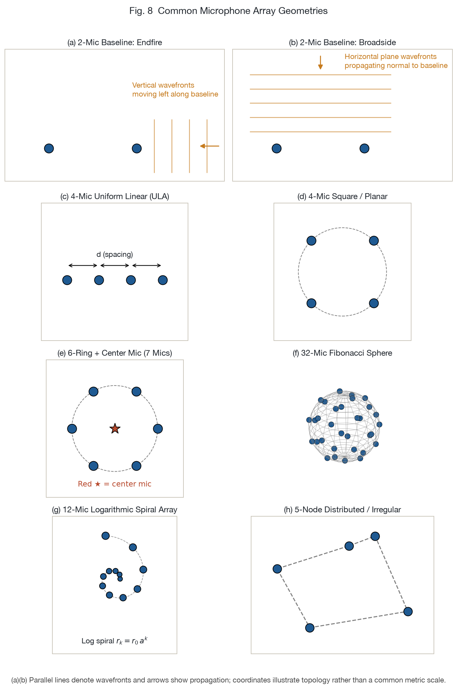
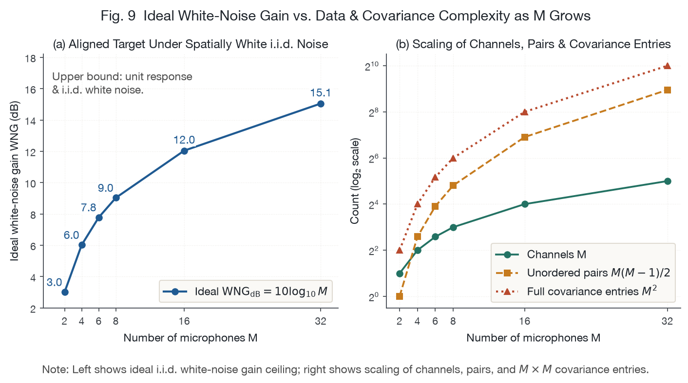
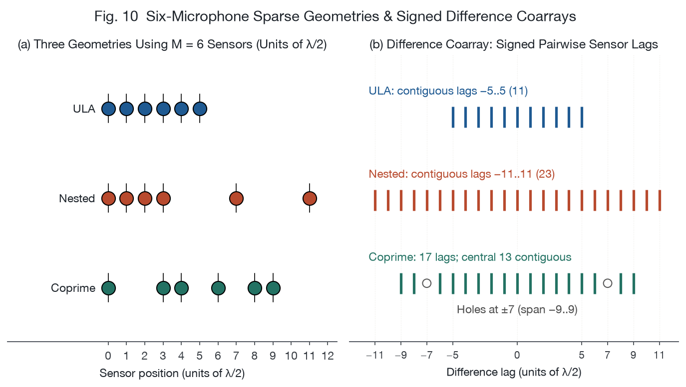
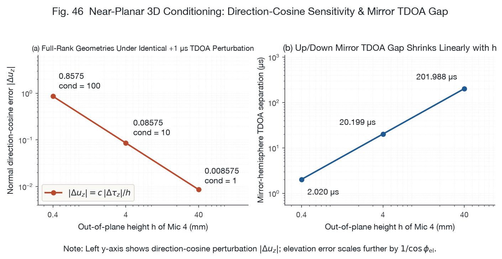
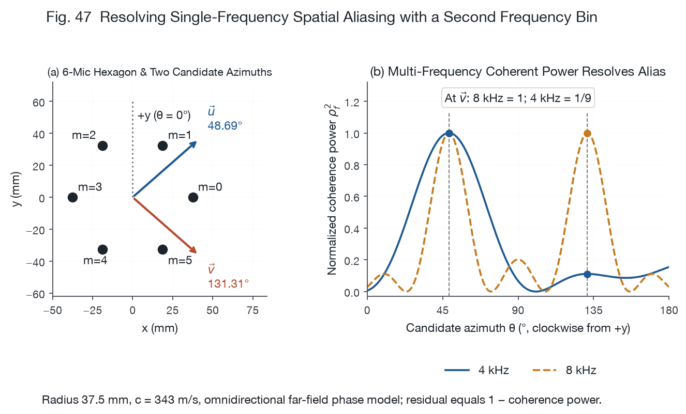

🌐 [简体中文](../chapters/03_array-geometry.md) ｜ **English**

> This chapter is Chapter 3 of the main text. The main text and extended special topics comprise 16 chapters in total (Chapters 0–15, where Chapter 0 covers mathematical foundations and Chapters 12–15 are four extended special topics), accompanied by Appendices A and B. This chapter can be read independently; use the navigation bar below for the preceding and following chapters.
>
> Overview Home: [00_overview.md](00_overview.md) | Previous: [02_basics-signal-model.md](02_basics-signal-model.md) | Next: [04_doa-estimation.md](04_doa-estimation.md)

---

## 3. Array Geometries

Should a microphone array be arranged along a straight line, around a circular ring, across a planar surface, or distributed throughout an entire room? This chapter is organized around three core engineering questions: where the microphones are placed, which three-dimensional (3D) directions produce distinguishable acoustic observations, and how channel mismatches and sensor position errors in real hardware degrade those geometric differences. After completing this chapter, the reader will be able to calculate relative time delays and steering vectors by hand from arbitrary 3D element coordinates, distinguish 3D geometric mirror ambiguities from narrowband spatial aliasing, and quantitatively compare competing array layouts under explicit noise and frequency-band assumptions.

| Symbol or Acronym | Meaning and Unit in This Chapter |
|---|---|
| $\vec r_m$, $\vec u$ | 3D coordinates of the $m$-th microphone (unit: $\mathrm{m}$); unit direction vector pointing from the array toward the sound source (dimensionless) |
| $c,f,\lambda,\kappa$ | Speed of sound ($\mathrm{m/s}$, taken as $343\ \mathrm{m/s}$ in worked examples), frequency ($\mathrm{Hz}$), wavelength $\lambda=c/f$ ($\mathrm{m}$), and wavenumber $\kappa=2\pi f/c$ ($\mathrm{rad/m}$) |
| $\theta,\phi_{\mathrm{el}}$ | Horizontal azimuth measured clockwise from $+y$ toward $+x$; elevation measured upward from the horizontal plane toward $+z$; evaluated in radians inside trigonometric functions |
| Delay-and-Sum Beamforming (DSB) | Equal-weight averaging across channels after compensating propagation phases toward the target direction |
| White Noise Gain (WNG) | Target power gain divided by the squared Euclidean norm of the weight vector, measuring the SNR multiplication factor against independent identically distributed (i.i.d.) sensor self-noise |
| Time Difference of Arrival (TDOA) | Signed arrival-time difference between two microphones, $\tau_{ij}=t_i-t_j$ (unit: $\mathrm{s}$) |
| Half-Power Beamwidth (HPBW) | Angular width between the nearest points on either side of the mainlobe peak where power drops to half its maximum ($\approx -3.01\ \mathrm{dB}$); no numerical value is forced when no half-power crossing exists in the visible angular domain |

This chapter retains the forward Fourier kernel $e^{-\mathrm{j}2\pi ft}$ established in Chapter 2. Audio channels, rows of the coordinate matrix, and entries of the steering vector must strictly follow identical element ordering. Except in §3.4 and discussions of acoustic baffles, free-field formulas assume that all channels are synchronously sampled, omnidirectional, and matched in magnitude and phase response.

### 3.1 Overview of Array Topologies

Figure 8 summarizes the eight geometric configurations most frequently encountered in commercial products and academic research. Note when reading the figure that the planar subfigures are drawn to contrast topological layouts rather than to share a common metric scale. Let us examine their design intent in order from simplest to most general:

- **Subfigures (a) and (b) — Endfire versus broadside operation on the same two-microphone baseline**: Both subfigures depict the same pair of blue microphones (separated by $4$ schematic units); the sole difference is the direction of arrival of the orange plane wave. In (a), vertical wavefronts propagate from right to left along the line connecting the two sensors, sweeping across the right microphone before the left microphone; this is **endfire** operation—true wireless stereo (TWS) earbud stems and top-and-bottom handset dual-microphone designs routinely point their baseline toward the user's mouth and apply delay-and-subtract processing to suppress rear noise. In (b), horizontal wavefronts propagate from top to bottom perpendicular to the baseline, arriving at both microphones simultaneously; this is **broadside** operation—laptop display bezels and tablets typically space two microphones left-to-right so that a user seated in front lies on the broadside principal axis. This pair illustrates directly that "endfire" and "broadside" describe the geometric relationship between the target direction and the baseline, rather than two different pieces of dual-microphone hardware.
- **Subfigure (c) — 4-microphone Uniform Linear Array (ULA)**: Four microphones are spaced at equal intervals $d$ along a single straight line. For a given sensor count and alias-free spacing, a ULA concentrates every element onto one axis to maximize axial aperture, making it widely used in soundbars and television set-top boxes; the trade-off is that it resolves only a one-dimensional cone angle around the array axis and cannot distinguish elevation from front–back mirror directions.
- **Subfigure (d) — 4-microphone square / planar array**: Four microphones form a 2D square (the dashed gray circumscribed circle indicates that it can equivalently be viewed as a 4-element uniform circular array). Because it possesses two orthogonal horizontal baselines (transverse and longitudinal), it can jointly estimate two in-plane direction cosines; however, whenever the array plane is acoustically open on both sides, symmetric mirror points in the upper and lower half-spaces still produce identical arrival-time differences.
- **Subfigure (e) — 6-microphone Uniform Circular Array plus center microphone ($6+1$ UCA)**: Six blue elements are distributed uniformly every $60^\circ$ around a circle, supplemented by a center reference microphone marked with a red star at the origin. Its projected aperture across $360^\circ$ of horizontal azimuth is balanced without the endfire blind zone of a linear array, making it the classic topology for tabletop smart speakers and puck-style conference speakerphones.
- **Subfigure (f) — 32-microphone Fibonacci quasi-uniform spherical array**: Sensors populate a 3D spherical shell along a deterministic spherical spiral lattice so that baselines span all three $(x,y,z)$ coordinates simultaneously, leaving no planar mirror blind spots over the full $4\pi$ steradians of solid angle; it is widely deployed in spherical-harmonic sound-field recording, robot audition heads, and acoustic cameras.
- **Subfigure (g) — 12-microphone logarithmic spiral array ($r_k=r_0 a^k$)**: Sensors expand outward along a spiral whose polar radius grows exponentially. Inner short baselines prevent spatial aliasing at high frequencies while outer wide-span baselines narrow the mainlobe at low frequencies, and the aperiodic layout breaks up the periodic high-frequency grating lobes of regular lattices—making it a workhorse geometry for acoustic imaging arrays (detailed in Chapter 12).
- **Subfigure (h) — Distributed / irregular array**: Five nodes are scattered at irregular room-scale coordinates (the dashed gray polygon delineates their convex hull). Multi-meter baselines yield exceptional geometric sensitivity and spatial diversity against occlusion, but individual nodes typically run on independent sampling clocks and experience strongly unequal direct-to-reverberant ratios, requiring joint deployment with the cross-device clock synchronization and distributed cooperation algorithms of Chapters 10 and 13.

One common beginner misconception warrants immediate clarification: arranging bare omnidirectional microphones in a circle or a line does not cause the hardware itself to automatically form a directional mainlobe. Sensor coordinates merely determine the inter-channel time-delay differences imprinted by sound waves arriving from different directions; actual directional mainlobes and nulls are synthesized by backend signal-processing weights, and changing the weight vector on the same physical array produces an entirely different spatial response.

#### 3.1.1 From Sensor Coordinates to Directional Response and 3D Coordinate Conventions

To unify all of the geometries above under a single mathematical framework, we first state our sensor indexing and coordinate conventions.

> **Element Indexing Convention ($0,\dots,M-1$ versus $1,\dots,M$)**
>
> Sensor coordinates in this chapter (such as ULA positions $x_m=md$, UCA angular positions $2\pi m/M$, and the integer sparse grid $p_m$ in §3.3), together with all accompanying Python arrays throughout this book, use **zero-based indexing $m=0,1,\dots,M-1$**. This differs from the **one-based indexing $m=1,2,\dots,M$** (with ULA positions $(m-1)d$) used in portions of the prose derivations in Chapters 1–2 and 4–5 only by the index shift $m'=m-1$: the zero-based reference sensor $m=0$ corresponds to "Mic 1," $m=1$ corresponds to "Mic 2," and the last element $m=M-1$ corresponds to "Mic $M$." Under both conventions, the array consists of $M$ microphones separated by $M-1$ adjacent intervals, and the total end-to-end physical aperture of a ULA is identically $(M-1)d$.

Under this convention, a ULA aligned along the $+x$-axis has element coordinates $\vec r_m=(md,0,0)^\top$ ($m=0,\dots,M-1$). An $M$-microphone uniform circular array of radius $r$ in the horizontal plane has coordinates $\vec r_m=(r\cos\alpha_m,r\sin\alpha_m,0)^\top$, where $\alpha_m=2\pi m/M$ is the polar mounting angle of sensor $m$ itself measured counterclockwise from the $+x$-axis (take care to distinguish the sensor mounting angle $\alpha_m$ from our source azimuth $\theta$, which is measured clockwise from the $+y$-axis). By the law of cosines or the half-angle sine identity, the straight-line chord distance between adjacent microphones on a UCA is $2r\sin(\pi/M)$; when $M$ is even, diametrically opposite sensor pairs pass through the center so the maximum pairwise spacing equals the diameter $2r$, whereas when $M$ is odd, the maximum pairwise spacing is $2r\sin\bigl(\frac{M-1}{2M}\pi\bigr)<2r$.

Next, let us decompose a 3D source direction $(\theta,\phi_{\mathrm{el}})$ step by step into the three Cartesian components of the unit direction vector $\vec u=[u_x,u_y,u_z]^\top$ (for a review of 3D spherical coordinate projections and the law of cosines, see [Chapter 0 §0.1](00_math-foundations.md#sec-0-1)):

1. **Vertical decomposition first**: Raising the source ray upward from the horizontal $xy$-plane by elevation angle $\phi_{\mathrm{el}}\in[-90^\circ,90^\circ]$, because $\vec u$ has unit length, its vertical height component along $+z$ is $u_z=\sin\phi_{\mathrm{el}}$, and the length of its orthogonal projection ("shadow") onto the horizontal $xy$-plane is $\cos\phi_{\mathrm{el}}\ge0$.
2. **In-plane decomposition of the horizontal shadow**: Because horizontal azimuth $\theta$ in this book takes the broadside $+y$-axis as $0^\circ$ and increases clockwise toward $+x$, the side opposite angle $\theta$ of this horizontal shadow of length $\cos\phi_{\mathrm{el}}$ lies along the $+x$-axis, giving $u_x=\cos\phi_{\mathrm{el}}\cdot\sin\theta$, while the adjacent side lies along the $+y$-axis, giving $u_y=\cos\phi_{\mathrm{el}}\cdot\cos\theta$. Squaring and summing immediately verifies unit norm: the first two terms sum to $u_x^2+u_y^2=\cos^2\phi_{\mathrm{el}}$, and adding $u_z^2=\sin^2\phi_{\mathrm{el}}$ yields $1$ identically.

Once $\vec u$ is written down, taking microphone $0$ at $\vec r_0$ as the reference, the relative propagation delay $\tau_{m0}=t_m-t_0$ and the $m$-th entry of the free-field far-field steering vector for an arbitrary 3D array geometry follow directly from the inner product:

$$\begin{aligned}
\vec u&=\begin{bmatrix}
\sin\theta\cos\phi_{\mathrm{el}}\\
\cos\theta\cos\phi_{\mathrm{el}}\\
\sin\phi_{\mathrm{el}}
\end{bmatrix},\\
\tau_{m0}&=-\frac{(\vec r_m-\vec r_0)^\top\vec u}{c},\\
a_m(f,\vec u)&=e^{-\mathrm{j}2\pi f\tau_{m0}}.
\end{aligned}\tag{3-1}$$

For the reference microphone itself, $\tau_{00}=0$ and $a_0=1$ identically. Whenever $(\vec r_m-\vec r_0)^\top\vec u>0$, microphone $m$ lies closer to the sound source than the reference microphone, so the wavefront arrives earlier ($\tau_{m0}<0$), producing a positive phase advance in the steering vector. Cross-checking with the horizontal-plane parameters calculated by hand in §2.3: for a ULA with $d=0.04\ \mathrm{m}$, $\theta=30^\circ$, and $\phi_{\mathrm{el}}=0^\circ$, we have $\vec u=[0.5,\sqrt{3}/2,0]^\top$, the projection of microphone $1$ relative to microphone $0$ is $0.04\times0.5=0.02\ \mathrm{m}$, giving $\tau_{10}=-0.02/343\approx-58.31\ \mathrm{\mu s}$ and a steering phase of $+20.99^\circ$ at $1\ \mathrm{kHz}$—in exact agreement with Chapter 2.

Furthermore, applying a rigid-body translation to the entire array in space (adding a common vector $\vec r_{\mathrm{shift}}$ to every $\vec r_m$) leaves $\vec r_m-\vec r_0$ invariant, so the far-field relative steering vector is completely unchanged; choosing a different microphone as the reference merely multiplies the entire column $\vec a(f,\vec u)$ by a common scalar phase factor without altering any inter-channel relative information.

**3D Coordinate-Frame Cross-Reference (Book Convention, SOFA, and Spherical-Harmonic Colatitude)**: When loading public measured HRTF databases or spherical microphone-array calibration files in practice, mismatched 3D angular conventions are one of the most frequent interface bugs. The local right-handed Cartesian axes and full coordinate transformations for Audio Engineering Society standard **AES69 (Spatially Oriented Format for Acoustics, SOFA)** are derived in [Chapter 0 §0.1.1 Eq. (0-2)](00_math-foundations.md#sec-0-1-1): its horizontal azimuth runs **counterclockwise** from front toward left, obeying $\phi_{\mathrm{SOFA}} \equiv -\theta \pmod{360^\circ}$ relative to this book's clockwise azimuth $\theta$, with elevation $\delta_{\mathrm{SOFA}}=\phi_{\mathrm{el}}\in[-90^\circ,+90^\circ]$; meanwhile, spherical-harmonic beamforming ([Chapter 0 §0.7](00_math-foundations.md#sec-0-7), [§5.8](05_beamforming.md#sec-5-8), [§14.2](14_spatial-wearable-arrays.md#sec-14-2), and [Appendix A §16.1](16_appendix-symbols-math.md#sec-16-1)) typically measures polar angle downward from the $+z$ zenith as **colatitude** $\vartheta = 90^\circ - \delta_{\mathrm{SOFA}} \in [0^\circ, 180^\circ]$.

Remember that the horizontal equator sits at $\vartheta = 90^\circ$, *not* $0^\circ$: passing SOFA elevation $\delta_{\mathrm{SOFA}}$ directly into a colatitude interface collapses the entire horizontal equator ($\delta_{\mathrm{SOFA}}=0^\circ$) onto the overhead zenith $(0,0,1)$, and reflects lower-hemisphere sources (e.g., $\delta_{\mathrm{SOFA}}=-30^\circ$) into the upper hemisphere while inverting horizontal azimuth by $180^\circ$ (numerical verification helper in [`spatial_coherence_and_dba.py`](../codes/chapters/ch01/core/spatial_coherence_and_dba.py); `libmysofa` spherical interpolation details in [Source Research Manual 1](../codes/chapters/ch00/research_en/01_spatial_and_tracking.md)). The table below cross-checks six unit-distance ($r=1\ \mathrm{m}$) directions across all four representations for unit-testing data loaders:

| Physical Direction | Book Azimuth $\theta$ | SOFA Spherical $(\phi_{\mathrm{SOFA}}, \delta_{\mathrm{SOFA}})$ | SH Colatitude $\vartheta$ | SOFA Cartesian $(x, y, z)\ [\mathrm{m}]$ |
|---|---|---|---|---|
| Horizontal straight ahead | $0^\circ$ | $0^\circ,\ 0^\circ$ | $90^\circ$ | $(1, 0, 0)$ |
| Horizontal due right | $+90^\circ$ | $-90^\circ$ (or $270^\circ$), $0^\circ$ | $90^\circ$ | $(0, -1, 0)$ |
| Horizontal due left | $-90^\circ$ | $+90^\circ,\ 0^\circ$ | $90^\circ$ | $(0, 1, 0)$ |
| Horizontal straight behind | $\pm 180^\circ$ | $180^\circ,\ 0^\circ$ | $90^\circ$ | $(-1, 0, 0)$ |
| Overhead zenith | arbitrary (polar singularity) | $0^\circ,\ +90^\circ$ | $0^\circ$ | $(0, 0, 1)$ |
| $30^\circ$ front-right, $+30^\circ$ elevation | $+30^\circ$ | $-30^\circ$ (or $330^\circ$), $+30^\circ$ | $60^\circ$ | $(0.75, -0.4330, 0.5)$ |

#### 3.1.2 Worked Example 3-1: Differential Dual-Microphone Earbud — Synthesizing a Cardioid Pattern Across a 1 cm Spacing

The stem of a wireless Bluetooth earbud (TWS) is only a few centimeters long. Suppose two ideal omnidirectional microphones spaced by just $d=1\ \mathrm{cm}$ are placed front-to-back along the axis pointing toward the talker's mouth (an endfire layout; to stay continuous with Chapter 2's two-microphone notation, Worked Examples 3-1 and 3-2 temporarily use one-based labels $x_1$ for the front mic and $x_2$ for the rear mic, which are completely equivalent to zero-based indices $0,1$). At the mid-speech frequency of $1\ \mathrm{kHz}$, the acoustic wavelength is $\lambda=34.3\ \mathrm{cm}$, so the array aperture is less than one-thirtieth of a wavelength—if we simply applied the equal-weight delay-and-sum beamformer (DSB) of Chapter 2, the 3D spatial response would be an almost perfectly omnidirectional sphere with virtually zero directional selectivity. How do miniature devices achieve a cardioid beam that preserves frontal speech while rejecting rear noise across a $1\ \mathrm{cm}$ baseline? The answer is the **first-order Differential Microphone Array (DMA)**, which will be developed systematically in Chapter 5 (§5.3).

Before computing numbers, let us settle a conceptual question: if we subtract the rear microphone $x_2(t)$ scaled by a real gain $g$ directly from the front microphone $x_1(t)$, forming $y(t)=x_1(t)-g\,x_2(t)$ without any electrical delay, can we suppress the rear while preserving the front? No. A frontal wave lags at the rear microphone by phase $-\Delta\phi$, whereas a rear wave leads at the rear microphone by phase $+\Delta\phi$; for any real scalar $g$, the complex-conjugate magnitudes $|1-ge^{-\mathrm{j}\Delta\phi}|$ and $|1-ge^{+\mathrm{j}\Delta\phi}|$ are identically equal, so the front and back magnitude responses are always strictly symmetric. (Note that front–back symmetry does not necessarily mean a figure-of-eight pattern: only for equal gain $g=1$ at small spacing do broadside waves cancel identically to zero to form a figure-of-eight; taking $g=0$ yields an omnidirectional single-microphone circle, while taking $g=0.5$ leaves a residual broadside magnitude of $|1-0.5|=0.5$—Exercise E03-05 at the end of this chapter explicitly computes all three cases.)

To break front–back symmetry and cancel rear noise exactly, the decisive step is to **insert an intentional electrical delay equal to the inter-microphone acoustic travel time $\tau_0=d/c$ into the rear microphone channel** before subtracting it from the front microphone:

$$\begin{aligned}
y(t)&=x_1(t)-x_2(t-d/c),\\
Y(f)&=X_1(f)-e^{-\mathrm{j}2\pi fd/c}X_2(f).
\end{aligned}\tag{3-2}$$

Here $x_1$ is the front microphone closer to the mouth, $x_2$ is the rear microphone farther from the mouth, and the second line follows directly from the Fourier time-shift property (§2.3.2). Let us work through five explicit steps to determine the target gain, rear null, self-noise penalty, and mismatch sensitivity at $d=0.01\ \mathrm{m}$, $c=343\ \mathrm{m/s}$, and $f=1000\ \mathrm{Hz}$:

1. **One-way endfire propagation delay and electrical phase angle**: Let $\Delta\tau>0$ denote the magnitude of the travel time across spacing $d$:

    $$\begin{aligned}
    \Delta\tau&=\frac{d}{c}=\frac{0.01}{343}
    \approx29.15\ \mathrm{\mu s},
    \end{aligned}$$

    which corresponds at $f=1\ \mathrm{kHz}$ to a one-way phase angle of

    $$\begin{aligned}
    \Delta\phi&=2\pi f\Delta\tau
    =\frac{2\pi\times1000\times0.01}{343}\\
    &\approx0.1832\ \mathrm{rad}\approx10.50^\circ.
    \end{aligned}$$

2. **Rear incidence ($180^\circ$) — acoustic head start caught up exactly by electrical delay**: Interference arriving from straight behind hits the rear microphone $x_2$ first and takes an additional $\Delta\tau=d/c$ to reach the front microphone $x_1$, so $x_1(t)=x_2(t-d/c)$. Equation (3-2) applies that same electrical delay $d/c$ to the rear channel $x_2$. Consequently, the two waveforms entering the subtractor are identical, yielding an ideal output $y(t)=0$ identically and forming an exact cancellation null at $180^\circ$.

3. **Frontal incidence ($0^\circ$) — factoring out the half-angle phase to compute residual magnitude**: Target speech arriving from straight ahead reaches the front microphone $x_1$ first and arrives at the rear microphone $x_2$ after $\Delta\tau$; the electrical delay then pushes the rear channel back by another $\Delta\tau$, so the two channels are offset by double the travel time $2\Delta\tau$ (a double phase angle $2\Delta\phi\approx21.0^\circ$). Normalizing the single-microphone target input spectral magnitude to $1$, the complex output response is $1-e^{-\mathrm{j}2\Delta\phi}$. Without skipping steps, factor out the half-angle center phase $e^{-\mathrm{j}\Delta\phi}$ to expose Euler's sine identity:

    $$\begin{aligned}
    1-e^{-\mathrm{j}2\Delta\phi}
    &=e^{-\mathrm{j}\Delta\phi}
    \bigl(e^{+\mathrm{j}\Delta\phi}-e^{-\mathrm{j}\Delta\phi}\bigr)\\
    &=e^{-\mathrm{j}\Delta\phi}\,(2\mathrm{j}\sin\Delta\phi).
    \end{aligned}$$

    Since $|e^{-\mathrm{j}\Delta\phi}|=1$ and $|\mathrm{j}|=1$, taking the magnitude (evaluating at the unrounded $\Delta\phi\in(0,\pi)$) gives the frontal output amplitude directly:

    $$\begin{aligned}
    |Y|&=2\sin\Delta\phi
    \approx2\sin(0.18318\ \mathrm{rad})\approx0.3643.
    \end{aligned}$$

    In decibels, $20\log_{10}0.3643\approx\mathbf{-8.77\ \mathrm{dB}}$ (roughly **$-8.8\ \mathrm{dB}$**): frontal speech survives, but because a $1\ \mathrm{cm}$ spacing spans a phase difference of only $21^\circ$ at $1\ \mathrm{kHz}$, subtracting two nearly aligned phasors incurs nearly $9\ \mathrm{dB}$ of signal attenuation.

4. **Output SNR penalty — why does "subtracting" independent self-noise double the noise power?** The most common intuitive trap for newcomers is assuming that subtracting two channels also subtracts their internal noise floor. Let $v_1(t)$ and $v_2(t)$ denote the internal circuit self-noises of the two microphones, zero-mean with equal variance $\sigma_v^2$ and statistically independent across channels (so their cross-correlation vanishes at every lag: $\mathbb{E}[v_1(t)v_2(t-d/c)]=0$). Passing through the subtractor in Eq. (3-2) yields output self-noise $v_{\mathrm{out}}(t)=v_1(t)-v_2(t-d/c)$, whose mean-square power is

    $$\begin{aligned}
    \mathbb{E}\bigl[v_{\mathrm{out}}^2(t)\bigr]
    &=\mathbb{E}\bigl[v_1^2(t)\bigr]
    -2\mathbb{E}\bigl[v_1(t)v_2(t-d/c)\bigr]
    +\mathbb{E}\bigl[v_2^2(t-d/c)\bigr]\\
    &=\sigma_v^2-0+\sigma_v^2=2\sigma_v^2.
    \end{aligned}$$

    Because the cross-term vanishes for independent noise and $(-1)^2=+1$, **whether two independent noise processes are added or subtracted, their output noise powers strictly add and double**, raising the noise floor by $10\log_{10}2\approx+3.01\ \mathrm{dB}$. Combining the $8.77\ \mathrm{dB}$ drop in target speech with the $3.01\ \mathrm{dB}$ rise in circuit self-noise, the output white-noise SNR drops by $8.77+3.01\approx\mathbf{11.78\ \mathrm{dB}}$ (about **$-11.8\ \mathrm{dB}$**). This is the physical root of poor low-frequency white noise gain (WNG) in small-spacing differential arrays: the lower the frequency or the smaller the spacing, the closer $\Delta\phi$ approaches zero and the more severe the target subtraction loss becomes.

5. **What channel gain mismatch destroys first**: The ideal rear null relies entirely on "$1-1=0$." Suppose the rear microphone sensitivity is merely $1\%$ higher than that of the front microphone (an actual gain ratio of $1.01$, i.e., a tiny $+0.086\ \mathrm{dB}$ factory tolerance). Rear interference no longer cancels to zero upon subtraction, leaving an absolute residual amplitude of $|1-1.01|=0.01$ ($20\log_{10}0.01=-40\ \mathrm{dB}$ relative to a single microphone input). When plotting a standard beampattern normalized so that the frontal mainlobe peak sits at $0\ \mathrm{dB}$, we must divide by the actual mismatched frontal gain:

    $$\begin{aligned}
    |B_{\mathrm{front}}|
    &=|1-1.01\,e^{-\mathrm{j}2\Delta\phi}|\approx0.3663,\\
    20\log_{10}\frac{0.01}{|B_{\mathrm{front}}|}
    &\approx20\log_{10}\frac{0.01}{0.3663}
    \approx-31.28\ \mathrm{dB}.
    \end{aligned}$$

    Keep the denominators of these two decibel figures distinct: $-40\ \mathrm{dB}$ is the absolute residual relative to a single microphone input, whereas **$-31.3\ \mathrm{dB}$** is the true beampattern null depth normalized to the frontal mainlobe. A mere $1\%$ gain discrepancy fills an infinitely deep null up to roughly $-31\ \mathrm{dB}$, underscoring why miniature differential arrays impose stringent microphone-matching and production-line calibration requirements (Exercise E03-12 provides audible synthetic WAV comparisons of this mismatch and its calibration).

Finally, let us extend the front and rear calculations across all horizontal angles to see where the name "cardioid" comes from. Let $\beta\in[0^\circ,180^\circ]$ denote the angle between the arrival direction and the front endfire axis ($\beta=0^\circ$ straight ahead, $\beta=90^\circ$ at broadside, $\beta=180^\circ$ straight behind; distinguish this axial angle $\beta$ from the broadside-referenced azimuth $\theta$), and let $p=2\pi fd/c=\Delta\phi$ denote the dimensionless electrical spacing. The natural acoustic propagation lag of the rear sensor relative to the front sensor is $(d/c)\cos\beta$; adding the fixed electrical delay $d/c$ produces a total phase lag of $p(1+\cos\beta)$. Substituting into Eq. (3-2) and applying the same half-angle sine simplification (normalizing to the frontal magnitude at non-degenerate frequencies where $\sin p\ne0$) gives

$$\begin{aligned}
B(f,\beta)&=1-e^{-\mathrm{j}p(1+\cos\beta)},\\
\frac{|B(f,\beta)|}{|B(f,0)|}
&=\frac{|\sin[p(1+\cos\beta)/2]|}{|\sin p|}
\xrightarrow{p\to0^+}\frac{1+\cos\beta}{2}.
\end{aligned}\tag{3-3}$$

In the low-frequency electrically small limit $p\to0^+$, applying the small-angle approximation $\sin x\approx x$ to both numerator and denominator cancels $p$, so the normalized beampattern converges smoothly to the frequency-invariant standard cardioid curve $(1+\cos\beta)/2$, taking values $1,0.5,0$ at $\beta=0^\circ,90^\circ,180^\circ$ (exact evaluation of Eq. (3-3) at $1\ \mathrm{kHz}$ gives $1,0.5021,0$, already virtually indistinguishable from an ideal cardioid). Matching our book-wide conjugate inner-product convention $Y=\vec w^H\vec x=w_1^*X_1+w_2^*X_2$ against Eq. (3-2)'s $X_1-e^{-\mathrm{j}p}X_2$ requires $w_1^*=1$ and $w_2^*=-e^{-\mathrm{j}p}$, yielding the complex weight vector $w_1=1$ and $w_2=-e^{+\mathrm{j}p}$ (each of unit modulus, so $\|\vec w\|_2^2=1^2+1^2=2$). Substituting into Eq. (2-13) of Chapter 2 immediately yields the frontal linear white noise gain $G(f)$ and its decibel form:

$$\begin{gathered}
G(f)=\frac{|B(f,0)|^2}{2}=\frac{(2\sin p)^2}{2}=2\sin^2 p,\\
\mathrm{WNG}_{\mathrm{dB}}(f)=10\log_{10}G(f).
\end{gathered}\tag{3-4}$$

Substituting $p\approx0.18318$ at $1\ \mathrm{kHz}$ into Eq. (3-4) gives $10\log_{10}(2\sin^2 0.18318)\approx-11.78\ \mathrm{dB}$, matching our step-4 tally to the last decimal place. Note that cascading a backend bass-boost equalizer (multiplying by real gain $1/|B(f,0)|$) to restore the frontal speech level to $0\ \mathrm{dB}$ multiplies both the target numerator and the noise denominator by the square of that equalizer gain, which cancels identically and does not improve $\mathrm{WNG}_{\mathrm{dB}}$ by a single hundredth of a decibel.

Stepping back into 3D space reveals the fundamental geometric ceiling of any two-microphone baseline: two sensors provide only a single scalar delay observation. Only when the sound source is restricted a priori to a single-valued semicircle on one side of a known plane can one delay uniquely determine one angle. Once released into 3D space, all rays sharing the same angle $\beta$ relative to the baseline sweep out a circular cone around the axis; every direction on that cone produces an identical two-microphone delay, a phenomenon known as the **cone of confusion**. Resolving 3D ambiguities and equalizing directional sensitivity requires adding sensors and expanding the dimensionality of the array.

The table below compares six mainstream multi-microphone geometries in terms of directional coverage, core strengths and limitations, and typical host devices. Keep the roles of the columns distinct when reading: "Coverage" denotes the angular domain resolvable by pure geometry; "Strengths" and "Limitations" summarize physical behavior in subspace localization—such as Multiple Signal Classification (MUSIC) or Estimation of Signal Parameters via Rotational Invariance Techniques (ESPRIT), detailed in §4.6—and beamforming; and "Typical Applications" lists representative product form factors rather than an absolute ranking divorced from aperture size and frequency band:

| Geometry | Coverage | Strengths | Limitations | Typical Applications |
|---|---|---|---|---|
| **Uniform Linear Array (ULA)** | One-sided 1D $\pm90^\circ$ | Shift-invariant element spacing and Toeplitz structure; largest axial aperture for fixed $M$ and spacing | 3D cone of confusion around array axis; $\mathrm{d}\tau/\mathrm{d}\theta\to0$ near endfire severely amplifies angle errors | Soundbars, linear conference bars |
| **Uniform Circular Array (UCA)** | Horizontal $360^\circ$ azimuth | Balanced effective projected aperture across all horizontal azimuths, no endfire blind zone | Discrete rotational symmetry for finite $M$; a single coplanar ring retains upper/lower half-space mirror ambiguity | Smart speakers, tabletop conference pucks |
| **Square / Planar Array** | Single-sided hemisphere | Two non-collinear baselines jointly estimate 3D azimuth and elevation | Symmetric mirror directions on opposite sides of the array plane share identical delays; requires a baffle or half-space prior | Wall-mounted panels, display-bezel all-in-ones |
| **Spherical Array (Rigid / Open)** | Full $4\pi$ steradians | Uniform 3D geometric sensitivity; expands directly into orthogonal spherical harmonics | High physical volume and channel count; rigid spheres require scattering manifolds, open spheres are ill-conditioned at spherical Bessel zeros | Robot audition heads, Ambisonics capture |
| **Spiral / Logarithmic Array** | Depends on coplanarity | Combines inner alias-free spacing with outer narrow mainlobe; aperiodic layout suppresses periodic high-frequency grating lobes | Lacks shift-invariant structure; broadband weight design is more involved | Acoustic cameras, broadband array research |
| **Distributed / Irregular Array** | Depends on 3D node span | Meter-scale span yields high spatial diversity, boosting occlusion resilience and near-field 3D localization accuracy | Nodes exhibit independent crystal clock drift, unequal path loss, and packet drops; relies on clock sync and self-calibration | Large multi-node conference rooms, robot networks |

Reading this table against concrete product requirements makes geometry selection straightforward: if a tabletop smart speaker only needs to localize talkers across **$360^\circ$ of horizontal azimuth**, a planar UCA suffices; if an aerial drone or ceiling-suspended terminal must also distinguish whether a sound originates above or below, no single-layer coplanar array—regardless of how many coplanar microphones are added—can break the upper/lower planar mirror symmetry from time delays alone, making out-of-plane vertical elements or acoustic shadowing from a rigid chassis indispensable.

#### 3.1.3 Geometric Rank, Mirror Symmetry, and Phase Ambiguity

Why does a linear array suffer from a cone of confusion, a planar array from an upper/lower mirror image, and only a non-coplanar array uniquely lock onto a 3D direction? A simple check on the **rank of the baseline matrix** from linear algebra makes this completely transparent. Stacking the $M-1$ 3D baseline row vectors $\vec b_m^\top=(\vec r_m-\vec r_0)^\top$ ($m=1,\dots,M-1$) relative to reference microphone $\vec r_0$ into an $(M-1)\times3$ geometric baseline matrix $\mathbf G$, and collecting the $M-1$ measured signed TDOAs into a column vector $\vec\tau=[\tau_{10},\dots,\tau_{M-1,0}]^\top\in\mathbb{R}^{M-1}$, turns the second line of Eq. (3-1) into a system of linear equations for the 3D direction vector $\vec u$ coupled with the unit-sphere constraint:

$$\mathbf G\vec u=-c\vec\tau,\qquad
\|\vec u\|_2=1.\tag{3-5}$$

The rank $\operatorname{rank}(\mathbf G)$ directly dictates how many spatial degrees of freedom are locked down by pure time-delay equations:

- **Collinear array ($\operatorname{rank}(\mathbf G)=1$)**: Every baseline is parallel to a single axis (say the $x$-axis), so the linear system locks down only the axial component $u_x$. Whenever $|u_x|<1$, the remaining relation $u_y^2+u_z^2=1-u_x^2>0$ slices a circle of radius $\sqrt{1-u_x^2}$ on the 3D unit sphere—precisely the cone of confusion (degenerating to a single point only at the endfire limits $u_x=\pm1$). Packing arbitrarily many additional microphones onto the same straight line keeps all rows collinear, so $\operatorname{rank}(\mathbf G)$ remains $1$ forever.
- **Non-collinear planar array ($\operatorname{rank}(\mathbf G)=2$)**: For a circular or square array lying in the horizontal $xy$-plane, the third column of every baseline vanishes ($b_{m,z}=0$). The linear system uniquely determines the two in-plane direction cosines $(u_x,u_y)$; whenever $u_x^2+u_y^2<1$, the unit-sphere constraint $u_z^2=1-u_x^2-u_y^2$ admits two symmetric real solutions of opposite sign, $u_z=\pm\sqrt{1-u_x^2-u_y^2}$. For instance, if a horizontal planar array measures $u_x=0.3,u_y=0.4$, then $u_z=\pm\sqrt{0.75}\approx\pm0.866$: these upper-hemisphere and lower-hemisphere mirror directions imprint identical delays across arbitrarily many coplanar microphones (verified explicitly in Exercise E03-14).
- **3D non-coplanar array ($\operatorname{rank}(\mathbf G)=3$)**: At least one microphone steps out of the plane (providing a nonzero normal baseline component) so that $\mathbf G$ achieves full column rank $3$, uniquely determining $\vec u=-\mathbf G^{\dagger}(c\vec\tau)$ from noiseless signed TDOAs.

Engineering design, however, must never stop at "mathematically full rank and unique"; we must immediately ask about **numerical conditioning**. If the fourth microphone is raised out of the horizontal plane by only $0.4\ \mathrm{mm}$, $\operatorname{rank}(\mathbf G)$ is still algebraically equal to $3$, but the third row baseline is tiny and the matrix condition number rises sharply: a mere $1\ \mathrm{\mu s}$ of TDOA jitter causes the unconstrained linear inverse to severely distort the normal component or even push it outside the physically valid interval $[-1,1]$ (Exercise E03-14 and Figure 46 dissect coplanar mirroring, condition numbers, and error amplification across $h=0,40,4,0.4\ \mathrm{mm}$).

The baseline matrix also controls error amplification. First assume that $\mathbf G$ has full column rank and that the $M-1$ TDOA errors have zero mean and covariance $\sigma_\tau^2\mathbf I_{M-1}$. The covariance of the unconstrained linear least-squares estimator $\hat{\vec u}_{\mathrm{lin}}=-c(\mathbf G^\top\mathbf G)^{-1}\mathbf G^\top\hat{\vec\tau}$ then follows from $\mathbf G^\top\mathbf G$; this second-order relation does not require Gaussian errors.

To obtain the Fisher information and Cramér–Rao Lower Bound (CRLB; see [Chapter 0 §0.6](00_math-foundations.md#sec-0-6)), additionally model the arrival-time errors as zero-mean Gaussian. Independent sensor arrival-time errors of common variance $\sigma_t^2>0$ induce TDOA covariance $\boldsymbol{\Sigma}_\tau=\sigma_t^2(\mathbf I_{M-1}+\vec 1\vec 1^\top)$ through the shared reference sensor. Substituting its inverse $\boldsymbol{\Sigma}_\tau^{-1}=\sigma_t^{-2}(\mathbf I_{M-1}-\frac1M\vec 1\vec 1^\top)$ gives the centroid-referenced geometry tensor $\mathbf R_c^\top\mathbf R_c$, where row $m$ of $\mathbf R_c$ is $(\vec r_m-\bar{\vec r})^\top$:

$$\begin{aligned}
\operatorname{Cov}_{\text{i.i.d.\ TDOA}}(\hat{\vec u}_{\mathrm{lin}})
&=c^2\sigma_\tau^2\,(\mathbf G^\top\mathbf G)^{-1},\\
\mathbf F_u^{\text{i.i.d.\ TOA}}
&=\frac{1}{c^2}\mathbf G^\top\boldsymbol{\Sigma}_\tau^{-1}\mathbf G
=\frac{1}{c^2\sigma_t^2}\,\mathbf R_c^\top\mathbf R_c.
\end{aligned}$$

This immediately contrasts 3D isotropy across topologies: a symmetric **spherical array** achieves $\mathbf R_c^\top\mathbf R_c\propto\mathbf I_3$ (isotropic 3D CRLB in all directions); a horizontal **planar UCA** ($M\ge3$) gives $\mathbf R_c^\top\mathbf R_c=\operatorname{diag}(\frac{M}{2}r^2,\frac{M}{2}r^2,0)$ (isotropic in the $xy$-plane yet singular along $z$); and a **near-planar orthogonal array** $\mathbf G=\operatorname{diag}(d,d,h)$ ($h\le d$, Exercise E03-14) under i.i.d. TDOA noise has $\lambda_{\min}(\mathbf G^\top\mathbf G)=h^2$, showing directly why normal-component variance scales as $1/h^2$ (standard deviation as $1/h$). Moreover, Eq. (3-5) assumes access to unwrapped true time differences $\vec\tau$; if one observes only modulo-$2\pi$ wrapped complex phases at a single high frequency, narrowband spatial aliasing can still occur even when $\operatorname{rank}(\mathbf G)=3$, for which §3.2.2 establishes the exact integer-cycle criterion.

Beyond global ambiguities caused by insufficient spatial dimensionality, **local angle-estimation sensitivity** on a given array also varies dramatically across incidence angles. Returning to a two-sensor line along the $x$-axis with Mic 1 at $x=0$ and Mic 2 at $x=d$, the derivative of the signed delay $\tau_{12}=d\sin\theta/c$ with respect to $\theta$ vanishes at endfire $\theta\to\pm90^\circ$—the same geometric fact behind the divergence of the CRLB in Chapter 2 §2.6.6 as $\cos\theta\to0$. Let us work through a concrete example to see how starkly the same $10\ \mathrm{\mu s}$ delay error behaves near broadside versus near endfire.

#### 3.1.4 Worked Example 3-2: Endfire Sensitivity — Impact of the Same 10 μs Error Across Directions

Using the signed time difference $\tau_{12}=t_1-t_2=\frac{d}{c}\sin\theta$ (with $\theta$ in radians when differentiating), taking the first-order differential with respect to $\theta$ and solving for a small-angle perturbation gives

$$\begin{aligned}
\frac{\mathrm{d}\tau_{12}}{\mathrm{d}\theta}
&=\frac{d}{c}\cos\theta,\\
\delta\theta&\approx\frac{c\,\delta\tau_{12}}{d\cos\theta}.
\end{aligned}\tag{3-6}$$

Equation (3-6) states clearly: **converting a fixed TDOA measurement error $\delta\tau_{12}$ into an angular error divides by the projected cosine factor $\cos\theta$**.

- **Inputs and setup**: Take a dual-microphone baseline of spacing $d=4\ \mathrm{cm}=0.04\ \mathrm{m}$ (matching the worked example in §4.4) with sound speed $c=343\ \mathrm{m/s}$. Suppose subsample TDOA estimation incurs an error of $\delta\tau_{12}=10\ \mathrm{\mu s}$ (only $0.16$ sample periods at a $16\ \mathrm{kHz}$ sampling rate). Let us evaluate the resulting angular error at broadside $\theta=0^\circ$ and near endfire $\theta=85^\circ$.
- **Direction 1 — Broadside ($\theta=0^\circ$)**: Here $\cos 0^\circ=1$, where the sine curve has its steepest slope, so the first-order linearization is highly accurate:

    $$\begin{aligned}
    \delta\theta&\approx\frac{343\times10\times10^{-6}}{0.04}
    =0.08575\ \mathrm{rad}\approx4.91^\circ.
    \end{aligned}$$

    Thus a $10\ \mathrm{\mu s}$ TDOA error near broadside causes an angular error of about **$4.9^\circ$** (roughly $5^\circ$; exact evaluation gives $\arcsin(0.08575)\approx4.92^\circ$, virtually identical).

- **Direction 2 — Near endfire ($\theta=85^\circ$)**: Here the first-order differential formula does not apply (evaluating $4.91^\circ/\cos 85^\circ\approx56.4^\circ$ is severely inaccurate), because the maximum physical delay for $d=4\ \mathrm{cm}$ is $\tau_{\max}=0.04/343\approx116.62\ \mathrm{\mu s}$, and the true delay at $\theta=85^\circ$, namely $\tau_{12}=(0.04/343)\sin 85^\circ\approx116.17\ \mathrm{\mu s}$, already sits right against the physical ceiling. Positive and negative delay perturbations therefore exhibit strongly asymmetric nonlinear behavior:
  - For a $+10\ \mathrm{\mu s}$ measurement error, the observed delay reaches $126.17\ \mathrm{\mu s}>\tau_{\max}$, giving $c\hat\tau_{12}/d\approx1.082>1$, which exits the real domain $[-1,1]$ of $\arcsin$ so no physical real angle exists at all (production code should record an explicit out-of-range diagnostic flag; see the four-case inversion table and interface policy in Exercise E03-02);
  - For a $-10\ \mathrm{\mu s}$ measurement error, the observed delay is $\hat\tau_{12}=116.1743-10=106.1743\ \mathrm{\mu s}$, and substituting into the exact arcsine yields

      $$\begin{aligned}
      \hat\theta&=\arcsin\!\left(
      \frac{343\times106.1743\times10^{-6}}{0.04}\right)\\
      &\approx65.57^\circ,
      \end{aligned}$$

      pulling the estimated angle down from $85^\circ$ to $65.6^\circ$—a **$19.4^\circ$** error, roughly four times larger than at broadside for the same delay error.

- **Engineering takeaway and boundary**: Precisely because linear arrays suffer from this "positive error out-of-bounds, negative error magnified severalfold" geometric compression near endfire, a soundbar required to cover a wide room field of view must either widen its baseline and raise SNR to drive $\delta\tau_{12}$ down, or adopt a circular or multi-axis bent array to bring edge directions back into a high-sensitivity projected aperture zone.

### 3.2 Four Design Rules

When screening microphone layouts under industrial enclosure and bill-of-materials constraints, check the following four design rules in sequence: establish the electrical aperture across the operating band, match the target angular coverage, account for chassis baffle scattering, and weigh the SNR gain of adding microphones against hardware and computational cost. Two worked examples will then pin down the exact numbers for circular and linear arrays.

#### 3.2.1 Check Aperture, Coverage, Baffle, and Microphone Count First

1. **Conventional angular resolution scales with the wavelength-to-aperture ratio (order $\lambda/D$)**: At $1\ \mathrm{kHz}$, a compact tabletop circular array of diameter $7.5\ \mathrm{cm}$ spans less than a quarter-wavelength, leaving its equal-weight mainlobe wider than a semicircle; only above $4\ \mathrm{kHz}$ does the mainlobe narrow to tens of degrees (Worked Example 3-3 below). Higher frequencies enlarge the electrical aperture $D/\lambda$ but simultaneously push the array toward spatial aliasing and magnify millimeter-scale position tolerances, so aperture selection must balance low-frequency resolution against high-frequency alias-free bounds.
2. **Circular and linear arrays serve fundamentally different directional priors**: A ULA concentrates its entire aperture near broadside, sacrificing both projected aperture and angle sensitivity toward endfire; a UCA maintains a uniform effective projected aperture across $360^\circ$ of horizontal azimuth, while a 3D spherical array adds elevation coverage. Whether a linear or circular array is preferable for distant speech recognition depends on device placement, room reverberation, and talker azimuth distribution rather than any context-free ranking (for a comprehensive overview, see [Kumatani, McDonough, and Raj 2012, "Microphone Array Processing for Distant Speech Recognition," *IEEE Signal Processing Magazine*](https://doi.org/10.1109/MSP.2012.2205285) and the [CMU handout copy](https://course.ece.cmu.edu/~ece792/handouts/KumataniEtAl12.pdf)).
3. **Rigid enclosures and acoustic baffles must be built into the array manifold**: Real microphones rarely float in free space; they sit flush-mounted in cylindrical smart-speaker shells, display bezels, or robot head casings. Consider two microphones mounted diametrically opposite on a rigid sphere of radius $a$: because the normal particle velocity of air must vanish on the rigid boundary, dipole added mass as air flows around the sphere magnifies the low-frequency ($\kappa a\ll1$) inter-microphone effective delay to **$1.5\times$** that of the free-field diameter $2a$ (Kuhn 1977, *JASA*), whereas at high frequencies ($\kappa a\gg1$) propagation transitions to Woodworth (1938) creeping-wave diffraction along the spherical arc accompanied by rear acoustic shadowing (Exercise E03-17 derives this frequency-dependent scattering bias and the resulting free-field arcsine out-of-range angle). Engineering implementations should use analytical rigid-sphere/cylinder scattering manifolds or anechoic measured manifolds rather than approximating a baffle by a frequency- and angle-independent constant "virtual free-field aperture" multiplier.
4. **Microphone count is governed by diminishing SNR returns versus quadratic/cubic cost**: Increasing $M$ provides additional degrees of freedom for interference nulling and suppresses uncorrelated sensor self-noise—under ideal target phase alignment and i.i.d. sensor self-noise, equal-weight DSB achieves linear $\mathrm{WNG}=M$, or $\mathrm{WNG}_{\mathrm{dB}}=10\log_{10}M$, meaning **every doubling of the microphone count improves white-noise SNR by only about $3.01\ \mathrm{dB}$** ($+3\ \mathrm{dB}$ from 2 to 4 mics, $+3\ \mathrm{dB}$ from 4 to 8 mics, and another $+3\ \mathrm{dB}$ only after doubling from 8 to 16 mics). Meanwhile, ADC interfaces, PCB routing, and $O(M^2)$ spatial covariance storage/updates (plus $O(M^3)$ dense inversion or eigendecomposition) grow rapidly.

#### 3.2.2 Worked Example 3-3: Numbers for a 6-Microphone Circular Ring

One of the most ubiquitous commercial topologies for tabletop smart speakers is the 6-microphone uniform circular ring. Taking an ideal free-field omnidirectional 6-element ring of diameter $D=7.5\ \mathrm{cm}$ (radius $r=3.75\ \mathrm{cm}=0.0375\ \mathrm{m}$) and sound speed $c=343\ \mathrm{m/s}$, let us walk through four steps to obtain its inter-element spacing, exact spatial-aliasing frequency, and true beamwidth:

1. **Step 1 — Adjacent inter-microphone spacing**: Six microphones spaced uniformly every $2\pi/6=\pi/3$ ($60^\circ$) around the circumference form the vertices of an inscribed regular hexagon. Adjacent sensors and the center form an isosceles triangle with a $60^\circ$ apex angle, so the adjacent chord length equals the radius identically:

    $$\begin{aligned}
    d&=2r\sin\!\left(\frac{\pi}{6}\right)
    =2\times0.0375\times0.5\\
    &=0.0375\ \mathrm{m}=3.75\ \mathrm{cm}.
    \end{aligned}$$

2. **Step 2 — From conservative adjacent-chord check to exact hexagonal layer-spacing aliasing limit**: Applying the sufficient half-wavelength rule $d\le\lambda/2$ to adjacent sensors gives a quick conservative frequency check:

    $$\begin{aligned}
    f_{\mathrm{check}}&=\frac{c}{2d}=\frac{343}{2\times0.0375}\\
    &\approx4573\ \mathrm{Hz}\approx4.6\ \mathrm{kHz}.
    \end{aligned}$$

    Below $4.6\ \mathrm{kHz}$, not even a single adjacent microphone pair exceeds a $\pm\pi$ phase difference, so spatial aliasing is guaranteed impossible. Under $16\ \mathrm{kHz}$ sampling (Nyquist frequency $8\ \mathrm{kHz}$), however, the ring's true horizontal alias-free ceiling is **$5.28\ \mathrm{kHz}$** rather than $4.6\ \mathrm{kHz}$. The geometric picture behind this exact critical threshold $d<\lambda/\sqrt{3}\approx0.577\lambda$ (proved rigorously in [Tucker, Zhao, Ahmad, and Potter 2022, *Alias-Free Arrays*, IEEE Signal Processing Letters §V-B](https://doi.org/10.1109/LSP.2022.3224834) and [open-access full text](https://pmc.ncbi.nlm.nih.gov/articles/PMC9757818/)) becomes clear once we write out the six vertex coordinates:

    By the polar mounting formula $\alpha_m=m\pi/3$ ($m=0,\dots,5$) in §3.1, the planar $(x,y)$ coordinates of the six microphones are $(d,0)$, $(\frac12 d,\frac{\sqrt{3}}{2}d)$, $(-\frac12 d,\frac{\sqrt{3}}{2}d)$, $(-d,0)$, $(-\frac12 d,-\frac{\sqrt{3}}{2}d)$, and $(\frac12 d,-\frac{\sqrt{3}}{2}d)$. Inspecting their $y$-coordinates shows that all six microphones lie on **three horizontal parallel lines** $y=-\frac{\sqrt{3}}{2}d$, $y=0$, and $y=+\frac{\sqrt{3}}{2}d$, whose **perpendicular inter-layer spacing is $d_\perp=\frac{\sqrt{3}}{2}d$**.

    When we compare straight-ahead incidence $\theta=0^\circ$ ($\vec u=[0,1,0]^\top$) against straight-behind incidence $\theta=180^\circ$ ($\vec v=[0,-1,0]^\top$) in the horizontal plane, the direction-difference vector $\vec u-\vec v=[0,2,0]^\top$ has zero $x$-component, so the $x_m$ coordinates play no role whatsoever and the entire 6-element ring collapses along the $y$-axis into a 3-layer ULA of spacing $d_\perp=\frac{\sqrt{3}}{2}d$. Preventing integer-cycle phase wrap-around across the closed directional domain requires that this perpendicular layer spacing be strictly less than half a wavelength:

    $$\begin{aligned}
    d_\perp=\frac{\sqrt{3}}{2}d<\frac{\lambda}{2}
    \quad\Longleftrightarrow\quad
    d<\frac{\lambda}{\sqrt{3}}\approx0.577\lambda.
    \end{aligned}$$

    Substituting $d=0.0375\ \mathrm{m}$ into $f_*=c/(\sqrt{3}d)=343/(\sqrt{3}\times0.0375)$ yields a critical aliasing frequency of $5280.8\ \mathrm{Hz}$ ($\approx 5.28\ \mathrm{kHz}$). More generally, denoting the baseline of sensor $m$ relative to the reference sensor by $\vec b_m=\vec r_m-\vec r_0$, an arbitrary array geometry maps two distinct admissible directions $\vec u\ne\vec v$ onto an identical normalized steering vector at wavelength $\lambda$ if and only if the path-difference projection along every baseline $m=1,\dots,M-1$ is an integer multiple of the wavelength:

    $$\begin{aligned}
    \frac{\vec b_m^\top(\vec u-\vec v)}{\lambda}&\in\mathbb{Z}
    \qquad(m=1,\dots,M-1),
    \end{aligned}\tag{3-7}$$

    where $\mathbb{Z}$ denotes the set of integers. Comparing $\theta=0^\circ$ against $180^\circ$ above establishes only **necessity** of $d<\lambda/\sqrt{3}$; a three-line dual-lattice (reciprocal-lattice) argument (cf. [Chapter 2 §2.6.5](02_basics-signal-model.md#sec-2-6-5)) supplies **sufficiency**: taking $\vec r_0=(d,0)^\top$ as reference, all five planar baselines $\vec b_m=\vec r_m-\vec r_0$ are integer combinations of the primitive hexagonal vectors $\vec v_1=(-\frac12 d,\frac{\sqrt{3}}{2}d)^\top$ and $\vec v_2=(-\frac12 d,-\frac{\sqrt{3}}{2}d)^\top$ (specifically $\vec v_1,2\vec v_1+\vec v_2,2\vec v_1+2\vec v_2,\vec v_1+2\vec v_2,\vec v_2$), so Eq. (3-7) holds if and only if $\vec w=(\vec u-\vec v)/\lambda$ lies in the dual lattice $\Lambda^*=\{k_1\vec w_1+k_2\vec w_2:k_1,k_2\in\mathbb{Z}\}$ ($\vec v_i^\top\vec w_j=\delta_{ij}$) spanned by $\vec w_{1,2}=(-1/d,\pm\frac{1}{\sqrt{3}d})^\top$. Because the shortest nonzero vector in $\Lambda^*$ has norm $\|\vec w\|_{\min}=\frac{2}{\sqrt{3}d}$ while any two distinct horizontal unit vectors satisfy $0<\|\vec u-\vec v\|_2\le 2$,

    $$\begin{aligned}
    \|\vec w\|_2&=\frac{\|\vec u-\vec v\|_2}{\lambda}
    \le\frac{2}{\lambda}<\frac{2}{\sqrt{3}d}
    =\|\vec w\|_{\min}\\
    &\Longleftrightarrow\quad
    d<\frac{\lambda}{\sqrt{3}}.
    \end{aligned}$$

    Hence whenever $d<\lambda/\sqrt{3}$, Eq. (3-7) admits no nonzero solution for **any** horizontal pair $(\vec u,\vec v)$, completing both necessity and sufficiency. At the critical wavelength $\lambda_*=\sqrt{3}d$, the path differences between $\theta=0^\circ$ and $180^\circ$ across the three horizontal layers divided by $\lambda_*$ equal the integers $-1,0,+1$, making their 6D steering vectors coincide identically; Exercise E03-08 explicitly constructs a pair of horizontal directions at $8\ \mathrm{kHz}$ whose phases match across all six channels (note also that a single-layer coplanar ring still has the upper/lower half-space mirror symmetry of §3.1.3 at all frequencies, which is a rank-$2$ broadband delay mirror rather than narrowband spatial aliasing).

3. **Step 3 — Aperture-to-wavelength ratio**: With outer ring diameter $D=2r=7.5\ \mathrm{cm}=0.075\ \mathrm{m}$, let us compare electrical size at $1\ \mathrm{kHz}$ (low speech band) versus $4\ \mathrm{kHz}$ (mid-high speech band):

    - At $1\ \mathrm{kHz}$: $\lambda=343/1000=0.343\ \mathrm{m}=34.3\ \mathrm{cm}$, giving $D/\lambda=0.075/0.343\approx0.219$—**the entire ring spans barely one-fifth of a wavelength**;
    - At $4\ \mathrm{kHz}$: $\lambda=343/4000=0.08575\ \mathrm{m}$ ($\approx 8.58\ \mathrm{cm}$), giving $D/\lambda=0.075/0.08575\approx0.875$—the ring diameter approaches a full wavelength.

4. **Step 4 — Exact equal-weight beamwidth of the circular ring**: The rough scale $\lambda/D$ evaluates to $4.57\ \mathrm{rad}$ at $1\ \mathrm{kHz}$ and $1.14\ \mathrm{rad}$ at $4\ \mathrm{kHz}$, which serves only as an order-of-magnitude guide—never apply the ULA formula $0.886\lambda/D$ to a circular ring. Using the 6-microphone ring coordinates of §3.1 (without a 7th center sensor) and wavenumber $\kappa=2\pi f/c$, equal-weight delay-and-sum beamforming steered to $\theta_0=0^\circ$ averages the six residual phase factors across horizontal incidence angle $\theta$:

    $$\begin{aligned}
    \vec u_\theta&=(\sin\theta,\cos\theta,0)^\top,\\
    \psi_m&=\kappa\,\vec r_m^\top(\vec u_\theta-\vec u_{\theta_0}),\\
    B(f,\theta;\theta_0)
    &=\frac1M\sum_{m=0}^{M-1}e^{\mathrm{j}\psi_m}.
    \end{aligned}\tag{3-8}$$

    At $\theta=\theta_0$, every $\psi_m=0$ and $B=1$ identically. Scanning outward to the left and right from $\theta_0=0^\circ$ and solving $|B(f,\theta;0^\circ)|^2=1/2$ ($\approx -3.0103\ \mathrm{dB}$) via bisection yields the exact numerical root-finding results below (reproduced by `exact_beamwidths` in [`chapter03_experiments.py`](../codes/chapters/ch03/chapter03_experiments.py)):

| Frequency (kHz) | Electrical Size $D/\lambda$ | Exact 6-Mic Ring HPBW (°) | Physical Behavior and Engineering Assessment |
|---:|---:|---:|---|
| $1$ | $0.219$ | $220.23$ | Half-power crossings lie at $\pm110.12^\circ$; mainlobe exceeds a semicircle with weak low-frequency selectivity |
| $4$ | $0.875$ | $47.31$ | Mainlobe narrows to ~47°, providing clear horizontal directional focusing |

Note that because a circular ring scans across all $360^\circ$ of azimuth, doubling the one-sided half-width $110.12^\circ$ at $1\ \mathrm{kHz}$ legitimately gives $220.23^\circ>180^\circ$ (do not confuse this with a ULA defined on the one-sided interval $[-90^\circ,90^\circ]$).

**3D elevation–azimuth coupling, continuous-ring Bessel $J_0$ approximation, and the physical role of the 7th center microphone**: For an arbitrary 3D source at $(\theta,\phi_{\mathrm{el}})$, substituting $\vec r_m=(r\cos\alpha_m,r\sin\alpha_m,0)^\top$ into Eq. (3-1) gives spatial phase $\kappa\vec r_m^\top\vec u=\kappa r\cos\phi_{\mathrm{el}}\sin(\theta+\alpha_m)$—elevating the source foreshortens the effective ring radius to $r_{\mathrm{eff}}=r\cos\phi_{\mathrm{el}}$ and widens the azimuthal beam by $1/\cos\phi_{\mathrm{el}}$. Taking the continuous-ring limit ($M\to\infty$) in Eq. (3-8) at common elevation $\phi_{\mathrm{el}}$ and azimuth offset $\Delta\theta=\theta-\theta_0$ (Van Trees 2002, Part IV, Ch. 4; Mathews and Zoltowski 1994, *IEEE TSP*; Rafaely 2019; Teutsch and Kellermann 2006) yields, via the cylindrical Bessel integral representation in [Chapter 0 §0.7](00_math-foundations.md#sec-0-7), the closed-form ring array factor and narrow-beam HPBW:

$$\begin{aligned}
B_{\mathrm{ring}}(\Delta\theta,\phi_{\mathrm{el}})
&=J_0\!\left(2\kappa r\cos\phi_{\mathrm{el}}
\sin\frac{\Delta\theta}{2}\right),\\
\mathrm{HPBW}_{\mathrm{ring}}
&\approx\frac{2x_{\mathrm{hp}}}{\pi}
\frac{\lambda}{D\cos\phi_{\mathrm{el}}}
\approx\frac{0.717\,\lambda}{D\cos\phi_{\mathrm{el}}}
\quad(\text{rad},\ D\cos\phi_{\mathrm{el}}\gg\lambda),
\end{aligned}$$

where $x_{\mathrm{hp}}\approx1.1264$ is the positive root of $J_0(x)=1/\sqrt{2}$. Solving $2\kappa r\sin(\Delta\theta/2)=x_{\mathrm{hp}}$ directly in the horizontal plane ($\phi_{\mathrm{el}}=0$) predicts $220.28^\circ$ at $1\ \mathrm{kHz}$ and $47.31^\circ$ at $4\ \mathrm{kHz}$, agreeing with our exact 6-mic discrete ring ($220.23^\circ$ and $47.31^\circ$) to within $0.05^\circ$; meanwhile, the first sidelobe of $J_0$ occurs at $x\approx3.8317$ with level $|J_0(3.8317)|\approx0.4028$ (**$-7.90\ \mathrm{dB}$**, higher than a ULA's $-13.26\ \mathrm{dB}$ because elements cluster along the rim). Crucially, the unsteered zeroth phase-mode ($n=0$) response of an open horizontal ring is $J_0(\kappa r)$, whose first zero $\kappa r\approx2.4048$ falls at **$f_0=2.4048\,c/(2\pi r)\approx3.50\ \mathrm{kHz}$** for $r=3.75\ \mathrm{cm}$ (even on the discrete 6-mic ring, the unsteered average drops below $0.007$ at $3.50\ \mathrm{kHz}$). At this Bessel null, open-ring phase-mode beamforming loses its $n=0$ (omnidirectional) component and suffers severe conditioning breakdown; adding a 7th microphone at the center $r=0$ (whose $n=0$ response stays identically $1$ at every frequency) eliminates this null, explaining the commercial $6+1$ UCA layout of Figure 8(e).

How, then, do practical systems handle speech frequencies above $5.28\ \mathrm{kHz}$? Two complementary strategies are standard: in localization, broadband speech is scored jointly across multiple frequency bins; in beamforming, low-frequency DOA estimates guide the steering angle for high-frequency weights. Multi-frequency joint DOA scoring hinges on an essential algebraic detail: **a talker's raw source complex amplitude varies arbitrarily and is unknown from one frequency bin to another**, so a candidate direction cannot be asked to predict a common absolute spectrum across frequencies; instead, at each frequency bin we must first divide out the reference channel phasor (or perform least-squares orthogonal projection across all channels; see Eq. (3-19) in Exercise E03-15) to eliminate the unknown common source complex amplitude, and sum only the normalized fitting residuals of the inter-channel relative manifold.

Exercise E03-15 and Figure 47 demonstrate this with synthetic two-tone 6-channel audio on the 6-element ring: a pair of aliased directions whose manifolds coincide identically at $8\ \mathrm{kHz}$ immediately separate to normalized residuals of $0$ versus $8/9$ once a $4\ \mathrm{kHz}$ bin is included—alongside a ULA octave counterexample ($2\ \mathrm{kHz}$ and $4\ \mathrm{kHz}$) where both frequencies remain jointly aliased, reminding us that broadband disambiguation depends on the actual frequency combination rather than merely counting bins.

#### 3.2.3 Worked Example 3-4: ULA Mainlobe Width Calculation

Next, let us test the validity boundaries of Chapter 2's narrow-mainlobe approximation on a compact 4-microphone ULA at low and high frequencies. Take $M=4$, inter-element spacing $d=3\ \mathrm{cm}=0.03\ \mathrm{m}$, and equal-weight DSB steered to broadside $\theta_0=0^\circ$. The physical end-to-end span between the first and last microphones is $(M-1)d=3\times3=9\ \mathrm{cm}$, whereas the narrow-mainlobe approximation of Eq. (2-11) at broadside ($\cos 0^\circ=1$, in radians) reads

$$\mathrm{HPBW}\approx\frac{0.886\,\lambda}{Md}.\tag{3-9}$$

Notice that the denominator uses the Dirichlet-kernel scale $Md=4\times3=12\ \mathrm{cm}$, noticeably larger than the $9\ \mathrm{cm}$ physical span. Evaluating at $1\ \mathrm{kHz}$ and $8\ \mathrm{kHz}$:

- **At $1\ \mathrm{kHz}$ (the approximation breaks down completely)**: Here $\lambda=0.343\ \mathrm{m}$. Uncritically plugging numbers into Eq. (3-9) gives $0.886\times0.343/0.12\approx2.532\ \mathrm{rad}\approx145.1^\circ$—which is **not** the array's true HPBW. Substituting the endfire limit $\theta=90^\circ$ (inter-element phase $\psi=2\pi d/\lambda=0.06\pi/0.343\approx0.5495\ \mathrm{rad}$) directly into the exact Dirichlet kernel derived in §2.6.1 (for complex geometric series summation, see [Chapter 0 §0.2](00_math-foundations.md#sec-0-2)) yields

    $$\begin{aligned}
    \bigl|B(90^\circ)\bigr|
    &=\left|\frac{\sin(4\times0.5495/2)}
    {4\sin(0.5495/2)}\right|\approx0.8208,
    \end{aligned}$$

    or $20\log_{10}0.82077\approx-1.72\ \mathrm{dB}$—strictly above the $-3.01\ \mathrm{dB}$ half-power threshold. Across the entire visible scan from $0^\circ$ out to $\pm90^\circ$, beam power drops by at most $1.72\ \mathrm{dB}$, so **no half-power crossing exists anywhere in the visible region** (software must report "no crossing" rather than fabricating $145.1^\circ$ or clamping to $180^\circ$).

- **At $8\ \mathrm{kHz}$ (inside the valid narrow-mainlobe regime, but grating lobes must be checked simultaneously)**: Here $\lambda=343/8000=0.042875\ \mathrm{m}$ ($\approx 4.29\ \mathrm{cm}$), and Eq. (3-9) estimates

    $$\begin{aligned}
    \mathrm{HPBW}&\approx\frac{0.886\times0.042875}{0.12}\\
    &\approx0.3166\ \mathrm{rad}\approx18.14^\circ.
    \end{aligned}$$

    Bisection root-finding on the exact discrete array factor gives **$18.73^\circ$**, so Eq. (3-9) underestimates by only about $3.2\%$, and the mainlobe is sharp. Spatial aliasing must still be checked simultaneously: from the grating-lobe condition $d(\sin\theta-\sin\theta_0)=n\lambda$ for a nonzero integer $n$ in [Chapter 2 §2.6.5](02_basics-signal-model.md#sec-2-6-5), preventing grating lobes over scan sector $|\theta_0|\le\theta_{\max}$ against all visible incidence angles $\theta\in[-90^\circ,90^\circ]$ requires the scan-dependent spacing bound

    $$d<\frac{\lambda}{1+|\sin\theta_{\max}|}.$$

    At broadside ($\theta_{\max}=0^\circ$) the limit relaxes to $d/\lambda<1$, explaining why $d/\lambda=0.03/0.042875\approx0.700$ produces no grating lobe at $\theta_0=0^\circ$ ($\sin\theta=\pm\lambda/d\approx\pm1.429$ lies outside $[-1,1]$); once the scan range widens to $\theta_{\max}=60^\circ$, the threshold tightens to $1/(1+\sin 60^\circ)\approx0.536$, which $0.700>0.536$ violates—steering to $\theta_0=60^\circ$ produces an equal-height $0\ \mathrm{dB}$ grating lobe inside the visible region at $\sin\theta=\sin 60^\circ-1.429\approx-0.563$, i.e., $\theta\approx-34.27^\circ$ (full endfire scan $\theta_{\max}=90^\circ$ recovers the classical half-wavelength rule $d<\lambda/2$; reproduced by `exact_beamwidths` in [`chapter03_experiments.py`](../codes/chapters/ch03/chapter03_experiments.py)). "High frequency gives a narrow mainlobe" and "alias-free across the entire field of view" are two separate ledger items that must always be verified independently.

Figure 9 plots the SNR benefit and data-structure growth of Design Rule 4 side by side:

- **Subfigure (a) — Logarithmic growth of ideal WNG with microphone count $M$**: Plotting $\mathrm{WNG}_{\mathrm{dB}}=10\log_{10}M$ ($\mathrm{dB}$) for equal-weight DSB under exact target alignment and i.i.d. sensor self-noise shows steep initial gains (relative to a single mic, 2 microphones already yield $3\ \mathrm{dB}$ and 4 microphones yield $6\ \mathrm{dB}$) followed by progressive flattening—illustrating the "$3\ \mathrm{dB}$ per doubling" law of diminishing returns.
- **Subfigure (b) — Scaling of multichannel data structures**: Plotting on a base-$2$ logarithmic vertical axis against $M$ contrasts three fundamental quantities: raw input channels $M$ (linear), unordered sensor pairs $M(M-1)/2$ traversed by cross-correlation methods such as GCC-PHAT (quadratic), and full $M^2$ spatial covariance entries maintained by frequency-domain adaptive beamformers and subspace methods (quadratic in storage, with $O(M^3)$ compute for direct dense inversion or eigendecomposition).

#### 3.2.4 Step-by-Step Checklist for Array Geometry Selection

When translating the four rules above into a real hardware kickoff, follow this five-step verification checklist rather than fixing an enclosure layout first and relying on algorithms to compensate for physical limitations afterward:

1. **Fix the operating frequency band and required angular coverage**: Specify the core speech band $[f_{\min},f_{\max}]$ and angular field of view first—a single-sided 1D sector fits a linear array, $360^\circ$ horizontal coverage fits a planar circular array, and full $4\pi$ coverage (or vertical elevation disambiguation) requires a non-coplanar 3D or spherical array.
2. **Lock the alias-free spacing ceiling $d_{\max}$ from $f_{\max}$**: Use $d_{\max}=c/(2f_{\max})$ for a ULA and the exact layer-spacing bound $d_{\max}=c/(\sqrt{3}f_{\max})$ for a 6-microphone regular circular ring. At $f_{\max}=4\ \mathrm{kHz}$ ($c=343\ \mathrm{m/s}$), a ULA permits at most $4.29\ \mathrm{cm}$ spacing while a 6-mic ring permits up to $4.95\ \mathrm{cm}$ adjacent chord length; to span wider speech bands without forfeiting low-frequency aperture, adopt §3.3.3 wideband harmonic nested subarrays or multi-frequency joint localization.
3. **Verify low-frequency directivity from $f_{\min}$ and enclosure envelope $D_{\max}$**: Estimate minimum aperture from $\mathrm{HPBW}\sim\lambda_{\max}/D$ (with $\lambda_{\max}=c/f_{\min}$) and verify exact crossings via Eq. (3-8); whenever the chassis envelope satisfies $D_{\max}\ll\lambda_{\max}$ (such as earbuds or smart glasses), conventional delay-and-sum turns nearly omnidirectional at low frequencies, necessitating differential (§5.3) or superdirective designs paired with tighter channel-matching budgets.
4. **Balance microphone count $M$, WNG, spatial degrees of freedom, and compute**: Jointly weigh target white-noise gain $10\log_{10}M$, the number of simultaneous independent interferers to null (spatial degrees of freedom capped at $M-1$), and $O(M^2)\text{--}O(M^3)$ covariance compute and PCB routing cost to choose the smallest sufficient $M$.
5. **Cross-check against enclosure scattering, tabletop reflections, and tolerance budgets**: Verify near-planar height conditioning (E03-14), rigid-chassis scattering manifolds (E03-17), tabletop half-space reflections and acoustic-port high-frequency resonances (§3.4.2), plus high-frequency coordinate tolerances and low-frequency port-seal tolerances (§3.4.4)—replacing analytical free-field manifolds with anechoic measurements whenever discrepancies exceed target margins.

Given a fixed budget of $M$ microphones, since stretching the uniform spacing of a ULA past half a wavelength invites grating lobes, can those same few microphones be arranged to achieve a much wider total aperture without falling into periodic grating-lobe traps? That question leads directly to non-uniform sparse arrays and difference coarrays in the next section.

### 3.3 Sparse Arrays and Difference Coarrays

#### 3.3.1 The Coarray Concept: From Sensor Positions to Pairwise Lags

Recall the dilemma of a uniform linear array: with only $M=6$ microphones, enforcing the half-wavelength alias-free spacing $d=\lambda/2$ forces us to place them adjacently at $\{0,1,2,3,4,5\}\,(\lambda/2)$, locking the maximum physical span at $5\,(\lambda/2)$. Upon closer inspection, a ULA suffers from substantial "baseline redundancy": unit spacing $1$ is measured $5$ times ($1-0,2-1,3-2,4-3,5-4$), spacing $2$ is measured $4$ times, and baselines longer than $5$ are never measured at all.

The core insight of a **sparse array** is to break uniform spacing and relocate those redundant sensors farther out so that fewer physical microphones sample baselines across all scales from short to long (for early 1D–3D sparse array designs, see [Pumphrey 1993, *JASA*](https://doi.org/10.1121/1.406821); for broader continuous-position planar compressive-sensing sparse arrays, see [Yan and Yang 2016, *IET MAP*](https://doi.org/10.1049/iet-map.2015.0775)). Here we focus on the classic **half-wavelength integer-grid sparse linear array** used in subspace DOA estimation: we lay down an integer ruler of unit spacing $d_0=\lambda/2$ and populate only a selected subset of integer ticks with physical microphones.

Why do second-order spatial statistics depend on *pairwise position differences* rather than individual absolute sensor positions? Returning to Chapter 2's narrowband far-field signal model, for a plane wave arriving from direction $\vec u$, channel $i$ carries spatial phase factor $e^{\mathrm{j}\kappa \vec r_i^\top\vec u}$ and channel $j$ carries $e^{\mathrm{j}\kappa \vec r_j^\top\vec u}$. When we form the $(i,j)$-th entry of the spatial covariance matrix $R_{ij}=\mathbb{E}[X_i X_j^*]$, complex conjugation on channel $j$ flips the sign in its exponent, turning the product of two exponentials directly into a **difference of position vectors**:

$$\begin{aligned}
e^{\mathrm{j}\kappa \vec r_i^\top\vec u}
\cdot\bigl(e^{\mathrm{j}\kappa \vec r_j^\top\vec u}\bigr)^*
&= e^{\mathrm{j}\kappa (\vec r_i-\vec r_j)^\top\vec u}.
\end{aligned}$$

This subtraction in the exponent is the key to all coarray theory. It shows that cross-correlation phases for stationary uncorrelated sources depend solely on the ordered sensor-pair difference $\vec r_i-\vec r_j$. Collecting and deduplicating the integer position differences $p_i-p_j$ across all $M\times M$ ordered sensor pairs (including self-pairs $i=j$) defines the **difference coarray**.

Compare two layouts that both use $M=6$ physical microphones (all positions in units of $\lambda/2$; cf. Figure 10):

- **6-microphone ULA** $\{0,1,2,3,4,5\}$: pairwise subtraction produces only the signed lag set $\{0,\pm1,\pm2,\pm3,\pm4,\pm5\}$, totaling **$11$** contiguous integer lags;
- **6-microphone nested array** $\{0,1,2,3,7,11\}$: following the two-level nested construction of Pal and Vaidyanathan (2010) with $(N_1,N_2)=(3,3)$, the dense inner subarray places $N_1=3$ sensors at stride $1$ on $\{0,1,2\}$ while the sparse outer subarray places $N_2=3$ sensors at stride $N_1+1=4$ on $\{3,7,11\}$; pairwise subtraction fills $\{0,\pm1,\pm2,\dots,\pm11\}$ without a single gap, giving **$23$** contiguous integer lags.

**General algebraic constructions and DOF formulas (MRA, two-level nested, and coprime arrays)**: Historically, [Moffet (1968, *IEEE TAP*)](https://doi.org/10.1109/TAP.1968.1139138) introduced **Minimum Redundancy Arrays (MRAs)** to minimize repeated lags for a fixed sensor count—for $M=6$, the MRA $\{0,1,2,6,10,13\}$ achieves hole-free lags $[-13,13]$ ($27$ contiguous lags, virtual ULA dimension $14$, exceeding the nested array's $[-11,11]$), but MRAs lack a closed-form algebraic rule for general $M$ and require combinatorial search. The structured sparse arrays of Pal and Vaidyanathan provide closed-form contiguous half-spans $L$ for arbitrary sensor counts (covering $2L+1$ hole-free lags $[-L,L]$; after spatial smoothing via Eq. (3-16) into an $(L+1)\times(L+1)$ PSD virtual covariance, subspace algorithms can resolve up to $L$ uncorrelated sources):

$$\begin{aligned}
\text{Two-level nested:}&\quad
S_1=\{0,\dots,N_1-1\},\quad
S_2=\{m(N_1+1)-1\}_{m=1}^{N_2},\\
&\quad M=N_1+N_2,\qquad
L=N_2(N_1+1)-1,\\
\text{Prototype coprime:}&\quad
S_p=\{mM_2\}_{m=0}^{M_1-1}\cup\{nM_1\}_{n=0}^{M_2-1},\\
&\quad M=M_1+M_2-1,\qquad
L_p=M_1+M_2-1,\\
\text{Extended coprime:}&\quad
S_e=\{mM_2\}_{m=0}^{2M_1-1}\cup\{nM_1\}_{n=0}^{M_2-1},\\
&\quad M_e=2M_1+M_2-1,\qquad
L_e=M_1M_2+M_1-1.
\end{aligned}$$

For a two-level nested array with even $M$, maximizing $L$ gives $N_1=N_2=M/2$ and $L=M^2/4+M/2-1=\mathcal{O}(M^2)$ (for $M=6$, $N_1=N_2=3$ recovers $\{0,1,2\}\cup\{3,7,11\}$ with $L=11$ and virtual dimension $L+1=12$). For coprime arrays with $\gcd(M_1,M_2)=1$ and $1<M_1<M_2$ ([Vaidyanathan and Pal 2011](https://doi.org/10.1109/TSP.2010.2089682); Pal and Vaidyanathan 2011, *IEEE DSP/SPE Workshop*), the prototype construction encounters its first hole at $\pm(M_1+M_2)$, yielding a contiguous segment of only $L_p=M_1+M_2-1=\mathcal{O}(M)$ (e.g., Figure 10's $(3,4)$ prototype $\{0,3,4,6,8,9\}$ has contiguous lags $[-6,6]$ and first hole at $\pm7$); extending the first subarray to $2M_1$ sensors fills intermediate holes out to $L_e=M_1M_2+M_1-1=\mathcal{O}(M_1M_2)$ (for $(3,4)$, $9$ sensors expand the hole-free span to $[-14,14]$, supporting a $15\times15$ virtual covariance).

When studying coarrays, keep three physical concepts strictly separate:

1. **Virtual lag count is not the number of independent physical channels**: Those $23$ contiguous lags are second-order correlation lag indices extracted from $6\times6=36$ covariance entries—the hardware has not recorded $23$ independent waveforms. Using the one-sided contiguous lags $0,1,\dots,L$ ($L=5$ for the ULA, $L=11$ for the nested array), the reconstructed virtual ULA covariance matrix has dimension $(L+1)\times(L+1)$ ($6\times6$ for the ULA versus $12\times12$ for the nested array). Provided the sources are mutually uncorrelated and SNR and snapshot count suffice, coarray subspace methods leverage this $12\times12$ virtual covariance matrix to break past the classical $M-1=5$ physical-element source limit—yet the number of resolvable sources is never equal to the two-sided signed lag count $23$.
2. **Distinguish physical aperture, two-sided difference span, and virtual ULA aperture**: The nested array $\{0,1,2,3,7,11\}$ already has an end-to-end physical span of $L=11$ (in $\lambda/2$ units); its two-sided signed lag set runs from $-11$ to $+11$ (span $2L=22$), while the $12$-element virtual ULA reconstructed from it still has one-sided aperture $L=11$. What the coarray accomplishes is filling every missing integer tick inside the physical span of $11$ in the second-order statistical domain—eliminating sparse grating lobes rather than artificially doubling the physical aperture.
3. **Compare conventional beamforming at equal physical aperture**: Comparing the ULA of span $5$ against the nested array of span $11$ in Figure 10 on mainlobe width alone would be an unfair aperture comparison. Holding the total physical span fixed at $0.11\ \mathrm{m}$ and steering equal-weight DSB (weight $1/6$ per channel, i.i.d. self-noise) to broadside at $4\ \mathrm{kHz}$ with $6$ microphones, Eq. (3-8) gives the exact half-power beamwidths below (reproduced by [`chapter03_experiments.py`](../codes/chapters/ch03/chapter03_experiments.py)):

| Equal-Aperture 6-Mic Layout ($x$-coordinates in $\mathrm{m}$) | Exact HPBW (°) | Linear WNG | $\mathrm{WNG}_{\mathrm{dB}}$ (dB) |
|---|---:|---:|---:|
| Uniformly spaced ULA: $0, 0.022, 0.044, 0.066, 0.088, 0.11$ | $33.867$ | $6$ | $7.782$ |
| Nested sparse array: $0, 0.01, 0.02, 0.03, 0.07, 0.11$ | $33.869$ | $6$ | $7.782$ |

Once total physical aperture is locked at $0.11\ \mathrm{m}$ under simple equal-weight DSB, their conventional mainlobe widths are virtually identical ($\approx 33.87^\circ$) and their $\mathrm{WNG}$ values are identical. The real advantage of the nested sparse array is not narrowing an equal-weight DSB mainlobe, but that the uniform array in row 1 loses alias-free protection at higher frequencies due to its $2.2\ \mathrm{cm}$ spacing, whereas the nested array in row 2 retains $1\ \mathrm{cm}$ inner baselines while filling every lag gap in second-order statistics.

#### 3.3.2 How the Physical Covariance Produces Virtual Lags

Let us write out step by step how virtual uniform-array statistics are extracted from the physical spatial covariance matrix. At a fixed frequency bin, assume $K$ zero-mean, **pairwise uncorrelated** far-field sources (source $k$ having power $P_k>0$ at the reference sensor and direction $\vec u_k$), matched ideal channels, and additive white sensor noise of equal variance $\sigma_v^2$ uncorrelated with all sources. Writing baseline difference $\vec b_{ij}=\vec r_i-\vec r_j$ and wavenumber $\kappa=2\pi f/c$, the population spatial covariance entry $R_{ij}=\mathbb{E}[X_i X_j^*]$ and the finite-sample equal-lag average estimator $\hat r[\ell]$ are

$$\begin{aligned}
R_{ij}&=\sum_{k=1}^{K}P_k\,
e^{\mathrm{j}\kappa\vec b_{ij}^\top\vec u_k}
+\sigma_v^2\delta_{ij},\\
\hat r[\ell]&=\frac{1}{N_\ell}
\sum_{(i,j):\,p_i-p_j=\ell}\hat R_{ij}.
\end{aligned}\tag{3-10}$$

Here the Kronecker delta $\delta_{ij}$ equals $1$ on the diagonal $i=j$ and $0$ off the diagonal $i\ne j$; the dimensionless integer $p_i$ is the tick of microphone $i$ on the half-wavelength grid (physical coordinate $x_i=p_i\lambda/2$, so $\kappa x_i=\pi p_i$), and $N_\ell$ is the number of ordered sensor pairs satisfying $p_i-p_j=\ell$ (the multiplicity of lag $\ell$; Exercise E03-01 verifies that the multiplicities sum to $M^2$).

Inspecting the first line: uncorrelated white noise variance $\sigma_v^2$ lands exclusively on zero lag $\ell=0$ (the main diagonal), whereas every source contribution depends solely on the integer lag $\ell=p_i-p_j$. Averaging all sample covariance entries satisfying $p_i-p_j=\ell$ therefore yields the virtual lag sequence $\hat r[\ell]$. (Note two caveats: distinct sensor pairs often share a common microphone and are computed from the same finite snapshot window, so their estimation errors are not statistically independent and variance does not simply shrink by $1/N_\ell$; furthermore, if two sources are coherent, cross-terms $e^{\mathrm{j}\pi(p_i\sin\theta_1-p_j\sin\theta_2)}$ depend on $p_i$ and $p_j$ separately rather than $p_i-p_j$ alone, so equal-lag covariance entries are no longer equal—see the counterexample in Exercise E03-07.)

To see concretely how a **small physical covariance matrix $\mathbf R_{xx}$ becomes a higher-dimensional virtual Toeplitz matrix $\mathbf T$**, let us work out a 3-physical-to-4-virtual anchor example by hand:

- **Inputs and setup**: Three physical microphones sit at half-wavelength integer ticks $\{p_0,p_1,p_2\}=\{0,1,3\}$ (tick $2$ is vacant, saving one microphone). Two unit-power ($P_1=P_2=1$) uncorrelated far-field sources arrive from broadside $\theta_1=0^\circ$ ($\sin 0^\circ=0$) and $\theta_2=+30^\circ$ ($\sin 30^\circ=1/2$), with i.i.d. white noise of variance $\sigma_v^2=0.1$ per channel.
- **Step 1 — Write the 3D physical steering vectors and compute the $3\times3$ physical covariance $\mathbf R_{xx}$**: On the half-wavelength grid, $a_m(\theta)=e^{\mathrm{j}\pi p_m\sin\theta}$. Substituting ticks $\{0,1,3\}$:
  - For $\theta_1=0^\circ$: $\vec a(0^\circ)=[1,\,1,\,1]^\top$;
  - For $\theta_2=30^\circ$: phases are $0,\pi/2,3\pi/2$; using $e^{\mathrm{j}\pi/2}=\mathrm{j}$ and $e^{\mathrm{j}3\pi/2}=-\mathrm{j}$ gives $\vec a(30^\circ)=[1,\,\mathrm{j},\,-\mathrm{j}]^\top$.

  Summing the two outer products plus the diagonal white-noise covariance yields the exact $3\times3$ physical population covariance matrix (rows and columns ordered by physical ticks $0,1,3$):

  $$\begin{aligned}
  \mathbf R_{xx}
  &=\vec a(0^\circ)\vec a(0^\circ)^H+\vec a(30^\circ)\vec a(30^\circ)^H+0.1\mathbf I_3\\
  &=\begin{bmatrix}1&1&1\\1&1&1\\1&1&1\end{bmatrix}
  +\begin{bmatrix}
  1&-\mathrm{j}&\mathrm{j}\\
  \mathrm{j}&1&-1\\
  -\mathrm{j}&-1&1
  \end{bmatrix}
  +0.1\mathbf I_3\\
  &=\begin{bmatrix}
  2.1 & 1-\mathrm{j} & 1+\mathrm{j}\\
  1+\mathrm{j} & 2.1 & 0\\
  1-\mathrm{j} & 0 & 2.1
  \end{bmatrix}.
  \end{aligned}$$

- **Step 2 — Extract contiguous lags $r[-3]$ through $r[+3]$ by indexing $\ell=p_i-p_j$**:
  - Zero lag $\ell=0$ (diagonal entries $0-0,1-1,3-3$): $r[0]=2.1$;
  - Lag $\ell=+1$ (from $p_1-p_0=1-0$, i.e., row 2 column 1 entry $R_{10}$): $r[1]=1+\mathrm{j}$;
  - Lag $\ell=+2$ (from $p_2-p_1=3-1$, i.e., row 3 column 2 entry $R_{21}$): $r[2]=0$;
  - Lag $\ell=+3$ (from $p_2-p_0=3-0$, i.e., row 3 column 1 entry $R_{20}$): $r[3]=1-\mathrm{j}$;
  - Negative lags follow automatically by Hermitian symmetry $r[-\ell]=r[\ell]^*$: $r[-1]=1-\mathrm{j}$, $r[-2]=0$, $r[-3]=1+\mathrm{j}$.

- **Step 3 — Assemble the $4\times4$ virtual Toeplitz matrix $\mathbf T$ via $T_{\alpha\beta}=r[\alpha-\beta]$ ($\alpha,\beta\in\{0,1,2,3\}$)**:

  $$\mathbf T=\begin{bmatrix}
  r[0] & r[-1] & r[-2] & r[-3]\\
  r[1] & r[0] & r[-1] & r[-2]\\
  r[2] & r[1] & r[0] & r[-1]\\
  r[3] & r[2] & r[1] & r[0]
  \end{bmatrix}=\begin{bmatrix}
  2.1 & 1-\mathrm{j} & 0 & 1+\mathrm{j}\\
  1+\mathrm{j} & 2.1 & 1-\mathrm{j} & 0\\
  0 & 1+\mathrm{j} & 2.1 & 1-\mathrm{j}\\
  1-\mathrm{j} & 0 & 1+\mathrm{j} & 2.1
  \end{bmatrix}.$$

- **Verification and critical finite-sample boundary**: Even though no physical microphone exists at tick $2$, the difference $p_2-p_1=3-1=2$ supplies $r[2]=0$. Defining the 4D virtual steering vectors $\vec v_1=[1,1,1,1]^\top$ and $\vec v_2=[1,\mathrm{j},-1,-\mathrm{j}]^\top$ (easily checked by hand to be orthogonal, $\vec v_1^H\vec v_2=1+\mathrm{j}-1-\mathrm{j}=0$, with squared norms $\|\vec v_1\|_2^2=\|\vec v_2\|_2^2=4$), this $4\times4$ matrix $\mathbf T$ equals the exact virtual 4-element ULA covariance $\vec v_1\vec v_1^H+\vec v_2\vec v_2^H+0.1\mathbf I_4$ on $\{0,1,2,3\}$, giving signal eigenvalues $4+0.1=4.1$ and orthogonal noise eigenvalues $0.1$ that cleanly separate a 2D signal subspace from a 2D noise subspace. Keep firmly in mind, however, that with finite snapshots, plugging sample lag averages $\hat r[\ell]$ directly into $\mathbf T$ **is not guaranteed to preserve positive semidefiniteness** (Exercise E03-07 demonstrates a single snapshot $[1,0,1]^\top$ producing a negative eigenvalue $-1/3$); practical subspace pipelines apply coarray spatial smoothing ([Pal and Vaidyanathan 2010, Section IV](https://doi.org/10.1109/TSP.2010.2049264); Eq. (3-16)) prior to eigendecomposition to strictly restore Hermitian positive semidefiniteness.

Comparing the left and right columns of Figure 10 makes the mapping between physical sensor positions and signed difference lags across three 6-microphone linear arrays immediately visible (horizontal axes in units of $\lambda/2$):

- **Top row — Uniform linear array $\{0,1,2,3,4,5\}$**: Six adjacent physical elements on the left span only $-5$ to $+5$ ($11$ contiguous lags) on the right;
- **Middle row — Nested array $\{0,1,2,3,7,11\}$**: Using the same 6 physical elements on the left, the difference coarray on the right fills $-11$ to $+11$ ($23$ contiguous lags) without holes, directly supporting a $12\times12$ virtual covariance matrix;
- **Bottom row — Coprime array $\{0,3,4,6,8,9\}$**: Formed on the left as the union of coprime-stride subarrays, its lags on the right span $-9$ to $+9$ ($17$ distinct lags), but observe that ticks $\pm7$ are empty (**coarray holes**). Without invoking additional matrix-completion assumptions, the hole-free contiguous central segment spans only $-6$ to $+6$ ($13$ lags), yielding a $7\times7$ virtual covariance matrix (verified item by item in Exercise E03-11).

#### 3.3.3 Costs and Boundaries: Coarray Holes, Broadband Speech, and Reverberation

Nested arrays ([Pal and Vaidyanathan 2010](https://doi.org/10.1109/TSP.2010.2049264)) and coprime arrays ([Vaidyanathan and Pal 2011](https://doi.org/10.1109/TSP.2010.2089682), *IEEE TSP* 59(2)) are widely used in radar and narrowband array processing, yet deploying them for indoor speech microphone arrays faces three practical hurdles:

1. **Strong reliance on second-order uncorrelated statistics and ample snapshots**: Lifting first-order snapshots into the second-order correlation domain demands enough stationary frames to suppress lag-averaging variance, while strong indoor early reflections coherent with direct speech directly violate the equal-lag invariance of Eq. (3-10);
2. **Broadband frequencies and subarray selection**: Fixed microphone coordinates change in wavelength units as frequency changes. Away from the design frequency $f_0$, each bin can use a manifold computed from the actual coordinates. Coherent aggregation into a common manifold instead requires focusing or another cross-frequency alignment method.

    One octave-organized aperture construction uses **harmonic nested subarrays**: uniform subarrays with doubling spacings ($d,2d,4d,\dots$) overlap around a common center and share coincident sensors. Larger spacings serve lower frequencies and smaller spacings serve higher frequencies. Doubling frequency while halving spacing preserves $fd$, and therefore preserves the array factor for the same number of sensors and the same weights. This gives similar beamwidths at corresponding points in successive octave bands. Within each band, frequency still changes; a strictly constant beamwidth additionally needs frequency-dependent weights, band transitions, and a stated tolerance.

    For example, three origin-symmetric 5-microphone subarrays at spacings $d=2,4,8\ \mathrm{cm}$ have half-wavelength ceilings $8.58,4.29,2.14\ \mathrm{kHz}$ and can serve $4\text{--}8\ \mathrm{kHz}$, $2\text{--}4\ \mathrm{kHz}$, and $1\text{--}2\ \mathrm{kHz}$ respectively. Their union is $\{-16,-8,-4,-2,0,2,4,8,16\}\ \mathrm{cm}$, requiring **9 physical microphones** for three 5-sensor subarrays. This construction selects an aperture across frequency bands; Pal–Vaidyanathan nested coarrays instead extend a virtual array in the narrowband second-order statistical domain. The shared word "nested" does not make them the same method;

3. **Physical mutual coupling in dense inner subarrays**: Because inner subarray sensors in a nested array sit closely packed, acoustic scattering and PCB trace crosstalk are typically stronger there than across outer sparse sensors.

Distinguish also between a "single-device sparse array" and a "multi-device distributed array": the former shares a rigid chassis and common ADC sampling clock to stretch aperture with fewer microphones, whereas the latter combines physically separate devices whose primary challenges—beyond irregular geometry—are independent crystal clock drift and unknown node coordinates. This brings us to the final pillar of this chapter: hardware mismatches and array calibration.

### 3.4 Array Calibration: When Every Microphone Behaves Slightly Differently

All derivations in §§3.1–3.3 assumed identical gain and phase responses across microphones, exact mounting coordinates, and zero housing diffraction or electrical crosstalk. Mass-produced hardware inevitably carries manufacturing tolerances and assembly offsets: once the true array manifold departs from the nominal steering vector assumed by an algorithm, MUSIC peaks shift and broaden while superdirective and differential nulls rapidly fill in. This section incorporates complex channel gain mismatches, inter-channel mutual coupling, and sensor position errors into explicit mathematical models, establishing what can be calibrated, what suffers from intrinsic non-identifiability, and how production lines validate calibration in practice.

#### 3.4.1 Gain–Phase Self-Calibration Using Multi-Position Unknown Sources

Before discussing gain and phase calibration, distinguish **anchor-based calibration with known source directions** from **blind self-calibration that jointly estimates source directions and channel gains**: the former plays controlled calibration signals from known angles in an anechoic chamber or production jig to solve directly for complex channel gains; the latter attempts to estimate unknown source angles and unknown complex channel gains simultaneously, requiring an upfront **identifiability check** before writing a single line of optimization code—if two distinct "(directions + channel phases)" parameterizations generate identical noiseless microphone observations, no amount of alternating minimization or near-zero fitting residual can ever tell them apart.

Fix a single frequency bin and write the multi-scenario narrowband observation model. Suppose we record $q=1,\dots,Q$ single-source scenarios, each comprising $t=1,\dots,T$ time snapshots across channels $m=0,\dots,M-1$. Let $\boldsymbol{\theta}\in\mathbb{R}^Q$ collect the true scenario angles, $\mathbf S\in\mathbb{C}^{Q\times T}$ the unknown source complex spectra at the reference point, $\vec g\in\mathbb{C}^M$ the unknown complex channel gains, and $\vec x_{qt},\vec n_{qt}\in\mathbb{C}^M$ the observed snapshots and additive noise (this section and §3.4.2 temporarily index time frames by $t$ and additive noise by $\vec n_{qt}$ to distinguish multi-scenario indexing and post-coupling readout noise; elsewhere $\vec v$ is used where unambiguous). Assuming constant channel gains across scenarios, the gain parameterization and unnormalized complex least-squares cost $J$ read

$$\begin{aligned}
g_m(f)&=[1+\Delta g_m(f)]\,e^{\mathrm{j}\Delta\phi_m(f)},\\
\vec x_{qt}
&=\operatorname{diag}(\vec g)\,\vec a(\theta_q)\,s_{qt}
+\vec n_{qt},\\
J&=\sum_{q,t,m}|e_{qtm}|^2,\qquad
e_{qtm}=x_{qtm}-g_m a_m(\theta_q)s_{qt}.
\end{aligned}\tag{3-11}$$

Here $\Delta g_m(f)>-1$ is the dimensionless relative amplitude error, $\Delta\phi_m(f)$ is the phase error (in $\mathrm{rad}$), and $\operatorname{diag}(\vec g)$ scales each channel independently (cross-channel coupling is addressed in §3.4.2). Notice first the trivial global scale ambiguity: multiplying all $g_m$ by any nonzero complex scalar $c_0$ while dividing all $s_{qt}$ by $c_0$ leaves every product $g_m s_{qt}$ invariant. Relative calibration therefore designates channel $0$ as the reference and fixes $g_0=1$ (removing inter-channel mismatch, while absolute SPL sensitivity is set separately with an acoustic calibrator; if all channels differed only by a common nonzero scalar, the normalized steering manifold was never mismatched to begin with).

**Critical warning — even after fixing $g_0=1$, a ULA retains an intrinsic non-identifiable ambiguity between direction sine and linear inter-channel phase slope.** For a ULA of spacing $d$, the steering entries are $a_m(\theta)=e^{\mathrm{j}\kappa md\sin\theta}$ ($\kappa=2\pi f/c$). For any real shift $\delta$ that keeps every shifted sine inside $[-1,1]$, define a spurious angle vector $\theta'_q$ and spurious channel gain vector $g'_m$:

$$\begin{aligned}
\sin\theta'_q&=\sin\theta_q+\delta,\qquad
g'_m=g_m\,e^{-\mathrm{j}\kappa md\delta},\\
g'_m a_m(\theta'_q)
&=g_m\,e^{-\mathrm{j}\kappa md\delta}
\cdot e^{\mathrm{j}\kappa md(\sin\theta_q+\delta)}\\
&=g_m a_m(\theta_q).
\end{aligned}$$

Examine those three lines closely: reference channel $0$ still obeys $g'_0=g_0 e^0=1$, every channel magnitude $|g'_m|=|g_m|$ is unchanged, and merely impressing a linear phase ramp $-\kappa md\delta$ proportional to element index $m$ shifts the direction sines of all $Q$ scenarios simultaneously by $\delta$. Checking concrete numbers on a 4-mic ULA ($d=0.04\ \mathrm{m}$, $f=1\ \mathrm{kHz}$, $c=343\ \mathrm{m/s}$) with three true directions $[-40^\circ,0^\circ,35^\circ]$: taking $\delta=0.15$ shifts the three spurious directions to $[-29.524^\circ,8.627^\circ,46.351^\circ]$ (all well inside $[-60^\circ,60^\circ]$) while rotating channel $1$'s gain phase by only $-\kappa d(0.15)\approx-6.297^\circ$, and the two parameter sets generate frame-by-frame observations whose maximum double-precision difference is $\approx 7.0\times10^{-16}$ (pure machine rounding).

Does combining multiple frequencies break this ambiguity? That depends entirely on the physical mechanism generating the hardware phase error:

- If arbitrary unknown $g_m(f)$ are estimated independently per frequency bin, each bin can multiply by its own $e^{-\mathrm{j}2\pi f md\delta/c}$ to absorb the same $\delta$, so adding frequencies never resolves it;
- If the unknown channel phase stems from a **fixed physical time delay** $\epsilon_m$ in analog front-ends or trace routing, $g_m(f)=h_m e^{-\mathrm{j}2\pi f\epsilon_m}$, then the spurious delay $\epsilon'_m=\epsilon_m+md\delta/c$ cancels the direction shift across *all* frequencies simultaneously;
- Only if one knows physically that the same frequency-independent complex gain $g_m$ holds at two distinct frequencies $f_1\ne f_2$ does requiring integer-cycle agreement $(f_2-f_1)md\delta/c\in\mathbb{Z}$ rule out nonzero $\delta$ via minimum period $c/(d|f_2-f_1|)$ (e.g., $8.575>2$ at $d=0.04\ \mathrm{m}$, $|f_2-f_1|=1\ \mathrm{kHz}$).

Consequently, practical wideband array calibration (see the classic experimental protocol of [Sachar, Silverman, and Patterson 2005, *IEEE TSAP*](https://doi.org/10.1109/TSA.2004.834459)) either employs controlled calibration sources at known directions, restricts online self-calibration to gain magnitudes only while assuming accurate geometry and phase ([Tashev 2004, *ICME* §§2–3](https://www.microsoft.com/en-us/research/wp-content/uploads/2004/06/2004-ivantash-icme.pdf)), or supplies an external independent phase anchor (for early eigenstructure analysis of joint DOA and gain–phase estimation, see [Weiss and Friedlander 1990](https://doi.org/10.1007/BF01201215)).

**Single-channel least-squares calibration under known directions**. When calibration source directions are known and the reference predictor $z_i$ ($i=1,\dots,Q$, formed from a clean reference and known geometric phase) has high SNR, the observed complex spectrum of the channel under test obeys $y_i=g z_i+n_i$, and minimizing the sum of squared residuals yields the closed-form complex gain estimator:

$$\begin{aligned}
\hat g&=\underset{g\in\mathbb{C}}{\arg\min}
\sum_{i=1}^{Q}|y_i-g z_i|^2,\\
\hat g&=\frac{\sum_{i=1}^Q z_i^* y_i}{\sum_{i=1}^Q |z_i|^2}.
\end{aligned}\tag{3-12}$$

Expanding $|y_i-g z_i|^2=|y_i|^2-2\operatorname{Re}(g^* z_i^* y_i)+|g|^2|z_i|^2$ and completing the square whenever excitation energy $\sum_i|z_i|^2>0$ immediately gives the second line (note the mandatory conjugation $z_i^*$ in the numerator; Exercise E03-10 computes $\hat g=0.94+0.5\mathrm{j}$ by hand from two complex observations).

Keep two residual vectors strictly distinct: the **fitted residual** $\vec r=\vec y-\hat g\vec z$ always satisfies $\vec z^H\vec r=0$ by least-squares optimality, whereas the finite-sample **true measurement noise** $\vec n=\vec y-g\vec z$ generally has $\vec z^H\vec n\ne0$—so $\vec z^H\vec r=0$ never proves that $\hat g$ equals the unbiased physical gain $g$. Furthermore, substituting a noisy reference microphone $X_0$ directly for $z_i$ inflates the denominator by the reference noise power and systematically biases $\hat g$ toward zero (classic errors-in-variables attenuation bias; Exercise E03-13 shows a true gain of $2$ biased down to $1.6$ across four observations while achieving a *smaller* training residual).

Accompanying modules [`self_calibration_demo.py`](../codes/chapters/ch03/examples/self_calibration_demo.py) and [`calibration.py`](../codes/chapters/ch03/core/calibration.py) translate this identifiability principle into a runnable anchored self-calibration demonstration: a 4-mic ULA observes $3$ unknown single-source scenarios ($48$ snapshots each inside the alias-free sector $[-60^\circ,60^\circ]$), fixes $g_0=1$, supplies an external independent phase anchor between channels $1$ and $0$ to lock the linear phase slope, and alternates eliminating source spectra, scanning scenario DOAs, and updating channel gain magnitudes.

Running `.venv/bin/python -m codes.chapters.ch03.examples.self_calibration_demo` from the repository root reproduces a sharp contrast: with random seed `307` and complex Gaussian noise RMS $0.005$, supplying the true $0^\circ$ phase anchor converges in 21 iterations, recovering the true angles $[-40^\circ,0^\circ,35^\circ]$ as $[-39.994^\circ,-0.012^\circ,34.997^\circ]$ (cost dropping from $0.011823$ to $0.011719$); whereas deliberately feeding a $+5^\circ$ anchor error on noiseless data converges just as smoothly to a residual of $1.1\times10^{-28}$ while shifting all three estimated angles to $[-49.631^\circ,-6.840^\circ,27.031^\circ]$—confirming numerically that **a vanishingly small fitting residual proves only internal self-consistency, never external anchor validity**.

**Tracking Relative Magnitudes from a Diffuse Background**: MEMS aging, dust-mesh clogging, and environmental drift can cause slowly varying channel magnitude mismatches. If the background in the selected band is approximately isotropic and diffuse, ideal omnidirectional sensors receive the same background power spectral density, allowing relative magnitudes to be tracked from auto-power ratios. Voice Activity Detection / Speech Presence Probability (VAD / SPP) and inter-microphone coherence can help select background frames, but the source distribution must still support the diffuse-field assumption. Assume the selected frames satisfy that model, use 1-based channel indexing $m=1,\dots,M$, and take mic 1 as reference. With common background density $\Phi_{\mathrm{diff}}(f)$ and additive sensor-noise variance $\sigma_{v,m}^2(f)$ uncorrelated with the background, expected power and exponential smoothing give:

$$\begin{aligned}
\mathbb{E}\bigl[\lvert X_m(f,t)\rvert^2\bigr]
&= \lvert g_m(f)\rvert^2\,\Phi_{\mathrm{diff}}(f) + \sigma_{v,m}^2(f),\\
\bar\Phi_{mm}(f,t)
&= \alpha\,\bar\Phi_{mm}(f,t-1) + (1-\alpha)\,\lvert X_m(f,t)\rvert^2,\qquad
\hat\gamma_m(f) = \sqrt{\frac{\bar\Phi_{mm}(f)}{\bar\Phi_{11}(f)}}.
\end{aligned}$$

When the diffuse background dominates self-noise in both the reference and calibrated channels, the population power ratio is approximately $\lvert g_m(f)\rvert^2/\lvert g_1(f)\rvert^2$, whose square root gives the relative magnitude. Over a period of approximately constant gains, compensation by $1/\hat\gamma_m(f)$ can reduce magnitude mismatch; $0\le\alpha<1$ trades tracking speed against random fluctuation.

A fixed $\alpha$ does not make the fluctuations vanish as runtime increases. For example, if instantaneous powers $Z_t=\lvert X_m(f,t)\rvert^2$ are independent across frames with variance $\sigma_Z^2$, the smoothed power has stationary variance $(1-\alpha)\sigma_Z^2/(1+\alpha)$, still $\sigma_Z^2/3$ at $\alpha=0.5$. Taking the square root of a random power ratio does not generally preserve unbiasedness either, so the population relation alone does not establish unbiased convergence of this tracker.

The auto-power ratio above follows from the stated diffuse model. [Tashev (2004, §§2–4)](https://www.microsoft.com/en-us/research/wp-content/uploads/2004/06/2004-ivantash-icme.pdf) instead uses a dominant speaker's direction and energy interpolation for online magnitude calibration. When using background power ratios, check these three conditions:

1. **Auto-power supplies magnitude information only**: Per-channel auto-power $\lvert X_m\rvert^2$ contains no gain phase $\Delta\phi_m(f)$, so this auto-power-only estimator cannot correct phase mismatch. Phase calibration additionally needs cross-spectra, known-direction measurements, or other independent information;
2. **Directional / anisotropic background bias**: A localized noise source such as an air-conditioner vent or laptop fan closer to one microphone delivers uneven acoustic power across capsules; without low-coherence gating, $\hat\gamma_m(f)$ mistakes proximity for higher capsule sensitivity and biases calibration toward the closer microphone;
3. **Quiet-room self-noise contamination**: In quiet rooms where electronic self-noise $\sigma_{v,m}^2(f)$ rivals or exceeds $\Phi_{\mathrm{diff}}(f)$, similar sensor noise floors pull the power ratio toward unity and mask real acoustic attenuation unless minimum ambient-level (diffuse-SNR) gating blocks updates.

*Numerical check*: Suppose dust clogging attenuates mic 2 by $-3.0\ \mathrm{dB}$ relative to mic 1 (power ratio $10^{-3/10} \approx 0.5012$). Under diffuse-dominated noise, $\bar\Phi_{22}/\bar\Phi_{11} = 0.5012$ yields $\hat\gamma_2 = \sqrt{0.5012} \approx 0.7080$ (exact $10^{-3/20} \approx 0.7079$), and digital compensation $1/\hat\gamma_2 \approx 1.4125$ restores an exact $0.0\ \mathrm{dB}$ match. Conversely, on two healthy matched microphones ($\lvert g_1\rvert = \lvert g_2\rvert = 1$), if an un-gated directional air-conditioner fan sits nearer mic 2—contributing $0.5\,\Phi_{\mathrm{diff}}$ at mic 1 and $2.0\,\Phi_{\mathrm{diff}}$ at mic 2 ($+6.02\ \mathrm{dB}$ stronger at mic 2) atop unit diffuse power $\Phi_{\mathrm{diff}}$—the observed power ratio becomes $(1 + 2.0)/(1 + 0.5) = 2.0000$, giving $\hat\gamma_2 = \sqrt{2} \approx 1.4142$ and introducing a **$+3.01\ \mathrm{dB}$** calibration bias (wrongly attenuating healthy mic 2 by $-3.01\ \mathrm{dB}$, and approaching the full $+6.0\ \mathrm{dB}$ bias if the fan dominates completely). Likewise, returning to the $-3.0\ \mathrm{dB}$ clogged mic 2 in a quiet room where $\sigma_v^2 = \Phi_{\mathrm{diff}}$ ($0\ \mathrm{dB}$ diffuse-to-self-noise ratio) pulls the ratio up to $(0.5012 + 1)/(1 + 1) = 0.7506$ and $\hat\gamma_2 \approx 0.8664$ ($-1.25\ \mathrm{dB}$), leaving $1.75\ \mathrm{dB}$ of uncompensated error.

#### 3.4.2 Mutual Coupling Compensation: Inverting the Crosstalk Matrix

Diagonal gains $\operatorname{diag}(\vec g)$ model per-channel amplitude and phase errors only. When analog PCB trace coupling or shared power rails induce linear inter-channel electrical crosstalk whose coupling coefficients are approximately independent of acoustic arrival angle, an $M\times M$ frequency-dependent coupling matrix $\mathbf C(f)$ maps the ideal steering vector to $\mathbf C(f)\vec a(f,\theta)$ (for classical direction-finding and self-calibration analysis under mutual coupling, see Friedlander and Weiss 1991, *IEEE TAP*; by contrast, when deviations stem from enclosure acoustic diffraction and shadowing that vary with incidence angle $\theta$, one must store the direction-dependent measured manifold $\vec a_{\mathrm{meas}}(f,\theta)$ directly rather than forcing a single matrix $\mathbf C(f)$).

Given an invertible coupling matrix $\mathbf C$, can we simply left-multiply the received vector by the exact inverse $\mathbf C^{-1}$? Before doing so, check **whether noise enters before or after the coupling stage**. Denoting the uncoupled clean signal by $\vec s$, pre-coupling acoustic ambient noise by $\vec n_{\mathrm{pre}}$, and post-coupling ADC readout self-noise by $\vec n_{\mathrm{post}}$:

$$\begin{aligned}
\vec x&=\mathbf C(\vec s+\vec n_{\mathrm{pre}})
+\vec n_{\mathrm{post}},\\
\mathbf C^{-1}\vec x
&=\vec s+\vec n_{\mathrm{pre}}
+\mathbf C^{-1}\vec n_{\mathrm{post}}.
\end{aligned}\tag{3-13}$$

Comparing the two noise terms on the right-hand side of Eq. (3-13): exact left-multiplication by $\mathbf C^{-1}$ restores pre-coupling ambient noise to $\vec n_{\mathrm{pre}}$, but multiplies post-coupling readout noise by $\mathbf C^{-1}$. Whenever strong inter-channel coupling makes $\mathbf C$ nearly singular (smallest singular value $\sigma_{\min}\ll1$), the inverse gain $1/\sigma_{\min}$ along weak singular vectors magnifies circuit self-noise tens or hundreds of times. (Note also that the condition number $\sigma_{\max}/\sigma_{\min}$ measures only inter-mode contrast, whereas absolute noise amplification depends on the singular values themselves: e.g., $0.01\mathbf I$ has condition number $1$ yet its inverse still amplifies post-coupling noise amplitude $100$-fold.)

The standard engineering remedy against inverse noise amplification is Tikhonov ($\ell_2$-penalized) regularized least squares with penalty parameter $\eta>0$:

$$\begin{aligned}
J(\vec v)&=\|\mathbf C\vec v-\vec x\|_2^2+\eta\|\vec v\|_2^2,\\
\hat{\vec s}&=\underset{\vec v}{\arg\min}\,J(\vec v),\\
(\mathbf C^H\mathbf C+\eta\mathbf I)\hat{\vec s}
&=\mathbf C^H\vec x.
\end{aligned}\tag{3-14}$$

Numerically, one solves the positive-definite linear system on the last line of Eq. (3-14) directly without forming an explicit matrix inverse. Viewed through the Singular Value Decomposition ([Chapter 0 §0.3](00_math-foundations.md#sec-0-3)), exact inversion maps each singular value $\sigma$ to $1/\sigma$, whereas Eq. (3-14) replaces it with the bounded filter factor $\sigma/(\sigma^2+\eta)$—suppressing noise amplification along small singular values at the price of shrinking signal transmission in that mode from $1$ to $\sigma^2/(\sigma^2+\eta)$ (Exercise E03-09 works out the trade-off between post-coupling noise variance and differential-mode fidelity for a condition-number-$19$ two-channel coupling matrix under exact inversion vs. $\eta=0.01$ regularization).

Beyond electrical crosstalk and rigid spherical shells, real mechanical packaging introduces two frequently overlooked **boundary-reflection and acoustic-resonance mismatches**:

- **Tabletop half-space rigid reflection and comb filtering**: Mounting a conference puck flush on a hard rigid tabletop (acoustic-port height $h\to0$) sums the direct wave and its mirror reflection nearly in phase, delivering roughly $+6.02\ \mathrm{dB}$ half-space pressure doubling while avoiding close-boundary comb notches across the speech band; conversely, elevating the array to height $h$ above the table (e.g., $h=2\ \mathrm{cm}$ on a standing terminal) creates a $2h$ round-trip path difference for overhead waves, carving a first-order half-wave cancellation notch at $f_{\mathrm{notch}}=c/(4h)\approx4.29\ \mathrm{kHz}$ (shifting with elevation under oblique incidence) that distorts the mid-/high-frequency gain–phase manifold directly.
- **MEMS acoustic-port–cavity high-frequency Helmholtz resonance**: Acoustic ports routing external sound through the chassis into a MEMS front cavity act as a Helmholtz resonator, typically introducing a multi-decibel gain peak accompanied by steep phase shift across $8\text{--}15\ \mathrm{kHz}$; any channel-to-channel variation in adhesive thickness, dust-mesh damping, or port eccentricity shifts this resonance peak and amplifies high-frequency inter-channel gain–phase mismatch (low-frequency gasket micro-leak pole mismatch is detailed in §3.4.4 and Exercise E03-18).

#### 3.4.3 Sensor Position Self-Calibration: Anchor-Based Surveying vs. Anchor-Free SLAM

**Sensor position errors** caused by mechanical assembly tolerances or ad-hoc placement of distributed devices translate directly into substantial steering-phase mismatches at high frequencies. At $8\ \mathrm{kHz}$, the acoustic wavelength is just $\lambda=343/8000\approx4.29\ \mathrm{cm}$; under far-field plane waves, the relative phase error is governed by **the inner-product projection of the relative baseline position error onto the source direction $\vec u$**. Denoting the mounting coordinate errors of sensor $m$ and reference sensor $0$ by $\Delta\vec r_m$ and $\Delta\vec r_0$, and defining the relative baseline error $\delta\vec b_m=\Delta\vec r_m-\Delta\vec r_0$ (in $\mathrm{m}$), Eq. (3-1) immediately gives the relative steering-phase error (in $\mathrm{rad}$):

$$\begin{aligned}
\Delta\phi_m
&=\frac{2\pi f}{c}\,\delta\vec b_m^\top\vec u.
\end{aligned}\tag{3-15}$$

A few concrete numbers build immediate engineering intuition: if one microphone is displaced by $2\ \mathrm{mm}$ along $+x$ (with the reference sensor exact), a wave arriving from $+y$ broadside ($\theta=0^\circ$) is orthogonal to the error vector, giving zero projection and $0^\circ$ phase error; at $\theta=30^\circ$, the projection is $1\ \mathrm{mm}$, giving $\approx 8.4^\circ$ phase error at $8\ \mathrm{kHz}$; at $+x$ endfire ($\theta=90^\circ$), the full $2\ \mathrm{mm}$ projection produces $2\pi\times0.002/0.042875\approx0.293\ \mathrm{rad}$ ($\approx 16.8^\circ$, nearly $17^\circ$) at $8\ \mathrm{kHz}$.

Calibrating 3D microphone coordinates follows two distinct engineering tracks:

- **Anchor-based geometric calibration**: Calibration sources are played sequentially from known directions or coordinates in an anechoic chamber or room to invert multichannel TDOAs for microphone positions. Even when an unknown constant hardware capture offset $\delta_t$ exists between channels, spanning a rich 3D set of calibration directions separates the 3D baseline $\vec b$ from $\delta_t$ via linear least squares—because the geometric projection $-\vec u_q^\top\vec b/c$ varies with $\vec u_q$ whereas $\delta_t$ stays constant. Beware of a subtle rank-deficiency trap, however: even if four non-coplanar 3D directions span $\mathbb{R}^3$ so that the $4\times3$ direction matrix $\mathbf U$ has full column rank $3$ (with the fourth direction providing an overdetermined check or held-out verification, as in Exercise E03-16), whenever all four calibration sources share a **common elevation angle** (e.g., walking a horizontal circle around a speaker at constant height so $u_{q,z}\equiv\text{const}$), the vertical coordinate column $b_z$ becomes collinear with the constant-offset column $\delta_t$, dropping the four-column augmented matrix to rank $3$ and making height and fixed delay inseparable (Exercise E03-16 derives the augmented system in Eqs. (3-20)–(3-21) with held-out validation and $500\ \mathrm{Hz}$ synthetic audio verification).
- **Anchor-free geometric self-calibration**: Jointly estimating unknown source positions/trajectories and microphone coordinates. By Euclidean distance invariance, without external anchors, internal pairwise distances or TDOAs can never resolve global rigid-body translation, rotation, or reflection of the combined "(array + sources)" configuration in room coordinates (nor overall scale if only far-field directions are observed; for the foundational CRLB and rigid-motion ambiguity analysis of array-shape self-calibration, see Rockah and Schultheiss 1987, *IEEE TASSP*); pinning Mic 0 at the origin, Mic 1 on the $+x$-axis, and Mic 2 in the $+xy$ half-plane merely selects a canonical local coordinate gauge. Keep receiver synchronization requirements clear as well: Time-of-Arrival (TOA) solvers that assume known emission times cannot be applied directly to TDOA measurements with unknown emission instants; for minimal algebraic solvers tailored to hardware-synchronized receivers and unknown source emission times, see [Zhayida et al. 2016, "An Automatic System for Acoustic Microphone Geometry Calibration based on Minimal Solvers," §§2, 5–6](https://arxiv.org/abs/1610.02392) (upstream code interface check in [Spatial and Tracking Source Study](../codes/chapters/ch00/research_en/01_spatial_and_tracking.md)), while asynchronous multi-device nodes must jointly incorporate the clock offset and drift estimation of §10.2.

#### 3.4.4 Mismatch Sensitivity Summary: What Breaks First and by How Much

To guide hardware specification and factory tolerance budgeting, the table below consolidates five representative mismatches—their illustrative magnitudes, the algorithmic quantities impacted first, quantitative consequences, and engineering countermeasures (these numbers illustrate physical error-amplification mechanisms; product acceptance limits must always be computed for the target aperture and frequency band; for theoretical subspace DOA bias and variance bounds under model perturbations, see Swindlehurst and Kailath 1992, *IEEE TSP*):

| Mismatch Type | Illustrative Scale | First Quantity Impacted | Quantitative Impact at This Scale | Engineering Countermeasures |
|---|---|---|---|---|
| Gain mismatch | $1\%$ ($\approx 0.1\ \mathrm{dB}$) | Differential / superdirective nulls | Rear residual $-40\ \mathrm{dB}$ vs. single mic; $\approx -31\ \mathrm{dB}$ normalized to frontal mainlobe | Measure relative gain in controlled sound field and compensate |
| Phase mismatch | $2^\circ$ (high band) | High-band steering & nulls | Equivalent to $0.24\ \mathrm{mm}$ path error at $8\ \mathrm{kHz}$; shifts MUSIC peaks and raises sidelobes | Per-frequency relative complex response calibration |
| Position error | $2\ \mathrm{mm}$ projected | High-band steering vector | $\approx 2.1^\circ$ at $1\ \mathrm{kHz}$ (two-channel subtraction residual $\approx -29\ \mathrm{dB}$, exact $-28.72\ \mathrm{dB}$); rising to $\approx 16.8^\circ$ at $8\ \mathrm{kHz}$ (residual degrading to $\approx -11\ \mathrm{dB}$, exact $-10.69\ \mathrm{dB}$) | Anchor-based or anchor-free 3D position calibration |
| Coupling & scattering | Housing & $f$-dependent | Null depth & sidelobe floor | Departs from free-field plane-wave manifold; cannot be captured by a constant aperture multiplier | Measured acoustic manifold or Tikhonov-regularized inverse |
| Clock drift | $50\ \mathrm{ppm}$ rate offset | Systematic TDOA drift | Accumulates $0.18\ \mathrm{s}$ slip over $1\ \mathrm{h}$, overwhelming microsecond acoustic TDOAs | Shared hardware clock or online clock-drift tracking/resampling |

Keep four practical principles in mind when applying this sensitivity table:

1. **Check the decibel denominator when reading null depths**: In row 1, $-40\ \mathrm{dB}$ divides the rear residual by the raw single-microphone input amplitude, whereas a peak-normalized beampattern divides by the attenuated frontal response ($0.3663$ in Worked Example 3-1), leaving an actual beam null depth of only about $-31\ \mathrm{dB}$.
2. **Contrast frequency-proportional geometric error against low-frequency acoustic-vent pole mismatch**: The phase error from a $2\ \mathrm{mm}$ position offset in row 3 grows linearly with frequency ($\approx 2.1^\circ$ and $\approx -29\ \mathrm{dB}$ subtraction residual at $1\ \mathrm{kHz}$, climbing to $\approx 16.8^\circ$ and $\approx -11\ \mathrm{dB}$ residual at $8\ \mathrm{kHz}$). By contrast, a microscopic air leak in a MEMS microphone's acoustic-port sealing gasket shifts its first-order high-pass corner frequency $f_c$ upward, introducing a phase lead $\arctan(f_c/f)$ that *grows dramatically toward low frequencies*—producing less than $0.03\ \mathrm{dB}$ level difference during a standard $1\ \mathrm{kHz}$ sensitivity check (easily slipping past QC) yet producing more than $24^\circ$ of phase mismatch at $100\ \mathrm{Hz}$ and flipping a miniature differential cardioid beam backward (complete physical model and dual-frequency factory screening worked out in Exercise E03-18). Dedicated codec calibration primitives also have distinct physical scopes: for example, the [ADI SigmaStudio Offline Microphone Match module](https://wiki.analog.com/resources/tools-software/sigmastudio/toolbox/adialgorithms/offlinemicrophonematch) performs dual-channel broadband level alignment only. On TI TAC5x1x series audio codecs, one must clearly distinguish two on-chip blocks: its `Phase Calibration` block provides pure per-channel integer modulator-clock delay whose linear-in-frequency phase suits sampling-pipeline or acoustic-port path offsets but cannot flatten curved phase responses such as low-frequency high-pass poles; frequency-dependent magnitude–phase equalization instead requires enabling its programmable digital second-order IIR biquad filters—configurable up to $3$ biquad stages per channel (Programmable Biquad Filters; configuration and application details in [TI Application Note SLAAEH6, 2024](https://www.ti.com/lit/pdf/SLAAEH6)).
3. **Distinguish the two counting conventions for distributed clock drift**: In row 5, $50\ \mathrm{ppm}$ denotes the relative sampling-rate offset between two nodes (two independent crystals each rated at $\pm50\ \mathrm{ppm}$ can reach $100\ \mathrm{ppm}$ relative offset in opposite worst-case corners). Over $1\ \mathrm{h}$ ($3600\ \mathrm{s}$) at nominal $16\ \mathrm{kHz}$, the two nodes acquire $16000\times3600\times50\times10^{-6}=2880$ extra/fewer samples over the same wall-clock interval, corresponding to $0.18\ \mathrm{s}$ at the nominal rate; conversely, comparing the true physical timestamps of identical sample index $n=57600000$ in the two buffers yields $n|1/f_1-1/f_2|=0.18/1.00005\approx0.179991\ \mathrm{s}$.
4. **Traceable production calibration workflow**: Mass-production calibration follows a three-stage workflow: *measure manifold in a controlled sound field $\to$ persist calibration coefficients with rich metadata onto device flash $\to$ verify mainlobe, sidelobes, and null depths on held-out directions excluded from fitting*. Stored calibration records should never be bare arrays of complex numbers; they must bind device serial number, channel permutation, coordinate convention and units, reference sensor index, sample rate, frequency grid, ambient temperature/humidity, and cryptographic checksums—and firmware must immediately reject loading any calibration table whose channel count or frequency grid mismatches the active pipeline, preventing misapplied parameters from degrading an otherwise healthy array.

Module [`geometry.py`](../codes/chapters/ch03/core/geometry.py) implements plane-wave and spherical-wave steering-vector kernels adhering strictly to the sign conventions of §2.1 and Eq. (3-1), backed by unit tests locking $\tau_{21}<0$ at positive azimuth, positive phase advance, and near-field $1/r$ amplitude decay so readers can sanity-check coordinate axes and conjugation signs before ingesting measured manifolds. With the geometric and calibration foundations firmly in place, Chapter 4 launches into core multichannel signal-processing algorithms, unfolding source localization (DOA estimation) from classic GCC-PHAT all the way to subspace and deep-learning methods.

### Chapter Exercises

This chapter provides 18 graded exercises (unless otherwise stated, all numerical calculations use sound speed $c=343\ \mathrm{m/s}$, retaining double-precision intermediates before rounding final table entries; accompanying synthetic WAV files are generated from deterministic mathematical sound-field models to verify geometric phase, differential gain mismatch, and baseline inversion boundaries):

- **E03-01–E03-06**: Reproduced by [`exercises_spatial.py`](../codes/chapters/ch00/cross_chapter/exercises_spatial.py), verifying coarray lag multiplicities, endfire out-of-range diagnostics, 3D azimuth reference conversions, spherical-wave approximation errors, dual-microphone subtraction symmetry, and relative complex gain calibration;
- **E03-07**: Jointly reproduced by standalone script [`coarray_covariance_exercise.py`](../codes/chapters/ch03/coarray_covariance_exercise.py) and the chapter experiments, contrasting virtual Toeplitz rearrangement, a finite-sample non-PSD counterexample, spatial smoothing, and coherent-source breakdown;
- **E03-08–E03-18**: Unified reproduction entry `.venv/bin/python -m codes.chapters.ch03.chapter03_experiments`, covering hexagonal spatial aliasing and multi-frequency disambiguation, Tikhonov mutual-coupling inversion, least-squares calibration and noisy-reference attenuation bias, coprime-array lag holes, differential gain-mismatch audio comparisons, planar mirrors and near-coplanar condition numbers, joint anchor-based baseline and fixed-delay calibration, rigid-sphere scattering DOA bias, and MEMS acoustic-port micro-leak low-frequency pole mismatch.

#### E03-01: Equal Difference Lags — Do They Have Equal Observation Counts?

For integer grid positions $\{0,1,2,3,4,5\}$ and $\{0,1,2,3,7,11\}$ (in units of half a wavelength), enumerate all ordered sensor pairs including self-pairs. Compute the multiplicity of every difference lag and verify the sum of multiplicities.

**Reference Solution**: Both 6-microphone layouts contain $6\times6=36$ ordered sensor pairs, and zero lag $\ell=0$ ($i=j$) has multiplicity $6$ in each. For the uniform linear array $\{0,1,2,3,4,5\}$, the signed lags span $-5$ to $5$ ($11$ positions) with a symmetric triangular multiplicity profile: $1,2,3,4,5,6,5,4,3,2,1$ (summing to $36$).

For the nested array $\{0,1,2,3,7,11\}$, the signed lags cover $-11$ to $11$ ($23$ positions) without gaps; positive lags $1$ through $11$ have multiplicities $3,2,1,2,1,1,1,1,1,1,1$, negative lags are symmetric, and the total multiplicity sum remains $6+2\times15=36$. Although lags with multiplicity $>1$ can be averaged via Eq. (3-10), distinct pairs frequently share a physical sensor and the same snapshot window, so their estimation errors are not statistically independent. The virtual covariance matrix formed from one-sided contiguous lags $0$ through $11$ has dimension $12\times12$; never mistake the two-sided signed lag count $23$ for $23$ independent physical channels or $22$ resolvable sources.

#### E03-02: Separating Out-of-Range Delays from Large Angle Errors

Continuing with the dual-microphone baseline of Worked Example 3-2 (Mic 1 at $x=0$, Mic 2 at $x=d=4\ \mathrm{cm}$, $c=343\ \mathrm{m/s}$, $\tau_{12}=-\tau_{21}=d\sin\theta/c$), apply $\pm10\ \mathrm{\mu s}$ delay perturbations at true angles $0^\circ$ and $85^\circ$, invert each case via the exact arcsine, summarize the four validity states, and specify the engineering interface policy whenever the arcsine argument leaves $[-1,1]$.

**Reference Solution**: Using the physical ceiling $\tau_{\max}=d/c\approx116.62\ \mathrm{\mu s}$ from Worked Example 3-2 (true delay $\approx 116.17\ \mathrm{\mu s}$ at $85^\circ$), the exact arcsine inversions $\hat\theta=\arcsin(c\hat\tau_{12}/d)$ and validity flags for all four cases are summarized below (reproduced by `endfire_error` in [`exercises_spatial.py`](../codes/chapters/ch00/cross_chapter/exercises_spatial.py)):

| True Angle $\theta$ | Delay Error (μs) | Normalized Argument $c\hat\tau_{12}/d$ | Validity Flag `valid` | Inverted Angle $\hat\theta$ |
|---:|---:|---:|---|---|
| $0^\circ$ | $-10$ | $-0.0858$ | `true` | $-4.92^\circ$ |
| $0^\circ$ | $+10$ | $+0.0858$ | `true` | $+4.92^\circ$ |
| $85^\circ$ | $-10$ | $+0.9104$ | `true` | $+65.57^\circ$ (bias $-19.43^\circ$) |
| $85^\circ$ | $+10$ | $+1.0819$ | `false` | `null` (no real solution) |

Production software should mark out-of-range observations explicitly with `valid=false` and set the angle to `null` rather than silently clamping to $90^\circ$; even if a downstream tracker clips to endfire for state continuity, it must preserve the out-of-range diagnostic flag for gating and down-weighting.

#### E03-03: Why Does the Same Direction Have Two Different Azimuth Numbers?

Given unit direction vector $\vec u=[-1/2,-1/\sqrt{2},1/2]^\top$, recover azimuth and elevation under this book's convention ($0^\circ$ azimuth at $+y$, positive clockwise toward $+x$), substitute back to verify reconstruction, and compare against the standard mathematical polar convention ($0^\circ$ at $+x$, positive counterclockwise toward $+y$).

**Reference Solution**: Matching Eq. (3-1), $u_x=\sin\theta\cos\phi_{\mathrm{el}}$, $u_y=\cos\theta\cos\phi_{\mathrm{el}}$, and $u_z=\sin\phi_{\mathrm{el}}$: from $u_z=1/2$ we get elevation $\phi_{\mathrm{el}}=\arcsin(1/2)=30^\circ$; horizontal azimuth satisfies $\tan\theta=u_x/u_y$, so quadrant-aware $\theta=\operatorname{atan2}(u_x,u_y)$ evaluated at $(-1/2,-1/\sqrt{2})$ yields $\approx -144.74^\circ$ (substituting back into Eq. (3-1) reconstructs $\vec u$ to within $<10^{-14}$ maximum absolute error in double precision).

Under the mathematical polar convention measuring $\alpha$ counterclockwise from $+x$ toward $+y$, the same vector has $\alpha=\operatorname{atan2}(u_y,u_x)\approx-125.26^\circ$; the two conventions convert one-to-one via $\theta=90^\circ-\alpha$ (wrapped modulo $360^\circ$ into the principal interval). When calling [NumPy's `arctan2(y, x)` / `atan2(y, x)`](https://numpy.org/doc/2.0/reference/generated/numpy.atan2.html) (note: `numpy.atan2` was introduced in NumPy 2.0, while `numpy.arctan2` remains compatible with both NumPy 1.x and 2.x), note the `(ordinate, abscissa)` argument order—under our convention one passes `(u_x, u_y)`.

#### E03-04: When Is a Spherical Wave Sufficiently Close to a Plane Wave?

Three microphones sit at $(-0.05,0)$, $(0,0)$, and $(0.05,0)\ \mathrm{m}$ with the center microphone as reference and sound speed $343\ \mathrm{m/s}$. A source lies at azimuth $30^\circ$ at ranges $r\in\{0.2,0.5,2,20\}\ \mathrm{m}$ from the center. Compute relative delays from exact range differences versus planar projections, compare the 3-channel RMS delay error, and convert to unwrapped phase error at $4\ \mathrm{kHz}$.

**Reference Solution**: The source planar coordinates are $(r\sin 30^\circ,r\cos 30^\circ)=(r/2,\sqrt{3}r/2)$, exact distance to sensor $m$ is $d_m=\sqrt{r^2-2rx_m\sin 30^\circ+x_m^2}$, exact spherical-wave relative delay is $(d_m-r)/343$, and plane-wave delay is $-x_m\sin 30^\circ/343$ (e.g., at $r=0.2\ \mathrm{m}$ the exact relative path differences are $\approx [29.13,0,-19.72]\ \mathrm{mm}$ versus planar $[25,0,-25]\ \mathrm{mm}$). Taking the root-mean-square (RMS) across all three channels (including the zero-error reference channel) and multiplying by $360f$ gives the $4\ \mathrm{kHz}$ unwrapped phase error:

| Source Range $r$ (m) | 3-Channel Delay Error RMS (μs) | $4\ \mathrm{kHz}$ Unwrapped Phase Error RMS (°) |
|---:|---:|---:|
| $0.2$ | $11.28$ | $16.24$ |
| $0.5$ | $4.47$ | $6.44$ |
| $2$ | $1.12$ | $1.61$ |
| $20$ | $0.11$ | $0.16$ |

Meanwhile, at close range $r=0.2\ \mathrm{m}$, the center-normalized spherical amplitude ratios $r/d_m$ are $\approx [0.8729,1,1.1094]$; once range exceeds $2\ \mathrm{m}$, both wavefront curvature phase error and inter-channel amplitude spread converge cleanly to the plane-wave approximation.

#### E03-05: Why Isn't Front–Back Symmetry Necessarily a Figure-of-Eight?

Two ideal omnidirectional microphones are spaced by $1\ \mathrm{cm}$ with sound speed $343\ \mathrm{m/s}$ at $1\ \mathrm{kHz}$. First evaluate $y=x_1-gx_2$ without electrical delay for $g=0,0.5,1$, comparing front endfire, rear endfire, and broadside magnitudes. Then set $g=1$, insert delay $d/c$ in the rear channel, and compare the two endfire directions.

**Reference Solution**: Let $p=2\pi fd/c\approx0.1832\ \mathrm{rad}$ be the one-way electrical spacing. Without electrical delay, the front and rear endfire complex responses are $1-ge^{-\mathrm{j}p}$ and $1-ge^{+\mathrm{j}p}$, sharing squared magnitude $1+g^2-2g\cos p$; at broadside both sensors are in phase with magnitude $|1-g|$ (all reported relative to unit single-mic input without peak normalization):

| Real Gain $g$ | Front Endfire Magnitude | Rear Endfire Magnitude | Broadside Magnitude |
|---:|---:|---:|---:|
| $0$ | $1.0000$ | $1.0000$ | $1.0000$ |
| $0.5$ | $0.5165$ | $0.5165$ | $0.5000$ |
| $1$ | $0.1829$ | $0.1829$ | $0.0000$ |

All three rows are strictly front–back symmetric, yet only $g=1$ cancels broadside to zero to form a figure-of-eight; adding electrical delay $d/c$ to the rear channel at $g=1$ doubles the front endfire magnitude to $|1-e^{-\mathrm{j}2p}|=2\sin p\approx0.3643$ while canceling rear endfire identically to $0$, converting a symmetric figure-of-eight into a unidirectional cardioid.

#### E03-06: Direction Error or Channel Phase Error?

Two synchronized microphones sit at $x_1=0$ and $x_2=d=8.575\ \mathrm{cm}$ with sound speed $343\ \mathrm{m/s}$ at $1\ \mathrm{kHz}$. Following §2.3, Mic 1 is the reference channel while Mic 2 carries an unknown complex relative gain $g$ invariant across two calibration runs. Narrowband calibration sources placed at known angles $+30^\circ$ and $-30^\circ$ yield measured spectral ratios $q_\theta=X_2/X_1$ of $1.2e^{\mathrm{j}75^\circ}$ and $1.2e^{-\mathrm{j}15^\circ}$, respectively.

Find the two ideal steering ratios and channel complex gain $g$; if calibration is skipped ($g$ assumed $1$), by how much does inverting the $+30^\circ$ observation bias the angle? Explain why a single observation from an unknown direction cannot separate DOA from channel phase error.

**Reference Solution**:

1. **Ideal geometric phase ratios**: At $1\ \mathrm{kHz}$, $\lambda=0.343\ \mathrm{m}$, so $d=\lambda/4=0.08575\ \mathrm{m}$ and $\psi(\theta)=2\pi fd\sin\theta/c=(\pi/2)\sin\theta$. At $\pm30^\circ$, geometric phases are $+45^\circ$ and $-45^\circ$, giving ideal steering ratios $a_2/a_1=e^{\mathrm{j}45^\circ}$ and $e^{-\mathrm{j}45^\circ}$ (the unknown source complex amplitude cancels out in $X_2/X_1$).
2. **Channel complex gain and uncalibrated DOA bias**: From $q_\theta=g\,(a_2/a_1)$, both measurements yield the same complex gain: $1.2e^{\mathrm{j}(75^\circ-45^\circ)}=1.2e^{\mathrm{j}(-15^\circ+45^\circ)}=1.2e^{\mathrm{j}30^\circ}\approx1.0392+0.6\mathrm{j}$. If calibration is omitted so the full $75^\circ$ phase observed at $+30^\circ$ is attributed to geometry $90^\circ\sin\hat\theta$, one solves $\sin\hat\theta=75/90=5/6$, or $\hat\theta\approx56.44^\circ$—biased by **$26.44^\circ$**.
3. **Non-identifiability from a single unknown-direction measurement**: Given only $q=1.2e^{\mathrm{j}75^\circ}$ without knowing where the source sits, "true angle $30^\circ$ + channel phase $+30^\circ$" and "true angle $0^\circ$ + channel phase $+75^\circ$" produce an identical complex ratio $1.2e^{\mathrm{j}75^\circ}$. Under a noiseless ideal model, one known calibration angle suffices to determine a constant $g$, while the second known angle cross-validates the physical assumption that $g$ is independent of incidence angle (absence of significant housing diffraction mismatch).

#### E03-07: Constructing Virtual 4-Element Statistics from a 3-Microphone Covariance

Continuing with the §3.3.2 setup on physical grid $p=\{0,1,3\}$ (in half-wavelength units) with two uncorrelated unit-power sources at $0^\circ$ and $+30^\circ$ and noise variance $0.1$, verify Hermitian symmetry, eigenvalues, and physical channel count for the $4\times4$ virtual Toeplitz matrix $T_{ij}=r[i-j]$, then analyze a single-snapshot non-PSD counterexample, spatial smoothing, and coherent-source breakdown.

**Reference Solution**:

1. **Population-statistics structural check**: Inspecting the $4\times4$ virtual Toeplitz matrix $\mathbf T$ assembled in §3.3.2 from lags $r[0]=2.1,r[1]=1+\mathrm{j},r[2]=0,r[3]=1-\mathrm{j}$ and conjugate negative lags confirms Hermitian symmetry $\mathbf T=\mathbf T^H$; because $\mathbf T$ decomposes into the outer-product sum of two orthogonal 4D virtual steering vectors of squared norm $4$ plus $0.1\mathbf I_4$, its four eigenvalues are $4.1,4.1,0.1,0.1$ ($4$ is the second-order lag index dimension; physical capture channels remain $3$).

2. **Finite-sample loss of positive semidefiniteness**: Take a single physical snapshot $\vec x=[1,0,1]^\top$. Its physical outer product $\vec x\vec x^H$ has eigenvalues $2,0,0$ (valid PSD), yet equal-lag averaging gives $\hat r[0]=2/3,\hat r[\pm3]=1$, and $0$ elsewhere; plugging these into the $4\times4$ Toeplitz template yields eigenvalues $5/3,2/3,2/3,-1/3$—an indefinite matrix with negative eigenvalue $-1/3$. To guarantee PSD strictly in finite samples, coarray spatial smoothing ([Pal and Vaidyanathan 2010, Section IV](https://doi.org/10.1109/TSP.2010.2049264); see also [`CoarrayACMBuilder1D` in doatools](https://github.com/morriswmz/doatools.py/blob/9469db201e0418aef6b97583ef54b6fec2769502/doatools/estimation/coarray.py)) averages the outer products of the four columns $\vec t_q$ of $\mathbf T$:

    $$\begin{aligned}
    \mathbf R_{\mathrm{ss}}
    &=\frac14\sum_{q=0}^{3}\vec t_q\vec t_q^H
    =\frac14\mathbf T\mathbf T^H.
    \end{aligned}\tag{3-16}$$

    For any $\vec v$, the quadratic form $\vec v^H\mathbf R_{\mathrm{ss}}\vec v=\frac14\|\mathbf T^H\vec v\|_2^2\ge0$ is strictly nonnegative; moreover, because $\mathbf T=\mathbf T^H$ is Hermitian, $\mathbf R_{\mathrm{ss}}=\frac14\mathbf T^2$ shares eigenvectors with $\mathbf T$ and maps eigenvalues via $\lambda\mapsto\lambda^2/4$, turning the single-snapshot counterexample's eigenvalues $5/3,2/3,2/3,-1/3$ into nonnegative $25/36,1/9,1/9,1/36$ (note that physical units also square from $\mathrm{V}^2$ to $\mathrm{V}^4$).

3. **Coherent-source breakdown counterexample**: Place two noiseless coherent sources playing **identical waveforms** at $0^\circ$ and $30^\circ$ on uniform positions $p=\{0,1,2\}$. Their steering sum $[1,1,1]^\top+[1,\mathrm{j},-1]^\top$ locks every snapshot proportional to $\vec v=[2,1+\mathrm{j},0]^\top$; in $\mathbf R=\vec v\vec v^H$, the two lag-$+1$ entries are $R_{10}=2+2\mathrm{j}$ versus $R_{21}=0$—no longer equal, invalidating direct application of Eq. (3-10).

#### E03-08: Comparing All Six Channels Together — Can Two Directions Still Share Identical Phases?

Take the 6-microphone uniform circular ring of Worked Example 3-3: radius $r=0.0375\ \mathrm{m}$, horizontal coordinates $r(\cos m\pi/3,\sin m\pi/3)$ ($m=0,\dots,5$), with reference sensor $m=0$ at $(r,0)$. First compute the exact critical aliasing frequency $f_*=c/(\sqrt{3}r)$ and inspect horizontal $\theta=0^\circ$ versus $180^\circ$ at this frequency; then construct two distinct horizontal directions at $8\ \mathrm{kHz}$ whose complete 6D relative steering vectors coincide, and analyze whether adding a 7th center microphone at the ring center breaks this aliased pair.

**Reference Solution**:

1. **Critical aliasing frequency verification**: Following Step 2 of Worked Example 3-3, $343/(\sqrt{3}\times0.0375)$ yields $f_*\approx5280.8\ \mathrm{Hz}$ (wavelength $\lambda_*=\sqrt{3}r$). At $f_*$, $\theta=0^\circ$ and $180^\circ$ have direction difference $(0,2,0)^\top$, and the six sensor ordinates $y_m\in\{0,\pm\sqrt{3}r/2\}$ give integer cycle differences $[0,1,1,0,-1,-1]\in\mathbb{Z}^6$, satisfying Eq. (3-7) identically and confirming exact aliasing at equality.
2. **Explicit horizontal aliased pair at $8\ \mathrm{kHz}$**: At $8\ \mathrm{kHz}$, $\lambda=343/8000=0.042875\ \mathrm{m}<\lambda_*$; shrinking the $y$-component difference to $2b=\lambda/(\frac{\sqrt{3}}{2}r)$, set

    $$\begin{aligned}
    b&=\frac{\lambda}{\sqrt{3}r}\approx0.6601,\qquad
    a=\sqrt{1-b^2}\approx0.7512,\\
    \vec u&=(a,b,0)^\top,\qquad\qquad\ \ \,
    \vec v=(a,-b,0)^\top.
    \end{aligned}$$

    These two horizontal unit vectors correspond to azimuths $\operatorname{atan2}(a,b)\approx48.69^\circ$ and $\operatorname{atan2}(a,-b)\approx131.31^\circ$. Because $\vec u-\vec v=(0,2b,0)^\top$, the path differences across all six baselines divided by the $8\ \mathrm{kHz}$ wavelength still equal the exact integers $[0,1,1,0,-1,-1]$, making their full 6D steering vectors identical to double precision. Even adding a 7th omnidirectional center microphone at $(0,0,0)$ as in Figure 8(e) fails to break this pair: the baseline from $(r,0,0)$ to $(0,0,0)$ lies along the $x$-axis orthogonal to $\vec u-\vec v$ ($0$ integer cycles), so channel 7 also observes identical phase; adding a center microphone alone cannot eliminate this $8\ \mathrm{kHz}$ horizontal spatial aliasing pair.

#### E03-09: The Coupling Matrix Is Invertible — Why Is Post-Compensation Noise Still Large?

Given $\mathbf C=\begin{bmatrix}1&0.9\\0.9&1\end{bmatrix}$ and observation $\vec x=\mathbf C\vec s+\vec n$ where $\vec n$ is independent unit-variance noise added **after** coupling ($\mathbb{E}[\vec n\vec n^H]=\mathbf I_2$), compare the exact inverse against Tikhonov regularization in Eq. (3-14) with $\eta=0.01$.

**Reference Solution**: Symmetric $\mathbf C$ has eigenvalues $\lambda_+=1.9$ and $\lambda_-=0.1$ (condition number $19$) along the orthonormal common-mode $[1,1]^\top/\sqrt{2}$ and differential-mode $[1,-1]^\top/\sqrt{2}$ eigenvectors.

- **Exact inverse $\mathbf C^{-1}$**: Modal gains are $1/1.9$ and $1/0.1=10$; transforming back by orthonormal symmetry inflates per-channel post-coupling noise variance to $\frac12\bigl[(1/1.9)^2+10^2\bigr]\approx50.14$ (whereas pre-coupling noise $\mathbf C(\vec s+\vec n)$ would return to unit variance $1$ under exact inversion).
- **Tikhonov regularization ($\eta=0.01$)**: By Eq. (3-14), modal filter gains become $1.9/(1.9^2+0.01)\approx0.5249$ and $0.1/(0.1^2+0.01)=5$, cutting per-channel output noise variance by nearly $4\times$ to $\frac12(0.5249^2+5^2)\approx12.64$; meanwhile, common-mode signal transmission stays at $1.9\times0.5249\approx0.9972$ while differential-mode transmission drops to $0.1\times5=0.5$ (halving differential amplitude), illustrating the exact trade-off between noise suppression and differential-mode fidelity.

#### E03-10: Hand-Calculating a Complex Channel Calibration Factor from Two Observations

A clean known calibration input is $\vec z=[1,2\mathrm{j}]^\top$ and true channel gain is $g=1+0.5\mathrm{j}$. Additive noise $\vec n=[0.1,-0.2\mathrm{j}]^\top$ yields measurements $\vec y=[1.1+0.5\mathrm{j},-1+1.8\mathrm{j}]^\top$. Estimate $\hat g$ via Eq. (3-12), compute the fitted residuals and sum of squared residuals, and state how $\vec z=\vec 0$ must be handled.

**Reference Solution**: Total excitation energy is $\vec z^H\vec z=|1|^2+|2\mathrm{j}|^2=1+4=5$; remember to conjugate $z_2^*=-2\mathrm{j}$ in the numerator of Eq. (3-12):

$$\begin{aligned}
\sum_{i=1}^2 z_i^* y_i
&=(1)(1.1+0.5\mathrm{j})
+(-2\mathrm{j})(-1+1.8\mathrm{j})\\
&=1.1+0.5\mathrm{j}+3.6+2\mathrm{j}=4.7+2.5\mathrm{j},
\end{aligned}$$

giving $\hat g=(4.7+2.5\mathrm{j})/5=0.94+0.5\mathrm{j}$. The fitted prediction is $\hat g\vec z=[0.94+0.5\mathrm{j},-1+1.88\mathrm{j}]^\top$, leaving fitted residual $\vec r=\vec y-\hat g\vec z=[0.16,-0.08\mathrm{j}]^\top$ with squared norm $0.16^2+0.08^2=0.032$. Comparing two inner products sharpens insight: true noise correlates with the input in this finite sample as $\vec z^H\vec n=0.1+(-2\mathrm{j})(-0.2\mathrm{j})=-0.3\ne0$, causing estimation error $\hat g-g=(\vec z^H\vec n)/5=-0.06$, whereas the fitted residual satisfies normal-equation orthogonality $\vec z^H\vec r=0.16+(-2\mathrm{j})(-0.08\mathrm{j})=0$ identically. When $\vec z=\vec 0$, excitation energy and denominator vanish, so calibration must be rejected outright.

#### E03-11: A Coprime Array Has 17 Lags — Why Can't Its Virtual Matrix Directly Use Dimension 9?

The coprime array in Figure 10 sits at $\{0,3,4,6,8,9\}$ in half-wavelength units at a fixed design frequency. Enumerate all $36$ ordered pairs to find distinct lags, multiplicities, missing holes, and the contiguous central segment; compare physical span and hole-free virtual Toeplitz dimension against the 6-mic ULA and 6-mic nested array.

**Reference Solution**: Pairwise differences give positive lags $\{1,2,3,4,5,6,8,9\}$ (with multiplicities $2,2,3,2,2,2,1,1$); together with symmetric negative lags and multiplicity-$6$ zero lag, there are $1+2\times8=17$ distinct signed lags (total multiplicity $6+2\times15=36$), with **$\pm7$ missing**. Comparing all three 6-mic integer-grid layouts:

| 6-Mic Integer-Grid Topology | Physical Span (grid units) | Distinct Signed Lags | Hole-Free Central Segment | Hole-Free Virtual Matrix Dimension |
|---|---:|---:|---|---:|
| ULA: $0,1,2,3,4,5$ | $5$ | $11$ | $-5\text{ to }5$ | $6$ |
| Nested array: $0,1,2,3,7,11$ | $11$ | $23$ | $-11\text{ to }11$ | $12$ |
| Coprime array: $0,3,4,6,8,9$ | $9$ | $17$ | $-6\text{ to }6$ | $7$ |

Populating a $9\times9$ virtual Toeplitz matrix requires every contiguous lag from $-8$ to $8$; because the coprime array breaks at $\pm7$, truncating to the hole-free central segment $-6$ to $6$ without sparse matrix completion yields a $7\times7$ virtual matrix.

#### E03-12: How Does a 1% Gain Error Turn into Audible Rear Leakage?

Four $16\ \mathrm{kHz}$, $2\ \mathrm{s}$ ($32000$-sample) synthetic WAV files exported at common gain $1$ accompany Worked Example 3-1's $d=1\ \mathrm{cm}$ first-order DMA (retaining Worked Example 3-1's one-based labels $x_1,x_2$ here before returning to zero-based $x_0,x_1$ in E03-16–E03-18): with common reference propagation delay $b=2\ \mathrm{ms}$ and one-way inter-mic delay $\tau=d/c$, frontal target $F(t)$ is a $1\ \mathrm{kHz}$ tone (amplitude $0.25$) over $[0.1,0.7)\ \mathrm{s}$ and rear interferer $B(t)$ is a $1.6\ \mathrm{kHz}$ tone (amplitude $0.25$, both with $10\ \mathrm{ms}$ linear ramps) over $[0.9,1.5)\ \mathrm{s}$. The rear microphone carries a $+1\%$ amplitude error (actual gain $1.01$):

$$\begin{aligned}
x_1(t)&=F(t-b)+B(t-b-\tau),\\
x_2(t)&=1.01\bigl[F(t-b-\tau)+B(t-b)\bigr].
\end{aligned}$$

Uncalibrated DMA computes $x_1(t)-x_2(t-\tau)$ directly, while calibrated DMA divides by $1.01$ first to form $x_1(t)-x_2(t-\tau)/1.01$. Compute the steady-state output amplitudes and decibel levels relative to a single microphone for the frontal $1\ \mathrm{kHz}$ and rear $1.6\ \mathrm{kHz}$ segments under both uncalibrated and known-gain-calibrated processing, and verify them against the synthetic WAV files and readback measurements below (lower playback volume before listening, and do not normalize files individually):

- Dual-channel raw input: [Play 2-mic observation](../codes/chapters/ch03/audio/dma_calibration_array.wav)
- Ideal frontal differential reference: [Play target reference](../codes/chapters/ch03/audio/dma_calibration_target.wav)
- $1\%$ gain-mismatched output: [Play gain-mismatched output](../codes/chapters/ch03/audio/dma_calibration_mismatch.wav)
- Known-gain calibrated output: [Play calibrated output](../codes/chapters/ch03/audio/dma_calibration_corrected.wav)

**Reference Solution**: Excluding ramp edges and propagation transients, least-squares sine/cosine phasor fitting over the frontal steady window $[0.15,0.65)\ \mathrm{s}$ and rear steady window $[0.95,1.45)\ \mathrm{s}$ ($8000$ samples each) measures exact tone amplitudes. In the $1\ \mathrm{kHz}$ frontal segment, the ideal differential gain $2\sin(2\pi\times1000\tau)\approx0.3643$ times input amplitude $0.25$ yields target output amplitude $\approx 0.09108$; in the $1.6\ \mathrm{kHz}$ rear segment, uncalibrated subtraction leaks $|1-1.01|\times0.25=0.00250$ as a clearly audible rear tone: $-40.0\ \mathrm{dB}$ relative to the single-mic $1.6\ \mathrm{kHz}$ rear input, $-31.28\ \mathrm{dB}$ if compared cross-frequency against the $1.0\ \mathrm{kHz}$ mismatched frontal output ($0.09157$, matching Worked Example 3-1's $-31.3\ \mathrm{dB}$ same-frequency null depth at $1.0\ \mathrm{kHz}$), and **$-35.28\ \mathrm{dB}$** when properly normalized to the same-frequency $1.6\ \mathrm{kHz}$ mismatched frontal mainlobe ($|B_{\mathrm{front}}(1.6\ \mathrm{kHz})|=|1-1.01e^{-\mathrm{j}2\Delta\phi_{1.6\mathrm{k}}}|\approx0.58080$). Dividing by $1.01$ restores exact rear cancellation:

| Evaluated File & Steady Scoring Window | Floating-Point Tone Amplitude | WAV (PCM16) Readback Fitted Amplitude |
|---|---:|---:|
| Target reference / Known-gain calibrated, front $1\ \mathrm{kHz}$ | $0.09108$ | $0.09108$ |
| $1\%$ gain-mismatched output, front $1\ \mathrm{kHz}$ | $0.09157$ | $0.09157$ |
| $1\%$ gain-mismatched output, rear $1.6\ \mathrm{kHz}$ | $0.00250$ | $0.00250$ |
| Target reference / Known-gain calibrated, rear $1.6\ \mathrm{kHz}$ | $0$ (machine epsilon) | $0$ |

#### E03-13: When the Reference Microphone Is Noisy, Why Does a Smaller Residual Still Give the Wrong Gain?

Consider a noiseless-output channel $y_i=2s_i$ with true gain $g=2$. Unable to access clean input $s_i$, the calibrator observes only a noisy reference $z_i=s_i+e_i$ corrupted by independent error $e_i$. Estimate $\hat g$ via Eq. (3-12) from the four equal-weight observations below:

| Observation $i$ | Clean Input $s_i$ | Reference Noise $e_i$ | Observed Reference $z_i$ | Output $y_i$ |
|---|---:|---:|---:|---:|
| $1$ | $1$ | $0.5$ | $1.5$ | $2$ |
| $2$ | $1$ | $-0.5$ | $0.5$ | $2$ |
| $3$ | $-1$ | $0.5$ | $-0.5$ | $-2$ |
| $4$ | $-1$ | $-0.5$ | $-1.5$ | $-2$ |

All amplitudes share a common unit and $g$ is dimensionless. Compute $\hat g$, the fitted residual vector and its squared norm, check orthogonality between $\vec z$ and the fitted residual, and compare against the residual obtained by multiplying $\vec z$ by the true gain $2$. Does repeating these four observations $100$ times fix the bias?

**Reference Solution**:

1. **Noise cross-terms cancel in the numerator, while noise energy persists in the denominator**: Here $\sum_i s_i e_i=0$, $\sum_i s_i^2=4$, and $\sum_i e_i^2=1$; substituting into Eq. (3-12) gives

    $$\begin{aligned}
    \vec z^H\vec y&=1.5\times2+0.5\times2\\
    &\quad+(-0.5)\times(-2)+(-1.5)\times(-2)=8,\\
    \vec z^H\vec z&=1.5^2+0.5^2+(-0.5)^2+(-1.5)^2=5,\\
    \hat g&=\frac{8}{5}=1.6.
    \end{aligned}$$

    With clean $\vec s$, numerator $8$ over denominator $4$ recovers $g=2$; noisy $\vec z$ inflates the denominator by $\sum_i e_i^2=1$, and ordinary least squares—assuming a noiseless regressor—attenuates the true gain $2$ down to $1.6$.

2. **Smaller training residual and regressor orthogonality do not imply true structural recovery**: Predicting $1.6\vec z=[2.4,0.8,-0.8,-2.4]^\top$ gives

    $$\begin{aligned}
    \vec r&=\vec y-1.6\vec z=[-0.4,1.2,-1.2,0.4]^\top,\\
    \|\vec r\|_2^2&=0.16+1.44+1.44+0.16=3.2,\\
    \vec z^H\vec r&=1.5\times(-0.4)+0.5\times1.2\\
    &\quad+(-0.5)\times(-1.2)+(-1.5)\times0.4=0.
    \end{aligned}$$

    By contrast, multiplying noisy $\vec z$ by the true physical gain $g=2$ leaves prediction error $\vec y-2\vec z=-2\vec e=[-1,1,-1,1]^\top$ with squared norm $4>3.2$. Ordinary least squares minimizes linear prediction MSE from noisy $z$ rather than structural identification error in $y=gs$.

3. **Stacking more observations never cures errors-in-variables attenuation bias**: Repeating these four observations $100$ times scales numerator and denominator to $800/500=1.6$. For a zero-mean uncorrelated population $z=s+e$, $y=gs$ with $\mathbb{E}[se^*]=0$, $P_s=\mathbb{E}[|s|^2]>0$, and $P_e=\mathbb{E}[|e|^2]$:

    $$\begin{aligned}
    \mathbb{E}[z^*y]&=g\,\mathbb{E}[(s+e)^*s]=gP_s,\qquad
    \mathbb{E}[|z|^2]=P_s+P_e,\\
    g_{\mathrm{ratio}}
    &=\frac{\mathbb{E}[z^*y]}{\mathbb{E}[|z|^2]}
    =\frac{gP_s}{P_s+P_e}.
    \end{aligned}\tag{3-17}$$

    In large samples OLS converges to $g_{\mathrm{ratio}}$ (note that a ratio of expectations differs from the finite-sample expectation of a ratio): here $P_s=1,P_e=0.25$ gives $g_{\mathrm{ratio}}=2/1.25=1.6$. Removing this attenuation bias requires either high reference SNR ($P_e\ll P_s$) or total least squares / instrumental variables that explicitly model reference noise (correlation between $e$ and $s$ or output noise introduces additional cross-terms).

#### E03-14: From Coplanar Mirroring to Near-Planar Full Rank — How Does Out-of-Plane Height Govern Normal Sensitivity?

Four synchronized ideal microphones sit at $(0,0,0)$, $(0.04,0,0)$, $(0,0.04,0)$, and $(0,0,h)\ \mathrm{m}$ with the first as reference. Upper and lower mirror candidate directions are $\vec u_\pm=(0.3,0.4,\pm\sqrt{0.75})^\top$ (with $\vec u_+$ as the true direction). (1) First check the relative arrival delays and baseline-matrix rank for $h=0$ (a coplanar 3-mic array); (2) next set the fourth microphone's out-of-plane height to $h=0.04,0.004,0.0004\ \mathrm{m}$, and find $\operatorname{rank}(\mathbf G)$, the spectral condition number $\kappa_2(\mathbf G)$, the third relative TDOA, and the TDOA separation between the upper and lower mirror directions along that baseline; (3) keeping the two horizontal TDOAs exact and adding a fixed $+1\ \mathrm{\mu s}$ error budget to the third TDOA only, compute the **unconstrained linear inverse without a unit-norm constraint**, inspect the shift in normal component $u_z$, and explain why this vector cannot serve directly as a physical direction.

**Reference Solution**:

1. **Coplanar mirror degeneracy ($h=0$) vs. four non-coplanar height regimes**: The first three microphones lie in the horizontal plane $z=0$, so both horizontal baselines project onto $0.012\ \mathrm{m}$ and $0.016\ \mathrm{m}$ for both $\vec u_\pm$ regardless of the sign of $u_z$, yielding identical relative TDOAs $[-34.99,-46.65]\ \mathrm{\mu s}$; here $\operatorname{rank}(\mathbf G)=2$, leaving the upper and lower hemispheres indistinguishable. Adding the fourth microphone at height $h>0$ stacks the three relative baselines into the diagonal matrix $\mathbf G=\operatorname{diag}(0.04,0.04,h)$, immediately lifting the rank to full rank $3$; for $h\le0.04\ \mathrm{m}$ the spectral condition number is $\kappa_2(\mathbf G)=0.04/h$, the third true TDOA is $\tau_z=-h\sqrt{0.75}/343$, and the TDOA gap between upper and lower mirrors along that channel is $2h\sqrt{0.75}/343$:

    | Mic 4 Height $h$ (mm) | $\operatorname{rank}(\mathbf G)$ | Condition Number $\kappa_2(\mathbf G)$ | True 3rd TDOA (μs) | Upper/Lower Mirror TDOA Gap (μs) |
    |---:|---:|---:|---:|---:|
    | $0$ (purely planar) | $2$ | $\infty$ (singular) | No 3rd baseline | $0$ |
    | $40$ | $3$ | $1$ | $-100.99$ | $201.99$ |
    | $4$ | $3$ | $10$ | $-10.10$ | $20.20$ |
    | $0.4$ | $3$ | $100$ | $-1.01$ | $2.02$ |

    Every $10\times$ reduction in $h$ shrinks the physical TDOA margin separating the upper and lower hemispheres by $10\times$, collapsing to $0$ at $h=0$ (note that non-coplanarity removes broadband delay mirrors, whereas high-frequency narrowband operation must still check Eq. (3-7) against spatial aliasing).

2. **Normal error amplification in the unconstrained linear inverse**: With $\hat{\vec\tau}=\vec\tau+\Delta\vec\tau$ and $\Delta\vec\tau=(0,0,10^{-6})^\top\ \mathrm{s}$, inverting the linear part of Eq. (3-5) and subtracting the true direction gives

    $$\begin{aligned}
    \hat{\vec u}_{\mathrm{lin}}&=-c\mathbf G^{-1}\hat{\vec\tau},\\
    \Delta\vec u_{\mathrm{lin}}
    &=\hat{\vec u}_{\mathrm{lin}}-\vec u
    =-c\mathbf G^{-1}\Delta\vec\tau,\\
    \Delta u_{z,\mathrm{lin}}&=-\frac{c\,\Delta\tau_z}{h}.
    \end{aligned}\tag{3-18}$$

    Here $\Delta\tau_z>0$ means Mic 4 arrives later, reducing the positive $+z$ projection consistently with Eq. (3-1). Substituting $c\Delta\tau_z=0.343\ \mathrm{mm}$ across the three nonzero heights:

    | Mic 4 Height $h$ (mm) | $\Delta u_{z,\mathrm{lin}}$ from $+1\ \mathrm{\mu s}$ | Unconstrained $\hat u_{z,\mathrm{lin}}$ | Squared Norm $\lVert\hat{\vec u}_{\mathrm{lin}}\rVert_2^2$ |
    |---:|---:|---:|---:|
    | $40$ | $-0.0086$ | $0.8575$ | $0.9852$ |
    | $4$ | $-0.0858$ | $0.7803$ | $0.8588$ |
    | $0.4$ | $-0.8575$ | $0.0085$ | $0.2501$ |

    At near-planar $h=0.4\ \mathrm{mm}$, a $1\ \mathrm{\mu s}$ timing jitter shifts the normal component by $0.8575$. Converting a normal direction-cosine perturbation $\delta u_z$ into an elevation-angle perturbation $\delta\phi_{\mathrm{el}}$ (the scaling noted in Figure 46's footnote) follows by differentiating $u_z=\sin\phi_{\mathrm{el}}$ (local linearization valid for small $|\Delta u_z|\ll\cos\phi_{\mathrm{el}}$):

    $$\begin{aligned}
    u_z&=\sin\phi_{\mathrm{el}}
    \implies\mathrm{d}u_z=\cos\phi_{\mathrm{el}}\,\mathrm{d}\phi_{\mathrm{el}},\\
    \delta\phi_{\mathrm{el}}
    &\approx\frac{\delta u_z}{\cos\phi_{\mathrm{el}}}
    =-\frac{c\,\Delta\tau_z}{h\cos\phi_{\mathrm{el}}}.
    \end{aligned}$$

    At this exercise's elevation $\phi_{\mathrm{el}}=\arcsin(\sqrt{0.75})=60^\circ$, the Jacobian factor $1/\cos 60^\circ=2$ doubles angular sensitivity further, while approaching zenith or nadir ($|\phi_{\mathrm{el}}|\to90^\circ$) introduces a second geometric singularity.

3. **Why the unit-sphere constraint $\|\vec u\|_2=1$ cannot be ignored**: With exact horizontal TDOAs, $\hat u_x=0.3,\hat u_y=0.4$, so any valid physical direction allows only $\hat u_z=\pm\sqrt{1-0.3^2-0.4^2}\approx\pm0.8660$. Yet at $h=0.4\ \mathrm{mm}$ the unconstrained squared norm is only $\approx 0.2501\ll1$, and flipping the perturbation to $-1\ \mathrm{\mu s}$ yields $\hat u_{z,\mathrm{lin}}\approx1.7235>1$, violating even a single direction cosine. Nor should one naively normalize $\hat{\vec u}_{\mathrm{lin}}$ by its own norm (which would corrupt the accurate horizontal components $(0.3,0.4)$); practical 3D localizers must solve jointly subject to $\|\vec u\|_2=1$ weighted by the observation noise covariance (and if noise yields $\hat u_x^2+\hat u_y^2>1$, report an explicit error rather than silently zeroing it).

Read the left and right panels of Figure 46 together on log–log scales:

- **Subfigure (a) — Log–log slope $-1$ amplification of normal error**: Plotting $|\Delta u_{z,\mathrm{lin}}|=c|\Delta\tau_z|/h$ for a $1\ \mathrm{\mu s}$ perturbation across $h\in\{0.4,4,40\}\ \mathrm{mm}$ forms a **straight line of slope $-1$**—as $h$ shrinks from $40\ \mathrm{mm}$ to $0.4\ \mathrm{mm}$, $\kappa_2(\mathbf G)$ climbs from $1$ to $100$ and $|\Delta u_{z,\mathrm{lin}}|$ grows $100\times$ from $0.0086$ to $0.8575$, breaching $|\hat u_z|\le1$ when superposed on true oblique $u_z=\sqrt{0.75}\approx0.8660$ ($\hat u_{z,\mathrm{lin}}=1.7235$ under $-1\ \mathrm{\mu s}$).
- **Subfigure (b) — Physical mirror TDOA margin**: The physical TDOA gap $2hu_z/c$ ($\mathrm{\mu s}$) between the true direction and its planar mirror falls along a slope-$+1$ line from $201.99\ \mathrm{\mu s}$ down to $2.02\ \mathrm{\mu s}$. Together, both panels remind engineers to check minimum directional baselines and condition numbers alongside $\operatorname{rank}(\mathbf G)=3$.

#### E03-15: Allowing Unknown Per-Frequency Source Amplitudes — Can Multiple Frequencies Still Separate Aliased Directions?

Using the 6-mic circular ring of E03-08 ($r=0.0375\ \mathrm{m}$, reference at $(r,0,0)$), fix the horizontal aliased direction pair constructed at the **$8\ \mathrm{kHz}$ wavelength** (keeping both geometric unit vectors fixed when switching frequencies):

$$\vec u=(a,b,0)^\top,\qquad\vec v=(a,-b,0)^\top,$$

where $b=(343/8000)/(\sqrt{3}r)\approx0.6601$ and $a=\sqrt{1-b^2}\approx0.7512$. Assuming a single far-field source whose complex amplitude varies arbitrarily and is unknown across frequencies: eliminate the unknown common complex amplitude per frequency via least squares to compare normalized residuals at $4\ \mathrm{kHz}$ and $8\ \mathrm{kHz}$, verify floating-point and PCM16 readback residuals on synthetic 6-channel WAVs, and construct an octave-spaced ULA counterexample where two frequencies remain jointly aliased.

**Reference Solution**:

1. **Per-channel phase-difference cycles at $8\ \mathrm{kHz}$ vs. $4\ \mathrm{kHz}$**: Ordering sensors $m=0,\dots,5$ around the ring, $\vec u-\vec v=(0,2b,0)^\top$ has only a $y$-component, yielding cycle differences $\vec b_m^\top(\vec u-\vec v)/\lambda_f$:

    | Frequency | Per-Channel Phase Difference (cycles) | Elementwise Steering Ratio $a_m(f,\vec u)/a_m(f,\vec v)$ |
    |---|---|---|
    | $8\ \mathrm{kHz}$ | $[0,1,1,0,-1,-1]$ | $[1,1,1,1,1,1]$ |
    | $4\ \mathrm{kHz}$ | $[0,1/2,1/2,0,-1/2,-1/2]$ | $[1,-1,-1,1,-1,-1]$ |

    At $8\ \mathrm{kHz}$ every channel differs by an integer number of cycles so the steering vectors coincide; at $4\ \mathrm{kHz}$ (double wavelength), four channels flip by half a cycle ($-1$), so no common inter-channel complex scalar can map $\vec a(f,\vec v)$ onto $\vec a(f,\vec u)$.

2. **Normalized residual after per-frequency least-squares elimination of unknown source amplitude**: At a single frequency, let $\vec a_t$ and $\vec a_c$ denote the true and candidate steering vectors (nonzero; any nonzero source scalar cancels in normalization). Applying the vector form of Eq. (3-12) gives the optimal scalar $\hat\beta$, normalized spatial coherence $\rho_f$, and normalized residual $\epsilon_f$:

    $$\begin{aligned}
    \hat\beta&=\underset{\beta\in\mathbb{C}}{\arg\min}
    \|\vec a_t-\beta\vec a_c\|_2^2
    =\frac{\vec a_c^H\vec a_t}{\vec a_c^H\vec a_c},\\
    \rho_f&=\frac{|\vec a_c^H\vec a_t|}{\|\vec a_c\|_2\|\vec a_t\|_2},\\
    \epsilon_f&=\frac{\|\vec a_t-\hat\beta\vec a_c\|_2^2}
    {\|\vec a_t\|_2^2}=1-\rho_f^2.
    \end{aligned}\tag{3-19}$$

    With $\|\vec a_t\|_2^2=\|\vec a_c\|_2^2=6$: testing aliased candidate $\vec v$ at $4\ \mathrm{kHz}$ gives $\vec a_c^H\vec a_t=1-1-1+1-1-1=-2$, $\hat\beta=-2/6=-1/3$, $\rho_f=|-1/3|=1/3$, $\rho_f^2=1/9$, and normalized residual $\epsilon_f=1-1/9=8/9$. At $8\ \mathrm{kHz}$, $\vec a_c^H\vec a_t=6$, giving $\hat\beta=1,\rho_f^2=1,\epsilon_f=0$:

    | Frequency (kHz) | Candidate Direction | Normalized Coherence Power $\rho_f^2$ | Normalized Residual $\epsilon_f$ |
    |---:|---|---:|---:|
    | $4$ | True direction $\vec u$ | $1$ | $0$ |
    | $4$ | Aliased candidate $\vec v$ | $1/9$ | $8/9$ |
    | $8$ | True direction $\vec u$ | $1$ | $0$ |
    | $8$ | Aliased candidate $\vec v$ | $1$ | $0$ |

    

    Read Figure 47 in two steps:

    - **Subfigure (a) — Horizontal geometry and aliased direction pair**: Plots the six ring sensors in the $xy$-plane alongside true direction $\vec u$ ($\approx 48.69^\circ$) and spurious mirror direction $\vec v$ ($\approx 131.31^\circ$) symmetric across the $+x$-axis, whose baseline path-difference projections are integer multiples of the $8\ \mathrm{kHz}$ wavelength.
    - **Subfigure (b) — Dual-frequency normalized spatial coherence scan**: Scanning candidate azimuths $0^\circ$–$180^\circ$ plots the normalized coherence power $\rho_f^2$ from Eq. (3-19): the $8\ \mathrm{kHz}$ curve hits $1$ at both $\vec u$ and $\vec v$ (complete narrowband aliasing), while the $4\ \mathrm{kHz}$ curve suppresses $\vec v$ to $1/9\approx0.111$, cleanly resolving the $8\ \mathrm{kHz}$ ambiguity.

3. **Six-channel synthetic audio verification and quantization residual check**: Companion modules [`generate_geometry_audio.py`](../codes/chapters/ch03/examples/generate_geometry_audio.py) and [`geometry_audio.py`](../codes/chapters/ch03/core/geometry_audio.py) synthesize three $32\ \mathrm{kHz}$, $2\ \mathrm{s}$ dual-tone ($4/8\ \mathrm{kHz}$) WAVs at common export gain $1$ (lower volume before listening, and note stereo soundcards may downmix 6-channel WAVs):

    - [Center source reference: mono](../codes/chapters/ch03/geometry_audio/geometry_reference.wav)
    - [Direction $\vec u$: 6-channel observation](../codes/chapters/ch03/geometry_audio/geometry_u.wav)
    - [Direction $\vec v$: 6-channel observation](../codes/chapters/ch03/geometry_audio/geometry_v.wav)

    Over the steady window $[0.15,1.85)\ \mathrm{s}$ excluding ramp edges and propagation transients (note that $8\ \mathrm{kHz}$ integer-cycle equivalence applies only to steady carrier phase while ramp envelopes still carry true propagation delays), fitting 6-channel measured complex phasors per frequency and evaluating Eq. (3-19) against spurious candidate $\vec v$ matches the analytical values closely (full intermediates stored in [`MANIFEST.json`](../codes/chapters/ch03/geometry_audio/MANIFEST.json)):

    | Frequency (kHz) | Ideal Analytical Residual | Floating-Point Residual | PCM16 Readback Residual |
    |---:|---:|---:|---:|
    | $4$ | $8/9\approx0.8889$ | $0.8889$ | $0.8889$ |
    | $8$ | $0$ | $\approx1.6\times10^{-24}$ | $\approx3.9\times10^{-9}$ |

    At $8\ \mathrm{kHz}$, the PCM16 residual $\approx 3.9\times10^{-9}$ sits at the same 16-bit quantization floor as true candidate $\vec u$ itself ($\approx 3.5\text{–}3.9\times10^{-9}$), so $8\ \mathrm{kHz}$ alone cannot tell the two directions apart, whereas $4\ \mathrm{kHz}$ immediately widens the residual to $8/9$.

4. **Why "using two frequencies" can still fail (octave ULA counterexample)**: Take a 4-mic ULA of spacing $d=0.1\ \mathrm{m}$ ($x_m=0.1m\ \mathrm{m}$) and symmetric directions $\sin\theta_\pm=\pm0.8575$ ($\theta_\pm\approx\pm59.04^\circ$), whose adjacent path difference is $0.1\times(0.8575+0.8575)=0.1715\ \mathrm{m}$. At $2\ \mathrm{kHz}$, $\lambda=343/2000=0.1715\ \mathrm{m}$ gives integer $m$ cycles on sensor $m$; adding octave $4\ \mathrm{kHz}$ ($\lambda=0.08575\ \mathrm{m}$) gives integer $2m$ cycles—both frequencies have $\epsilon_f=0$ simultaneously. Only adding a frequency that breaks the common integer-cycle period (e.g., $1\ \mathrm{kHz}$ gives $m/2$ cycles and steering ratio $[1,-1,1,-1]$ with $\rho_f=0,\epsilon_f=1$) truly resolves spatial aliasing.

#### E03-16: Can Known Source Directions Separate Microphone Coordinates from a Fixed Channel Delay?

Between two ideal omnidirectional microphones, reference Mic 0 sits at the origin while Mic 1 sits at unknown 3D baseline $\vec b=(b_x,b_y,b_z)^\top$ ($\mathrm{m}$) and carries an unknown constant relative capture delay $\delta_t$ ($\delta_t>0$ denotes extra lag, with zero sampling-rate drift) at $c=343\ \mathrm{m/s}$. Calibration sources played sequentially from four known far-field directions $+x,-x,+y,+z$ yield signed TDOAs $\tau_q=t_{1,q}-t_{0,q}$ (generated from true $\vec b=(0.04,0.03,0.02)^\top\ \mathrm{m}$ and $\delta_t=20\ \mathrm{\mu s}$, inverted using only directions, TDOAs, and $c$):

| Known Training Direction | Observed $\tau_q$ (μs) |
|---|---:|
| $+x$ | $-96.62$ |
| $-x$ | $+136.62$ |
| $+y$ | $-67.46$ |
| $+z$ | $-38.31$ |

Complete three tasks: (1) formulate the joint linear calibration system for $(\vec b,\delta_t)$, invert all four unknowns, and predict the TDOA on held-out direction $(0.6,0.8,0)^\top$; (2) replace the four training directions with horizontal azimuths $0^\circ,90^\circ,180^\circ,270^\circ$ at common elevation $30^\circ$, check the ranks of the direction matrix and augmented matrix, and explain whether $b_z$ and $\delta_t$ are separable; (3) verify PCM16 phase inversion on $500\ \mathrm{Hz}$ synthetic audio.

**Reference Solution**:

1. **Augmented linear calibration model and opposite-direction hand elimination**: Under known unit direction $\vec u_q$, adding constant hardware delay $\delta_t$ to Eq. (3-1), converting $\delta_t$ to equivalent path offset $\ell_t=c\delta_t$ ($\mathrm{m}$), and stacking the four unknown lengths into $\vec p_{\mathrm{cal}}=(b_x,b_y,b_z,\ell_t)^\top\in\mathbb{R}^4$ (kept distinct from microphone spectrum $\vec x$):

    $$\begin{aligned}
    \tau_q&=-\frac{\vec u_q^\top\vec b}{c}+\delta_t,\qquad
    \ell_t=c\delta_t,\\
    \vec p_{\mathrm{cal}}&=(b_x,b_y,b_z,\ell_t)^\top,\qquad
    \mathbf D=[-\mathbf U,\vec 1_Q],\\
    \mathbf D\vec p_{\mathrm{cal}}&=c\vec\tau.
    \end{aligned}\tag{3-20}$$

    Here row $q$ of $\mathbf U\in\mathbb{R}^{Q\times3}$ is $\vec u_q^\top$, $\vec 1_Q$ is the all-ones vector, and $\mathbf D$ is completely dimensionless (its condition number is invariant to time units). Adding and subtracting the opposite-direction rows $\tau_{+x}=-b_x/c+\delta_t$ and $\tau_{-x}=+b_x/c+\delta_t$ eliminates position and delay in turn (using unrounded double-precision inputs):

    $$\begin{aligned}
    \delta_t&=\frac{\tau_{+x}+\tau_{-x}}{2}=20\ \mathrm{\mu s},\qquad
    \ell_t=c\delta_t=0.00686\ \mathrm{m},\\
    b_x&=\frac{c}{2}(\tau_{-x}-\tau_{+x})=0.04\ \mathrm{m},\\
    b_y&=c(\delta_t-\tau_{+y})=0.03\ \mathrm{m},\qquad
    b_z=c(\delta_t-\tau_{+z})=0.02\ \mathrm{m}.
    \end{aligned}$$

    The four-row augmented design matrix

    $$\mathbf D=\begin{bmatrix}
    -1&0&0&1\\
    1&0&0&1\\
    0&-1&0&1\\
    0&0&-1&1
    \end{bmatrix}$$

    has $\operatorname{rank}(\mathbf D)=4$ and $\kappa_2(\mathbf D)\approx3.23$. Predicting held-out direction $(0.6,0.8,0)^\top$ gives projection $0.6\times0.04+0.8\times0.03=0.048\ \mathrm{m}$ and $\tau=-0.048/343+20\ \mathrm{\mu s}\approx-119.94\ \mathrm{\mu s}$. Conversely, omitting $\delta_t$ ($\delta_t=0$ 3-parameter fit) preserves $b_x=0.04\ \mathrm{m}$ via $\pm x$ cancellation but absorbs $c\delta_t=6.86\ \mathrm{mm}$ into single-sided $y,z$, misestimating $(0.04,0.0231,0.0131)\ \mathrm{m}$.

2. **Augmented rank deficiency at common $30^\circ$ elevation**: When all four directions share elevation $30^\circ$, every vertical entry is $u_{q,z}=\sin 30^\circ=1/2$:

    $$\mathbf U=\begin{bmatrix}
    0&\sqrt{3}/2&1/2\\
    \sqrt{3}/2&0&1/2\\
    0&-\sqrt{3}/2&1/2\\
    -\sqrt{3}/2&0&1/2
    \end{bmatrix}.$$

    Although $\operatorname{rank}(\mathbf U)=3$, column 3 of $\mathbf D=[-\mathbf U,\vec 1_4]$ equals $-1/2$ times column 4, dropping $\operatorname{rank}(\mathbf D)=3<4$. Raising $b_z$ by $10\ \mathrm{mm}$ while increasing $\ell_t$ by $5\ \mathrm{mm}$ (spurious baseline $(0.04,0.03,0.03)\ \mathrm{m}$ with $\delta_t=20+5000/343\approx34.58\ \mathrm{\mu s}$) changes every $30^\circ$-elevation path by $-(1/2)\times10+5=0\ \mathrm{mm}$, so even $100$ azimuths on the same elevation cone cannot separate $b_z$ from $\delta_t$. Similarly, a systematic timing bias shared across both training and held-out measurements yields zero held-out residual; separating capture-chain latency from reference timing offset still requires an independent hardware timing reference ([Chapter 10 §10.2](10_engineering-practice.md#sec-10-2)).

3. **Overdetermined least-squares kernel, error bounds, and $500\ \mathrm{Hz}$ audio verification**: For $Q\ge4$ noisy directions, equal-weight least squares solves for $\hat{\vec p}_{\mathrm{cal}}$ (implementation in [`baseline_calibration.py`](../codes/chapters/ch03/core/baseline_calibration.py), raising an explicit error on rank deficiency rather than silently returning a pseudoinverse):

    $$\begin{aligned}
    \hat{\vec p}_{\mathrm{cal}}
    &=\underset{\vec v\in\mathbb{R}^4}{\arg\min}
    \|\mathbf D\vec v-c\vec\tau\|_2^2,\\
    \hat{\vec b}&=\hat{\vec p}_{\mathrm{cal},1:3},\qquad
    \hat\delta_t=\frac{\hat p_{\mathrm{cal},4}}{c},\\
    \hat{\vec\tau}&=\mathbf D\hat{\vec p}_{\mathrm{cal}}/c,\qquad
    \vec r_\tau=\vec\tau-\hat{\vec\tau}.
    \end{aligned}\tag{3-21}$$

    Under i.i.d. TDOA error variance $\sigma_\tau^2\mathbf I_Q$, the estimator error covariance and worst-case perturbation bound are governed directly by the smallest singular value $\sigma_{\min}(\mathbf D)$:

    $$\begin{aligned}
    \operatorname{Cov}(\hat{\vec p}_{\mathrm{cal}})
    &=c^2\sigma_\tau^2\,(\mathbf D^\top\mathbf D)^{-1},\\
    \|\Delta\vec p_{\mathrm{cal}}\|_2
    &\le\frac{c}{\sigma_{\min}(\mathbf D)}\|\Delta\vec\tau\|_2.
    \end{aligned}$$

    Companion modules [`generate_baseline_audio.py`](../codes/chapters/ch03/examples/generate_baseline_audio.py) and [`baseline_audio.py`](../codes/chapters/ch03/core/baseline_audio.py) synthesize six $16\ \mathrm{kHz}$, $2\ \mathrm{s}$ sinusoidal $500\ \mathrm{Hz}$ WAVs at common export gain $1$ (lower volume before playback):

    - [Source reference: mono](../codes/chapters/ch03/baseline_audio/baseline_source.wav)
    - [$+x$ training: stereo](../codes/chapters/ch03/baseline_audio/baseline_train_px.wav)
    - [$-x$ training: stereo](../codes/chapters/ch03/baseline_audio/baseline_train_nx.wav)
    - [$+y$ training: stereo](../codes/chapters/ch03/baseline_audio/baseline_train_py.wav)
    - [$+z$ training: stereo](../codes/chapters/ch03/baseline_audio/baseline_train_pz.wav)
    - [Held-out direction: stereo](../codes/chapters/ch03/baseline_audio/baseline_heldout.wav)

    To invert TDOAs directly from the principal wrapped phase $-\operatorname{Arg}(z_1 z_0^*)\in(-\pi,\pi]$ without $2\pi$ ambiguity over all directions $\|\vec u\|_2=1$, the calibration tone frequency $f_{\mathrm{cal}}$ must satisfy the half-period unwrapping ceiling:

    $$\begin{aligned}
    |\tau_{\max}|&=\frac{\|\vec b\|_2}{c}+|\delta_t|
    <\frac{1}{2f_{\mathrm{cal}}}\\
    &\Longleftrightarrow\quad
    f_{\mathrm{cal}}<\frac{1}{2\bigl(\|\vec b\|_2/c+|\delta_t|\bigr)}.
    \end{aligned}$$

    With $\|\vec b\|_2=\sqrt{0.04^2+0.03^2+0.02^2}\approx5.385\ \mathrm{cm}$ and $|\delta_t|=20\ \mathrm{\mu s}$, we obtain $|\tau_{\max}|\approx177.0\ \mathrm{\mu s}$ and **$f_{\mathrm{cal}}<2824.8\ \mathrm{Hz}$**, rigorously justifying $f_{\mathrm{cal}}=500\ \mathrm{Hz}$ (half-period $1\ \mathrm{ms}$). Fitting stereo phasors $z_m$ over the integer-cycle steady window $[0.15,1.85)\ \mathrm{s}$ (exactly $850$ cycles at $500\ \mathrm{Hz}$), extracting $\tau=-\operatorname{Arg}(z_1 z_0^*)/(2\pi\times500)$, and solving Eq. (3-21) recovers all four parameters to within $<3\ \mathrm{\mu m}$ and $<1\ \mathrm{ns}$ (full intermediates in [`MANIFEST.json`](../codes/chapters/ch03/baseline_audio/MANIFEST.json)):

    | Inverted Parameter | True / Floating-Point Inversion | PCM16 Readback Inversion |
    |---|---:|---:|
    | $b_x$ (mm) | $40.000$ | $39.997$ |
    | $b_y$ (mm) | $30.000$ | $30.001$ |
    | $b_z$ (mm) | $20.000$ | $20.000$ |
    | $\delta_t$ (μs) | $20.000$ | $20.000$ |

    On held-out direction $(0.6,0.8,0)^\top$, both the PCM16-trained prediction and the held-out audio measurement round to $-119.94\ \mathrm{\mu s}$, agreeing with the analytical truth to within $2.1\ \mathrm{ns}$ (prediction error $1.92\ \mathrm{ns}$, measurement error $2.06\ \mathrm{ns}$, mutual difference $0.14\ \mathrm{ns}$).

#### E03-17: Why Does a Rigid Enclosure Bias Angles Inverted with a Free-Field Steering Vector?

Flush-mount two ideal omnidirectional microphones diametrically opposite on a rigid sphere of radius $a=5\ \mathrm{cm}=0.05\ \mathrm{m}$ (diameter $2a=10\ \mathrm{cm}$): Mic 0 at $(-a,0,0)$ and Mic 1 at $(+a,0,0)$, with $c=343\ \mathrm{m/s}$. For horizontal far-field plane waves arriving from $\theta\in\{20^\circ,30^\circ,45^\circ,60^\circ\}$, derive inter-microphone TDOA $\tau_{10}$ in the low-frequency Rayleigh limit ($\kappa a\ll1$) and high-frequency Woodworth creeping-wave regime ($\kappa a\gg1$), compute the systematic DOA bias and arcsine out-of-range critical angles when inverted with free-field aperture $2a$ (exact spherical-harmonic mode summation verified in [`baffle_and_vent.py`](../codes/chapters/ch03/core/baffle_and_vent.py)).

**Reference Solution**:

1. **Low-frequency $1.5\times$ aperture expansion vs. high-frequency creeping-wave arc**: Under forward kernel $e^{-\mathrm{j}2\pi ft}$ (monochromatic time factor $e^{+\mathrm{j}2\pi ft}$), rigid boundary condition $\partial p_{\mathrm{tot}}/\partial r=0$ at $r=a$ together with the spherical Bessel/Hankel Wronskian identity (derived in [Chapter 0 §0.7](00_math-foundations.md#sec-0-7)) yields radial scattering weight $b_n(\kappa a)=-\mathrm{j}/[(\kappa a)^2 h_n^{(2)\prime}(\kappa a)]$ (multiplying by $4\pi\mathrm{j}^n$ matches $b_n^{\mathrm{rigid}}$ in [§5.8](05_beamforming.md#sec-5-8)): for $\kappa a\ll1$, monopole $b_0\to1$ while dipole $(2\cdot1+1)\mathrm{j}\,b_1(\kappa a)\to+\mathrm{j}\frac32\kappa a$ (versus $+\mathrm{j}\kappa a$ in free space)—hydrodynamic dipole added mass around the rigid sphere magnifies low-frequency phase slope and effective TDOA to **$1.5\times$** free space (Kuhn 1977, *JASA*; truncated Helmholtz series at $\theta=30^\circ$ gives $1.500$ at $20\ \mathrm{Hz}$ and rises slightly to $1.515$ at $200\ \mathrm{Hz}$ due to low-order standing waves). For $\kappa a\gg1$, illuminated Mic 1 leads by $a\sin\theta/c$ while shadowed Mic 0 lags by creeping-arc travel $a\theta/c$ (corresponding to Woodworth 1938 and the geometric model in [Chapter 1 §1.2](01_problem-definition.md#sec-1-2)):

    $$\begin{aligned}
    \tau_{10,\mathrm{LF}}^{\mathrm{sphere}}(\theta)
    &\approx-\frac{3a\sin\theta}{c}
    =1.5\,\tau_{10}^{\mathrm{free}}(\theta)
    \qquad(\kappa a\ll1),\\
    \tau_{10,\mathrm{HF}}^{\mathrm{Woodworth}}(\theta)
    &\approx-\frac{a(\theta+\sin\theta)}{c}
    \qquad(\kappa a\gg1),\\
    \hat\theta_{\mathrm{free}}(\tau_{10})
    &=\arcsin\!\left(-\frac{c\,\tau_{10}}{2a}\right).
    \end{aligned}\tag{3-22}$$

    For $\theta\in[-\pi/2,\pi/2]$ (radians in $\theta+\sin\theta$), the high-frequency delay expansion factor $\frac12(1+\theta/\sin\theta)$ rises smoothly from $1.000\times$ at broadside $\theta\to0^\circ$ to $(1+\pi/2)/2\approx\mathbf{1.285\times}$ at endfire $90^\circ$.

2. **Systematic overestimation and arcsine out-of-range breakdown under free-field inversion**: Inverting with nominal free-field diameter $2a=0.10\ \mathrm{m}$ yields:

    | True $\theta$ | Free-Field $\tau_{10}^{\mathrm{free}}$ (μs) | Low-Freq $\tau_{10,\mathrm{LF}}$ (μs) | Low-Freq Free-Field $\hat\theta_{\mathrm{LF}}$ | High-Freq $\tau_{10,\mathrm{HF}}$ (μs) | High-Freq Free-Field $\hat\theta_{\mathrm{HF}}$ |
    |---:|---:|---:|---|---:|---|
    | $20^\circ$ | $-99.71$ | $-149.57$ | $30.87^\circ$ ($+10.87^\circ$ bias) | $-100.74$ | $20.21^\circ$ ($+0.21^\circ$ bias) |
    | $30^\circ$ | $-145.77$ | $-218.66$ | $48.59^\circ$ ($+18.59^\circ$ bias) | $-149.21$ | $30.78^\circ$ ($+0.78^\circ$ bias) |
    | $45^\circ$ | $-206.15$ | $-309.23$ | Out of range (arg $1.061>1$) | $-217.57$ | $48.27^\circ$ ($+3.27^\circ$ bias) |
    | $60^\circ$ | $-252.49$ | $-378.73$ | Out of range (arg $1.299>1$) | $-278.90$ | $73.06^\circ$ ($+13.06^\circ$ bias) |

3. **Critical out-of-range angles and wideband peak splitting**: In the Rayleigh limit, every true angle past $|\theta|>\arcsin(2/3)\approx\mathbf{41.81}^\circ$ exceeds the free-field delay ceiling $2a/c$; under Woodworth diffraction, solving $\theta+\sin\theta=2$ gives critical angle $|\theta|>\mathbf{63.37}^\circ$. Worse still, for a single talker standing at $\theta=30^\circ$, an unmodeled free-field wideband localizer returns $\approx48.6^\circ$ under the low-frequency limit and $\approx30.8^\circ$ under the high-frequency ray approximation, curving cross-frequency phase slopes and smearing broadband peaks—proving why cylindrical/spherical smart speakers require scattering manifolds or measured lookup tables rather than any constant virtual aperture.

#### E03-18: Matched Within Tolerance at 1 kHz — Why Does Phase Diverge by 24.6° at 100 Hz?

Two miniature MEMS microphones spaced by $d=2\ \mathrm{cm}=0.02\ \mathrm{m}$ form a first-order cardioid DMA ($c=343\ \mathrm{m/s}$). Properly sealed front Mic 0 has acoustic port–back-volume first-order high-pass corner $f_{c0}=25\ \mathrm{Hz}$, whereas rear Mic 1 suffers a micron-scale gasket assembly gap shifting its acoustic-leak corner up to $f_{c1}=80\ \mathrm{Hz}$.

Under forward kernel $e^{-\mathrm{j}2\pi ft}$: (1) write the causal first-order high-pass frequency response and check whether a $1\ \mathrm{kHz}$ factory sensitivity test catches the defect; (2) compute the $100\ \mathrm{Hz}$ phase mismatch and compare it against the maximum physical acoustic propagation phase; (3) evaluate the resulting degradation of the $100\ \mathrm{Hz}$ cardioid front-to-back ratio (FBR).

**Reference Solution**:

1. **Causal first-order high-pass model and the $1\ \mathrm{kHz}$ QC blind spot**: Modeling gasket leakage plus diaphragm vent as a lumped acoustic RC high-pass filter (stable left-half-plane pole with positive-frequency variable $\mathrm{j}f/f_c$) gives

    $$\begin{aligned}
    H_{\mathrm{LF}}(f;f_c)
    &=\frac{\mathrm{j}(f/f_c)}{1+\mathrm{j}(f/f_c)},\\
    \bigl|H_{\mathrm{LF}}(f;f_c)\bigr|
    &=\frac{1}{\sqrt{1+(f_c/f)^2}},\qquad
    \arg H_{\mathrm{LF}}(f;f_c)
    =\arctan\!\left(\frac{f_c}{f}\right),\\
    \Delta\phi_{\mathrm{vent}}(f)
    &=\arctan\!\left(\frac{f_{c1}}{f}\right)
    -\arctan\!\left(\frac{f_{c0}}{f}\right).
    \end{aligned}\tag{3-23}$$

    At standard production test frequency $f=1000\ \mathrm{Hz}$, $|H_0(1000)|\approx0.9997$ and $|H_1(1000)|\approx0.9968$—a relative level difference of just **$-0.025\ \mathrm{dB}$**, dozens of times smaller than $\pm1\ \mathrm{dB}$ (or even tight $\pm0.2\ \mathrm{dB}$) sensitivity tolerances, completely invisible to a $1\ \mathrm{kHz}$ level meter (even as $4.57^\circ-1.43^\circ=3.14^\circ$ of phase error is already present).

2. **Phase error at $100\ \mathrm{Hz}$ reaches $11.7\times$ the physical acoustic phase**: At speech fundamental $f=100\ \mathrm{Hz}$, Mic 0 has magnitude $4/\sqrt{17}\approx0.9701$ and phase $\arctan(1/4)\approx14.04^\circ$, whereas leaky Mic 1 drops to $5/\sqrt{41}\approx0.7809$ ($-1.89\ \mathrm{dB}$ relative) while its phase advances to $\arctan(4/5)\approx38.66^\circ$. By the rational arctangent difference identity:

    $$\begin{aligned}
    \Delta\phi_{\mathrm{vent}}(100\ \mathrm{Hz})
    &=\arctan\!\left(\frac{4}{5}\right)
    -\arctan\!\left(\frac{1}{4}\right)\\
    &=\arctan\!\left(\frac{4/5-1/4}{1+(4/5)(1/4)}\right)
    =\arctan\!\left(\frac{11}{24}\right)
    \approx\mathbf{24.62}^\circ.
    \end{aligned}$$

    Meanwhile, across $d=2\ \mathrm{cm}$ at $100\ \mathrm{Hz}$, maximum acoustic travel time $\tau_{\max}=0.02/343\approx58.31\ \mathrm{\mu s}$ spans a maximum geometric phase $\phi_p=720^\circ/343\approx\mathbf{2.10}^\circ$. The parasitic gasket-leak phase shift is $24.62^\circ/2.10^\circ\approx\mathbf{11.73\times}$ the true acoustic phase (equivalent to a spurious $684\ \mathrm{\mu s}$ time advance), completely overwhelming low-frequency directional phase.

3. **Cardioid beam reversal at $100\ \mathrm{Hz}$**: With one-way electrical angle $\phi_p=4\pi/343\ \mathrm{rad}$, construct the $d=2\ \mathrm{cm}$ first-order cardioid differential beamformer $Y=X_0-e^{-\mathrm{j}\phi_p}X_1$ following Worked Example 3-1 (using zero-based labels $X_0,X_1$, equivalent to one-based $X_1,X_2$ in Worked Example 3-1 and E03-12). For ideal flat-response sensors ($H_0=H_1=1$), frontal gain is $2\sin\phi_p\approx0.0733$; for an ideally matched sealed $25\ \mathrm{Hz}$ MEMS pair ($H_0=H_1=H_{\mathrm{LF}}(100;25)$), frontal gain is $|H_0(100\ \mathrm{Hz})|\cdot 2\sin\phi_p\approx\mathbf{0.0711}$—in both matched cases the rear response is identically zero ($+\infty\ \mathrm{dB}$ FBR). With the leaky rear gasket, frontal gain $|H_0-H_1 e^{-\mathrm{j}2\phi_p}|$ becomes **$0.3621$** while rear leakage $|e^{-\mathrm{j}\phi_p}(H_0-H_1)|=|H_0-H_1|$ rises to **$0.4167$**—**rear sensitivity overtakes frontal sensitivity**, flipping FBR $20\log_{10}(0.3621/0.4167)$ negative to **$-1.22\ \mathrm{dB}$**. Earbuds, smart glasses, and conference mics running differential or superdirective beamformers must therefore supplement $1\ \mathrm{kHz}$ QC with a $100\text{–}125\ \mathrm{Hz}$ low-frequency relative gain–phase gate to screen out leaky acoustic seals (for additional cross-chapter exercises and synthetic audio documentation, see [Exercises and Audio Overview](../codes/chapters/ch00/research_en/05_exercises_and_audio.md) and its section [First-Order Differential Microphone Array (DMA) Gain Mismatch and Calibration](../codes/chapters/ch00/research_en/05_exercises_and_audio.md#25-first-order-differential-microphone-array-dma-gain-mismatch-and-calibration)).

---

> 📄 Page Info: 5 figures | [Back to Overview](00_overview.md)
