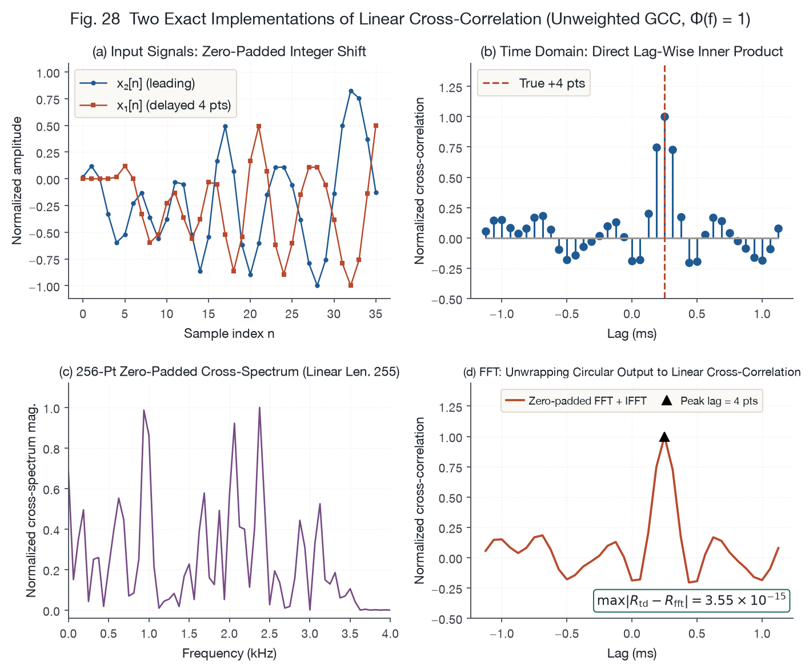
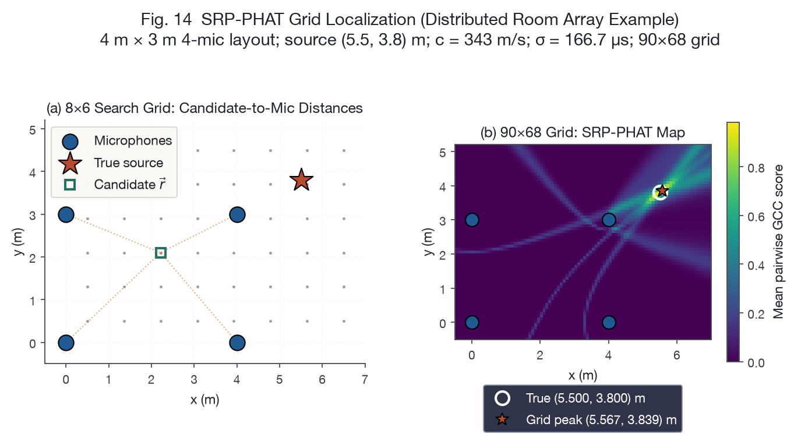
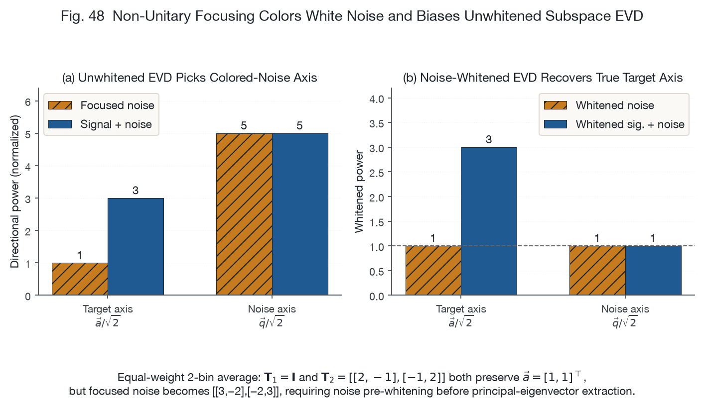
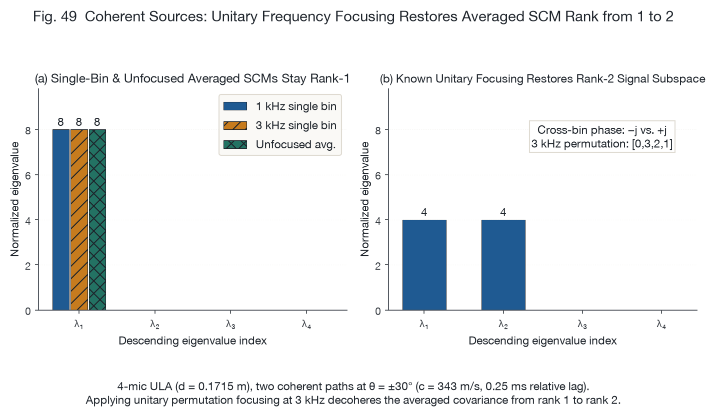

🌐 [简体中文](../chapters/04_doa-estimation.md) ｜ **English**

> This chapter is Chapter 4 of the main text. The main text and extended special topics comprise 16 chapters in total (Chapters 0–15, where Chapter 0 covers mathematical foundations and Chapters 12–15 are four extended special topics), accompanied by Appendices A and B. This chapter can be read independently; use the navigation bar below for the preceding and following chapters.
>
> Overview Home: [00_overview.md](00_overview.md) | Previous: [03_array-geometry.md](03_array-geometry.md) | Next: [05_beamforming.md](05_beamforming.md)

---

## 4. Sound Source Localization (Direction of Arrival, DOA)

In engineering practice, sound source localization begins by distinguishing "finding a direction" from "determining a coordinate": Direction of Arrival (DOA) specifies only the angle of a source relative to the array, which a far-field plane-wave model can support; full spatial localization additionally requires the distance from the source to the array, typically relying on near-field spherical wavefront curvature or triangulation across distributed baselines. This chapter starts from the most intuitive two-microphone cross-correlation time delay and builds step by step to multi-microphone spatial grid scanning, algebraic geometric solvers, adaptive spatial spectra, subspace decomposition and source enumeration, and finally sparse reconstruction and learning-based localization. For convenient cross-chapter reference, the table below summarizes the core acronyms used in this chapter.

| Acronym | Full Term | Role in This Chapter |
|---|---|---|
| TDOA | Time Difference of Arrival | Relative arrival-time difference of a single source between two microphones |
| GCC / PHAT | Generalized Cross-Correlation; Phase Transform | Weights the cross-spectrum in the frequency domain before inverse transformation to extract delay from the peak |
| SRP | Steered Response Power | Aggregates pairwise cross-correlation responses across microphone pairs at candidate geometric positions |
| ULA / UCA | Uniform Linear Array; Uniform Circular Array | Two canonical benchmark array geometries |
| MUSIC | Multiple Signal Classification | Tests orthogonality between candidate steering vectors and the observed noise subspace |
| ESPRIT | Estimation of Signal Parameters via Rotational Invariance Techniques | Exploits translational or phase-mode invariance to solve multiple source directions in closed form |
| MVDR | Minimum Variance Distortionless Response | Minimizes total array output power subject to unit gain in the candidate direction |
| DRR / RIR | Direct-to-Reverberant Ratio; Room Impulse Response | Energy ratio of direct sound to reflections, and acoustic room propagation impulse response |
| DFT / IDFT | Discrete Fourier Transform; Inverse DFT | FFT (Fast Fourier Transform) and IFFT are fast algorithms for computing them |
| STFT | Short-Time Fourier Transform | Slices multichannel time-domain waveforms into per-frequency, per-frame complex phasor observations |

Throughout this chapter, column vectors are denoted with arrows ($\vec a,\vec w,\vec x$), matrices in upright bold capitals ($\mathbf A,\mathbf I$), and spatial covariance matrices with double subscripts ($\mathbf R_{xx},\mathbf R_{ss},\mathbf R_{nn}$, with finite-snapshot sample estimates hatted as $\hat{\mathbf R}_{xx}$) to distinguish them from scalar cross-correlation functions $R_{x_1x_2}(\tau)$ and integer-lag correlation sequences $R[l]$. Complex conjugate transpose is written $^H$, real transpose $^\top$, the imaginary unit upright $\mathrm{j}$, and expectation $\mathbb{E}[\cdot]$; $M$ denotes the number of microphone channels and $K$ the number of sources. Throughout the chapter, eigenvalues are ordered **descending** by default: $\lambda_1\ge\lambda_2\ge\cdots\ge\lambda_M$. Whenever snapshot statistics, Hermitian eigendecomposition, or complex vector derivatives arise, cross-reference [Chapter 0 Mathematical Foundations](00_math-foundations.md#sec-0-8) and [Appendix A Mathematical Tools](16_appendix-symbols-math.md).

### 4.1 Overview: Four Algorithmic Families

```
Sound Source Localization Algorithms
├── Two-stage methods: estimate pairwise TDOAs first, then solve geometry (§4.2, §4.4)
│     └── Example: GCC-PHAT delay estimation followed by multi-pair geometric solver
├── Spatial scanning: inspect candidate directions or positions and pick maximum response (§4.3, §4.5)
│     └── Examples: SRP-PHAT, Bartlett, Capon
├── Subspace methods: relate candidate directions to observed signal and noise subspaces (§4.6)
│     └── Examples: MUSIC, root-MUSIC, ESPRIT, wideband focusing, and AIC/MDL source enumeration
└── Sparse & learning-based methods: exploit directional sparsity or labeled direction data (§4.7)
      └── Examples: LASSO/SBL, atomic norm, neural SELD; require verifying priors or training conditions
```

To establish visual intuition for a "spatial spectrum" before diving into equations, Figure 11 plots Bartlett, Capon, and MUSIC spectra side by side on the same two-source narrowband scene (true sources at $-20^\circ$ and $30^\circ$, separated by $50^\circ$). The simulation uses an $M=8$ half-wavelength Uniform Linear Array (ULA) with $20\ \mathrm{dB}$ input SNR (total signal power per sensor relative to single-sensor white noise power) and $400$ independent snapshots to estimate the sample covariance $\hat{\mathbf R}_{xx}$. Capon applies dimensionless relative diagonal loading $\eta=10^{-6}$ (setting $\delta_{\mathrm{rel}}=\eta\operatorname{tr}(\hat{\mathbf R}_{xx})/M$ and solving linear systems with $\hat{\mathbf R}_{xx}+\delta_{\mathrm{rel}}\mathbf I$), whereas MUSIC is directly supplied the true source count $K=2$.

Note that Figure 11 intentionally uses a wide $50^\circ$ separation, anechoic free-field propagation, and high SNR solely to reveal the canonical geometry of the three spectra. Once reverberant rooms or closely spaced sources enter the picture, peak broadening and merging worsen dramatically; close-source resolution success rates are tested separately via repeated Monte Carlo trials in [§4.8.1](#sec-4-8-1).


When reading Figure 11, first distinguish the vertical-axis meanings of the upper and lower panels—never compare absolute peak heights across panels:

- **Figure 11(a) — Beam-scanning spatial spectra**: The horizontal axis is candidate azimuth ($-90^\circ$ to $90^\circ$), the vertical axis is output power normalized to each curve's own maximum (in dB), and vertical dashed gray lines with top inverted triangles mark the true DOAs at $-20^\circ$ and $30^\circ$. The solid blue Bartlett spectrum is the average output power of conventional delay-and-sum beamforming steered across azimuth; limited by the $8$-element ULA aperture, its two mainlobes are broad and leave $-12$ to $-18\ \mathrm{dB}$ sidelobe ripples between and outside the peaks. The dashed red Capon/MVDR spectrum adaptively suppresses off-axis leakage while maintaining unit gain in the steered direction, visibly narrowing both main peaks and flattening the non-source background floor to roughly $-26\ \mathrm{dB}$.
- **Figure 11(b) — MUSIC pseudospectrum**: Plots the logarithmic reciprocal of the squared projection energy of each candidate steering vector onto the noise subspace (peak-normalized to $0\ \mathrm{dB}$). The solid green curve produces razor-thin needle peaks at $-20^\circ$ and $30^\circ$ because under the ideal model each true steering vector is orthogonal to the noise subspace, driving the projection residual denominator toward zero.

Comparing the two panels directly: without loading, Capon's vertical axis measures physical filtered output power; loaded scores also contain a regularization cost, as explained in §4.5 (in dB), whereas MUSIC pseudospectrum height reflects only "degree of orthogonality" and does not measure physical source power. Likewise, in practice one must never determine the number of sources merely by counting spectral peaks—strong sidelobes, coherent reflections, or finite-snapshot fluctuations can create spurious peaks or merge twin peaks into one. Subspace methods such as MUSIC and ESPRIT require estimating the independent signal dimension $K<M$ prior to localization (once §§4.5–4.6 define the spatial covariance matrix and its eigendecomposition, [§4.6.1](#sec-4-6-1) systematically derives the eigen-gap, AIC, and MDL source-enumeration criteria), whereas dual-channel cross-correlation delay estimation requires no prior source count. We begin with the most fundamental two-microphone case.

### 4.2 GCC-PHAT: Aligning Two Recordings to Find the Best-Matching Shift

#### Delay Sign Convention and Time- vs. Frequency-Domain Computation

Before deriving delay formulas, lock down the coordinate geometry and sign conventions. This chapter strictly follows §§2.1–2.3 across the book: two microphones lie along the $x$-axis with Microphone 1 at the origin $x=0$ and Microphone 2 at $x=d>0$ (prose derivations in this chapter use $1$-based indexing $m=1,\dots,M$ with linear-array coordinates $(m-1)d$, matching the $0$-based indexing $m'=0,\dots,M-1$ of Chapter 3 and the code exercises via the simple shift $m'=m-1$); broadside ($+y$-axis) is $0^\circ$, and clockwise rotation toward Microphone 2 ($+x$ side) defines positive azimuth $\theta>0$. Letting $\vec u$ denote the unit direction vector pointing from the array toward the source, the plane wave propagates along $-\vec u$, and the arrival-time difference between Microphones $i$ and $j$ is defined as $\tau_{ij}=t_i-t_j$.

Under the forward Fourier kernel $e^{-\mathrm{j}2\pi ft}$, the relative propagation delay referenced to Microphone 1 and the $m$-th component of the narrowband steering vector are

$$\begin{aligned}
\tau_{m1}&=-\frac{(\vec r_m-\vec r_1)^\top\vec u}{c},\\
a_m(f,\theta)&=e^{-\mathrm{j}2\pi f\tau_{m1}}
=e^{+\mathrm{j}2\pi f(\vec r_m-\vec r_1)^\top\vec u/c}.
\end{aligned}$$

When a source lies at positive azimuth ($\theta>0$), the wavefront arrives first at the rightmost Microphone 2 and later at the leftmost Microphone 1, so $t_1>t_2$, giving $\tau_{21}=t_2-t_1<0$ and $\tau_{12}=t_1-t_2>0$. Memorize this physical rule in one sentence: **$\tau_{12}>0$ means "sound reaches Mic 1 later than Mic 2,"** so ideal noiseless continuous waveforms satisfy $x_1(t)=x_2(t-\tau_{12})$.

How do we recover this shift from two recordings? The most direct method slides the second discrete sequence $x_2[n]$ left and right by integer sample lags $l$, multiplies pointwise by $x_1[n]$, and sums to locate the shift where the two waveforms interlock most tightly:

$$\begin{aligned}
R[l]&=\sum_n x_1[n]x_2[n-l],\\
\hat\tau_{12}&=\frac{\arg\max_l R[l]}{f_s}.
\end{aligned}\tag{4-1}$$

In Eq. (4-1), the integer lag $l$ is measured in samples and dividing by the sample rate $f_s$ converts it to the arrival-time difference estimate $\hat\tau_{12}$ in seconds; shifting the earlier sequence $x_2$ rightward by $l>0$ samples via $x_2[n-l]$ aligns it with the later sequence $x_1[n]$, so $R[l]$ peaks at positive lag $l>0$, in exact agreement with $\tau_{12}>0$.

Consistent with [Chapter 0 §0.2](00_math-foundations.md#sec-0-2) and [Appendix A](16_appendix-symbols-math.md), for complex baseband sequences the second factor in time-domain cross-correlation takes complex conjugation $x_2^*[n-l]$. Note that complex correlation is itself complex-valued: for finite-support sequences $x_1=[0,\mathrm{j}]$ and $x_2=[1,0]$, the complex correlation at $l=+1$ equals $\mathrm{j}$, so blindly taking the real part erases the true peak to $0$; searching signed real maxima via Eq. (4-1) is self-consistent only when both real audio channels share known matched polarity, whereas unknown common complex phase rotations require picking peaks of $|R[l]|$.

Evaluating all lags directly in the time domain for length-$N$ sequences costs $O(N^2)$ multiply-adds. By the Fourier **cross-correlation theorem**, time-domain sliding inner products equal pointwise cross-power spectral multiplication $X_1(f)X_2^*(f)$ in frequency (conjugating channel 2 before multiplying by channel 1) followed by a single inverse transform; inserting a frequency-domain weighting function $\Phi(f)$ yields the Generalized Cross-Correlation (GCC) framework:

$$\begin{aligned}
G_\Phi(f)&=\Phi(f)X_1(f)X_2^*(f),\\
R_{x_1x_2}(\tau)&=\int_{-\infty}^{\infty}G_\Phi(f)
e^{+\mathrm{j}2\pi f\tau}\,\mathrm{d}f,\\
\hat\tau_{12}&=\arg\max_\tau R_{x_1x_2}(\tau).
\end{aligned}\tag{4-2}$$

Eq. (4-2) is written as a continuous-frequency integral to expose its physical symmetry: when real signals and a real even weight $\Phi(f)=\Phi(-f)$ satisfy conjugate symmetry $G_\Phi(-f)=G_\Phi^*(f)$, positive- and negative-frequency imaginary parts cancel identically, yielding a real-valued correlation curve $R_{x_1x_2}(\tau)$. Why does phase encode time delay? Transforming the pure delay relation $x_1(t)=x_2(t-\tau_0)$ to frequency gives $X_1(f)=X_2(f)e^{-\mathrm{j}2\pi f\tau_0}$, so the cross-spectrum is

$$X_1(f)X_2^*(f)=|X_2(f)|^2\,e^{-\mathrm{j}2\pi f\tau_0}.$$

The cross-spectral phase $\angle\{X_1(f)X_2^*(f)\}=-2\pi f\tau_0$ is a straight line through the origin with slope $-2\pi\tau_0$ versus frequency $f$ (for instance, at $\tau_0=58.3\ \mu\mathrm{s}$, the phase at $1\ \mathrm{kHz}$ and $2\ \mathrm{kHz}$ is roughly $-0.366\ \mathrm{rad}$ and $-0.733\ \mathrm{rad}$, respectively). When the inverse transform in Eq. (4-2) scans to $\tau=\tau_0$, the kernel $e^{+\mathrm{j}2\pi f\tau_0}$ flattens that negative phase slope to $0\ \mathrm{rad}$ across all bins so every frequency adds constructively in phase to build the main peak.

Real speech, however, concentrates energy heavily in low-frequency formants: unweighted cross-correlation ($\Phi(f)=1$) preserves the source power spectrum $|X_2(f)|^2$, markedly broadening the time-domain correlation peak. The **Phase Transform (PHAT)** chooses $\Phi(f)=1/|X_1(f)X_2^*(f)|$, flattening the cross-spectral magnitude to unit modulus $e^{-\mathrm{j}2\pi f\tau_0}$ so every active bin votes equally, sharply narrowing the main peak under an ideal single-path model; yet PHAT does not repair phases corrupted by reverberation or strong noise and can amplify silent noise bins to full weight, so engineering implementations must add a denominator floor or band selection.

**Zero-padding against circular wrap-around and signed-lag index mapping in discrete `ifft`**. When coding Eq. (4-2) for frames of lengths $N_1$ and $N_2$, a raw $N$-point DFT/IDFT computes period-$N$ **circular cross-correlation**; to prevent head-to-tail wrap-around aliasing, the FFT length must satisfy $N_{\mathrm{fft}}\ge N_1+N_2-1$ (commonly rounded up to a power of $2$, running in $O(N_{\mathrm{fft}}\log N_{\mathrm{fft}})$). With real one-sided spectra (`rfft`), indices $0\le k\le\lfloor N_{\mathrm{fft}}/2\rfloor$ correspond to nonnegative physical frequencies $f_k=kf_s/N_{\mathrm{fft}}$; with two-sided DFT (`fft`), the upper half $k>N_{\mathrm{fft}}/2$ represents negative frequencies $(k-N_{\mathrm{fft}})f_s/N_{\mathrm{fft}}$. After calling `c = np.fft.ifft(G).real`:

- **Nonnegative lags reside at the head of the array**: indices $m=0,1,\ldots,N_1-1$ map directly to integer lags $l=0,+1,\ldots,+(N_1-1)$ (Mic 1 arriving simultaneously or later);
- **Negative lags wrap to the tail of the array**: negative integer lags $l=-(N_2-1),\ldots,-2,-1$ (Mic 1 arriving earlier than Mic 2) wrap modulo $N_{\mathrm{fft}}$ to $m=N_{\mathrm{fft}}-(N_2-1),\ldots,N_{\mathrm{fft}}-1$;
- **Unwrapping and physical-aperture cropping**: prepending the tail slice `c[-(N2-1):]` ahead of the head slice `c[:N1]` produces the complete monotonically ordered correlation sequence over $l=-(N_2-1),\ldots,+(N_1-1)$, which is finally cropped to the physically admissible window $|l|/f_s\le d/c$ prior to peak picking.

Note also the finite-length distinction between unweighted cross-correlation and PHAT: for $\Phi(f)=1$, any $N_{\mathrm{fft}}\ge N_1+N_2-1$ reproduces the finite time-domain sum Eq. (4-1) to machine precision after unwrapping; PHAT divides by $|X_1[k]X_2^*[k]|$, a nonlinear spectral whitening whose inverse transform is generally no longer supported strictly within $N_1+N_2-1$ samples, so changing $N_{\mathrm{fft}}$ slightly alters the periodically sampled curve and must be stated when comparing implementations.



Figure 28 walks through this entire "zero-padding + conjugate multiplication + tail unwrapping" workflow using unweighted cross-correlation ($\Phi(f)=1$):

- **Figure 28(a) — Input signals**: Horizontal axis shows sample index $n$ (first $36$ samples displayed) for two length-$128$ sequences ($N_1=N_2=128$); the blue circle line $x_2[n]$ arrives first, while the red square line $x_1[n]$ is prepended with $4$ zeros so it arrives strictly $4$ samples later.
- **Figure 28(b) — Direct time-domain summation**: Horizontal axis converted to lag in milliseconds ($4$ samples $= +0.25\ \mathrm{ms}$ at $16\ \mathrm{kHz}$), vertical axis normalized cross-correlation; blue stems evaluate Eq. (4-1) independently at each integer lag, with the red dashed line marking the $1.0$ peak at $+4$ samples.
- **Figure 28(c) — Zero-padded cross-spectral magnitude**: Linear cross-correlation requires at least $128+128-1=255$ points, so we take $N_{\mathrm{fft}}=256$ and plot normalized $|X_1[k]X_2^*[k]|$ over $0$–$4\ \mathrm{kHz}$.
- **Figure 28(d) — Rearranged IFFT output**: After taking `ifft` on the $256$-point cross-spectrum and shifting negative lags from the tail to the left, the solid red curve hits the black triangle peak exactly at `lag = 4`; the green inset box at lower right reports the maximum absolute difference $\max|R_{\mathrm{td}}-R_{\mathrm{fft}}|$ across all lags as just $3.55\times 10^{-15}$, purely double-precision floating-point rounding.

#### 8-Point Impulse Hand Calculation: Exact Time–Frequency Agreement

To verify conjugation placement and signs by hand beyond any doubt, let us walk an elementary $N=8$-point impulse pair through both time-domain Eq. (4-1) and frequency-domain DFT/IDFT using the unified integer-lag notation $R[l]$.

**Inputs and convention**: Take length $N=8$ ($n=0,1,\ldots,7$) and set

- $x_1=[0,0,3,0,0,0,0,0]$, with nonzero impulse $3$ at $n=2$, representing Mic 1 arriving $2$ samples after Mic 2;
- $x_2=[2,0,0,0,0,0,0,0]$, with nonzero impulse $2$ at $n=0$.

Linear cross-correlation Eq. (4-1) is $R[l]=\sum_{n=0}^{7}x_1[n]x_2[n-l]$, treating out-of-range indices as $0$. Although full linear cross-correlation of two length-$8$ sequences generally requires zero-padding to at least $8+8-1=15$ points, at the three lags $l=0,1,2$ examined here, the accessed indices $2-l\in\{2,1,0\}$ all fall inside $0\ldots 7$ with no boundary wrap-around, so an $8$-point DFT/IDFT matches linear cross-correlation identically at these three lags.

**Step 1 — Direct time-domain substitution**. Because $x_1[n]$ is nonzero only at $n=2$, the sum collapses to the single term $R[l]=3\,x_2[2-l]$:

| Trial Lag $l$ (samples) | Accessed $x_2$ Index $2-l$ | Product | Cross-Correlation $R[l]$ |
|---:|---:|---|---:|
| $0$ | $2$ | $3\times 0$ | $0$ |
| $1$ | $1$ | $3\times 0$ | $0$ |
| $2$ | $0$ | $3\times 2$ | $6$ |

The maximum lands at $\hat l=+2$ ($R[2]=6$), correctly indicating that $x_1$ lags $x_2$ by $2$ samples.

**Step 2 — Frequency-domain DFT conjugate multiplication and IDFT**. Define the $8$-point twiddle factor $W_8=e^{-\mathrm{j}2\pi/8}$ and $X[k]=\sum_{n=0}^{7}x[n]W_8^{kn}$ ($k=0,\ldots,7$). Only $n=0$ is nonzero in $x_2[n]$, so $X_2[k]=2$ across every bin; only $n=2$ is nonzero in $x_1[n]$, giving $X_1[k]=3W_8^{2k}=3e^{-\mathrm{j}\pi k/2}$. Listing all $8$ bins:

$$\begin{aligned}
X_1&=[3,-3\mathrm{j},-3,3\mathrm{j},
3,-3\mathrm{j},-3,3\mathrm{j}],\\
X_2^*&=[2,2,2,2,2,2,2,2],\\
G[k]&=X_1[k]X_2^*[k]\\
&=[6,-6\mathrm{j},-6,6\mathrm{j},
6,-6\mathrm{j},-6,6\mathrm{j}].
\end{aligned}$$

Next define the inverse kernel $E_l[k]=e^{+\mathrm{j}2\pi kl/8}$ and evaluate $r[l]=\frac{1}{8}\sum_{k=0}^{7}G[k]E_l[k]$ at $l=0,1,2$:

1. At $l=0$, the $8$-term sum is $(6-6\mathrm{j}-6+6\mathrm{j})\times 2=0$ by pairwise cancellation of real and imaginary parts, so $r[0]=0=R[0]$;
2. At $l=1$, $G[k]E_1[k]=6e^{-\mathrm{j}\pi k/2}e^{+\mathrm{j}\pi k/4}=6(e^{-\mathrm{j}\pi/4})^k$, which completes one uniform geometric progression around the unit circle for $k=0,\ldots,7$ and sums to zero, so $r[1]=0=R[1]$;
3. At $l=2$, $G[k]E_2[k]=6e^{-\mathrm{j}\pi k/2}e^{+\mathrm{j}\pi k/2}=6$, unwinding every delay phase so eight real $6$'s add in phase to $r[2]=48/8=6=R[2]$.

**Result and boundary note**: Time-domain sliding and frequency-domain IDFT yield the identical values $0,0,6$ at $l=0,1,2$ with peak $\hat l=+2$. Applying ideal PHAT normalization here merely rescales the $l=2$ peak from $6$ to $1$ while leaving all other lags at $0$, because a single impulse already has a flat spectrum ($|G[k]|=6$). PHAT's ability to flatten spectral envelopes and sharpen the main correlation peak emerges only when the source spectrum itself is strongly colored (such as formant-rich speech).

#### Spectral Weightings, Weak-Bin Protection, and Channel Polarity

Varying the frequency-domain weight $\Phi(f)$ in Eq. (4-2) produces the classical family of GCC delay estimators, summarized below (for systematic derivations see [Knapp and Carter, *IEEE TASSP*, 1976](https://doi.org/10.1109/TASSP.1976.1162830)):

| Weighting Name | Spectral Weight $\Phi(f)$ | Design Motivation and Operating Boundary |
|---|---|---|
| Classical Cross-Correlation (CC) | $1$ | Preserves spectral magnitude; robust for flat-spectrum sources in stationary additive white noise, but broadens peaks severely on narrowband or formant-dominated speech |
| Roth Processor | $1/(\hat G_{11}(f)+\varepsilon)$ | Inverse-filters by the smoothed auto-spectrum of channel 1, under this chapter's $G_{12}=X_1X_2^*$ convention, gives $G_{12}/G_{11}=H_{21}^*$ in the noiseless, unfloored case; its inverse transform is the conjugate time reversal of the channel-1-to-2 response, so conjugation and input order matter |
| Smoothed Coherence Transform (SCOT) | $1/\sqrt{\hat G_{11}(f)\hat G_{22}(f)}$ | Symmetric whitening by the geometric mean of smoothed auto-spectra; must specify recursive or Welch multi-frame averaging for $\hat G_{11},\hat G_{22}$ |
| **Phase Transform (PHAT)** | $1/(\lvert X_1(f)X_2^*(f)\rvert+\varepsilon)$ | Reduces variation in cross-spectrum magnitude and preserves each bin’s phase; weak, low-SNR bins have unreliable phase and need floor protection |
| Maximum Likelihood (ML / Hannan–Thomson) | $\dfrac{\lvert\gamma_{12}(f)\rvert^2}{\lvert G_{12}(f)\rvert\,(1-\lvert\gamma_{12}(f)\rvert^2)}$ | Asymptotically achieves the broadband CRLB for stationary zero-mean Gaussian signal in uncorrelated Gaussian noise; model breaks down under coherent reverberant multipath |

Notice the transparent algebraic link between Maximum Likelihood (ML) weighting and PHAT in the table: writing the magnitude-squared coherence as $|\gamma_{12}(f)|^2 = |G_{12}(f)|^2 / [G_{11}(f)G_{22}(f)]$, $\Phi_{\mathrm{ML}}(f)$ equals the PHAT weight $1/|G_{12}(f)|$ multiplied by the per-bin SNR confidence factor $|\gamma_{12}(f)|^2 / (1-|\gamma_{12}(f)|^2)$—highly coherent bins vote more strongly while pure-noise weak bins ($|\gamma_{12}|^2\to 0$) are automatically down-weighted, whereas PHAT skips coherence estimation and gives every surviving bin equal weight. Likewise, substituting a **single** unsmoothed frame directly into SCOT makes the denominator $\sqrt{|X_1|^2|X_2|^2}$ algebraically identical to $|X_1X_2^*|$; SCOT diverges from per-frame PHAT only under multi-frame statistical averaging.

**Derivation of the Hannan–Thomson ML weight**: Consider the noisy Knapp–Carter dual-channel model $x_1(t)=s(t-\tau)+n_1(t)$ and $x_2(t)=\alpha s(t)+n_2(t)$ ($\alpha>0$), where $s,n_1,n_2$ are mutually uncorrelated zero-mean stationary Gaussian processes with strictly positive noise PSDs (so $0<|\gamma_{12}(f)|^2<1$ on active bins). Under the frequency-domain complex Gaussian model $[X_1(f),X_2(f)]^\top\sim\mathcal{CN}(\vec 0,\mathbf S(f;\tau))$ with $G_{12}^0(f)=|G_{12}(f)|=\alpha G_{ss}(f)$, the spectral density matrix is $\mathbf S(f;\tau)=\begin{bmatrix}G_{11}&G_{12}^0e^{-\mathrm{j}2\pi f\tau}\\G_{12}^0e^{+\mathrm{j}2\pi f\tau}&G_{22}\end{bmatrix}$. Its determinant $\det\mathbf S(f;\tau)=G_{11}G_{22}(1-|\gamma_{12}|^2)>0$ is independent of $\tau$ (ensuring $\mathbf S(f;\tau)\succ\mathbf 0$ is invertible, whereas a noiseless model has $|\gamma_{12}|\equiv 1$ and singular $\det\mathbf S\equiv 0$), and inverting $\mathbf S$ gives off-diagonal entry $-\frac{G_{12}^0e^{-\mathrm{j}2\pi f\tau}}{G_{11}G_{22}(1-|\gamma_{12}|^2)}=-\Phi_{\mathrm{ML}}(f)e^{-\mathrm{j}2\pi f\tau}$. Over observation duration $T$ and bandwidth $B$ (positive-frequency bin spacing $1/T$), the $\tau$-dependent part of the Whittle log-likelihood is

$$\begin{aligned}
\ell(\tau)&=-T\int_0^B\operatorname{tr}\!\big(\mathbf S^{-1}(f;\tau)\hat{\mathbf S}(f)\big)\,\mathrm{d}f\\
&=\mathrm{const}+2T\int_0^B\Phi_{\mathrm{ML}}(f)\operatorname{Re}\!\big\{\hat G_{12}(f)e^{+\mathrm{j}2\pi f\tau}\big\}\,\mathrm{d}f.
\end{aligned}$$

By conjugate symmetry of real signals, the right-hand integral equals $T\int_{-B}^{B}\Phi_{\mathrm{ML}}(f)\hat G_{12}(f)e^{+\mathrm{j}2\pi f\tau}\,\mathrm{d}f$, so maximizing $\ell(\tau)$ is identical to Eq. (4-2) with $\Phi_{\mathrm{ML}}(f)=\frac{|\gamma_{12}(f)|^2}{|G_{12}(f)|(1-|\gamma_{12}(f)|^2)}$ (differentiating $\ell(\tau)$ twice likewise yields the broadband CRLB Eq. (4-30) in §4.8).

In multi-frame PHAT implementations, one must also distinguish **normalization order** and **weak-bin denominator protection rules**:

- **PHAT normalization and cross-frame averaging do not commute**: because dividing by $|G|$ is nonlinear, "normalize per frame with PHAT first, then average across frames" yields a very different result from "average cross-spectra across frames first, then apply PHAT." For example, with two real cross-spectral frames $G_1=+1$ and $G_2=-9$, per-frame PHAT gives $+1$ and $-1$, averaging to $0$ (equal-weight cancellation), whereas averaging first yields $-4$ and normalizing then outputs $-1$ (dominated by the high-energy frame).
- **Differences among three small-denominator protection rules**: let $g_{\max}=\max|G|$ be the peak cross-spectral magnitude for the current pair and $\delta=\varepsilon g_{\max}$ the relative threshold. Three common denominator protection rules are

$$\begin{aligned}
Q_{\mathrm{add}}&=\frac{G}{|G|+\delta},\\
Q_{\mathrm{floor}}&=\frac{G}{\max(|G|,\delta)},\\
Q_{\mathrm{gate}}&=
\begin{cases}
G/|G|,&|G|>\delta,\\
0,&|G|\le\delta.
\end{cases}
\end{aligned}\tag{4-3}$$

Taking $g_{\max}=1$ and $\delta=0.01$ compares their output magnitudes across four representative cross-spectral amplitudes $g=|G|$:

| Cross-Spectral Magnitude $g=\lvert G\rvert$ | Additive $\lvert Q_{\mathrm{add}}\rvert$ | Denominator Floor $\lvert Q_{\mathrm{floor}}\rvert$ | Hard Gate $\lvert Q_{\mathrm{gate}}\rvert$ |
|---:|---:|---:|---:|
| $1$ | $0.990099$ | $1$ | $1$ |
| $0.01$ | $0.5$ | $1$ | $0$ |
| $0.001$ | $0.090909$ | $0.1$ | $0$ |
| $0$ | $0$ | $0$ | $0$ |

The second row $g=0.01=\delta$ separates their personalities cleanly: additive regularization halves the weight to $0.5$, denominator flooring preserves unit modulus $1$, and hard gating zeros it outright to $0$. Moreover, one of the most elusive field hardware faults is **inverted channel polarity**: multiplying either channel by any positive gain leaves cross-spectral phase and positive peak position unchanged, whereas multiplying a single channel by $-1$ flips the entire signed real correlation curve upside down, turning the true peak into a negative trough. Always screen for polarity inversion and all-zero silence first (`gcc_phat` raises an explicit error on all-zero inputs rather than silently returning $0^\circ$).

#### From Delay Peak to Angle: Interpolation, 4-Mic Subsample Alignment, and Figure 12's Model

Once the dual-mic delay estimate $\hat\tau_{12}$ is obtained, under the plane-wave assumption on the front half-plane ($\theta\in[-90^\circ,90^\circ]$), inverting the path-difference relation $c\tau_{12}=d\sin\theta$ gives the azimuth estimate:

$$\hat\theta=\arcsin\!\left(\frac{c\hat\tau_{12}}{d}\right).\tag{4-4}$$

Before invoking $\arcsin$, always check the **physical visible region**: every real 3D plane wave obeys $|\sin\theta|\le 1$, so the arrival-time difference can never exceed the endfire transit time $|\tau_{12}|\le\tau_{\max}=d/c$. If the global lag-axis maximum falls decisively in the invisible region $|c\hat\tau_{12}/d|>1$, the frame is dominated by a strong reflection outlier or cross-source mismatch and must be flagged/discarded—or prevented by cropping the search window to $|\tau|\le d/c$—rather than clamping outliers onto $\pm 90^\circ$ endfire (if an external convention measures angle from the array axis, replace $\arcsin$ with $\arccos$ in Eq. (4-4)). Even inside the visible region, a single baseline retains a 3D cone of confusion and horizontal front–back mirror ambiguity, requiring non-collinear baselines to disambiguate (see [§3.1 Geometric Identifiability](03_array-geometry.md#sec-3-1)).

Implementing Eq. (4-4) accurately faces two primary precision bottlenecks: **coarse integer sample grids** and **inter-channel phase mismatch**. At $f_s=16\ \mathrm{kHz}$, one sample period is $T_s=62.5\ \mu\mathrm{s}$; for a compact $d=4\ \mathrm{cm}$ spacing, stepping from lag $0$ to lag $1$ jumps directly from $0^\circ$ to $\arcsin(cT_s/d)\approx 32.4^\circ$. Two closed-form subsample refinement methods are standard:

1. **Three-point parabolic local interpolation**: fits a quadratic parabola through an interior integer peak $l^*$ and its immediate neighbors $R[l^*-1], R[l^*], R[l^*+1]$ to obtain the subsample offset $\Delta l$;
2. **Frequency-domain $Q$-fold zero-padded real trigonometric interpolation**: for the one-sided cross-spectrum $H_k$ ($k=0,\ldots,N/2$) of an even-$N$ real sequence, DC $k=0$ and the old Nyquist bin $k=N/2$ each appear once in the two-sided spectrum while interior conjugate pairs $k=1,\ldots,N/2-1$ appear in pairs; the continuous trigonometric interpolant $g(t)$ (with $t$ in original sample periods) and the three-point parabolic offset are

$$\begin{aligned}
\Delta l&=\frac{R[l^*-1]-R[l^*+1]}
{2\big(R[l^*-1]-2R[l^*]+R[l^*+1]\big)},\\
Ng(t)&=H_0+H_{N/2}\cos(\pi t)
+2\sum_{k=1}^{N/2-1}\operatorname{Re}\!\big\{H_k e^{+\mathrm{j}2\pi kt/N}\big\}.
\end{aligned}\tag{4-5}$$

When realizing $Q$-fold zero-padded interpolation via one-sided `irfft`, two boundary corrections must be applied together: (i) halve the old Nyquist coefficient $H_{N/2}\leftarrow\tfrac{1}{2}H_{N/2}$ before zero-padding (because after padding it becomes an interior positive bin that `irfft` pairs with a conjugate negative bin); (ii) multiply the inverse-transform output by $Q$ (to undo the $1/(QN)$ scaling of `irfft`). Testing $Q=2$ zero-padding on an $N=8$ all-ones one-sided spectrum $H=[1,1,1,1,1]$ (theoretical half-sample value $g(0.5)\approx 0.628417437$) contrasts three variants:

| Zero-Padding Procedure | $t=0$ (zero lag) | $t=1$ (original sample $1$) | $t=2$ (original sample $2$) |
|---|---:|---:|---:|
| Direct zero-pad + $16$-point `irfft` (no halving, no $\times 2$) | $0.5625$ | $-0.0625$ | $+0.0625$ |
| Multiply by $2$, omit halving the old Nyquist bin | $1.1250$ | $-0.1250$ | $+0.1250$ |
| **Halve old Nyquist bin and multiply by $2$** | **$1.0000$** | **$0.0000$** | **$0.0000$** |

Only the third row agrees with Eq. (4-5) to $10^{-16}$ across all $16$ half-sample points, strictly preserving every original integer sample. Uncalibrated differences between channel phase responses can change the shape or position of the correlation peak. The component of the phase difference that is linear in frequency contributes an additional group delay (see §10.2).


Let us trace the complete numerical pipeline in Figure 12—from waveform shift through $16\times$ frequency-domain interpolation to angle inversion ($4096$-sample bandlimited random source over $300$–$6000\ \mathrm{Hz}$, exact frequency-domain fractional delay plus Gaussian white noise of standard deviation $0.05$, $8192$-point FFT with $Q=16$ zero-padded interpolation):

- **Figure 12(a) — Zoomed two-channel waveforms**: Displays the $2.0$–$2.5\ \mathrm{ms}$ window for $d=4\ \mathrm{cm}$ and true $\theta=30^\circ$, where theoretical $\tau_0=d\sin 30^\circ/c=0.02/343\approx 58.309\ \mu\mathrm{s}$ ($\approx 0.933$ samples at $16\ \mathrm{kHz}$). The blue circle curve (Mic 2) arrives earlier, while the red square curve (Mic 1) shifts rightward by roughly $58\ \mu\mathrm{s}$.
- **Figure 12(b) — GCC-PHAT curve on the $16\times$ refined grid**: Vertical dotted gray lines mark original integer sample ticks ($62.5\ \mu\mathrm{s}$ spacing), and green dash-dotted lines bracket the visible region $\pm d/c\approx\pm 116.6\ \mu\mathrm{s}$. Raw integer peak picking can only choose lag $1$ ($62.5\ \mu\mathrm{s}\Rightarrow 32.4^\circ$); $16\times$ trigonometric interpolation refines the grid step to $\Delta\tau=62.5/16=3.90625\ \mu\mathrm{s}$, placing the red triangle peak at fine index $15$, $\hat\tau_{12}=15\Delta\tau=58.59375\ \mu\mathrm{s}$ (annotated $58.6\ \mu\mathrm{s}$, or $0.9375$ samples), hugging the $58.3\ \mu\mathrm{s}$ true-delay line.
- **Figure 12(c) — Plane-wave geometry and angle inversion**: Substituting $\tau_{\mathrm{est}}=58.59375\ \mu\mathrm{s}$ into Eq. (4-4) yields $\hat\theta=\arcsin(343\,\tau_{\mathrm{est}}/0.04)\approx 30.16^\circ$, deviating from the $30^\circ$ truth by only about $0.16^\circ$.

**Four-microphone subsample delay ledger**: Extending this fractional delay to a multichannel array, take a $4$-element ULA at $x=0,0.04,0.08,0.12\ \mathrm{m}$ with far-field source $\theta=30^\circ$, $c=343\ \mathrm{m/s}$, and $f_s=16\ \mathrm{kHz}$, so the inter-element delay is again $58.309\ \mu\mathrm{s}$ ($0.932945$ samples). To causally delay the earlier channels (Mics 2–4) into phase alignment with the latest-arriving Mic 1, the relative arrival times and required causal compensation delays are:

| Microphone $m$ | Arrival Delay Relative to Mic $1$, $\tau_{m1}$ ($\mu\mathrm{s}$) | Required Causal Delay to Align with Mic $1$ (samples) |
|---:|---:|---:|
| $1$ | $0$ | $0$ |
| $2$ | $-58.309$ | $0.932945$ |
| $3$ | $-116.618$ | $1.865889$ |
| $4$ | $-174.927$ | $2.798834$ |

Equal-weight averaging without subsample alignment suffers severe high-frequency phase cancellation—end-of-chapter Exercise [E04-07](#e04-07) works out the $-4.32\ \mathrm{dB}$ phasor loss at the $2298\ \mathrm{Hz}$ harmonic by hand and compares steady-state mean-square errors across four listenable synthetic WAV files.

#### Reverberation Experiment and Time–Frequency Sparse Multi-Source Localization (DUET)

Inside real rooms, wall reflections superpose a train of delayed, attenuated copies onto the direct path, raising the GCC-PHAT background floor and often producing taller false peaks. Reporting reverberation time $T_{60}$ alone without the Direct-to-Reverberant Ratio (DRR) cannot predict localization trends. Figure 13 runs a two-factor factorial experiment separating the joint effects of $T_{60}$ and DRR: at $16\ \mathrm{kHz}$, fix direct-impulse energy at $1$ per channel (true $\tau_{12}=-9$ samples, i.e., $-0.5625\ \mathrm{ms}$), generate independent exponentially decaying random reflection tails of length $1.1T_{60}$ per channel with total tail energy normalized to exact target $\mathrm{DRR}\in\{+6,\,0,\,-6\}\ \mathrm{dB}$, and sweep $T_{60}\in\{0.1,\,0.4,\,0.8\}\ \mathrm{s}$ across $9$ conditions. Each cell runs $150$ deterministic-seed trials (full linear convolution cropped to a $1024$-sample $64\ \mathrm{ms}$ frame with zero sensor white noise), applying Eq. (4-3)'s additive protection with fixed floor $10^{-10}$ in the cross-spectral denominator; a trial succeeds if the estimated peak lands within $-9\pm 1$ samples (per-trial logs in [`figure13_gcc_reverb.json`](../codes/chapters/ch04/reports/figure13_gcc_reverb.json)):

| Target DRR | $T_{60}=0.1\ \mathrm{s}$ | $T_{60}=0.4\ \mathrm{s}$ | $T_{60}=0.8\ \mathrm{s}$ |
|---|---:|---:|---:|
| $+6\ \mathrm{dB}$ | $150$ | $150$ | $150$ |
| $0\ \mathrm{dB}$ | $149$ | $148$ | $150$ |
| $-6\ \mathrm{dB}$ | $50$ | $57$ | $68$ |

The bottom row exposes the **energy-dilution effect at fixed DRR**: when total reflection-tail energy is locked to roughly $4\times$ direct energy ($\mathrm{DRR}=-6\ \mathrm{dB}$), $T_{60}=0.1\ \mathrm{s}$ packs all $4\times$ energy tightly right behind the direct sound so individual early reflection taps have high amplitude and easily spawn usurping spikes; $T_{60}=0.8\ \mathrm{s}$ dilutes the same energy budget across an $8\times$ longer decay axis, lowering individual reflection tap heights so fewer single spikes outgrow the direct peak. Inside a real physical room, however, stepping away from the array attenuates direct energy as $1/r^2$ against a nearly uniform reverberant field, sharply worsening DRR—hence **reverberant localization metrics must always report both $T_{60}$ and $\mathrm{DRR}$ (or source distance)**.

Engineering defenses against low-DRR reverberation rely on three main tactics: prioritizing syllable onset transients; accumulating multi-frame sliding histograms or feeding the Chapter 9 Kalman gated tracker; or blindly estimating the **Coherent-to-Diffuse Ratio (CDR)** from a diffuse-field coherence prior to down-weight reverberation-dominated bins (see §4.6 and [E04-23](#e04-23)).


Reading all three panels of Figure 13:

- **Figure 13(a) — Single-frame correlation curves at $\mathrm{DRR}=0\ \mathrm{dB}$** (using an independent example seed `seed=7`): horizontal axis shows delay ($-4$ to $4\ \mathrm{ms}$), with the dashed black line at true $-0.5625\ \mathrm{ms}$. The solid green curve ($T_{60}=0.1\ \mathrm{s}$) exhibits strong early-reflection side peaks near $0.4$ around $0$–$0.5\ \mathrm{ms}$, whereas the dotted red curve ($T_{60}=0.8\ \mathrm{s}$) spreads reflection energy into lower, more uniform ripples.
- **Figure 13(b) — Hit rate over $150$ trials with $95\%$ Wilson confidence intervals**: $\mathrm{DRR}=+6\ \mathrm{dB}$ and $0\ \mathrm{dB}$ stay close to $100\%$, while $\mathrm{DRR}=-6\ \mathrm{dB}$ gives $33\%$–$45\%$. At each of the three tested decay times, this group has a much lower hit rate.
- **Figure 13(c) — Peak-to-median contrast**: vertical axis shows $\max g/(\operatorname{median}|g|+10^{-12})$ (solid markers and shaded bands denote medians and interquartile ranges across $150$ trials), stratifying cleanly across $\mathrm{DRR}=+6,0,-6\ \mathrm{dB}$.

**Dual-microphone multi-speaker localization via time–frequency sparsity (WDO / DUET)**: Dual-mic GCC-PHAT extracts only one global peak per frame and typically fails when two or more talkers speak simultaneously. Speech in the STFT plane, however, exhibits strong **W-Disjoint Orthogonality (WDO)**—most active time–frequency bins $(k,\ell)$ are dominated by **one** talker at a time. Exploiting this sparsity, **DUET (Degenerate Unmixing Estimation Technique; [Yılmaz and Rickard, *IEEE TSP*, 2004](https://doi.org/10.1109/TSP.2004.828896))** forms the complex spectral ratio $X_2(k,\ell)/X_1(k,\ell)=\hat a(k,\ell)e^{-\mathrm{j}2\pi f_k\hat\delta(k,\ell)}$ at each active bin, extracts instantaneous relative symmetric attenuation $\hat\alpha(k,\ell)=\hat a-\hat a^{-1}$ and relative delay $\hat\delta(k,\ell)=-\frac{1}{2\pi f_k}\arg\big(X_2(k,\ell)/X_1(k,\ell)\big)$ (for $f_k>0$, noting $\hat\delta=\tau_{21}=-\tau_{12}$, and requiring spacing below half the shortest wavelength to avoid phase wrapping), and accumulates a power-weighted smoothed 2D histogram on the $(\alpha,\delta)$ plane with weights $|X_1 X_2|^p f_k^q$—distinct clusters require distinguishable relative attenuation-delay parameters and enough source-dominated bins. WDO alone does not ensure this: two sources with the same constant mixing ratio $2$ occupy one cluster. When these additional conditions hold, the approach overcomes the "two mics, one source" bottleneck (effective for compact dual mics in weak reverberation; strong reverberation degrades WDO and blurs clusters together).

> A single microphone pair is easily misled by an isolated reflection spike at low DRR or under multiple sources. Section 4.3 introduces SRP-PHAT, projecting every microphone pair's full correlation curve onto a spatial grid for joint voting.

### 4.3 SRP-PHAT: Accumulating Spatial Response Across Microphone Pairs

Dual-mic GCC-PHAT looks at just one pair and fails whenever one wall reflection outgrows the direct peak. Steered Response Power (SRP) flips the perspective: at every candidate spatial point $\vec r$, compute the geometric predicted delay $\tau_{ij}(\vec r)$ for every microphone pair $(i,j)$, look up each pair's GCC-PHAT value at that predicted delay, sum across pairs, and choose the location with the highest total score:

$$\hat{\vec p}=\arg\max_{\vec r}\sum_{i<j}
R^{\mathrm{PHAT}}_{x_ix_j}\!\big(\tau_{ij}(\vec r)\big).\tag{4-6}$$

Here the near-field predicted arrival-time difference is $\tau_{ij}(\vec r)=(d_i(\vec r)-d_j(\vec r))/c$, where $d_m(\vec r)=\|\vec r_m-\vec r\|$ is the Euclidean distance from candidate point $\vec r$ to Microphone $m$; fixing a non-degenerate range difference for one pair traces a branch of a hyperbola in the plane (an iso-TDOA curve, §4.4).

Why is Eq. (4-6)—a sum of cross-correlations over distinct pairs $i<j$—called Steered Response **Power**? Expanding the output power of a frequency-domain delay-and-sum beamformer makes the identity immediate. Let $\tilde X_m(f)=X_m(f)/|X_m(f)|$ be the unit-modulus whitened spectrum of channel $m$, steer the beam to candidate point $\vec r$ via delay-compensation factors $e^{+\mathrm{j}2\pi ft_m(\vec r)}$ obeying $t_i(\vec r)-t_j(\vec r)=\tau_{ij}(\vec r)$, and split $|Y(f,\vec r)|^2$ into $M$ diagonal auto-terms and $M(M-1)$ off-diagonal cross-terms:

$$\begin{aligned}
|Y(f,\vec r)|^2
&=\left|\sum_{m=1}^M\tilde X_m(f)
e^{+\mathrm{j}2\pi ft_m(\vec r)}\right|^2\\
&=\sum_{m=1}^M|\tilde X_m(f)|^2
+2\sum_{1\le i<j\le M}\operatorname{Re}\!\Big\{
\tilde X_i(f)\tilde X_j^*(f)
e^{+\mathrm{j}2\pi f\tau_{ij}(\vec r)}\Big\}.
\end{aligned}$$

The first term $\sum_{m=1}^M|\tilde X_m(f)|^2$ does not depend on candidate coordinate $\vec r$ at all—it is a constant pedestal across the entire map; subtracting it and integrating over frequency leaves exactly twice the pairwise sum of $R^{\mathrm{PHAT}}_{x_ix_j}(\tau_{ij}(\vec r))$ (see [DiBiase, Ph.D. Thesis, Brown University, 2000](https://www.glat.info/ma/av16.3/2000-DiBiaseThesis.pdf)). Dropping the diagonal auto-powers saves compute and removes directionless sensor self-noise bias.

#### Geometric Prediction, Discrete Implementation, and Acceleration Families

When candidate point $\vec r$ coincides with the true source, all $B=M(M-1)/2$ microphone pairs hit their direct-path peaks simultaneously and add constructively; at wrong points, even if an isolated pair grazes a reflection side peak, the remaining pairs disagree. Deferring hard peak picking until after cross-pair spatial aggregation is why SRP-PHAT outperforms two-stage TDOA under reverberation (see [§9.4](09_source-tracking.md#sec-9-4) for feeding multi-peak extractions into a tracker).

The teaching implementation [`doa.py::srp_phat`](../codes/chapters/ch04/core/doa.py) performs far-field azimuth scanning by summing cross-terms directly over the supplied $F$ nonnegative frequency bins and $L$ STFT frames, using far-field plane-wave predicted delays $\tau_{ij}(\theta)=-(\vec r_i-\vec r_j)^\top\vec u(\theta)/c$. Writing $G_{ij}(k,\ell)=X_i(k,\ell)X_j^*(k,\ell)$:

$$\begin{aligned}
Q&=\begin{cases}
G/|G|,&|G|>\varepsilon g_{ij},\\
0,&\text{otherwise},
\end{cases}\qquad
g_{ij}=\max_{k,\ell}|G_{ij}(k,\ell)|,\\
\overline Q_{ij}(k)&=\frac1L\sum_{\ell=1}^L Q_{ij}(k,\ell),\qquad
\tau_{ij}(\theta)=-\frac{(\vec r_i-\vec r_j)^\top\vec u(\theta)}{c},\\
v_{ij}(k,\theta)&=e^{+\mathrm{j}2\pi f_k\tau_{ij}(\theta)},\qquad
C_{ij}(\theta)=\frac1F\sum_{k=1}^F
\operatorname{Re}\{\overline Q_{ij}v_{ij}\},\\
S(\theta)&=\frac1B\sum_{i<j}C_{ij}(\theta).
\end{aligned}\tag{4-7}$$

Comparing Eq. (4-7) with the continuous power expansion, note three implementation details: (i) it normalizes per frame with hard-gated PHAT before averaging across frames; (ii) it averages one-sided bins equally without doubling interior positive bins; and (iii) the denominators remain fixed at $L,F,B$ even when weak bins are gated to zero, so callers must always verify peak prominence rather than trusting `argmax` on a flat score array.

**Three classical acceleration families for SRP-PHAT**: Brute-force full-grid scanning costs $O(N_{\mathrm{grid}}B)$ (via IFFT lookup) or $O(N_{\mathrm{grid}}BF)$ (direct frequency sum), which becomes prohibitive in 3D rooms or large arrays. Practical systems rely on three main acceleration strategies:

1. **Hierarchical Volumetric Branch-and-Bound (H-SRP / Volumetric SRP)**: recursively partitions the search space from coarse to fine voxels, computes an upper bound on the achievable SRP score inside each coarse voxel from its per-pair delay bounds $[\tau_{ij,\min},\tau_{ij,\max}]$, safely prunes entire voxels whose upper bound falls below the current best candidate, and refines surviving regions—reducing evaluations by one to two orders of magnitude without missing the global optimum;
2. **Low-Rank SVD Projection (SVD-PHAT; [Grondin and Glass, *ICASSP*, 2019](https://doi.org/10.1109/ICASSP.2019.8683253))**: stacks the complex steering phase table across all $N_{\mathrm{grid}}$ candidate points, $B$ pairs, and $F$ bins into a matrix $\mathbf W\in\mathbb C^{N_{\mathrm{grid}}\times BF}$. Because neighboring grid points and adjacent bins have strongly correlated phases, $\mathbf W$ has low effective rank $K_{\mathrm{svd}}\ll\min(N_{\mathrm{grid}},BF)$. Computing an offline truncated SVD $\mathbf W\approx\mathbf U\mathbf S\mathbf V^H$ lets online inference project the current whitened cross-spectrum vector $\vec y\in\mathbb C^{BF}$ into $K_{\mathrm{svd}}$ dimensions via $\vec z=\mathbf V^H\vec y$. Writing $\mathbf D=\mathbf U\mathbf S$ with row $\vec d_q^\top$, separately normalizing $\vec d_q^*$ and $\vec z$ converts normalized real-inner-product maximization into Euclidean nearest-neighbor search using a $k$-d tree. This approximates the original low-rank SRP ranking only when candidate row norms are approximately equal. A full row scan costs $O(K_{\mathrm{svd}}N_{\mathrm{grid}})$; indexing can reduce this search cost, but the online projection still costs $O(K_{\mathrm{svd}}BF)$, so the whole pipeline is not a sublinear search;
3. **Steering-Vector Merging of Parallel Pairs (SMP-PHAT; [Grondin et al., 2022](https://arxiv.org/html/2203.14409v1))**: on regular geometries (uniform linear, rectangular planar, or cubic arrays), many distinct microphone pairs share the **exact same displacement vector** $\vec r_i-\vec r_j$ and therefore identical far-field predicted delays $\tau_{ij}(\theta)$. SMP-PHAT sums the whitened cross-spectra of parallel equal-baseline pairs directly in the frequency domain before taking IFFTs and table lookups, eliminating redundant inverse transforms and lookups.

#### Worked Example 4-1: Six-Pair Accumulation in SRP-PHAT

**Inputs and convention**: A planar $4$-mic rectangular array sits at $\vec r_1=(0,0)$, $\vec r_2=(0.04,0)$, $\vec r_3=(0,0.03)$, and $\vec r_4=(0.04,0.03)\ \mathrm{m}$ ($4\ \mathrm{cm}\times 3\ \mathrm{cm}$); the true point source sits at $\vec p=(2.0,1.5)\ \mathrm{m}$. Take $c=343\ \mathrm{m/s}$ and $f_s=16\ \mathrm{kHz}$ (one sample period corresponds to path length $c/f_s=0.0214375\ \mathrm{m}$). To isolate waveform noise, model each pair's correlation curve by an ideal normalized $\operatorname{sinc}$ peak: at delay mismatch $\Delta\delta$ samples from the true delay, the correlation equals $\sin(\pi\Delta\delta)/(\pi\Delta\delta)$ ($1$ at $\Delta\delta=0$).

**Step 1 — True distances and pairwise delays from the true source**: Compute $d_i=\|\vec p-\vec r_i\|$:

| Microphone $i$ | Distance Expression | $d_i\ (\mathrm{m})$ |
|---:|---|---:|
| $1$ | $\sqrt{2^2+1.5^2}=\sqrt{6.25}$ | $2.500000$ |
| $2$ | $\sqrt{1.96^2+1.5^2}=\sqrt{6.0916}$ | $2.468117$ |
| $3$ | $\sqrt{2^2+1.47^2}=\sqrt{6.1609}$ | $2.482116$ |
| $4$ | $\sqrt{1.96^2+1.47^2}=\sqrt{6.0025}$ | $2.450000$ |

Convert each pair's true delay to samples via $\delta_{ij}=(d_i-d_j)/0.0214375$: e.g., $\delta_{12}=(2.500000-2.468117)/0.0214375\approx +1.4873$ samples.

**Step 2 — Compare Candidate A $(2.0,1.5)\ \mathrm{m}$ (true source) against Candidate B $(0.5,0.5)\ \mathrm{m}$ (near-range point in nearly the same direction)**: Distances from B to the four microphones are approximately $0.707107, 0.679412, 0.686222, 0.657647\ \mathrm{m}$. The six delay mismatches $\Delta\delta_{ij}=\delta_{ij}(\vec r_B)-\delta_{ij}$ and $\operatorname{sinc}$ scores are:

| Pair $(i,j)$ | Truth (A's prediction) | B's prediction | B's mismatch $\Delta\delta_{ij}$ | B's $\operatorname{sinc}$ score |
|---|---:|---:|---:|---:|
| $(1,2)$ | $+1.4873$ | $+1.2919$ | $-0.1954$ | $0.9384$ |
| $(1,3)$ | $+0.8342$ | $+0.9742$ | $+0.1400$ | $0.9681$ |
| $(1,4)$ | $+2.3324$ | $+2.3071$ | $-0.0252$ | $0.9990$ |
| $(2,3)$ | $-0.6530$ | $-0.3177$ | $+0.3354$ | $0.8250$ |
| $(2,4)$ | $+0.8451$ | $+1.0152$ | $+0.1701$ | $0.9531$ |
| $(3,4)$ | $+1.4981$ | $+1.3329$ | $-0.1652$ | $0.9557$ |

**Result and failure boundary**: Candidate A attains the full score $6.0000$; Candidate B sums (without intermediate rounding) to $5.6392$—even though it lies almost two meters away from the true source, its similar azimuth combined with the tiny $5\ \mathrm{cm}$ diagonal aperture keeps its score at $94\%$ of the peak. By contrast, a candidate in another quadrant at $(-1.0,1.5)\ \mathrm{m}$ contributes roughly $0.12,0.83,0.10,0.05,0.86,0.12$, dropping the total to $2.08$. Clearly, centimeter-scale arrays have poor radial range sensitivity and depend heavily on subsample delay interpolation.



Sharpening localization along range requires expanding the array aperture. Figure 14 illustrates a meter-scale distributed $4$-mic array at $(0,0),(4,0),(0,3),(4,3)\ \mathrm{m}$ with true source at $(5.5,3.8)\ \mathrm{m}$, $c=343\ \mathrm{m/s}$, and a Gaussian correlation-peak model of standard deviation $\sigma_\tau=1/6000\ \mathrm{s}\approx 166.7\ \mu\mathrm{s}$ per pair:

- **Figure 14(a) — Candidate-point geometry**: Four blue dots mark the $4\ \mathrm{m}\times 3\ \mathrm{m}$ microphones, the red five-pointed star marks the true source, the green square marks a candidate point $\vec r$ on a schematic coarse grid, and four dotted orange segments depict computing range differences to form predicted delays $\tau_{ij}(\vec r)$.
- **Figure 14(b) — Accumulated score heatmap on a $90\times 68$ grid**: Evaluates the mean of all six pairwise Gaussian correlation scores over $x\in[-0.5,7.0]\ \mathrm{m}$, $y\in[-0.5,5.2]\ \mathrm{m}$ (color scale $0$–$1$ denotes normalized mean correlation rather than physical acoustic intensity). Six bright iso-TDOA hyperbolic bands intersect at the upper right, forming a single bright peak around the white circle true source $(5.500,3.800)\ \mathrm{m}$. The red star marking the highest-scoring discrete grid point falls at $(5.5674,3.8388)\ \mathrm{m}$, about $0.0778\ \mathrm{m}$ from the truth—it maximizes the six-pair TDOA Gaussian score and need not coincide with the grid point closest in Euclidean distance ([E04-12](#e04-12) verifies the exact difference between the two).

**Grid quantization error bound**: Grid step $\Delta$ is *not* an error "lower bound"—if the true source lands directly on a grid node, quantization error is $0$. On a 1D uniform grid $\{0^\circ,2^\circ,4^\circ\}$ ($\Delta=2^\circ$), true angles $2^\circ,2.5^\circ,3^\circ$ have nearest-grid errors of $0^\circ,0.5^\circ,1^\circ$, so the ideal nearest-grid maximum quantization bias is bounded above by $\Delta/2$; under reverberation when a wrong side peak wins, actual errors can far exceed $\Delta/2$.

**Estimating a steering angle from a real recording.** Use the first DICIT recording from Task 2 of the [LOCATA development set](https://zenodo.org/records/3630471). The activity labels identify when loudspeaker A is speaking alone. Take $[2.59,2.82)\ \mathrm{s}$ from that interval and use the 15 nominal microphone positions in Table 1 of the [LOCATA release documentation](https://www.locata.lms.tf.fau.de/files/2020/01/Documentation_LOCATA_final_release_V1.pdf) to predict the delays. With 1024-sample windows and a hop of 512 samples, 20 complete frames fit inside the interval. Use their $375$–$3000\ \mathrm{Hz}$ bins to scan the forward sector from $-90^\circ$ to $+90^\circ$ in one-degree steps. Measured from the array’s $+y$ axis toward $+x$, the peak is at $+34^\circ$. The optical position gives $+33.64^\circ$ when expressed in array coordinates. The scan uses the given sector and single-speaker interval, and the optical data supply the comparison angle.

Pass $+34^\circ$ to the [recording comparison in Chapter 5](05_beamforming.md#sec-u-0cde8371d9). Score it on another A-only excerpt and a B-only excerpt from the same recording. The scan estimates horizontal azimuth, so the comparison also checks what happens when the beamformer uses measured source-to-microphone distances.

> When direct-path TDOAs for every pair have already been reliably extracted and associated with a single source, we can switch to the algebraic two-stage geometric solvers of Section 4.4.

### 4.4 Geometric Solvers for Two-Stage Localization

Multiplying a single pair's measured delay $\tau_{ij}$ by sound speed $c$ yields the signed range difference $c\tau_{ij}$, tracing one branch of a hyperbola in 2D (one sheet of a hyperboloid in 3D; zero delay degenerates to the perpendicular bisector, endfire to a ray). Choosing Microphone $1$ as the common reference, the range differences of the remaining $M-1$ microphones form a nonlinear geometric system (for why only $M-1$ of the $M(M-1)/2$ pairs are independent, see [E04-10](#e04-10)):

$$\begin{aligned}
d_i(\vec p)&=\|\vec p-\vec r_i\|,\\
d_i(\vec p)-d_1(\vec p)&=c\tau_{i1},\\
i&=2,\ldots,M.
\end{aligned}\tag{4-8}$$

Eq. (4-8) provides $M-1$ independent equations: general near-field localization requires at least $3$ non-collinear microphones in 2D and $4$ in 3D (coplanar arrays retain an upper/lower mirror ambiguity); by contrast, Chan's two-step closed-form solver below augments the reference range $R_1=\|\vec p-\vec r_1\|$ as an independent first-stage unknown, thus requiring at least $4$ microphones in 2D and $5$ in 3D with a full-column-rank geometry matrix.

#### Worked Example 4-2: Numerical TDOA Geometric Solver—Turning Two Delays into a Direction

**Inputs and convention**: Three microphones lie coplanar on the horizontal plane $z=0$ in a right-angle L-shape: $\vec r_1=(0,0,0)$, $\vec r_2=(0.04,0,0)\ \mathrm{m}$, $\vec r_3=(0,0.04,0)\ \mathrm{m}$ ($d=4\ \mathrm{cm}$), $c=343\ \mathrm{m/s}$. Measured arrival-time differences relative to Mic $1$ are $\tau_{21}=+0.0583\ \mathrm{ms}$ and $\tau_{31}=+0.0825\ \mathrm{ms}$. Find the 3D arrival direction $(\theta,\phi_{\mathrm{el}})$ and explain the planar mirror ambiguity.

**Step 1 — Convert to signed path differences**: $c\tau_{21}=343\times 0.0583\times 10^{-3}=0.0199969\ \mathrm{m}\approx 2.00\ \mathrm{cm}$ and $c\tau_{31}=343\times 0.0825\times 10^{-3}=0.0282975\ \mathrm{m}\approx 2.83\ \mathrm{cm}$.

**Step 2 — Solve horizontal direction cosines**: In the far field, $c\tau_{i1}=-(\vec r_i-\vec r_1)^\top\vec u$, so $c\tau_{21}=-du_x$ and $c\tau_{31}=-du_y$:

$$\begin{aligned}
u_x&=-\frac{0.0199969}{0.04}=-0.4999225,\\
u_y&=-\frac{0.0282975}{0.04}=-0.7074375.
\end{aligned}$$

Remember that $u_x,u_y$ are coordinate projections of the 3D unit vector—do not plug them separately into the 1D dual-mic $\arcsin$ formula.

**Step 3 — Visible-region check and vertical component $u_z$**: Check the unit-disk condition $u_x^2+u_y^2\approx 0.2499225+0.5004678=0.7503903\le 1$, which is physically consistent and gives

$$u_z=\pm\sqrt{1-0.7503903}\approx\pm 0.499610.$$

If measurement noise pushes $u_x^2+u_y^2>1$, the observation has left the 3D visible region and taking a real square root is invalid. The $\pm$ sign reflects the upper/lower hemisphere mirror ambiguity of any $z=0$ coplanar array; assuming an upper-hemisphere source on a tabletop array selects $u_z=+0.499610$.

**Step 4 — Convert to azimuth $\theta$ and elevation $\phi_{\mathrm{el}}$**: Under this book's coordinates ($u_x=\cos\phi_{\mathrm{el}}\sin\theta$, $u_y=\cos\phi_{\mathrm{el}}\cos\theta$, $u_z=\sin\phi_{\mathrm{el}}$):

$$\begin{aligned}
\theta&=\operatorname{atan2}(u_x,u_y)=\operatorname{atan2}(-0.4999225,-0.7074375)\approx -144.75^\circ,\\
\phi_{\mathrm{el}}&=\arcsin(u_z)=\arcsin(0.499610)\approx 29.97^\circ.
\end{aligned}$$

(In external software measuring azimuth counterclockwise from $+x$, $\varphi=\operatorname{atan2}(u_y,u_x)\approx -125.25^\circ$, satisfying $\theta\equiv 90^\circ-\varphi\pmod{360^\circ}$.) The four-decimal input delays came from rounding the reference direction $\vec u_{\mathrm{ref}}=(-0.5,-\sqrt{2}/2,+0.5)^\top$ (exact angles $-144.74^\circ,30^\circ$) to $0.1\ \mu\mathrm{s}$ steps, which alone introduces roughly $0.02^\circ$–$0.03^\circ$ of rounding drift.

**Step 5 — Back-substitution and near-field curvature error**: Substituting back into $c\tau_{i1}=-\vec u\cdot\vec r_i$ reproduces $+0.0583\ \mathrm{ms}$ and $+0.0825\ \mathrm{ms}$ exactly. Placing the source along $\vec u_{\mathrm{ref}}$ at near-field range $L=2\ \mathrm{m}$ yields spherical-wave delays from Eq. (4-8) of $\tau_{21}\approx 0.059175\ \mathrm{ms}$ and $\tau_{31}\approx 0.083036\ \mathrm{ms}$, exceeding the far-field values by only $1.49\%$ and $0.70\%$ (shrinking to $0.30\%$ and $0.14\%$ at $L=10\ \mathrm{m}$), confirming that centimeter-scale arrays can safely use the plane-wave model at medium-to-far range.

#### Chan's Two-Step Closed-Form Weighted Solver and Local Iteration

**Route 1 — Chan's Two-Step Closed-Form Weighted Least Squares ([Chan and Ho, *IEEE TSP*, 1994](https://doi.org/10.1109/78.301830))**: Let $R_1=\|\vec p-\vec r_1\|$ denote the distance from the source to reference Mic $1$ and $b_i=c\tau_{i1}$ ($i=2,\ldots,M$) the signed range-difference observations. Rewriting Eq. (4-8) as $\|\vec p-\vec r_i\|=b_i+R_1$, squaring both sides, and substituting $R_1^2=\|\vec p\|^2-2\vec r_1^\top\vec p+\|\vec r_1\|^2$ cancels the nonlinear $\|\vec p\|^2$ term identically, yielding a linear model $\mathbf G\vec\xi_1=\vec h$ in the augmented unknown vector $\vec\xi_1=[\vec p^\top,R_1]^\top$ (where row $i-1$ of the $(M-1)\times(D+1)$ design matrix is $\mathbf G_{i-1,:}=[(\vec r_1-\vec r_i)^\top,-b_i]$, and we write $\vec\xi_1$ to avoid colliding with azimuth $\theta$). Linearizing small TDOA errors and enforcing the quadratic relation in a second stage yields the complete two-stage WLS equations:

$$\begin{aligned}
(\vec r_1-\vec r_i)^\top\vec p-b_iR_1&=h_i,\qquad
h_i=\tfrac12(b_i^2+\|\vec r_1\|^2-\|\vec r_i\|^2),\\
\hat{\vec\xi}_1&=(\mathbf G^\top\boldsymbol\Psi^{-1}\mathbf G)^{-1}\mathbf G^\top\boldsymbol\Psi^{-1}\vec h,\qquad
\boldsymbol\Psi=c^2\mathbf B\mathbf Q\mathbf B,\\
\mathbf G_2\begin{bmatrix}\delta_x^2\\\delta_y^2\end{bmatrix}&\approx\vec y_2,\qquad
\boldsymbol\Psi'=4\mathbf B'\operatorname{Cov}(\hat{\vec\xi}_1)\mathbf B'.
\end{aligned}\tag{4-9}$$

Unpacking the physical and algebraic essentials of both stages in Eq. (4-9):

1. **Stage-1 weighting matrix $\boldsymbol\Psi$ and sensor threshold**: In 2D, $\vec\xi_1=[p_x,p_y,R_1]^\top$ has $3$ unknowns, requiring $M\ge 4$ microphones ($M\ge 5$ in 3D). Writing noisy range differences as $b_i=b_i^0+cn_i$ (with TDOA error $n_i$ and exact $b_i^0+R_1^0=d_i^0$) and substituting into the stage-1 equation error yields

    $$\psi_i=h_i-\mathbf G_{i-1,:}\vec\xi_1^0=c(b_i^0+R_1^0)n_i+\tfrac{1}{2}c^2n_i^2\approx cd_i^0n_i,$$

    or in vector form $\vec\psi\approx c\mathbf B\vec n$, where $\mathbf Q$ is the $(M-1)\times(M-1)$ TDOA measurement error covariance and $\mathbf B=\operatorname{diag}(d_2^0,\ldots,d_M^0)$ holds true source-to-microphone distances, directly giving $\boldsymbol\Psi=\mathbb{E}[\vec\psi\vec\psi^\top]\approx c^2\mathbf B\mathbf Q\mathbf B$. Since $d_i^0$ are initially unknown, implementations first compute a preliminary estimate $\hat{\vec\xi}_1^{(0)}$ using $\boldsymbol\Psi\approx\mathbf Q$ (or an equal-range far-field approximation), form $\hat{\mathbf B}$ from its implied distances, and run one refinement pass with $\hat{\boldsymbol\Psi}=c^2\hat{\mathbf B}\mathbf Q\hat{\mathbf B}$, simultaneously obtaining the covariance estimate $\operatorname{Cov}(\hat{\vec\xi}_1)\approx(\mathbf G^\top\hat{\boldsymbol\Psi}^{-1}\mathbf G)^{-1}$.

2. **Stage-2 quadratic constraint and square-root failure boundary**: Stage 1 treats $R_1$ and $\vec p$ as independent free variables, so noisy solutions violate $R_1^2=\|\vec p-\vec r_1\|^2$. Defining relative coordinates $\vec\delta=\vec p-\vec r_1=[\delta_x,\delta_y]^\top$, Stage 2 stacks the squared Stage-1 estimates into $\vec y_2=[(\hat\delta_x^{(1)})^2,\,(\hat\delta_y^{(1)})^2,\,(\hat R_1^{(1)})^2]^\top$ with $3\times 2$ design matrix and small-error linearization

    $$\begin{aligned}
    \mathbf G_2&=\begin{bmatrix}1&0\\0&1\\1&1\end{bmatrix}\in\mathbb R^{3\times 2},\\
    (\hat\delta_k^{(1)})^2-(\delta_k^0)^2&=2\delta_k^0 e_k+e_k^2\approx 2\delta_k^0 e_k,
    \end{aligned}$$

    and analogously $(\hat R_1^{(1)})^2-(R_1^0)^2\approx 2R_1^0 e_R$. Defining the diagonal error-propagation matrix $\mathbf B'=\operatorname{diag}(\hat\delta_x^{(1)},\hat\delta_y^{(1)},\hat R_1^{(1)})$, the stage-2 residual obeys $\vec\psi'\approx 2\mathbf B'\vec e_1$, introducing the factor $4$ in $\boldsymbol\Psi'=4\mathbf B'\operatorname{Cov}(\hat{\vec\xi}_1)\mathbf B'$. Solving WLS under $\boldsymbol\Psi'$ for $[\widehat{\delta_x^2},\widehat{\delta_y^2}]^\top$, taking square roots with signs copied from Stage 1, and adding back $\vec r_1$ approaches the near-field CRLB at low noise. Beware two **high-noise and near-axis failure modes**: (i) as a source approaches a reference coordinate axis ($\hat\delta_x^{(1)}\to 0$ or $\hat\delta_y^{(1)}\to 0$), $\mathbf B'$ and $\boldsymbol\Psi'$ become singular or severely ill-conditioned (and the quadratic error term $e_k^2$ is no longer negligible); (ii) noise or near-axis geometry can drive $\widehat{\delta_k^2}<0$ ($k\in\{x,y\}$), causing real square roots to fail. Both regimes require regularizing or pseudoinverting $\boldsymbol\Psi'$, or falling back to the Stage-1 solution followed by Levenberg–Marquardt (LM) iterative refinement below.

**Route 2 — Taylor-series local linearization (Gauss–Newton / Levenberg–Marquardt iteration)**: When only the minimum sensor count is available (e.g., $3$ mics in 2D) or a coarse grid initialization $\vec p$ exists, stack measured range differences $\vec z=[c\tau_{21},\ldots,c\tau_{M1}]^\top$, predictions $h_{i-1}(\vec p)=d_i(\vec p)-d_1(\vec p)$, and residuals $\boldsymbol\varepsilon=\vec z-\vec h(\vec p)$ (measured minus predicted). First-order Taylor expansion $\vec h(\vec p+\Delta\vec p)\approx\vec h(\vec p)+\mathbf J\Delta\vec p$ yields the Gauss–Newton normal equations; adding a damping factor $\mu\ge 0$ prevents overshoot from distant initial guesses or ill-conditioning, giving the Levenberg–Marquardt (LM) update:

$$\begin{aligned}
(\mathbf J^\top\mathbf J+\mu\mathbf I)\,\Delta\vec p&=\mathbf J^\top\boldsymbol\varepsilon,\\
\vec p_{\mathrm{new}}&=\vec p+\Delta\vec p.
\end{aligned}\tag{4-10}$$

Setting $\mu=0$ recovers undamped Gauss–Newton (reversing the residual sign to $\vec h-\vec z$ flips the update sign). Differentiating $d_i(\vec p)=\|\vec p-\vec r_i\|_2$ ($\vec p\ne\vec r_i$) produces the **unit line-of-sight vector** $\vec v_i(\vec p)$ from Microphone $i$ toward $\vec p$, whose difference forms row $i-1$ of the $(M-1)\times D$ Jacobian matrix:

$$\begin{aligned}
\vec v_i(\vec p)&=\frac{\vec p-\vec r_i}{\|\vec p-\vec r_i\|},\\
\mathbf J_{i-1,:}&=\vec v_i^\top(\vec p)-\vec v_1^\top(\vec p).
\end{aligned}\tag{4-11}$$

In the far field, all line-of-sight vectors become nearly parallel and $\mathbf J$ degenerates along the radial range direction. Numerical solvers prefer QR/SVD over forming $\mathbf J^\top\mathbf J$; because sharing reference $t_1$ inherently correlates errors across rows, upgrading to Generalized Least Squares (GLS) when the error covariance $\mathbf C$ is known reduces total localization variance (full one-step hand calculation and Gauss–Markov comparison in [E04-14](#e04-14)), while strong outliers are rejected via RANSAC or Huber robust losses.

#### Geometric Dilution of Precision (GDOP) and Local Validity Range

An identical $10\ \mu\mathrm{s}$ delay jitter causes vastly different angular errors at broadside versus endfire—an effect termed **Geometric Dilution of Precision (GDOP)**. Differentiating the far-field dual-mic relation $\tau=(d/c)\sin\theta$ gives $\mathrm{d}\theta=\frac{c}{d\cos\theta}\mathrm{d}\tau$; when $\cos\theta$ is bounded away from zero and $\sigma_\tau$ is small, first-order error propagation gives

$$\operatorname{var}(\hat\theta)\approx\left(\frac{c}{d\cos\theta}\right)^2\sigma_\tau^2.\tag{4-12}$$

Eq. (4-12) reveals two physical levers: the **aperture lever $1/d$** (at broadside with $d=4\ \mathrm{cm}$, $\sigma_\tau=10\ \mu\mathrm{s}$ translates to $\approx 4.9^\circ$ standard deviation) and the **azimuth-cosine lever $1/|\cos\theta|$** (at $\theta=60^\circ$, standard deviation doubles and variance quadruples; as $\theta\to\pm 90^\circ$ linearization breaks down and one must evaluate Eq. (4-4) and the visible region directly). On 3D horizontal planar arrays (such as tabletop circular or rectangular arrays), elevation suffers severe **Vertical Dilution of Precision (VDOP)**: from $u_z=\sin\phi_{\mathrm{el}}=\sqrt{1-u_x^2-u_y^2}$, differentiation gives $\mathrm{d}\phi_{\mathrm{el}}=-(u_x\mathrm{d}u_x+u_y\mathrm{d}u_y)/(\sin\phi_{\mathrm{el}}\cos\phi_{\mathrm{el}})$—as a source approaches the array plane ($\phi_{\mathrm{el}}\to 0^\circ$), $\sin\phi_{\mathrm{el}}\to 0$ drives elevation error amplification to infinity. Thus purely planar arrays measure horizontal azimuth reliably, whereas accurate low-elevation estimation requires physical vertical aperture (a non-coplanar 3D array).

> Two-stage geometric solvers require associating pairwise TDOAs to the same source beforehand, which suffers combinatorial blow-up under concurrent talkers. Section 4.5 returns to frequency-domain spatial covariance matrices to inspect multiple candidate sources simultaneously on a single angular spectrum.

### 4.5 Beam-Scanning Methods: Bartlett and Capon

Beam-scanning methods form the $M\times M$ sample spatial covariance matrix $\hat{\mathbf R}_{xx}=\frac{1}{L}\sum_{\ell=1}^{L}\vec x_\ell\vec x_\ell^H$ from $L$ STFT snapshots $\vec x_\ell=\vec x(f_k,\ell)$ at a fixed narrowband bin $f_k$, steer a spatial filter across each candidate direction $\theta$, and record the output power spectrum (omitting the fixed bin argument $f_k$ below).

**Conventional beam scanning (Bartlett spatial spectrum)**: Applies matched steering weights for delay-and-sum scanning. In unnormalized form $\vec w=\vec a(\theta)$ (for **unit-norm** weights $\vec w=\vec a(\theta)/\sqrt M$ preserving white-noise power, divide by $M$; for **unit-gain** weights $\vec w=\vec a(\theta)/M$ satisfying $\vec w^H\vec a(\theta)=1$, divide by $M^2$; when $\|\vec a(\theta)\|_2=\sqrt M$ is constant across angles, these scale factors leave peak positions unchanged):

$$P_B(\theta)=\vec a^H(\theta)\hat{\mathbf R}_{xx}\vec a(\theta).\tag{4-13}$$

Comparing with §4.3's expansion shows that replacing $\hat{\mathbf R}_{xx}$ with the PHAT-whitened cross-spectral matrix and dropping its diagonal transitions Bartlett scanning into single-frequency SRP-PHAT. Because its weights only align the steered angle without suppressing other directions, Bartlett resolution is limited by the conventional mainlobe width.

**Adaptive minimum-variance scanning (Capon / MVDR spatial spectrum)**: At each scan angle $\theta$, [Capon (1969, Eq. (18))](https://epsc.wustl.edu/~ggeuler/reading/cam_noise_biblio/capon_1969-ieee-high-resolution_frequency-wavenumber_spectrum_analysis.pdf) solves for the optimal complex weight vector minimizing total output power $\vec w^H\hat{\mathbf R}_{xx}\vec w$ subject to the distortionless constraint $\vec w^H\vec a(\theta)=1$:

$$\min_{\vec w\in\mathbb C^M}\;\vec w^H\hat{\mathbf R}_{xx}\vec w,\qquad \text{s.t.}\;\vec w^H\vec a(\theta)=1.$$

Assuming $\hat{\mathbf R}_{xx}$ is positive definite and invertible, Wirtinger stationarity (see the full four-step Lagrange-multiplier derivation in [Chapter 0 §0.5.2](00_math-foundations.md#sec-0-5-2) and [Chapter 5 §5.4](05_beamforming.md#sec-5-4)) gives $\hat{\mathbf R}_{xx}\vec w=\lambda\vec a(\theta)$; enforcing $\vec w^H\vec a(\theta)=1$ with $q(\theta)=\vec a^H(\theta)\hat{\mathbf R}_{xx}^{-1}\vec a(\theta)>0$ yields $\vec w_o=\hat{\mathbf R}_{xx}^{-1}\vec a(\theta)/q(\theta)$, and substituting back into $\vec w_o^H\hat{\mathbf R}_{xx}\vec w_o$ cancels one factor of $q(\theta)$ to give the Capon spatial spectrum:

$$P_C(\theta)=\frac{1}{\vec a^H(\theta)\hat{\mathbf R}_{xx}^{-1}\vec a(\theta)}.\tag{4-14}$$

When scanning away from a true source, the optimizer uses remaining degrees of freedom to attenuate the true source and depress $P_C(\theta)$; when scanning onto a true source, the distortionless constraint forces it to pass the source, creating a sharp peak. When snapshot count $L<M$, $\hat{\mathbf R}_{xx}$ is singular, so practical code applies diagonal loading and solves linear systems rather than explicitly inverting matrices—always distinguish power-dimensioned **absolute loading** $\hat{\mathbf R}_{xx}+\delta\mathbf I$ from scale-invariant dimensionless **relative loading** $\hat{\mathbf R}_{xx}+\eta\frac{\operatorname{tr}(\hat{\mathbf R}_{xx})}{M}\mathbf I$.

For $\mathbf A=\hat{\mathbf R}_{xx}+\delta\mathbf I$, weights $\vec w_\delta=\mathbf A^{-1}\vec a/(\vec a^H\mathbf A^{-1}\vec a)$ give loaded Capon score $1/(\vec a^H\mathbf A^{-1}\vec a)=\vec w_\delta^H\mathbf A\vec w_\delta$. This exceeds physical output power $\vec w_\delta^H\hat{\mathbf R}_{xx}\vec w_\delta$ by $\delta\|\vec w_\delta\|_2^2$. With $\mathbf R=\operatorname{diag}(1,9)$, $\vec a=[1,1]^\top$, and $\delta=5$, the two quantities are $4.2$ and $1.3$ respectively; reports must identify which is used.

#### Worked Example 4-3: Bartlett vs. Capon—Two Readings of the Same $\hat{\mathbf{R}}_{xx}$

**Inputs and convention**: Consider an $M=2$ half-wavelength ULA ($\vec a(\theta)=[1,e^{+\mathrm{j}\pi\sin\theta}]^\top$) with one source at $\theta=0^\circ$ (power $1$) and independent per-channel white noise variance $\sigma^2=0.25$ (input SNR $6.02\ \mathrm{dB}$). The ideal population covariance is $\hat{\mathbf R}_{xx}=\vec a_0\vec a_0^H+0.25\mathbf I=\begin{bmatrix}1.25&1\\1&1.25\end{bmatrix}$.

**Bartlett spectrum (Eq. 4-13)**: At $\theta=0^\circ$ ($\vec a_0=[1,1]^\top$), $P_B(0^\circ)=\mathbf{4.5}$; at $\theta=30^\circ$ ($\vec a_{30}=[1,+\mathrm{j}]^\top$), $P_B(30^\circ)=1.25+1.25=\mathbf{2.5}$, yielding a peak-to-valley ratio of only $4.5/2.5=1.8$ ($2.55\ \mathrm{dB}$).

**Capon spectrum (Eq. 4-14)**: $\det\hat{\mathbf R}_{xx}=1.25^2-1=0.5625$ and $\hat{\mathbf R}_{xx}^{-1}=\frac{1}{0.5625}\begin{bmatrix}1.25&-1\\-1&1.25\end{bmatrix}$.

- At $\theta=0^\circ$: $q(0^\circ)=0.5/0.5625=8/9\implies P_C(0^\circ)=\mathbf{1.125}$ (signal power $1$ plus averaged white noise $0.125$);
- At $\theta=30^\circ$: $q(30^\circ)=2.5/0.5625=40/9\implies P_C(30^\circ)=9/40=\mathbf{0.225}$.

Capon widens the peak-to-valley ratio to $1.125/0.225=\mathbf{5.0}$ ($6.99\ \mathrm{dB}$). At $30^\circ$, the optimal weight $\vec w_{\mathrm{opt}}=[0.5-0.4\mathrm{j},\,-0.4+0.5\mathrm{j}]^\top$ drives the complex response at the true $0^\circ$ source down to $0.1-0.1\mathrm{j}$ (power gain $0.02$), striking the minimum-total-power trade-off between suppressing $0^\circ$ leakage and limiting white-noise amplification.

> When the source count $K$ is known or estimable, can we strip away the noise floor and exploit the geometric orthogonality between signal and noise subspaces directly? Section 4.6 develops subspace algorithms and source enumeration systematically.

### 4.6 Subspace Methods: MUSIC, ESPRIT, Wideband Focusing, and Source Enumeration

Subspace methods orthogonally decompose the $M$-dimensional observation space into a $K$-dimensional **signal subspace** and an $(M-K)$-dimensional **noise subspace** (for complex inner-product spaces, orthogonal projection, and SVD background, see [Chapter 0 §0.3](00_math-foundations.md#sec-0-3)). This section derives narrowband MUSIC, spatial smoothing, root-MUSIC, LS/TLS-ESPRIT, and circular-array phase-mode ESPRIT, then develops wideband focusing and reverberant direct-path evidence screening, before unifying source enumeration via AIC and MDL.

#### Narrowband Method 1: MUSIC, root-MUSIC, and Forward-Backward Spatial Smoothing

**Three steps of MUSIC (Multiple Signal Classification; [Schmidt, *IEEE TAP*, 1986](https://doi.org/10.1109/TAP.1986.1143830))**:

1. Perform Hermitian eigendecomposition on the $M\times M$ sample covariance $\hat{\mathbf R}_{xx}$ with eigenvalues ordered **descending**: the leading $K$ eigenvectors span the **signal subspace** $\mathbf E_s\in\mathbb C^{M\times K}$, and the trailing $M-K$ eigenvectors span the **noise subspace** $\mathbf E_n\in\mathbb C^{M\times(M-K)}$ (requiring $K<M$);
2. Under an ideal array manifold and spatially white noise, every true steering vector lies strictly inside the signal subspace and is orthogonal to the noise subspace;
3. Scan candidate directions $\theta$ and define the pseudospectrum as the reciprocal of the squared projection norm onto the noise subspace:

    $$P_{\mathrm{MU}}(\theta)=\frac{1}{\|\mathbf E_n^H\vec a(\theta)\|_2^2}.\tag{4-15}$$

**Three-step proof of orthogonality**: Under the zero-mean narrowband model $\vec x=\mathbf A\vec s+\vec v$ with uncorrelated sources and noise and spatially white noise $\mathbf R_{nn}=\sigma^2\mathbf I$, the population covariance is

$$\mathbf R_{xx}=\mathbf A\mathbf R_{ss}\mathbf A^H+\sigma^2\mathbf I.\tag{4-16}$$

(i) When $K<M$, $\mathbf A$ has full column rank, and no sources are perfectly coherent ($\mathbf R_{ss}$ positive definite of full rank $K$), the noiseless signal term $\mathbf A\mathbf R_{ss}\mathbf A^H$ has rank $K$ and column space identically equal to $\operatorname{span}(\mathbf A)$; (ii) adding $\sigma^2\mathbf I$ shifts every eigenvalue uniformly by $+\sigma^2$ (leading $K$ strictly above $\sigma^2$, trailing $M-K$ identically equal to $\sigma^2$) without altering any eigenvector; (iii) distinct eigenspaces of a Hermitian matrix are orthogonal, so $\operatorname{span}(\mathbf E_s)=\operatorname{span}(\mathbf A)\implies\mathbf E_n^H\mathbf A=\mathbf 0$. Under colored noise $\mathbf R_{nn}\ne\sigma^2\mathbf I$, one must left-multiply **both** the observation covariance and every candidate steering vector by a whitening matrix $\mathbf W=\mathbf R_{nn}^{-1/2}$ (see [E04-11](#e04-11)).

**Worked Example 4-4: Minimal Calculable MUSIC—Verifying Orthogonality Term by Term**

**Inputs and convention**: An $M=3$ half-wavelength ULA ($\zeta=e^{+\mathrm{j}\pi\sin\theta}$, $\vec a(\theta)=[1,\zeta,\zeta^2]^\top$) with a single source at $\theta=0^\circ$ (power $1$, noiseless $\sigma^2=0$).

1. **Population covariance**: $\vec a(0^\circ)=[1,1,1]^\top$, so $\mathbf R_{xx}(0^\circ)=\vec 1\vec 1^\top$ (all-ones matrix). Notice that while scanning candidate angles in Steps 2–4, **the observation matrix stays fixed at this $\mathbf R_{xx}(0^\circ)$**—only the test steering vector $\vec a(\theta)$ changes.
2. **Eigenvalues and noise basis**: The all-ones matrix has rank $1$ and trace $3$, so its descending eigenvalues are $\lambda_1=3,\ \lambda_2=\lambda_3=0$. Take orthonormal noise basis vectors summing to zero: $\vec e_2=\frac{1}{\sqrt 2}[1,-1,0]^\top$ and $\vec e_3=\frac{1}{\sqrt 6}[1,1,-2]^\top$ ($\mathbf E_n=[\vec e_2,\vec e_3]$).
3. **Check true direction $0^\circ$**: $\vec a^H(0^\circ)\vec e_2=0$ and $\vec a^H(0^\circ)\vec e_3=0$; the denominator vanishes identically and the pseudospectrum diverges to infinity.
4. **Compare off-source angle $30^\circ$**: With $\vec a_{30}=[1,+\mathrm{j},-1]^\top$, $\vec a_{30}^H\vec e_2=(1+\mathrm{j})/\sqrt 2$ (squared modulus $1$) and $\vec a_{30}^H\vec e_3=(3-\mathrm{j})/\sqrt 6$ (squared modulus $5/3$), so the denominator equals $8/3$ and $P_{\mathrm{MU}}(30^\circ)=3/8=0.375$.

**Coherent multipath rank collapse and Forward–Backward Spatial Smoothing (FSS / FBSS)**: When a reflection is a delayed copy of direct sound, $S_2(f)=q(f)S_1(f)$, the source covariance $\mathbf R_{ss}=\begin{bmatrix}1&q^*\\q&|q|^2\end{bmatrix}$ has zero determinant and collapses to rank $1$, breaking standard MUSIC ([E04-20](#e04-20) gives a dual-mic coherent-reflection counterexample producing a false peak at $14.48^\circ$). On a ULA, **Forward Spatial Smoothing (FSS; [Shan, Wax, and Kailath, *IEEE TASSP*, 1985](https://doi.org/10.1109/TASSP.1985.1164649))** partitions the $M$-element array into $L$ overlapping $P$-element subarrays ($P=M-L+1$). Defining the diagonal phase-shift matrix $\mathbf D=\operatorname{diag}(e^{+\mathrm{j}\psi_1},\ldots,e^{+\mathrm{j}\psi_K})$ ($\psi_k=\frac{2\pi d}{\lambda}\sin\theta_k$), the $l$-th subarray manifold obeys $\mathbf A^{(l)}=\mathbf A_P\mathbf D^{l-1}$ ($l=1,\ldots,L$), so averaging across subarrays gives

$$\begin{aligned}
\mathbf R_{\mathrm f}&=\frac{1}{L}\sum_{l=1}^{L}\mathbf R_{xx}^{(l)}=\mathbf A_P\overline{\mathbf R}_{ss}\mathbf A_P^H+\sigma^2\mathbf I_P,\\
\overline{\mathbf R}_{ss}&=\frac{1}{L}\sum_{l=1}^{L}\mathbf D^{l-1}\mathbf R_{ss}\mathbf D^{-(l-1)}.
\end{aligned}$$

For $K$ fully coherent sources ($\mathbf R_{ss}=\vec c\vec c^H$, $c_k\ne 0$), $\overline{\mathbf R}_{ss}=\frac{1}{L}\mathbf C_{\mathrm f}\mathbf C_{\mathrm f}^H$ where $\mathbf C_{\mathrm f}=[\vec c,\,\mathbf D\vec c,\,\ldots,\,\mathbf D^{L-1}\vec c]=\operatorname{diag}(\vec c)\mathbf V_L^\top$; whenever $L\ge K$ and the angles are unaliased (distinct $e^{+\mathrm{j}\psi_k}$), the $L\times K$ Vandermonde matrix $\mathbf V_L$ has full column rank $K$, restoring $\operatorname{rank}(\overline{\mathbf R}_{ss})=K$. Combining $L\ge K$ with $P>K$ for a nonempty noise subspace demands $M\ge 2K$ (resolving at most $\lfloor M/2\rfloor$ fully coherent sources at reduced aperture $(P-1)d$).

Exploiting ULA centrosymmetry, **Forward–Backward Spatial Smoothing (FBSS; [Pillai and Kwon, *IEEE TASSP*, 1989](https://doi.org/10.1109/29.17496))** introduces the $P\times P$ anti-diagonal exchange matrix $\mathbf J$ (obeying $\mathbf J\vec a_P^*(\theta)=e^{-\mathrm{j}(P-1)\psi}\vec a_P(\theta)$, i.e., $\mathbf J\mathbf A_P^*=\mathbf A_P\mathbf D^{-(P-1)}$) and averages the forward-smoothed covariance with its conjugate-reversed copy:

$$\mathbf R_{\mathrm{fb}}=\frac{1}{2}\big(\mathbf R_{\mathrm f}+\mathbf J\mathbf R_{\mathrm f}^*\mathbf J\big).\tag{4-17}$$

Expanding the conjugate-reversed term gives

$$\mathbf J\mathbf R_{\mathrm f}^*\mathbf J=\mathbf A_P\!\left(\frac{1}{L}\sum_{l=1}^{L}\mathbf D^{-(P+l-2)}\mathbf R_{ss}^*\mathbf D^{+(P+l-2)}\right)\!\mathbf A_P^H+\sigma^2\mathbf I_P,$$

which adjoins $L$ conjugate-reversed columns $\mathbf D^{-(P+l-2)}\vec c^*$ to $\mathbf C_{\mathrm f}$; call the added block $\mathbf C_{\mathrm b}$. Recovering a $K$-dimensional signal subspace requires full-column-rank $\mathbf A_P$ and $\operatorname{rank}[\mathbf C_{\mathrm f},\mathbf C_{\mathrm b}]=K$, with $P\ge K+1$ to leave a noise dimension. The column-count condition $2L\ge K$ is necessary and gives the generic nondegenerate capacity, but does not replace the rank check. Thus sensor capacity can fall from FSS's $2K$ to **$M\ge\lceil3K/2\rceil$**, with source capacity **$\lfloor2M/3\rfloor$**; neither guarantees recovery for every coherent phase configuration. For example, with $K=3,L=2,P=4$ and $\vec c=\mathbf D^{-(P+L-2)/2}\vec1$, the backward columns are the forward columns in reverse order, so concatenated rank is at most $2$. The $K=2$ example in [E04-04](#e04-04) likewise includes a degenerate relative phase; away from it, $M=4,L=1,P=4$ can retain full aperture and restore rank $2$, whereas FSS needs $P=3$.

**root-MUSIC polynomial rooting**: For a ULA, angular grid scanning can be eliminated altogether. Defining $z=e^{+\mathrm{j}\frac{2\pi d}{\lambda}\sin\theta}$, the steering vector becomes $\vec a(z)=[1,z,\ldots,z^{M-1}]^\top$; let $\mathbf Q=\mathbf E_n\mathbf E_n^H$ be the noise-subspace projector. Using $z^*=z^{-1}$ on the unit circle $|z|=1$, summing $\mathbf Q$ along each diagonal and multiplying through by $z^{M-1}$ analytically continues the MUSIC denominator into a conjugate-symmetric degree-$2(M-1)$ polynomial:

$$\begin{aligned}
c_r&=\sum_{n-m=r}Q_{mn}\quad\big(-(M-1)\le r\le M-1\big),\\
p(z)&=z^{M-1}\sum_{r=-(M-1)}^{M-1}c_r z^r=0.
\end{aligned}\tag{4-18}$$

Because $c_{-r}=c_r^*$, roots occur strictly in conjugate-reciprocal pairs $(z_i,1/z_i^*)$: noiseless true sources appear as double roots on the unit circle, which under noise split into mirror pairs straddling the unit circle; standard root-MUSIC picks the $K$ roots inside $|z|\le 1$ closest to the unit circle and inverts their phases to angles (3-mic closed-form factorization and spurious-root identification in [E04-19](#e04-19)).

> **Wideband incoherent combination (NormMUSIC and denominator aggregation)**: Because speech spans many bins, the simplest incoherent wideband extension divides each frequency's pseudospectrum by its own peak before averaging (`NormMUSIC`), though normalizing pure-noise flat bins still injects a full-height floor; a more robust alternative sums noise-projection denominators directly across frequency, $P_{\mathrm{incoh}}(\theta)=\big[\sum_f\|\mathbf E_n^H(f)\vec a(f,\theta)\|_2^2\big]^{-1}$, avoiding artificially boosting noisy bins; both benefit from high-SNR bin selection.

#### Narrowband Method 2: ESPRIT (LS, TLS, and Circular-Array Phase-Mode)

When an array possesses **shift-invariant subarrays** (such as the first $P$ elements and the last $P$ elements of a ULA shifted by $\Delta d$), ESPRIT ([Roy and Kailath, *IEEE TASSP*, 1989](https://doi.org/10.1109/29.32276)) bypasses grid search and recovers all DOAs in closed form from the eigenvalues of a $K\times K$ matrix. The essential requirement is extracting one unified signal subspace $\mathbf E_s\in\mathbb C^{M\times K}$ from the **single full-array covariance $\hat{\mathbf R}_{xx}$**, then slicing out two blocks via selection matrices $\mathbf J_1,\mathbf J_2\in\mathbb R^{P\times M}$ (never run separate eigendecompositions on each subarray). Under full-rank white-noise assumptions, there exists a unique invertible mixing matrix $\mathbf T$ such that $\mathbf E_s=\mathbf A\mathbf T$, and shift invariance $\mathbf A_2=\mathbf A_1\mathbf D$ ($\mathbf D=\operatorname{diag}(\psi_1,\ldots,\psi_K)$, $\psi_k=e^{+\mathrm{j}2\pi\Delta d\sin\theta_k/\lambda}$) also requires $\operatorname{rank}(\mathbf A_1)=K$; full rank of the entire $\mathbf A$ alone is insufficient. Under this subarray condition, eliminating $\mathbf A_1$ yields the rotational-invariance equation and angle inversion:

$$\begin{aligned}
\mathbf E_{s1}&=\mathbf J_1\mathbf E_s=\mathbf A_1\mathbf T,\qquad
\mathbf E_{s2}=\mathbf J_2\mathbf E_s=\mathbf A_1\mathbf D\mathbf T,\\
\mathbf E_{s2}&=\mathbf E_{s1}\boldsymbol\Psi,\qquad
\boldsymbol\Psi=\mathbf T^{-1}\mathbf D\mathbf T.
\end{aligned}\tag{4-19}$$

$$\begin{aligned}
u_k&=\frac{\lambda\arg\hat\psi_k}{2\pi\Delta d},\qquad
\theta_k=\arcsin(u_k).
\end{aligned}\tag{4-20}$$

The similarity transform $\boldsymbol\Psi=\mathbf T^{-1}\mathbf D\mathbf T$ shares the exact same $K$ eigenvalues as $\mathbf D$ (even though $\boldsymbol\Psi$ is generally non-unitary under a non-orthogonal basis; see [E04-13](#e04-13)). Using the principal branch $\arg\hat\psi_k\in(-\pi,\pi]$ requires $\Delta d\le\lambda/2$ to avoid spatial phase folding at wide angles (never take $|\arg\hat\psi_k|$, which collapses left and right angles; swapping the two subarrays conjugates the phases and negates the right-hand side of Eq. (4-20)).

**Least-Squares (LS) vs. Total Least-Squares (TLS) ESPRIT**: With finite noisy snapshots, both $\mathbf E_{s1}$ and $\mathbf E_{s2}$ suffer perturbation. LS-ESPRIT attributes all error to $\mathbf E_{s2}$ and minimizes $\|\mathbf E_{s2}-\mathbf E_{s1}\boldsymbol\Psi\|_F^2$; **TLS-ESPRIT** accounts symmetrically for perturbations in both subarrays—in the noiseless model, $\mathbf E_{s2}=\mathbf E_{s1}\boldsymbol\Psi$ means the horizontally stacked matrix $\mathbf E=[\mathbf E_{s1},\,\mathbf E_{s2}]\in\mathbb C^{P\times 2K}$ has rank $K$ and satisfies $\mathbf E[\boldsymbol\Psi^\top,-\mathbf I_K]^\top=\mathbf 0$. Taking the SVD $[\mathbf E_{s1},\,\mathbf E_{s2}]=\mathbf U\boldsymbol\Sigma\mathbf V^H$ (equivalently eigendecomposing the $2K\times 2K$ matrix $\mathbf E^H\mathbf E$), the Eckart–Young–Mirsky theorem ([Chapter 0 §0.3.4](00_math-foundations.md#sec-0-3-4)) guarantees that keeping the top $K$ singular triplets yields the minimum Frobenius-norm rank-$K$ perturbation $[\hat{\mathbf E}_{s1},\,\hat{\mathbf E}_{s2}]$, whose exact $K$-dimensional right nullspace is spanned by the trailing $K$ columns of $\mathbf V=\begin{bmatrix}\mathbf V_{11}&\mathbf V_{12}\\\mathbf V_{21}&\mathbf V_{22}\end{bmatrix}$, i.e., $\hat{\mathbf E}_{s1}\mathbf V_{12}+\hat{\mathbf E}_{s2}\mathbf V_{22}=\mathbf 0$. Solving when $\mathbf V_{22}$ is invertible gives:

$$\begin{aligned}
\widehat{\boldsymbol\Psi}_{\mathrm{LS}}&=\mathbf E_{s1}^{\dagger}\mathbf E_{s2},\\
\widehat{\boldsymbol\Psi}_{\mathrm{TLS}}&=-\mathbf V_{12}\mathbf V_{22}^{-1}.
\end{aligned}\tag{4-21}$$

When slicing overlapping subarrays in code (e.g., `E_s[:-1]` and `E_s[1:]`), explicitly copy the slices before applying any in-place row weighting so shared underlying memory buffers never silently corrupt the companion subarray.

**Uniform Circular Array Phase-Mode ESPRIT (UCA-ESPRIT)**: An open $M$-element UCA of radius $r$ (sensor polar angles $\gamma_m=2\pi m/M$, horizontal mathematical azimuth $\varphi=\pi/2-\theta$, wavenumber $\kappa=2\pi f/c$) has steering entries $a_m(\varphi)=e^{+\mathrm{j}\kappa r\cos(\varphi-\gamma_m)}$ that lack translational invariance in the element domain. Applying the discrete circular-harmonic transform via the Jacobi–Anger expansion (row vectors $f_{n,m}=\frac{1}{M}e^{-\mathrm{j}n\gamma_m}$) and radially equalizing by $w_n=1/[\mathrm{j}^n J_n(\kappa r)]$ away from cylindrical Bessel zeros $J_n(\kappa r)=0$ ($\mathbf B_{\mathrm{pm}}=\mathbf W_r\mathbf F_h$) maps the circular array into a Vandermonde shift-invariant phase-mode beamspace:

$$\begin{aligned}
b_n(\varphi)&=\frac{1}{M}\sum_{m=0}^{M-1}e^{-\mathrm{j}n\gamma_m}a_m(\varphi)
=\mathrm{j}^n J_n(\kappa r)e^{-\mathrm{j}n\varphi}+\epsilon_n(\varphi),\\
\epsilon_n(\varphi)&=\sum_{q\ne 0}\mathrm{j}^{n+qM}J_{n+qM}(\kappa r)e^{-\mathrm{j}(n+qM)\varphi},\\
\tilde{\vec a}(\varphi)&=\mathbf B_{\mathrm{pm}}\vec a(\varphi)
\approx\big[e^{+\mathrm{j}N_m\varphi},\ldots,1,\ldots,e^{-\mathrm{j}N_m\varphi}\big]^\top,\qquad
\tilde{\vec a}_2(\varphi)=e^{-\mathrm{j}\varphi}\tilde{\vec a}_1(\varphi).
\end{aligned}\tag{4-22}$$

Because cylindrical Bessel magnitudes $|J_\ell(\kappa r)|$ decay rapidly once $|\ell|>\kappa r$ (see [Chapter 0 §0.7.2](00_math-foundations.md#sec-0-7-2)), truncating to $|n|\le N_m$ (e.g., first-order $N_m=1$) under the rule of thumb $M>2\kappa r+2$ suppresses leading circular aliasing $|J_{n\pm M}(\kappa r)|$ to negligible levels, giving mode covariance $\mathbf R_{\mathrm{mode}}=\mathbf B_{\mathrm{pm}}\mathbf R_{xx}\mathbf B_{\mathrm{pm}}^H$. Radial equalization is not unitary: sensor noise $\sigma^2\mathbf I$ becomes $\sigma^2\mathbf B_{\mathrm{pm}}\mathbf B_{\mathrm{pm}}^H$. For equally spaced sensors and distinct modes, this is $\sigma^2\operatorname{diag}(|w_n|^2)/M$, generally with unequal mode variances. Whiten under that noise model before extracting the signal subspace, then undo whitening to recover the original mode coordinates before applying Eq. (4-22). Colored sensor noise requires its own noise statistics. The companion three-mode kernel assumes white sensor noise; the noiseless control still retains circular aliasing error. Note that this derivation presents horizontal 1D radially equalized phase-mode ESPRIT; for 2D localization with unknown elevation, [Mathews and Zoltowski (*IEEE TSP*, 1994)](https://doi.org/10.1109/78.317861) exploit cylindrical Bessel recurrence identities in real beamspace to bypass inverting elevation-dependent $J_n(\kappa r\sin\vartheta)$. Moreover, open circular arrays suffer singular zero frequencies where $J_n(\kappa r)=0$, which commercial smart speakers routinely eliminate via rigid cylindrical or spherical baffles (numerical verification and $M=8$ vs. $M=4$ aliasing contrast in [E04-22](#e04-22)).

#### Wideband Focusing: CSSM, RSS, WAVES, and TOPS

Speech spans several kilohertz, so a single arrival angle corresponds to different steering vectors at different bins $f_j$. The **Coherent Signal-Subspace Method (CSSM; [Wang and Kaveh, *IEEE TASSP*, 1985](https://doi.org/10.1109/TASSP.1985.1164667))** picks a reference frequency $f_0$ and applies $M\times M$ focusing matrices $\mathbf T_j$ to align manifolds ($\mathbf T_j\mathbf A_j\approx\mathbf A_0$) before averaging covariances across frequency. Writing $\widetilde{\mathbf A}_j=\mathbf T_j\mathbf A_j$, the equal-weight focused total and noise covariances across $J$ bins are

$$\begin{aligned}
\mathbf R_{xx,s,f}&=\frac{1}{J}\sum_{j=1}^J\widetilde{\mathbf A}_j\mathbf R_{ss,j}\widetilde{\mathbf A}_j^H,\\
\mathbf R_{nn,f}&=\frac{1}{J}\sum_{j=1}^J\sigma_j^2\mathbf T_j\mathbf T_j^H,\qquad
\mathbf R_{xx,f}=\mathbf R_{xx,s,f}+\mathbf R_{nn,f}.
\end{aligned}\tag{4-23}$$

**Why should focusing matrices be unitary (RSS orthogonal Procrustes construction)?** Look at the second line of Eq. (4-23): whenever $\mathbf T_j$ is non-unitary ($\mathbf T_j\mathbf T_j^H\ne\mathbf I_M$), isotropic white noise is distorted into colored noise and can even grow a pure-noise eigenvalue larger than the true signal eigenvalue. Figure 48 visualizes this effect directly (full $2$-mic, $2$-frequency exact calculation and whitening matrix $\mathbf W$ in [E04-17](#e04-17)):



Comparing the left and right panels of Figure 48: in Figure 48(a), unwhitened non-unitary focusing preserves the target steering axis $\vec a/\sqrt 2$ exactly (noise power $1$, total signal-plus-noise power $3$), yet amplifies noise along the orthogonal pure-noise axis $\vec q/\sqrt 2$ to $5$—higher than the target axis's $3$—tricking plain eigendecomposition into selecting the pure-noise axis as the dominant signal direction; in Figure 48(b), jointly whitening by the focused noise covariance $\mathbf R_{nn,f}$ flattens both noise floors back to $1$, restoring the target axis as the highest bar ($3$) against $1$ on the orthogonal axis and recovering the true principal eigenvector.

To prevent noise coloring at the source, **Rotational Signal-Subspace (RSS) focusing ([Hung and Kaveh, *IEEE TASSP*, 1988](https://doi.org/10.1109/29.1655))** enforces the unitary constraint $\mathbf T_j\mathbf T_j^H=\mathbf I_M$. Given coarse initial focusing angles $\mathbf A_j,\mathbf A_0$, using $\mathbf T_j^H\mathbf T_j=\mathbf I_M$ expands the orthogonal Procrustes objective as $\|\mathbf A_0-\mathbf T_j\mathbf A_j\|_F^2=\|\mathbf A_0\|_F^2+\|\mathbf A_j\|_F^2-2\operatorname{Re}\operatorname{tr}(\mathbf T_j\mathbf A_j\mathbf A_0^H)$, so minimization is equivalent to maximizing $\operatorname{Re}\operatorname{tr}(\mathbf T_j\mathbf A_j\mathbf A_0^H)$. Substituting the SVD $\mathbf A(f_j)\mathbf A^H(f_0)=\mathbf U\boldsymbol\Sigma\mathbf V^H$ and noting that $\mathbf Z=\mathbf V^H\mathbf T_j\mathbf U$ is unitary (hence $\operatorname{Re}(Z_{ii})\le|Z_{ii}|\le 1$), cyclic trace invariance gives

$$\begin{aligned}
\operatorname{Re}\operatorname{tr}(\mathbf T_j\mathbf U\boldsymbol\Sigma\mathbf V^H)
&=\operatorname{Re}\operatorname{tr}\!\big((\mathbf V^H\mathbf T_j\mathbf U)\boldsymbol\Sigma\big)\le\sum_{i=1}^{M}\sigma_i,\\
\mathbf V^H\mathbf T_j\mathbf U&=\mathbf I_M\implies \mathbf T_j=\mathbf V\mathbf U^H,
\end{aligned}$$

with equality attained exactly at $\mathbf T_j=\mathbf V\mathbf U^H$ (never miswrite the right-hand order as $\mathbf U\mathbf V^H$).

Since $\mathbf T_j\mathbf T_j^H=\mathbf V\mathbf U^H\mathbf U\mathbf V^H=\mathbf I_M$, white noise remains untouched. Wideband focusing also brings **cross-frequency decorrelation**: a direct path and a reflection with fixed delay $\Delta\tau$ collapse to rank $1$ at any single frequency, yet their relative phase $e^{-\mathrm{j}2\pi f_j\Delta\tau}$ rotates with frequency, so averaging across bins after unitary manifold alignment cancels off-diagonal coherence terms and restores a 2D signal subspace (Figure 49; full $4$-mic dual-frequency hand derivation and synthetic WAV check in [E04-18](#e04-18)):



Observe the rank restoration from $1$ to $2$ across Figure 49: in Figure 49(a), single-frequency $1\ \mathrm{kHz}$ (blue bars), single-frequency $3\ \mathrm{kHz}$ (orange bars), and unfocused cross-frequency averaging (green bars) all possess only a single nonzero eigenvalue of $8$ (the other three vanish), locking the rank at $1$; in Figure 49(b), applying the known unitary permutation to align the $3\ \mathrm{kHz}$ manifold onto $1\ \mathrm{kHz}$ before averaging immediately restores two equal nonzero eigenvalues $4,4$ plus two zero eigenvalues, reconstructing both the 2D signal subspace and 2D noise subspace (note that zero-delay coherent paths whose ratio does not vary with frequency still require spatial smoothing).

Two classic evolutions extend wideband subspace aggregation further:

- **WAVES (Weighted Average of Signal Subspaces; [Di Claudio and Parisi, *IEEE TSP*, 2001](https://doi.org/10.1109/78.950774))**: stacks SNR-weighted focused signal subspaces from every bin and computes a unified SVD, curbing degradation from low-SNR bins;
- **TOPS (Test of Orthogonality of Projected Subspaces; [Yoon, Kaplan, and McClellan, *IEEE TSP*, 2006](https://doi.org/10.1109/TSP.2006.872581))**: eliminates initial coarse focusing angles altogether. Under our steering convention $a_m(f,\theta)=e^{-\mathrm{j}2\pi f\tau_{m1}(\theta)}$, shifting from reference frequency $f_0$ to $f_j=f_0+\Delta f_j$ obeys $a_m(f_j,\theta)=e^{-\mathrm{j}2\pi\Delta f_j\tau_{m1}(\theta)}a_m(f_0,\theta)$. For each candidate angle $\theta$, form the diagonal frequency-shift matrix $\boldsymbol\Phi(\Delta f_j,\theta)=\operatorname{diag}\!\big(e^{-\mathrm{j}2\pi\Delta f_j\tau_{11}(\theta)},\ldots,e^{-\mathrm{j}2\pi\Delta f_j\tau_{M1}(\theta)}\big)$, project the reference signal subspace $\mathbf E_s(f_0)\in\mathbb C^{M\times K}$ to other frequencies via $\mathbf U_j(\theta)=\boldsymbol\Phi(\Delta f_j,\theta)\mathbf E_s(f_0)$, and horizontally concatenate the $K\times(J-1)(M-K)$ orthogonality test matrix $\mathbf D(\theta)$ against each bin's noise subspace $\mathbf E_n(f_j)\in\mathbb C^{M\times(M-K)}$:

$$\begin{aligned}
\mathbf D(\theta)&=\big[\mathbf U_1^H(\theta)\mathbf E_n(f_1),\,\ldots,\,\mathbf U_{J-1}^H(\theta)\mathbf E_n(f_{J-1})\big],\\
P_{\mathrm{TOPS}}(\theta)&=\frac{1}{\sigma_{\min}\big(\mathbf D(\theta)\big)}.
\end{aligned}\tag{4-24}$$

This requires the wide-or-square dimension condition $(J-1)(M-K)\ge K$ (i.e., $J\ge 1+\lceil K/(M-K)\rceil$ frequency bins) so that $\mathbf D(\theta)$ can attain full row rank $K$ off-source. When $\theta$ hits any true source direction $\theta_k$, a single frequency-independent nonzero vector $\vec v_k\in\mathbb C^K$ satisfies $\mathbf U_j(\theta_k)\vec v_k=\vec a(f_j,\theta_k)$ across all $j=1,\ldots,J-1$, so $\vec v_k^H\mathbf U_j^H(\theta_k)\mathbf E_n(f_j)=\vec 0^\top$ simultaneously for every block—i.e., $\vec v_k^H\mathbf D(\theta_k)=\vec 0^\top$, causing $\mathbf D(\theta_k)$ to drop row rank ($\sigma_{\min}\to 0$) and produce a sharp peak (equivalently, one may stack $\mathbf E_n^H(f_j)\mathbf U_j(\theta)$ vertically as $\mathbf D^H(\theta)$, but never horizontally); it removes focusing initialization while still relying on accurate source count $K$ and healthy single-bin SNR.

#### Direct-Path Evidence: DPD, DP-RTF, and Dual-Mic Blind Coherent-to-Diffuse Ratio (CDR)

Rather than attempting to restore collapsed rank, another effective reverberation strategy leverages speech time–frequency sparsity to **screen for clean bins dominated by direct sound before localizing**. First dispel a tempting misconception: **single-frequency rank $1$ or unit dual-mic coherence does not prove direct-path dominance.** When direct sound $\vec a$ and a single strong reflection $\beta\vec b$ share a common source $S$, their single-bin composite vector $(\vec a+\beta\vec b)S$ still has exact rank-$1$ outer product and unit inter-channel coherence magnitude, yet its principal eigenvector points along the composite interference manifold rather than the true direct direction (see [E04-20](#e04-20)). Reliable direct-path screening therefore requires cross-frequency, cross-frame, or diffuse-field coherence cues:

1. **Direct-Path Dominance (DPD) test**: [Nadiri and Rafaely (*IEEE/ACM TASLP*, 2014)](https://doi.org/10.1109/TASLP.2014.2337846) apply local "time-frame $\times$ adjacent-frequency" smoothing in the spherical-harmonics domain of a spherical array (where direction decouples from frequency) and check the ratio of the largest to second-largest singular value—a single dominant directional path can remain approximately rank-$1$ across neighboring frequencies (high singular-value ratio), while distinguishable overlapping paths may lift the second singular value. A single strong reflection can also pass this test, so a high ratio identifies a dominant-path candidate rather than independently proving physical direct-path identity. Subsequently, [Rafaely and Alhaiany (*Signal Processing* 143:42–47, 2018)](https://doi.org/10.1016/j.sigpro.2017.08.010) proposed a fast directivity-based DPD alternative avoiding cross-frequency smoothing and matrix SVDs to greatly reduce compute.
2. **Direct-Path Relative Transfer Function (DP-RTF; [Li, Girin, Horaud, and Gannot, *IEEE/ACM TASLP*, 2016](https://www.gipsa-lab.grenoble-inp.fr/~laurent.girin/papers/Li_et_al_TASLP_2016.pdf))**: approximates long room responses at a fixed STFT bin by a short cross-frame **Convolutive Transfer Function (CTF)** ($x_p=\sum_{q=0}^{Q-1}a_q s_{p-q}$, $y_p=\sum_{q=0}^{Q-1}b_q s_{p-q}$), eliminates the unknown source $s_p$ via two-channel convolution commutativity $a*y=b*x$, and regresses the leading $0$-th-tap ratio $g_0=b_0/a_0$ representing the earliest direct arrival. For two taps ($Q=2$), dividing through by $a_0$ gives an observation-only linear regression (note the plain transpose $\vec z_p^\top\vec g$, not conjugate transpose):

$$\begin{aligned}
\vec z_p&=[x_p,\,x_{p-1},\,y_{p-1}]^\top,\qquad
\vec g=[b_0/a_0,\,b_1/a_0,\,-a_1/a_0]^\top,\\
y_p&=\vec z_p^\top\vec g.
\end{aligned}\tag{4-25}$$

This requires the direct path and early reflections to separate across STFT frames and sufficient persistent excitation for a full-column-rank observation design matrix. Envelope variation is one source of excitation, but constant-modulus sequences with varying phase can also provide full rank (5-frame hand elimination and stationary-tone rank collapse counterexample in [E04-21](#e04-21)).
3. **Dual-mic direction-free Coherent-to-Diffuse Ratio weighting ($\mathrm{CDR}_{\mathrm{nodir}}$; [Andreas Schwarz and Walter Kellermann, *IEEE/ACM TASLP* 23(6):1006–1018, 2015, Eq. (25)](https://doi.org/10.1109/TASLP.2015.2418571))**: for a compact dual-mic pair, model 3D isotropic diffuse reverberation by its known real coherence $\Gamma_n(f)=\operatorname{sinc}(2fd/c)$ (normalized $\operatorname{sinc}(x)=\sin(\pi x)/(\pi x)$) and an unknown-direction direct plane wave by unit-modulus complex coherence $\Gamma_s=e^{\mathrm{j}\phi_s}$. Rearranging the observed complex coherence $\Gamma_x=(\gamma\Gamma_s+\Gamma_n)/(\gamma+1)$ and using $|\Gamma_s|^2=1$ eliminates the unknown direction phase $\phi_s$ completely, giving a closed-form direction-free CDR estimate $\widehat{\mathrm{CDR}}_{\mathrm{nodir}}$ and reliability weight $w_{\mathrm{CDR}}=\hat\gamma/(\hat\gamma+1)$:

$$\begin{aligned}
a&=|\Gamma_x-\Gamma_n|^2,\qquad
b=|\Gamma_x|^2-\Gamma_n\operatorname{Re}\{\Gamma_x\},\qquad
c_0=|\Gamma_x|^2-1,\\
\widehat{\mathrm{CDR}}_{\mathrm{nodir}}&=\frac{b+\sqrt{b^2-ac_0}}{1-|\Gamma_x|^2}.
\end{aligned}\tag{4-26}$$

Full quadratic derivation, exact rational hand check, and the DC degeneracy boundary ($\Gamma_n\to 1$ as $f\to 0$, losing identifiability) appear in Exercise [E04-23](#e04-23).

#### 4.6.1 Source Enumeration: Eigen-Gap, AIC, and MDL

MUSIC, ESPRIT, and TOPS all presuppose knowledge of the independent source count $K<M$: underestimating $K$ pushes genuine signal eigenvectors into the noise subspace and ruins orthogonality; overestimating $K$ pulls noise eigenvectors into the signal subspace and breeds false peaks (and ESPRIT additionally requires $K\le P\le M-1$). The intuitive **eigen-gap** inspection scans descending sample eigenvalues $\hat\lambda_1\ge\cdots\ge\hat\lambda_M$ for the cliff separating signal eigenvalues from the flat noise floor $\sigma^2$, yet low SNR or few snapshots scatter trailing noise eigenvalues randomly, making manual thresholds fragile.

To remove manual thresholding, [Wax and Kailath (*ICASSP*, 1984, Eqs. (10)–(15)](https://doi.org/10.1109/ICASSP.1984.1172389); [*IEEE TASSP* 33(2):387–392, 1985](https://doi.org/10.1109/TASSP.1985.1164557)—note differing equation numbering between the two papers) derived closed-form Akaike Information Criterion (AIC) and Minimum Description Length (MDL) scores under i.i.d. zero-mean circularly symmetric complex Gaussian snapshots ($N\ge M$ ensuring strictly positive sample eigenvalues) and spatially white noise $\mathbf R_{nn}=\sigma^2\mathbf I$ ($\sigma^2>0$).

**Step 1 — Trailing arithmetic/geometric means and maximum-likelihood mismatch**: For candidate count $k\in\{0,1,\ldots,M-1\}$, treat the smallest $M-k$ eigenvalues as the white-noise tail and define their arithmetic mean $a_k$ and geometric mean $g_k$:

$$\begin{aligned}
a_k&=\frac{1}{M-k}\sum_{i=k+1}^{M}\hat\lambda_i,\\
g_k&=\left(\prod_{i=k+1}^{M}\hat\lambda_i\right)^{1/(M-k)}.
\end{aligned}\tag{4-27}$$

The model-dependent part of the circular complex Gaussian negative log-likelihood is $N[\ln\det\mathbf R_k+\operatorname{tr}(\mathbf R_k^{-1}\hat{\mathbf R}_{xx})]$. Aligning eigenvectors with the sample eigenvectors, setting the top $k$ eigenvalues to $\hat\lambda_1,\ldots,\hat\lambda_k$, and setting the trailing $M-k$ eigenvalues equally to $\sigma^2$ reduces the objective to $N\big[\sum_{i=1}^k(\ln\hat\lambda_i+1)+(M-k)\ln\sigma^2+\sigma^{-2}\sum_{i=k+1}^M\hat\lambda_i\big]$. Differentiating with respect to $\sigma^2$ immediately yields the ML noise variance $\hat\sigma^2=a_k$; substituting back simplifies the trace identically to a constant:

$$\operatorname{tr}(\mathbf R_k^{-1}\hat{\mathbf R}_{xx})
=\sum_{i=1}^k\frac{\hat\lambda_i}{\hat\lambda_i}+\sum_{i=k+1}^M\frac{\hat\lambda_i}{a_k}
=k+(M-k)=M.$$

Dropping the $k$-independent constant $N(M+\sum_{i=1}^M\ln\hat\lambda_i)$, the negative log-likelihood residual reduces to the nonnegative AM–GM discrepancy $F_k=N(M-k)\ln(a_k/g_k)$ (which vanishes if and only if all trailing eigenvalues are identical, and is identically $0$ at $k=M-1$ where only $1$ tail eigenvalue remains—hence overfitting without a complexity penalty).

**Step 2 — Exact accounting of the $\nu_k=k(2M-k)+1$ real free parameters**: The spectral model $\mathbf R_k=\sigma^2\mathbf I_M+\sum_{i=1}^k(\lambda_i-\sigma^2)\vec u_i\vec u_i^H$ has five real degree-of-freedom entries:

1. **Eigenvalues and noise floor ($k+1$)**: $k$ real signal eigenvalues plus $1$ common noise variance $\sigma^2$;
2. **Raw complex eigenvector entries ($2Mk$)**: $k$ columns of length $M$, each with real and imaginary parts;
3. **Unit-norm constraints ($-k$)**: each column satisfies $\|\vec u_i\|_2^2=1$, removing $1$ real DOF;
4. **Pairwise complex orthogonality ($-k(k-1)$)**: $\binom{k}{2}$ pairs satisfy $\vec u_i^H\vec u_m=0$, imposing $2$ real constraints (real and imaginary parts) per pair;
5. **Per-column global phase invariance ($-k$)**: outer products $(e^{\mathrm{j}\phi_i}\vec u_i)(e^{\mathrm{j}\phi_i}\vec u_i)^H=\vec u_i\vec u_i^H$ are invariant to $k$ arbitrary column phases.

Summing all five entries gives $\nu_k=(k+1)+2Mk-k-k(k-1)-k=k(2M-k)+1$. Dropping constants shared across all candidates yields the complex-Gaussian AIC and MDL criteria (always using natural logarithms $\ln$; real-valued Gaussian models carry different coefficients and must not be mixed):

$$\begin{aligned}
F_k&=N(M-k)\ln\!\left(\frac{a_k}{g_k}\right),\\
\mathrm{AIC}(k)&=2F_k+2k(2M-k),\\
\mathrm{MDL}(k)&=F_k+\frac{k(2M-k)}{2}\ln N,\qquad
\hat K=\underset{0\le k<M}{\arg\min}\;\mathrm{Score}(k).
\end{aligned}\tag{4-28}$$

Rescaling MDL by $2$ onto AIC's twice-negative-log-likelihood scale ($2F_k+k(2M-k)\ln N$) reveals the exact distinction: whenever $N\ge 8$, $\ln N>2$, so MDL penalizes complexity more strongly and is statistically consistent as $N\to\infty$; AIC penalizes more lightly, reducing missed detections on weak sources or short windows while retaining a nonzero asymptotic overestimation probability.

**Worked Example 4-5: Hand Verification of MDL and AIC Decision Divergence**

Set $M=4$ and $N=100$, and evaluate MDL on sample eigenvalues $[9,\,4,\,1.1,\,0.9]$: for $k=1$, the tail $[4,1.1,0.9]$ gives $a_1=2$, $g_1=3.96^{1/3}\approx 1.582092$, $F_1=300\ln(a_1/g_1)\approx 70.319752$, MDL penalty $\frac{1}{2}\times 7\ln 100\approx 16.118096$, and total $86.437847$. All four rows (computed unrounded and displayed to six decimal places) are:

| Candidate $k$ | Arithmetic Mean $a_k$ | Geometric Mean $g_k$ | Likelihood Fit $F_k$ | MDL Penalty | Total $\mathrm{MDL}(k)$ |
|---:|---:|---:|---:|---:|---:|
| $0$ | $3.750000$ | $2.443343$ | $171.355476$ | $0.000000$ | $171.355476$ |
| $1$ | $2.000000$ | $1.582092$ | $70.319752$ | $16.118096$ | $86.437847$ |
| $2$ | $1.000000$ | $0.994987$ | $1.005034$ | $27.631021$ | **$28.636055$** |
| $3$ | $0.900000$ | $0.900000$ | $0.000000$ | $34.538776$ | $34.538776$ |

Stepping $k=1\to 2$ drops mismatch by $69.31$, easily beating the $11.51$ penalty increase; stepping $k=2\to 3$ saves only $1.01$ against a $6.91$ penalty increase, locking $\hat K_{\mathrm{MDL}}=2$ (keeping the same eigenvalues while changing only the formula parameter to $N=4$ yields scores $6.854219,7.664820,8.357968,10.397208$ and selects $0$).

Now nudge the trailing pair slightly apart to $[9,\,4,\,1.2,\,0.8]$ ($N=100$) and compare AIC versus MDL from Eq. (4-28):

| Candidate $k$ | Shared Mismatch $F_k$ | AIC Penalty | Total $\mathrm{AIC}(k)$ | MDL Penalty | Total $\mathrm{MDL}(k)$ |
|---:|---:|---:|---:|---:|---:|
| $0$ | $174.432642$ | $0$ | $348.865283$ | $0.000000$ | $174.432642$ |
| $1$ | $73.396918$ | $14$ | $160.793835$ | $16.118096$ | $89.515013$ |
| $2$ | $4.082199$ | $24$ | $32.164399$ | $27.631021$ | **$31.713221$** |
| $3$ | $0.000000$ | $30$ | **$30.000000$** | $34.538776$ | $34.538776$ |

From $k=2$ to $k=3$, AIC's fit drop $2F_2\approx 8.16$ exceeds its penalty jump of $6$, choosing $\hat K_{\mathrm{AIC}}=3$, whereas MDL's fit drop of $4.08$ falls short of its $6.91$ penalty jump, holding firm at $\hat K_{\mathrm{MDL}}=2$ (never compare raw AIC $30.0$ directly against MDL $31.71$ across criteria). Spatially colored noise, coherent rank collapse (requiring spatial smoothing with an upper bound $K_{\max}$), and heavily overlapped STFT frames all violate the i.i.d. white-noise assumption—see full repeated-trial tests in Exercises [E04-05](#e04-05) and [E04-06](#e04-06).

> From GCC and SRP to beam scanning and subspace methods, every estimator so far relied on explicit propagation physics or second-order covariance geometry. When snapshots are scarce or strong reverberation defies clean analytical models, Section 4.7 explores sparse reconstruction, learning-based localization, and near-field mismatch boundaries.

### 4.7 Sparse Reconstruction, Learning-Based Localization, and Near-Field Mismatch

All methods above build localization either on pointwise spatial scanning or on decomposing multi-snapshot sample covariances. When snapshots are extremely scarce—even down to a single frequency-domain snapshot—one can exploit the **sparsity prior** that only a tiny handful of directions are simultaneously active; conversely, when strong room reverberation and nonstationary noise defy clean analytical propagation models, one can train **deep localization networks** on direction-labeled data. This section covers both modern directions, near-field spherical-wavefront curvature mismatch, and engineering implementation checks.

#### Sparse and Gridless Continuous-Parameter Methods

**Overcomplete dictionary and $\ell_1$ sparse reconstruction (LASSO)**: Discretize the angular visible region into $N_g=N_{\mathrm{grid}}\gg M$ dense candidate directions $\{\theta_1,\ldots,\theta_{N_g}\}$ and stack their steering vectors into an overcomplete manifold dictionary $\boldsymbol\Phi=[\vec a(\theta_1),\ldots,\vec a(\theta_{N_g})]\in\mathbb C^{M\times N_g}$. Under the noisy single-snapshot model $\vec y=\boldsymbol\Phi\vec s+\vec v$, relaxing the combinatorial constraint $\|\vec s\|_0\le K$ to convex $\ell_1$ regularization yields complex LASSO:

$$\hat{\vec s}=\arg\min_{\vec s\in\mathbb C^{N_g}}\;
\frac{1}{2}\|\vec y-\boldsymbol\Phi\vec s\|_2^2+\mu\|\vec s\|_1,\qquad
\|\vec s\|_1=\sum_{g=1}^{N_g}|s_g|.$$

Avoid stamping every sparse-localization paper with the same generic "single-snapshot, source-count-free" label: classic [L1-SVD (Malioutov et al., *IEEE TSP*, 2005)](https://doi.org/10.1109/TSP.2005.850882) first compresses a multi-snapshot data matrix via SVD into a low-dimensional subspace before minimizing a joint row-sparse $\ell_{2,1}$ norm; **Sparse Bayesian Learning (SBL; [Gerstoft et al., *IEEE SPL*, 2016](https://doi.org/10.1109/LSP.2016.2598550))** assigns each grid direction an independent prior variance hyperparameter $\gamma_g\ge 0$ ($\vec s\sim\mathcal{CN}(\vec 0,\boldsymbol\Gamma_{\mathrm{sbl}})$, $\boldsymbol\Gamma_{\mathrm{sbl}}=\operatorname{diag}(\gamma_1,\ldots,\gamma_{N_g})$), giving marginal observation covariance $\boldsymbol\Sigma_x=\sigma^2\mathbf I_M+\boldsymbol\Phi\boldsymbol\Gamma_{\mathrm{sbl}}\boldsymbol\Phi^H$. Differentiating the marginal log-likelihood $\mathcal L(\boldsymbol\gamma)=-\ln\det\boldsymbol\Sigma_x-\operatorname{tr}(\boldsymbol\Sigma_x^{-1}\hat{\mathbf R}_{xx})$ with respect to $\gamma_g$ using $\partial\ln\det\boldsymbol\Sigma_x/\partial\gamma_g=\vec a_g^H\boldsymbol\Sigma_x^{-1}\vec a_g$ and $\partial\boldsymbol\Sigma_x^{-1}/\partial\gamma_g=-\boldsymbol\Sigma_x^{-1}\vec a_g\vec a_g^H\boldsymbol\Sigma_x^{-1}$ yields the stationarity condition $\vec a_g^H\boldsymbol\Sigma_x^{-1}\hat{\mathbf R}_{xx}\boldsymbol\Sigma_x^{-1}\vec a_g=\vec a_g^H\boldsymbol\Sigma_x^{-1}\vec a_g$ (whose left-hand side equals $\|\vec a_g^H\boldsymbol\Sigma_x^{-1}\mathbf X\|_2^2/L$ for $\hat{\mathbf R}_{xx}=\frac{1}{L}\mathbf X\mathbf X^H$), directly motivating the MacKay fixed-point update $\gamma_g^{\mathrm{new}}=\gamma_g\,\frac{\|\vec a_g^H\boldsymbol\Sigma_x^{-1}\mathbf X\|_2^2/L}{\vec a_g^H\boldsymbol\Sigma_x^{-1}\vec a_g}$ to automatically prune irrelevant grid points without hand-tuning $\mu$, while handling coherent multipath robustly. All grid-based sparse methods still share **off-grid mismatch**—a true source falling between grid nodes splits energy across adjacent bins and leaks into sidelobes (quantified in [E04-24](#e04-24)).

**Gridless continuous-parameter methods: FRIDA and Atomic Norm**: To eliminate discrete grid quantization at the root, gridless methods recover parameters directly over the continuous angular domain:

- **FRIDA (Finite-Rate-of-Innovation DOA Estimation; [Pan et al., *ICASSP*, 2017](https://doi.org/10.1109/ICASSP.2017.7952744); [extended manuscript](https://dokmanic.ece.illinois.edu/assets/pdf/Pan2016tv.pdf))**: under a 2D far-field uncorrelated point-source model, maps cross-channel covariances of an arbitrary known planar array into uniformly sampled sums of complex exponentials via Bessel expansion, then recovers continuous horizontal azimuths using an annihilating filter;
- **Atomic Norm Minimization ([Tang et al., *IEEE TIT*, 2013](https://doi.org/10.1109/TIT.2013.2277451); [Yang and Xie, *IEEE TSP*, 2015](https://doi.org/10.1109/TSP.2015.2420541))**: defines the infinite dictionary of all continuous-angle steering vectors $\mathcal A=\{\vec a(\theta):\theta\in[-90^\circ,90^\circ]\}$. Keeping $\vec y$ for the noisy observation and $\vec x$ for the denoised signal, the Vandermonde decomposition theorem reformulates single-snapshot atomic-norm denoising $\min_{\vec x}\frac{1}{2}\|\vec y-\vec x\|_2^2+\mu\|\vec x\|_{\mathcal A}$ on a fully observed $M$-element ULA exactly as a semidefinite program (SDP, placing $\mu$ consistently on the regularizer):

$$\min_{t\ge 0,\,\vec u\in\mathbb C^M,\,\vec x\in\mathbb C^M}\;
\frac{\mu}{2}\!\left(t+\frac{1}{M}\operatorname{tr}\big(\mathcal T(\vec u)\big)\right)
+\frac{1}{2}\|\vec y-\vec x\|_2^2,\qquad
\text{s.t.}\;\begin{bmatrix}\mathcal T(\vec u)&\vec x\\\vec x^H&t\end{bmatrix}\succeq\mathbf 0,$$

With only sensor subset $\Omega$ observed, retain a latent full-ULA vector $\vec x$ and replace the data term by $\frac12\|\vec y_\Omega-\mathbf P_\Omega\vec x\|_2^2$, where $\mathbf P_\Omega$ selects observed rows; a short observation vector cannot be subtracted directly from full-length $\vec x$. Here $\mathcal T(\vec u)$ is the $M\times M$ Hermitian Toeplitz matrix generated by first column $\vec u$; once the optimal $\mathcal T(\vec u^*)$ is found, Vandermonde decomposition or root-MUSIC / ESPRIT reads off the continuous angles directly.

> **Sufficient separation for gridless convex recovery**: In the noiseless continuous complex-exponential model, define circular frequency distance $d_{\mathbb T}(u_i,u_j)=\min_{k\in\mathbb Z}|u_i-u_j-k|$, with minimum $\Delta u_{\min}$ over distinct sources. For symmetric spectral cutoff $f_c$ and $M=2f_c+1$ samples, [Candès and Fernandez-Granda (*CPAM*, 2014)](https://doi.org/10.1002/cpa.21455) guarantee exact convex recovery of arbitrary complex phases when $f_c\ge128$ and $\Delta u_{\min}\ge2/f_c=4/(M-1)$. [Fernandez-Granda (*Information and Inference*, 2016)](https://doi.org/10.1093/imaiai/iaw005) tightens the sufficient separation to $1.26/f_c=2.52/(M-1)$ for $f_c\ge1000$. These guarantees apply to their stated model and parameter ranges; they are not a universal physical resolution barrier, and violating them does not imply failure for every particular source configuration.

#### Learning-Based Localization and the Evolution of Neural SELD

In strong reverberation and nonstationary interference, data-driven localization trains neural networks on direction-labeled multichannel speech to learn the nonlinear mapping from acoustic features directly to source directions. Evaluating any neural localizer requires inspecting **front-end input features**, **network backbone and output tensor semantics**, and **cross-room/cross-array generalization assumptions** separately (detailed architectures and reproduction boundaries in [Spatial Processing & Tracking Research Manual](../codes/chapters/ch00/research_en/01_spatial_and_tracking.md)):

| Representative Route / Milestone | Input Feature Construction | Network and Output Representation | Boundaries to Verify Before Use |
|---|---|---|---|
| Multi-pair GCC classification ([Xiao et al., 2015](https://doi.org/10.1109/ICASSP.2015.7178484); [Zhao–Ritz, 2021](https://www.apsipa.org/proceedings/2021/pdfs/0000974.pdf)) | Multi-pair GCC-PHAT vectors or 2D feature maps | MLP / CNN discrete angle classification scores | Class spacing caps resolution; changing geometry requires retraining |
| Multichannel phase-map CNN ([Chakrabarty–Habets, 2019](https://www.audiolabs-erlangen.de/resources/aps-w23/papers/sap_Chakrabarty2019.pdf)) | Multichannel STFT phase spectrograms | Discrete azimuth posterior probabilities | Peak picking in the original paper assumes known active source count |
| **SELDnet** ([Adavanne et al., *IEEE JSTSP*, 2019](https://doi.org/10.1109/JSTSP.2018.2885636)) | Multichannel spectral magnitudes and phases (or FOA intensity vectors) | Dual-branch CRNN outputting Sound Event Detection (SED) and Cartesian DOA in parallel | Foundational end-to-end SELD baseline; early dual branches struggle to separate overlapping same-class sources |
| **SALSA / SALSA-Lite** ([Nguyen et al., *IEEE/ACM TASLP*, 2022](https://doi.org/10.1109/TASLP.2022.3173054); [Nguyen et al., *ICASSP*, 2022](https://doi.org/10.1109/ICASSP43922.2022.9746132)) | Log-linear spectrogram + frequency-aligned principal eigenvector / normalized IPD | Pixel-aligned multichannel spectro-spatial tensor fed into CNN/Conformer | Preserves physical frequency–space alignment; high-frequency aliased bands above half-wavelength require truncation |
| **CST-former** ([Shul and Choi, *ICASSP*, 2024](https://doi.org/10.1109/ICASSP48485.2024.10447181)) | FOA spectra + intensity vectors / mic-array SALSA-Lite features | Channel–Frequency–Time three-axis decoupled self-attention Transformer | Strong overlapping multi-source performance in reverberation; higher compute and data cost than lightweight CRNNs |
| **Cross3D / Neural-SRP** ([Díaz-Guerra et al., *TASLP*, 2021](https://doi.org/10.1109/TASLP.2020.3040031); [Grinstein et al., *IEEE OJSP*, 2024](https://doi.org/10.1109/OJSP.2023.3340057)) | 3D SRP-PHAT volumetric maps or pairwise neural features projected onto arbitrary candidate coordinates | Causal 3D CNN tracking or geometry-agnostic neural SRP spatial scoring | Bridges classical arbitrary-geometry SRP (§4.3) with neural DOA; cross-array generalization still requires checking calibration and reverberation coverage |
| **icoDOA** ([Díaz-Guerra et al., *TASLP*, 2023](https://doi.org/10.1109/TASLP.2022.3224282)) | SRP-PHAT response maps sampled on an icosahedral spherical grid | Spherical convolutions + soft-argmax continuous 3D direction | Benchmark against direct argmax on the same SRP grid; 60 discrete rotational symmetries are not arbitrary 3D rotations |
| **IPDnet** ([Wang et al., *TASLP*, 2024](https://doi.org/10.1109/TASLP.2024.3507560)) | Multichannel complex STFT spectra | Estimates clean direct-path Interchannel Phase Differences (IPD), then inverts geometrically | Verify microphone-pair ordering and cross-array generalization scope |
| **ACCDOA / mACCDOA** ([Shimada et al., *ICASSP*, 2021](https://doi.org/10.1109/ICASSP39728.2021.9413609); [Shimada et al., *ICASSP*, 2022](https://doi.org/10.1109/ICASSP43922.2022.9746384)) | Multichannel spectro-spatial features (often FOA intensity vectors or SALSA-Lite) | 3D vectors coupling activity score and direction (multi-track with ADPIT) | Vector norm is an activity score, not automatically a calibrated probability or metric distance; single-track cannot hold two same-class sources |

Two physical threads unify this progression. First, **input features moved from raw complex spectra to physically aligned spectro-spatial representations**: for First-Order Ambisonics (FOA, encoding a tetrahedral array into four channels $W,X,Y,Z$; see [Chapter 14 §14.2](14_spatial-wearable-arrays.md#sec-14-2)), the **pseudo-intensity (DOA-pointing) vector** $\vec I(k,\ell)\propto\operatorname{Re}\!\big\{W^*(k,\ell)[X(k,\ell),Y(k,\ell),Z(k,\ell)]^\top\big\}$ points along $+\vec u_s$ toward the source under a single-plane-wave or single-dominant-path assumption (opposite to physical active acoustic intensity $\frac{1}{2}\operatorname{Re}\{p\vec v^*\}$ along $-\vec u_s$) and aligns pixel-for-pixel with log-mel spectrograms. Multiple sources can cancel the vector: two equal, in-phase opposing waves sum to $[W,X,Y,Z]=[2,0,0,0]$, yielding zero pseudo-intensity; for general open arrays, **SALSA** and lightweight **SALSA-Lite** stack normalized principal eigenvectors or frequency-normalized IPDs $\arg(X_m X_1^*)/(2\pi f_k)$ directly onto linear spectral channels so convolutions and **CST-former**'s three-axis attention jointly capture harmonic structure and physical directional cues.

Second, **output representations evolved from decoupled dual branches to unified geometric–semantic acoustic maps**: single-track ACCDOA uses vector norm as an activity score and direction as vector orientation (for example, an external counterclockwise-from-$+x$ output `(0.433, 0.25)` corresponds to $\operatorname{atan2}(0.25,0.433)\approx 30^\circ$, i.e., $60^\circ$ clockwise from $+y$ in this book's convention, and its norm $0.5$ counts as inactive if the threshold is $0.6$); its norm is not automatically a calibrated activity probability. For example, an always-active source with two equally likely opposing directions can have zero conditional-mean regression vector while activity probability is $1$. Multi-track **multi-ACCDOA** paired with Auxiliary Duplicating Permutation Invariant Training (ADPIT; [Shimada et al., *ICASSP*, 2022](https://doi.org/10.1109/ICASSP43922.2022.9746384); [DCASE2022 official baseline](https://github.com/sharathadavanne/seld-dcase2022)) resolves same-class same-frame collisions, though per-frame track indices do not constitute persistent cross-time speaker identities as in Chapter 9.

**Do not mix output formats across DCASE Task 3 editions**: DCASE SELD benchmarks evolve each year, so verify the edition and channel conventions before reusing baseline code:

- **2023 Task 3**: [STARSS23](https://dcase.community/challenge2023/task-sound-event-localization-and-detection-evaluated-in-real-spatial-sound-scenes) includes distance metadata, yet official evaluation scores direction only;
- **2024 Task 3**: first integrated [source distance estimation](https://dcase.community/challenge2024/task-audio-and-audiovisual-sound-event-localization-and-detection-with-source-distance-estimation) into the joint metrics;
- **2025 Task 3**: pivoted to [stereo audio from regular video content](https://dcase.community/challenge2025/task-stereo-sound-event-localization-and-detection-in-regular-video-content), scoring horizontal sector azimuth and distance—the third output coordinate becomes metric range rather than vertical direction cosine $z$, so never apply legacy 3D unit-vector normalization that mixes direction cosines with distance;
- **2026 Task 3**: expanded to [Semantic Acoustic Imaging](https://dcase.community/challenge2026/task-semantic-acoustic-imaging-for-sound-event-localization-and-detection-from-spatial-audio-and-audiovisual-scenes), using spherical energy masks derived from a $32$-channel spherical array as training targets while taking only $4$-channel tetrahedral (or FOA) inputs at evaluation to output framewise class labels, confidences, and dense spatial energy masks. Addressing this task, **SAID ([2026 preprint](https://arxiv.org/html/2609.31492v1))** projects 4-channel spectral magnitudes and sine/cosine phases onto a directional feature grid and decodes 2D spatial energy masks, activities, and event classes in parallel across fixed-capacity slots (e.g., $16$ slots; architecture and implementation details in [SAID section of the Spatial Research Manual](../codes/chapters/ch00/research_en/01_spatial_and_tracking.md#said-semantic-imaging), and fundamental distinctions from physical acoustic imaging in [Chapter 12](12_acoustic-imaging.md#sec-u-88a0040394)).

Audio-only **distance** estimation relies on three physical cues: (i) fine TDOA variations from near-field spherical wavefront curvature (quantified below); (ii) DRR (negatively correlated with range inside a given room, though modulated by room geometry and directivity); and (iii) absolute sound pressure level (heavily confounded by talker vocal effort and unreliable alone). Every comparison among learning-based localizers must lock identical training rooms, SNR ranges, $T_{60}$ distributions, and array geometry.

#### Near-Field Model Mismatch: Same Angle, Different Range Still Alters the Steering Vector

When a talker leans within tens of centimeters of a tabletop array, how large is the error of clinging to a far-field plane-wave model? Take an $M=3$ ULA at $x_1=-5\ \mathrm{cm},x_2=0,x_3=+5\ \mathrm{cm}$ ($y=0$), with a point source at range $r=20\ \mathrm{cm}$ from the center mic and azimuth $\theta=30^\circ$, i.e., $(0.10000,0.17321)\ \mathrm{m}$. True spherical distances are $[0.22913,0.20000,0.18028]\ \mathrm{m}$, giving true path differences relative to the center mic $\boldsymbol\delta_{\mathrm{sph}}=[+29.13,\ 0,\ -19.72]\ \mathrm{mm}$. Applying the far-field formula $-x_m\sin 30^\circ$ predicts symmetric $[+25.00,\ 0,\ -25.00]\ \mathrm{mm}$, incurring model errors of $+4.13,0,+5.28\ \mathrm{mm}$—an RMS path mismatch of $\sqrt{(4.13^2+0+5.28^2)/3}\approx 3.87\ \mathrm{mm}$ ($11.3\ \mu\mathrm{s}$ delay mismatch, or roughly $16.2^\circ$ RMS phase mismatch at $4\ \mathrm{kHz}$).

**Anchor algorithm: range $\times$ angle spherical scanning**. Using the same $3$-mic array ($c=343\ \mathrm{m/s}$, checking geometric delays only), compute planar coordinates $\vec p(r,\theta)=(r\sin\theta,r\cos\theta)$, spherical path differences $\delta_m=d_m-d_2$, and the 3-channel TDOA RMS mismatch relative to $\delta_m^{\mathrm{obs}}$ (including the identically zero center-reference term $m=2$, so the denominator is $3$):

$$\begin{aligned}
e_m&=\frac{\delta_m-\delta_m^{\mathrm{obs}}}{c},\qquad
J=\sqrt{\frac13\sum_{m=1}^3e_m^2}.
\end{aligned}\tag{4-29}$$

Evaluating $J$ on a $3\times 3$ grid for observations $\boldsymbol\delta^{\mathrm{obs}}=[+29.13,0,-19.72]\ \mathrm{mm}$ (delays $[+84.9,0,-57.5]\ \mu\mathrm{s}$) generated by truth $(0.20\ \mathrm{m},30^\circ)$ (for wideband near-field ML localization see [Chen, Hudson, and Yao, *IEEE TSP*, 2002](https://doi.org/10.1109/TSP.2002.800420)):

| Candidate Range $r$ | $\theta=20^\circ$ | $\theta=30^\circ$ | $\theta=40^\circ$ |
|---:|---:|---:|---:|
| $0.20\ \mathrm{m}$ | $18.6\ \mu\mathrm{s}$ | **$0.0\ \mu\mathrm{s}$** | $17.1\ \mu\mathrm{s}$ |
| $0.50\ \mathrm{m}$ | $18.6\ \mu\mathrm{s}$ | $6.8\ \mu\mathrm{s}$ | $19.7\ \mu\mathrm{s}$ |
| $2.00\ \mathrm{m}$ | $20.1\ \mu\mathrm{s}$ | $10.2\ \mu\mathrm{s}$ | $21.1\ \mu\mathrm{s}$ |

**Result and unobservability boundary**: The grid zeroes out uniquely at $(0.20\ \mathrm{m},30^\circ)$, yet along $\theta=30^\circ$ the mismatch jumps $6.8\ \mu\mathrm{s}$ from $0.20\ \mathrm{m}$ to $0.50\ \mathrm{m}$ and only another $3.4\ \mu\mathrm{s}$ from $0.50\ \mathrm{m}$ all the way to $2.00\ \mathrm{m}$—because $\partial\tau/\partial r$ decays as $O(1/r^2)$. Once range greatly exceeds array aperture, the cost valley flattens into a long trough and the system must honestly report "range unobservable; outputting DOA only."

**Unified Inverse-Range $\rho = 1/r$ Near- and Far-Field Parameterization**: The $O(1/r^2)$ sensitivity decay above also reveals why parameterizing directly by metric range $r\in[r_{\min},\infty)$ suffers from numerical singularity, unbounded search truncation, and vanishing Jacobians as $r\to\infty$. Replacing range with **inverse range (wavefront curvature)** $\rho = 1/r \ge 0$ (in $\mathrm{m}^{-1}$), taking the array center at $\vec r_0 = \vec 0$ and unit look vector $\vec u$ toward the source $\vec p = \vec u/\rho$, the exact spherical distance from microphone $m$ is

$$r_m(\theta,\rho) = \frac{1}{\rho}\sqrt{1 - 2\rho(\vec r_m^\top\vec u) + \rho^2\|\vec r_m\|_2^2}.$$

Subtracting the center range $r_0 = 1/\rho$, rationalizing the numerator, and expanding in $\rho$ yields the differential path length:

$$\begin{aligned}
\Delta r_m(\theta,\rho) = r_m - r_0
&= \frac{-2(\vec r_m^\top\vec u) + \rho\|\vec r_m\|_2^2}{1 + \sqrt{1 - 2\rho(\vec r_m^\top\vec u) + \rho^2\|\vec r_m\|_2^2}} \\
&= -\vec r_m^\top\vec u + \frac{\rho}{2}\Bigl(\|\vec r_m\|_2^2 - (\vec r_m^\top\vec u)^2\Bigr) + O\bigl(\rho^2\|\vec r_m\|_2^3\bigr).
\end{aligned}$$

The rationalized form is exact for every $\rho \ge 0$ and avoids $1/\rho$ cancellation altogether: at $\rho = 0$ it reduces smoothly to the far-field plane-wave path difference $-\vec r_m^\top\vec u$, while its derivative with respect to $\rho$ stays a well-behaved finite constant $\frac{1}{2}\bigl(\|\vec r_m\|_2^2 - (\vec r_m^\top\vec u)^2\bigr)$ right on the far-field boundary $\rho = 0$, with zero $r\to\infty$ numerical singularity. Consequently, 2D search or Gauss–Newton optimization over the compact chart $(\theta,\rho)\in[-\pi/2,\pi/2]\times[0,\rho_{\max}]$ ($\rho_{\max}=1/r_{\min}$) handles far-field ($\rho=0$) and near-field ($\rho>0$) sources seamlessly in a single coordinate system, bridging Chapter 4 DOA directly to [near-field acoustic imaging in Chapter 12](12_acoustic-imaging.md#sec-12-2) and [acoustic distance bubbles in Chapter 15](15_target-extraction-diarization.md#sec-15-3). Checking curvature phase on the same $3$-mic ULA ($x_m\in\{-5,0,+5\}\ \mathrm{cm}$, $c=343\ \mathrm{m/s}$, $f=4\ \mathrm{kHz}$): at $\theta=30^\circ$, $\rho=0$ yields exact far-field path differences $[+25.00,0,-25.00]\ \mathrm{mm}$ ($0^\circ$ curvature phase); moving the source to $r=0.50\ \mathrm{m}$ ($\rho=2.0\ \mathrm{m}^{-1}$) shifts exact path differences to $[+26.78,0,-23.03]\ \mathrm{mm}$, whose curvature increment $[+1.78,0,+1.97]\ \mathrm{mm}$ (quadratic term $\frac{1}{2}\rho x_m^2\cos^2 30^\circ=+1.875\ \mathrm{mm}$) induces $[+7.48^\circ,0^\circ,+8.27^\circ]$ of curvature phase at $4\ \mathrm{kHz}$ (RMS $6.44^\circ$; at broadside $\theta=0^\circ$, both outer mics see $+2.49\ \mathrm{mm}$ and $+10.47^\circ$ curvature phase).

#### Executable Baselines and Engineering Implementation Notes

This book's pure-NumPy reference baselines live in [`doa.py`](../codes/chapters/ch04/core/doa.py) (`gcc_phat`, `srp_phat`, `bartlett_spectrum`, `capon_spectrum`, `music_spectrum`, `esprit_ula`, `aic_source_count`, `mdl_source_count`) and [`uca_cdr.py`](../codes/chapters/ch04/core/uca_cdr.py), with steering vectors unified in [`geometry.py`](../codes/chapters/ch03/core/geometry.py) (end-to-end driver in [`ch02_05_baselines.py`](../codes/chapters/ch00/cross_chapter/ch02_05_baselines.py)). Before deploying or integrating external libraries (such as `pyroomacoustics`, `doatools`, or ODAS), pass four verification gates:

1. **Tensor axis order and angle zero**: This book stores sensor coordinates as `(channel, dim)`, STFTs as `(channel, freq, frame)`, and azimuth clockwise from $+y$ toward $+x$; many external packages use `(dim, channel)` or counterclockwise-from-$+x$ angles—always verify end-to-end on a small analytical test case before connecting modules;
2. **Numerical solvers and degeneracy safeguards**: Solve linear systems rather than explicitly inverting matrices in Capon/MVDR; increase relative diagonal loading or gracefully fall back to SRP-PHAT / Bartlett on ill-conditioned covariances rather than emitting `NaN`; `eigh` in MUSIC accepts noiseless rank-deficient matrices, yet successful eigendecomposition does not prove that $K$ or white-noise assumptions hold;
3. **Active band and ambient sound speed**: Explicitly log sample rate, channel wiring order, temperature-dependent sound speed, active frequency band, grid step, and peak-prominence threshold;
4. **External library version and interface alignment**: Before reusing external open-source localization packages, verify their version-specific conventions and geometry assumptions (interface differences and reproduction notes are summarized in [Spatial Processing & Tracking Research Manual](../codes/chapters/ch00/research_en/01_spatial_and_tracking.md)).

### 4.8 Comprehensive Comparison and Resolution Boundaries

Having surveyed all four families, the table below compares them across inputs/outputs, source-count priors, model requirements, typical failure modes, and dominant computational cost:

| Method | Primary Input $\to$ Output | Source Count $K$ Required? | Key Model Assumptions | Typical Failure Modes | Dominant Compute |
|---|---|---|---|---|---|
| GCC-PHAT | Channel pair $\to$ one main TDOA | No | Single dominant source, adequate bandwidth, synchronized channels | Multi-source peak pairing ambiguity; wrong peak under reverb or low SNR | FFT: $O(N\log N)$ |
| SRP-PHAT | Multi-pair GCC $\to$ angle/position response map | Peak-selection rule if finding multiple peaks | Known geometry & sound speed; search region covers truth | Grid error, broad peaks, multipath false peaks | Lookup $O(N_{\mathrm{grid}}M^2)$; heavily accelerated by H-SRP / SVD-PHAT / SMP-PHAT |
| Bartlett | Covariance $\to$ conventional spatial spectrum | No; peak rule for multiple sources | Known steering model | Wide mainlobe; sidelobe or mismatch false peaks | Covariance $O(TM^2)$ + scan $O(N_{\mathrm{grid}}M^2)$ |
| Capon | Covariance & steering vectors $\to$ adaptive spectrum | No; peak rule for multiple sources | Loaded covariance stably solvable, accurate manifold | Scarce snapshots, ill-conditioning, coherent multipath, manifold mismatch | Solve $O(M^3)$ + scan $O(N_{\mathrm{grid}}M^2)$ |
| MUSIC / root-MUSIC | Noise subspace $\to$ pseudospectrum / polynomial roots | Yes | $K<M$, full-rank source covariance, white or whitened noise | Wrong $K$, coherent sources, finite snapshots, calibration error | Eigendecomposition $O(M^3)$, plus scan for MUSIC |
| ESPRIT (ULA / UCA) | Shift/mode subarray signal subspace $\to$ parameters | Yes | Shift-invariant subarrays or valid circular phase-mode equalization | Subarray geometry mismatch, coherent sources, spatial aliasing, Bessel zeros | Eigendecomposition / SVD $O(M^3)$ |
| Sparse / gridless methods | Dictionary or continuous model $\to$ sparse DOAs | Depends on regularization & solver | Sparse sources, accurate manifold, separation bound satisfied | Off-grid mismatch, convex/SDP overhead, low-SNR bias | Depends on solver, grid size, and iterations |
| Learning-based (SELD) | Multichannel spectro-spatial features $\to$ DOA / range / events | Depends on output format | Training covers target array, rooms, and source counts | Train–test domain shift, miscalibrated confidence | Tied to backbone, hardware, and batch size |

**Evolutionary arc and engineering selection order**: Vertically, GCC $\to$ SRP evolves from single-pair hard peak picking to multi-pair spatial voting; Bartlett $\to$ Capon adds adaptive distortionless suppression to cut sidelobes; MUSIC/ESPRIT strips away the noise floor for super-resolution and eliminates scanning via rotational invariance; sparse and learning methods bring spatial sparsity or large-scale reverberation data priors. In engineering selection, step one is always **physical observability** (aperture, GDOP/VDOP, spatial aliasing ceiling, and subsample precision); step two, when labeled data are absent or embedded compute is tight, is coarse-to-fine / accelerated **SRP-PHAT** as the robust baseline; only when element amplitude/phase calibration is tight, snapshots are plentiful, and source counts are controlled should Capon or subspace methods be enabled; deep localizers must beat analytical baselines on held-out cross-room test sets under identical evaluation protocols.

**Reading the Cramér–Rao Lower Bound (CRLB) rigorously**: For the classical two-channel delay estimation model of a stationary zero-mean broadband Gaussian random source in uncorrelated Gaussian noise (long observation duration $T$, effective bandwidth $B$, magnitude-squared coherence $|\gamma(f)|^2$), differentiating §4.2's Whittle log-likelihood $\ell(\tau)=\mathrm{const}+2T\int_0^B\Phi_{\mathrm{ML}}(f)\operatorname{Re}\{\hat G_{12}(f)e^{+\mathrm{j}2\pi f\tau}\}\,\mathrm{d}f$ twice with respect to $\tau$ brings down $(\mathrm{j}2\pi f)^2=-4\pi^2 f^2$; taking the negative expectation at $\tau=\tau_0$ and substituting $\mathbb{E}[\hat G_{12}(f)e^{+\mathrm{j}2\pi f\tau_0}]=|G_{12}(f)|$ (canceling $|G_{12}(f)|$ in the denominator of $\Phi_{\mathrm{ML}}(f)$) yields the broadband Fisher information:

$$\mathcal I(\tau_0)=-\mathbb{E}\!\left[\left.\frac{\partial^2\ell}{\partial\tau^2}\right|_{\tau_0}\right]
=8\pi^2 T\int_0^B f^2\,\frac{|\gamma(f)|^2}{1-|\gamma(f)|^2}\,\mathrm{d}f.$$

Its reciprocal directly yields the Knapp–Carter broadband CRLB for any locally unbiased delay estimator:

$$\sigma_\tau^2\ge\left[8\pi^2 T\int_0^B f^2\,
\frac{|\gamma(f)|^2}{1-|\gamma(f)|^2}\,\mathrm{d}f\right]^{-1}.\tag{4-30}$$

Eq. (4-30) shows directly that the delay variance floor scales inversely with observation duration $T$, in-band SNR factor $|\gamma|^2/(1-|\gamma|^2)$, and frequency-squared weighting (mean-square effective bandwidth), before mapping into angular variance via the geometric Jacobian Eq. (4-12). Always check whether a cited CRLB assumes a known deterministic waveform in single-channel noise or an unknown random source across two channels (full hand calculation of local Fisher information for a known-waveform single-channel model is given in [E04-15](#e04-15)).

**Online localization confidence and track-loss criteria**: When passing DOA estimates to a Chapter 9 tracker or Chapter 5 beamformer, production pipelines combine three diagnostics: (i) **peak prominence (peak-to-background ratio)** (such as $\max g/(\operatorname{median}|g|+10^{-12})$, keeping in mind that a single strong specular reflection can also yield high prominence); (ii) **frame-to-frame circular consistency** (computing shortest circular angular distance across the $\pm 180^\circ$ wrap seam); and (iii) **beam energy and VAD gating** (freezing angular updates during silence and signaling track release/reacquisition after sustained missing detections; see Figures 39 and 72 in Chapter 9).

#### 4.8.1 Two-Source Resolution: Define Success First, Then Repeat Trials

Figure 11 at the chapter opening showed only a single snapshot draw at $50^\circ$ separation. Let us now test close-source separation quantitatively via reproducible Monte Carlo trials: an $M=8$ half-wavelength ULA observes two uncorrelated unit-power circularly symmetric complex Gaussian narrowband sources placed symmetrically at $\pm\Delta\theta/2$ ($\Delta\theta\in\{50^\circ,15^\circ,8^\circ\}$), anechoic and unperturbed. Compare two regimes—high SNR with ample snapshots ($20\ \mathrm{dB}$, $400$ snapshots, per-channel noise variance $0.02$) and low SNR with scarce snapshots ($0\ \mathrm{dB}$, $64$ snapshots, noise variance $2$)—paired on identical inputs over $200$ trials seeded via `SeedSequence([20260924, t])`.

All three spectra are evaluated on a $0.5^\circ$ grid over $[-60^\circ,60^\circ]$, picking the two highest local peaks separated by at least $3^\circ$; a trial counts as successful **only if both angle errors are simultaneously $\le 3^\circ$** (missing peaks, oversized errors, and numerical failures remain in the $200$-trial denominator):

| Regime | Method | $50^\circ$: Success / 200 | $15^\circ$: Success / 200 | $8^\circ$: Success / 200 |
|---|---|---:|---:|---:|
| 20 dB, 400 snapshots | Bartlett | 200 | 200 | 0 |
| 20 dB, 400 snapshots | Capon ($\eta=10^{-6}$) | 200 | 200 | 200 |
| 20 dB, 400 snapshots | MUSIC, $K=2$ | 200 | 200 | 200 |
| 0 dB, 64 snapshots | Bartlett | 200 | 197 | 0 |
| 0 dB, 64 snapshots | Capon ($\eta=10^{-6}$) | 200 | 200 | 0 |
| 0 dB, 64 snapshots | MUSIC, $K=2$ | 200 | 200 | 99 |

At $20\ \mathrm{dB}$ and $400$ snapshots, narrowing separation to $8^\circ$ (smaller than the $\approx 14^\circ$ conventional mainlobe width of an $8$-element ULA) causes Bartlett to fail all $200$ times ($0\%$, $95\%$ Wilson interval $[0,1.9\%]$) due to mainlobe merging, while Capon and known-$K=2$ MUSIC score $200/200$ ($[98.1\%,100\%]$). Dropping to $0\ \mathrm{dB}$ and $64$ snapshots collapses Capon at $8^\circ$ to $0/200$ ($199$ localization errors, $1$ merged peak), introduces $3$ errors for Bartlett at $15^\circ$ ($197/200$), and leaves even oracle-$K=2$ MUSIC at just $99/200$ ($49.5\%$, $[42.6\%,56.4\%]$)—speaking of "super-resolution" without stating SNR, snapshot count, and source-count priors has no engineering meaning (single-factor ablation in [E04-08](#e04-08)).

### 4.9 Chapter Exercises

This section collects all 24 reproducible exercises for Chapter 4 (`E04-01`–`E04-24`): `E04-01`–`E04-07` and `E04-09` are verified by [`exercises_spatial.py`](../codes/chapters/ch00/cross_chapter/exercises_spatial.py), `E04-08` by [`doa_resolution_trials.py`](../codes/chapters/ch04/doa_resolution_trials.py), `E04-10` and `E04-11` by [`spatial_precision_exercises.py`](../codes/chapters/ch00/cross_chapter/spatial_precision_exercises.py) and [`spatial_model_exercises.py`](../codes/chapters/ch00/cross_chapter/spatial_model_exercises.py), respectively, and the thirteen advanced exercises `E04-12`–`E04-24` share the single CLI entrypoint [`chapter04_experiments.py`](../codes/chapters/ch04/chapter04_experiments.py) (`.venv/bin/python -m codes.chapters.ch04.chapter04_experiments`). The accompanying synthetic WAV files are generated from known geometries and analytical signal models to verify delay sign conventions, subsample alignment, and matrix rank changes; work out the key intermediate numbers on paper first, then cross-check with the scripts.

<a id="e04-01"></a>

#### E04-01: Swapping Two Recordings—How Should the Delay Change?

At $f_s=16\ \mathrm{kHz}$, construct two signals such that Microphone $1$ arrives $3$ samples later than Microphone $2$ (using leading zero-padding rather than circular shift). Run `gcc_phat` on both a single impulse and a fixed-seed broadband random sequence, then swap the two channels and recompute; also check how an all-zero silent input is handled and test the physical visible region for $d=4\ \mathrm{cm}$.

**Reference Answer**: Mic $1$ lagging by $3$ samples gives $\tau_{12}=+3/16000=+187.5\ \mu\mathrm{s}$, and swapping channels flips it to $-187.5\ \mu\mathrm{s}$ ($+3$ and $-3$ samples), with identical peak locations for impulse and broadband random inputs. An all-zero input carries no cross-spectral energy, so `gcc_phat` raises an explicit exception rather than reporting $0^\circ$. Visible-region check: $187.5\ \mu\mathrm{s}$ corresponds to a path difference of $343\times 187.5\times 10^{-6}\approx 6.43\ \mathrm{cm}$, exceeding $d=4\ \mathrm{cm}$ ($|c\tau_{12}/d|>1$), so no real plane-wave angle exists (see noisy alignment comparisons in [Section 3 of the Audio Experiments Manual](../codes/chapters/ch00/research_en/05_exercises_and_audio.md#sec-u-3e8ae63f39)).

<a id="e04-02"></a>

#### E04-02: Why Can Two Sources Produce Only One Large Eigenvalue?

Take a $4$-element half-wavelength ULA ($d=\lambda/2$) with two unit-power sources at $-30^\circ$ and $+30^\circ$ and zero sensor noise. Write out the $4\times 4$ population covariance $\mathbf R_{xx}$ and compute its descending eigenvalues for (i) uncorrelated sources ($\mathbf R_{ss}=\mathbf I_2$) and (ii) completely in-phase coherent sources ($\mathbf R_{ss}=\vec 1\vec 1^\top$).

**Reference Answer**: At half-wavelength spacing, the two steering vectors at $\mp 30^\circ$ are $\vec a_1=[1,-\mathrm{j},-1,+\mathrm{j}]^\top$ and $\vec a_2=[1,+\mathrm{j},-1,-\mathrm{j}]^\top$, each with squared norm $4$ and mutually orthogonal ($\vec a_1^H\vec a_2=0$). For uncorrelated sources, $\mathbf R_{xx}=\mathbf A\mathbf A^H$ supports eigenvalue $4$ along each orthogonal steering direction, giving descending eigenvalues $[4,4,0,0]$ (rank $2$). For completely in-phase coherent sources, the observation collapses to a single composite vector $(\vec a_1+\vec a_2)s=[2,0,-2,0]^\top s$, concentrating all squared norm into one dimension with descending eigenvalues $[8,0,0,0]$—two physical sources remain, yet the second-order covariance rank collapses to $1$.

<a id="e04-03"></a>

#### E04-03: Can MUSIC Eliminate Ambiguity Caused by Sensor Spacing?

Widen the $4$-element ULA spacing to a full wavelength $d=\lambda$, compare the steering vectors at $-30^\circ$ and $+30^\circ$, add white noise $0.1\mathbf I_4$ to the rank-$1$ population covariance of a single true source, and compute the MUSIC pseudospectrum at both candidate directions.

**Reference Answer**: At $d=\lambda$, the adjacent inter-element phase shift is $2\pi\sin(\pm 30^\circ)=\pm\pi$, and since $e^{-\mathrm{j}\pi}=e^{+\mathrm{j}\pi}=-1$, both $-30^\circ$ and $+30^\circ$ produce the **exact same steering vector** $[1,-1,1,-1]^\top$. Their noise-subspace projections vanish identically (the code floors denominators at $10^{-15}$, giving $\approx 10^{15}$ at both angles). Super-resolution improves statistical resolution only and cannot eliminate geometric spatial aliasing; disambiguation requires tighter spacing, broadband frequency fusion, or non-uniform geometry.

<a id="e04-04"></a>

#### E04-04: How Does Spatial Smoothing Restore a Two-Dimensional Signal Subspace?

Continuing E04-02's noiseless in-phase coherent two-source reception, extract two overlapping $3$-element subarrays $\{1,2,3\}$ and $\{2,3,4\}$ ($L=2,P=3$), compute the forward spatially smoothed covariance $\mathbf R_{\mathrm{sm}}$, its eigenvalues, and its aperture cost; then test whether Eq. (4-17)'s **Forward–Backward Spatial Smoothing (FBSS)** restores rank $2$ without subarray splitting ($L=1,P=4$).

**Reference Answer**: From E04-02 the composite vector is $\vec v=[2,0,-2,0]^\top$, giving subarray vectors $\vec u_1=[2,0,-2]^\top$ and $\vec u_2=[0,-2,0]^\top$. Equal-weight averaging yields

$$\mathbf R_{\mathrm{sm}}=\frac{1}{2}\big(\vec u_1\vec u_1^H+\vec u_2\vec u_2^H\big)
=\begin{bmatrix}2&0&-2\\0&2&0\\-2&0&2\end{bmatrix}.$$

Testing orthogonal vectors $[1,0,-1]^\top,[0,1,0]^\top,[1,0,1]^\top$ gives descending eigenvalues $[4,2,0]$, successfully restoring a 2D signal subspace and 1D noise subspace at the cost of shrinking effective aperture from $3d$ to $2d$. Under Eq. (4-17) FBSS with no splitting ($L=1,P=4$), the conjugate-reversed vector $\mathbf J\vec v^*=[0,-2,0,2]^\top$ is orthogonal to $\vec v$, so $\mathbf R_{\mathrm{fb}}=\frac{1}{2}(\vec v\vec v^H+(\mathbf J\vec v^*)(\mathbf J\vec v^*)^H)$ directly yields descending eigenvalues $[4,4,0,0]$—restoring rank $2$ while retaining the full $3d$ physical aperture (note that if relative source phase happens to be $\pi/2$ so $\mathbf J\vec v^*$ aligns with $\vec v$, subarray shifting is still required).

<a id="e04-05"></a>

#### E04-05: Recomputing MDL and Testing Invalid Inputs

Recompute all four MDL scores in Worked Example 4-5 of §4.6.1 ($M=4,N=100$, eigenvalues $[9,4,1.1,0.9]$), and mentally evaluate $\hat K$ when all eigenvalues equal $[1,1,1,1]$. If all eigenvalues are scaled by $10^{-200}$, does the selected source count change? If the smallest eigenvalue equals $0$, may one silently add a tiny constant and treat the output as standard MDL?

**Reference Answer**: The four MDL scores are $171.355476, 86.437847, \mathbf{28.636055}, 34.538776$, selecting $\hat K=2$; for $[1,1,1,1]$, every mismatch term vanishes and the smallest penalty selects $\hat K=0$. Any positive scale factor cancels identically inside $a_k/g_k$, so multiplying by $10^{-200}$ leaves both scores and decision invariant ([`doa.py::mdl_source_count`](../codes/chapters/ch04/core/doa.py) evaluates $\ln a_k-\ln g_k$ in log-domain with max-shift to avoid product underflow). Zero or negative eigenvalues violate the $\sigma^2>0$ likelihood model, so the function raises an explicit error rather than silently altering the spectrum with diagonal loading.

<a id="e04-06"></a>

#### E04-06: How Does MDL Behave When Snapshots Truly Decrease?

Take a $4$-mic half-wavelength ULA ($f=1000\ \mathrm{Hz},c=343\ \mathrm{m/s},d=0.1715\ \mathrm{m}$) with two narrowband sources at $-30^\circ$ and $+30^\circ$. Compare seven statistical regimes: white-noise regimes fix per-channel variance at $1$ with independent source powers $p\in\{1,0.1\}$; the coherent regime shares one unit-power sequence across both sources; the sourceless colored-noise regime sets noise covariance $\operatorname{diag}(9,4,1,1)$. Form $\hat{\mathbf R}_{xx}=\frac{1}{N}\mathbf X\mathbf X^H$ from zero-mean circular complex Gaussian snapshots and pass it to `mdl_source_count` over $200$ trials each (script [`mdl_repeated_trials.py`](../codes/chapters/ch04/examples/mdl_repeated_trials.py)); verify population eigenvalues and explain all four failure mechanisms.

**Reference Answer**: At $\pm 30^\circ$ on a half-wavelength $4$-mic ULA, both steering vectors have squared norm $4$ and are orthogonal, so independent dual sources have population eigenvalues $[1+4p,1+4p,1,1]$; in-phase coherent sources collapse to rank $1$ with squared norm $8$, yielding $[9,1,1,1]$. Outcomes over $200$ trials (with two-sided $95\%$ Wilson intervals):

| Regime | $N$ | Population Eigenvalues (descending) | Counts of Output $[0,1,2,3]$ in 200 Trials | Match Rate to Physical Count; 95% CI |
|---|---:|---|---|---|
| Independent dual sources, $p=1$ | $100$ | $[5,5,1,1]$ | $[0,0,200,0]$ | 100.0%; [98.1%, 100.0%] |
| Independent dual sources, $p=1$ | $16$ | $[5,5,1,1]$ | $[4,19,163,14]$ | 81.5%; [75.5%, 86.3%] |
| Independent dual sources, $p=0.1$ | $100$ | $[1.4,1.4,1,1]$ | $[199,1,0,0]$ | 0.0%; [0.0%, 1.9%] |
| Independent dual sources, $p=0.1$ | $16$ | $[1.4,1.4,1,1]$ | $[192,7,1,0]$ | 0.5%; [0.1%, 2.8%] |
| Fully coherent dual sources, $p=1$ | $100$ | $[9,1,1,1]$ | $[0,199,1,0]$ | 0.5%; [0.1%, 2.8%] |
| Sourceless, spatially white noise | $100$ | $[1,1,1,1]$ | $[200,0,0,0]$ | 100.0%; [98.1%, 100.0%] |
| Sourceless, spatially colored noise | $100$ | $[9,4,1,1]$ | $[0,0,200,0]$ | 0.0%; [0.0%, 1.9%] |

Four distinct mechanisms emerge: (i) cutting snapshots from $100$ to $16$ causes sample-eigenvalue scatter yielding $23$ misses and $14$ overestimates; (ii) at low power $p=0.1$, likelihood gains fail to overcome the $\ln N$ penalty so nearly all trials output $0$; (iii) coherent dual sources genuinely have signal-subspace rank $1$, which MDL faithfully reports ($199/200$); (iv) sourceless colored noise breaks the flat-tail assumption and triggers $200/200$ false detections of $2$ sources.

<a id="e04-07"></a>

#### E04-07: Computing 4-Mic Subsample Delays and Separating Ideal Phasors from Actual WAVs

Using the §4.2 $4$-mic ULA ($x=0,0.04,0.08,0.12\ \mathrm{m}$, $\theta=30^\circ$, $c=343\ \mathrm{m/s}$, $f_s=16\ \mathrm{kHz}$, inter-element delay $58.309\ \mu\mathrm{s}=0.932945$ samples), examine a noiseless pure tone at the sixth harmonic $f=6\times 383=2298\ \mathrm{Hz}$: by how many decibels does equal-weight averaging without alignment attenuate amplitude? Then read the four synthetic WAVs below and compute per-sample MSE relative to the noiseless reference on steady-state window $20$–$1980\ \mathrm{ms}$ (slice `320:31680`) for unaligned versus fractionally aligned averaging.

- [Noiseless Mic 1 Reference](../codes/chapters/ch04/audio/fractional_reference.wav) | [4-Channel Raw Array Input](../codes/chapters/ch04/audio/fractional_array.wav) | [Unaligned 4-Mic Average](../codes/chapters/ch04/audio/fractional_unaligned.wav) | [Geometrically Aligned 4-Mic Average](../codes/chapters/ch04/audio/fractional_aligned.wav)

**Reference Answer**: At $f=2298\ \mathrm{Hz}$, inter-element phase shift is $\Delta\psi=2\pi f\Delta\tau\approx 0.84191\ \mathrm{rad}$. Equal-weight unaligned averaging has phasor magnitude $\frac{1}{4}|\sum_{m=0}^3 e^{\mathrm{j}m\Delta\psi}|\approx 0.607893$, a loss of $20\log_{10}(0.607893)\approx -4.32345\ \mathrm{dB}$, whereas exact alignment restores $1$ ($0\ \mathrm{dB}$). On the $31360$-sample steady-state slice (`PCM16` decoded by dividing by $32768$, no gain or shift fitting), MSE relative to the noiseless reference drops from $0.004222704806$ (unaligned) to $0.000082220157$ (geometrically aligned)—over an order-of-magnitude error-power reduction (including broadband content, linear-interpolation frequency droop, white noise, and quantization; see [Section 14 of the Audio Experiments Manual](../codes/chapters/ch00/research_en/05_exercises_and_audio.md#sec-u-7ca555ca4b)).

**Steer delay-and-sum with the estimated direction.** Assume that the microphone coordinates are known and the source direction is unknown. Feed the four-channel WAV to the SRP-PHAT scan from §4.3. Use complete 256-sample Hann windows within `[320,16000)` with a hop of 64 samples. Scan $-90^\circ$ through $+90^\circ$ in $1^\circ$ steps and sum the bins from 375 to 3000 Hz. Substitute the peak angle into the propagation formula from §4.2. For arrival delay $\hat\tau_m$ at microphone $m$ relative to Mic 1, read $x_m[n+f_s\hat\tau_m]$ by linear interpolation and average the four channels. If $\hat\tau_m<0$, that channel heard the source first, so use an earlier sample from it when the signal reaches Mic 1.

Score the waveform over the 15360 later samples in `[16320,31680)`. Use the clean reference only at this step. The scan uses 242 frames and peaks at $+30^\circ$. The sound reaches Mic 4 about 2.799 samples before Mic 1. Compare all four outputs against the same clean reference to see how reversing the delay sign affects the error.

| Output | Mean-square error |
|---|---:|
| Average after aligning for the estimated $+30^\circ$ | $8.13\times10^{-5}$ |
| Mic 1 alone | $4.01\times10^{-4}$ |
| Average without alignment | $4.30\times10^{-3}$ |
| Average after aligning for the reversed angle, $-30^\circ$ | $9.55\times10^{-3}$ |

Run the following command from the repository root and look for `E04-07` → `scan_then_align`. Chapter 5 §5.2 derives the same delay compensation and averaging in the frequency domain.

    .venv/bin/python -m codes.chapters.ch00.cross_chapter.exercises_spatial

<a id="e04-08"></a>

#### E04-08: Independent Replication and Single-Factor Ablation of Two-Source Resolution

Compute by hand the single-mic noise variance in the $20\ \mathrm{dB}$ setting of §4.8.1 and the percentage corresponding to $99/200$; then run [`doa_resolution_trials.py`](../codes/chapters/ch04/doa_resolution_trials.py) (`--snapshots 400 --snr-db 20` and `--snapshots 64 --snr-db 0`) to reproduce the §4.8.1 table, and perform single-factor ablations (fix $0\ \mathrm{dB}$ and raise snapshots $64\to 400$, or fix $64$ snapshots and raise SNR $0\to 20\ \mathrm{dB}$) to isolate what drives $8^\circ$ recovery for Capon and MUSIC.

**Reference Answer**: Two independent unit-power sources have combined power $1+1=2$, and $20\ \mathrm{dB}$ is linear ratio $100$, giving single-mic noise variance $2/100=0.02$. Scoring $99/200$ yields an observed success rate of $49.5\%$ (keeping all $101$ failures in the denominator), with two-sided $95\%$ Wilson interval $[42.6\%,56.4\%]$. Varying only snapshot count or only SNR isolates whether $8^\circ$ resolution recovery stems from reduced sample-covariance variance or a widened signal-to-noise eigen-gap.

<a id="e04-09"></a>

#### E04-09: Hand-Calculating Least-Squares ESPRIT on Two-Row Subarrays

Given the ideal single-source signal-subspace vector $\vec e=[1,\mathrm{j},-1]^\top$ on a $3$-mic half-wavelength ULA ($d=\lambda/2$), form $\vec e_1=[e_1,e_2]^\top$ and $\vec e_2=[e_2,e_3]^\top$; next perturb only the third entry to $-0.9+0.1\mathrm{j}$ to model finite-snapshot noise. Compute $\vec e_1^H\vec e_1$, $\vec e_1^H\vec e_2$, least-squares $\hat\Psi$, residual norm $\|\vec e_2-\vec e_1\hat\Psi\|_2$, and the inverted azimuth for both cases.

**Reference Answer**: In both cases $\vec e_1=[1,\mathrm{j}]^\top$, so $\vec e_1^H\vec e_1=2$.

- **Ideal unperturbed vector**: $\vec e_1^H\vec e_2=\mathrm{j}+(-\mathrm{j})(-1)=2\mathrm{j}$, yielding $\hat\Psi=+\mathrm{j}$, zero residual, and by Eq. (4-20) $\hat\theta=\arcsin((\pi/2)/\pi)=30^\circ$;
- **Perturbed third entry**: $\vec e_1^H\vec e_2=\mathrm{j}-\mathrm{j}(-0.9+0.1\mathrm{j})=0.1+1.9\mathrm{j}$, so $\hat\Psi=0.05+0.95\mathrm{j}$. The residual is $\vec r=\vec e_2-\vec e_1\hat\Psi=[-0.05+0.05\mathrm{j},\,0.05+0.05\mathrm{j}]^\top$ with norm $\sqrt{4\times 0.0025}=0.1$; the phase $\operatorname{atan2}(0.95,0.05)\approx 86.987^\circ$ inverts to $\arcsin(86.987^\circ/180^\circ)\approx 28.90^\circ$.

Under perturbation $|\hat\Psi|\ne 1$; swapping the subarrays to solve $\vec e_2^\dagger\vec e_1$ changes the denominator to $\vec e_2^H\vec e_2=1.82$ (no longer the exact conjugate of $\hat\Psi$), though its argument negates cleanly so flipping the sign in Eq. (4-20) restores consistency.

<a id="e04-10"></a>

#### E04-10: Do More Microphone Pairs Yield Equally Many Independent Delays?

Three microphones observe a single point-source emission ($\tau_{ij}=t_i-t_j$), and independent pairwise peak picking yields $\vec z=[\hat\tau_{12},\hat\tau_{23},\hat\tau_{31}]^\top=[30,20,-40]^\top\ \mu\mathrm{s}$. Check loop closure and compute the least-squares closure projection; next suppose the three arrival-time errors are independent zero-mean with common standard deviation $10\ \mu\mathrm{s}$, and derive the correlation coefficient between the two Mic-1-referenced TDOA errors.

**Reference Answer**: True single-source delays around the triangle satisfy $(t_1-t_2)+(t_2-t_3)+(t_3-t_1)=0$, whereas the measurements sum to $30+20-40=+10\ \mu\mathrm{s}\ne 0$ (closure residual $10\ \mu\mathrm{s}$). Minimizing $d_1^2+d_2^2+d_3^2$ subject to $d_1+d_2+d_3=-10\ \mu\mathrm{s}$ by Cauchy–Schwarz splits the correction equally as $d_1=d_2=d_3=-10/3\ \mu\mathrm{s}$, projecting to $[26.6667,\,16.6667,\,-43.3333]^\top\ \mu\mathrm{s}$. Differencing against common reference Mic $1$ gives $e_{21}=e_2-e_1$ and $e_{31}=e_3-e_1$, each with variance $200\ \mu\mathrm{s}^2$ and cross-covariance $\mathbb{E}[e_{21}e_{31}]=\mathbb{E}[e_1^2]=100\ \mu\mathrm{s}^2$, yielding correlation coefficient $100/200=0.5$. In general, $M$ sensors form $M(M-1)/2$ pairs yet only $M-1$ independent single-source delay DOFs ([Velasco et al., 2015, §IV](https://publications.idiap.ch/downloads/papers/2015/Velasco_IEEE_2015.pdf)).

<a id="e04-11"></a>

#### E04-11: Under Known Colored Noise, Is Whitening the Covariance Alone Enough?

On a $3$-element half-wavelength ULA ($a_m(\theta)=e^{+\mathrm{j}\pi m\sin\theta}$, $m=0,1,2$), place a $0^\circ$ target ($\vec a=[1,1,1]^\top$, power $1$) in known colored noise $\mathbf R_{nn}=\mathbf I_3+9\vec b\vec b^H$ (power-$9$ interferer at $30^\circ$, $\vec b=[1,\mathrm{j},-1]^\top$, plus unit white noise), so $\mathbf R_{xx}=\vec a\vec a^H+\mathbf R_{nn}$ with $K=1$. Write the Hermitian whitening matrix $\mathbf W$ and compare peak angles over $[-80^\circ,80^\circ]$ ($0.1^\circ$ grid) across plain MUSIC, covariance-only whitening, and joint covariance-and-steering whitening.

**Reference Answer**: $\mathbf R_{nn}$ has eigenvalue $1+9\times 3=28$ along $\vec b$, and $\mathbf R_{xx}$ has descending eigenvalues $\approx[28.369317,\,3.630683,\,1]$, so plain MUSIC is hijacked by the $30^\circ$ interferer. Form the Hermitian whitening matrix $\mathbf W=\mathbf R_{nn}^{-1/2}=\mathbf I_3+(1/\sqrt{28}-1)\vec b\vec b^H/3$ (with $q=(1-1/\sqrt{28})/3\approx 0.270339$) and transform both covariance and candidate steering vectors:

$$\begin{aligned}
\mathbf W\mathbf R_{nn}\mathbf W^H&=\mathbf I_3,\qquad
\mathbf R'_{xx}=\mathbf W\mathbf R_{xx}\mathbf W^H=(\mathbf W\vec a)(\mathbf W\vec a)^H+\mathbf I_3,\\
\vec a'(\theta)&=\mathbf W\vec a(\theta),\qquad
P'(\theta)=\frac{1}{\|\mathbf E_n'^H\vec a'(\theta)\|_2^2}.
\end{aligned}\tag{4-31}$$

After whitening, the target direction becomes $\mathbf W\vec a=[1+\mathrm{j}q,\,1-q,\,1-\mathrm{j}q]^\top$ (squared norm $75/28$; $\mathbf R'_{xx}$ eigenvalues $[103/28\approx 3.678571,\,1,\,1]$), no longer $[1,1,1]^\top$. Comparing the three pipelines:

| Pipeline | Eigendecomposed Matrix | Test Steering Vector | Global Peak Angle | Unclipped Peak Denominator |
|---|---|---|---:|---:|
| Chain 1: Plain MUSIC (wrong white-noise assumption) | $\mathbf R_{xx}$ | $\vec a(\theta)$ | $29.1^\circ$ | $\approx 0.001054$ |
| Chain 2: Whiten covariance only, keep raw steering | $\mathbf R'_{xx}$ | $\vec a(\theta)$ | $-4.8^\circ$ | $\approx 0.070026$ |
| Chain 3: Jointly whiten covariance and steering | $\mathbf R'_{xx}$ | $\mathbf W\vec a(\theta)$ | **$0.0^\circ$** | Exact $0$ (float $<10^{-24}$) |

Whitening the covariance while testing unwhitened steering vectors $\vec a(\theta)$ introduces a $-4.8^\circ$ systematic bias; only joint left-multiplication by $\mathbf W$ recovers $0.0^\circ$ (with $\mathbf R_{nn}$ estimated from noise-only segments).

<a id="e04-12"></a>

#### E04-12: Are Direct Spatial Summation and the "Nearest Grid Point" the Same Objective?

Solve two parts: (i) for a far-field dual-mic pair ($d=0.08575\ \mathrm{m},c=343\ \mathrm{m/s}$, true source $30^\circ$, $\tau_{12}=125\ \mu\mathrm{s}$), hand-calculate Eq. (4-7) scores across $f_1=1000\ \mathrm{Hz}$ and $f_2=2000\ \mathrm{Hz}$ for candidates $\{-30^\circ,0^\circ,30^\circ\}$; (ii) on Figure 14's near-field $4$-mic uniform grid (mics at $(0,0),(4,0),(0,3),(4,3)\ \mathrm{m}$, true source $(5.5,3.8)\ \mathrm{m}$, $90\times 68$ grid over $x\in[-0.5,7.0]\ \mathrm{m}$, $y\in[-0.5,5.2]\ \mathrm{m}$, $\sigma_\tau=1/6000\ \mathrm{s}$), compare the highest-scoring SRP grid node against the Euclidean nearest grid node.

**Reference Answer**: (i) Averaging unit-modulus phase-compensated real parts across the two frequencies gives:

| Candidate Angle | Delay Error $\tau(\theta)-\tau_{12}$ | $1000\ \mathrm{Hz}$ Real Part | $2000\ \mathrm{Hz}$ Real Part | Eq. (4-7) Mean Score |
|---|---:|---:|---:|---:|
| $-30^\circ$ | $-250\ \mu\mathrm{s}$ | $\cos(-\pi/2)=0$ | $\cos(-\pi)=-1$ | $-0.5$ |
| $0^\circ$ | $-125\ \mu\mathrm{s}$ | $\cos(-\pi/4)=\sqrt2/2$ | $\cos(-\pi/2)=0$ | $\sqrt2/4\approx 0.353553$ |
| $30^\circ$ | $0\ \mu\mathrm{s}$ | $1$ | $1$ | **$1.0$** |

(ii) On Figure 14's grid, the true source lies off-grid: the **highest-scoring SRP node** sits at $(5.56741573,\,3.83880597)\ \mathrm{m}$ (score $0.981787$, Euclidean distance $0.07779\ \mathrm{m}$), whereas the **Euclidean nearest node** sits to its left at $(5.48314607,\,3.83880597)\ \mathrm{m}$ (distance only $0.04231\ \mathrm{m}$, yet score drops to $0.918963$). Because the geometric Jacobian is insensitive radially and sensitive tangentially, shifting outward along range perturbs TDOAs far less than a slight tangential offset—"best TDOA match" and "nearest Euclidean node" are distinct objectives.

<a id="e04-13"></a>

#### E04-13: Why Do ESPRIT Directions Remain Invariant Under a Change of Subspace Basis?

On a $4$-element half-wavelength ULA with dual sources at $\mp 30^\circ$ ($\mathbf D=\operatorname{diag}(-\mathrm{j},+\mathrm{j})$), form a non-orthogonal basis $\mathbf E_s=\mathbf A\mathbf T$ via invertible $\mathbf T=\begin{bmatrix}1&1\\0&1\end{bmatrix}$. Hand-calculate operator $\boldsymbol\Psi$ in Eq. (4-19) and its eigenvalues; explain why the two subarrays must never be eigendecomposed separately; and compute the aliased principal-branch ESPRIT angle when spacing widens to $d=\lambda$ for a true source at $40^\circ$.

**Reference Answer**: With $\mathbf T^{-1}=\begin{bmatrix}1&-1\\0&1\end{bmatrix}$, similarity transformation yields the upper-triangular non-unitary operator

$$\boldsymbol\Psi=\mathbf T^{-1}\mathbf D\mathbf T=\begin{bmatrix}-\mathrm{j}&-2\mathrm{j}\\0&+\mathrm{j}\end{bmatrix}.$$

Though non-unitary, its diagonal eigenvalues remain exactly $-\mathrm{j},+\mathrm{j}$, inverting via Eq. (4-20) to $-30^\circ,+30^\circ$. Multiplying only the second subarray by an extra phase $\mathrm{j}$ (breaking shared $\mathbf T$) alters the $+30^\circ$ shift factor to $\mathrm{j}^2=-1$, jumping the angle erroneously to $\pm 90^\circ$. At $d=\lambda$ and true $40^\circ$, inter-element phase $2\pi\sin 40^\circ>\pi$ wraps modulo $2\pi$, folding Eq. (4-20) onto the aliased angle $\theta_{\mathrm{principal}}=\arcsin(\sin 40^\circ-1)\approx -20.929098^\circ$—a geometric alias invisible to matrix condition numbers that must be prevented at array-design time.

<a id="e04-14"></a>

#### E04-14: Gauss–Newton Update on a Square 4-Mic Array and GLS for Correlated TDOAs

Four microphones form a $1\ \mathrm{m}$ square at $(0,0),(1,0),(0,1),(1,1)\ \mathrm{m}$ with Mic $1$ as reference, initialized at center $\vec p_0=(0.5,0.5)\ \mathrm{m}$:
1. **Noiseless nonlinear one-step refinement**: with true source at $(0.4,0.7)\ \mathrm{m}$, hand-calculate one undamped unweighted Gauss–Newton step via Eqs. (4-10)–(4-11) and back-substitute to check the nonlinear residual;
2. **LS vs. GLS under correlated errors**: place both true source and initial guess at $(0.5,0.5)\ \mathrm{m}$, with independent per-mic range-measurement errors of equal standard deviation $\sigma=0.01\ \mathrm{m}$, yielding reference-correlated covariance $\mathbf C=\sigma^2(\mathbf I_3+\vec 1\vec 1^\top)$. For measured residual $\vec z=[0.02,-0.01,0.03]^\top\ \mathrm{m}$, compare unweighted LS and Generalized Least Squares (GLS) one-step updates and population error covariances.

**Reference Answer**: At center $\vec p_0=(0.5,0.5)\ \mathrm{m}$, the four unit line-of-sight vectors are $[\pm 1,\pm 1]^\top/\sqrt 2$, yielding Jacobian $\mathbf J=-\sqrt 2\begin{bmatrix}1&0\\0&1\\1&1\end{bmatrix}$ from Eq. (4-11) and normal matrix $\mathbf J^\top\mathbf J=\begin{bmatrix}4&2\\2&4\end{bmatrix}$.

1. **One-step Gauss–Newton**: True range differences are $\vec z\approx[0.11572867,-0.30622577,-0.13540538]^\top\ \mathrm{m}$ (initial residual norm $0.35426257\ \mathrm{m}$), yielding $\Delta\vec p=(\mathbf J^\top\mathbf J)^{-1}\mathbf J^\top\vec z\approx[-0.09481777,\,0.20354908]^\top\ \mathrm{m}$ and $\vec p_1\approx(0.40518223,0.70354908)\ \mathrm{m}$, slashing the nonlinear residual norm to $0.01392751\ \mathrm{m}$.
2. **Correlated-error GLS and Gauss–Markov optimality**: Using $\mathbf C^{-1}=\sigma^{-2}(\mathbf I_3-\tfrac{1}{4}\vec 1\vec 1^\top)$ and information matrix $\mathbf H=\mathbf J^\top\mathbf C^{-1}\mathbf J$, the closed-form GLS gain and population covariance are

$$\begin{aligned}
\mathbf G&=\mathbf H^{-1}\mathbf J^\top\mathbf C^{-1}
=\frac{1}{\sqrt 2}\begin{bmatrix}-1/2&1/2&-1/2\\1/2&-1/2&-1/2\end{bmatrix},\\
\widehat{\Delta\vec p}_{\mathrm{GLS}}&=\mathbf G\vec z,\qquad
\mathbf V_{\mathrm{GLS}}=\mathbf H^{-1}=\frac{\sigma^2}{2}\mathbf I_2.
\end{aligned}\tag{4-32}$$

Comparing against unweighted gain $\mathbf L=(\mathbf J^\top\mathbf J)^{-1}\mathbf J^\top=\frac{1}{\sqrt 2}\begin{bmatrix}-2/3&1/3&-1/3\\1/3&-2/3&-1/3\end{bmatrix}$ on $\vec z$:

| Estimator | $\Delta p_x\ (\mathrm{m})$ | $\Delta p_y\ (\mathrm{m})$ | Updated Coordinate $(\mathrm{m})$ | Single-Sample Squared Error $(\mathrm{m}^2)$ |
|---|---:|---:|---|---:|
| Unweighted LS | $-0.018856181$ | $+0.002357023$ | $(0.481143819,\,0.502357023)$ | $0.000361111$ |
| Weighted GLS | $-0.021213203$ | $0.000000000$ | $(0.478786797,\,0.500000000)$ | $0.000450000$ |

Although GLS has slightly larger squared error on this particular realization, the covariance difference $\operatorname{Cov}_{\mathrm{LS}}-\operatorname{Cov}_{\mathrm{GLS}}=\frac{\sigma^2}{18}\begin{bmatrix}1&1\\1&1\end{bmatrix}\succeq\mathbf 0$ proves GLS achieves strictly smaller long-run variance—never judge Gauss–Markov statistical optimality from a single draw.

<a id="e04-15"></a>

#### E04-15: Computing a Local Delay CRLB Once the Full Model Is Specified

A single channel observes an $8$-sample real sequence ($n=0,\ldots,7$, $f_s=8000\ \mathrm{Hz}$): known cosine $s[n;\tau]=\cos[2\pi f_0(n/f_s-\tau)]$ ($f_0=1000\ \mathrm{Hz}$) plus i.i.d. real white Gaussian noise $\epsilon[n]\sim\mathcal N(0,0.01)$. Derive the Fisher information and local standard-deviation lower bound around $\tau_0=0$, and distinguish it from global integer-period ambiguity.

**Reference Answer**: Differentiating the log-likelihood $\ell(\tau)=-\frac{1}{2\sigma^2}\sum_{n=0}^7(y[n]-s[n;\tau])^2$ and taking the squared expectation gives Fisher information and local CRLB:

$$\mathcal I(\tau)=\frac{1}{\sigma^2}\sum_{n=0}^7\big(s'[n;\tau]\big)^2,\qquad
\operatorname{var}(\hat\tau)\ge\mathcal I(\tau)^{-1}.\tag{4-33}$$

At $\tau_0=0$, $s'[n;0]=2\pi(1000)\sin(\pi n/4)$; since $\sum_{n=0}^7\sin^2(\pi n/4)=4$, we obtain $\mathcal I(0)=4(2000\pi)^2/0.01\approx 1.579136704\times 10^{10}\ \mathrm{s}^{-2}$, local variance lower bound $\approx 6.332574\times 10^{-11}\ \mathrm{s}^2$, and local standard-deviation lower bound $\approx 7.957747\ \mu\mathrm{s}$. Distinguish local from global: a $1000\ \mathrm{Hz}$ cosine repeats identically every $1\ \mathrm{ms}$, so the CRLB characterizes only local curvature at the true peak and does not eliminate global periodic ambiguity.

<a id="e04-16"></a>

#### E04-16: Can Broadband Resolve Two Identical Pure-Tone Delay Candidates?

Two microphones spaced by $d=0.20\ \mathrm{m}$ ($c=343\ \mathrm{m/s}$, $f_s=16\ \mathrm{kHz}$, visible region $\pm 9.329446$ samples) observe true delay $l=+2$ samples ($+125\ \mu\mathrm{s}\leftrightarrow +12.378863^\circ$) versus a second visible-region candidate $l=-6$ samples ($-40.025240^\circ$). On the unwindowed steady-state integer-period slice `8192:9216` ($1024$ samples), compare active-bin PHAT scores across the two synthetic stereo WAVs below:

- [Pure 2 kHz Dual-Channel](../codes/chapters/ch04/audio/doa_ambiguity_tone.wav) (only $k=128$ active) | [Broadband Multi-Sine Dual-Channel](../codes/chapters/ch04/audio/doa_ambiguity_broadband.wav) ($365$ active bins $k=20\ldots 384$)

**Reference Answer**: At $16\ \mathrm{kHz}$, a $2\ \mathrm{kHz}$ tone has an exact period of $8$ samples, so $l=-6$ differs from true $l=+2$ by one full cycle ($2\pi$ phase) and both candidates score $1$ on the pure tone. On the broadband multi-sine, all $365$ bins sum coherently to $+1$ at $l=+2$, whereas at the $8$-sample-shifted candidate $l=-6$ they cancel across $\cos(2\pi k/128)$, dropping consistently to $-0.044266776$ in both float and `PCM16` readback and eliminating single-frequency cycle ambiguity (see [Section 26 of the Audio Experiments Manual](../codes/chapters/ch00/research_en/05_exercises_and_audio.md#sec-u-f4e0150bac)).

<a id="e04-17"></a>

#### E04-17: If Steering Vectors Align Exactly, Does Focused Noise Stay White?

Recompute the exact $2\times 2$ example behind Figure 48 in §4.6: two microphones observe a broadside single source with identical steering vector $\vec a=[1,1]^\top$ and single-frequency covariance $\mathbf R_{xx}=\vec a\vec a^H+\mathbf I_2=\begin{bmatrix}2&1\\1&2\end{bmatrix}$ at two frequencies. Taking $\mathbf T_1=\mathbf I_2$ and non-unitary $\mathbf T_2=\begin{bmatrix}2&-1\\-1&2\end{bmatrix}$, verify $\mathbf T_2\vec a=\vec a$, hand-calculate Eq. (4-23)'s focused total covariance $\mathbf R_{xx,f}$, noise covariance $\mathbf R_{nn,f}$, and principal eigenvector, then construct whitening matrix $\mathbf W$ to restore the true ordering.

**Reference Answer**: Direct check confirms $\mathbf T_2\vec a=[1,1]^\top=\vec a$ (signal steering preserved identically), yet along the orthogonal direction $\vec q=[1,-1]^\top$ we get $\mathbf T_2\vec q=3\vec q$ ($9\times$ noise power gain). Substituting into Eq. (4-23) gives

$$\mathbf R_{nn,f}=\frac{1}{2}(\mathbf I_2+\mathbf T_2\mathbf T_2^H)=\begin{bmatrix}3&-2\\-2&3\end{bmatrix},\qquad
\mathbf R_{xx,f}=\vec a\vec a^H+\mathbf R_{nn,f}=\begin{bmatrix}4&-1\\-1&4\end{bmatrix}.$$

Checking $\mathbf R_{xx,f}\vec q=5\vec q$ versus $\mathbf R_{xx,f}\vec a=3\vec a$: the largest eigenvalue $5$ comes from the pure-noise orthogonal axis amplified by non-unitary focusing, inverting the signal and noise axes in plain MUSIC. Setting $\mathbf P_a=\vec a\vec a^H/2$, $\mathbf P_q=\vec q\vec q^H/2$, and joint whitening matrix $\mathbf W=\mathbf P_a+\frac{1}{\sqrt 5}\mathbf P_q$ yields $\mathbf W\mathbf R_{nn,f}\mathbf W^H=\mathbf I_2$ and $\mathbf W\mathbf R_{xx,f}\mathbf W^H=\vec a\vec a^H+\mathbf I_2$, restoring descending eigenvalues $[3,1]$ along $\vec a,\vec q$ in exact match with Figure 48.

<a id="e04-18"></a>

#### E04-18: Can Cross-Frequency Averaging After Unitary Focusing Restore Rank 2 for Coherent Sources?

Recompute the $4$-mic dual-frequency model behind Figure 49 in §4.6 ($d=0.1715\ \mathrm{m},c=343\ \mathrm{m/s},f_s=16\ \mathrm{kHz}$, coherent sources at $\mp 30^\circ$, Source 2 strictly delayed by $4$ samples $=0.25\ \mathrm{ms}$ relative to Source 1, operating at $f_1=1\ \mathrm{kHz}$ and $f_3=3\ \mathrm{kHz}$): hand-calculate the cross-frequency averaged phasor-covariance eigenvalues before and after unitary row-permutation focusing $\mathbf P$ (row order `[0,3,2,1]`), and cross-check float versus `PCM16` readback on the synthetic WAVs (window `2400:29600`).

- [Source 1 Reference](../codes/chapters/ch04/focus_audio/focus_reference.wav) | [Delayed Source 2 Copy](../codes/chapters/ch04/focus_audio/focus_delayed_source.wav) | [Raw 4-Channel Array](../codes/chapters/ch04/focus_audio/focus_array.wav) | [Known-Component Unitary Focused 4-Channel](../codes/chapters/ch04/focus_audio/focus_known_focused.wav)

**Reference Answer**: The $4$-sample delay yields complex source ratios $q_1=-\mathrm{j}$ at $1\ \mathrm{kHz}$ and $q_3=+\mathrm{j}$ at $3\ \mathrm{kHz}$. Denoting $1\ \mathrm{kHz}$ steering vectors $\vec a_-=[1,-\mathrm{j},-1,+\mathrm{j}]^\top$ and $\vec a_+=\vec a_-^*$, the two steering vectors swap at $3\ \mathrm{kHz}$, so received phasors obey $\vec v_1=\vec a_--\mathrm{j}\vec a_+$ and $\vec v_3=\vec a_++\mathrm{j}\vec a_-=+\mathrm{j}\vec v_1$—unfocused averaging sums identical rank-$1$ outer products, keeping descending eigenvalues $[8,0,0,0]$ (rank $1$). Applying unitary permutation $\mathbf P$ with $\mathbf P\vec a_\pm=\vec a_\mp$ gives $\vec v_3'=\mathbf P\vec v_3=\vec a_-+\mathrm{j}\vec a_+$ (orthogonal to $\vec v_1$), canceling off-diagonal coherence identically upon cross-frequency averaging:

$$\begin{aligned}
\overline{\mathbf R}_{ss}&=\tfrac12(\mathbf R_{ss,1}+\mathbf R_{ss,3})=\mathbf I_2,\\
\mathbf R_{xx,\mathrm{avg}}&=\tfrac12\big(\vec v_1\vec v_1^H+\vec v_3'(\vec v_3')^H\big)
=\mathbf A_1\mathbf A_1^H,
\end{aligned}\tag{4-34}$$

restoring descending eigenvalues $[4,4,0,0]$ (rank $2$). Least-squares phasor projection on the $27200$-sample steady-state window confirms (full parameters in [`MANIFEST.json`](../codes/chapters/ch04/focus_audio/MANIFEST.json)):

| Audio File and Window | Float Waveform Positive Eigenvalues | `PCM16` Readback Positive Eigenvalues | Numerical Rank |
|---|---|---|---:|
| Raw 4-channel, steady-state two-frequency average | $8.000000000$ | $8.000267686$ | $1$ |
| Known-component unitary focused 4-channel, same window | $4.000000000,\ 4.000000000$ | $4.000133843,\ 4.000283980$ | $2$ |

<a id="e04-19"></a>

#### E04-19: Which Roots of the 3-Mic root-MUSIC Polynomial Represent True Directions?

Using Worked Example 4-4's $3$-element half-wavelength ULA (true source $0^\circ$, noiseless projector $\mathbf Q=\mathbf I_3-\frac{1}{3}\vec 1\vec 1^\top$) and $z=e^{+\mathrm{j}\pi\sin\theta}$, write the quartic root-MUSIC polynomial $p(z)$ from Eq. (4-18), factor it analytically to find all four roots, and distinguish true source roots from spurious noise roots.

**Reference Answer**: Diagonal sums give $c_0=2$, $c_{\pm 1}=-2/3$, and $c_{\pm 2}=-1/3$; multiplying through by $z^2$ factors cleanly as

$$p(z)=\sum_{r=-2}^2 c_r z^{r+2}=-\frac{1}{3}(z-1)^2(z^2+4z+1).\tag{4-35}$$

The four roots are the unit-circle double root $z_{1,2}=1$ plus the reciprocal real pair $z_{3,4}=-2\pm\sqrt 3$ ($\approx -0.267949$ and $-3.732051$). Given $K=1$, selecting the root in $|z|\le 1$ closest to the unit circle picks $z=1\Rightarrow\hat\theta=\arcsin(0/\pi)=0^\circ$, whereas the interior real root $-2+\sqrt 3\approx -0.268$ lies far off the unit circle and is an extraneous algebraic root from the $M-K=2$ noise DOFs—never mistake it for a second source (floating-point root finders perturb exact double roots by $\sim 10^{-8}$, so verify residuals by back-substitution).

<a id="e04-20"></a>

#### E04-20: Coherence Magnitude Equals 1—Why Does the MUSIC Peak Still Deviate from the Direct Path?

A single source arrives at a half-wavelength dual-mic array ($f=4\ \mathrm{kHz},d=0.042875\ \mathrm{m}$) via equal-amplitude in-phase $0^\circ$ direct sound ($\vec a=[1,1]^\top$) and $30^\circ$ specular reflection ($\vec b=[1,\mathrm{j}]^\top$), forming composite manifold $\vec v=\vec a+\vec b=[2,1+\mathrm{j}]^\top$. Find the noiseless covariance rank, inter-channel coherence magnitude, eigenvalue ratio after adding virtual $0.1\mathbf I_2$ white noise, and single-source MUSIC false-peak angle; cross-check the synthetic WAVs ([Common Source Reference](../codes/chapters/ch04/reflection_audio/reflection_reference.wav) | [Direct-Only Dual-Mic](../codes/chapters/ch04/reflection_audio/reflection_direct.wav) | [Known Reflection Component](../codes/chapters/ch04/reflection_audio/reflection_component.wav) | [Direct + Reflection Mixture](../codes/chapters/ch04/reflection_audio/reflection_mixed.wav); manifest in [`MANIFEST.json`](../codes/chapters/ch04/reflection_audio/MANIFEST.json)).

**Reference Answer**: The noiseless covariance $\mathbf R_{xx,0}=\vec v\vec v^H=\begin{bmatrix}4&2-2\mathrm{j}\\2+2\mathrm{j}&2\end{bmatrix}$ has strict rank $1$ (eigenvalues $[6,0]$) and unit coherence magnitude $\gamma_{12}=\sqrt 8/\sqrt 8=1$; adding virtual $0.1\mathbf I_2$ white noise gives descending eigenvalues $[6.1,\,0.1]$ with eigenvalue ratio $61$. Writing $\psi=\pi\sin\theta$, the single-source noise projector $\mathbf Q=\mathbf I_2-\vec v\vec v^H/6$ yields denominator and peak pseudospectrum:

$$\begin{aligned}
E(\psi)&=\vec a^H(\theta)\mathbf Q\vec a(\theta)=1-\tfrac{2\sqrt 2}{3}\cos(\psi-\pi/4),\\
E_{\min}&=1-\tfrac{2\sqrt 2}{3}\approx 0.057191,\qquad
P_{\max}=9+6\sqrt 2\approx 17.485281.
\end{aligned}\tag{4-36}$$

The minimum lands at $\psi=\pi/4\Rightarrow\hat\theta=\arcsin(1/4)\approx 14.477512^\circ$ (pseudospectrum $17.49$), while true $0^\circ$ and $30^\circ$ both score just $3.0$. Because two-path interference bends the channel amplitude ratio to $1/\sqrt 2\ne 1$ off the constant-modulus plane-wave manifold, the peak is finite and pulled away from the direct path—proving that single-frequency "rank $1$ and coherence $1$" never rules out strong early reflections (and distinguishing rank-$1$ single-frequency complex phasor covariance from rank-$2$ real time-domain cosine second moments).

<a id="e04-21"></a>

#### E04-21: Recovering the Leading CTF Coefficient Ratio via Cross-Relation

At a fixed STFT frequency bin, set two 2-tap frame-domain CTFs $[a_0,a_1]=[1,1/2]$ and $[b_0,b_1]=[1+\mathrm{j},1/4-\mathrm{j}/2]$, driven by unknown source frames $[1,0,0,1]$ at $p=0,1,2,3$ ($0$ elsewhere). Assemble the $3\times 3$ system Eq. (4-25) across $p=1,2,3$ to solve for leading ratio $g_0=b_0/a_0$, compare with the full-response ratio $B(\omega)/A(\omega)$ at modulation frequency $\omega=\pi/2\ \mathrm{rad/frame}$, and inspect the design-matrix rank for a constant-envelope stationary complex exponential source $s_p=e^{+\mathrm{j}\omega p}$.

**Reference Answer**: Retaining full tail frame $p=4$, the five frames are $x=[1,1/2,0,1,1/2]$ and $y=[1+\mathrm{j},1/4-\mathrm{j}/2,0,1+\mathrm{j},1/4-\mathrm{j}/2]$. Stacking $p=1,2,3$ forms a full-rank linear system ($\det\mathbf Z=-1/4-\mathrm{j}\ne 0$, condition number $\approx 3.340248$):

$$\mathbf Z=\begin{bmatrix}\tfrac12&1&1+\mathrm{j}\\0&\tfrac12&\tfrac14-\tfrac12\mathrm{j}\\1&0&0\end{bmatrix},\qquad
\vec y=\begin{bmatrix}\tfrac14-\tfrac12\mathrm{j}\\0\\1+\mathrm{j}\end{bmatrix},\qquad
\mathbf Z\vec g=\vec y.\tag{4-37}$$

Row $3$ immediately gives the direct-path ratio $g_0=1+\mathrm{j}$ (exact phase $45^\circ$), and back-substitution recovers $g_2=-1/2$ and $g_1=1/4-\mathrm{j}/2$, cleanly separating the reflection tap. By contrast, the overall two-tap ratio $B(\pi/2)/A(\pi/2)=[(1+\mathrm{j})+(1/4-\mathrm{j}/2)(-\mathrm{j})]/[1-\mathrm{j}/2]=0.1+0.8\mathrm{j}$ shifts phase to $82.875^\circ$. If the source degenerates to a stationary constant-envelope exponential $s_p=e^{+\mathrm{j}\omega p}$, adjacent frames are proportional and the design matrix has rank $1$ regardless of frame count—showing that a stationary single exponential lacks sufficient excitation. Full column rank of the observation design, rather than mandatory amplitude-envelope variation, is the required condition.

<a id="e04-22"></a>

#### E04-22: How Circular-Array Phase-Mode Transformation Produces Vandermonde ESPRIT

Consider an open UCA of radius $r=0.04\ \mathrm{m}$ ($c=343\ \mathrm{m/s}$) at $\kappa r=1.0$ ($f\approx 1364.75\ \mathrm{Hz}$) with noiseless population covariance for a single source at $\theta=30^\circ$ ($\varphi=60^\circ$). Compute radial equalization weights $w_0,w_{\pm 1}$ for first-order modes $n\in\{-1,0,+1\}$ from Eq. (4-22), compare closed-form phase-mode ESPRIT azimuth bias for $M=8$ versus $M=4$, and find the first two cylindrical-Bessel singular zero frequencies of this open circular array.

**Reference Answer**: Power series give $J_0(1)\approx 0.765198$ and $J_1(1)\approx 0.440051$, so $w_0=1/J_0(1)\approx 1.306852$ and $w_{\pm 1}=1/(\mathrm{j}J_1(1))\approx -2.272466\mathrm{j}$. Checking leading circular wrap-around aliases $|J_7(1)|\approx 1.50\times 10^{-6}$ and $|J_3(1)|\approx 1.956\times 10^{-2}$:

| UCA Elements $M$ | Leading Coupled Order $n-M$ ($n=+1$) | Aliasing Ratio $\lvert J_{n-M}/J_1\rvert$ | Phase-Mode Output $\hat\theta$ | Absolute Bias $\lvert\hat\theta-30^\circ\rvert$ |
|---:|---:|---:|---:|---:|
| $8$ | $-7$ | $3.41\times 10^{-6}$ | $29.999830^\circ$ | $1.70\times 10^{-4}\text{ deg}$ |
| $4$ | $-3$ | $4.45\times 10^{-2}$ | $32.184900^\circ$ | **$2.184900^\circ$** |

For $M=8>2\kappa r+2$, error is below $2\times 10^{-4}$ deg; dropping to $M=4$ introduces $+2.18^\circ$ deterministic bias from $\ell=-3$ aliasing even on the noiseless population covariance. The first two open-circle Bessel zeros $z_{0,1}\approx 2.404826$ and $z_{1,1}\approx 3.831706$ occur at $f_{0,1}\approx 3281.99\ \mathrm{Hz}$ and $f_{1,1}\approx 5229.33\ \mathrm{Hz}$, requiring a rigid baffle or frequency avoidance (pure-NumPy core in [`uca_cdr.py`](../codes/chapters/ch04/core/uca_cdr.py)).

<a id="e04-23"></a>

#### E04-23: Closed-Form Reverberation Screening via Dual-Mic Direction-Free CDR

Under §4.6's dual-mic blind Coherent-to-Diffuse Ratio model ([Schwarz and Kellermann, *IEEE/ACM TASLP* 23(6):1006–1018, 2015, Eq. (25)](https://doi.org/10.1109/TASLP.2015.2418571)): starting from $\Gamma_x=(\gamma\Gamma_s+\Gamma_n)/(\gamma+1)$, set $u=1/\gamma$ and use $|\Gamma_s|^2=1$ to derive Eq. (4-26); verify with exact rationals at $\Gamma_n=1/2$, $\Gamma_s=\mathrm{j}$, true $\gamma=2$; and check the three boundaries of pure diffuse reverberation, high coherence ($\Gamma_x=0.999\mathrm{j}$), and the DC limit ($\Gamma_n=1$).

**Reference Answer**: Rearranging yields $\Gamma_s=\Gamma_x+u(\Gamma_x-\Gamma_n)$; taking squared moduli with $\Gamma_n\in\mathbb R$ yields quadratic $au^2+2bu+c_0=0$ (coefficients in Eq. (4-26)). Since $|\Gamma_x|\le 1$ guarantees $a\ge 0,c_0\le 0$, the discriminant $b^2-ac_0\ge b^2\ge 0$ is always nonnegative and the unique nonnegative root is $u=(-b+\sqrt{b^2-ac_0})/a$; rationalizing the numerator of $\gamma=1/u$ produces Eq. (4-26). Substituting $\Gamma_n=1/2,\Gamma_s=\mathrm{j},\gamma=2$ gives $\Gamma_x=(2\mathrm{j}+1/2)/3=\frac{1}{6}+\frac{2}{3}\mathrm{j}$, $|\Gamma_x|^2=17/36$, and $\Gamma_x-\Gamma_n=-\frac{1}{3}+\frac{2}{3}\mathrm{j}$, whence

$$a=\frac{20}{36},\qquad b=\frac{14}{36},\qquad c_0=-\frac{19}{36},\qquad
\sqrt{b^2-ac_0}=\frac{24}{36},\qquad
\widehat{\mathrm{CDR}}_{\mathrm{nodir}}=\frac{14+24}{19}=\mathbf{2},$$

with reliability weight $w_{\mathrm{CDR}}=2/3$. Three boundary checks: (i) pure diffuse noise $\Gamma_x=\Gamma_n=1/2$ gives $a=b=0$, outputting $\widehat{\mathrm{CDR}}=0,w_{\mathrm{CDR}}=0$; (ii) strong direct sound $\Gamma_x=0.999\mathrm{j}$ yields $\widehat{\mathrm{CDR}}\approx 999.125$ ($w_{\mathrm{CDR}}\to 1$); (iii) at the DC limit $f\to 0$, $\Gamma_n=\operatorname{sinc}(2fd/c)\to 1$ (normalized $\sin(\pi x)/(\pi x)$) coincides with broadside plane-wave coherence and loses identifiability, so `cdr_nodir` explicitly raises an error whenever $|\Gamma_n|\ge 1$.

<a id="e04-24"></a>

#### E04-24: Off-Grid Basis Mismatch in $\ell_1$ Sparse DOA and SELD Location-Dependent $F_{20^\circ}$ Coupling

Verify two modern localization boundaries from §4.7 quantitatively (entrypoint `exercise_04_24` in [`chapter04_experiments.py`](../codes/chapters/ch04/chapter04_experiments.py)):

1. **Off-Grid Basis Mismatch**: Consider an $M=8$ half-wavelength ULA ($d=\lambda/2$) with a coarse $5^\circ$ angular dictionary $\mathcal G=\{-60^\circ,-55^\circ,\ldots,+60^\circ\}$ ($N_g=25$ unit-norm steering columns $\vec\phi(\theta)=\frac{1}{\sqrt{8}}[1,e^{\mathrm{j}\pi\sin\theta},\ldots,e^{\mathrm{j}7\pi\sin\theta}]^\top$). For a single noiseless unit-amplitude source placed **on-grid** at $\theta_{\mathrm{on}}=10.0^\circ$ versus **off-grid** at $\theta_{\mathrm{off}}=12.5^\circ$ (midway between $10^\circ$ and $15^\circ$), solve complex LASSO $\min_{\vec s\in\mathbb C^{25}}\frac{1}{2}\|\vec y-\boldsymbol\Phi\vec s\|_2^2+\mu\|\vec s\|_1$ ($\mu=0.02$) using deterministic complex proximal soft-thresholding (ISTA, [Chapter 0 §0.5.3](00_math-foundations.md#sec-0-5-3), fixed step $\alpha=1/\|\boldsymbol\Phi\|_2^2$, $1500$ iterations from $\vec s^{(0)}=\vec 0$). Compare: (a) recovered support sparsity ($|s_g|>10^{-6}$); (b) peak weight versus energy leaked across the adjacent $10^\circ$ and $15^\circ$ grid atoms; and (c) relative fitting residual $\|\vec y-\boldsymbol\Phi\vec s\|_2/\|\vec y\|_2$ and spurious sidelobe leakage.
2. **SELD Location-Dependent $F_{20^\circ}$ Coupling**: Given $N_{\mathrm{ref}}=4$ ground-truth sound events whose predicted event classes all match ground truth, with DOA errors $[5^\circ,12^\circ,19^\circ,24^\circ]$ under the standard DCASE SELD spatial threshold $T_{\mathrm{DOA}}=20^\circ$. Under location-dependent event detection (where a class-matched prediction exceeding $20^\circ$ counts simultaneously as $1$ false negative $\mathrm{FN}_{20^\circ}$ and $1$ false positive $\mathrm{FP}_{20^\circ}$), compute location-dependent $F_{20^\circ}=\frac{2\,\mathrm{TP}_{20^\circ}}{2\,\mathrm{TP}_{20^\circ}+\mathrm{FP}_{20^\circ}+\mathrm{FN}_{20^\circ}}$, class-dependent localization recall $LR_{\mathrm{CD}}$, and mean localization error $LE_{\mathrm{CD}}$; then compare the metric shift when the 4th event's error improves from $24^\circ$ to $18^\circ$.

**Reference Answer**:

1. **On-Grid vs. Off-Grid ISTA Comparison**: The dictionary has squared spectral norm $L=\|\boldsymbol\Phi\|_2^2\approx 4.112507$ and step size $\alpha\approx 0.243161$; after $1500$ iterations, both active and inactive KKT residuals are below $10^{-15}$, certifying the exact global convex optimum:

| True Source Angle | Support Size | Peak Angle & Weight | $10^\circ / 15^\circ$ Energy Share | Spurious Sidelobe Atoms (Angle & Weight) | $\lVert\vec s\rVert_1$ | Relative Residual $\lVert\vec y-\boldsymbol\Phi\vec s\rVert_2/\lVert\vec y\rVert_2$ |
|---|---:|---:|---:|---|---:|---:|
| On-grid $10.0^\circ$ | $1$ | $10^\circ$: $0.980000$ ($100.00\%$) | $100.00\%$ / $0.00\%$ | None ($0$, $0.00\%$) | $0.980000$ | $0.020000$ |
| Off-grid $12.5^\circ$ | $4$ | $15^\circ$: $0.515831$ ($50.90\%$) | $49.06\%$ / $50.90\%$ | $-5^\circ$ ($0.010330$), $+30^\circ$ ($0.010922$) | $1.043479$ | $0.034898$ |

On-grid, $\vec y=\vec\phi(10^\circ)$ aligns exactly with one dictionary atom, so the analytical KKT optimum puts all weight on $s_{10^\circ}=1-\mu=0.980000$, achieves relative residual $\mu=0.020000$, and produces zero sidelobe leakage. Off-grid at $12.5^\circ$, support expands from $1$ to $4$: the main energy splits across adjacent atoms $10^\circ$ ($|s|=0.506397$, $49.06\%$ of $\|\vec s\|_2^2$) and $15^\circ$ ($|s|=0.515831$, $50.90\%$; because $\sin\theta$ is concave, $12.5^\circ$ lies slightly closer to $15^\circ$ in spatial frequency, with correlation $0.954101>0.953217$), nearly halving peak weight; meanwhile, $2$ spurious sidelobe atoms emerge at $-5^\circ$ and $+30^\circ$ ($2.04\%$ of $\ell_1$ weight, $0.0432\%$ of $\ell_2^2$ energy), the relative residual jumps to $0.034898$ ($1.745\times$ on-grid), and $\|\vec s\|_1$ inflates to $1.043479>1$. This quantifies directly why §4.7 introduces gridless continuous-parameter estimators (FRIDA and atomic norm).

2. **SELD Spatial-Threshold Coupling**: Before refinement, $3$ of the errors $[5^\circ,12^\circ,19^\circ,24^\circ]$ satisfy $\le 20^\circ$ while the 4th ($24^\circ>20^\circ$) incurs both $1$ false negative and $1$ false positive, giving $\mathrm{TP}_{20^\circ}=3$, $\mathrm{FP}_{20^\circ}=1$, $\mathrm{FN}_{20^\circ}=1$, and

$$\begin{aligned}
F_{20^\circ} &= \frac{2\times 3}{2\times 3+1+1}=\frac{6}{8}=75.0\%,\qquad
LR_{\mathrm{CD}}=\frac{4}{4}=100.0\%,\\
LE_{\mathrm{CD}} &= \frac{5^\circ+12^\circ+19^\circ+24^\circ}{4}=15.0^\circ.
\end{aligned}$$

Reducing only the 4th event's error by $6^\circ$ from $24^\circ$ to $18^\circ$ brings all $4$ predictions inside the gate ($\mathrm{TP}_{20^\circ}=4$, $\mathrm{FP}_{20^\circ}=0$, $\mathrm{FN}_{20^\circ}=0$): mean error $LE_{\mathrm{CD}}$ improves by just $1.5^\circ$ to $13.5^\circ$ and $LR_{\mathrm{CD}}$ stays $100.0\%$, yet location-dependent $F_{20^\circ}$ jumps by $+25.0$ percentage points to $100.0\%$—showing why a single event crossing the hard $20^\circ$ gate penalizes precision and recall simultaneously, and why SELD evaluations must interpret $F_{20^\circ}$ alongside $LE_{\mathrm{CD}}$ and $LR_{\mathrm{CD}}$.

---

> 📄 Page Info: 7 figures | [Back to Overview](00_overview.md)
