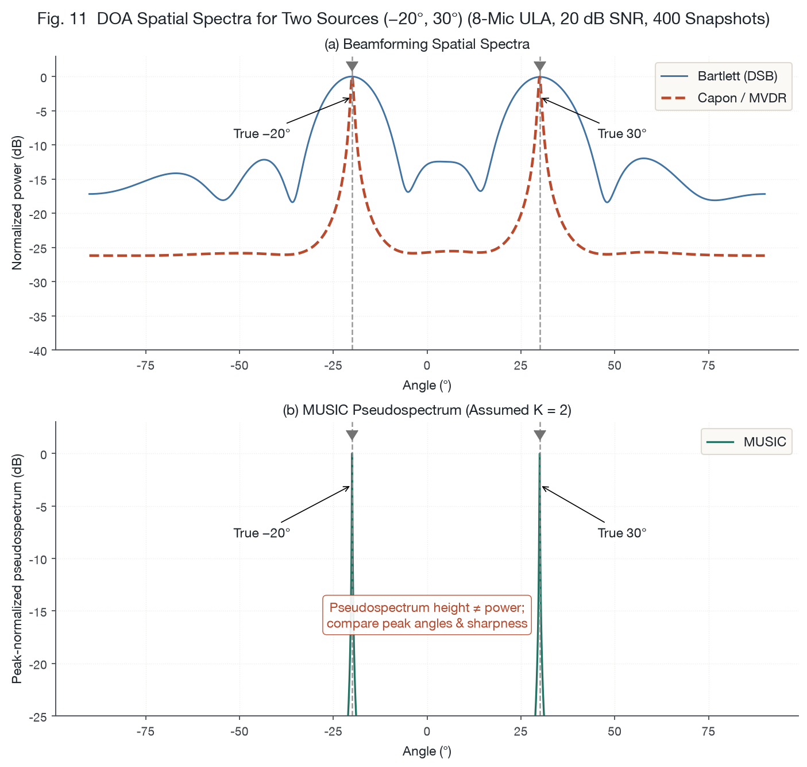
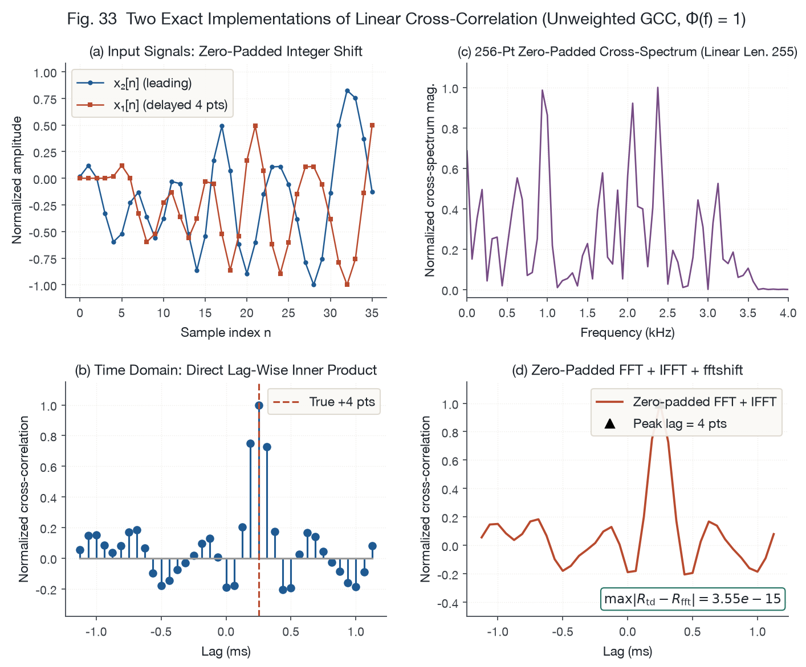
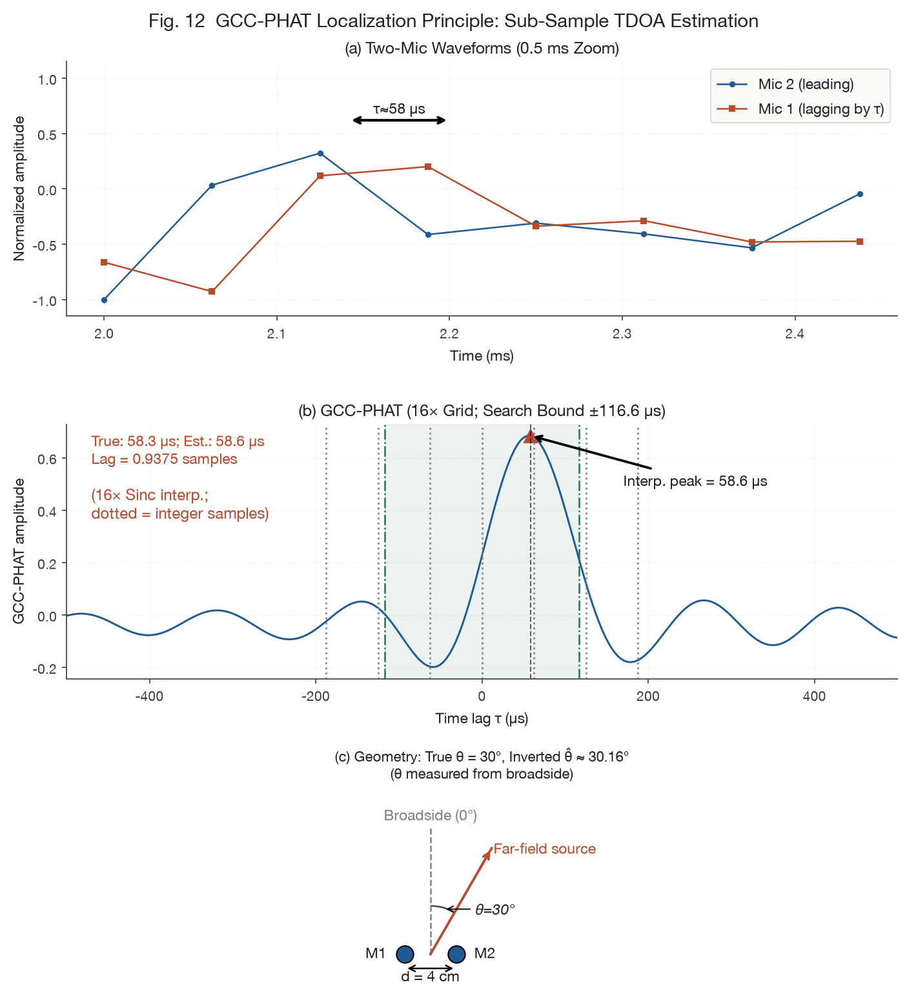
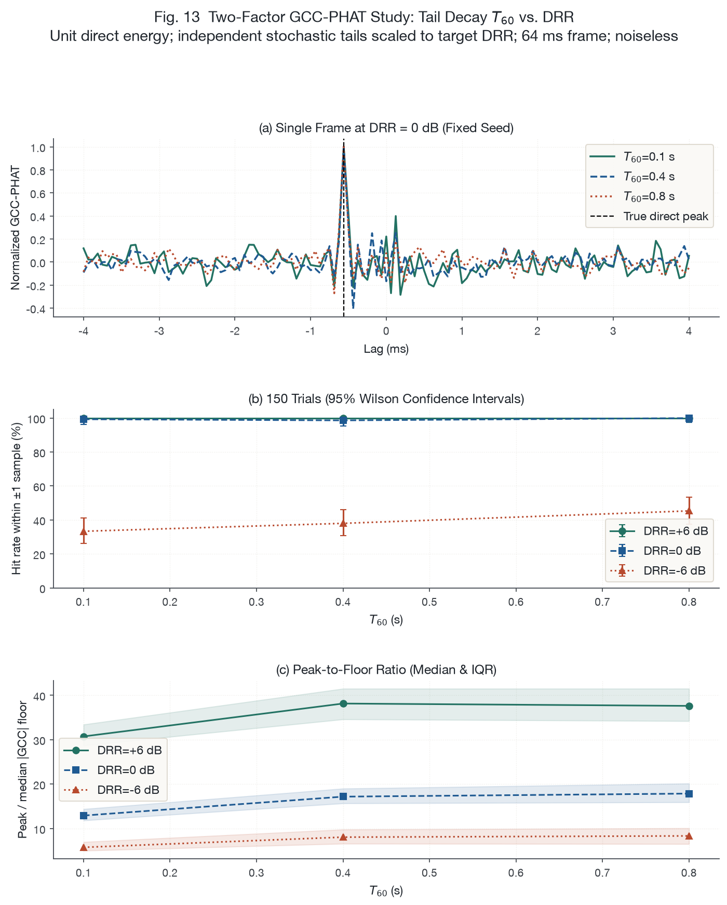
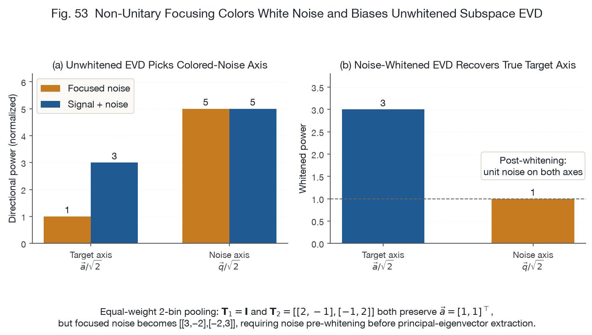
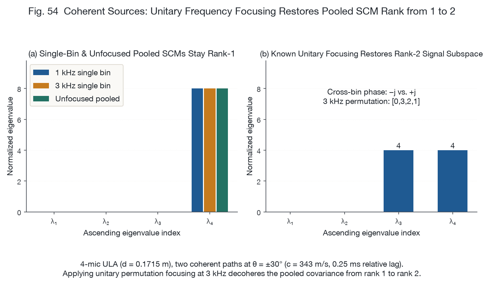

> This chapter is Chapter 4 of the main text. The main text and extended special topics comprise 16 chapters in total (Chapters 0–15, where Chapter 0 covers mathematical foundations and Chapters 12–15 are four extended special topics), accompanied by Appendices A and B. This chapter can be read independently; use the navigation bar below for the preceding and following chapters.
>
> Overview Home: [00_overview.md](00_overview.md) | Previous: [03_array-geometry.md](03_array-geometry.md) | Next: [05_beamforming.md](05_beamforming.md)

---

## 4. Sound Source Localization (Direction of Arrival, DOA)

In engineering practice, sound source localization starts by separating "finding a direction" from "determining a coordinate": Direction of Arrival (DOA) specifies only the angle of a source relative to the array, for which a far-field plane-wave model suffices; full spatial localization additionally estimates source-to-array range, typically relying on near-field spherical wavefront curvature or intersection across distributed baselines. This chapter begins with the most intuitive dual-microphone cross-correlation time delay and progresses systematically through multi-microphone spatial grid scanning, algebraic geometric solvers, adaptive spatial spectra, subspace decomposition, sparse reconstruction, and learning-based localization. For convenient cross-chapter reference, the table below summarizes the core acronyms used throughout this chapter.

| Acronym | Full Term | Role in This Chapter |
|---|---|---|
| TDOA | Time Difference of Arrival | Relative arrival-time difference of a common acoustic source between two microphones |
| GCC / PHAT | Generalized Cross-Correlation; Phase Transform | Frequency-domain cross-spectral weighting followed by inverse transform to extract delay from the peak |
| SRP | Steered Response Power | Accumulates pairwise cross-correlation responses across microphone pairs at candidate spatial coordinates |
| ULA / SNR | Uniform Linear Array; Signal-to-Noise Ratio | Reference linear array geometry and signal-to-noise power ratio convention |
| MUSIC | Multiple Signal Classification | Tests orthogonality between a candidate steering vector and the observed noise subspace |
| MVDR | Minimum Variance Distortionless Response | Minimizes total array output power subject to unit gain in the candidate direction |
| DRR / RIR | Direct-to-Reverberant Ratio; Room Impulse Response | Energy ratio of direct sound to reflections, and room acoustic propagation impulse response |
| DFT / IDFT | Discrete Fourier Transform; Inverse DFT | FFT (Fast Fourier Transform) and IFFT are fast algorithms for computing them |
| STFT | Short-Time Fourier Transform | Slices multichannel time-domain waveforms into per-frequency, per-frame complex phasor observations |

Throughout this chapter, column vectors carry arrows ($\vec a,\vec w,\vec x$), matrices are set in upright bold capitals ($\mathbf A,\mathbf I$), and spatial covariance matrices carry double subscripts ($\mathbf R_{xx},\mathbf R_{ss},\mathbf R_{nn}$, with finite-snapshot sample estimates hatted as $\hat{\mathbf R}_{xx}$) to distinguish them from scalar cross-correlation functions $R_{x_1x_2}(\tau)$ and integer-lag correlation sequences $R[l]$. Conjugate transpose is denoted $^H$, real transpose $^\top$, imaginary unit upright $\mathrm{j}$, and expectation $\mathbb{E}[\cdot]$; $M$ denotes the number of microphone channels and $K$ the number of sound sources. For snapshot statistics, Hermitian eigendecomposition, and complex vector calculus, cross-reference [Chapter 0 Mathematical Foundations](00_math-foundations.md#sec-0-8) and [Appendix A](16_appendix-symbols-math.md) as needed. All synthetic WAV assets accompanying this chapter are generated from known geometries and analytical signal models strictly to verify delay sign conventions, subsample alignment, and matrix rank transitions; they do not represent blind localization benchmarks on real-room speech recordings.

### 4.1 Overview: Four Algorithmic Families

```
Sound Source Localization Algorithms
├── Two-stage methods: estimate pairwise TDOAs first, then solve geometry (§4.2, §4.4)
│     └── Example: GCC-PHAT delay estimation followed by multi-pair geometric solver
├── Spatial scanning: evaluate candidate directions/positions on a grid and pick peaks (§4.3, §4.5)
│     └── Examples: SRP-PHAT, Bartlett, Capon
├── Subspace methods: test candidate steering vectors against signal/noise subspaces (§4.6)
│     └── Examples: MUSIC, ESPRIT; require source count K and array structure checks
└── Sparse & learning-based methods: exploit directional sparsity or labeled training data (§4.7)
      └── Examples: LASSO / SBL, deep SELD networks; require prior or domain-coverage checks
```

To build visual intuition for "spatial spectra" before diving into equations, Figure 11 plots representative Bartlett, Capon, and MUSIC spectra side by side on the exact same two-source narrowband scene (true sources at $-20^\circ$ and $30^\circ$, separated by $50^\circ$). The simulation uses an $M=8$ half-wavelength ULA at $20\ \mathrm{dB}$ input SNR (total signal power per sensor relative to single-sensor white noise power) and $400$ independent snapshots to form $\hat{\mathbf R}_{xx}$. Capon applies dimensionless relative diagonal loading $\eta=10^{-6}$ (setting $\delta_{\mathrm{rel}}=\eta\operatorname{tr}(\hat{\mathbf R}_{xx})/M$ and solving with $\hat{\mathbf R}_{xx}+\delta_{\mathrm{rel}}\mathbf I$), while MUSIC receives the true source count $K=2$.

Keep in mind that Figure 11 deliberately uses a wide $50^\circ$ separation, anechoic free space, and high SNR solely to contrast the canonical shapes of the three spectra. In reverberant rooms or when two talkers stand close together, peak broadening and merging intensify sharply; close-source resolution success rates are evaluated separately via repeated Monte Carlo trials in [§4.8.1](#sec-4-8-1).



When reading Figure 11, distinguish the vertical axes of the two panels first—never compare absolute peak heights across panels:

- **Figure 11(a) — Beam-scanning spatial spectra**: Horizontal axis is candidate azimuth ($-90^\circ$ to $90^\circ$), vertical axis is output power normalized to each curve's own maximum (in dB), and vertical dashed gray lines with top inverted triangles mark the true DOAs at $-20^\circ$ and $30^\circ$. The solid blue Bartlett curve is the average output power of conventional delay-and-sum beamforming steered across azimuth: limited by the $8$-element ULA aperture, both mainlobes are broad and leave $-12$ to $-18\ \mathrm{dB}$ sidelobe ripples between and outside the peaks. The dashed red Capon/MVDR curve adaptively suppresses off-axis leakage while holding unit gain at the scan angle, noticeably sharpening both mainlobes and flattening the background floor to roughly $-26\ \mathrm{dB}$.
- **Figure 11(b) — MUSIC pseudospectrum**: Plots the log reciprocal of the squared projection norm of each candidate steering vector onto the noise subspace (peak-normalized to $0\ \mathrm{dB}$). The solid green curve forms razor-sharp needle peaks at $-20^\circ$ and $30^\circ$ because true steering vectors under the ideal model are orthogonal to the noise subspace, driving the denominator toward zero.

Comparing both panels side by side: Capon's vertical axis measures physical filtered output power (in dB), whereas MUSIC's pseudospectrum height reflects *degree of subspace orthogonality* only and carries no information about physical source power. Moreover, production pipelines must never determine source count simply by counting spectral peaks—strong sidelobes, coherent reflections, or finite-snapshot perturbations can spawn spurious peaks or merge twin peaks into one, so source count $K$ must be estimated beforehand via dedicated criteria.

#### 4.1.1 Source Enumeration: Determining Signal Subspace Dimension

Before estimating directions, subspace methods such as MUSIC and ESPRIT must answer "how many independent signal dimensions are present in the current observation?"—i.e., determine the source count $K$. Even during single-talker speech in a quiet conference room, underestimating $K$ pushes genuine signal eigenvectors into the noise subspace and destroys orthogonality at true DOAs, whereas overestimating $K$ admits pure noise eigenvectors into the signal subspace and breeds spurious peaks at empty angles.

Subspace dimension is also strictly bounded by physical channel count $M$: MUSIC requires $K<M$ so that noise-subspace dimension $M-K\ge 1$ remains nonempty; ESPRIT likewise requires $K<M$ to separate the signal subspace from the full-array covariance, and each shift-invariant subarray of size $P$ must satisfy $K\le P\le M-1$ (for a 1-element shift on a ULA with maximum-overlap subarrays $P=M-1$, the theoretical ceiling is $M-1$; larger subarray shifts with $P<M-1$ lower the identifiable ceiling to $P$), with practical designs reserving extra sensor margin against finite-snapshot fluctuations. Two principal approaches are standard.

**Approach 1 — Eigen-gap inspection**. At narrowband bin $f_k$, perform Hermitian eigendecomposition on the $M\times M$ sample covariance $\hat{\mathbf R}_{xx}(f_k)$. For $K$ uncorrelated sources in spatial white noise of variance $\sigma^2$, the population covariance $\mathbf A\mathbf R_{ss}\mathbf A^H+\sigma^2\mathbf I$ has $K$ large eigenvalues containing signal power plus $\sigma^2$, followed by $M-K$ trailing eigenvalues identically equal to $\sigma^2$ (for example, the noiseless 3-mic single-source Worked Example 4-4 below yields eigenvalues $3,0,0$, revealing $K=1$ at a glance from the first gap).

Sorting sample eigenvalues in descending order $\hat\lambda_1\ge\hat\lambda_2\ge\cdots\ge\hat\lambda_M$, finite snapshots and additive noise spread the trailing noise eigenvalues randomly so they are no longer strictly equal. While one can inspect adjacent differences or ratios for the largest cliff, low SNR or scarce snapshots blur the step between weak signals and the noise floor, making manual thresholds brittle.

**Approach 2 — Information-theoretic criteria (AIC and MDL)**. To eliminate manual thresholding, the Akaike Information Criterion (AIC) and Minimum Description Length (MDL) cast source enumeration as minimizing "data log-likelihood mismatch + model complexity penalty." Their core intuition rests on the elementary **Arithmetic–Geometric Mean (AM–GM) inequality**: for any set of strictly positive real numbers, their arithmetic mean $a_k$ satisfies $a_k\ge g_k$ relative to their geometric mean $g_k$, with **equality $a_k=g_k$ ($\ln(a_k/g_k)=0$) if and only if all numbers in the set are identical**. For candidate count $k\in\{0,1,\ldots,M-1\}$, the test treats the trailing $M-k$ smallest eigenvalues as candidate white-noise eigenvalues: when $k<K$, prominent signal eigenvalues remain trapped in the tail, making $a_k\gg g_k$ and $\ln(a_k/g_k)$ large; as soon as $k$ reaches the true count $K$, only flat noise eigenvalues remain in the tail, driving $a_k/g_k$ close to $1$ and causing the mismatch term to plunge.

Evaluating likelihood mismatch alone would overfit monotonically: pushing $k>K$ all the way to $k=M-1$ keeps nudging the mismatch downward until it hits zero identically at $k=M-1$! Adding a complexity penalty that grows with the number of free parameters ensures that for $k>K$, tiny likelihood gains are outweighed by the parameter penalty so the total score rebounds, locking the minimum near the true source count.

Wax and Kailath systematically derived the maximum-likelihood formulation under i.i.d. complex Gaussian snapshots in spatial white noise in their [1984 ICASSP paper, Eqs. (10)–(15)](https://doi.org/10.1109/ICASSP.1984.1172389) and [1985 *IEEE TASSP* journal article](https://doi.org/10.1109/TASSP.1985.1164557) (*Detection of signals by information theoretic criteria*; note that equation numbers differ between the two papers, while the free-parameter count after dropping common constants is $p(k)=k(2M-k)$ in both). Section [§4.9](#sec-4-9) derives all $2Mk-k^2$ real degrees of freedom step by step, and Exercise [E04-20](#e04-20) hand-calculates a direct divergence between AIC and MDL on the exact same eigenvalue vector.

The essential difference lies in their penalty weights: MDL scales its penalty by $\ln N$ and is statistically consistent as $N\to\infty$; AIC penalizes more lightly, reducing missed detections on weak sources or short windows at the cost of a nonzero asymptotic probability of overestimation. Implementations must carefully verify complex versus real Gaussian scaling factors, effective independent snapshot counts, and spatial whiteness: colored background noise or heavy pre-applied diagonal loading distorts trailing eigenvalue ratios and biases information criteria.

When SNR and snapshot counts are generous, inspect the eigenvalue step gap first as a quick sanity check; when automated output of $K$ is needed, score with MDL and cross-check against the eigen-gap.

Coherent multipath poses an additional chicken-and-egg coupling between decorrelation and enumeration: strong indoor reflections coherent with direct sound collapse the rank of the signal covariance so raw eigenvalues undercount physical paths; spatial smoothing is required to restore rank, yet subarray partitioning itself depends on an upper bound on $K$. Practical pipelines set a physically plausible ceiling $K_{\max}$ and jointly validate subarray size against candidate $K$; the exact mechanism and aperture cost of spatial smoothing are developed in the [coherent-source subsection of §4.6](#sec-4-6).

> Subspace methods require estimating source count $K$ upfront, whereas dual-channel cross-correlation delay estimation needs no source-count prior. Section 4.2 starts from the foundational two-microphone case.

### 4.2 GCC-PHAT: Aligning Two Recordings to Find the Best-Matching Shift

#### Delay Sign Convention and Time- vs. Frequency-Domain Computation

Before deriving delay estimators, pin down coordinates and signs unambiguously. Following §§2.1–2.3 across the entire book, place two microphones along the $x$-axis with Microphone 1 at the origin $x=0$ and Microphone 2 at $x=d>0$ (prose derivations in this chapter use 1-based sensor indexing $m=1,\dots,M$ with ULA coordinates $(m-1)d$, matching the 0-based indexing $m'=0,\dots,M-1$ of Chapter 3 and the codebase via $m'=m-1$); broadside ($+y$-axis) is $0^\circ$, and clockwise rotation toward Microphone 2 ($+x$ side) defines positive azimuth $\theta>0$. With unit vector $\vec u$ pointing from the array toward the source, the plane wave propagates along $-\vec u$, and the arrival-time difference between microphones $i$ and $j$ is $\tau_{ij}=t_i-t_j$.

Under forward Fourier kernel $e^{-\mathrm{j}2\pi ft}$, the relative propagation delay referenced to Microphone 1 and the $m$-th entry of the narrowband steering vector are

$$\begin{aligned}
\tau_{m1}&=-\frac{(\vec r_m-\vec r_1)^\top\vec u}{c},\\
a_m(f,\theta)&=e^{-\mathrm{j}2\pi f\tau_{m1}}
=e^{+\mathrm{j}2\pi f(\vec r_m-\vec r_1)^\top\vec u/c}.
\end{aligned}$$

When a source lies at positive azimuth ($\theta>0$), the wavefront reaches right-hand Microphone 2 first and left-hand Microphone 1 later, so $t_1>t_2$, giving $\tau_{21}=t_2-t_1<0$ and $\tau_{12}=t_1-t_2>0$. Memorize this physical picture in one sentence: **$\tau_{12}>0$ means "sound arrives at Mic 1 later than at Mic 2,"** so ideal noiseless continuous waveforms obey $x_1(t)=x_2(t-\tau_{12})$.

How do we extract this time shift from two discrete recordings? The most direct idea is to slide the second sequence $x_2[n]$ left and right by integer sample lags $l$, multiply point by point with $x_1[n]$, and sum to see which shift locks the two waveforms into tightest alignment:

$$\begin{aligned}
R[l]&=\sum_n x_1[n]x_2[n-l],\\
\hat\tau_{12}&=\frac{\arg\max_l R[l]}{f_s}.
\end{aligned}\tag{4-1}$$

In Eq. (4-1), integer lag $l$ is in samples and dividing by sample rate $f_s$ converts to seconds $\hat\tau_{12}$; delaying the earlier waveform $x_2$ rightward by $l>0$ samples via $x_2[n-l]$ brings it into coincidence with the later waveform $x_1[n]$, maximizing $R[l]$ at positive lag $l>0$ in exact agreement with $\tau_{12}>0$.

Consistent with [Chapter 0 §0.2](00_math-foundations.md#sec-0-2) and Eq. (16-2) in [Appendix A](16_appendix-symbols-math.md), for complex baseband sequences the second factor in time-domain cross-correlation takes complex conjugation $x_2^*[n-l]$. Note that complex correlation is itself complex-valued: for finite-support $x_1=[0,\mathrm{j}]$ and $x_2=[1,0]$, the correlation at $l=+1$ equals $\mathrm{j}$, so blindly taking the real part erases the true peak to $0$; searching signed real maxima via Eq. (4-1) is self-consistent for real audio channels with matched polarity, whereas unknown common complex phase rotations require picking peaks of $|R[l]|$.

Sweeping all lags directly in the time domain over length-$N$ frames costs $O(N^2)$ multiply-adds. By the Fourier **cross-correlation theorem**, sliding inner products in time equal pointwise cross-power multiplication $X_1(f)X_2^*(f)$ in frequency (conjugating channel 2 before multiplying by channel 1) followed by a single inverse transform; inserting a frequency-domain weighting function $\Phi(f)$ yields the Generalized Cross-Correlation (GCC) framework:

$$\begin{aligned}
G_\Phi(f)&=\Phi(f)X_1(f)X_2^*(f),\\
R_{x_1x_2}(\tau)&=\int_{-\infty}^{\infty}G_\Phi(f)
e^{+\mathrm{j}2\pi f\tau}\,\mathrm{d}f,\\
\hat\tau_{12}&=\arg\max_\tau R_{x_1x_2}(\tau).
\end{aligned}\tag{4-2}$$

Writing Eq. (4-2) as a continuous-frequency integral exposes its physical symmetry: for real signals and a real even weight $\Phi(f)=\Phi(-f)$, Hermitian symmetry $G_\Phi(-f)=G_\Phi^*(f)$ cancels positive- and negative-frequency imaginary parts identically, producing a real-valued cross-correlation curve $R_{x_1x_2}(\tau)$. Why does phase encode time delay? Transforming pure delay $x_1(t)=x_2(t-\tau_0)$ into frequency gives $X_1(f)=X_2(f)e^{-\mathrm{j}2\pi f\tau_0}$, so the cross-spectrum is

$$X_1(f)X_2^*(f)=|X_2(f)|^2\,e^{-\mathrm{j}2\pi f\tau_0}.$$

Its phase $\angle\{X_1(f)X_2^*(f)\}=-2\pi f\tau_0$ is a straight line through the origin with slope $-2\pi\tau_0$ against frequency $f$ (e.g., for $\tau_0=58.3\ \mu\mathrm{s}$, cross-spectral phase is $\approx -0.366\ \mathrm{rad}$ at $1\ \mathrm{kHz}$ and $\approx -0.733\ \mathrm{rad}$ at $2\ \mathrm{kHz}$). When the inverse-transform kernel in Eq. (4-2) scans onto $\tau=\tau_0$, $e^{+\mathrm{j}2\pi f\tau_0}$ unwinds that negative phase slope flat to $0\ \mathrm{rad}$ across all frequencies, summing every bin coherently in phase to form a sharp main peak!

Natural speech, however, concentrates energy heavily in low-frequency formants: unweighted cross-correlation ($\Phi(f)=1$) retains the source power spectrum $|X_2(f)|^2$, substantially broadening the time-domain correlation peak. The **Phase Transform (PHAT)** sets $\Phi(f)=1/|X_1(f)X_2^*(f)|$, whitening the cross-spectrum to unit magnitude $e^{-\mathrm{j}2\pi f\tau_0}$ so every active frequency bin votes with equal weight—dramatically sharpening the correlation peak under ideal single-path propagation. Note that PHAT does *not* repair phases corrupted by reverberation or noise, and without protection it amplifies random noise phases in silent frequency bins to full unit weight; practical implementations must therefore enforce a denominator floor or spectral gate.

**Zero-padding against circular wrap-around and signed-lag index mapping in discrete `ifft`**. Translating Eq. (4-2) into code trips up newcomers at two classic spots: why zero-padding is mandatory, and how `ifft` array indices map onto signed lags $l$. For frames of lengths $N_1$ and $N_2$, an $N$-point DFT/IDFT computes **circular cross-correlation** modulo $N$; preventing circular wrap-around aliasing requires $N_{\mathrm{fft}}\ge N_1+N_2-1$ (typically rounded up to a power of two at $O(N_{\mathrm{fft}}\log N_{\mathrm{fft}})$ cost).

Under Chapter 2's forward kernel $e^{-\mathrm{j}2\pi ft}$, keep discrete frequency signs exact as well: for real one-sided transforms (`rfft`), indices $0\le k\le\lfloor N_{\mathrm{fft}}/2\rfloor$ correspond to nonnegative frequencies $f_k=kf_s/N_{\mathrm{fft}}$; for full two-sided `fft`, the upper half $k>N_{\mathrm{fft}}/2$ represents negative frequencies $(k-N_{\mathrm{fft}})f_s/N_{\mathrm{fft}}$—never treat raw bin index $k$ as positive frequency across the entire two-sided array.

After calling `c = np.fft.ifft(G).real` of length $N_{\mathrm{fft}}$, array indices $m=0,1,\ldots,N_{\mathrm{fft}}-1$ wrap modulo $N_{\mathrm{fft}}$:

- **Nonnegative lags sit at the head of the array**: indices $m=0,1,\ldots,N_1-1$ map directly to integer lags $l=0,+1,\ldots,+(N_1-1)$ (Mic 1 arriving simultaneously or later);
- **Negative lags wrap to the tail of the array**: negative integer lags $l=-(N_2-1),\ldots,-2,-1$ (Mic 1 arriving earlier than Mic 2) sit modulo $N_{\mathrm{fft}}$ at $m=N_{\mathrm{fft}}-(N_2-1),\ldots,N_{\mathrm{fft}}-1$;
- **Concatenation and physical-aperture cropping**: prepending tail slice `c[-(N2-1):]` ahead of head slice `c[:N1]` assembles the monotonically ordered lag axis $l=-(N_2-1),\ldots,+(N_1-1)$, which is finally cropped to the physically admissible window $|l|/f_s\le d/c$ prior to peak picking.

Distinguish also the finite-support behavior of unweighted CC versus PHAT: for $\Phi(f)=1$, any $N_{\mathrm{fft}}\ge N_1+N_2-1$ matches finite time-domain summation Eq. (4-1) to machine precision; PHAT divides by $|X_1[k]X_2^*[k]|$ in frequency—a nonlinear spectral whitening whose inverse transform is no longer strictly time-limited to $N_1+N_2-1$ samples, so changing $N_{\mathrm{fft}}$ slightly alters sampled curve values and must be documented when comparing implementations.



Figure 33 walks through this entire "zero-pad + conjugate multiply + tail-to-head unwrap" pipeline for unweighted cross-correlation ($\Phi(f)=1$):

- **Figure 33(a) — Input signals**: Plots the first $36$ samples of two length-$128$ sequences ($N_1=N_2=128$); blue circles $x_2[n]$ arrive first, while red squares $x_1[n]$ are delayed by exactly $4$ samples via four leading zeros.
- **Figure 33(b) — Direct time-domain summation**: Lag axis converted to milliseconds ($+4$ samples $= +0.25\ \mathrm{ms}$ at $16\ \mathrm{kHz}$); blue stems evaluate Eq. (4-1) lag by lag, hitting peak $1.0$ at the dashed red marker $+4$.
- **Figure 33(c) — Zero-padded cross-spectral magnitude**: Linear correlation requires at least $128+128-1=255$ points, so we take $N_{\mathrm{fft}}=256$ and plot normalized $|X_1[k]X_2^*[k]|$ across $0$–$4\ \mathrm{kHz}$.
- **Figure 33(d) — Rearranged IFFT output**: After `ifft` and unwrapping negative lags to the left, the solid brown curve hits the black triangle peak at `lag = 4`; the green inset box confirms that $\max|R_{\mathrm{td}}-R_{\mathrm{fft}}|=3.55\times 10^{-15}$ across all lags—pure double-precision rounding.

#### 8-Point Impulse Hand Calculation: Exact Time–Frequency Agreement

To verify conjugation placement and lag signs by hand, let us evaluate both time-domain Eq. (4-1) and frequency-domain DFT/IDFT on an elementary $N=8$-point impulse pair using integer-lag notation $R[l]$.

**Inputs and setup**: Take $N=8$ ($n=0,1,\ldots,7$) with

- $x_1=[0,0,3,0,0,0,0,0]$, nonzero impulse $3$ at $n=2$ (Mic 1 arrives $2$ samples after Mic 2);
- $x_2=[2,0,0,0,0,0,0,0]$, nonzero impulse $2$ at $n=0$.

Linear cross-correlation Eq. (4-1) is $R[l]=\sum_{n=0}^{7}x_1[n]x_2[n-l]$ with out-of-range indices treated as $0$. Although full linear correlation of two length-$8$ sequences generally requires zero-padding to at least $8+8-1=15$ points, at the three test lags $l=0,1,2$ inspected here, the accessed indices $2-l\in\{2,1,0\}$ lie strictly inside $0\ldots 7$ without circular wrap-around, so an $8$-point DFT/IDFT agrees identically with linear correlation at $l=0,1,2$.

**Step 1 — Pointwise time-domain evaluation**. Since $x_1[n]$ is nonzero only at $n=2$, the sum collapses to $R[l]=3\,x_2[2-l]$:

| Trial Lag $l$ (samples) | Accessed $x_2$ Index $2-l$ | Product | Cross-Correlation $R[l]$ |
|---:|---:|---|---:|
| $0$ | $2$ | $3\times 0$ | $0$ |
| $1$ | $1$ | $3\times 0$ | $0$ |
| $2$ | $0$ | $3\times 2$ | $6$ |

The maximum occurs at $\hat l=+2$ ($R[2]=6$), confirming that $x_1$ lags $x_2$ by $2$ samples.

**Step 2 — Frequency-domain DFT conjugate multiplication and IDFT**. With twiddle factor $W_8=e^{-\mathrm{j}2\pi/8}$ and $X[k]=\sum_{n=0}^{7}x[n]W_8^{kn}$ ($k=0,\ldots,7$), $x_2[n]$ is nonzero only at $n=0$ so $X_2[k]=2$ across all bins, while $x_1[n]$ is nonzero only at $n=2$ so $X_1[k]=3W_8^{2k}=3e^{-\mathrm{j}\pi k/2}$. Listing all $8$ bins:

$$\begin{aligned}
X_1&=[3,-3\mathrm{j},-3,3\mathrm{j},
3,-3\mathrm{j},-3,3\mathrm{j}],\\
X_2^*&=[2,2,2,2,2,2,2,2],\\
G[k]&=X_1[k]X_2^*[k]\\
&=[6,-6\mathrm{j},-6,6\mathrm{j},
6,-6\mathrm{j},-6,6\mathrm{j}].
\end{aligned}$$

With inverse kernel $E_l[k]=e^{+\mathrm{j}2\pi kl/8}$ and $8$-point IDFT $r[l]=\frac{1}{8}\sum_{k=0}^{7}G[k]E_l[k]$, check $l=0,1,2$:

1. At $l=0$: the $8$-term sum is $(6-6\mathrm{j}-6+6\mathrm{j})\times 2=0$ by pairwise cancellation, giving $r[0]=0=R[0]$;
2. At $l=1$: $G[k]E_1[k]=6e^{-\mathrm{j}\pi k/2}e^{+\mathrm{j}\pi k/4}=6(e^{-\mathrm{j}\pi/4})^k$, which steps uniformly around the complete unit circle over $k=0,\ldots,7$ and sums to zero, giving $r[1]=0=R[1]$;
3. At $l=2$: $G[k]E_2[k]=6e^{-\mathrm{j}\pi k/2}e^{+\mathrm{j}\pi k/2}=6$, unwinding every delay phase so eight $6$'s add in phase to $r[2]=48/8=6=R[2]$.

**Result and boundary note**: Time-domain sliding and frequency-domain IDFT yield the exact same values $0,0,6$ at $l=0,1,2$ with peak $\hat l=+2$. Applying ideal PHAT normalization here merely scales $|G[k]|=6$ to $\Psi[k]=G[k]/|G[k]|=[1,-\mathrm{j},-1,\mathrm{j},1,-\mathrm{j},-1,\mathrm{j}]$, normalizing the $l=2$ peak from $6$ to $1$ while leaving other lags at $0$—because single impulses already possess a flat spectrum. PHAT's peak-sharpening power emerges when the source spectrum itself is strongly colored, such as formant-dominated speech.

#### Spectral Weightings, Weak-Bin Protection, and Channel Polarity

Choosing different frequency weightings $\Phi(f)$ in Eq. (4-2) generates the classic family of GCC delay estimators, contrasted below (systematic derivations and ML optimality in [Knapp and Carter, *IEEE TASSP*, 1976](https://doi.org/10.1109/TASSP.1976.1162830)):

| Weighting Name | Spectral Weight $\Phi(f)$ | Motivation and Operating Boundary |
|---|---|---|
| Classical Cross-Correlation (CC) | $1$ | Preserves spectral magnitude; robust for flat-spectrum sources in stationary white noise, but broadens peaks severely on narrowband/formant speech |
| Roth Processor | $1/(\hat G_{11}(f)+\varepsilon)$ | Deconvolves by smoothed auto-spectrum of channel 1, estimating the impulse response from Mic 1 to Mic 2; asymmetric under channel swap |
| Smoothed Coherence Transform (SCOT) | $1/\sqrt{\hat G_{11}(f)\hat G_{22}(f)}$ | Symmetric whitening by geometric mean of smoothed auto-spectra; must specify recursive or Welch multi-frame averaging for $\hat G_{11},\hat G_{22}$ |
| **Phase Transform (PHAT)** | $1/(\lvert X_1(f)X_2^*(f)\rvert+\varepsilon)$ | Divides out cross-spectral magnitude to retain phase slope only; highly effective on speech envelopes indoors, but sensitive to low-SNR weak bins |
| Maximum Likelihood (ML / Hannan–Thomson) | Function of SNR & coherence | Approaches asymptotic variance bound for zero-mean Gaussian signal in uncorrelated Gaussian noise; breaks down under coherent reverberant multipath |

Comparing SCOT against PHAT clears up a frequent misconception: if evaluated on a **single unsmoothed frame**, $\sqrt{|X_1|^2|X_2|^2}$ and $|X_1X_2^*|$ are algebraically identical! SCOT diverges from per-frame PHAT in bias–variance behavior only when $\hat G_{11},\hat G_{22}$ are estimated via multi-frame statistical averaging.

When coding PHAT for teaching or production, specify the **weak-bin protection rule** explicitly. Function [`doa.py::gcc_phat`](../codes/chapters/ch04/core/doa.py) normalizes each input channel by its peak amplitude to prevent overflow on wide-dynamic-range inputs, defines `epsilon` relative to the pair's peak cross-spectral magnitude $g_{\max}=\max_k|G[k]|$, and evaluates $G[k]/\max(|G[k]|,\varepsilon g_{\max})$. This **denominator floor** attenuates only bins weaker than $\varepsilon g_{\max}$, differing both from **additive regularization** $|G|+\delta$ in the table above and from the **hard gate** in [`srp_phat`](../codes/chapters/ch04/core/doa.py) that zeros weak bins outright—Exercise E04-14 in [§4.11](#sec-4-11) compares all three numerically line by line.

Finally, one of the most insidious field hardware bugs is **inverted channel polarity**. Scaling a channel by any positive gain leaves cross-spectral phase and positive peak location invariant; if a microphone is wired backward or inverted in driver software (multiplying one channel by $-1$, a $180^\circ$ phase flip), the entire real cross-correlation curve flips upside down—turning the true positive peak into a negative trough so signed `argmax` jumps onto a spurious sidelobe! Whenever DOA estimates jump erratically in deployment, check channel polarity and silent segments first: all-zero silence carries no identifiable correlation peak, so `gcc_phat` raises an explicit exception rather than silently returning $0^\circ$.

#### From Delay Peak to Angle: Subsample Interpolation and Figure 12's Model

Once pairwise delay $\hat\tau_{12}$ is estimated, under the plane-wave assumption on the front half-space ($\theta\in[-90^\circ,90^\circ]$), the path-difference relation $c\tau_{12}=d\sin\theta$ from §2.1 inverts to azimuth:

$$\hat\theta=\arcsin\!\left(\frac{c\hat\tau_{12}}{d}\right).
\tag{4-3}$$

Before calling $\arcsin$, understand the **physical visible region**: for any real propagation direction in 3D space, $|\sin\theta|\le 1$—defining the array's visible region. Consequently, no physical plane wave can ever produce a TDOA exceeding the endfire transit time $|\tau_{12}|\le\tau_{\max}=d/c$ ($|c\tau_{12}/d|\le 1$). Apart from tiny floating-point interpolation overshoots that may be clipped to $\pm 1$, a peak landing decisively in the "invisible region" $|c\hat\tau_{12}/d|>1$ indicates domination by reverberant outliers or cross-source mismatch; such frames should be flagged invalid or avoided by restricting the lag search window to $|\tau|\le d/c$ upfront, never silently clamped onto $\pm 90^\circ$ endfire. (If external literature measures angle from the array axis rather than broadside, replace $\arcsin$ with $\arccos$ in Eq. (4-3).)

Even when $|\hat\tau_{12}|\le\tau_{\max}$, a single two-microphone baseline retains its 3D cone of confusion (leaving front–back mirror symmetry in the horizontal plane), requiring non-collinear baselines to narrow down to a 3D ray, with coplanar arrays still retaining upper/lower mirror ambiguity absent a half-space prior ([§3.1](03_array-geometry.md#sec-3-1)).

Implementing Eq. (4-3) accurately in practice faces two inescapable precision bottlenecks:

1. **Integer sample steps are far too coarse—subsample interpolation is mandatory**. At $f_s=16\ \mathrm{kHz}$, one sample period is $T_s=62.5\ \mu\mathrm{s}$. Across a compact $d=4\ \mathrm{cm}$ baseline, stepping from lag $0$ to lag $1$ jumps straight from $0^\circ$ to $\arcsin(cT_s/d)\approx 32.4^\circ$, with even steeper $\arcsin$ slopes near endfire! Two interpolation strategies are standard: three-point parabolic fitting around the integer peak (`gcc_phat(..., parabolic_interpolation=True)`), or $Q$-fold frequency-domain zero-padded trigonometric interpolation on an even-$N$ cross-spectrum to refine lag resolution to $1/(Qf_s)$.

    For even-length real transforms, Nyquist-bin splitting and amplitude rescaling are both essential: (i) keep DC and interior positive/negative frequencies at their respective ends; (ii) split the old Nyquist bin $k=N/2$ in half, placing $\frac{1}{2}G[N/2]$ at both $\pm N/2$ (in one-sided `irfft`, halve the old endpoint coefficient before appending zeros) so the shared Nyquist component is not double-counted; and (iii) multiply the inverse transform by oversampling factor $Q$ to compensate `ifft`'s $1/(QN)$ normalization so the interpolated curve passes exactly through every original integer-lag sample (Exercise E04-12 in [§4.11](#sec-4-11) computes the exact errors incurred when omitting either correction).

2. **Uncompensated inter-channel phase mismatch biases PHAT peaks directly**. Because PHAT strips away amplitude weights and relies exclusively on inter-channel phase slope, any uncalibrated analog front-end or acoustic cavity phase discrepancy converts directly into a systematic delay bias (§10.2).



Let us trace the exact numbers across all three panels of Figure 12—from waveform shift through $16\times$ frequency-domain interpolation to angle inversion ($4096$-sample periodic bandlimited random source over $300$–$6000\ \mathrm{Hz}$, exact frequency-domain fractional delay plus i.i.d. Gaussian white noise of $\sigma=0.05$, $8192$-point FFT with $Q=16$ zero-padded interpolation):

- **Figure 12(a) — Zoomed two-channel waveforms**: Displays $2.0$–$2.45\ \mathrm{ms}$ at $d=4\ \mathrm{cm}$ and true $\theta=30^\circ$, where theoretical $\tau_0=d\sin 30^\circ/c=0.02/343\approx 58.309\ \mu\mathrm{s}$ ($\approx 0.933$ samples at $16\ \mathrm{kHz}$). Blue circles (Mic 2) arrive earlier on the left; red squares (Mic 1) arrive shifted right by $\approx 58\ \mu\mathrm{s}$.
- **Figure 12(b) — GCC-PHAT on the $16\times$ refined lag grid**: Vertical dotted gray lines mark raw $16\ \mathrm{kHz}$ integer sample ticks ($62.5\ \mu\mathrm{s}$ apart), while green dash-dotted bounds and shading mark the physical visible region $\pm d/c\approx\pm 116.6\ \mu\mathrm{s}$. Picking on raw integer ticks could only choose lag $1$ ($62.5\ \mu\mathrm{s}\Rightarrow 32.4^\circ$); under $16\times$ trigonometric interpolation ($\Delta\tau=62.5/16=3.90625\ \mu\mathrm{s}$), the red triangle peak lands at fine index $15$, giving $\hat\tau_{12}=15\Delta\tau=58.59375\ \mu\mathrm{s}$ (labeled $58.6\ \mu\mathrm{s}$, or $0.9375$ raw samples), hugging the $58.3\ \mu\mathrm{s}$ ground-truth line.
- **Figure 12(c) — Plane-wave geometry and subsample angle inversion**: Illustrates broadside-referenced $\theta=\arcsin(c\tau_0/d)=\arcsin(0.5)=30^\circ$ ($d=4\ \mathrm{cm}$); substituting subsample peak $0.9375$ samples from (b) into Eq. (4-3) gives

$$\begin{aligned}
\tau_{\mathrm{est}}&=58.59375\times 10^{-6}\ \mathrm{s},\\
\hat\theta&=\arcsin(343\,\tau_{\mathrm{est}}/0.04)
\approx 30.16^\circ,
\end{aligned}$$

just $0.16^\circ$ above the $30^\circ$ truth—demonstrating how subsample interpolation breaks past coarse integer-sample quantization. Single-frame residual jitter still varies with signal bandwidth, window length, SNR, and room reflections; and dual-mic GCC's deeper structural limitation is extracting only one dominant peak per pair, making cross-baseline peak association ambiguous under concurrent talkers or strong multipath reflections.

#### Reverberation Experiment: Reporting Both Decay Time and Direct-to-Reverberant Ratio

Inside real rooms, wall and tabletop reflections superpose delayed attenuated copies onto direct speech, elevating the GCC-PHAT background floor and frequently spawning spurious reflection peaks taller than the direct peak. Beginners often assume "longer reverberation time $T_{60}$ always degrades GCC-PHAT," yet quoting $T_{60}$ alone without stating whether the Direct-to-Reverberant Ratio (DRR) changed alongside it leaves localization behavior underdetermined!

To disentangle the distinct physical roles of $T_{60}$ (how long the reverberant tail stretches) and DRR (how strong direct energy is relative to total integrated reflection energy), Figure 13 runs a controlled $3\times 3$ two-factor factorial experiment at $16\ \mathrm{kHz}$: fixing direct-path impulse energy at $1$ per channel (Mic 2 lagging Mic 1 by $9$ samples, true $\tau_{12}=-9$ samples $\approx -0.5625\ \mathrm{ms}$), generating independent exponentially decaying random reverberation tails of length $1.1T_{60}$ normalized to exact target $\mathrm{DRR}\in\{+6,\,0,\,-6\}\ \mathrm{dB}$, and sweeping $T_{60}\in\{0.1,\,0.4,\,0.8\}\ \mathrm{s}$. Each cell runs $150$ deterministic trials (trial $k=0,\ldots,149$ uses seed $2000+17k$ for tails/frame offsets and $+1000$ for bandlimited source generation, cropping a $1024$-sample $64\ \mathrm{ms}$ frame after full linear convolution with zero sensor white noise; additive denominator floor $10^{-12}$; hits counted within $-9\pm 1$ samples; full trial logs in [`figure13_gcc_reverb.json`](../codes/chapters/ch04/reports/figure13_gcc_reverb.json)):

| Target DRR | $T_{60}=0.1\ \mathrm{s}$ | $T_{60}=0.4\ \mathrm{s}$ | $T_{60}=0.8\ \mathrm{s}$ |
|---|---:|---:|---:|
| $+6\ \mathrm{dB}$ | $150$ | $150$ | $150$ |
| $0\ \mathrm{dB}$ | $149$ | $148$ | $150$ |
| $-6\ \mathrm{dB}$ | $50$ | $57$ | $68$ |

Look at the bottom row—many readers do a double take: why does stretching $T_{60}$ from $0.1\ \mathrm{s}$ to $0.8\ \mathrm{s}$ at fixed $\mathrm{DRR}=-6\ \mathrm{dB}$ *increase* hit count from $50/150$ ($33.3\%$) to $68/150$ ($45.3\%$)? Does heavier room reverberation somehow help localization?

First understand **energy dilution** in multipath cross-spectra $X_1(f)X_2^*(f)$: the bottom row locks total integrated reflection energy at roughly $4\times$ direct energy ($\mathrm{DRR}=-6\ \mathrm{dB}$). When $T_{60}=0.1\ \mathrm{s}$, all $4\times$ reflection energy is crammed into a brief $0.11\ \mathrm{s}$ window right behind the direct impulse, giving individual early reflection taps large amplitudes that easily produce taller competing spikes after PHAT whitening; when $T_{60}=0.8\ \mathrm{s}$, that exact same $4\times$ energy budget is diluted across an $8\times$ longer decay envelope, shrinking individual reflection tap amplitudes so that while prior speech raises diffuse correlation noise across the $64\ \mathrm{ms}$ frame, single usurping outlier spikes occur less frequently.

Now step back into a real physical room to separate **what $T_{60}$ and $\mathrm{DRR}$ govern**: $T_{60}$ measures the $60\ \mathrm{dB}$ energy decay time determined by room volume and wall absorption, whereas $\mathrm{DRR}$ depends on source-to-array distance relative to the room's critical distance $r_c$. Inside the exact same $T_{60}=0.6\ \mathrm{s}$ conference room, a talker at $0.4\ \mathrm{m}$ enjoys positive high DRR where GCC-PHAT is rock-solid; stepping back to $3.5\ \mathrm{m}$ attenuates direct sound by $1/r^2$ against a nearly uniform reverberant field, plunging DRR into negative decibels and collapsing accuracy. By isolating tail duration from total tail energy via independent random tails (omitting low-frequency diffuse coherence and discrete specular image reflections), this experiment proves clearly: **reverberant localization benchmarks must never report $T_{60}$ without reporting $\mathrm{DRR}$ or source distance**.

Practical defenses against low-DRR reverberation combine three techniques: (i) detecting syllable **onsets** to lock onto high-DRR direct wavefronts before wall reflections build up; (ii) multi-frame histogram voting or Chapter 9 Kalman gated tracking to reject reflection jumps; and (iii) blind per-time-frequency estimation of the **Coherent-to-Diffuse Ratio (CDR)** from diffuse-field coherence priors to down-weight reverberation-dominated bins prior to IFFT or spatial voting (the closed-form direction-free dual-mic estimator is derived in full in Exercise [E04-27](#e04-27)).



Reading the three panels of Figure 13 against this physical picture:

- **Figure 13(a) — Single-frame GCC-PHAT curves at $\mathrm{DRR}=0\ \mathrm{dB}$**: Over $-4$ to $4\ \mathrm{ms}$ (dashed black line at true $-0.5625\ \mathrm{ms}$, each curve normalized to $1.0$), the solid green $T_{60}=0.1\ \mathrm{s}$ curve exhibits strong reflection side-peaks near $0.4$ around $0$–$0.5\ \mathrm{ms}$, whereas the dotted red $T_{60}=0.8\ \mathrm{s}$ curve spreads reflection energy into lower, more uniform background ripples.
- **Figure 13(b) — Hit rate over $150$ trials with $95\%$ Wilson confidence intervals**: $\mathrm{DRR}=+6\ \mathrm{dB}$ (solid green circles) and $0\ \mathrm{dB}$ (dashed blue squares) stay near $100\%$, whereas dropping to $\mathrm{DRR}=-6\ \mathrm{dB}$ (dotted red triangles) causes hit rate to plunge to $33\%$–$45\%$, confirming DRR as the primary determinant of main-peak survival.
- **Figure 13(c) — Peak-to-median contrast**: Plots $\max g/(\operatorname{median}|g|+10^{-12})$ (medians and shaded IQRs across $150$ trials), stratifying cleanly by $\mathrm{DRR}=+6,0,-6\ \mathrm{dB}$ from $\approx 31$–$38$ to $\approx 13$–$18$ down to $\approx 6$–$8$, with slightly higher contrast at longer $T_{60}$ under fixed DRR due to tail dilution.

> A single microphone pair is easily misled by an isolated reflection spike at low DRR or under concurrent talkers. Section 4.3 introduces SRP-PHAT, deferring hard per-pair peak picking and instead projecting entire pairwise correlation curves onto a spatial grid for joint voting.

### 4.3 SRP-PHAT: Accumulating Spatial Response Across Microphone Pairs

Whereas dual-mic GCC-PHAT inspects a single channel pair, Steered Response Power (SRP) reverses perspective: for each candidate point $\vec r$ on a spatial grid, it computes the geometric TDOA $\tau_{ij}(\vec r)$ that *would* occur across every microphone pair $(i,j)$ if a source stood at $\vec r$, looks up and sums the GCC-PHAT values across all pairs, and selects the grid point with the highest accumulated score:

$$\hat{\vec p}=\arg\max_{\vec r}\sum_{i<j}
R^{\mathrm{PHAT}}_{x_ix_j}\!\big(\tau_{ij}(\vec r)\big).
\tag{4-4}$$

Here $\tau_{ij}(\vec r)=(d_i(\vec r)-d_j(\vec r))/c$ with Euclidean distance $d_m(\vec r)=\|\vec r_m-\vec r\|$; for any non-degenerate range difference on a pair, the locus of planar points sharing constant $\tau_{ij}$ is a hyperbola (iso-TDOA contour, §4.4).

Why is Eq. (4-4)—a sum of cross-correlations over distinct pairs $i<j$—called Steered Response **Power**? Expanding the output power of a frequency-domain delay-and-sum beamformer reveals their exact algebraic equivalence. Let $\tilde X_m(f)=X_m(f)/|X_m(f)|$ denote the unit-magnitude whitened spectrum on channel $m$ (at nonzero bins), steer the beamformer to candidate location $\vec r$ via delay-compensation phases $e^{+\mathrm{j}2\pi ft_m(\vec r)}$ satisfying $t_i(\vec r)-t_j(\vec r)=\tau_{ij}(\vec r)$, and expand the squared magnitude of beam output $Y(f,\vec r)$ into $M$ diagonal auto-power terms plus $M(M-1)$ off-diagonal cross-terms:

$$\begin{aligned}
|Y(f,\vec r)|^2
&=\left|\sum_{m=1}^M\tilde X_m(f)
e^{+\mathrm{j}2\pi ft_m(\vec r)}\right|^2\\
&=\sum_{m=1}^M|\tilde X_m(f)|^2
+2\sum_{1\le i<j\le M}\operatorname{Re}\!\Big\{
\tilde X_i(f)\tilde X_j^*(f)\\
&\qquad\qquad\qquad\qquad\cdot
e^{+\mathrm{j}2\pi f\tau_{ij}(\vec r)}\Big\}.
\end{aligned}$$

Inspect the two terms on the right: the first sum $\sum_{m=1}^M|\tilde X_m(f)|^2$ **does not depend on candidate coordinate $\vec r$ at all**—across the entire spatial scan it adds only a flat constant pedestal without shifting any peak! Dropping that constant pedestal and integrating (or summing) over frequency leaves twice the pairwise sum $\sum_{i<j}R^{\mathrm{PHAT}}_{x_ix_j}(\tau_{ij}(\vec r))$, differing only by a positive factor of $2$ ([DiBiase, Ph.D. Thesis, Brown University, 2000](https://www.glat.info/ma/av16.3/2000-DiBiaseThesis.pdf)). Omitting diagonal auto-powers saves compute while stripping away directionless sensor self-noise energy.

#### Correspondence Between Geometric Prediction and Discrete Implementation

At the true source coordinate $\vec r$, all $B=M(M-1)/2$ pairs simultaneously sample their direct-path main peaks and add constructively; at false coordinates, even if one pair happens to graze a reflection side-peak, the remaining pairs disagree and fail to build a tall sum. Retaining full correlation curves until spatial voting is precisely why SRP-PHAT outperforms "pick one TDOA peak per pair, then solve algebraic geometry (§4.4)" in reverberant and multi-talker rooms. Search grids may span near-field 2D/3D Cartesian coordinates or far-field 1D azimuth / 2D spherical angles; multi-source extraction adds minimum peak separation, prominence gating, and cross-frame track association (timestamp and validity-flag contracts for feeding Chapter 9 trackers are specified in [§9.4](09_source-tracking.md#sec-9-4)).

Teaching baseline [`doa.py::srp_phat`](../codes/chapters/ch04/core/doa.py) implements far-field azimuth scanning by summing the cross-term formula directly across $F$ nonnegative frequency bins and $L$ STFT frames without intermediate `irfft` lookup tables. Writing $G_{ij}(k,\ell)=X_i(k,\ell)X_j^*(k,\ell)$ for pair $(i,j)$ at bin $k$ and frame $\ell$, it applies per-pair peak gating followed by hierarchical averaging:

$$\begin{aligned}
Q&=\begin{cases}
G/|G|,&|G|>\varepsilon g_{ij},\\
0,&\text{otherwise},
\end{cases}\\
g_{ij}&=\max_{k,\ell}|G_{ij}(k,\ell)|,\\
\overline Q_{ij}(k)&=\frac1L\sum_{\ell=1}^L Q_{ij}(k,\ell),\\
v_{ij}(k,\theta)&=e^{+\mathrm{j}2\pi f_k\tau_{ij}(\theta)},\\
C_{ij}(\theta)&=\frac1F\sum_{k=1}^F
\operatorname{Re}\{\overline Q_{ij}v_{ij}\},\\
S(\theta)&=\frac1B\sum_{i<j}C_{ij}(\theta).
\end{aligned}\tag{4-5}$$

Here $(i,j,k,\ell)$ indices are suppressed on $Q,G$ in the piecewise gate and $k$ is suppressed inside the $C_{ij}(\theta)$ summand: $v_{ij}(k,\theta)$ is the steering phase compensator at azimuth $\theta$, $C_{ij}(\theta)$ is the frequency-averaged pairwise match score, and $S(\theta)$ averages over all $B$ pairs. Note three exact implementation details relative to the beam-power expansion: (i) weak time-frequency bins below $\varepsilon g_{ij}$ are hard-gated to zero, and **per-frame PHAT precedes temporal frame averaging** (reversing the order lets loud frames dominate phase; see Exercise E04-14); (ii) nonnegative bins are averaged with equal weights without doubling interior positive frequencies, differing from a full two-sided IFFT by a fixed scale factor (hand-verified in Exercise E04-13); and (iii) denominators remain fixed at $L$, $F$, and $B$ including gated zero entries.

For $M=6$ or $8$ microphones ($B=15$ or $28$ pairs), time-domain lookup implementations precompute a `(num_grid, num_pairs)` delay table `tau_lut` with linear or parabolic subsample interpolation and coarse-to-fine grid refinement. In addition, all-zero inputs or DC-only inputs carrying zero delay phase raise explicit errors; on general nonzero inputs, callers must still inspect peak prominence in $S(\theta)$ rather than blindly accepting index `0` from `argmax` on a flat score array.

#### Worked Example 4-1: Six-Pair Accumulation in SRP-PHAT

Let us trace "Euclidean distances $\to$ fractional-sample TDOAs $\to$ accumulated correlation scores" by hand on a 4-microphone planar array across two candidate positions.

**Inputs and setup**: Four microphones form a $4\ \mathrm{cm}\times 3\ \mathrm{cm}$ rectangle at $\vec r_1=(0,0)$, $\vec r_2=(0.04,0)$, $\vec r_3=(0,0.03)$, and $\vec r_4=(0.04,0.03)\ \mathrm{m}$, with true point source at $\vec p=(2.0,1.5)\ \mathrm{m}$, $c=343\ \mathrm{m/s}$, and $f_s=16\ \mathrm{kHz}$ ($1$ sample $=62.5\ \mu\mathrm{s}$, acoustic path per sample $c/f_s=0.0214375\ \mathrm{m}\approx 2.14\ \mathrm{cm}$). To isolate geometric accumulation from waveform noise, each pair follows an ideal full-band unwindowed normalized $\operatorname{sinc}$ correlation peak: $\sin(\pi\Delta\delta)/(\pi\Delta\delta)$ at sample-lag offset $\Delta\delta$ ($1$ at $\Delta\delta=0$).

**Step 1 — True source distances and pairwise TDOAs**. By $d_i=\|\vec p-\vec r_i\|$:

| Microphone $i$ | Distance Formula | $d_i\ (\mathrm{m})$ |
|---:|---|---:|
| $1$ | $\sqrt{2^2+1.5^2}=\sqrt{6.25}$ | $2.500000$ |
| $2$ | $\sqrt{1.96^2+1.5^2}=\sqrt{6.0916}$ | $2.468117$ |
| $3$ | $\sqrt{2^2+1.47^2}=\sqrt{6.1609}$ | $2.482116$ |
| $4$ | $\sqrt{1.96^2+1.47^2}=\sqrt{6.0025}$ | $2.450000$ |

Notice $\sqrt{6.0025}=2.45\ \mathrm{m}$ exact. Converting $\tau_{ij}=(d_i-d_j)/c$ into samples $\delta_{ij}=f_s\tau_{ij}=(d_i-d_j)/0.0214375$ gives, e.g., $\delta_{12}=(2.500000-2.468117)/0.0214375\approx +1.4873$ samples for pair $(1,2)$: sound travels $\approx 3.19\ \mathrm{cm}$ farther to Mic 1 than Mic 2, arriving $\approx 1.49$ samples later.

**Step 2 — Predicted lags and offsets at Candidate A vs. Candidate B**:

- **Candidate A $=(2.0,1.5)\ \mathrm{m}$** (exact truth): all six predicted delays $\delta_{ij}(\vec r_A)$ match truth with zero lag offset;
- **Candidate B $=(0.5,0.5)\ \mathrm{m}$** (similar bearing, but pulled much closer to the array): distances to the four mics are $d_1=\sqrt{0.5}\approx 0.707107\ \mathrm{m}$, $d_2=\sqrt{0.46^2+0.5^2}\approx 0.679412\ \mathrm{m}$, $d_3=\sqrt{0.5^2+0.47^2}\approx 0.686222\ \mathrm{m}$, and $d_4=\sqrt{0.46^2+0.47^2}\approx 0.657647\ \mathrm{m}$.

Tabulating all $6$ pairs and lag errors $\Delta\delta_{ij}=\delta_{ij}(\vec r_B)-\delta_{ij}$:

| Pair $(i,j)$ | Truth (A Prediction) | B Prediction | B Lag Offset $\Delta\delta_{ij}$ | B $\operatorname{sinc}$ Score |
|---|---:|---:|---:|---:|
| $(1,2)$ | $+1.4873$ | $+1.2919$ | $-0.1954$ | $0.9384$ |
| $(1,3)$ | $+0.8342$ | $+0.9742$ | $+0.1400$ | $0.9681$ |
| $(1,4)$ | $+2.3324$ | $+2.3071$ | $-0.0252$ | $0.9990$ |
| $(2,3)$ | $-0.6530$ | $-0.3177$ | $+0.3354$ | $0.8250$ |
| $(2,4)$ | $+0.8451$ | $+1.0152$ | $+0.1701$ | $0.9531$ |
| $(3,4)$ | $+1.4981$ | $+1.3329$ | $-0.1652$ | $0.9557$ |

**Result and range-observability boundary**:

- **Candidate A** hits peak $1$ on all six pairs, scoring **$6.0000$**;
- **Candidate B** sums (in unrounded double precision) to **$5.6392$** ($<6.0$); moving to another quadrant at $(-1.0,1.5)\ \mathrm{m}$ pushes multiple pairs outside the mainlobe ($0.12,0.83,0.10,0.05,0.86,0.12$), dropping the sum to $\approx 2.08$.

This hand calculation highlights two engineering lessons: (i) the true location aligns all baselines constructively; (ii) because this array's diagonal aperture is only $\sqrt{4^2+3^2}=5\ \mathrm{cm}$, Candidate B—despite sitting nearly two meters closer ($0.71\ \mathrm{m}$ vs. $2.5\ \mathrm{m}$) at a similar azimuth ($45^\circ$ vs. $\operatorname{atan2}(2,1.5)\approx 53.1^\circ$)—differs by less than $0.34$ samples on every pair and still scores $94\%$ of maximum! Centimeter-scale compact arrays have weak radial range sensitivity and strictly require subsample correlation interpolation lest integer-sample rounding erase subtle geometric differences.


Sharpening radial range into a tight intersection requires a meter-scale aperture. Figure 14 illustrates a distributed 4-microphone array at $(0,0),(4,0),(0,3),(4,3)\ \mathrm{m}$ with true source at $(5.5,3.8)\ \mathrm{m}$ ($c=343\ \mathrm{m/s}$, Gaussian correlation peaks of width $\sigma_\tau=1/6000\ \mathrm{s}\approx 166.7\ \mu\mathrm{s}$ to visualize iso-delay bands clearly):

- **Figure 14(a) — Candidate point geometry**: Four blue circles mark the $4\ \mathrm{m}\times 3\ \mathrm{m}$ sensors, the red star marks the true source, and the green square highlights one trial grid point $\vec r$ on a schematic $8\times 6$ grid with dashed orange range lines illustrating pairwise TDOA prediction $\tau_{ij}(\vec r)$.
- **Figure 14(b) — Accumulated score heatmap on a $90\times 68$ grid**: Scanning $x\in[-0.5,7.0]\ \mathrm{m}$, $y\in[-0.5,5.2]\ \mathrm{m}$ averages the six pairwise GCC scores (colorbar $0$–$1$ denotes normalized correlation score, not acoustic intensity). Each curved bright ribbon is one pair's hyperbolic iso-TDOA locus; all six ribbons intersect constructively in the upper right around the white circle at $(5.500,3.800)\ \mathrm{m}$. The discrete grid maximum (red star) lands at $(5.5674,3.8388)\ \mathrm{m}$, $\approx 0.0778\ \mathrm{m}$ from truth—note that maximizing the six-pair TDOA Gaussian score need not coincide with the grid node closest in Euclidean distance to the true source (verified explicitly in Exercise E04-13).

**Grid-search complexity and quantization misconceptions**: Given precomputed pairwise GCC curves, lookup accumulation scales as $O(N_{\mathrm{grid}}M(M-1)/2)$, motivating two-stage coarse-to-fine search. Beware also of a common misconception about grid spacing $\Delta$: $\Delta$ is *not* a lower bound on error—a source sitting on a grid node incurs $0$ quantization error, and across a 1D uniform grid covering truth, the nearest-node quantization error ceiling is $\Delta/2$ (contrasted at $0,\Delta/4,\Delta/2$ in Exercise E04-10), whereas reverberant outlier side-peaks can induce errors far exceeding $\Delta/2$.

> When channel count is large or rapid 3D coordinate updates are required, dense volumetric grid scans become expensive. Whenever direct-path pairwise TDOAs are cleanly extracted and associated to a single source, one can switch to the algebraic two-stage geometric solvers of §4.4.

### 4.4 Geometric Solvers for Two-Stage Localization

Two-stage methods convert acoustic TDOAs $\tau_{ij}$ into signed range differences $c\tau_{ij}$ and solve algebraic equations. For $0<|c\tau_{ij}|<\|\vec r_i-\vec r_j\|$, the planar locus of points matching $c\tau_{ij}$ is one branch of a hyperbola (one sheet of a two-sheeted hyperboloid in 3D), degenerating to the perpendicular bisector at $\tau_{ij}=0$ and to outward endfire rays at $|c\tau_{ij}|=\|\vec r_i-\vec r_j\|$—the six bright ribbons in Figure 14(b) are precisely those six hyperbolas broadened by finite correlation width.

Referencing all measurements to Microphone $1$ yields $M-1$ independent nonlinear range-difference equations (why $M(M-1)/2$ pairs contain only $M-1$ independent TDOA degrees of freedom is proved in Exercise E04-10):

$$\begin{aligned}
d_i(\vec p)&=\|\vec p-\vec r_i\|,\\
d_i(\vec p)-d_1(\vec p)&=c\tau_{i1},\\
i&=2,\ldots,M.
\end{aligned}\tag{4-6}$$

Here $\vec p$ is the unknown source position (degenerating to unit direction $\vec u$ in the far field) and $\vec r_i$ are calibrated sensor coordinates. General near-field positioning requires at least $3$ non-collinear microphones in 2D ($2$ intersecting hyperbolas) and $4$ non-coplanar microphones in 3D (collinear/coplanar layouts retain mirror ambiguities absent half-space priors); Chan's two-step closed-form linearizer below treats reference range $R_1=\|\vec p-\vec r_1\|$ as an extra unconstrained variable in Stage 1, requiring $M\ge 4$ in 2D and $M\ge 5$ in 3D with full column rank.

#### Worked Example 4-2: Numerical TDOA Geometric Inversion — Turning Two Delays into One 3D Direction

In the far-field plane-wave regime, the square roots in Eq. (4-6) reduce to linear orthogonal projections: each orthogonal baseline referenced to the origin directly yields one **direction cosine** of the 3D unit vector $\vec u$. Let us carry four-decimal-place TDOA measurements all the way through with complete numerical consistency.

**Inputs and setup**: Three coplanar microphones form a right-angled L on $z=0$: $\vec r_1=(0,0,0)$, $\vec r_2=(0.04,0,0)\ \mathrm{m}$, and $\vec r_3=(0,0.04,0)\ \mathrm{m}$ ($d=4\ \mathrm{cm}=0.04\ \mathrm{m}$), with $c=343\ \mathrm{m/s}$ and measured TDOAs $\tau_{21}=+0.0583\ \mathrm{ms}$, $\tau_{31}=+0.0825\ \mathrm{ms}$. Find 3D arrival angles $(\theta,\phi_{\mathrm{el}})$ and characterize the planar mirror ambiguity.

**Step 1 — Signed path differences**:

$$\begin{aligned}
c\tau_{21}&=343\times 0.0583\times 10^{-3}\ \mathrm{m}\\
&=0.0199969\ \mathrm{m}\approx 2.00\ \mathrm{cm},\\
c\tau_{31}&=343\times 0.0825\times 10^{-3}\ \mathrm{m}\\
&=0.0282975\ \mathrm{m}\approx 2.83\ \mathrm{cm}.
\end{aligned}$$

Both positive delays mean the wavefront reaches Mic 1 at the origin first, traveling $\approx 2.00\ \mathrm{cm}$ farther to Mic 2 and $\approx 2.83\ \mathrm{cm}$ farther to Mic 3.

**Step 2 — Two horizontal direction cosines**. With $\vec u=[u_x,u_y,u_z]^\top$ pointing toward the source ($-\vec u$ wave propagation), $c\tau_{i1}=-(\vec r_i-\vec r_1)^\top\vec u$, so $c\tau_{21}=-du_x$ and $c\tau_{31}=-du_y$:

$$\begin{aligned}
u_x&=-\frac{0.0199969}{0.04}=-0.4999225,\\
u_y&=-\frac{0.0282975}{0.04}=-0.7074375.
\end{aligned}$$

Both negative cosines place the source in the third quadrant ($-x,-y$). Remember that $u_x,u_y$ are 3D direction cosines—**never** plug them separately into 1D $\arcsin$ formulas as independent horizontal azimuths.

**Step 3 — Visible-disk check and vertical cosine $u_z$**. Since $u_x^2+u_y^2+u_z^2=1$, horizontal projections must lie inside the unit disk ($u_x^2+u_y^2\le 1$):

$$\begin{aligned}
u_x^2+u_y^2&=(-0.4999225)^2+(-0.7074375)^2\\
&\approx 0.2499225+0.5004678=0.7503903\le 1,
\end{aligned}$$

which is physically admissible, yielding

$$u_z=\pm\sqrt{1-0.7503903}\approx\pm 0.499610.$$

(If noise or mismatch pushes $u_x^2+u_y^2>1$, never take the square root of a negative number—check TDOA closure residuals or project onto the unit disk first.) Coplanar $z=0$ sensors cannot distinguish $+u_z$ (upper hemisphere) from $-u_z$ (lower hemisphere), the exact planar mirror ambiguity of §3.1; for a tabletop array restricted to the upper half-space, select $u_z=+0.499610$.

**Step 4 — Azimuth $\theta$ and elevation $\phi_{\mathrm{el}}$**. From $u_x=\cos\phi_{\mathrm{el}}\sin\theta$, $u_y=\cos\phi_{\mathrm{el}}\cos\theta$, and $u_z=\sin\phi_{\mathrm{el}}$, we have $\tan\theta=u_x/u_y$; passing `(u_x, u_y)` to [`atan2`](https://numpy.org/doc/2.0/reference/generated/numpy.atan2.html) gives

$$\begin{aligned}
\theta&=\operatorname{atan2}(u_x,u_y)\\
&=\operatorname{atan2}(-0.4999225,-0.7074375)
\approx -144.75^\circ,\\
\phi_{\mathrm{el}}&=\arcsin(u_z)
=\arcsin(0.499610)\approx 29.97^\circ.
\end{aligned}$$

(Under mathematical polar angle $\varphi=\operatorname{atan2}(u_y,u_x)$ counterclockwise from $+x$, this is $\varphi\approx -125.25^\circ$, satisfying $\theta\equiv 90^\circ-\varphi\pmod{360^\circ}$.) Note that the 4-decimal inputs above were rounded to $0.1\ \mu\mathrm{s}$ from clean reference direction $\vec u_{\mathrm{ref}}=(-0.5,-\sqrt{2}/2,+0.5)^\top$ ($\theta\approx -144.74^\circ,\phi_{\mathrm{el}}=30^\circ$, exact delays $0.058309\ \mathrm{ms}$ and $0.082461\ \mathrm{ms}$); tens of nanoseconds of rounding alone nudge recovered angles by $0.02^\circ$–$0.03^\circ$.

**Step 5 — Plane-wave back-substitution and near-field curvature check**. Substituting $\vec u=(-0.4999225,-0.7074375,+0.499610)^\top$ into $c\tau_{i1}=-\vec u\cdot\vec r_i$ reproduces $\tau_{21}=+0.0583\ \mathrm{ms}$ and $\tau_{31}=+0.0825\ \mathrm{ms}$ identically. What if the source sits at finite range $L=2\ \mathrm{m}$ along $\vec u_{\mathrm{ref}}$, i.e., $\vec p=2\vec u_{\mathrm{ref}}\approx(-1.0,-1.4142,1.0)\ \mathrm{m}$? Exact spherical range differences Eq. (4-6) yield $\tau_{21}\approx 0.059175\ \mathrm{ms}$ and $\tau_{31}\approx 0.083036\ \mathrm{ms}$—only $1.49\%$ and $0.70\%$ above far-field values ($0.30\%$ and $0.14\%$ at $L=10\ \mathrm{m}$). Because $2\ \mathrm{m}$ is already $35\times$ the $5.66\ \mathrm{cm}$ L-array aperture, plane-wave inversion works well at medium-to-far range; close-talking within tens of centimeters or meter-scale distributed arrays require the near-field solvers below.

#### Chan's Two-Step Linearization and Gauss–Newton Local Iteration

Solving the square-root range-difference system Eq. (4-6) for 2D/3D position $\vec p$ typically follows either **Chan's two-step closed-form WLS** or **Gauss–Newton local Taylor iteration**.

**Route 1 — Chan's two-step closed-form linearization ([Chan & Ho, *IEEE TSP*, 1994](https://doi.org/10.1109/78.301830))**. Let $R_1=\|\vec p-\vec r_1\|$ denote range to reference Mic 1 and $b_i=c\tau_{i1}$ ($\mathrm{m}$, $i=2,\ldots,M$) the signed range differences. Rewriting Eq. (4-6) as $\|\vec p-\vec r_i\|=b_i+R_1$ and squaring both sides:

$$\begin{aligned}
\|\vec p\|^2-2\vec r_i^\top\vec p+\|\vec r_i\|^2
&=b_i^2+2b_iR_1+R_1^2.
\end{aligned}$$

Substituting $R_1^2=\|\vec p-\vec r_1\|^2=\|\vec p\|^2-2\vec r_1^\top\vec p+\|\vec r_1\|^2$ on the right **cancels the quadratic $\|\vec p\|^2$ term identically**, leaving a strictly linear equation in the augmented unknown $\vec\theta_1=[\vec p^\top,R_1]^\top$:

$$\begin{aligned}
(\vec r_1-\vec r_i)^\top\vec p-b_iR_1&=h_i,\\
h_i&=\tfrac12(b_i^2+\|\vec r_1\|^2-\|\vec r_i\|^2).
\end{aligned}\tag{4-7}$$

Checking dimensions at $i=2$ with $\vec r_1=(0,0)$, $\vec r_2=(0.04,0)\ \mathrm{m}$, and $b_2=0.02\ \mathrm{m}$: $h_2=\frac12(0.02^2+0-0.04^2)=-0.0006\ \mathrm{m}^2$, matching $(\mathrm{m})(\mathrm{m})-(\mathrm{m})(\mathrm{m})=\mathrm{m}^2$ on the left. Stacking $i=2,\ldots,M$ gives $(M-1)$ linear rows $\mathbf G[\vec p^\top,R_1]^\top=\vec h$.

Two structural points govern Chan's solver:

1. **Stage-1 microphone count threshold**: In 2D ($\vec p=[p_x,p_y]^\top$), augmented $(p_x,p_y,R_1)$ has $3$ unknowns; $M=3$ microphones provide only $M-1=2$ rows (an underdetermined $2\times 3$ $\mathbf G$). Stage 1 therefore requires $M\ge 4$ in 2D ($M\ge 5$ for $(p_x,p_y,p_z,R_1)$ in 3D) with non-degenerate sensor geometry so $\mathbf G$ has full column rank.
2. **Why Stage-2 WLS enforcement of $R_1^2=\|\vec p-\vec r_1\|^2$ is essential**: Stage 1 treats $R_1$ and $\vec p$ as independent variables to obtain $(\hat{\vec p}^{(1)},\hat R_1^{(1)})$, which violate $(\hat R_1^{(1)})^2=\|\hat{\vec p}^{(1)}-\vec r_1\|^2$ under measurement noise. Shifting the origin to $\vec r_1$ via $\vec\delta=\vec p-\vec r_1=[\delta_x,\delta_y]^\top$, Stage 2 forms $\vec y_2=[(\hat\delta_x^{(1)})^2,(\hat\delta_y^{(1)})^2,(\hat R_1^{(1)})^2]^\top$, enforces $\delta_x^2+\delta_y^2=R_1^2$ via the $3\times 2$ linear model $\mathbf G_2[\delta_x^2,\delta_y^2]^\top$ ($\mathbf G_2=[[1,0],[0,1],[1,1]]^\top$) under propagated error covariance WLS, takes square roots, restores quadrant signs from $\hat\delta_x^{(1)},\hat\delta_y^{(1)}$, and adds back $\vec r_1$—approaching the near-field CRLB at small noise levels.

**Route 2 — Local Taylor linearization (Gauss–Newton iteration)**. When sensor count sits at the minimum geometric threshold (e.g., $M=3$ in 2D) or when refining a coarse SRP-PHAT seed $\vec p$ in continuous space, linearize Eq. (4-6) directly around $\vec p$. Collecting measured range differences $\vec z=[c\tau_{21},\ldots,c\tau_{M1}]^\top$, predicted range differences $h_{i-1}(\vec p)=d_i(\vec p)-d_1(\vec p)$ ($i=2,\ldots,M$), and residual **"measured minus predicted"** $\boldsymbol\varepsilon=\vec z-\vec h(\vec p)$, first-order expansion $\vec h(\vec p+\Delta\vec p)\approx\vec h(\vec p)+\mathbf J\Delta\vec p$ yields the normal equations for $\mathbf J\Delta\vec p\approx\boldsymbol\varepsilon$:

$$\begin{aligned}
(\mathbf J^\top\mathbf J)\,\Delta\vec p
&=\mathbf J^\top\boldsymbol\varepsilon,\\
\vec p_{\mathrm{new}}&=\vec p+\Delta\vec p.
\end{aligned}\tag{4-8}$$

Watch the residual sign convention: defining $\boldsymbol\varepsilon=\vec z-\vec h(\vec p)$ pairs with a **plus** update $+\Delta\vec p$ (reversing $\boldsymbol\varepsilon$ to $\vec h(\vec p)-\vec z$ requires $-\Delta\vec p$).

Each row of the $(M-1)\times D$ Jacobian $\mathbf J=\partial\vec h/\partial\vec p$ ($D\in\{2,3\}$) follows from differentiating $d_i(\vec p)=\|\vec p-\vec r_i\|_2$ ($\vec p\ne\vec r_i$) by the chain rule:

$$\begin{aligned}
\frac{\partial d_i(\vec p)}{\partial p_\alpha}
&=\frac{p_\alpha-r_{i,\alpha}}{\|\vec p-\vec r_i\|},
\end{aligned}$$

which stacks into the transpose of the **unit line-of-sight vector** $\vec v_i(\vec p)$ pointing from Mic $i$ to $\vec p$! Subtracting reference Mic 1 gives row $i-1$ of the dimensionless Jacobian:

$$\begin{aligned}
\vec v_i(\vec p)&=\frac{\vec p-\vec r_i}{\|\vec p-\vec r_i\|},\\
\mathbf J_{i-1,:}
&=\vec v_i^\top(\vec p)-\vec v_1^\top(\vec p).
\end{aligned}\tag{4-9}$$

Geometrically, row $i-1$ has substantial norm only when Mic $i$ and Mic $1$ subtend a clear angle at $\vec p$ ($\vec v_i\nparallel\vec v_1$); at large range $\vec v_i\approx\vec v_1$, causing $\mathbf J$ to lose rank along the radial direction.

Numerically, solve $\mathbf J\Delta\vec p\approx\boldsymbol\varepsilon$ via QR or SVD (hand-worked in Exercise E04-16) rather than squaring condition numbers in $\mathbf J^\top\mathbf J$, with Levenberg–Marquardt damping against poor seeds. Moreover, because every $b_i=c\tau_{i1}$ shares reference arrival time $t_1$, measurement errors are correlated across rows; whitening by the TDOA error covariance $\mathbf C$ via Generalized Least Squares (GLS; Exercise [E04-21](#e04-21)) achieves strictly lower population position variance, while RANSAC or Huber losses guard against reverberant outlier peaks.

#### Geometric Error Amplification (GDOP) and Local Linearization Validity

Why can a $10\ \mu\mathrm{s}$ TDOA error shift an estimate by barely $5^\circ$ at broadside yet tens of degrees near endfire? This geometry-dependent amplification is captured by **Geometric Dilution of Precision (GDOP)**. Differentiating $\tau=(d/c)\sin\theta$ gives $\mathrm{d}\theta=\frac{c}{d\cos\theta}\mathrm{d}\tau$; away from endfire ($\cos\theta\not\approx 0$) at small $\sigma_\tau$, first-order error propagation yields

$$\begin{aligned}
\operatorname{var}(\hat\theta)
&\approx\left(\frac{c}{d\cos\theta}\right)^2\sigma_\tau^2.
\end{aligned}\tag{4-10}$$

Equation (4-10) exposes two geometric levers: (i) **aperture lever $1/d$**—doubling $d$ halves angle standard deviation (at $d=4\ \mathrm{cm}, \theta=0^\circ$, $\sigma_\tau=10\ \mu\mathrm{s}$ gives $(343/0.04)\times 10^{-5}\ \mathrm{rad}\approx 4.9^\circ$); and (ii) **cosine projection lever $1/|\cos\theta|$**—at $\theta=60^\circ$ ($\cos 60^\circ=0.5$), standard deviation doubles and variance quadruples relative to broadside, while as $\theta\to\pm 90^\circ$, $\cos\theta\to 0$ invalidates linearization completely so finite errors must be evaluated via exact $\arcsin$ and visible-region bounds (cf. Worked Example 3-2 in §3.1). Stretching distributed baselines lowers GDOP only when accompanied by tight clock synchronization, sensor calibration, and multipath control.

> Two-stage geometric solvers require associating pairwise TDOA peaks to the same source first—which explodes combinatorially under concurrent talkers. Section 4.5 returns to the narrowband spatial covariance matrix to scan candidate directions directly across a unified spatial spectrum.

### 4.5 Beam-Scanning Estimators: Bartlett and Capon

Rather than extracting pairwise delays first, beam-scanning methods form the $M\times M$ sample spatial covariance matrix $\hat{\mathbf R}_{xx}(f_k)=\frac{1}{L}\sum_{\ell=1}^{L}\vec x_\ell\vec x_\ell^H$ (Chapter 2, Eq. (2-6)) from $L$ narrowband snapshots $\vec x_\ell=\vec x(f_k,\ell)$ at frequency $f_k$, steer a spatial filter across candidate directions $\theta$, and record output power. Suppressing fixed $f_k$ below, write $\vec a(\theta)=\vec a(f_k,\theta)$ and $\hat{\mathbf R}_{xx}=\hat{\mathbf R}_{xx}(f_k)$.

**Conventional beam scanning (Bartlett spatial spectrum)**: Steers fixed delay-and-sum weights $\vec w=\vec a(\theta)$ (dividing by $M$ for unit gain leaves peak locations unchanged when $\|\vec a(\theta)\|_2=\sqrt{M}$) and evaluates the Hermitian quadratic form:

$$\begin{aligned}
P_B(\theta)&=\vec a^H(\theta)\hat{\mathbf R}_{xx}
\vec a(\theta).
\end{aligned}\tag{4-11}$$

Diagonal entries of $\hat{\mathbf R}_{xx}$ hold channel auto-powers while off-diagonal entries hold cross-powers (replacing $\hat{\mathbf R}_{xx}$ with PHAT-whitened cross-spectra and dropping the diagonal recovers single-frequency SRP-PHAT in §4.3). Because $\vec a(\theta)$ aligns only the scan angle while ignoring strong interferers elsewhere, Bartlett resolution is limited by the conventional mainlobe width and suffers sidelobe leakage.

**Adaptive minimum-variance scanning (Capon / MVDR spatial spectrum)**: To suppress off-axis sidelobe leakage, [Capon (1969, Eq. (18))](https://epsc.wustl.edu/~ggeuler/reading/cam_noise_biblio/capon_1969-ieee-high-resolution_frequency-wavenumber_spectrum_analysis.pdf) solves for a dedicated weight vector $\vec w\in\mathbb C^M$ at each scan angle $\theta$ that minimizes total output power $\vec w^H\hat{\mathbf R}_{xx}\vec w$ subject to unit distortionless response $\vec w^H\vec a(\theta)=1$:

$$\begin{aligned}
\min_{\vec w\in\mathbb C^M}\;&\vec w^H\hat{\mathbf R}_{xx}\vec w,\\
\text{s.t.}\;&\vec w^H\vec a(\theta)=1.
\end{aligned}$$

Assuming $\hat{\mathbf R}_{xx}$ is Hermitian positive definite, complex Lagrange multipliers and Wirtinger calculus (treating $\vec w$ and $\vec w^*$ as formally independent and differentiating with respect to $\vec w^*$; see [Chapter 0 §0.5](00_math-foundations.md#sec-0-5) and [Appendix A](16_appendix-symbols-math.md)) yield the closed-form solution in three steps:

1. **Form the real-valued Lagrangian and set $\nabla_{\vec w^*}L=\vec 0$**:

    $$\begin{aligned}
    L&=\vec w^H\hat{\mathbf R}_{xx}\vec w
    +\lambda(1-\vec w^H\vec a)
    +\lambda^*(1-\vec a^H\vec w).
    \end{aligned}$$

    Since $\vec w^H=(\vec w^*)^\top$, differentiating with respect to $\vec w^*$ gives $\hat{\mathbf R}_{xx}\vec w-\lambda\vec a=\vec 0$, so $\vec w=\lambda\hat{\mathbf R}_{xx}^{-1}\vec a$.

2. **Enforce the linear constraint to solve for $\lambda$**: Using $(\hat{\mathbf R}_{xx}^{-1})^H=\hat{\mathbf R}_{xx}^{-1}$ and defining positive scalar $q(\theta)=\vec a^H\hat{\mathbf R}_{xx}^{-1}\vec a>0$, substituting $\vec w$ into $\vec w^H\vec a=1$ gives $\lambda^*q(\theta)=1$, so $\lambda=\lambda^*=1/q(\theta)$ and $\vec w_o=\vec w_{\mathrm{opt}}=\hat{\mathbf R}_{xx}^{-1}\vec a(\theta)/q(\theta)$ (replacing $\hat{\mathbf R}_{xx}$ with interference-plus-noise covariance in §§5.4 Eqs. (5-8)–(5-9) yields the MVDR beamformer of identical algebraic form).

3. **Substitute back to obtain minimum output power**: Evaluating $\vec w_o^H\hat{\mathbf R}_{xx}\vec w_o=q(\theta)/q^2(\theta)$ yields the Capon spatial spectrum:

$$\begin{aligned}
P_C(\theta)&=\frac{1}
{\vec a^H(\theta)\hat{\mathbf R}_{xx}^{-1}\vec a(\theta)}.
\end{aligned}\tag{4-12}$$

Why does Eq. (4-12) sharpen peaks? Whenever scan angle $\theta$ moves off a true source, $\vec w^H\vec a(\theta)=1$ constrains only the empty scan direction while remaining degrees of freedom place deep attenuation onto true strong sources, collapsing $P_C(\theta)$; when $\theta$ lands on a true source, $\vec w^H\vec a(\theta)=1$ passes that source intact (while still suppressing independent sources at other angles), producing a sharp power peak.

Two operational rules govern Eq. (4-12): (i) when snapshots $L<M$, $\hat{\mathbf R}_{xx}$ is singular, when $L\gtrsim M$ it is ill-conditioned, and coherent reflections induce target self-cancellation—so practical code solves linear systems with diagonal loading rather than explicit matrix inversion; (ii) always state whether loading is **absolute** ($\hat{\mathbf R}_{xx}+\delta\mathbf I$, where $\delta$ carries power units and changes behavior with recording gain) or **relative** ($\delta_{\mathrm{rel}}=\eta\operatorname{tr}(\hat{\mathbf R}_{xx})/M$, where dimensionless $\eta$—such as $\eta=10^{-6}$ in Figure 11—is scale-invariant).

#### Worked Example 4-3: Bartlett vs. Capon — One $\hat{\mathbf{R}}_{xx}$, Two Readings

Let us evaluate both spectra by hand at $0^\circ$ and $30^\circ$ on the exact same $2\times 2$ covariance $\hat{\mathbf R}_{xx}$ to watch Capon suppress off-axis leakage in action.

**Inputs and setup**: $M=2$ microphones at half-wavelength spacing $d=\lambda/2$; a single unit-power narrowband source at broadside $\theta=0^\circ$ in i.i.d. white noise of variance $\sigma^2=0.25$ per channel (input SNR $10\log_{10}(1/0.25)\approx 6.02\ \mathrm{dB}$). From §2.6, $\vec a(\theta)=[1,\,e^{+\mathrm{j}\pi\sin\theta}]^\top$.

**Step 1 — Write $\hat{\mathbf R}_{xx}$**. At $\theta=0^\circ$, $\vec a_0=[1,1]^\top$, giving population covariance $\hat{\mathbf R}_{xx}=\vec a_0\vec a_0^H+\sigma^2\mathbf I$:

$$\hat{\mathbf R}_{xx}=
\begin{bmatrix}1.25 & 1\\ 1 & 1.25\end{bmatrix}.$$

**Step 2 — Bartlett spectrum at $0^\circ$ and $30^\circ$** via Eq. (4-11):

- **On-target $\theta=0^\circ$**: $\vec a(0^\circ)=[1,1]^\top$ gives $P_B(0^\circ)=1.25+1+1+1.25=\mathbf{4.5}$ ($2.5$ auto-power sum plus $2.0$ coherent cross-power);
- **Off-target $\theta=30^\circ$**: $\sin 30^\circ=0.5$, $\vec a_{30}=[1,+\mathrm{j}]^\top$, $\vec a_{30}^H=[1,-\mathrm{j}]$. Right-multiplying gives $\hat{\mathbf R}_{xx}\vec a_{30}=[1.25+\mathrm{j},\,1+1.25\mathrm{j}]^\top$, and left-multiplying by $[1,-\mathrm{j}]$ gives $(1.25+\mathrm{j})-\mathrm{j}(1+1.25\mathrm{j})=1.25+1.25=\mathbf{2.5}$ (imaginary parts cancel as required for a Hermitian form).

Bartlett's peak-to-$30^\circ$ ratio is $4.5/2.5=1.8$ ($\approx 2.55\ \mathrm{dB}$), retaining $55.6\%$ of peak power $30^\circ$ off axis.

**Step 3 — Capon spectrum at $0^\circ$ and $30^\circ$**. With $\det\hat{\mathbf R}_{xx}=1.25^2-1^2=0.5625$:

$$\begin{aligned}
\hat{\mathbf R}_{xx}^{-1}
&=\frac{1}{0.5625}
\begin{bmatrix}1.25 & -1\\ -1 & 1.25\end{bmatrix}.
\end{aligned}$$

Substituting into Eq. (4-12):

- **On-target $\theta=0^\circ$**: $q(0^\circ)=(1.25-1-1+1.25)/0.5625=0.5/0.5625=8/9$, so $P_C(0^\circ)=9/8=\mathbf{1.125}$ (coherent averaging preserves unit signal power $1$ while halving independent noise $0.25$ to $0.125$, totaling $1.125$);
- **Off-target $\theta=30^\circ$**: $\hat{\mathbf R}_{xx}^{-1}\vec a_{30}=[1.25-\mathrm{j},\,-1+1.25\mathrm{j}]^\top/0.5625$, left-multiplying by $[1,-\mathrm{j}]$ gives $q(30^\circ)=2.5/0.5625=40/9$, so $P_C(30^\circ)=9/40=\mathbf{0.225}$.

**Result and physical mechanism**: Capon widens the $0^\circ$-to-$30^\circ$ contrast to $1.125/0.225=\mathbf{5.0}$ ($\approx 6.99\ \mathrm{dB}$), cutting $30^\circ$ leakage to $20\%$. Inspecting the optimal $30^\circ$ weight vector $\vec w_{\mathrm{opt}}=\hat{\mathbf R}_{xx}^{-1}\vec a_{30}/(40/9)=[0.5-0.4\mathrm{j},\,-0.4+0.5\mathrm{j}]^\top$: it satisfies $\vec w_{\mathrm{opt}}^H\vec a_{30}=1$ at $30^\circ$ while attenuating the true $0^\circ$ source to $\vec w_{\mathrm{opt}}^H[1,1]^\top=0.1-0.1\mathrm{j}$ (power gain $|0.1-0.1\mathrm{j}|^2=0.02$). Rather than placing an exact zero at $0^\circ$ (which would inflate $\|\vec w\|_2^2$ and white noise), Capon strikes the exact minimum-total-power trade-off between suppressing $0^\circ$ leakage and bounding white-noise amplification.

> Although sharper than Bartlett, Capon still estimates physical filtered power. When source count $K$ is known, can we strip away the noise floor altogether and exploit exact geometric orthogonality between signal and noise subspaces? That is the foundation of MUSIC and ESPRIT in §4.6.

### 4.6 Subspace Estimators: MUSIC and ESPRIT

Subspace methods partition the $M$-dimensional observation space into a $K$-dimensional **signal subspace** and its orthogonal $(M-K)$-dimensional **noise subspace** (for complex inner-product spaces, orthogonal projections, and SVD preliminaries, see [Chapter 0 §0.3](00_math-foundations.md#sec-0-3)). We derive narrowband MUSIC and shift-invariant ESPRIT first, followed by wideband coherent subspace focusing and direct-path selection under strong room reverberation.

#### Narrowband Method 1: MUSIC (Multiple Signal Classification, Schmidt, 1986)

**Three-step idea**:

1. Estimate the $M\times M$ narrowband spatial covariance $\hat{\mathbf R}_{xx}$ and compute its Hermitian eigendecomposition sorted in descending order: the $K$ orthonormal eigenvectors of the largest eigenvalues span the **signal subspace** $\mathbf E_s\in\mathbb C^{M\times K}$, while the remaining $M-K$ eigenvectors span the **noise subspace** $\mathbf E_n\in\mathbb C^{M\times(M-K)}$ ($K<M$);

2. Exploit the core manifold property: **every true source steering vector lies strictly inside the signal subspace and is therefore orthogonal to the noise subspace**;

3. Scan candidate angles $\theta$ and form the pseudospectrum from the reciprocal squared norm of the noise-subspace projection:

    $$\begin{aligned}
    P_{\mathrm{MU}}(\theta)
    &=\frac{1}{\|\mathbf E_n^H\vec a(\theta)\|_2^2}.
    \end{aligned}\tag{4-13}$$

    Expanding the denominator gives $\vec a^H(\theta)\mathbf E_n\mathbf E_n^H\vec a(\theta)$: when $\vec a(\theta)$ belongs to the signal subspace, its ideal noise-subspace projection vanishes and $P_{\mathrm{MU}}(\theta)$ spikes sharply; off-target directions leave positive projection energy and finite pseudospectrum values.

**Why Step 2 holds**: Under zero-mean narrowband model $\vec x=\mathbf A\vec s+\vec v$ with uncorrelated sources and spatial white noise ($\mathbf R_{nn}=\sigma^2\mathbf I$), the population covariance is

$$\begin{aligned}
\mathbf R_{xx}&=\mathbf A\mathbf R_{ss}\mathbf A^H
+\sigma^2\mathbf I,
\end{aligned}\tag{4-14}$$

where $\mathbf A=[\vec a(\theta_1),\ldots,\vec a(\theta_K)]\in\mathbb C^{M\times K}$ and $\mathbf R_{ss}=\mathbb{E}[\vec s\vec s^H]\in\mathbb C^{K\times K}$. Three linear-algebra facts establish orthogonality ([Schmidt, *IEEE TAP*, 1986](https://doi.org/10.1109/TAP.1986.1143830)):

1. **Full-rank signal subspace**: When $K<M$, $\operatorname{rank}(\mathbf A)=K$, and sources are non-coherent ($\operatorname{rank}(\mathbf R_{ss})=K$), noiseless $\mathbf R_{xx,0}=\mathbf A\mathbf R_{ss}\mathbf A^H$ has rank $K$, column space equal to $\operatorname{span}(\mathbf A)$, $K$ strictly positive eigenvalues, and $M-K$ zero eigenvalues.
2. **Spatial white noise shifts eigenvalues without rotating eigenvectors**: For every eigenpair $(\lambda_i,\vec e_i)$ of $\mathbf R_{xx,0}$, $(\mathbf R_{xx,0}+\sigma^2\mathbf I)\vec e_i=(\lambda_i+\sigma^2)\vec e_i$—all $M$ eigenvalues shift upward by $\sigma^2$ ($K$ above $\sigma^2$, $M-K$ equal to $\sigma^2$) while **the entire orthonormal eigenvector basis stays unchanged**.
3. **Orthogonal complement yields zero projection**: Because eigenspaces of distinct Hermitian eigenvalues are mutually orthogonal, $\operatorname{span}(\mathbf E_s)=\operatorname{span}(\mathbf A)$ implies $\mathbf E_n^H\mathbf A=\mathbf 0$, so $\mathbf E_n^H\vec a(\theta_k)=\vec 0$ for every true $\theta_k$.

This derivation immediately pinpoints the two failure mechanisms that break orthogonality: (i) coherent multipath drops $\operatorname{rank}(\mathbf R_{ss})<K$; (ii) colored noise $\mathbf R_{nn}\ne\sigma^2\mathbf I$ rotates eigenvectors unless both $\hat{\mathbf R}_{xx}$ and every candidate $\vec a(\theta)$ are pre-whitened simultaneously by $\mathbf R_{nn}^{-1/2}$ (Exercise [E04-11](#e04-11) demonstrates the systematic DOA bias when whitening $\hat{\mathbf R}_{xx}$ without transforming $\vec a(\theta)$). Moreover, valid sample covariances must be Hermitian PSD; [`doa.py::music_spectrum`](../codes/chapters/ch04/core/doa.py) and `bartlett_spectrum` reject matrices with negative eigenvalues beyond floating-point tolerance as well as all-zero matrices.

**Worked Example 4-4: Minimal Hand-Calculable MUSIC Example — Verifying Orthogonality Term by Term**

Let us work through a $3\times 3$ example completely by mental arithmetic to witness zero projection at the true DOA versus nonzero projection off target.

**Inputs and setup**: $M=3$ half-wavelength ULA ($d=\lambda/2$); single unit-power narrowband source at broadside $\theta=0^\circ$ ($\mathbb{E}[|s|^2]=1$), noiseless ($\sigma^2=0$).

**Step 1 — Steering vector and population covariance**. With inter-element phase $\psi=\frac{2\pi d}{\lambda}\sin\theta=\pi\sin\theta$ and $\zeta=e^{+\mathrm{j}\pi\sin\theta}$, Mic-1-referenced steering is $\vec a(\theta)=[1,\zeta,\zeta^2]^\top$, giving Toeplitz Hermitian covariance $\mathbf R_{xx}(\theta)=\vec a(\theta)\vec a^H(\theta)$:

$$\begin{aligned}
\mathbf R_{xx}(\theta)&=\begin{bmatrix}
1&\zeta^*&(\zeta^*)^2\\
\zeta&1&\zeta^*\\
\zeta^2&\zeta&1
\end{bmatrix},\\
\mathbf R_{xx}(0^\circ)&=\begin{bmatrix}
1&1&1\\1&1&1\\1&1&1
\end{bmatrix}.
\end{aligned}$$

With the true source fixed at $\theta=0^\circ$, $\vec a(0^\circ)=[1,1,1]^\top$ ($\zeta=1$), so the observed covariance is the all-ones matrix above. Throughout Steps 2–4 below, **$\mathbf R_{xx}(0^\circ)$ stays fixed** while candidate $\vec a(\theta)$ varies across scan angles.

**Step 2 — Eigenvalues and subspace split by inspection**. Two elementary facts determine all eigenvalues: (i) all three columns of $\mathbf R_{xx}(0^\circ)$ are identical, so rank is $1$ (at most one nonzero eigenvalue); (ii) eigenvalue sum equals trace $\operatorname{tr}(\mathbf R_{xx}(0^\circ))=3$. Hence $\lambda_1=3$ and $\lambda_2=\lambda_3=0$ (adding $\sigma^2=0.01$ white noise simply shifts them to $3.01,0.01,0.01$). With $K=1$, the noise subspace consists of vectors satisfying $\mathbf R_{xx}(0^\circ)\vec e=\vec 0$ (zero entry sum), spanned by two orthonormal columns:

$$\begin{aligned}
\vec e_2&=\frac{1}{\sqrt2}
\begin{bmatrix}1\\-1\\0\end{bmatrix},\qquad
\vec e_3=\frac{1}{\sqrt6}
\begin{bmatrix}1\\1\\-2\end{bmatrix}.
\end{aligned}$$

Both columns sum to $0$, have unit norm, and satisfy $\vec e_2^H\vec e_3=(1-1+0)/\sqrt{12}=0$, forming orthonormal noise basis $\mathbf E_n=[\vec e_2,\vec e_3]$.

**Step 3 — Noise projection at true direction $\theta=0^\circ$**:

$$\begin{aligned}
\vec a^H(0^\circ)\vec e_2&=\frac{1-1+0}{\sqrt2}=0,\\
\vec a^H(0^\circ)\vec e_3&=\frac{1+1-2}{\sqrt6}=0.
\end{aligned}$$

Both projections vanish identically, driving denominator $|\vec a^H\vec e_2|^2+|\vec a^H\vec e_3|^2=0$ and sending ideal noiseless $P_{\mathrm{MU}}(0^\circ)\to\infty$.

**Step 4 — Nonzero projection at off-target $\theta=30^\circ$**. Here $\psi=\pi\sin 30^\circ=\pi/2$, $\vec a_{30}=[1,+\mathrm{j},-1]^\top$, and $\vec a_{30}^H=[1,-\mathrm{j},-1]$ (watch the conjugated $-\mathrm{j}$ in entry 2):

$$\begin{aligned}
\vec a_{30}^H\vec e_2
&=\frac{1+(-\mathrm{j})(-1)}{\sqrt2}
=\frac{1+\mathrm{j}}{\sqrt2},\\
\big|\vec a_{30}^H\vec e_2\big|^2&=\frac{1+1}{2}=1,\\
\vec a_{30}^H\vec e_3
&=\frac{1-\mathrm{j}+2}{\sqrt6}=\frac{3-\mathrm{j}}{\sqrt6},\\
\big|\vec a_{30}^H\vec e_3\big|^2&=\frac{9+1}{6}=\frac53.
\end{aligned}$$

Summing gives denominator $1+\frac53=\frac83\approx 2.667\ne 0$ and $P_{\mathrm{MU}}(30^\circ)=3/8=0.375$, contrasting sharply against $\infty$ at $0^\circ$. (Sanity check: had the *true* source stood at $30^\circ$, $\mathbf R_{xx}(30^\circ)=\vec a_{30}\vec a_{30}^H$ would still have eigenvalues $3,0,0$, but its noise basis would rotate accordingly—one cannot reuse $0^\circ$'s $\vec e_2,\vec e_3$.)

**Coherent multipath breakdown and Forward Spatial Smoothing**: Why does standard MUSIC miss sources or bias peaks under strong indoor reflections? Suppose a reflection is a half-amplitude copy delayed by $3$ samples, $s_2[n]=0.5\,s_1[n-3]$. At full-Fourier frequency $f$ (finite-window STFT cross-frame convolution remainders are bounded in [Chapter 2 E02-16](02_basics-signal-model.md#sec-u-59870d19e1)), writing $q(f)=0.5\,e^{-\mathrm{j}2\pi f(3/f_s)}$ gives $S_2(f)=q(f)S_1(f)$. Normalizing $\mathbb{E}[|S_1(f)|^2]=1$, the $2\times 2$ source covariance is

$$\mathbf R_{ss}(f)=
\begin{bmatrix}1&q^*(f)\\q(f)&|q(f)|^2\end{bmatrix}.$$

Row 2 equals $q(f)$ times row 1, so $\det\mathbf R_{ss}(f)=0$ and **its rank collapses to $1$**! In Eq. (4-14), $\mathbf A\mathbf R_{ss}\mathbf A^H$ retains only a single nonzero eigenvalue whose eigenvector is the composite vector $\vec a(\theta_1)+q(f)\vec a(\theta_2)$—spanning neither the 2D plane $\operatorname{span}(\vec a(\theta_1),\vec a(\theta_2))$ nor the true direct direction (Exercise [E04-24](#e04-24) shows a dual-mic coherent reflection pulling $K=1$ MUSIC midway to $14.48^\circ$).

On a ULA, **Forward Spatial Smoothing** ([Shan, Wax, and Kailath, *IEEE TASSP*, 1985](https://doi.org/10.1109/TASSP.1985.1164649)) restores source covariance rank by partitioning the $M$-element ULA into $L$ overlapping shift-invariant subarrays of size $P=M-L+1$ (subarray $l$ comprises sensors $l\ldots l+P-1$, $l=1,\ldots,L$). Letting $\mathbf A_P\in\mathbb C^{P\times K}$ denote the first subarray manifold and $\mathbf D=\operatorname{diag}(d_1,\ldots,d_K)$ with $d_k=e^{+\mathrm{j}2\pi d\sin\theta_k/\lambda}$, subarray $l$ has manifold $\mathbf A_P\mathbf D^{l-1}$. Averaging the $L$ subarray covariances gives

$$\begin{aligned}
\mathbf R_{\mathrm{sm}}
&=\frac{1}{L}\sum_{l=1}^{L}\mathbf R_{xx}^{(l)}\\
&=\mathbf A_P\!\left(\frac{1}{L}\sum_{l=1}^{L}
\mathbf D^{l-1}\mathbf R_{ss}(\mathbf D^{l-1})^H\right)
\mathbf A_P^H+\sigma^2\mathbf I_P\\
&=\mathbf A_P\overline{\mathbf R}_{ss}\mathbf A_P^H
+\sigma^2\mathbf I_P.
\end{aligned}$$

Even when $\mathbf R_{ss}=\vec c\vec c^H$ has rank $1$, provided the $K$ arrival directions have distinct $d_k$, the vectors $\mathbf D^{l-1}\vec c$ sweep out linearly independent Vandermonde columns across $l=1,\ldots,L$, so averaging $L\ge K$ subarrays restores $\operatorname{rank}(\overline{\mathbf R}_{ss})=K$ (worked out by hand on $M=4,L=2,P=3$ in Exercise E04-04)!

Choosing subarray size $P$ entails a direct aperture-versus-rank trade-off: running MUSIC on the $P\times P$ smoothed matrix requires at least a 1D noise subspace ($P=M-L+1>K$). Combining $L\ge K$ with $M-L+1\ge K+1$ yields $M\ge 2K$: forward spatial smoothing resolves at most $\lfloor M/2\rfloor$ fully coherent sources while shrinking effective aperture from $(M-1)d$ to $(P-1)d$. MUSIC also remains sensitive to gain–phase mismatches and spatial aliasing past $d>\lambda/2$ (Exercise E04-03 verifies unresolved aliasing at $d=\lambda$; root-MUSIC replaces grid scanning on ULAs with unit-circle polynomial root-finding—its conjugate-reciprocal root pairs and double roots are derived in Exercise [E04-23](#e04-23)).

> **Wideband Incoherent Averaging (NormMUSIC) and Bin Selection**: Across multi-kilohertz speech, naively summing raw narrowband MUSIC pseudospectra lets a handful of bins with near-zero denominators dominate the entire wideband score. [`NormMUSIC` (`frequency_normalization=True`)](https://pyroomacoustics.readthedocs.io/en/pypi-release/pyroomacoustics.doa.normmusic.html) in `pyroomacoustics` 0.10.0 normalizes each frequency bin's pseudospectrum by its per-bin maximum into $[0,1]$ before averaging across frequencies; production pipelines should additionally gate out noise-only bins via per-bin SNR or peak-to-background ratio lest flat noise bins inject unit-amplitude background floors.

#### Narrowband Method 2: ESPRIT (Estimation of Signal Parameters via Rotational Invariance Techniques)

Although MUSIC overcomes the Rayleigh beamwidth limit, it still evaluates projection denominators across a dense angular grid. Whenever an array possesses **shift-invariant subarrays** (canonically a ULA), ESPRIT ([Roy and Kailath, *IEEE TASSP*, 1989](https://doi.org/10.1109/29.32276)) eliminates grid search altogether, recovering all $K$ DOAs in closed form from the eigenvalues of a $K\times K$ operator.

Start from single-source geometry: view sensors $1\ldots M-1$ as Subarray 1 and sensors $2\ldots M$ (translated by $\Delta d$) as Subarray 2. Every element of Subarray 2 receives the exact same plane wave multiplied by common phase factor $e^{+\mathrm{j}2\pi\Delta d\sin\theta/\lambda}$ relative to its counterpart in Subarray 1—taking the argument of that complex scalar ratio yields $\theta$ directly.

For $K$ non-coherent sources, extract a single unified signal-subspace basis $\mathbf E_s\in\mathbb C^{M\times K}$ from the **full-array $M\times M$ covariance $\hat{\mathbf R}_{xx}$**, then slice out two length-$P$ subarrays via selection matrices $\mathbf J_1,\mathbf J_2\in\mathbb R^{P\times M}$ (never run separate eigendecompositions on the two subarrays, whose arbitrary basis rotations would destroy comparability).

Why can we extract exact phases without knowing the basis-mixing matrix? Under full-rank white-noise assumptions, $\operatorname{span}(\mathbf E_s)=\operatorname{span}(\mathbf A)$, so a unique nonsingular $\mathbf T\in\mathbb C^{K\times K}$ satisfies $\mathbf E_s=\mathbf A\mathbf T$. Writing $\mathbf A_1=\mathbf J_1\mathbf A$ and $\mathbf A_2=\mathbf J_2\mathbf A=\mathbf A_1\mathbf D$ with $\mathbf D=\operatorname{diag}(\psi_1,\ldots,\psi_K)$ and $\psi_k=e^{+\mathrm{j}2\pi\Delta d\sin\theta_k/\lambda}$, substituting $\mathbf A_1=\mathbf E_{s1}\mathbf T^{-1}$ into $\mathbf E_{s2}=\mathbf A_1\mathbf D\mathbf T$ eliminates $\mathbf A_1$:

$$\begin{aligned}
\mathbf D&=\operatorname{diag}(\psi_1,\ldots,\psi_K),\\
\mathbf E_{s1}&=\mathbf J_1\mathbf E_s=\mathbf A_1\mathbf T,\\
\mathbf E_{s2}&=\mathbf J_2\mathbf E_s=\mathbf A_1\mathbf D\mathbf T
=(\mathbf E_{s1}\mathbf T^{-1})\mathbf D\mathbf T,\\
\mathbf E_{s2}&=\mathbf E_{s1}\boldsymbol\Psi,\qquad
\boldsymbol\Psi=\mathbf T^{-1}\mathbf D\mathbf T.
\end{aligned}\tag{4-15}$$

Look at the last line of Eq. (4-15): unknown $\mathbf T$ sandwiches diagonal $\mathbf D$ in a **similarity transformation**! Similar matrices $\boldsymbol\Psi=\mathbf T^{-1}\mathbf D\mathbf T$ and $\mathbf D$ share the exact same $K$ eigenvalues (even though non-unitary $\mathbf T$ generally makes $\boldsymbol\Psi$ non-unitary—upper-triangular or dense—as verified by hand in Exercise E04-15). Provided $\mathbf E_{s1}$ has full column rank ($P\ge K$), solving for $K\times K$ $\boldsymbol\Psi$ and computing its eigenvalues $\hat\psi_1,\ldots,\hat\psi_K$ recovers every DOA directly from phase angles:

$$\begin{aligned}
u_k&=\frac{\lambda\arg\hat\psi_k}{2\pi\Delta d},\\
\theta_k&=\arcsin(u_k).
\end{aligned}\tag{4-16}$$

Mental sign check on $M=3$, $\Delta d=d=\lambda/2$ with Subarray 1 $\{1,2\}$ and Subarray 2 $\{2,3\}$ ($\theta=\arcsin(\arg\Psi/\pi)$): at $\theta=0^\circ$, $\Psi=1\Rightarrow 0^\circ$; at $\theta=30^\circ$, $\Psi=e^{+\mathrm{j}\pi\sin 30^\circ}=+\mathrm{j}\Rightarrow\arg\Psi=+\pi/2\Rightarrow +30^\circ$ (never wrap $\arg\Psi$ in absolute value, and reversing subarray order negates Eq. (4-16)).

Principal-branch $\arg\hat\psi_k\in(-\pi,\pi]$ requires $|2\pi\Delta d\sin\theta/\lambda|<\pi$: once $\Delta d>\lambda/2$, wide visible angles wrap modulo $2\pi$ (Exercise E04-15 shows $40^\circ$ at $\Delta d=\lambda$ folding to $\approx -20.93^\circ$), and even at $\Delta d=\lambda/2$, $\pm 90^\circ$ both map to $-1$.

With noisy finite snapshots, $\mathbf E_{s2}\approx\mathbf E_{s1}\boldsymbol\Psi$. For $K=1$ ($\vec e_1,\vec e_2\in\mathbb C^P$), minimizing $\|\vec e_2-\vec e_1\hat\Psi\|_2^2$ via Wirtinger derivative gives $\hat\Psi=(\vec e_1^H\vec e_2)/(\vec e_1^H\vec e_1)$ ($\vec e_1\ne\vec 0$). For general $K$, minimizing the squared Frobenius norm yields Least-Squares (LS) ESPRIT:

$$\begin{aligned}
\widehat{\boldsymbol\Psi}
&=\arg\min_{\boldsymbol\Psi}
\|\mathbf E_{s2}-\mathbf E_{s1}\boldsymbol\Psi\|_F^2\\
&=\mathbf E_{s1}^{\dagger}\mathbf E_{s2},
\end{aligned}\tag{4-17}$$

where left pseudoinverse $\mathbf E_{s1}^\dagger=(\mathbf E_{s1}^H\mathbf E_{s1})^{-1}\mathbf E_{s1}^H$ is solved via QR/SVD; symmetrically accounting for perturbations on both $\mathbf E_{s1}$ and $\mathbf E_{s2}$ leads to Total Least Squares (TLS) ESPRIT ([Roy and Kailath, 1989](https://doi.org/10.1109/29.32276)).

Watch out for an in-place array-view pitfall when slicing overlapping subarrays: applying in-place row weighting sequentially to NumPy views `E_s[:-1]` and `E_s[1:]` mutates shared memory rows (a pinned version of upstream `doatools` biased exact $-5^\circ,10^\circ$ 8-mic ULA inputs to $\approx -6.51^\circ,11.53^\circ$ due to in-place view multiplication; copying slices first restores exact truth—see [Spatial and Tracking Source Study](../codes/chapters/ch00/research_en/01_spatial_and_tracking.md)). Moreover, although Uniform Circular Arrays (UCAs) lack element-space shift invariance, circular-harmonic DFTs plus cylindrical Bessel equalization map UCA manifolds into Vandermonde phase-mode beamspace where closed-form ESPRIT applies directly—derived in full with open-array Bessel-zero singularities in Exercise [E04-26](#e04-26).

#### E04-09: Hand-Calculating Least-Squares ESPRIT on Two-Element Subarrays

On a 3-mic half-wavelength ULA ($d=\lambda/2$), slice $\vec e_1=[e_1,e_2]^\top$ and $\vec e_2=[e_2,e_3]^\top$ from ideal single-source subspace vector $\vec e=[1,\mathrm{j},-1]^\top$; then perturb the third entry to $-0.9+0.1\mathrm{j}$ while keeping the first two entries unchanged. Hand-calculate $\vec e_1^H\vec e_1$, $\vec e_1^H\vec e_2$, LS estimate $\hat\Psi$, residual norm $\|\vec e_2-\vec e_1\hat\Psi\|_2$, and inverted DOA for both cases.

**Reference Solution**: In both cases $\vec e_1=[1,\mathrm{j}]^\top$, so denominator $\vec e_1^H\vec e_1=|1|^2+|\mathrm{j}|^2=2$.

- **Unperturbed ideal vector**: $\vec e_1^H\vec e_2=1^*\cdot\mathrm{j}+(-\mathrm{j})(-1)=2\mathrm{j}$, giving $\hat\Psi=+\mathrm{j}$, zero residual, $\arg\hat\Psi=+\pi/2$, and $\hat\theta=\arcsin(1/2)=30^\circ$ via Eq. (4-16);
- **Perturbed third entry**: $\vec e_1^H\vec e_2=\mathrm{j}-\mathrm{j}(-0.9+0.1\mathrm{j})=0.1+1.9\mathrm{j}$, giving $\hat\Psi=0.05+0.95\mathrm{j}$. Residual $\vec r=\vec e_2-\vec e_1\hat\Psi=[-0.05+0.05\mathrm{j},\,0.05+0.05\mathrm{j}]^\top$ has norm $\sqrt{4\times 0.0025}=0.1$; phase $\operatorname{atan2}(0.95,0.05)\approx 86.987^\circ$ inverts to $\arcsin(86.987^\circ/180^\circ)\approx 28.90^\circ$.

Note that $|\hat\Psi|\ne 1$ under perturbation: swapping subarray order to solve $\vec e_2^\dagger\vec e_1$ changes the denominator to $\vec e_2^H\vec e_2=1+0.82=1.82$ (not simply $\hat\Psi^*$), while negating the argument consistently (reproduced in `E04-09` of [`exercises_spatial.py`](../codes/chapters/ch00/cross_chapter/exercises_spatial.py) and [`doa.py::esprit_ula`](../codes/chapters/ch04/core/doa.py)).

> Narrowband MUSIC and ESPRIT inspect one bin at a time. Across broadband speech spanning hundreds to thousands of hertz, how can subspaces from disparate wavelengths be fused coherently? The next subsection contrasts wideband focusing and subspace projection tests.

#### Wideband Focusing: Coherently Merging Subspaces Across Frequency

Across broadband speech, a fixed arrival angle $\theta$ sees varying wavelengths $\lambda_j=c/f_j$, stretching and rotating $\vec a(f_j,\theta)$ across bins. Whereas NormMUSIC averages pseudospectra incoherently *after* single-bin eigendecomposition (failing whenever single-bin rank collapses under coherent reflections), the **Coherent Signal-Subspace Method (CSSM; [Wang and Kaveh, *IEEE TASSP*, 1985](https://doi.org/10.1109/TASSP.1985.1164667))** aligns manifolds *before* averaging covariances: choosing reference frequency $f_0$, it designs $M\times M$ **focusing matrices** $\mathbf T_j=\mathbf T(f_j)$ satisfying $\mathbf T_j\vec a(f_j,\theta)\approx\vec a(f_0,\theta)$, averages $\mathbf T_j\hat{\mathbf R}_{xx}(f_j)\mathbf T_j^H$ across frequency, and runs a single eigendecomposition and MUSIC scan at $f_0$.

**Why unitary focusing matrices are strongly preferred (closed-form orthogonal Procrustes construction)**. Focusing transforms background noise alongside signal manifolds! Spatial white noise $\sigma_j^2\mathbf I_M$ at bin $f_j$ transforms into $\sigma_j^2\mathbf T_j\mathbf T_j^H$: if $\mathbf T_j$ is non-unitary ($\mathbf T_j\mathbf T_j^H\ne\mathbf I_M$), isotropic white noise becomes spatially colored and can even inflate a pure-noise direction past the true signal eigenvalue, severely biasing standard MUSIC (demonstrated on an exact $2\times 2$ example in Exercise [E04-19](#e04-19) and Figure 53; non-unitary focusing requires joint pre-whitening by the focused noise covariance—see [TOPS §II-C](https://www.researchgate.net/publication/3319689_TOPS_new_DOA_estimator_for_wideband_signals)).

Enforcing unitary constraint $\mathbf T_j\mathbf T_j^H=\mathbf I_M$ preserves white noise automatically—yielding **Rotational Signal-Subspace (RSS) focusing** ([Hung and Kaveh, *IEEE TASSP*, 1988](https://doi.org/10.1109/29.1655)). Given preliminary focusing angles $\{\theta_1,\ldots,\theta_Q\}$ from Bartlett or SRP-PHAT with manifold matrices $\mathbf A_j=\mathbf A(f_j)$ and $\mathbf A_0=\mathbf A(f_0)\in\mathbb C^{M\times Q}$, RSS solves the **orthogonal Procrustes problem**:

$$\begin{aligned}
\min_{\mathbf T_j\mathbf T_j^H=\mathbf I_M}\;
\|\mathbf A_0-\mathbf T_j\mathbf A_j\|_F^2.
\end{aligned}$$

Since $\|\mathbf T_j\mathbf A_j\|_F^2=\|\mathbf A_j\|_F^2$ under unitary $\mathbf T_j$, writing $\mathbf M_j=\mathbf A_j\mathbf A_0^H=\mathbf U\boldsymbol\Sigma\mathbf V^H$ ($\sigma_i\ge 0$) reduces minimization to maximizing $\operatorname{Re}\,\operatorname{tr}(\mathbf T_j\mathbf M_j)$. With unitary $\mathbf Z=\mathbf V^H\mathbf T_j\mathbf U$ ($|Z_{ii}|\le 1$), cyclic trace invariance gives $\operatorname{Re}\,\operatorname{tr}(\mathbf Z\boldsymbol\Sigma)=\sum_{i=1}^M\sigma_i\operatorname{Re}(Z_{ii})\le\sum_{i=1}^M\sigma_i$, uniquely attained at $\mathbf Z=\mathbf I_M$ (never swap the factor order into $\mathbf U\mathbf V^H$):

$$\begin{aligned}
\mathbf A(f_j)\mathbf A^H(f_0)
&=\mathbf U\boldsymbol\Sigma\mathbf V^H,\\
\mathbf T_j&=\mathbf V\mathbf U^H.
\end{aligned}$$

Verifying unitarity takes one line: $\mathbf T_j\mathbf T_j^H=(\mathbf V\mathbf U^H)(\mathbf U\mathbf V^H)=\mathbf I_M$, keeping white noise strictly white!

Wideband focusing simultaneously delivers **cross-frequency multipath decorrelation**: for a reflection lagging direct sound by $\Delta\tau$, although single-bin ratio $e^{-\mathrm{j}2\pi f_j\Delta\tau}$ collapses each single-frequency covariance to rank $1$, its phase rotates across frequency $f_j$, so averaging focused rank-$1$ covariances aligned onto $\mathbf A(f_0)$ restores full rank $K$ (reproduced from rank $1$ to rank $2$ in Exercise [E04-22](#e04-22) and Figure 54; zero-lag in-phase coherence still requires spatial smoothing).

Two major wideband subspace extensions address preliminary focusing sensitivity and subspace fusion:

- **WAVES (Weighted Average of Signal Subspaces; [Di Claudio and Parisi, *IEEE TSP*, 2001](https://doi.org/10.1109/78.950774))**: Focuses per-bin signal subspaces onto $f_0$, weights them by SNR-dependent eigenvalue factors, and takes a single master SVD to extract the noise subspace;
- **TOPS (Test of Orthogonality of Projected Subspaces; [Yoon, Kaplan, and McClellan, *IEEE TSP*, 2006](https://www.researchgate.net/publication/3319689_TOPS_new_DOA_estimator_for_wideband_signals))**: Dispenses with preliminary focusing angles by constructing diagonal frequency-transformation matrices on the fly per candidate $\theta$ to test simultaneous orthogonality between the translated reference signal subspace and noise subspaces at all other bins (avoiding initial DOA seeds, while still requiring known $K$ and high per-bin SNR).

#### Direct-Path Evidence: Separating Rank-1, Unit Coherence, and True Direct Angle

Rather than decorrelating every reverberation-soaked time-frequency bin, an alternative indoor strategy exploits speech sparsity on the STFT grid: **select only clean time-frequency regions dominated by direct sound and localize exclusively from those bins**. Pursuing this route requires dispelling a seductive misconception first.

**Single-frequency rank $1$ or unit dual-mic coherence does NOT prove a bin contains only direct sound!** Suppose direct manifold $\vec a$ and a strong specular reflection $\vec b$ with complex relative gain $\beta$ arrive simultaneously from common source phasor $S$: the received vector is $\tilde{\vec a}S=(\vec a+\beta\vec b)S$. Whenever room geometry is static over the observation window, noiseless covariance $\mathbf R_{xx,0}=\mathbb{E}[|S|^2]\tilde{\vec a}\tilde{\vec a}^H$ has **exact rank $1$** and **unit magnitude coherence**!

Yet its principal eigenvector points along composite $\tilde{\vec a}=\vec a+\beta\vec b$ rather than direct $\vec a$, and cannot be separated by spatial smoothing on two microphones or irregular geometries. Exercise [E04-24](#e04-24) gives an exact numerical counterexample: with $0^\circ$ direct sound and an equal-amplitude $30^\circ$ reflection, coherence is $1$, eigenvalue ratio with $0.1\mathbf I_2$ virtual noise is $61$, yet $K=1$ MUSIC peaks falsely at $14.48^\circ$—single-frequency rank $1$ and unit coherence prove only *common source origin*, never absence of early reflections!

Reliable reverberant direct-path screening and early-tap estimation therefore rely on **cross-frequency, cross-frame, or diffuse-coherence structure** (upstream source index in [Direct-Path Dominance & DP-RTF Study](../codes/chapters/ch00/research_en/01_spatial_and_tracking.md#sec-u-1ca23edba5)):

1. **Direct-Path Dominance (DPD; [Nadiri and Rafaely, 2014](https://doi.org/10.1109/TASLP.2014.2337846); [Rafaely and Alhaiany, 2018](https://arxiv.org/html/2310.03688v1))**: On spherical arrays, transforms observations into spherical harmonics (decoupling angular steering from frequency), smooths across local `(time × frequency)` tiles, and tests the ratio $\sigma_1/\sigma_2$ of the top two singular values. Because spherical-harmonic steering is frequency-invariant, a true direct-path tile stays rank-$1$ across frequency, whereas delayed reflections rotate phase across bins and inflate $\sigma_2$—filtering out reverberant tiles (omitting spherical-harmonic alignment or frequency smoothing collapses back to trivial rank $1$).
2. **Direct-Path Relative Transfer Function (DP-RTF; [Li, Girin, Horaud, and Gannot, 2016](https://www.gipsa-lab.grenoble-inp.fr/~laurent.girin/papers/Li_et_al_TASLP_2016.pdf))**: Replaces single-tap narrowband RTFs with multi-frame **Convolutive Transfer Function (CTF)** FIR filters at each STFT bin and exploits cross-channel commutativity ($a*y=b*x$) to regress out the **lag-$0$ leading tap ratio** $b_0/a_0$ representing the earliest arrival. Identifiability requires reflection lags resolvable relative to the STFT window plus temporal envelope modulation across frames (Exercise [E04-25](#e04-25) solves a 5-frame CTF system by hand and proves rank-$1$ collapse under steady sinusoids).
3. **Blind Dual-Mic Coherent-to-Diffuse Ratio Weighting (CDR; Schwarz & Habets, 2015)**: On compact two-microphone devices, models late reverberation via isotropic diffuse coherence $\Gamma_{\mathrm{diff}}(f)=\operatorname{sinc}(2fd/c)$ and direct sound via unit-modulus plane-wave coherence $e^{\mathrm{j}\phi_s}$, exploiting $|e^{\mathrm{j}\phi_s}|=1$ to solve **without any DOA prior** in closed form for $\hat\rho=\widehat{\mathrm{CDR}}$ from observed complex coherence $\Gamma_x$, yielding reliability weight $w_{\mathrm{CDR}}=\hat\rho/(\hat\rho+1)$ (derived and hand-verified in rational arithmetic in Exercise [E04-27](#e04-27)).

> From GCC and SRP to beam scanning and subspace methods, localization rests on analytical propagation models or second-order spatial statistics. What if snapshots are scarce so we invoke a **spatial sparsity prior**, or train **deep neural networks** directly on reverberant labeled corpora? Section 4.7 develops both modern paradigms alongside practical implementation boundaries.

### 4.7 Sparse Reconstruction, Learning-Based Localization, and Implementation Boundaries

When only a handful of snapshots—or even a single STFT frame—is available, we can exploit the **directional sparsity prior** that few directions radiate simultaneously; when severe reverberation and nonstationary interference defy compact analytical equations, **deep localization networks** learn direct feature-to-DOA mappings from labeled data. Below we examine sparse/gridless formulations, neural input–output representations, DCASE task conventions, near-field curvature mismatch, and software contracts.

#### Sparse and Continuous-Parameter Methods: Where Does the Angle Grid Come From?

**Overcomplete dictionary and $\ell_1$ sparse reconstruction (LASSO)**: Discretizing the visible region into $N_g=N_{\mathrm{grid}}\gg M$ dense candidate angles $\{\theta_1,\ldots,\theta_{N_g}\}$ assembles an overcomplete manifold dictionary $\boldsymbol\Phi=[\vec a(\theta_1),\ldots,\vec a(\theta_{N_g})]\in\mathbb C^{M\times N_g}$. With $K\ll N_g$ active sources, $\vec x=\boldsymbol\Phi\vec s+\vec v$ has a sparse coefficient vector $\vec s\in\mathbb C^{N_g}$. Relaxing combinatorial $\|\vec s\|_0\le K$ to convex $\ell_1$ regularization gives complex LASSO (basis pursuit denoising):

$$\begin{aligned}
\hat{\vec s}&=\arg\min_{\vec s\in\mathbb C^{N_g}}\;
\frac{1}{2}\|\vec x-\boldsymbol\Phi\vec s\|_2^2
+\mu\|\vec s\|_1,\\
\|\vec s\|_1&=\sum_{g=1}^{N_g}|s_g|,
\end{aligned}$$

where $\mu>0$ shrinks inactive grid entries to zero so DOAs are read off the support of $|\hat s_g|$. Do not lump all sparse estimators under a single "single-snapshot, $K$-free" label: classic [L1-SVD (Malioutov et al., *IEEE TSP*, 2005)](https://doi.org/10.1109/TSP.2005.850882) compresses multi-snapshot matrices via SVD before enforcing joint row-sparsity ($\ell_{2,1}$ mixed norm) across time, while **Sparse Bayesian Learning (SBL)** assigns independent prior variance hyperparameters per grid angle and prunes inactive directions via iterative evidence maximization.

Sparse estimators sharpen peaks relative to conventional beams at the cost of iterative optimization overhead and **off-grid mismatch**—when a true DOA straddles two dictionary atoms, energy splits across neighboring grid points.

**Gridless continuous-parameter estimators — FRIDA and Atomic Norm Minimization**:

- **FRIDA (Finite Rate of Innovation DOA; [Pan et al., *ICASSP*, 2017](https://doi.org/10.1109/ICASSP.2017.7952744); extended manuscript [§§2.1.1 & 4](https://dokmanic.ece.illinois.edu/assets/pdf/Pan2016tv.pdf))**: Maps cross-channel covariances of arbitrary known 2D planar arrays onto uniformly sampled complex exponentials via Bessel expansions under 2D far-field uncorrelated point sources, then extracts continuous azimuths via annihilating filters (restricted to 2D far-field planes; resolving $>M$ sources depends on using second-order visibility covariances rather than raw time signals);
- **Atomic Norm Minimization ([Tang et al., *IEEE TIT*, 2013](https://doi.org/10.1109/TIT.2013.2277451); [Yang and Xie, *IEEE TSP*, 2015](https://doi.org/10.1109/TSP.2015.2420541))**: Defines the continuous manifold curve as an infinite-dimensional atomic dictionary and lifts structured ULA/subsampled-ULA recovery into semidefinite programming (SDP) via PSD Toeplitz decomposition.

> **Minimum Separation Bound for Gridless Atomic Norm Recovery**: Eliminating discrete grid quantization does *not* grant infinite resolution of arbitrarily close sources! Writing normalized ULA spatial frequency $u=(d/\lambda)\sin\theta\in[-1/2,1/2)$, guaranteed exact convex atomic-norm separation requires a minimum wrap-around spacing: Candès and Fernandez-Granda (*CPAM*, 2014) proved sufficient condition $\Delta u_{\min}\ge 4/M$ for arbitrary phases (subsequently sharpened to $\approx 2.52/M$, with a statistical phase transition and peak coalescence below $\Delta u_{\min}<2/M$). Near broadside on a $d=\lambda/2$ ULA, guaranteed minimum angular separation still scales inversely with aperture $M$—convex continuous optimization removes grid discretization error, not the physical diffraction limit of a finite aperture.

#### Learning-Based Localization: Input Features, Output Representations, and Generalization

Data-driven localizers train neural networks (MLPs, CNNs, or recurrent/Conformer sequence models) on reverberant labeled multichannel corpora. Auditing any neural DOA model requires inspecting **front-end feature construction**, **output tensor semantics**, and **cross-room / cross-array generalization** separately (architectures and reproduction audits in [Spatial and Tracking Source Study](../codes/chapters/ch00/research_en/01_spatial_and_tracking.md)):

| Paradigm | Input Construction | Output Representation | Pre-Deployment Verification Checklist |
|---|---|---|---|
| Pairwise GCC classification (course baseline) | Concatenate multi-pair GCC-PHAT vectors into MLP / CNN | Class logits over discrete azimuth bins | Class spacing bounds resolution; verify pair ordering, SNR, and room transfer on target hardware |
| Spherical SRP map CNN | Sample SRP-PHAT onto icosahedral mesh for `icoDOA` spherical CNN | Continuous 3D unit vector via spherical soft-argmax | Benchmark against raw peak-picking on the exact same SRP grid; 60 discrete icosahedral symmetries $\ne SO(3)$ |
| Direct-path IPD regression | Feed multichannel STFT into `IPDnet` to predict clean direct-path IPDs | Multi-source IPDs inverted via known array geometry | Verify training geometry, channel ordering, and unseen-room / unseen-array generalization |
| Multichannel STFT phase CNN | Feed raw multichannel STFT phase maps into CNN ([Chakrabarty–Habets 2019 §§II–IV](https://www.audiolabs-erlangen.de/resources/aps-w23/papers/sap_Chakrabarty2019.pdf)) | Top-$K$ discrete azimuth classes | Original peak selection assumes known active source count $K$; document class spacing and selection rule |
| Joint Sound Event Localization & Detection | Feed frame-level spectral + spatial features into sequence network | Activity-Coupled Cartesian DOA (`ACCDOA`) vectors | Single-track ACCDOA holds at most 1 direction per class per frame; concurrent same-class sources require Multi-ACCDOA |

Tracing this progression: row 1 feeds classical GCC vectors into classifiers ([Xiao et al., *ICASSP* 2015](https://doi.org/10.1109/ICASSP.2015.7178484); coprime 2D GCC-PHAT CNN in [Zhao–Ritz, *APSIPA* 2021](https://www.apsipa.org/proceedings/2021/pdfs/0000974.pdf)); row 2 **icoDOA** ([Díaz-Guerra, Miguel, and Beltrán, *IEEE/ACM TASLP*, 2023](https://doi.org/10.1109/TASLP.2022.3224282); AGPL-3.0 [icoDOA repo](https://github.com/DavidDiazGuerra/icoDOA)) avoids equirectangular pole distortion by sampling SRP-PHAT on subdivided icosahedral meshes with 60-element discrete rotational equivariance; row 3 **IPDnet** ([Wang, Yang, and Li, *IEEE/ACM TASLP*, 2024](https://doi.org/10.1109/TASLP.2024.3507560)) isolates direct-path inter-channel phase differences before handing geometry inversion back to physics.

Row 5's **Activity-Coupled Cartesian DOA (ACCDOA; [Shimada et al., *ICASSP*, 2021](https://doi.org/10.1109/ICASSP39728.2021.9413609))** encodes event activity probability into vector norm and direction into unit vector orientation simultaneously. Always convert coordinate origins across codebases: under external polar convention (counterclockwise from $+x$ toward $+y$), azimuth $30^\circ$ at activity confidence $0.9$ is $0.9(\cos 30^\circ,\sin 30^\circ)\approx(0.78,0.45)$, corresponding to $60^\circ$ under our clockwise-$+y$-to-$+x$ convention—and norm $0.9$ is **event activity confidence, never physical range in meters**! Fair evaluation of neural localizers must lock room split, SNR, $T_{60}$, and array geometry to separate genuine generalization from room memorization.

#### Tasks and Datasets: Never Mix Output Formats Across DCASE Editions

Dynamic multi-source benchmarks widely follow DCASE Challenge Task 3 (**Sound Event Localization and Detection, SELD**), jointly scoring event class, temporal activity, spatial DOA, and (in recent editions) source distance. Because DCASE Task 3 label schemas and output tensors evolve almost every year (e.g., [2023 Task 3](https://dcase.community/challenge2023/task-sound-event-localization-and-detection-evaluated-in-real-spatial-sound-scenes) distributed STARSS23 distance metadata yet officially scored DOA only), never cite a generic "DCASE baseline" without specifying the exact edition!

Inspect upstream codebases individually: [IPDnet's official directory](https://github.com/Audio-WestlakeU/FN-SSL/tree/76fcb281be92caf068c712dfb015e354f437260f/IPDnet) separates fixed-geometry and variable-geometry architectures—check pair ordering and direct-IPD target conventions before inspecting network layers. The [DCASE2022 official baseline](https://github.com/sharathadavanne/seld-dcase2022) resolves same-class concurrent collisions via Multi-ACCDOA slots trained with Auxiliary Duplicating Permutation Invariant Training (ADPIT); note that slot indices serve per-frame set matching only and do *not* maintain persistent cross-time speaker track IDs (Chapter 9).

Hand sanity check on a single-track 2D ACCDOA output `(0.433, 0.25)`: external polar azimuth is $\operatorname{atan2}(0.25,0.433)\approx 30^\circ$ ($90^\circ-30^\circ=60^\circ$ in our convention), with activity norm $\sqrt{0.433^2+0.25^2}\approx 0.5$—if the detection threshold is $0.6$, this frame is rejected as inactive despite accurate bearing; moreover, two simultaneous same-class sources vector-sum toward their midpoint on a single track, requiring Multi-ACCDOA.

In the [DCASE2025 baseline output head](https://github.com/partha2409/DCASE2025_seld_baseline/blob/42a48b6456b73be35ad0e1a9ffeb6ceef83ae0bd/model.py) (stereo video audio scoring horizontal azimuth + distance only), the third entry per slot is no longer vertical $u_z$ on the unit sphere, but **physical distance in meters**—naively applying 3D unit-norm normalization scrambles direction cosines with metric range!

> **Recent Evolution of DCASE Task 3 Output Formats**:
>
> - **2024 Task 3**: First incorporated [joint source distance estimation](https://dcase.community/challenge2024/task-audio-and-audiovisual-sound-event-localization-and-detection-with-source-distance-estimation) into official SELD metrics;
> - **2025 Task 3**: Shifted to [stereo audio in regular video content](https://dcase.community/challenge2025/task-stereo-sound-event-localization-and-detection-in-regular-video-content), scoring front-sector horizontal azimuth and distance only due to stereo front–back/up–down symmetry;
> - **2026 Task 3**: Expanded to [Semantic Acoustic Imaging](https://dcase.community/challenge2026/task-semantic-acoustic-imaging-for-sound-event-localization-and-detection-from-spatial-audio-and-audiovisual-scenes)—deriving spherical spatial energy masks from a $32$-channel spherical array for development supervision while evaluating on $4$-channel tetrahedral / FOA audio (plus video in the audiovisual track) to predict per-frame class, confidence, and dense `[x, y, intensity]` spatial masks (optional `distance`). Neural localization outputs have thus progressed from sparse bearings to "DOA + range + pixel-level semantic acoustic maps."

Targeting dense acoustic maps, **SAID (Semantic Acoustic Imaging Detector; [2026 author preprint](https://arxiv.org/html/2609.31492v1))** bypasses two-stage "beamformed map + image bounding-box detector" pipelines by projecting 4-channel spectral magnitudes and sine/cosine phases onto a directional feature grid and decoding per-slot 2D spatial energy masks, activity, and event classes in parallel across $16$ candidate source slots ($16$ slots denote architectural capacity rather than guaranteed separation of $16$ concurrent sources; tensor contracts and mask compression verified in [SAID Study](../codes/chapters/ch00/research_en/01_spatial_and_tracking.md#said-semantic-imaging), and contrasted against physical acoustic imaging in [Chapter 12](12_acoustic-imaging.md#sec-u-88a0040394)).

Why can audio alone estimate **distance**? Three physical/statistical cues contribute: (i) near-field spherical wavefront curvature across sensors (computed below); (ii) Direct-to-Reverberant Ratio (DRR)—under §2.4.3's diffuse model, source power scales both direct and reverberant components equally and cancels in their ratio so DRR decays monotonically with distance (modulated by room volume, absorption, and source directivity); and (iii) absolute SPL (heavily confounded by vocal effort, unreliable alone). Every range-estimation benchmark must therefore state its evaluation corpus and distance span.

#### Near-Field Model Mismatch: Same Azimuth, Different Range Alters the Steering Vector

How badly does a plane-wave assumption miss when a talker leans within $20\ \mathrm{cm}$ of a tabletop array? Take an $M=3$ ULA at $x_1=-5\ \mathrm{cm},x_2=0,x_3=+5\ \mathrm{cm}$ ($y=0$) and a point source at range $r=20\ \mathrm{cm}$ and azimuth $\theta=30^\circ$, i.e., $(r\sin 30^\circ,r\cos 30^\circ)=(0.10000,0.17321)\ \mathrm{m}$. Exact Euclidean distances to the three sensors are $[0.22913,0.20000,0.18028]\ \mathrm{m}$; subtracting center range $d_2=0.20000\ \mathrm{m}$ gives true spherical relative path differences

$$\begin{aligned}
\boldsymbol\delta_{\mathrm{sph}}
&=[+29.13,\ 0,\ -19.72]\ \mathrm{mm}.
\end{aligned}$$

Plane-wave projection $-x_m\sin 30^\circ$ predicts symmetric $[+25.00,\ 0,\ -25.00]\ \mathrm{mm}$—incurring channel path errors of $+4.13\ \mathrm{mm}$, $0\ \mathrm{mm}$, and $+5.28\ \mathrm{mm}$, with 3-channel RMS path mismatch

$$\sqrt{\frac{4.13^2+0^2+5.28^2}{3}}\approx 3.87\ \mathrm{mm},$$

or $\approx 11.3\ \mu\mathrm{s}$ ($\approx 16.2^\circ$ RMS steering phase error at $4\ \mathrm{kHz}$, $\lambda\approx 85.75\ \mathrm{mm}$)—large enough to bias subspace peaks or trigger adaptive self-cancellation!

**Anchor algorithm — Range × Azimuth spherical grid scan**. On this 3-mic ULA in free space ($c=343\ \mathrm{m/s}$, synchronized channels, using geometric TDOA curvature alone without $1/d_m$ amplitude cues), evaluate each polar candidate $(r,\theta)$ in three steps:

1. Convert to Cartesian $\vec p(r,\theta)=(r\sin\theta,\,r\cos\theta)$;

2. Compute exact distances $d_m(r,\theta)=\|\vec p(r,\theta)-[x_m,0]^\top\|$ and center-referenced path differences $\delta_m=d_m-d_2$;

3. Given observed path differences $\delta_m^{\mathrm{obs}}$, evaluate the 3-channel RMS TDOA mismatch:

    $$\begin{aligned}
    e_m&=\frac{\delta_m-\delta_m^{\mathrm{obs}}}{c},\\
    J&=\sqrt{\frac13\sum_{m=1}^3e_m^2},
    \end{aligned}\tag{4-18}$$

    suppressing explicit $(r,\theta)$ arguments for compactness; including the identically zero reference error $\delta_2-\delta_2^{\mathrm{obs}}=0$ sets the denominator to $3$ (dividing by $2$ across outer sensors scales $J$ uniformly by $\sqrt{3/2}$ without shifting the minimizer).

While wideband ML / SRP localizers ([Chen, Hudson, and Yao, *IEEE TSP*, 2002](https://doi.org/10.1109/TSP.2002.800420)) score complex spectra directly against spherical steering vectors, $J$ distills curvature matching into a transparent microsecond table. Evaluating $J$ against true $(0.20\ \mathrm{m},30^\circ)$ observations $\boldsymbol\delta^{\mathrm{obs}}=[+29.13,0,-19.72]\ \mathrm{mm}$ ($\approx [+84.9,0,-57.5]\ \mu\mathrm{s}$) across $\{20^\circ,30^\circ,40^\circ\}\times\{0.20,0.50,2.00\}\ \mathrm{m}$:

| Candidate Range $r$ | $\theta=20^\circ$ | $\theta=30^\circ$ | $\theta=40^\circ$ |
|---:|---:|---:|---:|
| $0.20\ \mathrm{m}$ | $18.6\ \mu\mathrm{s}$ | **$0.0\ \mu\mathrm{s}$** | $17.1\ \mu\mathrm{s}$ |
| $0.50\ \mathrm{m}$ | $18.6\ \mu\mathrm{s}$ | $6.8\ \mu\mathrm{s}$ | $19.7\ \mu\mathrm{s}$ |
| $2.00\ \mathrm{m}$ | $20.1\ \mu\mathrm{s}$ | $10.2\ \mu\mathrm{s}$ | $21.1\ \mu\mathrm{s}$ |

**Result and range-unobservability boundary**: $J$ vanishes uniquely at $(0.20\ \mathrm{m},30^\circ)$ while mis-setting $r=2.00\ \mathrm{m}$ at true $\theta=30^\circ$ leaves a $10.2\ \mu\mathrm{s}$ curvature residual, confirming near-field range observability. Yet read down the $\theta=30^\circ$ column: stepping $0.3\ \mathrm{m}$ from $0.20$ to $0.50\ \mathrm{m}$ adds $6.8\ \mu\mathrm{s}$, whereas stepping $1.5\ \mathrm{m}$ from $0.50$ to $2.00\ \mathrm{m}$ adds only $3.4\ \mu\mathrm{s}$! Because $d_m-d_2\to -x_m\sin\theta$ with $\partial\tau/\partial r=O(1/r^2)$ as $r\to\infty$, once range far exceeds array aperture the cost valley flattens into an elongated radial trough where tiny TDOA noise sends range estimates flying between meters and infinity—at which point a system must honestly report "range unobservable; outputting reliable DOA only" rather than reporting the outer grid boundary as a range measurement.

#### Reference Baselines: Input Contracts, Exception Handling, and Third-Party Boundaries

This book's reference NumPy implementations live in [`doa.py`](../codes/chapters/ch04/core/doa.py): `gcc_phat` (§4.2) returns signed $\tau_{12}=t_1-t_2$ with physical delay cropping and 3-point parabolic interpolation; `srp_phat` implements Eq. (4-5) over STFT tensors of shape `(channels, freq_bins, frames)`; and `bartlett_spectrum`, `capon_spectrum`, `music_spectrum`, and `esprit_ula` implement §§4.5–4.6 using plane/spherical steering vectors from [`geometry.py`](../codes/chapters/ch03/core/geometry.py) (end-to-end baselines and unit tests in [`ch02_05_baselines.py`](../codes/chapters/ch00/cross_chapter/ch02_05_baselines.py) and [`test_codes_doa_beam.py`](../tests/test_codes_doa_beam.py)).

Connecting real recordings requires pinning PCM scaling, sample rate, channel wiring order, metric sensor coordinates, angle origin, ambient sound speed, and frame-center timestamps, plus active frequency band, grid step, and prominence thresholds for GCC/SRP. Capon/MVDR solves linear systems rather than explicit inverses and raises explicit errors on singular or ill-conditioned covariances so callers can apply relative loading, widen snapshot windows, or fall back to SRP-PHAT/Bartlett—never passing `NaN` downstream. MUSIC uses Hermitian `eigh` (handling rank-$1$ noiseless covariances cleanly), though successful decomposition does not validate assumed $K$, whiteness, or non-coherence.

Before integrating third-party libraries (`pyroomacoustics`, `doatools`, ODAS, SBL, or parallel-baseline [SMP-PHAT](https://arxiv.org/html/2203.14409v1)), always verify **tensor axis order and angle conventions** on small analytical test cases—e.g., our coordinates use `(channels, dim)` and STFT `(channels, bins, frames)`, whereas `pyroomacoustics` expects `(dim, channels)` and several SBL repos expect `(channels, snapshots, bins)`. Watch out for **version-specific upstream bugs** as well: our controlled audits uncovered an off-by-filter index shift in `pyroomacoustics` 0.10.0 `TOPS` (biasing a $30^\circ$ 3-mic truth to $49^\circ$), an unsigned negative-lag index wrap on `arm64` in a pinned C implementation of SMP-PHAT (matching independent DFT within $2\times 10^{-4}$ once cast via signed integer), and SBL hyperparameter convergence onto biased peaks at $-10\ \mathrm{dB}$ SNR (pinned commits, licenses, and audit scripts in [Spatial and Tracking Source Study](../codes/chapters/ch00/research_en/01_spatial_and_tracking.md)).

### 4.8 Master Comparison of Localization Algorithms

The table below compares all four localization families side by side across inputs/outputs, source-count priors, model assumptions, failure modes, and dominant computational scaling:

| Method | Primary Input $\to$ Output | Requires $K$ Prior? | Core Model Conditions | Typical Failure Modes | Dominant Complexity Terms |
|---|---|---|---|---|---|
| GCC-PHAT | 1 channel pair $\to$ 1 dominant TDOA | No | Single dominant source, adequate bandwidth, synced channels | Multi-source peak association ambiguity; low-DRR/low-SNR outlier peaks | FFT: $O(N\log N)$ |
| SRP-PHAT | Multi-pair GCC $\to$ DOA / position map | Peak-picking rule for multi-source | Known geometry & $c$; search region covers truth | Grid quantization, broad radial ridges, multipath ghost peaks | Lookup scan $O(N_{\mathrm{grid}}M^2)$ + GCCs; direct spectral sum adds $\times F$ |
| Bartlett | Covariance $\to$ conventional spatial spectrum | No (peak rule for multi-source) | Known steering manifold | Wide mainlobes; sidelobes or mismatch create false peaks | Covariance $O(TM^2)$ + scan $O(N_{\mathrm{grid}}M^2)$ |
| Capon | Covariance & manifold $\to$ adaptive spectrum | No (peak rule for multi-source) | Well-conditioned loaded covariance, accurate manifold | Scarce snapshots, ill-conditioning, coherent self-nulling, mismatch | Factorization $O(M^3)$; scan $O(N_{\mathrm{grid}}M^2)$ |
| MUSIC / root-MUSIC | Noise subspace $\to$ pseudospectrum / roots | Yes | $K<M$, full-rank $\mathbf R_{ss}$, white or whitened noise | Wrong $K$, coherent multipath, scarce snapshots, calibration error | Eigendecomposition $O(M^3)$ + scan (MUSIC) |
| ESPRIT | Subarray signal subspaces $\to$ closed-form DOAs | Yes | Exact shift-invariant subarray geometry | Subarray mismatch, coherent sources, spatial aliasing | EVD / SVD, typically $O(M^3)$ |
| Sparse / Gridless | Dictionary or continuous manifold $\to$ sparse DOAs | Depends on regularizer | Directional sparsity, accurate manifold | Off-grid leakage, solver latency, minimum separation limit | Solver-, grid-, and iteration-dependent |
| Learning-based | Multichannel features $\to$ DOA / range / activity | Depends on output head | Training corpus covers target array, rooms, and $K$ | Domain shift, miscalibrated confidence | Bound to model architecture, hardware, and batch size |

Read this comparison along **four vertical evolutionary steps** and **three horizontal selection gates**:

- **Vertical algorithmic progression**: Rows 1–2 (GCC-PHAT $\to$ SRP-PHAT) move from fragile per-pair peak picking to full-curve spatial voting, resolving multi-talker and early-reflection association; Rows 3–4 (Bartlett $\to$ Capon) scan narrowband quadratic forms on $\hat{\mathbf R}_{xx}$, trading sidelobe suppression for snapshot conditioning and coherent self-cancellation sensitivity; Rows 5–6 (MUSIC $\to$ ESPRIT) split $\hat{\mathbf R}_{xx}$ into orthogonal subspaces to surpass the Rayleigh beamwidth under known $K$ and non-coherent white noise, with ESPRIT eliminating grid search on shift-invariant arrays; Rows 7–8 (Sparse/Gridless $\to$ Neural) inject spatial sparsity priors or large-scale reverberant training supervision to handle scarce snapshots or heavy reverberation, shifting cost to convex solvers or domain-shift validation.
- **Horizontal complexity and engineering selection order**: $O(\cdot)$ expressions denote leading algebraic operations (e.g., dense Bartlett sums $T$ outer products in $O(TM^2)$ plus $N_{\mathrm{grid}}$ quadratic forms in $O(N_{\mathrm{grid}}M^2)$). In engineering selection: (1) audit **physical observability first** (aperture, GDOP, alias-free ceiling, subsample interpolation—no algorithm recovers information erased by geometry); (2) deploy coarse-to-fine **SRP-PHAT** as the default calibration-tolerant baseline on unlabeled embedded hardware; (3) adopt Capon or subspace methods only when array calibration is tight, snapshots suffice, and $K$ is controlled; and (4) adopt neural SELD models when representative training corpora exist and demonstrate clear gains over analytical baselines on matched held-out rooms.

**Reading Cramér–Rao Lower Bounds (CRLB) properly**. The CRLB bounds the minimum variance of any unbiased estimator under a fully specified statistical model. For wideband delay estimation in AWGN, Fisher information scales with linear SNR, observation duration, and squared RMS effective bandwidth, mapping onto angle variance via the geometric Jacobian pseudoinverse (lower near broadside on wide apertures, diverging near endfire). Always check whether a quoted CRLB assumes known deterministic waveform versus unknown stochastic source, one-sided versus two-sided spectrum, and known versus unknown carrier phase/amplitude—Exercise E04-17 derives an exact local delay CRLB from first principles and contrasts it against global pure-tone cycle ambiguity.

**Online localization confidence and track-loss diagnostics**: Real-time pipelines must accompany every DOA estimate with reliability flags for downstream beamforming and Chapter 9 tracking:

1. **Peak prominence (peak-to-background ratio)**: Ratios such as $\max g/(\operatorname{median}|g|+10^{-12})$ (Figure 13) or main-to-second-peak ratio reject flat noise frames (note that a strong isolated specular reflection can also exhibit high prominence);
2. **Temporal circular consistency**: Measures frame-to-frame angular jitter using shortest wrap-around distance across $\pm 180^\circ$ (so $+179^\circ$ and $-179^\circ$ differ by $2^\circ$, not $358^\circ$), distinguishing outlier jumps from smooth talker motion;
3. **Steered beam energy and Voice Activity Detection (VAD)**: Freezes DOA updates during silence and releases stale tracks once consecutive missed detections exceed a validated patience threshold (cf. Chapter 9 Figures 44 and 77).

#### 4.8.1 Two-Source Resolution: Define Success First, Then Run Repeated Trials

Figure 11 showed a single realization at $50^\circ$ separation. To answer "how close can two sources approach before resolution breaks down?", we implement a reproducible Monte Carlo benchmark locking array geometry, scan grid, and twin-peak matching while narrowing separation across $\Delta\theta\in\{50^\circ,15^\circ,8^\circ\}$.

**Experimental model and paired sampling protocol**. On an $M=8$ half-wavelength ULA ($0^\circ$ broadside), two uncorrelated unit-power circular complex Gaussian narrowband sources sit symmetrically at $\pm\Delta\theta/2$ in anechoic matched conditions across two regimes:

- **High-SNR, ample-snapshot regime ($20\ \mathrm{dB}$, $400$ snapshots)**: Per-channel noise variance $0.02$ (total signal-to-noise ratio $2/0.02=100$, or $20\ \mathrm{dB}$), $400$ i.i.d. snapshots forming uncentered $\hat{\mathbf R}_{xx}$;
- **Low-SNR, scarce-snapshot regime ($0\ \mathrm{dB}$, $64$ snapshots)**: Per-channel noise variance $2$ (SNR $2/2=1$, or $0\ \mathrm{dB}$), $64$ snapshots (varying both SNR and snapshot count together).

Each regime runs $200$ independent PCG64 trials (`SeedSequence([20260924, t])` for trial $t$); within trial $t$, Bartlett, Capon ($\eta=10^{-6}$ relative loading), and [MUSIC (Schmidt, 1986)](https://doi.org/10.1109/TAP.1986.1143830) ($K=2$ oracle) process the exact same source and noise realizations for strictly paired comparison.

**Twin-peak selection and success criterion**. Evaluated on $[-60^\circ,60^\circ]$ at $0.5^\circ$ steps, the two tallest local maxima separated by $\ge 3^\circ$ are sorted and paired against the sorted true angles: a trial counts as a **success** if and only if **both absolute errors are simultaneously $\le 3^\circ$**; fewer than two local peaks counts as "insufficient peaks" (merged single peak), error $>3^\circ$ as "position mismatch," and solver exceptions as "algorithm failure"—all retained in the denominator of $200$:

| Regime | Method | $50^\circ$: Success / 200 | $15^\circ$: Success / 200 | $8^\circ$: Success / 200 |
|---|---|---:|---:|---:|
| 20 dB, 400 snapshots | Bartlett | 200 | 200 | 0 |
| 20 dB, 400 snapshots | Capon | 200 | 200 | 200 |
| 20 dB, 400 snapshots | MUSIC, $K=2$ | 200 | 200 | 200 |
| 0 dB, 64 snapshots | Bartlett | 200 | 197 | 0 |
| 0 dB, 64 snapshots | Capon | 200 | 200 | 0 |
| 0 dB, 64 snapshots | MUSIC, $K=2$ | 200 | 200 | 99 |

Inspecting failure modes and two-sided $95\%$ Wilson binomial intervals ([NIST/SEMATECH Handbook §7.2.4.1](https://itl.nist.gov/div898/handbook/prc/section2/prc241.htm)): at $20\ \mathrm{dB}$, $400$ snapshots, and $8^\circ$ separation (below the $8$-element ULA's $\approx 14^\circ$ conventional beamwidth), Bartlett scores $0/200$ ($[0,1.9\%]$) due to mainlobe merging, whereas Capon and $K=2$ MUSIC achieve $200/200$ ($[98.1\%,100\%]$). Dropping to $0\ \mathrm{dB}$ and $64$ snapshots collapses Capon at $8^\circ$ to $0/200$ ($199$ position mismatches, $1$ merged peak), causes $3$ Bartlett misses at $15^\circ$ ($197/200$, $[95.7\%,99.5\%]$), and cuts even oracle-$K=2$ MUSIC at $8^\circ$ to $99/200$ ($49.5\%$, $[42.6\%,56.4\%]$, $101$ position mismatches)—proving that **claiming "super-resolution" without specifying SNR, snapshot count, and source-count priors is meaningless in engineering**.

<a id="e04-08"></a>

#### E04-08: Independent Reproduction and Single-Factor Sensitivity

Hand-calculate per-sensor noise variance in the $20\ \mathrm{dB}$ setup and the percentage for $99/200$, then run [`doa_resolution_trials.py`](../codes/chapters/ch04/doa_resolution_trials.py) to verify all nine cells and Wilson intervals:

```bash
.venv/bin/python -m codes.chapters.ch04.doa_resolution_trials --snapshots 400 --snr-db 20
.venv/bin/python -m codes.chapters.ch04.doa_resolution_trials --snapshots 64 --snr-db 0
```

Holding seeds, angles, and peak-picking rules fixed, vary **one flag at a time** (`--snapshots` from $64$ to $400$ at $0\ \mathrm{dB}$, or `--snr-db` alone) to isolate whether snapshot scarcity or SNR dominates $8^\circ$ recovery for Capon and MUSIC.

**Reference Solution.** Total power of two unit-power independent sources is $1+1=2$; $20\ \mathrm{dB}$ is linear ratio $10^{20/10}=100$, giving per-sensor noise variance $2/100=0.02$. $99/200$ equals $49.5\%$ observed success rate (keeping all $101$ failures in denominator $200$) with $95\%$ Wilson interval $42.6\%$–$56.4\%$. Changing one factor at a time cleanly separates snapshot-estimation variance from SNR threshold effects.

### 4.9 MDL Source Enumeration: Candidate-by-Candidate Scoring and Worked Example

This section derives the complete closed-form MDL formula introduced in §4.1.1 without skipping a single parameter count. Its inputs are purely the $M$ real eigenvalues of $\hat{\mathbf R}_{xx}$ at a fixed bin and independent snapshot count $N$, outputting $\hat K\in\{0,1,\ldots,M-1\}$.

**Statistical assumptions and sample full-rank condition**. Classic Wax–Kailath MDL ([ICASSP 1984 §§II–IV, Eqs. (10)–(15)](https://www.researchgate.net/profile/Mati-Wax/publication/3177764_Detection_of_signals_by_information_theoretic_criteria/links/56cacde408aee3cee54041cd/Detection-of-signals-by-information-theoretic-criteria.pdf)) assumes $\vec x_n\in\mathbb C^M$ ($n=1,\ldots,N$) are i.i.d. zero-mean circular complex Gaussian with uncorrelated sources and noise, full-column-rank $\mathbf A$, positive-definite $\mathbf R_{ss}$ ($K<M$), and spatial white noise $\mathbf R_{nn}=\sigma^2\mathbf I$ ($\sigma^2>0$), so $\mathbf R_{xx}=\mathbf A\mathbf R_{ss}\mathbf A^H+\sigma^2\mathbf I$ has $M-K$ equal trailing eigenvalues $\sigma^2$. Uncentered $\hat{\mathbf R}_{xx}=\frac{1}{N}\sum_{n=1}^N\vec x_n\vec x_n^H$ has rank at most $\min(M,N)$, requiring $N\ge M$ for strictly positive sample eigenvalues ($N>M$ if sample-mean centered); noiseless singular examples such as $[3,0,0]$ violate $\sigma^2>0$ and cannot be plugged into log-likelihoods directly.

**Step 1 — Trailing arithmetic mean, geometric mean, and likelihood mismatch**. Sorting $\hat\lambda_1\ge\cdots\ge\hat\lambda_M>0$, for each candidate $k\in\{0,1,\ldots,M-1\}$ compute the arithmetic mean $a_k$ and geometric mean $g_k$ of the trailing $M-k$ eigenvalues:

$$\begin{aligned}
a_k&=\frac{1}{M-k}\sum_{i=k+1}^{M}\hat\lambda_i,\\
g_k&=\left(\prod_{i=k+1}^{M}\hat\lambda_i\right)^{1/(M-k)}.
\end{aligned}\tag{4-19}$$

Here $a_k$ is the ML estimate of $\sigma^2$ under order $k$, and $a_k/g_k\ge 1$ is dimensionless. Under circular complex Gaussian log-likelihood $-N\ln\det\mathbf R_k-N\operatorname{tr}(\mathbf R_k^{-1}\hat{\mathbf R}_{xx})$, substituting ML eigenvalues $(\hat\lambda_1,\ldots,\hat\lambda_k,a_k,\ldots,a_k)$ makes the trace identically $M$ and $\ln\det\mathbf R_k=\sum_{i=1}^k\ln\hat\lambda_i+(M-k)\ln a_k$; subtracting the $k$-independent constant $N\sum_{i=1}^M\ln\hat\lambda_i$ simplifies the negative log-likelihood residual to

$$\begin{aligned}
F_k&=N\left[(M-k)\ln a_k-\sum_{i=k+1}^{M}\ln\hat\lambda_i\right]\\
&=N(M-k)\ln\!\left(\frac{a_k}{g_k}\right).
\end{aligned}$$

At $k=M-1$, a single trailing $\hat\lambda_M$ gives $a_{M-1}=g_{M-1}$ and $F_{M-1}=0$ identically—so without complexity penalization, $k=M-1$ would always win trivially!

**Step 2 — Exact tally of real free parameters $\nu_k=k(2M-k)+1$**. Writing $\mathbf R_k=\sigma^2\mathbf I_M+\sum_{i=1}^k(\lambda_i-\sigma^2)\vec u_i\vec u_i^H$, how many independent **real parameters** specify $\mathbf R_k$? Tallying all five items explicitly:

1. **Eigenvalues and noise floor ($k+1$ real parameters)**: $k$ real signal eigenvalues $\lambda_1,\ldots,\lambda_k$ plus $1$ real noise variance $\sigma^2$;
2. **Raw complex eigenvector entries ($2Mk$ real parameters)**: $k$ vectors $\vec u_1,\ldots,\vec u_k\in\mathbb C^M$, each with $M$ real and $M$ imaginary parts;
3. **Unit-norm constraints (subtract $k$ real DOFs)**: $k$ real equations $\|\vec u_i\|_2^2=1$ ($i=1,\ldots,k$);
4. **Pairwise complex orthogonality (subtract $k(k-1)$ real DOFs)**: $\binom{k}{2}=k(k-1)/2$ pairs $1\le i<m\le k$ satisfy $\vec u_i^H\vec u_m=0$, where each complex zero locks **both** real and imaginary parts ($2\times\frac{k(k-1)}{2}=k(k-1)$ real constraints; together with item 3, orthonormalization subtracts $k+k(k-1)=k^2$ real DOFs);
5. **Unobservable per-column global phase (subtract $k$ real redundancies)**: rotating $\vec u_i'=e^{\mathrm{j}\phi_i}\vec u_i$ leaves rank-$1$ outer product $\vec u_i'\vec u_i'^H=\vec u_i\vec u_i^H$ invariant, making the $k$ phase angles $\phi_1,\ldots,\phi_k$ unidentifiable from $\mathbf R_k$.

Summing all five items:

$$\nu_k=(k+1)+2Mk-k-k(k-1)-k=2Mk-k^2+1=k(2M-k)+1.$$

Applying Rissanen's MDL penalty $\frac{1}{2}\nu_k\ln N$ and dropping the $k$-invariant constant $\frac{1}{2}\ln N$ yields the standard complex-Gaussian MDL criterion (natural logarithms $\ln$ throughout; real-valued Gaussian covariances have different likelihood prefactors and parameter counts):

$$\begin{aligned}
\mathrm{MDL}(k)&=N(M-k)\ln\!\left(\frac{a_k}{g_k}\right)
+\frac{k(2M-k)}{2}\ln N,\\
\hat K&=\underset{0\le k<M}{\arg\min}\;\mathrm{MDL}(k).
\end{aligned}\tag{4-20}$$

**Worked Example 4-5: Hand Calculation — Why Does MDL Pick Two Sources Instead of Three?**

Given $M=4$, $N=100$, and sample eigenvalues $[9,\,4,\,1.1,\,0.9]$: at $k=1$, trailing $[4,1.1,0.9]$ gives $a_1=6/3=2$, $g_1=3.96^{1/3}\approx 1.582092$, mismatch $300\ln(2/3.96^{1/3})\approx 70.319752$, and penalty $3.5\ln 100\approx 16.118096$, summing to $86.437847$. Evaluating all four rows $k=0,1,2,3$ in double precision:

| Candidate $k$ | Arithmetic Mean $a_k$ | Geometric Mean $g_k$ | Likelihood Mismatch | Complexity Penalty | $\mathrm{MDL}(k)$ Total |
|---:|---:|---:|---:|---:|---:|
| $0$ | $3.750000$ | $2.443343$ | $171.355476$ | $0.000000$ | $171.355476$ |
| $1$ | $2.000000$ | $1.582092$ | $70.319752$ | $16.118096$ | $86.437847$ |
| $2$ | $1.000000$ | $0.994987$ | $1.005034$ | $27.631021$ | **$28.636055$** |
| $3$ | $0.900000$ | $0.900000$ | $0.000000$ | $34.538776$ | $34.538776$ |

Moving $k=1\to 2$ removes signal eigenvalue $4$ from the tail, slashing mismatch by $69.314718$ against a $11.512925$ penalty increase; moving $k=2\to 3$ splits already-flat $1.1$ and $0.9$, saving only $1.005034$ in mismatch while paying $6.907755$ in penalty—locking cleanly onto $\hat K=2$. (Artificially plugging $N=4$ into the formula while holding these eigenvalues fixed yields $6.854219,7.664820,8.357968,10.397208\Rightarrow\hat K=0$; true finite-sample fluctuations when reducing $N$ are tested in E04-06 below.)

#### E04-05: Reproducing MDL and Testing Invalid Inputs

Reproduce the four-row table above and determine $\hat K$ by inspection for $[1,1,1,1]$. Does scaling all eigenvalues by $10^{-200}$ change $\hat K$? If the smallest eigenvalue equals $0$, may an implementation silently add a tiny positive constant and report it as standard MDL?

**Reference Solution**: $[9,4,1.1,0.9]$ selects $\hat K=2$; $[1,1,1,1]$ gives zero mismatch everywhere so minimum penalty $\hat K=0$ wins. Any positive scale factor cancels in $a_k/g_k$, leaving exact scores invariant under $\times 10^{-200}$—[`doa.py::mdl_source_count`](../codes/chapters/ch04/core/doa.py) (and `E04-05` in [`exercises_spatial.py`](../codes/chapters/ch00/cross_chapter/exercises_spatial.py)) evaluates $\ln a_k-\ln g_k$ in log-domain with max-shift (`log-sum-exp`) to prevent product underflow. Zero or negative eigenvalues violate $\sigma^2>0$ and raise an explicit error rather than silently perturbing the spectrum. In speech STFT pipelines, watch out for colored noise tilting the tail, coherent reflections collapsing signal rank, and heavy window overlap correlating adjacent frames ($N_{\mathrm{frames}}\ne N_{\mathrm{iid}}$).

#### Repeated Sampling: Separating Model Breakdown from Finite-Sample Error

#### E04-06: How Does MDL Actually Behave When Snapshots Are Reduced?

On a 4-mic half-wavelength ULA ($f=1000\ \mathrm{Hz}, c=343\ \mathrm{m/s}, d=0.1715\ \mathrm{m}$) with narrowband sources at $\pm 30^\circ$ (standard circular complex Gaussians $(u+\mathrm{j}v)/\sqrt2$), compare seven statistical conditions: unit white noise with independent source powers $p\in\{1,0.1\}$ (input SNR $10\log_{10}(2p)\in\{3.01,-6.99\}\ \mathrm{dB}$); fully coherent identical unit-power waveforms; no sources in white noise; and no sources in diagonal colored noise $\operatorname{diag}(9,4,1,1)$. Running $200$ PCG64 trials per condition (`SeedSequence([20260922, cond_id])`, NumPy 2.5.3, uncentered $\hat{\mathbf R}_{xx}=\frac{1}{N}\mathbf X\mathbf X^H$):

| Condition | $N$ | Population Eigenvalues (desc.) | Counts of $\hat K\in[0,1,2,3]$ / 200 | Match Rate vs. Physical Source Count; 95% CI |
|---|---:|---|---|---|
| Independent 2 sources, $p=1$ | $100$ | $[5,5,1,1]$ | $[0,0,200,0]$ | 100.0%; [98.1%, 100.0%] |
| Independent 2 sources, $p=1$ | $16$ | $[5,5,1,1]$ | $[4,19,163,14]$ | 81.5%; [75.5%, 86.3%] |
| Independent 2 sources, $p=0.1$ | $100$ | $[1.4,1.4,1,1]$ | $[199,1,0,0]$ | 0.0%; [0.0%, 1.9%] |
| Independent 2 sources, $p=0.1$ | $16$ | $[1.4,1.4,1,1]$ | $[192,7,1,0]$ | 0.5%; [0.1%, 2.8%] |
| Coherent 2 sources, $p=1$ | $100$ | $[9,1,1,1]$ | $[0,199,1,0]$ | 0.5%; [0.1%, 2.8%] |
| No source, spatial white noise | $100$ | $[1,1,1,1]$ | $[200,0,0,0]$ | 100.0%; [98.1%, 100.0%] |
| No source, colored noise | $100$ | $[9,4,1,1]$ | $[0,0,200,0]$ | 0.0%; [0.0%, 1.9%] |

**Reference Solution and physical diagnosis**: At $\pm 30^\circ$ on a half-wavelength 4-mic ULA, steering vectors $[1,\mp\mathrm{j},-1,\pm\mathrm{j}]^\top$ have squared norm $4$ and zero inner product, giving population eigenvalues $[1+4p,1+4p,1,1]$ when independent versus rank-$1$ $[9,1,1,1]$ ($\|\vec a_1+\vec a_2\|_2^2=8$) when coherent in phase. Across the $200$ trials: (i) cutting $N$ from $100$ to $16$ (rows 1$\to$2) introduces $23$ underestimates and $14$ overestimates; (ii) weak $p=0.1$ ($1.4$ vs. $1.0$, rows 3–4) fails to overcome the $\ln N$ penalty; (iii) coherent sources (row 5) genuinely span a 1D signal subspace so MDL faithfully reports algebraic rank $1$ ($199/200$); and (iv) colored noise $[9,4,1,1]$ (row 7) violates the flat-tail assumption, fooling MDL into reporting $2$ sources $200/200$ times (reproduced in [`mdl_repeated_trials.py`](../codes/chapters/ch04/examples/mdl_repeated_trials.py) and `E04-06` of `exercises_spatial.py`).

### 4.10 Four-Microphone Subsample Delays: From Geometry to Audible Signals

Unlike the integer-sample impulses in §4.2, real arrival angles almost always produce fractional-sample inter-channel delays. Four synthetic WAV files tie "fractional propagation delay $\to$ phasor cancellation loss $\to$ subsample delay alignment recovery" into an audible end-to-end demonstration.

Place a 4-element ULA at $x=0,0.04,0.08,0.12\ \mathrm{m}$ ($y=0$, $0^\circ$ broadside) with far-field source at $\theta=30^\circ$, $c=343\ \mathrm{m/s}$, and $f_s=16\ \mathrm{kHz}$. Arriving from $+x$, the wave hits Mic 4 first and Mic 1 last, with adjacent delay $0.04\sin 30^\circ/343\approx 58.3090\ \mu\mathrm{s}$ ($0.932945$ samples). Causally delaying Mics 2–4 to align in phase with latest-arriving Mic 1 requires:

| Microphone $m$ | Relative TDOA $\tau_{m1}$ ($\mu\mathrm{s}$) | Causal Compensation Delay to Align with Mic 1 (samples) |
|---:|---:|---:|
| $1$ | $0$ | $0$ |
| $2$ | $-58.309$ | $0.932945$ |
| $3$ | $-116.618$ | $1.865889$ |
| $4$ | $-174.927$ | $2.798834$ |

Rounding column 3 crudely to integers $0,1,2,3$ leaves substantial high-frequency phase error. Companion WAVs superpose six harmonics of $383\ \mathrm{Hz}$ onto a fixed-seed broadband signal, apply linear fractional-sample propagation and compensation (zero-padded outside boundaries), add i.i.d. white noise, and export at common `PCM16` gain.

#### E04-07: Computing Delays and Separating Ideal Phasors from Actual WAVs

Verify the four-row delay table by hand; at the 6th harmonic $f=6\times 383=2298\ \mathrm{Hz}$, how many dB does unaligned equal-weight averaging lose on a noiseless tone versus ideal alignment? Finally, read the four WAVs below and compute sample-by-sample MSE over the steady window $20$–$1980\ \mathrm{ms}$ relative to the noiseless reference.

**Reference Solution.** At $f=2298\ \mathrm{Hz}$, adjacent phase shift $\Delta\psi=2\pi f\Delta\tau\approx 0.84191\ \mathrm{rad}$ shrinks unaligned 4-mic average magnitude $\frac{1}{4}|\sum_{m=0}^{3}e^{\mathrm{j}m\Delta\psi}|$ to $\approx 0.607893$, losing $20\log_{10}(0.607893)\approx -4.32345\ \mathrm{dB}$, whereas exact alignment restores unit gain ($0\ \mathrm{dB}$).

Decoding signed 16-bit `PCM16` integers via `/32768` over steady slice `320:31680` ($20$–$1980\ \mathrm{ms}$, $31360$ samples, without fitting post-hoc gain or delay) against [`fractional_reference.wav`](../codes/chapters/ch04/audio/fractional_reference.wav) reduces MSE by over an order of magnitude from **$0.004222704806$** (unaligned) down to **$0.000082220157$** (aligned; residual reflects broadband linear-interpolation roll-off, sensor noise, and `PCM16` quantization—see `E04-07` in `exercises_spatial.py` and [Section 14 of Exercises & Audio Overview](../codes/chapters/ch00/research_en/05_exercises_and_audio.md#sec-u-a63e81ff8a)):

- [Noiseless Mic 1 reference](../codes/chapters/ch04/audio/fractional_reference.wav)
- [Raw 4-channel array observation](../codes/chapters/ch04/audio/fractional_array.wav)
- [Unaligned 4-microphone average](../codes/chapters/ch04/audio/fractional_unaligned.wav)
- [Known-geometry fractional-delay aligned average](../codes/chapters/ch04/audio/fractional_aligned.wav)

### 4.11 Chapter Exercises

This section consolidates reproducible exercises across geometric identifiability, statistical rank, numerical interpolation, and reverberant multipath boundaries. Embedded exercises remain in situ for immediate reference: ESPRIT least squares E04-09 in [§4.6 ESPRIT](#sec-u-e9bdae6530), two-source resolution trials E04-08 in [§4.8.1](#sec-4-8-1), MDL enumeration E04-05 and E04-06 in [§4.9](#sec-4-9), and 4-mic subsample audio E04-07 in [§4.10](#sec-4-10) (cf. also Worked Example 3-2 in §3.1). Work out key intermediate numbers on paper first before checking with the scripts.

Foundational exercises E04-01–E04-04 are reproduced by [`exercises_spatial.py`](../codes/chapters/ch00/cross_chapter/exercises_spatial.py).

#### E04-01: Swapping Two Recordings — How Must the Estimated Delay Change?

At $f_s=16\ \mathrm{kHz}$, construct two channels where Mic 1 arrives $3$ samples later than Mic 2 (via leading-zero padding rather than circular shift). Run `gcc_phat` on both a single impulse and a fixed-seed broadband sequence, swap the two channels and re-run, and test all-zero silence.

**Reference Solution**: Mic 1 arriving $3$ samples late gives $\tau_{12}=+3/16000=+187.5\ \mu\mathrm{s}$, flipping to $-187.5\ \mu\mathrm{s}$ ($+3$ vs. $-3$ samples) upon channel swap on both impulse and broadband inputs; all-zero silence raises an explicit exception in `gcc_phat` rather than returning index $0$. Note the visible-region check: $187.5\ \mu\mathrm{s}$ corresponds to $343\times 187.5\times 10^{-6}\approx 6.43\ \mathrm{cm}$ path difference, exceeding $|c\tau_{12}/d|\le 1$ if $d=4\ \mathrm{cm}$ (noisy two-channel alignment audio in [Section 3 of Exercises & Audio Overview](../codes/chapters/ch00/research_en/05_exercises_and_audio.md#sec-u-560a2e89d2)).

#### E04-02: Why Can Two Sources Produce Only One Large Eigenvalue?

On a 4-element half-wavelength ULA ($d=\lambda/2$) with two noiseless unit-power sources at $-30^\circ$ and $+30^\circ$, write the $4\times 4$ population covariance $\mathbf R_{xx}$ and its eigenvalues when the sources are uncorrelated ($\mathbf R_{ss}=\mathbf I_2$) versus coherent in phase ($\mathbf R_{ss}=\vec 1\vec 1^\top$).

**Reference Solution**: At $\mp 30^\circ$, $\vec a_1=[1,-\mathrm{j},-1,+\mathrm{j}]^\top$ and $\vec a_2=[1,+\mathrm{j},-1,-\mathrm{j}]^\top$ each have squared norm $4$ and satisfy $\vec a_1^H\vec a_2=0$. Uncorrelated sources give $\mathbf R_{xx}=\mathbf A\mathbf A^H$ with eigenvalues $[4,4,0,0]$ (rank $2$); in-phase coherent sources merge into $(\vec a_1+\vec a_2)s=[2,0,-2,0]^\top s$ with $\mathbf R_{xx}=(\vec a_1+\vec a_2)(\vec a_1+\vec a_2)^H$ and eigenvalues $[8,0,0,0]$—two physical sources, but rank-$1$ second-order statistics.

#### E04-03: Can MUSIC Resolve Spatial Aliasing Caused by Oversized Element Spacing?

Stretch the 4-element ULA spacing to a full wavelength $d=\lambda$, compare steering vectors at $-30^\circ$ and $+30^\circ$, add $0.1\mathbf I_4$ white noise to a rank-$1$ single-source covariance, and evaluate MUSIC at both angles.

**Reference Solution**: At $d=\lambda$, inter-element phase is $\frac{2\pi\lambda}{\lambda}\sin(\pm 30^\circ)=\pm\pi$, and since $e^{-\mathrm{j}\pi}=e^{+\mathrm{j}\pi}=-1$, $-30^\circ$ and $+30^\circ$ share **the exact same steering vector** $[1,-1,1,-1]^\top$! Both project identically to $0$ onto the noise subspace (hitting the $10^{15}$ denominator floor cap $10^{-15}$ in code). Subspace super-resolution improves statistical resolution only and can never undo geometric spatial aliasing; disambiguation requires tighter spacing, multi-frequency fusion, irregular layouts, or half-space priors.

#### E04-04: How Does Spatial Smoothing Restore a 2D Signal Subspace?

Under the noiseless coherent two-source setup of E04-02, slice overlapping 3-element subarrays $\{1,2,3\}$ and $\{2,3,4\}$ ($L=2,P=3$), compute smoothed covariance $\mathbf R_{\mathrm{sm}}$ and its eigenvalues, and compare effective aperture.

**Reference Solution**: Slicing full-array composite vector $[2,0,-2,0]^\top$ gives $\vec u_1=[2,0,-2]^\top$ and $\vec u_2=[0,-2,0]^\top$, whose average outer product is

$$\begin{aligned}
2\mathbf R_{\mathrm{sm}}&=\vec u_1\vec u_1^H+\vec u_2\vec u_2^H,\\
\mathbf R_{\mathrm{sm}}&=\begin{bmatrix}
2&0&-2\\0&2&0\\-2&0&2
\end{bmatrix}.
\end{aligned}$$

Multiplying against orthogonal eigenvectors $[1,0,-1]^\top$, $[0,1,0]^\top$, and $[1,0,1]^\top$ confirms eigenvalues $4,2,0$! Forward spatial smoothing ($L=2\ge K=2, P=3>K=2$; cf. [`doatools` preprocessing docs](https://morriswmz.github.io/doatools.py/references/doatools.estimation.preprocessing.html)) restores two nonzero signal eigenvalues plus a 1D noise subspace while shrinking effective aperture from $3d$ to $2d$.

#### E04-10: More Microphone Pairs — Does That Mean Equally Many Independent TDOAs?

Three microphones observe one point event ($\tau_{ij}=t_i-t_j$). Independent peak picking across all three pairs gives $\vec z=[\hat\tau_{12},\hat\tau_{23},\hat\tau_{31}]^\top=[30,20,-40]^\top\ \mu\mathrm{s}$: test zero-sum cycle closure, compute the minimum-norm equal-weight least-squares consistent projection, and derive the correlation coefficient between reference-shared TDOA errors.

**Step 1 — Cycle-closure check**. True delays around a triangle sum identically to zero: $(t_1-t_2)+(t_2-t_3)+(t_3-t_1)=0$. Here $30+20+(-40)=+10\ \mu\mathrm{s}\ne 0$, signaling noise perturbation or a reflection outlier.

**Step 2 — Least-squares consistent projection**. Minimizing $d_1^2+d_2^2+d_3^2$ subject to $d_1+d_2+d_3=-10\ \mu\mathrm{s}$ by Cauchy–Schwarz $(d_1^2+d_2^2+d_3^2)(1^2+1^2+1^2)\ge(-10)^2$ splits the residual equally: $d_1=d_2=d_3=-10/3\ \mu\mathrm{s}$, projecting $\vec z$ onto $[26.6667,\,16.6667,\,-43.3333]^\top\ \mu\mathrm{s}$ (still subject to $|\tau_{ij}|\le d_{ij}/c$).

**Step 3 — Error correlation induced by a common reference sensor**. For i.i.d. arrival-time errors $e_1,e_2,e_3$ with $\sigma=10\ \mu\mathrm{s}$, reference differences $e_{21}=e_2-e_1$ and $e_{31}=e_3-e_1$ have variance $200\ \mu\mathrm{s}^2$ and covariance $\mathbb{E}[e_{21}e_{31}]=\mathbb{E}[e_1^2]=100\ \mu\mathrm{s}^2$:

$$\begin{aligned}
\mathbf C_\tau&=\begin{bmatrix}200&100\\100&200\end{bmatrix}
\ \mu\mathrm{s}^2,
\end{aligned}$$

giving correlation coefficient $100/200=0.5$! Across $M$ sensors, $M(M-1)/2$ pairs span only $M-1$ independent TDOA degrees of freedom; redundant pairs aid outlier rejection without adding geometric rank ([Velasco et al., 2015, §IV](https://publications.idiap.ch/downloads/papers/2015/Velasco_IEEE_2015.pdf)).

**Addendum — Grid quantization check**: On grid $\{0^\circ,2^\circ,4^\circ\}$ ($\Delta=2^\circ$), true angles $2^\circ,2.5^\circ,3^\circ$ incur nearest-node errors $0^\circ,0.5^\circ,1^\circ$, confirming nearest-node bound $\Delta/2=1^\circ$ (`E04-10` in [`spatial_precision_exercises.py`](../codes/chapters/ch00/cross_chapter/spatial_precision_exercises.py)).

<a id="e04-11"></a>

#### E04-11: Under Known Colored Noise, Is Whitening the Covariance Matrix Alone Enough?

On a 3-element half-wavelength ULA ($a_m(\theta)=e^{+\mathrm{j}\pi m\sin\theta}$, $m=0,1,2$), place a unit-power target at $0^\circ$ ($\vec a=[1,1,1]^\top$) alongside a known power-$9$ directional interferer at $30^\circ$ ($\vec b=[1,\mathrm{j},-1]^\top$) plus unit white noise, folding the interferer into **known colored noise covariance $\mathbf R_{nn}$** with $K=1$:

$$\begin{aligned}
\mathbf R_{nn}&=\mathbf I_3+9\vec b\vec b^H
=\begin{bmatrix}
10&-9\mathrm{j}&-9\\
9\mathrm{j}&10&-9\mathrm{j}\\
-9&9\mathrm{j}&10
\end{bmatrix},\\
\mathbf R_{xx}&=\vec a\vec a^H+\mathbf R_{nn}.
\end{aligned}$$

**Step 1 — Why unwhitened MUSIC fails**. Since $\|\vec b\|_2^2=3$, $\mathbf R_{nn}$ has eigenvalue $1+9\times 3=28$ along $\vec b$ and $1$ orthogonal to it; $\mathbf R_{xx}$ has eigenvalues $[1,\,3.630683,\,28.369317]$, so unwhitened $K=1$ MUSIC is hijacked by the $30^\circ$ interferer.

**Step 2 — Hermitian whitening must transform both covariance and steering manifold**. With $\mathbf R_{nn}=\mathbf U\boldsymbol\Lambda\mathbf U^H$ and $\mathbf W=\mathbf U\boldsymbol\Lambda^{-1/2}\mathbf U^H$ (cf. [`whiteningmat`](https://www.mathworks.com/help/phased/ref/whiteningmat.html)):

$$\begin{aligned}
\mathbf W\mathbf R_{nn}\mathbf W^H&=\mathbf I_3,\\
\mathbf R'_{xx}&=\mathbf W\mathbf R_{xx}\mathbf W^H\\
&=(\mathbf W\vec a)(\mathbf W\vec a)^H+\mathbf I_3,\\
\vec a'(\theta)&=\mathbf W\vec a(\theta),\\
P'(\theta)&=\frac{1}{\|\mathbf E_n'^H\vec a'(\theta)\|_2^2}.
\end{aligned}\tag{4-21}$$

Using rank-$1$ projector $\mathbf P_b=\vec b\vec b^H/3$, $\mathbf W=\mathbf I_3+(1/\sqrt{28}-1)\mathbf P_b$ scales $\vec b$ by $1/\sqrt{28}$. Setting $q=(1-1/\sqrt{28})/3\approx 0.270339$:

$$\begin{aligned}
\mathbf W&=\begin{bmatrix}
1-q&\mathrm{j}q&q\\
-\mathrm{j}q&1-q&\mathrm{j}q\\
q&-\mathrm{j}q&1-q
\end{bmatrix},\\
\mathbf W\vec a&=\begin{bmatrix}
1+\mathrm{j}q\\1-q\\1-\mathrm{j}q
\end{bmatrix}.
\end{aligned}$$

The whitened $0^\circ$ target vector $[1+\mathrm{j}q,\,1-q,\,1-\mathrm{j}q]^\top$ (squared norm $75/28$, restoring $\mathbf R'_{xx}$ eigenvalues $[1,\,1,\,103/28\approx 3.678571]$) **is no longer $[1,1,1]^\top$**!

**Step 3 — Comparing three pipelines across $[-80^\circ,80^\circ]$ ($0.1^\circ$ step)**:

| Pipeline | Eigendecomposed Matrix | Steering Vector Queried | Global Peak DOA | Unclipped Projection Denominator at Peak |
|---|---|---|---:|---:|
| Pipeline 1: Standard MUSIC (false white-noise assumption) | $\mathbf R_{xx}$ | $\vec a(\theta)$ | $29.1^\circ$ | $\approx 0.001054$ |
| Pipeline 2: Whiten covariance only, omit $\mathbf W\vec a(\theta)$ | $\mathbf R'_{xx}$ | $\vec a(\theta)$ | $-4.8^\circ$ | $\approx 0.070026$ |
| Pipeline 3: Jointly whiten covariance and manifold | $\mathbf R'_{xx}$ | $\mathbf W\vec a(\theta)$ | **$0.0^\circ$** | $0$ exact ($<10^{-24}$ float) |

Pipeline 2 measures a warped subspace with an unwarped ruler $\vec a(\theta)$, biasing the peak to $-4.8^\circ$; only Pipeline 3 recovers $0.0^\circ$. In practice $\mathbf R_{nn}$ must be estimated on target-absent segments lest whitening $\mathbf R_{xx}$ cancel the target itself (`E04-11` in [`spatial_model_exercises.py`](../codes/chapters/ch00/cross_chapter/spatial_model_exercises.py)).

---

Advanced exercises E04-12–E04-27 share the single read-only CLI entry [`chapter04_experiments.py`](../codes/chapters/ch04/chapter04_experiments.py), printing all intermediate matrices and verification numbers without writing to disk:

```bash
.venv/bin/python -m codes.chapters.ch04.chapter04_experiments
```

#### E04-12: Why Must Spectral Zero-Padding Also Split the Nyquist Bin and Rescale Amplitude?

Take identical 4-point impulses $x_1=x_2=[1,0,0,0]$ (minimum linear correlation length $7$, so use $N=8$-point FFT): both spectra are all ones, one-sided nonnegative spectrum is $H=[1,1,1,1,1]$ ($k=0,1,2,3,4$), and $8$-point IDFT equals $1$ at lag $0$ and $0$ at all other integer lags. Derive exact real periodic trigonometric $2\times$ interpolation to $16$ points preserving all original integer samples, and contrast what goes wrong if Nyquist splitting or scale multiplication is omitted.

**Step 1 — Separating DC, interior conjugate pairs, and the old Nyquist bin**. In an even-$N$ DFT, $k=0$ is DC, interior $k=1,\ldots,N/2-1$ pair with negative-frequency conjugates (carrying factor $2$), whereas old Nyquist $k=N/2$ coincides with $-N/2$ and appears **once**! At continuous lag $t$ (in original sample units), real trigonometric interpolation is

$$\begin{aligned}
Ng(t)&=H_0+H_{N/2}\cos(\pi t)\\
&\quad+2\sum_{k=1}^{N/2-1}
\operatorname{Re}\{H_ke^{+\mathrm{j}2\pi kt/N}\}.
\end{aligned}\tag{4-22}$$

For $N=8, H_k=1$: $g(0)=(1+2\times 3+1)/8=1$; $g(1)=0$ by cosine cancellation; and at half-sample $t=0.5$ ($\cos(\pi/2)=0$):

$$\begin{aligned}
8g(0.5)&=1+2\cos(\pi/8)+2\cos(\pi/4)+2\cos(3\pi/8),\\
g(0.5)&\approx 0.628417437.
\end{aligned}$$

**Step 2 — Comparing three `irfft` zero-padding implementations**. Extending one-sided length $5$ ($8$-point) to length $9$ ($16$-point) promotes $k=4$ from boundary Nyquist to an interior positive bin that `irfft` automatically doubles, requiring $H_4\leftarrow 1/2$; meanwhile $16$-point `irfft` divides by $16$ instead of $8$, requiring overall multiplication by $Q=2$:

| Zero-Padding Implementation | $t=0$ (zero lag) | $t=1$ (integer lag $1$) | $t=2$ (integer lag $2$) |
|---|---:|---:|---:|
| Raw zero-pad into $16$-pt `irfft` (no halving, no $\times 2$) | $0.5625$ | $-0.0625$ | $+0.0625$ |
| Multiply by $2$, omit halving old Nyquist bin | $1.1250$ | $-0.1250$ | $+0.1250$ |
| **Halve old Nyquist bin AND multiply by $2$** | **$1.0000$** | **$0.0000$** | **$0.0000$** |

Only row 3 matches Eq. (4-22) across all $16$ half-sample nodes to $10^{-16}$ machine precision.

#### E04-13: Is Direct Spatial Summation the Same Objective as "Nearest Grid Node"?

Part 1 hand-calculates the far-field one-sided direct summation scale of Eq. (4-5); Part 2 explains on Figure 14's near-field 4-mic grid why the highest-SRP grid node need not be the Euclidean-nearest grid node to the true source.

**Part 1 — Far-field 2-mic, 2-frequency hand calculation**. With $d=0.08575\ \mathrm{m}$, $c=343\ \mathrm{m/s}$, and true $\theta=30^\circ$, $\tau_{12}=d\sin 30^\circ/c=125\ \mu\mathrm{s}$. Across noiseless bins $f_1=1000\ \mathrm{Hz}$ and $f_2=2000\ \mathrm{Hz}$ ($e^{-\mathrm{j}2\pi f_k\tau_{12}}$), evaluating candidate angles $\{-30^\circ,0^\circ,30^\circ\}$ (predicted delays $-125,0,+125\ \mu\mathrm{s}$):

| Candidate DOA | Delay Offset $\tau(\theta)-\tau_{12}$ | $1000\ \mathrm{Hz}$ Real Part | $2000\ \mathrm{Hz}$ Real Part | Eq. (4-5) Mean Score |
|---|---:|---:|---:|---:|
| $-30^\circ$ | $-250\ \mu\mathrm{s}$ | $\cos(-\pi/2)=0$ | $\cos(-\pi)=-1$ | $-0.5$ |
| $0^\circ$ | $-125\ \mu\mathrm{s}$ | $\cos(-\pi/4)=\sqrt2/2$ | $\cos(-\pi/2)=0$ | $\sqrt2/4\approx 0.353553$ |
| $30^\circ$ | $0\ \mu\mathrm{s}$ | $1$ | $1$ | **$1.0$** |

Negative score $-0.5$ at $-30^\circ$ arises naturally from cross-cosine cancellation once diagonal auto-powers are omitted, matching `doa.py::srp_phat` identically.

**Part 2 — Contrasting two optima on Figure 14's near-field grid**. On Figure 14's $(0,0),(4,0),(0,3),(4,3)\ \mathrm{m}$ sensors, true off-grid source $(5.5,3.8)\ \mathrm{m}$, and $90\times 68$ uniform grid ($x\in[-0.5,7.0]\ \mathrm{m}, y\in[-0.5,5.2]\ \mathrm{m}$, $\sigma_\tau=1/6000\ \mathrm{s}$): the **maximum-SRP grid node** is $(5.56741573,\,3.83880597)\ \mathrm{m}$ (SRP score $0.981787$, Euclidean error $\approx 0.07779\ \mathrm{m}$), whereas the **Euclidean-nearest grid node** is its left neighbor $(5.48314607,\,3.83880597)\ \mathrm{m}$ (Euclidean error only $0.04231\ \mathrm{m}$, yet SRP score drops to $0.918963$). Because the geometric Jacobian is far stiffer tangentially (bearing) than radially (range) in the upper-right quadrant, stepping $7.8\ \mathrm{cm}$ radially barely perturbs TDOAs whereas slight tangential offset penalizes TDOAs sharply—"minimum TDOA mismatch" and "minimum Euclidean range" are distinct metrics.

#### E04-14: Do PHAT and Temporal Averaging Commute? Are All Three Epsilon Guards Equivalent?

Inspect two real cross-spectral frames $G_1=+1$ and $G_2=-9$ (opposite sign, $9\times$ amplitude ratio) at one pair and bin: **per-frame PHAT before frame averaging** (Eq. (4-5)) maps them to $+1$ and $-1$, averaging to $0$; **frame averaging before PHAT** averages $(1-9)/2=-4$ first and normalizes to $-1$ (dominated by loud frame 2). If every bin cancels to $0$ under per-frame PHAT, `srp_phat` outputs flat $0$ across all angles despite nonzero input energy—underscoring why callers must check peak prominence!

Next compare three common denominator guards across $g=|G|\in\{1,\,0.01,\,0.001,\,0\}$ ($g_{\max}=1,\varepsilon=0.01\Rightarrow\delta=0.01$):

$$\begin{aligned}
Q_{\mathrm{add}}&=G/(|G|+\delta),\\
Q_{\mathrm{floor}}&=G/\max(|G|,\delta),\\
Q_{\mathrm{gate}}&=
\begin{cases}
G/|G|,&|G|>\delta,\\
0,&|G|\le\delta.
\end{cases}
\end{aligned}\tag{4-23}$$

| Cross-Spectral Magnitude $g=\lvert G\rvert$ | Additive $\lvert Q_{\mathrm{add}}\rvert$ (Fig. 13) | Floor $\lvert Q_{\mathrm{floor}}\rvert$ (`gcc_phat`) | Hard Gate $\lvert Q_{\mathrm{gate}}\rvert$ (`srp_phat`) |
|---:|---:|---:|---:|
| $1$ | $0.990099$ | $1$ | $1$ |
| $0.01$ | $0.5$ | $1$ | $0$ |
| $0.001$ | $0.090909$ | $0.1$ | $0$ |
| $0$ | $0$ | $0$ | $0$ |

Row 2 ($g=0.01=\delta$) highlights their difference immediately: additive halves to $0.5$, floor retains $1$, and strict gate zeros to $0$. Also note that multiplying one channel by $-1$ (inverted polarity) negates the entire signed cross-correlation, turning the true peak into a trough.

#### E04-15: Changing the Subspace Basis — Why Do ESPRIT Directions Stay Invariant?

On a 4-element half-wavelength ULA ($d=\lambda/2$) with sources at $-30^\circ$ and $+30^\circ$ ($\mathbf A\in\mathbb C^{4\times 2}$, $\mathbf D=\operatorname{diag}(-\mathrm{j},+\mathrm{j})$), mix columns via non-orthogonal nonsingular

$$\mathbf T=\begin{bmatrix}1&1\\0&1\end{bmatrix},\qquad
\mathbf T^{-1}=\begin{bmatrix}1&-1\\0&1\end{bmatrix}$$

into $\mathbf E_s=\mathbf A\mathbf T$ (note $\mathbf E_s\mathbf E_s^H$ is not an orthogonal projector here, yet $\mathbf E_s$ is valid for ESPRIT). Verify $\boldsymbol\Psi$'s eigenvalues by hand, then test independent basis rotation and $d=\lambda$ spatial aliasing.

**Step 1 — Slicing both blocks from the shared $\mathbf E_s$**. Taking rows $1\ldots 3$ and $2\ldots 4$ gives Eq. (4-15):

$$\begin{aligned}
\boldsymbol\Psi&=\mathbf T^{-1}\mathbf D\mathbf T
=\begin{bmatrix}-\mathrm{j}&-2\mathrm{j}\\0&+\mathrm{j}\end{bmatrix}.
\end{aligned}$$

Off-diagonal $-2\mathrm{j}\ne 0$ makes $\boldsymbol\Psi$ non-unitary, yet upper-triangular diagonal entries yield exact eigenvalues $-\mathrm{j},+\mathrm{j}$ and phases $\mp\pi/2\Rightarrow -30^\circ,+30^\circ$ via Eq. (4-16) (confirmed by `esprit_ula` on $\mathbf A\mathbf A^H+0.1\mathbf I_4$).

**Step 2 — Why subarrays must never undergo separate eigendecompositions**. Multiplying block 2 alone by independent phase $\mathrm{j}$ breaks shared $\mathbf T$, corrupting $+30^\circ$'s shift $+\mathrm{j}$ into $(\mathrm{j})(\mathrm{j})=-1\Rightarrow\pm 90^\circ$ endfire! Likewise, copy overlapping slices before applying row weights.

**Step 3 — Separating numerical rank deficiency from spatial aliasing**. Degenerate $\operatorname{diag}(0,0,1)$ with $K=1$ slices a zero subarray and raises a rank error in `esprit_ula`; whereas at $d=\lambda$ and true $\theta=40^\circ$, covariance is well-conditioned yet true phase $2\pi\sin 40^\circ>\pi$ wraps onto $2\pi(\sin 40^\circ-1)\in(-\pi,\pi]$, inverting via Eq. (4-16) to aliased angle

$$\begin{aligned}
\theta_{\mathrm{principal}}
&=\arcsin(\sin 40^\circ-1)
\approx -20.929098^\circ,
\end{aligned}$$

which matrix conditioning checks can never detect.

#### E04-16: One Gauss–Newton Update on the Range-Difference System

Four microphones form a $1\ \mathrm{m}$ square at $(0,0),(1,0),(0,1),(1,1)\ \mathrm{m}$ (Mic 1 reference) with noiseless point source at $(0.4,0.7)\ \mathrm{m}$. Starting from center $\vec p_0=(0.5,0.5)\ \mathrm{m}$, compute one equal-weight Gauss–Newton step via Eqs. (4-8)–(4-9) and check exact nonlinear residual reduction.

**Step 1 — Observed range differences and initial residual**. True ranges $[0.80622577,0.92195445,0.50000000,0.67082039]\ \mathrm{m}$ minus $d_1$ give $\vec z\approx[0.11572867,\,-0.30622577,\,-0.13540538]^\top\ \mathrm{m}$; equidistant $\vec p_0=(0.5,0.5)\ \mathrm{m}$ predicts $\vec 0$, so $\boldsymbol\varepsilon_0=\vec z$.

**Step 2 — Jacobian from unit line-of-sight vectors and normal equations**. At $\vec p_0$, $\vec v_1=[1,1]^\top/\sqrt2$, $\vec v_2=[-1,1]^\top/\sqrt2$, $\vec v_3=[1,-1]^\top/\sqrt2$, $\vec v_4=[-1,-1]^\top/\sqrt2$; subtracting $\vec v_1^\top$ via Eq. (4-9) gives

$$\begin{aligned}
\mathbf J&=\begin{bmatrix}
-\sqrt2&0\\0&-\sqrt2\\-\sqrt2&-\sqrt2
\end{bmatrix},\qquad
\mathbf J^\top\mathbf J=\begin{bmatrix}4&2\\2&4\end{bmatrix},
\end{aligned}$$

with $\mathbf J^\top\boldsymbol\varepsilon_0\approx[0.02782707,\,0.62456077]^\top\ \mathrm{m}$ and update

$$\begin{aligned}
\Delta\vec p&=\frac{1}{12}\begin{bmatrix}4&-2\\-2&4\end{bmatrix}
\begin{bmatrix}0.02782707\\0.62456077\end{bmatrix}\ \mathrm{m}\\
&\approx\begin{bmatrix}-0.09481777\\0.20354908\end{bmatrix}
\ \mathrm{m}.
\end{aligned}$$

**Step 3 — Nonlinear residual verification**. $\vec p_1=\vec p_0+\Delta\vec p\approx(0.40518223,\,0.70354908)\ \mathrm{m}$ lands right beside $(0.4,0.7)\ \mathrm{m}$ in a single step, slashing exact nonlinear residual norm from $0.35426257\ \mathrm{m}$ to $0.01392751\ \mathrm{m}$.

#### E04-17: Deriving an Exact Local Delay CRLB Under a Fully Specified Model

Observe $8$ samples ($n=0,\ldots,7$ at $f_s=8000\ \mathrm{Hz}$) of a single-channel sinusoid of known amplitude, frequency $f_0=1000\ \mathrm{Hz}$, and carrier phase, with sole unknown continuous delay $\tau$ ($\mathrm{s}$) in i.i.d. **real Gaussian** noise of variance $\sigma^2=0.01$:

$$\begin{aligned}
y[n]&=s[n;\tau]+\epsilon[n],\qquad n=0,\ldots,7,\\
s[n;\tau]&=\cos\!\big[2\pi f_0(n/f_s-\tau)\big],\\
\epsilon[n]&\overset{\mathrm{iid}}{\sim}\mathcal N(0,0.01).
\end{aligned}$$

Derive Fisher information and the local unbiased variance bound around locked branch $\tau_0=0$, and contrast against global integer-period ambiguity.

**Step 1 — Fisher information from real Gaussian log-likelihood**. With $r_n(\tau)=y[n]-s[n;\tau]$ and $\ell(\tau)=-\frac{1}{2\sigma^2}\sum_{n=0}^7 r_n^2(\tau)$, score $\ell'(\tau)=\sigma^{-2}\sum_{n=0}^7 r_n(\tau)s'[n;\tau]$ ($s'[n;\tau]=\partial s[n;\tau]/\partial\tau$) has independent zero-mean terms, giving ([TU Delft Estimation Theory CRLB Notes](https://sps.ewi.tudelft.nl/Education/courses/et4386/Slides/2-crb-23.pdf))

$$\begin{aligned}
\mathcal I(\tau)&=\mathbb{E}\!\left[\ell'(\tau)^2\right]
=\frac{1}{\sigma^2}\sum_{n=0}^7\big(s'[n;\tau]\big)^2,\\
\operatorname{var}(\hat\tau)&\ge\mathcal I(\tau)^{-1},
\end{aligned}\tag{4-24}$$

with units $\mathcal I(\tau)$ in $\mathrm{s}^{-2}$ and $\mathcal I(\tau)^{-1}$ in $\mathrm{s}^2$.

**Step 2 — Numerical evaluation across $8$ samples**. At $\tau_0=0$, $s'[n;0]=2\pi(1000)\sin(\pi n/4)$ spans one full squared-sine period $\sum_{n=0}^7\sin^2(\pi n/4)=4$:

$$\begin{aligned}
\mathcal I(0)&=\frac{(2\pi\times 1000)^2\times 4}{0.01}\\
&\approx 1.579136704\times 10^{10}\ \mathrm{s}^{-2},
\end{aligned}$$

yielding local variance bound $\mathcal I(0)^{-1}\approx 6.332573978\times 10^{-11}\ \mathrm{s}^2$ and standard deviation bound $\approx 7.957747\ \mu\mathrm{s}$.

**Step 3 — Local curvature vs. global cycle ambiguity**. Because a $1000\ \mathrm{Hz}$ cosine repeats identically every $1\ \mathrm{ms}$, CRLB measures **local log-likelihood curvature** inside the $\tau_0=0$ basin and cannot eliminate global integer-millisecond ambiguity; unknown phase or amplitude enlarges the Fisher matrix and raises the bound.

#### E04-18: Two Identical-Score Pure-Tone Delay Candidates — Does Broadband Separate Them?

With $d=0.20\ \mathrm{m}$, $c=343\ \mathrm{m/s}$, and $f_s=16\ \mathrm{kHz}$ (visible ceiling $d/c\approx 583.09\ \mu\mathrm{s}$, or $\pm 9.329446$ samples), place true delay at $l=+2$ ($\tau_{12}=+125\ \mu\mathrm{s}$, true DOA $\approx +12.378863^\circ$) and inspect competing visible lag $l=-6$ ($\approx -40.025240^\circ$), comparing steady-window PHAT scores on a $2\ \mathrm{kHz}$ pure tone versus a broadband multisine.

**Step 1 — Integer-cycle collision on a steady pure tone**. At $16\ \mathrm{kHz}$, a $2\ \mathrm{kHz}$ tone spans exactly $16000/2000=8$ samples per cycle! Candidate $l=-6$ and true $l=+2$ differ by $8$ samples ($2\pi$ phase), so steady single-tone PHAT scores **hit $1$ identically at both $-6$ and $+2$** regardless of subsample grid refinement.

**Step 2 — Breaking cycle ambiguity with broadband multisines**. Read the two noiseless $2\ \mathrm{s}$ stereo WAVs below (common gain $1$) on interior $1024$-sample periodic slice `8192:9216` (unwindowed): the tone file activates bin $k=128$ ($2\ \mathrm{kHz}$) only; the broadband file superposes $365$ equal-amplitude random-phase sinusoids over $k=20\ldots 384$ ($312.5$–$6000\ \mathrm{Hz}$, seed `2026092804`; listening guide in [Section 26 of Exercises & Audio Overview](../codes/chapters/ch00/research_en/05_exercises_and_audio.md#sec-u-50bb14a451)):

- [Pure 2 kHz stereo](../codes/chapters/ch04/audio/doa_ambiguity_tone.wav)
- [Broadband multisine stereo](../codes/chapters/ch04/audio/doa_ambiguity_broadband.wav)

Averaging real PHAT scores across active bins matches between float and `PCM16`:

| Audio File & Active Bins | Aliased Candidate $l=-6$ Score | True Candidate $l=+2$ Score |
|---|---:|---:|
| Pure $2\ \mathrm{kHz}$ ($1$ active bin) | $1$ | $1$ |
| Broadband multisine ($365$ active bins) | $-0.044266776$ | **$1$** |

At $l=+2$ all $365$ bins unwind to $+1$, whereas at $l=-6$ bin $k$ contributes $\cos(2\pi k/128)$, canceling across $365$ bins to $-0.044266776$! (Note: running full-record GCC on a finite-duration ramped tone lets fade-in/out transient edges slightly favor $+2$ over $-6$—do not mistake transient envelope cues for steady-tone identifiability.)

<a id="e04-19"></a>

#### E04-19: Exact Manifold Alignment — Does Focused Noise Stay White?

To verify §4.6's warning that non-unitary focusing colors spatial white noise and misleads eigendecomposition, consider two microphones and two frequency bins where a unit-power broadside source has $\vec a=[1,1]^\top$ in unit white noise at both bins:

$$\begin{aligned}
\mathbf R_{xx}&=\vec a\vec a^H+\mathbf I_2
=\begin{bmatrix}2&1\\1&2\end{bmatrix}.
\end{aligned}$$

Set $\mathbf T_1=\mathbf I_2$ and deliberately pick non-unitary real symmetric

$$\mathbf T_2=\begin{bmatrix}2&-1\\-1&2\end{bmatrix}.$$

Verify $\mathbf T_2\vec a=\vec a$, hand-calculate the focused average covariance and principal eigenvector, and restore accuracy via joint whitening.

**Step 1 — Focused signal vs. focused noise covariances**. Across $J$ bins ($\widetilde{\mathbf A}_j=\mathbf T_j\mathbf A_j$):

$$\begin{aligned}
\mathbf R_{xx,s,f}&=\frac{1}{J}\sum_{j=1}^J
\widetilde{\mathbf A}_j\mathbf R_{ss,j}\widetilde{\mathbf A}_j^H,\\
\mathbf R_{nn,f}&=\frac{1}{J}\sum_{j=1}^J
\sigma_j^2\mathbf T_j\mathbf T_j^H,\\
\mathbf R_{xx,f}&=\mathbf R_{xx,s,f}+\mathbf R_{nn,f}.
\end{aligned}\tag{4-25}$$

Here $\mathbf T_2\vec a=[1,1]^\top=\vec a$ **preserves the signal manifold identically** ($\mathbf R_{xx,s,f}=\vec a\vec a^H$), yet transforms noise into

$$\begin{aligned}
\mathbf T_2\mathbf T_2^H&=\begin{bmatrix}5&-4\\-4&5\end{bmatrix},\\
\mathbf R_{nn,f}&=\frac{1}{2}(\mathbf I_2+\mathbf T_2\mathbf T_2^H)
=\begin{bmatrix}3&-2\\-2&3\end{bmatrix},\\
\mathbf R_{xx,f}&=\vec a\vec a^H+\mathbf R_{nn,f}
=\begin{bmatrix}4&-1\\-1&4\end{bmatrix}.
\end{aligned}$$

**Step 2 — Principal-axis inversion**. Along orthogonal $\vec q=[1,-1]^\top$ ($\vec a^H\vec q=0$), $\mathbf T_2\vec a=\vec a$ whereas $\mathbf T_2\vec q=3\vec q$ ($9\times$ noise power), inflating average orthogonal noise power to $(1+9)/2=5$! Checking $\mathbf R_{xx,f}\vec a=3\vec a$ versus $\mathbf R_{xx,f}\vec q=5\vec q$: **dominant eigenvalue $5$ comes purely from amplified orthogonal noise**, flipping standard $K=1$ MUSIC $90^\circ$ off target!

**Step 3 — Joint whitening by $\mathbf R_{nn,f}$**. With projectors $\mathbf P_a=\vec a\vec a^H/2$ and $\mathbf P_q=\vec q\vec q^H/2$ ($\mathbf R_{nn,f}=\mathbf P_a+5\mathbf P_q$), setting

$$\mathbf W=\mathbf P_a+\frac{1}{\sqrt5}\mathbf P_q$$

gives $\mathbf W\mathbf R_{nn,f}\mathbf W^H=\mathbf I_2$, $\mathbf W\vec a=\vec a$, and $\mathbf W\mathbf R_{xx,f}\mathbf W^H=\vec a\vec a^H+\mathbf I_2$ (eigenvalues $3$ along $\vec a$ and $1$ along $\vec q$), restoring $0^\circ$ once candidate manifolds are left-multiplied by $\mathbf W$.



Figure 53 visualizes this "noise usurpation and whitening restoration" side by side:

- **Figure 53(a) — Unwhitened non-unitary focused powers**: Target axis $\vec a/\sqrt2$ has noise $1$ (orange) and total power $3$ (blue), whereas pure-noise axis $\vec q/\sqrt2$ is inflated by $\mathbf T_2$ to $5>3$, hijacking the principal eigenvector.
- **Figure 53(b) — After joint whitening by $\mathbf W$**: Both noise floors return to $1$ (dashed line), restoring target peak $3$ over orthogonal noise $1$—underscoring why §4.6 enforces orthogonal Procrustes unitary focusing $\mathbf T_j=\mathbf V\mathbf U^H$ ($\mathbf T_j\mathbf T_j^H=\mathbf I$) from the outset.

<a id="e04-20"></a>

#### E04-20: Same Eigenvalues — Why Do AIC and MDL Pick Different Source Counts?

Under §4.9's circular complex Gaussian white-noise model with $M=4, N=100$, evaluate AIC and MDL on sample eigenvalues $[9,\,4,\,1.2,\,0.8]$ (slightly wider tail split than $[1.1,0.9]$ in Worked Example 4-5) across $k=0,1,2,3$.

**Step 1 — Shared mismatch $F_k$, distinct complexity penalties**. With $F_k=N(M-k)\ln(a_k/g_k)$ and $\nu_k=k(2M-k)+1$, AIC ([Wax–Kailath, ICASSP 1984, Eqs. (14)–(15)](https://www.researchgate.net/profile/Mati-Wax/publication/3177764_Detection_of_signals_by_information_theoretic_criteria/links/56cacde408aee3cee54041cd/Detection-of-signals-by-information-theoretic-criteria.pdf)) drops constant $+2$ to give

$$\begin{aligned}
\mathrm{AIC}(k)&=2F_k+2k(2M-k),
\end{aligned}\tag{4-26}$$

versus $\mathrm{MDL}(k)=F_k+\frac{1}{2}k(2M-k)\ln N$ (on a common $2F_k$ scale, MDL penalizes by $\ln 100\approx 4.605>2$ per parameter—more than double AIC).

**Step 2 — Candidate-by-candidate hand calculation**. At $k=2$ ($[1.2,0.8]$): $a_2=1.0$, $g_2=\sqrt{0.96}\approx 0.979796$, $F_2=-100\ln 0.96\approx 4.082199$; AIC penalty is $24$ (total $32.164399$) while MDL penalty is $6\ln 100\approx 27.631021$ (total $31.713221$):

| Candidate $k$ | Arithmetic Mean $a_k$ | Geometric Mean $g_k$ | Shared Mismatch $F_k$ |
|---:|---:|---:|---:|
| $0$ | $3.750000$ | $2.424619$ | $174.432642$ |
| $1$ | $2.000000$ | $1.565947$ | $73.396918$ |
| $2$ | $1.000000$ | $0.979796$ | $4.082199$ |
| $3$ | $0.800000$ | $0.800000$ | $0.000000$ |

| Candidate $k$ | AIC Penalty | $\mathrm{AIC}(k)$ Total | MDL Penalty | $\mathrm{MDL}(k)$ Total |
|---:|---:|---:|---:|---:|
| $0$ | $0$ | $348.865283$ | $0.000000$ | $174.432642$ |
| $1$ | $14$ | $160.793835$ | $16.118096$ | $89.515013$ |
| $2$ | $24$ | $32.164399$ | $27.631021$ | **$31.713221$** |
| $3$ | $30$ | **$30.000000$** | $34.538776$ | $34.538776$ |

**Step 3 — Why they diverge**. Stepping $k=2\to 3$ saves $2F_2\approx 8.164399>6$ in AIC ($\hat K_{\mathrm{AIC}}=3$), whereas $F_2\approx 4.082199<6.907755$ in MDL ($\hat K_{\mathrm{MDL}}=2$)—matching `aic_source_count` and `mdl_source_count` in [`doa.py`](../codes/chapters/ch04/core/doa.py) (never compare raw AIC $30.0$ against MDL $31.71$ across scales).

<a id="e04-21"></a>

#### E04-21: How Do Reference-Correlated TDOA Errors Alter a Position Update?

On E04-16's unit square $(0,0),(1,0),(0,1),(1,1)\ \mathrm{m}$ with both true source and seed at $\vec p_0=(0.5,0.5)\ \mathrm{m}$ (zero true range differences) and i.i.d. sensor range errors $e_1,\ldots,e_4$ ($\sigma=0.01\ \mathrm{m}$), form $\vec\eta=[e_2-e_1,e_3-e_1,e_4-e_1]^\top$. Given single realization $\vec z=[0.02,-0.01,0.03]^\top\ \mathrm{m}$, compare equal-weight LS against GLS on both single-realization error and population covariance.

**Step 1 — Error covariance $\mathbf C$ and its inverse**. With $\vec 1=[1,1,1]^\top$:

$$\begin{aligned}
\mathbf C&=\sigma^2(\mathbf I_3+\vec 1\vec 1^\top)\\
&=0.0001\begin{bmatrix}2&1&1\\1&2&1\\1&1&2\end{bmatrix}
\ \mathrm{m}^2,
\end{aligned}$$

whose eigenvalues $4$ (along $\vec 1$) and $1$ (orthogonal) give $\mathbf C^{-1}=\sigma^{-2}(\mathbf I_3-\tfrac{1}{4}\vec 1\vec 1^\top)$.

**Step 2 — GLS estimator and covariance**. With $\mathbf J=-\sqrt2[[1,0],[0,1],[1,1]]^\top$, $\vec r=\vec z-\mathbf J\Delta\vec p$, and $\mathbf H=\mathbf J^\top\mathbf C^{-1}\mathbf J$:

$$\begin{aligned}
q(\Delta\vec p)&=\vec r^\top\mathbf C^{-1}\vec r,\\
\widehat{\Delta\vec p}_{\mathrm{GLS}}
&=\arg\min_{\Delta\vec p}\;q(\Delta\vec p),\\
\mathbf G&=\mathbf H^{-1}\mathbf J^\top\mathbf C^{-1},\\
\widehat{\Delta\vec p}_{\mathrm{GLS}}&=\mathbf G\vec z,\qquad
\mathbf V_{\mathrm{GLS}}=\mathbf H^{-1}
\end{aligned}\tag{4-27}$$

(or pre-multiply by symmetric whitener $\mathbf W=\sigma^{-1}(\mathbf I_3-\tfrac{1}{6}\vec 1\vec 1^\top)$ and run QR/SVD).

**Step 3 — Linear gain matrices and realization evaluation**:

$$\begin{aligned}
\mathbf L&=\frac{1}{\sqrt2}\begin{bmatrix}
-2/3&1/3&-1/3\\1/3&-2/3&-1/3
\end{bmatrix},\\
\mathbf G&=\frac{1}{\sqrt2}\begin{bmatrix}
-1/2&1/2&-1/2\\1/2&-1/2&-1/2
\end{bmatrix}.
\end{aligned}$$

Evaluating on $\vec z=[0.02,-0.01,0.03]^\top\ \mathrm{m}$:

| Estimator | $\Delta p_x\ (\mathrm{m})$ | $\Delta p_y\ (\mathrm{m})$ | Updated Coordinate $(\mathrm{m})$ | Single-Trial Squared Error $(\mathrm{m}^2)$ |
|---|---:|---:|---|---:|
| Equal-weight LS | $-0.018856181$ | $+0.002357023$ | $(0.481143819,\,0.502357023)$ | $0.000361111$ |
| Weighted GLS | $-0.021213203$ | $0.000000000$ | $(0.478786797,\,0.500000000)$ | $0.000450000$ |

**Step 4 — Gauss–Markov population optimality vs. single-trial realization**. Although GLS happens to have slightly larger squared error on this single vector $\vec z$ ($0.00045$ vs. $0.000361\ \mathrm{m}^2$), its **population covariance** strictly dominates LS:

$$\begin{aligned}
\operatorname{Cov}_{\mathrm{LS}}&=\mathbf L\mathbf C\mathbf L^\top
=\frac{\sigma^2}{2}\begin{bmatrix}10/9&1/9\\1/9&10/9\end{bmatrix},\\
\operatorname{Cov}_{\mathrm{GLS}}&=\mathbf G\mathbf C\mathbf G^\top
=\frac{\sigma^2}{2}\mathbf I_2,\\
\operatorname{Cov}_{\mathrm{LS}}-\operatorname{Cov}_{\mathrm{GLS}}
&=\frac{\sigma^2}{18}
\begin{bmatrix}1&1\\1&1\end{bmatrix}\succeq 0,
\end{aligned}$$

reminding evaluators never to judge statistical optimality from a single frame!

<a id="e04-22"></a>

#### E04-22: Two Fully Coherent Sources — Can Unitary Focusing Plus Cross-Frequency Averaging Restore Rank 2?

On a 4-element ULA $x_m=md$ ($m=0,1,2,3$, $d=0.1715\ \mathrm{m}, c=343\ \mathrm{m/s}, f_s=16\ \mathrm{kHz}$) with coherent DOAs $-30^\circ$ and $+30^\circ$ at $f_1=1000\ \mathrm{Hz}$ ($d=\lambda/2$) and $f_3=3000\ \mathrm{Hz}$ ($d=1.5\lambda$), let Source 1 be an equal-amplitude $1+3\ \mathrm{kHz}$ dual-tone cosine and Source 2 a noiseless copy delayed by $4$ samples ($0.25\ \mathrm{ms}$). Compute unfocused versus unitary-focused cross-frequency eigenvalues and verify on `PCM16` WAVs.

**Step 1 — Single-bin collapse and why unfocused averaging fails**. With $\Delta\tau=0.00025\ \mathrm{s}$:

$$q_1=e^{-\mathrm{j}2\pi(1000)(0.00025)}=-\mathrm{j},\qquad
q_3=e^{-\mathrm{j}2\pi(3000)(0.00025)}=+\mathrm{j},$$

giving rank-$1$ single-bin source covariances

$$\begin{aligned}
\mathbf R_{ss,1}&=\begin{bmatrix}
1&+\mathrm{j}\\-\mathrm{j}&1
\end{bmatrix},\qquad
\mathbf R_{ss,3}=\begin{bmatrix}
1&-\mathrm{j}\\+\mathrm{j}&1
\end{bmatrix}.
\end{aligned}$$

At $1\ \mathrm{kHz}$, $\mp 30^\circ$ steering vectors are $\vec a_-=[1,-\mathrm{j},-1,+\mathrm{j}]^\top$ and $\vec a_+=[1,+\mathrm{j},-1,-\mathrm{j}]^\top$; at $3\ \mathrm{kHz}$ ($3\times$ phase), they swap into $\vec a_+$ and $\vec a_-$! Hence received phasors are

$$\vec v_1=\vec a_- -\mathrm{j}\vec a_+,\qquad
\vec v_3=\vec a_+ +\mathrm{j}\vec a_-=+\mathrm{j}\vec v_1.$$

Because $\vec v_3=+\mathrm{j}\vec v_1$, unfocused outer products satisfy $\vec v_3\vec v_3^H=\vec v_1\vec v_1^H$, leaving unfocused average rank stuck at $1$ (single eigenvalue $8$).

**Step 2 — Unitary permutation focusing restores rank $2$**. Applying 0-based row permutation `[0, 3, 2, 1]` via unitary $\mathbf P$ ($\mathbf P\mathbf P^H=\mathbf I_4$) maps $\mathbf P\vec a_+=\vec a_-$ and $\mathbf P\vec a_-=\vec a_+$, transforming $\vec v_3'=\mathbf P\vec v_3=\vec a_- +\mathrm{j}\vec a_+$ ($\vec v_1^H\vec v_3'=0$):

$$\begin{aligned}
\vec v_3'&=\mathbf P\vec v_3,\\
\overline{\mathbf R}_{ss}
&=\tfrac12(\mathbf R_{ss,1}+\mathbf R_{ss,3})=\mathbf I_2,\\
\mathbf R_{xx,\mathrm{avg}}
&=\tfrac12\big(\vec v_1\vec v_1^H+\vec v_3'(\vec v_3')^H\big)\\
&=\mathbf A_1\overline{\mathbf R}_{ss}\mathbf A_1^H.
\end{aligned}\tag{4-28}$$

Opposite phases $q_1=-\mathrm{j}$ and $q_3=+\mathrm{j}$ cancel off-diagonal coherence to $\overline{\mathbf R}_{ss}=\mathbf I_2$, restoring eigenvalues $[4,4,0,0]$ (rank $2$)!



Figure 54 plots the four ascending eigenvalues $\lambda_1\le\lambda_2\le\lambda_3\le\lambda_4$:

- **Figure 54(a) — Single-frequency and unfocused average**: $1\ \mathrm{kHz}$, $3\ \mathrm{kHz}$, and unfocused average all collapse onto $[0,0,0,8]$ (rank $1$).
- **Figure 54(b) — Unitary-permutation focused average**: `[0, 3, 2, 1]` alignment lifts $\lambda_3=\lambda_4=4$ above $\lambda_1=\lambda_2=0$ (rank $2$).

**Step 3 — Synthetic `PCM16` WAV verification**. With causal base delay $b=12$ samples ($12+4m$ vs. $16-4m$ samples, tone amplitude $0.08$, length $32024$ samples at $16\ \mathrm{kHz}$, gain $1$), least-squares phasor fitting over `2400:29600` ($27200$ samples) confirms Eq. (4-28):

| Audio Asset & Evaluation | Float Positive Eigenvalues | `PCM16` Positive Eigenvalues | Numerical Rank ($10^{-10}$ rel. tol.) |
|---|---|---|---:|
| Raw 4-channel, unfocused 2-bin average | $8.000000000$ | $8.000267686$ | $1$ |
| Known-component unitary-focused 4-channel | $4.000000000,\ 4.000000000$ | $4.000133843,\ 4.000283980$ | $2$ |

- [Source 1 reference, mono](../codes/chapters/ch04/focus_audio/focus_reference.wav)
- [Source 2 4-sample delayed copy, mono](../codes/chapters/ch04/focus_audio/focus_delayed_source.wav)
- [Raw 4-channel superposed array](../codes/chapters/ch04/focus_audio/focus_array.wav)
- [Mathematically recombined unitary-focused 4-channel](../codes/chapters/ch04/focus_audio/focus_known_focused.wav)

Read-only verification: [generate_focus_audio.py](../codes/chapters/ch04/examples/generate_focus_audio.py) `--check`; full metadata in [`MANIFEST.json`](../codes/chapters/ch04/focus_audio/MANIFEST.json) and [Exercises & Audio Overview](../codes/chapters/ch00/research_en/05_exercises_and_audio.md).

<a id="e04-23"></a>

#### E04-23: In a 3-Microphone root-MUSIC Polynomial, Which Roots Represent Physical Directions?

On Worked Example 4-4's noiseless 3-element half-wavelength ULA ($\theta=0^\circ$, signal eigenvector $\vec 1/\sqrt3$), the noise-subspace projector is

$$\begin{aligned}
\mathbf Q&=\mathbf E_n\mathbf E_n^H
=\mathbf I_3-\frac{1}{3}\vec 1\vec 1^\top\\
&=\frac{1}{3}\begin{bmatrix}
2&-1&-1\\-1&2&-1\\-1&-1&2
\end{bmatrix}.
\end{aligned}$$

With $z=e^{+\mathrm{j}\pi\sin\theta}$ and $\vec a(z)=[1,z,z^2]^\top$, derive the degree-4 root-MUSIC polynomial, solve all four roots analytically, and identify physical DOA roots.

**Step 1 — Polynomial construction via $z^*=z^{-1}$ on $|z|=1$**. Summing diagonals $c_r=\sum_{n-m=r}Q_{mn}$ ($c_0=2, c_{\pm 1}=-2/3, c_{\pm 2}=-1/3$) in $\sum_{r=-2}^{2}c_rz^r$ and multiplying by $z^2$ yields

$$\begin{aligned}
p(z)&=\sum_{r=-2}^2c_rz^{r+2},\\
3p(z)&=6z^2-2(z+z^3)-(1+z^4),\\
p(z)&=-\frac{1}{3}(z-1)^2(z^2+4z+1).
\end{aligned}\tag{4-29}$$

**Step 2 — Analytical roots vs. extraneous noise roots**. Setting $p(z)=0$ yields double root $z_{1,2}=1$ on the unit circle plus conjugate-reciprocal real roots $z_{3,4}=-2\pm\sqrt3$ ($\approx -0.267949192$ and $-3.732050808$, $z_3z_4=1$). Because the nonnegative quadratic form touches $0$ at true DOAs, noiseless signal roots are **double roots on $|z|=1$** that split symmetrically inside/outside $|z|=1$ under finite-sample noise; root-MUSIC selects the $K$ roots inside $|z|\le 1$ closest to the unit circle. For $K=1$, $z=1\Rightarrow\arg(1)=0\Rightarrow\hat\theta=0^\circ$, whereas $-2+\sqrt3\approx -0.268$ is an extraneous noise-subspace root (note $O(10^{-8})$ floating-point double-root splitting in numerical solvers, and $\pm 90^\circ\mapsto z=-1$).

<a id="e04-24"></a>

#### E04-24: Unit Coherence — Why Does the MUSIC Peak Still Miss the Direct Path?

At $f=4000\ \mathrm{Hz}, c=343\ \mathrm{m/s}, f_s=16\ \mathrm{kHz}$ on a half-wavelength dual-mic array ($d=0.042875\ \mathrm{m}$, $\vec a(\theta)=[1,e^{+\mathrm{j}\pi\sin\theta}]^\top$), let a unit-power source arrive simultaneously via $0^\circ$ direct path and an equal-amplitude in-phase $30^\circ$ specular reflection:

$$\vec a=[1,1]^\top,\qquad
\vec b=[1,\mathrm{j}]^\top,\qquad
\vec v=\vec a+\vec b=[2,\,1+\mathrm{j}]^\top.$$

Compute noiseless rank, magnitude coherence, eigenvalue ratio with $0.1\mathbf I_2$ virtual noise, and the exact $K=1$ MUSIC global peak angle.

**Step 1 — Rank, coherence, and eigenvalue ratio**:

$$\begin{aligned}
\mathbf R_{xx,0}&=\begin{bmatrix}
4&2-2\mathrm{j}\\2+2\mathrm{j}&2
\end{bmatrix},\\
\gamma_{12}&=\frac{|[\mathbf R_{xx,0}]_{12}|}
{\sqrt{[\mathbf R_{xx,0}]_{11}[\mathbf R_{xx,0}]_{22}}}
=\frac{\sqrt8}{\sqrt8}=1,\\
\mathbf R_{xx}&=\mathbf R_{xx,0}+0.1\mathbf I_2,\qquad
\operatorname{eig}(\mathbf R_{xx})=[0.1,\,6.1].
\end{aligned}\tag{4-30}$$

Coherence $\gamma_{12}=1$ and eigenvalue ratio $61$ reflect single-source coherence only, **not** absence of reflection $\vec b$!

**Step 2 — Exact $K=1$ MUSIC peak**. With $\mathbf Q=\mathbf I_2-\vec v\vec v^H/6$, $\psi=\pi\sin\theta$, and $\vec v^H\vec a(\theta)=2+\sqrt2 e^{\mathrm{j}(\psi-\pi/4)}$:

$$\begin{aligned}
E(\psi)&=\vec a^H(\theta)\mathbf Q\vec a(\theta)
=2-\tfrac16\big|2+(1-\mathrm{j})e^{+\mathrm{j}\psi}\big|^2\\
&=1-\tfrac{2\sqrt2}{3}\cos(\psi-\pi/4),\\
E_{\min}&=1-\tfrac{2\sqrt2}{3}\approx 0.057190958>0,\\
P_{\max}&=E_{\min}^{-1}=9+6\sqrt2\approx 17.4852814,
\end{aligned}\tag{4-31}$$

peaking uniquely at $\psi=\pi/4\Rightarrow\hat\theta=\arcsin(1/4)\approx 14.477512^\circ$ ($P_{\max}\approx 17.49$, versus $3.0$ at $0^\circ$ and $30^\circ$) because unequal channel amplitudes $2$ and $\sqrt2$ leave the unit-modulus plane-wave manifold!

**Step 3 — Synthetic coherent-reflection WAVs**. Four $16\ \mathrm{kHz}$, `32012`-sample `PCM16` WAVs ($4\ \mathrm{kHz}$ cosine of amplitude $0.1$, full $12$-sample causal tail, gain $1$, steady window `[2400, 29600)` of $27200$ samples; note complex-phasor covariance has rank $1$ whereas raw real time-domain $2\times 2$ covariance has rank $2$ due to sine/cosine quadrature—details in [`MANIFEST.json`](../codes/chapters/ch04/reflection_audio/MANIFEST.json) and [Exercises & Audio Overview](../codes/chapters/ch00/research_en/05_exercises_and_audio.md#sec-u-ed41d4e99e)):

- [Common source reference](../codes/chapters/ch04/reflection_audio/reflection_reference.wav)
- [Direct-path-only stereo observation](../codes/chapters/ch04/reflection_audio/reflection_direct.wav)
- [Known reflection component](../codes/chapters/ch04/reflection_audio/reflection_component.wav)
- [Superposed direct + reflection observation](../codes/chapters/ch04/reflection_audio/reflection_mixed.wav)

<a id="e04-25"></a>

#### E04-25: How Is the Leading CTF Tap Ratio Extracted via Cross-Relation Elimination?

At one STFT bin, construct two 2-tap ($Q=2$) frame-domain Convolutive Transfer Functions (CTFs) over frame index $p$:

$$[a_0,a_1]=[1,\,1/2],\qquad
[b_0,b_1]=[1+\mathrm{j},\,1/4-\mathrm{j}/2].$$

For unknown source sequence $s_{0:3}=[1,0,0,1]$ ($0$ elsewhere) and noiseless $x_p=a_0s_p+a_1s_{p-1}$, $y_p=b_0s_p+b_1s_{p-1}$, eliminate $s_p$ to solve for leading tap ratio $b_0/a_0$, compare against full steady-state CTF ratio, and verify rank collapse under a steady complex exponential.

**Step 1 — Cross-relation elimination of $s_p$**. Commutativity $a*y=b*x$ gives $a_0y_p+a_1y_{p-1}=b_0x_p+b_1x_{p-1}$; dividing by $a_0\ne 0$ yields

$$\begin{aligned}
\vec z_p&=[x_p,\,x_{p-1},\,y_{p-1}]^\top,\\
g_0&=b_0/a_0,\qquad g_1=b_1/a_0,\qquad g_2=-a_1/a_0,\\
y_p&=\vec z_p^\top\vec g.
\end{aligned}\tag{4-32}$$

Note **ordinary transpose** $\vec z_p^\top\vec g$ (not $^H$) in Eq. (4-32)!

**Step 2 — Five-frame observations and $3\times 3$ system**:

| Frame $p$ | Source $s_p$ | Channel 1 $x_p$ | Channel 2 $y_p$ |
|---:|---:|---:|---:|
| $0$ | $1$ | $1$ | $1+\mathrm{j}$ |
| $1$ | $0$ | $1/2$ | $1/4-\mathrm{j}/2$ |
| $2$ | $0$ | $0$ | $0$ |
| $3$ | $1$ | $1$ | $1+\mathrm{j}$ |
| $4$ | $0$ | $1/2$ | $1/4-\mathrm{j}/2$ |

Stacking frames $p=1,2,3$ gives $\mathbf Z\vec g=\vec y$:

$$\begin{aligned}
\mathbf Z&=\begin{bmatrix}
\tfrac12&1&1+\mathrm{j}\\
0&\tfrac12&\tfrac14-\tfrac12\mathrm{j}\\
1&0&0
\end{bmatrix},\\
\vec y&=\begin{bmatrix}
\tfrac14-\tfrac12\mathrm{j}\\0\\1+\mathrm{j}
\end{bmatrix},\\
\mathbf Z\vec g&=\vec y,\qquad
\det\mathbf Z=-\frac14-\mathrm{j}\ne 0
\end{aligned}\tag{4-33}$$

(singular values $\approx 1.88587826,0.96809022,0.56459234$, $\kappa_2(\mathbf Z)\approx 3.34024770$).

**Step 3 — Gaussian elimination**. Row 3 gives $g_0=1+\mathrm{j}$ immediately! Row 2 gives $g_1=(-\frac12+\mathrm{j})g_2$, and Row 1 gives

$$\begin{aligned}
\tfrac12(1+\mathrm{j})+\big[(-\tfrac12+\mathrm{j})
+(1+\mathrm{j})\big]g_2&=\tfrac14-\tfrac12\mathrm{j},\\
(\tfrac12+2\mathrm{j})g_2&=-\tfrac14-\mathrm{j},\\
g_2=-\tfrac12,\qquad
g_1&=\tfrac14-\tfrac12\mathrm{j},
\end{aligned}$$

recovering exact direct-tap ratio $g_0=b_0/a_0=1+\mathrm{j}$ (magnitude $\sqrt2$, phase $45^\circ$).

**Step 4 — Full CTF ratio vs. steady-sinusoid rank-$1$ collapse**. Under steady inter-frame modulation $\omega=\pi/2\ \mathrm{rad/frame}$ ($e^{-\mathrm{j}\omega}=-\mathrm{j}$):

$$\begin{aligned}
\frac{B(\omega)}{A(\omega)}
&=\frac{b_0+b_1e^{-\mathrm{j}\omega}}
{a_0+a_1e^{-\mathrm{j}\omega}}
=\frac{(1+\mathrm{j})+(\frac14-\frac12\mathrm{j})(-\mathrm{j})}
{1+\frac12(-\mathrm{j})}\\
&=\frac{\frac12+\frac34\mathrm{j}}{1-\frac12\mathrm{j}}
=0.1+0.8\mathrm{j},
\end{aligned}$$

whose phase $82.874983651^\circ$ is severely biased away from $45^\circ$! Worse still, an unmodulated steady exponential $s_p=e^{+\mathrm{j}\omega p}$ from $-\infty$ makes every row of $\mathbf Z$ a scalar multiple $e^{+\mathrm{j}\omega}$ of the previous row so **$\operatorname{rank}(\mathbf Z)=1$ forever**—confirming nonstationary speech envelope modulation as the physical prerequisite for DP-RTF identifiability ([Exercises & Audio Overview](../codes/chapters/ch00/research_en/05_exercises_and_audio.md#sec-u-935768b998)).

<a id="e04-26"></a>

#### E04-26: How Does Phase-Mode Transformation Turn a Circular Array into Vandermonde ESPRIT?

On an open $M$-element UCA of radius $r$ ($\gamma_m=2\pi m/M$, $m=0,\ldots,M-1$, source polar angle $\varphi=\pi/2-\theta$, $\kappa=2\pi f/c$, $a_m(\varphi)=e^{+\mathrm{j}\kappa r\cos(\varphi-\gamma_m)}$), use the Jacobi–Anger expansion to construct phase-mode beamspace ESPRIT (Mathews & Zoltowski, *IEEE TSP*, 1994). At $\kappa r=1.0$ ($r=0.04\ \mathrm{m}, c=343\ \mathrm{m/s}, f\approx 1364.75\ \mathrm{Hz}$) and noiseless $\theta=30^\circ$ ($\varphi=60^\circ$), compare $M=8$ versus $M=4$ using modes $n\in\{-1,0,+1\}$, and locate the first two open-ring Bessel-zero singular frequencies.

**Step 1 — Jacobi–Anger expansion and discrete circular DFT aliasing**. Using $\mathrm{j}^{-\ell}J_{-\ell}(x)=\mathrm{j}^\ell J_\ell(x)$:

$$\begin{aligned}
e^{\mathrm{j}\kappa r\cos(\varphi-\gamma_m)}
&=\sum_{\ell=-\infty}^{\infty}\mathrm{j}^\ell
J_\ell(\kappa r)e^{-\mathrm{j}\ell\varphi}
e^{+\mathrm{j}\ell\gamma_m},\\
b_n(\varphi)=\frac{1}{M}\sum_{m=0}^{M-1}
e^{-\mathrm{j}n\gamma_m}a_m(\varphi)
&=\mathrm{j}^n J_n(\kappa r)e^{-\mathrm{j}n\varphi}
+\epsilon_n(\varphi),
\end{aligned}\tag{4-34}$$

where discrete orthogonality $\ell-n=qM$ ($q\in\mathbb Z\setminus\{0\}$) folds higher circular harmonics into mode $n$:

$$\begin{aligned}
\epsilon_n(\varphi)&=\sum_{q\ne 0}\mathrm{j}^{n+qM}
J_{n+qM}(\kappa r)e^{-\mathrm{j}(n+qM)\varphi}.
\end{aligned}\tag{4-35}$$

**Step 2 — Bessel equalization to Vandermonde beamspace**. When $|J_{n\pm M}(\kappa r)|\ll |J_n(\kappa r)|$ for $|n|\le N_m$ and $J_n(\kappa r)\ne 0$, radial weights $w_n=1/[\mathrm{j}^n J_n(\kappa r)]$ ($\mathbf B_{\mathrm{pm}}=\mathbf W_r\mathbf F_h$, $w_{-1}=w_{+1}=1/(\mathrm{j}J_1)$) yield

$$\begin{aligned}
\tilde{\vec a}(\varphi)=\mathbf B_{\mathrm{pm}}\vec a(\varphi)
&\approx\big[e^{+\mathrm{j}N_m\varphi},\ldots,1,
\ldots,e^{-\mathrm{j}N_m\varphi}\big]^\top,\\
\tilde{\vec a}_2(\varphi)&=e^{-\mathrm{j}\varphi}
\tilde{\vec a}_1(\varphi),
\end{aligned}\tag{4-36}$$

restoring shift-invariant ESPRIT on $\mathbf R_{\mathrm{mode}}=\mathbf B_{\mathrm{pm}}\mathbf R_{xx}\mathbf B_{\mathrm{pm}}^H$ ($\hat\varphi=-\arg\hat\mu$, $\hat\theta=90^\circ-\hat\varphi$).

**Step 3 — Evaluating $M=8$ vs. $M=4$ at $\kappa r=1.0$ and Bessel zeros**. With $J_0(1)\approx 0.765198, J_1(1)\approx 0.440051$ ($w_0\approx 1.306852, w_{\pm 1}\approx -2.272466\mathrm{j}$), $|J_7(1)|\approx 1.50\times 10^{-6}$, and $|J_3(1)|\approx 1.956\times 10^{-2}$:

| UCA Sensors $M$ | Dominant Alias Order $n-M$ ($n=+1$) | Alias Ratio $\lvert J_{n-M}/J_1\rvert$ | Output $\hat\theta$ | Absolute Bias $\lvert\hat\theta-30^\circ\rvert$ |
|---:|---:|---:|---:|---:|
| $8$ | $-7$ | $3.41\times 10^{-6}$ | $29.999830^\circ$ | $1.70\times 10^{-4}\text{ deg}$ |
| $4$ | $-3$ | $4.45\times 10^{-2}$ | $32.184900^\circ$ | **$2.184900^\circ$** |

At $M=8>2\kappa r+2$, bias is $<2\times 10^{-4}\text{ deg}$; at $M=4$, $\ell=-3$ folding induces $+2.18^\circ$ deterministic bias even noiselessly! Moreover, open rings hit $J_n(\kappa r)=0$ at $z_{0,1}\approx 2.404826$ ($f_{0,1}\approx 3281.99\ \mathrm{Hz}$) and $z_{1,1}\approx 3.831706$ ($f_{1,1}\approx 5229.33\ \mathrm{Hz}$), blowing up white noise—a prime acoustic reason commercial smart speakers mount microphones flush on rigid cylinders/spheres whose Hankel-derivative terms eliminate interior real zeros ([`uca_cdr.py`](../codes/chapters/ch04/core/uca_cdr.py)).

<a id="e04-27"></a>

#### E04-27: How Does Blind Dual-Microphone Coherent-to-Diffuse Ratio Screen Out Reverberant Bins in Closed Form?

Derive Schwarz and Habets's (*Signal Processing*, 2015, Eq. (25)) **direction-free blind CDR estimator ($\mathrm{CDR}_{\mathrm{nodir}}$)** given known real isotropic diffuse coherence $\Gamma_n\in(-1,1)$, unknown-DOA unit-modulus plane-wave coherence $\Gamma_s=e^{\mathrm{j}\phi_s}$ ($|\Gamma_s|^2=1$), and $\gamma=\mathrm{CDR}>0$; verify in exact rational arithmetic at $\Gamma_n=1/2,\Gamma_s=\mathrm{j},\gamma=2$.

**Step 1 — Eliminating $\phi_s$ via $u=1/\gamma$ and $|\Gamma_s|^2=1$**:

$$\begin{aligned}
\Gamma_x&=\frac{\gamma\Gamma_s+\Gamma_n}{\gamma+1}
\implies\Gamma_s=\Gamma_x+u(\Gamma_x-\Gamma_n).
\end{aligned}\tag{4-37}$$

Taking squared magnitudes eliminates $\phi_s$ via $|\Gamma_s|^2=1$, yielding $au^2+2bu+c_0=0$ with real $\Gamma_n$:

$$\begin{aligned}
a&=|\Gamma_x-\Gamma_n|^2\ge 0,\\
b&=\operatorname{Re}\{\Gamma_x^*(\Gamma_x-\Gamma_n)\}
=|\Gamma_x|^2-\Gamma_n\operatorname{Re}\{\Gamma_x\},\\
c_0&=|\Gamma_x|^2-1\le 0.
\end{aligned}\tag{4-38}$$

For $|\Gamma_x|\le 1$, $a\ge 0$ and $c_0\le 0$ guarantee $b^2-ac_0\ge b^2\ge 0$ and unique nonnegative root $u=(-b+\sqrt{b^2-ac_0})/a$; rationalizing $\gamma=1/u$ gives

$$\begin{aligned}
\widehat{\mathrm{CDR}}_{\mathrm{nodir}}
&=\frac{b+\sqrt{b^2-ac_0}}{1-|\Gamma_x|^2}.
\end{aligned}\tag{4-39}$$

**Step 2 — Exact rational verification**. For $\Gamma_n=1/2,\Gamma_s=\mathrm{j},\gamma=2$, $\Gamma_x=\frac{1}{6}+\frac{2}{3}\mathrm{j}$, $|\Gamma_x|^2=\frac{17}{36}$, and $\Gamma_x-\Gamma_n=-\frac{1}{3}+\frac{2}{3}\mathrm{j}$:

$$\begin{aligned}
a&=\frac{1+4}{9}=\frac{20}{36},\qquad
b=\frac{17}{36}-\frac{1}{12}=\frac{14}{36},\qquad
c_0=-\frac{19}{36},\\
\sqrt{b^2-ac_0}
&=\frac{\sqrt{196+380}}{36}=\frac{\sqrt{576}}{36}=\frac{24}{36},\\
\widehat{\mathrm{CDR}}_{\mathrm{nodir}}
&=\frac{14/36+24/36}{19/36}=\frac{38}{19}=\mathbf{2}!
\end{aligned}$$

Without knowing $\phi_s=90^\circ$, Eq. (4-39) recovers $\gamma=2$ and weight $w_{\mathrm{CDR}}=\gamma/(\gamma+1)=2/3$ identically.

**Step 3 — Three physical boundaries** verified in [`uca_cdr.py::cdr_nodir`](../codes/chapters/ch04/core/uca_cdr.py): (i) pure diffuse reverberation $\Gamma_x=\Gamma_n=1/2$ gives $a=b=0\Rightarrow\widehat{\mathrm{CDR}}=0, w_{\mathrm{CDR}}=0$; (ii) strong direct dominance $\Gamma_x=0.999\mathrm{j}$ gives $\widehat{\mathrm{CDR}}\approx 999.125\Rightarrow w_{\mathrm{CDR}}\to 1$; and (iii) as $f\to 0$, $\Gamma_n=\operatorname{sinc}(2fd/c)\to 1$ becomes indistinguishable from broadside direct sound, so $|\Gamma_n|\ge 1$ raises an explicit error and low-frequency bins must disable coherence-based screening.

---

> 📄 Page Info: 7 figures | [Back to Overview](00_overview.md)
