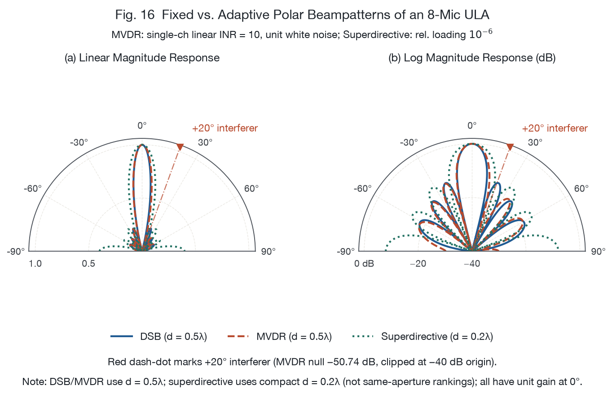
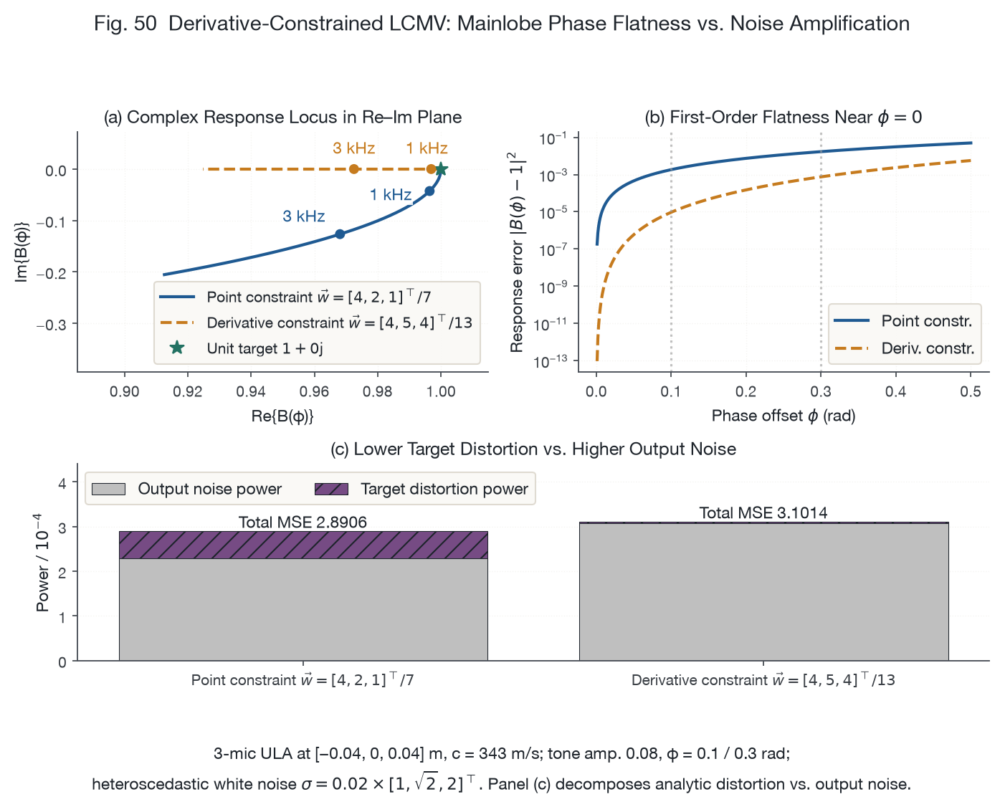
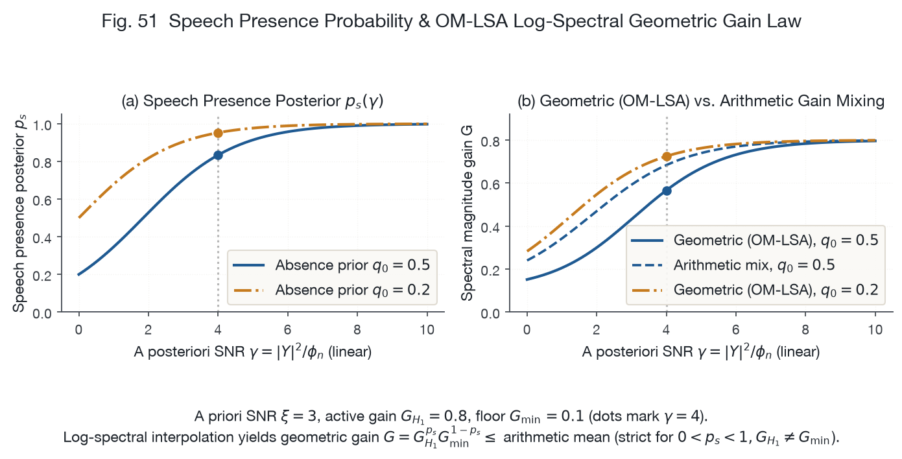

🌐 [简体中文](../chapters/05_beamforming.md) ｜ **English**

> This chapter is Chapter 5 of the main text. The main text and extended special topics comprise 16 chapters in total (Chapters 0–15, where Chapter 0 covers mathematical foundations and Chapters 12–15 are four extended special topics), accompanied by Appendices A and B. This chapter can be read independently; use the navigation bar below for the preceding and following chapters.
>
> Overview Home: [00_overview.md](00_overview.md) | Previous: [04_doa-estimation.md](04_doa-estimation.md) | Next: [06_aec.md](06_aec.md)

---

## 5. Beamforming

### 5.1 Unified Problem Formulation

Begin with a direct acoustic fact: the same spoken phrase arrives at different microphones at slightly different instants. Summing channels raw causes high-frequency components to cancel out of phase; compensating those propagation delays before summing aligns target speech from the desired direction constructively in phase, while interference and reflections from other angles remain unaligned and are attenuated. That is the physical essence of beamforming.

In the Short-Time Fourier Transform (STFT) domain, stack the $M$ complex microphone spectra at frame $n$ and frequency bin $k$ into a column vector $\vec x(k,n)\in\mathbb C^{M\times1}$, and let $\vec w(k,n)\in\mathbb C^{M\times1}$ be the complex spatial filter weight vector of equal length. Denoting Hermitian conjugate transpose by superscript $H$ (for complex inner products and Cauchy–Schwarz, see [Chapter 0 §0.3](00_math-foundations.md#sec-0-3)), the scalar complex beamformer output at $(k,n)$ is

$$y(k,n) = \vec{w}^H(k,n)\,\vec{x}(k,n).\tag{5-1}$$

This chapter follows Chapter 2's geometry and phase conventions: on a Uniform Linear Array (ULA), Microphone 1 sits at the left origin $x_1=0$ and subsequent sensors sit along $+x$ at spacing $d$; azimuth $\theta$ is measured clockwise from broadside $+y$ toward $+x$, so positive-angle sources lie on the $+x$ side and unit direction vector $\vec u$ points from the array toward the source. With arrival-time difference $\tau_{ij}=t_i-t_j$, a positive-angle far-field plane wave reaches right-hand elements earlier ($\tau_{21}=-d\sin\theta/c$); referenced to Microphone 1, the $m$-th component ($m=1,\ldots,M$) of the free-field steering vector is

$$a_m(f,\theta)=e^{+\mathrm{j}2\pi f(m-1)d\sin\theta/c}.\tag{5-2}$$

Single-bin derivations below suppress $(k,n)$ or $f$. Because Eq. (5-1) fixes the conjugate inner product $y=\vec w^H\vec x$, the complex coefficient actually multiplying channel observation $x_m$ is $w_m^*$: for equal-weight delay-and-sum $\vec w=\vec a/M$, $w_m^*=a_m^*/M$ exactly cancels the phase advance of $a_m$. Every sign and conjugation rule in this chapter strictly obeys this convention.

The first half of this chapter revolves around a unified constrained optimization principle: minimize noise or interference output power while preserving unit distortionless response ($\vec{w}^H\vec{a}(\theta_0)=1$) in desired direction $\theta_0$—Delay-and-Sum (DSB), Superdirective, Minimum Variance Distortionless Response (MVDR), and Linearly Constrained Minimum Variance (LCMV) differ solely in their assumed noise spatial correlation model or number of constraints. Multichannel Wiener Filtering (MWF) instead minimizes waveform mean-square error, and Generalized Eigenvalue (GEV) beamforming maximizes output SNR, as developed in later sections. Frequent acronyms in this chapter are summarized below:

| Acronym | Full Term | Role in This Chapter |
|---|---|---|
| SCM | Spatial Covariance Matrix | Describes per-channel powers and inter-channel spatial correlations |
| RTF | Relative Transfer Function | Ratio of target acoustic transfer functions across microphones relative to a reference microphone |
| MPDR / MVDR | Minimum Power / Minimum Variance Distortionless Response | Distortionless beamformers built from total covariance $\mathbf R_{xx}$ vs. noise-only covariance $\mathbf R_{nn}$ |
| VAD / SPP | Voice Activity Detection / Speech Presence Probability | Frame-level speech decision / per-time-frequency soft speech presence probability |
| INR | Interference-to-Noise Ratio | Power ratio of directional interference to single-mic uncorrelated white noise |
| LMS / NLMS / RLS | Least Mean Squares / Normalized LMS / Recursive Least Squares | Unconstrained adaptive recursive filter update algorithms |
| ABM | Adaptive Blocking Matrix | Target-blocking matrix adapted online to track observed statistics |

Practical acoustic backgrounds are decomposed into three canonical spatial correlation models:

- **Spatially white noise**: microphone electronic thermal noise, preamp noise floor, and local uncorrelated perturbations, $\mathbf R_{nn}=\phi_n\mathbf I$ (resilience against such noise and sensor mismatch is quantified by White Noise Gain, WNG); outdoor wind noise arises from local pressure turbulence near the windscreen with correlation scales far shorter than acoustic wavelengths and likewise behaves closer to spatially white noise (see Corcos turbulent wind modeling in [Chapter 14 §14.8](14_spatial-wearable-arrays.md#sec-14-8)).
- **Isotropic diffuse noise**: late room reverberation or ambient background mixed uniformly across directions via repeated wall reflections, $\mathbf R_{\mathrm{diff}}=\phi_d\mathbf\Gamma$. As proved by spherical integration in [Chapter 0 §0.7.1](00_math-foundations.md#sec-0-7-1) Eq. (0-59), the normalized 3D spherically isotropic spatial coherence matrix has entries $[\mathbf\Gamma]_{ij}=\operatorname{sinc}(2fd_{ij}/c)$ (normalized $\operatorname{sinc}(x)=\sin(\pi x)/(\pi x)$): at low frequencies and small spacings $[\mathbf\Gamma]_{ij}\to 1$ (highly in-phase across sensors, forming the physical basis of compact differential arrays), at half-wavelength multiples $[\mathbf\Gamma]_{ij}=0$, and at high frequencies or wide spacings $\mathbf\Gamma\to\mathbf I$. For a 2D cylindrical diffuse field confined to the horizontal plane, the coherence becomes the zeroth-order cylindrical Bessel function $J_0(2\pi fd_{ij}/c)$ ([Habets and Gannot, *JASA*, 2008](https://israelcohen.com/wp-content/uploads/2018/05/JASA_Nov2008.pdf)).
- **Directional point interference**: competing talkers or localized sources; a single point interferer contributes rank-$1$ covariance $\phi_i\vec a(\theta_i)\vec a^H(\theta_i)$, whose off-diagonal phase structure allows adaptive beamformers to place a null toward $\theta_i$.

Following [Chapter 2 §§2.6.3–2.6.4](02_basics-signal-model.md#sec-2-6-3), the White Noise Gain (WNG) and diffuse-field Directivity Factor $Q$ (and Directivity Index, DI) of any weight $\vec w$ for desired steering vector $\vec a$ are

$$\begin{aligned}
G_{\mathrm{WNG}}&=\frac{|\vec{w}^H\vec{a}|^2}{\vec{w}^H\vec{w}},\qquad
\mathrm{WNG}_{\mathrm{dB}}=10\log_{10}G_{\mathrm{WNG}},\\
Q&=\frac{|\vec{w}^H\vec{a}|^2}{\vec{w}^H\mathbf{\Gamma}\vec{w}},\qquad
\mathrm{DI}=10\log_{10}Q.
\end{aligned}\tag{5-3}$$

Under the distortionless constraint $\vec w^H\vec a=1$, $G_{\mathrm{WNG}}=1/\|\vec w\|_2^2$ is governed directly by weight norm: the larger the weights grow, the more severely sensor self-noise and channel amplitude/phase mismatches are amplified.

#### Time-Domain Filtering and Frequency-Domain Weights

Core derivations in this chapter live in the narrowband frequency domain. For broadband speech, systems either apply per-bin STFT weights with overlap-add (§2.5) or pass each channel through a multi-tap time-domain FIR filter before summing—a **filter-and-sum** architecture (exemplified by [Frost, *Proc. IEEE*, 1972](https://doi.org/10.1109/PROC.1972.8817) in §5.5.2).

Mapping per-bin complex weights back to a realizable causal time-domain system obeys three physical constraints: (i) real impulse responses require conjugate symmetry between positive and negative frequencies; (ii) finite-DFT pointwise multiplication must avoid circular-convolution wrap-around (see [Chapter 2 E02-14](02_basics-signal-model.md#e02-14)); (iii) compensating propagation lag requires introducing a uniform **causal modeling reference delay** ([Grimm et al., *EURASIP JASP*, 2016, §5.1](https://doi.org/10.1186/s13634-016-0375-6)). For example, at $f_s=16\ \mathrm{kHz}$ with $x_1[n]=s[n]$ and $x_2[n]=s[n-8]$, reserving an $8$-sample ($0.5\ \mathrm{ms}$) reference delay enables causal output $y[n]=(x_1[n-8]+x_2[n])/2=s[n-8]$; in discrete frequency this multiplies by linear phase $e^{-\mathrm{j}8\Omega_{\mathrm{d}}}$ ($\Omega_{\mathrm{d}}=2\pi f/f_s$), leaving steady-state magnitude unchanged while shifting the waveform, so waveform MSE evaluations must declare whether this fixed latency has been removed.

Furthermore, oblique incidence generally produces fractional sample delays, so broadband time-domain pre-alignment relies on **fractional-delay FIR filters** (such as windowed $\operatorname{sinc}$ filters or continuously tunable Farrow polynomial interpolators) to avoid high-frequency cancellation from integer rounding or two-point linear interpolation (see [Chapter 2 E02-20](02_basics-signal-model.md#e02-20)), or jointly designs **frequency-invariant (constant-beamwidth)** filterbanks across subbands to prevent sidelobe coloration.

### 5.2 Delay-and-Sum Beamformer (DSB): Aligning Everyone Before Singing in Unison

Delay-and-Sum requires no online noise statistics; it aligns channel phases to desired steering vector $\vec a(\theta_0)$ and averages equally:

$$\vec{w}_{\mathrm{DSB}} = \frac{1}{M}\vec{a}(\theta_0).\tag{5-4}$$

For unit-modulus steering ($|a_m|=1$), Eq. (5-4) satisfies $\vec w_{\mathrm{DSB}}^H\vec a(\theta_0)=1$; under near-field amplitude decay or unequal sensor gains ($|a_m|\ne 1$), the unit-distortionless spatial matched filter generalizes to $\vec a/\|\vec a\|_2^2$.

#### Dual-Microphone Delay-and-Sum Hand Calculation

Take two omnidirectional microphones spaced by $d=4\ \mathrm{cm}$ at $f=1\ \mathrm{kHz}$, $\theta_0=30^\circ$, and $c=343\ \mathrm{m/s}$:

1. Geometric delay $\Delta\tau=d\sin 30^\circ/c=0.02/343\approx 58.3\ \mu\mathrm{s}$, propagation phase shift $\Delta\phi=2\pi f\Delta\tau\approx 0.366\ \mathrm{rad}$ ($21.0^\circ$);
2. Mic 2 arrives first, $\tau_{21}=-58.3\ \mu\mathrm{s}$, giving steering vector $\vec a=[1,\,e^{+\mathrm{j}0.366}]^\top$ and DSB weights $\vec w_{\mathrm{DSB}}=\vec a/2$, verifying $\vec w_{\mathrm{DSB}}^H\vec a=1$;
3. In $y=\vec w^H\vec x$, Mic 2 is multiplied by $w_2^*=0.5e^{-\mathrm{j}0.366}$ (delaying it by $58.3\ \mu\mathrm{s}$) for in-phase addition; under i.i.d. equal-variance white noise, target power stays $1$ while noise power halves to $0.5^2+0.5^2=0.5$, lifting output SNR by $10\log_{10}2\approx 3.01\ \mathrm{dB}$.

#### Array Factor, Sidelobes, and the White-Noise Gain Ceiling

Letting $\psi=(2\pi d/\lambda)(\sin\theta-\sin\theta_0)$ be the residual adjacent-element phase difference, the finite geometric series in [Chapter 2 §§2.6.1–2.6.5](02_basics-signal-model.md#sec-2-6-1) gives the unit-response DSB ULA beampattern:

$$B_{\mathrm{DSB}}(\psi)=e^{\mathrm{j}(M-1)\psi/2}\frac{\sin(M\psi/2)}{M\sin(\psi/2)}.\tag{5-5}$$

Key engineering properties of Eq. (5-5) (full derivations and geometric proofs in [Chapter 2 §2.6](02_basics-signal-model.md#sec-2-6)):

- **Mainlobe and grating lobes**: the first null sits at $\psi=2\pi/M$, giving large-array broadside half-power beamwidth $\Delta\theta_{3\mathrm{dB}}\approx 0.886\lambda/(Md\cos\theta_0)$; whenever $d>\lambda/2$ admits $\psi=2\pi l$ ($l\ne 0$) inside the visible region, unit-magnitude spatial-aliasing grating lobes appear. For small spacings and tiny arrays, solve $|B_{\mathrm{DSB}}(\psi)|^2=1/2$ directly: e.g., a broadside $2$-mic pair at $d=\lambda/8$ has minimum normalized power $\cos^2(\pi/8)\approx 0.854$ ($-0.69\ \mathrm{dB}$) over all $|\theta|\le 90^\circ$, with neither nulls nor $-3\ \mathrm{dB}$ points.
- **Finite-$M$ first sidelobe level and window tapering**: uniform weighting approaches $-13.26\ \mathrm{dB}$ first sidelobe only as $M\to\infty$; evaluating Eq. (5-5) directly gives first sidelobe peaks of $-9.54\ \mathrm{dB}$, $-11.30\ \mathrm{dB}$, $-12.80\ \mathrm{dB}$, and $-13.15\ \mathrm{dB}$ for $M=3,4,8,16$ ($M=2$ has no sidelobe peak). To suppress sidelobes, apply Hann or equiripple **Dolph–Chebyshev** tapering ([Dolph, *Proc. IRE*, 1946](https://doi.org/10.1109/JRPROC.1946.225956)), remembering when calling [SciPy `chebwin`](https://docs.scipy.org/doc/scipy/reference/generated/scipy.signal.windows.chebwin.html) to divide its default peak-normalized coefficients by their sum $\sum w_m$ to maintain unit target gain.
- **Hard WNG ceiling $G_{\mathrm{WNG}}\le M$**: for unit-modulus steering ($\|\vec a\|_2^2=M$) and any distortionless linear weight $\vec w^H\vec a=1$, Cauchy–Schwarz $1=|\vec w^H\vec a|^2\le M\|\vec w\|_2^2$ gives $G_{\mathrm{WNG}}=1/\|\vec w\|_2^2\le M$, with equality if and only if $\vec w=\vec w_{\mathrm{DSB}}$ (see [Chapter 2 §2.6.4](02_basics-signal-model.md#sec-2-6-4)). Every attempt to carve nulls or narrow the low-frequency mainlobe necessarily surrenders part of $G_{\mathrm{WNG}}$.

The $3.01\ \mathrm{dB}$ gain above requires **uncorrelated channel noise**. Listen in order to these four $16\ \mathrm{kHz}$, $2\ \mathrm{s}$, common-gain synthetic clips (aligned target, per-channel noise standard deviation $0.07$; lower playback volume first):

- [Aligned Target Reference](../codes/chapters/ch05/audio/correlation_reference.wav) | [Single-Mic Noisy Observation](../codes/chapters/ch05/audio/correlation_single.wav) | [2-Mic Average, Independent Noise ($3.01\ \mathrm{dB}$ Reduction)](../codes/chapters/ch05/audio/correlation_independent.wav) | [2-Mic Average, Identical Noise ($0\ \mathrm{dB}$ Gain)](../codes/chapters/ch05/audio/correlation_common.wav)

In summary, DSB attains the maximum possible WNG under accurate steering and spatially white noise with zero ill-conditioning risk and minimal compute, making it the universal fallback baseline; however, it becomes nearly omnidirectional at low frequencies where aperture is much smaller than wavelength, and cannot steer nulls at unknown strong interferers.

### 5.3 Superdirective Beamforming: The WNG–DI Trade-Off

Because low-frequency diffuse noise is highly correlated across closely spaced microphones ($[\mathbf\Gamma]_{ij}\to 1$), minimizing spherical diffuse-field output noise power $\vec w^H\mathbf\Gamma\vec w$ subject to $\vec w^H\vec a=1$ directly maximizes Directivity Factor $Q$ (and DI). This is **Superdirective beamforming**—mathematically equivalent to MVDR with noise covariance $\mathbf\Gamma$ (full Lagrange derivation in §5.4):

$$\begin{aligned}
\min_{\vec w}\;&\vec w^H\mathbf\Gamma\vec w,\qquad
\text{s.t.}\;\vec w^H\vec a=1,\\
\vec w_{\mathrm{SD}}&=(\vec a^H\mathbf\Gamma^{-1}\vec a)^{-1}
\mathbf\Gamma^{-1}\vec a.
\end{aligned}\tag{5-6}$$

As $f\to 0$ or spacing vanishes, $\mathbf\Gamma\to\vec 1\vec 1^\top$ degenerates into a rank-$1$ singular matrix. In the small-spacing limit $d/\lambda\to 0$, **Uzkov's theorem (1946)** proves that an $M$-element isotropic ULA steered to **endfire** ($\theta_0=\pm 90^\circ$) in a 3D spherical diffuse field approaches maximum directivity factor $Q_{\max}=M^2$ ($\mathrm{DI}_{\max}=20\log_{10}M\ \mathrm{dB}$, e.g., $Q_{\max}=4\leftrightarrow 6.02\ \mathrm{dB}$ for a 2-mic hypercardioid). The bound follows cleanly from Legendre polynomials: as $d/\lambda\to 0$, finite differences along an $M$-element endfire ULA synthesize all degree-$\le(M-1)$ polynomials in $\cos\varphi$, spanned by $\{P_n(\cos\varphi)\}_{n=0}^{M-1}$ with $P_n(1)=1$ and $\frac{1}{2}\int_0^\pi P_n(\cos\varphi)P_m(\cos\varphi)\sin\varphi\,\mathrm{d}\varphi=\frac{1}{2n+1}\delta_{nm}$; expanding $D(\varphi)=\sum_{n=0}^{M-1}c_n P_n(\cos\varphi)$ and applying Cauchy–Schwarz yields

$$Q=\frac{\left|\sum_{n=0}^{M-1}c_n\right|^2}{\sum_{n=0}^{M-1}\frac{|c_n|^2}{2n+1}}\le\sum_{n=0}^{M-1}(2n+1)=M^2.$$

Note that **broadside limits sit far below $M^2$** (a symmetric 2-mic broadside pair achieves only $Q=1$, see Worked Example 5-1 Step 2). Extracting extra low-frequency directivity requires aggressive out-of-phase subtraction between adjacent channels, causing weight norms to explode and $G_{\mathrm{WNG}}$ to plunge deeply negative—so practical designs always apply diagonal loading or a WNG lower bound.

Notice also an elegant **acoustic reciprocity dual—transmit-side Acoustic Contrast Control (ACC; [Choi and Kim, *JASA*, 2002](https://doi.org/10.1121/1.1456926))**: in personal sound zones (e.g., automotive cabins), optimizing $M$ loudspeaker weights $\vec q$ to maximize bright-to-dark acoustic potential-energy ratio $\frac{\vec q^H\mathbf R_B\vec q}{\vec q^H\mathbf R_D\vec q}\iff\mathbf R_B\vec q=\lambda_{\max}\mathbf R_D\vec q$ reduces identically to Eq. (5-6) when the bright zone is a single far-field direction ($\mathbf R_B=\vec a\vec a^H$) and the dark zone is the full sphere ($\mathbf R_D=\mathbf\Gamma$); surging low-frequency loudspeaker drive current (array effort $\|\vec q\|_2^2$) is the exact reciprocal mirror of low-frequency WNG collapse on receive.

#### Worked Example 5-1: Superdirective Weights and White-Noise Gain

**Inputs and convention**: A compact $2$-mic ULA at $d=0.05\lambda$, with 3D spherical diffuse coherence $\rho=\operatorname{sinc}(0.1)\approx 0.9836316$; intermediates kept in double precision, displayed to four decimals.

1. **Ill-conditioning of $\mathbf\Gamma$**: $\det\mathbf\Gamma=1-\rho^2\approx 0.0325$, eigenvalues $1.9836$ and $0.0164$ (condition number $\kappa_2\approx 121$), and $\mathbf\Gamma^{-1}\approx\begin{bmatrix}30.80&-30.29\\-30.29&30.80\end{bmatrix}$.
2. **Broadside degeneration ($\theta_0=0^\circ$)**: $\vec a_0=[1,1]^\top$ is already a symmetric eigenvector of $\mathbf\Gamma$, so $\vec w_{\mathrm{SD}}=[0.5,0.5]^\top=\vec w_{\mathrm{DSB}}$, giving $\mathrm{WNG}_{\mathrm{dB}}\approx +3.01\ \mathrm{dB}$ and $Q=2/(1+\rho)\approx 1.008$ ($\mathrm{DI}\approx +0.04\ \mathrm{dB}$).
3. **Endfire solution ($\theta_0=90^\circ$)**: $\psi=0.1\pi\approx 0.3142\ \mathrm{rad}$, $\vec a=[1,\,0.9511+0.3090\mathrm{j}]^\top$; denominator $Q=\vec a^H\mathbf\Gamma^{-1}\vec a\approx 3.9737$, giving $\vec w_{\mathrm{SD}}\approx[0.5000-2.3559\mathrm{j},\,-0.2525+2.3951\mathrm{j}]^\top$ ($|w_1|=|w_2|\approx 2.41$).
4. **Large-number cancellation mechanism**: $w_1^*a_1\approx 0.5000+2.3559\mathrm{j}$ and $w_2^*a_2\approx 0.5000-2.3559\mathrm{j}$ rely on huge opposite imaginary parts canceling to yield unit response $1$.
5. **Evaluating $\mathrm{WNG}_{\mathrm{dB}}$ and $\mathrm{DI}$**: $\|\vec w_{\mathrm{SD}}\|_2^2\approx 11.60\implies\mathrm{WNG}_{\mathrm{dB}}\approx\mathbf{-10.6\ dB}$, buying $Q\approx 3.9737\implies\mathrm{DI}\approx +5.99\ \mathrm{dB}$ (hugging the $6.02\ \mathrm{dB}$ two-mic ceiling). By comparison, endfire DSB achieves $\mathrm{WNG}_{\mathrm{dB}}=+3.01\ \mathrm{dB}$ and $\vec w_{\mathrm{DSB}}^H\mathbf\Gamma\vec w_{\mathrm{DSB}}=(1+\rho\cos 0.1\pi)/2\approx 0.9677\implies Q\approx 1.033$, i.e., **$\mathrm{DI}\approx +0.14\ \mathrm{dB}$**.
6. **Gain-mismatch amplification**: a $+1\%$ amplitude error on Mic 2 ($\vec a_{\mathrm{mis}}=[1,1.01e^{+\mathrm{j}0.3142}]^\top$) shifts the superdirective output to $1.0050-0.0236\mathrm{j}$—a $2.41\%$ error, nearly $5\times$ DSB's $0.5\%$ deviation (tight bound in [E05-03](#e05-03)).
7. **Sweeping $d/\lambda$ at endfire ($90^\circ$)**:

| Element Spacing $d$ | $0.5\lambda$ | $0.1\lambda$ | $0.05\lambda$ | $0.02\lambda$ | $0.01\lambda$ |
|---|---|---|---|---|---|
| Per-Channel Weight Modulus $\lvert w_i\rvert$ | $0.50$ | $1.24$ | $2.41$ | $5.98$ | $11.94$ |
| $\mathrm{WNG}_{\mathrm{dB}}$ | $+3.0\ \mathrm{dB}$ | $-4.9\ \mathrm{dB}$ | $-10.6\ \mathrm{dB}$ | $-18.5\ \mathrm{dB}$ | $-24.6\ \mathrm{dB}$ |
| $\mathrm{DI}$ | $+3.0\ \mathrm{dB}$ | $+5.9\ \mathrm{dB}$ | $+6.0\ \mathrm{dB}$ | $+6.0\ \mathrm{dB}$ | $+6.0\ \mathrm{dB}$ |

Below $d=0.05\lambda$, DI is already saturated at $6.02\ \mathrm{dB}$, while every halving of spacing (or octave drop in frequency) slashes $\mathrm{WNG}_{\mathrm{dB}}$ by another $\approx 6\ \mathrm{dB}$.

**How to read Figure 15**: Plots a wideband scan from $100$ to $8000\ \mathrm{Hz}$ on a logarithmic frequency axis for a $6$-mic UCA (radius and adjacent chord both $4\ \mathrm{cm}$, steered toward $+x$, $\theta_0=90^\circ$, $c=343\ \mathrm{m/s}$), contrasting DSB (solid blue) against superdirective with $10^{-6}$ relative diagonal loading (dashed red, evaluated against unloaded true $\mathbf\Gamma$):

- **Left panel `(a) Spatially white noise`**: DSB holds flat at $10\log_{10}6\approx 7.78\ \mathrm{dB}$; the dashed red curve plunges to $-43.72\ \mathrm{dB}$ at $100\ \mathrm{Hz}$ (with an inflection near $300$–$400\ \mathrm{Hz}$ as loading crosses higher-order small eigenvalues of $\mathbf\Gamma$), climbs steadily, crosses the $0\ \mathrm{dB}$ single-mic reference at roughly **$2.37\ \mathrm{kHz}$ ($\approx 2.4\ \mathrm{kHz}$)**, and merges with DSB above $4\ \mathrm{kHz}$.
- **Right panel `(b) 3D isotropic diffuse noise`**: DSB starts at just $0.02\ \mathrm{dB}$ at $100\ \mathrm{Hz}$, peaks around $8.20\ \mathrm{dB}$ near $4.27\ \mathrm{kHz}$, and dips from sidelobes; superdirective already reaches $8.62\ \mathrm{dB}$ at $100\ \mathrm{Hz}$, sustains a $>10.5\ \mathrm{dB}$ plateau across the $400$–$1500\ \mathrm{Hz}$ core speech band, and converges naturally to DSB at high frequencies.

Before deployment, run four mandatory checks on computed weights: (i) $\mathrm{WNG}_{\mathrm{dB}}$ margin; (ii) $2$-norm condition number $\kappa_2=\lambda_{\max}/\lambda_{\min}$ of the inverted matrix; (iii) high-SPL peak headroom and clipping rate; (iv) Monte Carlo random amplitude/phase mismatch sweeps based on component tolerances to bound gain ripple and null drift.

#### 5.3.1 Differential Microphone Arrays: From First-Order Cardioid to Higher-Order Designs

Earbuds, smart glasses, and compact speakers frequently employ **Differential Microphone Arrays (DMAs)** that combine tightly spaced subtraction, internal delay, and frequency equalization to synthesize spatial-gradient patterns. Consider an endfire pair along $+x$ separated by $d$ (front Mic 1 at $x=0$, rear Mic 2 at $x=d$) with axial angle $\varphi\in[0,\pi]$ from front endfire ($\varphi=0$ front, $\varphi=180^\circ$ rear) and propagation delay $\tau_p(\varphi)=(d/c)\cos\varphi$. Setting $y(t)=x_1(t)-g\,x_2(t-\tau)$ with $g=1$ and internal delay $\tau=\alpha T$ ($T=d/c$, dimensionless delay ratio $\alpha\in[0,1]$), first-order Taylor expansion for $\kappa d\ll 1$ and normalizing on-axis gain yields the closed-form first-order DMA frequency response, frequency-invariant low-frequency pattern, and spherical diffuse directivity factor ([Elko and Pong, *ICASSP*, 1997](https://doi.org/10.1109/ICASSP.1997.599609)):

$$\begin{aligned}
H(\omega,\varphi)&=1-g\,e^{-\mathrm{j}\omega[\tau+\tau_p(\varphi)]}
\approx\mathrm{j}\kappa d(\alpha+\cos\varphi)\quad(g=1,\,\kappa d\ll 1),\\
D(\varphi)&=\frac{\alpha+\cos\varphi}{\alpha+1},\qquad
\varphi_{\mathrm{null}}=\arccos(-\alpha),\qquad
Q(\alpha)=\frac{(\alpha+1)^2}{\alpha^2+1/3}.
\end{aligned}\tag{5-7}$$

Here the directivity factor $Q(\alpha)$ follows directly by inverting the spherical average power integral (substituting $u=\cos\varphi,\ \mathrm{d}u=-\sin\varphi\,\mathrm{d}\varphi$):

$$\begin{aligned}
\frac{1}{2}\int_0^\pi D^2(\varphi)\sin\varphi\,\mathrm{d}\varphi
&=\frac{1}{2(\alpha+1)^2}\int_{-1}^{1}(\alpha+u)^2\,\mathrm{d}u
=\frac{\alpha^2+1/3}{(\alpha+1)^2},\\
Q(\alpha)&=\frac{(\alpha+1)^2}{\alpha^2+1/3}.
\end{aligned}$$

Eq. (5-7) directly characterizes the four classical first-order patterns (solving $\mathrm{d}Q/\mathrm{d}\alpha=0$ yields hypercardioid $\alpha=1/3$ achieving the two-mic Uzkov bound $Q_{\max}=4$; maximizing the Front-to-Back Ratio $\mathrm{FBR}=\frac{\int_0^{\pi/2}D^2\sin\varphi\,\mathrm{d}\varphi}{\int_{\pi/2}^\pi D^2\sin\varphi\,\mathrm{d}\varphi}=\frac{\alpha^2+\alpha+1/3}{\alpha^2-\alpha+1/3}$ yields **supercardioid $\alpha=1/\sqrt 3$** with linear power ratio $\mathrm{FBR}=7+4\sqrt3\approx13.928$, or $10\log_{10}\mathrm{FBR}\approx11.44\ \mathrm{dB}$):

| First-Order Pattern | Delay Ratio $\alpha$ | Null Axial Angle $\varphi_{\mathrm{null}}$ | Spherical Directivity $Q$ | Directivity Index $\mathrm{DI}$ | Primary Design Criterion |
|---|---:|---:|---:|---:|---|
| Dipole (Figure-8) | $0$ | $90.00^\circ$ | $3$ | $4.77\ \mathrm{dB}$ | Pure pressure gradient, broadside null |
| Hypercardioid | $1/3$ | $109.47^\circ$ | **$4$** | **$6.02\ \mathrm{dB}$** | Maximizes 3D spherical diffuse $Q$ |
| Supercardioid | $1/\sqrt 3$ | $125.26^\circ$ | $2+\sqrt 3\approx 3.732$ | $5.72\ \mathrm{dB}$ | Maximizes Front-to-Back power Ratio (FBR) |
| Cardioid | $1$ | $180.00^\circ$ | $3$ | $4.77\ \mathrm{dB}$ | Broad rear null (unidirectional pickup) |

Four physical effects dominate real-world first-order DMA deployment:

1. **$+6\ \mathrm{dB/oct}$ high-pass slope and equalizer self-noise boost**: the unequalized first-order weights $\vec w_{\mathrm{raw}}=[1,\,-e^{+\mathrm{j}\omega\tau}]^\top$ have fixed squared norm $\|\vec w_{\mathrm{raw}}\|_2^2=2$, while on-axis gain $H(\omega,0)\approx\mathrm{j}\kappa d(1+\alpha)$ rises linearly with frequency ($+6.02\ \mathrm{dB/oct}$). Substituting into Eq. (5-3) gives the low-frequency white-noise gain

    $$\begin{aligned}
    G_{\mathrm{WNG}}&=\frac{|H(\omega,0)|^2}{2}\approx\frac{1}{2}(1+\alpha)^2(\kappa d)^2\\
    &=2\pi^2(1+\alpha)^2\left(\frac{d}{\lambda}\right)^2,
    \end{aligned}$$

    so applying the matching $1/(\mathrm{j}\omega)$ low-frequency integrator to flatten on-axis gain to unity boosts uncorrelated self-noise power as $1/G_{\mathrm{WNG}}\propto(\lambda/d)^2$—a $4\times$ ($+6\ \mathrm{dB}$) jump per descending octave, mandating gain capping and high-pass roll-off near the lower speech band edge ($100$–$150\ \mathrm{Hz}$).

2. **Proximity Effect and reverberant DI degradation**: the derivation above assumes far-field plane waves; when a talker's mouth sits close to an earbud or handheld mic ($r\sim 10$–$20\ \mathrm{cm}$ with $\kappa r\lesssim 1$), the spherical-wave pressure gradient $\frac{\partial}{\partial r}\big(\frac{e^{-\mathrm{j}\kappa r}}{r}\big)=-\big(\mathrm{j}\kappa+\frac{1}{r}\big)\frac{e^{-\mathrm{j}\kappa r}}{r}$ adds a range-dependent near-field $1/r$ term alongside far-field $\mathrm{j}\kappa$, giving close-talk low frequencies an extra bass lift $\propto\sqrt{1+1/(\kappa r)^2}\sim 1/(\kappa r)$ relative to far-field noise. In headsets and close-talk telephony this naturally offsets the $+6\ \mathrm{dB/oct}$ roll-off and widens close-talk SNR over distant noise, while also inducing bass timbre shifts as mouth distance changes; conversely, inside reverberant rooms, strong early reflections entering inside the mainlobe routinely pull measured effective DI well below free-field theoretical DI.
3. **MEMS acoustic gasket-leakage phase mismatch**: at $d=1$–$2\ \mathrm{cm}$ and $200\ \mathrm{Hz}$, true acoustic phase difference $\kappa d$ is only $2^\circ$–$4^\circ$, so a tiny gasket leak introducing a first-order high-pass phase shift of $3^\circ$–$15^\circ$ overwhelms the acoustic path difference and severely degrades the rear null ([E05-16](#e05-16) quantifies how a $5^\circ$ leak lifts rear response $+1.52\ \mathrm{dB}$ above the nominal unit front response).
4. **Single-frequency check and higher-order trade-offs**: for $d=2\ \mathrm{cm}$, $c=343\ \mathrm{m/s}$, cardioid $\alpha=1$ ($T\approx 58.31\ \mu\mathrm{s}$), at $500\ \mathrm{Hz}$ the nominal on-axis magnitude is $|H_f|=2\sin(\kappa d)\approx 0.3643$, equalized $\mathrm{WNG}_{\mathrm{dB}}=10\log_{10}(|H_f|^2/2)\approx -11.78\ \mathrm{dB}$, and a $1\%$ gain mismatch fills the rear null to $-31.23\ \mathrm{dB}$ relative to the nominal on-axis response; at $\kappa d=\pi$ ($\approx 8.58\ \mathrm{kHz}$) on-axis comb cancellation sets the upper band edge. Cascading $N$-th-order differentials (e.g., second-order hypercardioid $Q_{\max}=9\leftrightarrow 9.54\ \mathrm{dB}$) reduces unequalized low-frequency on-axis gain to $\mathcal O((\kappa d)^N)$, so equalizing to unity scales white-noise output power as $(\lambda/d)^{2N}$ ($+6N\ \mathrm{dB/oct}$; for systematic matrix and white-noise-regularized DMA design, see [Elko, 2004](https://doi.org/10.1007/1-4020-7769-6_2) and [Benesty and Chen, Springer, 2013](https://doi.org/10.1007/978-3-642-33753-6)), so practical compact arrays split bands: first-order or DSB at very low frequencies, higher-order differential in midband, and conventional beamforming at high frequencies.

**Synthesizing Broadband Frequency-Invariant Beamformers (FIB)**: Whether using DSB or band-split differentials, any fixed-aperture ULA of physical span $D$ exhibits a mainlobe whose broadside half-power beamwidth narrows inversely with frequency, $\theta_{\mathrm{HPBW}}(f)\approx 0.886\,\lambda/(D\cos\theta_0)\propto c/(fD)$. While on-axis target speech at $\theta_0$ passes with flat unit gain, any broadband source or reverberant energy arriving off-axis (in the mainlobe skirt or sidelobe region) falls well inside the wide mainlobe at low frequencies yet gets strongly attenuated at high frequencies as the mainlobe contracts—imposing an angle-dependent **low-pass spectral coloration filter** on off-axis sound. Eliminating off-axis coloration via **broadband Frequency-Invariant Beamforming (FIB)** follows two canonical synthesis routes:

1. **Continuous-aperture dilation and shading (Ward–Kennedy–Williamson principle; *JASA* 97(2):1023–1034, 1995)**: Keeping the free-field beampattern independent of frequency requires holding the electrical aperture product constant, $f\cdot D_{\mathrm{eff}}(f)=f_0 D_0$. On a continuous linear aperture along $x$, scaling a prototype spatial window $g(u)$ (defined at reference frequency $f_0$ with support $\lvert u\rvert\le D_0/2$) as $w(x,f)$ and substituting $u=(f/f_0)x$ ($\mathrm{d}u=(f/f_0)\,\mathrm{d}x$) eliminates frequency dependence identically:

    $$w(x,f)=\frac{f}{f_0}\,g\!\left(\frac{f}{f_0}x\right),\qquad B(\theta,f)=\int w^*(x,f)\,e^{+\mathrm{j}\frac{2\pi f}{c}x\sin\theta}\,\mathrm{d}x=\int g^*(u)\,e^{+\mathrm{j}\frac{2\pi f_0}{c}u\sin\theta}\,\mathrm{d}u.$$

    Discretizing onto physical sensors yields two standard realizations: **FIR filter-and-sum** (sampling $w(x_m,f)$ at sensor locations $x_m$ into per-channel FIR filters whose low-pass cutoffs narrow on outer elements so the active aperture contracts smoothly with frequency) and octave-banded **harmonic nested subarrays** sharing central elements (see [Chapter 3 §3.3.3](03_array-geometry.md#sec-3-3-3)).

2. **Convex SOCP broadband pattern matching with a WNG floor**: For arbitrary discrete or irregular geometries, one directly minimizes the worst-case complex pattern mismatch against a frequency-independent target response $B_{\mathrm{des}}(\theta)$ over an angular grid $\Theta$ at each frequency bin $f_k$, subject to distortionless and white-noise-gain constraints:

    $$\min_{\vec w(f_k)}\;\max_{\theta\in\Theta}\;\lvert\vec w^H(f_k)\vec a(\theta,f_k)-B_{\mathrm{des}}(\theta)\rvert\qquad\text{s.t.}\;\vec w^H(f_k)\vec a(\theta_0,f_k)=1,\quad \lVert\vec w(f_k)\rVert_2^2\le\frac{1}{G_{\min}}.$$

    Introducing an epigraph variable $t$ converts each per-angle bound $\lvert\vec w^H(f_k)\vec a(\theta,f_k)-B_{\mathrm{des}}(\theta)\rvert\le t$ and the weight-norm ceiling $\lVert\vec w(f_k)\rVert_2\le 1/\sqrt{G_{\min}}$ into standard second-order cone constraints solvable to global optimality in polynomial time (see [Chapter 0 §0.5.3](00_math-foundations.md#sec-0-5-3) for SOCP foundations and §5.4.1 below for robust SOCP beamforming). This formulation also exposes the **fundamental low-frequency aperture limit**: because effective aperture cannot exceed physical span $D$, once $D/\lambda\lesssim 0.5$ the array cannot passively sustain a narrow target beamwidth $B_{\mathrm{des}}(\theta)$—forcing tight pattern matching below this threshold drives $\vec w(f_k)$ into superdirective anti-phase subtraction and WNG collapse. Below $D/\lambda\lesssim 0.5$, every feasible FIB must therefore trade mainlobe width explicitly against the WNG floor.

### 5.4 Minimum Variance Distortionless Response (MVDR and MPDR)

The Minimum Variance Distortionless Response (MVDR / Capon) beamformer plugs the measured or estimated $M\times M$ noise-plus-interference spatial covariance $\mathbf R_{nn}=\mathbb{E}[\vec n\vec n^H]$ directly into the distortionless power-minimization problem:

$$\min_{\vec w}\;\vec w^H\mathbf R_{nn}\vec w,\qquad \text{s.t.}\;\vec w^H\vec a(\theta_0)=1.\tag{5-8}$$

**Four-step Lagrange-multiplier derivation** (Wirtinger calculus in [Chapter 0 §0.5](00_math-foundations.md#sec-0-5)):

1. Form real Lagrangian $L(\vec w,\lambda)=\vec w^H\mathbf R_{nn}\vec w+\lambda(1-\vec w^H\vec a)+\lambda^*(1-\vec a^H\vec w)$;
2. Using $\partial(\vec w^H\vec c)/\partial\vec w^*=\vec c$, $\partial(\vec c^H\vec w)/\partial\vec w^*=\vec 0$, and $\partial(\vec w^H\mathbf R_{nn}\vec w)/\partial\vec w^*=\mathbf R_{nn}\vec w$, set $\partial L/\partial\vec w^*=\mathbf R_{nn}\vec w-\lambda\vec a=\vec 0$, giving $\vec w=\lambda\mathbf R_{nn}^{-1}\vec a$ when $\mathbf R_{nn}\succ\mathbf 0$ (strictly speaking, whitening applies $\mathbf R_{nn}^{-1/2}$, matches in whitened space, and unwhitens back to the array domain to combine as $\mathbf R_{nn}^{-1}\vec a$);
3. Enforce $\vec w^H\vec a=1$ with positive real quadratic form $q=\vec a^H\mathbf R_{nn}^{-1}\vec a>0$, yielding $\lambda^*q=1\implies\lambda=1/q$ (when $N<M$ causes singularity, never blindly substitute the Moore–Penrose pseudoinverse; see Appendix A Exercise E16-05);
4. Substitute back for the closed-form MVDR weights (achieving minimum residual noise power $P_{n,\min}=1/q$):

$$\vec w_{\mathrm{MVDR}}=\frac{\mathbf R_{nn}^{-1}\vec a}{\vec a^H\mathbf R_{nn}^{-1}\vec a}.\tag{5-9}$$

**Essential distinction: MPDR vs. MVDR and target self-cancellation under mismatch (Van Trees, *Optimum Array Processing*, 2002)**: When clean target-free segments are unavailable and one replaces $\mathbf R_{nn}$ in Eq. (5-9) with the **total observation covariance $\mathbf R_{xx}$** (which contains target speech), the resulting filter is termed **Minimum Power Distortionless Response (MPDR)**, $\vec w_{\mathrm{MPDR}}=\frac{\mathbf R_{xx}^{-1}\vec a}{\vec a^H\mathbf R_{xx}^{-1}\vec a}$. Their behaviors diverge dramatically between matched and mismatched regimes:

- **Identical under exact steering match**: when target and noise are zero-mean uncorrelated and nominal $\vec a$ equals the true transfer vector exactly ($\mathbf R_{xx}=\mathbf R_{nn}+\phi_s\vec a\vec a^H$), every feasible weight ($\vec w^H\vec a=1$) satisfies $\vec w^H\mathbf R_{xx}\vec w=\vec w^H\mathbf R_{nn}\vec w+\phi_s$, shifting the objective by a constant $\phi_s$. Equivalently, applying the Sherman–Morrison lemma to $\mathbf R_{xx}^{-1}$ ($q=\vec a^H\mathbf R_{nn}^{-1}\vec a$) yields

    $$\begin{aligned}
    \mathbf R_{xx}^{-1}\vec a&=\left(\mathbf R_{nn}^{-1}-\frac{\phi_s\mathbf R_{nn}^{-1}\vec a\vec a^H\mathbf R_{nn}^{-1}}{1+\phi_s q}\right)\vec a\\
    &=\frac{1}{1+\phi_s q}\mathbf R_{nn}^{-1}\vec a,
    \end{aligned}$$

    where the positive scalar $(1+\phi_s q)^{-1}$ cancels identically between numerator and denominator, giving $\vec w_{\mathrm{MPDR}}=\vec w_{\mathrm{MVDR}}$.

- **Noncollinear steering-shape mismatch can cause strong-target self-cancellation**: when $\vec a_{\mathrm{true}}=\vec a+\Delta\vec a$ is not collinear with constraint $\vec a$, MPDR treats the strong target term $\phi_s\vec a_{\mathrm{true}}\vec a_{\mathrm{true}}^H$ inside $\mathbf R_{xx}$ as interference to minimize—in the stated strong-target model, increasing input SNR can strengthen cancellation and lower output SINR. A common complex-scale mismatch $\vec a_{\mathrm{true}}=c\vec a$ instead leaves the true response fixed at $c$ and does not create this spatial cancellation mechanism ([E05-08](#e05-08) computes over $43\ \mathrm{dB}$ target cancellation at input SNR $100$). This is the fundamental reason production pipelines prioritize VAD/SPP or DNN masks to estimate clean $\hat{\mathbf R}_{nn}$ rather than inverting $\hat{\mathbf R}_{xx}$ directly.

Check two special cases of Eq. (5-9): $\mathbf R_{nn}=\phi_n\mathbf I$ recovers DSB, while $\mathbf R_{nn}=\phi_d\mathbf\Gamma$ recovers Eq. (5-6) superdirective beamforming.

#### Worked Example 5-2: Numerical Derivation of a 2-Mic MVDR Beamformer

**Inputs and convention**: Half-wavelength $2$-mic ULA ($d=\lambda/2$), target at $0^\circ$ ($\vec a_0=[1,1]^\top$), interferer at $+30^\circ$ ($\vec a_i=[1,+\mathrm{j}]^\top$, power $10$), per-mic white noise variance $1$ ($\mathrm{INR}=10\ \mathrm{dB}$).

1. **Covariance and inverse**: $\mathbf R_{nn}=10\vec a_i\vec a_i^H+\mathbf I=\begin{bmatrix}11&-10\mathrm{j}\\+10\mathrm{j}&11\end{bmatrix}$, $\det\mathbf R_{nn}=121-100=21$ (eigenvalues $21,1$, condition number $21$), $\mathbf R_{nn}^{-1}=\frac{1}{21}\begin{bmatrix}11&+10\mathrm{j}\\-10\mathrm{j}&11\end{bmatrix}$.
2. **Weights**: $\mathbf R_{nn}^{-1}\vec a_0=\frac{1}{21}[11+10\mathrm{j},\,11-10\mathrm{j}]^\top$, denominator $q=22/21$ (minimum residual noise $1/q=21/22\approx 0.9545$), giving

$$\vec w_{\mathrm{MVDR}}=\frac{1}{22}\begin{bmatrix}11+10\mathrm{j}\\11-10\mathrm{j}\end{bmatrix}
\approx\begin{bmatrix}0.5000+0.4545\mathrm{j}\\0.5000-0.4545\mathrm{j}\end{bmatrix}.$$

3. **Target, interference, and WNG audit**: target response $\vec w_{\mathrm{MVDR}}^H\vec a_0=1$; interferer response $\vec w_{\mathrm{MVDR}}^H\vec a_i=(1+\mathrm{j})/22$, magnitude $\sqrt 2/22\approx 0.0643$ (**$-23.84\ \mathrm{dB}$**); output interference power $0.0413$ plus output white noise $\|\vec w\|_2^2=221/242\approx 0.9132$ equals $0.9545=1/q$ exactly; $G_{\mathrm{WNG}}=242/221\approx 1.095$ ($+0.39\ \mathrm{dB}$, conceding $2.62\ \mathrm{dB}$ relative to DSB). Why is $+30^\circ$ not an exact zero? Deepening the null further would raise white noise enough to push total output power up to $1.00>0.9545$ (the exact null sits at $+32.03^\circ$; its drift trajectory versus INR is derived in [E05-02](#e05-02)).
4. **Representative angular responses**: $0^\circ\to 0.00\ \mathrm{dB}$, $+15^\circ\to -5.05\ \mathrm{dB}$, $+30^\circ\to -23.84\ \mathrm{dB}$, $+45^\circ\to -8.62\ \mathrm{dB}$, and interference-free side $-30^\circ\to +2.61\ \mathrm{dB}$ (overshoot).

**How to read Figure 16**: Upper-hemisphere polar plots compare linear magnitude `(a)` and decibel magnitude `(b)` (clipped at $-40\ \mathrm{dB}$). On an identical $8$-mic half-wavelength aperture, DSB (solid blue) is symmetric with $-12.8\ \mathrm{dB}$ first sidelobes, whereas MVDR (dashed red, $\mathbf R_{nn}=\mathbf I+10\vec a_{20^\circ}\vec a_{20^\circ}^H$) drives the $+20^\circ$ interferer down to $-50.74\ \mathrm{dB}$ at the expense of $1$–$3\ \mathrm{dB}$ sidelobe lift on the quiet left hemisphere; dotted green shows superdirective on a much smaller $8$-mic array ($d=0.2\lambda$), whose wider mainlobe reflects having only $2/5$ the physical aperture—never rank algorithms across different apertures.

#### Diagonal Loading, WNG Constraint, and LOCATA Real-Recording Comparison

Enforcing a White Noise Gain floor $G_{\mathrm{WNG}}\ge G_{\min}$ (i.e., $\|\vec w\|_2^2\le\delta=1/G_{\min}$, feasible for $\delta\ge 1/M$ under unit-modulus steering $\|\vec a\|_2^2=M$, or generally $\delta\ge 1/\|\vec a\|_2^2$) alongside $\vec w^H\vec a=1$ via nonnegative Lagrange multiplier $\varepsilon\ge 0$ forms $\mathcal L=\vec w^H(\hat{\mathbf R}_{nn}+\varepsilon\mathbf I)\vec w-\varepsilon\delta+\lambda(1-\vec w^H\vec a)+\lambda^*(1-\vec a^H\vec w)$, showing immediately that **WNG-constrained MVDR is dual-equivalent to diagonally loaded MVDR** ([Cox, Zeskind, and Owen, *IEEE TASSP*, 1987](https://doi.org/10.1109/TASSP.1987.1165054)). By KKT complementary slackness $\varepsilon(\|\vec w\|_2^2-\delta)=0$, if the unloaded solution already satisfies $\|\vec w(0)\|_2^2\le\delta$, then $\varepsilon^\star=0$; otherwise, expanding $\hat{\mathbf R}_{nn}=\sum_{m=1}^M\lambda_m\vec u_m\vec u_m^H$ with $\alpha_m=|\vec u_m^H\vec a|^2$ and $S_k(\varepsilon)=\sum_{m=1}^M\alpha_m(\lambda_m+\varepsilon)^{-k}$ gives $\|\vec w(\varepsilon)\|_2^2=S_2/S_1^2$, whose derivative $\frac{\mathrm{d}}{\mathrm{d}\varepsilon}(S_2/S_1^2)=2(S_2^2-S_1S_3)/S_1^3\le 0$ by Cauchy–Schwarz (strictly negative whenever $\vec a$ has components on at least two distinct eigenvalues) decreases monotonically toward $1/\|\vec a\|_2^2$ (i.e., $1/M\le\delta$ for unit-modulus steering) as $\varepsilon\to\infty$, for strict budgets $\delta>1/\|\vec a\|_2^2$ with an active constraint and the stated strict-decrease condition, guaranteeing a unique finite $\varepsilon^\star>0$ on the boundary $\|\vec w(\varepsilon^\star)\|_2^2=\delta$ (closed-form inversion in [E05-04](#e05-04)).

For $\delta<1/\|\vec a\|_2^2$, the problem is infeasible. At equality, the only feasible weight is $\vec w=\vec a/\|\vec a\|_2^2$, generally reached as $\varepsilon\to\infty$ with no finite loading root. For example, the two-microphone expression $\|\vec w(\varepsilon)\|^2=1/2+50/(11+\varepsilon)^2$ always exceeds its endpoint $1/2$.

For scale invariance, this book uses the dimensionless relative diagonal-loading factor $\alpha_{\mathrm{dl}}\ge 0$ (analogous to Chapter 4 Capon's $\eta$, distinguishing it from DMA delay ratio $\alpha$ and forgetting factors):

$$\hat{\mathbf R}_{nn,\mathrm{load}}=\hat{\mathbf R}_{nn}+\alpha_{\mathrm{dl}}\,\frac{\operatorname{tr}(\hat{\mathbf R}_{nn})}{M}\mathbf I.\tag{5-10}$$

$\alpha_{\mathrm{dl}}$ forms a continuous dial between purely data-driven MVDR ($\alpha_{\mathrm{dl}}\to 0$) and purely geometric DSB ($\alpha_{\mathrm{dl}}\to\infty$): raising $\alpha_{\mathrm{dl}}$ lowers condition numbers and lifts $\mathrm{WNG}_{\mathrm{dB}}$ while shallowing interference nulls; always evaluate performance by plugging the resulting weights back into the **unloaded physical covariance**.

**Real multichannel room recording comparison (public LOCATA dataset)**: On [LOCATA dev](https://zenodo.org/records/3630471) Task 2 Recording 1 ($15$-mic $48\ \mathrm{kHz}$ DICIT array; loudspeaker A target, B competing interferer, referenced to Mic $7$), estimating $\hat{\mathbf R}_{nn}$ from B-only interval $3.48$–$3.94\ \mathrm{s}$ ($41$ frames) with $\alpha_{\mathrm{dl}}=0.1$ and applying loaded MVDR across $250$–$6000\ \mathrm{Hz}$ (raised-cosine transition to DSB, minimum WNG $\approx 4.14\ \mathrm{dB}$) produces the following $300$–$3400\ \mathrm{Hz}$ band powers on two held-out single-talker test windows (relative to Mic $7 = 0\ \mathrm{dB}$):

| Single-Talker Test Window | Delay-and-Sum vs. Mic 7 | MVDR vs. Mic 7 | MVDR vs. Delay-and-Sum |
|---|---:|---:|---:|
| A (target), $2.65$–$3.10\ \mathrm{s}$ | $-2.42\ \mathrm{dB}$ | $-3.28\ \mathrm{dB}$ | $-0.86\ \mathrm{dB}$ |
| B (interferer), $4.08$–$4.68\ \mathrm{s}$ | $-8.96\ \mathrm{dB}$ | $-16.38\ \mathrm{dB}$ | $-7.42\ \mathrm{dB}$ |

Within these single-talker scoring windows, MVDR reduces band-integrated total power relative to DSB by $7.42\ \mathrm{dB}$ in window B and $0.86\ \mathrm{dB}$ in window A. Each includes direct speech, reflections, and ambient noise. Total power alone therefore identifies neither clean-target loss nor how much of the reduction comes from dereverberation or denoising; component fidelity requires a clean reference or additional model evidence (interactive audio in the [Overview Audio Index](00_overview.md#audio-assets)).

#### 5.4.1 Robust Beamforming Methods

Practical beamformer mismatch stems from four root causes: **A. steering-vector mismatch**, **B. finite-snapshot covariance error**, **C. coherent interference / strong early reflections**, and **D. target leakage into $\hat{\mathbf R}_{nn}$ causing self-cancellation**. Beyond fixed diagonal loading, four classical hardening routes apply:

1. **Worst-case norm-ball optimization (SOCP) and Robust Capon Beamforming (RCB)**: assuming the true steering vector lies in Euclidean ball $\mathcal U=\{\vec a_0+\vec e:\|\vec e\|_2\le\epsilon\}$ around nominal $\vec a_0$, enforcing worst-case gain $|\vec w^H\vec a|\ge 1$ over $\mathcal U$ ([Vorobyov, Gershman, and Luo, *IEEE TSP*, 2003](https://doi.org/10.1109/TSP.2002.806865)) converts into convex second-order cone programming $\min\vec w^H\hat{\mathbf R}_{nn}\vec w\ \text{s.t.}\ \operatorname{Re}(\vec w^H\vec a_0)\ge 1+\epsilon\|\vec w\|_2$ (note that nominal gain exceeds $1$; hand proof in [E05-13](#e05-13)). Starting from the same spherical uncertainty set, [Li, Stoica, and Wang (*IEEE TSP*, 2003)](https://doi.org/10.1109/TSP.2003.812831) derived data-dependent adaptive diagonal loading via **Robust Capon Beamforming (RCB)** and rigorously proved that **the optimal weights of RCB and Vorobyov's worst-case SOCP differ only by a positive scalar factor** (identical normalized beampattern and output SINR, but absolute complex response scales with that factor).
2. **Eigenspace-projection beamforming ([Chang and Yeh, *IEEE TAP*, 1992](https://doi.org/10.1109/8.202711))**: orthogonally projects the nominal steering vector onto the dominant signal-plus-interference subspace $\tilde{\vec a}=\mathbf U_s\mathbf U_s^H\vec a_0$ before computing weights, curbing noise-subspace jitter and small-angle cancellation; risks dropping weak targets into the noise subspace at low SNR.
3. **Spatial-spectrum integration covariance reconstruction ([Gu and Leshem, *IEEE TSP*, 2012](https://doi.org/10.1109/TSP.2012.2194289))**: computes the Capon spectrum $\hat P(\theta)=[\vec a^H(\theta)\hat{\mathbf R}_{xx}^{-1}\vec a(\theta)]^{-1}$, excises target sector $\Theta_{\mathrm{tar}}$, and integrates over its complement $\bar\Theta=\Theta\setminus\Theta_{\mathrm{tar}}$ to reconstruct clean $\hat{\mathbf R}_{nn}=\int_{\bar\Theta}\hat P(\theta)\vec a(\theta)\vec a^H(\theta)\,\mathrm{d}\theta$, paired with QCQP online steering correction; discrete summation requires careful $\Delta\theta$ scaling and white-noise floor alignment.
4. **Forward–Backward Spatial Smoothing (FBSS)**: for Class-C coherent interferers on ULAs, subarray smoothing via [Chapter 4 §4.6](04_doa-estimation.md#sec-4-6) Eq. (4-17) restores rank ([Pillai and Kwon, 1989](https://doi.org/10.1109/29.17496)) at the expense of reduced aperture and subarray-level weighting; speech enhancement more commonly folds beneficial early reflections into the target constraint via RTF estimation.

Troubleshooting matrix (**golden rule**: every tuning change must jointly verify target distortion, output SINR, and $\mathrm{WNG}_{\mathrm{dB}}$):

| Observed Symptom | Root Cause | Primary Remedy | Alternative / Combined |
|---|---|---|---|
| DOA jitter noticeably attenuates target | A. Steering mismatch | Worst-case SOCP / RCB (set $\epsilon$ from error spread) | Derivative-constrained LCMV (§5.5) flat mainlobe |
| Performance swings across hardware batches | A. Channel mismatch | Factory calibration + SOCP / RCB | Raise diagonal loading |
| Muffled / canceled voice after noisy segments | D. Target leakage | Improve VAD/SPP and noise estimation | Eigenspace projection / spectral reconstruction |
| Ill-conditioned inverse with few snapshots | B. Estimation error | Relative diagonal loading + covariance smoothing | Reduce order or drop hard constraints |
| Deeply negative low-frequency WNG, hissy floor | Intrinsic to superdirective | WNG floor constraint & band-split loading | Lower-order DMA |

### 5.5 Linearly Constrained Minimum Variance (LCMV): Multi-Constraint, Derivative Flatness, and Binaural Fidelity

Stacking $K_c$ linearly independent constraints columnwise into full-column-rank $\mathbf C=[\vec c_1,\ldots,\vec c_{K_c}]\in\mathbb C^{M\times K_c}$ and conjugated desired responses into $\vec f\in\mathbb C^{K_c\times 1}$, minimizing $\vec w^H\mathbf R_{nn}\vec w$ subject to $\mathbf C^H\vec w=\vec f$ via vector Lagrange multipliers ($\mathbf R_{nn}\vec w=\mathbf C\vec\lambda\implies\vec\lambda=(\mathbf C^H\mathbf R_{nn}^{-1}\mathbf C)^{-1}\vec f$) yields closed-form LCMV:

$$\begin{aligned}
\mathbf G&=\mathbf C^H\mathbf R_{nn}^{-1}\mathbf C,\\
\vec w_{\mathrm{LCMV}}&=\mathbf R_{nn}^{-1}\mathbf C\mathbf G^{-1}\vec f.
\end{aligned}\tag{5-11}$$

**Conjugation trap and DOF ledger**: Actual output response is $\vec w^H\vec c_k=f_k^*$, so specifying a non-real desired response $g_k$ requires passing its conjugate $f_k=g_k^*$ into $\vec f$ (tested in [E05-01](#e05-01)). Each independent constraint consumes $1$ complex DOF, leaving $M-K_c$ nullspace dimensions for adaptive noise reduction; at $K_c=M$, $\vec w=(\mathbf C^H)^{-1}\vec f$ freezes into a fixed filter independent of $\mathbf R_{nn}$. For instance, adding a hard $+30^\circ$ null ($\mathbf C=[\vec a_0,\vec a_i],\ \vec f=[1,0]^\top$) in Worked Example 5-2 locks $\vec w_{\mathrm{LCMV}}=[0.5+0.5\mathrm{j},\,0.5-0.5\mathrm{j}]^\top$ for every $\mathbf R_{nn}\succ\mathbf 0$, carving a $-\infty\ \mathrm{dB}$ null at $+30^\circ$ while lowering $\mathrm{WNG}_{\mathrm{dB}}$ to $0\ \mathrm{dB}$ (below MVDR's $+0.39\ \mathrm{dB}$).

**First-order derivative flatness constraint and local complex-response trade-off (with Figure 50)**: Practical arrays often combine three constraint types inside $\mathbf C$: unit target gain, hard interferer nulls, and a **zero first-derivative mainlobe constraint** $\dot{\vec a}_0^H\vec w=0$ against small DOA drift. Consider a symmetric center-referenced $3$-mic ULA at $[-d,0,d]$ with dimensionless spatial phase step $\phi=2\pi fd\sin\theta/c$, steering vector $\vec a(\phi)=[e^{-\mathrm{j}\phi},1,e^{+\mathrm{j}\phi}]^\top$, broadside derivative $\vec a'(0)=[-\mathrm{j},0,+\mathrm{j}]^\top$, and unequal sensor noise $\mathbf R_{nn}=\operatorname{diag}(1,2,4)$:

- Single-constraint MVDR avoids noisy Mic 3 via asymmetric weights $\vec w_V=[4,2,1]^\top/7$, minimizing output noise to $4/7\approx 0.5714$, yet leaves a nonzero imaginary first derivative $B'_V(0)=-3\mathrm{j}/7$ in $B_V(\phi)=(2+5\cos\phi-3\mathrm{j}\sin\phi)/7$ (causing angle-dependent group-delay dispersion and $\mathcal O(\phi^2)$ complex error $|B_V(\phi)-1|^2$);
- Adding zero-derivative constraint $\mathbf C=[\vec a(0),\vec a'(0)],\ \vec f=[1,0]^\top$ enforces symmetry $w_1=w_3$, yielding $\vec w_D=[4,5,4]^\top/13$ and purely real response $B_D(\phi)=(5+8\cos\phi)/13$ with identically zero first derivative and $\mathcal O(\phi^4)$ squared error, at the cost of higher output noise $10/13\approx 0.7692$ (while nominal $G_{\mathrm{WNG}}$ actually rises from $2.333$ to $2.965$ due to more uniform weighting).

**How to read Figure 50**: Upper-left `(a)` traces complex responses in the complex plane versus $\phi$ (green star = ideal $(1,0)$): the orange zero-derivative curve glides gently along the real axis, whereas blue single-constraint MVDR bends immediately downward via $-\frac{3}{7}\mathrm{j}\phi$ (its $1\ \mathrm{kHz}/\phi=0.1$ and $3\ \mathrm{kHz}/\phi=0.3$ markers pull noticeably off $(1,0)$); upper-right `(b)` on a log scale confirms two to three orders of magnitude smaller small-angle error ($\phi^4$ vs. $\phi^2$); the bottom stacked bars compare noisy dual-tone total MSE ([E05-14](#e05-14) synthetic audio): derivative constraints slash purple target distortion by nearly $25\times$, yet taller gray noise bars nudge expected total MSE slightly up from $2.8906\times 10^{-4}$ to $3.1014\times 10^{-4}$—vividly illustrating the real trade-off between local target timbre fidelity and noisy total MSE.

For an $M_x\times M_y$ uniform rectangular planar array, steering factors as a Kronecker product $\vec a_x\otimes\vec a_y$: under separable noise $\mathbf R_x\otimes\mathbf R_y$, separable weights $\vec w_x\otimes\vec w_y$ equal joint MVDR identically while slashing complexity from $O(M^3)$ to $O(M_x^3+M_y^3)$; under a single oblique point interferer, however, separable beamformers carve full-row/column "cross-hair null troughs" that collaterally attenuate other directions along the same row or column (full hand calculation in [E05-17](#e05-17)).

**Binaural beamforming (BMVDR collapse and BLCMV)**: Smart glasses and hearing aids synthesize left and right ear outputs $Y_{\mathrm{L}}=\vec w_{\mathrm{L}}^H\vec x$ and $Y_{\mathrm{R}}=\vec w_{\mathrm{R}}^H\vec x$. Preserving only the target binaural image $\vec w_e^H\vec a=a_e$ ($e\in\{\mathrm{L},\mathrm{R}\}$) under shared $\mathbf R_{nn}$ forces single-constraint **BMVDR** weights to be collinear ($\vec w_{\mathrm{L}}=a_{\mathrm{L}}^*\vec w_0$, $\vec w_{\mathrm{R}}=a_{\mathrm{R}}^*\vec w_0$), collapsing the interaural magnitude-squared coherence of all residual background noise identically to $\mathrm{MSC}_{v_{\mathrm{L}}v_{\mathrm{R}}}\equiv 1$—pulling every ambient sound onto the target direction. To attenuate interference while preserving its spatial cue, **Binaural LCMV (BLCMV; [Hadad, Doclo, and Gannot, *IEEE/ACM TASLP*, 2016](https://sharongannot.group/wp-content/uploads/2021/04/2016030110.pdf))** adds a scaled interferer constraint with $\eta\in(0,1)$:

$$\vec w_e^H\vec a=a_e,\qquad \vec w_e^H\vec b=\eta b_e\qquad (e\in\{\mathrm{L},\mathrm{R}\}).\tag{5-12}$$

Whenever $\eta>0$ and $b_{\mathrm{L}},b_{\mathrm{R}}\ne 0$, interference is attenuated by $20\log_{10}(1/\eta)\ \mathrm{dB}$ while exactly preserving its right/left complex ratio $b_{\mathrm{R}}/b_{\mathrm{L}}$ (3-mic hand derivations and four headphone clips in [E05-18](#e05-18)–[E05-20](#e05-20); Binaural Signal Matching BSM and reference-mixing trade-offs for irregular wearable frames in [Chapter 14 §§14.5–14.7](14_spatial-wearable-arrays.md#sec-14-5)). Under a mean-square error criterion (bridging directly to §5.5.1), the **Binaural Multichannel Wiener Filter (BMWF)** and its partial noise-estimation extension (MWF-N; [Doclo et al., *Speech Communication*, 2007](https://hal.science/hal-00499178v1/document); [Cornelis et al., *IEEE TASLP*, 2010](https://doi.org/10.1109/TASL.2009.2028374)) likewise mix a scaled fraction of the reference-ear noise into the target term to trade noise reduction continuously against ambient spatial-cue preservation.

#### 5.5.1 Multichannel Wiener Filtering and the Rank-1 Target Model

When slight target attenuation in noisy bins is acceptable to achieve lower total error, the **Speech Distortion Weighted Multichannel Wiener Filter (SDW-MWF; [Doclo et al., *Speech Communication*, 2007](https://hal.science/hal-00499178v1/document))** targets the clean speech image at reference Mic $r$, $s_{\mathrm{ref}}=\vec e_r^H\vec s$ (needing no explicit steering vector), minimizing $J(\vec w)=J_s+\mu J_n$ with target distortion $J_s=(\vec w-\vec e_r)^H\mathbf R_{ss}(\vec w-\vec e_r)$, noise output $J_n=\vec w^H\mathbf R_{nn}\vec w$, and trade-off parameter $\mu>0$ (this standard convention avoids apparent $1/\mu$ singularity as $\mu\to 0^+$). Setting the Wirtinger derivative to zero, $\partial J/\partial\vec w^*=\mathbf R_{ss}(\vec w-\vec e_r)+\mu\mathbf R_{nn}\vec w=\vec 0$, yields the closed-form solution:

$$\begin{aligned}
J(\vec w)&=J_s+\mu J_n,\\
\vec w_{\mathrm{SDW}}&=(\mathbf R_{ss}+\mu\mathbf R_{nn})^{-1}\mathbf R_{ss}\vec e_r.
\end{aligned}\tag{5-13}$$

Setting $\mu=1$ under zero target–noise cross-correlation ($\mathbb{E}[\vec s\vec n^H]=\mathbf 0$) gives standard MMSE MWF; $\mu>1$ emphasizes noise reduction, $\mu<1$ favors target fidelity, and $\mu\to\infty$ drives $\vec w_{\mathrm{SDW}}\to\vec 0$ (muting output rather than approaching MVDR). Strictly under the **rank-$1$ target model** $\mathbf R_{ss}=\phi_s\vec a\vec a^H$ (with reference normalization $a_r=1$, hence $\mathbf R_{ss}\vec e_r=\phi_s\vec a$), applying the Sherman–Morrison lemma ([Chapter 0 §0.3.5](00_math-foundations.md#sec-0-3-5)) to $(\mu\mathbf R_{nn}+\phi_s\vec a\vec a^H)^{-1}$ factors high-dimensional inversion cleanly into "MVDR beamformer + scalar parametric Wiener post-filter" ([Grimm et al., 2016](https://doi.org/10.1186/s13634-016-0375-6)):

$$\begin{aligned}
(\mu\mathbf R_{nn}+\phi_s\vec a\vec a^H)^{-1}\phi_s\vec a
&=\left(\frac{1}{\mu}\mathbf R_{nn}^{-1}-\frac{\frac{\phi_s}{\mu^2}\mathbf R_{nn}^{-1}\vec a\vec a^H\mathbf R_{nn}^{-1}}{1+\frac{\phi_s}{\mu}q}\right)\phi_s\vec a\\
&=\frac{\phi_s}{\mu+\phi_s q}\mathbf R_{nn}^{-1}\vec a
=\frac{\phi_s q}{\mu+\phi_s q}\cdot\frac{\mathbf R_{nn}^{-1}\vec a}{q},
\end{aligned}$$

that is,

$$\begin{aligned}
q&=\vec a^H\mathbf R_{nn}^{-1}\vec a,\qquad
G_\mu=\frac{\phi_s q}{\mu+\phi_s q},\\
\vec w_{\mathrm{SDW}}&=G_\mu\vec w_{\mathrm{MVDR}}.
\end{aligned}\tag{5-14}$$

Here $\xi_{\mathrm{out}}=\phi_s q$ is precisely the MVDR output a priori SNR, and $\mu\to 0^+$ smoothly drives $G_\mu\to 1$ back to distortionless MVDR. Whenever strong reverberation renders $\mathbf R_{ss}$ full-rank ($\operatorname{rank}(\mathbf R_{ss})>1$), both the scalar factorization and rank-$1$ trace shortcuts break down and one must solve Eq. (5-13) directly (see [E05-11](#e05-11)).

#### 5.5.2 Frost Beamformer: Time-Domain Constrained Updates

When hardware latency budgets forbid long-window STFT framing, the **Frost algorithm ([Frost, *Proc. IEEE*, 1972](https://doi.org/10.1109/PROC.1972.8817))** solves time-domain LCMV online across $J$-tap FIR filters per channel. Original Frost targets real signals; writing complex conjugation unifies real and complex baseband/subband extensions by stacking $M$ channels across $J$ tap instants into $\vec w[l],\vec x[l]\in\mathbb C^{MJ}$ with output $y[l]=\vec w^H[l]\vec x[l]$.

After broadband coarse and fractional-delay pre-alignment (Farrow or windowed $\operatorname{sinc}$ FIR) aligns the target across sensors, constraining the $j$-th tap slice sum to equal desired impulse response $f_j$ defines the $MJ\times J$ block-diagonal constraint matrix:

$$\mathbf C=\operatorname{blockdiag}(\vec 1_M,\ldots,\vec 1_M)
=\mathbf I_J\otimes\vec 1_M\in\mathbb R^{MJ\times J},\qquad
\mathbf C^H\vec w=\vec f.$$

Defining minimum-norm quiescent solution $\vec w_q=\mathbf C(\mathbf C^H\mathbf C)^{-1}\vec f$ and orthogonal nullspace projector $\mathbf P=\mathbf I_{MJ}-\mathbf C(\mathbf C^H\mathbf C)^{-1}\mathbf C^H$ ($\mathbf P^H=\mathbf P,\ \mathbf P^2=\mathbf P,\ \mathbf C^H\mathbf P=\mathbf 0,\ \mathbf C^H\vec w_q=\vec f$), each Frost step takes an unconstrained gradient step followed by full re-projection to prevent finite-precision drift (denoting adaptive step size by $\mu_{\mathrm{step}}>0$ to distinguish it from the SDW-MWF trade-off parameter $\mu$ in §5.5.1):

$$\begin{aligned}
\vec v[l]&=\vec w[l]-\mu_{\mathrm{step}}\vec x[l]y^*[l],\\
\vec w[l+1]&=\mathbf P\vec v[l]+\vec w_q.
\end{aligned}\tag{5-15}$$

**Mean-convergence step-size bound**: Let $\vec w_{\mathrm{opt}}$ be the LCMV optimum ($\mathbf P\vec w_{\mathrm{opt}}+\vec w_q=\vec w_{\mathrm{opt}}$ and $\mathbf P\mathbf R_{xx}\vec w_{\mathrm{opt}}=\mathbf P\mathbf C\vec\lambda=\vec 0$), and define the mean weight error $\vec v_e[l]=\mathbb{E}[\vec w[l]]-\vec w_{\mathrm{opt}}$ (which lies in the nullspace, so $\mathbf P\vec v_e[l]=\vec v_e[l]$). Under the standard independence assumption, taking expectations of Eq. (5-15) yields the mean-error recursion:

$$\begin{aligned}
\vec v_e[l+1]&=\mathbf P(\mathbf I-\mu_{\mathrm{step}}\mathbf R_{xx})\vec v_e[l]
=(\mathbf P-\mu_{\mathrm{step}}\mathbf P\mathbf R_{xx}\mathbf P)\vec v_e[l],\\
0&<\mu_{\mathrm{step}}<\frac{2}{\lambda_{\max}(\mathbf P\mathbf R_{xx}\mathbf P)}.
\end{aligned}$$

Assuming $\mathbf R_{xx}\succ\mathbf 0$, all eigenmodes within the constraint nullspace satisfy $\lambda_k(\mathbf P\mathbf R_{xx}\mathbf P)>0$ and contract as $(1-\mu_{\mathrm{step}}\lambda_k)^l$, so mean convergence across all nullspace modes ($|1-\mu_{\mathrm{step}}\lambda_k|<1$) holds if and only if $\mu_{\mathrm{step}}$ obeys the step-size bound above.

Single-step real and complex constraint checks appear in [E05-06](#e05-06). Frost projection and the Generalized Sidelobe Canceler (GSC) below compare as follows:

| Aspect | Frost (1972) | GSC |
|---|---|---|
| Domain & constraint mechanism | Time-domain FIR (or complex subband), re-projects onto hyperplane via $\mathbf P$ every step | Frequency or time domain; fixed upper branch + blocking matrix reduces to unconstrained problem |
| Adaptive algorithm | Projected LMS (step bounded by $2/\lambda_{\max}(\mathbf P\mathbf R_{xx}\mathbf P)$) | Lower branch freely plugs in NLMS, APA, or RLS |
| Mismatch risk | Off-aligned target leaks into LMS | Target leaks into lower blocking branch, triggering self-cancellation |
| Latency components | No STFT frame wait, but includes pre-alignment, FIR group delay, and DMA buffers | Frequency-domain version adds STFT window and hop latency |

### 5.6 Generalized Sidelobe Canceler (GSC): Adaptive Cancellation Under Constraints

The **Generalized Sidelobe Canceler (GSC; [Griffiths and Jim, *IEEE TAP*, 1982](https://doi.org/10.1109/TAP.1982.1142739))** explicitly splits Frost's orthogonal decomposition into two parallel upper and lower paths.

**How to read Figure 17**: Solid black arrows trace the live audio path—input $\vec x[n]$ feeds fixed quiescent branch $\vec w_q^H$ ($\vec w_q^H\vec a=1$) to produce target-plus-sidelobe reference $d[n]$, while the lower path passes through blocking matrix $\mathbf B^H$ ($\mathbf B^H\vec a=\vec 0$) to strip target speech and form an $(M-K_c)$-dimensional interference reference $\vec u[n]$, filtered by adaptive weights $\vec h^H[n]$ into cancellation signal $y[n]$ and subtracted to yield a priori residual $e[n]=d[n]-y[n]$; upper-left dashed orange lines show geometric configuration flow; lower dashed purple arrows depict causal "emit $e[n]$ first, update $\vec h[n+1]$ afterward" feedback.

**Structural distortionless identity and three blocking-matrix constructions**: For full-column-rank $\mathbf C\in\mathbb C^{M\times K_c}$ with $\mathbf C^H\vec w_q=\vec f$ and full-column-rank $\mathbf B\in\mathbb C^{M\times(M-K_c)}$ obeying $\mathbf C^H\mathbf B=\mathbf 0$, the composite weight satisfies the constraints identically for **every finite** $\vec h$:

$$\begin{aligned}
d&=\vec w_q^H\vec x,\qquad \vec u=\mathbf B^H\vec x,\qquad
e=d-\vec h^H\vec u=(\vec w_q-\mathbf B\vec h)^H\vec x,\\
\vec w&=\vec w_q-\mathbf B\vec h,\qquad
\mathbf C^H\vec w=\mathbf C^H\vec w_q-(\mathbf C^H\mathbf B)\vec h=\vec f.
\end{aligned}\tag{5-16}$$

Three constructions of $\mathbf B$ dominate practice: (i) **pre-aligned adjacent differencing $\mathbf B_{\mathrm{diff}}$** (real bidiagonal $\pm 1$, zero complex multiplies, slightly higher condition number due to non-orthogonal columns); (ii) **trailing $M-K_c$ columns of full unitary QR decomposition** ($\mathbf B=\mathbf Q_2$, handles arbitrary multi-constraints with $\mathbf B^H\mathbf B=\mathbf I$ for faster convergence); (iii) **Adaptive Blocking Matrix (ABM)** (slowly tracks room RTF during high-SPP target frames to cancel early-reflection target leakage, freezing ABM and releasing $\vec h$ during interference-dominated frames).

#### Worked Example 5-3: How GSC Subtracts an Interference Replica

**Inputs and convention**: Half-wavelength $2$-mic ULA, target at $0^\circ$ ($\vec a_0=[1,1]^\top$), interferer at $60^\circ$ ($\psi_{60}=\frac{\sqrt 3}{2}\pi\approx 2.7207\ \mathrm{rad}$, $\vec a_{60}\approx[1,-0.9127+0.4086\mathrm{j}]^\top$). Take $\vec w_q=[0.5,0.5]^\top$ and $\mathbf B=[1,-1]^\top$, reducing the lower branch to a single complex scalar $h$.

1. **Upper-branch interference leakage**: $g_u=\vec w_q^H\vec a_{60}\approx 0.0436+0.2043\mathrm{j}$ ($|g_u|\approx 0.2089\leftrightarrow -13.60\ \mathrm{dB}$).
2. **Lower-branch target blocking and interference pickup**: $\mathbf B^H\vec a_0=0$, while $g_\ell=\mathbf B^H\vec a_{60}\approx 1.9127-0.4086\mathrm{j}$ ($|g_\ell|\approx 1.9559$, yielding a clean high-SIR interference reference).
3. **Single-frame ledger ($s=1,i=1$)**: $\vec x\approx[2.0000,\,0.0873+0.4086\mathrm{j}]^\top$, giving $d\approx 1.0436+0.2043\mathrm{j}$ and $u\approx 1.9127-0.4086\mathrm{j}$.
4. **Population MMSE solution**: under zero-mean uncorrelated target and interferer ($\mathbb{E}[is^*]=0$), the Wiener normal equation gives

$$h_{\mathrm{opt}}=\frac{\mathbb{E}[ud^*]}{\mathbb{E}[|u|^2]},\qquad
h_{\mathrm{opt}}^*=\frac{g_u}{g_\ell}\approx +0.1068\mathrm{j}\implies h_{\mathrm{opt}}\approx -0.1068\mathrm{j}.\tag{5-17}$$

Check cancellation: $h_{\mathrm{opt}}^*u\approx 0.0436+0.2043\mathrm{j}\implies e=d-h_{\mathrm{opt}}^*u=1.0000=s$ (never force single-frame zeroing $h^*=d/u$; [E05-05](#e05-05) proves single-frame zeroing wipes out target and interferer alike).
5. **Online complex NLMS approximation**: at frame $l$, compute a priori residual $e_l=d_l-h_l^*u_l$, then take an unconstrained update (step size $0<\mu_{\mathrm{step}}<2$):

$$\Delta h_l=\mu_{\mathrm{step}}\frac{u_l e_l^*}{|u_l|^2+\varepsilon},\qquad h_{l+1}=h_l+\Delta h_l.\tag{5-18}$$

Check conjugation carefully: expanding $|e_l|^2=(d_l-h_l^*u_l)(d_l^*-h_l u_l^*)$, Wirtinger differentiation (consistent with §5.4, §5.5.2, and Chapter 0 §0.5.1) gives $\partial|e_l|^2/\partial h_l^*=-u_l e_l^*$ (whereas $\partial|e_l|^2/\partial h_l=-u_l^*e_l$), so the negative conjugate-gradient steepest-descent direction is precisely $+u_l e_l^*$.
6. **Quantitative target-leakage diagnosis**: if the talker drifts to $\theta=2^\circ$, the lower branch leaks $\mathbf B^H\vec a(2^\circ)=1-e^{+\mathrm{j}\pi\sin 2^\circ}\approx 0.0060-0.1094\mathrm{j}$ ($\approx 1.2\%$ power ratio). Without freezing adaptation during target speech, NLMS drives $|h|$ toward $\approx 9.1$ and cancels the desired voice to silence (listening comparison in [E05-10](#e05-10)). Practical GSCs always enforce three safeguards: (i) freeze or shrink step size at high SPP; (ii) bound weight norm (leaky NLMS / spherical projection); (iii) employ an ABM.

If $\mathbf C^H\vec w_q=\vec f$, $\mathbf B$ spans the complete nullspace $\mathcal N(\mathbf C^H)$, and the lower branch solves the exact same-covariance Wiener equation $\mathbf R_{uu}\vec h_{\mathrm{opt}}=\vec r_{ud}$, the composite GSC weight matches Eq. (5-11) LCMV element for element ([Breed and Strauss, *IEEE SPL*, 2002](https://doi.org/10.1109/LSP.2002.800506)). A complete nullspace basis parameterizes every feasible weight. A particular instance can happen to share the optimum even with fewer blocking columns, so completeness is not necessary for every individual coincidence. For $\mathbf R_{nn}\succ\mathbf 0$, substituting $\mathbf R_{uu}=\mathbf B^H\mathbf R_{nn}\mathbf B$ and $\vec r_{ud}=\mathbf B^H\mathbf R_{nn}\vec w_q$ into $\vec w_{\mathrm{GSC}}=\vec w_q-\mathbf B\mathbf R_{uu}^{-1}\vec r_{ud}$ directly verifies two projection identities:

$$\begin{aligned}
\mathbf C^H\vec w_{\mathrm{GSC}}&=\vec f=\mathbf C^H\vec w_{\mathrm{LCMV}},\\
\mathbf B^H\mathbf R_{nn}\vec w_{\mathrm{GSC}}&=\vec r_{ud}-\mathbf R_{uu}\mathbf R_{uu}^{-1}\vec r_{ud}=\vec 0\\
&=(\mathbf B^H\mathbf C)\mathbf G^{-1}\vec f=\mathbf B^H\mathbf R_{nn}\vec w_{\mathrm{LCMV}}.
\end{aligned}$$

Hence $[\mathbf C,\,\mathbf R_{nn}\mathbf B]^H(\vec w_{\mathrm{GSC}}-\vec w_{\mathrm{LCMV}})=\vec 0$. If $\mathbf C\vec\alpha+\mathbf R_{nn}\mathbf B\vec\beta=\vec 0$, left-multiplying by $\mathbf B^H$ gives $(\mathbf B^H\mathbf R_{nn}\mathbf B)\vec\beta=\vec 0\implies\vec\beta=\vec 0$, whence full column rank of $\mathbf C$ forces $\vec\alpha=\vec 0$; thus the $M\times M$ matrix $[\mathbf C,\,\mathbf R_{nn}\mathbf B]$ is nonsingular and $\vec w_{\mathrm{GSC}}=\vec w_{\mathrm{LCMV}}$ identically.

### 5.7 Post-Filtering

Limited by sensor count and low-frequency aperture, spatial beamformers still leave residual diffuse noise, late reverberation, and sidelobe interference. **Post-filtering** follows the beamformer output, estimating residual noise power per time–frequency bin and applying a nonnegative real spectral gain. Three classical approaches stand out:

- **Zelinski multichannel cross-spectral method ([Zelinski, *ICASSP*, 1988](https://doi.org/10.1109/ICASSP.1988.197172))**: assumes pre-aligned channels with mutually uncorrelated equal-variance additive noise $\phi_{n,\mathrm{in}}$. Writing $A$ for mean input auto-spectrum and $C$ for mean real cross-spectrum, $A-C$ estimates single-channel input noise power. Note carefully that **Zelinski (1988) originally formed the transfer function directly from input spectral ratio $W_{\mathrm{Zel}}=C/A$**, omitting the beamformer's own white-noise attenuation factor $\|\vec w\|_2^2$ and thus over-suppressing speech; modern practice (Simmer/Marro and [Li and Akagi, *IWAENC*, 2005](https://www.iwaenc.org/proceedings/2005/papers/S02-05.pdf)) scales single-mic input noise by beam weight energy to the beamformer output ($M\ge 2$):

    $$\begin{aligned}
    A&=\frac{1}{M}\sum_{i=1}^M\Phi_{ii},\qquad
    C=\frac{2}{M(M-1)}\sum_{1\le i<j\le M}\operatorname{Re}\Phi_{ij},\\
    \hat\phi_{n,\mathrm{in}}&=A-C,\qquad
    \hat\Phi_{n,\mathrm{out}}=\hat\phi_{n,\mathrm{in}}\|\vec w\|_2^2.
    \end{aligned}\tag{5-19}$$

    Whenever $\mathbf\Phi$ is averaged from snapshots using common nonnegative weights, $A-C$ is guaranteed nonnegative (see [E05-07](#e05-07)), yet misalignment or sensitivity mismatch causes target energy to be mistaken for noise.

- **McCowan diffuse-coherence correction ([McCowan and Bourlard, *IEEE TSAP*, 2003](https://doi.org/10.1109/TSA.2003.818212))**: because low-to-mid-frequency diffuse noise is positively correlated across adjacent mics, Zelinski underestimates it. McCowan introduces theoretical diffuse coherence $\Gamma_{ij}$ to separate correlated noise analytically; as $\Gamma_{ij}\to 1$ at very low frequencies, denominator $1-\Gamma_{ij}\to 0$ loses identifiability and requires flooring (closed-form solution and ill-conditioned amplification in [E05-07](#e05-07)).
- **Log-Spectral Amplitude (LSA) and Optimally-Modified LSA (OM-LSA)**: matching human logarithmic loudness perception, [Ephraim and Malah (*IEEE TASSP*, 1985)](https://doi.org/10.1109/TASSP.1985.1164550) minimized log-magnitude MSE to derive LSA gain; [Cohen and Berdugo (*Signal Processing*, 2001)](https://israelcohen.com/wp-content/uploads/2018/05/sp_Nov2001.pdf) incorporated per-bin speech presence uncertainty to derive OM-LSA, sharply reducing musical noise (multichannel extension in [Habets and Cohen, *IWAENC*, 2006](https://webee.technion.ac.il/Sites/People/IsraelCohen/Publications/IWAENC2006_Habets.pdf)).

#### 5.7.1 Per-Time-Frequency Speech Presence Probability (SPP) and MCRA

Unlike binary frame-level VAD, **Speech Presence Probability (SPP)** assigns a continuous soft probability to every time–frequency bin $(k,n)$. In code, keep two probabilities distinct: $p_n(k,n)$ gating recursive noise-spectrum updates, and posterior $p_s(k,n)$ blending log-domain enhancement gains.

To track slowly varying background noise continuously without waiting for long pauses, **Minima Controlled Recursive Averaging (MCRA; [Cohen and Berdugo, *IEEE SPL*, 2002](https://israelcohen.com/wp-content/uploads/2018/05/SPL_Jan2002.pdf))** tracks the local sliding-window minimum of smoothed power per bin, derives update probability $p_n(k,n)$ from the smoothed-to-minimum ratio, and modulates the noise PSD estimate $\hat\lambda_d(k,n)$ via time-varying forgetting factor $\tilde\alpha_d(k,n)$:

$$\begin{aligned}
\tilde\alpha_d(k,n)&=\alpha_d+(1-\alpha_d)\,p_n(k,n),\\
\hat\lambda_d(k,n+1)&=\tilde\alpha_d(k,n)\hat\lambda_d(k,n)
+\big(1-\tilde\alpha_d(k,n)\big)|Y(k,n)|^2.
\end{aligned}\tag{5-20}$$

Here $\alpha_d\in(0,1)$ is the base smoothing constant: during active speech ($p_n\to 1$), $\tilde\alpha_d\to 1$ freezes the noise template; in noise-only bins ($p_n\to 0$), $\tilde\alpha_d\to\alpha_d$ tracks new noise levels rapidly. **IMCRA ([Cohen, *IEEE TSAP*, 2003](https://israelcohen.com/wp-content/uploads/2018/05/SAP_Sep2003.pdf))** adds a two-pass coarse screen to sharpen weak speech-edge tracking. Frame-aligned $1-p_n(k,n)$ can also feed back to gate upstream GSC step sizes and MVDR noise-covariance updates.

#### 5.7.2 Wiener, LSA, and OM-LSA Post-Filtering (with Figure 51)

Given beamformer output $Y(k,n)=\vec w^H\vec x$, residual noise PSD estimate $\hat\lambda_d$ (evaluated either via $\vec w^H\hat{\mathbf R}_{nn}\vec w$ from the beamformer or via MCRA tracking), and total power $\Phi_{yy}$, single-channel real Wiener post-filtering with gain floor $G_{\min}\in(0,1)$ is

$$\begin{aligned}
r&=\hat\lambda_d/\Phi_{yy},\qquad
G=\max(1-r,G_{\min}),\qquad
\hat S=GY.
\end{aligned}\tag{5-21}$$

Comparing with Eq. (5-14), under an ideal rank-$1$ target and consistent statistics, MVDR cascaded with single-channel Wiener post-filtering equals joint MWF identically; in practice, cascading decouples tuning with tiny overhead, whereas full-rank SDW-MWF avoids explicit steering vectors.

Moving to the log-spectral amplitude criterion, define per-bin **a priori SNR** $\xi(k,n)=\phi_s(k,n)/\hat\lambda_d(k,n)$, **a posteriori SNR** $\gamma(k,n)=|Y(k,n)|^2/\hat\lambda_d(k,n)$, and combined variable $\nu=\frac{\xi}{1+\xi}\gamma$. Under circular complex Gaussian speech presence ($H_1$), Ephraim–Malah (1985) minimized $\mathbb{E}[(\ln|S|-\ln|\hat S|)^2\mid Y,H_1]$ to obtain **conditional LSA gain $G_{H_1}$**, paired with **Decision-Directed (DD) a priori SNR recursion** (typical $\alpha_{\mathrm{DD}}\in[0.95,0.98]$) to curb instantaneous variance:

$$\begin{aligned}
G_{H_1}&=\frac{\xi}{1+\xi}\exp\!\left(\frac{1}{2}E_1(\nu)\right),\qquad
E_1(\nu)=\int_\nu^\infty\frac{e^{-t}}{t}\,\mathrm{d}t,\\
\hat\xi(k,n)&=\alpha_{\mathrm{DD}}\frac{|G(k,n-1)Y(k,n-1)|^2}{\hat\lambda_d(k,n-1)}
+(1-\alpha_{\mathrm{DD}})\max\!\big(\gamma(k,n)-1,\,0\big).
\end{aligned}\tag{5-22}$$

Combining speech-absent hypothesis $H_0: Y\sim\mathcal{CN}(0,\hat\lambda_d)$ (prior absence probability $q_0=P(H_0)\in(0,1)$, floor gain $G_{\min}$) and speech-present hypothesis $H_1: Y\sim\mathcal{CN}(0,\hat\lambda_d+\phi_s)$ (conditional gain $G_{H_1}$): substituting the circular complex Gaussian density $f(Y;\sigma^2)=\frac{1}{\pi\sigma^2}\exp(-|Y|^2/\sigma^2)$ reduces the likelihood ratio $\ell=f_0(Y)/f_1(Y)$ directly to

$$\begin{aligned}
\ell=\frac{f_0(Y)}{f_1(Y)}
&=\frac{\hat\lambda_d+\phi_s}{\hat\lambda_d}
\exp\!\left[-|Y|^2\left(\frac{1}{\hat\lambda_d}-\frac{1}{\hat\lambda_d+\phi_s}\right)\right]\\
&=(1+\xi)\exp\!\left(-\gamma\frac{\xi}{1+\xi}\right).
\end{aligned}$$

Bayes' rule then gives posterior $p_s=P(H_1\mid Y)$. Minimizing the unconditional log-magnitude MSE $\mathbb{E}[(\ln|S|-\ln|\hat S|)^2\mid Y]$ formally leads to the posterior expectation $p_s\mathbb{E}[\ln|S|\mid Y,H_1]+(1-p_s)\mathbb{E}[\ln|S|\mid Y,H_0]$; however, because $S=0$ under $H_0$ causes unconstrained $\ln|S|$ to diverge to $-\infty$, OM-LSA imposes the constrained floor gain $G_{H_0}=G_{\min}$—substituting $\ln(G_{\min}|Y|)$ for the $H_0$ conditional term—to obtain $\ln|\hat S|=p_s\ln(G_{H_1}|Y|)+(1-p_s)\ln(G_{\min}|Y|)$, i.e., $\ln G=p_s\ln G_{H_1}+(1-p_s)\ln G_{\min}$. Exponentiating gives the **OM-LSA geometric gain combination** (Cohen and Berdugo, 2001):

$$\begin{aligned}
\ell&=(1+\xi)\exp\!\left(-\frac{\gamma\xi}{1+\xi}\right),\qquad
p_s=\left[1+\frac{q_0}{1-q_0}\ell\right]^{-1},\\
G&=G_{H_1}^{p_s}G_{\min}^{1-p_s}.
\end{aligned}\tag{5-23}$$

**Hand check and Figure 51 interpretation**: At $\xi=3,\ \gamma=4$, we get $\nu=3$ and $\ell=4e^{-3}\approx 0.199148$ (Eq. (5-22) gives $E_1(3)\approx 0.01305\implies G_{H_1}\approx 0.7549$). To isolate probability and geometric blending purely, Figure 51 fixes $G_{H_1}=0.8$ and $G_{\min}=0.1$: at $q_0=0.5$, $p_s\approx 0.833925$ and $G\approx 0.566382$; when the prior favors speech ($q_0=0.2$), the same $\gamma=4$ lifts $p_s\approx 0.952574$ and $G\approx 0.724870$.

**How to read Figure 51**: Horizontal axis is a posteriori SNR $\gamma\in[0,10]$ (where $\phi_n$ on the axis denotes this section's noise PSD estimate $\hat\lambda_d$), with vertical dotted lines and solid dots marking the $\gamma=4$ hand calculation above. The left panel shows that $p_s$ remains nonzero even at $\gamma=0$ (a complex Gaussian speech phasor can pass near zero) and saturates rapidly toward $1$ for $\gamma>6$; the right panel compares Eq. (5-23)'s geometric blend (solid blue/orange) against same-weight arithmetic blending $p_s G_{H_1}+(1-p_s)G_{\min}$ (dashed blue)—by AM–GM, geometric blending is **always $\le$** arithmetic blending (strictly lower whenever $0<p_s<1$ and $G_{H_1}\ne G_{\min}$, merging smoothly at $p_s\to 0,1$), pulling low-to-mid-SNR transitions more smoothly toward $G_{\min}$ and suppressing isolated noise spikes (in live OM-LSA, $G_{H_1}(\xi,\gamma)$ also varies dynamically with $\gamma$).

#### 5.7.3 Musical Noise and Three Tuning Parameters

Large variance in short-time noise periodograms causes instantaneous per-bin gains to fluctuate wildly, leaving isolated narrowband spectral peaks that invert into harsh warbling tones called **musical noise**. Practical tuning balances three knobs: (i) **moderate gain floor $G_{\min}$** (e.g., $-12\ \mathrm{dB}$) to mask isolated spikes under a smooth residual floor; (ii) **DD smoothing $\alpha_{\mathrm{DD}}$** (Eq. (5-22); excessive values sluggishly smear unvoiced onsets); (iii) **over-subtraction factor $\alpha_{\mathrm{os}}>1$** (replacing Eq. (5-21) with $1-\alpha_{\mathrm{os}}r$, suppressing noise more aggressively at the risk of eroding weak consonants).

#### Worked Example 5-4: Residual Noise Spectral Estimation and Per-Bin Gain

**Inputs and convention**: Three aligned microphones, target power $\phi_s=3$, true noise covariance $\mathbf R_{nn}=0.7\mathbf I+0.3\vec 1\vec 1^\top$, equal-weight beamformer $\vec w=\vec 1/3$, $G_{\min}=0$.

1. **True beamformer output and ideal Wiener gain**: input auto-spectra $\Phi_{ii}=4$, cross-spectra $\Phi_{ij}=3.3$; true output noise $\Phi_{n,\mathrm{out}}=\vec w^H\mathbf R_{nn}\vec w=(3+6\times 0.3)/9=8/15\approx 0.5333$, total output power $\Phi_{yy}=3+8/15=53/15$, yielding true optimal gain $G_{\mathrm{true}}=1-(8/15)/(53/15)=45/53\approx 0.8491$.
2. **Zelinski bias when ignoring coherence**: Eq. (5-19) yields $\hat\phi_{n,\mathrm{in}}=4-3.3=0.7$ (positively correlated noise is mistaken for target), scaling to estimated output noise $0.7/3=7/30\approx 0.2333$ (less than half the truth) and over-generous gain $\hat G=1-(7/30)/(53/15)=99/106\approx 0.9340$, under-suppressing noise noticeably.

(Note: multiplying a single time–frequency bin by a real scalar $G$ does not alter that individual bin's narrowband SNR, yet assigning near-$1$ gain to high-SNR harmonics and near-$G_{\min}$ gain to noisy valleys substantially boosts overall broadband SNR integrated across frequency and time.)

### 5.8 Spherical-Harmonics Domain Beamforming: Spherical Array Example

Achieving 3D full-sphere steering that never narrows or introduces front–back mirror ambiguity at any solid angle requires projecting the spherical sound pressure field onto the orthonormal basis of **Spherical Harmonics**.

**Exact coordinate bridge** (matching [Chapter 0 §0.1.1](00_math-foundations.md#sec-0-1-1) Eq. (0-2)): complex orthonormal spherical harmonics $Y_n^m(\Omega)$ use colatitude $\vartheta\in[0,\pi]$ (downward from $+z$) and mathematical azimuth $\alpha\in[0,2\pi)$ (counterclockwise from $+x$ toward $+y$); this book's planar array geometry uses azimuth $\theta$ (clockwise from $+y$ toward $+x$) and elevation $\phi_{\mathrm{el}}$, linked via $\alpha=(\pi/2-\theta)\bmod 2\pi$ and $\vartheta=\pi/2-\phi_{\mathrm{el}}$ (when calling [SciPy `sph_harm_y(n, m, theta, phi)`](https://docs.scipy.org/doc/scipy/reference/generated/scipy.special.sph_harm_y.html), its `theta` is colatitude $\vartheta$ and its `phi` is azimuth $\alpha$—never swap by name).

Let the spherical array radius be **$R$** (denoting radial coordinate by $r$ to distinguish it from sphere radius $R$) and wavenumber $\kappa=2\pi f/c$. For a unit plane wave arriving from solid angle $\Omega_s$, the order-$N$ truncated spherical-harmonic expansion of surface pressure is

$$\begin{aligned}
\int_{S^2} Y_n^{m*}(\Omega)Y_p^q(\Omega)\,\mathrm{d}\Omega&=\delta_{np}\delta_{mq},\qquad
p(\Omega)\approx\sum_{n=0}^N\sum_{m=-n}^n p_{nm}Y_n^m(\Omega),\\
p_{nm}&=b_n(\kappa R)Y_n^{m*}(\Omega_s),\qquad
b_n^{\mathrm{open}}(\kappa R)=4\pi\mathrm{j}^n j_n(\kappa R).
\end{aligned}\tag{5-24}$$

Stripping frequency and radius dependence yields pure directional modal coefficients $\varphi_{nm}=p_{nm}/b_n(\kappa R)\approx Y_n^{m*}(\Omega_s)$. As proved rigorously by the Wronskian identity in [Chapter 0 §0.7.3](00_math-foundations.md#sec-0-7-3) Eq. (0-63), an **open sphere** suffers fatal standing-wave pressure blind spots at spherical Bessel zeros $j_n(\kappa R)=0$ (e.g., at $R=4.2\ \mathrm{cm}$, the zeroth-order null $\kappa R=\pi\Rightarrow f=c/(2R)\approx 4083\ \mathrm{Hz}$); commercial spherical arrays (such as the $32$-mic Eigenmike) embed sensors flush on a solid **rigid sphere**, where the hard boundary condition $\left.\frac{\partial p}{\partial r}\right|_{r=R}=0$ (using spherical Hankel functions of the second kind $h_n^{(2)}$ for outgoing scattered waves under $e^{+\mathrm{j}\omega t}$) yields the radial filter

$$b_n^{\mathrm{rigid}}(\kappa R)=\frac{4\pi\mathrm{j}^{n-1}}{(\kappa R)^2 h_n^{(2)\prime}(\kappa R)},$$

whose modulus remains strictly positive at all positive frequencies—completely eliminating internal characteristic nulls while adding up to $+6\ \mathrm{dB}$ high-frequency baffle gain (higher orders still roll off as $(\kappa R)^n$ at low frequencies, so aggressive inverse equalization again sacrifices WNG). In 2D, uniform circular arrays use phase-mode processing, where open-circle cylindrical Bessel nulls are mitigated by rigid cylindrical baffles or Concentric Circular Microphone Arrays (CCMA; [Huang, Chen, and Benesty, *IEEE/ACM TASLP*, 2018](https://doi.org/10.1109/TASLP.2018.2862826)).

**Five-step spherical-harmonics beamforming checklist**: (i) choose order $N\approx\lceil\kappa_{\max}R\rceil$ with at least $M\ge(N+1)^2$ sensors (e.g., $R=4.2\ \mathrm{cm}, f=4\ \mathrm{kHz}$ gives $\kappa R\approx 3.08$, so the ceiling rule gives $N=4$ and $M\ge25$; choosing $N=3$, $16$ sensors requires a separate truncation-error budget); (ii) verify conditioning of the spherical sampling matrix ($M\ge(N+1)^2$ is necessary but not sufficient; see [E05-09](#e05-09)); (iii) apply Tikhonov-regularized radial inversion $b_n^*/(|b_n|^2+\beta^2)$ and unlock higher orders progressively across frequency bands; (iv) form beams in the $\varphi_{nm}$ domain via Wigner-$D$ rotation or modal MVDR; (v) verify Condon–Shortley phase and $(\vartheta,\alpha)$ mapping end-to-end on synthetic plane waves. First-Order Ambisonics (FOA) ACN/SN3D standards, A-to-B encoding, and head-tracked inverse rotation are detailed in [Chapter 14 §§14.2–14.4](14_spatial-wearable-arrays.md#sec-14-2).

### 5.9 Deep Neural Network (DNN) Beamforming

Classical adaptive beamformers struggle most to estimate $\mathbf R_{nn}$ and $\mathbf R_{ss}$ stably under nonstationary strong noise and overlapping speech. **Mask-based statistical hybrid beamforming** trains a neural network to predict real nonnegative time–frequency masks $m_s(k,n), m_n(k,n)\in[0,1]$, then feeds those masks into an analytical linear-algebra layer to solve for spatial weights—combining DNN time–frequency discrimination with distortionless/geometric generalization guarantees.

At fixed bin $k$, defining mask weight sum $W_v=\sum_n m_{v,n}$ ($v\in\{s,n\}$) and floor $\epsilon>0$, the batch mask-weighted Spatial Covariance Matrix (SCM) is

$$\begin{aligned}
D_v&=\max(W_v,\epsilon),\qquad
\mathbf Q_v=\sum_n m_{v,n}\vec x_n\vec x_n^H,\qquad
\hat{\mathbf R}_{vv}=\mathbf Q_v/D_v.
\end{aligned}\tag{5-25}$$

Masks must be real nonnegative scalars to guarantee Hermitian positive semidefiniteness of $\hat{\mathbf R}_{vv}$ ([E05-12](#e05-12) tests negative masks and effective sample size $N_{\mathrm{eff}}$). Real-time streaming calls replace batch summation with causal forgetting-factor recursion $\hat{\mathbf R}_{vv}[n]=\lambda_{\mathrm{f}}\hat{\mathbf R}_{vv}[n-1]+(1-\lambda_{\mathrm{f}})m_{v,n}\vec x_n\vec x_n^H$ ($\lambda_{\mathrm{f}}\in(0,1)$), falling back smoothly to prior valid weights, DSB, or reference-mic passthrough whenever masks vanish or condition numbers spike.

#### 5.9.1 Practical RTF Estimation (CS vs. CW) and Algebraic Unity of Mask-Based Beamformers

Given $\hat{\mathbf R}_{xx},\hat{\mathbf R}_{ss},\hat{\mathbf R}_{nn}$, avoiding target cancellation in reverberant rooms hinges on **practical Relative Transfer Function (RTF) estimation**, which follows two principal routes:

1. **Covariance Subtraction (CS)**: forms $\hat{\mathbf R}_{ss}^{\mathrm{CS}}=\hat{\mathbf R}_{xx}-\hat{\mathbf R}_{nn}$, extracts its principal eigenvector $\vec v_{\max}$, and normalizes by reference channel $r$ to get $\hat{\vec a}_{\mathrm{CS}}=\vec v_{\max}/v_{\max,r}$. Its drawback is immediate: with finite snapshots, subtraction can lose positive semidefiniteness, and spatially colored estimation residuals in $\hat{\mathbf R}_{nn}$ bias the principal eigenvector directly.
2. **Covariance Whitening (CW / GEV-RTF; [Markovich-Golan and Gannot, *ICASSP*, 2015](https://doi.org/10.1109/ICASSP.2015.7178028); [Gannot et al., *IEEE/ACM TASLP*, 2017](https://doi.org/10.1109/TASLP.2016.2647702))**: whitens $\hat{\mathbf R}_{xx}$ (or $\hat{\mathbf R}_{ss}$) via the Hermitian inverse square root $\hat{\mathbf R}_{nn}^{-1/2}$, extracts the principal eigenvector $\vec v_{\max}=\operatorname{PEV}(\cdot)$ in the whitened domain, unwhitens back to sensor space, and normalizes by reference channel $r$:

$$\begin{aligned}
\tilde{\mathbf R}_{xx}&=\hat{\mathbf R}_{nn}^{-1/2}\hat{\mathbf R}_{xx}\hat{\mathbf R}_{nn}^{-H/2},\qquad
\vec v_{\max}=\operatorname{PEV}(\tilde{\mathbf R}_{xx}),\\
\hat{\vec d}&=\hat{\mathbf R}_{nn}^{1/2}\vec v_{\max},\qquad
\hat{\vec a}_{\mathrm{CW}}=\hat{\vec d}/\hat d_r.
\end{aligned}\tag{5-26}$$

Verify the whitening mechanism: when $\mathbf R_{xx}=\phi_s\vec b\vec b^H+\mathbf R_{nn}$, $\tilde{\mathbf R}_{xx}=\phi_s(\mathbf R_{nn}^{-1/2}\vec b)(\mathbf R_{nn}^{-1/2}\vec b)^H+\mathbf I_M$ flattens arbitrary colored noise $\mathbf R_{nn}$ into white identity $\mathbf I_M$; the unique principal eigenvector aligns strictly with $\mathbf R_{nn}^{-1/2}\vec b$, and left-multiplying by $\mathbf R_{nn}^{1/2}$ recovers $\vec b$ without bias—operating purely on positive-definite matrices and eliminating CS indefiniteness entirely.

Alongside explicit RTF estimation followed by Eq. (5-9), two other mainstay mask-based beamformers are **Generalized Eigenvalue (GEV) + Blind Analytic Normalization (BAN; [Warsitz and Haeb-Umbach, *IEEE TASLP*, 2007](https://doi.org/10.1109/TASL.2007.898454))** and **Souden trace-normalized MVDR ([Souden, Benesty, and Affes, *IEEE TASLP*, 2010](https://doi.org/10.1109/TASL.2009.2025790))**:

$$\begin{aligned}
\hat{\mathbf R}_{ss}\vec v&=\lambda_{\max}\hat{\mathbf R}_{nn}\vec v,\qquad
g_{\mathrm{BAN}}=\frac{\sqrt{\|\hat{\mathbf R}_{nn}\vec v\|_2^2/M}}{\vec v^H\hat{\mathbf R}_{nn}\vec v},\\
\vec w_{S,r}&=\frac{\hat{\mathbf R}_{nn}^{-1}\hat{\mathbf R}_{ss}\vec e_r}
{\operatorname{tr}(\hat{\mathbf R}_{nn}^{-1}\hat{\mathbf R}_{ss})}.
\end{aligned}\tag{5-27}$$

**Algebraic unity of five modern mask-based beamformers under a rank-$1$ target**: Whenever the target covariance follows the single-source rank-$1$ model $\mathbf R_{ss}=\phi_s\vec b\vec b^H$ (writing $q_b=\vec b^H\mathbf R_{nn}^{-1}\vec b$ and reference-normalized RTF $\vec a=\vec b/b_r$, so $\vec a^H\mathbf R_{nn}^{-1}\vec a=q_b/|b_r|^2$), all five beamformers below **are strictly collinear along the exact same optimal spatial direction $\mathbf R_{nn}^{-1}\vec b$**, achieve the identical maximum narrowband output SNR $\phi_s q_b$, and differ solely by a per-frequency complex scalar. For GEV-BAN, substituting $\vec v=c\mathbf R_{nn}^{-1}\vec b$ ($c=|c|e^{\mathrm{j}\psi_\gamma}\ne 0$) into $g_{\mathrm{BAN}}$ in Eq. (5-27) gives $\mathbf R_{nn}\vec v=c\vec b\implies\|\mathbf R_{nn}\vec v\|_2/\sqrt M=|c|\|\vec b\|_2/\sqrt M$ and $\vec v^H\mathbf R_{nn}\vec v=|c|^2 q_b$, whence

$$\begin{aligned}
\vec w_{\mathrm{BAN}}&=g_{\mathrm{BAN}}\vec v
=e^{\mathrm{j}\psi_\gamma}\frac{\mathbf R_{nn}^{-1}\vec b}{q_b}\cdot\frac{\|\vec b\|_2}{\sqrt M},\\
\vec w_{\mathrm{BAN}}^H\vec b&=e^{-\mathrm{j}\psi_\gamma}\frac{\|\vec b\|_2}{\sqrt M},
\end{aligned}$$

so the complex response relative to reference image $b_r S$ is $e^{-\mathrm{j}\psi_\gamma}\frac{\|\vec b\|_2/\sqrt M}{b_r}$ (array-RMS normalization, reaching exact unit modulus only when $|b_m|=|b_r|$ across sensors, with conjugate phase $e^{-\mathrm{j}\psi_\gamma}$ when $\vec w\propto e^{+\mathrm{j}\psi_\gamma}$):

| Beamformer | Closed-Form Weights (Rank-$1$ $\mathbf R_{ss}=\phi_s\vec b\vec b^H$) | Response to Reference Image $b_r S$ | Cross-Frequency Magnitude & Phase |
|---|---|---|---|
| Raw GEV (Eq. 5-27) | $c\,\mathbf R_{nn}^{-1}\vec b$ (arbitrary nonzero $c\in\mathbb C$) | Arbitrary complex scalar | Both magnitude and phase distorted per bin |
| GEV-BAN (Eq. 5-27) | $e^{\mathrm{j}\psi_\gamma}\frac{\mathbf R_{nn}^{-1}\vec b}{q_b}\cdot\frac{\lVert\vec b\rVert_2}{\sqrt M}$ | $e^{-\mathrm{j}\psi_\gamma}\frac{\lVert\vec b\rVert_2/\sqrt M}{b_r}$ (array-RMS normalized; unit modulus if $\lvert b_m\rvert=\lvert b_r\rvert$) | Blindly restores magnitude, not reference phase |
| CW-RTF MVDR (Eqs. 5-26 + 5-9) | $\frac{b_r^*\mathbf R_{nn}^{-1}\vec b}{q_b}$ | Exact $1$ (aligned to $b_r S$) | Preserves full reference magnitude and phase |
| Souden MVDR (Eq. 5-27) | $\frac{b_r^*\mathbf R_{nn}^{-1}\vec b}{q_b}$ | Exact $1$ (avoids dividing by $b_r$) | Preserves complex reference image (breaks at full rank) |
| Rank-$1$ SDW-MWF (Eqs. 5-13/5-14) | $\frac{\phi_s q_b}{\mu+\phi_s q_b}\cdot\frac{b_r^*\mathbf R_{nn}^{-1}\vec b}{q_b}$ | Real Wiener shrinkage $G_\mu\in(0,1)$ | Zero phase distortion, minimizes weighted reference MSE |

Notice Souden's elegance: $\mathbf R_{ss}\vec e_r=\phi_s b_r^*\vec b$ automatically attaches conjugate factor $b_r^*$ to the weights without dividing by $b_r$ (avoiding blow-up at reference-channel notches), and $\vec w_{S,r}^H\vec b=b_r$ recovers the reference image $b_r S$ identically (numerical check and full-rank breakdown in [E05-11](#e05-11)).

**Minimal hand check and mask-scaling boundary**: (i) For $\hat{\mathbf R}_{nn}=\operatorname{diag}(2,1)$ and $\hat{\vec a}=[1,1]^\top$, Eq. (5-9) yields $\vec w_{\mathrm{MVDR}}=[1/3,2/3]^\top$, automatically assigning double weight to quieter Mic $2$ and lowering output noise to $2/3$ (vs. DSB's $3/4$); (ii) across four orthogonal frames $[1,1]^\top,[1,1]^\top,[1,-1]^\top,[1,-1]^\top$, rescaling all nonzero target masks by $10^{-3}$ leaves weights unchanged (divide by peak mask before summing to avoid underflow), whereas an all-zero mask must trigger safe fallback to the reference mic. Furthermore, receive-side GEV and §5.3's transmit-side multipoint Acoustic Contrast Control (ACC) are algebraically isomorphic ($\mathbf R_B\leftrightarrow\hat{\mathbf R}_{ss},\ \mathbf R_D\leftrightarrow\hat{\mathbf R}_{nn}$), including diagonal-loading effort constraints.

**End-to-end all-neural spatial filtering lineage**: Beyond "mask + analytical beamformer" hybrids ([Heymann et al., *ICASSP*, 2016](https://doi.org/10.1109/ICASSP.2016.7471664); [Erdogan et al., *Interspeech*, 2016](https://doi.org/10.21437/Interspeech.2016-552)) and differentiable joint beamformer–ASR training ([Heymann et al., *Beamnet*, *ICASSP*, 2017](https://doi.org/10.1109/ICASSP.2017.7953173); [Boeddeker et al., *ICASSP*, 2017](https://doi.org/10.1109/ICASSP.2017.7952140)), fully neural spatial filtering has evolved along four lines: (i) time-domain neural filter-and-sum **FaSNet ([Luo et al., *ASRU*, 2019](https://doi.org/10.1109/ASRU46091.2019.9003849))** and causal time–frequency neural weight prediction **EaBNet ([Li et al., *ICASSP*, 2022](https://doi.org/10.1109/ICASSP43922.2022.9746432))** (with unified time/frequency all-neural separation in [Gu et al., *IEEE/ACM TASLP*, 2023](https://doi.org/10.1109/TASLP.2022.3229261)); (ii) joint spectro-temporal nonlinear spatial filtering **FT-JNF ([Tesch and Gerkmann, *IEEE/ACM TASLP*, 2023](https://doi.org/10.1109/TASLP.2022.3221046))** alternating RNNs along frequency and time to surpass linear spatial DOF bounds in non-Gaussian reverberant scenes; (iii) full-band/sub-band complex spectral mapping backbone **TF-GridNet ([Wang et al., *IEEE/ACM TASLP*, 2023](https://doi.org/10.1109/TASLP.2023.3304482))**, widely paired with multi-frame Wiener or MVDR filtering (see Chapter 8 for multi-talker neural separation); (iv) narrowband–cross-band neural modeling **SpatialNet ([Quan and Li, *IEEE/ACM TASLP*, 2024](https://doi.org/10.1109/TASLP.2024.3357036))**, which models spatial cues independently within each narrowband before integrating broadband semantics via cross-band layers and—together with McNet—has evolved toward causal streaming variants using Retention or state-space (Mamba) layers for real-time edge latency and FLOPs budgets. All-neural models drop second-order stationarity and rank-$1$ assumptions, yet surrender hard distortionless and WNG analytical bounds—making cross-array generalization, lookahead latency, and on-device NPU budgets mandatory deployment gates.

#### From Per-Bin SNR to Complex Waveform Reference (with Figure 68)

The unity table above noted that GEV-BAN restores magnitude yet leaves arbitrary per-bin phase $e^{\mathrm{j}\psi_\gamma}$. Scaling a bin's weight by nonzero complex $c$ multiplies the output spectrum by its conjugate $c^*$ ($\widetilde{\vec w}=c\vec w\implies\widetilde Y=c^*Y$): whenever $|c|=1$, per-bin power and SNR stay completely unchanged, yet inconsistent cross-frequency phase rotations introduce **nonlinear group-delay waveform distortion** that no constant time delay can undo. Figure 68 illustrates this cleanly on a noiseless $500\ \mathrm{Hz}+1500\ \mathrm{Hz}$ dual cosine (amplitude $0.1$ each; leaving $500\ \mathrm{Hz}$ untouched while multiplying the $1500\ \mathrm{Hz}$ weight by $-1$ and $+\mathrm{j}$; derivation and three synthetic WAVs in [E05-15](#e05-15)):

**How to read Figure 68**: `(a)` plots common-clock, common-gain decoded waveforms—the blue reference peaks constructively at $+0.20$ at $t=0$, red **high-frequency sign-flipped** ($1500\ \mathrm{Hz}$ weight $\times (-1)$) starts at $0$ with shifted peaks/troughs, and green high-frequency quadrature (weight $\times (+\mathrm{j})$, output $\times (-\mathrm{j})$ converting cosine to sine) exhibits asymmetric skewed peaks; `(b)` measured $1500\ \mathrm{Hz}$ relative phases round to $0^\circ/+180^\circ/-90^\circ$, confirming the conjugate rule that weight $\times(+\mathrm{j})$ lags output by $90^\circ$; `(c)` and `(d)` deliver the key warning—the analytic steady-state power is $0.01$ in all three cases, while MSE against the reference is $0$, $0.02$ ($\mathrm{NMSE}=2$), and $0.01$ ($\mathrm{NMSE}=1$), respectively. The plotted PCM measurements are close to these values, with slightly different powers after quantization. Hence whenever reliable RTF $\vec a$ with $g=\vec w^H\vec a\ne 0$ is available, always divide by conjugate $\vec w/g^*$ to lock zero-phase reference alignment. Likewise, Eq. (5-25) requires a scalar mask shared across all channels; applying per-channel square-root masks before covariance estimation changes inter-channel amplitude ratios. If the masks vary across frames, the target covariance can also gain rank (see [E05-12](#e05-12)).

#### 5.9.2 Executable Baselines and Deployment Checks

This book's [`beamforming.py`](../codes/chapters/ch05/core/beamforming.py) provides pure-NumPy implementations of DSB, spherical coherence, relatively loaded superdirective/MVDR, LCMV, orthogonal-blocking GSC, and single-channel Wiener post-filtering (unified $Y=\vec w^H\vec x$, STFT layout `(channel, freq, frame)`—call `swapaxes(0, 1)` before interfacing with Chapter 8's `(freq, channel, frame)` layout; uses `np.linalg.solve` throughout and rejects singular or non-Hermitian inputs). Production state machines must log window length, hop, reference channel, forgetting factor, and update cadence, continuously monitor condition numbers, $\mathrm{WNG}_{\mathrm{dB}}$, and peak output levels, and freeze or cross-fade click-free back to DSB during empty masks or double-talk.

Before reusing third-party open-source beamforming libraries (interface convention summaries appear in [Spatial Processing & Tracking Research Manual](../codes/chapters/ch00/research_en/01_spatial_and_tracking.md)), verify three recurring interface discrepancies:

1. **BAN scaling and RTF normalization convention**: some open-source implementations omit the $/M$ factor inside Eq. (5-27)'s square root (shifting output amplitude by $\sqrt M$), and several RTF estimators do not divide by the reference channel internally—callers must normalize explicitly and guard against reference-channel notches;
2. **Hard-coded rank-$1$ trace shortcut in SDW-MWF**: general full-rank targets require solving Eq. (5-13), $(\mathbf R_{ss}+\mu\mathbf R_{nn})\vec w=\mathbf R_{ss}\vec e_r$; substituting the rank-$1$ trace denominator $\mu+\operatorname{tr}(\mathbf R_{nn}^{-1}\mathbf R_{ss})$ produces systematic weight bias in reverberant full-rank fields ([E05-11](#e05-11) gives an exact counterexample);
3. **Speech-enhancement waveform vs. acoustic-imaging power maps**: spherical-harmonic toolkits (`sound_field_analysis`, SAF) target modal encoding, acoustic-imaging packages (Chapter 12's Acoular DAMAS/CLEAN-SC) emit spatial sound-power heatmaps rather than playable enhanced speech, and real-time voice-call quantile noise trackers are lightweight approximations rather than full IMCRA/OM-LSA implementations.

### 5.10 Comprehensive Comparison of Beamforming Algorithms

The table below compares all ten representative beamforming methods across optimization objective, required priors/statistics, target preservation, phase fidelity and streaming latency, failure modes, and dominant compute:

| Method | Objective / Fixed Rule | Required Priors / Statistics | Target Preservation Condition | Phase Fidelity & Streaming Latency | Primary Failure Modes | Dominant Compute |
|---|---|---|---|---|---|---|
| DSB | Steered equal-weight average | Steering vector or delays | Accurate steering | Linear phase; zero convergence lag | Poor resolution, aliasing, steering error | Delay/phase shift + sum |
| Superdirective | Maximize DI in diffuse field | Geometry and $\mathbf\Gamma$ | Accurate model & unit response | Exact phase; precomputable offline | Low-frequency WNG collapse, mismatch | Per-bin linear solve |
| DMA | Small-spacing gradient subtraction | Spacing, internal delay, EQ | $\kappa d\ll 1$ and airtight seal | Equalizable $+90^\circ$; sub-ms latency | Self-noise and gasket-leak amplification | Time-domain delay, short FIR |
| MVDR | Minimum noise under unit gain | Clean noise $\mathbf R_{nn}$, steering/RTF | Constraint equals true RTF | Preserves reference phase; window/recursive lag | Covariance error, target leakage, mismatch | SCM estimation & solve |
| LCMV | Minimum power under multi-constraints | SCM, constraints $\mathbf C,\vec f$ | Feasible matched constraints | Controllable multi-angle phase; same as MVDR | DOF exhaustion, constraint mismatch | MVDR + small-matrix solve |
| GSC | Unconstrained nullspace cancellation | Quiescent path, blocking $\mathbf B$ | Exact blocking without leakage | Linear phase; low latency in time domain | Target leakage into lower branch | Blocking transform + NLMS |
| MWF | Minimum reference-target MSE | $\mathbf R_{ss},\mathbf R_{nn}$, reference mic | Allows mild target attenuation | Real rank-$1$ scaling preserves phase; same as MVDR | Statistical mismatch, poor reference mic | Second-order stats & solve |
| SDW-MWF | Minimize $J_s+\mu J_n$ | $\mathbf R_{ss},\mathbf R_{nn}$, $\mu>0$ | $\mu$ dials distortion smoothly | Real rank-$1$ scaling preserves phase; same as MVDR | Statistical mismatch, poor $\mu$ choice | Second-order stats & solve |
| Mask + MVDR/GEV | DNN masks $\to$ SCM $\to$ analytical solve | Multichannel STFT + masks | CW/Souden keep phase; GEV-BAN drifts | High batch latency; moderate causal streaming | Mask leakage, out-of-domain array shift | DNN inference + linear solve |
| End-to-End Neural | Loss-driven complex spectrum / waveform | Labeled data & fixed geometry | Loss-driven, no hard guarantee | Modeled directly; set by lookahead frames | Cross-geometry generalization, NPU cost | Deep neural forward pass |

**Three-tier engineering selection guide**: Tier 1 (DSB / Superdirective / DMA) is purely geometric with zero convergence latency, traded off by aperture and WNG headroom; Tier 2 (MVDR / LCMV / GSC / MWF / SDW-MWF) tracks unknown interference via online second-order statistics where preventing target leakage is the primary engineering constraint; Tier 3 (mask-hybrid / all-neural spectro-spatial filters) solves statistical estimation under nonstationary interference and overlapping talkers—industrial far-field ASR and conferencing still widely favor "causal mask + CW/Souden MVDR + WNG guard."

Referenced to Microphone $r$ ($\vec e_r$), linear beamformer **Noise Reduction** is defined as

$$\mathrm{NR}_{\mathrm{ref}}=10\log_{10}\frac{\vec e_r^H\mathbf R_{nn}\vec e_r}{\vec w^H\mathbf R_{nn}\vec w}.\tag{5-28}$$

Always report true target gain $20\log_{10}|\vec w^H\vec a_{\mathrm{true}}|$ and output SINR alongside $\mathrm{NR}_{\mathrm{ref}}$ so shrinking weights globally cannot artificially inflate noise-reduction decibels.

#### Common-Input Comparison: Nulls, WNG, and Target Distortion

Take a $4$-mic ULA ($x=[0,0.04,0.08,0.12]\ \mathrm{m}$, $c=343\ \mathrm{m/s}$, $f=2\ \mathrm{kHz}$) nominally steered to $0^\circ$ while the **true target is offset to $10^\circ$** (power $1$), with a point interferer at $40^\circ$ (power $10$) and per-mic white noise variance $1$ (single-mic input SINR $\approx -10.41\ \mathrm{dB}$). All four beamformers share exact $\mathbf R_{in}=10\vec a_{40}\vec a_{40}^H+\mathbf I$ and nominal $\vec a_0$ (LCMV adds a hard $40^\circ$ null; loaded MVDR sets $\alpha_{\mathrm{dl}}=1$ in Eq. (5-10) and is scored against unloaded true $\mathbf R_{in}$) under unified output SINR (reproduction script [`beamformer_common_input_demo.py`](../codes/chapters/ch05/beamformer_common_input_demo.py)):

$$\begin{aligned}
P_s&=|\vec w^H\vec a_{10}|^2,\qquad
P_i=10|\vec w^H\vec a_{40}|^2,\\
P_{in}&=P_i+\|\vec w\|_2^2,\qquad
\mathrm{SINR}_{\mathrm{out}}=10\log_{10}(P_s/P_{in}).
\end{aligned}\tag{5-29}$$

| Method | True Target Gain (dB) | Interferer Gain $\lvert\vec w^H\vec a_{40}\rvert$ | Nominal WNG (dB) | Output SINR (dB) |
|---|---:|---:|---:|---:|
| DSB | $-0.35$ | $0.5241$ | $6.02$ | $-5.12$ |
| MVDR | $-1.90$ | $0.0175$ | $4.70$ | $2.76$ |
| Loaded MVDR ($\alpha_{\mathrm{dl}}=1$) | $-1.46$ | $0.1534$ | $5.27$ | $1.28$ |
| LCMV ($40^\circ$ null) | $-1.96$ | $0$ (analytic constraint) | $4.63$ | $2.66$ |

These four rows distill the entire chapter's trade-offs: MVDR lifts output SINR by over $13\ \mathrm{dB}$ to $+2.76\ \mathrm{dB}$, yet its sharper mainlobe attenuates the $10^\circ$-mismatched target by $1.90\ \mathrm{dB}$; LCMV's hard null spends extra white-noise and target margin, yielding slightly lower output SINR ($2.66\ \mathrm{dB}$) than MVDR; loaded MVDR recovers higher WNG ($5.27\ \mathrm{dB}$) and gentler target loss ($-1.46\ \mathrm{dB}$) at the price of a shallower interferer null.

#### 5.10.1 Further Reading: Kumatani et al.'s Far-Field Speech Array Survey

A highly recommended deep dive is Kumatani, McDonough, and Raj (*IEEE SPM*, 2012, 29(6):127–140; [DOI](https://doi.org/10.1109/MSP.2012.2205285); [hosted PDF](https://course.ece.cmu.edu/~ece792/handouts/KumataniEtAl12.pdf)). Their Tables 4–5 report the fourth decoding pass after acoustic-model adaptation in room-playback TIMIT benchmarks ($T_{60}\approx 525\ \mathrm{ms}$, $37$ speakers, $3241$ words) vividly verify §§5.3 and 5.8: a compact $8.4\ \mathrm{cm}$ diameter $32$-mic rigid Eigenmike using spherical-harmonic superdirective beamforming holds ASR Word Error Rate (WER) steady at $10.2\%$ ($28^\circ$) and $9.7\%$ ($68^\circ$), outperforming DSB on the same sphere ($12.0\%/13.5\%$); by contrast, a huge $1.26\ \mathrm{m}$ $64$-mic linear array achieves $9.3\%$ at $28^\circ$ but degrades to $12.8\%$ near endfire ($68^\circ$) due to projected aperture foreshortening. Always remember that objective front-end SNR gains do not automatically translate into lower back-end ASR WER—front-end and back-end must be co-validated.

> **Chapter Summary**: DSB anchors the WNG ceiling $M$; superdirective arrays and DMAs trade WNG for low-frequency directivity subject to airtight matching; MVDR/MPDR, LCMV, Frost, and GSC solve constrained minimum variance across complementary structures while SDW-MWF unifies spatial and spectral MSE trade-offs; MCRA, LSA, and OM-LSA suppress residual background noise; rigid spherical harmonics unlock isotropic 3D steering; and mask-based statistical hybrids (CS/CW/Souden/GEV) plus all-neural spectro-spatial filters extend beamforming into strongly reverberant, nonstationary scenes. Always evaluate every beamformer jointly on target distortion, $\mathrm{WNG}_{\mathrm{dB}}$, noise reduction, latency, and downstream task metrics.

### 5.11 Chapter Exercises

This section gathers all 20 reproducible exercises for Chapter 5 (`E05-01`–`E05-20`): `E05-01`–`E05-02` correspond to [`exercises_spatial.py`](../codes/chapters/ch00/cross_chapter/exercises_spatial.py), `E05-03` to [`spatial_precision_exercises.py`](../codes/chapters/ch00/cross_chapter/spatial_precision_exercises.py), `E05-04` to [`spatial_model_exercises.py`](../codes/chapters/ch00/cross_chapter/spatial_model_exercises.py), `E05-05`–`E05-17` to [`chapter05_experiments.py`](../codes/chapters/ch05/chapter05_experiments.py), and `E05-18`–`E05-20` to [`binaural_beamforming_demo.py`](../codes/chapters/ch05/examples/binaural_beamforming_demo.py).

#### E05-01: Why Must Complex Constraints Be Conjugated First?

Set $\mathbf R_{nn}=\mathbf I_2$ and $\mathbf C=\mathbf I_2$, desiring actual complex output responses $\vec w^H\mathbf C=[1,\ +\mathrm{j}]$ on the two basis columns. Compute the weights and actual output responses when passing $[1,\ +\mathrm{j}]^\top$ verbatim as $\vec f$ into Eq. (5-11) versus passing its conjugate $[1,\ -\mathrm{j}]^\top$.

**Reference Answer**: With $\mathbf C=\mathbf I_2$, Eq. (5-11) gives $\vec w=\vec f$ directly. Passing $[1,+\mathrm{j}]^\top$ verbatim produces actual output $\vec w^H\mathbf C=[1,-\mathrm{j}]$ with flipped imaginary sign; only conjugating first to $\vec f=[1,-\mathrm{j}]^\top$ produces exact output $[1,+\mathrm{j}]$. Unit tests for binaural BLCMV or complex RTF constraints must always include non-real targets to catch missing conjugations.

#### E05-02: Why Is MVDR Interference Attenuation Not an Exact Null?

Continuing Worked Example 5-2's half-wavelength $2$-mic ULA (target $0^\circ$: $\vec a_0=[1,1]^\top$; interferer $30^\circ$: $\vec a_i=[1,+\mathrm{j}]^\top$; white noise variance $1$), let linear $\mathrm{INR}=\beta>0$, so $\mathbf R_{nn}=\beta\vec a_i\vec a_i^H+\mathbf I_2$. Derive MVDR weights, $30^\circ$ interferer response, and the exact null position in $[-90^\circ,90^\circ]$ for $\beta=1,10,100$.

**Reference Answer**: Canceling the determinant in Eq. (5-9) gives $\gamma_\beta=\frac{\beta}{2(\beta+1)}$, $\vec w(\beta)=[1/2+\mathrm{j}\gamma_\beta,\ 1/2-\mathrm{j}\gamma_\beta]^\top$, and $B(30^\circ)=\frac{1+\mathrm{j}}{2(\beta+1)}\ne 0$. Solving $w_1^*+w_2^*e^{\mathrm{j}\pi\sin\theta}=0$ locates the exact null at $\theta_{\mathrm{null}}=\arcsin\!\big(1-\frac{2}{\pi}\arctan\frac{\beta}{\beta+1}\big)$:

| Linear INR $\beta$ | $30^\circ$ Interferer Magnitude (dB) | Exact Null Angle $\theta_{\mathrm{null}}$ |
|---:|---:|---:|
| $1$ | $-9.03$ | $44.82^\circ$ |
| $10$ | $-23.84$ | $32.03^\circ$ |
| $100$ | $-43.10$ | $30.21^\circ$ |

At low INR, MVDR protects white-noise headroom and places the null off at $44.82^\circ$; as $\beta\to\infty$, the null migrates toward $30^\circ$ and converges to the hard-null LCMV filter.

#### E05-03: How Does White Noise Gain Bound Worst-Case Steering Error?

With nominal $2$-mic steering $\vec a_0=[1,1]^\top$, compare equal-weight $\vec w_A=[0.5,0.5]^\top$ and differential $\vec w_B=[2,-1]^\top$. Given $\|\vec a_{\mathrm{true}}-\vec a_0\|_2\le\epsilon=0.02$, derive the exact upper bound on $|\vec w^H\vec a_{\mathrm{true}}-1|$ and construct the worst-case perturbation achieving equality.

**Reference Answer**: From $\vec w^H\vec a_0=1$ and Cauchy–Schwarz, $|\vec w^H\vec e|\le\epsilon\|\vec w\|_2=\epsilon/\sqrt{G_{\mathrm{WNG}}}$, giving worst-case gain lower bound $\max(0,1-\epsilon/\sqrt{G_{\mathrm{WNG}}})$, attained identically by the anti-collinear perturbation $\vec e_{\mathrm{worst}}=-\epsilon\vec w/\|\vec w\|_2$:

| Weight Vector | Linear WNG | WNG (dB) | Complex Error Bound | Gain Lower Bound | Worst-Case Perturbation $\vec e_{\mathrm{worst}}$ |
|---|---:|---:|---:|---:|---|
| $\vec w_A=[0.5,0.5]^\top$ | $2.0$ | $3.0103$ | $0.014142$ | $0.985858$ | $[-0.014142,$ $-0.014142]^\top$ |
| $\vec w_B=[2,-1]^\top$ | $0.2$ | $-6.9897$ | $0.044721$ | $0.955279$ | $[-0.017889,$ $+0.008944]^\top$ |

$G_{\mathrm{WNG}}$ is not merely an electronic self-noise metric—it is the exact geometric ruler of sensitivity to steering mismatch.

#### E05-04: Minimum Diagonal Loading Required for a Target White Noise Gain

With $2$-mic nominal target $\vec a=[1,1]^\top$, interferer $\vec b=[1,+\mathrm{j}]^\top$, unloaded $\mathbf R_{nn}=\mathbf I_2+10\vec b\vec b^H=\begin{bmatrix}11&-10\mathrm{j}\\+10\mathrm{j}&11\end{bmatrix}$, and absolute loading $\mathbf R_\varepsilon=\mathbf R_{nn}+\varepsilon\mathbf I_2$ ($\varepsilon\ge 0$), find the minimum absolute loading $\varepsilon^\star$, corresponding relative factor $\alpha_{\mathrm{dl}}^\star$ in Eq. (5-10), and unloaded interference penalty required to guarantee linear $G_{\mathrm{WNG}}\ge 1.6$ ($2.0412\ \mathrm{dB}$).

**Reference Answer**: Setting $h=11+\varepsilon$ in Eq. (5-9) gives closed-form weights and WNG:

$$\vec w_\varepsilon=\big[\tfrac12+5\mathrm{j}/h,\ \tfrac12-5\mathrm{j}/h\big]^\top,\qquad
G_{\mathrm{WNG}}(\varepsilon)=\frac{1}{1/2+50/(11+\varepsilon)^2}.\tag{5-30}$$

Enforcing $\|\vec w_\varepsilon\|_2^2\le 1/1.6=0.625\iff(11+\varepsilon)^2\ge 400\iff\varepsilon\ge 9$ yields minimum absolute loading $\varepsilon^\star=9$; since $\operatorname{tr}(\mathbf R_{nn})/2=11$, $\alpha_{\mathrm{dl}}^\star=9/11\approx 0.818182$ (all four cases $\alpha_{\mathrm{dl}}=0, 9/11, 1, 20/11$ below are scored against unloaded $\mathbf R_{nn}$):

| Absolute Loading $\varepsilon$ | Relative Loading $\alpha_{\mathrm{dl}}=\varepsilon/11$ | Linear WNG | Interferer Power Gain $\lvert\vec w^H\vec b\rvert^2$ | Unloaded Output Noise Power |
|---:|---:|---:|---:|---:|
| $0$ | $0.000000$ | $1.095023$ | $0.004132$ | $0.954545$ |
| $9$ | $0.818182$ | $1.600000$ | $0.125000$ | $1.875000$ |
| $11$ | $1.000000$ | $1.657534$ | $0.148760$ | $2.090909$ |
| $20$ | $1.818182$ | $1.811499$ | $0.229448$ | $2.846514$ |

As $\varepsilon\to\infty$, $G_{\mathrm{WNG}}\to 2$; requesting $G_{\mathrm{WNG}}\ge 2.1$ is strictly infeasible.

#### E05-05: GSC Nullspace Equivalence to LCMV and Single-Snapshot / Coherent Cancellation Boundaries

Verify two aspects of GSC's algebraic equivalence and statistical boundaries:
1. **Equivalence under a non-orthogonal blocking matrix**: for $3$-mic target $\vec a=\vec 1$, $\mathbf R_{nn}=\operatorname{diag}(1,2,4)$, $\vec w_q=\vec 1/3$, and non-orthogonal $\mathbf B=\begin{bmatrix}1&1\\-1&0\\0&-1\end{bmatrix}$, solve for Wiener $\vec h_{\mathrm{opt}}$, verify exact equality with MVDR/LCMV, and check target response for arbitrary $\vec h=[1+2\mathrm{j},-3\mathrm{j}]^\top$.
2. **Single-snapshot zeroing and correlated interference cancellation**: on Worked Example 5-3's single frame ($s=i=1$), compare population $h_{\mathrm{opt}}$ against single-frame zeroing $h_{\mathrm{single}}=(d/u)^*$; next take orthogonal model $\vec a=[1,1]^\top,\ \vec b=\mathbf B=[1,-1]^\top$, $\mathbb{E}[|s|^2]=\mathbb{E}[|i|^2]=1$, $\mathbb{E}[is^*]=\rho\in[0,1]$, and derive population $h_{\mathrm{opt}}$ and total output power $\mathbb{E}[|e|^2]$.

**Reference Answer**:
1. $\mathbf B^H\vec a=\vec 0$ guarantees $\vec w^H\vec a=1$ for every $\vec h$ (including $[1+2\mathrm{j},-3\mathrm{j}]^\top$). Solving $\mathbf R_{uu}\vec h=\vec r_{ud}$ ($\mathbf R_{uu}=\begin{bmatrix}3&1\\1&5\end{bmatrix},\ \vec r_{ud}=[-1/3,-1]^\top$) gives $\vec h_{\mathrm{opt}}=[-1/21,\,-4/21]^\top$ and composite weight $\vec w=\vec w_q-\mathbf B\vec h_{\mathrm{opt}}=[4/7,\,2/7,\,1/7]^\top$ (output noise $4/7$), matching Eq. (5-9) identically—$\mathbf B$ need only be full column rank spanning the nullspace, not orthogonal.
2. Forcing $e=0$ on one frame of Worked Example 5-3 yields $h_{\mathrm{single}}\approx 0.5-0.213610\mathrm{j}$, exploiting accidental frame phase to annihilate target and interferer alike. Under correlated interference, $d=s$ and $u=2i$, so Eq. (5-17) gives $h_{\mathrm{opt}}=\rho/2$, $e=s-\rho i$, and $\mathbb{E}[|e|^2]=1-\rho^2$: at $\rho=1$ (a fully coherent specular early reflection $i=s$), even though $\vec w^H\vec a=1$ still holds, the composite filter places response $-1$ on the reflection so output power vanishes identically—proving that ungated GSC cancels coherent direct sound along with its reflection.

#### E05-06: What Does One Frost Projection Step Actually Correct?

Consider a $2$-mic, $2$-tap ($M=2,J=2$) time-domain Frost beamformer stacked as `[current 2 mics, previous 2 mics]`, with §5.5.2 block-diagonal $\mathbf C=\mathbf I_2\otimes\vec 1_2$, $\vec f=[1,0]^\top$, $\vec w_0=[0.5,0.5,0,0]^\top$, $\vec x=[1,3,2,0]^\top$, and $\mu_{\mathrm{step}}=0.1$. Compare one unconstrained LMS step against Eq. (5-15) Frost projection; next verify complex conjugation on $\mathbf C=[1,+\mathrm{j},0]^\top$, $f=1$, $\vec w_0=\mathbf C/2$, $\vec x=[1,2\mathrm{j},1-\mathrm{j}]^\top$.

**Reference Answer**: In the real case, $y=2$ and unconstrained LMS yields $\vec v=[0.3,-0.1,-0.4,0]^\top$ (tap sums $0.2,-0.4$, violating constraints); projecting with $\mathbf P=\mathbf I_4-\frac{1}{2}\mathbf C\mathbf C^\top$ and adding $\vec w_q=\vec w_0$ gives $\vec w_1=[0.7,\,0.3,\,-0.2,\,0.2]^\top$, restoring $\mathbf C^\top\vec w_1=[1,0]^\top$ exactly. In the complex case, $y=1.5$, $\vec v=[0.35,0.2\mathrm{j},-0.15+0.15\mathrm{j}]^\top$ ($\mathbf C^H\vec v=0.55$), and projection restores $\vec w_1=[0.575,\,0.425\mathrm{j},\,-0.15+0.15\mathrm{j}]^\top$ with $\mathbf C^H\vec w_1=1$.

#### E05-07: Zelinski's Nonnegativity Identity, McCowan's Boundary, and OM-LSA Gain Combination

Analyze three properties of §5.7's post-filtering noise estimators and probabilistic gain blending:
1. **Zelinski nonnegativity and mismatch bias**: for $3$-mic, $3$-snapshot $\mathbf X=\begin{bmatrix}1&\mathrm{j}&2\\2\mathrm{j}&1&0\\-1&2&\mathrm{j}\end{bmatrix}$ and $\mathbf\Phi=\frac{1}{3}\mathbf X\mathbf X^H$, compute $\hat\phi_{n,\mathrm{in}}=A-C$ from Eq. (5-19), prove it identically equals the mean pairwise squared channel difference (hence always $\ge 0$), and test noiseless mismatched inputs $[1,0.8]^\top$ and $[1,+\mathrm{j}]^\top$.
2. **McCowan coherence correction and $\rho\to 1$ blow-up**: for aligned $2$-mic $A=\phi_s+\phi_n$ and $C=\phi_s+\rho\phi_n$ (known diffuse coherence $\rho$), solve for $(\phi_n,\phi_s)$, evaluate the exact equal-weight output Wiener gain at $\phi_s=3,\phi_n=1,\rho=0.3$, and compare noise-estimate error under a $+0.01$ cross-spectrum perturbation at $\rho=0.3$ versus $\rho=0.99$.
3. **OM-LSA Bayes posterior and geometric vs. arithmetic gain blending**: following §5.7.2 Eq. (5-23) and Figure 51 with linear a priori SNR $\xi=3$, a posteriori SNR $\gamma=4$, given conditional gain $G_{H_1}=0.8$, and gain floor $G_{\min}=0.1$, compute posterior speech presence probability $p_s$, OM-LSA geometric gain $G_{\mathrm{geo}}=G_{H_1}^{p_s}G_{\min}^{1-p_s}$, and same-weight arithmetic mix $G_{\mathrm{arith}}=p_s G_{H_1}+(1-p_s)G_{\min}$ across $q_0\in\{0.5,\,0.2,\,0,\,1\}$, and explain the interior versus endpoint behavior via the AM–GM inequality.

**Reference Answer**:
1. $A=(2+5/3+2)/3=17/9$ and $C=(0-1/3+2/3)/3=1/9$, giving $\hat\phi_{n,\mathrm{in}}=16/9$. Summing over all $M(M-1)/2$ pairs obeys the identity $A-C=\frac{1}{M(M-1)}\sum_{i<j}\hat{\mathbb{E}}[\lvert x_i-x_j\rvert^2]\ge 0$ (here pairwise mean-square differences are $11/3,14/3,7/3$, divided by $6$ equals $16/9$), guaranteeing nonnegativity under uniform averaging; yet noiseless gain mismatch $[1,0.8]^\top$ and phase misalignment $[1,+\mathrm{j}]^\top$ fabricate false noise estimates of $0.02$ and $1$, respectively.
2. Eliminating yields $\phi_n=\frac{A-C}{1-\rho}$ and $\phi_s=\frac{C-\rho A}{1-\rho}$. At $\rho=0.3$ ($A=4,C=3.3$), this recovers $\phi_n=1,\phi_s=3$ exactly, with equal-weight output noise $(1+0.3)/2=0.65$ and Wiener gain $3/3.65=60/73\approx 0.8219$. A $+0.01$ cross-spectrum perturbation incurs $\Delta\hat\phi_n=-0.01/(1-\rho)$: only $-0.0143$ at $\rho=0.3$, yet amplified $100\times$ to $-1.0$ at $\rho=0.99$ (wiping out the noise estimate completely), and singular at $\rho=1$.
3. Here $\nu=\gamma\xi/(1+\xi)=3$ and likelihood ratio $\ell=(1+\xi)e^{-\nu}=4e^{-3}\approx 0.199148$. Substituting into Eq. (5-23) gives the four cases below (reproduced by `om_lsa_probability_combination()` in `chapter05_experiments.py`, which fixes $G_{H_1}=0.8$ to isolate Bayes blending without running the full LSA integral or MCRA recursion):

| Prior Absence $q_0$ | Speech-Presence Posterior $p_s$ | OM-LSA Geometric Gain $G_{\mathrm{geo}}$ | Arithmetic Mix $G_{\mathrm{arith}}$ |
|---:|---:|---:|---:|
| $0.5$ | $0.833925$ | $0.566382$ | $0.683748$ |
| $0.2$ | $0.952574$ | $0.724870$ | $0.766802$ |
| $0$ | $1.000000$ | $0.800000$ | $0.800000$ |
| $1$ | $0.000000$ | $0.100000$ | $0.100000$ |

By the weighted AM–GM inequality, strict inequality $G_{\mathrm{geo}}<G_{\mathrm{arith}}$ holds throughout the interior $0<p_s<1$ ($q_0=0.5,0.2$), pulling transition-region gains more smoothly toward floor $G_{\min}$ to curb musical noise; equality holds only at the degenerate prior endpoints $q_0=0$ ($p_s=1$, locking at $G_{H_1}=0.8$) and $q_0=1$ ($p_s=0$, locking at $G_{\min}=0.1$).

#### E05-08: Why Does Target Leakage in MPDR Trigger Self-Cancellation Under Steering Mismatch?

With true white noise $\mathbf I_2$ and fixed constraint $\vec a=[1,1]^\top$, substitute target-contaminated $\mathbf I_2+\eta\vec a_{\mathrm{true}}\vec a_{\mathrm{true}}^H$ ($\eta\in\{0,1,10,100\}$) into Eq. (5-9) per §5.4 MPDR. Compare weights, true target response, and output white-noise power for exact match ($\vec a_{\mathrm{true}}=\vec a$) versus mismatch ($\vec a_{\mathrm{true}}=\vec b=[1,+\mathrm{j}]^\top$).

**Reference Answer**: Under exact match, target power merely shifts feasible objectives by constant $\eta$, holding weights at DSB $[0.5,0.5]^\top$ and white noise at $0.5$. Under mismatch, $\mathbf I_2+\eta\vec b\vec b^H$ is algebraically identical to E05-02's interferer model: $\vec w(\eta)=[1/2+\mathrm{j}\frac{\eta}{2(\eta+1)},\ 1/2-\mathrm{j}\frac{\eta}{2(\eta+1)}]^\top$, giving true target response $\vec w^H\vec b=\frac{1+\mathrm{j}}{2(\eta+1)}$:

| Target SNR $\eta$ | True Target Response $\vec w^H\vec b$ | Output White-Noise Power $\lVert\vec w\rVert_2^2$ |
|---:|---:|---:|
| $0$ | $0.5+0.5\mathrm{j}$ | $0.500000$ |
| $1$ | $0.25+0.25\mathrm{j}$ | $0.625000$ |
| $10$ | $(1+\mathrm{j})/22$ | $0.913223$ |
| $100$ | $(1+\mathrm{j})/202$ | $0.990148$ |

The higher the input SNR ($\eta=100$), the more severely MPDR self-cancels the mismatched target (over $43\ \mathrm{dB}$ attenuation) while nearly doubling output white noise.

#### E05-09: Why Might Four Microphones Fail to Sample Four First-Order Spherical Harmonics?

Using the unnormalized real basis $[1,x,y,z]$ spanning the same 4D space as $n=0,1$ in Eq. (5-24), compare the $4\times 4$ sampling matrix $\mathbf A$, Gram matrix, rank, singular values, and condition number for four equatorial points $(\pm 1,0,0),(0,\pm 1,0)$ versus four regular-tetrahedron vertices $\frac{1}{\sqrt 3}(\pm 1,\pm 1,\pm 1)$ (even number of minus signs).

**Reference Answer**: All four equatorial points have $z=0$, making column $4$ identically zero: $\mathbf A_{\mathrm{eq}}^\top\mathbf A_{\mathrm{eq}}=\operatorname{diag}(4,2,2,0)$, singular values $[2,\sqrt 2,\sqrt 2,0]$, rank $3$ (infinite condition number), and a complete vertical dipole blind spot. Regular-tetrahedron vertices achieve full rank $4$ with $\mathbf A_{\mathrm{tet}}^\top\mathbf A_{\mathrm{tet}}=\operatorname{diag}(4,4/3,4/3,4/3)$, singular values $[2,2/\sqrt 3,2/\sqrt 3,2/\sqrt 3]$, and condition number $\sqrt 3$ in this real basis (reaching the optimal $1$ under Eq. (5-24)'s orthonormal spherical harmonics)—explaining why FOA capsule arrays universally adopt regular tetrahedra (connecting to [Chapter 14 §14.2](14_spatial-wearable-arrays.md#sec-14-2)).

#### E05-10: Why Does Sample-by-Sample GSC Require Freezing Target Leakage?

In a $16\ \mathrm{kHz}$, $2\ \mathrm{s}$ ($32000$-sample) time-domain GSC pipeline, target $s[n]$ speaks only on $[0.6,2.0)\ \mathrm{s}$ and interferer $i[n]$ only on $[0,0.5)\ \mathrm{s}$; a $-4\%$ target gain error on Mic $2$ yields $d=0.98s+0.75i$ and blocking output $u=0.02s+0.25i$. Running real sample-by-sample NLMS via Eq. (5-18) ($h=0,\ \mu_{\mathrm{step}}=0.1,\ \varepsilon=10^{-8}$), predict and verify projection gain $g_p$ and normalized RMSE over steady-state window $[16000,30000)$ across "always-adapt" versus "freeze after interferer" using the four synthetic WAVs below:

- [Target Reference](../codes/chapters/ch05/audio/gsc_reference.wav) | [Dual-Mic Input](../codes/chapters/ch05/audio/gsc_array.wav) | [Always-Adapt Output](../codes/chapters/ch05/audio/gsc_always_adapt.wav) | [Gate-Frozen Output](../codes/chapters/ch05/audio/gsc_gate_frozen.wav)

**Reference Answer**: During $[0,0.5)\ \mathrm{s}$, $h$ converges to $0.75/0.25=3$ to cancel the interferer; once target speech starts at $0.6\ \mathrm{s}$, the frozen chain preserves $0.98s-3(0.02s)=0.92s$, whereas the always-adapt chain grows rapidly toward $0.98/0.02=49$ and cancels the target speech. Steady-state `PCM16` measurements (see [Section 27 of the Audio Experiments Manual](../codes/chapters/ch00/research_en/05_exercises_and_audio.md#sec-u-7b1cc84a5e)): always-adapt gives $g_p=0.0000$, normalized error $1.0000$; gate-frozen gives $g_p=0.9200$, normalized error $0.0800$.

#### E05-11: Reference Image, Scale Distortion, and Full-Rank Breakdown Across GEV, Souden MVDR, and MWF

Fixing $\mathbf R_{nn}=\operatorname{diag}(2,1)$ and source power $\phi_s=3$, test two parts of §5.9.1's unity:
1. **Scaling and total MSE**: with $\vec a=[1,1]^\top$ and $\mathbf R_{ss}=3\vec a\vec a^H$ (reference Mic $1$), compare GEV eigenvector $\vec v$ normalized to $v_2=1$, $2\vec v$, MVDR, and standard MWF ($\mu=1$) in output SNR and reference MSE.
2. **Souden complex reference image and full-rank breakdown**: switch to unnormalized $\vec b=[2,1+\mathrm{j}]^\top$ ($\mathbf R_{ss}=3\vec b\vec b^H$), compute Eq. (5-27) Souden weights $\vec w_{S,r}$ for $r=1,2$, and compare against Mic-$2$ MWF; finally switch to full-rank target $\mathbf R_{ss}=\operatorname{diag}(2,1)$, $\mathbf R_{nn}=\mathbf I_2$ ($r=1$) and contrast general Eq. (5-13) against rank-$1$ trace shortcuts and Souden trace normalization.

**Reference Answer**:
1. All four achieve the identical maximum generalized eigenvalue (linear output SNR) $\lambda_{\max}=\phi_s q=4.5$, yet total MSE $J_s+J_n$ varies dramatically:

| Weight Scheme | Target Response $g$ | Output Noise $J_n$ | Target Distortion $J_s$ | Total MSE $J_s+J_n$ |
|---|---:|---:|---:|---:|
| GEV $\vec v=[1/2,1]^\top$ | $3/2$ | $3/2$ | $3/4$ | $9/4\ (2.25)$ |
| $2\vec v=[1,2]^\top$ | $3$ | $6$ | $12$ | $18$ |
| MVDR $[1/3,2/3]^\top$ | $1$ | $2/3$ | $0$ | $2/3\ (\approx 0.6667)$ |
| MWF $[3/11,6/11]^\top$ | $9/11$ | $54/121$ | $12/121$ | $6/11\ (\approx 0.5455)$ |

2. For $\vec b=[2,1+\mathrm{j}]^\top$, $q_b=4$ and $\operatorname{tr}(\mathbf R_{nn}^{-1}\mathbf R_{ss})=12$: reference Mic $1$ yields $\vec w_{S,1}=[1/2,(1+\mathrm{j})/2]^\top$ (target response $2$, noise $1$); reference Mic $2$ yields $\vec w_{S,2}=[(1-\mathrm{j})/4,1/2]^\top$ (preserving complex reference image $1+\mathrm{j}$ exactly, noise $1/2$), while Mic-$2$ MWF scales it by $12/13$ to total MSE $6/13<1/2$. Under full-rank $\mathbf R_{ss}=\operatorname{diag}(2,1),\ \mathbf R_{nn}=\mathbf I_2$: general Eq. (5-13) gives $[2/3,0]^\top$, whereas misapplying rank-$1$ trace denominator $1+\operatorname{tr}\mathbf R_{ss}=4$ wrongly produces $[1/2,0]^\top$; meanwhile Souden trace normalization yields $[2/3,0]^\top$ with reference distortion $2/9$, losing distortionlessness.

#### E05-12: Mask Nonnegativity, Effective Sample Size, and Rank Jumps from Per-Channel Pre-Filtering

Verify two mathematical boundaries of §5.9 mask statistics:
1. **Nonnegativity and Kish $N_{\mathrm{eff}}$**: on orthogonal frames $\vec x_1=[1,0]^\top,\vec x_2=[0,1]^\top$ in Eq. (5-25) ($\epsilon=10^{-12}$), explain why negative masks $[2,-1]$ must be rejected, and compare weight sum $W$, nonzero frame count, and effective sample size $N_{\mathrm{eff}}=(\sum m_n)^2/\sum m_n^2$ across $[1,1],[1,0],[10^{-300},10^{-300}]$.
2. **Per-channel square-root mask pre-filtering**: on two identical frames $\vec x_1=\vec x_2=[1,1]^\top$ (true rank $1$), form $\vec z_n=\sqrt{\vec m_n}\odot\vec x_n$ before averaging outer products; compare constant unequal masks $\vec m_1=\vec m_2=[1,1/4]^\top$ and alternating masks $\vec m_1=[1,1/4]^\top,\vec m_2=[1/4,1]^\top$ on RTF and covariance rank (see [Middelberg et al., 2026 preprint §3.1](https://arxiv.org/pdf/2607.26623)).

**Reference Answer**:
1. Negative mask $[2,-1]$ produces indefinite $\operatorname{diag}(2,-1)$, violating power nonnegativity and breaking solvers; among nonnegative masks, $[1,0]$ is rank-deficient $\operatorname{diag}(1,0)$, while $[10^{-300},10^{-300}]$ has $2$ nonzero frames and $N_{\mathrm{eff}}=2$ yet weight sum $W=2\times 10^{-300}\ll\epsilon$ collapsing output to $10^{-288}\mathbf I_2$ because the fixed denominator floor changes numerical normalization. Uniform positive rescaling should preserve the normalized covariance and Kish count, so a small $W$ alone is not evidence of insufficient observations; activity evidence requires mask calibration and effective-sample assessment.
2. Constant unequal masks fabricate pseudo-RTF $\widetilde{\vec a}=[1,1/2]^\top$ (designing MVDR $[4/5,2/5]^\top$ on it and applying to raw $[1,1]^\top$ creates $6/5=1.2$, a $20\%$ gain distortion); alternating masks yield $\mathbf R_{\mathrm{alt}}=\begin{bmatrix}5/8&1/2\\1/2&5/8\end{bmatrix}$ with eigenvalues $[9/8,1/8]$, **increasing matrix rank from $1$ to $2$**. A shared scalar mask (mean $5/8$) strictly preserves rank $1$ and true RTF $[1,1]^\top$.

#### E05-13: Why Does a Worst-Case Norm-Ball Constraint Not Hold Unit Nominal Gain?

For $2$-mic nominal steering $\vec a_0=[1,1]^\top$, white noise $\mathbf R_{nn}=\mathbf I_2$, and uncertainty ball $\|\vec e\|_2\le\epsilon=0.2$, solve §5.4.1's worst-case optimization analytically without a convex solver, and verify nominal response and true $G_{\mathrm{WNG}}$.

**Reference Answer**: Worst-case gain over the ball is $\max(0,|\vec w^H\vec a_0|-\epsilon\|\vec w\|_2)$, converting the problem to

$$\min_{\vec w}\;\|\vec w\|_2^2,\qquad \text{s.t.}\;|\vec w^H\vec a_0|-\epsilon\|\vec w\|_2\ge 1.\tag{5-31}$$

By Cauchy–Schwarz $|\vec w^H\vec a_0|\le\sqrt 2\|\vec w\|_2$, for $\epsilon<\sqrt 2$ collinear real weights $\vec w=[t,t]^\top$ achieve the global optimum $t=1/(2-\sqrt 2\epsilon)\approx 0.582358$. Nominal gain is $2t\approx 1.164716>1$ (nominal gain must sit above $1$ so that subtracting the uncertainty disk $\epsilon\|\vec w\|_2\approx 0.164716$ lands worst-case gain exactly on $1$; at $\epsilon\ge\sqrt 2$, the ball contains zero and the problem is infeasible). Nominal WNG must be evaluated from full Eq. (5-3): $G_{\mathrm{WNG}}=(2t)^2/(2t^2)=2$, never misusing $1/\|\vec w\|_2^2\approx 1.4743$.

#### E05-14: Local Complex-Response Flatness vs. Total Noisy Dual-Tone MSE Under Derivative Constraints

Using §5.5 Figure 50's $3$-mic array ($[-0.04,0,0.04]\ \mathrm{m}, f_s=16\ \mathrm{kHz}$) and $\mathbf R_{nn}=\operatorname{diag}(1,2,4)$, apply single-constraint MVDR $\vec w_V=[4,2,1]^\top/7$ and zero-derivative LCMV $\vec w_D=[4,5,4]^\top/13$ to a dual-tone cosine arriving at offset $\theta_s\approx 7.8439^\circ$ ($\phi=0.1\ \mathrm{rad}$ at $1\ \mathrm{kHz}$, $\phi=0.3\ \mathrm{rad}$ at $3\ \mathrm{kHz}$, amplitude $0.08$ per tone) in white noise of variance $0.02^2\operatorname{diag}(1,2,4)$. Verify complex responses at $\phi=0.2\ \mathrm{rad}$, and compare analytical expected MSE against actual float and `PCM16` readback MSE over $[2400,29600)$ using the synthetic WAVs ([Common Reference](../codes/chapters/ch05/derivative_audio/derivative_reference.wav) | [3-Mic Observation](../codes/chapters/ch05/derivative_audio/derivative_array.wav) | [Single-Constraint Output](../codes/chapters/ch05/derivative_audio/derivative_single.wav) | [Derivative-Constrained Output](../codes/chapters/ch05/derivative_audio/derivative_constrained.wav); manifest in [`MANIFEST.json`](../codes/chapters/ch05/derivative_audio/MANIFEST.json)).

**Reference Answer**: At $\phi=0.2\ \mathrm{rad}$, $B_V(0.2)\approx 0.985762-0.085144\mathrm{j}$ (noticeable imaginary phase bias) whereas $B_D(0.2)\approx 0.987733$ (purely real). With per-tone steady-state power $0.0032$, clean target distortion $P_{\mathrm{err},s}=0.0032(|B(0.1)-1|^2+|B(0.3)-1|^2)$ plus expected noise compares against measured total MSE as follows:

| Fixed Weight Scheme | Expected Target Distortion | Expected Output Noise | Expected Total MSE | Actual Float Total MSE | Actual `PCM16` Total MSE |
|---|---:|---:|---:|---:|---:|
| Single-Constraint MVDR $[4,2,1]^\top/7$ | $6.0486\times 10^{-5}$ | $2.2857\times 10^{-4}$ | $2.8906\times 10^{-4}$ | $2.8562\times 10^{-4}$ | $2.8563\times 10^{-4}$ |
| Zero-Derivative LCMV $[4,5,4]^\top/13$ | $2.4476\times 10^{-6}$ | $3.0769\times 10^{-4}$ | $3.1014\times 10^{-4}$ | $3.0708\times 10^{-4}$ | $3.0709\times 10^{-4}$ |

Zero-derivative constraints slash complex target distortion by nearly $25\times$, yet admitting more noisy Mic-$3$ variance raises total MSE slightly by $\approx 7.3\%$ at this noise level (tiny float-vs.-expected differences come from finite $27200$-sample noise realization and sample cross-terms).

#### E05-15: Identical Per-Bin SNR—Why Does Cross-Frequency Phase Rotation Still Corrupt the Waveform?

Using §5.9 Figure 68's dual-tone model ($500\ \mathrm{Hz}$ and $1500\ \mathrm{Hz}$ cosines, amplitude $0.1$ each, steady-state window $[2400,29600)$ of $27200$ samples), hold the $500\ \mathrm{Hz}$ weight fixed and scale the $1500\ \mathrm{Hz}$ weight by $c=-1$ (**high-frequency sign flip**) and $c=+\mathrm{j}$ (**high-frequency quadrature**). Compute steady-state power, reference error power $P_e$, and NMSE, prove strictly that no constant global delay $\tau$ can compensate either distortion, and listen to the three synthetic WAVs ([Original Phase Reference](../codes/chapters/ch05/phase_audio/phase_reference.wav) | [High-Frequency Sign Flip](../codes/chapters/ch05/phase_audio/phase_flip.wav) | [High-Frequency Quadrature](../codes/chapters/ch05/phase_audio/phase_quadrature.wav); manifest in [`MANIFEST.json`](../codes/chapters/ch05/phase_audio/MANIFEST.json)).

**Reference Answer**: Because $\widetilde Y=c^*Y$, $c=-1$ produces $y_F=0.1(C_{500}-C_{1500})$ while $c=+\mathrm{j}$ multiplies output by $-\mathrm{j}$ to convert cosine into sine, $y_Q=0.1(C_{500}+S_{1500})$. All three share exact analytical steady-state power $0.01$, while error power and `PCM16` NMSE diverge:

| Synthetic Signal | Analytical Steady-State Power | Analytical Error Power $P_e$ | Analytical NMSE | Actual `PCM16` NMSE |
|---|---:|---:|---:|---:|
| Original phase reference $s$ | $0.01$ | $0$ | $0$ | $0$ |
| High-frequency sign flip $y_F$ | $0.01$ | $0.02$ | $2$ | $2.000030$ |
| High-frequency quadrature $y_Q$ | $0.01$ | $0.01$ | $1$ | $1.000036$ |

**Proof of non-compensability by constant delay**: Suppose $y(t)=s(t-\tau)$ for some constant $\tau$. Zero phase shift at $500\ \mathrm{Hz}$ forces $500\tau=l\in\mathbb Z$, implying $1500\tau=3l\in\mathbb Z$, which can never equal the half-integer $m+1/2$ needed for sign flip or quarter-integer $m+1/4$ needed for quadrature. Q.E.D.

#### E05-16: Low-Frequency White-Noise Amplification and $5^\circ$ Gasket Leakage in a First-Order DMA

Take a compact endfire $2$-mic first-order cardioid DMA ($\alpha=1$, $d=1\ \mathrm{cm}$, $c=343\ \mathrm{m/s}$, equalized to exact unit on-axis gain). Derive the exact equalized linear WNG formula, compute $\mathrm{WNG}_{\mathrm{dB}}$ at $200\ \mathrm{Hz}$ and $100\ \mathrm{Hz}$, and evaluate the rear $180^\circ$ residual magnitude gain at $200\ \mathrm{Hz}$ when Mic $2$ suffers a $\delta\phi=+5^\circ$ gasket-leakage phase shift.

**Reference Answer**: Raw cardioid on-axis magnitude is $|B_{\mathrm{raw}}(f,0^\circ)|=2|\sin(\kappa d)|$ with $\|\vec w_{\mathrm{raw}}\|_2^2=2$, giving exact equalized WNG and $180^\circ$ leakage magnitude:

$$G_{\mathrm{WNG}}(f)=2\sin^2(\kappa d),\qquad
|B_{\mathrm{leak}}(f,180^\circ)|=\frac{\sin(\delta\phi/2)}{\sin(\kappa d)}.\tag{5-32}$$

- **$200\ \mathrm{Hz}$** ($\kappa_1 d\approx 0.036637\ \mathrm{rad}\approx 2.10^\circ$): $G_{\mathrm{WNG}}\approx 2.6833\times 10^{-3}\implies\mathrm{WNG}_{\mathrm{dB}}\approx -25.71\ \mathrm{dB}$;
- **$100\ \mathrm{Hz}$** ($\kappa_2 d\approx 0.018318\ \mathrm{rad}$): $G_{\mathrm{WNG}}\approx 6.7105\times 10^{-4}\implies\mathrm{WNG}_{\mathrm{dB}}\approx -31.73\ \mathrm{dB}$ (dropping another $6.02\ \mathrm{dB}$ per descending octave);
- **$5^\circ$ gasket leak ($200\ \mathrm{Hz}$)**: $|B_{\mathrm{leak}}|=\sin(2.5^\circ)/\sin(0.036637)\approx\mathbf{1.1909}$ ($+1.52\ \mathrm{dB}$ relative to the nominal unit front response). Under that same mismatch the actual front amplitude is approximately $0.191$, giving about $15.90\ \mathrm{dB}$ rear/front because $5^\circ$ parasitic phase shift is over twice the $2.10^\circ$ true acoustic phase difference (pure-NumPy core in [`dma_kronecker.py`](../codes/chapters/ch05/core/dma_kronecker.py)).

#### E05-17: When Is Planar Kronecker Decomposition Exact—and When Does It Collaterally Wipe Out Bystanders?

Consider a $2\times 2$ uniform rectangular planar array with $\vec a(\psi_x,\psi_y)=\vec a_x(\psi_x)\otimes\vec a_y(\psi_y)$ and broadside target $(0,0)$. (i) Under separable noise $\mathbf R_{nn}=\mathbf R_x\otimes\mathbf R_y$ ($\mathbf R_x=\begin{bmatrix}2&-\mathrm{j}\\\mathrm{j}&2\end{bmatrix},\ \mathbf R_y=\operatorname{diag}(1,3)$), prove Kronecker MVDR equals joint $4\times 4$ MVDR and compute the weights; (ii) switch to white noise $\mathbf I_4$ plus a single oblique point interferer at $(\pi/2,\pi/2)$, comparing separable nulling beams against joint $4\times 4$ LCMV on $G_{\mathrm{WNG}}$ and bystander $(\pi/2,0)$ power.

**Reference Answer**:
1. By $(\mathbf A\otimes\mathbf B)^{-1}=\mathbf A^{-1}\otimes\mathbf B^{-1}$ and the mixed-product property, separable noise factors joint MVDR identically into the Kronecker product of two 1D MVDRs (cutting $O(M^3)$ solves by $256\times$ on an $8\times 8$ array; [Yang et al., *ICASSP*, 2019](https://doi.org/10.1109/ICASSP.2019.8683768); [Cohen, Benesty, and Chen, *IEEE/ACM TASLP*, 2019](https://doi.org/10.1109/TASLP.2019.2895241); monograph J. Benesty, I. Cohen, and J. Chen, *Array Processing: Kronecker Product Beamforming*, Springer, 2019):

$$\vec w_{\mathrm{joint}}=\frac{(\mathbf R_x^{-1}\vec a_x)\otimes(\mathbf R_y^{-1}\vec a_y)}{q_x q_y}=\vec w_x\otimes\vec w_y=\vec w_{\mathrm{kron}}.\tag{5-33}$$

This gives $\vec w_x=\frac{1}{4}[2+\mathrm{j},2-\mathrm{j}]^\top$, $\vec w_y=\frac{1}{4}[3,1]^\top$, and $\vec w_{\mathrm{kron}}=\frac{1}{16}[6+3\mathrm{j},\,2+\mathrm{j},\,6-3\mathrm{j},\,2-\mathrm{j}]^\top$, both achieving minimum output noise $9/16$.
2. A single oblique point interferer $\vec a_i=[1,\mathrm{j},\mathrm{j},-1]^\top$ breaks covariance separability. Separable patterns $B(\psi_x,\psi_y)=B_x(\psi_x)B_y(\psi_y)$ can only carve full-row or full-column "cross-hair troughs," whereas joint $4\times 4$ LCMV gives $\vec w_{\mathrm{joint}}=\frac{1}{6}[2+\mathrm{j},1,1,2-\mathrm{j}]^\top$ with a localized point null:

| Beamforming Design | $(0,0)$ Target | $(\pi/2,\pi/2)$ Interferer | Linear $G_{\mathrm{WNG}}$ | Bystander $(\pi/2,0)$ Preserved Power |
|---|---:|---:|---:|---:|
| Dual-subarray nulling Kronecker | $1$ | $0$ | $1.00$ ($0.00\ \mathrm{dB}$) | **$0$ (completely attenuated)** |
| $x$-only nulling Kronecker | $1$ | $0$ | $2.00$ ($3.01\ \mathrm{dB}$) | **$0$ (entire column attenuated)** |
| **Joint $4\times 4$ LCMV** | **$1$** | **$0$** | **$3.00$ ($4.77\ \mathrm{dB}$)** | $2/9\approx 0.222$ (nonzero transmission; approximately $6.53\ \mathrm{dB}$ attenuation) |

#### E05-18: Both Ears Preserve the Target—Does the Interferer's Spatial Cue Survive?

On a $3$-mic array with target $\vec a=[1,1,1]^\top$, interferer $\vec b=[1,-1,1]^\top$, left/right references at Mics $1$ and $2$ (original interferer right/left ratio $b_{\mathrm{R}}/b_{\mathrm{L}}=-1$, out of phase), and white noise $\mathbf R_{nn}=\mathbf I_3$, hand-calculate binaural BMVDR versus Eq. (5-12) BLCMV ($\eta=1/3$) weights, comparing interferer outputs and right/left complex ratios.

**Reference Answer**: BMVDR collapses both ears to $[1,1,1]^\top/3$, giving identical interferer outputs $+1/3$ and collapsing the right/left ratio from $-1$ to $+1$ (pulling the interferer straight onto the target center). BLCMV enforces $w_1+w_2+w_3=1$ and $w_1-w_2+w_3=\pm 1/3$, yielding left $[1,1,1]^\top/3$ and right $[1,4,1]^\top/6$:

| Binaural Scheme | Left Weight $\vec w_{\mathrm{L}}$ | Right Weight $\vec w_{\mathrm{R}}$ | Interferer Output $(Y_{\mathrm{L}},Y_{\mathrm{R}})$ | Interferer Right/Left Ratio |
|---|---|---|---|---|
| Raw reference passthrough | $[1,0,0]^\top$ | $[0,1,0]^\top$ | $(1,\ -1)$ | $-1$ (out of phase) |
| Binaural BMVDR | $[1,1,1]^\top/3$ | $[1,1,1]^\top/3$ | $(1/3,\ +1/3)$ | $+1$ (collapsed onto target) |
| Binaural BLCMV ($\eta=1/3$) | $[1,1,1]^\top/3$ | $[1,4,1]^\top/6$ | $(1/3,\ -1/3)$ | $-1$ (anti-phase preserved) |

#### E05-19: Preserving One Directional Ratio—Is Ambient Background Spatiality Preserved Too?

Using E05-18's three binaural weight pairs under unit white noise $\mathbf R_{vv}=\mathbf I_3$, compute per-ear background powers $P_e=\|\vec w_e\|_2^2$, interaural cross-power $C_{\mathrm{LR}}=\vec w_{\mathrm{L}}^H\vec w_{\mathrm{R}}$, and normalized interaural coherence magnitude $|C_{\mathrm{LR}}|/\sqrt{P_{\mathrm{L}}P_{\mathrm{R}}}$.

**Reference Answer**: Raw passthrough gives $P_{\mathrm{L}}=P_{\mathrm{R}}=1, C_{\mathrm{LR}}=0$ (coherence $0$, the reference background's zero-coherence structure is retained; naturalness still requires listening evaluation); BMVDR gives $P_{\mathrm{L}}=P_{\mathrm{R}}=C_{\mathrm{LR}}=1/3$ (coherence collapses to $1$); BLCMV gives $P_{\mathrm{L}}=1/3$, $P_{\mathrm{R}}=1/2$, and $C_{\mathrm{LR}}=1/3$, yielding coherence magnitude $\frac{1/3}{\sqrt{(1/3)(1/2)}}=\sqrt{2/3}\approx 0.8165$ ($\mathrm{MSC}=2/3$). On a $3$-mic array, adding the interferer constraint leaves only $1$ DOF, so preserving the point interferer cue still incurs modest right-ear noise and partial background correlation.

#### E05-20: If the Interferer Is Nulled Completely, Can Its Interaural Phase Still Be Evaluated?

In E05-18: (i) set interferer scaling to hard null $\eta=0$, find the weights, and inspect the right/left ratio; (ii) change interferer steering to complex $\vec b=[1,+\mathrm{j},1]^\top$ with $\eta=1/3$ and state the conjugated constraint entry for Eq. (5-11) on the right ear; (iii) listen on headphones to the four common-gain stereo synthetic WAVs ($500\ \mathrm{Hz}$ target, $1500\ \mathrm{Hz}$ anti-phase interferer, $750/1000/1250\ \mathrm{Hz}$ orthogonal background; full ledger in [`MANIFEST.json`](../codes/chapters/ch05/binaural_beamforming_audio/MANIFEST.json)):

- [Raw Left/Right Reference Passthrough](../codes/chapters/ch05/binaural_beamforming_audio/binaural_input.wav) | [Binaural BMVDR](../codes/chapters/ch05/binaural_beamforming_audio/binaural_bmvdr.wav) | [Binaural BLCMV ($\eta=1/3$)](../codes/chapters/ch05/binaural_beamforming_audio/binaural_blcmv.wav) | [Binaural Interferer Null ($\eta=0$)](../codes/chapters/ch05/binaural_beamforming_audio/binaural_null.wav)

**Reference Answer**: (i) At $\eta=0$, both ears solve identically to $[1,2,1]^\top/4$, zeroing the interferer at both ears and leaving a $0/0$ undefined ratio—binaural phase-error (IPD) benchmarks must enforce a residual-energy threshold rather than scoring random phase angles on nulled noise floors. (ii) For $b_{\mathrm{R}}=+\mathrm{j}$, desired right-ear response $\vec w_{\mathrm{R}}^H\vec b=+\mathrm{j}/3$ requires passing conjugate $f_{2,\mathrm{R}}=-\mathrm{j}/3$ into Eq. (5-11). (iii) Steady-state `PCM16` signed $1500\ \mathrm{Hz}$ cosine amplitudes measure $\approx +0.04000$ in both ears for BMVDR (collapsed in phase), $+0.04000$ and $-0.04000$ for BLCMV (exact anti-phase), and just $\approx 2.8\times 10^{-7}$ quantization floor for the hard-null clip.

---

> 📄 Page Info: 6 figures | [Back to Overview](00_overview.md)
