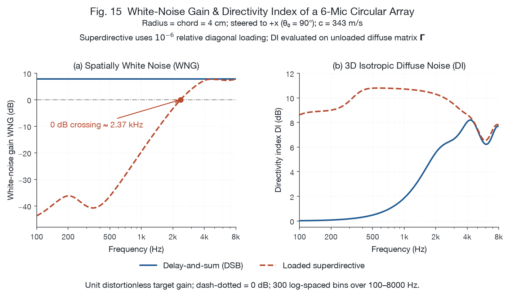
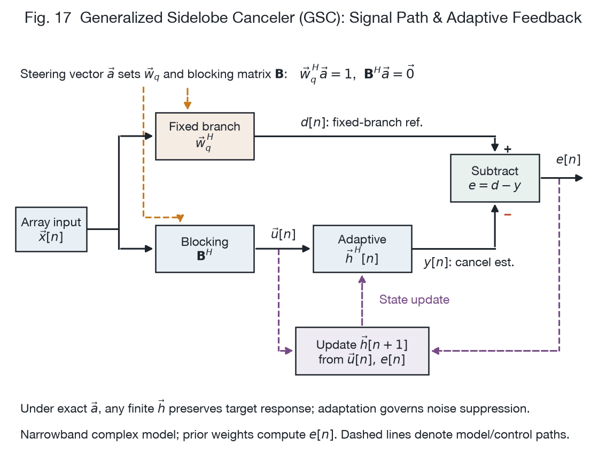
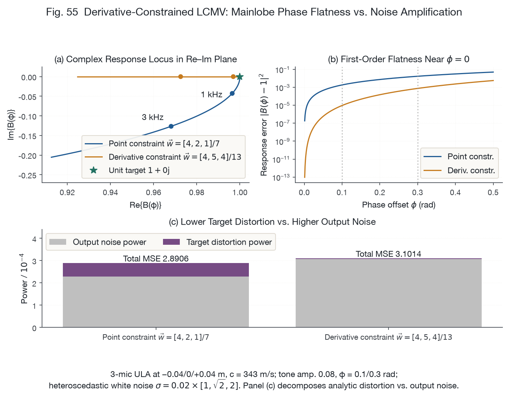
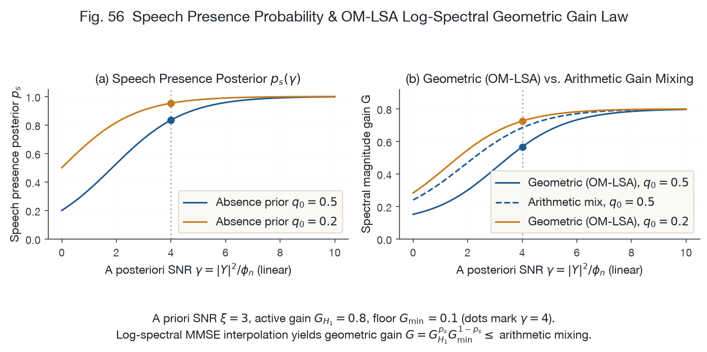
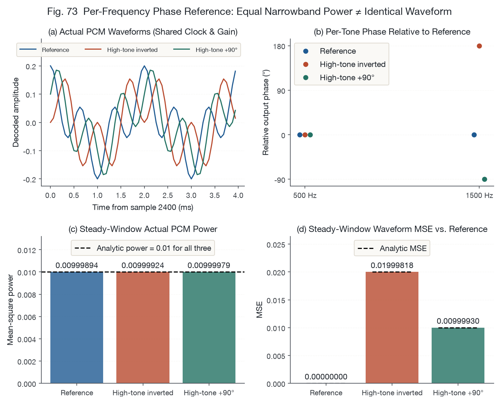

🌐 [简体中文](../chapters/05_beamforming.md) ｜ **English**

> This chapter is Chapter 5 of the main text. The main text and extended special topics comprise 16 chapters in total (Chapters 0–15, where Chapter 0 covers mathematical foundations and Chapters 12–15 are four extended special topics), accompanied by Appendices A and B. This chapter can be read independently; use the navigation bar below for the preceding and following chapters.
>
> Overview Home: [00_overview.md](00_overview.md) | Previous: [04_doa-estimation.md](04_doa-estimation.md) | Next: [06_aec.md](06_aec.md)

---

## 5. Beamforming

### 5.1 Unified Problem Formulation

Start from an observable acoustic fact: a spoken phrase arrives at different microphones at slightly different instants. Summing raw channels directly can cause high-frequency components to cancel out of phase; compensating those propagation delays before summing aligns target speech from the desired direction constructively in phase, while interference and reflections arriving from other angles remain unaligned and are attenuated. That is the core physical intuition of beamforming.

In the Short-Time Fourier Transform (STFT) domain, stack the $M$ complex microphone observations at frame $n$ and frequency bin $k$ into a column vector $\vec x(k,n)\in\mathbb C^{M\times1}$, and let $\vec w(k,n)\in\mathbb C^{M\times1}$ denote the complex spatial filter weight vector of equal length. Writing superscript $H$ for Hermitian conjugate transpose (elementwise conjugation followed by transposition; see [Chapter 0 §0.3](00_math-foundations.md#sec-0-3) for complex inner products and Cauchy–Schwarz), the beamformer output at $(k,n)$ is the complex scalar

$$y(k,n) = \vec{w}^H(k,n)\,\vec{x}(k,n).\tag{5-1}$$

This chapter adheres strictly to the geometry and phase conventions established in Chapter 2: on a Uniform Linear Array (ULA), Microphone 1 sits at the left origin $x_1=0$ and subsequent sensors sit along $+x$ at spacing $d$; azimuth $\theta$ is measured clockwise from broadside $+y$ toward $+x$, with unit vector $\vec u$ pointing from the array toward the source. Under signed arrival-time difference $\tau_{ij}=t_i-t_j$, a far-field plane wave at $\theta>0$ reaches right-hand sensors earlier ($\tau_{21}=-d\sin\theta/c$); referenced to Microphone 1, the $m$-th entry ($m=1,\ldots,M$, shifted by $m'=m-1\in\{0,\ldots,M-1\}$ relative to zero-based series and Python arrays) of the free-field steering vector is

$$a_m(f,\theta)=e^{+\mathrm{j}2\pi f(m-1)d\sin\theta/c}.\tag{5-2}$$

Suppressing $(k,n)$ or $f$ in single-bin derivations below, $\vec w$, $\vec a$, and spatial covariance matrices within any equation always refer to the same frequency bin. Because Eq. (5-1) fixes the conjugate inner product $y=\vec w^H\vec x$, the complex coefficient multiplying channel $x_m$ is $w_m^*$: for equal-weight delay-and-sum $\vec w=\vec a/M$, $w_m^*=a_m^*/M$ unwinds the phase advance of $a_m$ exactly. Every sign and conjugation rule in this chapter follows this convention.

The first half of this chapter revolves around a unified constrained optimization paradigm: *minimize output noise/interference power subject to unit distortionless response $\vec{w}^H\vec{a}(\theta_0)=1$ toward target direction $\theta_0$*. The Delay-and-Sum Beamformer (DSB), Superdirective beamforming, Minimum Variance Distortionless Response (MVDR), and Linearly Constrained Minimum Variance (LCMV) differ solely in their assumed noise spatial covariance model or number of linear constraints. By contrast, the Multichannel Wiener Filter (MWF) minimizes waveform spectral mean-square error directly, while Generalized Eigenvalue (GEV) beamforming maximizes output SNR without imposing a hard distortionless equality constraint—each derived in its own dedicated section below.

Core acronyms appearing throughout this chapter are summarized below:

| Acronym | Full Term | Role in This Chapter |
|---|---|---|
| SCM | Spatial Covariance Matrix | Characterizes per-channel power and inter-channel spatial correlation |
| RTF | Relative Transfer Function | Ratio of target acoustic transfer functions across sensors relative to a reference microphone |
| VAD / SPP | Voice Activity Detection / Speech Presence Probability | Frame-level binary speech decision / per-time-frequency soft speech probability |
| INR | Interference-to-Noise Ratio | Power ratio of directional interference to single-microphone uncorrelated white noise |
| LMS / NLMS | Least Mean Squares / Normalized LMS | Stochastic gradient adaptive update / input-energy-normalized adaptive update |
| RLS | Recursive Least Squares | Deterministic weighted least-squares recursive update |
| ABM | Adaptive Blocking Matrix | Target-blocking matrix adapted online to track room transfer variations |

Interference and background noise in practical acoustic scenes are analyzed through three canonical spatial correlation models:

- **Spatially white noise**: Models microphone thermal electronics noise, preamplifier noise floor, and uncorrelated local perturbations—zero-mean, mutually uncorrelated, and equal-variance across channels, $\mathbf R_{nn}=\phi_n\mathbf I$ ("white" here denotes *spatial* uncorrelation across sensors, requiring no flat temporal spectrum). Robustness against sensor self-noise and channel mismatches is measured by White Noise Gain (WNG), written linearly as $G_{\mathrm{WNG}}$ and in decibels as $\mathrm{WNG}_{\mathrm{dB}}$.
- **Isotropic diffuse noise**: Models late room reverberation or ambient background mixed uniformly across directions by repeated wall reflections, $\mathbf R_{\mathrm{diff}}=\phi_d\mathbf\Gamma$, where $\phi_d$ is single-mic diffuse power and $\mathbf\Gamma$ is the dimensionless normalized spatial coherence matrix (unit diagonal). Diffuse-noise suppression is quantified by the linear directivity factor $Q$ and decibel Directivity Index (DI).
- **Directional point interference**: Models competing talkers, television loudspeakers, or localized machinery. A point interferer at $\theta_i$ with single-mic power $\phi_i$ contributes rank-$1$ matrix $\phi_i\vec a(\theta_i)\vec a^H(\theta_i)$, whose off-diagonal phase correlations enable adaptive beamformers to steer deep attenuation toward $\theta_i$.

Why does the 3D spherically isotropic diffuse coherence equal a $\operatorname{sinc}$ function? Two lines of spherical integration prove it directly (spherical solid-angle elements and special functions are reviewed in [Chapter 0 §0.1](00_math-foundations.md#sec-0-1) and [§0.7](00_math-foundations.md#sec-0-7)). Align the $+z$-axis along the baseline connecting microphones $i$ and $j$ at distance $d_{ij}$; a unit plane wave arriving from polar colatitude $\vartheta\in[0,\pi]$ and azimuth $\alpha\in[0,2\pi)$ induces path difference $d_{ij}\cos\vartheta$ and cross-spectral factor $e^{\mathrm{j}\kappa d_{ij}\cos\vartheta}$ ($\kappa=2\pi f/c$). Averaging uncorrelated equal-power plane waves uniformly over solid angle $\mathrm{d}\Omega=\sin\vartheta\,\mathrm{d}\vartheta\,\mathrm{d}\alpha$ (total solid angle $4\pi$) via $u=\cos\vartheta$ ($\mathrm{d}u=-\sin\vartheta\,\mathrm{d}\vartheta$) gives

$$\begin{aligned}
[\mathbf\Gamma]_{ij}
&=\frac{1}{4\pi}\int_0^{2\pi}\!\!\int_0^\pi
e^{\mathrm{j}\kappa d_{ij}\cos\vartheta}\sin\vartheta\,
\mathrm{d}\vartheta\,\mathrm{d}\alpha\\
&=\frac{1}{2}\int_{-1}^{1}e^{\mathrm{j}\kappa d_{ij}u}\,\mathrm{d}u
=\frac{\sin(\kappa d_{ij})}{\kappa d_{ij}}\\
&=\operatorname{sinc}\!\left(\frac{2fd_{ij}}{c}\right).
\end{aligned}$$

Throughout this book $\operatorname{sinc}(x)=\sin(\pi x)/(\pi x)$ is normalized, matching $\kappa d_{ij}=\pi(2fd_{ij}/c)$ seamlessly (note the factor of $\pi$ when reading unnormalized $\sin x/x$ conventions).

Frequency and spacing regimes are immediate: at low frequencies or tiny spacings ($fd_{ij}\ll c$), $[\mathbf\Gamma]_{ij}\to 1$ so diffuse noise arrives nearly in phase across sensors—enabling differential noise cancellation on compact arrays; at half-wavelength multiples ($d_{ij}=l\lambda/2, l\in\mathbb Z^+$), $[\mathbf\Gamma]_{ij}=0$; and at high frequencies or wide spacings, off-diagonal entries decay with oscillation so $\mathbf\Gamma\to\mathbf I$. Note that outdoor wind noise stems from local turbulent pressure eddies across windscreen pores whose correlation length is far shorter than acoustic wavelengths, behaving much closer to spatially white noise than to an acoustic diffuse field (Corcos turbulent coherence models and air/in-ear cross-modal wind fusion for wearable arrays are developed in [Chapter 14 §§14.8–14.9](14_spatial-wearable-arrays.md#sec-14-8)).

If waves arrive equiprobably within the horizontal plane only (**cylindrically isotropic diffuse field**), averaging over $\alpha\in[0,2\pi)$ yields the zeroth-order Bessel function $J_0(2\pi fd_{ij}/c)$ ([Habets & Gannot, *JASA*, 2008](https://israelcohen.com/wp-content/uploads/2018/05/JASA_Nov2008.pdf)). Real conference rooms—with acoustic ceiling tiles, reflective tabletops, and localized HVAC vents—typically fall between ideal spherical and cylindrical coherence, motivating validation against measured silence-segment coherence curves.

Relative to benchmarks $\mathbf I$ and $\mathbf\Gamma$, the White Noise Gain and Directivity Factor/Index of arbitrary weight vector $\vec w$ toward target $\vec a$ are defined uniformly as

$$\begin{aligned}
G_{\mathrm{WNG}}&=\frac{|\vec{w}^H\vec{a}|^2}{\vec{w}^H\vec{w}},\\
\mathrm{WNG}_{\mathrm{dB}}&=10\log_{10}G_{\mathrm{WNG}},\\
Q&=\frac{|\vec{w}^H\vec{a}|^2}{\vec{w}^H\mathbf{\Gamma}\vec{w}},\\
\mathrm{DI}&=10\log_{10}Q.
\end{aligned}\tag{5-3}$$

Numerator $|\vec w^H\vec a|^2$ is output target power for unit target input, while the denominators are output noise powers under unit single-mic white or diffuse noise; $G_{\mathrm{WNG}}$ and $Q$ therefore measure the **linear output SNR improvement factor** relative to a single omnidirectional reference sensor ($|a_m|=1$). Under distortionless constraint $\vec w^H\vec a=1$, both numerators equal $1$ and $G_{\mathrm{WNG}}=1/\|\vec w\|_2^2$: larger weight norms directly amplify sensor self-noise and channel gain/phase tolerances (cf. Worked Example 2-2 in Chapter 2 and `WNG (dB)` / `DI (dB)` in Figure 15 below).

#### Time-Domain Filtering vs. Frequency-Domain Weights

While narrowband derivations solve for $\vec{w}(k)$ per bin, wideband speech is processed either via subband STFT multiplication plus overlap-add reconstruction (§2.5) or directly in the time domain via per-channel Finite Impulse Response (FIR) filters summed across channels (**filter-and-sum** beamforming). Integer-sample DSB uses a single nonzero tap per channel, whereas Frost's beamformer (§5.5.2) adapts multi-tap time-domain FIR weights directly ([Frost, *Proc. IEEE*, 1972](https://doi.org/10.1109/PROC.1972.8817)).

Translating per-bin weights $\vec w(k)$ into a causal real-time filter requires respecting three physical constraints: (i) real impulse responses require Hermitian symmetry across positive and negative frequencies; (ii) finite-DFT bin multiplication approximates linear convolution only when circular wrap-around is prevented ([Chapter 2 E02-16](02_basics-signal-model.md#sec-u-59870d19e1)); and (iii) advancing a lagging sensor mathematically requires reading future samples unless a common causal **modeling delay** is inserted ([Grimm et al., *EURASIP JASP*, 2016, §5.1](https://doi.org/10.1186/s13634-016-0375-6)).

A two-microphone discrete example makes causal modeling delay concrete: suppose $x_1[n]=s[n]$ and $x_2[n]=s[n-8]$ at $f_s=16\ \mathrm{kHz}$. Aligning output onto $s[n]$ would require noncausal future sample $x_2[n+8]$; inserting a common $8$-sample ($0.5\ \mathrm{ms}$) causal reference delay allows causal computation $y[n]=(x_1[n-8]+x_2[n])/2=s[n-8]$. In the DTFT domain, an $8$-sample shift multiplies the transfer function by linear phase $e^{-\mathrm{j}8\Omega_{\mathrm{d}}}$ ($\Omega_{\mathrm{d}}=2\pi f/f_s\ \mathrm{rad/sample}$), leaving magnitude response and steady power unchanged while shifting time waveforms by $8$ samples—so time-domain MSE or SDR evaluations must always account for fixed modeling delay before scoring. Choosing between time-domain FIR and STFT filterbanks depends on required filter length, hop size, and SIMD hardware budgets (Chapter 10).

### 5.2 Delay-and-Sum Beamformer (DSB): Align Everyone Before Singing Together

Delay-and-sum beamforming requires no noise statistics, compensating propagation phases toward $\theta_0$ and averaging with equal weights:

$$\vec{w}_{\mathrm{DSB}} = \frac{1}{M}\vec{a}(\theta_0).\tag{5-4}$$

Dividing by $M$ ensures unit distortionless response $\vec w_{\mathrm{DSB}}^H\vec a(\theta_0)=1$ under unit-modulus free-field steering ($|a_m|=1$, leaving output SNR invariant while normalizing output level). When near-field attenuation or unequal channel gains make $|a_m|\ne 1$, the general distortionless spatial matched filter is $\vec a/(\vec a^H\vec a)=\vec a/\|\vec a\|_2^2$ (e.g., for $\vec a=[1,2]^\top$, $\vec a/2$ gives response $5/2$, whereas dividing by $\|\vec a\|_2^2=5$ maintains unit response).

#### Dual-Microphone Delay-and-Sum Hand Calculation

Place two omnidirectional microphones $d=4\ \mathrm{cm}$ apart with a far-field narrowband target at $f=1\ \mathrm{kHz}$, $\theta_0=30^\circ$, and $c=343\ \mathrm{m/s}$:

1. **Geometric delay difference**: $\Delta\tau=d\sin 30^\circ/c=0.02/343\approx 58.3\ \mu\mathrm{s}$;
2. **Narrowband phase difference**: $\Delta\phi=2\pi f\Delta\tau\approx 0.366\ \mathrm{rad}$ ($\approx 21.0^\circ$);
3. **Steering vector**: Because $+30^\circ$ hits right-hand Mic 2 first ($\tau_{21}=-58.3\ \mu\mathrm{s}$), Mic-1-referenced steering is $\vec a=[1,\ e^{+\mathrm{j}0.366}]^\top$;
4. **DSB weights & constraint check**: $\vec w_{\mathrm{DSB}}=\vec a/2=[0.5,\ 0.5e^{+\mathrm{j}0.366}]^\top$, satisfying $\vec w_{\mathrm{DSB}}^H\vec a=\tfrac12(1+e^{-\mathrm{j}0.366}e^{+\mathrm{j}0.366})=1$;
5. **Physical reading**: In $y=\vec w^H\vec x$, Mic 2 is multiplied by $w_2^*=0.5e^{-\mathrm{j}0.366}$ (delaying earlier Mic 2 by $58.3\ \mu\mathrm{s}$ in time), canceling $+0.366\ \mathrm{rad}$ so both target channels sum coherently in phase. Under uncorrelated equal-variance white noise: unnormalized summing doubles target amplitude ($4\times$ power) while uncorrelated noise variances add ($2\times$ power), yielding $4/2=2\times$ SNR gain ($+3.01\ \mathrm{dB}$); normalized Eq. (5-4) keeps target power at $1$ while halving white noise power to $0.5^2+0.5^2=0.5$—the exact same $+3.01\ \mathrm{dB}$ SNR gain.

#### Array Factor, Mainlobe, and Sidelobes

Fixing steering at $\theta_0$, how strongly does a plane wave from test angle $\theta$ pass through $\vec w_{\mathrm{DSB}}$? Four steps decompose the discrete ULA beampattern analytically:

1. Channel $m$ ($m=1,\ldots,M$) multiplies compensator $a_m^*(f,\theta_0)$ against incident $a_m(f,\theta)$. Writing inter-element **residual phase** $\psi=(2\pi d/\lambda)(\sin\theta-\sin\theta_0)$ and shifting index $m'=m-1\in\{0,\ldots,M-1\}$ (relabeling dummy index back to $m=0,\ldots,M-1$ inside Eq. (5-5)) leaves geometric progression $(e^{\mathrm{j}\psi})^m$;
2. For $e^{\mathrm{j}\psi}\ne 1$ ($\psi\ne 2\pi l, l\in\mathbb Z$), summing $\sum_{m=0}^{M-1}q^m=(1-q^M)/(1-q)$ and factoring out half-angle phases $e^{\mathrm{j}M\psi/2}$ and $e^{\mathrm{j}\psi/2}$ via $e^{-\mathrm{j}\alpha}-e^{\mathrm{j}\alpha}=-2\mathrm{j}\sin\alpha$ yields array-center phase times the real Dirichlet ratio:

    $$\begin{aligned}
    B_{\mathrm{raw}}(\psi)&=\sum_{m=0}^{M-1}e^{\mathrm{j}m\psi}
    =\frac{1-e^{\mathrm{j}M\psi}}{1-e^{\mathrm{j}\psi}}\\
    &=\frac{e^{\mathrm{j}M\psi/2}(e^{-\mathrm{j}M\psi/2}
    -e^{\mathrm{j}M\psi/2})}{e^{\mathrm{j}\psi/2}
    (e^{-\mathrm{j}\psi/2}-e^{\mathrm{j}\psi/2})}\\
    &=e^{\mathrm{j}(M-1)\psi/2}\frac{\sin(M\psi/2)}{\sin(\psi/2)}.
    \end{aligned}\tag{5-5}$$

    Leading phase $e^{\mathrm{j}(M-1)\psi/2}$ reflects choosing end sensor $0$ rather than array center $(M-1)d/2$ as origin (shifting origin to the center makes the array factor purely real and even).

3. Including $1/M$ from Eq. (5-4) gives $B_{\mathrm{DSB}}(\psi)=B_{\mathrm{raw}}(\psi)/M$. At $\psi=0$ ($\theta=\theta_0$), $B_{\mathrm{raw}}(0)=M$ and $B_{\mathrm{DSB}}(0)=1$; away from $\theta_0$, $|B_{\mathrm{DSB}}(\psi)|=|\sin(M\psi/2)|/|M\sin(\psi/2)|$ oscillates and decays through the mainlobe, exact nulls, and decaying sidelobes.

4. Setting $\sin(M\psi/2)=0$ with $\sin(\psi/2)\ne 0$ locates the first positive null at $\psi=2\pi/M$ ($M\ge 2$), observable on $[-90^\circ,90^\circ]$ whenever it lies inside visible range $\frac{2\pi d}{\lambda}|\sin\theta-\sin\theta_0|$. Conversely, when $d>\lambda/2$ admits a nonzero integer $\psi=2\pi l$ into the visible region, numerator and denominator vanish together and $|B_{\mathrm{DSB}}|$ returns to $1$—a **grating lobe** (§2.6), never to be mistaken for a null!

    Near broadside ($\theta_0=0^\circ$, $\sin\theta\approx\theta$), first-null beamwidth is $\Delta\theta_{\mathrm{null}}\approx 2\lambda/(Md)$ and large-$M$ half-power ($-3\ \mathrm{dB}$) beamwidth is $\Delta\theta_{3\mathrm{dB}}\approx 0.886\lambda/(Md)$, broadening by $1/\cos\theta_0$ off broadside (§2.6). Remember $Md$ comes from $M$-term summation whereas end-to-end physical span is $D=(M-1)d$: for small $M$ or near endfire, solve $|B_{\mathrm{DSB}}(\psi)|^2=1/2$ directly (e.g., at $M=2, d=\lambda/8, \theta_0=0^\circ$, $|\psi|\le\pi/4$ across $|\theta|\le 90^\circ$ keeps minimum power at $\cos^2(\pi/8)\approx 0.854$, or $-0.69\ \mathrm{dB}$, with neither nulls nor $-3\ \mathrm{dB}$ crossings).

Uniform weighting applies a rectangular spatial window: only as $M\to\infty$ does the first sidelobe approach the continuous-aperture $\operatorname{sinc}$ value $-13.26\ \mathrm{dB}$; exact evaluation of Eq. (5-5) at $M=3,4,8,16$ gives $-9.54\ \mathrm{dB}$, $-11.30\ \mathrm{dB}$, $-12.80\ \mathrm{dB}$, and $-13.15\ \mathrm{dB}$ ($M=2$ is monotonic outside the mainlobe with no sidelobe peak). Tapered windows (Hann or Dolph–Chebyshev, [Dolph, *Proc. IRE*, 1946](https://doi.org/10.1109/JRPROC.1946.225956)) lower sidelobes at the expense of a wider mainlobe and reduced WNG; note that library routines such as [SciPy `chebwin`](https://docs.scipy.org/doc/scipy/reference/generated/scipy.signal.windows.chebwin.html) peak-normalize coefficients to $1$ and must be divided by $\sum_{m=1}^M w_m$ to maintain $\vec w^H\vec a=1$.

#### The White Noise Gain Upper Bound

Why does DSB achieve the highest white-noise and mismatch robustness among all distortionless linear beamformers ($\vec w^H\vec a=1$)? Cauchy–Schwarz proves this ceiling in two lines:

1. For $|a_m|=1$ ($m=1,\ldots,M$), $\|\vec a\|_2^2=M$, so $\vec w_{\mathrm{DSB}}=\vec a/M$ has $\|\vec w_{\mathrm{DSB}}\|_2^2=1/M$ and $G_{\mathrm{WNG}}=M$ ($10\log_{10}M\ \mathrm{dB}$, $+3.01\ \mathrm{dB}$ per sensor doubling).
2. For any $\vec w$ satisfying $\vec w^H\vec a=1$, $1=|\vec w^H\vec a|^2\le\|\vec w\|_2^2\|\vec a\|_2^2=M\|\vec w\|_2^2\implies\|\vec w\|_2^2\ge 1/M\implies G_{\mathrm{WNG}}\le M$, with equality if and only if $\vec w=\vec a/M=\vec w_{\mathrm{DSB}}$. Every algorithm that alters weights to steer deep nulls or narrow low-frequency beams necessarily trades away part of $G_{\mathrm{WNG}}$.

This $+3.01\ \mathrm{dB}$ improvement strictly requires **uncorrelated noise across channels**, verified audibly by four $16\ \mathrm{kHz}$, $2\ \mathrm{s}$ mono synthetic WAVs (common gain $1.0$, aligned target averaged with $[0.5,0.5]^\top$, per-channel Gaussian $\sigma=0.07$; lower volume before playback):

- [Aligned target reference (noiseless)](../codes/chapters/ch05/audio/correlation_reference.wav): clean zero-delay target;
- [Single-microphone noisy observation](../codes/chapters/ch05/audio/correlation_single.wav): single channel plus $\sigma=0.07$ Gaussian noise (variance $0.0049$);
- [Two-mic average with independent noise](../codes/chapters/ch05/audio/correlation_independent.wav): independent noise realizations averaged to variance $0.00245$ ($+3.01\ \mathrm{dB}$ SNR gain, audibly quieter hiss);
- [Two-mic average with identical common noise](../codes/chapters/ch05/audio/correlation_common.wav): channel-1 noise copied verbatim to channel 2 before averaging—output is sample-for-sample identical to the single-mic noisy recording ($0\ \mathrm{dB}$ SNR gain).

In summary, DSB locks onto maximum $G_{\mathrm{WNG}}=M$ with zero matrix-inversion pathology and minimal compute, serving as the rock-solid fallback baseline and quiescent initializer for adaptive pipelines, while remaining omnidirectional at low frequencies ($\lambda\gg D$) and unable to steer adaptive nulls toward unknown interferers.

### 5.3 Superdirective Beamforming: The WNG–Directivity Trade-Off

Because low-frequency diffuse noise is strongly correlated across closely spaced sensors ($[\mathbf\Gamma]_{ij}\to 1$), minimizing spherical diffuse output power $\vec w^H\mathbf\Gamma\vec w$ subject to $\vec w^H\vec a=1$ maximizes directivity factor $Q$ (and DI)—defining **Superdirective beamforming**, mathematically an MVDR filter driven by theoretical diffuse coherence $\mathbf\Gamma$:

$$\begin{aligned}
\min_{\vec w}\;&\vec w^H\mathbf\Gamma\vec w,\\
\text{s.t.}\;&\vec w^H\vec a=1,\\
\vec w_{\mathrm{SD}}&=(\vec a^H\mathbf\Gamma^{-1}\vec a)^{-1}
\mathbf\Gamma^{-1}\vec a.
\end{aligned}\tag{5-6}$$

Closed-form Eq. (5-6) follows from constrained complex quadratic minimization (derived step by step in §5.4 with $\mathbf R_{nn}\leftarrow\mathbf\Gamma$). Invertibility requires positive-definite $\mathbf\Gamma$: at $f=0$ or coincident sensors, $\mathbf\Gamma=\vec 1\vec 1^\top$ drops to rank $1$ where no directional phase difference exists physically.

How high can superdirectivity push $Q$ as $d/\lambda\to 0$? Classical **Uzkov's theorem** proves that for an $M$-element ULA in a 3D spherically isotropic diffuse field, endfire ($\theta_0=\pm 90^\circ$) directivity approaches $Q_{\max}=M^2$ ($\mathrm{DI}_{\max}=20\log_{10}M\ \mathrm{dB}$)—$M$ times higher than half-wavelength DSB ($Q=M$)! For a **2-microphone endfire pair ($M=2$)**, this limit corresponds to the first-order hypercardioid with $Q_{\max}=2^2=4$ ($\mathrm{DI}_{\max}\approx 6.02\ \mathrm{dB}$).

Capturing those extra $3\ \mathrm{dB}$ of diffuse rejection requires aggressive out-of-phase channel subtraction: as $\kappa d\to 0$, $\lambda_{\min}(\mathbf\Gamma)$ vanishes as $(\kappa d)^2$ (or higher powers), blowing up $\|\vec w_{\mathrm{SD}}\|_2$, plunging $G_{\mathrm{WNG}}$ into deep negative dB, and magnifying thermal noise and sensor tolerances. Practical superdirective designs therefore always impose a WNG floor $\|\vec w\|_2^2\le\delta$ (diagonal loading), trading controlled differential gain at low frequencies and transitioning smoothly back to DSB as $\mathbf\Gamma\to\mathbf I$ at high frequencies.

An illuminating **acoustic reciprocity dual** connects superdirectivity directly to **Acoustic Contrast Control (ACC)** in personal sound zones and directional loudspeaker arrays, where complex driver weights $\vec q\in\mathbb C^M$ maximize bright-zone to dark-zone acoustic potential energy ([Choi & Kim, *JASA*, 2002](https://doi.org/10.1121/1.1456926)):

$$\begin{aligned}
\max_{\vec q}\;
&\frac{\vec q^H\mathbf R_B\vec q}
{\vec q^H\mathbf R_D\vec q}
\iff \mathbf R_B\vec q=\lambda_{\max}\mathbf R_D\vec q.
\end{aligned}$$

By acoustic reciprocity under radiation convention $p(\vec u)\propto\vec q^H\vec a(\vec u)$, shrinking the bright zone to a single far-field target point ($\mathbf R_B=\vec a\vec a^H$, rank $1$) and integrating the dark zone uniformly over the sphere ($\mathbf R_D=\mathbf\Gamma$) reduces ACC up to scalar normalization directly to Eq. (5-6), $\vec q\propto\mathbf\Gamma^{-1}\vec a$! Low-frequency loudspeaker **array effort** blow-up ($\|\vec q\|_2^2$ excursion saturation) is the exact reciprocal mirror of low-frequency superdirective $G_{\mathrm{WNG}}$ collapse, while multi-point ACC shares the exact generalized eigenvalue algebra of GEV beamforming in §5.9.

#### Worked Example 5-1: Superdirective Weights and White Noise Gain

**Inputs and setup**: Dual-mic ULA with $d=0.05\lambda$, spherical diffuse coherence $\rho=\operatorname{sinc}(0.1)=\sin(0.1\pi)/(0.1\pi)\approx 0.9836316$, and $2\times 2$ $\mathbf\Gamma$ with unit diagonal and off-diagonal $\rho$ (retaining double precision internally, rounded to 4 decimals for display).

**Step 1 — Conditioning of $\mathbf{\Gamma}$**:

$$\begin{aligned}
\det\mathbf\Gamma&=1-\rho^2\approx 0.0325,\\
\mathbf\Gamma^{-1}&\approx\frac{1}{0.0325}
\begin{bmatrix}1&-0.9836\\-0.9836&1\end{bmatrix}\\
&\approx\begin{bmatrix}30.80&-30.29\\-30.29&30.80\end{bmatrix}.
\end{aligned}$$

At $d=\lambda/20$, $\rho\approx 0.9836$ shrinks $\det\mathbf\Gamma$ to $0.0325$ and inflates inverse entries past $30$ (eigenvalues $1+\rho\approx 1.9836$ and $1-\rho\approx 0.0164$, condition number $\kappa_2\approx 121$). Whether $\vec w_{\mathrm{SD}}$ blows up depends on whether $\vec a$ projects onto the symmetric sum mode or antisymmetric difference mode.

**Step 2 — Degenerate broadside case ($\theta_0=0^\circ$)**: $\vec{a}_0=[1,1]^\top$ is the sum eigenvector ($\mathbf\Gamma\vec a_0=(1+\rho)\vec a_0$), so $(1+\rho)$ cancels upon normalization:

$$\begin{aligned}
\vec w_{\mathrm{SD}}&=[0.5,\ 0.5]^\top=\vec w_{\mathrm{DSB}},\\
\mathrm{WNG}_{\mathrm{dB}}&\approx +3.01\ \mathrm{dB},
\end{aligned}$$

with $Q=2/(1+\rho)\approx 1.008$ ($\mathrm{DI}\approx 0.04\ \mathrm{dB}$) because broadside waves carry zero inter-sensor phase difference.

**Step 3 — Endfire weights ($\theta_0=90^\circ$)**: With $\psi=0.1\pi\approx 0.3142\ \mathrm{rad}$ ($18^\circ$) and $\vec a\approx[1,\ 0.9511+0.3090\mathrm{j}]^\top$:
- Numerator $\mathbf\Gamma^{-1}\vec a\approx[1.9869-9.3616\mathrm{j},\,-1.0033+9.5174\mathrm{j}]^\top$;
- Denominator $\vec a^H\mathbf\Gamma^{-1}\vec a\approx 3.9737$ (which equals $Q$ directly since numerator $|\vec w^H\vec a|^2=1$!);
- Dividing gives

$$\begin{aligned}
\vec w_{\mathrm{SD}}&\approx\begin{bmatrix}
0.5000-2.3559\mathrm{j}\\
-0.2525+2.3951\mathrm{j}
\end{bmatrix},\\
|w_1|&=|w_2|\approx 2.41.
\end{aligned}$$

**Step 4 — "Catastrophic subtraction of large numbers" inside $\vec w^H\vec a=1$**:

$$\begin{aligned}
w_1^*a_1&\approx 0.5000+2.3559\mathrm{j},\\
w_2^*a_2&\approx 0.5000-2.3559\mathrm{j},\\
\vec w_{\mathrm{SD}}^H\vec a&=w_1^*a_1+w_2^*a_2=1.
\end{aligned}$$

Each channel carries magnitude $2.41$, relying on exact cancellation of $\pm 2.3559\mathrm{j}$ to leave unit target output—any tiny hardware mismatch unbalances that cancellation!

**Step 5 — Tallying $\mathrm{WNG}_{\mathrm{dB}}$ vs. $\mathrm{DI}$**:

$$\begin{aligned}
\|\vec w_{\mathrm{SD}}\|_2^2&\approx 2(2.4084)^2\approx 11.60,\\
\mathrm{WNG}_{\mathrm{dB}}&=10\log_{10}(1/11.60)
\approx\mathbf{-10.6\ dB}.
\end{aligned}$$

Relative to endfire DSB ($\mathrm{WNG}_{\mathrm{dB}}=+3.01\ \mathrm{dB}, \mathrm{DI}\approx 0.00\ \mathrm{dB}$), superdirectivity amplifies sensor self-noise $11.6\times$ ($-10.6\ \mathrm{dB}$) in exchange for lifting diffuse directivity to $Q\approx 3.9737$ ($\mathrm{DI}\approx +5.99\ \mathrm{dB}$), hugging the Uzkov ceiling $Q_{\max}=4$ ($6.02\ \mathrm{dB}$).

**Step 6 — Sensitivity to a $1\%$ channel gain mismatch**: If Mic 2 has a $+1\%$ sensitivity tolerance ($0.086\ \mathrm{dB}$, $\vec a_{\mathrm{mis}}=[1,1.01e^{+\mathrm{j}0.3142}]^\top$):

$$\begin{aligned}
\vec w_{\mathrm{SD}}^H\vec a_{\mathrm{mis}}
&\approx 1.0050-0.0236\mathrm{j},
\end{aligned}$$

leaving a $2.41\%$ complex response error—nearly $5\times$ larger than DSB's $0.5\%$ error on the exact same $1\%$ tolerance (exact Cauchy–Schwarz bound proved in Exercise E05-06).

**Step 7 — Sweeping normalized spacing $d/\lambda$ at endfire $90^\circ$**:

| Spacing $d$ | $0.5\lambda$ | $0.1\lambda$ | $0.05\lambda$ | $0.02\lambda$ | $0.01\lambda$ |
|---|---|---|---|---|---|
| Per-Channel Magnitude $\lvert w_i\rvert$ | $0.50$ | $1.24$ | $2.41$ | $5.98$ | $11.94$ |
| $\mathrm{WNG}_{\mathrm{dB}}$ | $+3.0\ \mathrm{dB}$ | $-4.9\ \mathrm{dB}$ | $-10.6\ \mathrm{dB}$ | $-18.5\ \mathrm{dB}$ | $-24.6\ \mathrm{dB}$ |
| $\mathrm{DI}$ | $+3.0\ \mathrm{dB}$ | $+5.9\ \mathrm{dB}$ | $+6.0\ \mathrm{dB}$ | $+6.0\ \mathrm{dB}$ | $+6.0\ \mathrm{dB}$ |

Shrinking $d$ from $0.5\lambda$ to $0.1\lambda$ lifts $\mathrm{DI}$ from $3.0$ to $5.9\ \mathrm{dB}$; below $0.05\lambda$, $\mathrm{DI}$ hits the $6.02\ \mathrm{dB}$ ceiling and stalls while $|w_i|\propto\lambda/d$ and self-noise $\propto(\lambda/d)^2$—every halving of spacing or frequency costs another $6\ \mathrm{dB}$ in $\mathrm{WNG}_{\mathrm{dB}}$!



**How to read Figure 15**: Extends this analysis to a 6-microphone UCA ($r=d=4\ \mathrm{cm}$, steered toward $+x$, i.e., $\theta_0=90^\circ$, $c=343\ \mathrm{m/s}$, $200$ log-plotted points over $100$–$8000\ \mathrm{Hz}$), comparing DSB (solid blue) against $10^{-6}$ relatively loaded superdirective beamforming (dashed red, scored on unloaded physical $\mathbf\Gamma$):

- **Left panel `(a) Spatially white noise` ($\mathrm{WNG}_{\mathrm{dB}}$)**: Dashed gray marks $0\ \mathrm{dB}$ single-mic SNR. DSB holds flat at $10\log_{10}6\approx 7.78\ \mathrm{dB}$; superdirectivity plunges to $-43.72\ \mathrm{dB}$ at $100\ \mathrm{Hz}$ (with an inflection around $300$–$400\ \mathrm{Hz}$ as $10^{-6}$ loading crosses high-order eigenvalues of $\mathbf\Gamma$), crosses $0\ \mathrm{dB}$ near $2.2\ \mathrm{kHz}$, and merges with DSB above $4\ \mathrm{kHz}$.
- **Right panel `(b) 3D isotropic diffuse noise` ($\mathrm{DI}$)**: DSB sits at $0.02\ \mathrm{dB}$ at $100\ \mathrm{Hz}$ ($\lambda=3.43\ \mathrm{m}\gg 8\ \mathrm{cm}$), peaking near $8.2\ \mathrm{dB}$ around $4\ \mathrm{kHz}$; superdirectivity already achieves $8.62\ \mathrm{dB}$ at $100\ \mathrm{Hz}$ and sustains $>10.5\ \mathrm{dB}$ across $400$–$1500\ \mathrm{Hz}$ before converging to DSB at high frequencies.

Compact consumer devices (earbuds, smart glasses, mini speakers) approximate low-frequency superdirectivity via **Differential Microphone Arrays (DMAs)**: note that superdirectivity is an *optimization criterion* (maximize $Q$ under $\mathbf\Gamma$) whereas DMA is a *signal-processing structure* (close-spaced subtraction + internal delay + bass equalization), coinciding only for $\kappa d\ll 1$ with matched parameters.

**Four mandatory pre-deployment diagnostics** for any superdirective or adaptive weight vector $\vec w(k)$:

1. **WNG margin**: Verify $\mathrm{WNG}_{\mathrm{dB}}$ meets band-specific floors dictated by MEMS SNR (e.g., $65\ \mathrm{dB(A)}$) and matching tolerances;
2. **Spectral condition number**: Monitor $\kappa_2=\lambda_{\max}/\lambda_{\min}$ of $\mathbf\Gamma$ or $\hat{\mathbf R}_{nn}$ (distinct from acoustic wavenumber $\kappa$), applying diagonal loading (§5.4) or subspace projection when ill-conditioned;
3. **Dynamic range & clipping rate**: Check headroom under plosives, wind, and transients when $|w_m|\gg 1$;
4. **Monte Carlo channel-mismatch sweep**: Inject datasheet/thermal gain–phase perturbations $\vec a_{\mathrm{mis}}$ and audit quantiles of $|\vec w^H\vec a_{\mathrm{mis}}-1|$, null drift, and effective WNG.

#### 5.3.1 Differential Microphone Arrays: From First-Order Cardioids to Higher-Order Designs

Let us expand the first-order differential exponential to see where dipoles, cardioids, and hypercardioids come from, why every differential stage acts as a $+6\ \mathrm{dB/oct}$ high-pass filter, and why bass equalization and MEMS gasket leaks dominate production engineering.

**First-order differential response and Taylor expansion**: Place two endfire microphones along the $x$-axis at spacing $d$, with front Mic 1 at $x=0$ and rear Mic 2 at $x=d$. Measuring axial angle $\varphi\in[0,\pi]$ from the front endfire axis ($-x$, i.e., $\theta=-90^\circ$; front $\varphi=0$, side $\varphi=90^\circ$, rear $\varphi=180^\circ$), acoustic delay from Mic 1 to Mic 2 is $\tau_p(\varphi)=t_2-t_1=(d/c)\cos\varphi$ ($\cos\varphi=-\sin\theta$). Forming $y(t)=x_1(t)-g\,x_2(t-\tau)$ gives continuous-time response ($\omega=2\pi f\ \mathrm{rad/s}$):

$$\begin{aligned}
H(\omega,\varphi)&=1-g\,e^{-\mathrm{j}\omega[\tau+\tau_p(\varphi)]}.
\end{aligned}\tag{5-7}$$

Setting $g=1$ and normalizing internal delay by transit time $T=d/c$ via $\tau=\alpha T$ ($\alpha\ge 0$, $\omega T=\kappa d$), first-order Taylor expansion $e^{-z}\approx 1-z$ for $\kappa d\ll 1$ separates frequency from angle:

$$\begin{aligned}
1-e^{-\mathrm{j}\kappa d(\alpha+\cos\varphi)}
&\approx\mathrm{j}\kappa d(\alpha+\cos\varphi)\\
&=\mathrm{j}\frac{\omega d}{c}(\alpha+\cos\varphi)
\qquad(\kappa d\ll 1).
\end{aligned}$$

Four fundamental engineering properties jump straight out of this factorization:

1. **Delay ratio $\alpha$ selects the frequency-invariant polar pattern**: Peak-normalizing at $\varphi=0$ gives $D(\varphi)=\frac{\alpha+\cos\varphi}{\alpha+1}$ ([Elko & Pong, *ICASSP*, 1997](https://doi.org/10.1109/ICASSP.1997.599609)): $\alpha=0$ yields figure-of-eight dipole $\cos\varphi$ (null at $90^\circ$); $\alpha=1$ ($\tau=d/c$) yields cardioid $(1+\cos\varphi)/2$ (null at $180^\circ$); and $\alpha=1/3$ places the null at $\arccos(-1/3)\approx 109.5^\circ$, achieving the 2-mic spherical Uzkov ceiling $Q_{\max}=4$ ($\mathrm{DI}\approx 6.02\ \mathrm{dB}$)—the **first-order hypercardioid**!
2. **Intrinsic $+6\ \mathrm{dB/oct}$ first-order high-pass slope**: At $\varphi=0$, uncompensated output $\mathrm{j}\frac{\omega d}{c}(1+\alpha)\propto\omega$ rises at $+6.02\ \mathrm{dB/oct}$ ($+20\ \mathrm{dB/dec}$) with $+90^\circ$ phase lead, attenuating low frequencies by $6\ \mathrm{dB}$ per octave downward.
3. **$1/(\mathrm{j}\omega)$ bass equalization amplifies low-frequency self-noise at $-6\ \mathrm{dB/oct}$**: Restoring flat speech timbre requires cascading integrator $H_{\mathrm{eq}}(\omega)=c/[\mathrm{j}\omega d(1+\alpha)]$. Uncorrelated thermal and $1/f$ noise powers add ($2\times$) and get boosted by $|H_{\mathrm{eq}}(\omega)|^2\propto 1/\omega^2$—inflating white noise power by $6\ \mathrm{dB}$ per octave downward! Practical DMA equalizers must shelf and high-pass below $100$–$150\ \mathrm{Hz}$, never integrating down to DC.
4. **MEMS acoustic-port gasket leaks induce catastrophic low-frequency phase shifts**: A hairline gap or aged rubber gasket between a PCB-mounted MEMS port and enclosure channel creates a parasitic acoustic RC high-pass leak: losing barely a tenth of a dB at $200\ \mathrm{Hz}$ already injects $3^\circ$–$15^\circ$ of inter-channel phase shift across $100$–$500\ \mathrm{Hz}$! Across $d=1$–$2\ \mathrm{cm}$ at $200\ \mathrm{Hz}$, true acoustic phase $\kappa d$ is only $2^\circ$–$4^\circ$ ($0.036$–$0.073\ \mathrm{rad}$), so a minor gasket leak swamps the acoustic phase, destroys the rear null, and can flip the low-frequency mainlobe backward—requiring low-frequency coupler phase screening on the factory line rather than $1\ \mathrm{kHz}$ level matching alone (exact $Q(\alpha)$, octave WNG penalty, and $5^\circ$ gasket-leak hand calculations in Exercise [E05-28](#e05-28)).

**Single-frequency cardioid DMA hand check**: For $d=2\ \mathrm{cm}$, $c=343\ \mathrm{m/s}$ ($T\approx 58.31\ \mu\mathrm{s}$), and $g=1,\tau=T$ ($\alpha=1$), rear $\varphi=180^\circ$ ($\tau_p=-T$) gives $H_b=1-e^0=0$ at all frequencies. At $f=500\ \mathrm{Hz}$ ($\kappa d\approx 0.1832\ \mathrm{rad}$), frontal response ($\varphi=0,\tau_p=+T$) is

$$\begin{aligned}
H_f&=1-e^{-\mathrm{j}2\omega T},\\
|H_f|&=2|\sin(\omega T)|=2\sin(\kappa d)\approx 0.3643.
\end{aligned}$$

Equalizing $|H_f|$ to $1$ multiplies amplitude by $1/|H_f|\approx 2.745$, boosting subtracted unit-variance self-noise power $2$ to $2/|H_f|^2\approx 15.07$, or $\mathrm{WNG}_{\mathrm{dB}}\approx -11.78\ \mathrm{dB}$. A $1\%$ gain error ($g=1.01$) lifts the rear null to $|1-1.01|/|H_f|\approx 0.0274$ ($\approx -31.2\ \mathrm{dB}$), while approaching $\kappa d\to\pi$ ($\approx 8.58\ \mathrm{kHz}$) causes comb cancellation of the frontal target itself.

**Scaling to higher-order DMAs**: Cascading $N$ differential stages (e.g., 3-mic second-order hypercardioid reaching $Q_{\max}=3^2=9$, $\mathrm{DI}\approx 9.54\ \mathrm{dB}$) provides $N$ steerable rear-hemisphere nulls, but low-frequency response rolls off as $(\mathrm{j}\kappa d)^N$ ($+6N\ \mathrm{dB/oct}$), requiring $1/\omega^N$ equalization that inflates self-noise power as $(\lambda/d)^{2N}$ ([Elko, *Differential Microphone Arrays*, 2004](https://doi.org/10.1007/1-4020-7769-6_2)):

| Design Change | Capability Gained | Risk Magnified Simultaneously | Conditions That Must Be Held Fixed |
|---|---|---|---|
| Increase differential order $N$ | More steerable nulls & sharper angular roll-off | Larger $\|\vec w\|_2$, severe low-band self-noise & mismatch blow-up | Frequency, spacing, noise field, target pattern, equalizer |
| Shrink sensor spacing $d$ | Extends $\kappa d\ll 1$ regime to higher frequencies | Channels become nearly identical; WNG drops sharply | Sensor self-noise, calibration residuals, arithmetic precision |
| Boost low-frequency equalization | Restores flat target bass response | Amplifies low-frequency thermal noise and wind rumble | Maximum gain cap, clipping headroom, WNG floor |

Compact arrays therefore split frequency bands: 1st-order DMA or DSB in the lowest band, 2nd-order DMA in mid-band, and conventional beamforming at high frequencies. When neural networks assist compact arrays, predicting bounded null angles, mixing weights, or loading parameters inside an analytical DMA preserves verifiable WNG floors, whereas unconstrained neural tap generation falls under §5.9's end-to-end paradigm.

### 5.4 Minimum Variance Distortionless Response (MVDR)

Minimum Variance Distortionless Response (MVDR, or Capon beamforming) replaces fixed diffuse priors with the measured or estimated $M\times M$ interference-plus-noise spatial covariance matrix $\mathbf{R}_{nn}=\mathbb{E}[\vec n\vec n^H]$, minimizing total output interference-plus-noise power subject to unit distortionless response toward $\vec a(\theta_0)$:

$$\begin{aligned}
\min_{\vec w}\;&\vec w^H\mathbf R_{nn}\vec w,\\
\text{s.t.}\;&\vec w^H\vec a(\theta_0)=1.
\end{aligned}\tag{5-8}$$

Here Hermitian PSD $\mathbf{R}_{nn}$ ($\mathbf R_{nn}^H=\mathbf R_{nn}$) holds per-channel noise-plus-interference powers on its diagonal and cross-powers on its off-diagonals (distinct from scalar time-domain $R_{x_1x_2}(\tau)$ in §4.2). Remember that "distortionless" holds strictly for the supplied vector $\vec a(\theta_0)$—preserving real speech without attenuation requires $\vec a(\theta_0)$ to match the true acoustic propagation vector.

**Complete four-step Lagrange multiplier derivation**:

**Step 1 — Real-valued Lagrangian.** Because complex constraint $\vec w^H\vec a=1$ locks two real degrees of freedom ($\operatorname{Re}=1,\operatorname{Im}=0$), pair $\lambda(1-\vec w^H\vec a)$ with its conjugate $\lambda^*(1-\vec a^H\vec w)$ so $L(\vec w,\lambda)$ is strictly real:

$$\begin{aligned}
L(\vec w,\lambda)&=\vec w^H\mathbf R_{nn}\vec w
+\lambda(1-\vec w^H\vec a)
+\lambda^*(1-\vec a^H\vec w).
\end{aligned}$$

**Step 2 — Wirtinger complex gradient.** Writing $\vec w=\vec u+\mathrm{j}\vec v$ and $\partial/\partial\vec w^*=\tfrac12(\partial_{\vec u}+\mathrm{j}\partial_{\vec v})$ (Appendix A) treats $\vec w$ and $\vec w^*$ as formally independent ($\mathbf R_{nn}^H=\mathbf R_{nn}$):

$$\begin{aligned}
\frac{\partial(\vec w^H\vec c)}{\partial\vec w^*}&=\vec c,\qquad
\frac{\partial(\vec c^H\vec w)}{\partial\vec w^*}=\vec 0,\\
\frac{\partial(\vec w^H\mathbf R_{nn}\vec w)}{\partial\vec w^*}
&=\mathbf R_{nn}\vec w.
\end{aligned}$$

Setting the gradient of $L$ to zero for positive-definite $\mathbf R_{nn}$ gives

$$\begin{aligned}
\frac{\partial L}{\partial\vec w^*}
&=\mathbf R_{nn}\vec w-\lambda\vec a=\vec 0,\\
\vec w&=\lambda\mathbf R_{nn}^{-1}\vec a.
\end{aligned}$$

Physically, **optimal weights point along the inverse-covariance-suppressed steering vector $\mathbf R_{nn}^{-1}\vec a$** (note that exact spatial whitening uses $\mathbf W_n=\mathbf R_{nn}^{-1/2}$ where $\tilde{\vec w}\propto\mathbf R_{nn}^{-1/2}\vec a$, and mapping back to sensor space multiplies by a second $\mathbf R_{nn}^{-1/2}$ to form $\mathbf R_{nn}^{-1}\vec a$).

**Step 3 — Solve for $\lambda$ from the distortionless constraint**:

$$\lambda^*\,\vec{a}^H\mathbf{R}_{nn}^{-1}\vec{a} = 1.$$

Since $\mathbf R_{nn}^{-1}$ is Hermitian positive definite, $q=\vec a^H\mathbf R_{nn}^{-1}\vec a>0$ is strictly real and positive for $\vec a\ne\vec 0$, giving $\lambda=\lambda^*=1/q$. (Never blindly replace singular $\mathbf R_{nn}^{-1}$ when $N<M$ by the Moore–Penrose pseudoinverse $\mathbf R_{nn}^+$—Appendix A Exercise E16-05 proves via a 2-channel counterexample that $\mathbf R_{nn}^+$ misses zero-noise nullspace solutions!)

**Step 4 — Closed-form MVDR weights and minimum residual noise power**:

$$\begin{aligned}
\vec w_{\mathrm{MVDR}}
&=\frac{\mathbf R_{nn}^{-1}\vec a}
{\vec a^H\mathbf R_{nn}^{-1}\vec a},
\end{aligned}\tag{5-9}$$

achieving minimum output noise power $P_{n,\min}=\vec w_{\mathrm{MVDR}}^H\mathbf R_{nn}\vec w_{\mathrm{MVDR}}=1/q$.

Comparing against Chapter 4's Capon spectrum Eq. (4-12): when target and noise are strictly uncorrelated and $\vec a$ is exact ($\mathbf R_{xx}=\mathbf R_{nn}+\phi_s\vec a\vec a^H$), substituting $\mathbf R_{xx}$ or $\mathbf R_{nn}$ into Eq. (5-9) yields the **exact same weight vector** (proved in Exercise E05-13, with output power $\phi_s+1/q$); under the slightest DOA or reverberation mismatch, however, using target-contaminated $\mathbf R_{xx}$ treats the target as a strong interferer and cancels it (**target self-cancellation**)—the fundamental reason practical beamformers estimate target-free $\mathbf R_{nn}$. Notice also two special cases of Eq. (5-9): $\mathbf R_{nn}=\phi_n\mathbf I\implies\vec w_{\mathrm{DSB}}$, and $\mathbf R_{nn}=\phi_d\mathbf\Gamma\implies\vec w_{\mathrm{SD}}$.

#### Worked Example 5-2: 2-Microphone MVDR Numerical Derivation

**Inputs and setup**: Half-wavelength dual-mic ULA ($d=\lambda/2$), target at broadside $\theta_0=0^\circ$, point interferer at $\theta_i=30^\circ$, unit per-mic white noise ($1$), and interferer power $10$ ($\mathrm{INR}=10$, or $10\ \mathrm{dB}$).

**Step 1 — Target and interferer steering vectors** ($2\pi d/\lambda=\pi$):
- Target ($\theta_0=0^\circ$): $\psi_0=0\implies\vec{a}_0=[1,\ 1]^\top$;
- Interferer ($\theta_i=30^\circ$): $\psi_i=\pi\sin 30^\circ=\pi/2\implies\vec a_i=[1,+\mathrm{j}]^\top$ (Mic 2 leads Mic 1 by $90^\circ$).

**Step 2 — Interference-plus-noise covariance $\mathbf{R}_{nn}=10\,\vec{a}_i\vec{a}_i^H+\mathbf{I}$** (watch conjugation in $[1,+\mathrm{j}]^\top[1,-\mathrm{j}]$):

$$\begin{aligned}
\mathbf R_{nn}&=\begin{bmatrix}
11 & -10\mathrm{j}\\ +10\mathrm{j} & 11
\end{bmatrix},
\end{aligned}$$

where diagonal $11=10+1$ is total per-mic interference-plus-noise power and off-diagonal $\mp 10\mathrm{j}$ encodes the $90^\circ$-shifted interferer correlation.

**Step 3 — Inverse $\mathbf{R}_{nn}^{-1}$** (note $(-10\mathrm{j})(+10\mathrm{j})=+100$):

$$\begin{aligned}
\det\mathbf R_{nn}&=11\times11-(-10\mathrm{j})(+10\mathrm{j})\\
&=121-100=21,
\end{aligned}$$

with eigenvalues $\lambda_1=21$, $\lambda_2=1$ ($\kappa_2=21$), giving

$$\begin{aligned}
\mathbf R_{nn}^{-1}&=\frac{1}{21}\begin{bmatrix}
11&+10\mathrm{j}\\-10\mathrm{j}&11
\end{bmatrix}\\
&\approx\begin{bmatrix}
0.5238&+0.4762\mathrm{j}\\
-0.4762\mathrm{j}&0.5238
\end{bmatrix}.
\end{aligned}$$

**Step 4 — Normalized weights via Eq. (5-9)**:
- Numerator: $\mathbf R_{nn}^{-1}\vec a_0=\tfrac{1}{21}[11+10\mathrm{j},11-10\mathrm{j}]^\top$;
- Denominator: $q=(11+11)/21=22/21\approx 1.0476$ (minimum residual total noise power $1/q=21/22\approx 0.9545<1$!);
- Dividing yields

$$\begin{aligned}
\vec w_{\mathrm{MVDR}}&=\frac{1}{22}\begin{bmatrix}
11+10\mathrm{j}\\11-10\mathrm{j}
\end{bmatrix}\\
&\approx\begin{bmatrix}
0.5000+0.4545\mathrm{j}\\
0.5000-0.4545\mathrm{j}
\end{bmatrix}.
\end{aligned}$$

Relative to DSB $[0.5,0.5]^\top$, MVDR keeps real parts $[0.5,0.5]^\top$ for $0^\circ$ target response while growing antisymmetric imaginary parts $[\pm\frac{5}{11}\mathrm{j}]^\top$ ($|w_i|\approx 0.6757$) to cancel the $+30^\circ$ interferer.

**Step 5 — Verifying target preservation and interference suppression**:
- **Target ($0^\circ$)**: $\vec w_{\mathrm{MVDR}}^H\vec a_0=(0.5-5\mathrm{j}/11)+(0.5+5\mathrm{j}/11)=1$ exact;
- **Interferer ($+30^\circ$)**:

$$\begin{aligned}
\vec w_{\mathrm{MVDR}}^H\vec a_i
&=\Big(\frac{1}{2}-\frac{5}{11}\mathrm{j}\Big)\cdot 1
+\Big(\frac{1}{2}+\frac{5}{11}\mathrm{j}\Big)(+\mathrm{j})\\
&=\Big(\frac{1}{2}-\frac{5}{11}\Big)(1+\mathrm{j})
=\frac{1+\mathrm{j}}{22}\\
&\approx 0.0455+0.0455\mathrm{j},
\end{aligned}$$

with magnitude $\sqrt2/22\approx 0.0643$, or **$-23.84\ \mathrm{dB}$**! Output interference power drops from $10$ to $10(\sqrt2/22)^2=20/484\approx 0.0413$, plus output white noise $\|\vec w_{\mathrm{MVDR}}\|_2^2=221/242\approx 0.9132$, totaling $0.0413+0.9132=0.9545=21/22=1/q$ exact! Why $-23.84\ \mathrm{dB}$ rather than an exact zero at $+30^\circ$? Because forcing an exact zero (LCMV in §5.5) stretches the imaginary parts to $\pm 0.5\mathrm{j}$, raising white noise power from $0.9132$ to $1.0000>0.9545$! MVDR stops at the exact minimum-total-power optimum (Exercise E05-05 tracks the exact null sliding toward $30^\circ$ as $\mathrm{INR}\to\infty$).

**Step 6 — Beampattern values and WNG cost** ($B(\theta)=\vec w_{\mathrm{MVDR}}^H\vec a(\theta)$):

| Test Angle $\theta$ | Gain $20\log_{10}\lvert B(\theta)\rvert$ | Physical Mechanism |
|---|---:|---|
| $0^\circ$ | **$0.00\ \mathrm{dB}$** | Locked at unit gain by distortionless equality constraint |
| $+30^\circ$ | **$-23.84\ \mathrm{dB}$** | Deep adaptive trough at $\mathrm{INR}=10$ (exact null sits at $\approx +32.03^\circ$) |
| $+15^\circ$ | $-5.05\ \mathrm{dB}$ | Transition flank pulled down adjacent to the trough |
| $-30^\circ$ | $+2.61\ \mathrm{dB}$ | Unpenalized quiet side rises above $0\ \mathrm{dB}$ (magnitude $\approx 1.35$) |
| $+45^\circ$ | $-8.62\ \mathrm{dB}$ | Rebound past the null |

Here $G_{\mathrm{WNG}}=242/221\approx 1.095$ ($\mathrm{WNG}_{\mathrm{dB}}\approx +0.39\ \mathrm{dB}$), trading $2.62\ \mathrm{dB}$ of WNG relative to DSB ($+3.01\ \mathrm{dB}$) to gain nearly $24\ \mathrm{dB}$ of $+30^\circ$ rejection (versus DSB's $-3.01\ \mathrm{dB}$).


**How to read Figure 16**: Upper-hemisphere polar plots ($-90^\circ$ to $+90^\circ$, $0^\circ$ straight up) in linear magnitude `(a)` and dB floored at $-40\ \mathrm{dB}$ `(b)`:

- **Equal-aperture comparison — symmetric fixed DSB (solid blue) vs. adaptive MVDR (dashed red)** on an 8-mic $d=0.5\lambda$ ULA ($0^\circ$ target): DSB has symmetric $-12.8\ \mathrm{dB}$ first sidelobes, whereas MVDR ($\mathbf R_{nn}=\mathbf I+10\vec a_{20^\circ}\vec a_{20^\circ}^H$) drives $+20^\circ$ down to $-50.74\ \mathrm{dB}$ while nudging $-20^\circ$ to $-90^\circ$ sidelobes up by $1$–$3\ \mathrm{dB}$ with virtually zero mainlobe distortion ($7$ spatial DOFs).
- **Cross-aperture comparison — compact superdirective array (dotted green)**: Plots an 8-mic $d=0.2\lambda$ ULA ($2/5$ physical span, $10^{-6}$ relative loading) in spherical diffuse noise—wider mainlobe reflects smaller physical aperture rather than algorithmic inferiority.

**Three practical implementation pillars**: (1) **Estimating $\mathbf R_{nn}$** via pause-segment VAD or neural time-frequency masks (§8.4); (2) **Diagonal loading** $\hat{\mathbf R}_{nn}+\varepsilon\mathbf I$ against scarce snapshots and small eigenvalues; and (3) **Constraining with RTFs** (relative transfer functions capturing direct + early reflections) rather than free-field plane waves in reverberant rooms.

#### Equivalence Among Diagonal Loading, WNG Constraints, and Regularization

Under $\vec w^H\vec a=1$, enforcing $G_{\mathrm{WNG}}=1/\|\vec w\|_2^2\ge G_{\min}$ equals Euclidean ball constraint $\|\vec w\|_2^2\le\delta$ ($\delta=1/G_{\min}\ge 1/M$; [Chapter 0 §0.5](00_math-foundations.md#sec-0-5)). Introducing KKT multiplier $\varepsilon\ge 0$:

$$\begin{aligned}
\mathcal L(\vec w,\lambda,\varepsilon)
&=\vec w^H(\hat{\mathbf R}_{nn}+\varepsilon\mathbf I)\vec w
-\varepsilon\delta\\
&\quad+\lambda(1-\vec w^H\vec a)+\lambda^*(1-\vec a^H\vec w).
\end{aligned}$$

Minimizing over $\vec w$ at fixed $\varepsilon\ge 0$ yields the exact diagonally loaded MVDR solution with $\hat{\mathbf R}_{nn}+\varepsilon\mathbf I$! By complementary slackness $\varepsilon(\|\vec w(\varepsilon)\|_2^2-\delta)=0$: if $\|\vec w(0)\|_2^2\le\delta$, $\varepsilon^\star=0$; if $\|\vec w(0)\|_2^2>\delta$, monotonic decrease of $\|\vec w(\varepsilon)\|_2^2\to 1/M$ uniquely determines $\varepsilon^\star>0$ on boundary $\|\vec w(\varepsilon^\star)\|_2^2=\delta$ ([Cox, Zeskind & Owen, *IEEE TASSP*, 1987](https://doi.org/10.1109/TASSP.1987.1165054); [Li, Stoica & Wang, *IEEE TSP*, 2003](https://doi.org/10.1109/TSP.2003.812831)).

Because absolute $\varepsilon$ carries power units, this book standardizes dimensionless **relative diagonal loading** $\alpha\ge 0$ scaled by average channel power:

$$\begin{aligned}
\hat{\mathbf R}_{nn,\mathrm{load}}
&=\hat{\mathbf R}_{nn}
+\alpha\,\frac{\operatorname{tr}(\hat{\mathbf R}_{nn})}{M}\mathbf I,
\end{aligned}\tag{5-10}$$

acting as a continuous knob from pure data-driven MVDR ($\alpha\to 0$) to fixed geometric DSB ($\alpha\to\infty$):

| $\alpha$ Regime | Loading vs. Mean Eigenvalue | White Noise Gain | Directivity / Null Depth | Robustness | Typical Use Case |
|---|---|---|---|---|---|
| Small | Lifts tiny eigenvalues slightly | Near unloaded MVDR | Deepest nulls | Still ill-conditioned on short windows | Offline processing with ample snapshots & tight calibration |
| Moderate (validation-tuned) | Raises small-eigenvalue floor | Recovers substantially | Moderately shallower | Robust to SCM jitter & minor mismatch | Online speech front-ends balancing WNG & distortion |
| Large | Dominates small (and eventually all) eigenvalues | Approaches DSB ceiling $M$ | Nulls fill toward DSB | Approaches fixed DSB | High-wind / severe-mismatch fallback or diagnostic reference |

Always score loaded weights back on **unloaded** held-out validation data rather than on artificially loaded $\hat{\mathbf R}_{nn,\mathrm{load}}$.

**Real-room multichannel recording benchmark (LOCATA corpus)**: The [Course Overview interactive showcase](00_overview.md#course-cases) processes Task 2 Recording 1 of the [LOCATA development corpus](https://zenodo.org/records/3630471) ($15$-mic synchronized DICIT array at $48\ \mathrm{kHz}$, loudspeaker A target, loudspeaker B competing talker): (1) free-field unit-modulus $\vec a_A(k)$ from OptiTrack 3D coordinates referenced to Mic 7; (2) $\hat{\mathbf R}_{nn}(k)$ averaged over $41$ B-only frames in $3.48$–$3.94\ \mathrm{s}$ ($1024$-pt Hann, $512$-pt hop) with $\alpha=0.1$ relative loading; (3) loaded MVDR across $250$–$6000\ \mathrm{Hz}$ blended via raised-cosine transitions ($125$–$250\ \mathrm{Hz}$ and $6000$–$8000\ \mathrm{Hz}$) into DSB outside (minimum in-band $\mathrm{WNG}_{\mathrm{dB}}\approx 4.14\ \mathrm{dB}$ vs. $11.76\ \mathrm{dB}$ ceiling); and (4) held-out $300$–$3400\ \mathrm{Hz}$ band power integrated from published PCM waveforms ($0\ \mathrm{dB}=$ raw Mic 7):

| Held-Out Single-Talker Window | DSB vs. Mic 7 | Loaded MVDR vs. Mic 7 | Loaded MVDR vs. DSB |
| --- | ---: | ---: | ---: |
| Talker A (target), $2.65$–$3.10\ \mathrm{s}$ | $-2.42\ \mathrm{dB}$ | $-3.28\ \mathrm{dB}$ | $-0.86\ \mathrm{dB}$ |
| Talker B (interferer), $4.08$–$4.68\ \mathrm{s}$ | $-8.96\ \mathrm{dB}$ | $-16.38\ \mathrm{dB}$ | $-7.42\ \mathrm{dB}$ |

Loaded MVDR suppresses Interferer B by an extra $7.42\ \mathrm{dB}$ beyond DSB ($-16.38\ \mathrm{dB}$ total) while costing only $0.86\ \mathrm{dB}$ extra on Target A (both beams read slightly below raw Mic 7 during A-only speech because free-field $\vec w^H\vec a_A=1$ preserves direct sound while suppressing reverberation and ambient noise present on Mic 7). Verify read-only via [`prepare_locata.py`](../scripts/course_home/prepare_locata.py) ([`NOTICE.txt`](../assets/readme/cases/locata/NOTICE.txt), [`MANIFEST.json`](../assets/readme/cases/locata/MANIFEST.json)):

```bash
.venv/bin/python -m scripts.course_home.prepare_locata /path/to/extracted --check
```

#### 5.4.1 Robust Beamforming Methods

Diagonal loading excels at suppressing small-eigenvalue inversion noise and bounding the weight norm, yet real-world deployed systems encounter distinct physical model mismatches. Let us first classify practical mismatches into four root causes and then examine four classical robust beamforming remedies tailored to each:

- **Type A (Steering Vector Mismatch)**: Front-end DOA estimation bias of a few degrees, inter-batch microphone sensitivity/phase tolerances, enclosure diffraction, or near-field spherical wavefront curvature causes the nominal steering vector $\vec a_0$ to deviate from the true propagation vector $\vec a_{\mathrm{true}}$;
- **Type B (Covariance Estimation Error)**: Short online sliding windows or rapidly nonstationary noise cause sample covariance eigenvectors of $\hat{\mathbf{R}}_{nn}$ to jitter and small eigenvalues to be severely underestimated;
- **Type C (Coherent Interference or Strong Early Reflections)**: Specular reflections strongly correlated with the direct wave cause rank deficiency in multi-source covariance matrices and mutual coupling between target and interference that triggers signal cancellation;
- **Type D (Target Leakage and Self-Cancellation)**: VAD misclassifications or mask leakage contaminate $\hat{\mathbf R}_{nn}$ with target speech; once combined with even a tiny Type A steering error, the optimizer aggressively treats the true target as the "strongest interferer" and carves a deep null right on top of the talker.

Beyond fixed diagonal loading, four advanced robustification strategies widely adopted across industry and academia address these four root causes:

**Method 1: Worst-Case Norm-Ball Optimization**. Since we do not know exactly where the true target vector $\vec a_{\mathrm{true}}$ has drifted, we center a complex Euclidean uncertainty ball $\mathcal U=\{\vec a_0+\vec e:\|\vec e\|_2\le\epsilon\}$ of radius $\epsilon$ around $\vec a_0$ and require the magnitude response across *every* vector inside the ball to satisfy $|\vec w^H(\vec a_0+\vec e)|\ge 1$ ([Vorobyov, Gershman & Luo, *IEEE TSP*, 2003](https://doi.org/10.1109/TSP.2002.806865)). By the reverse triangle inequality and Cauchy–Schwarz, the worst-case magnitude over the ball is $|\vec w^H\vec a_0|-\epsilon\|\vec w\|_2$; rotating the overall phase of $\vec w$ so that $\vec w^H\vec a_0$ is real converts this nonconvex bound into an exact convex Second-Order Cone Program (SOCP): minimize $\vec w^H\hat{\mathbf R}_{nn}\vec w$ subject to $\operatorname{Re}(\vec w^H\vec a_0)\ge 1+\epsilon\|\vec w\|_2$.

Its Lagrangian dual likewise reduces to data-dependent adaptive diagonal loading, but differs fundamentally from Eq. (5-10) in two ways: first, the loading level is jointly determined by $\epsilon$ and the current $\hat{\mathbf R}_{nn}$; second, the nominal response satisfies $\vec w^H\vec a_0=1+\epsilon\|\vec w\|_2>1$ (no longer equal to $1$! Exercise [E05-19](#e05-19) gives a complete closed-form hand proof in white noise). Note also that this criterion guarantees only a magnitude floor—different perturbation vectors inside the ball can still induce frequency-dependent target phase shifts.

**Method 2: Eigenspace Projection Beamforming**. When the noisy observation covariance $\hat{\mathbf R}_{xx}$ clearly separates into a few dominant eigenvalues (the signal-plus-interference subspace $\mathbf U_s$) and a cluster of small noise eigenvalues (the noise subspace $\mathbf U_n$), orthogonally projecting the nominal steering vector onto the dominant subspace $\tilde{\vec a}=\mathbf U_s\mathbf U_s^H\vec a_0$ before computing weights strips away random noise-subspace perturbations and substantially mitigates target self-cancellation under small DOA errors ([Chang & Yeh, *IEEE TAP*, 1992](https://doi.org/10.1109/8.202711)). Its primary vulnerability lies in rank-truncation thresholding: at low SNR, if the target eigenvalue drops into the noise cluster and gets discarded, the target signal is lost right at the projection step.

**Method 3: Spatial-Spectrum Integral Covariance Reconstruction**. To cure Type D residual target contamination inside $\hat{\mathbf R}_{nn}$, one evaluates the Capon spatial spectrum $\hat P(\theta)=1/(\vec a^H\hat{\mathbf R}_{xx}^{-1}\vec a)$ across a full angular grid, excises an angular neighborhood $\Theta_{\mathrm{tar}}$ around the nominal target, and integrates $\int_{\bar\Theta_{\mathrm{tar}}}\hat P(\theta)\vec a(\theta)\vec a^H(\theta)\,\mathrm{d}\theta$ over the complement sector $\bar\Theta_{\mathrm{tar}}$ to reconstruct a target-free $\hat{\mathbf R}_{nn}$ ([Gu & Leshem, *IEEE TSP*, 2012](https://doi.org/10.1109/TSP.2012.2194289)). This excels when a strong target speaks continuously, at the cost of per-frame per-bin angular grid integration and sensitivity to array manifold calibration errors.

**Method 4: Forward–Backward Spatial Smoothing**. For Type C coherent interferers on a uniform linear array, following the subarray notation of [Chapter 4 §4.6](04_doa-estimation.md#sec-4-6), one partitions the $M$-element ULA into $L$ overlapping contiguous subarrays of length $P=M-L+1$, averages the subarray covariances, and adds conjugate-reversed backward smoothing terms to restore full covariance rank ([Shan, Wax & Kailath, *IEEE TASSP*, 1985](https://doi.org/10.1109/TASSP.1985.1164649); [Pillai & Kwon, *IEEE TASSP*, 1989](https://doi.org/10.1109/29.17496)). The trade-off is a reduced effective subarray size $P<M$ (shrinking physical aperture from $(M-1)d$ to $(P-1)d$, widening the mainlobe and reducing spatial DOFs), and the resulting $P$-dimensional weights must be applied at the subarray level rather than directly to all $M$ raw sensors; moreover, short-delay early reflections in rooms typically enhance speech loudness and intelligibility, so absorbing early reflections into a target RTF is usually preferable to decorrelating them via spatial smoothing.

During practical troubleshooting, map observed symptoms to root causes and primary remedies using the diagnostic table below:

| Observed Symptom | Primary Error Source | First-Choice Remedy | Secondary / Combined Option | Key Verification Focus |
|---|---|---|---|---|
| Target response drops at high-quantile DOA errors on device validation sets | Type A: Steering mismatch | Worst-case SOCP ($\epsilon$ sized to DOA error) | Derivative constraints (LCMV, §5.5) to flatten mainlobe | Measure DOA error distribution and target response before setting $\epsilon$ |
| Results shift noticeably across microphone production batches | Type A: Channel mismatch | Channel calibration + worst-case SOCP | Diagonal loading | Size uncertainty set from inter-batch calibration residuals |
| Noise segment contains target; target attenuates after adaptation | Type D: Target self-cancellation | Upgrade VAD/SPP and covariance gating | Eigenspace projection | Report target response and noise reduction side by side |
| Few snapshots, nonstationary noise, ill-conditioned inversion | Type B: Estimation error | Diagonal loading + covariance reconstruction | Fewer constraints or rank reduction | Sweep loading level against WNG and target distortion |
| Coherent sources degrade subspace-dependent covariance processing | Type C: Coherence | Subarray spatial smoothing (when geometry permits) | Redefine target RTF constraint | Match subarray dimension $P$; distinguish target reflections from interferers |
| Very low WNG and huge weight norm at low frequencies | Intrinsic superdirectivity | WNG floor / diagonal loading, band-split design | Lower-order DMA | See Worked Example 5-1 Step 7 |

One golden rule governs this diagnostic table: **never judge a tuning change solely by how many decibels noise dropped**. Overly aggressive regularization or corrupted noise statistics can easily attenuate target and noise together (or collapse into omnidirectional passthrough); every robustness adjustment must jointly report target distortion, actual output SINR, and $\mathrm{WNG}_{\mathrm{dB}}$.

### 5.5 Linearly Constrained Minimum Variance (LCMV): Multi-Constraint Generalization

MVDR enforces only a single equality along the target direction. If, in addition to protecting the talker, we wish to force an exact hard null toward a known television set or zero out the first derivative at the mainlobe peak to widen angular tolerance, we stack $K_c$ linear constraints columnwise into an $M\times K_c$ complex constraint matrix $\mathbf C=[\vec c_1,\ldots,\vec c_{K_c}]$ with desired conjugated responses $\vec f\in\mathbb C^{K_c\times 1}$ written jointly as $\mathbf{C}^H\vec{w}=\vec{f}$. Minimizing $\vec w^H\mathbf R_{nn}\vec w$ under positive-definite $\mathbf R_{nn}$ yields the closed-form LCMV beamformer:

$$\begin{aligned}
\mathbf G&=\mathbf C^H\mathbf R_{nn}^{-1}\mathbf C,\\
\vec w_{\mathrm{LCMV}}&=\mathbf R_{nn}^{-1}\mathbf C
\mathbf G^{-1}\vec f.
\end{aligned}\tag{5-11}$$

The single easiest pitfall when calling Eq. (5-11) is **complex conjugation orientation**: the $k$-th constraint equation reads $\vec c_k^H\vec w=f_k$, whereas the actual complex beam response to $\vec c_k$ is $y_k=\vec w^H\vec c_k=(\vec c_k^H\vec w)^*=f_k^*$! Real-valued responses ($1$ or $0$) mask this reversal because $f_k^*=f_k$; whenever a non-real complex response $g_k$ is desired (such as preserving left/right interaural transfer phases in binaural beamforming below), the entry passed into Eq. (5-11) **must be conjugated** as $f_k=g_k^*$ (verified on pure imaginary responses in Exercise E05-04). Furthermore, when an online system lacks clean pause segments and substitutes total covariance $\mathbf R_{xx}$ for $\mathbf R_{nn}$ in Eq. (5-11), any constraint mismatch or finite-snapshot cross-correlation re-exposes the beamformer to target self-cancellation, still requiring diagonal loading and regularization.

**Vector Lagrange multiplier derivation**: Directly paralleling §5.4 with a $K_c\times 1$ complex multiplier vector $\vec\lambda$, we pair the constraint and its conjugate transpose in the real-valued Lagrangian:

$$\begin{aligned}
L(\vec w,\vec\lambda)&=\vec w^H\mathbf R_{nn}\vec w
+\vec\lambda^H(\vec f-\mathbf C^H\vec w)\\
&\quad+(\vec f^H-\vec w^H\mathbf C)\vec\lambda.
\end{aligned}$$

Taking the Wirtinger derivative with respect to $\vec w^*$ and setting it to zero (noting that $-(\mathbf C\vec\lambda)^H\vec w$ is independent of $\vec w^*$ while $-\vec w^H\mathbf C\vec\lambda$ differentiates to $-\mathbf C\vec\lambda$) yields $\mathbf R_{nn}\vec w-\mathbf C\vec\lambda=\vec 0$, or $\vec w=\mathbf R_{nn}^{-1}\mathbf C\vec\lambda$. Left-multiplying by $\mathbf C^H$ and enforcing $\mathbf C^H\vec w=\vec f$ gives

$$\begin{aligned}
(\mathbf C^H\mathbf R_{nn}^{-1}\mathbf C)\vec\lambda&=\vec f
\implies \vec\lambda=\mathbf G^{-1}\vec f,
\end{aligned}$$

which substitutes back into $\vec w=\mathbf R_{nn}^{-1}\mathbf C\vec\lambda$ to produce Eq. (5-11).

> **Dimension and DOF ledger**: Constraint matrix $\mathbf C$ has shape $M\times K_c$ (requiring full column rank with $K_c\le M$), so the Hermitian positive-definite Gram matrix $\mathbf G=\mathbf C^H\mathbf R_{nn}^{-1}\mathbf C$ has shape $K_c\times K_c$, requiring one $K_c\times K_c$ solve in addition to the $M$-dimensional linear solve with $\mathbf R_{nn}$. Each linearly independent complex equality constraint consumes $1$ complex spatial degree of freedom, leaving an $(M-K_c)$-dimensional nullspace to adaptively suppress unknown background noise via $\mathbf R_{nn}$; once $K_c=M$, all degrees of freedom are exhausted, $\mathbf C$ becomes invertible, and $\mathbf R_{nn}^{-1}$ cancels out of Eq. (5-11) completely to leave the data-independent fixed weight vector $\vec w=(\mathbf C^H)^{-1}\vec f$.

Three types of linear constraints are most commonly combined inside $\mathbf C$:

1. **Unit response along the desired target direction**: $\vec a^H(\theta_0)\vec w=1$, preserving the primary talker's direct sound;
2. **Hard null along a known strong interferer**: $\vec a^H(\theta_i)\vec w=0$, instantaneously severing fixed-azimuth interference without waiting for covariance convergence;
3. **Mainlobe derivative flatness constraints**: Setting the first (or second) angular derivative of the complex beam response $B(\theta)=\vec w^H\vec a(\theta)$ at $\theta_0$ to zero—writing $\dot{\vec a}_0=\vec a'(\theta_0)$ and enforcing $\dot{\vec a}_0^H\vec w=0$—flattens a sharp peak into a broad plateau tolerant of several degrees of DOA sway. Note carefully that a derivative constraint locks the **complex response derivative** relative to the chosen phase reference origin; shifting the reference sensor multiplies $\vec a(\theta)$ by an angle-dependent phase factor and requires re-differentiating via the chain rule (Exercises [E05-18](#e05-18) and [E05-22](#e05-22) provide complete 3-mic hand derivations and waveform-error comparisons).

When moving from a 1D line array to an $M_x\times M_y$ uniform rectangular planar array on a TV soundbar or conferencing display ($M=M_xM_y$ total sensors), plane-wave steering vectors naturally factor as a row–column Kronecker product $\vec a(\psi_x,\psi_y)=\vec a_x(\psi_x)\otimes\vec a_y(\psi_y)$. Constraining array weights to separable Kronecker form $\vec w=\vec w_x\otimes\vec w_y$ slashes dense inversion complexity from $O(M^3)$ to $O(M_x^3+M_y^3)$ and is **elementwise identical** to joint full-array MVDR whenever $\mathbf R_{nn}=\mathbf R_x\otimes\mathbf R_y$ is separable; against an oblique point interferer, however, the cross-hair null troughs of two 1D factors sacrifice extra white noise gain and null out innocent bystanders sharing the same row or column—see Exercise [E05-29](#e05-29) for the exact theorem and $2\times 2$ hand counterexample.

#### Supplement to Worked Example 5-2: Dual-Constraint LCMV

**Inputs and setup**: Reuse Worked Example 5-2's half-wavelength dual-mic ULA ($M=2,\ d=\lambda/2$, target $0^\circ$ with $\vec a_0=[1,1]^\top$, interferer $30^\circ$ with $\vec a_i=[1,+\mathrm{j}]^\top$), now enforcing two hard equality constraints: unit target gain $1$ and exact zero interferer gain $0$. Assemble the $2\times 2$ constraint matrix $\mathbf{C}=[\vec{a}_0,\ \vec{a}_i]$ and response vector $\vec{f}=[1,\ 0]^\top$, and evaluate Eq. (5-11) by hand under spatially white noise $\mathbf{R}_{nn}=\mathbf{I}$.

**Step-by-step substitution**: Under $\mathbf{R}_{nn}=\mathbf{I}$, $\mathbf G=\mathbf{C}^H\mathbf{C}$ equals

$$\begin{aligned}
\mathbf G&=\begin{bmatrix}1&1\\1&-\mathrm{j}\end{bmatrix}
\begin{bmatrix}1&1\\1&+\mathrm{j}\end{bmatrix}
=\begin{bmatrix}2&1+\mathrm{j}\\1-\mathrm{j}&2\end{bmatrix}.
\end{aligned}$$

With determinant $\det\mathbf G=4-|1+\mathrm{j}|^2=4-2=2$, the first column of $\mathbf G^{-1}$ is $\tfrac12[2,\,-(1-\mathrm{j})]^\top$. Since $\vec f=[1,0]^\top$ selects the first column:

$$\begin{aligned}
\vec w_{\mathrm{LCMV}}&=\mathbf C\mathbf G^{-1}\vec f
=\tfrac12\big[2\vec a_0-(1-\mathrm{j})\vec a_i\big]\\
&=\begin{bmatrix}0.5+0.5\mathrm{j}\\0.5-0.5\mathrm{j}\end{bmatrix}.
\end{aligned}$$

**Verification and comparison**: Target response $\vec w_{\mathrm{LCMV}}^H\vec a_0=(0.5-0.5\mathrm{j})+(0.5+0.5\mathrm{j})=1$, while interferer response $\vec w_{\mathrm{LCMV}}^H\vec a_i=(0.5-0.5\mathrm{j})+\mathrm{j}(0.5+0.5\mathrm{j})=0$, achieving an exact $-\infty\ \mathrm{dB}$ null! Yet just as our DOF ledger predicted, $M=2$ sensors with $K_c=2$ constraints exhaust every degree of freedom—replacing $\mathbf R_{nn}$ with *any* positive-definite matrix still yields $[0.5+0.5\mathrm{j},\ 0.5-0.5\mathrm{j}]^\top$, raising $\|\vec w_{\mathrm{LCMV}}\|_2^2=0.5+0.5=1$ so $\mathrm{WNG}_{\mathrm{dB}}=0\ \mathrm{dB}$ ($3.01\ \mathrm{dB}$ below DSB, and below Worked Example 5-2 MVDR's $+0.39\ \mathrm{dB}$). Choose hard-null LCMV when angular priors are rock-solid and INR is extreme; choose adaptive MVDR when interferer angles are unknown or self-noise must be balanced.

**Binaural beamforming: Why does BMVDR collapse background spatial envelopment while BLCMV preserves binaural cues?** As Chapter 1 established, human spatial hearing relies on interaural time/phase differences (ITD/IPD) and interaural level differences (ILD) to localize sources and perceive acoustic envelopment. Smart glasses, hearing aids, and hearables must output stereo spectra $Y_{\mathrm{L}}=\vec w_{\mathrm{L}}^H\vec x$ and $Y_{\mathrm{R}}=\vec w_{\mathrm{R}}^H\vec x$: duplicating a mono beam into both ears collapses the entire acoustic world inside the listener's head.

Let $\mathrm{L},\mathrm{R}$ index the left and right reference microphones, with common-source target propagation vector $\vec a$ (entries $a_{\mathrm{L}},a_{\mathrm{R}}$) and competing interferer vector $\vec b$ (entries $b_{\mathrm{L}},b_{\mathrm{R}}$). **Binaural MVDR (BMVDR)** solves separate single-constraint problems for each ear preserving the target's true ear images $\vec w_e^H\vec a=a_e$ ($e\in\{\mathrm{L},\mathrm{R}\}$). Watch what happens to residual noise: writing $q=\vec a^H\mathbf R_{nn}^{-1}\vec a$ and unit-gain MVDR $\vec w_0=q^{-1}\mathbf R_{nn}^{-1}\vec a$, sharing $\mathbf R_{nn}$ while changing the right-hand side to $\vec a^H\vec w_e=a_e^*$ immediately makes $\vec w_{\mathrm{L}}=a_{\mathrm{L}}^*\vec w_0$ and $\vec w_{\mathrm{R}}=a_{\mathrm{R}}^*\vec w_0$ collinear! Consequently $Y_{\mathrm{L}}=a_{\mathrm{L}}(\vec w_0^H\vec x)$ and $Y_{\mathrm{R}}=a_{\mathrm{R}}(\vec w_0^H\vec x)$, so for *any* residual background or uncancelled interference $\vec v$ ($\sigma_0^2=\vec w_0^H\mathbf R_{vv}\vec w_0>0$), the interaural cross-spectrum and Magnitude-Squared Coherence (MSC) equal

$$\begin{aligned}
\Phi_{\mathrm{LR}}&=\mathbb{E}[V_{\mathrm{L}}V_{\mathrm{R}}^*]
=a_{\mathrm{L}}a_{\mathrm{R}}^*\sigma_0^2,\\
\mathrm{MSC}_{v_{\mathrm{L}}v_{\mathrm{R}}}
&=\frac{|\Phi_{\mathrm{LR}}|^2}
{\Phi_{\mathrm{LL}}\Phi_{\mathrm{RR}}}\\
&=\frac{|a_{\mathrm{L}}|^2|a_{\mathrm{R}}|^2\sigma_0^4}
{(|a_{\mathrm{L}}|^2\sigma_0^2)(|a_{\mathrm{R}}|^2\sigma_0^2)}=1!
\end{aligned}$$

This is the celebrated **interaural coherence collapse** of binaural beamforming: diffuse room ambience is naturally weakly correlated between the ears at mid/high frequencies ($\mathrm{MSC}\ll 1$), creating spacious auditory envelopment; single-constraint BMVDR warps the right-to-left complex ratio of *all* residual noise and sidelobe leakage onto the target's $a_{\mathrm{R}}/a_{\mathrm{L}}$ ($\mathrm{MSC}\equiv 1$), making every background sound appear crammed right into the target talker's direction! To preserve lateralized spatial cues for a competing interferer scaled by $\eta\in(0,1)$, **Binaural LCMV (BLCMV)** adds a second linear constraint per ear ([Hadad, Doclo & Gannot, *IEEE/ACM TASLP*, 2016](https://sharongannot.group/wp-content/uploads/2021/04/2016030110.pdf); perceptual listening evaluations in [Gößling et al., *Trends in Hearing*, 2020](https://pmc.ncbi.nlm.nih.gov/articles/PMC7225838/)):

$$\begin{aligned}
\vec w_e^H\vec a&=a_e,\qquad
\vec w_e^H\vec b=\eta b_e
\qquad(e\in\{\mathrm{L},\mathrm{R}\}).
\end{aligned}\tag{5-12}$$

Whenever $\eta>0$ and $b_{\mathrm{L}},b_{\mathrm{R}}\ne 0$, the interferer is attenuated by $20\log_{10}(1/\eta)\ \mathrm{dB}$ while its output right-to-left complex ratio $(\eta b_{\mathrm{R}})/(\eta b_{\mathrm{L}})=b_{\mathrm{R}}/b_{\mathrm{L}}$ preserves both IPD and ILD intact (setting $\eta=0$ zeroes out the interferer completely, leaving $0/0$ undefined). Exercises [E05-25](#e05-25)–[E05-27](#e05-27) reproduce this entire phenomenon via closed-form 3-mic hand algebra and four stereo headphone WAVs.

When arrays are mounted on eyeglass frames or in-ear buds, Binaural Signal Matching under irregular head/frame scattering (low-frequency BSM-LS and high-frequency magnitude least-squares BSM-MagLS) alongside analytical reference-microphone blending $\beta$ to prevent diffuse-background head collapse are developed in [Chapter 14 §§14.5–14.7](14_spatial-wearable-arrays.md#sec-14-5); when target and interferer share the exact same azimuth and differ only in near-field spherical wavefront curvature, the closed-form 3-mic broadside acoustic range bubble appears in [Chapter 15 §15.3](15_target-extraction-diarization.md#sec-15-3).

#### 5.5.1 Multichannel Wiener Filtering and Rank-One Target Decomposition

Previous sections treated distortionless target response as an inviolable equality. In heavily noise-dominated frequency bins, however, tolerating slight target attenuation often achieves a much larger drop in residual noise and lowers overall waveform MSE. The **Multichannel Wiener Filter (MWF)** minimizes the mean-square error between the beamformer output and the clean target image at a chosen reference microphone ([Chapter 0 §0.6](00_math-foundations.md#sec-0-6) and [§0.3](00_math-foundations.md#sec-0-3)), while the **Speech Distortion Weighted MWF (SDW-MWF)** introduces a tradeoff parameter $\mu>0$ continuously weighting speech distortion against residual noise.

At a single frequency bin, let $\vec x=\vec s+\vec n$, $s_{\mathrm{out}}=\vec w^H\vec s$, $n_{\mathrm{out}}=\vec w^H\vec n$, and $s_{\mathrm{ref}}=\vec e_r^H\vec s$, where selection vector $\vec e_r$ has $1$ at entry $r$ and $0$ elsewhere (targeting clean speech $s_r$ at reference microphone $r$ without explicitly estimating a steering vector!). With residual noise power $J_n=\mathbb{E}[|n_{\mathrm{out}}|^2]=\vec w^H\mathbf R_{nn}\vec w$, target error $\Delta s=s_{\mathrm{out}}-s_{\mathrm{ref}}$, and speech distortion power $J_s=\mathbb{E}[|\Delta s|^2]=(\vec w-\vec e_r)^H\mathbf R_{ss}(\vec w-\vec e_r)$ using uncentered second-moment matrices $\mathbf R_{ss}=\mathbb{E}[\vec s\vec s^H]$ and $\mathbf R_{nn}=\mathbb{E}[\vec n\vec n^H]$, minimizing $J(\vec w)=J_n+J_s/\mu$ (equivalently $J_s+\mu J_n$) via Wirtinger differentiation yields $(\mathbf R_{ss}+\mu\mathbf R_{nn})\vec w=\mathbf R_{ss}\vec e_r$, or

$$\begin{aligned}
J(\vec w)&=J_n+J_s/\mu,\\
\vec w_{\mathrm{SDW}}
&=(\mathbf R_{ss}+\mu\mathbf R_{nn})^{-1}
\mathbf R_{ss}\vec e_r.
\end{aligned}\tag{5-13}$$

Setting $\mu=1$ recovers standard MWF (equaling total mixture MSE $\mathbb{E}[|\vec w^H\vec x-s_{\mathrm{ref}}|^2]$ when $\mathbb{E}[\vec s\vec n^H]=\mathbf 0$); increasing $\mu>1$ penalizes residual noise $J_n$ more heavily (stronger noise suppression at the risk of muffled speech), whereas $0<\mu<1$ prioritizes target timbre fidelity. Note that equating $J_s+J_n$ at $\mu=1$ to true mixture MSE $\mathbb{E}[|\vec w^H\vec x-s_{\mathrm{ref}}|^2]$ requires zero cross-moment $\mathbb{E}[\vec s\vec n^H]=\mathbf 0$ (second-order uncorrelatedness suffices without full statistical independence); otherwise mixture MSE contains an extra cross-term $2\operatorname{Re}\mathbb{E}[\Delta s\,n_{\mathrm{out}}^*]$ (see Exercise E05-09). Inspecting extreme limits prevents a common misconception: for positive-definite $\mathbf R_{nn}$ and fixed finite $\mathbf R_{ss}$, sending $\mu\to\infty$ drives $\vec w_{\mathrm{SDW}}\to\vec 0$ (muting output to achieve zero noise)—*not* MVDR! Conversely, sending $\mu\to 0^+$ penalizes speech distortion infinitely, whose limit under rank-deficient $\mathbf R_{ss}$ becomes transparent via rank-one factorization.

Specifically, **if and only if** the target follows a rank-one model $\mathbf R_{ss}=\phi_s\vec a\vec a^H$ normalized to the reference microphone ($a_r=\vec e_r^H\vec a=1$), the matrix inverse factors exactly into **spatial MVDR cascaded with a scalar Wiener post-filter**:

$$\begin{aligned}
q&=\vec a^H\mathbf R_{nn}^{-1}\vec a,\\
G_\mu&=\frac{\phi_s q}{\mu+\phi_s q},\\
\vec w_{\mathrm{SDW}}&=G_\mu\vec w_{\mathrm{MVDR}}.
\end{aligned}\tag{5-14}$$

Two algebraic routes verify Eq. (5-14): first, applying Sherman–Morrison (rank-1 Woodbury) to $(\mu\mathbf R_{nn}+\phi_s\vec a\vec a^H)^{-1}$ and right-multiplying by $\mathbf R_{ss}\vec e_r=\phi_s\vec a$:

$$\begin{aligned}
(\mu\mathbf R_{nn}+\phi_s\vec a\vec a^H)^{-1}
&=\frac{1}{\mu}\mathbf R_{nn}^{-1}
-\frac{\phi_s\mathbf R_{nn}^{-1}\vec a\vec a^H\mathbf R_{nn}^{-1}}
{\mu(\mu+\phi_s q)},\\
\vec w_{\mathrm{SDW}}
&=\frac{\phi_s}{\mu+\phi_s q}\mathbf R_{nn}^{-1}\vec a
=\frac{\phi_s q}{\mu+\phi_s q}\cdot
\frac{\mathbf R_{nn}^{-1}\vec a}{q};
\end{aligned}$$

or even more concisely, right-multiplying $(\mu\mathbf R_{nn}+\phi_s\vec a\vec a^H)$ by $\mathbf R_{nn}^{-1}\vec a$ gives $(\mu+\phi_s q)\vec a$, which left-multiplies by the inverse to yield Eq. (5-14) in one line. Physically, $1/q$ is the MVDR output noise power and $\phi_s$ is the reference target power, so $\xi_{\mathrm{out}}=\phi_s q$ is the **a priori SNR at the MVDR beamformer output**, and $G_\mu=\xi_{\mathrm{out}}/(\mu+\xi_{\mathrm{out}})$ is the parametric scalar Wiener gain! Sending $\mu\to 0^+$ gives $G_\mu\to 1$ and $\vec w_{\mathrm{SDW}}\to\vec w_{\mathrm{MVDR}}$ ([Grimm et al., *EURASIP JASP*, 2016, §§2–3](https://doi.org/10.1186/s13634-016-0375-6)). Once strong late reverberation or multipath scattering renders $\operatorname{rank}(\mathbf R_{ss})>1$, this rank-1 scalar factorization breaks down and full Eq. (5-13) must be solved directly (Exercises E05-01 and [E05-20](#e05-20) quantify the bias of misapplying rank-1 trace formulas to full-rank $\mathbf R_{ss}$; when reading [Doclo et al., 2007, §2.3](https://hal.science/hal-00499178v1/document), note also that their formulas describe the lower GSC noise-cancelling branch rather than total array weights).

#### 5.5.2 Frost's Beamformer: Time-Domain Constrained Adaptation

When hardware latency budgets forbid long STFT framing or sample-by-sample tracking of moving interferers is required, [Frost (*Proc. IEEE*, 1972)](https://doi.org/10.1109/PROC.1972.8817) provided an elegant geometric projection algorithm solving §5.5's LCMV problem directly in the time domain. Attaching a $J$-tap FIR filter to each of the $M$ microphones and stacking all $MJ$ tap weights by tap lag into $\vec w[l]\in\mathbb C^{MJ}$ alongside stacked delayed sensor samples $\vec x[l]\in\mathbb C^{MJ}$ ($l,l-1,\ldots,l-J+1$), the output remains $y[l]=\vec w^H[l]\vec x[l]$, and pre-steered linear constraints $\mathbf C^H\vec w=\vec f$ (forcing each tap-lag sum across the $M$ channels to match a desired FIR response $f_j$) define an affine hyperplane $\mathcal F=\{\vec w:\mathbf C^H\vec w=\vec f\}$.

Every feasible $\vec w\in\mathcal F$ decomposes orthogonally into the minimum-norm quiescent solution $\vec w_q=\mathbf C(\mathbf C^H\mathbf C)^{-1}\vec f\perp\mathcal N(\mathbf C^H)$ plus a free component in $\mathcal N(\mathbf C^H)$. Defining the nullspace orthogonal projector $\mathbf P=\mathbf I-\mathbf C(\mathbf C^H\mathbf C)^{-1}\mathbf C^H$, four identities hold immediately:

$$\begin{aligned}
\mathbf P^H&=\mathbf P,\qquad \mathbf P^2=\mathbf P,\\
\mathbf C^H\mathbf P&=\mathbf 0,\qquad \mathbf C^H\vec w_q=\vec f.
\end{aligned}$$

With LMS step size $\mu>0$, Frost updates each sample in two geometric stages:

$$\begin{aligned}
\vec v[l]&=\vec w[l]-\mu\vec x[l]y^*[l],\\
\vec w[l+1]&=\mathbf P\vec v[l]+\vec w_q.
\end{aligned}\tag{5-15}$$

Line 1 takes an unconstrained negative-gradient LMS step on $|y[l]|^2$ ($\partial|y[l]|^2/\partial\vec w^*=\vec x[l]y^*[l]$) to intermediate $\vec v[l]$ (which generally leaves $\mathcal F$); Line 2 uses $\mathbf P$ to strip all constraint-violating components orthogonal to $\mathcal N(\mathbf C^H)$ and adds back $\vec w_q$ to land squarely on $\mathcal F$ ($\mathbf C^H\vec w[l+1]=\mathbf C^H\vec w_q=\vec f$)! Why project the **full intermediate vector** $\vec v[l]$ rather than simplifying algebraically to $\vec w[l]-\mu\mathbf P\vec x[l]y^*[l]$? Because in finite-precision floating-point or fixed-point arithmetic, projecting only the increment lets tiny rounding errors accumulate orthogonal to $\mathcal F$ over thousands of iterations until $\mathbf C^H\vec w$ drifts away from $\vec f$; Eq. (5-15) provides built-in closed-loop drift correction at every sample (hand-computed in Exercise E05-10).

The table below contrasts Frost's projection algorithm against §5.6's Generalized Sidelobe Canceller (GSC):

| Aspect | Frost (1972) | GSC |
|---|---|---|
| Domain | Time-domain FIR taps | Per-bin frequency domain (TF-GSC) or time domain |
| Constraint Enforcement | Projects onto feasible set $\mathcal F$ via $\mathbf P$ every step | Fixed upper branch + blocking matrix $\mathbf B$; lower branch adapts inside constraint nullspace |
| Adaptive Algorithm | Constrained-projection LMS (and constrained extensions) | Unconstrained LMS, NLMS, APA, or RLS on lower branch |
| Convergence & Tracking | Governed by step size, input eigenvalue spread, and constraint projector $\mathbf P$ | Also governed by $\mathbf B$ conditioning, lower-branch statistics, and chosen solver (structure alone is not inherently faster than Frost) |
| Mismatch Symptom | Target leaks into LMS update and ceases to satisfy nominal constraint | Target leaks through $\mathbf B$ into lower branch and gets cancelled as interference |
| Latency | No STFT framing wait, but retains filter group delay, alignment delay, I/O buffering, and hardware block latency | Frequency-domain version adds window, hop, overlap-add, and lookahead latency; time-domain version retains filtering and buffer delay |

One unifying thread ties the table together: Frost updates in full space and projects back via $\mathbf P$ at every step, whereas GSC pre-selects a basis $\mathbf B$ for the nullspace to reduce constrained optimization into standard unconstrained adaptive filtering—directly reusing Chapter 6's NLMS, APA, and RLS engines.

### 5.6 Generalized Sidelobe Canceller (GSC): Adaptive Cancellation in the Constraint Nullspace

Proposed by Griffiths and Jim ([*IEEE TAP*, 1982](https://doi.org/10.1109/TAP.1982.1142739)), the **Generalized Sidelobe Canceller (GSC)** splits Frost's implicit orthogonal decomposition into two parallel signal branches with transparent physical roles.



**How to read Figure 17**: Trace three distinct signal and control layers across the single-bin complex GSC diagram:

- **Upper and lower solid black lines (current-frame audio paths)**: Incoming array snapshot $\vec x[n]$ splits in two. The upper **fixed quiescent branch** applies $\vec w_q^H$ ($\vec w_q^H\vec a=1$, e.g., DSB) to extract target speech plus residual sidelobe interference $d[n]$; the lower **auxiliary blocking branch** first multiplies by $\mathbf B^H$ ($\mathbf B^H\vec a=\vec 0$) to block the desired target and generate an $(M-K_c)$-dimensional target-free interference reference $\vec u[n]$, then filters $\vec u[n]$ through current adaptive weights $\vec h^H[n]$ to form cancellation estimate $y[n]$ subtracted at the green node to output a priori residual $e[n]=d[n]-y[n]$.
- **Upper-left dashed orange lines (geometric prior configuration)**: Target model $\vec a$ (or constraint matrix $\mathbf C$) jointly determines $\vec w_q$ and $\mathbf B$, which must match strictly.
- **Bottom dashed purple line (cross-frame state feedback)**: Only *after* computing current audio output $e[n]$ do $\vec u[n]$ and $e[n]$ compute updated weights $\vec h[n+1]$ written back into the adaptive block ("filter first, update second"—the purple dashed path is state feedback, never a second audio summing path).

#### Why Structural Constraints Hold Independently of Adaptive Convergence

Why does GSC preserve exact distortionless target response even while $\vec h$ is mid-convergence or filled with arbitrary numbers? Combining both branches into a single equivalent array weight vector makes this algebraically immediate. With full-column-rank $\mathbf C\in\mathbb C^{M\times K_c}$, $\mathbf C^H\vec w_q=\vec f$, and full-column-rank $\mathbf B\in\mathbb C^{M\times(M-K_c)}$ spanning $\mathcal N(\mathbf C^H)$ ($\mathbf C^H\mathbf B=\mathbf 0$):

$$\begin{aligned}
d&=\vec w_q^H\vec x,\qquad \vec u=\mathbf B^H\vec x,\\
e&=d-\vec h^H\vec u=(\vec w_q-\mathbf B\vec h)^H\vec x,\\
\vec w&=\vec w_q-\mathbf B\vec h,\\
\mathbf C^H\vec w&=\mathbf C^H\vec w_q
-(\mathbf C^H\mathbf B)\vec h=\vec f.
\end{aligned}\tag{5-16}$$

The final line relies solely on $\mathbf C^H\mathbf B=\mathbf 0$ and holds identically for **every finite complex vector $\vec h\in\mathbb C^{M-K_c}$**! Adaptation speed only governs how fast sidelobe interference and background noise reach their statistical minimum, while target distortionlessness is structurally locked in by orthogonal blocking.

**How is the blocking matrix $\mathbf B$ constructed in practice?** Beyond the textbook 2-mic $[1,-1]^\top$, industrial systems rely on three standard constructions for general $M$-mic arrays and multi-constraints:

1. **Cascaded Pairwise Difference after Pre-Alignment**: For single-direction distortionless beamforming ($K_c=1$), once channels are time/phase pre-steered so the aligned target steering vector becomes $\vec 1_M=[1,1,\ldots,1]^\top$, a sparse bidiagonal difference matrix suffices:

    $$\begin{aligned}
    \mathbf B_{\mathrm{diff}}&=\begin{bmatrix}
    1 & 0 & \cdots & 0\\
    -1 & 1 & \cdots & 0\\
    0 & -1 & \ddots & \vdots\\
    \vdots & \vdots & \ddots & 1\\
    0 & 0 & \cdots & -1
    \end{bmatrix}\in\mathbb R^{M\times(M-1)},\\
    \vec 1_M^\top\mathbf B_{\mathrm{diff}}&=\vec 0^\top.
    \end{aligned}$$

    Each column simply subtracts adjacent microphones with zero complex multiplications—ideal for fixed-point MCUs/DSPs—at the minor cost of non-orthogonal columns (tridiagonal $\mathbf B_{\mathrm{diff}}^\top\mathbf B_{\mathrm{diff}}$ slightly widens the eigenvalue spread of $\mathbf R_{uu}=\mathbf B^H\mathbf R_{nn}\mathbf B$).

2. **Unitary QR Factorization (General Orthonormal Nullspace Basis)**: For any full-column-rank $\mathbf C\in\mathbb C^{M\times K_c}$ (unaligned, derivative-constrained, or multi-null), a full unitary QR factorization $\mathbf C=\mathbf Q_1\mathbf R_1$ with unitary $\mathbf Q=[\mathbf Q_1,\mathbf Q_2]$ ($\mathbf Q_1\in\mathbb C^{M\times K_c}$, $\mathbf Q_2\in\mathbb C^{M\times(M-K_c)}$) sets $\mathbf B=\mathbf Q_2$ (equivalently the unit-eigenvalue orthonormal eigenvectors of Frost's $\mathbf P$). This guarantees both $\mathbf C^H\mathbf B=\mathbf 0$ and orthonormal columns $\mathbf B^H\mathbf B=\mathbf I_{M-K_c}$, avoiding artificial conditioning penalties and accelerating LMS/NLMS convergence.

3. **Adaptive Blocking Matrix (ABM)**: Because room early reflections and slight head movements cause fixed geometric $\mathbf B$ to leak residual target speech, conferencing front-ends often use upper-branch output $d[n]$ as an approximate target reference and attach short adaptive filters per channel **updated slowly only during target-dominant (high-SPP) frames** to track true room RTFs, while freezing the ABM and enabling lower-branch $\vec h$ updates during interference-dominant frames via dual-timescale gating.

#### Worked Example 5-3: How GSC Subtracts an Interference Copy

**Inputs and setup**: Consider a half-wavelength dual-mic ULA ($M=2,\ d=\lambda/2$) with target at broadside $\theta_0=0^\circ$ ($\vec a(0^\circ)=[1,1]^\top$) and a point interferer at $\theta_i=60^\circ$. Use DSB $\vec w_q=[0.5,0.5]^\top$ on the upper branch and difference blocking vector $\mathbf B=[1,-1]^\top$ ($2\times 1$) on the lower branch, leaving a scalar reference $u$ and scalar weight $h$. First compute the $60^\circ$ inter-sensor phase $\psi_{60}=\pi\sin 60^\circ=\tfrac{\sqrt3}{2}\pi\approx 2.7207\ \mathrm{rad}$ ($155.88^\circ$) and $\vec a_{60}=[1,e^{+\mathrm{j}2.7207}]^\top\approx[1,\,-0.9127+0.4086\mathrm{j}]^\top$.

**Step 1: Quantify sidelobe interference leaking through the upper DSB branch**

Upper branch preserves broadside target $\vec w_q^H\vec a(0^\circ)=1$, while passing $60^\circ$ interference with complex gain

$$\begin{aligned}
g_u&=\vec w_q^H\vec a_{60}=\tfrac12(1+e^{+\mathrm{j}2.7207})\\
&\approx 0.0436+0.2043\mathrm{j},\\
|g_u|&=|\cos(\psi_{60}/2)|\approx 0.2089\quad(-13.60\ \mathrm{dB}).
\end{aligned}$$

Thus upper output $d$ retains full target speech contaminated by an interference tail at $20.9\%$ of single-mic amplitude.

**Step 2: Quantify target blocking and interference capture on the lower branch**

Broadside target is blocked completely ($\mathbf B^H\vec a(0^\circ)=1-1=0$), whereas $60^\circ$ interference passes through $\mathbf B$ with complex gain

$$\begin{aligned}
g_\ell&=\mathbf B^H\vec a_{60}=1-e^{+\mathrm{j}2.7207}\\
&\approx 1.9127-0.4086\mathrm{j},\\
|g_\ell|&=2|\sin(\psi_{60}/2)|\approx 1.9559.
\end{aligned}$$

Because the $60^\circ$ wave arrives $155.9^\circ$ (nearly out of phase) across the two sensors, subtraction adds the interferer almost constructively to $1.96\times$ single-mic amplitude—providing a high-INR, target-free interference reference!

**Step 3: Walk through a single complex snapshot ledger ($s=1, i=1$)**

For a frame with target phasor $s=1$ and interferer phasor $i=1$, sensor observations equal

$$\begin{aligned}
\vec x&=\vec a(0^\circ)+\vec a_{60}
\approx\begin{bmatrix}2.0000\\0.0873+0.4086\mathrm{j}\end{bmatrix}.
\end{aligned}$$

Passing through both fixed branches:

- Upper branch output: $d=\vec w_q^H\vec x=(x_1+x_2)/2\approx 1.0436+0.2043\mathrm{j}$, the sum of clean target $s=1$ and leaked interference $g_u i=0.0436+0.2043\mathrm{j}$;
- Lower branch reference: $u=\mathbf B^H\vec x=x_1-x_2\approx 1.9127-0.4086\mathrm{j}=g_\ell i$ (containing zero $s$).

**Step 4: Solve for population MMSE optimal cancellation weight $h_{\mathrm{opt}}$**

To subtract $g_u i$ from $d=s+g_u i$ using $u=g_\ell i$, linear cancellation sets $h^*=g_u/g_\ell$. Statistically, whenever $\mathbb{E}[|i|^2]>0$, $\mathbb{E}[is^*]=0$, and sensor self-noise is negligible, the Wiener–Hopf normal equation minimizing $\mathbb{E}[|d-h^*u|^2]$ yields the exact same closed-form ratio:

$$\begin{aligned}
h_{\mathrm{opt}}&=\frac{\mathbb{E}[u d^*]}{\mathbb{E}[|u|^2]},\\
h_{\mathrm{opt}}^*&=\frac{g_u}{g_\ell}.
\end{aligned}\tag{5-17}$$

(Note that $\mathbb{E}[ud^*]=g_\ell\mathbb{E}[is^*]+g_\ell g_u^*\mathbb{E}[|i|^2]$ reduces to $g_u/g_\ell$ *only* because $\mathbb{E}[is^*]=0$ kills the cross-term; never set $h^*=d/u$ on a single snapshot—Exercise E05-09 proves single-snapshot zeroing wipes out target $s$ alongside $i$!) Substituting numerical values:

$$\begin{aligned}
h_{\mathrm{opt}}^*&=\frac{0.0436+0.2043\mathrm{j}}
{1.9127-0.4086\mathrm{j}}\approx +0.1068\mathrm{j},\\
h_{\mathrm{opt}}&\approx -0.1068\mathrm{j}.
\end{aligned}$$

Direct multiplier $h_{\mathrm{opt}}^*=+0.1068\mathrm{j}$ is purely imaginary (because sum beam $\cos(\psi/2)$ and difference beam $\mathrm{j}\sin(\psi/2)$ are naturally $90^\circ$ out of phase around the array midpoint), rotating $u$ counterclockwise by $90^\circ$ and scaling by $0.1068$:

$$\begin{aligned}
h_{\mathrm{opt}}^*u&\approx(0.1068\mathrm{j})
(1.9127-0.4086\mathrm{j})\\
&\approx 0.0436+0.2043\mathrm{j},\\
e&=d-h_{\mathrm{opt}}^*u\approx 1.0000=s!
\end{aligned}$$

Regardless of whether $i$ jumps to $0.5\mathrm{j}$, $-2$, or $0.3+0.7\mathrm{j}$ in subsequent frames, fixed spatial transfer ratio $g_u/g_\ell$ cancels $60^\circ$ interference cleanly (equivalent total array weight $\vec w=\vec w_q-\mathbf B h_{\mathrm{opt}}\approx[0.5+0.1068\mathrm{j},\,0.5-0.1068\mathrm{j}]^\top$ places an exact null at $60^\circ$). Adding sensor white noise or a second interferer trades off that single adaptive DOF to match MVDR identically.

**Step 5: Online convergence toward $h_{\mathrm{opt}}$ via complex NLMS**

Without knowing $\theta_i=60^\circ$ beforehand, an online device evaluates a priori residual $e_l=d_l-h_l^*u_l$ at frame $l$ and executes an unconstrained complex NLMS update (Chapter 6 §6.2):

$$\begin{aligned}
\Delta h_l&=\mu\frac{u_l e_l^*}{|u_l|^2+\varepsilon},\\
h_{l+1}&=h_l+\Delta h_l,
\end{aligned}\tag{5-18}$$

with normalized step size $0<\mu<2$ and floor $\varepsilon>0$ (note conjugation: for $e_l=d_l-h_l^*u_l$, the negative Wirtinger gradient increment is $+u_le_l^*$). Updating during speech pauses or low-SPP bins drives $h_l\to -0.1068\mathrm{j}$ automatically.

**Step 6: Quantifying GSC's Achilles' heel — Target Leakage**

Everything above balances on the knife-edge $\mathbf B^H\vec a=0$. Suppose the talker tilts their head slightly to $\theta=2^\circ$; non-zero target immediately leaks into the blocking branch:

$$\begin{aligned}
\mathbf B^H\vec a(2^\circ)&=1-e^{+\mathrm{j}\pi\sin 2^\circ}\\
&\approx 0.0060-0.1094\mathrm{j},\\
|\mathbf B^H\vec a(2^\circ)|&\approx 0.1096
\quad(\text{power ratio }1.2\%).
\end{aligned}$$

Never underestimate a $1.2\%$ power leak! During target-dominant speech without update gating, NLMS sees $0.1096s$ on the lower branch and $\approx 1.0s$ on the upper branch, driving $|h|\to 1/0.1096\approx 9.1$ to cancel normal upper-branch speech using that tiny leak (demonstrated audibly in Exercise E05-16)! Practical GSCs therefore mandate **three safeguards**: (1) freezing or scaling down $\mu$ during high-SPP speech frames; (2) norm-clipping or leaky NLMS ($\|\vec h\|_2\le h_{\max}$) to forbid weight blow-up; and (3) ABM tracking in reverberant rooms.

Finally, note the **strict equivalence boundary between LCMV and GSC** ([Breed & Strauss, *IEEE SPL*, 2002](https://doi.org/10.1109/LSP.2002.800506)): $\vec w_q-\mathbf B\vec h_{\mathrm{opt}}=\vec w_{\mathrm{LCMV}}$ elementwise **if and only if** $\mathbf C^H\vec w_q=\vec f$, full-column-rank $\mathbf B$ spans the complete nullspace $\mathcal N(\mathbf C^H)$ without missing dimensions, and $\mathbf R_{uu}\vec h_{\mathrm{opt}}=\vec r_{ud}$ ($\vec r_{ud}=\mathbf B^H\mathbf R_{nn}\vec w_q$, $\mathbf R_{uu}=\mathbf B^H\mathbf R_{nn}\mathbf B$) is solved exactly on the same $\mathbf R_{nn}$. Finite-step NLMS jitter, norm clipping, or ABM adaptation separates their dynamic trajectories, requiring independent acceptance checks on convergence speed and double-talk fidelity.

### 5.7 Post-Filtering

Limited by sensor count and low-frequency aperture, spatial beamformer outputs typically retain residual isotropic diffuse noise, late reverberation, and sidelobe interference leakage. **Post-filtering** attaches to the beamformer output, estimating residual noise power per time-frequency bin and applying a nonnegative real spectral gain to combine spatial filtering with single-channel spectral enhancement. Let us first compare three classical multichannel noise/gain estimation families before detailing per-bin speech presence probability (§5.7.1), general Wiener post-filtering (§5.7.2), and musical-noise control (§5.7.3):

- **Zelinski Multichannel Cross-Spectral Method (1988)**: Assumes all channels are time- and amplitude-aligned to the target so target components are identical across sensors, while additive noises are mutually uncorrelated with equal input auto-power $\phi_{n,\mathrm{in}}$. Under this model, mean input auto-power $A$ contains "target + input noise" while mean real cross-power $C$ retains only "target" (uncorrelated noise cross-spectra average to zero); subtracting $A-C$ estimates **single-sensor input noise power**, which is then scaled by $\|\vec w\|_2^2$ to the beamformer output ([Zelinski, *ICASSP*, 1988](https://doi.org/10.1109/ICASSP.1988.197172)):

    $$\begin{aligned}
    A&=\frac{1}{M}\sum_{i=1}^M\Phi_{ii},\\
    C&=\frac{2}{M(M-1)}\sum_{1\le i<j\le M}\operatorname{Re}\Phi_{ij},\\
    \hat\phi_{n,\mathrm{in}}&=A-C,\\
    \hat\Phi_{n,\mathrm{out}}&=\hat\phi_{n,\mathrm{in}}\|\vec w\|_2^2.
    \end{aligned}\tag{5-19}$$

    Omitting frequency index $k$ ($M\ge 2$), whenever $\mathbf\Phi$ is formed with shared nonnegative frame weights, $A-C$ identically equals the average power of all pairwise channel differences and is therefore **strictly nonnegative even on finite snapshots** (proved in Exercise E05-11). Watch the last line carefully: $\hat\phi_{n,\mathrm{in}}$ is input noise power, so output noise $\vec w^H(\hat\phi_{n,\mathrm{in}}\mathbf I)\vec w$ equals $\hat\phi_{n,\mathrm{in}}\|\vec w\|_2^2$ under spatially white noise (simplifying to $\hat\phi_{n,\mathrm{in}}/M$ only for equal-weight DSB; [Li & Akagi, *IWAENC*, 2005](https://www.iwaenc.org/proceedings/2005/papers/S02-05.pdf)). Any target delay or gain mismatch leaks target differences into $A-C$, over-suppressing desired speech.

- **McCowan Diffuse-Coherence Correction (2003)**: At low and mid frequencies in real rooms, reverberation and ambient noise exhibit strong positive inter-sensor coherence, violating Zelinski's uncorrelatedness assumption—positively correlated noise inflates $C$ and causes $A-C$ to systematically underestimate residual noise (hand-calculated in Worked Example 5-4). McCowan and Bourlard incorporate the theoretical diffuse coherence matrix $\mathbf{\Gamma}$ from §5.1 (e.g., spherical isotropic $\operatorname{sinc}$) to jointly solve auto- and cross-spectral equations and separate coherent diffuse noise from target cross-power ([McCowan & Bourlard, *IEEE TSA*, 2003](https://doi.org/10.1109/TSA.2003.818212); [IDIAP RR-01-40](https://publications.idiap.ch/attachments/reports/2001/rr01-40.pdf)). Exercise E05-12 derives the closed-form 2-mic solution and highlights its low-frequency singularity: as $\Gamma_{12}\to 1$, noise and broadside target become spatially indistinguishable ($1-\Gamma_{12}\to 0$), requiring denominator floor protection.

- **Log-Spectral Amplitude (LSA) & Optimally Modified LSA (OM-LSA)**: Because human loudness perception is roughly logarithmic, Ephraim and Malah's LSA estimator minimizes mean-square error of **log-spectral amplitude** rather than linear complex spectra ([Ephraim & Malah, *IEEE TASSP*, 1985](https://doi.org/10.1109/TASSP.1985.1164550)); Cohen and Berdugo's OM-LSA incorporates per-bin speech presence uncertainty into the log-domain conditional expectation so speech-absent bins glide smoothly to the gain floor, dramatically reducing musical noise ([Cohen & Berdugo, *Signal Processing*, 2001](https://israelcohen.com/wp-content/uploads/2018/05/sp_Nov2001.pdf); multichannel extension in [Habets & Cohen, *IWAENC*, 2006](https://webee.technion.ac.il/Sites/People/IsraelCohen/Publications/IWAENC2006_Habets.pdf)).

#### 5.7.1 Per-Bin Speech Presence Probability (SPP)

Whereas binary frame-level VAD labels an entire frame $0$ or $1$, broadband speech contains abundant noise-only time-frequency holes between harmonics and outside unvoiced bands. **Speech Presence Probability (SPP)** outputs continuous soft probabilities in $[0,1]$ at every bin $(k,n)$. When reading literature or writing production code, distinguish two distinct probabilities in [Cohen & Berdugo (2001)](https://israelcohen.com/wp-content/uploads/2018/05/sp_Nov2001.pdf): $p_n(k,n)$ governing recursive noise-spectrum step sizes, and posterior $p_s(k,n)$ combining log-spectral gains, which use separate prior smoothing and threshold mappings.

How can background noise be tracked continuously when a talker speaks nonstop without long pauses? **Minima-Controlled Recursive Averaging (MCRA)** exploits the phonetic fact that subband energy dips briefly back to the noise floor during syllable transitions and harmonic valleys: tracking local minima of smoothed power spectra over sliding windows and comparing current smoothed power against the local minimum yields $p_n$, modulating recursive noise smoothing continuously—adapting rapidly when $p_n$ is low and slowing down when $p_n$ is high ([Cohen & Berdugo, *IEEE SPL*, 2002](https://israelcohen.com/wp-content/uploads/2018/05/SPL_Jan2002.pdf)). **Improved MCRA (IMCRA)** introduces a two-pass rough speech screening before recomputing smoothing and minima to sharpen tracking along weak speech edges ([Cohen, *IEEE TSAP*, 2003](https://israelcohen.com/wp-content/uploads/2018/05/SAP_Sep2003.pdf)). Beyond post-filtering, frame-aligned $p_n(k,n)$ feeds back upstream to gate §5.6 GSC step sizes via $\mu(1-p_n)$ and weight §5.4 MVDR noise covariances via $(1-p_n)$.

#### 5.7.2 General Wiener Post-Filter, SPP Integration, and Cascade Equivalence with MWF

Given beamformer output $Y(k,n)=\vec w^H(k,n)\vec x(k,n)$, estimated output residual noise power $\hat\Phi_{nn}=\vec w^H\hat{\mathbf R}_{nn}\vec w$, and total output power $\Phi_{yy}$, floored real Wiener post-filtering operates in three steps (omitting $(k,n)$):

$$\begin{aligned}
r&=\hat\Phi_{nn}/\Phi_{yy},\\
G&=\max(1-r,G_{\min}),\\
\hat S&=GY.
\end{aligned}\tag{5-20}$$

Here $r$ is the estimated noise power fraction (guarded against zero/underflow $\Phi_{yy}$ in code) and $G_{\min}\in[0,1]$ is the minimum gain floor (e.g., $G_{\min}=0.1$ for $-20\ \mathrm{dB}$ maximum attenuation), preventing finite-window overshoots $\hat\Phi_{nn}>\Phi_{yy}$ ($1-r<0$) from shattering residual background noise into jarring water-droplet musical noise. Distinguish Eq. (5-20) from exact OM-LSA: Eq. (5-20) remains a clipped linear Wiener gain, whereas OM-LSA takes the conditional expectation in log-amplitude under speech-present $H_1$ (gain $G_{H_1}$) and speech-absent $H_0$ (floor $G_{\min}$), $\ln G=p_s\ln G_{H_1}+(1-p_s)\ln G_{\min}$, exponentiating to the **geometric combination** $G=G_{H_1}^{p_s}G_{\min}^{1-p_s}$ rather than an arithmetic average (derived step by step in Exercise [E05-21](#e05-21)). Comparing "MVDR + Wiener post-filter" against SDW-MWF: under an **exact rank-1 target and identical statistics**, Eq. (5-14) proved that cascading MVDR with theoretical a priori Wiener post-filtering is algebraically identical to joint MWF; under real reverberation and short-time estimation, cascading decouples spatial protection from lightweight scalar denoising (though steering and spectral errors compound), whereas full-rank SDW-MWF Eq. (5-13) avoids explicit steering vectors at the cost of requiring reliable full-rank $\mathbf R_{ss}$ and $\mathbf R_{nn}$ per bin.

#### 5.7.3 Musical Noise and Three Tuning Knobs

The most common perceptual artifact in single-channel enhancement and post-filtering is **musical noise**: steady background hiss turns into short, narrowband tonal blips twinkling randomly across time and frequency like wind chimes or bubbling water. Its physical root cause is the large variance of short-time noise periodograms, causing instantaneous noise fraction $r$ to fluctuate wildly across adjacent bins and frames—isolated bins that happen to underestimate noise pop back up toward $G\approx 1$ while neighboring bins sit crushed at $G_{\min}$, reconstructing via inverse STFT into brief sinusoidal pips.

Practical audio tuning balances three coupled knobs:

1. **Gain floor $G_{\min}$**: Moderately raising $G_{\min}$ (e.g., from $-25\ \mathrm{dB}$ to $-12\ \mathrm{dB}$) retains a smooth, gentle bed of natural **comfort noise** that perceptually masks isolated spectral twinkles, sounding far more natural than erratic water droplets over dead silence;
2. **Time-frequency recursive smoothing & Decision-Directed (DD) a priori SNR**: Exponentially averaging the previous frame's enhanced magnitude with the current instantaneous estimate (Ephraim–Malah DD method, typical smoothing factor $0.95$–$0.98$) strongly suppresses isolated noise spikes, though excessive smoothing smears unvoiced consonant onsets or leaves trailing speech tails;
3. **Oversubtraction factor $\alpha_{\mathrm{os}}$**: Replacing $1-r$ with $1-\alpha_{\mathrm{os}}\hat\Phi_{nn}/\Phi_{yy}$ ($\alpha_{\mathrm{os}}>1$) aggressively strips noise-fluctuation peaks at the inevitable cost of eroding weak consonants and harmonics. Always sweep one knob at a time on a fixed validation set while logging both objective distortion metrics and blind listening preferences.

#### Worked Example 5-4: Residual Noise Spectral Estimation and Per-Bin Gain

**Inputs and setup**: $M=3$ aligned microphones with target power $\phi_s=3$, per-mic noise auto-power $1$, pairwise real diffuse noise cross-power $+0.3$ ($\mathbf R_{nn}=0.7\mathbf I+0.3\vec 1\vec 1^\top$), equal-weight $\vec w=\vec 1/3$, and $G_{\min}=0$.

**Step 1 — Exact beam output powers and ideal Wiener gain**: Input auto-powers are $\Phi_{ii}=4$ and cross-powers $\Phi_{ij}=3.3$. True output noise power through $\vec w=\vec 1/3$ ($3$ ones on diagonal, $6$ off-diagonals of $0.3$) is

$$\begin{aligned}
\Phi_{n,\mathrm{out}}&=\vec w^H\mathbf R_{nn}\vec w
=\frac{3\times 1+6\times 0.3}{9}\\
&=\frac{4.8}{9}=\frac{8}{15}\approx 0.5333,
\end{aligned}$$

giving $\Phi_{yy}=3+8/15=53/15\approx 3.5333$ and exact Wiener gain

$$\begin{aligned}
G_{\mathrm{true}}&=1-\frac{8/15}{53/15}
=\frac{45}{53}\approx 0.8491.
\end{aligned}$$

**Step 2 — Double underestimation under Zelinski's uncorrelated-noise assumption**: Eq. (5-19) computes $\hat\phi_{n,\mathrm{in}}=4-3.3=0.7$ (misattributing $+0.3$ coherent noise to target!) and $\hat\Phi_{n,\mathrm{out}}=0.7/3=7/30\approx 0.2333$ (less than half of $0.5333$!), yielding under-attenuated gain

$$\hat G=1-\frac{7/30}{53/15}=\frac{99}{106}\approx 0.9340$$

(verified in Exercise E05-03). Note also why scalar $G$ improves *broadband* SNR even though single-bin narrowband SNR $(G^2\phi_s)/(G^2\Phi_{n,\mathrm{out}})=\phi_s/\Phi_{n,\mathrm{out}}$ cancels $G^2$: assigning $G\approx 1$ to high-SNR harmonic peaks and $G\approx G_{\min}$ to noise-dominated valleys boosts integrated broadband SNR across frequency and time!

### 5.8 Spherical-Harmonic Domain Beamforming: Spherical Arrays

To steer constant-beamwidth patterns across all $4\pi$ steradians without ULA $\cos\theta_0$ broadening or cones of confusion, spherical arrays project sound pressure onto orthonormal **Spherical Harmonics** $Y_n^m(\Omega)$ ([Chapter 0 §0.7](00_math-foundations.md#sec-0-7)).

Align the two 3D angle conventions first: spherical coordinates $\Omega=(\vartheta,\alpha)$ measure **polar colatitude** $\vartheta\in[0,\pi]$ downward from $+z$ and **mathematical azimuth** $\alpha\in[0,2\pi)$ counterclockwise from $+x$ toward $+y$ ($\mathrm{d}\Omega=\sin\vartheta\,\mathrm{d}\vartheta\,\mathrm{d}\alpha$), converting to our array geometry angles $(\theta,\phi_{\mathrm{el}})$ via

$$\begin{aligned}
\alpha&=(\pi/2-\theta)\bmod 2\pi,\\
\vartheta&=\pi/2-\phi_{\mathrm{el}},\\
\vec u&=\begin{bmatrix}
\sin\vartheta\cos\alpha\\
\sin\vartheta\sin\alpha\\
\cos\vartheta
\end{bmatrix}=\begin{bmatrix}
\cos\phi_{\mathrm{el}}\sin\theta\\
\cos\phi_{\mathrm{el}}\cos\theta\\
\sin\phi_{\mathrm{el}}
\end{bmatrix}
\end{aligned}$$

(check $+y\leftrightarrow(0,0)\leftrightarrow(\pi/2,\pi/2)$, $+x\leftrightarrow(\pi/2,0)\leftrightarrow(\pi/2,0)$, $+z\leftrightarrow\phi_{\mathrm{el}}=\pi/2,\vartheta=0$; note [SciPy `sph_harm_y(n, m, theta, phi)`](https://docs.scipy.org/doc/scipy/reference/generated/scipy.special.sph_harm_y.html) passes colatitude $\vartheta$ as `theta` and azimuth $\alpha$ as `phi`!).

On a sphere of radius $r$ at wavenumber $\kappa=2\pi f/c$, Jacobi–Anger expands a unit plane wave from $\Omega_s$ up to truncation order $N$ ($0\le n\le N, -n\le m\le n$):

$$\begin{aligned}
\int_{S^2} Y_n^{m*}(\Omega)Y_p^q(\Omega)\,\mathrm{d}\Omega
&=\delta_{np}\delta_{mq},\\
p(\Omega)&\approx\sum_{n=0}^N\sum_{m=-n}^n p_{nm}Y_n^m(\Omega),\\
p_{nm}&=b_n(\kappa r)Y_n^{m*}(\Omega_s),\\
b_n^{\mathrm{open}}(\kappa r)&=4\pi\mathrm{j}^n j_n(\kappa r),
\end{aligned}\tag{5-21}$$

where $j_n(\cdot)$ is the spherical Bessel function of the first kind and $\varphi_{nm}=p_{nm}/b_n(\kappa r)\approx Y_n^{m*}(\Omega_s)$ strips radial/frequency dependence (at $n=m=0$, $Y_0^0=1/\sqrt{4\pi}$ gives omnidirectional $j_0(\kappa r)=\sin(\kappa r)/(\kappa r)$).

**Open Sphere vs. Rigid Sphere radial functions**: Commercial arrays (such as the $32$-mic Eigenmike, $r=4.2\ \mathrm{cm}$) flush-mount sensors on a **rigid spherical baffle** enforcing zero normal velocity $\left.\frac{\partial p}{\partial r}\right|_r=0$. Under $e^{+\mathrm{j}2\pi ft}$ harmonic convention, outgoing scattered waves follow spherical Hankel functions of the second kind $h_n^{(2)}(x)=j_n(x)-\mathrm{j}y_n(x)$ (flipping to $(-\mathrm{j})^n$ and $h_n^{(1)}$ under $e^{-\mathrm{j}\omega t}$; [Kumatani et al., *IEEE SPM*, 2012, p. 137](https://course.ece.cmu.edu/~ece792/handouts/KumataniEtAl12.pdf)), simplified via the Wronskian ([NIST DLMF §10.49](https://dlmf.nist.gov/10.49#E3)):

$$\begin{aligned}
b_n^{\mathrm{rigid}}(\kappa r)
&=4\pi\mathrm{j}^n\!\left[j_n(\kappa r)
-\frac{j_n'(\kappa r)}{h_n^{(2)\prime}(\kappa r)}
h_n^{(2)}(\kappa r)\right]\\
&=\frac{4\pi\mathrm{j}^{n-1}}
{(\kappa r)^2 h_n^{(2)\prime}(\kappa r)}.
\end{aligned}$$

- **Open spheres suffer interior Bessel-zero singularities**: $b_0^{\mathrm{open}}(\pi)=0$ at $\kappa r=\pi$ ($\approx 4083\ \mathrm{Hz}$ for $r=4.2\ \mathrm{cm}$) plus infinitely many higher-$n$ zeros where division by $b_n^{\mathrm{open}}$ blows up self-noise;
- **Rigid spheres eliminate all positive real zeros**: $h_n^{(2)\prime}(\kappa r)\ne 0$ for all $\kappa r>0$, keeping $|b_n^{\mathrm{rigid}}(x)|=4\pi/[x^2|h_n^{(2)\prime}(x)|]>0$ strictly positive everywhere while adding up to $+6\ \mathrm{dB}$ pressure doubling at high frequencies (at $\kappa r\ll n$, $|b_n|\propto(\kappa r)^n$ still rolls off steeply on both). Analogous 2D phase-mode circular arrays avoid $J_n(\kappa r)=0$ via rigid cylinders or Concentric Circular Microphone Arrays (CCMAs; [Huang, Chen & Benesty, *IEEE/ACM TASLP*, 2018](https://doi.org/10.1109/TASLP.2018.2862826)).

**Five-step spherical-harmonic implementation protocol**:

1. **Order budget from maximum frequency and sphere radius**: Given upper operating frequency $f_{\max}$ and radius $r$, evaluate dimensionless $\kappa_{\max}r=2\pi f_{\max}r/c$. Because spherical Bessel functions of order $n>\kappa r$ decay exponentially, effective truncation order is chosen around $N\approx\lceil\kappa r\rceil$. Independently resolving all spherical harmonics from order $0$ through $N$ involves $\sum_{n=0}^N(2n+1)=(N+1)^2$ unknown modes—for instance, $r=4.2\ \mathrm{cm}$ at $f=4\ \mathrm{kHz}$ gives $\kappa r\approx 3.08$, so $N=3$ requires at least $M\ge(3+1)^2=16$ microphones.
2. **Condition-number check on spherical sensor geometry**: Satisfying $M\ge(N+1)^2$ is only a necessary parameter-count condition, never sufficient (Exercise E05-15 proves that placing 4 sensors around the equator gives $M=4=(1+1)^2$ yet leaves the vertical $z$-dipole column identically zero!). Sensors must follow quasi-uniform spherical $t$-designs, platonic/icosahedral vertices, or Gaussian quadrature nodes so the spherical-harmonic sampling matrix is full column rank and well-conditioned.
3. **Bounded radial equalization**: Estimate $p_{nm}$ via discrete spherical quadrature or regularized least squares, then divide by $b_n(\kappa r)$ to extract directional coefficients $\varphi_{nm}$. To prevent low-frequency high-order blow-up where $|b_n(\kappa r)|\ll 1$, replace ideal $1/b_n$ with Tikhonov-regularized $b_n^*/(|b_n|^2+\beta^2)$, progressively unlocking higher orders with frequency under a hard WNG floor (orders $0,1$ at very low frequencies; orders $2,3$ at mid/high frequencies).
4. **Modal beam synthesis and eigenbeam regularization**: In the $\varphi_{nm}$ domain, synthesize axisymmetric maximum-DI hypercardioids steered to arbitrary 3D angles via Wigner-$D$ rotation matrices, or form modal covariance matrices for spherical-harmonic MVDR/LCMV with diagonal loading on higher modes.
5. **End-to-end plane-wave closed-loop verification**: Inject synthetic monochromatic plane waves from known 3D directions prior to deployment to verify real vs. complex harmonic definitions, Condon–Shortley $(-1)^m$ signs, physical channel indexing vs. $(\vartheta,\alpha)$ angles, and full-band modal $\mathrm{WNG}_{\mathrm{dB}}$ and $\mathrm{DI}$ curves.

First-Order Ambisonics (FOA) industrial ACN/SN3D channel ordering, tetrahedral A-format-to-B-format encoding equalization, head-tracked 3D inverse-rotation decoupling, and Directional Audio Coding (DirAC) active-intensity and diffuseness analysis are derived in full in [Chapter 14 §§14.2–14.4](14_spatial-wearable-arrays.md#sec-14-2).

### 5.9 Deep Neural Network (DNN) Beamforming

The hardest practical bottleneck for classical adaptive beamformers under nonstationary noise and overlapping talkers is finding target-free frames to estimate $\mathbf R_{nn}$ and interference-free frames to estimate $\mathbf R_{ss}$. Deep neural networks excel at separating harmonic speech structure from background noise on the STFT spectrogram: having a DNN predict real nonnegative per-bin target masks $m_s(k,n)\in[0,1]$ and noise masks $m_n(k,n)\in[0,1]$—and feeding those masks as statistical weights into our analytical beamformers—forms **Mask-based Beamforming**, the dominant industrial paradigm in far-field ASR and conferencing enhancement. Note that masks acting as outer-product weights must be real nonnegative scalars to guarantee Hermitian positive-semidefinite covariance sums:

1. **Mask-weighted Spatial Covariance Matrix (SCM) estimation**: Fixing bin $k$ (suppressed below, frame index $n$) with observation $\vec x_n=\vec x(k,n)\in\mathbb C^M$, mask weight sum $W_v=\sum_n m_{v,n}$ ($v\in\{s,n\}$), and denominator guard $\epsilon>0$:

    $$\begin{aligned}
    D_v&=\max(W_v,\epsilon),\\
    \mathbf Q_v&=\sum_n m_{v,n}\vec x_n\vec x_n^H,\\
    \hat{\mathbf R}_{vv}&=\mathbf Q_v/D_v.
    \end{aligned}\tag{5-22}$$

    Here $\mathbf Q_v$ is the unnormalized weighted outer-product sum and $\epsilon$ merely prevents division by zero on silent/empty masks without conferring statistical validity. Watch mask-scaling conventions across APIs: general helper `masked_spatial_covariance()` evaluates Eq. (5-22) directly (shrinking $\hat{\mathbf R}_{vv}$ if $W_v<\epsilon$), whereas dual-mic baseline `mask_mvdr_2x2()` peak-normalizes each mask across frames per bin into $[0,1]$ first so positive scalar rescaling leaves directions invariant. Online streaming engines must enforce explicit empty-mask / ill-conditioned fallbacks (checking effective sample size before solving, holding prior valid weights, reverting to DSB, or passing the reference mic) and replace bidirectional utterance sums $\sum_n$ with causal exponential recursion $\alpha\hat{\mathbf R}_{vv}[n-1]+(1-\alpha)m_{v,n}\vec x_n\vec x_n^H$.

2. **RTF extraction vs. Generalized Eigenvalue (GEV) + Blind Analytic Normalization (BAN)**: Given $\hat{\mathbf R}_{ss},\hat{\mathbf R}_{nn}$, three analytical branches are standard: (i) extract the principal eigenvector of $\hat{\mathbf R}_{ss}$ (via covariance subtraction or power iteration) normalized by the reference channel to form $\hat{\vec a}$ for Eq. (5-9) MVDR (or Souden's trace-normalized formula in Exercise [E05-20](#e05-20)); (ii) dispense with steering vectors entirely and maximize output SNR $(\vec v^H\hat{\mathbf R}_{ss}\vec v)/(\vec v^H\hat{\mathbf R}_{nn}\vec v)$ via the generalized eigenvalue problem ([Chapter 0 §0.4](00_math-foundations.md#sec-0-4), positive-definite $\hat{\mathbf R}_{nn}$):

    $$\begin{aligned}
    \hat{\mathbf R}_{ss}\vec v
    &=\lambda_{\max}\hat{\mathbf R}_{nn}\vec v.
    \end{aligned}\tag{5-23}$$

    Because any nonzero complex scalar $c\vec v$ ($c\in\mathbb C\setminus\{0\}$) satisfies Eq. (5-23) with identical SNR $\lambda_{\max}$, raw eigenvectors solved independently across frequency bins carry arbitrary, unaligned magnitudes and phases that severely distort reconstructed waveforms unless accompanied by reference-mic projection, single-channel post-filtering, or **Blind Analytic Normalization (BAN)** ([Warsitz & Haeb-Umbach, *IEEE TASLP*, 2007, §§II–III-A](https://doi.org/10.1109/TASL.2007.898454)). Assuming unit average sensor gain $\|\vec a\|_2^2=M$, BAN scales $\vec w_{\mathrm{GEV\text{-}BAN}}=g_{\mathrm{BAN}}\vec v$ by real nonnegative

    $$\begin{aligned}
    g_{\mathrm{BAN}}&=\frac{\sqrt{\|\hat{\mathbf R}_{nn}\vec v\|_2^2/M}}
    {\vec v^H\hat{\mathbf R}_{nn}\vec v}.
    \end{aligned}$$

    Under rank-1 single-source $\hat{\mathbf R}_{ss}=\phi_s\vec a\vec a^H$, Eq. (5-23) reads $\phi_s(\vec a^H\vec v)\vec a=\lambda_{\max}\hat{\mathbf R}_{nn}\vec v$, forcing $\vec v=\gamma\hat{\mathbf R}_{nn}^{-1}\vec a$ for some unknown $\gamma=|\gamma|e^{\mathrm{j}\psi_\gamma}\ne 0$; substituting into $g_{\mathrm{BAN}}$ simplifies $\sqrt{\vec v^H\hat{\mathbf R}_{nn}^2\vec v/M}=|\gamma|\sqrt{\|\vec a\|_2^2/M}=|\gamma|$ over $|\gamma|^2(\vec a^H\hat{\mathbf R}_{nn}^{-1}\vec a)$, canceling $|\gamma|$ identically:

    $$\begin{aligned}
    \vec w_{\mathrm{GEV\text{-}BAN}}&=g_{\mathrm{BAN}}\vec v
    =\frac{|\gamma|\gamma\hat{\mathbf R}_{nn}^{-1}\vec a}
    {|\gamma|^2\vec a^H\hat{\mathbf R}_{nn}^{-1}\vec a}\\
    &=e^{\mathrm{j}\psi_\gamma}
    \frac{\hat{\mathbf R}_{nn}^{-1}\vec a}
    {\vec a^H\hat{\mathbf R}_{nn}^{-1}\vec a}
    =e^{\mathrm{j}\psi_\gamma}\vec w_{\mathrm{MVDR}}!
    \end{aligned}$$

    **BAN blindly recovers exact distortionless MVDR magnitude** ($|\vec w_{\mathrm{GEV\text{-}BAN}}^H\vec a|=1$; note `pb_bss` omits $/M$ inside the radical, scaling output by $\sqrt M$), while leaving the eigenvector's arbitrary unit-modulus phase factor $e^{\mathrm{j}\psi_\gamma}$ intact rather than restoring a physical reference-microphone phase.

3. **Filtering and production health checks**: Synthesize $Y=\vec w^H\vec x$ and invert STFT ([Erdogan et al., *Interspeech*, 2016](https://doi.org/10.21437/Interspeech.2016-552); [Heymann, Drude & Haeb-Umbach, *ICASSP*, 2017](https://doi.org/10.1109/ICASSP.2017.7952140)), monitoring $\kappa_2(\hat{\mathbf R}_{nn})$, $\mathrm{WNG}_{\mathrm{dB}}$, mask misclassification leakage, and exact channel-order match against DNN training—if unseen reverberation or a dead sensor tricks the mask into assigning target speech to noise, downstream matrix inversion faithfully magnifies that error.

**Two-microphone numerical check**: Suppose masks yield $\hat{\mathbf R}_{nn}=\operatorname{diag}(2,1)$ (Mic 1 twice as noisy as Mic 2) and $\hat{\vec a}=[1,1]^\top$. Equation (5-9) gives numerator $[0.5,1]^\top$ over $1.5$, i.e., $\vec w_{\mathrm{MVDR}}=[1/3,\ 2/3]^\top$—automatically assigning double weight to quieter Mic 2 while holding $\vec w^H\hat{\vec a}=1$ and cutting output noise to $2/9+4/9=2/3$ (beating DSB's $3/4$ and either single sensor).

**Mask scale invariance and empty-mask fallback check**: Across four dual-mic frames $\vec x_1=\vec x_2=[1,1]^\top$ (clean target) and $\vec x_3=\vec x_4=[1,-1]^\top$ (orthogonal interferer) with target mask $[1,1,0,0]$ and noise mask $[0,0,1,1]$, the $10^{-6}$ relatively loaded baseline yields $\vec w=[0.5,0.5]^\top$ and clean output $[1,1,0,0]$; scaling the target mask down by $10^{-3}$ cancels out identically and produces the exact same weights and output (pre-normalizing nonzero masks by $\max_n m_{v,n}$ prevents floating-point underflow on long low-confidence segments), whereas an all-zero target mask $[0,0,0,0]$ triggers deterministic fallback to reference Mic 1 $[1,1,1,1]$.

> **Regularized Reciprocity Dual Between Receive GEV and Transmit Multi-Point ACC**: Multi-point bright/dark personal-sound-zone ACC $\mathbf R_B\vec q=\lambda_{\max}\mathbf R_D\vec q$ (§5.3) is algebraically **isomorphic** to receive GEV Eq. (5-23) ($\mathbf R_B\leftrightarrow\hat{\mathbf R}_{ss}, \mathbf R_D\leftrightarrow\hat{\mathbf R}_{nn}$)! Bounding low-frequency loudspeaker array effort $\|\vec q\|_2^2\le E_{\max}$ modifies $\mathbf R_D$ to $\mathbf M=\mathbf R_D+\varepsilon\mathbf I$ ($\mathbf R_B\vec q=\lambda_{\max}\mathbf M\vec q$)—the exact energy-conservation mirror of diagonal loading $\hat{\mathbf R}_{nn}+\varepsilon\mathbf I$ enforcing receive $G_{\mathrm{WNG}}$. Fully end-to-end neural beamformers ([Gu et al., *IEEE/ACM TASLP*, 2023](https://doi.org/10.1109/TASLP.2022.3229261)) bypass second-order stationarity altogether, trading away analytical distortionless/WNG bounds and requiring strict validation of unseen-geometry generalization, lookahead latency, and on-device NPU memory/compute.

#### From Per-Frequency SNR to Complex Waveform Reference

Multiplying $\vec w$ at one bin by nonzero $c=|c|e^{\mathrm{j}\psi_c}$ conjugates inside $Y=\vec w^H\vec x$:

$$\begin{aligned}
\widetilde{\vec w}&=c\vec w
\implies \widetilde Y=\widetilde{\vec w}^H\vec x=c^*Y,\qquad
\widetilde g=\widetilde{\vec w}^H\vec a=c^*g.
\end{aligned}$$

Within a single bin, target and noise powers both scale by $|c|^2$ so narrowband SNR is invariant for every $c\ne 0$! Even when $|c|=1$ ($c=-1$ or $c=+\mathrm{j}$) preserves exact per-bin power, applying inconsistent phase rotations $c^*(k)$ across harmonics misaligns peaks and troughs upon ISTFT reconstruction—scrambling time waveforms in a way no single global time shift can undo (Exercise E05-14 compares real-scale MSEs; Exercise [E05-23](#e05-23) and Figure 73 demonstrate equal-power phase distortion on $500+1500\ \mathrm{Hz}$ PCM audio; early analysis in [Warsitz & Haeb-Umbach, *IWAENC*, 2006](https://www.iwaenc.org/proceedings/2006/pdf/A17.pdf)). Restoring unit real response toward known RTF $\vec a$ ($g=\vec w^H\vec a\ne 0$) requires dividing by **conjugate** $\vec w/g^*$ (never $\vec w/g$!).

Watch a second subtle covariance distinction as well: Eq. (5-22) applies a **shared scalar mask** $m_{v,n}$ across all $M$ channels within frame $n$, preserving inter-channel amplitude ratios and phases; by contrast, some distributed-array formulations pre-multiply each channel by distinct $\sqrt{m_{v,m,n}}$ prior to outer-product averaging—altering RTF amplitude ratios and even inflating a rank-1 point source into a full-rank covariance matrix whenever per-channel masks fluctuate across frames (proved on $2\times 2$ rational matrices in Exercise [E05-24](#e05-24)).

#### 5.9.1 Reference Baselines and Production Readiness Checks

Module [`beamforming.py`](../codes/chapters/ch05/core/beamforming.py) provides pure-NumPy reference implementations of DSB, spherical diffuse coherence, relatively loaded superdirective/MVDR, multi-constraint LCMV, GSC orthogonal blocking matrices, and Wiener post-filter gains under $Y=\vec w^H\vec x$: `apply_beamformer()` accepts `(channels, bins, frames)` complex STFT tensors and `(bins, channels)` weights to output `(bins, frames)` enhanced spectra (when connecting Chapter 8's `(bins, channels, frames)` `masked_spatial_covariance()` and `mask_mvdr_2x2()` in [§8.7](08_speech-separation.md#sec-8-7), call `spectra.swapaxes(0, 1)` explicitly). All linear solves use `np.linalg.solve` rather than explicit matrix inversion and raise deterministic exceptions on singular unloaded matrices, linearly dependent constraints, non-finite entries, or complex-valued power inputs (regression tests in [`test_codes_doa_beam.py`](../tests/test_codes_doa_beam.py), [`test_codes_spatial_round3.py`](../tests/test_codes_spatial_round3.py), and [`ch02_05_baselines.py`](../codes/chapters/ch00/cross_chapter/ch02_05_baselines.py)).

Upgrading single-bin formulas into a continuous 24/7 real-time engine requires wrapping a state-machine guardrail around weight updates: pin STFT window/hop, causal reference channel, SCM forgetting factor, and weight update cadence; audit $\kappa_2$, $|\vec w^H\vec a-1|$, $\mathrm{WNG}_{\mathrm{dB}}$, and peak headroom after every solve; cross-fade click-free across "hold last valid weights $\to$ boost diagonal loading $\to$ revert to DSB" on prolonged silence or ill-conditioning; and freeze noise SCMs and GSC lower branches during double-talk or high-SPP frames.

When comparing or reusing open-source beamforming libraries (locked commits and licenses in [`SOURCES.lock.json`](../codes/chapters/ch00/SOURCES.lock.json); function-level audits in [Spatial and Tracking Source Study](../codes/chapters/ch00/research_en/01_spatial_and_tracking.md)), check three critical API differences before swapping functions by name:

- **RTF vs. BAN normalization boundaries**: [`pb_bss`](https://github.com/fgnt/pb_bss/blob/10acc347fc9ea21e3d312806a0bd751d0d0af183/pb_bss/extraction/beamformer.py) `get_gev_vector` + `blind_analytic_normalization` returns scaled weights omitting `/M`, whereas [`ESPnet`](https://github.com/espnet/espnet/blob/be79590bb2ff26ffb01bc825c5f68cb9418b7f0d/espnet2/enh/layers/beamformer.py) `get_rtf` does not divide by the reference channel internally—callers must normalize and guard reference zeros;
- **Full-rank SDW-MWF vs. rank-1 trace shortcut**: On $\mathbf R_{nn}=\mathbf I$, full-rank $\mathbf R_{ss}=\operatorname{diag}(2,1)$, $\mu=1$, and Mic-1 reference, exact Eq. (5-13) gives channel-1 weight $2/(2+1)=2/3$, whereas `pb_bss` `get_wmwf_vector` hardcodes rank-1 trace denominator $1+\operatorname{tr}(\mathbf R_{nn}^{-1}\mathbf R_{ss})=4$ to give $2/4=1/2$ (matching $2/3$ only on rank-1 $\operatorname{diag}(2,0)$; see Exercise E05-01 and `ESPnet` `get_sdw_mwf_vector`);
- **Distinct domain contracts across subband GSC, spherical harmonics, and acoustic imaging**: BTK2.0 maintains stateful subband GSC filterbanks; [`sound_field_analysis`](https://appliedacousticschalmers.github.io/sound_field_analysis-py/reference.html), [Politis's Spherical-Array-Processing](https://github.com/polarch/Spherical-Array-Processing), and C library [SAF](https://github.com/leomccormack/Spatial_Audio_Framework) implement radial spherical-harmonic encoding; and [Acoular](https://acoular.org/acoular/api_ref/generated/acoular.fbeamform.html) DAMAS/CLEAN-SC (Chapter 12) outputs spatial acoustic power maps rather than playable enhanced speech waveforms. Likewise in §5.7, distinguish MCRA, two-stage IMCRA, OM-LSA ([Cohen's reference MATLAB suite](https://israelcohen.com/software/)), and low-complexity fixed-point quantile estimators in WebRTC audio processing.

### 5.10 Master Comparison of Beamforming Algorithms

Consolidating fixed geometric beams, analytical second-order adaptive filters, post-filtering, spherical harmonics, and DNN mask hybrids across six engineering dimensions:

| Method | Objective / Fixed Rule | Required Priors / Statistics | Target Preservation Condition | Primary Failure Modes | Dominant Computation |
|---|---|---|---|---|---|
| DSB | Equal-weight phase-aligned sum | Steering vector or delays | Matched steering | Wide low-freq mainlobe; aliasing or DOA error | Delay/phase shift + sum |
| Superdirective | Maximize DI under diffuse $\mathbf\Gamma$ | Geometry, diffuse $\mathbf\Gamma$ | Exact manifold & unit constraint | Negative low-freq WNG, mismatch, ill-conditioning | Per-bin linear solve |
| DMA | Close-spaced subtraction + delay + EQ | Spacing, internal delay, bass EQ | $\kappa d\ll 1$ & matched ports/gains | Self-noise & gasket-leak amplification | Delays, FIRs, sum |
| MVDR | Min output noise s.t. $\vec w^H\vec a=1$ | Noise SCM, steering / RTF | Constraint matches true RTF | SCM error, target leakage, DOA mismatch | SCM update + linear solve |
| LCMV | Min output power s.t. $\mathbf C^H\vec w=\vec f$ | SCM, $\mathbf C$, $\vec f$ | Consistent matched constraints | Exhausts DOFs, constraint mismatch | MVDR + $K_c\times K_c$ solve |
| GSC | Unconstrained adaptation in $\mathcal N(\mathbf C^H)$ | $\vec w_q$, $\mathbf B$, lower-branch input | Matched $\vec w_q$ & exact blocking $\mathbf B$ | Target leakage into lower branch | Blocking transform + NLMS/RLS |
| MWF | Min MSE vs. reference mic image | $\mathbf R_{ss},\mathbf R_{nn}$, uncorrelated cross-term | Trades controlled target attenuation | SCM mismatch or noisy reference mic | Second-moment update + solve |
| SDW-MWF | Min $J_n+J_s/\mu$ | $\mathbf R_{ss},\mathbf R_{nn}$, ref mic, $\mu>0$ | Soft distortion–noise trade-off | Poor $\mu$ tuning or SCM error | Second-moment update + solve |
| Mask + MVDR/GEV | DNN masks $\to$ SCM $\to$ analytical solve | Multichannel STFT, trained DNN masks | Accurate RTF (MVDR) or BAN/ref phase (GEV) | Mask leakage, unseen rooms/arrays | DNN inference + SCM + solve |
| End-to-End Neural | Direct neural weights or waveform | Labeled training corpus & fixed layout | Learned via loss; no hard algebraic guarantee | Out-of-domain geometry, phase/timbre artifacts | Bound to DNN architecture & NPU |

**Reading this master table as an engineering selection roadmap** across **three progressive tiers**:

- **Tier 1 (Rows 1–3: Purely geometric fixed designs — DSB, Superdirective, DMA)**: Require zero online SCM estimation, operating instantaneously at power-on with zero convergence lag. DSB achieves the theoretical ceiling $G_{\mathrm{WNG}}=M$ for mid/high-frequency apertures and robust fallback channels; Superdirective and DMA target size-constrained hardware (earbuds, smart glasses, compact speakers), trading low-frequency $\mathrm{WNG}_{\mathrm{dB}}$ margin for up to $M^2$ diffuse directivity—governed by microphone matching, gasket air-tightness, and band-dependent diagonal loading.
- **Tier 2 (Rows 4–8: Second-order statistics adaptive filters — MVDR, LCMV, GSC, MWF, SDW-MWF)**: Track and null unknown directional interferers via online $\mathbf R_{nn}$ and $\mathbf R_{ss}$. Within this family, split along *hard distortionless vs. soft MSE* and *batch solve vs. sample/frame streaming*: MVDR/LCMV enforce hard equality constraints while GSC converts hard constraints into "fixed upper branch + unconstrained nullspace NLMS" without per-frame matrix solves; MWF/SDW-MWF drop hard constraints to minimize weighted waveform MSE against a reference mic (cascading MVDR + scalar Wiener under rank-1 targets). Across all five rows, success hinges on Columns 3 & 5: **accurate SCMs free of target leakage**.
- **Tier 3 (Rows 9–10: Deep-learning hybrids and end-to-end neural filters)**: Row 9 delegates nonstationary time-frequency classification to DNN masks while retaining exact linear-algebraic distortionlessness, WNG control, and arbitrary geometry compatibility—today's industrial workhorse for far-field ASR and conferencing; Row 10 hands filtering itself to the network, raising ceiling potential while demanding rigorous validation of unseen-device geometry transfer, phase fidelity, and edge NPU cost.

Relative to reference sensor $\vec e_r$, linear **Noise Reduction** over a matched band and window is

$$\begin{aligned}
\mathrm{NR}_{\mathrm{ref}}
&=10\log_{10}\frac{\vec e_r^H\mathbf R_{nn}\vec e_r}
{\vec w^H\mathbf R_{nn}\vec w},
\end{aligned}\tag{5-24}$$

(replace numerator with $\vec w_0^H\mathbf R_{nn}\vec w_0$ when benchmarking against DSB $\vec w_0$). Never report $\mathrm{NR}_{\mathrm{ref}}$ without true target gain $20\log_{10}|\vec w^H\vec a_{\mathrm{true}}|$ or output SINR, since scaling $\vec w$ by $0.5$ trivially inflates $\mathrm{NR}_{\mathrm{ref}}$ by $6\ \mathrm{dB}$!

#### Common-Input Worked Example: Null Depth, WNG, and Mismatched Target Loss

On a 4-mic ULA $[0,0.04,0.08,0.12]\ \mathrm{m}$ ($d=4\ \mathrm{cm}, c=343\ \mathrm{m/s}, f=2\ \mathrm{kHz}$), **nominal target is $0^\circ$ while the actual talker stands at $10^\circ$** (power $1$), with a power-$10$ interferer at $40^\circ$ plus unit white noise ($\mathbf R_{in}=10\vec a_{40}\vec a_{40}^H+\mathbf I$, free of target leakage; single-mic input SINR $10\log_{10}[1/(10+1)]\approx -10.41\ \mathrm{dB}$). All four methods receive the **exact same** $\mathbf R_{in}$ and nominal $\vec a_0$: LCMV adds hard null $\vec w^H\vec a_{40}=0$; Loaded MVDR uses $\alpha=1$ in Eq. (5-10) ($+11\mathbf I$ during solve, scored back on true physical $\mathbf R_{in}$):

$$\begin{aligned}
P_s&=|\vec w^H\vec a_{10}|^2,\qquad
P_i=10|\vec w^H\vec a_{40}|^2,\\
P_{in}&=P_i+\|\vec w\|_2^2,\qquad
\mathrm{SINR}_{\mathrm{out}}=10\log_{10}(P_s/P_{in}).
\end{aligned}\tag{5-25}$$

| Method | True $10^\circ$ Target Gain (dB) | $40^\circ$ Interference $\lvert\vec w^H\vec a_{40}\rvert$ | Nominal WNG (dB) | Output SINR (dB) |
|---|---:|---:|---:|---:|
| DSB | $-0.35$ | $0.5241$ | $6.02$ | $-5.12$ |
| MVDR | $-1.90$ | $0.0175$ | $4.70$ | $2.76$ |
| Loaded MVDR ($\alpha=1$) | $-1.46$ | $0.1534$ | $5.27$ | $1.28$ |
| LCMV | $-1.96$ | $0$ (exact constraint) | $4.63$ | $2.66$ |

Checking DSB independently first: $\vec w_{\mathrm{DSB}}=[1,1,1,1]^\top/4$ gives nominal WNG $10\log_{10}4\approx 6.02\ \mathrm{dB}$; at $40^\circ$, $\psi_{40}=2\pi fd\sin 40^\circ/c\approx 0.9419\ \mathrm{rad}$ gives $|\sum_{m=0}^3 e^{\mathrm{j}m\psi_{40}}/4|\approx 0.5241$, $P_{in}=10(0.5241)^2+0.25\approx 2.9973$, and $10^\circ$ target power $P_s\approx 0.9221$ ($-0.35\ \mathrm{dB}$), yielding $-5.12\ \mathrm{dB}$ SINR. Comparing the adaptive rows crystallizes every trade-off in this chapter: (i) MVDR crushes $40^\circ$ to $0.0175$ ($-35.1\ \mathrm{dB}$), lifting SINR $>13\ \mathrm{dB}$ above a single mic to $+2.76\ \mathrm{dB}$ while its steeper mainlobe costs $1.90\ \mathrm{dB}$ on the $10^\circ$ talker; (ii) LCMV forces exact $0$ at $40^\circ$ at slightly lower WNG ($4.63\ \mathrm{dB}$) and $-1.96\ \mathrm{dB}$ target loss, netting $+2.66\ \mathrm{dB}$ SINR (slightly below MVDR!); and (iii) Loaded MVDR recovers $5.27\ \mathrm{dB}$ WNG and softens target loss to $-1.46\ \mathrm{dB}$ while relaxing interference to $0.1534$ (full complex weights reproduced by [`beamformer_common_input_demo.py`](../codes/chapters/ch05/beamformer_common_input_demo.py)).

#### 5.10.1 Further Reading: Kumatani et al. Survey on Distant Speech Recognition

For an authoritative treatment of how beamformers co-adapt with distant Automatic Speech Recognition (ASR) acoustic models, study Kumatani, McDonough, and Raj, *Microphone Array Processing for Distant Speech Recognition: From Close-Talking Microphones to Far-Field Sensors* (*IEEE Signal Processing Magazine*, vol. 29, no. 6, pp. 127–140, Nov. 2012; [IEEE DOI](https://doi.org/10.1109/MSP.2012.2205285); [CMU course PDF](https://course.ece.cmu.edu/~ece792/handouts/KumataniEtAl12.pdf)).

In their real-room loudspeaker playback benchmark on pp. 137–139 ($T_{60}\approx 525\ \mathrm{ms}$, TIMIT at $44.1\ \mathrm{kHz}$, $37$ speakers totaling $3241$ words per angle, fourth-pass adapted `pass 4` Word Error Rate in Tables 4 & 5), an $8.4\ \mathrm{cm}$-diameter $32$-mic Eigenmike rigid sphere improves from $12.0\%$ (DSB) to $10.2\%$ (spherical-harmonic superdirective) at $28^\circ$ and from $13.5\%$ to $9.7\%$ near endfire at $68^\circ$; meanwhile, a $1.26\ \mathrm{m}$-long $64$-mic ULA achieves a lower $9.3\%$ WER near broadside ($28^\circ$) yet degrades to $12.8\%$ at $68^\circ$ as effective ULA projected aperture shrinks by $\cos\theta_0$—confirming §§5.3 & 5.8 in real reverberant speech. Three enduring ASR front-end lessons stand out: (1) SNR-maximizing GEV differs from distortionless MVDR and requires cross-frequency scale control; (2) spherical/circular modal regularization directly bounds spatial derivative orders with clearer physical meaning than raw element-domain loading; and (3) higher front-end SNR does not automatically lower ASR WER—overly aggressive post-filtering or target-leakage spectral holes trigger insertion/substitution errors, demanding joint front-end + ASR acceptance testing.

> **Chapter Summary**: DSB anchors maximum $G_{\mathrm{WNG}}=M$; Superdirectivity and DMA trade low-frequency WNG for up to $M^2$ diffuse directivity under tight matching/sealing; MVDR, LCMV, Frost, and GSC solve constrained minimum-variance filtering across batch and streaming structures while SDW-MWF relaxes hard constraints to minimize weighted waveform MSE; SPP post-filtering suppresses residual diffuse noise; rigid-sphere harmonics enable 3D steerable constant-beamwidth pickup; and DNN masks unlock reliable nonstationary SCM estimation. Every beamforming evaluation must jointly report true target fidelity, $\mathrm{WNG}_{\mathrm{dB}}$, noise reduction, latency, and downstream task metrics.

### 5.11 Chapter Exercises

1. **DSB Gain and WNG Ceiling**: What is $\mathrm{WNG}_{\mathrm{dB}}$ for a 4-mic ULA DSB with unit-modulus steering? Prove via Cauchy–Schwarz that every distortionless $\vec w^H\vec a=1$ satisfies $G_{\mathrm{WNG}}\le 4$.

    **Reference Solution**:

    $$\mathrm{WNG}_{\mathrm{dB}}=10\log_{10}4\approx 6.02\ \mathrm{dB}.$$

    With $\|\vec a\|_2=\sqrt 4=2$, Cauchy–Schwarz gives

    $$\begin{aligned}
    1&=|\vec{w}^H\vec{a}|\le\|\vec{w}\|_2\|\vec{a}\|_2=2\|\vec{w}\|_2,\\
    G_{\mathrm{WNG}}&=1/\|\vec{w}\|_2^2\le 4,
    \end{aligned}$$

    with equality iff $\vec w=\vec a/4=\vec w_{\mathrm{DSB}}$ (§5.2).

2. **GSC Blocking Mismatch**: On Worked Example 5-3's $d=\lambda/2$ pair, how much target power leaks into the lower branch at $\theta=2^\circ$, and what happens if adaptation continues unchecked?

    **Reference Solution**: For $\mathbf B=[1,-1]^\top$, $\mathbf B^H\vec a(2^\circ)=1-e^{+\mathrm{j}\pi\sin 2^\circ}\approx 0.0060-0.1094\mathrm{j}$ has magnitude $\approx 0.1096$ and leakage power ratio $0.1096^2\approx 0.012$ ($1.2\%$ relative to single-mic input; halve if $\mathbf B$ is unit-normalized). Unchecked adaptation scales $|h|$ up to cancel coherent upper-branch speech, causing severe target attenuation and syllable dropouts (§5.6 Step 6).

The next five exercises are reproduced numerically by [`exercises_spatial.py`](../codes/chapters/ch00/cross_chapter/exercises_spatial.py), specifically probing the exact mathematical assumptions behind our core formulas.

#### E05-01: Why Can't General MWF Always Use the Rank-One Trace Formula?

Let two-channel noise covariance be $\mathbf R_{nn}=\mathbf I_2$, reference selection vector be $\vec e_1=[1,0]^\top$, and tradeoff parameter be $\mu=1$. Compare the general linear-system solution Eq. (5-13) against the rank-one trace shortcut $\mathbf R_{ss}\vec e_1/d_{\mathrm{tr}}$ (where $d_{\mathrm{tr}}=1+\operatorname{tr}\mathbf R_{ss}$) on both a full-rank target second-moment matrix $\mathbf R_{ss}=\operatorname{diag}(2,1)$ and a rank-one target matrix $\mathbf R_{ss}=\operatorname{diag}(2,0)$.

**Reference Solution**: Substituting directly into general Eq. (5-13), $(\mathbf R_{ss}+\mathbf I_2)^{-1}\mathbf R_{ss}\vec e_1$, the two diagonal channels are completely decoupled so Channel 1's weight depends solely on its own SNR—giving the exact same $[2/(2+1),\ 0]^\top=[2/3,\ 0]^\top$ on **both** inputs.

By contrast, the trace shortcut presupposes that $\mathbf R_{ss}$ has only $1$ nonzero eigenvalue: on full-rank $\operatorname{diag}(2,1)$, the trace denominator erroneously sweeps Channel 2's independent target energy into $1+(2+1)=4$, producing the biased weight $[2/4,\ 0]^\top=[1/2,\ 0]^\top$; only on genuinely rank-one $\operatorname{diag}(2,0)$ does the trace denominator become $1+2=3$ so both formulas agree at $[2/3,\ 0]^\top$. Before calling any open-source MWF routine in strongly reverberant full-rank sound fields, always verify whether its implementation hard-codes a rank-one trace denominator.

#### E05-02: When Diagonal Loading Boosts Robustness, What Suppression Changes?

Take dual-mic target steering $\vec a=[1,1]^\top$, interferer steering $\vec a_i=[1,+\mathrm{j}]^\top$, and interference-plus-noise covariance

$$\begin{aligned}
\mathbf R_{nn}&=\begin{bmatrix}
11&-10\mathrm{j}\\+10\mathrm{j}&11
\end{bmatrix}.
\end{aligned}$$

Using Eq. (5-10), solve for MVDR weights at relative loading $\alpha=0$ versus $\alpha=1$ (here $\operatorname{tr}(\mathbf R_{nn})/2=11$, so $\alpha=1$ adds $11\mathbf I_2$), comparing target response, interferer magnitude response, and linear $G_{\mathrm{WNG}}$.

**Reference Solution**: Unloaded ($\alpha=0$) matches Worked Example 5-2: $\vec w=[11+10\mathrm{j},\,11-10\mathrm{j}]^\top/22$, unit target response $1$, interferer complex response $(1+\mathrm{j})/22$ (magnitude $\sqrt 2/22\approx 0.06428$), squared weight norm $1/2+50/121=221/242$, and linear $G_{\mathrm{WNG}}=242/221\approx 1.09502$.

Adding $11\mathbf I_2$ ($\alpha=1$) doubles the diagonal entries to $22$ and halves the imaginary parts of the weights to $\tfrac{1}{44}[22+10\mathrm{j},\,22-10\mathrm{j}]^\top$: target response remains $1$ and linear $G_{\mathrm{WNG}}$ rises to $1/(1/2+50/484)=242/146\approx 1.65753$, while the interferer complex response rebounds to $(6+6\mathrm{j})/22$ with magnitude $3\sqrt 2/11\approx 0.38569$ (relaxing null depth from $-23.84\ \mathrm{dB}$ to $-8.28\ \mathrm{dB}$). Every decibel of white-noise robustness gained through diagonal loading is paid for out of directional interference suppression depth.

#### E05-03: Does a Post-Filter Need Input Noise Power or Beam-Output Noise Power?

Revisit Worked Example 5-4: three channels are target-aligned with target power $3$, true noise covariance $\mathbf R_{nn}=0.7\mathbf I_3+0.3\vec 1\vec 1^\top$, and equal-weight beamformer $\vec w=\vec 1/3$. Compute exact beam-output noise power and Wiener post-filter gain; by how much is the gain overestimated if off-diagonal cross-spectra are misattributed to target speech under an uncorrelated-noise model?

**Reference Solution**: True beam-output residual noise power is $\Phi_{n,\mathrm{out}}=\vec w^H\mathbf R_{nn}\vec w=0.7/3+0.3=8/15\approx 0.5333$ (*not* single-mic input noise power $1$!), and total beam-output power is $3+8/15=53/15$, yielding exact Wiener post-filter gain $G_{\mathrm{true}}=3/(53/15)=45/53\approx 0.8491$.

Subtracting cross-power under an uncorrelated-noise assumption underestimates single-mic noise as $4-3.3=0.7$, which multiplies by $\|\vec w\|_2^2=1/3$ to give $\hat\Phi_{n,\mathrm{out}}=7/30$ and overestimated gain $\hat G=1-(7/30)/(53/15)=99/106\approx 0.9340$. Keep two points straight: (1) single-sensor noise estimates must always be projected through the beamformer quadratic form to the beam output—never divide raw sensor noise by beam-output power; and (2) a gain closer to $1$ simply means *less* attenuation, here caused by missing the $+0.3$ inter-sensor coherent diffuse noise.

#### E05-04: Why Must Complex Desired Responses Be Conjugated First?

Set $\mathbf R_{nn}=\mathbf I_2$ and constraint matrix $\mathbf C=\mathbf I_2$, desiring actual complex beam responses $\vec w^H\mathbf C=[1,\ +\mathrm{j}]$ across the two basis columns. Compute the resulting weights and actual output responses when $[1,\ +\mathrm{j}]^\top$ is passed directly as $\vec f$ into Eq. (5-11) versus when conjugated $[1,\ -\mathrm{j}]^\top$ is passed.

**Reference Solution**: Because $\mathbf C=\mathbf I_2$, Eq. (5-11) returns $\vec w=\vec f$ directly. Passing $\vec f=[1,\ +\mathrm{j}]^\top$ yields $\vec w=[1,\ +\mathrm{j}]^\top$, whose actual beam response under $y=\vec w^H\vec x$ is $\vec w^H\mathbf C=[1,\ -\mathrm{j}]$—inverting the imaginary part! Only by conjugating first to pass $\vec f=[1,\ -\mathrm{j}]^\top$ do we obtain $\vec w=[1,\ -\mathrm{j}]^\top$ and true output response $\vec w^H\mathbf C=[1,\ +\mathrm{j}]$. Always include non-real complex desired responses in unit tests for binaural BLCMV or complex-RTF solvers to catch missing conjugations immediately.

#### E05-05: Why Isn't Interference Suppression an Exact Null at Finite INR?

On Worked Example 5-2's half-wavelength dual-mic pair (target $0^\circ$ with $\vec a_0=[1,1]^\top$, interferer $30^\circ$ with $\vec a_i=[1,+\mathrm{j}]^\top$, unit per-sensor white noise), let linear INR be $\beta>0$ so $\mathbf R_{nn}=\beta\vec a_i\vec a_i^H+\mathbf I_2$. Derive closed-form MVDR weights for general $\beta$, the $30^\circ$ complex response, and the drift trajectory of the exact null inside $[-90^\circ,90^\circ]$ across $\beta=1,10,100$.

**Reference Solution**: Inverting the $2\times 2$ matrix in Eq. (5-9) and canceling common factors yields

$$\begin{aligned}
\gamma_\beta&=\frac{\beta}{2(\beta+1)},\qquad
\vec w(\beta)=\begin{bmatrix}
1/2+\mathrm{j}\gamma_\beta\\
1/2-\mathrm{j}\gamma_\beta
\end{bmatrix},\\
B(30^\circ)&=\vec w^H(\beta)\vec a_i
=\frac{1+\mathrm{j}}{2(\beta+1)}.
\end{aligned}$$

For every finite $\beta<\infty$, the $30^\circ$ magnitude $\sqrt 2/[2(\beta+1)]>0$ is strictly nonzero! Where does the true exact null actually sit? Writing spatial phase $\psi=\pi\sin\theta$ and setting $w_1^*+w_2^*e^{\mathrm{j}\psi}=0$, since $|w_1|=|w_2|$ places $-w_1^*/w_2^*$ right on the unit circle, the exact null phase is $\psi_0=\pi-2\arctan[\beta/(\beta+1)]$, giving $\theta_{\mathrm{null}}=\arcsin(\psi_0/\pi)$:

| Linear INR $\beta$ | $30^\circ$ Gain (dB) | Exact Null Angle $\theta_{\mathrm{null}}$ |
|---:|---:|---:|
| $1$ | $-9.03$ | $44.82^\circ$ |
| $10$ | $-23.84$ | $32.03^\circ$ |
| $100$ | $-43.10$ | $30.21^\circ$ |

This closed-form trajectory exposes MVDR's physical priorities transparently: at low INR ($\beta=1$), MVDR keeps weights close to $[0.5,0.5]^\top$ to suppress white noise, parking the null out at $44.82^\circ$; as interference strengthens ($\beta=10\to 100\to\infty$), the null glides monotonically onto $30^\circ$, coinciding with hard-null LCMV in the infinite-INR limit.

#### E05-06: How Does White Noise Gain Bound Worst-Case Steering Mismatch?

With dual-mic nominal steering $\vec a_0=[1,1]^\top$, compare two unit-gain weights ($\vec w^H\vec a_0=1$): equal-weight $\vec w_A=[0.5,0.5]^\top$ versus high-gain differential $\vec w_B=[2,-1]^\top$. Under bounded complex Euclidean perturbation $\vec a_{\mathrm{true}}=\vec a_0+\vec e$ ($\|\vec e\|_2\le\epsilon=0.02$), derive the exact upper bound on $|\vec w^H\vec a_{\mathrm{true}}-1|$ and construct the worst-case perturbation vector achieving it.

**Step 1: Express worst-case complex response deviation via $G_{\mathrm{WNG}}$.** Since $\vec w^H\vec a_0=1$, the deviation is $\vec w^H(\vec a_0+\vec e)-1=\vec w^H\vec e$. Applying Cauchy–Schwarz and substituting $G_{\mathrm{WNG}}=1/\|\vec w\|_2^2$ under nominal unit gain:

$$\begin{aligned}
|\vec w^H\vec e|&\le\|\vec w\|_2\|\vec e\|_2
\le\epsilon\|\vec w\|_2
=\frac{\epsilon}{\sqrt{G_{\mathrm{WNG}}}}.
\end{aligned}$$

Writing $r_w=\epsilon/\sqrt{G_{\mathrm{WNG}}}$, the reverse triangle inequality guarantees true target magnitude $|1+\vec w^H\vec e|\ge\max(0,1-r_w)$.

**Step 2: Numerical comparison.** Squared norms are $0.25+0.25=0.5$ for $\vec w_A$ versus $4+1=5$ for $\vec w_B$ (a $10\times$ jump):

| Weights | Linear WNG | WNG (dB) | Complex Error Ceiling $r_w$ | Guaranteed Magnitude Floor |
|---|---:|---:|---:|---:|
| A: Equal-weight | $2.0$ | $3.0103$ | $0.014142$ | $0.985858$ |
| B: Differential | $0.2$ | $-6.9897$ | $0.044721$ | $0.955279$ |

**Step 3: Construct the exact worst-case perturbation vector.** Choosing antiparallel $\vec e_{\mathrm{worst}}=-\epsilon\vec w/\|\vec w\|_2$ satisfies $\|\vec e_{\mathrm{worst}}\|_2=\epsilon$ and $\vec w^H\vec e_{\mathrm{worst}}=-\epsilon\|\vec w\|_2$, hitting the negative real boundary exactly ($\vec e_A\approx[-0.014142,-0.014142]^\top$, $\vec e_B\approx[-0.017889,+0.008944]^\top$; reproduced in [`spatial_precision_exercises.py`](../codes/chapters/ch00/cross_chapter/spatial_precision_exercises.py), theoretical background in [Vorobyov, Gershman & Luo, *IEEE TSP*, 2003](https://doi.org/10.1109/TSP.2002.806865)). Thus $G_{\mathrm{WNG}}$ is not merely an electronic self-noise metric—it is the exact geometric ruler of sensitivity to arbitrary array manifold calibration errors.

#### E05-07: Given a Target WNG Floor, What Minimum Diagonal Loading Is Required?

Invert E05-02 into a forward engineering synthesis problem: with nominal target $\vec a=[1,1]^\top$, interferer $\vec b=[1,+\mathrm{j}]^\top$, and

$$\begin{aligned}
\mathbf R_{nn}&=\mathbf I_2+10\vec b\vec b^H
=\begin{bmatrix}11&-10\mathrm{j}\\+10\mathrm{j}&11\end{bmatrix},\\
\mathbf R_\varepsilon&=\mathbf R_{nn}+\varepsilon\mathbf I_2,
\qquad \varepsilon\ge 0,
\end{aligned}$$

suppose hardware specifications require unit nominal target gain and **linear white noise gain $G_{\mathrm{WNG}}\ge 1.6$** ($\approx 2.0412\ \mathrm{dB}$). Without grid search, solve analytically for the minimum absolute loading $\varepsilon^\star$, corresponding relative loading $\alpha^\star$, and resulting extra interference power cost.

**Step 1: Closed-form loaded weights and $G_{\mathrm{WNG}}(\varepsilon)$.** Setting $h=11+\varepsilon$, adjugate inversion gives $(h^2-100)\mathbf R_\varepsilon^{-1}$ with diagonal $h$, upper-right $+10\mathrm{j}$, and lower-left $-10\mathrm{j}$. Canceling determinants in Eq. (5-9) leaves denominator $2h$ and

$$\begin{aligned}
\vec w_\varepsilon&=\big[\tfrac12+5\mathrm{j}/h,\,
\tfrac12-5\mathrm{j}/h\big]^\top,\\
\|\vec w_\varepsilon\|_2^2&=\frac{1}{2}+\frac{50}{h^2},\\
G_{\mathrm{WNG}}(\varepsilon)&=\frac{1}{1/2+50/(11+\varepsilon)^2}.
\end{aligned}\tag{5-26}$$

**Step 2: Solve the quadratic inequality for the exact threshold.** Requiring $G_{\mathrm{WNG}}(\varepsilon)\ge 1.6$ means $\|\vec w_\varepsilon\|_2^2\le 1/1.6=0.625$:

$$\begin{aligned}
\frac{1}{2}+\frac{50}{(11+\varepsilon)^2}\le 0.625
&\iff \frac{50}{(11+\varepsilon)^2}\le 0.125\\
&\iff (11+\varepsilon)^2\ge 400
\iff 11+\varepsilon\ge 20\iff \varepsilon\ge 9.
\end{aligned}$$

Hence the minimum absolute loading is the exact integer $\varepsilon^\star=9$! Converting to dimensionless relative loading Eq. (5-10) via $\operatorname{tr}(\mathbf R_{nn})/2=11$ gives $\alpha^\star=9/11\approx 0.818182$ (always keep absolute $9$ distinct from relative $9/11$).

**Step 3: Audit residual interference cost on unloaded physical $\mathbf R_{nn}$.** At $\varepsilon^\star=9$, $\vec w_9=[0.5+0.25\mathrm{j},\ 0.5-0.25\mathrm{j}]^\top$ gives interferer response $\vec w_9^H\vec b=0.25+0.25\mathrm{j}$, power gain $|\vec w_9^H\vec b|^2=0.125$, and true physical output noise power on **unloaded** $\mathbf R_{nn}$ equal to $10\times 0.125+0.625=1.875$ (never report artificially penalized $\vec w_9^H\mathbf R_\varepsilon\vec w_9$ as physical noise power!):

| Absolute $\varepsilon$ | Relative $\alpha=\varepsilon/11$ | Linear WNG | Interference Gain $\lvert\vec w^H\vec b\rvert^2$ | Unloaded Output Noise Power |
|---:|---:|---:|---:|---:|
| $0$ | $0.000000$ | $1.095023$ | $0.004132$ | $0.954545$ |
| $8$ | $0.727273$ | $1.566161$ | $0.112188$ | $1.760388$ |
| $9$ | $0.818182$ | $1.600000$ | $0.125000$ | $1.875000$ |
| $20$ | $1.818182$ | $1.811499$ | $0.229448$ | $2.846514$ |

Notice also the feasibility ceiling: as $\varepsilon\to\infty$, $\vec w_\varepsilon\to[0.5,0.5]^\top$ and $G_{\mathrm{WNG}}$ approaches $2$ monotonically from below; erroneously specifying $G_{\mathrm{WNG}}\ge 2.1$ makes the right-hand side negative and is strictly infeasible for any 2-mic distortionless linear beamformer ([`spatial_model_exercises.py`](../codes/chapters/ch00/cross_chapter/spatial_model_exercises.py)).

Exercises E05-08–E05-17 (along with advanced Exercises E05-18–E05-24, E05-28, and E05-29 below) are implemented and verified in [`chapter05_experiments.py`](../codes/chapters/ch05/chapter05_experiments.py).

#### E05-08: How Does GSC's Nullspace Solution Equal LCMV?

**Problem**: For a 3-mic array with target steering $\vec a=\vec 1=[1,1,1]^\top$, unequal diagonal noise $\mathbf R_{nn}=\operatorname{diag}(1,2,4)$, upper quiescent weights $\vec w_q=\vec 1/3$, and $3\times 2$ blocking matrix

$$\mathbf B=\begin{bmatrix}1&1\\-1&0\\0&-1\end{bmatrix},$$

solve for the optimal 2-element GSC vector $\vec h_{\mathrm{opt}}$ minimizing output noise power, verify that the synthesized weights equal single-constraint MVDR/LCMV, and test whether changing $\vec h$ arbitrarily to $[1+2\mathrm{j},\ -3\mathrm{j}]^\top$ alters the target response.

**Step 1: Verify structural distortionlessness prior to convergence.** Both columns of $\mathbf B$ sum to $0$ ($\mathbf B^H\vec a=\vec 0$) while $\vec w_q^H\vec a=1$; by Eq. (5-16), for *any* finite $\vec h$ (including arbitrary $[1+2\mathrm{j},\ -3\mathrm{j}]^\top$), $\vec w^H\vec a=1$ holds identically.

**Step 2: Solve the 2D Wiener normal equations inside the nullspace.** Substituting $\vec w=\vec w_q-\mathbf B\vec h$ into $\vec w^H\mathbf R_{nn}\vec w$ and setting the derivative wrt $\vec h^*$ to zero yields $\mathbf R_{uu}\vec h=\vec r_{ud}$:

$$\begin{aligned}
\mathbf R_{uu}&=\mathbf B^H\mathbf R_{nn}\mathbf B
=\begin{bmatrix}3&1\\1&5\end{bmatrix},\\
\vec r_{ud}&=\mathbf B^H\mathbf R_{nn}\vec w_q
=\begin{bmatrix}-1/3\\-1\end{bmatrix}.
\end{aligned}$$

Solving $3h_1+h_2=-1/3$ and $h_1+5h_2=-1$ gives $h_1=-1/21,\ h_2=-4/21$, so $\vec w=\vec w_q-\mathbf B\vec h$ equals

$$\begin{aligned}
\vec w&=[1/3,\,1/3,\,1/3]^\top
-[-5/21,\,1/21,\,4/21]^\top\\
&=[4/7,\,2/7,\,1/7]^\top.
\end{aligned}$$

**Step 3: Cross-check against direct closed-form MVDR.** Evaluating Eq. (5-9) via $\mathbf R_{nn}^{-1}\vec a=[1,\ 1/2,\ 1/4]^\top$ divided by sum $7/4$ yields the exact same $[4/7,\ 2/7,\ 1/7]^\top$, lowering output noise power from DSB's $7/9\approx 0.7778$ to $4/7\approx 0.5714$. Notice that the columns of $\mathbf B$ need not even be mutually orthogonal—so long as $\mathbf B$ has full column rank spanning the $(M-K_c)=2$-dimensional nullspace, the optimal sensor-domain weight vector is invariant.

#### E05-09: Zero Single-Snapshot Output — Why Isn't That Valid Cancellation?

**Problem**: First revisit Worked Example 5-3's single snapshot ($60^\circ$ interferer, $s=i=1$, $d\approx 1.0436379009+0.2042881165\mathrm{j}$, $u\approx 1.9127241981-0.4085762330\mathrm{j}$, $e=d-h^*u$), comparing the spatial transfer-ratio weight against the weight forcing single-frame $|e|^2=0$; then construct a population correlation model ($\vec a=[1,1]^\top$, $\mathbf B=[1,-1]^\top$, $\vec w_q=\vec a/2$, $\mathbb{E}[|s|^2]=\mathbb{E}[|i|^2]=1$, cross-correlation $\mathbb{E}[is^*]=\rho\in[0,1]$) to explain coherent cancellation.

**Step 1: Watch single-snapshot overfitting destroy the target.** Worked Example 5-3's spatial transfer ratio $h^*=g_u/g_\ell$ gave $h\approx -0.1068047953\mathrm{j}$ and exact $e=1=s$; forcing $|e|^2=0$ on this single snapshot via $h_{\mathrm{single}}=(d/u)^*\approx 0.5-0.2136095907\mathrm{j}$ yields $e_{\mathrm{single}}=0$—exploiting the accidental phase alignment between $s$ and $i$ in that one frame to annihilate target and interferer together! That is why adaptive beamformers must never zero out total output within a single frame using oversized step sizes.

**Step 2: Compute coherent cancellation induced by population correlation $\rho$.** Under the orthogonal dual-mic model, $d=s$ (zero interference on the upper branch already!) and $u=2i$ (pure interference on the lower branch). Substituting into Wiener Eq. (5-17) $h_{\mathrm{opt}}=\mathbb{E}[ud^*]/\mathbb{E}[|u|^2]$:

$$\begin{aligned}
h_{\mathrm{opt}}&=\frac{\mathbb{E}[2i\cdot s^*]}{4\mathbb{E}[|i|^2]}
=\frac{2\rho}{4}=\frac{\rho}{2},\\
e&=d-h_{\mathrm{opt}}^*u=s-\rho i,\\
\mathbb{E}[|e|^2]&=1-2\rho^2+\rho^2=1-\rho^2.
\end{aligned}$$

| Target–Interferer Correlation $\rho$ | Optimal Weight $h_{\mathrm{opt}}$ | Mixture Output Power $\mathbb{E}[\lvert e\rvert^2]$ | Isolated Target Steering Response $\vec w^H\vec a$ |
|---:|---:|---:|---:|
| $0$ | $0$ | $1.00$ | $1$ |
| $0.5$ | $0.25$ | $0.75$ | $1$ |
| $1.0$ | $0.5$ | $0.00$ | $1$ |

**Step 3: Resolve the apparent paradox in the bottom row.** Why does $\rho=1$ ($i=s$, e.g., a strong specular reflection) produce dead silence $\mathbb{E}[|e|^2]=0$ even though structural distortionlessness $\vec w^H\vec a=1$ still holds identically? Because total array weight $\vec w=[0.5-\rho/2,\ 0.5+\rho/2]^\top$ places gain $-\rho=-1$ along image direction $\vec b$, so when coherent reflection and direct sound arrive together with identical waveforms, $1\cdot s+(-1)\cdot s=0$ cancels the signal completely! Never feed strong early room reflections into an ungated GSC as if they were independent interferers.

#### E05-10: What Exactly Does One Frost Projection Step Correct?

**Problem**: Consider a 2-mic, 2-tap ($M=2,\ J=2$, $4$ total weights) time-domain Frost beamformer stacked as "[current two channels; previous two channels]". Target is aligned, requiring current-lag tap sum $1$ and previous-lag tap sum $0$:

$$\begin{aligned}
\mathbf C&=\begin{bmatrix}1&0\\1&0\\0&1\\0&1\end{bmatrix},\qquad
\vec f=\begin{bmatrix}1\\0\end{bmatrix},\\
\vec w_0&=\begin{bmatrix}0.5\\0.5\\0\\0\end{bmatrix},\qquad
\vec x=\begin{bmatrix}1\\3\\2\\0\end{bmatrix}.
\end{aligned}$$

With step size $\mu=0.1$, compare one unconstrained LMS step against Frost's projected update Eq. (5-15), then verify conjugation consistency on a complex constraint column.

**Step 1: Unconstrained LMS leaves the feasible hyperplane.** Current output is $y=\vec w_0^\top\vec x=0.5\times 1+0.5\times 3=2$, giving intermediate vector

$$\begin{aligned}
\vec v&=\vec w_0-0.1\vec x\cdot 2
=[0.3,\,-0.1,\,-0.4,\,0]^\top.
\end{aligned}$$

Checking both tap-pair sums gives $0.3+(-0.1)=0.2\ne 1$ and $-0.4+0=-0.4\ne 0$—the unconstrained gradient has jumped off $\mathcal F$.

**Step 2: Apply nullspace projector $\mathbf P$ and add back quiescent $\vec w_q$.** Since $\mathbf C^\top\mathbf C=2\mathbf I_2$, $\vec w_q=\mathbf C(\mathbf C^\top\mathbf C)^{-1}\vec f=[0.5,0.5,0,0]^\top=\vec w_0$ and $\mathbf P=\mathbf I_4-\tfrac12\mathbf C\mathbf C^\top$ is block-diagonal with two $2\times 2$ differential blocks $\tfrac12[[1,-1],[-1,1]]$. Evaluating $\mathbf P\vec v=[0.2,\ -0.2,\ -0.2,\ 0.2]^\top$ and adding $\vec w_q$ restores

$$\begin{aligned}
\vec w_1&=\mathbf P\vec v+\vec w_q
=[0.7,\,0.3,\,-0.2,\,0.2]^\top.
\end{aligned}$$

Both tap sums ($0.7+0.3=1$ and $-0.2+0.2=0$, i.e., $\mathbf C^\top\vec w_1=[1,0]^\top=\vec f$) are restored immediately after a single step!

**Step 3: Complex constraint conjugation check.** Take $\mathbf C=[1,\ +\mathrm{j},\ 0]^\top$, $f=1$, $\vec w_0=\mathbf C/2=[0.5,\ 0.5\mathrm{j},\ 0]^\top$, and $\vec x=[1,\ 2\mathrm{j},\ 1-\mathrm{j}]^\top$ ($\mu=0.1$). Output $y=\vec w_0^H\vec x=0.5+1.0=1.5$ gives $\vec v=\vec w_0-0.15\vec x=[0.35,\,0.2\mathrm{j},\,-0.15+0.15\mathrm{j}]^\top$ ($\mathbf C^H\vec v=0.55\ne 1$); projecting via $\mathbf P=\mathbf I_3-\tfrac12\mathbf C\mathbf C^H$ and adding $\vec w_q=\mathbf C/2$ yields

$$\begin{aligned}
\vec w_1&=\big[0.575,\,0.425\mathrm{j},\,
-0.15+0.15\mathrm{j}\big]^\top,\\
\mathbf C^H\vec w_1&=0.575+(-\mathrm{j})(0.425\mathrm{j})=1,
\end{aligned}$$

confirming exact complex conjugation consistency.

#### E05-11: Why Is Zelinski's Noise Difference Nonnegative Even in Finite Samples?

**Problem**: Given a 3-mic, 3-snapshot complex spectral matrix (columns = snapshots) and its equal-weight sample spectral matrix

$$\begin{aligned}
\mathbf X&=\begin{bmatrix}
1&\mathrm{j}&2\\2\mathrm{j}&1&0\\-1&2&\mathrm{j}
\end{bmatrix},\qquad
\mathbf\Phi=\frac{1}{3}\mathbf X\mathbf X^H,
\end{aligned}$$

compute $\hat\phi_{n,\mathrm{in}}=A-C$ via Eq. (5-19), prove finite-sample nonnegativity via a pairwise channel-difference identity, and construct noiseless mismatch counterexamples demonstrating estimation bias.

**Step 1: Direct calculation from auto- and real cross-spectra.** Auto-powers are $\Phi_{11}=2,\ \Phi_{22}=5/3,\ \Phi_{33}=2$ with mean $A=17/9$; upper-triangle real cross-powers are $\operatorname{Re}\Phi_{12}=0$, $\operatorname{Re}\Phi_{13}=-1/3$, and $\operatorname{Re}\Phi_{23}=2/3$ with mean $C=(0-1/3+2/3)/3=1/9$, giving $\hat\phi_{n,\mathrm{in}}=17/9-1/9=16/9$.

**Step 2: Prove the pairwise squared-difference nonnegativity identity.** For any channel pair $(i,j)$ under any nonnegative-weight sample average $\hat{\mathbb{E}}[\cdot]$:

$$\begin{aligned}
\hat{\mathbb{E}}\big[|x_i-x_j|^2\big]
&=\Phi_{ii}+\Phi_{jj}-2\operatorname{Re}\Phi_{ij}\ge 0.
\end{aligned}$$

Summing across all $M(M-1)/2$ pairs $1\le i<j\le M$ counts each diagonal $\Phi_{ii}$ exactly $M-1$ times; dividing both sides by $M(M-1)$ yields

$$\begin{aligned}
A-C&=\frac{1}{M(M-1)}\sum_{1\le i<j\le M}
\hat{\mathbb{E}}\big[|x_i-x_j|^2\big]\ge 0.
\end{aligned}$$

Here the three pairwise mean-square differences are $11/3,\ 14/3,\ 7/3$, summing to $32/3$ and dividing by $3\times 2=6$ to match $16/9$ identically! Thus whenever auto- and cross-spectra share the same nonnegative temporal smoothing weights, Zelinski's $A-C$ can never turn negative from scarce snapshots (negative values in production logs indicate mismatched smoothing forgetting factors between diagonal and off-diagonal terms).

**Step 3: Nonnegative does NOT mean unbiased.** Consider a completely noiseless ($\phi_n=0$) unit-power dual-mic target: if Mic 2 has gain mismatch $[1,\ 0.8]^\top$, $A-C=(1+0.64)/2-0.8=0.02>0$; if unaligned delay makes the response $[1,\ +\mathrm{j}]^\top$, $A-C=(1+1)/2-0=1$—misclassifying mismatched or unsteered target speech entirely as background noise! Note also that nonnegativity applies only to raw $A-C$; coherence corrections or subtracting noise to estimate target power can still go negative and require explicit floor clipping.

#### E05-12: Even with Known Noise Coherence, Why Can Low-Frequency Estimation Still Blow Up?

**Problem**: Assume an aligned equal-gain dual-mic target uncorrelated with equal-power sensor noise $\phi_n$ of known real diffuse coherence $\rho$. From observed mean auto-spectrum $A=\phi_s+\phi_n$ and real cross-spectrum $C=\phi_s+\rho\phi_n$, invert $(\phi_n,\phi_s)$ and examine ill-conditioning as $\rho\to 1$.

**Step 1: Closed-form 2-mic McCowan estimator.** Subtracting $A-C=(1-\rho)\phi_n$ yields, for $\rho\ne 1$:

$$\begin{aligned}
\phi_n&=\frac{A-C}{1-\rho},\\
\phi_s&=\frac{C-\rho A}{1-\rho}.
\end{aligned}$$

**Step 2: Numerical check of coherence-correction benefit.** At $\phi_s=3,\ \phi_n=1,\ \rho=0.3$, expected $A=4,\ C=3.3$ recovers exact $\phi_n=(4-3.3)/(1-0.3)=1$ and $\phi_s=3$ (whereas Zelinski underestimates noise as $0.7$). True equal-weight beam-output noise is $(1+\rho)\phi_n/2=0.65$, giving exact Wiener post-filter gain $3/(3+0.65)=60/73\approx 0.8219$.

**Step 3: Quantify low-frequency $\rho\to 1$ error amplification and unidentifiability.** A tiny finite-snapshot fluctuation $\Delta C=+0.01$ induces noise error $\Delta\hat\phi_n=-0.01/(1-\rho)$: merely $-0.01429$ at mid-band $\rho=0.3$, but amplified $100\times$ into $-1.0$ at very low frequency $\rho=0.99$, driving estimated noise from $1$ straight down to $0$! At $\rho=1$, both equations collapse into $\phi_s+\phi_n=A$ because noise and broadside target share identical spatial coherence—denominator clipping prevents division-by-zero overflow but cannot separate physically indistinguishable fields; similarly, sample fluctuations with $C<\rho A$ (e.g., $A=1,\ C=0,\ \rho=0.5\implies\hat\phi_s=-1$) require nonnegativity flooring on $\hat\phi_s$ as well.

#### E05-13: If Target Signal Leaks into the Noise Covariance, Does Self-Cancellation Always Occur?

**Problem**: Under true white noise $\mathbf I_2$ and fixed design constraint $\vec a=[1,1]^\top$, let the matrix inverted in Eq. (5-9) include target outer-product power $\eta\in\{0,1,10,100\}$: compare exact population weights and outputs when "true target matches $\vec a$" versus when "true target sits at $\vec b=[1,+\mathrm{j}]^\top$".

**Step 1: Under exact steering match, rank-one target inclusion only adds a constant offset.** For every feasible $\vec w$ satisfying $\vec w^H\vec a=1$:

$$\begin{aligned}
\vec w^H(\mathbf I_2+\eta\vec a\vec a^H)\vec w
&=\|\vec w\|_2^2+\eta|\vec w^H\vec a|^2\\
&=\|\vec w\|_2^2+\eta\quad(\text{when }\vec w^H\vec a=1).
\end{aligned}$$

Minimizing $\|\vec w\|_2^2+\eta$ yields the exact same $\vec w_{\mathrm{DSB}}=[0.5,0.5]^\top$ for all $\eta$ (true white-noise output power stays $0.5$, while the target-contaminated quadratic form reads $0.5+\eta$).

**Step 2: Under steering mismatch, leaked target triggers catastrophic target self-cancellation.** When true target lies at $\vec b=[1,+\mathrm{j}]^\top$ while the constraint stays locked at $\vec a=[1,1]^\top$, inverting $\mathbf I_2+\eta\vec b\vec b^H$ in Eq. (5-9) gives

$$\begin{aligned}
\gamma_\eta&=\frac{\eta}{2(\eta+1)},\qquad
\vec w(\eta)=\big[1/2+\mathrm{j}\gamma_\eta,\,
1/2-\mathrm{j}\gamma_\eta\big]^\top,\\
\vec w^H(\eta)\vec b&=\frac{1+\mathrm{j}}{2(\eta+1)}.
\end{aligned}$$

| Leaked Target SNR $\eta$ | True Target Response $\vec w^H\vec b$ | White-Noise Output Power $\lVert\vec w\rVert_2^2$ |
|---:|---:|---:|
| $0$ | $0.5+0.5\mathrm{j}$ | $0.500000$ |
| $1$ | $0.25+0.25\mathrm{j}$ | $0.625000$ |
| $10$ | $(1+\mathrm{j})/22$ | $0.913223$ |
| $100$ | $(1+\mathrm{j})/202$ | $0.990148$ |

**Step 3: Compare against E05-05 to see the "blindness" of matrix inversion.** The formulas here and in E05-05 are *algebraically identical*! Matrix inversion has no idea whether $\vec b$ is a competing talker or the desired user shifted by a few degrees: the cleaner the input SNR ($\eta=100$), the harder the slightly mismatched target gets crushed ($>43\ \mathrm{dB}$ attenuation while doubling white noise)! Because real room transfer functions always harbor calibration errors and finite-snapshot fluctuations, practical systems can never rely on "exact match makes $\mathbf R_{xx}$ safe in place of $\mathbf R_{nn}$".

#### E05-14: How Does Scaling in GEV, MVDR, and MWF Impact Waveform Distortion?

**Problem**: With two-channel noise $\mathbf R_{nn}=\operatorname{diag}(2,1)$, point-source target steering $\vec a=[1,1]^\top$, and target power $\phi_s=3$ ($\mathbf R_{ss}=3\vec a\vec a^H$), score waveform distortion against Mic 1's clean target. Fix GEV eigenvector $\vec v$ in Eq. (5-23) by normalizing its second entry to $1$, and compare $\vec v$, $2\vec v$, MVDR, and standard MWF ($\mu=1$) across output SNR, target distortion power, and total MSE.

**Step 1: Solve the generalized eigenvalue problem.** Check $\vec v=[1/2,\ 1]^\top$: $\mathbf R_{ss}\vec v=[4.5,\ 4.5]^\top$ and $\mathbf R_{nn}\vec v=[1,\ 1]^\top$, so $\mathbf R_{ss}\vec v=4.5\mathbf R_{nn}\vec v$ with maximum generalized eigenvalue (linear maximum output SNR) $\lambda_{\max}=4.5$.

**Step 2: Compute MVDR and rank-one MWF.** Since $q=\vec a^H\mathbf R_{nn}^{-1}\vec a=0.5+1=3/2$ (note $\phi_s q=3\times 1.5=4.5=\lambda_{\max}$!), $\vec w_{\mathrm{MVDR}}=[1/3,\ 2/3]^\top$; multiplying by scalar Wiener factor $G_1=\phi_s q/(1+\phi_s q)=4.5/5.5=9/11$ via Eq. (5-14) gives $\vec w_{\mathrm{MWF}}=[3/11,\ 6/11]^\top$.

**Step 3: Itemize the waveform MSE ledger.** Writing target gain $g=\vec w^H\vec a$, waveform distortion relative to Mic 1 is $J_s=3|g-1|^2$, output noise power is $J_n=\vec w^H\mathbf R_{nn}\vec w$, and uncorrelated total MSE is $J_s+J_n$:

| Weight Scheme | Target Gain $g$ | Output Noise $J_n$ | Target Distortion $J_s$ | Total MSE $J_s+J_n$ |
|---|---:|---:|---:|---:|
| $\vec v=[1/2,1]^\top$ | $3/2$ | $3/2$ | $3/4$ | $9/4\ (2.25)$ |
| $2\vec v=[1,2]^\top$ | $3$ | $6$ | $12$ | $18$ |
| MVDR $[1/3,2/3]^\top$ | $1$ | $2/3$ | $0$ | $2/3\ (\approx 0.6667)$ |
| MWF $[3/11,6/11]^\top$ | $9/11$ | $54/121$ | $12/121$ | $6/11\ (\approx 0.5455)$ |

Every single row achieves the exact same output SNR $(3|g|^2)/J_n=4.5$, yet their total MSEs differ wildly: unnormalized GEV suffers massive waveform error from $|g|\ne 1$, whereas MWF deliberately shrinks target gain to $9/11$ (paying a tiny $12/121$ distortion cost) to drop noise from $2/3\approx 80.67/121$ down to $54/121$, achieving the global minimum total MSE of $6/11$.

#### E05-15: Why Can't Any Four Microphones Sample Four First-Order Spherical Modes?

**Problem**: Consider the 4D zeroth- and first-order 3D directional space using intuitive unnormalized real basis row $[1,\ x,\ y,\ z]$ (where $(x,y,z)$ are unit-sphere Cartesian sensor coordinates spanning the exact same 4D space as $n=0,1$ in Eq. (5-21)), so 4 sensors form a $4\times 4$ sampling matrix $\mathbf A$. Compare the rank and condition number of an "equatorial uniform ring" $(1,0,0),(0,1,0),(-1,0,0),(0,-1,0)$ against a "regular tetrahedron" ($\frac{1}{\sqrt3}$ multiplying $(1,1,1)$, $(1,-1,-1)$, $(-1,1,-1)$, and $(-1,-1,1)$).

**Step 1: Equatorial planar ring suffers a vertical modal blind spot.** Because all four sensors lie in the horizontal plane $z=0$, column $4$ of $\mathbf A_{\mathrm{eq}}$ is identically zero, giving Gram matrix

$$\begin{aligned}
\mathbf A_{\mathrm{eq}}^\top\mathbf A_{\mathrm{eq}}
&=\operatorname{diag}(4,2,2,0),
\end{aligned}$$

with singular values $2,\sqrt 2,\sqrt 2,0$ and **rank $3$** (infinite condition number)—no matter how precise the capsules, a planar ring cannot distinguish overhead $+z$ from beneath $-z$ vertical dipole components!

**Step 2: Regular tetrahedron vertices span 3D space isotropically.** Each coordinate column sums to $0$, distinct coordinate columns are mutually orthogonal, and each Cartesian column has sum of squares $4\times(1/3)=4/3$, diagonalizing the Gram matrix directly:

$$\begin{aligned}
\mathbf A_{\mathrm{tet}}^\top\mathbf A_{\mathrm{tet}}
&=\operatorname{diag}(4,\ 4/3,\ 4/3,\ 4/3).
\end{aligned}$$

Its singular values are $2$ and three $2/\sqrt 3$, achieving full **rank $4$** ($\kappa_2=\sqrt 3$ in this unnormalized basis; scaling column 1 by $\sqrt{1/(4\pi)}$ and columns 2–4 by $\sqrt{3/(4\pi)}$ into orthonormal real spherical harmonics Eq. (5-21) makes the sampling matrix proportional to a unitary matrix with optimal condition number $\kappa_2=1$!). That is the exact geometric reason classical First-Order Ambisonics (A-format to B-format) microphones arrange four capsules at the vertices of a regular tetrahedron.

#### E05-16: Why Must Sample-by-Sample GSC Adaptation Freeze Under Target Leakage?

**Problem and audio benchmark**: Run a deterministic real time-domain GSC sample by sample at $16\ \mathrm{kHz}$ over $2\ \mathrm{s}$ ($32000$ samples). Target $s[n]$ sums $220/330/660\ \mathrm{Hz}$ tones (amplitudes $0.16/0.10/0.07$), active only in $[0.6,2.0)\ \mathrm{s}$; interferer $i[n]$ sums $440/880\ \mathrm{Hz}$ tones (amplitudes $0.18/0.12$), active only in $[0,0.5)\ \mathrm{s}$ ($20\ \mathrm{ms}$ linear fade-in/out on each segment). Suppose Mic 2 has a $-4\%$ target sensitivity mismatch:

$$\begin{aligned}
x_1&=s+i,\qquad x_2=0.96s+0.5i,\\
d&=(x_1+x_2)/2=0.98s+0.75i,\\
u&=(x_1-x_2)/2=0.02s+0.25i.
\end{aligned}$$

Blocking vector $[0.5,-0.5]^\top$ leaks $0.02s$ into $u$ due to channel gain mismatch. Execute sample-by-sample real NLMS Eq. (5-18) ($h=0$ initial, $\mu=0.1$, $\varepsilon=10^{-8}$, computing $e=d-hu$ before updating $h$), comparing "continuous adaptation across all $32000$ samples" against "adapting over the first $8000$ samples ($0.5\ \mathrm{s}$ interference) and freezing $h$ thereafter":

**Step 1: Hand-predict steady-state convergence points of both pipelines.** Over $[0,0.5)\ \mathrm{s}$ (interference only), $d=0.75i,\ u=0.25i$, so NLMS converges rapidly to $h=0.75/0.25=3$ (canceling interference completely); past $0.6\ \mathrm{s}$ (target only), $d=0.98s,\ u=0.02s$: freezing at $h=3$ retains $0.98s-3(0.02s)=0.92s$ (a benign $8\%$ attenuation), whereas leaving adaptation unlocked sends $h$ racing toward $0.98/0.02=49$, **wiping out normal target speech completely**!

**Step 2: Audition the four equal-gain published WAV files** (lower volume first and compare in order):

- Mono clean target reference $s$: [Target reference](../codes/chapters/ch05/audio/gsc_reference.wav)
- Stereo array mixture $(x_1,x_2)$: [Dual-mic input](../codes/chapters/ch05/audio/gsc_array.wav)
- Ungated continuous adaptation: [Always-adapting output](../codes/chapters/ch05/audio/gsc_always_adapt.wav) (hear the target get choked off immediately upon onset at $0.6\ \mathrm{s}$!)
- Frozen weights after interference segment: [Gate-frozen output](../codes/chapters/ch05/audio/gsc_gate_frozen.wav) (early interference cancelled, subsequent target preserved cleanly)

**Step 3: Verify steady-window objective metrics.** Over target-only steady interval `[16000, 30000)` (at sample $8000$ both pipelines reach $h\approx 3$; by sample $16000$ continuous adaptation has surged to $h\approx 49$), decode `PCM16` directly without gain or delay compensation to evaluate projection gain $g_p=\sum se/\sum s^2$ and normalized RMSE $\sqrt{\sum(e-s)^2/\sum s^2}$ (quantization ledger in [Section 27 of Exercises & Audio Overview](../codes/chapters/ch00/research_en/05_exercises_and_audio.md#sec-u-03e7c5bd4d)):

| Output Pipeline | Target Projection Gain $g_p$ | Normalized RMSE vs. Reference |
|---|---:|---:|
| Always adapt | $0.0000$ | $1.0000$ |
| Gate-frozen | $0.9200$ | $0.0800$ |

#### E05-17: Are Mask Nonnegativity, Support Count, and Effective Sample Size the Same Thing?

**Problem**: Given two single-bin dual-mic orthogonal snapshots $\vec x_1=[1,0]^\top,\ \vec x_2=[0,1]^\top$ in Eq. (5-22) (floor $\epsilon=10^{-12}$), first inspect the consequence of illegal negative weights $[2,-1]$, then compare three nonnegative masks $[1,1]$, $[1,0]$, and $[10^{-300},10^{-300}]$.

**Step 1: Why masks must never contain negative values.** Allowing $[2,-1]$ gives weight sum $2+(-1)=1$ and output matrix $\operatorname{diag}(2,-1)$—whose quadratic form along $\vec z=[0,1]^\top$ is $\vec z^H\hat{\mathbf R}_{vv}\vec z=-1<0$, violating physical power nonnegativity and crashing downstream Cholesky factorizations! Conversely, for any real $m_n\ge 0$ and $D>0$:

$$\begin{aligned}
\vec z^H\hat{\mathbf R}_{vv}\vec z
&=\frac{1}{D}\sum_n m_n|\vec x_n^H\vec z|^2\ge 0,
\end{aligned}$$

guaranteeing Hermitian positive semidefiniteness (`masked_spatial_covariance()` raises an explicit error on negative masks).

**Step 2: Distinguish weight sum $W$, positive support count, and Kish's effective sample size $N_{\mathrm{eff}}$.** Counting strictly positive frames is easily fooled by near-zero masks; production diagnostics jointly monitor **weight sum** $W=\sum_n m_n$ and Kish's **effective sample size** $N_{\mathrm{eff}}=\frac{(\sum_n m_n)^2}{\sum_n m_n^2}$ ($N_{\mathrm{eff}}=K$ for $K$ equal weights; $N_{\mathrm{eff}}\to 1$ when concentrated on a single frame; divide by $\max_n m_n$ before squaring in code to prevent floating-point underflow):

| Mask Weights | Weight Sum $W$ | Positive Support | Effective Sample Size $N_{\mathrm{eff}}$ | Output Matrix |
|---|---:|---:|---:|---|
| $[1,1]$ | $2$ | $2$ | $2$ | $\mathbf I_2/2$ |
| $[1,0]$ | $1$ | $1$ | $1$ | $\operatorname{diag}(1,0)$ (rank-deficient) |
| $[10^{-300},10^{-300}]$ | $2\times 10^{-300}$ | $2$ | $2$ | $10^{-288}\mathbf I_2$ |

Heed the warning in Row 3: both positive support count and scale-invariant $N_{\mathrm{eff}}$ read a healthy $2$, yet $W=2\times 10^{-300}$ sits orders of magnitude below floor $\epsilon=10^{-12}$ (shrinking the matrix to $10^{-288}\mathbf I_2$), meaning these two frames are physically silence or pure interference with zero credible target evidence! Reliable online gating must jointly require **weight sum $W$ above a minimum energy threshold** AND **$N_{\mathrm{eff}}$ large enough to support full rank** (e.g., $N_{\mathrm{eff}}>M$).

<a id="e05-18"></a>

#### E05-18: How Does a Derivative Constraint Trade Local Response Flatness Against Noise Power?

**Problem**: Consider a symmetric 3-mic ULA at $[-d,0,d]$ referenced in phase to **center Microphone 2**, with azimuth $\theta$ measured from broadside $+y$. At fixed $f>0$, define dimensionless spatial phase step $\phi=2\pi fd\sin\theta/c$ so $\vec a(\phi)=[e^{-\mathrm{j}\phi},1,e^{+\mathrm{j}\phi}]^\top$, with nominal target at broadside $\phi=0$. Under independent unequal channel noise $\mathbf R_{nn}=\operatorname{diag}(1,2,4)$, solve for single-constraint MVDR, zero-first-derivative LCMV, and equal-weight DSB, comparing output noise power, nominal linear $G_{\mathrm{WNG}}$, and local complex response at $\phi=0.2\ \mathrm{rad}$.

**Step 1: Cast first-derivative flatness as the second column of LCMV.** Differentiating $B(\phi)=\vec w^H\vec a(\phi)$ wrt $\phi$ gives $\vec a'(\phi)=[-\mathrm{j}e^{-\mathrm{j}\phi},\ 0,\ +\mathrm{j}e^{+\mathrm{j}\phi}]^\top$, or $\vec a'(0)=[-\mathrm{j},\ 0,\ +\mathrm{j}]^\top$ at $\phi=0$. With $\kappa_d=2\pi fd/c$, the chain rule $\partial_\theta B=\kappa_d\cos\theta\,\partial_\phi B$ shows that at broadside $\theta=0^\circ$ ($\cos 0^\circ=1, fd>0$), setting $B'(0)=0$ is equivalent to zero angular derivative (whereas at endfire $\theta=\pm 90^\circ$, $\cos\theta=0$ makes the first angular derivative vanish trivially, requiring higher-order derivatives). Assembling the $3\times 2$ constrained problem:

$$\begin{aligned}
\mathbf C&=[\vec a(0),\,\vec a'(0)]
=\begin{bmatrix}
1&-\mathrm{j}\\1&0\\1&+\mathrm{j}
\end{bmatrix},\qquad
\vec f=\begin{bmatrix}1\\0\end{bmatrix},\\
\min_{\vec w}\;&\vec w^H\mathbf R_{nn}\vec w,\qquad
\text{s.t.}\quad \mathbf C^H\vec w=\vec f.
\end{aligned}\tag{5-27}$$

Direct elimination is cleaner than $3\times 3$ inversion: row 2 of $\mathbf C^H\vec w=\vec f$ reads $(+\mathrm{j})w_1+(-\mathrm{j})w_3=0$, enforcing left-right symmetry $w_1=w_3=t\in\mathbb C$; substituting into row 1 ($w_1+w_2+w_3=1$) gives $w_2=1-2t$.

**Step 2: Minimize the complex quadratic form globally.** Without assuming real weights, write $t=x+\mathrm{j}y$ ($x,y\in\mathbb R$) in output noise power under $\mathbf R_{nn}=\operatorname{diag}(1,2,4)$:

$$\begin{aligned}
P_n(t)&=|t|^2+2|1-2t|^2+4|t|^2
=5(x^2+y^2)+2\big[(1-2x)^2+4y^2\big]\\
&=13x^2-8x+2+13y^2,\\
x_{\mathrm{opt}}&=\frac{4}{13},\qquad y_{\mathrm{opt}}=0,\\
\vec w_D&=\frac{1}{13}[4,\ 5,\ 4]^\top,\qquad P_{n,D}=\frac{10}{13}.
\end{aligned}\tag{5-28}$$

Setting partial derivatives wrt $x$ and $y$ to zero ($26x-8=0,\ 26y=0$) determines the unique global optimum immediately!

**Step 3: Compare costs side by side against MVDR and DSB.** Single-constraint MVDR divides $\mathbf R_{nn}^{-1}\vec a(0)=[1,\ 1/2,\ 1/4]^\top$ by sum $7/4$ to give $\vec w_V=[4,\ 2,\ 1]^\top/7$, while equal-weight DSB is $\vec w_{\mathrm{DSB}}=[1,\ 1,\ 1]^\top/3$:

| Weight Scheme | Actual Output Noise $\vec w^H\mathbf R_{nn}\vec w$ | Squared Norm $\lVert\vec w\rVert_2^2$ | Nominal Linear $G_{\mathrm{WNG}}$ |
|---|---:|---:|---:|
| Single-constraint MVDR $\vec w_V$ | $4/7\approx 0.571429$ | $21/49$ | $7/3\approx 2.333333$ |
| Zero-derivative LCMV $\vec w_D$ | $10/13\approx 0.769231$ | $57/169$ | $169/57\approx 2.964912$ |
| Equal-weight DSB $\vec w_{\mathrm{DSB}}$ | $7/9\approx 0.777778$ | $1/3$ | $3$ |

Notice an instructive trade-off: single-constraint MVDR dodges noisy Mic 3 (variance $4$) via lopsided weights $[4,2,1]^\top/7$, achieving the lowest actual noise power $4/7$; adding the zero-derivative constraint forces symmetric $w_1=w_3=4/13$ to eliminate phase tilt, raising actual output noise power to $10/13$ while simultaneously lifting nominal equal-variance $G_{\mathrm{WNG}}$ from $2.333$ to $2.965$ because the weights are more balanced!

**Step 4: Expand beampatterns to contrast "complex-response flatness" against "magnitude flatness".** Evaluating $B(\phi)=\vec w^H\vec a(\phi)=w_1^*e^{-\mathrm{j}\phi}+w_2^*+w_3^*e^{+\mathrm{j}\phi}$:

$$\begin{aligned}
B_V(\phi)&=\frac{2+5\cos\phi-3\mathrm{j}\sin\phi}{7},\\
B_D(\phi)&=\frac{5+8\cos\phi}{13},\\
B_{\mathrm{DSB}}(\phi)&=\frac{1+2\cos\phi}{3}.
\end{aligned}$$

At $\phi=0$, $B'_V(0)=-3\mathrm{j}/7\ne 0$, whereas $B'_D(0)=B'_{\mathrm{DSB}}(0)=0$! Evaluating at $\phi=0.2\ \mathrm{rad}$ gives $B_V(0.2)\approx 0.985762-0.085144\mathrm{j}$ versus purely real $B_D(0.2)\approx 0.987733$. Even though both the real part and magnitude error of $B_V(\phi)$ start at $\mathcal O(\phi^2)$, its asymmetric weights introduce a first-order imaginary term $-\frac{3}{7}\mathrm{j}\phi$ (an angle- and frequency-dependent group-delay shift) that makes complex waveform subtraction error $|B_V(\phi)-1|^2$ grow as $\mathcal O(\phi^2)$; the zero-derivative constraint eliminates this first-order imaginary term completely, crushing $|B_D(\phi)-1|^2$ down to fourth-order $\mathcal O(\phi^4)$!



**How to read Figure 55**: Three linked subplots visualize our four algebraic steps (highlighting [E05-22](#e05-22)'s two tones at $1\ \mathrm{kHz}\leftrightarrow\phi=0.1$ and $3\ \mathrm{kHz}\leftrightarrow\phi=0.3$):

- **Upper-left panel (complex-plane trajectory)**: Plots $\operatorname{Im}B(\phi)$ versus $\operatorname{Re}B(\phi)$, with the green star marking ideal unit response $(1,0)$. Symmetric orange $\vec w_D$ slides gently leftward right along the real axis ($\operatorname{Im}=0$), whereas blue $\vec w_V$ bends sharply downward from $(1,0)$ via $-\frac{3}{7}\mathrm{j}\phi$—keep magnitudes close to $1$ at the $1\ \mathrm{kHz}$ and $3\ \mathrm{kHz}$ dots while opening a large complex-plane gap via negative imaginary parts.
- **Upper-right panel (squared complex error vs. phase step)**: Plots $|B(\phi)-1|^2$ on a log scale over $\phi\in[0,0.5]\ \mathrm{rad}$, with dotted vertical lines at $\phi=0.1$ and $0.3$. Near $\phi=0$, orange sits $2$–$3$ orders of magnitude below blue ($\phi^4$ vs. $\phi^2$), narrowing at larger angles as expected for a local Taylor flatness constraint.
- **Bottom full-width stacked bar chart (expected total MSE ledger)**: Applies both weights to [E05-22](#e05-22)'s dual-tone signal under noise $0.02^2\operatorname{diag}(1,2,4)$, stacking expected output noise power (gray) and clean-target complex waveform distortion power (purple). Left MVDR shows a visible purple distortion block atop a shorter gray noise bar (total expected MSE $2.8906\times 10^{-4}$), whereas right zero-derivative LCMV compresses purple target distortion into a hairline while its taller gray noise bar nudges total expected MSE slightly higher to $3.1014\times 10^{-4}$—exposing the real trade-off between preserving clean target timbre and minimizing noisy total MSE.

<a id="e05-19"></a>

#### E05-19: Why Doesn't Worst-Case Norm-Ball Optimization Keep Nominal Unit Gain?

**Problem**: Given dual-mic nominal steering $\vec a_0=[1,1]^\top$, white noise $\mathbf R_{nn}=\mathbf I_2$, and true target steering inside Euclidean uncertainty ball $\vec a_0+\vec e$ ($\|\vec e\|_2\le\epsilon=0.2$), require magnitude response $\ge 1$ across the entire ball. Solve by hand without numerical convex solvers for the minimum-noise weights, nominal response, and exact $G_{\mathrm{WNG}}$.

**Step 1: Reduce worst-case ball magnitude to a complex disk boundary.** As $\vec e$ sweeps $\|\vec e\|_2\le\epsilon$ for any nonzero $\vec w$, inner product $\vec w^H\vec e$ sweeps the closed complex disk of radius $r=\epsilon\|\vec w\|_2$ centered at the origin (any $z$ in the disk is attained by $\vec e=\vec w z^*/\|\vec w\|_2^2$). Writing $b=|\vec w^H\vec a_0|$, the closest point to the origin gives worst-case magnitude $b_{\min}$ ([Vorobyov et al., *IEEE TSP*, 2003, §III](https://doi.org/10.1109/TSP.2002.806865)):

$$\begin{aligned}
b_{\min}&=\min_{\|\vec e\|_2\le\epsilon}
|\vec w^H(\vec a_0+\vec e)|=\max\{0,\,b-r\},\\
\min_{\vec w}\;&\|\vec w\|_2^2,\qquad
\text{s.t.}\quad |\vec w^H\vec a_0|-\epsilon\|\vec w\|_2\ge 1.
\end{aligned}\tag{5-29}$$

**Step 2: Closed-form solution via Cauchy–Schwarz.** Since $\|\vec a_0\|_2=\sqrt 2$, $|\vec w^H\vec a_0|\le\sqrt 2\|\vec w\|_2$ implies $(\sqrt 2-\epsilon)\|\vec w\|_2\ge 1$. Whenever $\epsilon<\sqrt 2$, aligning $\vec w=[t,t]^\top$ ($t>0$) with $\vec a_0$ saturates Cauchy–Schwarz and minimizes $\|\vec w\|_2=\sqrt 2 t$ globally at

$$t=\frac{1}{2-\sqrt 2\epsilon}\approx 0.582357835.$$

Inspect the nominal response: $\vec w^H\vec a_0=2t\approx 1.164715670>1$! Why *must* nominal gain exceed $1$? Because if nominal gain stayed at $1$, worst-case error $\vec e=[-\epsilon/\sqrt 2,-\epsilon/\sqrt 2]^\top$ would pull the magnitude down to $1-\epsilon/\sqrt 2<1$, violating the constraint! Boosting nominal response to $1.1647$ provides an exact $+0.1647$ safety cushion equal to disk radius $\epsilon\|\vec w\|_2=\sqrt 2\epsilon t$, landing the worst-case point right on $1.0$ (for $\epsilon\ge\sqrt 2$, the ball swallows $\vec 0$, making the problem strictly infeasible).

**Step 3: Never misuse the unit-gain WNG shortcut.** Because nominal gain no longer equals $1$, return to exact Eq. (5-3):

$$\begin{aligned}
G_{\mathrm{WNG}}&=\frac{|\vec w^H\vec a_0|^2}{\|\vec w\|_2^2}
=\frac{(2t)^2}{2t^2}=2!
\end{aligned}$$

Blindly plugging into $1/\|\vec w\|_2^2=1/(2t^2)\approx 1.4743$ merely computes the reciprocal of output noise power $0.6783$—in white noise, worst-case norm-ball optimization simply scales equal-weight DSB up by $2t\approx 1.1647$ as a magnitude safety margin without altering beampattern shape or true SNR gain $G_{\mathrm{WNG}}=2$.

<a id="e05-20"></a>

#### E05-20: How Do Souden Weights Preserve the Reference Microphone's Complex Image?

**Problem**: At a fixed bin, let $\vec x=\vec b S+\vec n$ with uncorrelated zero-mean source $S$ ($\mathbb{E}[|S|^2]=\phi_s=3$), unnormalized physical propagation vector $\vec b=[2,\ 1+\mathrm{j}]^\top$, and $\mathbf R_{nn}=\operatorname{diag}(2,1)$. True target complex image at reference Mic $r$ is $S_{\mathrm{img},r}=b_r S$ (not bare $S$), with rank-one $\mathbf R_{ss}=\phi_s\vec b\vec b^H$. Souden's trace-normalized MVDR ([Souden, Benesty & Affes, *IEEE TASLP*, 2010, §III](https://doi.org/10.1109/TASL.2009.2025790)) defines

$$\begin{aligned}
\vec w_{S,r}&=\frac{\mathbf R_{nn}^{-1}\mathbf R_{ss}\vec e_r}
{\operatorname{tr}(\mathbf R_{nn}^{-1}\mathbf R_{ss})}.
\end{aligned}\tag{5-30}$$

Derive how Eq. (5-30) automatically restores $b_r S$, compute weights and outputs for $r=1$ and $r=2$, and compare against Mic-2 MWF and a full-rank $\mathbf R_{ss}$ boundary case.

**Step 1: Exact restoration of the reference conjugate factor under rank-1 $\mathbf R_{ss}$.** Let $q_b=\vec b^H\mathbf R_{nn}^{-1}\vec b>0$. Using $\vec b^H\vec e_r=b_r^*$ and $\operatorname{tr}(\mathbf A\vec u\vec v^H)=\vec v^H\mathbf A\vec u$:

$$\begin{aligned}
\mathbf R_{ss}\vec e_r&=\phi_s\vec b(\vec b^H\vec e_r)
=\phi_s b_r^*\vec b,\\
\operatorname{tr}(\mathbf R_{nn}^{-1}\mathbf R_{ss})
&=\phi_s\vec b^H\mathbf R_{nn}^{-1}\vec b=\phi_s q_b,\\
\vec w_{S,r}&=\frac{b_r^*\mathbf R_{nn}^{-1}\vec b}{q_b},\qquad
\vec w_{S,r}^H\vec b=b_r.
\end{aligned}\tag{5-31}$$

Without explicitly dividing RTFs $\vec a=\vec b/b_r$, right-multiplying by $\vec e_r$ attaches $b_r^*$ to the weights, which conjugates inside $\vec w_{S,r}^H\vec x$ to output $(\vec w_{S,r}^H\vec b)S=b_r S$—faithfully preserving both level and phase at reference Mic $r$!

**Step 2: Numerical comparison for $r=1$ vs. $r=2$.** Here $\mathbf R_{nn}^{-1}\vec b=[1,\ 1+\mathrm{j}]^\top$ and $q_b=2+|1+\mathrm{j}|^2=4$ (equivalently $\mathbf R_{ss}=3\vec b\vec b^H$ has diagonal entries $12,6$ so $\operatorname{tr}(\mathbf R_{nn}^{-1}\mathbf R_{ss})=12/2+6/1=12=\phi_s q_b$):

| Reference Mic | Reference Transfer $b_r$ | Souden Weights $\vec w_{S,r}$ | Output Target Gain $\vec w^H\vec b$ | Output Noise Power |
|---|---|---|---|---:|
| Mic 1 | $2$ | $[1/2,(1+\mathrm{j})/2]^\top$ | $2$ | $1$ |
| Mic 2 | $1+\mathrm{j}$ | $[(1-\mathrm{j})/4,1/2]^\top$ | $1+\mathrm{j}$ | $1/2$ |

Both rows scale target and noise power identically by $|2|^2/|1+\mathrm{j}|^2=4/2=2$, sharing identical output SNR $\phi_s q_b=12$ while aligning cleanly to the chosen reference microphone's acoustic image.

**Step 3: Compare against standard MWF on Mic 2 ($r=2,\ \mu=1$).** Eq. (5-13) gives $\vec w_{\mathrm{MWF}}=G\vec w_{S,2}$ with scalar Wiener factor $G=\frac{\phi_s q_b}{1+\phi_s q_b}=\frac{12}{13}$:

$$\begin{aligned}
\vec w_{\mathrm{MWF}}&=\frac{1}{13}[3-3\mathrm{j},\,6]^\top,\\
\vec w_{\mathrm{MWF}}^H\vec b&=\frac{12}{13}(1+\mathrm{j}),
\end{aligned}$$

lowering output noise power to $(12/13)^2(1/2)=72/169$ against distortion $3|1+\mathrm{j}|^2|12/13-1|^2=6/169$ for total MSE $78/169=6/13\approx 0.4615<0.5$.

**Step 4: Full-rank $\mathbf R_{ss}$ boundary check.** Replacing inputs with full-rank $\mathbf R_{ss}=\operatorname{diag}(2,1)$ and $\mathbf R_{nn}=\mathbf I_2$ ($r=1$) changes the trace denominator to $2+1=3$, yielding $\vec w=[2/3,\ 0]^\top$ and distortion power $2|2/3-1|^2=2/9$—once the rank-one point-source premise fails, trace normalization ceases to be distortionless (open-source solver audit in [Beamformer Source Study](../codes/chapters/ch00/research_en/01_spatial_and_tracking.md#beamformer-upstream-audit)).

<a id="e05-21"></a>

#### E05-21: Why Can Identical Spectral Energy Produce Different Speech Presence Probabilities?

**Problem**: At a single bin $Y$, under **speech absence ($H_0$)** $Y\sim\mathcal{CN}(0,\phi_n)$ and under **speech presence ($H_1$)** $Y\sim\mathcal{CN}(0,\phi_n+\phi_s)$ ($\phi_n>0,\ \phi_s\ge 0$). Define speech-absence prior $q_0=P(H_0)\in(0,1)$, a priori SNR $\xi=\phi_s/\phi_n$, and a posteriori SNR $\gamma=|Y|^2/\phi_n$. At $\xi=3,\ \gamma=4$, compare $q_0=0.5$ versus $q_0=0.2$ on posterior $p_s=P(H_1\mid Y)$ and combine conditional presence gain $G_{H_1}=0.8$ with absence floor $G_{\min}=0.1$ in the OM-LSA log domain.

**Step 1: Posterior $p_s$ from the circular complex Gaussian likelihood ratio.** Complex Gaussian PDFs under $H_0$ and $H_1$ are

$$f_0(Y)=\frac{e^{-\gamma}}{\pi\phi_n},\qquad
f_1(Y)=\frac{e^{-\gamma/(1+\xi)}}{\pi\phi_n(1+\xi)}.$$

Dividing $\ell=f_0(Y)/f_1(Y)$ cancels $\pi\phi_n$, and substituting into Bayes' rule $p_s=\frac{(1-q_0)f_1(Y)}{q_0 f_0(Y)+(1-q_0)f_1(Y)}$ yields the classical OM-LSA posterior ([Cohen & Berdugo, *Signal Processing*, 2001, §2](https://israelcohen.com/wp-content/uploads/2018/05/sp_Nov2001.pdf)):

$$\begin{aligned}
\ell&=(1+\xi)\exp\!\left(-\frac{\gamma\xi}{1+\xi}\right),\\
p_s&=\left[1+\frac{q_0}{1-q_0}\ell\right]^{-1}.
\end{aligned}\tag{5-32}$$

(At boundary $q_0\to 0$ or $1$, evaluate the unreduced Bayes fraction directly to avoid dividing by $1-q_0=0$; at $\xi=0$, $\ell=1$ returns prior $1-q_0$.)

**Step 2: Separate likelihood evidence from prior odds.** At $\xi=3,\ \gamma=4$, $\ell=4e^{-12/4}=4e^{-3}\approx 0.1991482735$:

- At $q_0=0.5$ (unit prior odds $q_0/(1-q_0)=1$), $p_s=1/(1+4e^{-3})\approx 0.8339252302$;
- At $q_0=0.2$ (prior favoring speech, odds $1/4$), $p_s=1/(1+e^{-3})\approx 0.9525741268$.

The exact same observed energy $\gamma=4$ shifts posterior probability by nearly $12$ percentage points solely from changing $q_0$—in production OM-LSA, $q_0(k,n)$ is modulated dynamically from local frame/band activity as a soft gate.

**Step 3: Conditional expectation in log-amplitude (geometric gain combination).** For $G_{H_1},G_{\min}>0$, writing $u=p_s\ln G_{H_1}$ and $v=(1-p_s)\ln G_{\min}$ minimizes log-amplitude MSE via

$$\begin{aligned}
\ln G&=u+v=p_s\ln G_{H_1}+(1-p_s)\ln G_{\min},\\
G&=\exp(u+v)=G_{H_1}^{p_s}G_{\min}^{1-p_s}.
\end{aligned}\tag{5-33}$$

| Absence Prior $q_0$ | Speech-Presence Posterior $p_s$ | Geometric OM-LSA Gain $G$ Eq. (5-33) |
|---|---:|---:|
| $0.5$ | $0.8339252302$ | $0.5663821077$ |
| $0.2$ | $0.9525741268$ | $0.7248700496$ |

At uncertain midpoint $p_s=0.5$, Eq. (5-33) yields geometric mean $\sqrt{0.8\times 0.1}\approx 0.2828$, substantially below linear arithmetic mean $(0.8+0.1)/2=0.45$—suppressing ambiguous transitional noise far more decisively.



**How to read Figure 56**: Both subplots sweep a posteriori SNR $\gamma=|Y|^2/\phi_n\in[0,10]$, with vertical dotted lines and filled circles marking our hand-computed points at $\gamma=4$ ([`chapter05_experiments.py`](../codes/chapters/ch05/chapter05_experiments.py)):

- **Left panel (posterior $p_s$ from likelihood and prior)**: Even at zero instantaneous energy ($\gamma=0$), $p_s$ does *not* vanish ($0.2$ for blue $q_0=0.5$ and $0.5$ for orange $q_0=0.2$) because a complex Gaussian speech envelope can momentarily pass near zero; past $\gamma>6$, both curves saturate smoothly toward $1.0$.
- **Right panel (log-domain geometric combination vs. linear arithmetic average)**: Solid blue and orange plot geometric Eq. (5-33), while dashed blue plots linear arithmetic $p_s G_{H_1}+(1-p_s)G_{\min}$ at $q_0=0.5$. Across low-to-moderate SNRs ($\gamma\in[0,5]$), solid blue stays consistently below dashed blue, pulling transitional bins more gently toward floor $0.1$ before merging smoothly at $G_{H_1}=0.8$ at high SNR.

<a id="e05-22"></a>

#### E05-22: Does Better Local Target Fidelity Guarantee Lower Total Waveform Error?

**Problem**: Apply [E05-18](#e05-18)'s single-constraint MVDR $\vec w_V=[4,2,1]^\top/7$ and zero-derivative LCMV $\vec w_D=[4,5,4]^\top/13$ directly to a 3-mic free-field synthetic dual-tone array ($[-0.04,0,0.04]\ \mathrm{m}$, $c=343\ \mathrm{m/s}$, $f_s=16\ \mathrm{kHz}$). Place the target at $\theta_s\approx 7.8439416794^\circ$ (making spatial phase $\phi=0.1\ \mathrm{rad}$ at $1\ \mathrm{kHz}$ and $\phi=0.3\ \mathrm{rad}$ at $3\ \mathrm{kHz}$), summing $1\ \mathrm{kHz}$ and $3\ \mathrm{kHz}$ cosines of amplitude $0.08$ each ($2\ \mathrm{s}$ active duration with $20\ \mathrm{ms}$ linear fades), plus independent Gaussian noise (PCG64 seed `20260522`) with population covariance $0.02^2\operatorname{diag}(1,2,4)$. Audit analytical population expected MSE, single-realization floating-point component decomposition, and decoded `PCM16` integer total MSE.

**Step 1: Align the causal time reference.** Continuous source $F(t)=0.08A(t)[\cos(2000\pi t)+\cos(6000\pi t)]$ is scored directly against noiseless center Mic 2 delayed by a common $1$-sample causal offset $F((n-1)/f_s)$ (zero post-hoc gain or delay fitting). Relative inter-element delay is $\delta\approx 0.2546479089$ samples (positive $\theta_s$ arrives at the right mic first, so exact delays are $1+\delta,\ 1,\ 1-\delta$ samples evaluated analytically on continuous $F(t)$ to eliminate fractional-delay filter approximation error; total length $32002$ samples, common export gain $1.0$).

**Step 2: Analytical population expectation ledger over the steady window.** Over steady scoring window `[2400, 29600)` ($N=27200$ samples containing exact integer periods so both cosines are orthogonal), each cosine has steady power $0.08^2/2=0.0032$, giving clean-target waveform distortion MSE

$$P_{\mathrm{err},s}=0.0032\Big(|B(0.1)-1|^2+|B(0.3)-1|^2\Big).$$

Because $B_V(\phi)$ has a nonzero imaginary part, sample-by-sample waveform subtraction depends on full $|B(\phi)-1|^2$ rather than magnitude error alone! Multiplying E05-18's normalized noise powers ($4/7$ and $10/13$) by $0.02^2=4\times 10^{-4}$ gives Figure 55's bottom stacked bars:

| Fixed Weight Scheme | Analytical Target Distortion $P_{\mathrm{err},s}$ | Expected Output Noise Power | Expected Total MSE |
|---|---:|---:|---:|
| Single-constraint MVDR $[4,2,1]^\top/7$ | $6.04855394\times 10^{-5}$ | $2.28571429\times 10^{-4}$ | $2.89056968\times 10^{-4}$ |
| Zero-derivative LCMV $[4,5,4]^\top/13$ | $2.44764789\times 10^{-6}$ | $3.07692308\times 10^{-4}$ | $3.10139956\times 10^{-4}$ |

Zero-derivative LCMV slashes target waveform distortion nearly $25\times$, yet admitting more high-variance Mic-3 noise makes its expected total MSE $\approx 7.3\%$ higher at this noise level—answering our title question: superior local target fidelity does *not* automatically guarantee lower noisy total MSE at every SNR.

**Step 3: Separate population expectation, finite-sample float realization, and decoded PCM16 scoring.** Over a single finite $N=27200$-sample realization with target error $e_s[n]$ and output noise $v_{\mathrm{out}}[n]$:

$$\begin{aligned}
\frac{1}{N}\sum_n\big(e_s[n]+v_{\mathrm{out}}[n]\big)^2
&=\frac{1}{N}\sum_n e_s[n]^2
+\frac{1}{N}\sum_n v_{\mathrm{out}}[n]^2\\
&\quad+\frac{2}{N}\sum_n e_s[n]v_{\mathrm{out}}[n].
\end{aligned}$$

Statistical independence zeroes the *expectation* of the cross-term, whereas any single $27200$-sample draw carries a tiny nonzero sample cross-average! Four published WAV files accompany this exercise:

| Published WAV File | Channels | Signal Content & Comparison Basis |
|---|---:|---|
| [Common reference](../codes/chapters/ch05/derivative_audio/derivative_reference.wav) | $1$ | Noiseless center-mic target reference with fixed $1$-sample causal offset |
| [3-mic observation](../codes/chapters/ch05/derivative_audio/derivative_array.wav) | $3$ | Left, center, and right noisy observations |
| [Single-constraint output](../codes/chapters/ch05/derivative_audio/derivative_single.wav) | $1$ | Fixed weight $[4,2,1]^\top/7$ output |
| [Derivative-constrained output](../codes/chapters/ch05/derivative_audio/derivative_constrained.wav) | $1$ | Fixed weight $[4,5,4]^\top/13$ output |

**Step 4: Audit the floating-point decomposition and exact `PCM16` integer ledger.** Pre-quantization floating-point components sum identically to the rightmost column:

| Fixed Weight Scheme | Float Target Error MSE | Float Noise MSE | $2\times$ Sample Cross-Mean | Float Realized Total MSE |
|---|---:|---:|---:|---:|
| Single-constraint MVDR | $6.04855394\times 10^{-5}$ | $2.25870120\times 10^{-4}$ | $-7.35962495\times 10^{-7}$ | $2.85619697\times 10^{-4}$ |
| Zero-derivative LCMV | $2.44764789\times 10^{-6}$ | $3.04879629\times 10^{-4}$ | $-2.44870813\times 10^{-7}$ | $3.07082406\times 10^{-4}$ |

Reading signed `int16` samples directly back from the published mono WAVs (decoded by $32768$, exact denominator $27200\times 32768^2$):

| Fixed Weight Scheme | PCM16 Integer Sum of Squared Residuals | Actual Decoded PCM16 Total MSE |
|---|---:|---:|
| Single-constraint MVDR | $8342042475$ | $0.0002856298704$ |
| Zero-derivative LCMV | $8968847446$ | $0.0003070915476$ |

Full metadata and least-squares complex phasor diagnostics are recorded in [`MANIFEST.json`](../codes/chapters/ch05/derivative_audio/MANIFEST.json) ([`derivative_audio.py`](../codes/chapters/ch05/core/derivative_audio.py), [`generate_derivative_audio.py`](../codes/chapters/ch05/examples/generate_derivative_audio.py)):

```bash
python -m codes.chapters.ch05.examples.generate_derivative_audio
python -m codes.chapters.ch05.examples.generate_derivative_audio --check
```

<a id="e05-23"></a>

#### E05-23: Identical SNR at Every Frequency — Why Does the Time Waveform Still Distort?

**Problem**: §5.9 noted that GEV eigenvectors (even after real BAN power normalization) retain an arbitrary unit-modulus phase per bin. To isolate cross-frequency phase distortion purely in time, construct a noiseless dual-tone benchmark ($16\ \mathrm{kHz}$, $2\ \mathrm{s} = 32000$ samples, $320$-sample $20\ \mathrm{ms}$ $\sin^2$ fades, export gain $1.0$) summing $500\ \mathrm{Hz}$ and $1500\ \mathrm{Hz}$ cosines of amplitude $0.1$ each. Holding $500\ \mathrm{Hz}$ fixed, multiply the $1500\ \mathrm{Hz}$ weight by $c=-1$ versus $c=+\mathrm{j}$: derive output waveforms, prove no global delay can compensate the distortion, and verify the published `PCM16` assets and Figure 73.

**Step 1: Track the conjugate flip from weight $c$ to output spectrum $c^*$.** Scaling $\vec w$ by nonzero $c$ under $Y=\vec w^H\vec x$:

$$\begin{aligned}
\widetilde{\vec w}&=c\vec w,\\
\widetilde Y&=\widetilde{\vec w}^H\vec x=c^*Y,\\
\widetilde g&=\widetilde{\vec w}^H\vec a=c^*g.
\end{aligned}\tag{5-34}$$

Multiplying the high-band weight by $c=+\mathrm{j}$ multiplies the output spectrum by $c^*=-\mathrm{j}$ (a $\pi/2$ phase *lag*, not lead!), while $|c|=1$ leaves every bin's target power, noise power, and narrowband SNR completely unchanged.

**Step 2: Steady-segment real waveforms.** Writing $C_f(t)=\cos(2\pi ft)=\operatorname{Re}[e^{+\mathrm{j}2\pi ft}]$ and $S_f(t)=\sin(2\pi ft)$, $c=-1$ flips the $1500\ \mathrm{Hz}$ cosine sign while $c=+\mathrm{j}$ turns the positive-frequency phasor into $-\mathrm{j}e^{+\mathrm{j}2\pi ft}$ whose real part $\operatorname{Re}[-\mathrm{j}e^{+\mathrm{j}2\pi ft}]=S_f(t)$ converts cosine into sine:

$$\begin{aligned}
s(t)&=0.1\big(C_{500}(t)+C_{1500}(t)\big),\\
y_F(t)&=0.1\big(C_{500}(t)-C_{1500}(t)\big),\\
y_Q(t)&=0.1\big(C_{500}(t)+S_{1500}(t)\big).
\end{aligned}\tag{5-35}$$

**Step 3: Massive waveform MSE at identical total power.** Over unit-envelope steady window `[2400, 29600)` ($27200$ samples $=1.7\ \mathrm{s}$, containing exactly $850$ cycles at $500\ \mathrm{Hz}$ and $2550$ cycles at $1500\ \mathrm{Hz}$), all three waveforms have identical mean-square power $P_s=0.1^2/2+0.1^2/2=0.01$! Yet subtracting $s[n]$ gives $-0.2C_{1500}$ for sign-flip and $0.1(S_{1500}-C_{1500})$ for quadrature:

$$\begin{aligned}
P_{e,F}&=0.2^2\times\frac{1}{2}=0.02,\\
P_{e,Q}&=0.1^2\times\left(\frac{1}{2}+\frac{1}{2}\right)=0.01.
\end{aligned}\tag{5-36}$$

| Synthesized Signal | Steady Mean-Square Power | Waveform MSE $P_e$ vs. Ref | NMSE | NRMSE |
|---|---:|---:|---:|---:|
| Reference phase $s$ | $0.01$ | $0$ | $0$ | $0$ |
| High-band sign flip $y_F$ | $0.01$ | $0.02$ | $2$ | $\sqrt 2$ |
| High-band quadrature $y_Q$ | $0.01$ | $0.01$ | $1$ | $1$ |

Error energy reaches $1\times$ and $2\times$ the signal's own energy!

**Step 4: Proof that no global pure delay $\tau$ can align them.** If $y_F(t)=s(t-\tau)$ held for some constant $\tau$, keeping $500\ \mathrm{Hz}$ unshifted requires $500\tau=l\in\mathbb Z$, forcing $1500\tau=3l\in\mathbb Z$—which can never equal half-integer $m+1/2$! Likewise $y_Q$ requires $1500\tau=m+1/4$, again contradicting $3l\in\mathbb Z$. Arbitrary per-bin phases induce genuine **nonlinear-phase group-delay dispersion** unrecoverable by global waveform delay alignment.

**Step 5: Audition published WAVs and verify `PCM16` integer errors.**

| Published WAV File | Spectral Phase Setting |
|---|---|
| [Reference phase](../codes/chapters/ch05/phase_audio/phase_reference.wav) | In-phase $500\ \mathrm{Hz}$ and $1500\ \mathrm{Hz}$ cosines |
| [High-band sign flip](../codes/chapters/ch05/phase_audio/phase_flip.wav) | $500\ \mathrm{Hz}$ cosine kept; $1500\ \mathrm{Hz}$ weight $\times(-1)$ (output sign-flipped) |
| [High-band quadrature](../codes/chapters/ch05/phase_audio/phase_quadrature.wav) | $500\ \mathrm{Hz}$ cosine kept; $1500\ \mathrm{Hz}$ weight $\times(+\mathrm{j})$ (output becomes sine) |

Over `[2400, 29600)` on signed `int16` samples ($D=27200\times 32768^2=29205777612800$, $E_s=292026771800$, [`MANIFEST.json`](../codes/chapters/ch05/phase_audio/MANIFEST.json)):

| Actual PCM16 File | Integer Energy $E_y$ | Integer Error $E_e$ | Actual PCM16 NMSE $E_e/E_s$ |
|---|---:|---:|---:|
| Reference phase | $292026771800$ | $0$ | $0$ |
| High-band sign flip | $292035584600$ | $584062356400$ | $2.0000301781$ |
| High-band quadrature | $292051763500$ | $292037208100$ | $1.0000357375$ |



**How to read Figure 73**: Four panels `(a)`–`(d)` reconcile our decoded `PCM16` data visually:

- **Upper-left `(a) Actual PCM: common clock & gain`**: Plots $0$–$4.0\ \mathrm{ms}$ (two fundamental periods starting at sample $2400$). Blue reference peaks constructively at $+0.20$ at $t=0\ \mathrm{ms}$; red sign-flip starts at $0.1-0.1=0$ with displaced peaks; green quadrature exhibits skewed asymmetric crests and troughs.
- **Upper-right `(b) PCM component phase vs. reference`**: Least-squares sine/cosine extraction from decoded PCM confirms all three dots sit at $0^\circ$ at $500\ \mathrm{Hz}$, while at $1500\ \mathrm{Hz}$ blue sits at $0^\circ$, red at $+180^\circ$, and green right at $-90^\circ$—confirming Eq. (5-34)'s "weight $\times(+\mathrm{j})\implies$ output $-90^\circ$" conjugation law on actual audio!
- **Lower-left `(c)` and lower-right `(d)`**: In `(c)`, all three power bars ($0.00999894,\ 0.00999924,\ 0.00999979$, differing only by `int16` rounding) sit flush on the dashed $0.01$ line; in `(d)`, waveform MSE jumps to $0.01999818$ (red) and $0.00999930$ (green), matching analytical $0.02$ and $0.01$—proving power spectra and narrowband SNR are completely blind to cross-frequency phase scrambling!

Read-only check and reproduction ([`phase_audio.py`](../codes/chapters/ch05/core/phase_audio.py), [`generate_phase_audio.py`](../codes/chapters/ch05/examples/generate_phase_audio.py)):

```bash
python -m codes.chapters.ch05.examples.generate_phase_audio --check
python -m codes.chapters.ch05.chapter05_experiments
```

<a id="e05-24"></a>

#### E05-24: Why Can Per-Channel Masking Alter Covariance Matrix Rank?

**Problem**: Given two identical dual-mic snapshots $\vec x_1=\vec x_2=[1,1]^\top$, contrast Eq. (5-22)'s "shared scalar mask across channels" against "per-channel square-root mask pre-filtering" used in some distributed beamforming papers ([Middelberg et al., 2026 preprint §3.1](https://arxiv.org/pdf/2607.26623), normalizing by frame count $P=2$ rather than mask sum), hand-checking both RTF amplitude bias and covariance rank inflation.

**Step 1: Raw unweighted second-moment matrix.** Collinear snapshots yield rank-1 $\mathbf R_0$ (eigenvalues $2$ and $0$):

$$\begin{aligned}
\mathbf R_0&=\frac{1}{2}\sum_{n=1}^2\vec x_n\vec x_n^H
=\begin{bmatrix}1&1\\1&1\end{bmatrix}.
\end{aligned}\tag{5-37}$$

With per-channel nonnegative mask $\vec m_n$, pre-filter elementwise via $\vec z_n=\sqrt{\vec m_n}\odot\vec x_n$ and average $\mathbf R_{\mathrm{pre}}=\tfrac12(\vec z_1\vec z_1^H+\vec z_2\vec z_2^H)$.

**Step 2: Case 1 — Time-invariant unequal channel masks warp the RTF amplitude ratio.** Setting $\vec m_1=\vec m_2=[1,\ 1/4]^\top$ gives $\vec z_1=\vec z_2=\widetilde{\vec a}=[1,\ 1/2]^\top$ and

$$\begin{aligned}
\mathbf R_{\mathrm{pre}}&=\begin{bmatrix}
1&1/2\\1/2&1/4
\end{bmatrix}.
\end{aligned}\tag{5-38}$$

Although $\mathbf R_{\mathrm{pre}}$ stays rank $1$ (eigenvalues $5/4,0$), its principal eigenvector $\widetilde{\vec a}=[1,\ 1/2]^\top$ warps the true acoustic steering $\vec a=[1,1]^\top$! Computing distortionless MVDR from $\widetilde{\vec a}$ under $\mathbf R_{nn}=\mathbf I_2$ gives $\vec w=\widetilde{\vec a}/(5/4)=[4/5,\ 2/5]^\top$: it satisfies $4/5+(2/5)(1/2)=1$ on pre-filtered $\vec z_n$, but when applied to **raw un-prefiltered microphone signals**, true target gain jumps to $4/5+2/5=6/5=1.2$ ($+20\%$ bias)!

**Step 3: Case 2 — Time-alternating per-channel masks inflate rank from $1$ to full rank $2$.** Setting $\vec m_1=[1,\ 1/4]^\top$ and $\vec m_2=[1/4,\ 1]^\top$ gives $\vec z_1=[1,\ 1/2]^\top,\ \vec z_2=[1/2,\ 1]^\top$:

$$\begin{aligned}
\mathbf R_1&=\vec z_1\vec z_1^H
=\begin{bmatrix}1&1/2\\1/2&1/4\end{bmatrix},\qquad
\mathbf R_2=\begin{bmatrix}1/4&1/2\\1/2&1\end{bmatrix},\\
\mathbf R_{\mathrm{alt}}&=\frac{\mathbf R_1+\mathbf R_2}{2}
=\begin{bmatrix}5/8&1/2\\1/2&5/8\end{bmatrix}.
\end{aligned}\tag{5-39}$$

Eigenvalues of Eq. (5-39) are $5/8+1/2=9/8>0$ and $5/8-1/2=1/8>0$ ($\det=9/64\ne 0$)—**matrix rank has jumped from $1$ to $2$ out of thin air**, twisting identical acoustic snapshots into linearly independent vectors and invalidating rank-1 downstream formulas!

**Step 4: Contrast against shared scalar masking.** Averaging channel masks per frame gives scalar $\bar m_n=(1+1/4)/2=5/8$: dividing by $P=2$ yields $\mathbf R_{\mathrm{scalar},P}=\frac{5}{8}\mathbf R_0$, while dividing by weight sum $5/4$ in Eq. (5-22) yields

$$\begin{aligned}
\mathbf R_{\mathrm{scalar},W}
&=\frac{(5/4)\mathbf R_0}{5/4}=\mathbf R_0,
\end{aligned}$$

preserving exact rank $1$ and true RTF $[1,1]^\top$ (`channel_mask_prefilter_model()` in [`chapter05_experiments.py`](../codes/chapters/ch05/chapter05_experiments.py)).

<a id="e05-25"></a>

#### E05-25: Both Ears Preserve the Target — Does the Interferer Keep Its Spatial Cue?

**Problem**: On a 3-mic array with target $\vec a=[1,1,1]^\top$ and known interferer $\vec b=[1,-1,1]^\top$, assign Mic 1 to Left and Mic 2 to Right ($a_{\mathrm{L}}=a_{\mathrm{R}}=1$; $b_{\mathrm{L}}=1,b_{\mathrm{R}}=-1$, raw right-to-left interferer ratio $b_{\mathrm{R}}/b_{\mathrm{L}}=-1$ representing $0\ \mathrm{dB}$ ILD and $180^\circ$ out-of-phase IPD). Fix $\mathbf R_{nn}=\mathbf I_3$ and compare target-only Binaural BMVDR against Binaural BLCMV with $\eta=1/3$ in Eq. (5-12).

**Step 1: Single-constraint BMVDR collapses the interferer's $180^\circ$ IPD to $0^\circ$ in-phase.** Since $a_{\mathrm{L}}=a_{\mathrm{R}}=1$ under $\mathbf R_{nn}=\mathbf I_3$, both ears get identical weights $\vec w_{\mathrm{L}}=\vec w_{\mathrm{R}}=[1,1,1]^\top/3$! Residual interferer outputs are $(1-1+1)/3=1/3$ in *both* ears, flipping right/left ratio from $-1$ to $+1$—collapsing the lateral interferer right onto the median-plane target!

**Step 2: Dual-constraint BLCMV attenuates equally while preserving exact $-1$ phase opposition.** Enforcing $+\eta b_{\mathrm{L}}=+1/3$ (Left) and $+\eta b_{\mathrm{R}}=-1/3$ (Right) with symmetric $p=w_1+w_3,\ q=w_2$ ($p+q=1,\ p-q=\pm 1/3$) gives $(p,q)=(2/3,1/3)$ for Left and $(1/3,2/3)$ for Right, splitting $w_1=w_3=p/2$ for minimum norm:

| Binaural Scheme | Left Weights $\vec w_{\mathrm{L}}$ | Right Weights $\vec w_{\mathrm{R}}$ | Interferer Output $(Y_{\mathrm{L}},Y_{\mathrm{R}})$ | Interferer Right/Left Ratio |
|---|---|---|---|---|
| Raw reference passthrough | $[1,0,0]^\top$ | $[0,1,0]^\top$ | $(1,\ -1)$ | $-1$ (out-of-phase) |
| Binaural BMVDR | $[1,1,1]^\top/3$ | $[1,1,1]^\top/3$ | $(1/3,\ +1/3)$ | $+1$ (collapsed onto target!) |
| Binaural BLCMV ($\eta=1/3$) | $[1,1,1]^\top/3$ | $[1,4,1]^\top/6$ | $(1/3,\ -1/3)$ | $-1$ (exact cue preserved!) |

The bottom two rows have identical single-ear residual interferer power ($1/9$)—monaural SIR cannot tell them apart, whereas the binaural complex ratio immediately reveals cue survival versus collapse!

<a id="e05-26"></a>

#### E05-26: Preserving One Interferer's Ratio — Is Diffuse Background Envelopment Preserved Too?

**Problem**: Apply E05-25's three binaural weight pairs to spatially white background noise $\mathbf R_{vv}=\mathbf I_3$. With $C_{\mathrm{LR}}=\mathbb{E}[V_{\mathrm{L}}V_{\mathrm{R}}^*]=\vec w_{\mathrm{L}}^H\vec w_{\mathrm{R}}$ and $P_e=\|\vec w_e\|_2^2$, evaluate normalized interaural coherence magnitude $|C_{\mathrm{LR}}|/\sqrt{P_{\mathrm{L}}P_{\mathrm{R}}}$ (whose square is §5.5's $\mathrm{MSC}$).

**Reference Solution**:

- **Raw reference passthrough**: Independent Mics $1,2$ give $P_{\mathrm{L}}=P_{\mathrm{R}}=1,\ C_{\mathrm{LR}}=0$, coherence magnitude $0$ (completely incoherent, natural spatial envelopment);
- **Binaural BMVDR**: Identical $\vec w_{\mathrm{L}}=\vec w_{\mathrm{R}}=[1,1,1]^\top/3$ gives $P_{\mathrm{L}}=P_{\mathrm{R}}=C_{\mathrm{LR}}=1/3$ and coherence magnitude $1$ (confirming §5.5's $\mathrm{MSC}=1$ collapse theorem);
- **Binaural BLCMV ($\eta=1/3$)**: Left power stays $P_{\mathrm{L}}=1/3$, Right power rises to $P_{\mathrm{R}}=(1^2+4^2+1^2)/36=1/2$, and $C_{\mathrm{LR}}=\vec w_{\mathrm{L}}^H\vec w_{\mathrm{R}}=6/18=1/3$, giving

$$\begin{aligned}
\frac{|C_{\mathrm{LR}}|}{\sqrt{P_{\mathrm{L}}P_{\mathrm{R}}}}
&=\frac{1/3}{\sqrt{(1/3)(1/2)}}=\sqrt{\frac{2}{3}}
\approx 0.8165\quad(\mathrm{MSC}=2/3).
\end{aligned}$$

With $M=3$ sensors, adding a second linear constraint leaves only $1$ DOF: while restoring exact binaural cues for point interferer $\vec b$, Right-ear white noise rises ($1/2$ vs. $1/3$) and isotropic background coherence remains higher than raw passthrough.

<a id="e05-27"></a>

#### E05-27: If the Interferer Is Nulled Completely, Can Its Interaural Phase Still Be Evaluated?

**Problem**: Set $\eta=0$ (hard null) in E05-25 and inspect $Y_{\mathrm{R}}/Y_{\mathrm{L}}$; then switch to complex $\vec b=[1,+\mathrm{j},1]^\top$ at $\eta=1/3$ to check right-ear conjugation in Eq. (5-11). Verify perceptual differences across four published stereo headphone WAVs.

**Reference Solution**: At $\eta=0$, both ears solve $p+q=1,\ p-q=0$ to get $\vec w_{\mathrm{L}}=\vec w_{\mathrm{R}}=[1,2,1]^\top/4$, zeroing out the interferer in both ears so $Y_{\mathrm{R}}/Y_{\mathrm{L}}=0/0$ is undefined—production IPD evaluators *must* apply a residual-energy threshold and never compute random phases on nulled bins! For $\vec b=[1,+\mathrm{j},1]^\top$ ($b_{\mathrm{R}}=+\mathrm{j}$) at $\eta=1/3$, desired output $\vec w_{\mathrm{R}}^H\vec b=+\mathrm{j}/3$ under $\mathbf C^H\vec w=\vec f$ requires passing conjugated $f_{2,\mathrm{R}}=-\mathrm{j}/3$ into Eq. (5-11) (forgetting conjugation yields $-\mathrm{j}/3$, flipping interaural phase by $180^\circ$ despite matching magnitude $1/3$!).

**Audition the four equal-gain stereo headphone WAVs** ($16\ \mathrm{kHz}$, $32000$ samples/ear, Left then Right; lower volume first and listen to the $1500\ \mathrm{Hz}$ interferer tone transition across "wide out-of-phase $\to$ collapsed center $\to$ wide out-of-phase attenuated $\to$ completely nulled"):

- [Raw left/right reference passthrough](../codes/chapters/ch05/binaural_beamforming_audio/binaural_input.wav)
- [Target-only Binaural BMVDR](../codes/chapters/ch05/binaural_beamforming_audio/binaural_bmvdr.wav)
- [Cue-preserving Binaural BLCMV ($\eta=1/3$)](../codes/chapters/ch05/binaural_beamforming_audio/binaural_blcmv.wav)
- [Dual-ear hard null ($\eta=0$)](../codes/chapters/ch05/binaural_beamforming_audio/binaural_null.wav)

Synthesized from orthogonal tones ($500\ \mathrm{Hz}$ target, $1500\ \mathrm{Hz}$ out-of-phase interferer, $750/1000/1250\ \mathrm{Hz}$ per-mic orthogonal background), signed `1500 Hz` cosine amplitudes over `[2400, 29600)` on decoded `PCM16` read $(+0.04000, +0.04000)$ for BMVDR, $(+0.04000, -0.04000)$ for BLCMV, and $\approx 2.8\times 10^{-7}$ quantization floor for $\eta=0$ ([`MANIFEST.json`](../codes/chapters/ch05/binaural_beamforming_audio/MANIFEST.json)):

```bash
python -m codes.chapters.ch05.examples.binaural_beamforming_demo
python -m codes.chapters.ch05.examples.binaural_beamforming_demo --check
```

<a id="e05-28"></a>

#### E05-28: How Does a First-Order DMA Synthesize Frequency-Invariant Nulls and Hit Bass-EQ Limits?

**Problem**: Take a compact endfire dual-mic pair with $d=1\ \mathrm{cm}$ ($0.01\ \mathrm{m}$), $c=343\ \mathrm{m/s}$, and endfire transit time $\tau_0=d/c\approx 29.1545\ \mu\mathrm{s}$. With Mic 1 at the forward origin ($\varphi=0^\circ$ forward, $\varphi=180^\circ$ rearward) and $\vec a(f,\varphi)=[1,\,e^{-\mathrm{j}\kappa d\cos\varphi}]^\top$ ($\kappa=2\pi f/c$), form raw differential branch $\vec w_{\mathrm{raw}}(f)=[1,\,-e^{+\mathrm{j}\kappa d\alpha}]^\top$ ($\tau_1=\alpha\tau_0$) and divide by $B_{\mathrm{raw}}^*(f,0^\circ)$ to obtain exact distortionless forward weights $\vec w_{\mathrm{DMA}}(f)$ (Elko & Pong, *ICASSP*, 1997). Derive null angles and spherical directivity factors $Q(\alpha)$ for the four classical first-order patterns, compute cardioid ($\alpha=1$) WNG at $200\ \mathrm{Hz}$ and $100\ \mathrm{Hz}$, and quantify rear-null collapse under a $+5^\circ$ Mic-2 gasket-leak phase lead.

**Step 1: Exact bass-equalized weights and frequency-invariant first-order pattern family.** Expanding for $\kappa d\ll 1$:

$$\begin{aligned}
B_{\mathrm{raw}}(f,\varphi)
&=1-e^{-\mathrm{j}\kappa d(\alpha+\cos\varphi)}\\
&\approx\mathrm{j}\kappa d(\alpha+\cos\varphi),\\
\vec w_{\mathrm{DMA}}(f)
&=\frac{\vec w_{\mathrm{raw}}(f)}{B_{\mathrm{raw}}^*(f,0^\circ)},\\
D(\varphi)&=\lim_{\kappa d\to 0}
\vec w_{\mathrm{DMA}}^H\vec a(f,\varphi)
=\frac{\alpha+\cos\varphi}{\alpha+1}.
\end{aligned}\tag{5-40}$$

Setting $D(\varphi_{\mathrm{null}})=0$ gives $\varphi_{\mathrm{null}}=\arccos(-\alpha)$ ($0\le\alpha\le 1$); integrating $\frac{1}{2}\int_0^\pi D^2(\varphi)\sin\varphi\,\mathrm{d}\varphi=(\alpha^2+1/3)/(\alpha+1)^2$ yields closed-form spherical directivity factor

$$\begin{aligned}
Q(\alpha)&=\frac{(\alpha+1)^2}{\alpha^2+1/3},
\end{aligned}\tag{5-41}$$

maximized at $\alpha=1/3$ to hit the 2-mic Uzkov limit $Q_{\max}=4$:

| First-Order Pattern | Delay Ratio $\alpha$ | Null Angle $\varphi_{\mathrm{null}}$ | Spherical $Q$ | Directivity Index $\mathrm{DI}$ |
|---|---:|---:|---:|---:|
| Dipole | $0$ | $90.00^\circ$ | $3$ | $4.77\ \mathrm{dB}$ |
| Hypercardioid | $1/3$ | $109.47^\circ$ | **$4$** | **$6.02\ \mathrm{dB}$** |
| Supercardioid | $1/\sqrt{3}$ | $125.26^\circ$ | $2+\sqrt{3}\approx 3.732$ | $5.72\ \mathrm{dB}$ |
| Cardioid | $1$ | $180.00^\circ$ | $3$ | $4.77\ \mathrm{dB}$ |

**Step 2: $-6.02\ \mathrm{dB/oct}$ low-frequency white-noise amplification.** For cardioid $\alpha=1$, $|B_{\mathrm{raw}}(f,0^\circ)|=|1-e^{-\mathrm{j}2\kappa d}|=2|\sin(\kappa d)|$ and $\|\vec w_{\mathrm{raw}}\|_2^2=2$, giving

$$\begin{aligned}
G_{\mathrm{WNG}}(f)&=\frac{1}{\|\vec w_{\mathrm{DMA}}(f)\|_2^2}
=\frac{|B_{\mathrm{raw}}(f,0^\circ)|^2}{2}
=2\sin^2(\kappa d).
\end{aligned}\tag{5-42}$$

At $f_1=200\ \mathrm{Hz}$ ($\kappa_1 d\approx 0.036637\ \mathrm{rad}$) versus $f_2=100\ \mathrm{Hz}$ ($\kappa_2 d\approx 0.018318\ \mathrm{rad}$):

- **$200\ \mathrm{Hz}$**: $|B_{\mathrm{raw}}|\approx 0.073257$ ($-22.70\ \mathrm{dB}$ forward roll-off), equalized $G_{\mathrm{WNG}}\approx 2.6833\times 10^{-3}$, or $\mathrm{WNG}_{\mathrm{dB}}\approx -25.71\ \mathrm{dB}$;
- **$100\ \mathrm{Hz}$**: $|B_{\mathrm{raw}}|\approx 0.036635$ ($-28.72\ \mathrm{dB}$ forward roll-off), equalized $G_{\mathrm{WNG}}\approx 6.7105\times 10^{-4}$, or $\mathrm{WNG}_{\mathrm{dB}}\approx -31.73\ \mathrm{dB}$!

Halving frequency drops WNG by another $6.02\ \mathrm{dB}$ ($4\times$ extra thermal self-noise power).

**Step 3: How a $5^\circ$ gasket-leak phase lead destroys the rear null.** Ideal cardioid rear response at $180^\circ$ is $0$ ($-\infty\ \mathrm{dB}$). If a micro-leak in Mic 2's rubber gasket introduces $\delta\phi=5^\circ\approx 0.087266\ \mathrm{rad}$ phase lead at $200\ \mathrm{Hz}$ so the rear vector becomes $[1,\,e^{+\mathrm{j}(\kappa_1 d+\delta\phi)}]^\top$, equalized rear magnitude surges to

$$\begin{aligned}
|B_{\mathrm{leak}}(200\ \mathrm{Hz},180^\circ)|
&=\frac{|1-e^{+\mathrm{j}\delta\phi}|}{2\sin(\kappa_1 d)}
=\frac{\sin(\delta\phi/2)}{\sin(\kappa_1 d)}\\
&\approx\frac{0.043619}{0.036628}\approx\mathbf{1.1909}!
\end{aligned}\tag{5-43}$$

A mere $5^\circ$ assembly phase tolerance makes the "nulled" rear response **exceed the forward target at $+1.52\ \mathrm{dB}$**, because true $1\ \mathrm{cm}$ acoustic phase $\kappa_1 d\approx 2.10^\circ$ at $200\ \mathrm{Hz}$ is less than half the parasitic phase error ([`dma_kronecker.py`](../codes/chapters/ch05/core/dma_kronecker.py), `E05-28` in `chapter05_experiments`).

<a id="e05-29"></a>

#### E05-29: When Is Planar Kronecker Beamforming Exact — and When Does It Null Innocent Bystanders?

**Problem**: Consider an $M_x\times M_y=2\times 2$ uniform rectangular array ($M=4$) with spatial phases $(\psi_x,\psi_y)$, steering $\vec a(\psi_x,\psi_y)=\vec a_x(\psi_x)\otimes\vec a_y(\psi_y)$ where $\vec a_x(\psi_x)=[1,\,e^{+\mathrm{j}\psi_x}]^\top$ and $\vec a_y(\psi_y)=[1,\,e^{+\mathrm{j}\psi_y}]^\top$, and broadside target $(0,0)\leftrightarrow\vec a_0=\vec 1_2\otimes\vec 1_2=[1,1,1,1]^\top$. Part 1 proves exact equivalence between Kronecker MVDR and joint $4\times 4$ MVDR under separable $\mathbf R_{nn}=\mathbf R_x\otimes\mathbf R_y$ and computes exact rational complex weights; Part 2 contrasts separable nulling against joint $4\times 4$ LCMV under white noise $\mathbf I_4$ plus an oblique point interferer at $(\pi/2,\pi/2)$ across $G_{\mathrm{WNG}}$ and bystander $(\pi/2,0)$ survival.

**Step 1: Exact Kronecker decomposition theorem under separable noise.** Using $(\mathbf A\otimes\mathbf B)^{-1}=\mathbf A^{-1}\otimes\mathbf B^{-1}$ and $(\mathbf A\otimes\mathbf B)(\vec c\otimes\vec d)=(\mathbf A\vec c)\otimes(\mathbf B\vec d)$ for positive-definite $\mathbf R_{nn}=\mathbf R_x\otimes\mathbf R_y$ ($q_x=\vec a_x^H\mathbf R_x^{-1}\vec a_x,\ q_y=\vec a_y^H\mathbf R_y^{-1}\vec a_y$), joint Eq. (5-9) factors identically into two 1D MVDRs (Yang et al., *IEEE SPL*, 2019):

$$\begin{aligned}
\vec w_{\mathrm{joint}}
&=\frac{(\mathbf R_x^{-1}\vec a_x)\otimes(\mathbf R_y^{-1}\vec a_y)}
{q_x q_y}
=\vec w_x\otimes\vec w_y=\vec w_{\mathrm{kron}}.
\end{aligned}\tag{5-44}$$

On an $8\times 8$ ($M=64$) planar array, cubic operations drop $256\times$ from $64^3=262144$ to $8^3+8^3=1024$! Given $\mathbf R_x=[[2,-\mathrm{j}],[\mathrm{j},2]]$ and $\mathbf R_y=\operatorname{diag}(1,3)$: $\mathbf R_x^{-1}\vec 1_2=\tfrac13[2+\mathrm{j},\,2-\mathrm{j}]^\top$ ($q_x=4/3\implies\vec w_x=\tfrac14[2+\mathrm{j},\,2-\mathrm{j}]^\top$) and $\mathbf R_y^{-1}\vec 1_2=[1,\,1/3]^\top$ ($q_y=4/3\implies\vec w_y=\tfrac14[3,\,1]^\top$), whose Kronecker product

$$\begin{aligned}
\vec w_{\mathrm{kron}}
&=\tfrac{1}{16}\big[6+3\mathrm{j},\,2+\mathrm{j},\,
6-3\mathrm{j},\,2-\mathrm{j}\big]^\top
\end{aligned}$$

matches the $4\times 4$ solve element for element at minimum output noise $(3/4)(3/4)=9/16$.

**Step 2: DOF waste and "cross-hair" bystander wipeout under an oblique point interferer.** Under $\mathbf I_4$ plus an oblique interferer at $(\pi/2,\pi/2)$ ($\vec a_{x,i}=\vec a_{y,i}=[1,\,\mathrm{j}]^\top$, $\vec a_i=[1,\,\mathrm{j},\,\mathrm{j},\,-1]^\top$), separable patterns obey $B(\psi_x,\psi_y)=B_x(\psi_x)B_y(\psi_y)$: zeroing both 1D factors forces $\vec w_x=\vec w_y=\tfrac12[1+\mathrm{j},\,1-\mathrm{j}]^\top$ (and even zeroing $\vec w_x$ alone with $\vec w_y=\tfrac12[1,1]^\top$ wipes out the entire vertical column $\psi_x=\pi/2$). By contrast, joint $4\times 4$ LCMV imposes $\mathbf C=[\vec a_0,\,\vec a_i]$ ($2$ DOFs used, $2$ DOFs left to suppress white noise!): with $\vec a_0^H\vec a_i=2\mathrm{j}$ and $\mathbf G=[[4,2\mathrm{j}],[-2\mathrm{j},4]]$, $\vec w_{\mathrm{joint}}=\tfrac16[2+\mathrm{j},\,1,\,1,\,2-\mathrm{j}]^\top$:

| Beamforming Design | $(0,0)$ Target | $(\pi/2,\pi/2)$ Interferer | Linear $G_{\mathrm{WNG}}$ | Bystander $(\pi/2,0)$ Power |
|---|---:|---:|---:|---:|
| Dual-subarray nulling Kronecker | $1$ | $0$ | $1.00$ ($0.00\ \mathrm{dB}$) | **$0$ (collateral wipeout)** |
| $x$-only nulling Kronecker | $1$ | $0$ | $2.00$ ($3.01\ \mathrm{dB}$) | **$0$ (entire column wiped out)** |
| **Joint $4\times 4$ LCMV** | **$1$** | **$0$** | **$3.00$ ($4.77\ \mathrm{dB}$)** | $2/9\approx 0.222$ (preserved) |

An oblique point interferer breaks Kronecker separability of $\mathbf I_4+\phi_i\vec a_i\vec a_i^H$: separable beams can only carve full row/column "cross-hair troughs" that wipe out innocent bystander $\vec a_b=[1,1,\mathrm{j},\mathrm{j}]^\top$ at $(\pi/2,0)$ while losing $1.76$–$4.77\ \mathrm{dB}$ of WNG, whereas joint $4\times 4$ LCMV carves a localized point null at $(\pi/2,\pi/2)$, preserves $|\vec w_{\mathrm{joint}}^H\vec a_b|^2=|(1+\mathrm{j})/3|^2=2/9$, and maintains $G_{\mathrm{WNG}}=3$ ([`dma_kronecker.py`](../codes/chapters/ch05/core/dma_kronecker.py) and `E05-29` in `chapter05_experiments`).

---

> 📄 Page Info: 6 figures | [Back to Overview](00_overview.md)
