🌐 [简体中文](../chapters/06_aec.md) ｜ **English**

> This chapter is Chapter 6 of the main text; the main text and frontier monographs comprise 16 chapters in total (Chapters 0–15, where Chapter 0 covers mathematical foundations and Chapters 12–15 are four frontier extension chapters), accompanied by Appendices A and B. This chapter can be read independently; use the navigation bar below for adjacent chapters.
>
> Overview Home: [00_overview.md](00_overview.md) | Previous: [05_beamforming.md](05_beamforming.md) | Next: [07_wpe-dereverberation.md](07_wpe-dereverberation.md)

---

## 6. Acoustic Echo Cancellation (AEC)

Chapters 4, 5, and 9 examine sound-source directions, spatial beams, and trajectories. This chapter turns to the acoustic echo generated when a device's own loudspeaker playback returns to its microphones; late reverberation tails and multi-speaker mixtures are treated in Chapters 7 and 8, respectively.

When reading this chapter, first distinguish three signal quantities: the **true echo** is the physical component produced at the microphone by the playback reference after passing through the acoustic and electro-acoustic chain; the **estimated echo** is the digital replica synthesized from the reference signal by an adaptive filter; and the **residual** is the output obtained after subtracting the estimated echo from the microphone observation, which may still contain the near-end speech to be preserved as well as the ambient noise floor. To isolate individual physical mechanisms for transparent hand verification, worked examples and synthetic audio assets throughout this chapter default to dimensionless deterministic sequences or fixed-seed mathematically synthesized signals; wherever real device recordings are involved, their sampling and evaluation conditions are stated explicitly. The table below summarizes the core introductory terminology; frequency-domain and learning-based methods are developed in subsequent subsections.

| Term | Meaning in This Chapter |
|---|---|
| Reference | The playback digital signal known to the device; its tap-off location, bulk delay, and sampling clock must all be verified against the actual playback chain |
| Tap | One coefficient of a Finite Impulse Response (FIR) filter; $L$ taps span discrete lags $0$ through $L-1$ |
| A priori residual | The causal actual output obtained by predicting and subtracting the echo using the old weights prior to the current coefficient update |
| A posteriori residual | The fitting discrepancy recomputed on the same observation using the newly updated weights; used solely for algebraic inspection and never as a substitute for the already emitted a priori residual |
| Freeze | Suspending filter-weight updates under a specified interface contract; whether the reference history buffer and prediction covariance continue to advance must be specified separately for each algorithm |
| Double-Talk Detection (DTD) | Deciding whether far-end playback and near-end speech are simultaneously active, in order to protect path estimates from being corrupted by near-end speech |
| Residual Echo Suppression (RES / NLP) | Residual Echo Suppression / Nonlinear Processing; a frequency-domain residual-echo suppression stage cascaded after linear cancellation, not equivalent to identifying physical loudspeaker nonlinearities |

### 6.1 Echo Model and Fundamental Adaptive Filtering

When a smart speaker plays music or a conferencing terminal reproduces far-end speech over a loudspeaker, the radiated sound reaches the local microphones both via the direct acoustic path and via reflections off desks and walls as well as mechanical coupling through the enclosure. The strength of the echo relative to the near-end talker depends on playback volume, loudspeaker-to-microphone spacing, room reverberation, and enclosure vibration isolation; once echo dominates, the far-end party hears their own voice returning with a delay, and local wake-word detection and speech recognition accuracy degrade sharply.

Unlike unknown ambient noise, echo cancellation possesses a crucial piece of prior knowledge: the device itself holds the digital reference signal $x[n]$ about to be played out. What is genuinely unknown is only the acoustic and electro-acoustic transformation undergone by $x[n]$ across digital-to-analog conversion, power amplification, the loudspeaker, the room sound field, and the microphone. This section establishes the linear discrete-time convolution model and baseline adaptive update; subsequent sections systematically develop partitioned-block acceleration for long paths, loudspeaker nonlinearities and protection, delay alignment and double-talk control, residual suppression and learning-based hybrid architectures, multichannel arrays and multiple references, reference tap-off and industrial engine closed loops, and full-duplex evaluation standards and fault diagnosis.

#### 6.1.1 Where Echo Comes From: System Model and Four Scenarios

First approximate the playback and acoustic propagation chain downstream of the reference tap-off point as a causal, finite-length, linear time-invariant (LTI) system. Denoting the discrete-time sample index by $n$ and writing signal delays with a minus sign, the discrete sequence $d[n]$ captured at the microphone at sample $n$ can be written as the sum of three terms:

$$\begin{aligned}
d[n]&=s[n]+y[n]+v[n],\\
y[n]&=\sum_{\ell=0}^{L-1}h[\ell]x[n-\ell].
\end{aligned}\tag{6-1}$$

In Eq. (6-1), $y[n]=(x*h)[n]$ is the true echo component, where $*$ denotes discrete linear convolution; $s[n]$ is the near-end talker's speech to be preserved without distortion; $x[n]$ is the far-end playback reference sequence stored on the device; $h[\ell]$ is the linear echo-path impulse response of length $L$, with $\ell=0,\ldots,L-1$ indexing discrete tap lags; and $v[n]$ represents ambient background noise and the circuit noise floor.

Here $h[\ell]$ represents the **linear equivalent path** from the digital reference tap-off node to the microphone output, encompassing the digital-to-analog converter, the small-signal linear responses of the power amplifier and loudspeaker, room acoustic propagation (see §2.4), and the microphone frequency response; hence it cannot be equated directly to a pure air-acoustic room impulse response. The temporal span that the filter must cover is governed by the measured echo decay of the target device: at a $16\ \mathrm{kHz}$ sampling rate, $1\ \mathrm{ms}$ corresponds to $16$ taps and $64\ \mathrm{ms}$ corresponds to $1024$ taps; late reverberation tails extending beyond $L$ taps remain in the residual and are handed over to a downstream residual-echo suppressor.

In the physical world, large-excursion clipping in micro-speakers, dynamic range compression in amplifiers, Smart PA protection limiting, and nonlinear enclosure resonances cannot be represented exactly by a single linear convolution; meanwhile, people walking by, device repositioning, and ambient temperature fluctuations cause the path to drift slowly or jump abruptly over time (written explicitly as $h_n[\ell]$ when time variation is emphasized). Engineering systems therefore treat $h[\ell]$ as a locally valid short-time linear approximation, rely on online adaptation to track slow variations continuously, and delegate unmodeled nonlinearities and fast-varying residuals to the cooperative modules in §6.3 and §6.5.

Before quoting any AEC performance metric, one must specify which call-activity regime the system occupies—decibel attenuation numbers reported in isolation from the acoustic scenario carry no physical meaning:

1. **Single-Talk Far-End (STFE)**: Only the loudspeaker plays out the far-end signal and $s[n]=0$; microphone energy is dominated by echo, making this regime suitable for driving filter convergence and measuring echo attenuation;
2. **Single-Talk Near-End (STNE)**: Only the local user speaks while the far-end reference is silent; an ideal AEC must pass the near-end speech completely intact;
3. **Double-Talk (DT)**: Far-end playback and local speech occur simultaneously. Because the residual $e[n]$ contains strong near-end speech $s[n]$, blindly continuing aggressive updates pulls the coefficients off course toward $s[n]$, while a downstream suppressor also risks clipping near-end word onsets; control strategies are treated in §6.4;
4. **Mutual Silence (Idle)**: Neither far-end nor near-end activity is present. The filter must not undergo random-walk drift under weak noise-floor excitation, nor should the post-suppressor and comfort-noise stage produce abrupt silence switching (see §6.5 and §6.8).

Hands-free full-duplex communication requires simultaneously suppressing residual echo during STFE and bounding near-end speech distortion during DT. During STFE when the noise floor lies far below the echo, the ratio of input power to output power is commonly used to approximate Echo Return Loss Enhancement (ERLE); evaluation conventions for double-talk segments, ITU-T standard metrics, and component ground-truth boundaries are detailed in §6.8.

Around this model, [Breining et al. (*IEEE Signal Processing Magazine*, 1999)](https://doi.org/10.1109/79.774933) summarized the engineering challenges of acoustic echo cancellation into four points:

1. **Long impulse responses**: Conference-room reverberation tails can span hundreds of milliseconds, requiring thousands of time-domain FIR taps—not only does the multiply-accumulate (MAC) load grow with $L$, but convergence under colored speech excitation also slows down markedly (§6.2 introduces partitioned frequency-domain architectures to break this compute bottleneck);
2. **Transducer nonlinearities**: Small-enclosure loudspeakers and amplifiers generate harmonic and intermodulation distortion at high playback volumes, falling outside the span of a linear FIR filter (see §6.3);
3. **Double-talk interference**: Near-end speech $s[n]$ enters the error signal directly, both inflating instantaneous gradient fluctuations during online updates and shifting the population optimum whenever any correlation exists with the reference (see §6.4 and the rigorous distinction in Exercise [E06-11](#e06-11));
4. **Time-varying acoustic paths**: Walking talkers, opening doors, and room-temperature shifts continually alter the equivalent path $h_n[\ell]$, demanding agile tracking while safeguarding double-talk stability.

> **Sidebar: How Room-Temperature Drift Quietly Shifts Echo Taps.**
>
> The speed of sound in dry air varies with Celsius temperature $T$ approximately as $c\approx 331+0.61\,T\ (\mathrm{m/s})$. Each $1\ ^\circ\mathrm{C}$ rise increases sound speed by roughly $0.18\%$; a $10\ ^\circ\mathrm{C}$ rise (for instance, when air conditioning turns on or a device chassis warms up) alters sound speed by roughly $1.8\%$. Over a fixed $1\ \mathrm{m}$ propagation path, acoustic time-of-flight shortens from $1/343.2\approx 2.914\ \mathrm{ms}$ at $20\ ^\circ\mathrm{C}$ to $1/349.3\approx 2.863\ \mathrm{ms}$ at $30\ ^\circ\mathrm{C}$—arriving about $50.9\ \mu\mathrm{s}$ earlier, which at a $16\ \mathrm{kHz}$ sampling rate corresponds to a shift of $0.81$ sample intervals.
>
> Worse still, the direct sound and the $1\text{st}, 2\text{nd}, \ldots$ wall reflections travel distinct geometric path lengths: the longer the path of a late reflection, the larger its absolute delay shift, so the impulse response as a whole undergoes "time-axis stretching or compression" rather than a rigid $50.9\ \mu\mathrm{s}$ translation. Measurements in both [Elko, Diethorn & Gänsler (IWAENC 2003)](https://www.iwaenc.org/proceedings/2003/data/0025.pdf) and [*Frontiers in Signal Processing* (2024)](https://www.frontiersin.org/journals/signal-processing/articles/10.3389/frsip.2024.1426082/full) demonstrate that such imperceptible thermal drift suffices to render a factory-calibrated fixed filter ineffective, underscoring why online adaptation is an indispensable foundation of acoustic echo cancellation.

Before entering the derivations, two pairs of easily conflated physical concepts should be clarified:

The first pair is the **fundamental divide between digital waveform subtraction (AEC) and physical sound-field cancellation in air (ANC / in-cabin ICC)**. AEC subtracts the estimated replica $\hat y[n]$ from the microphone samples $d[n]$ inside a digital processor so that local loudspeaker playback is not transmitted back to the far-end caller, while listeners in the local room continue to hear the loudspeaker normally; whenever the replica's phase error exceeds $60^\circ$, complex subtraction can even cause residual energy to exceed the original echo (see Exercise [E06-04](#e06-04)). By contrast, Active Noise Control (ANC) radiates anti-phase acoustic waves into the air via a secondary loudspeaker under strict sub-millisecond acoustic time-of-flight causality; automotive In-Car Communication (ICC) amplifies front-seat speech over rear loudspeakers for physical wave superposition in air under the **ITU-T P.1150** end-to-end limit below the Haas fusion threshold ($\Delta_{\mathrm{Rx}}<15\ \mathrm{ms}$); and hear-through modes on in-ear headphones tighten eardrum-superposition latency further into the hundred-microsecond regime (see [Chapter 14 §14.10](14_spatial-wearable-arrays.md#sec-14-10)). Physical acoustic interference that has already summed in air before reaching the ear cannot be retroactively erased by a transmit-side digital AEC; the comb-filtering transfer expression and quantitative latency budgets across all three loops are detailed in §6.7.1 and Exercise [E06-30](#e06-30) (Part 2).

The second pair is the **division of labor between waveform subtraction and spectral-magnitude multiplication**. Because linear AEC holds the reference waveform $x[n]$, it estimates both the amplitude and phase of the echo and performs direct waveform subtraction, stripping away echo while preserving near-end speech even when both overlap in the same frequency bin. When an exact waveform reference is unavailable (for example, when suppressing unmodeled linear residuals or unknown background noise), classical post-filtering (such as the Wiener post-filter in §5.7 and frequency-domain RES in §6.5.1) falls back on power-spectrum estimation and multiplies the mixed time–frequency coefficient by a real scalar gain in $[0,1]$—which attenuates echo and near-end speech within the same time–frequency tile in equal proportion. Multichannel complex filtering, complex masking, and deep filtering (§6.5.2) introduce additional cross-channel or cross-frame complex degrees of freedom and should be distinguished precisely by their respective mathematical operators.

Inspecting the four panels of Figure 18 links the physical formation mechanism of Eq. (6-1), the single-channel linear AEC signal flow, and double-talk freeze protection:

- **Figure 18(a)**: Lays out the basic linear AEC architecture in single-sample causal order—one branch of the time-aligned reference $x[n]$ traverses the loudspeaker and room physical path to form the echo component of microphone observation $d[n]$, while the parallel branch drives the pre-update weights $\hat{\vec w}[n]$ to synthesize the echo replica $\hat y[n]$; the summer forms the a priori residual $e[n]=d[n]-\hat y[n]$ as output, and the Double-Talk Detection (DTD) or adaptation-control switch decides whether $e[n]$ is permitted to drive weight updates;
- **Figure 18(b)**: Plots lag time (in $\mathrm{ms}$, covering $256$ taps / $16\ \mathrm{ms}$ at $16\ \mathrm{kHz}$) on the horizontal axis against normalized path tap amplitude ($\|h\|_2=0.70$, corresponding to $\mathrm{ERL}\approx +3.1\ \mathrm{dB}$) on the vertical axis, displaying in sequence the direct-coupling main peak, three early-reflection peaks, and an exponentially decaying reverberation tail;
- **Figure 18(c)**: Unfolds in separate swimlanes over a short $50\ \mathrm{ms}$ window the far-end reference $x[n]$, the true echo $y[n]$ stretched out by convolution with the path, the synthetic near-end test signal $s[n]$ to be protected, and the microphone pickup $d[n]=y+s$, visually illustrating the physical objective of AEC: stripping away $y[n]$ using known $x[n]$ while preserving $s[n]$ intact;
- **Figure 18(d)**: Plots time (in $\mathrm{s}$) on the horizontal axis against blockwise $\mathrm{ERLE}$ (in $\mathrm{dB}$) over far-end single-talk intervals on the vertical axis, contrasting "frozen updates during double-talk" against "uncontrolled continued updates." During the shaded interval, a synthetic near-end test signal $s[n]$ is injected and the residual $e[n]$ ought to preserve $s[n]$, so $\mathrm{ERLE}$ is intentionally left blank rather than computed from total power ratios; the frozen branch immediately resumes deep cancellation once double-talk ends, whereas the unfrozen branch suffers pronounced echo leakage and slow reconvergence because its weights were pulled off course by $s[n]$ (for the distinction between the arithmetic mean of blockwise $\mathrm{dB}$ values and the whole-window energy ratio, see Exercise [E06-18](#e06-18)).

#### 6.1.2 Linear Adaptive Filtering: NLMS Review

To track the unknown $h[\ell]$ online, we maintain a real adaptive weight column vector $\hat{\vec w}[n]\in\mathbb{R}^L$ of length $L$ (with entries $\hat w_0[n],\ldots,\hat w_{L-1}[n]$) and stack the current sample together with the past $L-1$ reference samples in **most-recent-sample-first** order as the column vector $\vec x[n]=[x[n],x[n-1],\ldots,x[n-L+1]]^\top$. With tap $0$ multiplying the newest sample $x[n]$, the vector inner product aligns index-for-index with the discrete convolution in Eq. (6-1). At each incoming sample $n$, we first compute the echo prediction and the a priori residual using the **pre-update** old weights:

$$\begin{aligned}
\hat y[n]&=\hat{\vec w}^{\top}[n]\vec x[n],\\
e[n]&=d[n]-\hat y[n].
\end{aligned}\tag{6-2}$$

Under far-end single-talk ($s[n]=0$), weak background noise, and persistently exciting reference spectra, $e[n]$ directly reflects the path mismatch $(\vec h-\hat{\vec w}[n])^\top\vec x[n]$, so driving down residual power pushes $\hat{\vec w}[n]$ toward the true path $\vec h$. Conversely, observing a small $e[n]$ at a single isolated sample or under a single-tone reference does not prove that all $L$ taps have converged to their true values.

The most widely deployed time-domain baseline update rule in industry is the **Normalized Least Mean Squares (NLMS)** algorithm:

$$\begin{aligned}
\Delta\vec w[n]
&=\mu\frac{e[n]\vec x[n]}
          {\|\vec x[n]\|^2+\varepsilon},\\
\hat{\vec w}[n+1]&=\hat{\vec w}[n]+\Delta\vec w[n].
\end{aligned}\tag{6-3}$$

In Eq. (6-3), $\|\vec x[n]\|^2=\vec x^\top[n]\vec x[n]$ (i.e., $\sum_{\ell=0}^{L-1}x^2[n-\ell]$) is the instantaneous energy of the current sliding reference window, $\mu$ is the dimensionless step-size factor, and $\varepsilon>0$ is a positive regularization floor that prevents division by zero during reference silence (if a hand-worked example sets $\varepsilon=0$ for arithmetic simplicity, updates must be explicitly skipped whenever $\|\vec x[n]\|^2=0$ to avoid $0/0$). Regarding notation conventions, classical adaptive-filtering derivations often write the adaptive tap vector simply as $\vec w[n]$ (such as partition weights $\vec w_p$, affine projection weights, and RLS weights $\vec w_n$ in §6.2); in Eqs. (6-2)–(6-3) as well as system block diagrams and error-axis labels, hats ($\hat{\vec w}[n]$, $\hat y[n]$) are used equivalently to distinguish online estimates from the true echo path $\vec h$ and true echo component $y[n]$ of Eq. (6-1).

Equation (6-3) can be derived step by step from the instantaneous squared error (for vector gradients, orthogonal hyperplane projections, and iterative optimization foundations, see [Chapter 0 §0.5](00_math-foundations.md#sec-0-5)):

1. **Define the instantaneous objective and gradient**: Take the current squared a priori residual $J[n]=e^2[n]=(d[n]-\hat{\vec w}^\top[n]\vec x[n])^2$ as the instantaneous cost. Treating $\vec x[n]$ and $d[n]$ as given constants and applying the chain rule with respect to the column vector $\hat{\vec w}[n]$ yields the instantaneous gradient $\nabla_{\hat{\vec w}}J[n]=2\,e[n]\,(-\vec x[n])$, which simplifies to $-2\,e[n]\vec x[n]$;
2. **Steepest descent along the negative gradient (LMS) and mean stability**: Absorbing the constant factor $2$ into a positive step size $\mu'$ and stepping along the negative gradient gives $\hat{\vec w}[n+1]=\hat{\vec w}[n]+\mu'\,e[n]\vec x[n]$, the classical Least Mean Squares (LMS) algorithm. Defining the coefficient error $\tilde{\vec w}[n]=\vec h-\hat{\vec w}[n]$, taking expectations under far-end single-talk, zero-mean uncorrelated noise, and standard independence assumptions, and diagonalizing the symmetric positive definite autocorrelation matrix $\mathbf R_{xx}=\mathbb{E}[\vec x[n]\vec x^\top[n]]=\mathbf Q\boldsymbol\Lambda\mathbf Q^\top$ (eigenvalues $\lambda_i>0$) gives

    $$\begin{aligned}
    \mathbb{E}[\tilde{\vec w}[n+1]]
    &=(\mathbf I-\mu'\mathbf R_{xx})\,
      \mathbb{E}[\tilde{\vec w}[n]],\\
    v_i[n+1]&=(1-\mu'\lambda_i)\,v_i[n],
    \end{aligned}$$

    where the rotated coordinates $\vec v[n]=\mathbf Q^\top\mathbb{E}[\tilde{\vec w}[n]]$ completely decouple the eigen-modes. Mean convergence holds if and only if $|1-\mu'\lambda_i|<1$ for every $i$, establishing the **mean stability bound $0<\mu'<2/\lambda_{\max}(\mathbf R_{xx})$**; for small $\mu'\lambda_i$, the $i$-th mode decays with time constant $\tau_i\approx 1/(\mu'\lambda_i)$, so the ratio of slowest to fastest mode time constants equals the condition number $\kappa_2(\mathbf R_{xx})=\lambda_{\max}/\lambda_{\min}$;
3. **Normalize by input energy (NLMS)**: The stability bound directly exposes raw LMS's scale vulnerability—turning playback volume up by $10\times$ multiplies $\lambda_{\max}(\mathbf R_{xx})$ by $100\times$ and readily triggers divergence, whereas turning volume down stalls convergence. Setting $\mu'=\mu/(\|\vec x[n]\|^2+\varepsilon)$ divides out the quadratic input-scale dependence using the current window energy, yielding NLMS in Eq. (6-3).

    To see the geometric scale of the dimensionless step size $\mu$, assume $\|\vec x[n]\|^2\gg\varepsilon$ and substitute the updated weights $\hat{\vec w}[n+1]$ back into the observation at the **same sample instant** to evaluate the a posteriori residual $e'[n]$:

    $$\begin{aligned}
    e'[n]&=d[n]-\hat{\vec w}^{\top}[n+1]\vec x[n]\\
    &=d[n]-\bigl(\hat{\vec w}[n]+\Delta\vec w[n]\bigr)^{\top}\vec x[n]\\
    &=e[n]-\mu\,e[n]
      \frac{\|\vec x[n]\|^2}{\|\vec x[n]\|^2+\varepsilon}\\
    &=e[n]\left(1-\mu
      \frac{\|\vec x[n]\|^2}{\|\vec x[n]\|^2+\varepsilon}\right).
    \end{aligned}$$

    When $\varepsilon\ll\|\vec x[n]\|^2$, the parenthesized factor reduces to $1-\mu$, giving $e'[n]\approx(1-\mu)\,e[n]$. Hence $0<\mu<2$ guarantees strict contraction of the single-step a posteriori residual magnitude ($|1-\mu|<1$); $\mu=1$ drives the a posteriori error on this single sample to zero in one step (corresponding, in the noiseless single-talk case, to orthogonal projection onto the hyperplane $\vec x^\top[n]\vec w=d[n]$, though in the presence of noise or double-talk it absorbs interference wholesale into the weights); $\mu=1.8$ flips the sign of the a posteriori error while retaining $80\%$ of its magnitude ($e'[n]\approx -0.8\,e[n]$); and $\mu=2$ marks the critical boundary of non-decaying single-step magnitude. From a constrained-optimization perspective, setting $\varepsilon=0,\mu=1$ also solves the **minimum-disturbance problem** $\min_{\Delta\vec w}\frac{1}{2}\|\Delta\vec w\|_2^2$ subject to $\vec x^\top[n]\Delta\vec w=e[n]$: forming the Lagrangian $\mathcal L(\Delta\vec w,\alpha)=\frac{1}{2}\|\Delta\vec w\|_2^2-\alpha(\vec x^\top[n]\Delta\vec w-e[n])$ and setting $\nabla_{\Delta\vec w}\mathcal L=\vec 0$ gives $\Delta\vec w=\alpha\vec x[n]$ and $\alpha=e[n]/\|\vec x[n]\|^2$, precisely the $K_n=1$ special case of affine projection in Eq. (6-13) (§6.2.5). Because real speech is colored, noisy, and subject to double-talk transitions, practical step sizes are typically calibrated in the range $0.1$–$0.6$ alongside double-talk control.

#### Worked Example 6-1: One-Step Hand Calculation of NLMS

**Inputs and conventions**: Consider an $L=3$ tap filter with current reference regression vector $\vec x[n]=[1,\ 0.5,\ -0.5]^\top$, all-zero initial weights $\hat{\vec w}[n]=[0,\ 0,\ 0]^\top$, current microphone sample $d[n]=0.8$, step size $\mu=0.5$, and negligible regularization on this nonzero-energy window ($\varepsilon=0$). Step through Eqs. (6-2)–(6-3):

1. **A priori prediction and a priori residual**: With zero initial weights, the echo replica $\hat y[n]=\hat{\vec w}^\top[n]\vec x[n]$ expands to $0\times 1+0\times 0.5+0\times(-0.5)=0$, so the causal output a priori residual is $e[n]=d[n]-\hat y[n]=0.8$.
2. **Window-energy denominator**: $\|\vec x[n]\|^2=1^2+0.5^2+(-0.5)^2=1+0.25+0.25=1.5$.
3. **Weight increment and coefficient update**: Substituting into Eq. (6-3), the update direction is strictly parallel to the current input vector $\vec x[n]$:

    $$\begin{aligned}
    \Delta\vec w[n]
    &=\frac{0.5\times 0.8}{1.5}\begin{bmatrix}1\\0.5\\-0.5\end{bmatrix}
    =\frac{4}{15}\begin{bmatrix}1\\0.5\\-0.5\end{bmatrix}
    \approx\begin{bmatrix}0.267\\0.133\\-0.133\end{bmatrix},\\
    \hat{\vec w}[n+1]&=\hat{\vec w}[n]+\Delta\vec w[n]
    =\begin{bmatrix}4/15\\2/15\\-2/15\end{bmatrix}
    \approx\begin{bmatrix}0.267\\0.133\\-0.133\end{bmatrix}.
    \end{aligned}$$

4. **Inspect the a posteriori residual on the same observation**: Using the exact fractions to evaluate the a posteriori prediction gives

    $$\begin{aligned}
    \hat y'[n]&=\hat{\vec w}^\top[n+1]\vec x[n]\\
    &=\frac{4}{15}\times 1+\frac{2}{15}\times 0.5
      +\left(-\frac{2}{15}\right)\times(-0.5)\\
    &=\frac{4+1+1}{15}=\frac{6}{15}=0.4,
    \end{aligned}$$

    so the a posteriori residual is $e'[n]=0.8-0.4=0.4=(1-0.5)\,e[n]$, halved exactly.

**Re-verifying the halving law on a second input**: Replace the input with $\vec x[n]=[0.8,-0.4,0.4]^\top$, $d[n]=0.6$, $\hat{\vec w}[n]=\vec 0$, and $\mu=0.5$. Now the window energy is $\|\vec x[n]\|^2=0.64+0.16+0.16=0.96$, and the weight increment is $(0.5\times 0.6/0.96)\,\vec x[n]=0.3125\,\vec x[n]$, yielding $[0.25,-0.125,0.125]^\top$. Substituting back into the same input gives

$$\begin{aligned}
\hat y'[n]&=0.25\times 0.8+(-0.125)\times(-0.4)+0.125\times 0.4\\
&=0.2+0.05+0.05=0.3,
\end{aligned}$$

and the a posteriori residual $e'[n]=0.6-0.3=0.3$ again equals $(1-\mu)\,e[n]$ exactly. This confirms that the single-step a posteriori scaling factor $1-\mu$ is dictated by the orthogonal-projection geometry rather than specific numerical values. Yet one must also note that a single update eliminates only the error component along the one-dimensional direction $\vec x[n]$, leaving the remaining $L-1$ orthogonal subspace directions untouched—subsequent input vectors spanning diverse directions are required to supply gradients that identify the complete path.

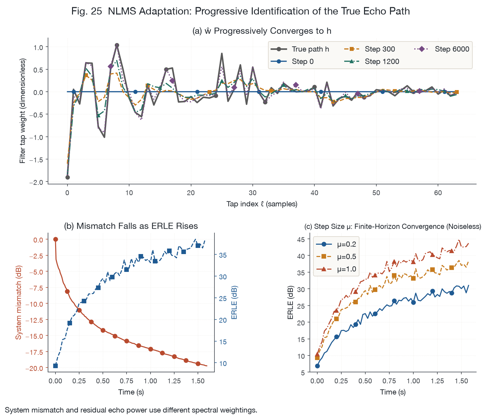

Reading Figure 18(d) together with Figure 25 clarifies how NLMS approximates the coefficients, how mismatch relates to energy attenuation under weighting, and how step size governs convergence. Inspecting Figure 25 (a noiseless, interference-free pure linear path-matching experiment):

- **Figure 25(a)**: Plots tap index $\ell$ on the horizontal axis against dimensionless filter coefficients on the vertical axis, capturing early progressive snapshots ($0$, $300$, $1200$, and $6000$ steps) that visually trace how $\hat{\vec w}[n]$ rises from all zeros to lock onto the main peak, fill in reflection taps, and converge onto the gray true response $h[\ell]$;
- **Figure 25(b)**: Uses dual vertical axes to co-plot the **normalized coefficient mismatch in dB**, $10\log_{10}(\lVert\hat{\vec w}[n]-\vec h\rVert_2^2 / \lVert\vec h\rVert_2^2)$ (left axis, red solid curve), alongside $\mathrm{ERLE}$ (right axis, blue dashed curve, in $\mathrm{dB}$). Although the two curves trend in opposite directions, they are not strict mirror images of equal magnitude: denoting the tap-error vector by $\tilde{\vec w}[n]=\vec h-\hat{\vec w}[n]$, under colored reference excitation the residual echo power equals $\tilde{\vec w}^\top[n]\mathbf R_{xx}\tilde{\vec w}[n]$—weighted by the input autocorrelation matrix $\mathbf R_{xx}$. A minimal two-tap example makes this transparent: suppose the covariance matrix of a zero-mean regression vector is $\mathbf R_{xx}=\operatorname{diag}(100,1)$, and compare two path-error vectors $[0.1,0]^\top$ and $[0,0.1]^\top$. Both have Euclidean norm $0.1$ (identical relative mismatch in dB), yet the former aligns with the high-energy direction to yield residual echo power $100\times 0.1^2=1$, whereas the latter aligns with the weak direction to yield only $1\times 0.1^2=0.01$—a full $20\ \mathrm{dB}$ gap;
- **Figure 25(c)**: Compares convergence trajectories across step sizes $\mu$ over a finite observation window: without observation noise, values of $\mu$ closer to $1$ descend more steeply; in real noisy systems, however, an overly large $\mu$ continuously folds the noise floor into the weights, inflating steady-state misadjustment.

#### Step Size, Regularization, and Persistent Excitation

In practical tuning, $\mu$, $\varepsilon$, and the spectral span of the reference signal jointly determine whether NLMS converges reliably to the true physical path.

The step size $\mu$ governs the trade-off between **convergence speed** and **noise robustness**: increasing $\mu$ accelerates cold-start adaptation and reconvergence after abrupt path changes, whereas under noisy observations or unfrozen double-talk misses, a large step size writes substantially more interference into the taps.

The regularization term $\varepsilon$ must match the physical dimension of the window energy $\|\vec x[n]\|^2$ in the denominator (squared signal amplitude): whether chosen as a fixed absolute energy floor or scaled proportionally with smoothed reference power $P_x$ via $\varepsilon=\eta P_x$ (in which case only the proportionality constant $\eta$ is dimensionless), switching signal representation from floating-point $[-1,1)$ to signed 16-bit integers $[-32768,32767]$ scales energy by $32768^2\approx 1.07\times 10^9$, so an unscaled absolute constant $\varepsilon$ must never be copied across representations. Calibration should sweep across digital silence, low-level noise-floor playback, and nominal playback levels to verify both zero-division stability during silence and unthrottled effective step size during quiet playback.

**Why does a narrowband reference leave a multi-tap filter unable to learn the full path?** From Step 3 of Worked Example 6-1, NLMS adjusts weights only along $\vec x[n]$ at each sample; uniquely determining all $L$ taps in the long-term average sense requires the normal equation $\mathbf R_{xx}\vec w=\vec r_{xd}$ (with $\mathbf R_{xx}=\mathbb{E}[\vec x[n]\vec x^\top[n]]$) to be full-rank and well-conditioned—the condition known as **persistent excitation**. If the far end plays only a steady real sinusoid $x[n]=A\cos(\Omega_0 n+\varphi)$ at $\Omega_0\notin\{0,\pi\}$, all lagged sequences at arbitrary instants are spanned linearly by the two basis functions $\cos(\Omega_0 n)$ and $\sin(\Omega_0 n)$ alone, so $\operatorname{rank}(\mathbf R_{xx})=2$: as soon as $L\ge 3$, the autocorrelation matrix is strictly singular, infinitely many distinct tap vectors cancel this single tone to zero, and echo immediately leaks through the moment far-end audio switches to wideband speech (see Worked Example 6-5).

Even if the reference is not a discrete pure tone, but rather a bandlimited stationary random process with flat power spectral density over a narrow continuous digital angular-frequency band $[-b,b]\subset[-\pi,\pi]$ ($b>0$) and strictly zero out-of-band power, the autocorrelation matrix—though mathematically full-rank—becomes severely ill-conditioned as bandwidth narrows. We can derive this classical Fourier duality relation explicitly:

Normalize the variance of the zero-mean stationary real process $x[n]$ to $r[0]=\mathbb{E}[x^2[n]]=1$. For the Inverse Discrete-Time Fourier Transform (IDTFT) to integrate to $1$ at zero lag, its constant power spectral density over $\Omega_{\mathrm{d}}\in[-b,b]$ must be $S_{xx}(\Omega_{\mathrm{d}})=\pi/b$ (with $S_{xx}(\Omega_{\mathrm{d}})=0$ for $b<|\Omega_{\mathrm{d}}|\le\pi$). Evaluating the autocorrelation sequence $r[k]=\mathbb{E}[x[n]x[n-k]]$ at integer lag $k$ via the Wiener–Khinchin theorem gives

$$\begin{aligned}
r[k]&=\frac{1}{2\pi}\int_{-\pi}^{\pi}
      S_{xx}(\Omega_{\mathrm{d}})\,
      e^{\mathrm{j}\Omega_{\mathrm{d}} k}\,\mathrm{d}\Omega_{\mathrm{d}}\\
&=\frac{1}{2\pi}\int_{-b}^{b}\frac{\pi}{b}
  e^{\mathrm{j}\Omega_{\mathrm{d}} k}\,\mathrm{d}\Omega_{\mathrm{d}}\\
&=\frac{e^{\mathrm{j}kb}-e^{-\mathrm{j}kb}}{\mathrm{j}2kb}
=\frac{\sin(kb)}{kb}
=\operatorname{sinc}\!\left(\frac{kb}{\pi}\right),\quad k\neq 0,
\end{aligned}$$

with the continuous limit giving $r[0]=1$. Consequently, the $3\times 3$ real symmetric Toeplitz autocorrelation matrix (whose $(i,j)$ entry is $r[i-j]$) of an $L=3$ tap regression vector $\vec x[n]=[x[n],x[n-1],x[n-2]]^\top$ takes the explicit form

$$\mathbf R_{xx}=\begin{bmatrix}
1 & \dfrac{\sin b}{b} & \dfrac{\sin(2b)}{2b} \\
\dfrac{\sin b}{b} & 1 & \dfrac{\sin b}{b} \\
\dfrac{\sin(2b)}{2b} & \dfrac{\sin b}{b} & 1
\end{bmatrix}.$$

This $3\times 3$ matrix makes the origin of narrowband ill-conditioning transparent: as the passband half-width $b$ shrinks, $\sin(kb)/(kb)\approx 1-(kb)^2/6$ approaches $1$, causing all three columns to collapse toward the identical vector $[1,1,1]^\top$ so that adjacent samples become nearly collinear. Evaluating eigenvalues across three representative bandwidths confirms this quantitatively:

- Wideband half-band excitation $b=\pi/2$: $r[1]=2/\pi\approx 0.6366$, $r[2]=0$, minimum eigenvalue $\lambda_{\min}\approx 0.0997$, and two-norm condition number $\kappa_2(\mathbf R_{xx})=\lambda_{\max}/\lambda_{\min}\approx 19$, allowing smooth convergence along all three eigen-directions;
- Narrowband excitation $b=\pi/8$: $r[1]\approx 0.9745$, $r[2]\approx 0.9003$, $\lambda_{\min}$ drops precipitously to $\approx 3.57\times 10^{-4}$, and the condition number climbs to roughly $8134$;
- Very narrowband excitation $b=\pi/32$: $r[1]\approx 0.9984$, $r[2]\approx 0.9936$, $\lambda_{\min}$ shrinks to just $\approx 1.38\times 10^{-6}$, and the condition number reaches approximately $2.17\times 10^6$.

Although all three matrices have strictly positive determinants (and are theoretically invertible), a million-fold condition number stretches gradient-descent time constants along weak eigen-directions by a factor of a million and drastically amplifies minor observation noise along high-frequency differential modes on finite speech segments. This is precisely why engineering bring-up verifies hardware paths and maximum achievable ERLE with white noise or broadband sweeps first before measuring convergence speed on real program material (see Exercises [E06-23](#e06-23) and [E06-24](#e06-24)).

We close with one intuitive check: **does a single unit impulse $x=[1,0,0,\ldots]$ constitute persistent excitation?** As the impulse shifts across all $L$ tap slots it sweeps through every standard orthonormal basis direction (the sample outer-product sum equals $\mathbf I_L$), yet each direction appears only once along the entire time axis; under online iteration with $0<\mu<1$, a single sweep cannot drive the initial mismatch to zero (the full three-sample hand calculation and conclusion are left to Exercise [E06-01](#e06-01)).

### 6.2 Practical Linear Adaptation: Frequency-Domain, Subband, Proportionate, Affine Projection, RLS, and Kalman

When room reverberation is long or the sampling rate rises to $48\ \mathrm{kHz}$, running sample-by-sample time-domain NLMS directly hits two walls at once: excessive multiply-accumulate cost and sluggish convergence under colored speech. This section unpacks six engineering improvements along a clear progression: §6.2.1–§6.2.2 split long convolutions into short blocks and accelerate them via FFT using Partitioned-Block Frequency-Domain Adaptive Filtering (PBFDAF); §6.2.3 diagnoses why subband decomposition spawns cross-band aliasing coupling; §6.2.4 concentrates update budgets on sparse dominant peaks via proportionate step sizes (IPNLMS); §6.2.5 couples the most recent $K$ observation directions via Affine Projection (APA) to remove local correlation; §6.2.6 maintains the inverse of an exponentially weighted historical autocorrelation matrix via Recursive Least Squares (RLS); and §6.2.7 introduces Kalman filtering (FDKF / PBFDKF) to model path drift and double-talk observation uncertainty simultaneously.

First tally the multiplication budget of the time-domain baseline. For length-$L$ time-domain NLMS, each sample requires $L$ multiplications for the convolution prediction $\hat{\vec w}^\top[n]\vec x[n]$ and $L$ multiplications for the weight update $\Delta\vec w[n]$; naively recomputing $\|\vec x[n]\|^2$ adds another $L$ multiplications, totaling roughly $3L$ multiplications per sample. Using the sliding-window shift recursion $p_n=p_{n-1}+x^2[n]-x^2[n-L]$ reduces the denominator energy update to $O(1)$ operations (long-running floating-point implementations must initialize from zero and periodically recompute the true sum of squares to prevent rounding drift), yet filtering and weight updates still rigidly consume $2L$ multiplications. For instance, with $L=3$ and input sequence $1,2,3,4$, the previous window energy is $1^2+2^2+3^2=14$, and shifting in $4$ while shifting out $1$ yields $14+4^2-1^2=29$, matching direct recomputation $2^2+3^2+4^2=29$ exactly—yet the $2L$ MACs for prediction and update remain unchanged.

Translating to concrete hardware specs: at narrowband $8\ \mathrm{kHz}$ with $L=1024$ (covering $128\ \mathrm{ms}$), the naive count reaches $3072\times 8000\approx 24.58\text{ million}$ multiplications/s, and even the recursive-energy core still requires roughly $16.38\text{ million}$ multiplications/s; at the $48\ \mathrm{kHz}$, $L=4096$ configuration common in HD conferencing terminals (covering about $85.3\ \mathrm{ms}$), single-channel time-domain core MACs rise to nearly $4\times 10^8$ per second, becoming prohibitive once multiplied across microphone arrays. This directly motivates industry's move toward partitioned frequency-domain and subband architectures.

#### 6.2.1 PBFDAF: From Long Echo Paths to Blockwise Updates

Transforming a $4096$-tap echo path to the frequency domain in one monolithic single-block Frequency-Domain Adaptive Filter (FDAF) would force the system to accumulate $4096$ new samples before executing a single block convolution—incurring $256\ \mathrm{ms}$ of pure framing wait at $16\ \mathrm{kHz}$, which is unacceptable for real-time communication. **Partitioned-Block Frequency-Domain Adaptive Filtering (PBFDAF)** adopts the divide-and-conquer principle of the Multidelay Block Frequency-Domain (MDF; [Soo & Pang, 1990](https://doi.org/10.1109/29.103078)) filter: split the length-$L$ time-domain impulse response into $P=\lceil L/N\rceil$ short partitions of length $N$, wait only for $N$ new samples (e.g., $N=64$ or $128$, just $4$ or $8\ \mathrm{ms}$), and execute overlap-save linear convolution via length-$2N$ Fast Fourier Transforms (FFTs). When $L$ is not an integer multiple of $N$, the trailing slots of the final partition beyond $L$ are fixed to zero; those zero-padded entries do not represent extra learnable physical taps.

First pin down the block, partition, and bin indices. Assuming zero samples for negative time, let $b_m=[x[mN],\ldots,x[mN+N-1]]$ denote the $m$-th newly arrived block of $N$ reference samples. Concatenate the previous block's $N$ historical samples ahead of the new block to form the length-$2N$ overlapping input window $u_m=[b_{m-1},b_m]$, and take its $2N$-point forward transform to obtain the complex spectrum $X(k,m)=\operatorname{FFT}_{2N}(u_m)$ for bins $k=0,\ldots,2N-1$. In parallel, zero-pad the $p$-th time-domain path segment $h_p=[h[pN],\ldots,h[pN+N-1]]$ ($p=0,\ldots,P-1$) with $N$ trailing zeros into $[h_p,0_N]$, and denote its corresponding frequency-domain adaptive weight spectrum by $W_p(k,m)$. The pairing between path partitions and buffered reference spectra is summarized below:

| Time-Domain Path Segment | Paired Reference Spectrum | Physical Role in Current Block Output |
|---|---|---|
| $p=0$, taps $0,\ldots,N-1$ | $X(k,m)$ | Direct and early-reflection echo from current and immediately preceding reference samples |
| $p=1$, taps $N,\ldots,2N-1$ | $X(k,m-1)$ | Echo produced by reference history delayed by $1$ partition |
| $p=P-1$, final $N$ slots | $X(k,m-P+1)$ | Long reverberation tail; trailing slots beyond $L$ in the last partition remain fixed at zero |

This table reveals the core acceleration mechanism of partitioning: the "$p$-th frequency-domain partition" corresponds to the $p$-th segment of time-domain taps, and multiplies precisely the reference spectrum $X(k,m-p)$ computed $p$ blocks earlier and held in a shift buffer. Each time a new block arrives, the system executes only **one** forward FFT on $u_m$ and shifts older spectra one slot down the delay line for direct reuse, eliminating redundant transforms of historical reference blocks. This also enforces a strict state discipline: **even when weight updates are frozen during double-talk, shifting the reference-spectrum delay line must never pause**, or the next block's echo prediction will drift out of alignment with the physical playback timeline.

**Predict the valid half-block first, then form the a priori residual.** When block $m$ arrives, accumulate the product across all $P$ partitions at every bin using the pre-update weights, $Q_m(k)=\sum_{p=0}^{P-1}W_p(k,m)X(k,m-p)$, and take a $2N$-point Inverse Fast Fourier Transform (IFFT) to obtain the length-$2N$ circular-convolution sequence $q_m$. By the overlap-save principle, the first $N$ samples of $q_m$ suffer from circular wrap-around artifacts and must be discarded; only the trailing $N$ samples match the exact linear convolution output $\hat y_m$ for the current block. Writing the block-local index as $r=0,\ldots,N-1$ (omitting the shared bin index $k$ in the first two lines via $W_{p,m}=W_p(k,m)$ and $X_{m-p}=X(k,m-p)$), the causal prediction flow is

$$\begin{aligned}
Q_m&=\sum_{p=0}^{P-1}W_{p,m}X_{m-p},\\
q_m&=\operatorname{IFFT}_{2N}(Q_m),\\
\hat y_m[r]&=q_m[N+r],\\
e_m[r]&=d_m[r]-\hat y_m[r].
\end{aligned}\tag{6-4}$$

Provided each partition's frequency-domain weights $W_p(k,m)$ genuinely arise from transforming a time-domain vector whose valid taps occupy the first $N$ positions (only the first $L-(P-1)N$ positions in a short final partition) with trailing zeros in the second half, the trailing half-block $\hat y_m$ extracted by Eq. (6-4) is algebraically identical to direct length-$L$ time-domain FIR convolution.

**The error spectrum must likewise zero-pad its first half-block.** Once the length-$N$ valid a priori residual $e_m$ is obtained, it must be explicitly prepended with $N$ zeros as $[0_N,e_m]$ before transforming into $E(k,m)=\operatorname{FFT}_{2N}([0_N,e_m])$. Taking a shortcut by subtracting the full circular-convolution spectrum $Q_m$ directly from the observation spectrum allows the discarded wrap-around terms in the first half-block to leak into the frequency-domain error and corrupt the gradient (proved in matrix form in §6.2.2; [Shynk, *IEEE Signal Processing Magazine*, 1992, §IV](https://course.ece.cmu.edu/~ece792/handouts/Shynk92.pdf) systematically compares overlap-save valid-region selection and gradient-constraint variants).

Asymptotically, every block's prediction and correlation sweeps across all $P=\lceil L/N\rceil$ partitions: without time-domain gradient constraints, the core cost per new sample scales as roughly $O(\log N + L/N)$; enforcing full time-domain projection ("IFFT back to time domain, zero the trailing $N$ invalid slots, FFT back to frequency domain") on all $P$ partitions every block adds roughly $O((L/N)\log N)$ transform overhead. Exact constant factors further depend on exploiting real-signal conjugate symmetry across half-spectra, power-smoothing schemes, and constraint cadence (see [KU Leuven DSP-CIS Lecture Notes, Chapter 13](https://homes.esat.kuleuven.be/~dspuser/DSP-CIS/2018-2019/material/chapter13.pdf)).

#### Worked Example 6-2: Multiplication Counts of Selected Core PBFDAF Operators

**Inputs and conventions**: Set total filter length $L=1024$, block size $N=128$, and sampling rate $8\ \mathrm{kHz}$, and compare sample-by-sample time-domain NLMS against PBFDAF with $P=L/N=8$ partitions and FFT size $2N=256$ in terms of real multiplications for **selected core operators** (illustrating the order-of-magnitude reduction from block partitioning rather than benchmarking optimized real-FFT libraries or end-to-end runtime).

**Time-domain NLMS baseline**: Each sample takes $L$ multiplications for filtering and $L$ for weight update; naive window-energy recomputation adds $L$, giving $3L=3072$ real multiplications/sample, while recursive sliding energy reduces core operations to $2L=2048$ real multiplications/sample.

**Blockwise PBFDAF breakdown**: Every time $N=128$ new reference samples arrive, one block executes:

1. $1$ forward $256$-point transform on the concatenated input block $u_m$, while the previous $7$ historical partition spectra are reused directly via delay-line shifting;
2. $8$ partitionwise length-$256$ complex bin-by-bin multiplications and accumulation, followed by $1$ $256$-point IFFT to extract the trailing valid prediction $\hat y_m$;
3. $1$ $256$-point FFT on the zero-padded valid error $[0_{128},e_m]$, followed by $8$ length-$256$ complex multiplications with conjugated reference spectra to form frequency-domain update directions;
4. If strict per-partition time-domain gradient constraints are enabled, each partition performs $1$ IFFT to zero out its trailing $128$ invalid slots and $1$ FFT back to the frequency domain (adding $2P=16$ transforms); unconstrained PBFDAF omits this step, while round-robin intermittent constraint amortizes it by the fraction of constrained partitions.

For transparent hand-verifiable arithmetic without halving for real conjugate symmetry (industrial real FFTs store only $N+1=129$ unique bins and roughly halve multiplications), count each full $2N=256$-point complex transform as $4N\log_2(2N)=4\times 128\times 8=4096$ real multiplications and each $256$-point complex vector multiplication as $256\times 4=1024$ real multiplications:

- **Unconstrained core count**: $3$ transforms plus $2\times 8$ complex spectrum multiplications per block yield $3\times 4096 + 16\times 1024 = 12288+16384=28672$ multiplications/block, or $28672/128 = 224$ per sample;
- **Fully constrained per-block core count**: Adding $16$ constraint transforms ($16\times 4096=65536$ multiplications/block) totals $94208$ multiplications/block, or $94208/128 = 736$ per sample.

If, as in this book's instructional code, the magnitude squared $|X|^2=(\operatorname{Re} X)^2+(\operatorname{Im} X)^2$ is explicitly recomputed across all $8$ partitions every block, that adds $2\times 256\times 8=4096$ real multiplications/block ($32$ per sample), raising the two totals to $256$ and $768$ multiplications/sample (still excluding additions, divisions, and step-size scaling). Comparing just these core multiply-accumulate counts, $224$ and $736$ reduce naive time-domain NLMS ($3072$) by factors of roughly $13.7\times$ and $4.17\times$ (or roughly $9.1\times$ and $2.8\times$ relative to the $2048$ recursive-energy baseline). Note that this speedup is relative to **sample-by-sample time-domain NLMS**; if the baseline is already a "frequency-domain multi-tap NLMS" sharing the same block size, partition count, and constraint schedule, both execute the same frequency-domain operator with no extra speedup (see [MathWorks Frequency-Domain Adaptive Filter Documentation](https://www.mathworks.com/help/dsp/ref/dsp.frequencydomainadaptivefilter-system-object.html) for partitioned and constrained modes).

**Trade-off between block length and framing latency.** At $N=128$ and $8\ \mathrm{kHz}$, gathering one new block takes $128/8000=16\ \mathrm{ms}$; crucially, the leading half of the $2N=256$-point FFT comes from the already buffered previous block and **does not incur an additional $16\ \mathrm{ms}$ look-ahead wait**. End-to-end system latency adds sound-card playback/capture buffering and OS scheduling jitter on top. Fixing total path length at $L=4096$ and $16\ \mathrm{kHz}$ (total span $256\ \mathrm{ms}$), adjusting $N$ trades off single-block framing wait against the number of partitions traversed per block:

| New Block $N$ (samples) | Partitions $P$ | FFT Size $2N$ | New-Data Framing Time | State / Latency Interpretation |
|---:|---:|---:|---:|---|
| 64 | 64 | 128 | 4 ms | Short framing wait, but 64 partitions to traverse and buffer |
| 128 | 32 | 256 | 8 ms | Common latency-vs.-compute sweet spot in real-time voice communications |
| 256 | 16 | 512 | 16 ms | Halves partition count, but lengthens framing wait to 16 ms |

Practical selection must evaluate framing delay inside the device's full acoustic loop latency budget—a larger $N$ does not automatically minimize total runtime.

#### Worked Example 6-3: Two Samples per Block—Why Discard the First Half-Block?

**Inputs and conventions**: Take the minimal partitioned size $N=2$, $P=2$ ($L=4$), fixed impulse response $h=[1,2\mid 3,4]$ (vertical bar marking the partition boundary), input reference $x=[1,2,3,4]$, and zero samples for negative time. First evaluate direct time-domain linear convolution via Eq. (6-1) as ground truth:

- $y[0]=1\times 1=1$;
- $y[1]=1\times 2+2\times 1=4$;
- $y[2]=1\times 3+2\times 2+3\times 1=10$;
- $y[3]=1\times 4+2\times 3+3\times 2+4\times 1=20$, giving the true output $[1,4,10,20]$.

Now reproduce it block by block using overlap-save partitioned convolution:

1. **Block $m=0$ (output instants $n=0,1$)**: Concatenate two leading history zeros with the new block $[1,2]$ to form $u_0=[0,0,1,2]$, and circularly convolve it over length $4$ with the zero-padded first partition $[1,2,0,0]$ to obtain $[4,0,1,4]$ (the trailing $2\times 2=4$ wraps around to index $0$); the previous block spectrum $X_{-1}$ is zero. Discarding the first two samples $[4,0]$ leaves the valid trailing half $\hat y_0=[1,4]$, matching ground truth exactly.
2. **Block $m=1$ (output instants $n=2,3$)**: Concatenate the previous block $[1,2]$ with the new block $[3,4]$ to form $u_1=[1,2,3,4]$.

    - First-partition branch ($p=0$): Full five-point linear convolution of $u_1=[1,2,3,4]$ with unpadded $[1,2]$ produces $[1,4,7,10,8]$; under length-$4$ circular convolution, the trailing 5th sample $8$ wraps around onto index $0$ ($1+8=9$), yielding $[9,4,7,10]$. Index $0$ is corrupted by circular wrap-around and index $1$, though unaliased, belongs to the previous block; discarding both leading samples $[9,4]$ leaves the clean trailing pair $[7,10]$.
    - Second-partition branch ($p=1$): Read the **previous** block input $u_0=[0,0,1,2]$ and circularly convolve over length $4$ with the zero-padded second partition $[3,4,0,0]$ to obtain $[8,0,3,10]$ (the trailing $2\times 4=8$ wraps around to index $0$). Again discard the leading pair $[8,0]$ to extract the valid trailing pair $[3,10]$.
    - Summing the valid half-blocks across branches gives $[7,10]+[3,10]=[10,20]$, matching direct time-domain convolution exactly. Reading the current block $u_1$ in the second partition or keeping the first two circular-convolution entries would immediately break equivalence.

**Frequency-domain update equation of PBFDAF.** Let $E_m=E(k,m)$ be the a priori error spectrum obtained by transforming the zero-padded valid residual $[0_N,e_m]$ at block $m$ and bin $k$, let $\mu$ be the block step size, and let $\delta>0$ be a power floor preventing division by zero during silence. Normalizing at fixed bin $k$ by the total reference power summed across all $P$ active partitions gives the **pre-projection candidate weight** update:

$$\begin{aligned}
R_m&=\delta+\sum_{q=0}^{P-1}|X_{m-q}|^2,\\
\Delta W_{p,m}&=\mu\frac{E_mX_{m-p}^*}{R_m},\\
\widetilde W_{p,m+1}&=W_{p,m}+\Delta W_{p,m}.
\end{aligned}\tag{6-5}$$

In Eq. (6-5), the numerator for partition $p$ must multiply by the conjugated reference spectrum delayed by $p$ blocks, $X_{m-p}^*$ (because the prediction spectrum is $\sum_p W_{p,m}X_{m-p}$, the sensitivity direction of partition $p$ is given by the complex conjugate of its paired input $X_{m-p}$); the denominator $R_m$ pools the energy of all $P$ historical blocks participating in the current bin's prediction (industrial code also commonly applies cross-block exponential smoothing to the power spectrum to prevent wild denominator swings on sudden speech bursts).

**Stability range of block step size $\mu$.** Without time-domain gradient projection and when $\delta\ll\sum_{q=0}^{P-1}|X_{m-q}|^2$, substituting $\Delta W_{p,m}$ back into the block's circular-convolution prediction spectrum gives $\Delta Q_m=\sum_{p=0}^{P-1}\Delta W_{p,m}X_{m-p}=\mu E_m\frac{\sum_p|X_{m-p}|^2}{R_m}\approx\mu E_m$. Because the leading-zero-padded error spectrum satisfies the overlap-save projector identity $\mathbf C\vec E_m=\vec E_m$ (Eq. (6-6) in §6.2.2), the a posteriori valid error spectrum contracts approximately as

$$\vec E_m^+=\vec D_m-\mathbf C(\vec Q_m+\Delta\vec Q_m)
=\vec E_m-\mathbf C\Delta\vec Q_m\approx(1-\mu)\vec E_m,$$

establishing the single-block stability range $0<\mu<2$. Enforcing the time-domain valid-tap projector $\mathbf G=\mathbf F\mathbf U\mathbf U^\top\mathbf F^{-1}$ of §6.2.2 (whose diagonal average is $N/(2N)=1/2$) roughly halves effective update energy per partition, further widening practical stability margins.

Given the candidate spectrum $\widetilde W_{p,m+1}$ from Eq. (6-5), unconstrained PBFDAF sets $W_{p,m+1}=\widetilde W_{p,m+1}$ directly, whereas strictly constrained PBFDAF performs a cross-bin projection independently on each partition: take the $2N$-point IFFT of $\widetilde W_{p,m+1}(k)$ back to the time domain, force the trailing $N$ circular-correlation invalid slots (and any trailing zero-padded slots in a short last partition) to zero, and take the FFT to obtain the committed next-block weights $W_{p,m+1}(k)$. In engineering debug order, one complete closed-loop block comprises six steps:

1. Concatenate the previous reference block with the incoming block to form $u_m$, compute $X_m$, and push it onto the $P$-stage reference-spectrum delay line;
2. Multiply and accumulate the **pre-update** weights $W_{p,m}$ with $X_m,\ldots,X_{m-P+1}$ per bin, then take the IFFT and extract the trailing half-block as echo prediction $\hat y_m$;
3. Form the valid a priori residual $e_m=d_m-\hat y_m$ as the block's audio output;
4. Zero-pad the leading half to build $[0_N,e_m]$, take the FFT to get $E_m$, and compute each partition's candidate spectrum $\widetilde W_{p,m+1}$ via Eq. (6-5);
5. Apply the chosen time-domain valid-tap zeroing projection (every block or round-robin) and commit $W_{p,m+1}$;
6. Cache the current time-domain reference block $b_m$ for concatenating the next block (under a double-talk freeze, skip only Steps 4 and 5 while keeping Steps 1–3 and 6 running normally).

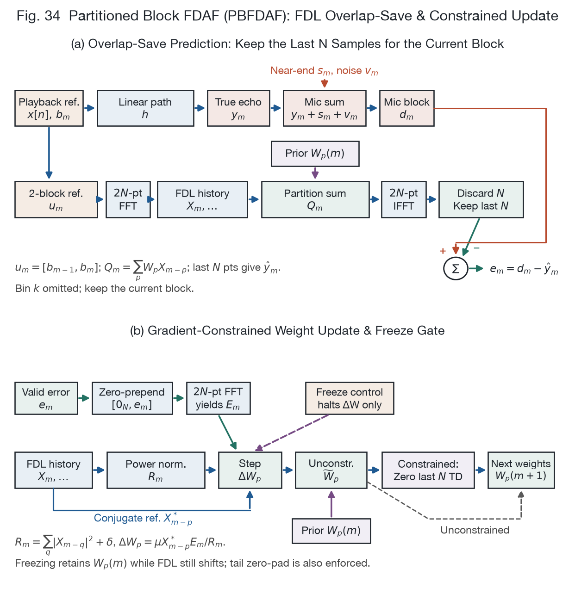

Comparing the two panels of Figure 34 separates the exact roles and locations of the two truncation/zero-padding operations:

- **Figure 34(a)**: The upper path depicts the physical acoustic echo plus near-end speech and noise, while the lower path depicts the digital PBFDAF prediction chain: buffered reference spectra $X_m,\ldots,X_{m-P+1}$ shift right block by block, multiply the old weights $W_p(m)$, sum, and undergo an IFFT, after which the forward branch applies the first crop—**discarding the leading $N$ circular-aliasing samples** and subtracting only the trailing $N$ samples from $d_m$;
- **Figure 34(b)**: Shows error backpropagation and weight updates: the valid residual $e_m$ is first zero-padded in its leading half ($0_N$) before the FFT generates candidate increments; along the upper gradient-constrained branch, the second crop executes in the time domain—**zeroing the trailing $N$ invalid taps of the candidate weights** before transforming back to the frequency domain. The purple dashed line denotes double-talk freeze control, which gates only weight commits without halting reference shifting or a priori prediction in panel (a).

#### 6.2.2 Frequency-Domain Multi-Tap NLMS: What Are the Taps and When Does It Equal PBFDAF?

Papers and open-source discussions frequently refer to certain algorithms as "frequency-domain multi-tap NLMS." Whenever that term appears, the first question to ask is: **along which dimension are the multiple taps indexed?** Below we separate the two most common mathematical structures and derive the exact overlap-save block gradient in matrix form.

**First structure: stacking $P$ reference block lags at a fixed bin.** Fixing bin $k$, stack the current and past $P-1$ reference block spectra into the $P\times 1$ complex column vector $\vec X_m(k)=[X(k,m),X(k,m-1),\ldots,X(k,m-P+1)]^\top$ and the $P$ partition weights into $\vec W_m(k)=[W_0(k,m),\ldots,W_{P-1}(k,m)]^\top$ (using plain transpose $^\top$ rather than conjugate transpose $^H$ so that the prediction dot product writes directly as $\vec W_m^\top(k)\vec X_m(k)$). Equation (6-5) then collapses at each bin into vector form:

$$\begin{aligned}
\Delta\vec W_m(k)
&=\mu\frac{\vec X_m^*(k)E(k,m)}
          {\|\vec X_m(k)\|_2^2+\delta},\\
\widetilde{\vec W}_{m+1}(k)
&=\vec W_m(k)+\Delta\vec W_m(k),
\end{aligned}$$

where superscript $*$ denotes elementwise complex conjugation. For example, at a bin with $P=2$, $\vec X=[1,2]^\top$, $E=0.3$, $\mu=0.5$, and $\delta=1$, the denominator is $1^2+2^2+1=6$, giving candidate increments $0.5\times 0.3\times[1,2]^\top/6=[0.025,0.05]^\top$ across the two partitions.

At first glance, this looks like "$2N$ independent $P$-tap complex NLMS filters, one per bin." Why does it genuinely optimize the time-domain valid residual, and why can neither leading error zero-padding nor time-domain weight projection be dropped? A four-step matrix derivation proves this rigorously.

Let $\mathbf F\in\mathbb{C}^{2N\times 2N}$ be the standard forward DFT matrix whose $(k,r)$ entry is $e^{-\mathrm{j}2\pi kr/(2N)}$ (for DFT matrix identities and circular convolution properties, see [Chapter 0 §0.2](00_math-foundations.md#sec-0-2)). Its conjugate transpose satisfies $\mathbf F^H\mathbf F=2N\,\mathbf I_{2N}$, so the inverse transform normalized by $1/(2N)$ obeys

$$\begin{aligned}
\mathbf F^{-1}&=\frac{1}{2N}\mathbf F^H,\\
\mathbf F^H&=2N\,\mathbf F^{-1},\qquad
(\mathbf F^{-1})^H=\frac{1}{2N}\mathbf F.
\end{aligned}$$

Next define two real selection/zero-padding matrices: the trailing-half selector $\mathbf S=[\mathbf 0_{N\times N}\ \mathbf I_N]\in\mathbb{R}^{N\times 2N}$ (left-multiplying extracts the trailing $N$ samples, while $\mathbf S^\top$ prepends $N$ zeros) and the leading-half zero-padder $\mathbf U=[\mathbf I_N\ \mathbf 0_{N\times N}]^\top\in\mathbb{R}^{2N\times N}$ (appending $N$ trailing zeros to valid time-domain taps $\vec w_p\in\mathbb{R}^N$, while $\mathbf U^\top=[\mathbf I_N\ \mathbf 0_{N\times N}]$ extracts the leading $N$ valid taps).

Throughout this cross-bin matrix derivation, denote full-block $2N\times 1$ frequency-domain column vectors stacked over all $2N$ bins without a bin argument $(k)$ as $\vec W_{p,m},\vec X_{m-p},\vec Q_m,\vec D_m,\vec E_m\in\mathbb{C}^{2N\times 1}$ (distinct from the single-bin $P\times 1$ vector $\vec X_m(k)$ above). Letting $\vec Q_m=\sum_{p=0}^{P-1}\vec W_{p,m}\odot\vec X_{m-p}$ (where $\odot$ denotes elementwise Hadamard product), the valid time-domain prediction is $\hat{\vec y}_m=\mathbf S\mathbf F^{-1}\vec Q_m$. Prepending zeros to the valid residual $\vec e_m=\vec d_m-\hat{\vec y}_m$ via $\mathbf S^\top$ and transforming gives the exact error spectrum vector:

$$\begin{aligned}
\vec D_m&=\mathbf F\mathbf S^\top\vec d_m,\\
\mathbf C&=\mathbf F\mathbf S^\top\mathbf S\mathbf F^{-1},\\
\vec E_m&=\mathbf F\mathbf S^\top(\vec d_m-\mathbf S\mathbf F^{-1}\vec Q_m)\\
&=\vec D_m-\mathbf C\vec Q_m.
\end{aligned}\tag{6-6}$$

Because $\mathbf S^\top\mathbf S=\operatorname{diag}(\mathbf 0_N,\mathbf I_N)\neq\mathbf I_{2N}$, the frequency-domain projection matrix $\mathbf C$ in the second line of Eq. (6-6) is decidedly non-diagonal—it is a circular-convolution operator coupling all bins—so $\vec E_m$ is **not generally equal to** $\vec D_m-\vec Q_m$. Verifying on the four-point numbers of Worked Example 6-3: let a single-partition true path be $[1,2]$ with the filter already converged to $[1,2]$; input $u_1=[1,2,3,4]$ yields circular convolution $q=[9,4,7,10]$, while the microphone's true valid block is $\vec d=[7,10]^\top$. By Eq. (6-6), $\vec e=[7,10]^\top-[7,10]^\top=[0,0]^\top$, zero-padding gives $\vec E_m=\vec 0$, and the converged filter stays put. Dropping $\mathbf C$ and computing

$$\vec D_m-\vec Q_m=\mathbf F[0,0,7,10]^\top-\mathbf F[9,4,7,10]^\top
=\mathbf F[-9,-4,0,0]^\top\neq\vec 0$$

injects spurious wrap-around values $[-9,-4]$ as a nonzero false gradient even at perfect convergence, kicking the converged taps off truth.

Now substitute valid time-domain taps $\vec w_p\in\mathbb{R}^N$ into the forward path: $\vec W_{p,m}=\mathbf F\mathbf U\vec w_p$; elementwise multiplication by $\vec X_{m-p}$ is left-multiplication by $\operatorname{diag}(\vec X_{m-p})$, followed by $\mathbf F^{-1}$ and $\mathbf S$, yielding the $N\times N$ linear map from partition $p$ to the current valid output:

$$\mathbf A_{p,m}=\mathbf S\mathbf F^{-1}
\operatorname{diag}(\vec X_{m-p})\mathbf F\mathbf U.$$

Define the current-block squared valid-residual objective $J_m=\frac{1}{2}\|\vec e_m\|_2^2$, take its negative gradient with respect to real $\vec w_p$, and substitute $\mathbf F^H=2N\,\mathbf F^{-1}$ and $(\mathbf F^{-1})^H=\frac{1}{2N}\mathbf F$:

$$\begin{aligned}
\vec e_m&=\vec d_m-\sum_{p=0}^{P-1}\mathbf A_{p,m}\vec w_p,\\
J_m&=\frac{1}{2}\|\vec e_m\|_2^2,\\
-\nabla_{\vec w_p}J_m&=\mathbf A_{p,m}^H\vec e_m.
\end{aligned}\tag{6-7}$$

Expanding the final line $\mathbf A_{p,m}^H\vec e_m$ explicitly (reversing matrix order under conjugate transpose, conjugating diagonal entries, and reducing conjugate transposes of real matrices $\mathbf S,\mathbf U$ to ordinary transposes):

$$\begin{aligned}
\mathbf A_{p,m}^H\vec e_m
&=\bigl(\mathbf S\mathbf F^{-1}
  \operatorname{diag}(\vec X_{m-p})\mathbf F\mathbf U\bigr)^H\vec e_m\\
&=\mathbf U^\top\mathbf F^H
  \operatorname{diag}(\vec X_{m-p}^*)\,
  (\mathbf F^{-1})^H\mathbf S^\top\vec e_m\\
&=\mathbf U^\top\bigl(2N\,\mathbf F^{-1}\bigr)
  \operatorname{diag}(\vec X_{m-p}^*)
  \left(\frac{1}{2N}\mathbf F\right)\mathbf S^\top\vec e_m\\
&=\mathbf U^\top\mathbf F^{-1}
  \bigl(\vec X_{m-p}^*\odot(\mathbf F\mathbf S^\top\vec e_m)\bigr)\\
&=\mathbf U^\top\operatorname{IFFT}_{2N}(\vec X_{m-p}^*\odot\vec E_m).
\end{aligned}$$

This delivers the exact block gradient: the intermediate factors $2N$ and $\frac{1}{2N}$ cancel identically, $\mathbf F\mathbf S^\top\vec e_m$ is precisely the zero-padded valid error spectrum $\vec E_m$ of Eq. (6-6), and left-multiplying by $\mathbf U^\top$ retains the **first $N$ valid time-domain samples** of the IFFT (for real inputs and errors, imaginary parts cancel identically to zero). The mathematical identities of all related variants follow immediately:

- Without per-bin power division, retaining valid-tap projection $\mathbf U^\top$ across all partitions computes the exact **time-domain block LMS gradient** via FFT;
- Equation (6-5) pre-multiplies each bin by the diagonal preconditioner $R_m(k)^{-1}$ prior to projection, accelerating convergence in weak bands of colored speech; because the frequency-domain valid-tap projector $\mathbf G=\mathbf F\mathbf U\mathbf U^\top\mathbf F^{-1}$ mixes bins and generally does not commute with the diagonal matrix $\operatorname{diag}(\vec R_m)^{-1}$, constrained PBFDAF is not $2N$ mutually insulated independent complex NLMS filters.

The table below clarifies five frequently conflated names and their equivalence conditions:

| Name or Implementation | "Taps" and Update Timing | Relationship to PBFDAF in This Book |
|---|---|---|
| Sample-by-sample time-domain NLMS | $L$ sample-level lags; updates immediately after each sample's a priori error | Fits the same time-domain FIR, but changes weights mid-block, following a different trajectory |
| Time-domain block LMS / shared-scalar normalized variant | $L$ sample-level lags; whole block error computed from one old weight vector, updated at block end | FFT implementation without per-bin preconditioning and with time-domain projection computes the exact same block gradient |
| Single-partition FDAF | $P=1$; single long FFT spans the entire path | Special case $P=1$ of partitioning; incurs long framing wait on long paths |
| Partitioned overlap-save frequency-domain multi-tap NLMS | $P$ reference **block** lags per bin; generates candidates via Eq. (6-5) and projects | Strictly block-by-block equivalent when block size, FFT scaling, valid-region zero-padding, denominator, and projection all match |
| Conventional windowed STFT same-bin cross-frame filtering | Multiple analysis **frame** lags per bin; separate analysis/synthesis windows and hop | Similar-looking update form, but omitting cross-band terms does not generally equal exact time-domain linear convolution |

**Continuing Worked Example 6-3: how two adaptive blocks remove invalid taps.** Set $N=P=2$ ($L=4$), $\mu=0.5$, $\delta=1$, zero initial weights and negative-time reference, and test sequences $x=[1,0,0,0]$, $d=[1,0,2,0]$ (companion script [`aec_partitioned_demo.py`](../codes/chapters/ch06/aec_partitioned_demo.py)):

1. **Block $m=0$**: Overlapping input $u_0=[0,0,1,0]$ has four-point FFT $X_0=[1,-1,1,-1]$. With zero old weights, valid error $e_0=[1,0]$ zero-pads and transforms to $E_0=[1,-1,1,-1]=X_0$, with bin denominator $|X_0|^2+\delta=1+1=2$. By Eq. (6-5), the first partition receives frequency increment $\Delta W_{0,0}=0.5\times X_0^*\odot E_0/2=[0.25,0.25,0.25,0.25]$, whose IFFT is $[0.25,0,0,0]$ (trailing pair already zero); partition $1$ stays all zero since $X_{-1}=\vec 0$.
2. **Block $m=1$**: Incoming samples are zero, yet the concatenated window is $u_1=[1,0,0,0]$, giving $X_1=[1,1,1,1]$ while $X_0=[1,-1,1,-1]$ remains buffered. A priori prediction is zero, valid error $e_1=[2,0]$ transforms to $E_1=[2,-2,2,-2]$, and the pooled denominator is $|X_1|^2+|X_0|^2+\delta=1+1+1=3$.

    - First partition ($p=0$): $X_1^*\odot E_1=[2,-2,2,-2]$ scaled by $\mu/3=1/6$ yields $[1/3,-1/3,1/3,-1/3]$, whose four-point IFFT is $[0,0,1/3,0]$; adding the previous $[0.25,0,0,0]$ produces candidate time-domain vector $[0.25,0,1/3,0]$;
    - Second partition ($p=1$): $X_0^*\odot E_1=[2,2,2,2]$ scaled by $1/6$ has four-point IFFT $[1/3,0,0,0]$.

3. **Why zero the trailing half?** Look at slot $2$ (zero-indexed, i.e., the third entry $1/3$) of the first partition's candidate $[0.25,0,1/3,0]$: it represents lag $2$ inside partition $0$, which is the exact same physical lag $2$ already represented by the leading valid tap of partition $1$, $[1/3,0,0,0]$. Without time-domain gradient projection zeroing the trailing two slots of partition $0$, the same physical lag would be double-counted across partitions and the nonzero invalid entry in slot $2$ would break overlap-save assumptions on the next circular convolution. Zeroing the trailing $N$ entries per partition yields concatenated valid taps $[0.25,0\mid 1/3,0]$, restoring unique four-tap FIR semantics.

#### Worked Example 6-4: Why Per-Bin Normalization Differs from Time-Domain NLMS

**Inputs and conventions**: Take single partition $N=2$, $P=1$, zero initial weights, $\mu=\delta=1$, overlap-save input $u=[0,0,1,2]$, and valid microphone block $d=[1,0]$ (so valid a priori error $e=[1,0]$ zero-pads to $[0,0,1,0]$). Using standard forward DFT convention $e^{-\mathrm{j}2\pi kr/4}$ and $1/4$ IFFT scaling, compute $X(k)$, $E(k)$, denominator $|X(k)|^2+1$, and candidate increment $\Delta W(k)=X^*(k)E(k)/(|X(k)|^2+1)$ bin by bin:

| $k$ | $X(k)$ | $E(k)$ | $\lvert X(k)\rvert^2+1$ | Candidate Increment $\Delta W(k)$ |
|---:|---:|---:|---:|---:|
| 0 | $3$ | $1$ | $10$ | $3/10$ |
| 1 | $-1+2\mathrm{j}$ | $-1$ | $6$ | $(1+2\mathrm{j})/6$ |
| 2 | $-1$ | $1$ | $2$ | $-1/2$ |
| 3 | $-1-2\mathrm{j}$ | $-1$ | $6$ | $(1-2\mathrm{j})/6$ |

Verify conjugation sign on row $k=1$: $X(1)=0+0+1e^{-\mathrm{j}\pi}+2e^{-\mathrm{j}3\pi/2}=-1+2\mathrm{j}$, whose conjugate is $X^*(1)=-1-2\mathrm{j}$; multiplying by $E(1)=e^{-\mathrm{j}\pi}=-1$ gives $1+2\mathrm{j}$, and dividing by $|{-1+2\mathrm{j}}|^2+1=5+1=6$ yields $(1+2\mathrm{j})/6$.

Taking the four-point IFFT of the last column: index $0$ equals $\frac{1}{4}[3/10 + 1/6 - 1/2 + 1/6]=1/30$; at index $1$, multiplying by phase factors $[1,\mathrm{j},-1,-\mathrm{j}]$ cancels the imaginary parts of $(-2\pm\mathrm{j})/6$ and sums the real parts to $\frac{1}{4}(3/10-2/6+1/2-2/6)=1/30$. The full four-point candidate is $[1/30,1/30,-2/15,11/30]$, and zeroing the trailing invalid half yields the valid two-tap update $[1/30,\ 1/30]^\top$.

**Contrast with the time-domain block gradient**: Without per-bin division, $\operatorname{IFFT}(X^*\odot E)$ equals $[1,0,0,2]$, whose leading two valid taps are $[1,0]^\top$—regardless of which shared scalar energy divides this vector externally, the second tap's increment stays identically $0$. Per-bin power preconditioning attenuates the strong bin $k=0$ (dividing by $10$) while boosting the weak bin $k=2$ (dividing only by $2$), rotating the parameter-space update direction after time-domain projection and activating tap $1$. That algebraic rotation is both why frequency-domain preconditioning accelerates colored-signal convergence and why its trajectory differs from time-domain NLMS.

#### Worked Example 6-5: A Tiny Prediction Residual Does Not Prove Path Identification

In [`aec_partitioned_demo.py`](../codes/chapters/ch06/aec_partitioned_demo.py) with fixed seed `2094`, define a true nine-tap sparse path $h=[0,0,0.7,-0.2,0.08,0,0,0,0.05]$ and generate noiseless microphone observations via direct linear convolution; configure instructional PBFDAF with $N=16$, $L=9$, $\mu=0.3$, $\delta=0.05$. Train separately for $4096$ samples using either "standard normal wideband white noise" or a "period-$8$ pure sinusoid," then freeze the weights and evaluate both on the **same** $1024$-sample independent wideband white-noise holdout:

| Training Reference | Final-1024 A Priori Residual MSE | Post-Training Relative Path Error $\lVert\hat h-h\rVert_2/\lVert h\rVert_2$ | Frozen Wideband Holdout Residual MSE |
|---|---:|---:|---:|
| Wideband white noise | $4.03\times10^{-27}$ | $3.27\times10^{-16}$ | $7.52\times10^{-32}$ |
| Period-8 pure tone | $1.11\times10^{-8}$ | $0.868$ | $0.382$ |

Look at row 2: by the end of pure-tone training, the a priori residual mean square has dropped to $1.11\times 10^{-8}$ (over $70\ \mathrm{dB}$ training attenuation), appearing thoroughly converged; yet relative coefficient error remains $86.8\%$, and the moment weights are frozen and tested on wideband audio, holdout residual MSE rises to $0.382$. The cause mirrors §6.1.2: a period-$8$ sinusoid excites only a two-dimensional frequency subspace, leaving every orthogonal tap degree of freedom unconstrained. Adaptive-filter acceptance must therefore include wideband excitation or cross-program holdout tests rather than judging convergence solely from training residual decay on narrowband clips.

**Second frequently conflated structure: conventional windowed STFT same-bin cross-frame filtering (CTF).** Speech enhancement and neural front-ends often operate in standard windowed overlapping Short-Time Fourier Transform (STFT) coordinates. Linearly combining only past frames of the *same* STFT bin (the Convolutive Transfer Function, CTF, approximation) resembles Eq. (6-5), yet analysis/synthesis windows and frame-hop decimation generally require **cross-band coupling terms** from neighboring bins to represent an arbitrary time-domain FIR exactly (complete derivation in [Avargel & Cohen, *IEEE TASLP*, 2007, §II, Eqs. (7)–(11)](https://webee.technion.ac.il/Sites/People/IsraelCohen/Publications/TASL_May2007.pdf)).

A minimal two-point non-overlapping rectangular-window DFT suffices to compute this cross-band term: let the true echo path be a unit delay $y[n]=x[n-1]$, and define frame $m$'s two DFT bins (from samples $2m$ and $2m+1$) as $X_{0,m}=x[2m]+x[2m+1]$ and $X_{1,m}=x[2m]-x[2m+1]$. Inverting gives $x[2m-1]=\frac{1}{2}(X_{0,m-1}-X_{1,m-1})$ and $x[2m]=\frac{1}{2}(X_{0,m}+X_{1,m})$, so the zero-frequency output bin $Y_{0,m}=x[2m-1]+x[2m]$ of the true output frame $[x[2m-1],x[2m]]$ is exactly

$$\begin{aligned}
Y_{0,m}&=\frac{1}{2}(X_{0,m-1}-X_{1,m-1})
         +\frac{1}{2}(X_{0,m}+X_{1,m}).
\end{aligned}$$

Half of the DC output bin $Y_{0,m}$ comes from the DC input $X_0$, and half comes from the Nyquist input $X_1$; any same-bin filter using only $X_{0,m},X_{0,m-1}$ omits $X_1$'s contribution entirely (unless the time-domain path is nonzero strictly at integer frame multiples $2q$).

Two practical techniques in industrial open-source code merit note: first, [SpeexDSP's `mdf.c`](https://gitlab.xiph.org/xiph/speexdsp/-/blob/8e29a256ef0235ebbe7fcb8417b5ac7731eb8307/libspeexdsp/mdf.c) implements Alternating Unconstrained MDF (AUMDF), updating all $P$ partitions in the frequency domain each block while running the IFFT/FFT valid-tap zeroing projection on only $1$ (or a few) partitions per block, cutting Step-4 constraint transform cost by $P\times$; second, [WebRTC AEC3](https://webrtc.googlesource.com/src/+/0467d2b91cc20b9b001c2bbb73d43ea6b2491f3e/modules/audio_processing/aec3/adaptive_fir_filter.cc) layers dynamic per-bin step-size gains driven by error spectra, excitation thresholds, and amplifier saturation flags atop partitioned filtering (for source-code walkthroughs, see the [Research Manual](../codes/chapters/ch00/research_en/02_aec_wpe_separation.md#aec)).

#### 6.2.3 Subband AEC: Band Splitting, Cross-Terms, and Identifiability

Besides overlap-save FFTs, another classical route to lowering long-path compute and improving colored-speech conditioning is **Subband Adaptive Filtering (Subband AEC)**: an analysis filterbank splits fullband $x[n]$ and $d[n]$ into narrow passbands with decimation, runs short filters at the reduced subband rate, and recombines subband residuals via a synthesis filterbank (total resource accounting must include the analysis/synthesis filterbanks' MACs and group delay). A common beginner misconception is that "as long as the analysis–synthesis filterbank satisfies Perfect Reconstruction (PR), placing one independent adaptive filter in each subband cancels fullband echo losslessly." Below we prove with a hand-verifiable two-point orthogonal Haar filterbank that **under critical sampling (decimation factor equal to the number of subbands), even a single-sample odd delay immediately spawns cross-band aliasing coupling.**

Let $m$ index two-sample blocks containing even sample $x[2m]$ and odd sample $x[2m+1]$ (equivalent at the subband rate to the $2\times$-decimated polyphase components $x_0[m]=x[2m]$ and $x_1[m]=x[2m+1]$). Define the two-point orthogonal Haar analysis transform:

$$\begin{aligned}
u_0[m]&=\frac{x[2m]+x[2m+1]}{\sqrt{2}},\\
u_1[m]&=\frac{x[2m]-x[2m+1]}{\sqrt{2}}.
\end{aligned}\tag{6-8}$$

In Eq. (6-8), $u_0[m]$ is the local two-point low-pass sum and $u_1[m]$ is the local high-pass difference; the $2\times 2$ Haar matrix $\mathbf H$ (rows $[1,1]/\sqrt{2}$ and $[1,-1]/\sqrt{2}$) is orthogonal and symmetric ($\mathbf H^\top=\mathbf H$, $\mathbf H^2=\mathbf I_2$). Thus, with no intermediate modification, synthesis $[x[2m],x[2m+1]]^\top=\mathbf H[u_0[m],u_1[m]]^\top$ (i.e., $x[2m]=(u_0[m]+u_1[m])/\sqrt{2}$ and $x[2m+1]=(u_0[m]-u_1[m])/\sqrt{2}$) reconstructs the original signal block-by-block without loss.

**Seeing where cross-band coupling comes from via two-line polyphase decomposition.** Consider a causal fullband length-$L$ FIR path $d[n]=\sum_{\ell=0}^{L-1}h[\ell]x[n-\ell]$. Splitting the index into even lags $\ell=2r$ and odd lags $\ell=2r+1$ yields the **two-line polyphase decomposition** for even and odd microphone samples $d[2m]$ and $d[2m+1]$:

$$\begin{aligned}
d[2m]&=\sum_{r\ge 0}h[2r]\,x[2(m-r)]\\
     &\quad+\sum_{r\ge 0}h[2r+1]\,x[2(m-r-1)+1],\\
d[2m+1]&=\sum_{r\ge 0}h[2r]\,x[2(m-r)+1]\\
       &\quad+\sum_{r\ge 0}h[2r+1]\,x[2(m-r)].
\end{aligned}$$

Inspecting these two polyphase equations reveals:

- Every **even tap** $h[2r]$ maps even inputs $x[2(m-r)]$ to even outputs $d[2m]$ and odd inputs to odd outputs—acting as the scalar multiple $h[2r]\mathbf I_2$ on two-sample blocks—so orthogonal conjugation $\mathbf H(h[2r]\mathbf I_2)\mathbf H^\top=h[2r]\mathbf I_2$ creates zero cross-band leakage;
- Every **odd tap** $h[2r+1]$ flips even/odd parity, and moreover the term $x[2(m-r-1)+1]$ in the first line crosses the two-sample block boundary (reading the odd sample from block $m-r-1$). Taking the simplest unit-delay path $d[n]=x[n-1]$ (only $h[1]=1$), the polyphase relations become $d[2m]=x[2m-1]$ and $d[2m+1]=x[2m]$, or in block-matrix form:

$$\begin{aligned}
\begin{bmatrix}d[2m]\\d[2m+1]\end{bmatrix}
&=\underbrace{\begin{bmatrix}0&0\\1&0\end{bmatrix}}_{\mathbf P_0}
  \begin{bmatrix}x[2m]\\x[2m+1]\end{bmatrix}
 +\underbrace{\begin{bmatrix}0&1\\0&0\end{bmatrix}}_{\mathbf P_1}
  \begin{bmatrix}x[2m-2]\\x[2m-1]\end{bmatrix},
\end{aligned}$$

where $[x[2m-2],x[2m-1]]^\top$ is the preceding input block $m-1$ (from which $\mathbf P_1$ extracts its odd sample $x[2m-1]=x[2(m-1)+1]$). Left-multiplying both sides by $\mathbf H$ to form the subband output $\vec v_m=\mathbf H[d[2m],d[2m+1]]^\top=[v_0[m],v_1[m]]^\top$ and inserting $\mathbf H^\top\mathbf H=\mathbf I_2$ to introduce $\vec u_m=\mathbf H[x[2m],x[2m+1]]^\top$ immediately gives the current-block and one-block-delayed subband transfer matrices:

$$\mathbf G_0=\mathbf H\mathbf P_0\mathbf H^\top
=\frac{1}{2}\begin{bmatrix}1&1\\-1&-1\end{bmatrix},\qquad
\mathbf G_1=\mathbf H\mathbf P_1\mathbf H^\top
=\frac{1}{2}\begin{bmatrix}1&-1\\1&-1\end{bmatrix}.$$

Expanding componentwise yields

$$\begin{aligned}
v_0[m]&=\frac{u_0[m-1]-u_1[m-1]}{2}
+\frac{u_0[m]+u_1[m]}{2},\\
v_1[m]&=\frac{u_0[m-1]-u_1[m-1]}{2}
-\frac{u_0[m]+u_1[m]}{2}.
\end{aligned}\tag{6-9}$$

Both the low-band output $v_0[m]$ and the high-band output $v_1[m]$ in Eq. (6-9) contain nonzero cross-band contributions from $u_1$ and $u_0$. Forcing a **diagonal subband model** (letting $v_0$ read only $u_0$ and $v_1$ read only $u_1$) zeros out the off-diagonal terms and renders even a one-sample delay unrepresentable. [Gilloire & Vetterli (*IEEE Transactions on Signal Processing*, 1992)](https://doi.org/10.1109/78.149989) established this fundamental phenomenon in critically sampled subband adaptive filtering: decimation aliasing cancels during unmodified pass-through, but modifying subbands with unequal filters or dropping cross-band paths breaks the aliasing-cancellation condition.

**Four-point hand verification of cross-band coupling.** Consider the piecewise-constant input $x=[1,1\mid 0,0]$: block $0$ has equal samples, so $u_0[0]=\sqrt{2}$ and $u_1[0]=0$; block $1$ is all zero, so $u_0[1]=u_1[1]=0$. After a one-sample delay, the microphone receives $d=[0,1\mid 1,0]$, giving high-band outputs $v_1[0]=(0-1)/\sqrt{2}=-1/\sqrt{2}$ and $v_1[1]=(1-0)/\sqrt{2}=+1/\sqrt{2}$ by Eq. (6-8).

Here the high-band input $u_1[m]$ is identically zero at every instant. Faced with an all-zero input, a diagonal high-band filter can output nothing but zero, missing both blocks of high-band echo; by contrast, the full cross-band model in Eq. (6-9) routes energy through the $u_0\to v_1$ branch, producing $\frac{1}{2}(0-\sqrt{2})=-1/\sqrt{2}$ and $\frac{1}{2}(\sqrt{2}-0)=+1/\sqrt{2}$ to reconstruct the high-band echo exactly.

**Two-band full cross-band adaptive update for unknown paths.** More generally, any length-$L$ causal time-domain FIR maps via polyphase conjugation by $\mathbf H$ and $\mathbf H^\top$ to $K=\lfloor L/2\rfloor+1$ subband $2\times 2$ convolution matrices $\vec v_m=\sum_{k=0}^{K-1}\mathbf G_k\vec u_{m-k}$ (implemented in [`fir_crossband_matrices()`](../codes/chapters/ch06/core/aec_subband.py)). When the path is unknown, define the learnable $2\times 2\times K$ real weight tensor $W_{i,j,k}$ ($i\in\{0,1\}$ output band, $j\in\{0,1\}$ input band, $k=0,\ldots,K-1$ block lag) and abbreviate $U_{j,k}=u_j[m-k]$. Each block first evaluates both output bands' predictions and a priori errors using pre-update weights, then updates all four branches jointly using a **shared energy denominator $D$ pooling all $K$ lags across both input bands** ($0\le\mu<2$, $\varepsilon>0$):

$$\begin{aligned}
\hat v_i&=\sum_{j=0}^{1}\sum_{k=0}^{K-1}W_{i,j,k}U_{j,k},\\
e_i&=v_i-\hat v_i,\\
D&=\varepsilon+\sum_{j=0}^{1}\sum_{k=0}^{K-1}U_{j,k}^2,\\
\Delta W_{i,j,k}&=\mu\frac{e_iU_{j,k}}{D},\\
W_{i,j,k}^{+}&=W_{i,j,k}+\Delta W_{i,j,k}.
\end{aligned}\tag{6-10}$$

Continuing with $x=[1,1\mid 0,0]$, $d=[0,1\mid 1,0]$, $K=2$, zero initial weights, $\mu=1$, and $\varepsilon=1$: at block $0$, the sole nonzero input is $U_{0,0}=\sqrt{2}$, shared denominator $D=1+(\sqrt{2})^2=3$, and a priori error $\vec e=[1/\sqrt{2},-1/\sqrt{2}]^\top$, yielding same-band weight $W_{0,0,0}=1/3$ and **cross-band weight** $W_{1,0,0}=-1/3$ in one step; at block $1$, the historical entry $U_{0,1}=\sqrt{2}$ is nonzero with denominator still $3$, giving $W_{0,0,1}=W_{1,0,1}=1/3$ and confirming that the high output band learns cross-band coupling online from the low input band (see [`aec_crossband_demo.py`](../codes/chapters/ch06/aec_crossband_demo.py)). In that script's fixed-seed (`20260923`) holdout benchmark, exciting unit delay $h=[0,1]$ with a two-sample-repeated piecewise-constant Gaussian sequence for $1500$ training blocks and $500$ frozen test blocks gives true echo mean square $\approx 0.989129$: the full cross-band model drives floating-point residual MSE to $0$, whereas pruning off-diagonal terms stalls the diagonal model at $\approx 0.489674$ (missing half the energy in the high band).

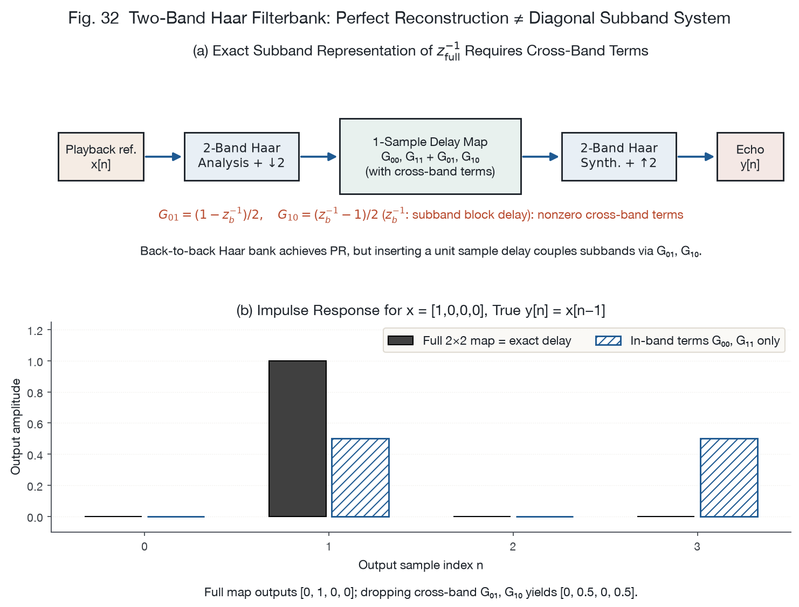

Figure 32 crystallizes subband representation power and its engineering trade-off:

- **Figure 32(a)**: Traces the five-block horizontal flow "playback reference $x[n]$ $\to$ 2-band Haar analysis + $\downarrow 2$ $\to$ subband map of the fullband unit-sample delay $z_{\mathrm{full}}^{-1}$ (containing both same-band terms $G_{00},G_{11}$ and cross-band terms $G_{01},G_{10}$) $\to$ 2-band Haar synthesis + $\uparrow 2$ $\to$ echo $y[n]$," annotating $G_{01}=(1-z_b^{-1})/2$ and $G_{10}=(z_b^{-1}-1)/2$ (where $z_b^{-1}=z_{\mathrm{full}}^{-2}$ denotes a one-block, two-sample delay at the decimated subband rate, distinct from the fullband unit-sample delay $z_{\mathrm{full}}^{-1}$) as generically nonzero—confirming that although immediate synthesis reconstructs $x[n]$ perfectly, inserting a unit-sample delay path forbids keeping only diagonal entries $G_{00},G_{11}$;
- **Figure 32(b)**: Plots output sample index $n$ against dimensionless amplitude for unit-impulse input $x=[1,0,0,0]$ through the unit-delay path: retaining the full four-branch subband matrix synthesizes $[0,1,0,0]$ exactly, whereas deleting the cross-band terms leaves only diagonal branches and synthesizes the distorted sequence $[0,0.5,0,0.5]$ (listening clips in [Two-Band Haar Cross-Term Synthetic WAVs](../codes/chapters/ch00/research_en/05_exercises_and_audio.md#sec-u-b41d17b2cd)).

In practice, to avoid the extra degrees of freedom of unconstrained full cross-band matrices ($4K$ real parameters—more than the original $L$ time-domain taps; see Exercise [E06-10](#e06-10)) and cross-band ill-conditioning, modern industrial subband AEC follows two paths: either designing **oversampled filterbanks** with high stopband attenuation (decimation factor smaller than subband count, suppressing adjacent-band aliasing below the noise floor so diagonal per-band updates remain safe), or using the Normalized Subband Adaptive Filter (NSAF; [Lee & Gan, *IEEE SPL*, 2004](https://doi.org/10.1109/LSP.2004.833445) and [EUSIPCO 2004](https://www.eurasip.org/Proceedings/Eusipco/Eusipco2004/defevent/papers/cr1587.pdf)), which uses subband-whitened error signals to update a single **fullband time-domain tap vector** directly, sidestepping synthesis aliasing and parameter inflation altogether.

#### 6.2.4 IPNLMS: Mixing Uniform and Proportionate Updates

When an echo path is dominated by a few prominent nonzero taps (such as the direct path and one or two strong desk reflections, with near-zero coefficients elsewhere), allocating a larger share of the step-size budget to taps that already exhibit large magnitudes often converges faster than updating every tap uniformly; yet from an all-zero initialization, the filter does not yet know where the active peaks sit and must retain uniform exploration.

Proportionate Normalized Least-Mean-Square (PNLMS; [Duttweiler, *IEEE TSAP*, 2000](https://doi.org/10.1109/89.861368)) and Improved Proportionate Normalized Least-Mean-Square (IPNLMS; [Benesty & Gay, ICASSP 2002](https://cris.technion.ac.il/en/publications/an-improved-pnlms-algorithm/)) realize this idea by multiplying the update direction by a diagonal matrix dependent on current tap magnitudes. This speedup relies on path sparsity; when room reverberation is dense and flat, proportionate allocation need not outperform uniform NLMS.

This chapter adopts the linear-mixture parameterization of [Benesty et al. (EUSIPCO 2004, Table 1)](https://www.eurasip.org/Proceedings/Eusipco/Eusipco2004/defevent/papers/cr1026.pdf): $\kappa\in[-1,1]$ (denoted $\alpha$ in [Benesty & Gay, ICASSP 2002] and parts of the literature; written $\kappa$ here and in [Appendix A](16_appendix-symbols-math.md) to avoid colliding with the oversubtraction factor in §6.5.1) controls the blend between uniform and magnitude-proportionate updates, $\delta>0$ guards the weighted-energy denominator against zero, and $\varepsilon_g>0$ guards the proportionate denominator when all weights start at zero:

$$\begin{aligned}
g_l&=\frac{1-\kappa}{2L}
    +\frac{(1+\kappa)|\hat w_l|}
           {2\|\hat{\vec w}\|_1+\varepsilon_g},\\
\hat{\vec w}^{+}
   &=\hat{\vec w}
     +\mu\frac{e\mathbf G\vec x}
                {\vec x^{\top}\mathbf G\vec x+\delta}.
\end{aligned}\tag{6-11}$$

Here $g_l$ ($l=0,\ldots,L-1$) is the nonnegative proportionate weight assigned to tap $l$, $\mathbf G=\operatorname{diag}(g_0,\ldots,g_{L-1})$ is the local diagonal weighting matrix for this subsection (distinct from the frequency-domain projector in §6.2.2 and the Gram matrix in §6.2.5), and the common sample index $[n]$ is suppressed at instant $n$. Note that $\mathbf G$ only rotates the update direction and reweights the denominator without altering the linear prediction convolution of Eq. (6-2). From a constrained-optimization perspective, whenever $g_l>0$ and neglecting $\delta$ at $\mu=1$, Eq. (6-11) is the unique Lagrangian minimizer of the weighted minimum-disturbance problem $\min_{\Delta\vec w}\frac{1}{2}\Delta\vec w^\top\mathbf G^{-1}\Delta\vec w$ subject to $\vec x^\top\Delta\vec w=e$—larger-magnitude taps carry smaller penalty weights $g_l^{-1}$ and thus take larger steps. Substituting $\hat{\vec w}^+$ back into the same observation yields the single-step a posteriori contraction $e^+=\bigl(1-\mu\frac{\vec x^\top\mathbf G\vec x}{\vec x^\top\mathbf G\vec x+\delta}\bigr)e$, confirming the same stability range $0<\mu<2$ as time-domain NLMS.

The sample-by-sample execution order must not be reversed: first compute the a priori echo and a priori residual $e[n]$ using the **pre-update** weights $\hat{\vec w}[n]$ and current regression vector $\vec x[n]$; next compute all $g_l$ from the old weights' $\ell_1$ norm $\|\hat{\vec w}[n]\|_1=\sum_{l=0}^{L-1}|\hat w_l[n]|$; then compute the weighted energy denominator $\vec x^\top[n]\mathbf G\vec x[n]+\delta$; finally update all $L$ taps simultaneously. Whenever double-talk control freezes updates at sample $n$, shift the latest reference sample into the history buffer and emit the a priori residual without writing Eq. (6-11).

At $\kappa=-1$, the proportionate term vanishes and every tap receives $g_l=1/L$; multiplying numerator and denominator of Eq. (6-11) by $L$ turns the denominator floor into $L\delta$, so IPNLMS is strictly sample-for-sample identical to time-domain NLMS in Eq. (6-3) whenever $\varepsilon_{\mathrm{NLMS}}=L\delta_{\mathrm{IPNLMS}}$. At $\kappa=1$, only the proportionate term survives, locking all taps permanently at zero from an all-zero initialization $\hat{\vec w}=\vec 0$ because $|\hat w_l|=0$ in the numerator (see Exercise [E06-08](#e06-08)). Practical designs typically choose $\kappa\in[-0.5,0]$ to balance cold-start exploration and sparse tracking.

**Two-tap hand calculation.** Set $\hat{\vec w}=[0.8,0.2]^\top$, $\vec x=[1,1]^\top$, $d=1.2$, and $\mu=1$, giving a priori residual $e=1.2-(0.8+0.2)=0.2$. First inspect the ideal allocation with negligible regularization ($\varepsilon_g\to 0,\delta\to 0$): at the balanced blend $\kappa=0$, $g_0=\frac{1}{4}+\frac{0.8}{2\times 1.0}=0.65$, $g_1=\frac{1}{4}+\frac{0.2}{2.0}=0.35$, weighted denominator $\vec x^\top\mathbf G\vec x=0.65+0.35=1$, so the strong and weak taps receive increments $[0.13,0.07]^\top$; under uniform mode $\kappa=-1$, $g=[0.5,0.5]$ splits the increment evenly into $[0.10,0.10]^\top$.

**Exact check retaining nonzero regularization.** Keeping the same $\hat{\vec w},\vec x,d,\mu$ and setting $\varepsilon_g=2$, $\delta=0.25$:

- At $\kappa=0$, the uniform term is $1/4=0.25$ and the proportionate denominator is $2\times(0.8+0.2)+2=4$, giving $g_0=0.25+0.8/4=0.45$ and $g_1=0.25+0.2/4=0.30$. Note that $g_0+g_1=0.75\neq 1$ (Eq. (6-11) does not renormalize $g_l$ to sum to $1$); the update denominator is $0.45+0.30+0.25=1.0$, yielding increment $0.2\times[0.45,0.30]^\top=[0.09,0.06]^\top$;
- At $\kappa=-1$, $g=[0.5,0.5]$ gives denominator $0.5+0.5+0.25=1.25$ and increment $0.2\times[0.5,0.5]^\top/1.25=[0.08,0.08]^\top$, matching standard NLMS with $\varepsilon=L\delta=2\times 0.25=0.5$ ($0.2\times[1,1]^\top/(2+0.5)=[0.08,0.08]^\top$) identically.

The companion implementation [`aec_ipnlms.py`](../codes/chapters/ch06/core/aec_ipnlms.py) provides full streaming state management, and Figure 33 in §6.2.7 compares parameter control across IPNLMS, RLS, and Kalman filtering side by side.

#### 6.2.5 Affine Projection (APA): Changing Update Direction Using Recent Observations

Having examined single-direction NLMS, consider the geometric bottleneck behind its slow convergence under colored speech: when adjacent samples are strongly correlated, successive regression vectors $\vec x[n],\vec x[n-1],\ldots$ subtend small angles, forcing single-step NLMS to zigzag back and forth between nearly parallel hyperplanes while making sluggish progress orthogonal to the dominant eigendirection. The **Affine Projection Algorithm (APA; [Ozeki & Umeda, 1984](https://doi.org/10.1002/ecja.4400670503); regularized form in [Rey et al., EUSIPCO 2004, §2](https://www.eurasip.org/Proceedings/Eusipco/Eusipco2004/defevent/papers/cr1033.pdf))** couples the most recent $K_n$ observation equations simultaneously at every update ($K_n\le K$, using only the true samples arrived so far during startup) and solves directly for the minimum-norm weight increment compatible with all $K_n$ local directions.

Retaining the most-recent-sample-first convention, let $\vec x_i=[x[i],x[i-1],\ldots,x[i-L+1]]^\top\in\mathbb{R}^L$ be the regression column at instant $i$, and denote the earliest observation index in the window by $i_{\mathrm{min}}=n-K_n+1$. Stack the current and past $K_n$ regression columns into the $L\times K_n$ data matrix $\mathbf U_n$, stack the corresponding microphone samples into the $K_n\times 1$ column vector $\vec d_n$, and evaluate both the window error vector $\vec e_n^-$ (using the **same pre-update weight vector** $\vec w_{n-1}$) and the $K_n\times K_n$ Gram inner-product matrix $\mathbf G_n$:

$$\begin{gathered}
\mathbf U_n=[\vec x_n,\ldots,\vec x_{i_{\mathrm{min}}}],\\
\vec d_n=[d[n],d[n-1],\ldots,d[i_{\mathrm{min}}]]^\top,\\
\vec e_n^-=\vec d_n-\mathbf U_n^\top\vec w_{n-1},\\
\mathbf G_n=\mathbf U_n^\top\mathbf U_n.
\end{gathered}\tag{6-12}$$

One implementation bug occurs frequently here: only the leading entry $d[n]-\vec x_n^\top\vec w_{n-1}$ of $\vec e_n^-$ in line 3 of Eq. (6-12) is the current causal a priori residual; all remaining $K_n-1$ historical entries must be recomputed against the **current pre-update weights** $\vec w_{n-1}$, never spliced together by pasting previously emitted residuals from earlier steps (Exercise [E06-22](#e06-22) contrasts exact recomputation against this splicing error by hand).

**First derive unregularized exact projection (minimum-norm constrained solution).** When $K_n\le L$ and $\mathbf U_n$ has full column rank, infinitely many increments $\Delta\vec w$ satisfy all $K_n$ window equations $\mathbf U_n^\top(\vec w_{n-1}+\Delta\vec w)=\vec d_n$ (i.e., $\mathbf U_n^\top\Delta\vec w=\vec e_n^-$). APA selects the one with minimal Euclidean perturbation to the old weights:

$$\begin{aligned}
\min_{\Delta\vec w}\quad&\frac{1}{2}\|\Delta\vec w\|_2^2,\\
\text{subject to}\quad&\mathbf U_n^\top\Delta\vec w=\vec e_n^-.
\end{aligned}\tag{6-13}$$

Introducing the Lagrange multiplier vector $\vec\alpha\in\mathbb{R}^{K_n}$, form the Lagrangian

$$\mathcal L(\Delta\vec w,\vec\alpha)
=\frac{1}{2}\|\Delta\vec w\|_2^2
-\vec\alpha^\top(\mathbf U_n^\top\Delta\vec w-\vec e_n^-).$$

Setting the gradient with respect to $\Delta\vec w$ to zero ($\Delta\vec w-\mathbf U_n\vec\alpha=\vec 0$) immediately yields $\Delta\vec w=\mathbf U_n\vec\alpha$ (geometrically, the minimum-norm increment must lie strictly within the subspace spanned by the $K_n$ regression columns). Substituting back into $\mathbf U_n^\top(\mathbf U_n\vec\alpha)=\vec e_n^-$, full column rank guarantees $\mathbf G_n=\mathbf U_n^\top\mathbf U_n$ is positive definite and invertible, yielding $\vec\alpha=\mathbf G_n^{-1}\vec e_n^-$ and the exact projection increment $\Delta\vec w=\mathbf U_n\mathbf G_n^{-1}\vec e_n^-$.

**Next derive diagonal-loading regularization and dimension reduction via the push-through identity.** Because adjacent regression columns in colored speech are nearly collinear, $\mathbf G_n$ is nearly singular and direct inversion strongly amplifies noise or near-end interference inside the window. Introducing a regularization constant $\delta>0$ carrying the same dimension as $\mathbf G_n$ (squared signal amplitude) and a dimensionless step size $\mu$, relax the hard constraint into an unconstrained ridge-regression objective:

$$\begin{gathered}
\begin{aligned}
J_\delta(\Delta\vec w)
&=\|\mathbf U_n^\top\Delta\vec w-\vec e_n^-\|_2^2\\
&\quad+\delta\|\Delta\vec w\|_2^2,
\end{aligned}\\
\Delta\vec w_\delta
=\arg\min_{\Delta\vec w}J_\delta(\Delta\vec w),\\
(\mathbf G_n+\delta\mathbf I_{K_n})\vec\alpha_{\delta,n}
=\vec e_n^-,\\
\vec w_n=\vec w_{n-1}+\mu\mathbf U_n\vec\alpha_{\delta,n}.
\end{gathered}\tag{6-14}$$

Differentiating the first-line objective $J_\delta(\Delta\vec w)$ and setting the gradient to zero initially produces

$$\begin{aligned}
\nabla_{\Delta\vec w}J_\delta
&=2\mathbf U_n(\mathbf U_n^\top\Delta\vec w_\delta-\vec e_n^-)
  +2\delta\Delta\vec w_\delta=\vec 0,\\
(\mathbf U_n\mathbf U_n^\top+\delta\mathbf I_L)
  \Delta\vec w_\delta&=\mathbf U_n\vec e_n^-,
\end{aligned}$$

which involves a huge $L\times L$ matrix (e.g., $1024\times 1024$) on the left. How does this collapse to the tiny $K_n\times K_n$ system (e.g., $2\times 2$ or $4\times 4$) in line 3 of Eq. (6-14)? Re-associating parentheses on an $L\times K_n$ matrix product proves the **push-through identity** in two lines:

$$\begin{aligned}
(\mathbf U_n\mathbf U_n^\top+\delta\mathbf I_L)\mathbf U_n
&=\mathbf U_n(\mathbf U_n^\top\mathbf U_n)+\delta\mathbf U_n\\
&=\mathbf U_n(\mathbf G_n+\delta\mathbf I_{K_n}).
\end{aligned}$$

Because $\delta>0$ added to any symmetric positive semidefinite matrix is strictly positive definite, both the $L\times L$ matrix $(\mathbf U_n\mathbf U_n^\top+\delta\mathbf I_L)$ and the $K_n\times K_n$ matrix $(\mathbf G_n+\delta\mathbf I_{K_n})$ are invertible. Left-multiplying by $(\mathbf U_n\mathbf U_n^\top+\delta\mathbf I_L)^{-1}$ and right-multiplying by $(\mathbf G_n+\delta\mathbf I_{K_n})^{-1}$ immediately yields

$$(\mathbf U_n\mathbf U_n^\top+\delta\mathbf I_L)^{-1}\mathbf U_n
=\mathbf U_n(\mathbf G_n+\delta\mathbf I_{K_n})^{-1}.$$

Right-multiplying both sides by $\vec e_n^-$ identifies the left-hand side with $\Delta\vec w_\delta$ and the right-hand side with $\mathbf U_n\vec\alpha_{\delta,n}$, where $\vec\alpha_{\delta,n}$ solves the small linear system in Eq. (6-14). Per-sample complexity thereby drops from prohibitive $O(L^3)$ to $O(LK_n^2)$ for forming the Gram matrix plus $O(K_n^3)$ for solving the small system (at $K_n=1$, $\mathbf G_n=\|\vec x_n\|_2^2$ is a scalar and Eq. (6-14) reduces identically to time-domain NLMS with $\varepsilon=\delta$).

Substituting the updated weights $\vec w_n$ back into the same window gives the a posteriori error vector $\vec e_n^+=\vec d_n-\mathbf U_n^\top\vec w_n$:

$$\begin{aligned}
\vec e_n^+&=\vec e_n^--\mu\mathbf G_n\vec\alpha_{\delta,n}\\
&=\bigl[\mathbf I_{K_n}-\mu\mathbf G_n
  (\mathbf G_n+\delta\mathbf I_{K_n})^{-1}\bigr]\vec e_n^-.
\end{aligned}\tag{6-15}$$

Letting $\lambda_i\ge 0$ denote the eigenvalues of symmetric positive semidefinite $\mathbf G_n$, the window error along the $i$-th eigenvector scales by $1-\mu\lambda_i/(\lambda_i+\delta)$: whenever $\lambda_i>0$, $\delta>0$, and $0<\mu<2$, this factor has magnitude strictly less than $1$; whenever linearly dependent regression columns produce $\lambda_i=0$ ($\mathbf U_n\vec v=\vec 0$), the factor remains $1$—confirming that regularization $\delta>0$ ensures numerical solvability without inventing new identifiability information for rank-deficient data (see Exercise [E06-23](#e06-23)).

For engineering state management, higher-order APA ($K>1$) introduces a subtler double-talk window-memory effect than single-step NLMS: even if weight updates are frozen during double-talk, letting microphone samples $d[n]$ contaminated by near-end speech continue entering the length-$K$ projection observation buffer causes residual double-talk observations to pull weights off course through $\vec e_n^-$ the instant updates resume. Upon exiting double-talk, systems must therefore clear the projection observation buffer (keeping only the current weights and FIR reference history) or gate observation pairs sample by sample.

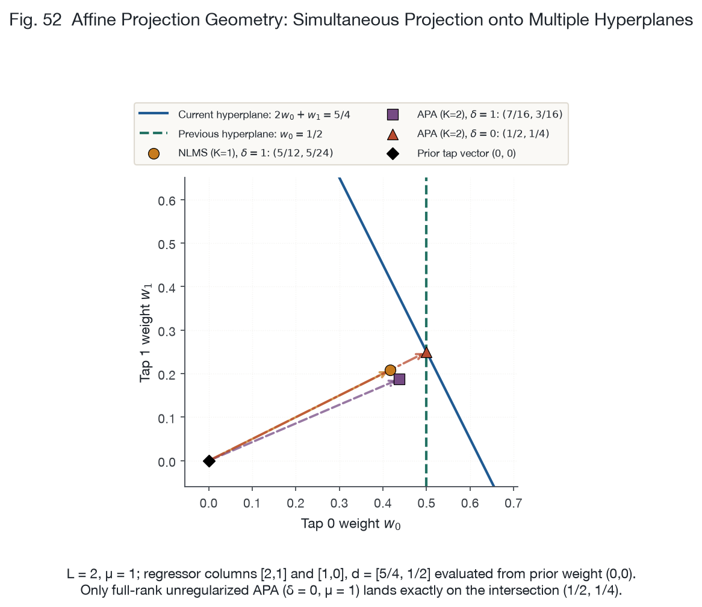

Inspecting Figure 52 (corresponding to the two-tap noiseless geometry of Exercise [E06-21](#e06-21)) makes the trajectories of three updates immediately visible in the $(w_0,w_1)$ plane: the two constraint lines are the current observation hyperplane $2w_0+w_1=5/4$ and the previous hyperplane $w_0=1/2$, whose unique intersection $(0.5,0.25)$ is the true path. Starting from the origin $(0,0)$, single-column NLMS ($K=1$) steps orthogonally toward the current line alone to $[5/12,5/24]^\top$; unregularized two-column exact projection ($K=2,\delta=0,\mu=1$) solves both lines simultaneously to hit the exact intersection in one step; and diagonally loaded projection ($K=2,\delta=1,\mu=1$) lands at $[7/16,3/16]^\top$, shrinking robustly between the origin and the true intersection to curb single-step jumps under noise (note a geometric special case in this example: because $\vec h=[1/2,1/4]^\top$ happens to be collinear with the current regressor $\vec x_1=[2,1]^\top$, unregularized single-column NLMS with $K=1,\delta=0,\mu=1$ coincides along the same ray through the origin to $(1/2,1/4)$, whereas regularized NLMS with $\delta=1$ falls short along that ray at $[5/12,5/24]^\top$; for a generic non-collinear $\vec h$, single-hyperplane orthogonal projection and two-hyperplane intersection point in distinct directions; for colored-reference speedup versus noisy holdout cost across $K=1,2,4$, see Figure 53 and Exercise [E06-25](#e06-25)).

#### 6.2.6 RLS: Changing Update Direction via the Reference Autocorrelation Matrix

Whereas NLMS looks at only $1$ sample and APA looks at a short $K$-sample window, **Recursive Least Squares (RLS)** exponentially weights all historical observations from $i=0$ through the current instant $n$ with forgetting factor $0<\lambda\le 1$, solving exactly for the least-squares minimizer of the entire weighted history at every sample—effectively whitening the gradient by the inverse sample autocorrelation matrix to break free from input spectral ill-conditioning.

Restricting to a real, time-aligned, single-reference causal FIR model of length $L$, we add an explicit quadratic penalty around the initial prior weights $\vec w_{-1}$ ($\delta>0$, matching the initial inverse-covariance convention of [MathWorks `dsp.RLSFilter`](https://www.mathworks.com/help/dsp/ref/dsp.rlsfilter-system-object.html)) so that the normal equations remain strictly positive definite even during startup (before $L$ samples arrive or excitation reaches full rank):

$$\begin{aligned}
J_n(\vec w)={}&\sum_{i=0}^{n}\lambda^{n-i}
  (d[i]-\vec w^\top\vec x_i)^2\\
&+\lambda^{n+1}\delta\|\vec w-\vec w_{-1}\|_2^2.
\end{aligned}\tag{6-16}$$

Setting $\nabla_{\vec w}J_n(\vec w_n)=\vec 0$ yields the normal equations $\mathbf R_n\vec w_n=\vec p_n$. Splitting each exponentially weighted sum into $\lambda$ times the previous sum plus the new sample-$n$ term gives rank-1 recursions for the sample autocorrelation matrix $\mathbf R_n\in\mathbb{R}^{L\times L}$ and cross-correlation vector $\vec p_n\in\mathbb{R}^L$:

$$\begin{aligned}
\mathbf R_{-1}&=\delta\mathbf I_L,\\
\vec p_{-1}&=\delta\vec w_{-1},\\
\mathbf R_n&=\lambda\mathbf R_{n-1}+\vec x_n\vec x_n^\top,\\
\vec p_n&=\lambda\vec p_{n-1}+\vec x_n d[n],\\
\mathbf P_n&=\mathbf R_n^{-1},\\
\vec w_n&=\mathbf P_n\vec p_n.
\end{aligned}\tag{6-17}$$

Directly inverting $\mathbf R_n$ at every sample would cost $O(L^3)$. Because line 3 of Eq. (6-17) adds a rank-1 outer product $\vec x_n\vec x_n^\top$ to the already invertible matrix $\mathbf A=\lambda\mathbf R_{n-1}$ (whose inverse is $\mathbf A^{-1}=\lambda^{-1}\mathbf P_{n-1}$), we directly apply the **Woodbury (Sherman–Morrison) matrix inversion lemma** from [Chapter 0 §0.3](00_math-foundations.md#sec-0-3) and [Appendix A](16_appendix-symbols-math.md):

$$(\mathbf A+\vec u\vec v^\top)^{-1}
=\mathbf A^{-1}
-\frac{\mathbf A^{-1}\vec u\vec v^\top\mathbf A^{-1}}
      {1+\vec v^\top\mathbf A^{-1}\vec u}.$$

Setting $\vec u=\vec v=\vec x_n$ and defining the intermediate vector $\vec q_n=\mathbf P_{n-1}\vec x_n$ (symmetry of $\mathbf P_{n-1}$ implies $\vec x_n^\top\mathbf P_{n-1}=\vec q_n^\top$), simplify $\mathbf P_n=\mathbf R_n^{-1}$ step by step:

$$\begin{aligned}
\mathbf P_n
&=(\lambda\mathbf R_{n-1}+\vec x_n\vec x_n^\top)^{-1}\\
&=\lambda^{-1}\mathbf P_{n-1}
  -\frac{\lambda^{-2}\vec q_n\vec q_n^\top}
        {1+\lambda^{-1}\vec x_n^\top\vec q_n}\\
&=\lambda^{-1}\left(\mathbf P_{n-1}
  -\frac{\vec q_n\vec q_n^\top}
        {\lambda+\vec x_n^\top\vec q_n}\right)\\
&=\lambda^{-1}(\mathbf P_{n-1}-\vec K_n\vec q_n^\top),
\end{aligned}$$

where line 3 multiplies numerator and denominator of the fraction by $\lambda$ to clear compound fractions, and line 4 defines the $L\times 1$ gain vector $\vec K_n=\vec q_n/(\lambda+\vec x_n^\top\vec q_n)$. Right-multiplying by $\vec x_n$ verifies the identity

$$\begin{aligned}
\mathbf P_n\vec x_n
&=\lambda^{-1}\left[\vec q_n
  -\vec q_n\frac{\vec x_n^\top\vec q_n}
                {\lambda+\vec x_n^\top\vec q_n}\right]
=\vec K_n.
\end{aligned}$$

Substituting $\mathbf P_n\vec x_n=\vec K_n$ and $\vec p_n=\lambda\vec p_{n-1}+\vec x_n d[n]$ into $\vec w_n=\mathbf P_n\vec p_n$ immediately produces the weight recursion:

$$\begin{aligned}
\vec w_n
&=\mathbf P_n(\lambda\vec p_{n-1}+\vec x_n d[n])\\
&=(\mathbf P_{n-1}-\vec K_n\vec q_n^\top)\vec p_{n-1}
  +\vec K_n d[n]\\
&=\vec w_{n-1}
  -\vec K_n\vec x_n^\top(\mathbf P_{n-1}\vec p_{n-1})
  +\vec K_n d[n]\\
&=\vec w_{n-1}+\vec K_n(d[n]-\vec w_{n-1}^\top\vec x_n).
\end{aligned}$$

Collecting the full causal execution order yields the standard RLS recursion requiring $O(L^2)$ compute and $O(L^2)$ memory per sample (instructional implementation in [`aec_rls.py`](../codes/chapters/ch06/core/aec_rls.py); complex frequency-domain extensions must first fix conjugate inner-product conventions):

$$\begin{aligned}
\vec q_n&=\mathbf P_{n-1}\vec x_n,\\
\vec K_n&=\frac{\vec q_n}{\lambda+\vec x_n^\top\vec q_n},\\
\hat y_n^-&=\vec w_{n-1}^\top\vec x_n,\\
e_n^-&=d[n]-\hat y_n^-,\\
\vec w_n&=\vec w_{n-1}+\vec K_n e_n^-,\\
\mathbf P_n&=\lambda^{-1}(\mathbf P_{n-1}-\vec K_n\vec q_n^\top).
\end{aligned}\tag{6-18}$$

**Two-tap anchor hand calculation (cross-checking recursion against batch normal equations).** Take $L=2$, forgetting factor $\lambda=1/2$, initial regularization $\delta=1$, and zero initial prior $\vec w_{-1}=\vec 0$ (hence $\mathbf P_{-1}=\mathbf I_2$). Feed two observations: at $n=0$, $\vec x_0=[1,0]^\top, d[0]=1$; at $n=1$, $\vec x_1=[1,1]^\top, d[1]=2$ (corresponding to reference sequence $x[-1]=0,x[0]=1,x[1]=1$):

1. **Step $n=0$ recursion**: $\vec q_0=\mathbf I_2[1,0]^\top=[1,0]^\top$, denominator $1/2+1=3/2$, gain $\vec K_0=[2/3,0]^\top$; a priori prediction $\hat y_0^-=0$ and residual $e_0^-=1$, so $\vec w_0=[2/3,0]^\top$ and the inverse correlation matrix updates from $2\operatorname{diag}(1-2/3,1)$ to $\mathbf P_0=\operatorname{diag}(2/3,2)$. The second diagonal entry inflated from $1$ to $2$ because tap $1$ received zero excitation at $n=0$ while the prior penalty was halved by $\lambda=1/2$, doubling its uncertainty.
2. **Step $n=1$ recursion**: $\vec q_1=\mathbf P_0[1,1]^\top=[2/3,2]^\top$, denominator $1/2+(2/3+2)=19/6$, gain $\vec K_1=[2/3,2]^\top/(19/6)=[4/19,12/19]^\top$, and outer product $\vec K_1\vec q_1^\top=\frac{1}{57}\begin{bmatrix}8&24\\24&72\end{bmatrix}$. With a priori prediction $\hat y_1^-=2/3$ and residual $e_1^-=2-2/3=4/3$, weights and inverse correlation update to

    $$\begin{aligned}
    \vec w_1
    &=\begin{bmatrix}2/3\\0\end{bmatrix}
      +\frac{4}{3}\begin{bmatrix}4/19\\12/19\end{bmatrix}
    =\begin{bmatrix}18/19\\16/19\end{bmatrix},\\
    \mathbf P_1
    &=2\left(\operatorname{diag}(2/3,2)
      -\frac{1}{57}\begin{bmatrix}8&24\\24&72\end{bmatrix}\right)
    =\frac{1}{19}\begin{bmatrix}20&-16\\-16&28\end{bmatrix}.
    \end{aligned}$$

3. **Independent batch normal-equation cross-check**: Returning to Eq. (6-17) to accumulate both samples and the prior directly gives $\vec p_1=\frac{1}{2}[1,0]^\top+[2,2]^\top=[5/2,2]^\top$ and

    $$\begin{aligned}
    \mathbf R_1
    &=\frac{1}{4}\mathbf I_2
      +\frac{1}{2}\begin{bmatrix}1&0\\0&0\end{bmatrix}
      +\begin{bmatrix}1&1\\1&1\end{bmatrix}
    =\begin{bmatrix}7/4&1\\1&5/4\end{bmatrix},\\
    \mathbf R_1^{-1}
    &=\frac{16}{19}\begin{bmatrix}5/4&-1\\-1&7/4\end{bmatrix}
    =\frac{1}{19}\begin{bmatrix}20&-16\\-16&28\end{bmatrix}
    =\mathbf P_1,
    \end{aligned}$$

    with determinant $\det\mathbf R_1=\frac{35}{16}-1=\frac{19}{16}$, yielding $\mathbf R_1^{-1}\vec p_1=[18/19,16/19]^\top=\vec w_1$. Both routes agree identically (see [`aec_rls_demo.py`](../codes/chapters/ch06/aec_rls_demo.py)).

#### Forgetting, Double-Talk, and Engineering Boundaries of RLS

To quantify the time span of the forgetting factor $\lambda$, consider the most recent $J$ accepted updates, where the $j$-th sample from newest to oldest receives weight $a_j=\lambda^j$ ($j=0,\ldots,J-1$). Define the total weight $A_J$ and the squared-concentration effective sample count $N_{\mathrm{eff},J}$ (compare the timescale definitions in [MathWorks Online Recursive Estimation Documentation](https://www.mathworks.com/help/ident/ref/recursiveleastsquaresestimator.html)):

$$\begin{aligned}
A_J&=\sum_{j=0}^{J-1}a_j,\\
N_{\mathrm{eff},J}&=\frac{A_J^2}{\sum_{j=0}^{J-1}a_j^2},\\
A_\infty&=\frac{1}{1-\lambda},\\
N_{\mathrm{eff},\infty}&=\frac{1+\lambda}{1-\lambda}.
\end{aligned}\tag{6-19}$$

For $0<\lambda<1$ under continuous updates, geometric-series summation yields the closed-form asymptotic limits in the last two lines: e.g., at $\lambda=0.99$, $A_\infty=100$ and $N_{\mathrm{eff},\infty}=199$; converting to physical seconds requires multiplying by the actual update period (see Exercise [E06-09](#e06-09)). At $\lambda=1$ (no forgetting), finite-horizon formulas give $A_J=N_{\mathrm{eff},J}=J$.

Deploying standard full-matrix RLS directly in real acoustic echo cancellation confronts four hard barriers:

- **Double-talk fragility**: Near-end speech $s[n]$ entering $e_n^-$ is fitted efficiently into the path weights via $\vec K_n$, demanding airtight double-talk freezing;
- **Covariance windup during silence**: When the far end is silent ($\vec x_n=\vec 0$), $\vec K_n=\vec 0$ leaves weights untouched, yet $\mathbf P_n=\lambda^{-1}\mathbf P_{n-1}$ divides by $\lambda<1$ every step and grows exponentially, triggering violent overshoot once playback resumes; forgetting must therefore pause during silence or $\mathbf P_n$ must be upper-bounded;
- **Loss of positive definiteness in finite precision**: The final line of Eq. (6-18) subtracts two positive semidefinite matrices, so accumulated floating-point rounding can break symmetry or introduce negative eigenvalues (robust variants instead propagate square-root QR / Householder factors);
- **Quadratic memory and compute wall**: At $L=4096$, a single double-precision $\mathbf P_n$ occupies $4096^2\times 8=128\ \mathrm{MiB}$ of RAM and demands tens of millions of MACs per sample; full-matrix RLS is thus confined to very low-order modules or offline benchmarks, while long-path second-order tracking moves to the frequency-domain Kalman filter next.

#### 6.2.7 Kalman Filtering and PBFDKF: Modeling Path Drift and Observation Uncertainty Simultaneously

NLMS, APA, and RLS all lack an intrinsic knob separating "the acoustic path itself changed" from "the near-end talker started speaking": cranking up their step size or forgetting factor to track path jumps lets double-talk corrupt the weights, whereas turning it down to protect double-talk slows path tracking. **Kalman path estimation and the Frequency-Domain Kalman Filter (FDKF; [Enzner & Vary, *Signal Processing*, 2006](https://doi.org/10.1016/j.sigpro.2005.09.013) and the [author's State-Space FDAF overview page](https://homepages.ruhr-uni-bochum.de/gerald.enzner/StateSpaceFDAF.html))** explicitly model the unknown echo taps as a stochastic state process, decoupling "path-drift uncertainty" from "microphone observation-interference uncertainty" via two separate second-order statistics.

To expose the physical division of labor between these two noise sources, write the time-domain state-space equations for an aligned, real, length-$L$ echo path: let $\vec h_n\in\mathbb{R}^L$ denote the true path at sample $n$, $a$ a state-transition damping factor (typically $a\lesssim 1$ or $a=1$), $\Delta\vec h_n$ a zero-mean process perturbation vector, and $s[n],v[n]$ the near-end speech and background noise:

$$\begin{aligned}
\vec h_n&=a\vec h_{n-1}+\Delta\vec h_n,\\
d[n]&=\vec x_n^\top\vec h_n+s[n]+v[n].
\end{aligned}\tag{6-20}$$

Line 1 models path drift or sudden changes; line 2 explains why the microphone observation differs from the echo replica. Process covariance $\mathbf Q=\operatorname{Cov}(\Delta\vec h_n)$ and observation-interference variance $\Psi=\operatorname{Var}(s[n]+v[n])$ govern two completely distinct physical phenomena—never confuse $\Psi$ with the reference autocorrelation matrix $\mathbf R_n$ of RLS. Increasing $\mathbf Q$ expresses reduced trust in the old path estimate (e.g., when device movement or door motion occurs, opening up step size for rapid reconvergence); increasing $\Psi$ expresses reduced trust in the current microphone observation (e.g., when the near-end talker speaks during double-talk, smoothly tightening step size to safeguard existing weights). Of course, real speech exhibits strong short-time correlation and human motion is not stationary white Gaussian noise; Eq. (6-20) serves as an engineering working model for assigning second-order weights (real short-FIR instructional code in [`aec_kalman_matrix.py`](../codes/chapters/ch06/core/aec_kalman_matrix.py)).

The equations below give a hand-verifiable per-bin **scalar diagonal-approximation** recursion (omitting bin index $k$; at block $m$, $W_m$ is the complex path coefficient estimate, $P_m\ge 0$ its error variance, $\Phi_m\ge 0$ the process variance, and $\Psi_m>0$ the observation-interference variance). Assuming aligned reference spectrum $X_m$ is known and process/observation perturbations are zero-mean and mutually uncorrelated as well as uncorrelated with prior error, the gain $K_m$ below is the strictly linear MMSE complex gain using only the current complex innovation (a priori prediction error $E_m$) without augmenting its conjugate $E_m^*$ (if variables are jointly circularly symmetric—proper—complex Gaussian, it is simultaneously globally conditional-MMSE optimal; for augmented/widely linear filtering bounds on improper complex distributions, see [Dini & Mandic, SSPD 2010](https://www.commsp.ee.ic.ac.uk/~mandic/research/WL_Complex_Stuff/Dini_Mandic_Augmented_Kalman_Filter_Analysis_SSPD_2010.pdf)):

$$\begin{aligned}
\hat W_m^-&=aW_{m-1},\\
P_m^-&=|a|^2P_{m-1}+\Phi_m,\\
E_m&=D_m-X_m\hat W_m^-,\\
K_m&=\frac{P_m^-X_m^*}{|X_m|^2P_m^-+\Psi_m},\\
W_m&=\hat W_m^-+K_mE_m,\\
P_m&=(1-K_mX_m)P_m^-.
\end{aligned}\tag{6-21}$$

Trace the physical feedback loop in Eq. (6-21) line by line: lines 1–2 form the **time-prediction step**, scaling prior variance by $|a|^2$ and adding process variance $\Phi_m$ to yield prior uncertainty $P_m^-$; line 3 computes the complex innovation $E_m$, whose total innovation variance is $S_m=|X_m|^2P_m^-+\Psi_m$. The Kalman gain $K_m$ in line 4 follows directly from Wirtinger differentiation ([Chapter 0 §0.5](00_math-foundations.md#sec-0-5)): writing the prior path error as $\widetilde W_m^-=W_{\mathrm{true}}-\hat W_m^-$ and the total observation interference as $U_m=S_m^{\mathrm{near}}+V_m$ (zero-mean and mutually uncorrelated), substituting $E_m=X_m\widetilde W_m^-+U_m$ into the posterior error $\widetilde W_m=(1-K_mX_m)\widetilde W_m^--K_mU_m$ gives the posterior mean-square error

$$P_m(K_m)=|1-K_mX_m|^2P_m^-+|K_m|^2\Psi_m.$$

Setting $\frac{\partial P_m}{\partial K_m^*}=-(1-K_mX_m)X_m^*P_m^-+K_m\Psi_m=0$ immediately yields $K_m=P_m^-X_m^*/(|X_m|^2P_m^-+\Psi_m)$ (line 4); substituting this optimum back into $P_m(K_m)$ cancels the cross term and collapses $P_m$ directly to $(1-K_mX_m)P_m^-$ (line 6). Multiplying numerator and denominator of $K_m$ by $X_m$ shows $K_m X_m=|X_m|^2P_m^-/S_m\in[0,1)$, equal precisely to the real SNR share of "echo prediction variance attributable to path mismatch" out of "total innovation variance."

Under low-noise far-end single-talk ($\Psi_m\ll |X_m|^2P_m^-$), $K_m\approx X_m^*/|X_m|^2=1/X_m$, behaving like frequency-domain normalized updates with $\mu\to 1$; during double-talk when observation-interference variance rises so $\Psi_m\gg |X_m|^2P_m^-$, $K_m\to 0$, softly gating updates closed, while the final line shrinks posterior error variance by $(1-K_m X_m)$. Conversely, during an abrupt echo-path change, although the a priori residual jumps sharply, $K_m$ in Eq. (6-21) does not contain $E_m$ explicitly—so process variance $\Phi_m$ must be boosted or covariance reset to raise the gain and recapture the path rapidly. For practical tuning under a first-order Markov transition $W_m=aW_{m-1}+\Delta W_m$ ($|a|<1$), equating stationary variances $\mathbb{E}[|W_m|^2]=|a|^2\mathbb{E}[|W_{m-1}|^2]+\Phi_m$ gives the classical [Enzner & Vary (2006)](https://doi.org/10.1016/j.sigpro.2005.09.013) process-noise rule:

$$\hat\Phi_m(k)=(1-|a|^2)\,\mathbb{E}[|W_m(k)|^2]
\approx(1-|a|^2)\,|W_m(k)|^2,$$

with damping factor $a\in[0.99,0.9999]$ typically balancing slow path-drift tracking speed against steady-state variance.

**Why can't we plug the raw current-frame residual power $|E_m|^2$ straight in as $\Psi_m$?** Writing the prior path error as $\widetilde W_m^-=W_{\mathrm{true}}-\hat W_m^-$, the total variance of innovation $E_m=X_m\widetilde W_m^-+S_m^{\mathrm{near}}+V_m$ is $S_m=|X_m|^2P_m^-+\Psi_m$, mixing "unconverged path mismatch $|X_m|^2P_m^-$" together with "near-end speech plus noise $\Psi_m$." Even under the single-frame circular complex Gaussian log-likelihood $\ln S_m+|E_m|^2/S_m$ with known $P_m^-$ and $X_m$, constrained maximum likelihood over $\Psi_m\ge 0$ gives $\hat\Psi_m=\max(0,|E_m|^2-|X_m|^2P_m^-)$—one must first subtract the prediction-error floor explained by path uncertainty, and because single-frame power fluctuates wildly, practical engines combine cross-frame smoothing, double-talk coherence, and path-change detectors to estimate $\Phi_m$ and $\Psi_m$ reliably. Two minimal numerical cases illustrate this:

- Fixing $X=1, P^-=1$: under far-end single-talk with $\Psi=0.01$, $K=1/1.01\approx 0.990$, absorbing innovation nearly at full speed; under double-talk with $\Psi=10$, $K=1/11\approx 0.091$, automatically throttling gain down to roughly $9.2\%$ of its single-talk level;
- Fixing $X=1, P^-=1, \Psi=1$: whether innovation $E$ equals $0$ or jumps to $10$, Eq. (6-21) keeps $K\equiv 1/2$; only when an external detector flags a path change and raises prior variance to $P^-=4$ does the gain climb to $K=4/5=0.8$.

**Full scalar round-trip and complex-conjugate check.** Set real parameters $W_{m-1}=0.2$, $P_{m-1}=0.5$, $a=1$, $\Phi_m=0.1$, $X_m=2$, $D_m=1.4$, and $\Psi_m=0.4$ (verifiable via [`aec_kalman_scalar_demo.py`](../codes/chapters/ch06/aec_kalman_scalar_demo.py)):

1. **Prediction and innovation**: $\hat W_m^-=0.2$, $P_m^-=0.5+0.1=0.6=3/5$; innovation $E_m=1.4-2\times 0.2=1.0$, innovation variance $S_m=2^2\times 0.6+0.4=2.8=14/5$;
2. **Gain and posterior state**:

    $$\begin{aligned}
    K_m&=\frac{0.6\times 2}{2.8}
       =\frac{3}{7}\approx 0.4286,\\
    W_m&=0.2+\frac{3}{7}\times 1.0
       =\frac{22}{35}\approx 0.6286,\\
    P_m&=\left(1-\frac{6}{7}\right)\frac{3}{5}
       =\frac{3}{35}\approx 0.0857.
    \end{aligned}$$

    Without premature rounding, these exact fractions reduce the a posteriori residual on the same observation to $1.4-2\times(22/35)=1/7\approx 0.1429$ (raising $\Psi_m$ from $0.4$ to $4$ under a double-talk hypothesis shrinks the gain from $3/7$ to $3/16$ and moves the posterior weight only slightly to $31/80$). Note two critical edge cases: mistakenly initializing $P_0^-=0$ with $\Phi_m=0$ forces $K_m\equiv 0$ for any $\Psi_m>0$, permanently freezing an erroneous initial weight; and at a complex bin with pure-imaginary reference $X=\mathrm{j}$ and $P^-=\Psi=1$, the conjugate $X^*=-\mathrm{j}$ in Eq. (6-21) yields $K=(-\mathrm{j})/(1+1)=-\mathrm{j}/2$ (ensuring $KX=(-\mathrm{j}/2)\mathrm{j}=+1/2>0$), whereas omitting conjugation produces the wrong sign $+\mathrm{j}/2$ and triggers divergence.

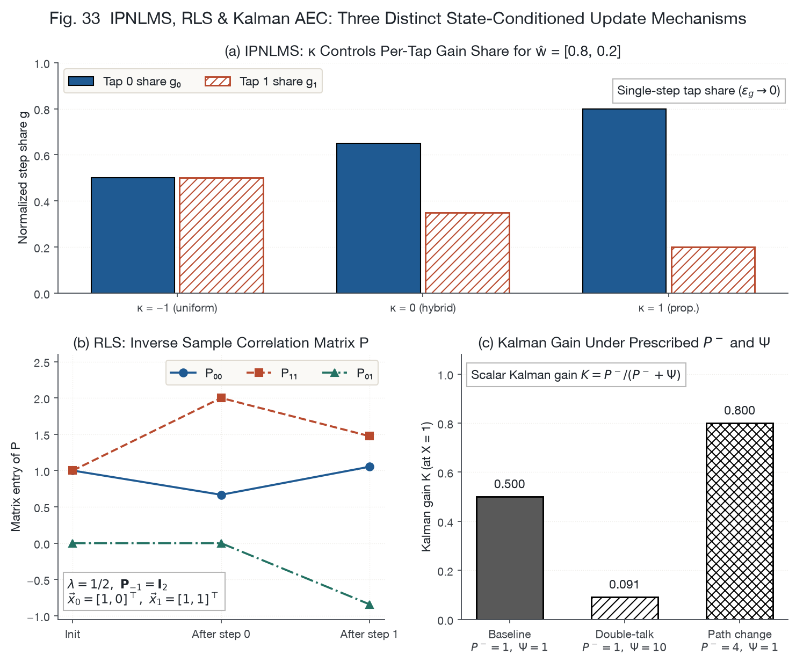

Inspecting the three panels of Figure 33 compares side by side how IPNLMS, RLS, and Kalman filtering reshape adaptive updates:

- **Figure 33(a)**: Displays the two-tap IPNLMS hand calculation from §6.2.4 with negligible regularization ($\hat{\vec w}=[0.8,0.2]^\top$), tracing each tap's share $g_l$ as $\kappa$ moves from $-1$ (uniform $[0.5,0.5]$) through $0$ (balanced $[0.65,0.35]$) to $+1$ (purely proportionate $[0.8,0.2]$);
- **Figure 33(b)**: Displays the two-tap RLS hand calculation from §6.2.6, showing the inverse correlation matrix evolving from diagonal $\mathbf P_0=\operatorname{diag}(2/3,2)$ to coupled matrix $\mathbf P_1$ with negative off-diagonal entry $-16/19$;
- **Figure 33(c)**: Fixes scalar reference $X=1$ (dimensionless) and uses three bars to compare the Kalman gain $K=P^-/(P^-+\Psi)$ across three statistical regimes (Bayesian state-space recursion background in [Chapter 0 §0.6](00_math-foundations.md#sec-0-6)): "baseline" ($P^-=1,\Psi=1$) yields $K=0.500$, "assumed double-talk" ($P^-=1,\Psi=10$) contracts to $K\approx 0.091$, and "assumed path jump" ($P^-=4,\Psi=1$) expands to $K=0.800$.

**From scalar to full matrix state: what does diagonal approximation lose, and why use Joseph covariance updates?** In the full time-domain matrix model with state-transition matrix $\mathbf A\in\mathbb{R}^{L\times L}$, process covariance $\mathbf Q$, and scalar observation-interference variance $\Psi$, define the path estimation error $\vec\delta_n=\vec h_n-\hat{\vec h}_n$ and its error covariance matrix $\mathbf P_n=\mathbb{E}[\vec\delta_n\vec\delta_n^\top]$ (distinct in meaning from the inverse sample correlation matrix $\mathbf P_n=\mathbf R_n^{-1}$ of Eqs. (6-17)–(6-18) and distinct in dimension from the scalar variance $P_m$ of Eq. (6-21)). The complete real Kalman recursion reads:

$$\begin{aligned}
\hat{\vec h}_n^-&=\mathbf A\hat{\vec h}_{n-1},\\
\mathbf P_n^-&=\mathbf A\mathbf P_{n-1}\mathbf A^\top+\mathbf Q,\\
S_n&=\vec x_n^\top\mathbf P_n^-\vec x_n+\Psi,\\
\vec K_n&=\mathbf P_n^-\vec x_n/S_n,\\
e_n^-&=d[n]-\vec x_n^\top\hat{\vec h}_n^-,\\
\hat{\vec h}_n&=\hat{\vec h}_n^-+\vec K_n e_n^-,\\
\mathbf B_n&=\mathbf I_L-\vec K_n\vec x_n^\top,\\
\mathbf P_n&=\mathbf B_n\mathbf P_n^-\mathbf B_n^\top\\
           &\quad+\vec K_n\Psi\vec K_n^\top.
\end{aligned}\tag{6-22}$$

Look closely at the **Joseph stabilized covariance form** in the final two lines of Eq. (6-22), which offers both transparent physical accounting and vital numerical stability: writing prior error $\vec\delta_n^-=\vec h_n-\hat{\vec h}_n^-$, posterior error $\vec\delta_n=\vec h_n-\hat{\vec h}_n$, and total observation interference $u_n=s[n]+v[n]$, substituting $e_n^-=\vec x_n^\top\vec\delta_n^-+u_n$ into $\vec\delta_n=\vec\delta_n^--\vec K_n e_n^-$ gives $\vec\delta_n=\mathbf B_n\vec\delta_n^--\vec K_n u_n$. Because prior path error and current observation interference are uncorrelated, **for any arbitrary gain vector $\vec K_n$** (even when $\vec K_n$ is suboptimal due to biased variance estimates or double-talk gating), the exact posterior error covariance equals the sum of two symmetric positive semidefinite quadratic forms—$\mathbf B_n\mathbf P_n^-\mathbf B_n^\top$ is the residual path uncertainty compressed by the current observation, and $\vec K_n\Psi\vec K_n^\top$ is the observation-interference variance newly injected into the weights along $\vec K_n$.

Only when $\vec K_n$ equals the exact theoretical optimum $\mathbf P_n^-\vec x_n/S_n$ under zero rounding error do the cross terms cancel algebraically to collapse into the shorthand $(\mathbf I_L-\vec K_n\vec x_n^\top)\mathbf P_n^-$. In finite-precision floating-point arithmetic, subtracting two matrices in the shorthand readily loses symmetry or generates negative eigenvalues, whereas the Joseph sum of two congruent positive semidefinite forms preserves real symmetry and positive semidefiniteness by construction.

A two-tap hand check (see [`aec_kalman_matrix_demo.py`](../codes/chapters/ch06/aec_kalman_matrix_demo.py)) shows what off-diagonal cross-tap covariances capture: set $\mathbf A=\mathbf I_2, \mathbf Q=\mathbf 0, \Psi=1$, prior $\hat{\vec h}^-=\vec 0$ and $\mathbf P^-=\operatorname{diag}(1,4)$, and first observation $\vec x=[1,1]^\top, d=3$. Equation (6-22) yields innovation variance $S=1+4+1=6$, gain $\vec K=[1/6,2/3]^\top$, posterior path $\hat{\vec h}=[1/2,2]^\top$, and Joseph posterior covariance $\mathbf P$ with diagonal entries $5/6$ and $4/3$ and off-diagonal entry $-2/3$. Even though the prior $\mathbf P^-$ was strictly diagonal, observing $x_0 h_0+x_1 h_1\approx 3$ tied the sum of the two taps together, immediately creating negative off-diagonal correlation $-2/3$.

If the next sample arrives along the differential mode $\vec x_{\mathrm{next}}=[-1,1]^\top$, the full matrix yields innovation variance $[-1,1]\mathbf P[-1,1]^\top+1=(5/6+4/3+4/3)+1=9/2=4.5$ (honestly reflecting high residual uncertainty along the unobserved differential direction); dropping off-diagonal entries under a diagonal approximation yields only $(5/6+4/3)+1=19/6\approx 3.167$, underestimating uncertainty along the differential mode.

Note also the **exact algebraic bridge between RLS and time-domain matrix Kalman filtering**: setting static transition $\mathbf A=\mathbf I_L$, normalized unit observation variance $\Psi=1$, and prior covariance inflation $\mathbf P_n^-=\lambda^{-1}\mathbf P_{n-1}$ (equivalently choosing adaptive process noise $\mathbf Q_n=(\lambda^{-1}-1)\mathbf P_{n-1}$, with $\mathbf Q_n=\mathbf 0$ when $\lambda=1$) turns the Kalman gain in Eq. (6-22) into

$$\begin{aligned}
\vec K_n
&=\frac{\lambda^{-1}\mathbf P_{n-1}\vec x_n}
       {1+\lambda^{-1}\vec x_n^\top\mathbf P_{n-1}\vec x_n}
=\frac{\mathbf P_{n-1}\vec x_n}
      {\lambda+\vec x_n^\top\mathbf P_{n-1}\vec x_n},
\end{aligned}$$

matching the RLS gain of Eq. (6-18) identically after multiplying numerator and denominator by $\lambda$.

**Partitioned-Block Frequency-Domain Kalman Filtering (PBFDKF): from dense master equations to practical recursion.** Extending matrix state tracking to $P$ frequency-domain partitions (original architecture in [Kuech, Mabande & Enzner, ICASSP 2014](https://doi.org/10.1109/ICASSP.2014.6853806)), stack all partition frequency weights into $\vec w_m=[\vec W_{0,m}^\top,\ldots,\vec W_{P-1,m}^\top]^\top\in\mathbb{C}^{2NP}$. Using the trailing-half selector $\mathbf S=[\mathbf 0_{N\times N}\ \mathbf I_N]$ and $\mathbf F^{-1}$ from §6.2.2, the overlap-save observation operator mapping frequency-domain state to the length-$N$ valid time-domain microphone block $\vec d_m\in\mathbb{R}^N$ takes the explicit block form $\mathbf H_m=\mathbf S\mathbf F^{-1}[\operatorname{diag}(\vec X_m),\ldots,\operatorname{diag}(\vec X_{m-P+1})]\in\mathbb{C}^{N\times 2NP}$. With valid time-domain observation-interference covariance $\mathbf \Psi_m\succ\mathbf 0$, the unapproximated dense matrix master equations are

$$\begin{aligned}
\hat{\vec w}_m^-&=\mathbf A\hat{\vec w}_{m-1},\\
\mathbf P_m^-&=\mathbf A\mathbf P_{m-1}\mathbf A^H+\mathbf Q,\\
\vec e_m^-&=\vec d_m-\mathbf H_m\hat{\vec w}_m^-,\\
\mathbf S_m&=\mathbf H_m\mathbf P_m^-\mathbf H_m^H+\mathbf \Psi_m,\\
\mathbf K_m&=\mathbf P_m^-\mathbf H_m^H\mathbf S_m^{-1},\\
\hat{\vec w}_m&=\hat{\vec w}_m^-+\mathbf K_m\vec e_m^-.
\end{aligned}\tag{6-23}$$

Verify dimensions: $\mathbf P_m^-$ is $2NP\times 2NP$, $\mathbf S_m$ is $N\times N$, and $\mathbf K_m$ is $2NP\times N$; because $\vec d_m$ is a real valid time-domain block, the innovation obeys $\vec e_m^-=(\vec e_m^-)^*$, while the frequency-domain state generated from real finite-support FIR taps obeys conjugate symmetry and finite-support constraints across all DFT bins. Directly inverting the high-dimensional matrix in Eq. (6-23) is too expensive on long paths; following the classical simplification of [Enzner & Vary (2006)](https://doi.org/10.1016/j.sigpro.2005.09.013) and [Kuech, Mabande & Enzner (ICASSP 2014)](https://doi.org/10.1109/ICASSP.2014.6853806), transform the leading-zero-padded valid residual back to the $2N$-point frequency domain via $\vec E_m^-=\mathbf F\mathbf S^\top\vec e_m^-$ and apply two approximations to obtain practical per-partition, per-bin PBFDKF:

1. **Block-diagonal covariance approximation**: Discard cross-bin and cross-partition off-diagonal entries of $\mathbf P_m^-$, retaining only the scalar prior error variance $P_{p,m}^-(k)=|a|^2 P_{p,m-1}(k)+\Phi_{p,m}(k)$ at partition $p$, bin $k$;
2. **Overlap-save projection ratio $\frac{N}{2N}$**: From Eq. (6-6), the frequency-domain valid-region projector $\mathbf C=\mathbf F\mathbf S^\top\mathbf S\mathbf F^{-1}$ is idempotent and Hermitian ($\mathbf C^2=\mathbf C=\mathbf C^H$), with constant diagonal entries equal to the valid-block-to-FFT ratio $C_{kk}=\frac{N}{2N}$ (more generally $R_{\mathrm{hop}}/M_{\mathrm{DFT}}$ for hop $R_{\mathrm{hop}}$ and DFT size $M_{\mathrm{DFT}}$). Using $(\mathbf F^{-1})^H=\frac{1}{2N}\mathbf F$ and $\mathbf F^H=2N\,\mathbf F^{-1}$ from §6.2.2, each partition's adjoint observation block obeys $\mathbf H_{p,m}^H=\frac{1}{2N}\operatorname{diag}(\vec X_{m-p}^*)\mathbf F\mathbf S^\top$ and $(\mathbf F^{-1})^H\mathbf S^\top\mathbf S\mathbf F^H=\mathbf C$. Mapping the $N\times N$ time-domain innovation covariance $\mathbf S_m$ into the zero-padded $2N$-point DFT domain gives $\mathbf S_m^{\mathrm{DFT}}\triangleq\mathbf F\mathbf S^\top\mathbf S_m\mathbf S\mathbf F^H=\mathbf C\bigl(\sum_{q=0}^{P-1}\operatorname{diag}(|X_{m-q}|^2 P_{q,m}^-)\bigr)\mathbf C+\mathbf F\mathbf S^\top\mathbf\Psi_m\mathbf S\mathbf F^H$; under a smooth-spectrum approximation, idempotence $\mathbf C^2=\mathbf C$ together with the diagonal approximation $\mathbf C\approx\frac{N}{2N}\mathbf I_{2N}$ yields diagonal entries $\vec S_m^{\mathrm{DFT}}$ with $S_m^{\mathrm{DFT}}(k)\approx\frac{N}{2N}\sum_{q=0}^{P-1}|X_{m-q}(k)|^2 P_{q,m}^-(k)+\Psi_m^{\mathrm{DFT}}(k)$ (for white observation interference $\mathbf\Psi_m=\sigma_u^2\mathbf I_N$, the diagonal entries are $\Psi_m^{\mathrm{DFT}}(k)=[\mathbf F\mathbf S^\top\mathbf\Psi_m\mathbf S\mathbf F^H]_{kk}=2N\sigma_u^2 C_{kk}=N\sigma_u^2$). Applying the standard DFT-domain diagonal inversion approximation $\mathbf F\mathbf S^\top\mathbf S_m^{-1}\vec e_m^-\approx N\operatorname{diag}(\vec S_m^{\mathrm{DFT}})^{-1}\vec E_m^-$ inside $\mathbf K_{p,m}\vec e_m^-=\mathbf P_{p,m}^-\mathbf H_{p,m}^H\mathbf S_m^{-1}\vec e_m^-$ (producing $\frac{1}{2N}\cdot N=\frac{N}{2N}$ and $\mathbf K_{p,m}\approx\operatorname{diag}(\vec K_{p,m})\mathbf F\mathbf S^\top$), and replacing $\mathbf C\approx\frac{N}{2N}\mathbf I_{2N}$ inside the posterior update $\mathbf K_{p,m}\mathbf H_{p,m}\approx\operatorname{diag}(\vec K_{p,m})\mathbf C\operatorname{diag}(\vec X_{m-p})$, yields the practical per-partition, per-bin PBFDKF recursion (suppressing fixed bin $k$):

$$\begin{aligned}
S_m^{\mathrm{DFT}}&=\frac{N}{2N}\sum_{q=0}^{P-1}|X_{m-q}|^2 P_{q,m}^- + \Psi_m^{\mathrm{DFT}},\\
K_{p,m}&=\frac{\frac{N}{2N}\,P_{p,m}^- X_{m-p}^*}{S_m^{\mathrm{DFT}}},\\
\widetilde W_{p,m}&=\hat W_{p,m}^-+K_{p,m}E_m^-,\\
P_{p,m}&=\left(1-\frac{N}{2N}\,K_{p,m}X_{m-p}\right)P_{p,m}^-.
\end{aligned}\tag{6-24}$$

Applying the time-domain valid-tap zeroing projector $\mathbf G=\mathbf F\mathbf U\mathbf U^\top\mathbf F^{-1}$ of §6.2.2 to the candidate weights $\widetilde W_{p,m}$ produces the committed posterior weights $W_{p,m}$. Checking the noiseless single-partition limit ($P=1,\Psi_m^{\mathrm{DFT}}\to 0$): the factors $\frac{N}{2N}$ in numerator and denominator of Eq. (6-24) cancel identically to yield $K_{0,m}\to X_m^*/|X_m|^2=1/X_m$ (corresponding to stable frequency-domain normalized adaptation at $\mu=1$), while posterior variance contracts by $1-\frac{N}{2N}=\frac{1}{2}$, faithfully reflecting that $N$ valid time-domain observations constrain exactly half of the $2N$ unprojected spectral degrees of freedom. Extending to stereo playback, one can retain $2\times 2$ cross-playback-channel covariance blocks within each partition to handle channel correlation (such as SD-PBFDKF in [Zhu et al., Interspeech 2021](https://www.isca-archive.org/interspeech_2021/zhu21d_interspeech.pdf); open-source details in the [Research Manual](../codes/chapters/ch00/research_en/02_aec_wpe_separation.md#aec)).

We conclude with a single-tap double-talk hand check illustrating the consequence of mismatched statistics: start from $w^-=0,P^-=1,x=1,\Psi=0.1$; the first single-talk sample $d[0]=1$ gives $K_0=1/1.1=10/11$, moving to $w_0=10/11\approx 0.909$ and $P_0=1/11$. At the second sample, the true path remains $1$ but near-end speech of amplitude $2$ enters so $d[1]=3$ (innovation $e_1^-=3-10/11=23/11$):

- If the observation-variance estimator misses double-talk and stays at $\Psi=0.1$, the gain stays high at $K_1=(1/11)/(1/11+1/10)=10/21$, pulling the weight in a single step to $10/11+(10/21)(23/11)=40/21\approx 1.905$;
- If double-talk energy is captured and $\Psi$ rises to $10$, the gain drops to $1/111$, keeping the posterior weight stable at $10/11+(1/111)(23/11)=103/111\approx 0.928$ (ideal hard freeze holds $10/11\approx 0.909$). In [`aec_rls_kalman_comparison.py`](../codes/chapters/ch06/aec_rls_kalman_comparison.py) (seed `20260923`, $512$-sample two-tap sequence), keeping $\Psi$ low during double-talk degrades a priori echo-estimate MSE to $0.1341$, whereas raising $\Psi$ during double-talk and ideal hard freezing suppress MSE to $1.57\times 10^{-5}$ and $9.83\times 10^{-6}$, respectively (listening comparisons of four-method short-path residuals in [Synthetic Audio Notes](../codes/chapters/ch00/research_en/05_exercises_and_audio.md#sec-u-042e52c4d2)).

The table below places all seven linear adaptive architectures from §6.1–§6.2 on a single engineering selection grid:

| Algorithm | Primary Per-Sample Compute | What Governs Convergence | Double-Talk Update Control | Best-Fit Regimes |
|---|---|---|---|---|
| Time-domain NLMS | $O(L)$; naive $\approx 3L$, recursive-energy core $\approx 2L$ | Input spectral condition number, step size, path drift | External freeze or continuous step-size control required | Very short paths, teaching, or minimal-footprint verification |
| Proportionate updates | IPNLMS: $O(L)$ plus proportionate weight calculation | Faster initially on sparse paths; limited gain on dense tails | External double-talk control still required | Impulse responses dominated by sparse strong peaks |
| Affine Projection (APA) | Direct form $\approx O(LK^2+K^3)$; small-order window solve | Projection order $K$, column correlation, regularization $\delta$, noise | Double-talk history lingers in buffer after freeze; pair with flush logic | Low orders ($K=2$–$4$) to accelerate colored-speech convergence |
| Partitioned frequency-domain | PBFDAF: unconstrained $\approx O(\log N+L/N)$; per-partition constrained adds $O((L/N)\log N)$ | Per-bin power normalization, block size $N$, constraint cadence | External binary freeze or continuous step-size scaling | Medium-to-long reverberant paths on real-time devices tolerating block framing |
| Subband adaptive | Filterbank analysis/synthesis plus low-rate short filters | Within-band spectral flatness, oversampling ratio, or cross-band coupling | Double-talk control still required | Front-ends already running an oversampled analysis–synthesis filterbank |
| RLS | Standard full-matrix $O(L^2)$ compute and $O(L^2)$ memory | Forgetting factor $\lambda$, initial regularization, silence protection | Highly sensitive to double-talk and silence; strict gating mandatory | Very low-order adaptive modules or offline least-squares benchmarks |
| Frequency-domain Kalman (FDKF / PBFDKF) | Partitioned frequency-domain filtering plus error/noise variance tracking | Accuracy of process variance $\mathbf Q$ and observation variance $\mathbf \Psi$ | Naturally supports per-bin soft gating by raising $\mathbf \Psi$ | Terminals with frequent path changes needing fine double-talk vs. reconvergence balance |

Two unifying axes emerge from this summary: along the **computational-architecture axis**, real-time long-path products almost universally deploy either partitioned-block frequency-domain filtering (MDF / PBFDAF) or oversampled subband filterbanks; along the **parameter-update axis**, designs progress from fixed-step per-bin normalization to frequency-domain Kalman soft gating (FDKF / PBFDKF) jointly driven by process and double-talk observation variances. With the linear backbone complete, §6.3 and §6.4 tackle the two chief obstacles outside linear modeling: loudspeaker nonlinearities/protection and delay/double-talk control.

### 6.3 Nonlinear Echo and Loudspeaker Protection

**Where nonlinearity originates.** Under large-excursion drive, micro-speaker surrounds and magnetic circuits depart from Hooke's law and uniform magnetic-flux assumptions (suspension stiffness hardens sharply with displacement while the voice coil partially exits the magnetic gap so the force factor drops); power amplifiers or digital playback chains exhibit soft saturation or hard clipping at high volumes; and thin plastic housings or mechanical buttons vibrate nonlinearly and re-radiate under high sound pressure. Birkett & Goubran (WASPAA 1995) measured nonlinear echo behavior in hands-free terminals, and Klippel (JAES 2006) formulated comprehensive large-signal electromechanical models of moving-coil loudspeakers.

**Where the residual floor comes from.** The linear transversal filter of Eq. (6-2) can synthesize only linear combinations of past playback samples $x[n],\ldots,x[n-L+1]$. Once amplifier or loudspeaker distortion generates harmonics and intermodulation products outside that linear span, even a linear filter converged to the global MMSE optimum leaves every distortion component orthogonal to the reference subspace intact in $e[n]$, pinning the $\mathrm{ERLE}$ curve at a flat "residual floor" (Exercise [E06-06](#e06-06) and Figure 31 give an exact analytical and discrete-spectrum derivation for a single sinusoid through a cubic nonlinearity). Whether a nonlinearity creates uncancelled residual also depends on the excitation's value set: for a bipolar binary sequence $x[n]\in\{-1,+1\}$, $x^3[n]\equiv x[n]$ collapses a cubic polynomial back into an identity linear map that a linear tap still cancels; under continuous-amplitude speech and music, however, higher harmonics and intermodulation terms emerge in full.

> **Minimal hand check of the `tanh` soft-saturation curve.**
>
> Figure 27 models symmetric odd-order amplifier/loudspeaker soft saturation via the normalized hyperbolic tangent $y=\tanh(1.1x)/\tanh(1.1)$, where the denominator anchors $y=1$ at $x=1$. Evaluating two representative amplitudes: at small amplitude $x=0.3$, $y=\tanh(0.33)/\tanh(1.1)\approx 0.3185/0.8005\approx 0.398$, rising roughly $+0.098$ above the reference secant $y=x$; at large overdrive $x=1.5$, $y=\tanh(1.65)/\tanh(1.1)\approx 0.9289/0.8005\approx 1.160$, compressed roughly $-0.340$ below the reference line.
>
> Differentiating at the origin gives a small-signal tangent slope of $1.1/\tanh(1.1)\approx 1.374$, confirming that the dashed line $y=x$ in the figure is the secant connecting $(0,0)$ and $(1,1)$ rather than the origin tangent. Under continuous speech excitation, a linear adaptive filter automatically settles on the MMSE-optimal equivalent linear slope, yet any nonzero curvature between that best straight line and the true S-shaped curve converts into nonlinear residual that increasing filter length $L$ can never remove.

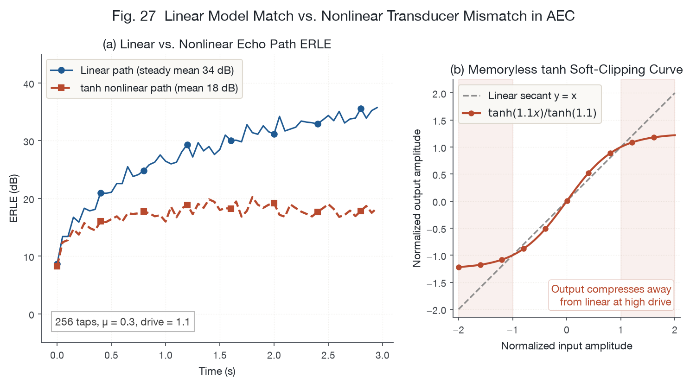

Read the two panels of Figure 27 in tandem: under a controlled $3\ \mathrm{s}$ simulation with $256$ taps, $\mu=0.3$, and drive factor $1.1$, Figure 27(a) contrasts $\mathrm{ERLE}$ trajectories for a pure linear path against the same path cascaded with normalized $\tanh$ saturation—the linear trajectory climbs steadily while the nonlinear trajectory quickly hits a flat floor dictated by unmodeled harmonics; Figure 27(b) plots normalized input amplitude $x$ against normalized output amplitude $y$, visualizing the small-signal expansion and large-signal compression relative to the secant $y=x$ and linking static transfer curvature directly to the linear cancellation ceiling.

#### Explicit Nonlinear Modeling

When linear combinations fall short, the first technical route expands the known playback reference onto nonlinear basis functions inside the adaptive predictor. The most general non-recursive truncated expansion is the **second-order Volterra filter**, augmenting linear convolution with all pairwise products of lagged samples. For real inputs, exploiting product symmetry $x[n-i]x[n-j]=x[n-j]x[n-i]$ to retain only upper-triangular indices $0\le i\le j<L$ and abbreviating $t_i=x[n-i]$ at fixed instant $n$, the predicted echo is

$$\begin{aligned}
\hat y[n]&=\sum_{i=0}^{L-1}w_i t_i\\
&\quad+\sum_{0\le i\le j<L}q_{ij} t_i t_j.
\end{aligned}\tag{6-25}$$

Although Eq. (6-25) remains linear in its unknown parameters $\{w_i,q_{ij}\}$, its parameter count explodes quadratically: $L$ linear taps plus $L(L+1)/2$ upper-triangular quadratic coefficients (when converting from a full symmetric kernel matrix $\mathbf H$, off-diagonal symmetric pairs must be merged as $q_{ij}=H_{ij}+H_{ji}=2H_{ij}$ while diagonal entries stay $q_{ii}=H_{ii}$—never drop the lower triangle without the factor of $2$). For $L=256$, the quadratic kernel alone requires $256\times 257/2=32896$ adaptive weights, sharply raising compute cost and double-talk overfitting risk; worse still, a quadratic kernel excited by a single sinusoid produces only DC and second harmonics, remaining powerless against the third harmonics dominating symmetric clipping (such as odd-symmetric $\tanh$ saturation above and Exercise [E06-06](#e06-06); see [Stenger & Rabenstein, NSIP 1999](https://www.eurasip.org/Proceedings/Ext/NSIP99/Nsip99/papers/146.pdf)).

To sidestep the curse of dimensionality from cross-lag products, engineers typically mirror physical transducer ordering via **structured cascade models**: a memoryless nonlinearity followed by a linear dynamic path ($N\to L$) forms a **Hammerstein model**; linear dynamics followed by a memoryless nonlinearity ($L\to N$) forms a **Wiener model**; and amplifier pre-filtering plus nonlinear limiting followed by room acoustics ($L\to N\to L$) forms a **Wiener–Hammerstein model**. In the generalized Hammerstein (power-filter) model widely used in compact hands-free devices, $Q$ known memoryless nonlinear basis functions $\{\psi_q(\cdot)\}_{q=1}^{Q}$ first transform the playback reference $x[n]$, and each branch passes through its own $L$-tap causal linear path $h_q[\ell]$:

$$\begin{aligned}
\hat y[n]&=\sum_{q=1}^{Q}\sum_{\ell=0}^{L-1}
           h_q[\ell]\,\psi_q(x[n-\ell]).
\end{aligned}$$

When memoryless amplifier distortion $g(x)=\sum_{q=1}^{Q}c_q\psi_q(x)$ occurs entirely upstream of a single room impulse response $h[\ell]$, the equation collapses to the rank-$1$ special case $h_q[\ell]=c_q h[\ell]$ sharing one spatial profile; retaining independent $h_q[\ell]$ turns the task into a $Q$-channel multi-reference linear adaptive filtering problem with only $QL$ total parameters (e.g., $Q=3$ odd branches at $L=256$ require only $768$ taps versus $32896$ for second-order Volterra) that directly reuses the partitioned frequency-domain machinery of §6.2.

**Why choose orthogonal Legendre bases instead of raw monomial powers $\{x,x^2,x^3,\ldots\}$?** The bottleneck is **severe collinearity and ill-conditioning** across nonlinear branches. Assuming normalized amplitude $x\sim\mathcal U(-1,1)$, compare the two most common odd monomials $\psi_1(x)=x$ and $\psi_3(x)=x^3$ by hand: because $x$ and $x^3$ share identical sign everywhere on $[-1,1]$ and grow together near $\pm 1$, even moments $\mathbb{E}[x^{2k}]=1/(2k+1)$ (from $\frac{1}{2}\int_{-1}^{1}x^{2k}\,\mathrm{d}x$) give $\mathbb{E}[x^2]=1/3$, $\mathbb{E}[x^6]=1/7$, and cross-correlation $\mathbb{E}[x\cdot x^3]=\mathbb{E}[x^4]=1/5$. Their normalized correlation coefficient reaches

$$\begin{aligned}
\rho_{1,3}
&=\frac{\mathbb{E}[x^4]}
       {\sqrt{\mathbb{E}[x^2]\,\mathbb{E}[x^6]}}
 =\frac{1/5}{\sqrt{(1/3)(1/7)}}
 =\frac{\sqrt{21}}{5}\approx 0.9165.
\end{aligned}$$

Even after normalizing both branches to unit variance, their $2\times 2$ correlation matrix has condition number $(1+\rho_{1,3})/(1-\rho_{1,3})=(5+\sqrt{21})/(5-\sqrt{21})\approx 22.96$ (without variance scaling, entries $1/3,1/7$ and $1/5$ yield condition number $\approx 27.73$). More generally, for odd powers $p,q\in\{1,3,5,\ldots\}$, the raw power-basis second-moment matrix $\mathbf R_{\mathrm{pow}}$ has entries $\mathbb{E}[x^{p+q}]=\frac{1}{p+q+1}$—an **odd-indexed Cauchy/Hilbert-type ill-conditioned submatrix**. Adding a fifth-order branch $x^5$ to form $\{x,x^3,x^5\}$ sends the unscaled condition number rising sharply from $27.73$ to **$849.58$**, and even unit-variance normalization leaves it at **$567.45$**, causing adaptive gradients to compete across harmonic branches and converge slowly (exact characteristic polynomials and coordinate decoupling are worked out in Exercise [E06-29](#e06-29)).

Switching to **orthogonal Legendre polynomials** on $[-1,1]$ (taking $P_1,P_3,P_5,\ldots$ for symmetric odd distortion and adding $P_2,P_4,\ldots$ for asymmetric even distortion):

$$\begin{aligned}
P_1(x)&=x,\qquad
P_2(x)=\frac{1}{2}(3x^2-1),\\
P_3(x)&=\frac{1}{2}(5x^3-3x),\qquad
P_5(x)=\frac{1}{8}(63x^5-70x^3+15x).
\end{aligned}$$

They obey strict orthogonality $\int_{-1}^{1}P_p P_q\,\mathrm{d}x=\frac{2}{2q+1}\delta_{pq}$ on $[-1,1]$. By explicitly subtracting all lower-order odd projections from $x^3$ and $x^5$, $\mathbb{E}[P_1(x)P_3(x)]=(5/2)(1/5)-(3/2)(1/3)=0$ under $x\sim\mathcal U(-1,1)$, diagonalizing the three-branch unscaled Gram matrix to $\operatorname{diag}(1/3,1/7,1/11)$ (condition number drops to $11/3\approx 3.67$), and scaling by $\sqrt{2q+1}$ turns it into the identity matrix with condition number $1$. Real speech has super-Gaussian instantaneous amplitudes concentrated near zero plus temporal correlation, so Legendre bases are not strictly zero-correlated on live speech, yet stripping dominant polynomial collinearity still slashes multi-branch condition numbers and speeds up nonlinear AEC convergence (see Kuech & Kellermann, *Signal Processing*, 2006). Implementations must enforce a strict **$|x|\le 1$ domain guard**: Legendre polynomials remain orthogonal and bounded only on $[-1,1]$ and diverge rapidly once $|x|>1$ (for example, $P_5(1.5)\approx 33.08$), requiring amplitude normalization or clamping prior to expansion; where signal levels fluctuate widely, bounded **trigonometric Functional Link Adaptive Filters (FLAF / FLANN**, expanding $x$ onto $\{\sin(\pi k x),\cos(\pi k x)\}$; Comminiello et al., *IEEE TASLP*, 2013; *IEEE/ACM TASLP*, 2015) or locally supported **Spline Adaptive Filters (SAF**; Scarpiniti et al., *Signal Processing*, 2013) offer practical overflow-free alternatives.

For hardware with non-negligible pre-amplifier filtering, [Nollett & Jones (NSIP 1997)](https://www.iwaenc.org/proceedings/1997/nsip97/pdf/author/ns970521.pdf) investigated an $L\to N\to L$ Wiener–Hammerstein structure: on an inexpensive active PC loudspeaker driven hard into amplifier clipping using synthetic vowels with time-varying pitch and amplitude, a $30$-tap pre-filter plus $200$-tap post-filter LNL model outperformed a $230$-tap linear NLMS filter of equal total length, raising steady-state $\mathrm{ERLE}$ from $11.1\ \mathrm{dB}$ to $19.5\ \mathrm{dB}$ (an $+8.4\ \mathrm{dB}$ gain). When interpreting such literature numbers, keep experimental boundaries in mind: the benchmark used synthetic vowels without reporting sampling rate or repeat statistics, so real product selection must re-measure gains on target loudspeakers and live double-talk corpora.

#### Smart PA Loudspeaker Protection and Shifting the Reference Tap-Off Downstream

Beyond mechanical transducer distortion, modern smartphones, smart speakers, and portable conference terminals almost universally embed **Smart Power Amplifier (Smart PA) protection algorithms**, forming another major hidden trigger for linear AEC divergence at high volume:

- **Excursion and thermal protection limiters**: A Smart PA continuously monitors output terminal voltage and current (IV-sense) to estimate instantaneous diaphragm excursion and voice-coil temperature in real time. Whenever heavy bass transients or sustained loud playback approach maximum mechanical excursion ($X_{\max}$) or thermal limits, the protection loop dynamically engages **time-varying high-pass cutoff shifts**, **multiband dynamic compression**, and **soft/hard peak limiting**. If the AEC reference is tapped *upstream* of the Smart PA protection DSP (such as at the host mixer output), all of these level- and temperature-dependent time-varying filters and limiters land on the unknown echo-path side, depressing linear $\mathrm{ERLE}$ and repeatedly shocking the adaptive weights into divergence on loud transients;
- **Moving the reference tap-off downstream of protection or using IV-sense electrical loopback**: Two direct hardware/firmware remedies tackle this at the source. First, relocate the digital reference loopback to the latest synchronous digital node *downstream* of Smart PA excursion/thermal limiting (the T4/T5 late-reference rule in §6.7.1), absorbing time-varying gain and clipping waveforms straight into the known reference. Second, feed back the Smart PA's existing **IV-sense ADC channel** capturing speaker-terminal voltage or voice-coil current as the AEC reference (see [Shah et al., *IEEE/ACM TASLP*, 2015](https://doi.org/10.1109/TASLP.2015.2425955)), absorbing both digital limiting and analog amplifier clipping into the known reference (mechanical surround nonlinearity and enclosure resonances downstream of electromechanical transduction still remain on the acoustic side);
- **Mechanical vibration reference**: Mounting an accelerometer on the speaker basket or enclosure captures structural vibration directly, at the cost of an extra sensor, synchronized capture, and sensor noise floor.

In hardware–software co-design, post-protection late reference tap-offs, orthogonal-basis explicit nonlinear cancellation, and the frequency-domain/learning-based residual suppression of §6.5 are layered according to BOM and compute budgets; acceptance testing must always log the linear canceller output and post-suppressor output separately.

### 6.4 Delay Alignment, Double-Talk Detection, and Adaptation Control

Before tackling double-talk protection, an even earlier prerequisite must hold: **are the playback reference $x[n]$ and the microphone's true echo $y[n]$ aligned within the causal filter's tap window?** Operating-system playback buffers, sound-card capture buffers, and acoustic time-of-flight combine to create a bulk pure delay $D$.

**Hard geometric coverage requirement.** Suppose the pure fixed delay from reference to microphone is $D$ samples, followed by a nonzero reverberation tail spanning relative lags $0$ through $R$. Without pre-alignment, a length-$L$ causal FIR filter requires $L\ge D+R+1$ to span every nonzero tap; pre-delaying the reference by $D$ samples into $x_a[n]=x[n-D]$ reduces the requirement to $L\ge R+1$, dedicating all taps to modeling reverberation. Conversely, if scheduling errors or over-compensation cause the reference to reach the AEC *later* than the true echo in the microphone (residual lag $r<0$, placing the path in the non-causal region), extending the causal FIR to ten thousand taps still cannot predict future reference samples that have not yet arrived—the sole fix is reducing delay in the reference buffer or capture pipeline (see Exercise [E06-14](#e06-14)).

During long-call diagnostics, also distinguish three distinct delay anomalies: fixed pipeline offset shifts the correlation peak by a constant amount; Sample Rate Offset (SRO) between independent oscillators makes delay ramp linearly over time (phase breakdown quantified in Exercise [E06-15](#e06-15) and §6.8.3); and Bluetooth reconnects, sound-card underruns, or route switches produce abrupt step jumps in delay. These three respectively demand initial buffer alignment, asynchronous Sample Rate Conversion (SRC) tracking, and jump re-search.

**Practical delay estimation: decimated matched filtering and lag-histogram aggregation.** The crudest delay estimator searches for the maximum signed cross-correlation between reference and microphone, yet colored speech's wide autocorrelation lobe and signed multipath reflections easily push the highest positive peak away from the impulse-response onset (and fail outright on polarity-inverted paths; see Exercise [E06-07](#e06-07)); even whitened Generalized Cross-Correlation (GCC-PHAT) suffers frame-to-frame false-peak jumps during heavy double-talk or periodic music. Industrial engines—exemplified by [`echo_path_delay_estimator.cc`](https://webrtc.googlesource.com/src/+/0467d2b91cc20b9b001c2bbb73d43ea6b2491f3e/modules/audio_processing/aec3/echo_path_delay_estimator.cc) in WebRTC AEC3—therefore deploy a three-stage interference-resistant pipeline:

1. **Decimation for dimensionality reduction**: Low-pass filter and decimate both far-end reference and microphone signals by a factor $M_{\mathrm{dec}}$ (e.g., from $16\ \mathrm{kHz}$ down to $2\ \mathrm{kHz}$ or $4\ \mathrm{kHz}$, $M_{\mathrm{dec}}=8$ or $4$), shortening a several-hundred-millisecond search span by $M_{\mathrm{dec}}\times$ and compressing MAC load by roughly $M_{\mathrm{dec}}^2\times$;
2. **Parallel multi-window short NLMS matched filters**: At the decimated rate, tile multiple short time-domain NLMS matched filters across contiguous lag windows spanning the search range (e.g., $0$–$500\ \mathrm{ms}$). Update each short filter only when far-end energy exceeds an activity threshold, and score each lag window's confidence by its normalized prediction-error energy ratio $\eta_j=E_{e,j}/E_d$—because adaptive short FIRs fit local acoustic impulses, they handle inverted polarity and multipath reflections naturally;
3. **Lag-histogram aggregator and gated commit**: Each frame casts a vote into a sliding temporal histogram only if the winning lag window's error drop beats a confidence threshold; only when the histogram mode accumulates sufficient consecutive support and departs from the active offset beyond a hysteresis margin does the engine update the `RenderBuffer` alignment offset while preserving causal headroom (preventing the leading peak from clipping into negative lag). This effectively filters out transient double-talk and room knocks.

Once macroscopic delay alignment is locked in, whenever the local talker speaks simultaneously with far-end playback (double-talk), the a priori residual $e[n]=d[n]-\hat y[n]$ mixes path-mismatch echo with strong near-end speech $s[n]$. Allowing the adaptive filter to take large steps pushes near-end speech through the gradient term $e[n]\vec x[n]$ straight into the taps, corrupting the converged echo path. **Double-Talk Detection (DTD)** monitors for double-talk in real time to shrink step size or freeze updates: setting the threshold too aggressively mistakes echo-path changes for double-talk and locks the filter; setting it too sluggishly misses double-talk onsets, corrupting coefficients and clipping near-end speech.

Theoretically, distinguish **"instantaneous drift during a single online update"** from **"statistical unbiasedness of the population MMSE solution."** Under the noiseless linear model $d[n]=\vec x^\top[n]\vec h+s[n]$, provided the reference second-moment matrix $\mathbf R_{xx}=\mathbb{E}[\vec x[n]\vec x^\top[n]]$ is invertible and near-end speech is orthogonal to the entire reference regression vector ($\mathbb{E}[\vec x[n]s[n]]=\vec 0$), the unique minimizer of the population MSE $\min_{\vec w}\mathbb{E}[(d[n]-\vec x^\top[n]\vec w)^2]$ still equals the true path $\vec h$ exactly (for zero-mean signals, uncorrelatedness ensures $\mathbb{E}[\vec x[n]s[n]]=\vec 0$; with nonzero DC means, zero covariance alone is insufficient). Yet online algorithms observe only finite-sample instantaneous gradients $e[n]\vec x[n]$, where strong near-end speech $s[n]$ inflates gradient variance by tens to hundreds of times and causes violent weight excursions at finite step sizes; conversely, if any correlation exists between near-end and reference ($\mathbb{E}[\vec x[n]s[n]]\neq\vec 0$), even the population normal equation becomes biased and absorbs correlated near-end energy into the taps (theoretical foundation in [Benesty & Gänsler, IWAENC 2001](https://www.iwaenc.org/proceedings/2001/main/data/benesty.pdf); four-point batch orthogonality vs. online drift verified in Exercise [E06-11](#e06-11); conditional-expectation bias induced by normalization denominators examined in Exercise [E06-19](#e06-19)).

**Common DTD families** (NCC = normalized cross-correlation):

1. **Geigel amplitude comparison**: Let $x_a[n]$ be the bulk-delay-aligned reference entering the length-$L$ adaptive filter. First verify that the sliding-window peak $M[n]=\max_{0\le\ell<L}|x_a[n-\ell]|$ exceeds a reference-activity threshold $T_x>0$; only when $M[n]>T_x$ evaluate the ratio $\xi[n]=|d[n]|/M[n]$ and flag double-talk if $\xi[n]>T$. Division is strictly forbidden when $M[n]=0$, nor may silent frames serve as double-talk evidence. Abbreviating $M$ and $\xi$ at active instant $n$:

    $$\begin{aligned}
    M&=\max_{0\le\ell<L}|x_a[n-\ell]|,\\
    \xi&=\frac{|d[n]|}{M}.
    \end{aligned}\tag{6-26}$$

    The textbook threshold $T=0.5$ originated in telephone-network line echo cancellers assuming that a 2-to-4-wire hybrid guarantees at least $6\ \mathrm{dB}$ of echo return loss ($20\log_{10}(1/0.5)\approx 6.02\ \mathrm{dB}$)—not a universal acoustic constant. In reverberant hands-free rooms, constructive summation of multiple reflections easily pushes single-talk echo peaks past $0.5\times$ or even $1\times$ the reference peak—for example, two-tap path $h=[0.4,0.4]$ with reference window $[1,1]$ and $s[n]=0$ yields pure echo $d[n]=0.8$, $M=1$, and $\xi=0.8>0.5$, triggering false double-talk freezes during pure far-end playback; conversely, strong physical acoustic isolation causes soft near-end barge-in to go undetected. Hence Geigel's detector ([Duttweiler, *IEEE TCOM*, 1978](https://doi.org/10.1109/TCOM.1978.1094133)) suits only ultra-lightweight coarse screening rather than standalone acoustic AEC gating;

2. **Vector Benesty NCC and its practical recursive form** ([Benesty, Morgan & Cho, *IEEE TSAP*, 2000](https://doi.org/10.1109/89.824701); [Benesty & Gänsler, IWAENC 2001](https://www.iwaenc.org/proceedings/2001/main/data/benesty.pdf)): Rather than correlating $\vec x[n]$ with residual $e[n]$—which fails as a double-talk detector once converged because $\mathbb{E}[\vec x[n]e[n]]\approx\vec 0$ during both STFE and uncorrelated double-talk (rising only on path mismatch)—this method constructs a second-order normalized statistic between the reference vector $\vec x[n]$ and the **microphone observation $d[n]$**.

    To make thresholds invariant to arbitrary multi-tap paths $\vec h$ and colored reference spectra, consider zero-mean $d[n]=\vec h^\top\vec x[n]+s[n]$ ($\vec h\neq\vec 0$, $s[n]$ orthogonal to $\vec x[n]$), with positive definite $\mathbf R_{xx}=\mathbb{E}[\vec x[n]\vec x^\top[n]]\in\mathbb{R}^{L\times L}$, cross-correlation vector $\vec r_{xd}=\mathbb{E}[\vec x[n]d[n]]=\mathbf R_{xx}\vec h\in\mathbb{R}^L$, and total microphone variance $\sigma_d^2=\sigma_y^2+\sigma_s^2$ (where true echo variance is $\sigma_y^2=\vec h^\top\mathbf R_{xx}\vec h$). Forming the whitened quadratic form $\vec r_{xd}^\top\mathbf R_{xx}^{-1}\vec r_{xd}=(\mathbf R_{xx}\vec h)^\top\mathbf R_{xx}^{-1}(\mathbf R_{xx}\vec h)=\sigma_y^2$ recovers unknown echo power exactly; dividing by $\sigma_d^2$ and taking the square root yields the ideal vector Benesty NCC:

    $$\begin{aligned}
    \nu&=\sqrt{\frac{\vec r_{xd}^\top\mathbf R_{xx}^{-1}\vec r_{xd}}
                    {\sigma_d^2}}
        =\sqrt{\frac{\sigma_y^2}{\sigma_y^2+\sigma_s^2}}.
    \end{aligned}$$

    Regardless of path length, tap delays, or gain, noiseless STFE ($\sigma_s^2=0$) gives $\nu=1$ identically, while active near-end speech ($\sigma_s^2>0$) pulls $\nu$ strictly into $(0,1)$ (for $L=1$, this reduces to $|\rho_{xd}|=|h|\sigma_x/\sqrt{h^2\sigma_x^2+\sigma_s^2}$, e.g., $\nu\approx 0.707$ for $h=0.5,\sigma_x^2=1,\sigma_s^2=0.25$).

    Because inverting an $L\times L$ matrix $\mathbf R_{xx}$ online is costly, Benesty et al. substitute the converged adaptive filter $\hat{\vec w}[n]\approx\mathbf R_{xx}^{-1}\vec r_{xd}$ for one factor and apply exponential smoothing $\lambda_{\mathrm{dtd}}\in(0,1)$ to obtain an $O(L)$-per-sample practical estimator with clipping protection:

    $$\begin{aligned}
    \hat{\vec r}_{xd}[n]&=\lambda_{\mathrm{dtd}}\hat{\vec r}_{xd}[n-1]
                         +(1-\lambda_{\mathrm{dtd}})\,\vec x[n]d[n],\\
    \hat\sigma_d^2[n]&=\lambda_{\mathrm{dtd}}\hat\sigma_d^2[n-1]
                       +(1-\lambda_{\mathrm{dtd}})\,d^2[n],\\
    \hat\nu^2[n]&=\frac{\hat{\vec r}_{xd}^\top[n]\,\hat{\vec w}[n]}
                       {\hat\sigma_d^2[n]+\varepsilon_d},\\
    \tilde\nu[n]&=\sqrt{\operatorname{clip}\bigl(\hat\nu^2[n],\,0,\,1\bigr)}.
    \end{aligned}\tag{6-27}$$

    Observe why the `clip` guard in line 4 of Eq. (6-27) is essential: $\hat{\vec r}_{xd}^\top\hat{\vec w}$ approximates the nonnegative quadratic form $\sigma_y^2\in[0,\sigma_d^2]$ only once $\hat{\vec w}[n]$ is close to the Wiener solution $\mathbf R_{xx}^{-1}\vec r_{xd}$. During cold start, over short smoothing windows, or right after a polarity flip or echo-path jump, $\hat\nu^2[n]$ can overshoot $1$ or even turn negative when $\hat{\vec w}$ opposes $\hat{\vec r}_{xd}$. Implementations must therefore pair $[0,1]$ clamping with reference-energy gating, cold-start freeze-inhibit windows, and hangover counters to prevent startup or path-change lockups;

3. **Frequency-domain NCC** (Gänsler & Benesty, *Signal Processing*, 2001): Moves vector cross-correlation into per-bin or subband smoothed estimates, directly reusing existing PBFDAF reference and microphone spectra without large time-domain matrices;
4. **Coherence methods**: Estimate the short-time Magnitude-Squared Coherence (MSC) between microphone observation $d$ and reference $x$ at each bin $(k,m)$, $\gamma_{xd}^2(k,m)=\frac{|\hat\Phi_{xd}(k,m)|^2}{\hat\Phi_{xx}(k,m)\hat\Phi_{dd}(k,m)}\in[0,1]$ (where $\hat\Phi_{xd}$ is the recursively smoothed cross-PSD and $\hat\Phi_{xx},\hat\Phi_{dd}$ are the corresponding auto-PSDs), and aggregate across speech bands—physically akin to frequency-domain NCC, approaching $1$ on linear single-talk echo and dropping sharply during double-talk or strong noise;
5. **Dual-filter (foreground/shadow filter) architecture**: A foreground main filter adapts conservatively to emit stable residuals, while a background shadow filter adapts aggressively with a larger step size to track new paths (the shadow filter is not intrinsically immune to double-talk and still requires energy/coherence gating). Only when the shadow filter sustains markedly lower single-talk residual than the foreground over a hold window with valid reference coherence are its weights copied to the foreground, with hysteresis preventing chatter (three-window gating worked out in Exercise [E06-30](#e06-30), Part 3; WebRTC AEC3 closed-loop mechanics detailed in §6.7.2).

**From binary hard freezing to continuous soft step sizes.** Binary freezing acts as an all-or-nothing $0/1$ switch where slight detection lag causes abrupt transients. Starting from minimizing posterior coefficient mismatch, Mäder, Puder & Schmidt (*Signal Processing*, 2000) derived an optimal continuous step-size factor $\alpha(k,m)\in[0,1]$ scaled smoothly by each band's ratio of residual mismatch echo power to near-end-plus-noise power—converging conceptually with the frequency-domain Kalman soft gating of Eq. (6-21) in §6.2.7 to transition smoothly between double-talk protection and slow path tracking.

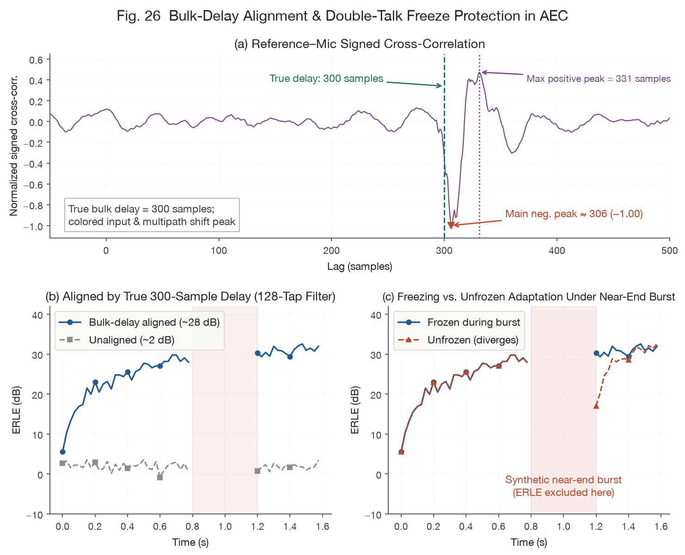

Unpack each panel of the alignment and double-talk simulation in Figure 26:

- **Figure 26(a)**: Plots lag index (samples) against the **normalized signed sample cross-correlation** over the first $4000$ samples of reference and microphone signals. The true simulated pure propagation delay is $300$ samples (vertical dashed marker), accompanied by a dominant negative peak of $-1.00$ near lag $306$, whereas the highest *positive* correlation peak is pushed out to roughly lag $331$ by the colored reference's broad autocorrelation lobe and signed multipath reflections—searching only for the largest positive peak introduces clear delay error (see the polarity-inverted impulse counterexample in Exercise [E06-07](#e06-07));
- **Figure 26(b)**: Compares far-end single-talk $\mathrm{ERLE}$ of a $128$-tap NLMS filter with true $300$-sample delay compensation versus no compensation: because the $300$-sample bulk delay far exceeds the $128$-tap span, the unaligned branch barely cancels anything ($\approx 2\ \mathrm{dB}$), whereas pre-alignment lets all $128$ taps fit the multipath impulse response, lifting $\mathrm{ERLE}$ to roughly $28\ \mathrm{dB}$;
- **Figure 26(c)**: Injects a white Gaussian synthetic near-end burst after convergence and contrasts "freezing weights during double-talk" against "continuing adaptation uncontrolled": the unfrozen branch absorbs near-end energy into its taps, leaving pronounced residual echo rebound and slow reconvergence once far-end single-talk resumes.

#### 6.4.1 Four-State Experiment for Automatic Double-Talk Detection

Figure 26(c) used an oracle ground-truth mask for freezing; evaluating a genuine automatic DTD requires feeding the detector **only** aligned reference $x[n]$ and microphone observation $d[n]$ while isolating true source-activity labels strictly on the scoring side. This book's instructional module [`ncc_activity_states()`](../codes/chapters/ch06/core/double_talk.py) partitions $x[n]$ and $d[n]$ into non-overlapping $B=160$-sample frames ($10\ \mathrm{ms}$ at $16\ \mathrm{kHz}$), checks mean-removed RMS activity on each stream, and emits four operational labels via the decision table below:

| Reference Active | Microphone Active | Correlation Condition | Baseline Decision |
|---|---|---|---|
| No | No | Ratio not evaluated | Silence |
| No | Yes | Double-talk ratio not evaluated | Single-talk near-end |
| Yes | No | Correlation not required | Single-talk far-end |
| Yes | Yes | Absolute NCC $\ge$ threshold | Single-talk far-end |
| Yes | Yes | Absolute NCC $<$ threshold | Double-talk |

Pay special attention to the boundary semantics of rows 2 and 3: row 3 ("reference active, microphone below threshold") captures very low playback volume or strong physical isolation, classifying it as "single-talk far-end" rather than global silence; row 2 ("current-frame reference inactive, microphone active") reflects only the instantaneous amplitude comparison within the **current $10\ \mathrm{ms}$ window**—immediately after far-end playback stops, sound emitted earlier continues arriving via delayed room-reverberation taps as a "pure echo tail," causing a short-window detector to emit the operational label `near_only` even though no local talker is speaking (Exercises [E06-27](#e06-27) and [E06-28](#e06-28) verify this pure-echo-tail phenomenon frame by frame; never conflate operational frame labels with clean near-end speech ground truth).

On frames where both reference and microphone are active, write mean-removed samples as $\tilde x_b=x_b-\bar x$ and $\tilde d_b=d_b-\bar d$ ($b=0,\ldots,B-1$); the instructional baseline evaluates zero-lag scalar absolute normalized cross-correlation $c_{xd}$:

$$\begin{aligned}
P_x&=\sum_{b=0}^{B-1}\tilde x_b^2,\\
P_d&=\sum_{b=0}^{B-1}\tilde d_b^2,\\
c_{xd}&=\frac{\left|\sum_{b=0}^{B-1}\tilde x_b\tilde d_b\right|}
             {\sqrt{P_x P_d}}.
\end{aligned}\tag{6-28}$$

Equation (6-28) is evaluated only when $P_x P_d>0$, and taking the absolute value ensures an inverted single-tap echo $d_b=-h_0 x_b$ still yields $c_{xd}=1$. Comparing Eq. (6-28) with the **full vector Benesty NCC** above immediately exposes this scalar baseline's limitation: Eq. (6-28) accumulates only the zero-lag inner product $\sum_b\tilde x_b\tilde d_b$ without pooling echo energy across delayed taps $\ell\ge 1$, so whenever the dominant echo tap sits at a nonzero lag, scalar $c_{xd}$ collapses.

The runnable script [`aec_dtd_demo.py`](../codes/chapters/ch06/aec_dtd_demo.py) verifies both sides: at $16\ \mathrm{kHz}$ with seed `20260924` generating independent Gaussian sequences and a zero-lag-dominant two-tap path $h=[0.6,0.25]$, concatenating five $20$-frame stages—silence, STFE, STNE, double-talk, and far-end recovery ($100$ frames total; reference and near-end amplitude scales $0.3$ and $0.22$; mean-removed RMS threshold $0.02$; $c_{xd}$ threshold $0.85$)—yields the confusion matrix:

| Ground-Truth State | Pred. Silence | Pred. STFE | Pred. STNE | Pred. Double-Talk |
|---|---:|---:|---:|---:|
| Silence | 20 | 0 | 0 | 0 |
| STFE (incl. recovery) | 0 | 40 | 0 | 0 |
| STNE | 0 | 0 | 20 | 0 |
| Double-talk | 0 | 0 | 0 | 20 |

On this zero-lag-dominant path, all $100$ frames fall on the diagonal; expanding each frame decision into a $160$-sample freeze control (requiring full $10\ \mathrm{ms}$ frame buffering, i.e., non-zero-look-ahead causality) lowers known-echo-component residual RMS during double-talk from $0.1492$ (unfrozen) to $0.0812$. Conversely, keeping pure STFE (near-end strictly zero) while shifting dominance to the delayed tap via $h=[0.1,0.75]$ causes the exact same zero-lag detector to misclassify $100\%$ of $20$ pure-echo frames as double-talk, with mean frame $c_{xd}$ plunging to $\approx 0.1105$ (theoretical value $0.1/\sqrt{0.1^2+0.75^2}\approx 0.132$)—demonstrating why industrial double-talk control must pool across taps (vector/frequency-domain NCC) and bands while integrating path-change monitoring.

**Learning-based step-size control.** Beyond analytical statistics, lightweight neural networks can predict frame-and-bin step sizes directly from reference, microphone, and innovation spectra. For example, Deep Variable Step-Size (DVSS; [Ivry et al., ICASSP 2022](https://israelcohen.com/wp-content/uploads/2022/04/Deep_Adaptation_Control_for_Acoustic_Echo_Cancellation.pdf)), evaluated under the paper's §4.1–§4.3 and Table 4 protocol ($16\ \mathrm{kHz}$, $150\ \mathrm{ms}$ paths, $100\ \mathrm{h}$ of synthetic and real recordings split $80/10/10\ \mathrm{h}$, random echo-path changes every $4.5$–$5.5\ \mathrm{s}$, step-size updated every $8\ \mathrm{ms}$, defining reconvergence success as reaching normalized path mismatch below $-10\ \mathrm{dB}$ and holding until the next change), shortened mean reconvergence time after path jumps from $7.9\ \mathrm{s}$ for a tiny fixed-step NLMS baseline ($\mu=3\times 10^{-5}$, without classical DTD) to $3.4\ \mathrm{s}$, raising reconvergence success rate from $58\%$ to $95\%$. When citing such studies, distinguish "path-change reconvergence rate" from "double-talk classification recall," and benchmark engineering candidates fairly against "linear filtering + dual-filter or Kalman gating" on target hardware.

### 6.5 Residual Echo Suppression (RES/CNG) and Learning-Based Hybrid AEC

Even an optimally tuned linear adaptive filter leaves audible residual echo due to loudspeaker nonlinear harmonics (§6.3), late reverberation tails extending beyond $L$ taps, and path-change transients. Modern full-duplex AEC therefore routinely cascades **Residual Echo Suppression (RES; also termed Nonlinear Processing, NLP, in industry)**, **Comfort Noise Generation (CNG)**, or a **learning-based hybrid network** downstream of the linear subtractor.

#### 6.5.1 Frequency-Domain Residual Echo Suppression (RES) and Comfort Noise Generation (CNG)

At frequency-domain block or STFT time–frequency tile $(k,m)$, decompose the linear AEC's a priori residual spectrum into near-end speech, residual echo, and ambient noise: $E(k,m)=S(k,m)+E_{\mathrm{res}}(k,m)+V(k,m)$. To stay strictly distinct in both dimension and notation from the complex spectra $S(k,m)$ and $\hat S_{\mathrm{out}}(k,m)$ (matching §5.7 and [Appendix A](16_appendix-symbols-math.md)), we denote nonnegative real power spectral densities (PSDs) uniformly by $\hat\Phi$: assuming the three components are short-time uncorrelated, the linear residual PSD obeys $\hat\Phi_{ee}(k,m)=\hat\Phi_{ss}(k,m)+\hat\Phi_{e_{\mathrm{res}}}(k,m)+\hat\Phi_{vv}(k,m)$. Two canonical analytical estimators are used for the residual-echo PSD $\hat\Phi_{e_{\mathrm{res}}}(k,m)$:

$$\begin{aligned}
\hat\Phi_{e_{\mathrm{res}}}^{\mathrm{FDKF}}(k,m)
&=\frac{N}{2N}\sum_{p=0}^{P-1}|X_{m-p}(k)|^2\,P_{p,m}^-(k),\\
\hat\Phi_{e_{\mathrm{res}}}^{\mathrm{coh/ERLE}}(k,m)
&=\gamma_{\hat y e}^2(k,m)\,\hat\Phi_{ee}(k,m)
 \quad\text{or}\quad
 \frac{|\hat Y(k,m)|^2}{\widehat{\mathrm{ERLE}}(k,m)},
\end{aligned}$$

where the state-space FDKF/PBFDKF estimator ([Enzner & Vary, 2006](https://doi.org/10.1016/j.sigpro.2005.09.013)) reuses the prior path-error variance $P_{p,m}^-(k)$ of Eq. (6-24) directly, and the coherence/ERLE estimators scale observed residual or linear-replica power via magnitude-squared coherence $\gamma_{\hat y e}^2$ or online $\widehat{\mathrm{ERLE}}(k,m)$ (augmented in production engines such as WebRTC AEC3 with an exponential late-reverberation tail model and saturation headroom factors; see §6.7.2).

Following the classical frequency-domain Wiener post-filtering framework (Gustafsson, Martin & Vary, *IEEE TSAP*, 1998; [Enzner & Vary, 2006](https://doi.org/10.1016/j.sigpro.2005.09.013); Hänsler & Schmidt, 2004), form the real residual-suppression gain $G_{\mathrm{RES}}(k,m)$ with oversubtraction factor $\alpha\ge 1$ and minimum gain floor $G_{\min}\in(0,1)$, and replenish attenuated room ambience during deep far-end single-talk suppression via **Comfort Noise Generation (CNG)**:

$$\begin{aligned}
G_{\mathrm{RES}}(k,m)
&=\max\!\left(G_{\min},\;
  1-\alpha\frac{\hat\Phi_{e_{\mathrm{res}}}(k,m)}
               {\hat\Phi_{ee}(k,m)}\right),\\
\hat S_{\mathrm{out}}(k,m)
&=G_{\mathrm{RES}}(k,m)\,E(k,m)\\
&\quad+\sqrt{\max\!\bigl(0,\,1-G_{\mathrm{RES}}^2(k,m)\bigr)\,
             \hat\Phi_{vv}(k,m)}\,U(k,m).
\end{aligned}\tag{6-29}$$

Unpack the physical mechanics of Eq. (6-29):

- **Equivalence to a priori SER Wiener gain**: When ambient noise is negligible ($\hat\Phi_{vv}=0$) and oversubtraction is unity ($\alpha=1$), defining the local a priori signal-to-residual-echo ratio $\xi_{\mathrm{RES}}(k,m)=\hat\Phi_{ss}(k,m)/\hat\Phi_{e_{\mathrm{res}}}(k,m)$ reduces line 1 identically to the classical Wiener gain $G_{\mathrm{Wiener}}(k,m)=\frac{\hat\Phi_{ss}}{\hat\Phi_{ss}+\hat\Phi_{e_{\mathrm{res}}}}=\frac{\xi_{\mathrm{RES}}}{1+\xi_{\mathrm{RES}}}$. Raising $\alpha>1$ (e.g., $1.2$–$2.0$) strengthens suppression when $\hat\Phi_{e_{\mathrm{res}}}$ is conservative, while enforcing a floor $G_{\min}$ (e.g., $-15$ to $-25\ \mathrm{dB}$) prevents gain drops to zero that cause harsh musical noise;
- **CNG power-continuity guarantee**: In line 2 of Eq. (6-29), $\hat\Phi_{vv}(k,m)$ is the smoothed ambient noise PSD tracked during speech- and echo-free silence frames, and $U(k,m)$ is a conjugate-symmetric random-phase white spectrum obeying $\mathbb{E}[|U(k,m)|^2]=1$ (ensuring a real time-domain output after inverse transform). During far-end single-talk with no near-end speech and $U$ independent of ambient noise, the attenuated residual noise power $G_{\mathrm{RES}}^2\hat\Phi_{vv}$ plus injected CNG power $(1-G_{\mathrm{RES}}^2)\hat\Phi_{vv}$ sums identically to $\hat\Phi_{vv}$, eliminating perceptual "noise pumping" dropouts whenever the far end speaks.

**Single-bin hand verification.** Set oversubtraction $\alpha=1.2$ and minimum gain floor $G_{\min}=0.1$ ($-20.0\ \mathrm{dB}$), inspecting two representative tiles (with $\hat\Phi_{ee}=1.0$ and negligible noise):

1. **Residual-echo-dominated tile**: Set $\hat\Phi_{e_{\mathrm{res}}}=0.8, \hat\Phi_{ss}=0.2$ ($\xi_{\mathrm{RES}}=0.25$, or $-6.02\ \mathrm{dB}$). Pure Wiener gain gives $0.25/1.25=0.20$ ($-13.98\ \mathrm{dB}$); Eq. (6-29) yields $1-1.2\times 0.8/1.0=0.04<G_{\min}$, clamped at the floor $G_{\mathrm{RES}}=0.10$ ($-20.00\ \mathrm{dB}$), while the CNG branch injects shaped background noise with amplitude factor $\sqrt{1-0.1^2}\approx 0.995$;
2. **Near-end-dominated tile**: Set $\hat\Phi_{ss}=0.9, \hat\Phi_{e_{\mathrm{res}}}=0.1$ ($\xi_{\mathrm{RES}}=9$, or $+9.54\ \mathrm{dB}$). Pure Wiener gain gives $9/10=0.90$ ($-0.92\ \mathrm{dB}$), and Eq. (6-29) gives $G_{\mathrm{RES}}=1-1.2\times 0.1=0.88$ ($-1.11\ \mathrm{dB}$), passing near-end speech virtually unscathed.

Calibrating RES/NLP operating points requires balancing residual-echo leakage, double-talk near-end fidelity, and background continuity across four coordinated axes rather than picking a single fixed attenuation knob:

| Tuning Axis | Quantities Controlled | Monitored Simultaneously | Rollback Trigger |
|---|---|---|---|
| Near-end protection priority | Raise gain floor $G_{\min}$; slow or cap double-talk suppression | Near-end spectrum, downstream ASR, double-talk listening | If echo remains, tighten suppression gradually rather than jumping to a fixed aggressive preset |
| Echo suppression priority | Increase $\alpha$ or lower $G_{\min}$ in high-confidence STFE bands | Residual echo, musical noise, background continuity | Audible near-end dropouts, pumping, or abrupt ambience shifts |
| State-adaptive gating | Drive gains continuously from far-end activity, double-talk confidence, and residual estimates | State-transition transients and recovery times | Low state confidence or audible switching artifacts |
| Comfort noise coordination | Track true ambient spectrum $\hat\Phi_{vv}$ and level for CNG | Silence continuity and noise coloration | CNG becomes separately identifiable or masks quiet near-end speech |

During bench calibration, always bypass RES first to confirm the linear canceller reaches its optimum baseline, then lower the gain floor step by step to pick the target operating point on the Pareto frontier.

#### 6.5.2 Learning-Based Hybrid AEC and Neural Kalman Filtering

**Benchmarking and paradigm evolution from the Microsoft AEC Challenges.** Legacy telecommunication benchmarks focused heavily on far-end single-talk $\mathrm{ERLE}$, yet real full-duplex user experience frequently fails when echo is muted at the cost of severely clipped near-end speech. Starting in 2021, Microsoft's public AEC Challenges introduced large-scale paired recordings from diverse consumer hardware together with crowdsourced blind subjective listening (rules and latency caps vary across editions; check original papers before replicating):

| Report | Verifiable Protocol | Caveats When Reading |
|---|---|---|
| [ICASSP 2021 Challenge Report (Sridhar et al.)](https://arxiv.org/pdf/2009.04972.pdf) | Released paired loopback and microphone recordings across diverse consumer devices, introducing ITU-T P.808 crowdsourced subjective evaluation | Dataset sizes, rankings, and sub-scores must be read per the original tables under that edition's protocol |
| [2023 Challenge Report (Cutler et al., *IEEE OJSP* 2024)](https://doi.org/10.1109/OJSP.2024.3376289) | Established both general AEC and personalized pAEC tracks, jointly scoring subjective speech quality and downstream ASR Word Error Rate | Enrollment length, frame-latency budget, and composite ranking formulas apply specifically to that edition |

Both editions crystallized a clear engineering consensus: energy attenuation $\mathrm{ERLE}$ alone falls far short of measuring double-talk naturalness or ASR usability, while architecturally, hybrid pipelines ("analytical linear filter + lightweight neural residual suppressor") coexist alongside pure end-to-end deep networks. The table below maps all four technical families covered in this chapter across representation space, signal target, and diagnostic transparency:

| Method Family | Representative Schemes | Model Assumptions & Target | Inspectable Internals & Typical Deployment |
|---|---|---|---|
| Time-domain linear adaptation | NLMS, IPNLMS, APA, RLS | Sample-level linear FIR waveform subtraction | Transparent tap weights and a priori residuals; short paths, teaching, or low-order modules |
| Partitioned frequency-domain & state-space | PBFDAF/MDF, oversampled subband, FDKF/PBFDKF | Long-path block linear convolution and per-bin second-order variance gating | Inspectable delay offsets, partition taps, and variance traces; linear backbone of real-time voice engines |
| Explicit nonlinear modeling | Volterra, Legendre Hammerstein, Wiener–Hammerstein | Deterministic polynomial or cascade nonlinear map of known reference | Inspectable per-order branch weights; strong high-volume loudspeaker distortion under tight compute budgets |
| Residual suppression & learning-based AEC | Wiener RES/CNG, hybrid (linear + DNN), Neural Kalman, end-to-end networks | Time–frequency spectral gain / complex masking or learned state gains | Hybrid and Neural Kalman keep explicit linear residual probes; pure end-to-end requires extra scrutiny on low-SER generalization and debugging |

**Physical foundation of hybrid pipelines: why subtract linearly before applying spectral gain?** Consider a double-talk time–frequency tile at a harsh Signal-to-Echo Ratio of $\mathrm{SER}=-20\ \mathrm{dB}$—echo power is $100\times$ near-end speech power ($10\times$ in amplitude). If a front-end linear AEC is phase-aligned with even a $10\%$ amplitude underestimate (true echo $Y$, linear replica $\hat Y=0.9Y$), complex waveform subtraction leaves $0.1Y$, slashing echo energy to $|0.1|^2=1\%$—the linear stage delivers $20\ \mathrm{dB}$ of attenuation up front, lifting local $\mathrm{SER}$ entering the post-filter from $-20\ \mathrm{dB}$ to $0\ \mathrm{dB}$ (with both phase error $\phi$ and amplitude ratio $\alpha$, residual energy ratio is $|1-\alpha e^{\mathrm{j}\phi}|^2=1+\alpha^2-2\alpha\cos\phi$). Without linear subtraction, multiplying the mixture $S+Y$ by a real scalar gain $g\in[0,1]$ scales near-end $gS$ and echo $gY$ identically, leaving the tile's internal signal-to-echo ratio $|gS|^2/|gY|^2=|S|^2/|Y|^2$ completely unchanged—suppressing echo by $40\ \mathrm{dB}$ suppresses near-end speech in that bin by $40\ \mathrm{dB}$ as well, rendering it unintelligible.

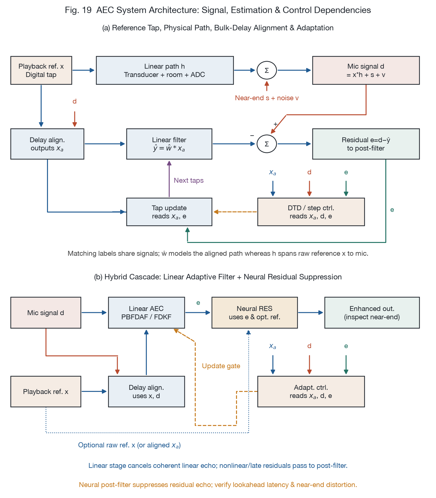

Figure 19's two panels demarcate engineering pipeline stages and hybrid module boundaries:

- **Figure 19(a)**: Diagrams the standard industrial full-duplex linear front-end—the upper solid box encapsulates the equivalent linear physical path $h$ through amplifier, loudspeaker, room reverberation, and microphone, while the digital lower path delay-aligns the reference into $x_a[n]$ before the adaptive filter $\hat{\vec w}$ and double-talk controller synthesize and subtract the echo replica to emit the linear residual $e[n]$;
- **Figure 19(b)**: Cascades the pale-beige learning-based residual suppressor (or analytical RES + CNG from §6.5.1) downstream of the linear stage, taking linear residual $e[n]$ together with an optional reference routed via the dotted arrow from raw $x$ (or aligned $x_a$ depending on model design) to attenuate nonlinear harmonics, late tails, and ambient noise. Engineering acceptance must instrument both tap-off points—**linear residual $e[n]$** and **final enhanced output**—independently.

Three representative open hybrid and joint architectures illustrate distinct design trade-offs:

- **PercepNet hybrid post-suppressor** ([Valin et al., ICASSP 2021](https://doi.org/10.1109/ICASSP39728.2021.9414140)): Following linear cancellation, a lightweight recurrent-convolutional network predicts envelope gains and pitch comb-filtering strengths across $32$ Equivalent Rectangular Bandwidth (ERB) triangular bands to suppress residual echo and background noise jointly ($2$-frame look-ahead, $40\ \mathrm{ms}$ total algorithmic latency);
- **MDF + GRU residual suppression** ([Ma et al., arXiv:2005.09237](https://arxiv.org/abs/2005.09237)): Runs Multidelay Block Frequency-Domain (MDF) filtering up front to strip linear echo, then feeds linear residual and reference features into a Gated Recurrent Unit (GRU) estimating a residual mask—exemplifying decoupled two-stage design for low-compute embedded targets;
- **Align-CRUSE and DeepVQE joint enhancement**: [Align-CRUSE (Indenbom et al., arXiv:2208.11308)](https://arxiv.org/abs/2208.11308) pioneered built-in cross-attention between reference frame sequences and microphone frames inside a convolutional-recurrent AEC model for end-to-end soft delay alignment, softening sensitivity to front-end hard delay jumps; its successor **DeepVQE** ([Ristea et al., Interspeech 2023](https://doi.org/10.21437/Interspeech.2023-1028)) extends this cross-attention alignment to joint echo cancellation, noise suppression, and dereverberation in one network.

In contrast, **pure end-to-end neural AEC** ingests raw microphone and playback waveforms/spectra directly to predict complex time–frequency masks or cross-frame Deep Filtering coefficients. A canonical ultra-lightweight baseline is **DTLN-aec** ([Westhausen & Meyer, ICASSP 2021](https://doi.org/10.1109/ICASSP39728.2021.9413510)), which pairs dual-signal transformations—an STFT-magnitude LSTM stage cascaded with a learned 1-D convolutional time-domain encoder/decoder LSTM stage—to run real-time echo suppression and phase reconstruction on edge devices (source guide in §6.8.4). While eliminating explicit linear filters and DTD switches, pure end-to-end designs face harder challenges at extreme negative $\mathrm{SER}$, on unseen transducer nonlinearities, and during field debugging (lacking inspectable taps or convergence probes). Training pipelines typically pre-train on image-source room impulse responses (§2.4) spanning diverse $T_{60}$ values cascaded with randomized Wiener–Hammerstein nonlinear curves, then fine-tune on real playback recordings from target hardware and validate generalization on held-out same-model units.

**Neural Kalman filtering: learning the unknown pieces of state recursion.** As §6.2.7 showed, classical FDKF is bottlenecked by the difficulty of estimating process variance $\Phi_m$ and double-talk observation variance $\Psi_m$ analytically on nonstationary speech. **Neural Kalman** approaches preserve the state-space recursion skeleton while training lightweight networks to infer the unknown statistics or Kalman gain online—always check which piece of Eq. (6-21) a paper replaces:

- **Directly learning the frequency-domain Kalman gain (NKF)** ([Yang et al., ICASSP 2023](https://arxiv.org/pdf/2207.11388), preprint `arXiv:2207.11388`): Retains linear overlap-save echo-state updates while a compact recurrent network reads innovation and reference history to predict the complex Kalman gain directly, bypassing explicit noise-variance smoothing rules;
- **Jointly learning nonlinear reference mapping and state evolution (NeuralKalman)** ([Zhang et al., IEEE ASRU 2023](https://doi.org/10.1109/ASRU57964.2023.10389780), Yixuan Zhang, Meng Yu, Hao Zhang, Dong Yu, DeLiang Wang; preprint [arXiv:2301.12363](https://arxiv.org/pdf/2301.12363), §2.2 and Fig. 1(b)): Applies a neural nonlinear feature transform to the playback reference to absorb loudspeaker distortion while simultaneously predicting state-transition factors and noise statistics;
- **Differentiable adaptive filtering layers (Deep Adaptive AEC)** ([Zhang et al., ICASSP 2022](https://doi.org/10.1109/ICASSP43922.2022.9746039)): Expresses frequency-domain adaptive updates as an end-to-end differentiable computation graph, supervising time-varying step sizes and nonlinear reference encoders directly from clean near-end speech reconstruction loss (for a broad survey of hybrid and deep adaptive architectures, see [Seidel et al., *IEEE SPM*, 2024](https://doi.org/10.1109/MSP.2024.3449557)).

The table below compares the three learning-based paradigms across inspectable diagnostics, failure risks, and resource accounting:

| Paradigm | Representative Architecture | Inspectable Internal Quantities | Primary Risks | Resource Verification |
|---|---|---|---|---|
| Hybrid | Linear AEC plus learning-based residual suppressor | Linear path weights, linear residual, and linear ERLE | Post-filter may distort near-end speech | Profile per band count, model version, and target hardware |
| End-to-end | Direct near-end estimation from microphone and playback reference | Typically lacks explicit path estimates | Out-of-domain hardware, low SER, and root-cause isolation | Measure by model, context length, and target hardware |
| Neural Kalman | Retains state recursion while learning gains or statistics | Recursive gains, state estimates, and innovations | Mismatched statistics estimates and neural compute overhead | Report both state-recursion and neural-network compute separately |

**Multichannel scaling, wake-word barge-in, and device selection.** Scaling to microphone arrays can use fixed-array end-to-end models, parameter-shared encoders with cross-channel attention for permutation equivariance, or—most commonly on embedded products—"per-mic linear AEC $\to$ classical beamforming $\to$ single-channel lightweight neural post-filter" to conserve compute and transfer across form factors. In smart-speaker and automotive wake-word barge-in chains, front-end linear AEC typically attenuates device playback by $15$–$25\ \mathrm{dB}$ before feeding the wake-word/ASR engine directly, avoiding aggressive nonlinear post-filters that clip consonant onsets and hurt recall. By platform tier: earbuds and watches compare ultra-light on-device models against classic frequency-domain filters; smart speakers and conferencing bars evaluate PBFDAF/FDKF plus neural post-filtering or Neural Kalman; and personalized AEC is added only when single-enrolled-speaker isolation is required.

#### 6.5.3 Personalized AEC (pAEC) and Privacy Compliance

During hands-free calls in open offices or living rooms, general AEC preserves *every* non-echo local voice as "near-end target," whereas **personalized AEC (pAEC; see [Cutler et al., *IEEE OJSP*, 2024](https://doi.org/10.1109/OJSP.2024.3376289))** must cancel loudspeaker echo while keeping *only* the enrolled primary talker and suppressing nearby interfering speakers. Its architecture closely parallels Target Speaker Extraction (TSE; see [§8.6](08_speech-separation.md#sec-8-6), [Chapter 15 §15.1–§15.2](15_target-extraction-diarization.md#sec-15-1), and [Appendix B §17.3](17_appendix-guide.md#sec-17-3), e.g., [GTCNN, Interspeech 2022](https://www.isca-archive.org/interspeech_2022/zhang22t_interspeech.pdf)): a fixed-dimensional speaker embedding $\vec e_{\mathrm{enroll}}$ extracted from a few seconds of enrollment audio conditions the residual-suppression network via Feature-wise Linear Modulation (FiLM) or cross-attention layers.

**pAEC voiceprint thresholding and three-zone fallback.** Given a nonzero real enrolled speaker embedding $\vec e_{\mathrm{enroll}}$ and a nonzero local frame embedding $\vec e_t$, voiceprint similarity is quantified by normalized cosine similarity:

$$\begin{aligned}
c&=\frac{\vec e_t^\top\vec e_{\mathrm{enroll}}}
        {\|\vec e_t\|_2\,\|\vec e_{\mathrm{enroll}}\|_2}.
\end{aligned}\tag{6-30}$$

Whenever silence or heavy noise drives either embedding norm toward zero, Eq. (6-30) is undefined and the pipeline must immediately fall back to unconditional general AEC. During overlapping double-talk, local embeddings $\vec e_t$ are easily contaminated by echo residuals or bystander speech; products therefore calibrate high, ambiguous, and low confidence zones on target hardware—passing the target speaker in the high zone, suppressing interferers in the low zone, and actively backing off or bypassing the **identity-conditioned suppression branch** (while maintaining regular linear echo cancellation) in the ambiguous middle zone so occasional background chatter is preferred over falsely muting the primary talker.

Because speaker embeddings constitute biometric data capable of identifying natural persons, shipping pAEC requires passing all eight privacy, access-control, and fail-safe compliance gates below (P1–P8) in addition to acoustic latency and double-talk metrics:

| # | Check Item | Required Design Specification | Consequence of Omission |
|---|---|---|---|
| P1 | Enrollment volume & quality | Plot enrollment duration vs. error curves across target distances, noise, and vocal variations | Unreliable embeddings causing false target suppression during double-talk |
| P2 | Notice & consent | Disclose purpose, processing location, retention period, and deletion paths per applicable law and policy | Users cannot understand how biometric data is used |
| P3 | Embedding storage | Define on-device vs. cloud location, access controls, encryption, and backup boundaries | Unauthorized access or unintended data proliferation |
| P4 | First-frame availability | Prepare the embedding before the first processed frame if opening speech must be protected; count setup latency on the critical path | Opening words lack personalized conditioning protection |
| P5 | Deletion & opt-out | Specify deletion entry point, propagation scope, completion SLA, and post-exit standard AEC fallback | Users cannot revoke personalized processing |
| P6 | Low-confidence fallback | Define bypass, fallback, or user-prompt rules for unenrolled, low-confidence, and multi-talker ambiguity | False suppression of target user or unintended pass-through |
| P7 | Shared devices | Define multi-user profiles, permissions, switching, and consent flows for minors | Profile mix-ups or accidental suppression of household members |
| P8 | Extended acceptance testing | Augment standard double-talk suites with target-user, non-target-user, and multi-talker double-talk combinations | Standard double-talk tests miss identity-conditioning failures |

### 6.6 Arrays, Multiple References, and Stereo AEC

Scaling from a single microphone and loudspeaker to multi-microphone arrays and multi-loudspeaker setups (stereo TVs, stereo laptops, or four-zone automotive cabins) confronts two architectural problems simultaneously: **spatial beamforming cascade order** on the capture side and **inter-channel reference correlation** on the playback side.

#### 6.6.1 Three Cascade Orders for Microphone Arrays and AEC

When a multi-microphone terminal combines a spatial beamformer (Chapter 5) with an echo canceller, three classical cascade orders exist for answering "AEC first or beamformer first?":

1. **AEC $\to$ BF (per-channel independent AEC)**: Run one linear AEC on each of the $M$ raw microphone channels, stripping echo before passing clean residuals to DOA estimation and beamforming. Its decisive advantage is that each channel's physical echo path $h_m[\ell]$ depends solely on the loudspeaker and room acoustics, completely decoupled from abrupt adaptive beam-weight updates; the cost is linear AEC compute and history memory scaling with $M$ (mitigated by shared reference FFTs below). Whenever DSP compute and memory permit and the back-end uses time-varying adaptive beams (MVDR, GSC, or steered tracking beams), AEC $\to$ BF is the preferred robust industrial architecture. Critically, when integrating monolithic AEC engines (e.g., WebRTC `ProcessStream()` or SpeexDSP) upstream of multichannel WPE or beamforming, feed forward the linear residual tap (`GetLinearAecOutput()`)—not the post-RES/NLP output—and side-chain the residual-echo PSD to post-beamformer RES/NLP so time-varying scalar gains do not corrupt WPE temporal stationarity or inter-channel RTF phase (see [Chapter 7, §7.6](07_wpe-dereverberation.md#sec-7-6));
2. **BF $\to$ AEC (single post-beamformer AEC)**: Combine the $M$ microphones into one beamformed output first, then run a single-channel linear AEC. Under the narrowband same-bin approximation (ignoring cross-band coupling), denoting microphone $m$'s echo transfer function at bin $k$, frame $n$ by $H_m(k,n)$ and its frequency-domain beam weight by $w_m(k,n)$ (forming $\sum_m w_m^* D_m$ per Chapter 5's conjugate inner product), the equivalent echo transfer function $H_{\mathrm{eff}}(k,n)$ seen by the post-beamformer AEC is (omitting shared bin/frame arguments):

    $$H_{\mathrm{eff}}\approx\sum_{m=1}^{M}w_m^*H_m.\tag{6-31}$$

    Strictly speaking, windowed overlapping STFTs introduce cross-band coupling terms (see [Avargel & Cohen, *IEEE TASLP*, 2007](https://webee.technion.ac.il/Sites/People/IsraelCohen/Publications/TASL_May2007.pdf), §II), and only fixed time-domain FIR beamformers obey exact LTI linear-convolution summation. Equation (6-31) pinpoints the vulnerability: even if every physical room path $H_m$ stays completely motionless, any change in beam weights $w_m(k,n)$ triggered by talker movement or noise-covariance updates causes $H_{\mathrm{eff}}$ to jump instantaneously, forcing the downstream AEC to reconverge and leaking echo throughout the transient;

3. **Joint optimization (GEIC, Generalized Echo and Interference Canceller)**: Herbordt and Kellermann unified multichannel echo cancellation with the blocking matrix and adaptive interference canceller of a Generalized Sidelobe Canceller (GSC) inside one constrained optimization objective (see Kellermann, ICASSP 1997; Brandstein & Ward, eds., *Microphone Arrays*, 2001, Ch. 13). While theoretically capable of jointly exploiting spatial nulls and reference correlation against strong nonlinear/reverberant echo, maintaining high-dimensional spatiotemporal covariances and double-talk gating incurs the highest complexity.

**Hand check of beam-switching residual.** [Schwartz et al. (Interspeech 2024)](https://www.isca-archive.org/interspeech_2024/schwartz24_interspeech.pdf) further compared steady-state and transient behavior across cascade orders under a Multichannel Wiener Filter (MCWF) framework. In products pairing "fixed multi-beam selection + single post-beam AEC," switching beams induces convolution-memory mismatch: take shared reference $x=[1,2,3,0]$ (zero for negative time), mic 1 true path $h_1=[1,0]$ (echo $y_1=[1,2,3,0]$), and mic 2 true path $h_2=[0,1/2]$ (echo $y_2=[0,1/2,1,3/2]$). If the beam selector picks mic 1 for $n=0,1$ and hard-switches to mic 2 starting at $n=2$, the beam output echo becomes $[1,2,1,3/2]$; if the post-beam AEC still holds $\hat h=h_1=[1,0]$ (predicting $[1,2,3,0]$), samples $n=2,3$ immediately burst with residual $[0,0,-2,3/2]$. Running **AEC $\to$ BF** to cancel each mic before switching—or maintaining a dedicated echo-weight bank per fixed beam in BF $\to$ AEC and switching weights synchronously—keeps residuals identically zero across all four samples. Distinguish the two time-varying locations carefully: beam switching alters spatial combination coefficients at the **output synthesis instant**, whereas playback volume changes analyzed in §6.7.1 and Exercise [E06-26](#e06-26) alter excitation amplitudes at the **loudspeaker input instant**.

**Compute ledger for $M$-mic AEC $\to$ BF and reference FFT sharing.** Continuing Worked Example 6-2's core-operator basis ($16\ \mathrm{kHz}$, $L=2048$ covering $128\ \mathrm{ms}$, PBFDAF block size $N=128$, $P=16$ partitions, $2N=256$-point complex transform at $4096$ real multiplications, each $256$-point complex vector multiply at $1024$ real multiplications): per channel, naive time-domain NLMS takes $3L=6144$ real multiplications/sample; unconstrained PBFDAF core takes $(3\times 4096+32\times 1024)/128=352$ per sample; fully constrained PBFDAF adds $2\times 16\times 4096/128=1024$ per sample for $1376$ total (recomputing $|X|^2$ across $16$ partitions each block adds $64$ per sample, yielding $416$ and $1440$). Scaling by $16000\ \mathrm{Hz}$ across $M$ microphones:

| Algorithm | Single-Channel Hand Count | $M$-Channel Scaling | Additional Resources Requiring Profiling |
|---|---:|---:|---|
| Time-domain NLMS | $6144\times16000\approx98.3$M real mults/s | $\approx M\times98.3$M real mults/s | Instruction count, memory bandwidth, tap & history buffers |
| PBFDAF, no per-partition gradient constraint | $352\times16000\approx5.6$M real mults/s | $\approx M\times5.6$M real mults/s | FFT implementation, power estimation, constraint cadence, buffers |
| PBFDAF, full per-block gradient constraint | $1376\times16000\approx22.0$M real mults/s | $\approx M\times22.0$M real mults/s | Same as above plus one transform pair per partition; intermittent constraints scaled accordingly |
| FDKF or neural post-filtering | No single fixed multiplier | Governed by state dimension or network architecture | Target-platform operators, threading, RAM, and real-time factor |

On a single DSP, all $M$ microphones hear the **same loudspeaker playback reference $x[n]$** (given shared pre-delay alignment and common block boundaries), so the forward $256$-point FFT of $u_m$ ($4096/128=32$ mults/sample) and reference power spectra need only be computed **once per block** and broadcast across the entire array. Deduplicating the reference FFT reduces unconstrained core counts from $352M$ to $32+320M$ (from $2112$ down to $1952$ mults/sample on a $6$-mic array) and fully constrained counts from $1376M$ to $32+1344M$ (from $8256$ to $8096$ on $6$ mics, with round-robin AUMDF single-partition projection trimming the $1024M$ constraint term by a further $15/16$). Hardware loopback clock synchronization and system integration are covered in §10.1 and Figure 22.

#### 6.6.2 Multi-Reference and Stereo AEC Decorrelation

Moving from one loudspeaker to stereo TVs, stereo laptops, or four-zone vehicle cabins turns AEC into a **multi-reference (multichannel playback) problem**. Engineering implementations organize multi-reference AEC in three main ways (the first two represent different update operators under the same physical multichannel sound field):

| Model | Structure | Identifiability | Resource Scaling | Best-Fit Regimes |
|---|---|---|---|---|
| Per-reference branches, shared total residual | Sum branch predictions first, then update via shared $e=d-\sum_r\hat y_r$; joint normalization required for stability | Ignoring cross-reference statistics leaves strongly correlated inputs ill-conditioned | Filtering and state scale roughly with number of references | Single microphone hearing multiple playback streams, verifying shared residual and joint control |
| Joint MISO (Multiple-Input Single-Output) | Stack multi-reference regression vectors and jointly estimate all paths from total prediction and shared residual | Still bounded by condition number of stacked reference autocorrelation matrix | Maintains multiple path vectors; frequency/matrix methods also track cross-spectra | Scenarios requiring explicit cross-reference correlation handling |
| Joint MIMO array | Jointly estimate across multiple references and multiple microphones (e.g., GEIC, extended MWF / MWFext) | Exploits cross-channel statistics, but still requires full-rank excitation | Scales with references, microphones, and state dimensions | Joint echo and spatial interference suppression |

First eliminate two common multi-reference implementation bugs. **First, never run two independent mono AECs in parallel and add them**: if left and right speakers play identical $x_1[n]=x_2[n]=x[n]$ producing total echo $d[n]=x[n]$, two isolated filters targeting full $d[n]$ each converge to tap $1$, predict $2x[n]$ in total, and leave $-x[n]$ after subtraction. The proper architecture must sum all $R$ branch predictions into **one shared total residual** driving all branches together ([Gilloire, IWAENC 1997](https://www.iwaenc.org/proceedings/1997/iwaenc97/pdf/scan/ae970002.pdf)):

$$\begin{aligned}
\hat y[n]&=\sum_{r=1}^{R}\hat{\vec h}_r^\top\vec x_r[n],\\
e[n]&=d[n]-\hat y[n].
\end{aligned}\tag{6-32}$$

**Second, sharing the total residual also requires sharing the normalization denominator**: in Eq. (6-32), if $R$ branches simultaneously chase the same $e[n]$ while each divides only by its local channel energy $\|\vec x_r[n]\|^2$, total prediction change inflates by $R\times$, causing a mono-stable step size $\mu=1.5$ to diverge geometrically with ratio $-2$ in stereo (proved by hand in Exercise [E06-12](#e06-12)).

**The stereo non-uniqueness problem.** Even with Eq. (6-32) and joint normalization implemented cleanly, whenever left and right playback channels originate from a **single far-end talker** captured via two fixed far-end room paths $\vec g_1,\vec g_2\in\mathbb{R}^{M_g}$ ($x_1=g_1*s_{\mathrm{far}}, x_2=g_2*s_{\mathrm{far}}$), the two references obey the exact linear convolutional relation $(g_2*x_1)[n]-(g_1*x_2)[n]=0$. Stacking the two-channel near-end regression vector as $\vec x[n]=[\vec x_1^\top[n],\vec x_2^\top[n]]^\top\in\mathbb{R}^{2L}$, whenever $L\ge M_g$ the explicit nonzero $2L$-dimensional vector

$$\vec n=\bigl[\vec g_2^\top,\;\vec 0_{L-M_g}^\top,\;-\vec g_1^\top,\;\vec 0_{L-M_g}^\top\bigr]^\top\in\mathbb{R}^{2L}$$

satisfies $\vec x^\top[n]\vec n=(g_2*x_1)[n]-(g_1*x_2)[n]\equiv 0$ identically, so $\mathbf R_{xx}\vec n=\vec 0$ and the autocorrelation matrix is strictly rank-deficient (any shifted filter $\vec h+\alpha\vec n$ produces zero error). Even when far-end reverberation exceeds $L$ ($L<M_g$, making $\mathbf R_{xx}$ technically full-rank), the truncated far-end RIR tails beyond $L$ hold tiny energy, leaving $\mathbf R_{xx}$ severely ill-conditioned (Sondhi, Morgan & Hall, *IEEE SPL*, 1995). For example, when $x_1=x_2=x$, true path $(0.8,0.2)$ and spurious path $(1.3,-0.3)$ produce identical echo $x$, so the spurious weights fail the instant a second far-end talker speaks from a different location (see Exercise [E06-13](#e06-13)). Quantitatively, for two unit-variance channels with $2\times 2$ Hermitian correlation matrix $\mathbf R=\begin{bmatrix}1&\rho\\\rho^*&1\end{bmatrix}$ ($|\rho|<1$), eigenvalues are $1\pm|\rho|$ and condition number is $\kappa_2(\mathbf R)=\frac{1+|\rho|}{1-|\rho|}$: $|\rho|=0.99$ (equally ill-conditioned for in-phase or anti-phase signals) gives $\kappa_2=199$; $|\rho|=0.95$ gives $\kappa_2=39$; only after decorrelating down to $|\rho|=0.6$ does $\kappa_2$ drop to $4$.

**Multichannel Frequency-Domain Adaptive Filtering (MC-FDAF) and its boundary.** Inside the adaptive solver itself, the core algorithm for tackling cross-channel correlation is **Multichannel Frequency-Domain Adaptive Filtering (MC-FDAF; Benesty, Gänsler & Morgan, 2001; Buchner, Benesty & Kellermann, *IEEE TSAP*, 2005)**. At each bin $k$ (written in single-partition notation for clarity; multi-partition stacks $PR$ entries), stack the $R$ playback reference spectra into $\vec X_m(k)\in\mathbb{C}^R$, maintain the exponentially smoothed $R\times R$ cross-spectral matrix $\mathbf S_{XX}(k,m)=\lambda_s\mathbf S_{XX}(k,m-1)+(1-\lambda_s)\vec X_m^*(k)\vec X_m^\top(k)$ (matching non-conjugated prediction $\hat Y=\vec W^\top\vec X$, the transpose of Chapter 5's $\vec x\vec x^H$), and whiten the multi-channel gradient via a diagonally loaded inverse:

$$\Delta\vec W_m(k)=\mu\bigl(\mathbf S_{XX}(k,m)+\delta\mathbf I_R\bigr)^{-1}\vec X_m^*(k)E(k,m).$$

MC-FDAF's great advantage is **zero alteration of loudspeaker audio quality**: under moderately high cross-channel correlation (e.g., $|\rho|\approx 0.7$–$0.95$, full-rank yet ill-conditioned), cross-spectral matrix inversion dramatically speeds up multi-reference convergence where per-channel independent normalization stalls. However, when channels become nearly linearly dependent ($|\rho|\to 1$, strict nullspace), diagonal loading $\delta\mathbf I_R$ keeps inversion numerically safe without generating missing differential-mode excitation from rank-deficient data—requiring lightweight playback-side decorrelation preprocessing as a complement.

**Playback-side decorrelation preprocessing and Time-Varying All-Pass Filtering (TV-APF).** To break cross-channel linear dependence prior to loudspeaker radiation while preserving natural sound quality, four preprocessing routes have been developed:

| Method | Mechanism | Potential Side Effects | Verification Method |
|---|---|---|---|
| Half-wave rectification | Apply distinct mild nonlinearities per channel ([Benesty et al., ICASSP 1997](https://www2.spsc.tugraz.at/people/franklyn/ICASSP97/pdf/scan/ic970303.pdf)) | Even-order harmonic distortion, harshness on music, stereo-image shift | Measure reference condition number, STFE residual, and subjective audio quality together |
| Time-varying all-pass phase modulation (TV-APF) | Apply independent slowly varying all-pass phase per channel | Audible vibrato on sustained musical tones or image wander if over-modulated | Blind listening on speech and music plus cross-program holdout residual checks |
| Independent tiny frequency shifts | Apply small distinct frequency offsets in sign or magnitude per channel | Musical chord beating or pitch perturbation | Sweep shift amount comparing identifiability against audible artifacts |
| Psychoacoustic masking / low-level noise injection | Inject independent shaped micro-noise or perceptual phase perturbations below auditory masking thresholds | Elevated noise floor during quiet passages if excessive | Measure condition number, noise floor, and blind transparency at target playback levels |

In modern hi-fi smart speakers and automotive cabins, **Time-Varying All-Pass Filtering (TV-APF; Ali, ICASSP 1998)** and psychoacoustic-masking-guided perceptual decorrelation (**Herre, Buchner & Kellermann, IEEE ICASSP 2007**) are especially prominent. Why **must** the all-pass filter be *time-varying*? Whenever $G_2(z)X_1(z)-G_1(z)X_2(z)=0$, inserting fixed LTI all-pass filters $A_1(z),A_2(z)$ creates modified references $\tilde X_r=A_r X_r$ that still strictly obey $(G_2 A_2)\tilde X_1-(G_1 A_1)\tilde X_2=0$—rotating the nullspace without curing rank deficiency.

Modulating each channel's first-order real all-pass pole slowly in time as $a_r[n]=a_{r,0}+\delta_r\sin(\omega_{\mathrm{mod},r}n)\in(-1,1)$ (with coprime or opposite modulation rates across left/right) gives the frozen-instant frequency response

$$\begin{aligned}
A_r(e^{\mathrm{j}\Omega_{\mathrm{d}}},n)
&=\frac{a_r[n]+e^{-\mathrm{j}\Omega_{\mathrm{d}}}}
       {1+a_r[n]e^{-\mathrm{j}\Omega_{\mathrm{d}}}},\\
\left|A_r(e^{\mathrm{j}\Omega_{\mathrm{d}}},n)\right|
&\equiv 1.
\end{aligned}$$

Setting the unit-delay operator $u=z^{-1}=e^{-\mathrm{j}\Omega_{\mathrm{d}}}$ ($|u|=1$, $u^*=e^{+\mathrm{j}\Omega_{\mathrm{d}}}$), real $a_r[n]$ satisfies $|a_r+u|=|u(a_r u^*+1)|=|1+a_r u^*|=|1+a_r u|$, guaranteeing unity short-time magnitude gain across all frequencies—introducing neither spectral coloration nor harmonic distortion—while slow inter-channel phase slippage turns the LTI collinearity into **linear time-varying (LTV) full-rank excitation** (five-sample full-rank proof worked out in Exercise [E06-30](#e06-30), Part 1).

Deployment must obey one essential rule: **decorrelation must sit physically in the loudspeaker playback path, and the AEC reference must be tapped *downstream* of decorrelation.** A four-sample orthogonal counterexample proves why: take $\vec x=[1,1,-1,-1]^\top$ and orthogonal perturbation $\vec a=[1,-1,1,-1]^\top$ with true path $(0.8,0.2)$. If the loudspeakers physically radiate $\vec x$ and $\vec x+\vec a$, physical echo is $\vec x+0.2\vec a$ and full-rank normal equations uniquely recover $(0.8,0.2)$. Conversely, if both speakers still play raw $\vec x$ while $\vec a$ is secretly added only inside the AEC reference buffer, physical echo remains $\vec x$: the same full-rank matrix achieves zero training residual by learning the *false* path $(1,0)$, leaking the entire right channel the moment stereo content separates.

### 6.7 Playback-Chain Reference Tap-Off and Industrial Engine Closed Loops (WebRTC AEC3 / SpeexDSP)

The first six sections built the algorithmic core given an idealized aligned reference; on real consumer hardware, however, most field failures stem not from filter equations themselves but from tapping the reference at the wrong pipeline node, inverting time-varying gain and convolution order, or suffering asynchronous queue underruns. This section ties together digital playback-chain tap-off rules and the closed-loop orchestration of industrial engines (WebRTC AEC3 and SpeexDSP).

#### 6.7.1 Playback-Chain Reference Tap-Off (T1–T5) and Time-Varying Gain Order

Inside modern device operating systems, digital audio traverses a lengthy rendering pipeline from application generation to loudspeaker diaphragm motion:

$$\begin{aligned}
&\text{App source}\longrightarrow\text{System mixer}
 \longrightarrow\text{Equalizer (EQ)}\\
&\quad\longrightarrow\text{Dynamic compression (DRC/AGC)}\\
&\quad\longrightarrow\text{Smart PA excursion/thermal protection \& limiter}\\
&\quad\longrightarrow\text{Resampling/Codec}\longrightarrow\text{DAC}
 \longrightarrow\text{Amp \& Loudspeaker}.
\end{aligned}$$

Where the loopback reference taps this chain dictates how much unknown mismatch falls onto the adaptive filter. Any fixed, causal, linear time-invariant (LTI) short filter sitting *downstream* of the tap-off within the **same synchronous clock domain** as the microphone can theoretically be folded into the equivalent linear path $h[\ell]$ of Eq. (6-1) (though extreme bass boost or treble roll-off still degrades reference conditioning). By contrast, any downstream mixing of system chimes, time-varying DRC/AGC gain envelopes, Smart PA excursion/thermal limiting (§6.3), digital clipping, or asynchronous Bluetooth resampling/lossy codecs turns into model mismatch unrepresentable by a linear FIR. The table below ranks five canonical tap-off nodes (T1–T5) from earliest to latest:

| Tap-Off Node | Location | Downstream Transformations | Primary Risks | Verification Check |
|---|---|---|---|---|
| T1 App raw stream | Application output | Mixing, system volume, and all post-processing | Reference misses other apps' sounds and time-varying DSP | Switch apps, notification tones, and volume; check if reference tracks synchronously |
| T2 Post-mixer, pre-effects | Mixer output | EQ, AGC/DRC, Smart PA protection limiting, and downstream stages | Time-varying gains, protection filters, or limiting cause mismatch | Bypass each post-processing block in turn; compare residuals and path estimates |
| T3 Post-EQ, pre-AGC | Equalizer output | AGC/DRC gain envelopes, Smart PA protection, and limiting | Gain rides, excursion limiting, and clipping bypass reference | Sweep playback levels and log residuals, clipping, and recovery |
| T4 Post-limiter, pre-codec | Smart PA protection & limiter output | Resampling, codecs, and wireless transport | Delay jitter, packet drops, or codec artifacts | Inject known test signals and record end-to-end delay distributions and residuals |
| T5 Latest digital reference | Accessible node immediately pre-DAC | DAC, power amp, loudspeaker, and acoustics | Analog and acoustic nonlinearities remain outside reference | Baseline candidate; benchmark against IV-sense voltage/current reference and earlier taps |

This yields a clear architectural priority rule: **given synchronous clocks and trustworthy timestamps, prefer T5 immediately upstream of the DAC (e.g., an I2S/TDM hardware loopback channel) as the AEC reference**, capturing mixing, system volume, EQ, DRC/AGC, and Smart PA protection limiting inside the known reference; when analog amplifier clipping is severe, pair it with IV-sense terminal voltage/current loopback (§6.3).

**Why must time-varying gain enter the reference *before* the acoustic path?** Engineers often ask: "If we can only tap an early reference $x[n]$ at T2/T3 upstream of the volume slider or DRC, yet software knows the instantaneous digital gain $g[n]$, can we filter $x[n]$ first to get $\hat y_x[n]$ and simply multiply the output by $g[n]$ to match a late reference?" Two lines of convolution algebra prove **no: whenever the acoustic path has nonzero delayed taps and gain just changed, filtering first and multiplying by current gain afterward miscalculates historical reverberation tails across every volume transition.**

Let $x[n]$ be the early reference upstream of the gain block, $g[n]$ the time-varying multiplicative gain, $r[n]=g[n]x[n]$ the true signal driving the loudspeaker (corresponding to T5 late reference), and $h[\ell]$ ($\ell=0,\ldots,L-1$) a fixed causal FIR acoustic path on the same clock. The true microphone echo $y[n]$ sums past samples weighted by the **historical gains $g[n-\ell]$ active when each sample was radiated**, whereas the erroneous post-multiplication branch $\hat y_{\mathrm{after}}[n]$ scales the entire filtered early reference by the single current gain $g[n]$:

$$\begin{gathered}
r[n]=g[n]x[n],\\
y[n]=\sum_{\ell=0}^{L-1}h[\ell]r[n-\ell],\\
\hat y_{\mathrm{after}}[n]=g[n]\hat y_x[n],\\
\hat y_x[n]=\sum_{\ell=0}^{L-1}h[\ell]x[n-\ell].
\end{gathered}\tag{6-33}$$

Subtracting line 3 from line 2 term by term gives the exact ordering residual $e_{\mathrm{a}}[n]=y[n]-\hat y_{\mathrm{after}}[n]$:

$$\begin{aligned}
e_{\mathrm{a}}[n]
&=\sum_{\ell=0}^{L-1}h[\ell]\Delta g_{n,\ell}\,x[n-\ell],\\
\Delta g_{n,\ell}&=g[n-\ell]-g[n].
\end{aligned}\tag{6-34}$$

The gain-difference factor $\Delta g_{n,\ell}=g[n-\ell]-g[n]$ exposes the exact mechanism: the zero-lag direct term ($\ell=0$) satisfies $\Delta g_{n,0}=0$ and cancels cleanly, but every delayed reflection ($\ell\ge 1$) propagating in air was emitted $\ell$ samples ago under the **old gain $g[n-\ell]$**, yet post-multiplication scales it uniformly by the **new gain $g[n]$**. Whenever the volume slider moves, DRC rides gain, or Smart PA limits a transient, Eq. (6-34) leaks nonzero residual across the entire $L-1$-sample reverberation memory span (vanishing only for constant gain or memoryless $L=1$). Lossless software compensation must reconstruct $r[n]=g[n]x[n]$ *before* pushing samples into the adaptive filter's convolution history buffer (five-sample hand calculation in Exercise [E06-26](#e06-26); $16\ \mathrm{kHz}$ PCM verification in Exercise [E06-28](#e06-28)).

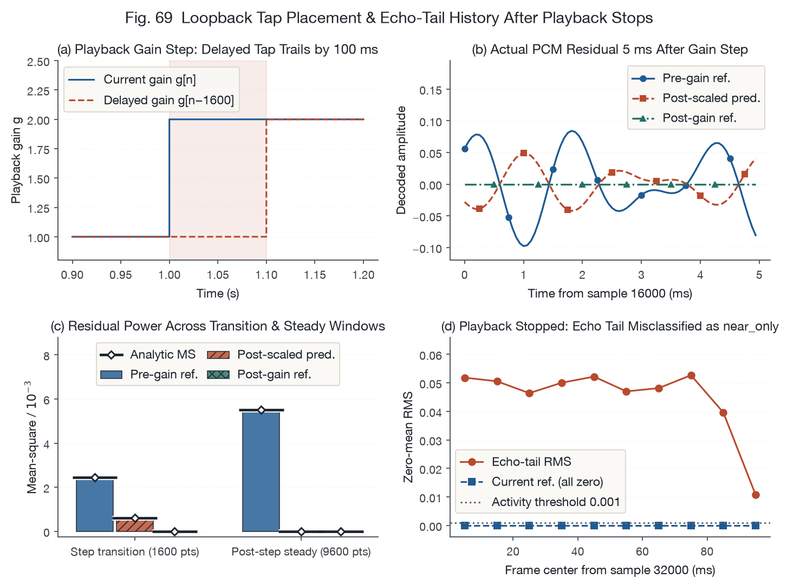

Figure 69 jointly verifies both this gain-ordering error and the post-playback pure-echo-tail phenomenon from §6.4.1: a known two-tap sparse path stays frozen at ground truth throughout, playback gain $g[n]$ steps from $1$ to $2$ at $1.0\ \mathrm{s}$ (sample $16000$), and source playback stops at $2.0\ \mathrm{s}$ (sample $32000$) while preserving the $100\ \mathrm{ms}$ ($1600$-sample) reverberation tail. Across the $1.0$–$1.1\ \mathrm{s}$ transition window, the T5 late-reference residual stays identically zero, the early-reference branch leaks heavily due to missing the $2\times$ step, and the post-multiplied branch leaks throughout the entire $100\ \mathrm{ms}$ memory window exactly as Eq. (6-34) predicts; across the $2.0$–$2.1\ \mathrm{s}$ tail window (panel (d) plots ten $10\ \mathrm{ms}$ frame centers $5$–$95\ \mathrm{ms}$, corresponding to frame ends $32160$–$33600$), even though zero current reference causes the short-window activity detector to output `near_only` continuously, the late-reference filter with intact history buffer cancels the pure echo tail identically to zero.

Finally, clarify two system-level latency boundaries:

- **Remote full-duplex calls (on-device AEC vs. cloud AES)**: AEC subtracts waveforms digitally inside the uplink capture chain. Whenever an external wireless speaker, HDMI TV, or cloud server lacks a T5 reference clock-locked to the local microphone, cloud engines cannot run high-precision linear adaptive cancellation; linear AEC must run locally close to the hardware loopback, leaving the cloud to apply supplemental Acoustic Echo Suppression (AES);
- **Physical acoustic wave superposition in local reinforcement and active cancellation (automotive ICC vs. ANC)**: Automotive In-Car Communication (ICC) amplifies front-row speech in real time over rear-row speakers so air-borne waves physically sum as $s(t)+\alpha s(t-\tau_{\mathrm{loop}})$, whose power spectrum $|1+\alpha e^{-\mathrm{j}2\pi f\tau_{\mathrm{loop}}}|^2$ carves periodic comb notches every $\Delta f=1/\tau_{\mathrm{loop}}$—once loop delay nears or exceeds the **ITU-T P.1150** cap $\Delta_{\mathrm{Rx}}<15\ \mathrm{ms}$, metallic coloration or closed-loop howling ensues; meanwhile headphone/cabin Active Noise Control (ANC) demands electronic delay $\tau_{\mathrm{elec}}\le\tau_{\mathrm{acoust}}-\tau_{\mathrm{sec}}$ (often sub-millisecond). Numerical latency budgets for all three loops are compared in Exercise [E06-30](#e06-30) (Part 2).

#### 6.7.2 Industrial Engine Closed Loops (WebRTC AEC3 / SpeexDSP)

Returning to Figure 19(a)–(b) in §6.5.2, production full-duplex AEC wraps four system-level stages around the core linear subtractor: macroscopic pure-delay alignment (§6.4), double-talk and path-change adaptation control (§6.4), and frequency-domain RES/NLP plus CNG (§6.5.1). Hardware tuning must also preserve capture headroom: if a microphone preamp or ADC clips hard under loud sound pressure, near-end speech peaks riding atop the echo are permanently destroyed and no downstream RES can recover them—software must monitor clipping flags to freeze updates and pull back front-end gain.

**WebRTC AEC3 architecture and foreground/shadow dual-filter closed loop.** In open-source WebRTC AEC3 (`modules/audio_processing/aec3/`; line-level source walkthrough in the [Research Manual](../codes/chapters/ch00/research_en/02_aec_wpe_separation.md#aec)), incoming $10\ \mathrm{ms}$ host frames are split into $64$-sample sub-blocks ($4\ \mathrm{ms}$ at $16\ \mathrm{kHz}$) driving a real-time loop:

- **Circular render buffer and two-stage delay tracking**: Far-end playback enters `RenderBuffer`; Stage 1 (coarse external delay) runs the decimated matched filters and lag-histogram aggregator of §6.4 inside [`echo_path_delay_estimator.cc`](https://webrtc.googlesource.com/src/+/0467d2b91cc20b9b001c2bbb73d43ea6b2491f3e/modules/audio_processing/aec3/echo_path_delay_estimator.cc), shifting the `RenderBuffer` read pointer dynamically via [`block_processor.cc`](https://webrtc.googlesource.com/src/+/0467d2b91cc20b9b001c2bbb73d43ea6b2491f3e/modules/audio_processing/aec3/block_processor.cc), while Stage 2 (refined internal delay) continuously tracks the dominant impulse-response peak of the active linear filter to refine sub-block effective delay and guide residual modeling;
- **Bidirectional foreground (`refined`) and shadow (`coarse`) filter coordination**: [`subtractor.cc`](https://webrtc.googlesource.com/src/+/0467d2b91cc20b9b001c2bbb73d43ea6b2491f3e/modules/audio_processing/aec3/subtractor.cc) and [`echo_remover.cc`](https://webrtc.googlesource.com/src/+/0467d2b91cc20b9b001c2bbb73d43ea6b2491f3e/modules/audio_processing/aec3/echo_remover.cc) run two parallel partitioned frequency-domain filters on the same aligned reference to resolve the double-talk stability vs. path-change agility dilemma:
  1. **Conservative vs. agile gain split**: The foreground `refined` filter uses conservative error-spectrum-regulated gains that clamp tightly during double-talk to protect near-end speech; the shadow `coarse` filter uses aggressive NLMS-like steps to probe path jumps quickly;
  2. **Forward promotion on path jumps**: After a path jump, once the shadow filter sustains markedly lower residuals than the foreground during active far-end speech with sufficient coherence, the engine smoothly transitions output and copies shadow weights onto the foreground;
  3. **Reverse reset on double-talk divergence**: When heavy double-talk pushes the aggressive shadow filter into divergence with residuals worse than the foreground, the stable foreground weights overwrite and reset the shadow filter (three-state gating and double-talk overfitting rejection verified in Exercise [E06-30](#e06-30), Part 3); playback or capture saturation tightens both gains together;
- **Residual-echo coupling (`ErleEstimator` $\to$ `ResidualEchoEstimator`) and dual-probe API**: Downstream of linear subtraction, `SubbandErleEstimator` and `FullBandErleEstimator` track per-band and fullband linear attenuation and feed `ResidualEchoEstimator`—which combines linear-residual scaling $|\hat Y|^2/\widehat{\mathrm{ERLE}}$, an exponential late-reverberation tail model (`ReverbModel`), and nonlinear headroom factors under playback saturation—before driving the frequency-domain suppressor and CNG. In WebRTC APM ([`audio_processing.h`](https://webrtc.googlesource.com/src/+/0467d2b91cc20b9b001c2bbb73d43ea6b2491f3e/api/audio/audio_processing.h)), every $10\ \mathrm{ms}$ tick must call `ProcessReverseStream()`, then `set_stream_delay_ms()` (out-of-range inputs clamp to $0$–$500\ \mathrm{ms}$), and finally `ProcessStream()`. During integration, always enable `export_linear_aec_output` and record `GetLinearAecOutput()` alongside final audio rather than tuning solely on the post-NLP output. Likewise, when placing monolithic engines such as WebRTC `ProcessStream()` or SpeexDSP upstream of multichannel WPE or beamforming, feed forward the linear residual tap (`GetLinearAecOutput()`)—not the post-RES/NLP output—and side-chain the residual-echo PSD to post-beamformer RES/NLP so time-varying scalar gains do not corrupt WPE temporal stationarity or inter-channel RTF phase (see [Chapter 7, §7.6](07_wpe-dereverberation.md#sec-7-6)).

**SpeexDSP architecture and asynchronous underrun false failures.** [SpeexDSP's `mdf.c`](https://gitlab.xiph.org/xiph/speexdsp/-/blob/8e29a256ef0235ebbe7fcb8417b5ac7731eb8307/libspeexdsp/mdf.c) runs Alternating Unconstrained MDF (AUMDF) paired with coherence-driven continuous learning-rate control (including built-in DC-notch high-pass filtering and pre-/de-emphasis; post-suppression requires binding a separate preprocessor via `SPEEX_PREPROCESS_SET_ECHO_STATE`). Integrating its asynchronous wrappers `speex_echo_playback()` / `speex_echo_capture()` frequently triggers a subtle false failure: if capture callbacks start ahead of playback callbacks, or playback thread jitter causes queue underruns, the async wrapper silently bypasses raw uncancelled microphone frames straight through (moreover, the async wrapper queues single-channel frame lengths and does not support interleaved multichannel streams). Always verify callback ordering, underrun counters, and channel mapping by injecting **staggered-timestamp** single impulses into each physical speaker channel during bring-up.

### 6.8 Full-Duplex Evaluation Standards, Acceptance Matrices, and Fault Diagnosis

Isolated claims of "how many dB an algorithm cancels" divorced from call regime, standard formulas, and dual-probe isolation cannot guide product decisions. This section standardizes ITU-T communication metrics, black-box dual-run probing, production acceptance matrices, and systematic fault diagnosis.

#### 6.8.1 Objective Metrics, ITU-T Full-Duplex Standards, and Dual-Run Probing

**Three core power-ratio metrics: ERL, ERLE, and SER.** Over the same valid scoring window $\mathcal W$, using playback reference $x[n]$, pre-AEC true echo component $y[n]$, near-end target speech $s[n]$, and post-AEC residual echo component $e_{\mathrm{echo}}[n]$, define three fundamental physical ratios:

$$\begin{aligned}
\mathrm{ERL}&=10\log_{10}\frac{\sum_{n\in\mathcal W}|x[n]|^2}
                            {\sum_{n\in\mathcal W}|y[n]|^2},\\
\mathrm{ERLE}&=10\log_{10}\frac{\sum_{n\in\mathcal W}|y[n]|^2}
                             {\sum_{n\in\mathcal W}|e_{\mathrm{echo}}[n]|^2},\\
\mathrm{SER}&=10\log_{10}\frac{\sum_{n\in\mathcal W}|s[n]|^2}
                            {\sum_{n\in\mathcal W}|y[n]|^2}.
\end{aligned}\tag{6-35}$$

Read each definition's physical role and boundary carefully:

- **ERL (Echo Return Loss)**: Measures **physical acoustic isolation** from loudspeaker to microphone prior to any algorithm. Higher ERL means weaker acoustic coupling; compact smart speakers or speakerphones at high volume can experience ERL as low as $0$–$6\ \mathrm{dB}$ or even negative values, placing extreme demands on downstream AEC;
- **ERLE (Echo Return Loss Enhancement)**: Measures echo attenuation contributed by the AEC algorithm itself (requiring $E_y>0$; never pad silent windows with tiny floors to manufacture scores). Quick mental anchors: residual energy at $0.0063$ corresponds to $\mathrm{ERLE}\approx 22.0\ \mathrm{dB}$, and $10^{-4}$ ($1\%$ amplitude) corresponds to $40\ \mathrm{dB}$. In real STFE recordings, ambient noise $E_v$ floors the output denominator, capping measured total power ratios (e.g., a $20\ \mathrm{dB}$ acoustic SNR caps observed total power ratio at $\approx 20.04\ \mathrm{dB}$; see Exercise [E06-05](#e06-05)). Always specify whether values come from whole-window summed energy or arithmetic averages of per-block dB scores (which can diverge by over $10\ \mathrm{dB}$; see Exercise [E06-18](#e06-18)). During double-talk (DT), the output must preserve near-end speech $s[n]$, so mixed-input-to-total-output power ratio is never $\mathrm{ERLE}$;
- **SER (Signal-to-Echo Ratio)**: Measures near-end speech power relative to true pre-AEC echo during double-talk; lower values (e.g., $-10$ to $-20\ \mathrm{dB}$) mean near-end speech is heavily buried under echo.

**ITU-T telecommunication certification metrics: TCLw, P.340 full-duplex categories, and G.167/G.168 boundaries.** Certification for hands-free terminals, conference rooms, and automotive kits relies on **ITU-T P.340** (together with wideband/automotive specs **ITU-T P.1100 / P.1110**):

1. **TCLw (Weighted Terminal Coupling Loss)**: Overall single-talk far-end echo loss integrated with perceptual frequency weighting across the speech band per ITU-T G.122 / P.340. Under a flat-band intuition, $\mathrm{TCLw}\approx\mathrm{ERL}+\mathrm{ERLE}_{\mathrm{total}}$ (combining physical isolation, linear cancellation, and post-RES). At nominal loop delays, ITU-T P.340 / P.1100 / P.1110 typically require **$\mathrm{TCLw}\ge 46\ \mathrm{dB}$** during STFE (rising further at longer network round-trip delays);
2. **Scope boundary between ITU-T G.167 and G.168**: **ITU-T G.167** previously addressed room **acoustic echo controllers** and has been superseded/withdrawn, with its test procedures absorbed into **ITU-T P.340, P.1100/P.1110, and G.161**; the active **ITU-T G.168** governs **digital network electrical echo cancellers** in telecom/VoIP gateways (addressing 2/4-wire hybrid impedance reflections, fax/modem tone disabling, and fixed network echo models). Their physical mechanisms and test profiles are fundamentally distinct—never apply G.168 network tests to qualify hands-free acoustic terminals;
3. **ITU-T P.340 double-talk attenuation ranges ($A_{H,S,\mathrm{dt}}$, $A_{H,R,\mathrm{dt}}$) and full-duplex categories**: Heavy voice switching or aggressive NLP during double-talk suppresses the Sending ($S$) or Receiving ($R$) path, clipping words or forcing half-duplex feel. P.340 classifies duplex performance into five categories via sending-path attenuation $A_{H,S,\mathrm{dt}}$ and receiving-path attenuation $A_{H,R,\mathrm{dt}}$ (in $\mathrm{dB}$):

| P.340 Category | Duplex Classification | Sending DT Attenuation $A_{H,S,\mathrm{dt}}$ | Receiving DT Attenuation $A_{H,R,\mathrm{dt}}$ (Typical) | Conversational Feel |
|---|---|---:|---:|---|
| **Category 1** | Full Duplex | $\le 3\ \mathrm{dB}$ | $\le 3\ \mathrm{dB}$ | Fluid simultaneous two-way conversation with negligible level pumping or clipping |
| **Category 2a** | Good Partial Duplex | $\le 6\ \mathrm{dB}$ | $\le 5\ \mathrm{dB}$ | Mild level fluctuation during double-talk while keeping barge-in natural |
| **Category 2b** | Moderate Partial Duplex | $\le 9\ \mathrm{dB}$ | $\le 8\ \mathrm{dB}$ | Noticeable volume ducking during sustained overlapping speech |
| **Category 2c** | Weak Partial Duplex | $\le 12\ \mathrm{dB}$ | $\le 10\ \mathrm{dB}$ | Clear barge-in lag or partial word attenuation |
| **Category 3** | No Duplex Capability (Half-Duplex) | $> 12\ \mathrm{dB}$ | $> 10\ \mathrm{dB}$ | Effectively degrades to walkie-talkie one-way switching (verify exact narrowband/wideband/automotive sub-tables per target edition) |

**Subjective listening, POLQA, and AECMOS.** Power ratios cannot hear musical noise or muffled clipping. Alongside general subjective protocols P.800 and crowdsourced P.808, **ITU-T P.831** specifically defines talking-and-listening and third-party-listening subjective test procedures tailored to echo annoyance and double-talk switching in echo cancellers. Note also that **ITU-T withdrew the P.862 series (PESQ) on January 5, 2024**, pointing users to **P.863 (POLQA)** (see [ITU-T P.862 Status Page](https://www.itu.int/rec/T-REC-P.862) and [ITU-T P.863](https://www.itu.int/rec/T-REC-P.863-201803-I)); moreover, [ITU-T P.863.1](https://www.itu.int/rec/T-REC-P.863.1-201906-I) requires a time-aligned clean reference speech track and cannot score raw paired recordings lacking clean near-end ground truth. For daily reference-free regression, the non-intrusive neural estimator [AECMOS (Purin et al., ICASSP 2022)](https://arxiv.org/abs/2110.03010) predicts $1$–$5$ **Echo DMOS** and **Other Degradation DMOS** scores separately; release sign-off still requires blind human listening and downstream ASR Word Error Rate (WER).

**Quantitative black-box double-talk near-end fidelity test: dual-run differential probe.** When evaluating a closed commercial or open-source processor $A$ without access to internal taps, measure double-talk near-end distortion quantitatively via **dual-run differential probing** (script [`aec_controlled_doubletalk.py`](../codes/chapters/ch06/aec_controlled_doubletalk.py)): fix one playback reference $x[n]$ and baseline echo-plus-noise microphone signal $d_0[n]$, initializing $A$ cleanly on both runs—Run 1 feeds $d_0$ for baseline output $y_0=A(x,d_0)$, while Run 2 adds a known unclipped near-end waveform $s[n]$ ($\sum_{n\in W}s^2[n]>0$) over window $W$ to get $y_1=A(x,d_0+s)$ (here $y_0,y_1$ denote black-box processor outputs, distinct from true echo $y[n]$ in Eq. (6-1)). First calibrate and compensate $A$'s **intrinsic block pipeline latency** using a separate zero-reference single-sample impulse (for instance, WebRTC AEC3's linear output carries $64$-sample intrinsic latency and its final output carries $128$ samples; failing to compensate intrinsic delay yields near-zero false projection gains even on lossless pass-through), then compute the output increment $\Delta[n]$, projection gain $g_\Delta$, and relative squared error $E_\Delta$:

$$\begin{aligned}
\Delta[n]&=y_1[n]-y_0[n],\\
g_{\Delta}
&=\frac{\sum_{n\in W}\Delta[n]s[n]}
       {\sum_{n\in W}s^2[n]},\\
E_{\Delta}
&=\frac{\sum_{n\in W}(\Delta[n]-s[n])^2}
       {\sum_{n\in W}s^2[n]}.
\end{aligned}\tag{6-36}$$

If $A$ passes near-end speech transparently inside $W$ without state perturbation, $\Delta[n]\equiv s[n]$, yielding $g_\Delta=1, E_\Delta=0$; generally, the Pythagorean orthogonal bound $E_\Delta\ge(g_\Delta-1)^2$ holds (derived in Exercise [E06-20](#e06-20)), so always inspect $(g_\Delta,E_\Delta)$ as a pair, accompanied by a zero-reference blank control to isolate fixed built-in high-pass or pre-emphasis filtering.

#### 6.8.2 Test Coverage and Production Regression Matrix

A rigorous product-grade AEC sign-off delivers three scorecards together: **STFE dual-probe separation** (logging both linear output and final output so aggressive gating cannot hide linear mismatch), **path-change reconvergence dynamics** (defining physical perturbations and tracking recovery time and pass rates), and **multi-SER double-talk two-way balance** (jointly evaluating echo leakage, near-end preservation, and $A_{H,S,\mathrm{dt}}$). The matrix below spans full product acceptance (C1–C13):

| # | Test Item | Conditions | Recorded Outputs | Threshold Source |
|---|---|---|---|---|
| C1 | Converged linear-stage STFE ERLE | Far-end single-talk excluding cold start | Mean or quantiles, scoring window, input & linear tap points | Target-device linear baseline |
| C2 | STFE final output & TCLw | Same recording as C1 | Final residual, TCLw, AECMOS Echo DMOS, listening scores | ITU-T P.340/P.1100 (e.g., $\mathrm{TCLw}\ge 46\ \mathrm{dB}$) or project target |
| C3 | Cold-start convergence | Specified initial state and playback material | Time distribution from playback onset to reach baseline | Interactive latency & task spec |
| C4 | Path-change reconvergence | Defined movement, occlusion, or route-switch action | Recovery time, success ratio, peak transient residual | Maximum tolerable interruption for target use case |
| C5 | Double-talk speech quality & $A_{H,S,\mathrm{dt}}$ | Defined SER grid, talkers, and DT schedules | Near-end quality, P.340 DT attenuation category, intelligibility | Chosen standard (e.g., Category 1/2a) or listening baseline |
| C6 | Double-talk echo leakage | Same corpus as C5 | AECMOS Echo DMOS and human blind listening | Fixed model version & listening protocol |
| C7 | STNE near-end degradation | Near-end single-talk, AEC on vs. bypassed | Spectral delta, objective quality, downstream task, listening | Bypass baseline & allowed degradation |
| C8 | Idle/silence stability | Longest project idle duration plus path change while idle | Coefficient drift and recovery upon playback resumption | Max session duration & operating states |
| C9 | Nonlinear & Smart PA playback | High playback levels, heavy bass excursion, and active limiting (incl. DT) | Linear residual, final residual, near-end distortion | Acoustic overload & sound-quality spec |
| C10 | Sample Rate Offset (SRO) | Real playback/capture clock domains over max call duration | Delay drift curve, SRC state, residual trend | Clock tolerance & max session length |
| C11 | Output switching & packet drops | Supported route switches and fault injection | Delay re-search time, recovery time, audio continuity | Conversational continuity requirements |
| C12 | Industry certification clauses | Generated per selected standard and profile | Mandated metrics and statistical aggregation | Specific standard edition and clause |
| C13 | Downstream tasks | Identical inputs with AEC bypassed vs. enabled | Wake-word, ASR, or conferencing KPI delta | Task baseline & allowed regression |

For daily firmware builds and factory QA, distill seven fast smoke regressions from C1–C13 (A1–A7):

| # | Regression Item | Fast Method (Maps to C1–C13) | Pass Criterion |
|---|---|---|---|
| A1 | Reference tap check | Toggle sources/volume/DRC/Smart PA on signal graph (C9) | Locked at late T5 node tracking all playback changes |
| A2 | Delay & switch coverage | Check delay logs under jitter & route switches (C10–C11) | Search span and taps retain causal margin |
| A3 | STFE dual probes | Log linear and final outputs on fixed STFE clips (C1–C2) | Both nodes meet baseline and TCLw targets |
| A4 | Bidirectional DT regression | Score near-end and echo on versioned DT suite (C5–C6) | Attenuation category, leakage, and stability pass |
| A5 | Path-jump recovery | Run repeatable movement or occlusion action (C4) | Recovers within deadline; report failure ratio |
| A6 | Blind human listening | Pre-specified sample count and randomized protocol (C12) | Protocol statistical criterion governs sign-off |
| A7 | Automated trend check | Pinned models, binaries, and corpora (C13) | Regression tracking only; thresholds anchored by human review |

#### 6.8.3 Fault Diagnosis and Common Engineering Pitfalls

When field testing reports "lingering echo or clipped double-talk," follow a strict **four-step triage order**: (1) verify the reference tap sits downstream of mixing, EQ, DRC, and Smart PA protection (T5 rule); (2) inject a delay step to confirm bulk delay sits inside causal taps $[0,L-1]$ with zero long-call SRO ramp; (3) check ADC/amplifier clipping and verify linear tap stability during double-talk; (4) only after ruling out these system defects, compare algorithms on identical locked recordings using dual-probe logs. The table below catalogs eight classic faults (D1–D8):

| # | Symptom | Quantity Measured | Tool / Signal | Diagnostic Criterion |
|---|---|---|---|---|
| D1 | ERLE below project baseline | Agreement between reference and actual playback | Compare reference vs. physical playback; inspect T1–T5 tap | Reference must track source switches, volume, DRC, and Smart PA protection synchronously |
| D2 | ERLE stops climbing | Delay mismatch or non-causality | Cross-correlation peak, Fig. 26(a), delay-estimator logs | Verify search span and reference buffer first, then confirm aligned nonzero path lies inside $[0,L-1]$ |
| D3 | Slow post-double-talk recovery | Adaptation control and gating | DTD decisions, step size, foreground/shadow switches, mismatch logs | Recovery matches single-talk baseline on same unit without stalling or lockup |
| D4 | ERLE plateaus with rising volume | Nonlinear distortion share | Multi-level ERLE sweep vs. harmonic distortion | Lowering playback level reduces nonlinear residual proportionally (Fig. 27 mechanism) |
| D5 | Choppy/muffled voice or dead background | Over-aggressive RES/NLP | Bypass RES; score P.863 if clean ref exists, else AECMOS Other DMOS, blind listening, and task KPIs | Bypass improves near-end $\to$ raise gain floor $G_{\min}$ or reduce oversubtraction $\alpha$ |
| D6 | Abrupt silence background jumps | CNG spectrum and level | Compare silence-segment spectrum against real ambient noise | Check $\hat\Phi_{vv}$ tracking speed and band coloration per Eq. (6-29) alongside blind listening |
| D7 | Gradual degradation over long calls | Cumulative Sample Rate Offset (SRO) drift | Delay-estimate trace across maximum target call length | Residual clock skew must be eliminated via SRC tracking to preserve coherence and KPIs |
| D8 | Failure after song/device switch | Delay jump or async underrun | Event-aligned ERLE, delay trace, and queue underrun counters | Delay re-search completes within deadline with zero async bypass underruns |

> **Cumulative ledger of Sample Rate Offset (SRO).** When an external USB speaker and built-in microphone run on separate crystals differing by $10\ \mathrm{ppm}$ ($10^{-5}$), at $16\ \mathrm{kHz}$ they drift apart by $0.16$ samples every second—accumulating $576$ samples ($36\ \mathrm{ms}$) of slippage over a $1$-hour call. Discrete integer delay jumps cannot cure the continuously rotating intra-frame phase ramp (see Exercise [E06-15](#e06-15)); long cross-clock calls require online SRO estimation driving fractional-delay asynchronous resampling (SRC), whereas sharing one master clock (MCLK/BCLK) between DAC and ADC eliminates SRO at the hardware root.

Synthesizing D1–D8, six recurring cross-section pitfalls merit explicit checks during bring-up: tapping the reference upstream of post-processing and Smart PA protection (§6.7.1 / D1); reporting double-talk total power ratios as $\mathrm{ERLE}$ (§6.8.1); leaving adaptation or exponential forgetting ungated during far-end silence (§6.2.6 / C8); placing a single AEC downstream of a rapidly switching adaptive beamformer (§6.6.1); extending linear FIR length to fight a clipping floor (§6.3 / D4); and signing off releases on averaged automated scores without A3/A4 dual-probe logs and A6 blind listening.

#### 6.8.4 Code and Open-Source Implementation Guide

Pure-NumPy instructional implementations matching every derivation in this chapter reside under [`codes/chapters/ch06/`](../codes/chapters/ch06/): core numerical modules cover time-domain NLMS and `ERLE` ([`core/aec.py`](../codes/chapters/ch06/core/aec.py)), partitioned frequency-domain PBFDAF ([`core/aec_partitioned.py`](../codes/chapters/ch06/core/aec_partitioned.py)), two-band Haar subband filtering ([`core/aec_subband.py`](../codes/chapters/ch06/core/aec_subband.py)), IPNLMS ([`core/aec_ipnlms.py`](../codes/chapters/ch06/core/aec_ipnlms.py)), Affine Projection APA ([`core/aec_affine_projection.py`](../codes/chapters/ch06/core/aec_affine_projection.py)), full-matrix RLS ([`core/aec_rls.py`](../codes/chapters/ch06/core/aec_rls.py)), Joseph-form matrix Kalman filtering ([`core/aec_kalman_matrix.py`](../codes/chapters/ch06/core/aec_kalman_matrix.py)), four-state NCC detection ([`core/double_talk.py`](../codes/chapters/ch06/core/double_talk.py)), reference gain and echo-tail modeling ([`core/reference_timing.py`](../codes/chapters/ch06/core/reference_timing.py)), and Legendre nonlinearities plus TV-APF ([`core/nonlinear_and_stereo.py`](../codes/chapters/ch06/core/nonlinear_and_stereo.py)).

Any streaming blockwise AEC must enforce one fundamental state discipline: **continuing across block boundaries requires carrying over not just the filter weights, but also the trailing $L-1$ reference history samples of the preceding block.** Take the frozen two-tap check in [`aec_streaming_demo.py`](../codes/chapters/ch06/aec_streaming_demo.py) ($h=[0.5,0.25]$, $x=[1,2,3,4]$, $\mu=0$): at sample $n=2$, the true echo is $y[2]=0.5\times 3+0.25\times 2=2.0$; if a block boundary preserves weights while zeroing the reference history buffer, the first sample of block 2 predicts $\hat y[2]=0.5\times 3=1.5$, omitting $h[1]x[1]=0.25\times 2=0.5$ and creating a spurious residual of $2.0-1.5=0.5$. Preserving the full `NLMSState` history buffer guarantees bit-identical equivalence between arbitrary chunking and whole-stream execution.

For third-party industrial open-source codebases—including SpeexDSP `mdf.c`, WebRTC AEC3 `audioproc_f` real paired recordings and dual-run same-input comparisons, plus frontier repositories such as DTLN-aec, NKF, Meta-AF, `e2e_dnn_ad_control_for_lin_aec`, and `Integrated_AEC_NR` with file-by-file navigation, API caveats, streaming porting boundaries, and reproduction commands—consult the [AEC Source Research Manual](../codes/chapters/ch00/research_en/02_aec_wpe_separation.md#aec) and [Industrial Deployment Research Manual](../codes/chapters/ch00/research_en/03_industrial_deployment.md). For bench qualification of any candidate AEC module, lock one paired test corpus and sweep **normal alignment, fixed delay injection, brief reference dropout, and abrupt path change**, logging four synchronized streams: linear echo replica, linear residual, final post-suppressed output, and gating telemetry.

> **Chapter Summary and 12-Figure Navigation Index.** Starting from the causal linear convolution model, this chapter unified time-domain NLMS/IPNLMS/APA/RLS, partitioned frequency-domain PBFDAF, subband cross-band coupling, and frequency-domain Kalman PBFDKF (§6.1–§6.2), analyzed loudspeaker nonlinear floors, Smart PA protection, matched-filter delay alignment, and double-talk gating (§6.3–§6.4), established Wiener RES/CNG, learning-based hybrid AEC, pAEC compliance, and multichannel/stereo decorrelation (§6.5–§6.6), and anchored engineering practice in T5 late reference tap-offs, WebRTC AEC3 dual-filter loops, ITU-T full-duplex standards, and systematic triage (§6.7–§6.8). The table below indexes all 12 figures in this chapter:
>
> | Figure | Content | Section(s) | Key Takeaways |
> |---|---|---|---|
> | Fig. 18 | (a) Linear AEC causal diagram; (b) normalized echo path; (c) $x,y,s,d$ swimlanes; (d) frozen vs. unfrozen DT ERLE | §6.1.1, §6.1.2 | Connects physical echo formation, a priori residual flow, and double-talk freeze protection; $s[n]$ is the synthetic near-end signal to preserve |
> | Fig. 25 | (a) Early snapshots at $0/300/1200/6000$ steps fitting $h$; (b) mismatch vs. ERLE; (c) $\mu$ convergence curves | §6.1.2 | Shows progressive convergence and how colored-input weighting separates tap mismatch from energy attenuation |
> | Fig. 34 | PBFDAF overlap-save prediction, valid-error zero-padding, and valid-tap projection | §6.2.1 | Distinguishes the two crops: discarding leading $N$ aliased samples forward vs. zeroing trailing $N$ invalid taps in updates |
> | Fig. 32 | Two-band Haar cross-term diagram and model outputs with/without cross-terms | §6.2.3 | Demonstrates nonzero cross-band coupling $G_{01},G_{10}$ forced by an odd delay under critical sampling |
> | Fig. 52 | 2-D weight-plane trajectories of single-column NLMS, exact two-column projection, and regularized damping | §6.2.5, E06-21 | Contrasts single-hyperplane projection, exact two-line intersection, and ridge-damped landing point |
> | Fig. 33 | IPNLMS proportionate shares, RLS inverse-correlation evolution, and dual-parameter Kalman gains | §6.2.4, §6.2.6, §6.2.7 | Side-by-side view of how three linear adaptive families shape update control |
> | Fig. 27 | (a) Linear path vs. `tanh` nonlinear residual floor; (b) normalized `tanh` transfer curvature | §6.3 | Establishes the causal link between static transfer curvature and the linear ERLE floor |
> | Fig. 26 | (a) True delay $300$, $-1.0$ main negative peak, $+331$ positive peak; (b) aligned $\approx 28\ \mathrm{dB}$ vs. unaligned $\approx 2\ \mathrm{dB}$; (c) DT freeze recovery | §6.4 | Reveals signed cross-correlation peak bias under colored multipath, delay-alignment payoff, and DT corruption |
> | Fig. 19 | (a) Industrial full-duplex AEC pipeline; (b) hybrid linear + learning-based residual suppression | §6.5.2, §6.7.2 | Marks dual-probe points (linear residual and final output) and reference control paths |
> | Fig. 69 | Playback-gain step ordering errors and post-stoppage pure-echo-tail labels | §6.7.1, E06-28 | Verifies lossless T5 late-reference cancellation, post-multiplication transition leak, and pure-echo-tail detection |
> | Fig. 31 | Best linear projection waveform and remaining third-harmonic spectrum for a single-tone cubic nonlinearity | §6.3, E06-06 | Illustrates why linear time-invariant filters cannot cancel a $1500\ \mathrm{Hz}$ third harmonic across frequency |
> | Fig. 53 | Noiseless/noisy colored-reference learning curves and frozen holdout errors ($K=1,2,4$) | §6.2.5, E06-25 | Reveals the dual trade-off of higher-order APA between colored acceleration and noisy steady-state misadjustment |

### 6.9 Conceptual Self-Check and Selected Exercises

**Conceptual Self-Check Questions** (focused on physical mechanisms and engineering architecture; try answering closed-book first before consulting the reference explanations below, and proceed to `E06-01`–`E06-30` for quantitative numerical verification):

1. Write down the three-term microphone observation model Eq. (6-1) from memory, define each symbol physically, state the core goal of AEC, and explain the fundamental distinction between digital waveform subtraction (AEC) and physical acoustic wave superposition in air (ANC / in-cabin ICC).

2. Summarize the three-step physical progression from instantaneous squared error (LMS) to energy-normalized NLMS Eq. (6-3), and distinguish the causal "a priori residual" from the algebraic check "a posteriori residual."

3. Explain the convergence-speed vs. steady-state-misadjustment trade-off of step size $\mu$ and the physical meaning of persistent excitation: why can a steady single-tone reference never uniquely identify a multi-tap echo path?

4. Explain how total path length $L$, new-block length $N$, partition count $P=L/N$, and FFT length $2N$ fit together in Partitioned-Block Frequency-Domain Adaptive Filtering (PBFDAF): why does the leading half-block from history add zero framing wait, and why must one distinguish "discarding the leading aliased half-block on prediction" from "zeroing the trailing invalid half-block of candidate weights on gradient projection"?

5. Explain why a one-sample odd delay introduces cross-band coupling in a critically sampled subband filterbank (or non-overlapping short-window DFT), and how modern subband AEC avoids this bottleneck via oversampled filterbanks or NSAF.

6. Referring to Figure 27(a)–(b), explain from subspace orthogonality where the loudspeaker nonlinear residual floor arises, why generalized Hammerstein models prefer orthogonal Legendre polynomial bases over raw monomial powers $\{x, x^3, x^5\}$, and why Smart PA excursion and thermal protection limiters require moving the reference tap-off downstream.

7. Write down the sliding-window peak definition Eq. (6-26) for the Geigel double-talk detector, explain why the telephone-line assumption $T=0.5$ fails on hands-free room terminals, and explain why the practical recursive form Eq. (6-27) of vector Benesty NCC requires `[0, 1]` clipping protection.

8. Compare the pros and cons of "binary hard freezing," "continuous soft step-size scaling (e.g., frequency-domain Kalman gating)," and "foreground/shadow dual-filter coordination" during double-talk.

9. On a double-talk time–frequency tile at harsh $\mathrm{SER}=-20\ \mathrm{dB}$, contrast the physical effect on local signal-to-echo ratio of "front-end linear echo waveform subtraction" versus "multiplying the mixture by a real scalar spectral gain."

10. Summarize one core selection rule for each of the three microphone-array/AEC cascade orders (AEC $\to$ BF, BF $\to$ AEC, GEIC), and explain how frequency-domain regularization (MC-FDAF) and Time-Varying All-Pass Filtering (TV-APF) complement each other in stereo multi-reference AEC.

11. Mark reference tap-off points T1–T5 along the digital playback chain, explain why T5 immediately upstream of the DAC is preferred, and explain from convolution memory why "filtering an early reference first and multiplying the output by current volume gain $g[n]$ afterward" leaks residual across volume transitions.

12. Write down the frequency-domain Wiener RES gain and Comfort Noise Generation (CNG) synthesis equations Eq. (6-29), explain the roles of oversubtraction $\alpha$, minimum gain floor $G_{\min}$, and the CNG power-continuity term, and outline how they cooperate with `RenderBuffer`, matched-filter delay estimation, and `refined`/`coarse` dual filters in WebRTC AEC3.

13. Distinguish what objective $\mathrm{ERLE}$, human subjective MOS, and automated AECMOS measure, explaining why ambient noise caps measured single-talk readings and why double-talk total input/output power ratio is never $\mathrm{ERLE}$.

14. Define $\mathrm{ERL}$, $\mathrm{TCLw}$ (including the nominal hands-free single-talk threshold), $\mathrm{SER}$, and P.340 double-talk attenuation $A_{H,S,\mathrm{dt}}$ (Categories 1, 2a–2c, and 3) in the ITU-T framework; clarify the scope boundary between ITU-T G.167 and G.168 and the dual-probe requirements of production regressions A3 and A4.

**Reference Explanations for the 14 Conceptual Self-Check Questions**:

1. Equation (6-1) reads $d[n]=s[n]+(x*h)[n]+v[n]$, where $d[n]$ is the microphone mixture, $s[n]$ is near-end speech to preserve intact, $x[n]$ is the known playback reference, $h[\ell]$ is the equivalent linear echo path, and $v[n]$ is ambient and circuit noise. AEC subtracts digital replica $\hat y[n]$ inside the uplink chain to stop echo returning to the far end without canceling room sound in air; ANC and automotive ICC rely on physical wave superposition in air constrained strictly by acoustic time-of-flight or the Haas fusion limit (e.g., $15\ \mathrm{ms}$ in ITU-T P.1150; see §6.1.1).

2. Take the negative gradient of instantaneous squared error $J[n]=e^2[n]$ with respect to weights to obtain the LMS direction $e[n]\vec x[n]$; scale by a step size; and divide by sliding window energy $\|\vec x[n]\|^2+\varepsilon$ to remove quadratic sensitivity to input amplitude, yielding Eq. (6-3). The a priori residual uses pre-update weights and is the real-time causal output forwarded downstream; the a posteriori residual re-evaluates the same sample using post-update weights solely to verify single-step 1-D orthogonal projection contraction (see §6.1.2).

3. Raising $\mu$ speeds up cold start and post-jump reconvergence, but injects more noise and missed double-talk into taps, raising steady-state misadjustment. Each sample corrects only the 1-D projection along $\vec x[n]$; any lagged copies of a steady real sinusoid span only a 2-D subspace ($\operatorname{rank}(\mathbf R_{xx})=2$), making normal equations underdetermined and singular for $L\ge 3$ so hidden nullspace tap errors erupt into echo leakage once wideband speech arrives (see §6.1.2 and Worked Example 6-5).

4. Splitting length-$L$ path into $P=L/N$ partitions of length $N$ pairs each incoming $N$-sample block with the already buffered previous $N$ samples for a $2N$-point FFT, so framing wait depends only on $N/f_s$. Forward prediction discards the wrap-around-contaminated leading $N$ circular-convolution samples and zero-pads the leading half before transforming the valid error; during constrained updates, candidate weights are IFFTed back to time domain to zero the trailing $N$ invalid lag slots so adjacent partitions never double-count the same physical delay (see §6.2.1–§6.2.2).

5. Critical decimation breaks shift invariance: an odd sample delay swaps even/odd polyphase alignment across block boundaries, forcing output subbands to depend on both same-band and cross-band inputs; dropping off-diagonal terms prevents aliasing cancellation. Modern subband AEC either uses high-stopband-attenuation oversampled filterbanks to suppress aliasing below the noise floor, or adopts NSAF to update one fullband time-domain filter from subband-whitened errors (see §6.2.3).

6. Because the $\tanh$ saturation curve in Fig. 27(b) has nonzero curvature relative to a straight secant, continuous speech produces higher harmonics and intermodulation terms orthogonal to the linear span of lagged reference samples, pinning even optimal linear taps at the horizontal floor in Fig. 27(a). In generalized Hammerstein models, raw odd powers $\{x,x^3,x^5\}$ form a Hilbert-type ill-conditioned matrix on $[-1,1]$, whereas orthogonal Legendre polynomials remove lower-order collinearity and slash condition numbers. Smart PA excursion/thermal protection introduces real-time time-varying high-pass shifts and limiting, requiring the reference tap-off to move downstream of protection (or use IV-sense voltage/current loopback; see §6.3).

7. The sliding peak is $M[n]=\max_{0\le\ell<L}|x_a[n-\ell]|$. Telephone hybrids typically guarantee $\ge 6\ \mathrm{dB}$ echo loss, whereas constructive room reflections easily drive single-talk $|d|/M>0.5$ into false freezes while strong isolation causes soft near-end speech to be missed. Vector Benesty NCC pools true multi-tap echo energy via a whitened quadratic form; its practical recursion Eq. (6-27) replaces $\mathbf R_{xx}^{-1}\vec r_{xd}$ with $\hat{\vec w}[n]$, so $\hat{\vec r}_{xd}^\top\hat{\vec w}$ can exceed $\hat\sigma_d^2$ or go negative during cold start or polarity jumps, necessitating `[0, 1]` clamping and energy gating (see §6.4).

8. Binary freezing cleanly halts gradient corruption once double-talk is flagged, but locks the filter when path jumps are misclassified as double-talk; continuous soft step sizes (such as Kalman gain contraction when $\Psi_m$ rises) transition smoothly but hinge on variance-estimator accuracy; industrial systems combine conservative foreground and agile shadow filters to balance double-talk stability with fast path recapture (see §6.4 and §6.7.2).

9. At $\mathrm{SER}=-20\ \mathrm{dB}$, echo power is $100\times$ near-end power. Phase-aligned linear waveform subtraction (e.g., $\hat Y=0.9Y$ leaving $0.1Y$) strips most echo without touching $S$, lifting local $\mathrm{SER}$ by $20\ \mathrm{dB}$ to $0\ \mathrm{dB}$; multiplying the mixture by a real scalar gain $g(S+Y)$ attenuates speech and echo in equal proportion, leaving local $\mathrm{SER}$ inside that tile unchanged (see §6.5.2).

10. **AEC $\to$ BF** decouples each microphone's physical echo path from adaptive beam changes and shares one reference FFT across the array, making it the default when compute permits; **BF $\to$ AEC** runs one canceller but suffers equivalent-path jumps $H_{\mathrm{eff}}$ whenever beam weights change; **GEIC** optimizes jointly at the highest state complexity. In stereo AEC, MC-FDAF inverts regularized cross-spectral matrices without modifying playback audio for moderately high correlation, while TV-APF breaks strict LTI linear dependence when single far-end sources push $|\rho|\to 1$ (see §6.6).

11. T1 sits at the app source, T2 post-mixer/pre-EQ, T3 post-EQ/pre-DRC, T4 post-Smart-PA-limiter/pre-codec, and T5 at the latest synchronous digital loopback right before the DAC. Choosing T5 brings mixing, volume, DRC, and Smart PA protection inside the known reference; multiplying an early-reference prediction afterward by $g[n]$ mistakenly scales delayed reflections ($\ell\ge 1$) emitted under old gain $g[n-\ell]$ by current gain $g[n]$, leaking Eq. (6-34)'s transition error across the full reverberation tail (see §6.7.1).

12. Equation (6-29) gives $G_{\mathrm{RES}}(k,m)=\max\bigl(G_{\min},\,1-\alpha\hat\Phi_{e_{\mathrm{res}}}/\hat\Phi_{ee}\bigr)$ and $\hat S_{\mathrm{out}}=G_{\mathrm{RES}}E+\sqrt{\max(0,1-G_{\mathrm{RES}}^2)\hat\Phi_{vv}}\,U$: $\alpha\ge 1$ strengthens conservative suppression, $G_{\min}$ prevents over-attenuation and musical noise, and the $1-G_{\mathrm{RES}}^2$ CNG term restores stationary background power continuity. In WebRTC AEC3, `RenderBuffer` and decimated matched filtering handle bulk delay, `refined`/`coarse` dual filters emit linear residuals, and `ErleEstimator`, `ResidualEchoEstimator` (with `ReverbModel`), spectral suppression, and CNG deliver smooth full-duplex output (see §6.5.1 and §6.7.2).

13. $\mathrm{ERLE}$ quantifies objective single-talk echo attenuation; human MOS captures blind conversational naturalness; AECMOS predicts reference-free Echo and Other degradation scores. Ambient noise $E_v$ floors single-talk output power to cap measured readings, while double-talk total output preserves near-end speech so mixed input/output power ratio is never $\mathrm{ERLE}$ (see §6.8.1).

14. Equation (6-35) defines $\mathrm{ERL}$ (physical isolation), $\mathrm{SER}$ (near-end to echo ratio), and $\mathrm{ERLE}$; $\mathrm{TCLw}$ integrates weighted end-to-end single-talk echo loss ($\approx\mathrm{ERL}+\mathrm{ERLE}_{\mathrm{total}}$, nominally $\ge 46\ \mathrm{dB}$ in ITU-T P.340/P.1100); P.340 grades sending double-talk attenuation $A_{H,S,\mathrm{dt}}$ into Categories 1 ($\le 3\ \mathrm{dB}$), 2a ($\le 6\ \mathrm{dB}$), 2b ($\le 9\ \mathrm{dB}$), 2c ($\le 12\ \mathrm{dB}$), and 3 ($>12\ \mathrm{dB}$). Withdrawn G.167 (succeeded by P.340/P.1100/G.161) addressed acoustic echo whereas G.168 governs network electrical echo cancellers. Regression A3 checks linear and final STFE outputs plus TCLw independently, while A4 verifies duplex category, echo leakage, and tap stability on versioned double-talk clips (see §6.8.1–§6.8.2).

We now proceed to the **30 selected runnable programming and hand-calculation exercises (E06-01–E06-30)**. Companion verification entry points span [`exercises_enhancement.py`](../codes/chapters/ch00/cross_chapter/exercises_enhancement.py) (`E06-01`–`E06-06`), [`aec_algorithm_minicases.py`](../codes/chapters/ch06/aec_algorithm_minicases.py) (`E06-07`), [`aec_advanced_exercises.py`](../codes/chapters/ch06/aec_advanced_exercises.py) (`E06-08`–`E06-10`), [`enhancement_step_exercises.py`](../codes/chapters/ch00/cross_chapter/enhancement_step_exercises.py) (`E06-11`), [`chapter06_experiments.py`](../codes/chapters/ch06/chapter06_experiments.py) (`E06-12`–`E06-20`, `E06-26`–`E06-27`, `E06-29`–`E06-30`), [`aec_affine_projection_demo.py`](../codes/chapters/ch06/aec_affine_projection_demo.py) (`E06-21`–`E06-24`), and standalone audio generation/verification scripts (`E06-25`, `E06-28`); full audio catalog in the [Exercises & Audio Manual](../codes/chapters/ch00/research_en/05_exercises_and_audio.md).

#### E06-01: Can a Single Impulse Make All Taps Converge?

Take reference $x=[1,0,0]$ and noiseless microphone echo $d=[0.8,-0.2,0.1]$, with $L=3$ taps, all-zero initial weights, step size $\mu=0.5$, and $\varepsilon=0$ (skipping updates whenever the sliding window is all zero). Write out the regression vectors, a priori residuals, and final taps sample by sample.

**Reference Solution**: Across the three samples, the regression vector sweeps sequentially through the three orthonormal basis vectors $[1,0,0]^\top$, $[0,1,0]^\top$, and $[0,0,1]^\top$. Because each update adjusts only the single tap just traversed without affecting the remaining zero-initialized taps, the three a priori residuals stay $0.8, -0.2, 0.1$, and the final weights stop at $[0.4,-0.1,0.05]^\top$—exactly half the true path. Note that at $n=1,2$ the current sample $x[n]$ is zero, yet the history window stays nonzero so updates proceed until the full vector zeroes at $n=3$. Convergence thus requires not only spanning every tap direction, but exciting each direction persistently over time.

#### E06-02: Can a Two-Sample Delay Be Represented by Two Taps?

Take unit-impulse reference $x=[1,0,0,0]$ and pure two-sample-delayed echo $d=[0,0,1,0]$, with zero initial weights and $\mu=1$ ($\varepsilon=0$ on nonzero-energy windows; skip zero-energy windows). Compare final weights after four samples for $L=2$ versus $L=3$ taps (both using most-recent-sample-first regression vectors).

**Reference Solution**: An $L=2$ filter spans only lags $0$ and $1$; when the true echo $d[2]=1$ finally arrives at $n=2$, the two-tap window $[x[2],x[1]]^\top=[0,0]^\top$ has already shifted empty, yielding zero updates and leaking $[0,0,1,0]$ untouched. With $L=3$ taps, the regression vector $[0,0,1]^\top$ at $n=2$ catches the delayed impulse and learns the true path $[0,0,1]^\top$ in one step (because causal filtering emits the a priori residual *before* updating, the first arrival still produces a priori residual $1$, and subsequent impulses cancel completely; see related troubleshooting in the [Speex Official Manual](https://www.speex.org/docs/manual/speex-manual/node7.html)).

#### E06-03: What Does Double-Talk Freezing Protect?

Let $x=[1,1,1,1]$ and $d=[1,1,2,2]$ (true single-tap path $h=1$, with near-end signal of amplitude $1$ added on the last two samples), initial weight $\hat w_0=0.9$, $\mu=0.5$, and $\varepsilon=0$. Compare weight trajectories over the final two samples when updates are frozen versus continued, and compute $\mathrm{ERLE}$ over the first two far-end single-talk samples.

**Reference Solution**: During the first two single-talk samples, weights move from $0.9$ to $0.95$ and $0.975$ (a priori residuals $0.1$ and $0.05$). Freezing updates on the final two samples holds the weight at $0.975$ and emits residuals $[1.025,1.025]$, preserving the unit-amplitude near-end signal intact; continuing updates pulls the weight off to $1.4875$ and $1.74375$, severely corrupting the true path $1$. Evaluating energy strictly over the first two single-talk samples gives echo mean square $1$ and a priori residual mean square $(0.1^2+0.05^2)/2=0.00625$, hence $\mathrm{ERLE}=10\log_{10}(1/0.00625)\approx 22.04\ \mathrm{dB}$.

#### E06-04: Why Can Subtraction Make the Signal Louder?

At a single frequency bin, let the true echo be a nonzero complex number $Y$, and let the estimated replica have exact magnitude but phase error $\phi$, i.e., $\hat Y=e^{\mathrm{j}\phi}Y$. Evaluate the residual-to-original echo power ratio and ideal $\mathrm{ERLE}$ for $\phi=0^\circ, 60^\circ, 180^\circ$.

**Reference Solution**: Expanding the complex squared magnitude yields $|Y-\hat Y|^2/|Y|^2=|1-e^{\mathrm{j}\phi}|^2=(1-\cos\phi)^2+\sin^2\phi=2-2\cos\phi$. Substituting the three angles: at $\phi=0^\circ$, ratio is $0$ (ideal complete cancellation, corresponding to $+\infty\ \mathrm{dB}$, represented as `null` in companion scripts); at $\phi=60^\circ$, $\cos 60^\circ=0.5$ gives ratio $1$ ($\mathrm{ERLE}=0\ \mathrm{dB}$, the exact geometric threshold requiring $|\phi|<60^\circ$ for any attenuation); at $\phi=180^\circ$, the anti-phase replica $-Y$ turns subtraction into constructive addition $Y-(-Y)=2Y$, quadrupling residual power to $\mathrm{ERLE}=10\log_{10}(1/4)\approx -6.02\ \mathrm{dB}$.

#### E06-05: Can the Noise Floor Mask Further Echo-Cancellation Gains?

Take true echo $\vec y=[1,1,-1,-1]^\top/2$ and orthogonal background noise $\vec v=[1,-1,1,-1]^\top/20$, giving microphone mixture $\vec d=\vec y+\vec v$. Suppose linear AEC cancels $100\%$ of the echo perfectly (leaving pure noise $\vec e=\vec v$). Compute the decibel ratio of total microphone input energy to total output energy.

**Reference Solution**: Because $\vec y^\top\vec v=0$, total input energy is $\|\vec y\|^2+\|\vec v\|^2=1+0.01=1.01$ and perfectly cancelled output energy is $\|\vec v\|^2=0.01$, giving $10\log_{10}(1.01/0.01)=10\log_{10}(101)\approx 20.04\ \mathrm{dB}$. Even though echo residual is strictly zero (true component $\mathrm{ERLE}=\infty$), a $20\ \mathrm{dB}$ ambient SNR caps external total-power meters at roughly $20.04\ \mathrm{dB}$—never mistake a noisy room's SNR ceiling for an algorithmic cancellation limit.

#### E06-06: What Remains After Best Linear Projection of a Cubic Nonlinearity on a Pure Tone?

At $16\ \mathrm{kHz}$, take a $32000$-sample ($2\ \mathrm{s}$), $500\ \mathrm{Hz}$ pure sinusoid of amplitude $0.4$: $x[n]=0.4\sin\theta_n$ with $\theta_n=2\pi\cdot 500n/16000$. Suppose a memoryless cubic loudspeaker nonlinearity generates pure echo $d[n]=x[n]+2x^3[n]$ (no near-end speech or noise). Find the whole-record least-squares optimal linear gain $g=\langle x,d\rangle/\langle x,x\rangle$, linear replica $\hat d[n]=gx[n]$, residual waveform, and theoretical $\mathrm{ERLE}$ ceiling.

**Reference Solution**: Applying the triple-angle identity $\sin^3\theta=\frac{3\sin\theta-\sin(3\theta)}{4}$ separates $x^3[n]=0.064\sin^3\theta_n$ into fundamental distortion and a third harmonic:

$$\begin{aligned}
d[n]&=0.4\sin\theta_n
      +2\times 0.064\times\frac{3\sin\theta_n-\sin(3\theta_n)}{4}\\
&=0.496\sin\theta_n-0.032\sin(3\theta_n).
\end{aligned}$$

Because $2\ \mathrm{s}$ spans an exact integer ($1000$) number of $500\ \mathrm{Hz}$ cycles, $\sin\theta_n$ and the $1500\ \mathrm{Hz}$ third harmonic $\sin(3\theta_n)$ are strictly orthogonal over the window. Least-squares projection absorbs the fundamental completely ($g=0.496/0.4=1.24$, $\hat d[n]=0.496\sin\theta_n$), leaving the third harmonic untouched in the residual: $e[n]=-0.032\sin(3\theta_n)$. Mean powers are $P_d=(0.496^2+0.032^2)/2=0.12352$ and $P_e=0.032^2/2=0.000512$, establishing the theoretical ceiling for *any* LTI filter under this excitation:

$$\begin{aligned}
\mathrm{ERLE}&=10\log_{10}\frac{P_d}{P_e}
=10\log_{10}(241.25)
\approx 23.8247\ \mathrm{dB}.
\end{aligned}$$

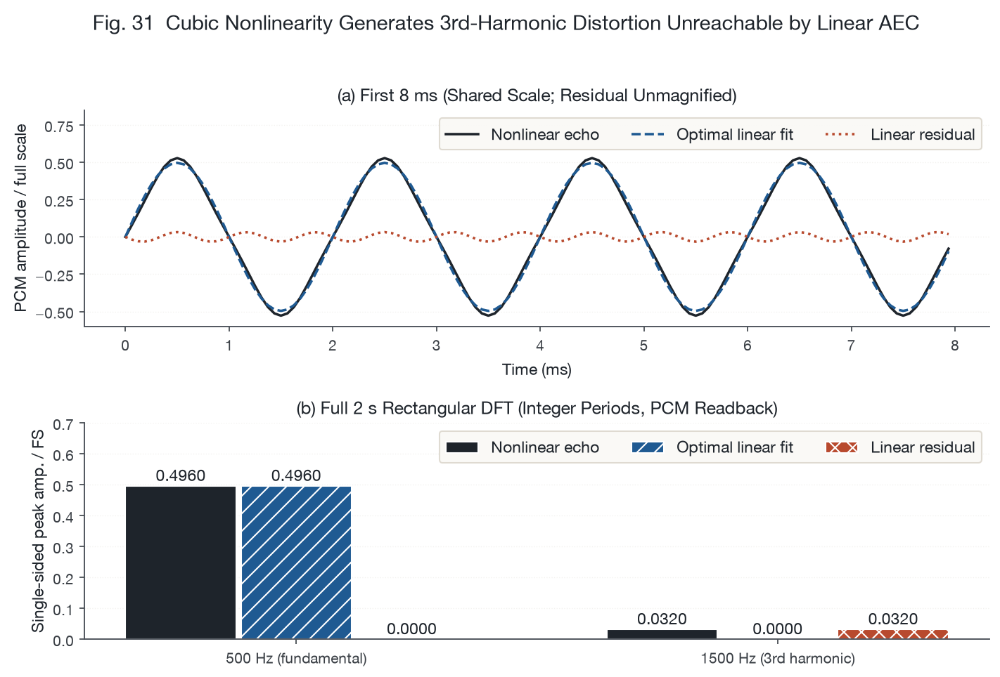

Inspect Figure 31's two panels: panel (a) overlays distorted echo $d[n]$, best linear fit $\hat d[n]$, and residual $e[n]$ in a local time window, showing the crisp $1500\ \mathrm{Hz}$ triple-frequency wave surviving intact after $500\ \mathrm{Hz}$ cancellation; panel (b) computes the DFT magnitude spectrum of the exported 16-bit PCM clips, highlighting the isolated $1500\ \mathrm{Hz}$ third-harmonic spike standing alone after the $500\ \mathrm{Hz}$ fundamental vanishes—demonstrating why LTI systems cannot cancel nonlinear harmonics across frequency.

#### E06-07: How Does an Inverted-Polarity Echo Fool Maximum Positive Peak Picking?

Let unit-impulse reference $x=[1,0,0,0]$ pass through an inverted-polarity speaker or amplifier producing a pure two-sample delayed inverted echo $d=[0,0,-1,0]$. Define nonnegative-lag cross-correlation $r_{xd}[k]=\sum_n x[n]d[n+k]$ ($k=0,1,2,3$) and compare delay selection via "maximum signed value" versus "maximum absolute value" (`delay_polarity` in [`aec_algorithm_minicases.py`](../codes/chapters/ch06/aec_algorithm_minicases.py)).

**Reference Solution**: The four-point cross-correlation is $[0,0,-1,0]$. Coding `argmax(r_xd)` turns the true delay peak $-1$ at $k=2$ into the global minimum, falsely selecting the first tied zero at $k=0$ (off by $2$ samples); switching to `argmax(abs(r_xd))` correctly identifies the true bulk delay $k=2$.

#### E06-08: Why Can't Pure Proportionate Adaptation Start from All-Zero Weights?

Set $L=2$, all-zero initialization $\hat{\vec w}=[0,0]^\top$, pure proportionate mode $\kappa=1$, $\varepsilon_g>0$, and $\delta>0$, for any nonzero $\vec x$ and nonzero residual $e$. Compute the update direction from Eq. (6-11).

**Reference Solution**: Setting $\kappa=1$ zeroes the uniform term $(1-\kappa)/(2L)=0$, while all-zero weights force every proportionate numerator $(1+\kappa)|\hat w_l|=0$ ($\varepsilon_g>0$ prevents division by zero in the denominator, but cannot rescue a zero numerator). Consequently $\mathbf G=\mathbf 0$ and $\mathbf G\vec x=\vec 0$, trapping both taps at zero forever. Practical proportionate rules must keep $\kappa<1$ (or impose a positive floor on $|\hat w_l|$ as in original PNLMS).

#### E06-09: How Many Seconds Is RLS's "Memory Length"?

Under uninterrupted updates with forgetting factor $\lambda=0.99$, compute the exponential weight decay of a historical sample after $100$ updates, then convert $100$ steps to physical seconds for both "$16\ \mathrm{kHz}$ sample-by-sample updates" and "every $10\ \mathrm{ms}$ frame updates."

**Reference Solution**: After $100$ updates, relative weight decays to $0.99^{100}\approx 0.3660$ (close to $e^{-1}\approx 0.3679$). At one update per $16\ \mathrm{kHz}$ sample, $100$ steps span only $100/16000=0.00625\ \mathrm{s}$ ($6.25\ \mathrm{ms}$); at one update per $10\ \mathrm{ms}$ frame, $100$ steps span a full $1.0\ \mathrm{s}$. Quoting "$\lambda=0.99$ memory" without stating the update cadence carries no physical meaning.

#### E06-10: Does a Two-Band Model Always Save Taps and Latency?

Given a fullband physical echo path of $L=4$ nonzero time-domain taps, find the minimum subband block order $K$, the total number of independent real weights in an unconstrained two-point Haar full cross-band representation, and the minimum additional samples one must wait after receiving the leading block sample before outputting the two-sample block.

**Reference Solution**: Odd cross-block lags require minimum block order $K=\lfloor 4/2\rfloor+1=3$; across the $2\times 2$ input–output subband branches, independent real parameters actually triple to $4K=12$ ($3\times$ the original four time-domain taps). Furthermore, after receiving even sample $x[2m]$, the system must wait $1$ sample for odd sample $x[2m+1]$ before applying Eq. (6-8). This confirms §6.2.3's takeaway: critically sampled full cross-band models illuminate aliasing physics, while practical compute reduction relies on oversampled diagonal subbands or NSAF.

#### E06-11: If Reference and Near-End Are Orthogonal, Why Do Online Weights Still Move?

Take single-tap true path $h=0.8$, four-point zero-mean reference $\vec x=[1,1,-1,-1]^\top$, and four-point orthogonal near-end $\vec s=[0.5,-0.5,0.5,-0.5]^\top$, forming $d[n]=hx[n]+s[n]$. Find the four-point batch least-squares solution, then start online NLMS Eq. (6-3) right at the true path $w_{-1}=0.8$ with $\mu=0.5,\varepsilon=0$ ($x^2[n]\equiv 1$) and trace why the online weight moves (runnable via [`enhancement_step_exercises.py`](../codes/chapters/ch00/cross_chapter/enhancement_step_exercises.py)).

**Reference Solution**:

1. **Population normal equations**: For a fixed path with invertible $\mathbf R_{xx}=\mathbb{E}[\vec x\vec x^\top]$, substituting $d=\vec x^\top\vec h+s$ into the MMSE normal equation gives

    $$\begin{aligned}
    \mathbf R_{xx}\vec w_\star&=\mathbb{E}[\vec x d]\\
    &=\mathbf R_{xx}\vec h+\mathbb{E}[\vec x s],\\
    \vec w_\star&=\vec h+\mathbf R_{xx}^{-1}\mathbb{E}[\vec x s].
    \end{aligned}\tag{6-37}$$

    For zero-mean uncorrelated signals, $\mathbb{E}[\vec x s]=\vec 0$ so the population optimum is unbiased ($\vec w_\star=\vec h$);
2. **Four-point finite batch solution**: $\vec x^\top\vec s=0.5-0.5-0.5+0.5=0$, $\vec x^\top\vec x=4$, and $\vec d=[1.3,0.3,-0.3,-1.3]^\top$, giving batch least-squares estimate $w_{\mathrm{batch}}=\vec x^\top\vec d/4=3.2/4=0.8=h$ (switching to collinear $\vec s=0.25\vec x$ biases the batch estimate to $1.05$);
3. **Sample-by-sample online recursion**: At each step compute $e[n]=d[n]-w_{n-1}x[n]$ and $w_n=w_{n-1}+0.5x[n]e[n]$:

| Sample $n$ | A Priori Error $e[n]$ | Weight Change | Updated $w_n$ |
|---|---:|---:|---:|
| 0 | 0.50000 | 0.25000 | 1.05000 |
| 1 | −0.75000 | −0.37500 | 0.67500 |
| 2 | 0.37500 | −0.18750 | 0.48750 |
| 3 | −0.81250 | 0.40625 | 0.89375 |

Whole-window orthogonality $\sum_n x[n]s[n]=0$ does not make instantaneous products $x[n]s[n]$ vanish. Sample $n=0$ immediately knocks the weight off $0.8$ via $x[0]s[0]=+0.5$, coupling into subsequent steps to finish at $0.89375\neq 0.8$—showing why online weights jitter violently during double-talk unless step size is tightened even when near-end and far-end are statistically independent.

#### E06-12: Why Does a Shared Residual Also Need Shared Normalization?

In a two-channel single-tap model with identical references $x_1=x_2=1$, observation $d=1$, zero initial weights, and mono-stable step size $\mu=1.5$ ($\varepsilon=0$ on nonzero denominators), compute the shared residual $e=1-w_1-w_2$ per Eq. (6-32) and update both branches simultaneously, comparing "dividing by joint energy $x_1^2+x_2^2=2$" against "dividing each branch by its local energy $x_r^2=1$."

**Reference Solution**: With the joint denominator, each branch receives increment $\mu e/2$, so total prediction shifts by $\mu e$; with local denominators, each branch takes a full $\mu e$, doubling the total prediction shift to $2\mu e$. Re-evaluating the a posteriori residual on the same observation gives

$$\begin{aligned}
e^+_{\mathrm{joint}}&=(1-\mu)e=-\tfrac{1}{2}e,\\
e^+_{\mathrm{local}}&=(1-2\mu)e=-2e.
\end{aligned}$$

Over three consecutive identical observations, joint normalization converges geometrically with ratio $-1/2$ as $[1,-0.5,0.25]$ (first step $w_1=w_2=0.75$), whereas local normalization explodes with ratio $-2$ as $[1,-2,4]$ (first step $w_1=w_2=1.5$). Multi-reference systems must pool total excitation energy across all jointly updated branches.

#### E06-13: Why Does Perfect Training Cancellation Fail When the Program Changes?

Let true stereo single-tap paths be $\vec h=[1,2]^\top$ while mono-program training stops at candidate weights $\hat{\vec h}=[1.5,1.5]^\top$. During training, left and right channels are identical: $x_1=x_2=[1,-1]$; weights are then frozen and evaluated on an anti-phase holdout sample $[x_1,x_2]=[1,-1]$.

**Reference Solution**: During training, both weight vectors share tap sum $1+2=1.5+1.5=3$, yielding identical true and predicted echoes $[3,-3]$ and zero training residual (the two-channel reference matrix has rank $1$, placing the differential mode $[1,-1]^\top$ in its nullspace). On the anti-phase holdout $[1,-1]$, true physical echo becomes $1\times 1+2\times(-1)=-1$ while the spurious weights predict $1.5\times 1+1.5\times(-1)=0$, instantly leaking residual $-1$—illustrating §6.6.2's stereo decorrelation and cross-program holdout mandate.

#### E06-14: How Much Causal Delay Remains After Reference Alignment?

Suppose true echo is a pure delay of $D=3$ samples, and buffer offset $\delta$ produces aligned reference $x_a[n]=x[n-\delta]$ (here $\delta$ denotes integer sample delay compensation, not a frequency power floor). A causal FIR filter of length $L=3$ spans nonnegative relative lags $\{0,1,2\}$. Test whether this three-tap filter can represent the true echo exactly for $\delta=1, 3, 4$.

**Reference Solution**: Writing $x[n-D]=x_a[n-r]=x[n-\delta-r]$ gives remaining relative lag $r=D-\delta$, which must satisfy $0\le r\le L-1=2$:

| Offset $\delta$ | Remaining Lag $r$ | Three-Tap Representation |
|---:|---:|---|
| 1 | 2 | Representable, taps $[0,0,1]$ |
| 3 | 0 | Representable, taps $[1,0,0]$ |
| 4 | −1 | Not representable by this causal FIR |

Over-delaying the reference to $\delta=4$ yields $r=-1$, meaning current microphone echo corresponds to a "future" reference sample $x_a[n+1]$ not yet delivered—extending causal length $L$ reaches only further into the past, so only decreasing reference buffer delay restores causality.

#### E06-15: Why Does Slow Clock Drift Destroy Waveform Subtraction?

At nominal rate $f_s=16\ \mathrm{kHz}$, suppose playback and capture crystals differ by $\rho=250\times 10^{-6}$ ($250\ \mathrm{ppm}$), causing residual lag between echo replica and true echo to drift linearly as $\Delta n(t)=\rho f_s t$. For a steady $1\ \mathrm{kHz}$ tone with exact replica amplitude, compute phase drift magnitude and residual echo power ratio at $t=1\ \mathrm{s}$ and $t=2\ \mathrm{s}$.

**Reference Solution**: Accumulated slippage reaches $\Delta n(1)=250\times 10^{-6}\times 16000=4$ samples at $t=1\ \mathrm{s}$ and $\Delta n(2)=8$ samples at $t=2\ \mathrm{s}$. Converting to $1\ \mathrm{kHz}$ phase error and normalized residual power ratio:

$$\begin{aligned}
|\phi(t)|&=2\pi\frac{1000}{16000}\Delta n(t),\\
R(t)&=\left|1-e^{-\mathrm{j}\phi(t)}\right|^2
=2-2\cos\phi(t).
\end{aligned}$$

At $t=1\ \mathrm{s}$ and $2\ \mathrm{s}$, phase errors reach $\pi/2$ ($90^\circ$) and $\pi$ ($180^\circ$ anti-phase), driving residual power ratio up to $R(1)=2$ ($+3.01\ \mathrm{dB}$ louder than uncancelled echo) and $R(2)=4$ ($+6.02\ \mathrm{dB}$). Even tiny crystal tolerances destroy high-frequency phase alignment within seconds, proving why cross-clock hardware requires asynchronous resampling tracking (SRC).

#### E06-16: Why Does a Short Residual Persist After the Reference Recovers?

Let the continuous physical loudspeaker playback be $x=[1,2,3,4,5,6]$ (zero for negative time), with true two-tap path and converged frozen weights both equal to $h=[1,0.5]$. Suppose a brief pipeline packet drop zeroes the reference entering AEC at zero-based indices $n=2,3$, giving $x_a=[1,2,0,0,5,6]$ (no near-end or noise). Compute true echo $\vec y$, prediction $\hat{\vec y}$, and residual $\vec e$ sample by sample.

**Reference Solution**: Each sample satisfies "current sample $+ 0.5\times$ previous sample":

$$\begin{aligned}
\vec y&=[1,\ 2.5,\ 4,\ 5.5,\ 7,\ 8.5]^\top,\\
\hat{\vec y}&=[1,\ 2.5,\ 1,\ 0,\ 5,\ 8.5]^\top,\\
\vec e&=\vec y-\hat{\vec y}=[0,\ 0,\ 3,\ 5.5,\ 2,\ 0]^\top.
\end{aligned}$$

Although the reference has already recovered at $n=4$ ($x_a[4]=x[4]=5$), residual $2$ still erupts because the FIR history buffer's lag-$1$ slot still holds the dropout's fake zero (missing $0.5\times x[3]=2$); residual zeroes only at $n=5$ once every nonzero tap slot flushes with valid samples. Generally, dropout residual obeys $h*(x-x_a)$, lasting for "dropout duration $+$ nonzero path tail length."

This repository provides [four $16\ \mathrm{kHz}$, $2\ \mathrm{s}$ synthetic audio clips](../codes/chapters/ch00/research_en/05_exercises_and_audio.md#sec-u-ae01d6f3b2) demonstrating this dropout flush tail (fixed $256$-tap sparse path taking $[0.7,-0.3,0.15]$ at lags $0,80,240$; algorithm reference zeroed on $[12000,16000)$, requiring $240$ samples until index $16240$ to flush completely):

- [Near-end target: scoring reference](../codes/chapters/ch06/audio/aec_dropout_target.wav)
- [Microphone mixture: near-end plus true echo](../codes/chapters/ch06/audio/aec_dropout_microphone.wav)
- [Complete-reference residual: cancelled with frozen true path](../codes/chapters/ch06/audio/aec_dropout_complete_reference_residual.wav)
- [Dropped-reference residual: same path with algorithm reference zeroed](../codes/chapters/ch06/audio/aec_dropout_missing_reference_residual.wav)

Sample-by-sample relative squared error of 16-bit PCM against the near-end target reads $0$ across dropout `[12000, 16000)`, flush tail `[16000, 16240)`, and recovered region `[16240, 30000)` for the complete-reference track, versus $\approx 0.7740$, $0.06483$, and $0$ for the dropout track—verifying the $240$-sample flush tail both numerically and aurally.

#### E06-17: What Fake Improvement Does Scoring with A Posteriori Residuals Produce?

Take scalar Kalman prior $w^-=0, P^-=1$, observation variance $\Psi=1$, current reference $x=1$, and microphone sample $d=2$. Compare the true causal a priori residual $e^-$ against the a posteriori residual $e^+$ recomputed on the same sample after updating the weight.

**Reference Solution**: Kalman gain is $K=1/(1+1)=1/2$; causal a priori residual is $e^-=2-0=2$, updating weight to $w^+=0+(1/2)\times 2=1$. Illegitimately re-evaluating the same sample with $w^+$ yields $e^+=2-1\times 1=1$, fabricating an artificial gain of

$$10\log_{10}\frac{(e^-)^2}{(e^+)^2}
=10\log_{10}4\approx 6.02\ \mathrm{dB}.$$

This full $6.02\ \mathrm{dB}$ "improvement" comes purely from data leakage (scoring a sample using a weight just fitted to that sample); real-time causal systems cannot know $w^+$ before receiving $d[n]$, so evaluations must strictly log pre-update a priori residuals $e^-$.

#### E06-18: Does the Mean of Blockwise dB ERLE Equal Whole-Window ERLE?

Consider two consecutive active STFE blocks with true echo energies $[1,100]$ and post-AEC residual echo energies $[0.01,100]$ (no noise or near-end speech). Compare "averaging blockwise dB values arithmetically" against "summing total energy across the window first per Eq. (6-35)."

**Reference Solution**: Blockwise scores give $10\log_{10}(1/0.01)=20\ \mathrm{dB}$ on quiet Block 1 and $10\log_{10}(100/100)=0\ \mathrm{dB}$ on loud mismatched Block 2, averaging arithmetically to **$10\ \mathrm{dB}$**. Summing window energies first per Eq. (6-35) gives

$$\begin{aligned}
\mathrm{ERLE}_{\mathrm{all}}
&=10\log_{10}\frac{1+100}{0.01+100}
=10\log_{10}\frac{101}{100.01}
\approx 0.04278\ \mathrm{dB},
\end{aligned}$$

essentially **$0\ \mathrm{dB}$**. Averaging dB values computes a geometric mean of energy ratios that grants tiny trailing blocks the same vote as loud vowels, whereas summed energy faithfully reflects that $99\%$ of echo energy escaped uncancelled. Always confirm aggregation conventions before comparing benchmarks.

#### E06-19: If Reference and Near-End Are Uncorrelated, Why Can NLMS's Expected Direction Still Bias?

Let true single-tap path be $h=0.8$ with $d=hx+s$. Suppose each sample draws independently and equiprobably ($1/4$ each) from the four nonzero states below, with $\varepsilon=0$ and fixed $0<\mu<2$. Compare the population ordinary least-squares optimum against the **conditional expectation of one NLMS update given current weight $w$**.

| State | $x$ | $s$ | $xs$ | $s/x$ |
|---|---:|---:|---:|---:|
| 1 | 1 | 1 | 1 | 1 |
| 2 | −1 | −1 | 1 | 1 |
| 3 | 2 | −0.5 | −1 | −0.25 |
| 4 | −2 | 0.5 | −1 | −0.25 |

**Reference Solution**: Across the four equiprobable states, $\mathbb{E}[x]=\mathbb{E}[s]=0$, $\mathbb{E}[xs]=(1+1-1-1)/4=0$, and $\mathbb{E}[x^2]=(1+1+4+4)/4=5/2$, so Eq. (6-37) gives unbiased OLS optimum $w_{\mathrm{LS}}=h=0.8$. In single-tap floorless NLMS, however, dividing by $x^2$ reweights each gradient by $s/x$:

$$\begin{aligned}
w^+&=w+\mu\frac{(h x+s-w x)x}{x^2}
    =(1-\mu)w+\mu\left(h+\frac{s}{x}\right),\\
\mathbb{E}\!\left[\frac{s}{x}\right]
   &=\frac{1+1-0.25-0.25}{4}
    =\frac{3}{8}=0.375\neq 0.
\end{aligned}$$

Hence $\mathbb{E}[w^+\mid w]=(1-\mu)w+\mu(0.8+0.375)$: starting right at true $w=0.8$ (with $\mu=0.5$), the next step drifts in expectation to $0.9875$, converging in mean to the biased fixed point $47/40=1.175$. Even though $x$ and $s$ are **linearly uncorrelated** ($\mathbb{E}[xs]=0$), they are **not statistically independent** (same sign at $|x|=1$, opposite sign at $|x|=2$, so $\mathbb{E}[s\mid x]\neq 0$); dividing by $x^2$ upweights small-amplitude same-sign samples and breaks orthogonality.

#### E06-20: Inside the Injected Increment Error, How Much Is Gain Scaling vs. Other Distortion?

In the dual-run near-end probe of §6.8.1, let known near-end reference be $\vec s=[1,-1,1,-1]^\top$, orthogonal distortion component $\vec r=0.3[1,1,-1,-1]^\top$, and observed output increment $\vec\Delta=0.8\vec s+\vec r=[1.1,-0.5,0.5,-1.1]^\top$. Evaluate the orthogonal decomposition of projection gain $g_\Delta$ and relative squared error $E_\Delta$ per Eq. (6-36).

**Reference Solution**: Since $\vec s^\top\vec r=0$ and $\|\vec s\|^2=4$, projection gain is $g_\Delta=\vec s^\top\vec\Delta/\|\vec s\|^2=0.8$. Rewriting $\vec\Delta-\vec s=(g_\Delta-1)\vec s+\vec r$ separates the two orthogonal squared errors directly:

$$\begin{aligned}
E_\Delta
&=(g_\Delta-1)^2+\frac{\|\vec r\|^2}{\|\vec s\|^2}
=(-0.2)^2+0.3^2=0.04+0.09=0.13.
\end{aligned}$$

This yields the lower bound $E_\Delta\ge(g_\Delta-1)^2$: $g_\Delta=0.8$ captures only the $20\%$ uniform attenuation (error share $0.04$), while the excess $0.09$ exposes orthogonal waveform distortion from nonlinear artifacts or adaptive state divergence.

#### E06-21: How Does Two-Column Affine Projection Compute Step by Step?

Let true two-tap path be $\vec h=[1/2,1/4]^\top$ with noiseless reference samples $x[-1]=0, x[0]=1, x[1]=2$ and zero initial weights. Freeze weights at $n=0$ upon receiving $d[0]=1/2$ (pushing the observation into the buffer only); at $n=1$ upon receiving $d[1]=5/4$, execute one Eq. (6-14) update with $K=2$, $\mu=1$, $\delta=1$, and compare against unregularized exact projection ($\delta=0$) and single-column NLMS ($K=1, \delta=1$) in Figure 52 (§6.2.5).

**Reference Solution**:

1. **Assemble data matrix and same-weight error vector**: Regression columns at $n=1$ and $n=0$ are $[2,1]^\top$ and $[1,0]^\top$; since old weights stayed zero after freezing at $n=0$, window error equals the observations themselves:

    $$\mathbf U=\begin{bmatrix}2&1\\1&0\end{bmatrix},\qquad
    \vec d=\vec e^-=\begin{bmatrix}5/4\\1/2\end{bmatrix}.$$

2. **Compute the $2\times 2$ Gram matrix and loaded inverse**:

    $$\begin{aligned}
    \mathbf G&=\mathbf U^\top\mathbf U
              =\begin{bmatrix}5&2\\2&1\end{bmatrix},\\
    \mathbf G+\mathbf I
             &=\begin{bmatrix}6&2\\2&2\end{bmatrix},\qquad
    \det(\mathbf G+\mathbf I)=8,\\
    (\mathbf G+\mathbf I)^{-1}
             &=\frac{1}{8}\begin{bmatrix}2&-2\\-2&6\end{bmatrix}.
    \end{aligned}$$

3. **Solve for $\vec\alpha$ and weight increment**: Substituting into Eq. (6-14) gives

    $$\begin{aligned}
    \vec\alpha&=(\mathbf G+\mathbf I)^{-1}\vec e^-
     =\frac{1}{8}\begin{bmatrix}2(5/4)-2(1/2)\\-2(5/4)+6(1/2)\end{bmatrix}
     =\begin{bmatrix}3/16\\1/16\end{bmatrix},\\
    \Delta\vec w&=\mathbf U\vec\alpha
     =\begin{bmatrix}2(3/16)+1/16\\3/16\end{bmatrix}
     =\begin{bmatrix}7/16\\3/16\end{bmatrix}.
    \end{aligned}$$

    Updated weights reach $\vec w_1=[7/16,3/16]^\top$ (shrinking window a posteriori error to $[3/16,1/16]^\top$, while causal current-sample a priori residual stays $5/4$);
4. **Compare degenerate baselines**: Setting $\delta=0$ (unregularized exact projection) gives $\det\mathbf G=1$ and lands directly on $\vec w_1=[1/2,1/4]^\top=\vec h$ in one step; setting $K=1,\delta=1$ gives $[2,1]^\top(5/4)/6=[5/12,5/24]^\top$, identical to single-step NLMS with $\varepsilon=1$.

#### E06-22: Why Can't Previously Emitted Residuals Be Spliced Into the New Window?

Keep the reference, true path, and $\mu=1,\delta=1$ from E06-21, but **do not freeze** at $n=0$. Compare at $n=1$ the correct Eq. (6-12) procedure (recomputing the entire window error with current old weights $\vec w_0$) against the common bug of splicing the previously emitted residual from $n=0$ directly into the window.

**Reference Solution**: At $n=0$, the single column $[1,0]^\top$ and a priori residual $1/2$ update weights to $\vec w_0=(1/2)/(1+1)[1,0]^\top=[1/4,0]^\top$. At $n=1$, both window observations must be evaluated under the same $\vec w_0=[1/4,0]^\top$: current error is $5/4-2(1/4)=3/4$, while the older observation's discrepancy under $\vec w_0$ has already shrunk to $1/2-1(1/4)=1/4$. Multiplying the true same-weight vector $\vec e^-=[3/4,1/4]^\top$ by $(\mathbf G+\mathbf I)^{-1}$ gives $\vec\alpha=[1/8,0]^\top$, $\Delta\vec w=[1/4,1/8]^\top$, and updated weights $\vec w_1=[1/2,1/8]^\top$ (a posteriori error $[1/8,0]^\top$). Wrongly splicing the stale $n=0$ residual $1/2$ to form $[3/4,1/2]^\top$ yields $\vec\alpha=[1/16,3/16]^\top$ and biased weights $[9/16,1/16]^\top$—double-counting an error half-eliminated one step earlier.

#### E06-23: Can Regularization Make a Rank-Deficient Window Identifiable?

Take two taps, zero initial weights, $\mu=1$, and $x[-1]=1$. Receive $(x[0]=1,d[0]=1)$ and freeze; receive identical $(x[1]=1,d[1]=1)$ and update, producing rank-$1$ all-ones matrix $\mathbf U=\mathbf 1\mathbf 1^\top$ and $\vec e^-=[1,1]^\top$. Compare $\delta=0$ vs. $\delta=1$; then scale both reference and microphone amplitudes by $10\times$ to test how a fixed constant $\delta$ alters the update.

**Reference Solution**:

1. **Singularity guard vs. ridge selection**: Both columns of $\mathbf U$ coincide (rank $1$), making $\mathbf G=2\mathbf 1\mathbf 1^\top$ singular. At $\delta=0$, no inverse exists and the interface rejects the update; at $\delta=1$, $\mathbf G+\mathbf I$ (diagonal $3$, off-diagonal $2$) is positive definite with inverse entries $3/5$ and $-2/5$, giving $\vec\alpha=[1/5,1/5]^\top$ and $\vec w=[2/5,2/5]^\top$ (a posteriori errors $1/5$). Physical identifiability is *not* restored: for any $t$, $[t,1-t]^\top$ generates identical observations (differential mode $[1,-1]^\top$ stays in $\ker(\mathbf U^\top)$, and regularization merely selects the minimum-norm damped direction);
2. **Amplitude-scaling dimensional check**: Multiplying $x$ and $d$ by $10$ multiplies $\mathbf U$ by $10$, $\mathbf G$ by $100$, and $\vec e^-$ by $10$. Only scaling energy-dimensioned $\delta$ by $100\times$ (from $1$ to $100$) cancels scale factors identically to preserve $\vec w=[2/5,2/5]^\top$; leaving $\delta=1$ fixed slashes effective damping $100\times$ and shifts weights to $[200/401,200/401]^\top\approx[0.49875,0.49875]^\top$, confirming §6.1.2's dimensional scaling rule.

#### E06-24: How Do Path Priors Select Solutions, and Why Is Independent Holdout Still Needed?

Let true two-tap path be $\vec h=[1,2]^\top$. Training reference stays constant at $1$ (both true echoes equal $3$; same rank-$1$ all-ones $\mathbf U$ as E06-23; $\mu=1,\delta=1$, freeze at $n=0$, update at $n=1$). Compare starting from "correct factory prior $[1,2]^\top$," "wrong prior $[2,1]^\top$," and "zero prior $[0,0]^\top$," then freeze and test on one differential holdout sample $[1,-1]^\top$.

**Reference Solution**: During training, both $[1,2]^\top$ and $[2,1]^\top$ share tap sum $3$, giving identically zero training error and zero APA increment—making them indistinguishable from training residuals alone—while zero initialization updates once to $[6/5,6/5]^\top$. Testing on differential holdout $[1,-1]^\top$ (true echo $1-2=-1$) immediately exposes the gap:

| Training Initial / Prior | Post-Training Weights | Holdout Prediction | Holdout A Priori Error |
|---|---|---:|---:|
| Correct prior | $[1,2]^\top$ | −1 | 0 |
| Wrong prior | $[2,1]^\top$ | 1 | −2 |
| Zero prior, one update | $[6/5,6/5]^\top$ | 0 | −1 |

Factory priors or neural initializations can fill narrowband nullspaces, yet mismatched priors produce deceptive zero training error until wideband multi-direction holdout tests expose nullspace errors.

#### E06-25: Why Can Higher Projection Order Pay a Noise Penalty Under Colored References?

Generate a $16\ \mathrm{kHz}$, $32000$-sample strongly colored AR(1) reference $x[n]=0.98x[n-1]+\eta[n]$ ($\eta[n]$ std $0.015$) using `PCG64` seed `20261001`; convolve with a $16$-tap sparse true path taking $[0.6,-0.2,0.1,0.05]$ at lags $0,3,7,13$ (keeping the $13$-sample tail for $32013$ total samples), and add independent Gaussian noise $v[n]$ of std $0.003$. Run `NLMSState` ($K=1$) and `APAState` ($K=2,4$) from all zeros with $\mu=0.2, \varepsilon=\delta=0.001$, training over `[0, 24000)` before freezing and scoring relative coefficient error and holdout power decomposition over the $N_{\mathcal I}=8000$-sample window $\mathcal I=[24000,32000)$:

$$\begin{aligned}
\rho_h&=\frac{\|\vec w_{\mathrm{tr}}-\vec h\|}
             {\|\vec h\|},\\
\epsilon_{y,n}&=y[n]-\hat y^-[n],\qquad
e^-[n]=\epsilon_{y,n}+v[n],\\
P_{\mathrm{clean}}
&=\frac{1}{N_{\mathcal I}}
  \sum_{n\in\mathcal I}\epsilon_{y,n}^2,\qquad
P_v=\frac{1}{N_{\mathcal I}}
     \sum_{n\in\mathcal I}v^2[n],\\
C_{\epsilon v}
&=\frac{1}{N_{\mathcal I}}
  \sum_{n\in\mathcal I}\epsilon_{y,n}v[n],\\
P_{\mathrm{total}}
&=\frac{1}{N_{\mathcal I}}\sum_{n\in\mathcal I}(e^-[n])^2
 =P_{\mathrm{clean}}+P_v+2C_{\epsilon v}.
\end{aligned}\tag{6-38}$$

Compare noiseless versus noisy holdout error trends across $K=1,2,4$.

**Reference Solution**: In the noiseless ($v[n]\equiv 0$) in-memory control, post-training relative path error still sits at $\rho_h\approx 8.14\times 10^{-7}$ for $K=1$ NLMS, whereas $K=2,4$ APA exploit local decorrelation to reach double-precision machine epsilon. Under std-$0.003$ observation noise ($P_v\approx 8.85524\times 10^{-6}$), keeping the same $(\mu=0.2,\delta=0.001)$ reverses the ranking:

| Method | Post-Training $\rho_h$ | Float Clean-Echo Prediction MSE | Float Total Residual MSE | PCM16 Total Residual MSE |
|---|---:|---:|---:|---:|
| NLMS, $K=1$ | 0.059331 | $1.84160\times 10^{-6}$ | $1.07079\times 10^{-5}$ | $1.07073\times 10^{-5}$ |
| APA, $K=2$ | 0.130719 | $2.94649\times 10^{-6}$ | $1.16993\times 10^{-5}$ | $1.16991\times 10^{-5}$ |
| APA, $K=4$ | 0.210347 | $6.13290\times 10^{-6}$ | $1.48440\times 10^{-5}$ | $1.48440\times 10^{-5}$ |

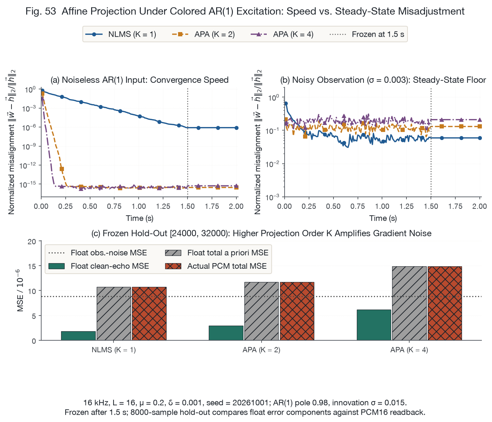

Inspect Figure 53's three panels: in noiseless panel (a), higher $K$ drives path error down dramatically faster; in noisy panel (b), after rapid initial descent, inverting ill-conditioned $(\mathbf G_n+\delta\mathbf I)^{-1}$ amplifies observation noise along differential modes, raising steady-state misadjustment above $K=1$; holdout bars in panel (c) confirm this cost (PCM16 microphone-to-residual power ratios are roughly $22.05$, $21.66$, and $20.63\ \mathrm{dB}$). Deploying higher-order APA therefore requires reducing steady-state step size or increasing diagonal loading rather than reusing aggressive $K=1$ tuning. Full PCM16 integer ledgers and read-only verification appear in [`generate_apa_audio.py`](../codes/chapters/ch06/examples/generate_apa_audio.py) and its [standalone manifest](../codes/chapters/ch06/apa_audio/MANIFEST.json), with six listening files:

- [Same-source colored reference](../codes/chapters/ch06/apa_audio/apa_reference.wav)
- [Known clean echo](../codes/chapters/ch06/apa_audio/apa_true_echo.wav)
- [Noisy microphone observation](../codes/chapters/ch06/apa_audio/apa_microphone.wav)
- [NLMS a priori residual](../codes/chapters/ch06/apa_audio/apa_nlms_residual.wav)
- [APA2 a priori residual](../codes/chapters/ch06/apa_audio/apa_apa2_residual.wav)
- [APA4 a priori residual](../codes/chapters/ch06/apa_audio/apa_apa4_residual.wav)

#### E06-26: Given Current Playback Gain, Why Does Post-Multiplying Echo Prediction Still Fail?

Let early reference upstream of volume control be $x=[1,1,1,1]$ (padded with $x[4]=0$ to keep the full convolution tail; zero for negative time) and fixed frozen two-tap path be $h=[1,1/2]$. Suppose digital gain steps from $1$ to $2$ at $n=2$, giving tail-inclusive gain $g=[1,1,2,2,2]$. Compute sample by sample the true echo, early-reference fixed prediction, post-multiplied prediction $g[n]\hat y_x[n]$, and late-reference prediction from $r[n]=g[n]x[n]$.

**Reference Solution**: Tail-inclusive early and late references are $[1,1,1,1,0]$ and $[1,1,2,2,0]$. Evaluating $y[n]=r[n]+\frac{1}{2}r[n-1]$, $\hat y_x[n]=x[n]+\frac{1}{2}x[n-1]$, and $g[n]\hat y_x[n]$:

| Sample $n$ | True Echo | Early-Ref Prediction | Wrong Post-Mult Prediction | Late-Ref Prediction |
|---|---:|---:|---:|---:|
| 0 | 1 | 1 | 1 | 1 |
| 1 | $3/2$ | $3/2$ | $3/2$ | $3/2$ |
| 2 | $5/2$ | $3/2$ | 3 | $5/2$ |
| 3 | 3 | $3/2$ | 3 | 3 |
| 4, full tail | 1 | $1/2$ | 1 | 1 |

Signed residuals relative to true echo are $[0,0,1,3/2,1/2]$ (early), $[0,0,-1/2,0,0]$ (wrong post-mult), and $[0,0,0,0,0]$ (late). At $n=2$, delayed reflection $\frac{1}{2}r[1]=\frac{1}{2}$ left the speaker at $n=1$ under old gain $g[1]=1$, yet post-multiplication scales it by new gain $g[2]=2$ to $1$, creating exactly Eq. (6-34)'s transition error $\frac{1}{2}(g[1]-g[2])x[1]=-1/2$ (implemented in [`reference_gain_order()`](../codes/chapters/ch06/core/reference_timing.py)).

#### E06-27: When the Current Reference Is Silent, Why Can the Microphone Still Hold Pure Echo?

Partition a $12$-sample sequence into three $4$-sample frames: Frame 0 plays $[1,-1,1,-1]$, then physical playback stops completely at zero across Frames 1–2 ($8$ samples). Suppose the acoustic path has a single delayed tap $h[4]=1/2$, with $s[n]\equiv 0$ and zero noise. Feed reference and microphone into §6.4.1's current-frame activity detector (mean-removed RMS threshold $0.1$, absolute NCC threshold $0.8$) and compare output labels against true physical content frame by frame.

**Reference Solution**: Because $y[n]=\frac{1}{2}x[n-4]$, Frame 0's playback reaches the microphone during Frame 1 $[4,8)$:

| Frame, Sample Range | Current Ref RMS | Mic RMS | Baseline Label | True Physical Content |
|---|---:|---:|---|---|
| 0, $[0,4)$ | 1 | 0 | `far_only` | Playback active; echo not yet arrived |
| 1, $[4,8)$ | 0 | $1/2$ | `near_only` | Pure delayed echo tail from past playback |
| 2, $[8,12)$ | 0 | 0 | `silence` | No echo, near-end, or noise |

Every frame has at least one zero-energy stream (Eq. (6-28) denominator vanishes), routing through the amplitude branch: Frame 1 emits operational label `near_only` even with zero local speech. Passing the same sequence through a fully frozen `NLMSState` loaded with true $h$ and advancing reference history zeroes all $12$ a priori residuals identically ([`echo_tail_activity()`](../codes/chapters/ch06/core/reference_timing.py)), warning engineers never to flush FIR reference history or bypass linear subtraction the moment current reference drops silent.

#### E06-28: Verifying Gain Transitions and Pure Echo Tails on Actual 16-Bit PCM

Combine E06-26's gain step and E06-27's pure echo tail into a $16\ \mathrm{kHz}$ test asset (Figure 69 in §6.7.1): a $32000$-sample ($2.0\ \mathrm{s}$) two-tone source $0.08\cos(2\pi\cdot 500n/16000)+0.06\sin(2\pi\cdot 730n/16000)$ ($320$-sample sine-squared fade-in/out, trailing $1600$ zeros retaining a $100\ \mathrm{ms}$ tail for $33600$ total samples). Digital gain doubles from $1$ to $2$ at sample $16000$ ($1.0\ \mathrm{s}$, staying $2$ in the tail); sparse path takes $h[0]=0.7, h[1600]=0.35$, evaluated via fully frozen $1601$-tap `NLMSState` loaded with ground truth:

$$\begin{gathered}
y[n]=0.7r[n]+0.35r[n-1600],\\
\hat y_{\mathrm{early}}[n]=0.7x[n]+0.35x[n-1600],\\
\hat y_{\mathrm{after}}[n]=g[n]\hat y_{\mathrm{early}}[n].
\end{gathered}\tag{6-39}$$

Verify analytical mean squares and PCM16 measurements across transition window $[16000,17600)$, doubled steady window $[19200,28800)$, and post-stoppage tail window $[32000,33600)$.

**Reference Solution**: Frequencies $500\ \mathrm{Hz}$ and $730\ \mathrm{Hz}$ complete exact integer cycles ($50$ and $73$) over $1600$ samples ($0.1\ \mathrm{s}$) outside the fades, so $x[n-1600]=x[n]$ throughout both steady windows and Parseval's theorem yields

$$\begin{aligned}
P_x&=\frac{0.08^2+0.06^2}{2}=0.005,\\
P_{c x}&=c^2 P_x.
\end{aligned}\tag{6-40}$$

In the transition window, equivalent coefficients $c$ are $0.7\times 2+0.35\times 1=1.75$ (true echo), $0.7$ (early residual), and $1.75-2\times 1.05=-0.35$ (wrong post-mult residual); in the doubled steady window they are $2.1$, $1.05$, and $0$. Substituting into Eq. (6-40) gives:

| Signal Component | Transition-Window Analytical Mean Square | Steady-Window Analytical Mean Square |
|---|---:|---:|
| True echo | 0.0153125 | 0.02205 |
| Early-reference fixed residual | 0.00245 | 0.0055125 |
| Wrong post-multiplied residual | 0.0006125 | 0 |
| Late-reference fixed residual | 0 | 0 |

In the post-stoppage tail $[32000,33600)$ reading the trailing $320$-sample fade-out, floating-point mean squares of true echo and early residual are roughly $0.002163$ and $0.000541$ (both post-multiplied and late residuals equal $0$). After 16-bit PCM export at shared gain $1$, transition-window wrong-post-mult PCM mean square reads $\approx 0.00061252$, matching analytical $0.0006125$ within 16-bit quantization precision; decoding the $1600$-sample tail into §6.4.1's activity baseline ($160$-sample frames, RMS threshold $0.001$, absolute NCC threshold $0.85$) labels all ten $10\ \mathrm{ms}$ frames (frame ends $32160$–$33600$, matching Fig. 69(d) centers $5$–$95\ \mathrm{ms}$) as `near_only`, proving operational tail labels must never be equated with near-end speech ground truth. Full integer PCM energy ledgers and read-only checks live in [`generate_reference_audio.py`](../codes/chapters/ch06/examples/generate_reference_audio.py) and its [standalone manifest](../codes/chapters/ch06/reference_audio/MANIFEST.json), with six audio files:

- [Pre-gain early reference](../codes/chapters/ch06/reference_audio/reference_early.wav)
- [Post-gain late reference](../codes/chapters/ch06/reference_audio/reference_late.wav)
- [True echo with complete tail](../codes/chapters/ch06/reference_audio/reference_echo.wav)
- [Early-reference fixed-prediction residual](../codes/chapters/ch06/reference_audio/reference_early_residual.wav)
- [Wrong post-multiplied gain residual](../codes/chapters/ch06/reference_audio/reference_wrong_gain_residual.wav)
- [Late-reference fixed-prediction residual](../codes/chapters/ch06/reference_audio/reference_late_residual.wav)

#### E06-29: Hammerstein Condition Numbers and Coordinate Decoupling for Odd Power vs. Orthogonal Legendre Bases

Let normalized reference amplitude follow $x\sim\mathcal U(-1,1)$ (even moments $\mathbb{E}[x^{2k}]=1/(2k+1)$, odd moments $0$). Compare three odd monomials $\vec\psi_{\mathrm{pow}}(x)=[x,x^3,x^5]^\top$ against three odd Legendre polynomials $\vec\psi_{\mathrm{leg}}(x)=[P_1(x),P_3(x),P_5(x)]^\top$:

$$\begin{aligned}
P_1(x)&=x,\qquad
P_3(x)=\frac{1}{2}(5x^3-3x),\\
P_5(x)&=\frac{1}{8}(63x^5-70x^3+15x).
\end{aligned}\tag{6-41}$$

Given true memoryless odd distortion $y(x)=x-0.5x^3+0.63x^5$ (power-basis weights $\vec c_{\mathrm{pow}}=[1,-0.5,0.63]^\top$), compute both Gram-matrix condition numbers, the Legendre weights, and the optimal single-branch linear truncation gain (code in [`core/nonlinear_and_stereo.py`](../codes/chapters/ch06/core/nonlinear_and_stereo.py)).

**Reference Solution**:

1. **Condition numbers of raw and unit-variance odd power bases**: For $p,q\in\{1,3,5\}$, raw Gram entries are $1/(p+q+1)$:

    $$\mathbf R_{\mathrm{pow}}=\begin{bmatrix}
    1/3&1/5&1/7\\
    1/5&1/7&1/9\\
    1/7&1/9&1/11
    \end{bmatrix},\qquad
    \det\mathbf R_{\mathrm{pow}}=\frac{256}{22\,920\,975}.$$

    Its characteristic polynomial $\mu^3-\frac{131}{231}\mu^2+\frac{19\,816}{1\,091\,475}\mu-\frac{256}{22\,920\,975}=0$ gives eigenvalues $\approx 0.5330817, 0.0333904, 6.27468\times 10^{-4}$ and condition number $\kappa_2(\mathbf R_{\mathrm{pow}})\approx 849.58$ (two branches $\{x,x^3\}$ give $\frac{25+\sqrt{541}}{25-\sqrt{541}}\approx 27.73$). Scaling by $\operatorname{diag}(\sqrt{3},\sqrt{7},\sqrt{11})$ to unit variance leaves correlations $\rho_{13}\approx 0.9165, \rho_{15}\approx 0.8207, \rho_{35}\approx 0.9750$, characteristic equation $\lambda^3-3\lambda^2+\frac{53\,176}{99\,225}\lambda-\frac{256}{99\,225}=0$, eigenvalues $\approx 2.8095820, 0.1854668, 0.0049512$, and $\kappa_2(\widetilde{\mathbf R}_{\mathrm{pow}})\approx 567.45$ (two branches $\approx 22.96$);

2. **Orthogonal Legendre basis and coordinate decoupling**: Under $\mathcal U(-1,1)$, the unscaled Legendre Gram matrix diagonalizes strictly to $\operatorname{diag}(1/3,1/7,1/11)$ ($\kappa_2=11/3\approx 3.6667$), and scaling by $[\sqrt{3},\sqrt{7},\sqrt{11}]$ brings $\kappa_2$ identically to $1$. Inverting Eq. (6-41) gives the upper-triangular map $x=P_1$, $x^3=\frac{3}{5}P_1+\frac{2}{5}P_3$, $x^5=\frac{3}{7}P_1+\frac{4}{9}P_3+\frac{8}{63}P_5$; multiplying $\vec c_{\mathrm{pow}}$ yields exact Legendre weights:

    $$\begin{aligned}
    \vec w_{\mathrm{leg}}
    &=\begin{bmatrix}
      1&3/5&3/7\\
      0&2/5&4/9\\
      0&0&8/63
      \end{bmatrix}
      \begin{bmatrix}1\\-0.5\\0.63\end{bmatrix}
     =\begin{bmatrix}97/100\\2/25\\2/25\end{bmatrix}
     =\begin{bmatrix}0.97\\0.08\\0.08\end{bmatrix}.
    \end{aligned}$$

    Because orders decouple orthogonally, truncating to a pure linear single branch yields MMSE-optimal linear gain $\mathbb{E}[x y(x)]/\mathbb{E}[x^2]=3(\frac{1}{3}-\frac{0.5}{5}+\frac{0.63}{7})=0.97$, matching $w_{\mathrm{leg},1}$ directly without revising the linear branch when higher orders are added or removed (total second moment $727949/2310000\approx 0.315129$ splits cleanly into linearly explained variance $9409/30000\approx 0.313633$ plus residual nonlinear variance $72/48125\approx 0.0014961$).

#### E06-30: Stereo TV-APF Decorrelation, Physical ANC/ICC Causality Deadlines, and Dual-Filter Switching

Perform exact arithmetic checks on three engineering boundaries from §6.1, §6.4, and §6.6–§6.7 (code in [`core/nonlinear_and_stereo.py`](../codes/chapters/ch06/core/nonlinear_and_stereo.py)):

1. **TV-APF full-rank check**: Given single far-end source $s=[1,0,0,1,0]$ (zero for negative time), left channel $x_1[n]=s[n]$, right channel filtered by causal first-order all-pass $x_2[n]=-a_n x_2[n-1]+a_n s[n]+s[n-1]$, and two taps per channel (rows $[x_1[n],x_1[n-1],x_2[n],x_2[n-1]]$). On snapshots $n\in\{0,1,3,4\}$, prove constant $a_n\equiv 0.5$ is rank-deficient, then verify full-rank recovery under slowly varying $a=[0,0,0,0.5,0.5]$;
2. **Physical ANC and ITU-T P.1150 automotive ICC delay budgets**: With $c=343\ \mathrm{m/s}$ and $f_s=16\ \mathrm{kHz}$, the acoustic-causality bound and in-cabin comb-notch spacings are

    $$\begin{aligned}
    \tau_{\mathrm{elec}}
    &\le\tau_{\mathrm{acoust}}-\tau_{\mathrm{sec}},\\
    \Delta f&=\frac{1}{\tau_{\mathrm{loop}}},\qquad
    f_1=\frac{1}{2\tau_{\mathrm{loop}}}.
    \end{aligned}\tag{6-42}$$

    Compare ANC primary/secondary paths $d_{\mathrm{p}}=0.12\ \mathrm{m}, d_{\mathrm{s}}=0.02\ \mathrm{m}$ against an $N=128$ ($8\ \mathrm{ms}$) PBFDAF; then for ICC superposition ratio $\alpha=0.8$ and loop gain $0.5$, compare comb-notch density at $\tau_{\mathrm{loop}}=10\ \mathrm{ms}$ vs. $25\ \mathrm{ms}$;
3. **Foreground/shadow dual-filter three-state gating**: Given foreground/shadow window residual energies $E_{\mathrm{fg}}>0, E_{\mathrm{sh}}\ge 0$, coherence $c_{xd}\in[0,1]$, and thresholds $\eta_{\mathrm{copy}}=0.25, \eta_{\mathrm{reset}}=2.0, \tau_c=0.8$:

    $$\begin{aligned}
    \text{Copy }\vec w_{\mathrm{sh}}\to\vec w_{\mathrm{fg}}
    &\iff (E_{\mathrm{sh}}<\eta_{\mathrm{copy}}E_{\mathrm{fg}})
          \land(c_{xd}\ge\tau_c),\\
    \text{Reset }\vec w_{\mathrm{fg}}\to\vec w_{\mathrm{sh}}
    &\iff E_{\mathrm{sh}}>\eta_{\mathrm{reset}}E_{\mathrm{fg}}.
    \end{aligned}\tag{6-43}$$

    Determine the control actions for windows A ($E_{\mathrm{fg}}=1.28, E_{\mathrm{sh}}=0.08, c_{xd}=0.95$), B ($1.00, 2.50, 0.25$), and C ($1.00, 0.20, 0.30$).

**Reference Solution**:

1. **LTI rank deficiency vs. TV-APF full rank**: Constant $a_n\equiv a$ enforces $(x_2[n]+ax_2[n-1])-(ax_1[n]+x_1[n-1])=0$, placing nonzero vector $[-a,-1,1,a]^\top$ in the nullspace; at $a\equiv 0.5$, $x_2=[1/2,3/4,-3/8,11/16,21/32]$ gives $\det\mathbf U_{\mathrm{lti}}=0$ (rank $3<4$). Switching to varying pole $a=[0,0,0,0.5,0.5]$ yields $x_2=[0,1,0,0.5,0.75]$ and

    $$\mathbf U_{\mathrm{tv}}=\begin{bmatrix}
    1&0&0&0\\
    0&1&1&0\\
    1&0&0.5&0\\
    0&1&0.75&0.5
    \end{bmatrix},\qquad
    \det\mathbf U_{\mathrm{tv}}=0.25\neq 0.$$

    For true stereo path $\vec h_{\mathrm{true}}=[0.8,0.2,0.4,0.1]^\top$ (four-snapshot echoes $[0.8,0.6,1.0,0.55]^\top$), $\mathbf U_{\mathrm{tv}}^{-1}\vec y$ uniquely recovers $\vec h_{\mathrm{true}}$;
2. **Causal delay budgets and comb notches**: Maximum electronic delay for causal ANC is only $\tau_{\mathrm{elec,max}}=100/343\ \mathrm{ms}\approx 0.2915\ \mathrm{ms}$ ($\approx 4.66$ samples), exceeded $27.44\times$ by an $8\ \mathrm{ms}$ block PBFDAF—ruling it out for wideband causal physical ANC—whereas open-loop digital AEC handles $50\ \mathrm{ms}$ delays directly via memory buffers. In ICC, peak-to-notch ripple reaches $20\log_{10}\frac{1+0.8}{1-0.8}=20\log_{10}9\approx 19.08\ \mathrm{dB}$ (closed-loop howling margin $-20\log_{10}(0.5)\approx 6.02\ \mathrm{dB}$): compliant $\tau_{\mathrm{loop}}=10\ \mathrm{ms}<15\ \mathrm{ms}$ gives $\Delta f=100\ \mathrm{Hz}$, first notch $50\ \mathrm{Hz}$, and $10$ notches in $[0,1000)\ \mathrm{Hz}$; non-compliant $\tau_{\mathrm{loop}}=25\ \mathrm{ms}>15\ \mathrm{ms}$ packs $\Delta f=40\ \mathrm{Hz}$, first notch $20\ \mathrm{Hz}$, and $25$ deep notches across $[0,1000)\ \mathrm{Hz}$;
3. **Dual-filter three-state decisions**: Window A (single-talk path jump: $E_{\mathrm{sh}}/E_{\mathrm{fg}}=0.0625<0.25$ and $c_{xd}=0.95\ge 0.8$) triggers forward promotion `copy_shadow_to_foreground`; Window B (double-talk shadow divergence: ratio $2.5>2.0$) triggers reverse recovery `reset_shadow_from_foreground`; Window C (double-talk shadow overfitting suppressing near-end so ratio $0.20<0.25$, yet low coherence $c_{xd}=0.30<0.8$) is blocked by the coherence gate, emitting `hold` to protect the foreground weights.

### 6.10 Further Reading

Across recent academic and industrial developments, acoustic echo cancellation advances primarily along four threads: using lightweight deep networks to estimate adaptive step sizes or Kalman state-space noise covariances online, jointly optimizing echo cancellation and spatial interference suppression in multi-microphone/multi-loudspeaker arrays, fusing low-latency speaker conditioning for personalized full-duplex capture, and constructing non-intrusive differentiable quality metrics aligned with human double-talk perception. When reading new papers, cultivating the habit of checking four prerequisites first—"strictly causal or not, total frame latency in milliseconds, playback-chain reference tap-off location, and double-talk SER distribution"—reveals an algorithm's real engineering boundaries.

1. **Hänsler & Schmidt, *Acoustic Echo and Noise Control: A Practical Approach* (Wiley, 2004)** — Comprehensive coverage of adaptive filtering theory, subband/frequency-domain implementations, double-talk control, residual suppression, and hands-free system engineering ([Wiley Online Monograph](https://onlinelibrary.wiley.com/doi/book/10.1002/0471678406)).
2. **Benesty et al., *Advances in Network and Acoustic Echo Cancellation* (Springer, 2001)** — In-depth exposition of frequency-domain partitioning, proportionate adaptation (PNLMS/IPNLMS), and stereo non-uniqueness theory.
3. **Enzner et al., *Acoustic Echo Control* (in *Academic Press Library in Signal Processing*, vol. 4, ch. 30, pp. 807–877, Elsevier, 2014)** — Unifies linear cancellation, residual post-filtering, nonlinear modeling, and multichannel extensions through state-space Frequency-Domain Kalman Filtering (FDKF) ([Publisher Chapter Page](https://www.sciencedirect.com/science/article/pii/B9780123965011000303)).
4. **Breining et al., "Acoustic Echo Control: An Application of Very-High-Order Adaptive Filters," *IEEE Signal Processing Magazine*, 1999** — Classic synthesis of long impulse responses, nonlinearities, double-talk, and time-varying paths (linked in §6.1.1).
5. **Chinese Engineering Reference**: *Practical Speech Recognition Services* (*Yuyin Shibie Fuwu Shizhan*), Section 3.4, covering system integration essentials for far-field voice interaction front-ends.

---

> 📄 Page Info: 12 figures | [Back to Overview](00_overview.md)
