🌐 [简体中文](../chapters/06_aec.md) ｜ **English**

> This chapter is Chapter 6 of the main text; the main text and frontier monographs comprise 16 chapters in total (Chapters 0–15, where Chapter 0 covers mathematical foundations and Chapters 12–15 are four frontier extension chapters), accompanied by Appendices A and B. This chapter can be read independently; use the navigation bar below for adjacent chapters.
>
> Overview Home: [00_overview.md](00_overview.md) | Previous: [05_beamforming.md](05_beamforming.md) | Next: [07_wpe-dereverberation.md](07_wpe-dereverberation.md)

---

## 6. Acoustic Echo Cancellation (AEC)

Chapters 4, 5, and 9 examine sound-source directions, spatial beams, and trajectories. This chapter turns to the acoustic echo generated when a device's own loudspeaker playback returns to its microphones; late reverberation tails and multi-speaker mixtures are treated in Chapters 7 and 8, respectively.

When reading this chapter, first distinguish three signal quantities: the **true echo** is the physical component produced at the microphone by the playback reference after passing through the acoustic and electro-acoustic chain; the **estimated echo** is the digital replica synthesized from the reference signal by an adaptive filter; and the **residual** is the output obtained after subtracting the estimated echo from the microphone observation, which may still contain the near-end speech to be preserved as well as ambient noise floor. To isolate individual physical mechanisms for transparent hand verification, worked examples and synthetic audio assets throughout this chapter default to dimensionless deterministic sequences or fixed-seed mathematically synthesized signals; wherever real device recordings are involved, their sampling and evaluation conditions are stated explicitly. The table below summarizes the core introductory terminology; frequency-domain and learning-based methods are developed in subsequent subsections.

| Term | Meaning in This Chapter |
|---|---|
| Reference | The playback digital signal known to the device; its tap-off location, bulk delay, and sampling clock must all be verified against the actual playback chain |
| Tap | One coefficient of a Finite Impulse Response (FIR) filter; $L$ taps span discrete lags $0$ through $L-1$ |
| A priori residual | The causal actual output obtained by predicting and subtracting the echo using the old weights prior to the current coefficient update |
| A posteriori residual | The fitting discrepancy recomputed on the same observation using the newly updated weights; used solely for algebraic inspection and never as a substitute for the already emitted a priori residual |
| Freeze | Suspending filter-weight updates under a specified interface contract; whether the reference history buffer and prediction covariance continue to advance must be specified separately for each algorithm |
| Double-Talk Detection (DTD) | Deciding whether far-end playback and near-end speech are simultaneously active, in order to protect path estimates from being corrupted by near-end speech |
| Nonlinear Processing (NLP) | A frequency-domain residual-echo suppression stage cascaded after linear cancellation; not equivalent to identifying physical loudspeaker nonlinearities |

### 6.1 Echo Model and Fundamental Adaptive Filtering

When a smart speaker plays music or a conferencing terminal reproduces far-end speech over a loudspeaker, the radiated sound reaches the local microphones both via the direct acoustic path and via reflections off desks and walls as well as mechanical coupling through the enclosure. The strength of the echo relative to the near-end talker depends on playback volume, loudspeaker-to-microphone spacing, room reverberation, and enclosure vibration isolation; once echo dominates, the far-end party hears their own voice returning with a delay, and local wake-word detection and speech recognition accuracy degrade sharply.

Unlike unknown ambient noise, echo cancellation possesses a crucial piece of prior knowledge: the device itself holds the digital reference signal $x[n]$ about to be played out. What is genuinely unknown is only the acoustic and electro-acoustic transformation undergone by $x[n]$ across digital-to-analog conversion, power amplification, the loudspeaker, the room sound field, and the microphone. This section establishes the linear discrete-time convolution model and the baseline adaptive update; subsequent sections systematically develop partitioned-block acceleration for long paths, loudspeaker nonlinearities, double-talk control, neural residual suppression, and module cascade ordering in multi-microphone arrays.

#### 6.1.1 Where Echo Comes From: System Model and Four Scenarios

First approximate the playback and acoustic propagation chain downstream of the reference tap-off point as a causal, finite-length, linear time-invariant (LTI) system. Denoting the discrete-time sample index by $n$ and writing signal delays with a minus sign, the discrete sequence $d[n]$ captured at the microphone at sample $n$ is the sum of three components:

$$\begin{aligned}
d[n]&=s[n]+y[n]+v[n],\\
y[n]&=\sum_{\ell=0}^{L-1}h[\ell]x[n-\ell].
\end{aligned}\tag{6-1}$$

In Eq. (6-1), $y[n]=(x*h)[n]$ is the true echo component, where $*$ denotes discrete linear convolution; $s[n]$ is the near-end talker's speech to be preserved without distortion; $x[n]$ is the far-end playback reference sequence stored on the device; $h[\ell]$ is the linear echo-path impulse response of length $L$, with $\ell=0,\ldots,L-1$ indexing discrete tap lags; and $v[n]$ represents ambient background noise and circuit noise floor.

Here $h[\ell]$ represents the **linear equivalent path** from the digital reference tap-off node to the microphone output, encompassing the digital-to-analog converter, the small-signal linear responses of the power amplifier and loudspeaker, room acoustic propagation (see §2.4), and the microphone frequency response; hence it cannot be equated directly to a pure air-acoustic room impulse response. The temporal span that the filter must cover is governed by the measured echo decay of the target device: at a $16\ \mathrm{kHz}$ sampling rate, $1\ \mathrm{ms}$ corresponds to $16$ taps and $64\ \mathrm{ms}$ corresponds to $1024$ taps; late reverberation tails extending beyond $L$ taps remain in the residual and are handed over to a downstream residual-echo suppressor.

In the physical world, large-excursion clipping in micro-speakers, dynamic range compression in amplifiers, and nonlinear enclosure resonances cannot be represented exactly by a single linear convolution; meanwhile, people walking by, device repositioning, and ambient temperature fluctuations cause the path to drift slowly or jump abruptly over time (written explicitly as $h_n[\ell]$ when time variation is emphasized). Engineering systems therefore treat $h[\ell]$ as a locally valid short-time linear approximation, rely on online adaptation to track slow variations continuously, and delegate unmodeled nonlinearities and fast-varying residuals to the cooperative modules in §6.3 and §6.5.

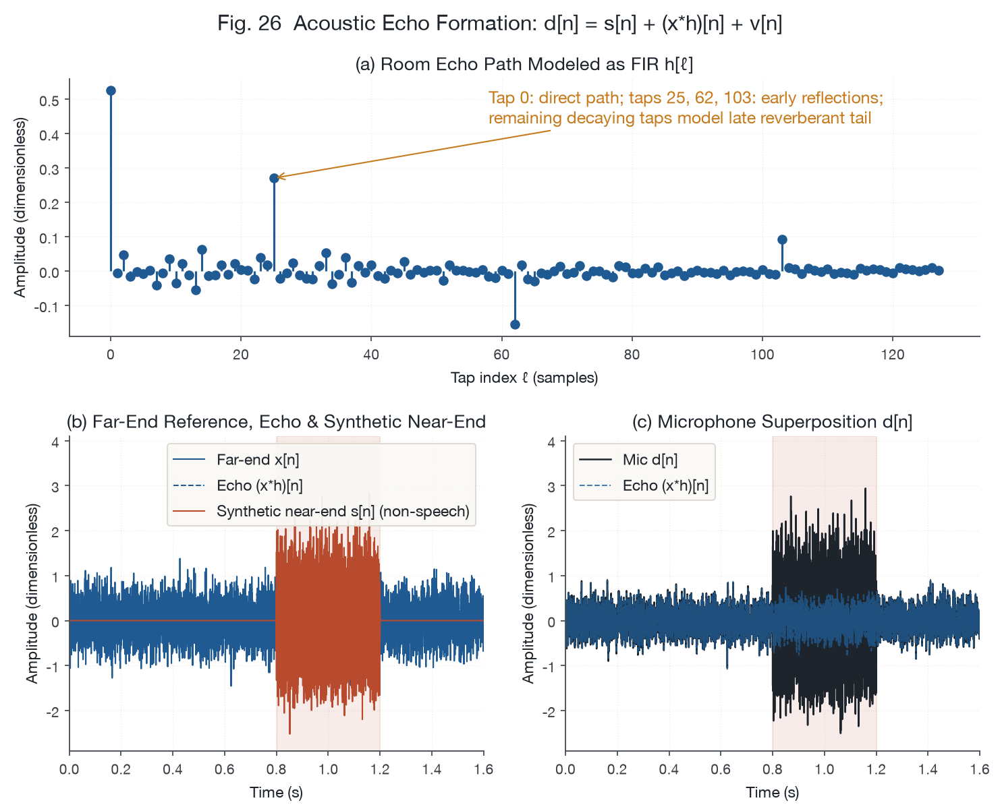

Inspecting the three panels of Figure 26 builds direct time-domain intuition for Eq. (6-1):

- Figure 26(a) plots the discrete tap index $\ell$ (in samples) on the horizontal axis against the dimensionless path coefficients $h[\ell]$ on the vertical axis, showing in succession the direct-coupling main peak, several discrete early-reflection peaks, and an exponentially decaying late-reverberation tail;
- Figure 26(b) plots time (in $\mathrm{s}$) on the horizontal axis, comparing the far-end reference sequence $x[n]$, the true echo $y[n]$ convolved with and stretched out by the path in panel (a), and a white Gaussian near-end burst injected over the interval $0.8$–$1.2\ \mathrm{s}$;
- Figure 26(c) displays the composite waveform $d[n]$ superimposed at the microphone: far-end echo completely swamps the noise floor during single-talk segments and overlaps the near-end burst over $0.8$–$1.2\ \mathrm{s}$. The task of AEC is precisely to reconstruct $y[n]$ from the known reference $x[n]$ and subtract it from $d[n]$.

Before quoting any AEC performance metric, one must specify which call-activity regime the system occupies—decibel attenuation numbers reported in isolation from the acoustic scenario carry no physical meaning:

1. **Single-Talk Far-End (STFE)**: Only the loudspeaker plays out the far-end signal and $s[n]=0$; microphone energy is dominated by echo, making this regime suitable for driving filter convergence and measuring echo attenuation;
2. **Single-Talk Near-End (STNE)**: Only the local user speaks while the far-end reference is silent; an ideal AEC must pass the near-end speech completely intact;
3. **Double-Talk (DT)**: Far-end playback and local speech occur simultaneously. Because the residual $e[n]$ contains strong near-end speech $s[n]$, blindly continuing aggressive updates pulls the coefficients off course toward $s[n]$, while an overly aggressive post-suppressor risks clipping near-end word onsets; control strategies are treated in §6.4;
4. **Mutual Silence (Idle)**: Neither far-end nor near-end activity is present. The filter must not undergo random-walk drift under weak noise-floor excitation, nor should the post-suppressor and comfort-noise stage produce abrupt silence switching (see §6.8 and §6.11).

Hands-free full-duplex communication requires simultaneously suppressing residual echo during STFE and bounding near-end speech distortion during DT. During STFE when the noise floor lies far below the echo, the ratio of input power to output power is commonly used to approximate Echo Return Loss Enhancement (ERLE); evaluation protocols for double-talk segments and component ground-truth boundaries are detailed in §6.7.

Around this model, [Breining et al. (*IEEE Signal Processing Magazine*, 1999)](https://doi.org/10.1109/79.774933) summarized the engineering challenges of acoustic echo cancellation into four points:

1. **Long impulse responses**: Conference-room reverberation tails can span hundreds of milliseconds, requiring thousands of time-domain FIR taps—not only does the multiply-accumulate (MAC) load scale with $L$, but convergence under colored speech excitation also slows down markedly (§6.2 introduces partitioned frequency-domain architectures to break this compute bottleneck);
2. **Transducer nonlinearities**: Small-enclosure loudspeakers and amplifiers generate harmonic and intermodulation distortion at high playback volumes, falling outside the span of a linear FIR filter (see §6.3);
3. **Double-talk interference**: Near-end speech $s[n]$ enters the error signal directly, both inflating instantaneous gradient fluctuations during online updates and shifting the population optimum whenever any correlation exists with the reference (see §6.4 and the rigorous distinction in Exercise E06-21);
4. **Time-varying acoustic paths**: Walking talkers, opening doors, and room-temperature shifts continually alter the equivalent path $h_n[\ell]$, demanding agile tracking while safeguarding double-talk stability.

> **Sidebar: How Room-Temperature Drift Quietly Shifts Echo Taps.**
>
> The speed of sound in dry air varies with Celsius temperature $T$ approximately as $c\approx 331+0.61\,T\ (\mathrm{m/s})$. Each $1\ ^\circ\mathrm{C}$ rise increases sound speed by roughly $0.18\%$; a $10\ ^\circ\mathrm{C}$ rise (for instance, when air conditioning turns on or a device chassis warms up) alters sound speed by roughly $1.8\%$. Over a fixed $1\ \mathrm{m}$ propagation path, acoustic time-of-flight shortens from $1/343.2\approx 2.914\ \mathrm{ms}$ at $20\ ^\circ\mathrm{C}$ to $1/349.3\approx 2.863\ \mathrm{ms}$ at $30\ ^\circ\mathrm{C}$—arriving about $50.9\ \mu\mathrm{s}$ earlier, which at a $16\ \mathrm{kHz}$ sampling rate corresponds to a shift of $0.81$ sample intervals.
>
> Worse still, the direct sound and the $1\text{st}, 2\text{nd}, \ldots$ wall reflections travel distinct geometric path lengths: the longer the path of a late reflection, the larger its absolute delay shift, so the impulse response as a whole undergoes **time-axis stretching or compression** rather than a rigid $50.9\ \mu\mathrm{s}$ translation. Measurements in both [Elko, Diethorn & Gänsler (IWAENC 2003)](https://www.iwaenc.org/proceedings/2003/data/0025.pdf) and [*Frontiers in Signal Processing* (2024)](https://www.frontiersin.org/journals/signal-processing/articles/10.3389/frsip.2024.1426082/full) demonstrate that such imperceptible thermal drift suffices to render a factory-calibrated fixed filter ineffective, underscoring why online adaptation is an indispensable foundation of acoustic echo cancellation.

Before entering the derivations, two pairs of easily conflated physical concepts should be clarified:

The first pair is the **fundamental divide between digital waveform subtraction (AEC) and physical sound-field cancellation in air (ANC / in-cabin ICC)**. AEC subtracts the estimated replica $\hat y[n]$ from the microphone samples $d[n]$ inside a digital processor so that local loudspeaker playback is not transmitted back to the far-end caller, while listeners in the local room continue to hear the loudspeaker normally; whenever the replica's phase error exceeds $60^\circ$, complex subtraction can even cause residual energy to exceed the original echo (see Exercise E06-04). By contrast, Active Noise Control (ANC) radiates anti-phase acoustic waves into the air via a secondary loudspeaker, requiring the electronic control delay $\tau_{\mathrm{elec}}$ to remain strictly below the primary-minus-secondary acoustic time-of-flight difference $\tau_{\mathrm{acoust}}-\tau_{\mathrm{sec}}$ (often sub-millisecond) so that physical sound-pressure cancellation occurs before the primary noise wave reaches the ear canal; meanwhile, automotive In-Car Communication (ICC) picks up and amplifies the front-seat driver's voice for real-time playback over rear-cabin loudspeakers.

Under the ITU-T cabin communication standard **ITU-T P.1150**, end-to-end reinforcement latency for in-cabin sound reinforcement must be kept strictly within $\Delta_{\mathrm{Rx}}<15\ \mathrm{ms}$ (below the Haas fusion threshold): once the total loop delay $\tau_{\mathrm{loop}}$ grows excessive, the direct air-borne speech and the loudspeaker-reinforced wave arriving together at rear passengers' ears interfere constructively and destructively at periodic intervals $\Delta f=1/\tau_{\mathrm{loop}}$, producing metallic comb filtering or even closed-loop acoustic howling (for quantitative verification, see Exercise [E06-44](#e06-44))—physical acoustic interference that has already summed in the air before entering the human ear cannot be retroactively erased by a transmit-side digital AEC. In hear-through modes on in-ear headphones, where passive ear-tip leakage sums directly with electro-acoustic playback at the eardrum, the end-to-end latency ceiling tightens even further to the hundred-microsecond regime (see [Chapter 14 §14.10](14_spatial-wearable-arrays.md#sec-14-10)).

The second pair is the **division of labor between waveform subtraction and spectral-magnitude multiplication**. Because linear AEC holds the reference waveform $x[n]$, it estimates both the amplitude and phase of the echo and performs direct waveform subtraction, stripping away echo while preserving near-end speech even when both overlap in the same frequency bin. When an exact waveform reference is unavailable (for example, when suppressing unmodeled nonlinear residuals or unknown background noise), classical post-filtering (such as the Wiener post-filter in §5.7 and traditional NLP in §6.8) falls back on power-spectrum estimation and multiplies the mixed time–frequency coefficient by a real scalar gain in $[0,1]$—which attenuates echo and near-end speech within the same time–frequency tile in equal proportion. Multichannel complex filtering, complex masking, and deep filtering (§6.5) introduce additional cross-channel or cross-frame complex degrees of freedom and should be distinguished precisely by their respective mathematical operators.

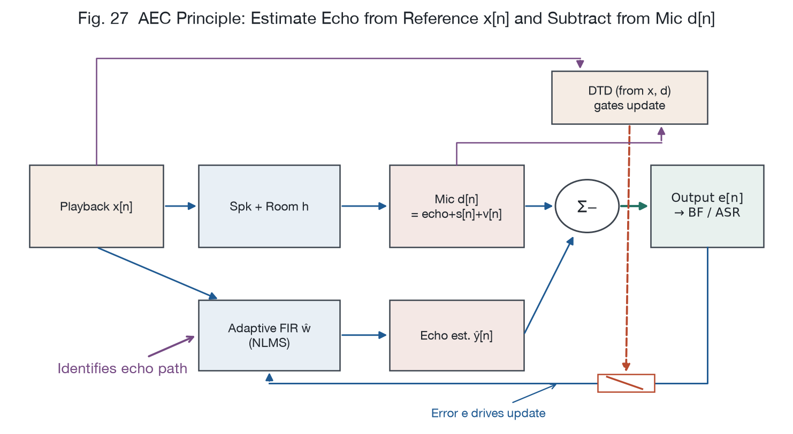

Figure 27 summarizes the standard signal flow of single-channel linear AEC: one branch of the far-end reference $x[n]$ traverses the physical loudspeaker-and-room chain to enter the microphone as true echo, while the parallel branch feeds a transversal adaptive filter $\hat{\vec w}[n]$ to synthesize the estimated echo $\hat y[n]$; the summer computes $e[n]=d[n]-\hat y[n]$ to perform digital subtraction, and the Double-Talk Detection (DTD) block at the top monitors the signals to freeze or slow down filter updates during double-talk.

#### 6.1.2 Linear Adaptive Filtering: NLMS Review

To track the unknown $h[\ell]$ online, we maintain a real adaptive weight column vector $\hat{\vec w}[n]\in\mathbb{R}^L$ of length $L$ (with entries $\hat w_0[n],\ldots,\hat w_{L-1}[n]$) and stack the current sample together with the past $L-1$ reference samples in **most-recent-sample-first** order as the column vector $\vec x[n]=[x[n],x[n-1],\ldots,x[n-L+1]]^\top$. With tap $0$ multiplying the newest sample $x[n]$, the vector inner product aligns index-for-index with the discrete convolution in Eq. (6-1). At each incoming sample $n$, we first compute the echo prediction and the a priori residual using the **pre-update** weights:

$$\begin{aligned}
\hat y[n]&=\hat{\vec w}^{\top}[n]\vec x[n],\\
e[n]&=d[n]-\hat y[n].
\end{aligned}\tag{6-2}$$

Under far-end single-talk ($s[n]=0$), weak background noise, and persistently exciting reference spectra, $e[n]$ directly reflects the path mismatch $(\vec h-\hat{\vec w}[n])^\top\vec x[n]$, so driving down residual power pushes $\hat{\vec w}[n]$ toward the true path $\vec h$. Conversely, observing a small $e[n]$ at a single isolated sample or under a single-tone reference does not prove that all $L$ taps have converged to their true values.

The most widely deployed time-domain baseline update rule in industry is the **Normalized Least Mean Squares (NLMS)** algorithm:

$$\begin{aligned}
\Delta\vec w[n]
&=\mu\frac{e[n]\vec x[n]}
          {\|\vec x[n]\|^2+\varepsilon},\\
\hat{\vec w}[n+1]&=\hat{\vec w}[n]+\Delta\vec w[n].
\end{aligned}\tag{6-3}$$

In Eq. (6-3), $\|\vec x[n]\|^2=\vec x^\top[n]\vec x[n]$ (i.e., $\sum_{\ell=0}^{L-1}x^2[n-\ell]$) is the instantaneous energy of the current sliding reference window, $\mu$ is the dimensionless step-size factor, and $\varepsilon>0$ is a positive regularization floor that prevents division by zero during reference silence (if a hand-worked example sets $\varepsilon=0$ for arithmetic simplicity, updates must be explicitly skipped whenever $\|\vec x[n]\|^2=0$ to avoid $0/0$). Regarding notation conventions, classical adaptive-filtering derivations often write the adaptive tap vector simply as $\vec w[n]$ (such as partition weights $\vec w_p$, affine projection weights, and RLS weights $\vec w_n$ in §6.2) and the predicted output as $y[n]$; in Eqs. (6-2)–(6-3) as well as selected block diagrams and error-axis labels, hats ($\hat{\vec w}[n]$, $\hat y[n]$) are used equivalently to distinguish online estimates from the true echo path $\vec h$ and true echo component $y[n]$ of Eq. (6-1).

Equation (6-3) can be derived step by step from the instantaneous squared error (for vector gradients, orthogonal hyperplane projections, and iterative optimization foundations, see [Chapter 0 §0.5](00_math-foundations.md#sec-0-5)):

1. **Define the instantaneous objective and gradient**: Take the current squared a priori residual $J[n]=e^2[n]=(d[n]-\hat{\vec w}^\top[n]\vec x[n])^2$ as the instantaneous cost. Treating $\vec x[n]$ and $d[n]$ as given constants and applying the chain rule with respect to the column vector $\hat{\vec w}[n]$ yields the instantaneous gradient $\nabla_{\hat{\vec w}}J[n]=2\,e[n]\,(-\vec x[n])$, which simplifies to $-2\,e[n]\vec x[n]$;
2. **Steepest descent along the negative gradient (LMS)**: Absorbing the constant factor $2$ into a positive step size $\mu'$ and stepping along the negative gradient gives $\hat{\vec w}[n+1]=\hat{\vec w}[n]+\mu'\,e[n]\vec x[n]$, the classical Least Mean Squares (LMS) algorithm;
3. **Normalize by input energy (NLMS)**: The raw LMS increment scales with the square of the reference amplitude—turning playback volume up by $10\times$ inflates the effective step size by $100\times$ and readily triggers divergence, whereas turning volume down stalls convergence. Setting $\mu'=\mu/(\|\vec x[n]\|^2+\varepsilon)$ divides out the quadratic input-scale dependence using the current window energy, yielding NLMS in Eq. (6-3).

    To see the geometric scale of the dimensionless step size $\mu$, assume $\|\vec x[n]\|^2\gg\varepsilon$ and substitute the updated weights $\hat{\vec w}[n+1]$ back into the observation at the **same sample instant** to evaluate the a posteriori residual $e'[n]$:

    $$\begin{aligned}
    e'[n]&=d[n]-\hat{\vec w}^{\top}[n+1]\vec x[n]\\
    &=d[n]-\bigl(\hat{\vec w}[n]+\Delta\vec w[n]\bigr)^{\top}\vec x[n]\\
    &=e[n]-\mu\,e[n]
      \frac{\|\vec x[n]\|^2}{\|\vec x[n]\|^2+\varepsilon}\\
    &=e[n]\left(1-\mu
      \frac{\|\vec x[n]\|^2}{\|\vec x[n]\|^2+\varepsilon}\right).
    \end{aligned}$$

    When $\varepsilon\ll\|\vec x[n]\|^2$, the parenthesized factor reduces to $1-\mu$, giving $e'[n]\approx(1-\mu)\,e[n]$. Hence $0<\mu<2$ guarantees strict contraction of the single-step a posteriori residual magnitude ($|1-\mu|<1$); $\mu=1$ drives the a posteriori error on this single sample to zero in one step (corresponding, in the noiseless single-talk case, to orthogonal projection onto the hyperplane $\vec x^\top[n]\vec w=d[n]$, though in the presence of noise or double-talk it absorbs interference wholesale into the weights); $\mu=1.8$ flips the sign of the a posteriori error while retaining $80\%$ of its magnitude ($e'[n]\approx -0.8\,e[n]$); and $\mu=2$ marks the critical boundary of non-decaying single-step magnitude. Because real speech is colored, noisy, and subject to double-talk transitions, practical step sizes are typically calibrated in the range $0.1$–$0.6$ alongside double-talk control.

#### Worked Example 6-1: One-Step Hand Calculation of NLMS

**Inputs and conventions**: Consider an $L=3$ tap filter with current reference regression vector $\vec x[n]=[1,\ 0.5,\ -0.5]^\top$, all-zero initial weights $\hat{\vec w}[n]=[0,\ 0,\ 0]^\top$, current microphone sample $d[n]=0.8$, step size $\mu=0.5$, and negligible regularization on this nonzero-energy window ($\varepsilon=0$). Step through Eqs. (6-2)–(6-3):

1. **A priori prediction and a priori residual**: With zero initial weights, the echo replica $\hat y[n]=\hat{\vec w}^\top[n]\vec x[n]$ expands to $0\times 1+0\times 0.5+0\times(-0.5)=0$, so the causal output a priori residual is $e[n]=d[n]-\hat y[n]=0.8$.
2. **Window-energy denominator**: $\|\vec x[n]\|^2=1^2+0.5^2+(-0.5)^2=1+0.25+0.25=1.5$.
3. **Weight increment and coefficient update**: Substituting into Eq. (6-3), the update direction is strictly parallel to the current input vector $\vec x[n]$:

    $$\begin{aligned}
    \Delta\vec w[n]
    &=\frac{0.5\times 0.8}{1.5}\begin{bmatrix}1\\0.5\\-0.5\end{bmatrix}
    =\frac{4}{15}\begin{bmatrix}1\\0.5\\-0.5\end{bmatrix}
    \approx\begin{bmatrix}0.267\\0.133\\-0.133\end{bmatrix},\\
    \hat{\vec w}[n+1]&=\hat{\vec w}[n]+\Delta\vec w[n]
    =\begin{bmatrix}4/15\\2/15\\-2/15\end{bmatrix}
    \approx\begin{bmatrix}0.267\\0.133\\-0.133\end{bmatrix}.
    \end{aligned}$$

4. **Inspect the a posteriori residual on the same observation**: Using the exact fractions to evaluate the a posteriori prediction gives

    $$\begin{aligned}
    \hat y'[n]&=\hat{\vec w}^\top[n+1]\vec x[n]\\
    &=\frac{4}{15}\times 1+\frac{2}{15}\times 0.5
      +\left(-\frac{2}{15}\right)\times(-0.5)\\
    &=\frac{4+1+1}{15}=\frac{6}{15}=0.4,
    \end{aligned}$$

    so the a posteriori residual is $e'[n]=0.8-0.4=0.4=(1-0.5)\,e[n]$, halved exactly.

**Re-verifying the halving law on a second input**: Replace the input with $\vec x[n]=[0.8,-0.4,0.4]^\top$, $d[n]=0.6$, $\hat{\vec w}[n]=\vec 0$, and $\mu=0.5$. Now the window energy is $\|\vec x[n]\|^2=0.64+0.16+0.16=0.96$, and the weight increment is $(0.5\times 0.6/0.96)\,\vec x[n]=0.3125\,\vec x[n]$, yielding $[0.25,-0.125,0.125]^\top$. Substituting back into the same input gives

$$\begin{aligned}
\hat y'[n]&=0.25\times 0.8+(-0.125)\times(-0.4)+0.125\times 0.4\\
&=0.2+0.05+0.05=0.3,
\end{aligned}$$

and the a posteriori residual $e'[n]=0.6-0.3=0.3$ again equals $(1-\mu)\,e[n]$ exactly. This confirms that the single-step a posteriori scaling factor $1-\mu$ is dictated by the orthogonal-projection geometry rather than specific numerical values. Yet one must also note that a single update eliminates only the error component along the one-dimensional direction $\vec x[n]$, leaving the remaining $L-1$ orthogonal subspace directions untouched—subsequent input vectors spanning diverse directions are required to supply gradients that identify the complete path.

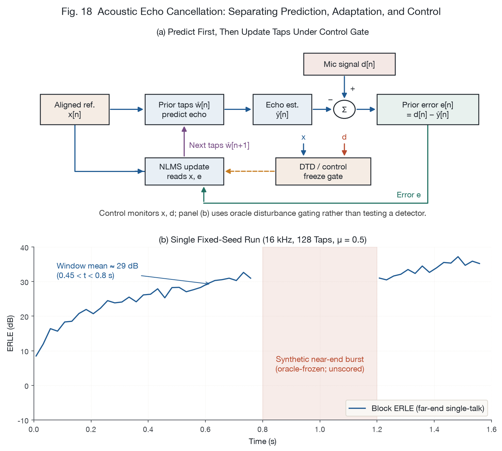

Reading Figures 18, 28, and 29 together connects causal execution order, coefficient mismatch, and double-talk protection in NLMS. Starting with the two panels of Figure 18:

- **Figure 18(a)**: Laid out in strict single-sample causal dataflow order—starting from time-aligned reference $\vec x[n]$ and microphone observation $d[n]$, the old weights first produce $\hat y[n]$ and the a priori residual $e[n]$, after which the DTD switch decides whether $e[n]$ is routed back to update the weights;
- **Figure 18(b)**: Plots time (in $\mathrm{s}$) on the horizontal axis against block-evaluated $\mathrm{ERLE}$ (in $\mathrm{dB}$) on the vertical axis, simulated with $\mu=0.5$ and most-recent-sample-first regression vectors; the annotated mean is the arithmetic mean of per-block $\mathrm{dB}$ values across the far-end single-talk window $0.45<t<0.8\ \mathrm{s}$ under a fixed random seed (note that the arithmetic mean of blockwise $\mathrm{dB}$ values and the logarithm of the whole-window energy ratio are distinct statistics—see the counterexample in Exercise E06-31), while the pink-shaded interval simulates double-talk with frozen updates and is excluded from $\mathrm{ERLE}$.

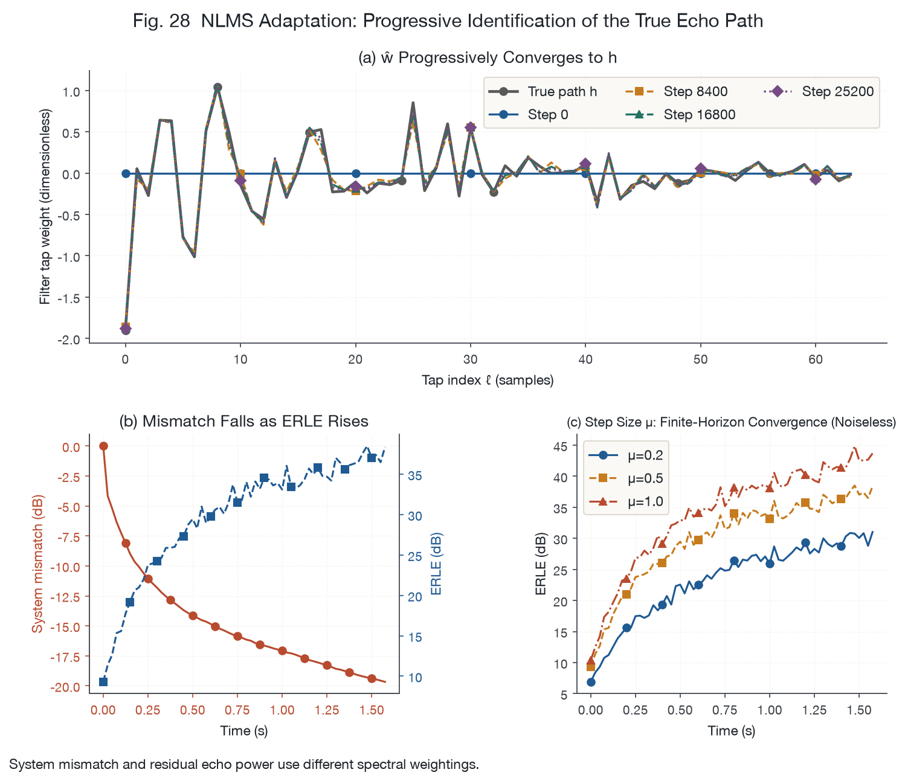

Next examine Figure 28 (a noiseless, interference-free pure linear path-matching experiment):

- Figure 28(a) plots tap index $\ell$ on the horizontal axis and dimensionless filter coefficients on the vertical axis; as iterations progress (from the dark-blue solid curve to the purple dotted curve), the profile of $\hat{\vec w}[n]$ gradually conforms to the gray true impulse response $h[\ell]$;
- Figure 28(b) uses dual vertical axes to co-plot the **normalized coefficient mismatch in dB**, $10\log_{10}(\lVert\hat{\vec w}[n]-\vec h\rVert_2^2 / \lVert\vec h\rVert_2^2)$ (left axis, red solid curve, dropping from $0\ \mathrm{dB}$ to roughly $-20\ \mathrm{dB}$), alongside $\mathrm{ERLE}$ (right axis, blue dashed curve, in $\mathrm{dB}$). Although the two curves trend in opposite directions, they are not exact mirror images of equal magnitude: denoting the tap-error vector by $\tilde{\vec w}[n]=\vec h-\hat{\vec w}[n]$, under colored reference excitation the residual echo power equals $\tilde{\vec w}^\top[n]\mathbf R_{xx}\tilde{\vec w}[n]$—weighted by the input autocorrelation matrix $\mathbf R_{xx}$. A minimal two-tap example makes this transparent: suppose the covariance matrix of a zero-mean regression vector is $\mathbf R_{xx}=\operatorname{diag}(100,1)$, and compare two path-error vectors $[0.1,0]^\top$ and $[0,0.1]^\top$. Both have Euclidean norm $0.1$ (identical relative mismatch in dB), yet the former aligns with the high-energy direction to yield residual echo power $100\times 0.1^2=1$, whereas the latter aligns with the weak direction to yield only $1\times 0.1^2=0.01$—a full $20\ \mathrm{dB}$ gap;
- Figure 28(c) compares convergence trajectories across step sizes $\mu$ over a finite observation window: without observation noise, values of $\mu$ closer to $1$ descend more steeply; in real noisy systems, however, an overly large $\mu$ continuously folds noise floor into the weights, inflating steady-state misadjustment.

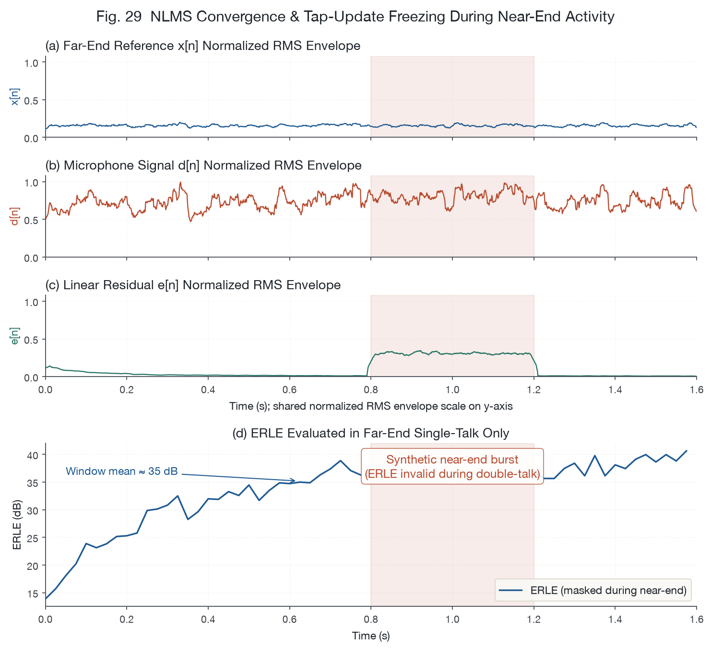

Finally, inspect Figure 29. The upper three rows plot short-time RMS envelopes of the reference $x[n]$, microphone signal $d[n]$, and residual $e[n]$ on a unified vertical scale; during the pink-shaded interval, white Gaussian near-end interference is injected and filter weights are frozen using the known ground-truth interval mask. Within the pink region, the dominant component of $e[n]$ is precisely the near-end signal that ought to be preserved; computing $\mathrm{ERLE}$ from the total microphone-to-residual power ratio there would misinterpret normal near-end speech transmission as an echo-cancellation collapse, so the bottom panel intentionally leaves $\mathrm{ERLE}$ blank across that interval. Once the pink burst ends, the freeze-protected filter immediately resumes deep echo cancellation without slow reconvergence.

#### Step Size, Regularization, and Persistent Excitation

In practical tuning, $\mu$, $\varepsilon$, and the spectral span of the reference signal jointly determine whether NLMS converges reliably to the true physical path.

The step size $\mu$ governs the trade-off between **convergence speed** and **noise robustness**: increasing $\mu$ accelerates cold-start adaptation and reconvergence after abrupt path changes, whereas under noisy observations or un-frozen double-talk misses, a large step size writes substantially more interference into the taps.

The regularization term $\varepsilon$ must match the physical dimension of the window energy $\|\vec x[n]\|^2$ in the denominator (squared signal amplitude): whether chosen as a fixed absolute energy floor or scaled proportionally with smoothed reference power $P_x$ via $\varepsilon=\eta P_x$ (in which case only the proportionality constant $\eta$ is dimensionless), switching signal representation from floating-point $[-1,1)$ to signed 16-bit integers $[-32768,32767]$ scales energy by $32768^2\approx 1.07\times 10^9$, so an unscaled absolute constant $\varepsilon$ must never be copied across representations. Calibration should sweep across digital silence, low-level playback, and nominal playback levels to verify both zero-division stability during silence and unthrottled adaptation during quiet playback.

**Why does a narrowband reference leave a multi-tap filter unable to learn the full path?** From Step 3 of Worked Example 6-1, NLMS adjusts weights only along $\vec x[n]$ at each sample; uniquely determining all $L$ taps in the long-term average sense requires the normal equation $\mathbf R_{xx}\vec w=\vec r_{xd}$ (with $\mathbf R_{xx}=\mathbb{E}[\vec x[n]\vec x^\top[n]]$) to be full-rank and well-conditioned—the condition known as **persistent excitation**. If the far end plays only a steady real sinusoid $x[n]=A\cos(\Omega_0 n+\varphi)$ at $\Omega_0\notin\{0,\pi\}$, all lagged sequences at arbitrary instants are spanned linearly by the two basis functions $\cos(\Omega_0 n)$ and $\sin(\Omega_0 n)$ alone, so $\operatorname{rank}(\mathbf R_{xx})=2$: as soon as $L\ge 3$, the autocorrelation matrix is strictly singular, infinitely many distinct tap vectors cancel this single tone to zero, and echo immediately leaks through the moment far-end audio switches to wideband speech (see Worked Example 6-5).

Even if the reference is not a discrete pure tone, but rather a bandlimited stationary random process with flat power spectral density over a narrow continuous digital angular-frequency band $[-b,b]\subset[-\pi,\pi]$ ($b>0$) and strictly zero out-of-band power, the autocorrelation matrix—though mathematically full-rank—becomes severely ill-conditioned as bandwidth narrows. We can derive this classical Fourier duality relation explicitly:

Normalize the variance of the zero-mean stationary real process $x[n]$ to $r[0]=\mathbb{E}[x^2[n]]=1$. For the Inverse Discrete-Time Fourier Transform (IDTFT) to integrate to $1$ at zero lag, its constant power spectral density over $\Omega_{\mathrm{d}}\in[-b,b]$ must be $S_{xx}(\Omega_{\mathrm{d}})=\pi/b$ (with $S_{xx}(\Omega_{\mathrm{d}})=0$ for $b<|\Omega_{\mathrm{d}}|\le\pi$). Evaluating the autocorrelation sequence $r[k]=\mathbb{E}[x[n]x[n-k]]$ at integer lag $k$ via the Wiener–Khinchin theorem gives

$$\begin{aligned}
r[k]&=\frac{1}{2\pi}\int_{-\pi}^{\pi}
      S_{xx}(\Omega_{\mathrm{d}})\,
      e^{\mathrm{j}\Omega_{\mathrm{d}} k}\,\mathrm{d}\Omega_{\mathrm{d}}\\
&=\frac{1}{2\pi}\int_{-b}^{b}\frac{\pi}{b}
  e^{\mathrm{j}\Omega_{\mathrm{d}} k}\,\mathrm{d}\Omega_{\mathrm{d}}\\
&=\frac{e^{\mathrm{j}kb}-e^{-\mathrm{j}kb}}{\mathrm{j}2kb}
=\frac{\sin(kb)}{kb}
=\operatorname{sinc}\!\left(\frac{kb}{\pi}\right),\quad k\neq 0,
\end{aligned}$$

with the continuous limit $r[0]=1$. Consequently, for an $L=3$ tap regression vector $\vec x[n]=[x[n],x[n-1],x[n-2]]^\top$, the $3\times 3$ real symmetric Toeplitz autocorrelation matrix (whose $(i,j)$ entry is $r[i-j]$) takes the explicit form

$$\mathbf R_{xx}=\begin{bmatrix}
1 & \dfrac{\sin b}{b} & \dfrac{\sin(2b)}{2b} \\
\dfrac{\sin b}{b} & 1 & \dfrac{\sin b}{b} \\
\dfrac{\sin(2b)}{2b} & \dfrac{\sin b}{b} & 1
\end{bmatrix}.$$

This $3\times 3$ matrix exposes the root cause of narrowband ill-conditioning at a glance: as the passband half-width $b$ shrinks, $\sin(kb)/(kb)\approx 1-(kb)^2/6$ approaches $1$, causing all three columns of the matrix to collapse toward $[1,1,1]^\top$ as adjacent samples become nearly collinear. Evaluating the eigenvalues at three representative bandwidths confirms this sharp progression:

- Wideband half-band excitation ($b=\pi/2$): $r[1]=2/\pi\approx 0.6366$, $r[2]=0$, minimum eigenvalue $\lambda_{\min}\approx 0.0997$, and spectral condition number $\kappa_2(\mathbf R_{xx})=\lambda_{\max}/\lambda_{\min}\approx 19$—all three eigen-directions converge briskly;
- Narrowband excitation ($b=\pi/8$): $r[1]\approx 0.9745$, $r[2]\approx 0.9003$, $\lambda_{\min}$ plunges to $3.57\times 10^{-4}$, and the condition number jumps to roughly $8134$;
- Ultra-narrowband excitation ($b=\pi/32$): $r[1]\approx 0.9984$, $r[2]\approx 0.9936$, $\lambda_{\min}$ shrinks to $1.38\times 10^{-6}$, and the condition number surges to roughly $2.17\times 10^6$!

Although all three matrices have strictly positive determinants (invertible in exact arithmetic), a condition number in the millions stretches gradient-descent time constants along weak eigen-directions by six orders of magnitude while severely amplifying tiny observation noise along high-frequency differential modes over finite speech segments. This is precisely why field debugging first uses white noise or broadband sweeps to verify hardware continuity and peak achievable ERLE before switching to real program material to evaluate convergence speed (see Exercises E06-37 and E06-38).

Finally, let us resolve a classic beginner's puzzle: **Does a single unit impulse $x=[1,0,0,\ldots]$ count as persistent excitation?** As this solitary nonzero sample slides across the $L$ tap positions, the regression vector $\vec x[n]$ visits every one of the $L$ standard orthonormal basis vectors $\vec e_0,\vec e_1,\ldots,\vec e_{L-1}$ (where $\vec e_\ell$ has $1$ at entry $\ell$ and $0$ elsewhere), so the sum of outer-product sample matrices equals the identity matrix $\mathbf I_L$—no spatial direction is missing. Yet each basis direction appears **only once** along the entire time axis: starting from zero initial weights with step size $\mu=0.5$ (neglecting tiny $\varepsilon$), each tap updates to half its true value ($0.5\,h[\ell]$) on its single active sample, after which the impulse exits the window, input energy drops to zero, zero-energy protection halts further updates, and the weights remain frozen halfway to the truth forever (see Exercise E06-01). Spanning the full space is thus only a necessary condition; iterative adaptation also requires **sustained, repeated excitation** across all directions to wear down initial errors step by step.

### 6.2 Engineered Adaptation: Frequency-Domain, Subband, Proportionate, Affine Projection, RLS, and Kalman

When room reverberation is long or the sampling rate rises to $48\ \mathrm{kHz}$, running sample-by-sample time-domain NLMS directly hits two walls at once: excessive multiply-accumulate load and sluggish convergence on colored speech. Following a clear engineering progression, this section dissects six classes of enhancements: §6.2.1–§6.2.2 partition long convolutions into short blocks accelerated by FFTs (PBFDAF); §6.2.3 explains why subband decomposition introduces cross-band aliasing coupling terms; §6.2.4 concentrates update budget onto sparse dominant peaks via proportionate step sizes (IPNLMS); the [Affine Projection subsection](#sec-u-204b533044) then solves jointly over the $K$ most recent observation directions to remove local correlation; §6.2.5 maintains the inverse exponentially weighted sample correlation matrix via Recursive Least Squares (RLS); and §6.2.6 introduces Kalman filtering (FDKF / PBFDKF) to model path drift and double-talk observation uncertainty simultaneously.

First tally the multiply-accumulate cost of the time-domain baseline. For length-$L$ time-domain NLMS, each sample requires $L$ multiplications for convolution prediction $\hat{\vec w}^\top[n]\vec x[n]$ and $L$ multiplications for weight update $\Delta\vec w[n]$; naively recomputing $\|\vec x[n]\|^2$ adds another $L$ multiplications, totaling roughly $3L$ multiplications per sample. Using the sliding-window recursion $p_n=p_{n-1}+x^2[n]-x^2[n-L]$ reduces denominator energy tracking to $O(1)$ operations (long-running floating-point implementations must initialize from zero and periodically recompute the exact sum of squares to prevent rounding drift), yet filtering and updating still rigidly consume $2L$ multiplications. For instance, with $L=3$ and input sequence $1,2,3,4$, the prior window energy is $1^2+2^2+3^2=14$, and shifting in $4$ while shifting out $1$ gives $14+4^2-1^2=29$—matching $2^2+3^2+4^2=29$ identically while leaving the $2L$ prediction-and-update MACs unchanged.

Translating into concrete device budgets: at narrowband $8\ \mathrm{kHz}$ with $L=1024$ ($128\ \mathrm{ms}$ span), naive counting requires $3072\times 8000\approx 24.58\text{ million}$ multiplications/s and recursive-energy core operations require roughly $16.38\text{ million}$/s; at $48\ \mathrm{kHz}$ with $L=4096$ ($\approx 85.3\ \mathrm{ms}$ span), standard in HD conferencing endpoints, single-channel time-domain core MACs surge to nearly $400\text{ million}$/s, becoming prohibitive across multiple microphones. This directly motivates the industry-wide shift toward partitioned frequency-domain and subband architectures.

#### 6.2.1 PBFDAF: From Long Echo Paths to Block-by-Block Updates

Transforming a $4096$-tap echo path into the frequency domain in one piece via single-block Frequency-Domain Adaptive Filtering (FDAF) would require accumulating $4096$ new samples before executing each block convolution—incurring a $256\ \mathrm{ms}$ buffering delay at $16\ \mathrm{kHz}$ alone, which is unacceptable for interactive calls. **Partitioned-Block Frequency-Domain Adaptive Filtering (PBFDAF)** adopts the divide-and-conquer principle of Multidelay Block Frequency-Domain filtering (MDF; [Soo & Pang, 1990](https://doi.org/10.1109/29.103078)): slice the length-$L$ time-domain impulse response into $P=\lceil L/N\rceil$ short partitions of length $N$, wait for only $N$ new samples at a time (e.g., $N=64$ or $128$, just $4$ or $8\ \mathrm{ms}$), and execute overlap-save linear convolution via length-$2N$ Fast Fourier Transforms (FFTs). Whenever $L$ is not an integer multiple of $N$, trailing positions in the final partition beyond $L$ are permanently zero-padded and do not represent learnable physical taps.

First fix block, partition, and frequency-bin indices precisely. With negative-time samples set to zero, write the $m$-th incoming block of $N$ reference samples as the row vector $b_m=[x[mN],\ldots,x[mN+N-1]]$; concatenate the trailing $N$ historical samples from the previous block with the current block to form the length-$2N$ overlapping input window $u_m=[b_{m-1},b_m]$, and take its $2N$-point forward transform $X(k,m)=\operatorname{FFT}_{2N}(u_m)$ for frequency bins $k=0,\ldots,2N-1$. Simultaneously, pad the $p$-th time-domain path segment $h_p=[h[pN],\ldots,h[pN+N-1]]$ ($p=0,\ldots,P-1$) with $N$ trailing zeros to $[h_p,0_N]$, denoting the corresponding frequency-domain adaptive weights by $W_p(k,m)$. The pairing between partitions and historical reference spectra is summarized below:

| Position Along Time-Domain Path | Reference Spectrum Used | Physical Contribution to Current Block Output |
|---|---|---|
| $p=0$, taps $0,\ldots,N-1$ | $X(k,m)$ | Direct-path and early-reflection echo from current and immediately adjacent reference samples |
| $p=1$, taps $N,\ldots,2N-1$ | $X(k,m-1)$ | Echo generated by reference history delayed by $1$ partition |
| $p=P-1$, final $N$ positions | $X(k,m-P+1)$ | Long reverberation tail; trailing positions beyond $L$ in a short final partition remain fixed at zero |

This table reveals the core mechanism behind partitioned speedup: the $p$-th frequency-domain partition represents the $p$-th slice of time-domain taps, and the spectrum multiplying it is precisely $X(k,m-p)$—already computed $p$ blocks earlier and sitting in a delay line! Each time a new block arrives, the engine computes **only one** forward FFT on the newest window $u_m$ and shifts older spectra one slot down the delay line for direct reuse, eliminating redundant transforms of historical blocks. This imposes an ironclad state-management rule: **even when weight updates are frozen during double-talk, shifting the reference-spectrum delay line must never be paused**, or subsequent echo predictions will lose time alignment with actual loudspeaker playback.

**Predict the valid half-block first, then form the a priori residual.** When block $m$ arrives, accumulate the per-bin products across all $P$ partitions using pre-update weights, $Q_m(k)=\sum_{p=0}^{P-1}W_p(k,m)X(k,m-p)$, and apply a $2N$-point Inverse Fast Fourier Transform (IFFT) to obtain the length-$2N$ circular convolution sequence $q_m$. By the overlap-save theorem, the first $N$ samples of $q_m$ are corrupted by circular wrap-around artifacts and must be discarded; only the last $N$ samples equal the exact linear convolution output $\hat y_m$ over the current block. Indexing within-block samples by $r=0,\ldots,N-1$ (and suppressing the shared bin argument $k$ in the first two lines via $W_{p,m}=W_p(k,m)$ and $X_{m-p}=X(k,m-p)$), this causal prediction pipeline reads:

$$\begin{aligned}
Q_m&=\sum_{p=0}^{P-1}W_{p,m}X_{m-p},\\
q_m&=\operatorname{IFFT}_{2N}(Q_m),\\
\hat y_m[r]&=q_m[N+r],\\
e_m[r]&=d_m[r]-\hat y_m[r].
\end{aligned}\tag{6-4}$$

Provided each partition's frequency-domain weights $W_p(k,m)$ originate from a time-domain sequence whose first $N$ entries (or first $L-(P-1)N$ entries in a short final partition) hold valid taps and whose second half is zero-padded, the second half-block $\hat y_m$ extracted in Eq. (6-4) is algebraically identical to direct length-$L$ time-domain FIR convolution.

**Zero-padding the first half-block is equally mandatory when forming the error spectrum.** Once the length-$N$ valid a priori residual $e_m$ is obtained, its first $N$ positions must be explicitly zero-padded to $[0_N,e_m]$ before computing $E(k,m)=\operatorname{FFT}_{2N}([0_N,e_m])$. Taking a shortcut by subtracting the full circular-convolution spectrum $Q_m$ directly from the observation spectrum lets discarded wrap-around terms from the first half-block leak into the frequency-domain error and corrupt the gradient (a complete matrix proof follows in §6.2.2). [Shynk (*IEEE Signal Processing Magazine*, 1992, §IV)](https://course.ece.cmu.edu/~ece792/handouts/Shynk92.pdf) systematically compares these overlap-save valid-region and gradient-constraint variants.

Asymptotically, per-block prediction and correlation traverse all $P=\lceil L/N\rceil$ partitions: without time-domain gradient constraints, the core per-sample complexity scales as $O(\log N + L/N)$; enforcing strict valid-tap projection on every partition at every block ("IFFT to time domain, zero the second half, FFT back to frequency domain") adds $O((L/N)\log N)$ transform work. Exact constant factors depend on real half-spectrum conjugate-symmetry exploitation, power smoothing, and constraint scheduling (see [KU Leuven DSP-CIS Lecture Notes, Chapter 13](https://homes.esat.kuleuven.be/~dspuser/DSP-CIS/2018-2019/material/chapter13.pdf)).

#### Worked Example 6-2: Multiplication Count for Selected Core Operators in PBFDAF

**Inputs and conventions**: Set total filter length $L=1024$, block size $N=128$, and sampling rate $8\ \mathrm{kHz}$, comparing sample-by-sample time-domain NLMS against PBFDAF with $P=L/N=8$ partitions and FFT size $2N=256$ in terms of real multiplications for **selected core operators** (illustrating order-of-magnitude complexity reduction rather than wall-clock runtime of optimized real-FFT libraries or complete firmware).

**Time-domain NLMS benchmark**: $L$ multiplications/sample for filtering plus $L$ for weight updating; naive window-energy recomputation adds $L$ for $3L=3072$ real multiplications/sample, whereas sliding-window energy recursion leaves $2L=2048$ core real multiplications/sample.

**Blockwise PBFDAF breakdown**: Once $N=128$ new reference samples arrive, each block executes:

1. $1$ forward $256$-point transform on the concatenated reference window $u_m$, while spectra of the $7$ older partitions shift down the cache for free;
2. $8$ elementwise complex vector multiplications of length $256$ summed across partitions, followed by $1$ inverse $256$-point FFT to extract the second-half prediction $\hat y_m$;
3. $1$ forward $256$-point FFT on the zero-padded valid error $[0_{128},e_m]$, followed by $8$ length-$256$ elementwise complex products with conjugated partition reference spectra to form frequency-domain update directions;
4. If strict per-partition time-domain gradient projection is enabled, each partition requires $1$ IFFT to zero out the trailing $128$ invalid lags plus $1$ FFT back to the frequency domain ($2P=16$ extra transforms); unconstrained PBFDAF omits Step 4, while alternating partial-constraint schemes amortize it proportionally.

For transparent paper-and-pencil accounting without real-signal half-spectrum folding (industrial real FFTs store only $N+1=129$ unique bins, roughly halving multiplications), count each full $2N=256$-point complex FFT/IFFT as $4N\log_2(2N)=4\times 128\times 8=4096$ real multiplications and each $256$-bin complex product as $256\times 4=1024$ real multiplications:

- **Unconstrained core operations**: $3$ transforms plus $2\times 8$ complex spectral products per block give $3\times 4096 + 16\times 1024 = 12288+16384=28672$ multiplications/block, or $28672/128 = 224$ per sample;
- **All-partition constrained core operations**: Adding $16$ constraint transforms ($16\times 4096=65536$/block) totals $94208$/block, or $94208/128 = 736$ per sample.

Explicitly recomputing $|X|^2=(\operatorname{Re} X)^2+(\operatorname{Im} X)^2$ across all $8$ partitions at every block (as done for clarity in our teaching code) adds $2\times 256\times 8=4096$ real multiplications/block ($32$/sample), raising the two totals to $256$ and $768$ per sample (excluding additions, divisions, and step-size scaling; for diagnostic visibility, the teaching code also runs an extra IFFT to export candidate taps even in unconstrained mode). Comparing core MAC terms alone, $224$ and $736$ reduce the $3072$ count of naive time-domain NLMS by factors of roughly $13.7\times$ and $4.17\times$ (or $9.1\times$ and $2.8\times$ relative to recursive-energy $2048$). Note that this speedup is relative to **sample-by-sample time-domain NLMS**; compared against a "frequency-domain multi-tap NLMS" sharing identical block size, partition count, and constraint schedule, both execute the exact same frequency-domain operators with no further speedup (see [MathWorks `dsp.FrequencyDomainAdaptiveFilter` documentation](https://www.mathworks.com/help/dsp/ref/dsp.frequencydomainadaptivefilter-system-object.html) for taxonomy of partitioned and constrained modes).

**Trade-off between block length and buffering latency**. At $N=128$ and $8\ \mathrm{kHz}$, gathering one new block takes $128/8000=16\ \mathrm{ms}$; crucially, because the first half of the $2N=256$-point FFT comes from the already-arrived previous block, **no extra $16\ \mathrm{ms}$ of future lookahead is needed**. End-to-end system latency adds audio capture/render buffering and OS thread scheduling on top of block accumulation. Fixing total span $L=4096$ at $16\ \mathrm{kHz}$ ($256\ \mathrm{ms}$ coverage), varying $N$ trades off single-block buffering wait against partition traversal count:

| New Block $N$ (samples) | Partitions $P$ | FFT Size $2N$ | New-Data Wait | State / Latency Interpretation |
|---:|---:|---:|---:|---|
| 64 | 64 | 128 | 4 ms | Short block-gathering wait, but traverses 64 partitions of MACs and cache |
| 128 | 32 | 256 | 8 ms | Standard latency–compute sweet spot for real-time voice communication |
| 256 | 16 | 512 | 16 ms | Halves partition count, but extends block-gathering wait to 16 ms |

Real hardware selection must benchmark block wait within the complete electro-acoustic loop budget—larger $N$ does not automatically guarantee lower wall-clock latency.

#### Worked Example 6-3: Two Samples per Block—Why Discard the First Half-Block?

**Inputs and conventions**: Choose minimal partition dimensions $N=2$, $P=2$ (total length $L=4$), fixed path $h=[1,2\mid 3,4]$ (the vertical bar marks the partition boundary), and reference $x=[1,2,3,4]$ with zero negative-time samples. First compute direct time-domain linear convolution via Eq. (6-1) as ground truth:

- $y[0]=1\times 1=1$;
- $y[1]=1\times 2+2\times 1=4$;
- $y[2]=1\times 3+2\times 2+3\times 1=10$;
- $y[3]=1\times 4+2\times 3+3\times 2+4\times 1=20$, giving ground-truth output $[1,4,10,20]$.

Now reproduce the output block by block via overlap-save partitioned convolution:

1. **Block $m=0$ (output instants $n=0,1$)**: Concatenate two zero history samples with new block $[1,2]$ to form $u_0=[0,0,1,2]$, whose $4$-point circular convolution with zero-padded first partition $[1,2,0,0]$ yields $[0,0,1,4]$; historical spectrum $X_{-1}$ is zero, so discarding the first two samples $[0,0]$ retains $\hat y_0=[1,4]$, matching the first two ground-truth samples.
2. **Block $m=1$ (output instants $n=2,3$)**: Concatenate previous block $[1,2]$ with new block $[3,4]$ to form $u_1=[1,2,3,4]$.

    - First-partition branch ($p=0$): Full $5$-point linear convolution of $u_1=[1,2,3,4]$ with unpadded $[1,2]$ equals $[1,4,7,10,8]$; under $4$-point circular convolution, the fifth element $8$ wraps around and adds onto index $0$ ($1+8=9$), producing $[9,4,7,10]$. Index $0$ is corrupted by circular wrap-around and index $1$ belongs to the prior block instant, so discarding $[9,4]$ leaves $[7,10]$ completely intact.
    - Second-partition branch ($p=1$): Convolving **previous-block** window $u_0=[0,0,1,2]$ circularly with zero-padded second partition $[3,4,0,0]$ gives $[8,0,3,10]$ (tail $2\times 4=8$ wraps into index $0$); discarding $[8,0]$ extracts valid half-block $[3,10]$.
    - Summing valid half-blocks across both branches: $[7,10]+[3,10]=[10,20]$—matching direct linear convolution to the last digit! Had partition $1$ mistakenly read current window $u_1$, or had the leading two circular-convolution samples been retained, the output would fail immediately.

**Frequency-domain update equations for PBFDAF.** Let $E_m=E(k,m)$ denote the a priori error spectrum at block $m$ and bin $k$ transformed from zero-padded valid residual $[0_N,e_m]$, with block step size $\mu$ and positive power floor $\delta>0$. Normalizing at fixed bin $k$ by the summed reference power across all $P$ partitions yields the **pre-projection candidate weight** update:

$$\begin{aligned}
R_m&=\delta+\sum_{q=0}^{P-1}|X_{m-q}|^2,\\
\Delta W_{p,m}&=\mu\frac{E_mX_{m-p}^*}{R_m},\\
\widetilde W_{p,m+1}&=W_{p,m}+\Delta W_{p,m}.
\end{aligned}\tag{6-5}$$

In Eq. (6-5), the numerator for partition $p$ multiplies the $p$-block-delayed conjugated reference spectrum $X_{m-p}^*$ (since prediction is $\sum_p W_{p,m}X_{m-p}$, sensitivity with respect to $W_{p,m}$ points along the complex conjugate of its paired regressor $X_{m-p}$), while denominator $R_m$ aggregates power across all $P$ historical blocks active at bin $k$ (industrial implementations frequently apply recursive cross-block smoothing to $R_m$).

Given candidate spectrum $\widetilde W_{p,m+1}$ from Eq. (6-5), the unconstrained variant sets $W_{p,m+1}=\widetilde W_{p,m+1}$ directly; the strictly constrained variant applies a cross-bin projection independently to each partition: take the $2N$-point IFFT of $\widetilde W_{p,m+1}(k)$, zero out the trailing $N$ wrap-around lags (plus any padded tail beyond $L$ in the last partition), and FFT back to commit $W_{p,m+1}(k)$. In engineering execution order, one complete block cycle comprises six steps:

1. Concatenate previous block with new reference samples into $u_m$, compute $X_m$, and push it into the $P$-stage reference-spectrum delay line;
2. Multiply **pre-update** weights $W_{p,m}$ by $X_m,\ldots,X_{m-P+1}$ binwise, sum over $p$, IFFT, and extract the second half-block as echo prediction $\hat y_m$;
3. Form the valid a priori residual $e_m=d_m-\hat y_m$ as the causal audio output of block $m$;
4. Zero-pad the first half to $[0_N,e_m]$, take its FFT to obtain $E_m$, and compute candidate spectra $\widetilde W_{p,m+1}$ via Eq. (6-5);
5. Apply (full or alternating) time-domain valid-tap zero-projection to commit $W_{p,m+1}$;
6. Cache current time-domain block $b_m$ for the next block's concatenation (when double-talk freezes adaptation, skip Steps 4–5 only while executing Steps 1–3 and 6 normally).

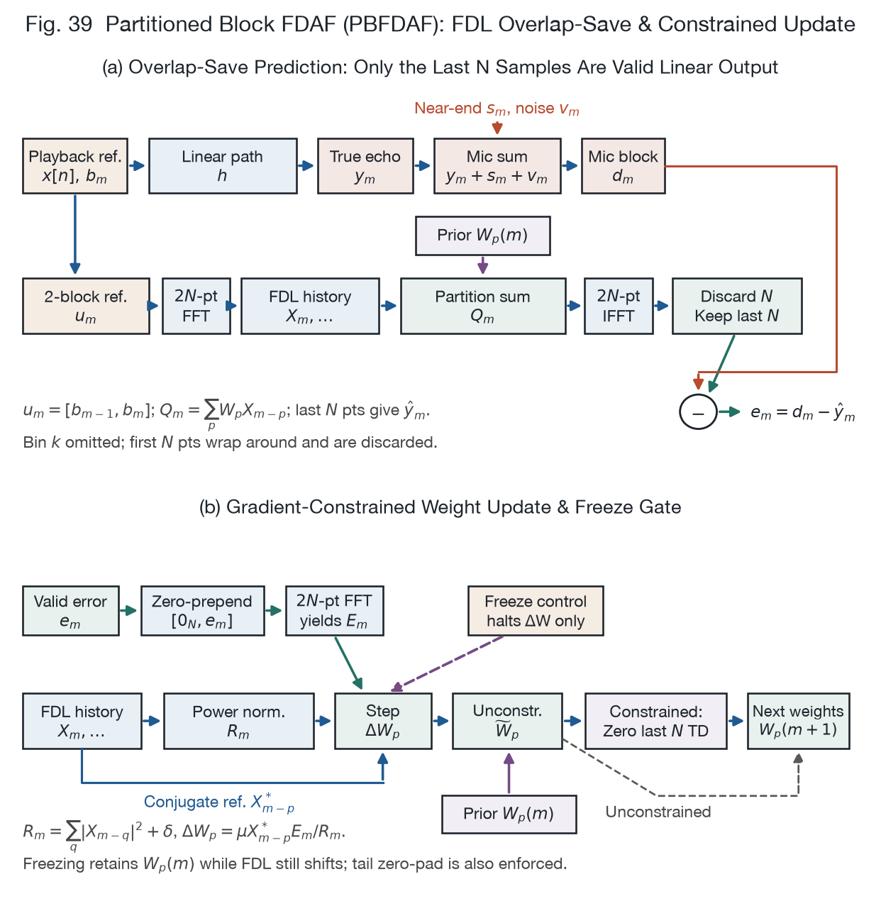

Examining both panels of Figure 39 cleanly separates the locations and roles of the two truncation/zero-padding operations:

- Figure 39(a) shows the physical echo-plus-near-end channel on top and the digital PBFDAF prediction channel below: reference spectra $X_m,\ldots,X_{m-P+1}$ shift rightward each block, multiply old weights $W_p(m)$, sum, and undergo an IFFT before the first truncation—**discarding the leading $N$ circular wrap-around samples** so only the trailing $N$ samples subtract from $d_m$;
- Figure 39(b) traces error backpropagation and weight updates: valid residual $e_m$ is first front-padded with $0_N$ prior to its FFT; along the upper constrained branch, candidate weights return to the time domain for the second truncation—**zeroing the trailing $N$ invalid taps** before transforming back to the frequency domain; the purple dashed freeze line gates weight commits alone without interrupting reference shifting or causal prediction in (a).

#### 6.2.2 Frequency-Domain Multi-Tap NLMS: What Are the Taps, and When Does It Equal PBFDAF?

Literature and open-source discussions frequently refer to "frequency-domain multi-tap NLMS." Whenever encountering this phrase, the first question to ask is: **along which dimension are its "multiple taps" arranged?** Below we contrast the two most common mathematical structures and use matrix algebra to derive the exact overlap-save block gradient.

**Structure 1: Taps arranged across $P$ delayed reference blocks at each fixed frequency bin.** Fixing bin $k$, stack the current and past $P-1$ reference spectra into the $P\times 1$ complex column vector $\vec X_m(k)=[X(k,m),X(k,m-1),\ldots,X(k,m-P+1)]^\top$ and stack the $P$ partition weights into $\vec W_m(k)=[W_0(k,m),\ldots,W_{P-1}(k,m)]^\top$ (using ordinary transpose $^\top$ rather than conjugate transpose $^H$ so the frequency-domain prediction inner product reads $\vec W_m^\top(k)\vec X_m(k)$). Equation (6-5) at bin $k$ then condenses into vector form:

$$\begin{aligned}
\Delta\vec W_m(k)
&=\mu\frac{\vec X_m^*(k)E(k,m)}
          {\|\vec X_m(k)\|_2^2+\delta},\\
\widetilde{\vec W}_{m+1}(k)
&=\vec W_m(k)+\Delta\vec W_m(k),
\end{aligned}$$

where $*$ denotes elementwise complex conjugation. For example, at a bin with $P=2$, $\vec X=[1,2]^\top$, $E=0.3$, $\mu=0.5$, and $\delta=1$, the denominator is $1^2+2^2+1=6$, giving candidate partition increments $0.5\times 0.3\times[1,2]^\top/6=[0.025,0.05]^\top$.

Superficially, this looks just like "running an independent $P$-tap complex NLMS per frequency bin." Why does it optimize the time-domain valid residual, and why can neither front-half zero-padding nor time-domain projection be omitted? A four-step matrix derivation lays all cards on the table.

Let $\mathbf F\in\mathbb{C}^{2N\times 2N}$ be the standard forward DFT matrix with $(k,r)$ entry $e^{-\mathrm{j}2\pi kr/(2N)}$ (for DFT matrices and circular convolution, see [Chapter 0 §0.2](00_math-foundations.md#sec-0-2)); its conjugate transpose obeys $\mathbf F^H\mathbf F=2N\,\mathbf I_{2N}$, so the $1/(2N)$-normalized inverse transform satisfies the key identities

$$\begin{aligned}
\mathbf F^{-1}&=\frac{1}{2N}\mathbf F^H,\\
\mathbf F^H&=2N\,\mathbf F^{-1},\qquad
(\mathbf F^{-1})^H=\frac{1}{2N}\mathbf F.
\end{aligned}$$

Define two real selection/zero-padding matrices: the trailing-half extraction matrix $\mathbf S=[\mathbf 0_{N\times N}\ \mathbf I_N]\in\mathbb{R}^{N\times 2N}$ (left-multiplication extracts the last $N$ samples, while $\mathbf S^\top$ front-pads $N$ zeros) and the leading-half zero-extension matrix $\mathbf U=[\mathbf I_N\ \mathbf 0_{N\times N}]^\top\in\mathbb{R}^{2N\times N}$ (appending $N$ trailing zeros to valid time-domain taps $\vec w_p\in\mathbb{R}^N$, while $\mathbf U^\top=[\mathbf I_N\ \mathbf 0_{N\times N}]$ extracts the leading $N$ valid taps).

In cross-bin matrix derivations, we write whole-block $2N\times 1$ frequency-domain vectors stacked across all $2N$ bins without the $(k)$ argument as $\vec W_{p,m},\vec X_{m-p},\vec Q_m,\vec D_m,\vec E_m\in\mathbb{C}^{2N\times 1}$ (distinct from $\vec X_m(k)\in\mathbb{C}^{P\times 1}$ stacked across $P$ partitions at a single bin $k$). With $\vec Q_m=\sum_{p=0}^{P-1}\vec W_{p,m}\odot\vec X_{m-p}$ ($\odot$ denoting elementwise Hadamard multiplication), the valid time-domain prediction is $\hat{\vec y}_m=\mathbf S\mathbf F^{-1}\vec Q_m$. Front-padding the valid residual $\vec e_m=\vec d_m-\hat{\vec y}_m$ with $\mathbf S^\top$ and transforming to the frequency domain gives the exact error spectrum vector:

$$\begin{aligned}
\vec D_m&=\mathbf F\mathbf S^\top\vec d_m,\\
\mathbf C&=\mathbf F\mathbf S^\top\mathbf S\mathbf F^{-1},\\
\vec E_m&=\mathbf F\mathbf S^\top(\vec d_m-\mathbf S\mathbf F^{-1}\vec Q_m)\\
&=\vec D_m-\mathbf C\vec Q_m.
\end{aligned}\tag{6-6}$$

Observe that $\mathbf S^\top\mathbf S=\operatorname{diag}(\mathbf 0_N,\mathbf I_N)\neq\mathbf I_{2N}$, so the frequency-domain projection matrix $\mathbf C$ in the second line of Eq. (6-6) is far from diagonal—it is a circular-convolution operator coupling all frequency bins, meaning $\vec E_m$ **generally does not equal** $\vec D_m-\vec Q_m$! Checking with the four-point numbers from Worked Example 6-3 proves this instantly: let a single-partition true path be $[1,2]$, suppose the filter has already converged exactly to $[1,2]$, and feed $u_1=[1,2,3,4]$ whose $4$-point circular convolution is $q=[9,4,7,10]$ while the true valid microphone block is $\vec d=[7,10]^\top$. Equation (6-6) gives valid error $\vec e=[7,10]^\top-[7,10]^\top=[0,0]^\top$ and $\vec E_m=\vec 0$, keeping the converged filter Stationary at the truth; omitting $\mathbf C$ and computing

$$\vec D_m-\vec Q_m=\mathbf F[0,0,7,10]^\top-\mathbf F[9,4,7,10]^\top
=\mathbf F[-9,-4,0,0]^\top\neq\vec 0$$

injects the discarded wrap-around garbage $[-9,-4]$ as a nonzero phantom gradient at perfect convergence, pushing already-accurate taps off their true values!

Now substitute valid time-domain taps $\vec w_p\in\mathbb{R}^N$ into the prediction chain: $\vec W_{p,m}=\mathbf F\mathbf U\vec w_p$, binwise multiplication by $\vec X_{m-p}$ corresponds to left-multiplication by $\operatorname{diag}(\vec X_{m-p})$, and applying $\mathbf F^{-1}$ followed by $\mathbf S$ yields the $N\times N$ linear operator mapping partition $p$ to the current valid output block:

$$\mathbf A_{p,m}=\mathbf S\mathbf F^{-1}
\operatorname{diag}(\vec X_{m-p})\mathbf F\mathbf U.$$

Defining the block valid-residual sum-of-squares cost $J_m=\frac{1}{2}\|\vec e_m\|_2^2$, differentiating with respect to real vector $\vec w_p$, and substituting $\mathbf F^H=2N\,\mathbf F^{-1}$ and $(\mathbf F^{-1})^H=\frac{1}{2N}\mathbf F$ step by step gives:

$$\begin{aligned}
\vec e_m&=\vec d_m-\sum_{p=0}^{P-1}\mathbf A_{p,m}\vec w_p,\\
J_m&=\frac{1}{2}\|\vec e_m\|_2^2,\\
-\nabla_{\vec w_p}J_m&=\mathbf A_{p,m}^H\vec e_m.
\end{aligned}\tag{6-7}$$

Expanding $\mathbf A_{p,m}^H\vec e_m$ explicitly (reversing factor order under conjugate transposition, conjugating diagonal entries, and replacing $^H$ by $^\top$ on real matrices $\mathbf S,\mathbf U$):

$$\begin{aligned}
\mathbf A_{p,m}^H\vec e_m
&=\bigl(\mathbf S\mathbf F^{-1}
  \operatorname{diag}(\vec X_{m-p})\mathbf F\mathbf U\bigr)^H\vec e_m\\
&=\mathbf U^\top\mathbf F^H
  \operatorname{diag}(\vec X_{m-p}^*)\,
  (\mathbf F^{-1})^H\mathbf S^\top\vec e_m\\
&=\mathbf U^\top\bigl(2N\,\mathbf F^{-1}\bigr)
  \operatorname{diag}(\vec X_{m-p}^*)
  \left(\frac{1}{2N}\mathbf F\right)\mathbf S^\top\vec e_m\\
&=\mathbf U^\top\mathbf F^{-1}
  \bigl(\vec X_{m-p}^*\odot(\mathbf F\mathbf S^\top\vec e_m)\bigr)\\
&=\mathbf U^\top\operatorname{IFFT}_{2N}(\vec X_{m-p}^*\odot\vec E_m).
\end{aligned}$$

Everything falls cleanly into place: the scaling factors $2N$ and $\frac{1}{2N}$ cancel identically, $\mathbf F\mathbf S^\top\vec e_m$ is precisely the front-zero-padded valid error spectrum $\vec E_m$ of Eq. (6-6), and left-multiplication by $\mathbf U^\top$ extracts the **first $N$ valid time-domain taps** of the IFFT output (whose imaginary parts cancel to zero whenever input and error sequences are real)! This establishes the exact mathematical identity of each variant:

- Without per-bin power division, retaining valid-tap projection $\mathbf U^\top$ across all partitions computes the exact **time-domain block LMS gradient** via FFTs;
- Equation (6-5) preconditions each bin prior to projection with $R_m(k)^{-1}$, accelerating convergence in weak spectral bands of colored speech; however, because the frequency-domain valid-tap projection operator $\mathbf G=\mathbf F\mathbf U\mathbf U^\top\mathbf F^{-1}$ remixes bins and generally fails to commute with $\operatorname{diag}(\vec R_m)^{-1}$, constrained PBFDAF is not $2N$ decoupled scalar complex NLMS filters.

The table below clarifies five commonly confused labels and their equivalence conditions:

| Label or Implementation | "Taps" and Update Timing | Relationship to PBFDAF in This Book |
|---|---|---|
| Sample-by-sample time-domain NLMS | $L$ sample-level lags; updates immediately after each sample's a priori error | Fits the same time-domain FIR, but modifies weights mid-block along a distinct trajectory |
| Time-domain block LMS / shared-scalar normalized variant | $L$ sample-level lags; whole block predicted with one old weight vector, updated at block end | FFT implementation without per-bin preconditioning and with time-domain projection computes the exact same block gradient |
| Single-partition FDAF | $P=1$; covers full path with a single long FFT | Special case $P=1$ of partitioned structure; incurs excessive block-buffering latency on long paths |
| Partitioned overlap-save frequency-domain multi-tap NLMS | $P$ historical reference **blocks** per bin; generates candidates via Eq. (6-5) and projects | Strictly equivalent block-for-block when block size, FFT scaling, valid-region padding, denominator, and projection match |
| Windowed STFT same-bin cross-frame filtering (CTF) | Multiple historical analysis **frames** per bin; governed by analysis/synthesis windows and hop size | Update equations look similar, but omitting cross-band terms is generally not exact linear time-domain convolution |

**Continuing Worked Example 6-3: How two adaptive block updates purge invalid taps.** Set $N=P=2$ ($L=4$), $\mu=0.5$, $\delta=1$, zero initial weights and negative-time history, with test sequences $x=[1,0,0,0]$ and $d=[1,0,2,0]$ (companion code in [`aec_partitioned_demo.py`](../codes/chapters/ch06/aec_partitioned_demo.py) and tests in [`test_codes_aec_partitioned.py`](../tests/test_codes_aec_partitioned.py)):

1. **Block $m=0$**: Overlapping window $u_0=[0,0,1,0]$ has $4$-point FFT $X_0=[1,-1,1,-1]$; with zero initial weights, valid error $e_0=[1,0]$ front-padded gives $E_0=[1,-1,1,-1]=X_0$, and per-bin denominator $|X_0|^2+\delta=1+1=2$. Equation (6-5) yields partition-$0$ increment $\Delta W_{0,0}=0.5\times X_0^*\odot E_0/2=[0.25,0.25,0.25,0.25]$, whose IFFT is $[0.25,0,0,0]$ (trailing two entries already zero); partition $1$ stays zero because $X_{-1}=\vec 0$.
2. **Block $m=1$**: New samples are zero, but concatenated window $u_1=[1,0,0,0]$ gives $X_1=[1,1,1,1]$ while $X_0=[1,-1,1,-1]$ remains cached. A priori prediction is zero, valid error $e_1=[2,0]$ front-pads to $E_1=[2,-2,2,-2]$, and each bin's denominator is $|X_1|^2+|X_0|^2+\delta=1+1+1=3$.

    - Partition $0$ ($p=0$): $X_1^*\odot E_1=[2,-2,2,-2]$, scaled by $\mu/3=1/6$ to $[1/3,-1/3,1/3,-1/3]$, whose $4$-point IFFT is $[0,0,1/3,0]$; added to $[0.25,0,0,0]$ from block $0$, the candidate time-domain sequence becomes $[0.25,0,1/3,0]$!
    - Partition $1$ ($p=1$): $X_0^*\odot E_1=[2,2,2,2]$, scaled by $1/6$ and inverse-transformed to candidate sequence $[1/3,0,0,0]$.

3. **Why zero out the trailing half?** Inspect index $2$ (zero-based, the third entry $1/3$) of partition-$0$ candidate $[0.25,0,1/3,0]$: it represents lag $2$ inside partition $0$, while the legitimate leading tap of partition $1$, $[1/3,0,0,0]$, *also* represents lag $2$ of the overall path! Without time-domain gradient projection zeroing the trailing two entries of partition $0$, the same physical lag is duplicated across two partitions, and the illegal entry at index $2$ violates overlap-save assumptions on the next circular convolution. Zeroing the trailing $N$ entries per partition yields $[0.25,0\mid 1/3,0]$, restoring a unique $4$-tap FIR physical interpretation.

#### Worked Example 6-4: Why Per-Bin Normalization Does Not Equal Time-Domain NLMS

**Inputs and conventions**: Take a single partition $N=2$, $P=1$, zero initial weights, $\mu=\delta=1$, overlap-save input $u=[0,0,1,2]$, and valid microphone block $d=[1,0]$ (so valid a priori error is $e=[1,0]$, front-padded to $[0,0,1,0]$). Using forward DFT exponent $e^{-\mathrm{j}2\pi kr/4}$ and $1/4$-scaled inverse DFT, evaluate $X(k)$, $E(k)$, denominator $|X(k)|^2+1$, and candidate increment $\Delta W(k)=X^*(k)E(k)/(|X(k)|^2+1)$ bin by bin:

| $k$ | $X(k)$ | $E(k)$ | $\lvert X(k)\rvert^2+1$ | Candidate Increment $\Delta W(k)$ |
|---:|---:|---:|---:|---:|
| 0 | $3$ | $1$ | $10$ | $3/10$ |
| 1 | $-1+2\mathrm{j}$ | $-1$ | $6$ | $(1+2\mathrm{j})/6$ |
| 2 | $-1$ | $1$ | $2$ | $-1/2$ |
| 3 | $-1-2\mathrm{j}$ | $-1$ | $6$ | $(1-2\mathrm{j})/6$ |

Verifying conjugate signs at $k=1$: $X(1)=0+0+1e^{-\mathrm{j}\pi}+2e^{-\mathrm{j}3\pi/2}=-1+2\mathrm{j}$, conjugation gives $X^*(1)=-1-2\mathrm{j}$, multiplying by $E(1)=e^{-\mathrm{j}\pi}=-1$ gives $1+2\mathrm{j}$, and dividing by $|{-1+2\mathrm{j}}|^2+1=5+1=6$ yields $(1+2\mathrm{j})/6$.

Applying a $4$-point IFFT to the rightmost column: index $0$ is $\frac{1}{4}[3/10 + 1/6 - 1/2 + 1/6]=1/30$; at index $1$, multiplying by phase factors $[1,\mathrm{j},-1,-\mathrm{j}]$ cancels the imaginary parts of $(-2\pm\mathrm{j})/6$ and sums the real parts to $\frac{1}{4}(3/10-2/6+1/2-2/6)=1/30$; the full $4$-point candidate sequence is $[1/30,1/30,-2/15,11/30]$, which after zeroing the two invalid trailing lags yields valid two-tap update $[1/30,\ 1/30]^\top$.

**Contrast with the time-domain block gradient**: Without per-bin distinct denominators, $\operatorname{IFFT}(X^*\odot E)$ equals $[1,0,0,2]$, whose leading two valid taps are $[1,0]^\top$—no matter what shared scalar energy divides the vector, tap $1$ receives strictly zero update! Per-bin power preconditioning attenuates strong bin $k=0$ (dividing by $10$) while boosting weak bin $k=2$ (dividing by $2$), rotating the parameter-space update direction after time-domain projection so that tap $1$ is immediately activated. That rotation is the algebraic essence of frequency-domain preconditioning on colored signals, and explains why its trajectory differs from time-domain NLMS.

#### Worked Example 6-5: A Small Prediction Residual Does Not Guarantee Path Identification

Fixing random seed `2094` in [`aec_partitioned_demo.py`](../codes/chapters/ch06/aec_partitioned_demo.py), set the true nine-tap sparse path to $h=[0,0,0.7,-0.2,0.08,0,0,0,0.05]$ and synthesize noiseless microphone observations via direct linear convolution; configure teaching PBFDAF with $N=16$, $L=9$, $\mu=0.3$, and $\delta=0.05$. Train for $4096$ samples separately under "standard normal wideband white noise" and a "period-$8$ pure sinusoid," then freeze weights and evaluate both trained filters on the **exact same** $1024$-sample independent wideband white-noise holdout sequence:

| Training Reference | Last-1024 Training A Priori Residual MSE | Post-Training Relative Path Error $\lVert\hat h-h\rVert_2/\lVert h\rVert_2$ | Frozen Wideband Holdout Residual MSE |
|---|---:|---:|---:|
| Wideband white noise | $4.03\times10^{-27}$ | $3.27\times10^{-16}$ | $7.52\times10^{-32}$ |
| Period-8 pure tone | $1.11\times10^{-8}$ | $0.868$ | $0.382$ |

Inspect the second row: by the end of pure-tone training, the a priori residual MSE has dropped to $1.11\times 10^{-8}$ (over $70\ \mathrm{dB}$ training-segment power reduction), looking every bit like "perfect convergence"; yet relative tap error stands at $86.8\%$, and the instant weights are frozen and tested on wideband input, holdout residual MSE explodes to $0.382$! Just as established in §6.1.2, a period-$8$ sinusoid excites only a two-dimensional frequency subspace, leaving tap degrees of freedom in all orthogonal frequency directions unconstrained. Adaptive-filter acceptance must therefore never rely solely on in-sample residual decay over a narrowband clip—it must include wideband excitation or cross-program holdout verification.

**Structure 2: Windowed STFT same-bin cross-frame filtering (CTF).** Speech enhancement and neural front-ends routinely operate in an overlapped windowed Short-Time Fourier Transform (STFT) domain. Combining past STFT frames within each single frequency bin via a Convolutive Transfer Function (CTF) produces update equations resembling Eq. (6-5), yet because of analysis/synthesis windowing and hop-size decimation, exact representation of an arbitrary time-domain FIR generally requires **cross-band coupling terms** from adjacent frequency bins (full derivation in [Avargel & Cohen, *IEEE TASLP*, 2007, §II, Eqs. (7)–(11)](https://webee.technion.ac.il/Sites/People/IsraelCohen/Publications/TASL_May2007.pdf)).

A minimal non-overlapping $2$-point rectangular-window DFT exposes this cross-band term immediately: let the true echo path be a unit-sample delay $y[n]=x[n-1]$, and denote the two DFT bins of frame $m$ (covering samples $2m$ and $2m+1$) by $X_{0,m}=x[2m]+x[2m+1]$ and $X_{1,m}=x[2m]-x[2m+1]$. Inverting for $x[2m-1]=\frac{1}{2}(X_{0,m-1}-X_{1,m-1})$ and $x[2m]=\frac{1}{2}(X_{0,m}+X_{1,m})$, the DC bin $Y_{0,m}=x[2m-1]+x[2m]$ of true output frame $[x[2m-1],x[2m]]$ equals

$$\begin{aligned}
Y_{0,m}&=\frac{1}{2}(X_{0,m-1}-X_{1,m-1})
         +\frac{1}{2}(X_{0,m}+X_{1,m}).
\end{aligned}$$

Half of output DC bin $Y_{0,m}$ comes from DC input $X_0$, while the other half comes from Nyquist bin $X_1$! Any pure same-bin filter reading only $X_{0,m},X_{0,m-1}$ inevitably misses the $X_1$ contribution (unless the time-domain path happens to be nonzero exclusively at integer multiples of the frame shift $2q$).

Two practical tricks in industrial open-source engines merit note: first, [`mdf.c` in SpeexDSP](https://gitlab.xiph.org/xiph/speexdsp/-/blob/8e29a256ef0235ebbe7fcb8417b5ac7731eb8307/libspeexdsp/mdf.c) implements Alternating Unconstrained MDF (AUMDF), updating all $P$ partitions in the frequency domain each block while projecting only $1$ (or a few) partitions per block via IFFT/FFT valid-tap zeroing, cutting Step-4 constraint-transform overhead by $P\times$; second, [`adaptive_fir_filter.cc`](https://webrtc.googlesource.com/src/+/0467d2b91cc20b9b001c2bbb73d43ea6b2491f3e/modules/audio_processing/aec3/adaptive_fir_filter.cc) and [`refined_filter_update_gain.cc`](https://webrtc.googlesource.com/src/+/0467d2b91cc20b9b001c2bbb73d43ea6b2491f3e/modules/audio_processing/aec3/refined_filter_update_gain.cc) in WebRTC AEC3 layer dynamic per-bin step-size gains atop partitioned filtering using error spectra, excitation thresholds, and amplifier saturation flags (source walkthroughs in [Research Manual A02–A03](../codes/chapters/ch00/research_en/02_aec_wpe_separation.md)).

#### 6.2.3 Subband AEC: Band Splitting, Cross-Band Terms, and Identifiability

Alongside overlap-save FFTs, a second classic route for cutting long-path compute and improving colored-speech conditioning is **Subband AEC**: split fullband reference $x[n]$ and microphone signal $d[n]$ through an analysis filterbank into decimated narrow subbands, adapt short filters at the reduced subband rate, and recombine subband residuals through a synthesis filterbank (total cost accounting must include filterbank MACs and group delay). Beginners often assume: "As long as the analysis–synthesis filterbank satisfies Perfect Reconstruction (PR), placing one independent adaptive filter per subband cancels fullband echo losslessly." Using a hand-calculable two-point orthogonal Haar filterbank, we prove below that **under critical sampling (decimation factor equal to subband count), even a $1$-sample odd delay immediately triggers cross-subband aliasing coupling!**

Index two-sample blocks by $m$, each comprising even sample $x[2m]$ and odd sample $x[2m+1]$ (equivalent at the subband rate to $2\times$-decimated polyphase components $x_0[m]=x[2m]$ and $x_1[m]=x[2m+1]$). Define the two-point orthogonal Haar analysis transform:

$$\begin{aligned}
u_0[m]&=\frac{x[2m]+x[2m+1]}{\sqrt{2}},\\
u_1[m]&=\frac{x[2m]-x[2m+1]}{\sqrt{2}}.
\end{aligned}\tag{6-8}$$

Here $u_0[m]$ is the local two-point lowpass sum and $u_1[m]$ is the local highpass difference; the $2\times 2$ Haar matrix $\mathbf H$ (rows $[1,1]/\sqrt{2}$ and $[1,-1]/\sqrt{2}$) is orthogonal and symmetric ($\mathbf H^\top=\mathbf H$, $\mathbf H^2=\mathbf I_2$). Without intermediate modification, $[x[2m],x[2m+1]]^\top=\mathbf H[u_0[m],u_1[m]]^\top$ reconstructs the original signal perfectly block by block.

**Two-row polyphase decomposition of cross-band coupling.** Let the fullband causal echo path be length-$L$ FIR $d[n]=\sum_{\ell=0}^{L-1}h[\ell]x[n-\ell]$. Splitting the sum into even lags $\ell=2r$ and odd lags $\ell=2r+1$ gives the **two-row polyphase decomposition** for $d[2m]$ and $d[2m+1]$:

$$\begin{aligned}
d[2m]&=\sum_{r\ge 0}h[2r]\,x[2(m-r)]\\
     &\quad+\sum_{r\ge 0}h[2r+1]\,x[2(m-r-1)+1],\\
d[2m+1]&=\sum_{r\ge 0}h[2r]\,x[2(m-r)+1]\\
       &\quad+\sum_{r\ge 0}h[2r+1]\,x[2(m-r)].
\end{aligned}$$

Inspecting these two polyphase rows reveals:

- Every **even tap** $h[2r]$ maps even input $x[2(m-r)]$ to even output $d[2m]$ and odd input to odd output, acting on $2\times 1$ blocks as $h[2r]\mathbf I_2$; sandwiching $\mathbf H(h[2r]\mathbf I_2)\mathbf H^\top=h[2r]\mathbf I_2$ introduces zero cross-subband leakage;
- Every **odd tap** $h[2r+1]$ swaps even/odd parity, and $x[2(m-r-1)+1]$ in the first row crosses the two-sample block boundary into prior block $m-r-1$! For a pure unit delay $d[n]=x[n-1]$ ($h[1]=1$, others zero), $d[2m]=x[2m-1]$ and $d[2m+1]=x[2m]$, which in polyphase block form reads

$$\begin{aligned}
\begin{bmatrix}d[2m]\\d[2m+1]\end{bmatrix}
&=\underbrace{\begin{bmatrix}0&0\\1&0\end{bmatrix}}_{\mathbf P_0}
  \begin{bmatrix}x[2m]\\x[2m+1]\end{bmatrix}
 +\underbrace{\begin{bmatrix}0&1\\0&0\end{bmatrix}}_{\mathbf P_1}
  \begin{bmatrix}x[2m-2]\\x[2m-1]\end{bmatrix},
\end{aligned}$$

where $[x[2m-2],x[2m-1]]^\top$ is block $m-1$ ($\mathbf P_1$ picks out its odd sample $x[2m-1]=x[2(m-1)+1]$). Left-multiplying by $\mathbf H$ to obtain subband output $\vec v_m=\mathbf H[d[2m],d[2m+1]]^\top=[v_0[m],v_1[m]]^\top$ and inserting $\mathbf H^\top\mathbf H=\mathbf I_2$ in front of $\vec u_m=\mathbf H[x[2m],x[2m+1]]^\top$ yields the current-block and one-block-lagged subband transfer matrices:

$$\mathbf G_0=\mathbf H\mathbf P_0\mathbf H^\top
=\frac{1}{2}\begin{bmatrix}1&1\\-1&-1\end{bmatrix},\qquad
\mathbf G_1=\mathbf H\mathbf P_1\mathbf H^\top
=\frac{1}{2}\begin{bmatrix}1&-1\\1&-1\end{bmatrix}.$$

Expanding componentwise gives:

$$\begin{aligned}
v_0[m]&=\frac{u_0[m-1]-u_1[m-1]}{2}
+\frac{u_0[m]+u_1[m]}{2},\\
v_1[m]&=\frac{u_0[m-1]-u_1[m-1]}{2}
-\frac{u_0[m]+u_1[m]}{2}.
\end{aligned}\tag{6-9}$$

Look at both lines of Eq. (6-9): low-band output $v_0[m]$ and high-band output $v_1[m]$ simultaneously depend on nonzero cross-band inputs $u_1$ and $u_0$! Forcing a **diagonal subband model** where $v_0$ reads only $u_0$ and $v_1$ reads only $u_1$ amputates the off-diagonal entries to zero, making a $1$-sample delay impossible to represent exactly. [Gilloire & Vetterli (*IEEE Transactions on Signal Processing*, 1992)](https://doi.org/10.1109/78.149989) proved this foundational result for critically sampled subband adaptive filtering: decimation aliasing cancels in the synthesis bank only under unmodified passthrough, and breaks down as soon as subbands undergo unequal filtering without cross-band compensation branches.

**Four-point hand verification of cross-band coupling.** Feed piecewise-constant input $x=[1,1\mid 0,0]$: block $0$ has equal samples so $u_0[0]=\sqrt{2}$ and $u_1[0]=0$; block $1$ is zero so $u_0[1]=u_1[1]=0$. After a unit delay, the microphone receives $d=[0,1\mid 1,0]$, whose high-band outputs via Eq. (6-8) are $v_1[0]=(0-1)/\sqrt{2}=-1/\sqrt{2}$ and $v_1[1]=(1-0)/\sqrt{2}=+1/\sqrt{2}$.

Notice that high-band input $u_1[m]$ is identically $0$ for all $m$! A diagonal model's high-band filter sees all-zero input and can only output zero, missing both blocks of high-band echo; the full cross-band model routes energy through $u_0\to v_1$ via Eq. (6-9), reconstructing $\frac{1}{2}(0-\sqrt{2})=-1/\sqrt{2}$ and $\frac{1}{2}(\sqrt{2}-0)=+1/\sqrt{2}$ exactly.

**Two-band full cross-band adaptive update under an unknown path.** Any causal length-$L$ time-domain FIR maps via polyphase sandwiching $\mathbf H(\cdot)\mathbf H^\top$ to $K=\lfloor L/2\rfloor+1$ subband matrices $\vec v_m=\sum_{k=0}^{K-1}\mathbf G_k\vec u_{m-k}$ (see [`fir_crossband_matrices()`](../codes/chapters/ch06/core/aec_subband.py)). When the path is unknown, maintain a $2\times 2\times K$ real weight tensor $W_{i,j,k}$ ($i\in\{0,1\}$ output band, $j\in\{0,1\}$ input band, $k=0,\ldots,K-1$ block lag) and write $U_{j,k}=u_j[m-k]$. Each new block predicts both output bands with old weights and updates all four subband branches using a **shared energy denominator $D$ pooled across both input bands and all $K$ lags** ($0\le\mu<2$, $\varepsilon>0$):

$$\begin{aligned}
\hat v_i&=\sum_{j=0}^{1}\sum_{k=0}^{K-1}W_{i,j,k}U_{j,k},\\
e_i&=v_i-\hat v_i,\\
D&=\varepsilon+\sum_{j=0}^{1}\sum_{k=0}^{K-1}U_{j,k}^2,\\
\Delta W_{i,j,k}&=\mu\frac{e_iU_{j,k}}{D},\\
W_{i,j,k}^{+}&=W_{i,j,k}+\Delta W_{i,j,k}.
\end{aligned}\tag{6-10}$$

Stepping Eq. (6-10) by hand on $x=[1,1\mid 0,0]$, $d=[0,1\mid 1,0]$ ($K=2$, zero initialization, $\mu=1$, $\varepsilon=1$): at block $0$, only $U_{0,0}=\sqrt{2}$ is nonzero, $D=1+(\sqrt{2})^2=3$, and $\vec e=[1/\sqrt{2},-1/\sqrt{2}]^\top$, yielding same-band weight $W_{0,0,0}=1/3$ and **cross-band weight** $W_{1,0,0}=-1/3$; at block $1$, $U_{0,1}=\sqrt{2}$ is nonzero with $D=3$, yielding $W_{0,0,1}=W_{1,0,1}=1/3$, confirming online learning of cross-band coupling from low-band input into high-band output (see [`aec_crossband_demo.py`](../codes/chapters/ch06/aec_crossband_demo.py)). In that script's fixed-seed (`20260923`) holdout benchmark exciting unit-delay path $h=[0,1]$ with repeated-pair Gaussian blocks ($1500$ training blocks, $500$ frozen test blocks), true echo MSE is $\approx 0.989129$, the full cross-band model converges to floating-point residual MSE $0$, and the diagonal model stalls at $\approx 0.489674$ (missing half the echo energy).

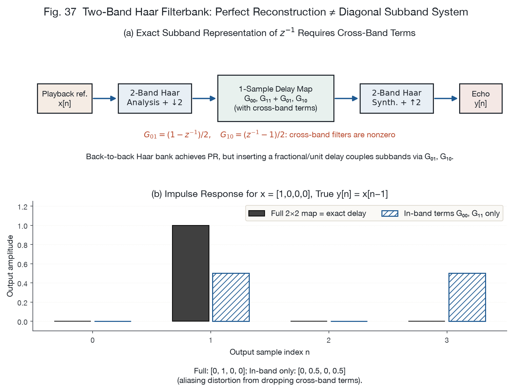

Figure 37 consolidates subband expressiveness and engineering trade-offs:

- Figure 37(a) traces the five-stage chain "Playback reference $x[n]$ $\to$ Two-band Haar analysis + $\downarrow 2$ $\to$ Unit-delay subband mapping (containing both diagonal terms $G_{00},G_{11}$ and cross-band terms $G_{01},G_{10}$) $\to$ Two-band Haar synthesis + $\uparrow 2$ $\to$ Echo $y[n]$," highlighting $G_{01}=(1-z^{-1})/2$ and $G_{10}=(z^{-1}-1)/2$ beneath the center block—immediate synthesis reconstructs $x[n]$ perfectly, yet inserting an odd delay precludes keeping $G_{00},G_{11}$ alone;
- Figure 37(b) plots output sample index $n$ against dimensionless amplitude for unit-impulse input $x=[1,0,0,0]$ through a unit-delay path: retaining the full $2\times 2$ subband matrix synthesizes $[0,1,0,0]$ exactly, whereas pruning cross-band terms produces the aliased sequence $[0,0.5,0,0.5]$ (for audio listening, see [Two-Band Haar Cross-Term Synthetic WAVs](../codes/chapters/ch00/research_en/05_exercises_and_audio.md#sec-u-b41d17b2cd)).

To avoid the parameter inflation ($4K>L$ unconstrained real parameters here) and cross-band identifiability conditioning issues of full cross-band matrices, modern industrial subband AECs follow two designs: (1) **oversampled filterbanks** with high stopband attenuation (decimation factor strictly below subband count, pushing adjacent-band aliasing below the noise floor so diagonal per-band updates suffice safely); or (2) Normalized Subband Adaptive Filtering (NSAF; [Lee & Gan, *IEEE SPL*, 2004](https://doi.org/10.1109/LSP.2004.833445) and [EUSIPCO 2004](https://www.eurasip.org/Proceedings/Eusipco/Eusipco2004/defevent/papers/cr1587.pdf)), which uses subband-whitened error signals solely to update a single **fullband time-domain tap vector**, sidestepping synthesis aliasing and parameter inflation altogether.

#### 6.2.4 IPNLMS: Blending Uniform and Proportionate Updates

When an echo path concentrates its energy in a handful of dominant taps (such as the direct arrival plus one or two strong desk reflections, with near-zero coefficients elsewhere), allocating step-size budget preferentially to taps that already exhibit large magnitudes converges faster than distributing effort uniformly; yet starting from all-zero weights, when dominant tap locations are still unknown, uniform exploration must remain active.

Proportionate NLMS (PNLMS; [Duttweiler, *IEEE TSAP*, 2000](https://doi.org/10.1109/89.861368)) and Improved Proportionate NLMS (IPNLMS; [Benesty & Gay, ICASSP 2002](https://cris.technion.ac.il/en/publications/an-improved-pnlms-algorithm/)) multiply the update direction by a diagonal matrix dependent on current tap magnitudes. This speedup relies on path sparsity; on dense, slowly decaying room reverberation, proportionate allocation need not outperform uniform NLMS.

We adopt the linear blending parameterization of [Benesty et al. (EUSIPCO 2004, Table 1)](https://www.eurasip.org/Proceedings/Eusipco/Eusipco2004/defevent/papers/cr1026.pdf): $\kappa\in[-1,1]$ blends uniform and magnitude-proportionate allocation, $\delta>0$ regularizes the weighted-energy denominator, and $\varepsilon_g>0$ guards the $\ell_1$-norm denominator at zero initialization:

$$\begin{aligned}
g_l&=\frac{1-\kappa}{2L}
    +\frac{(1+\kappa)|\hat w_l|}
           {2\|\hat{\vec w}\|_1+\varepsilon_g},\\
\hat{\vec w}^{+}
   &=\hat{\vec w}
     +\mu\frac{e\mathbf G\vec x}
                {\vec x^{\top}\mathbf G\vec x+\delta}.
\end{aligned}\tag{6-11}$$

Here $g_l\ge 0$ ($l=0,\ldots,L-1$) is the proportionate weight assigned to tap $l$ and $\mathbf G=\operatorname{diag}(g_0,\ldots,g_{L-1})$, suppressing shared sample index $[n]$; $\mathbf G$ rotates the update direction and reweights the denominator without altering linear convolution prediction in Eq. (6-2).

Sample-by-sample execution order is strict: first compute a priori prediction and residual $e[n]$ from **pre-update** weights $\hat{\vec w}[n]$ and $\vec x[n]$; next evaluate all $g_l$ from pre-update magnitudes and $\|\hat{\vec w}[n]\|_1=\sum_{l=0}^{L-1}|\hat w_l[n]|$; then compute $\vec x^\top[n]\mathbf G\vec x[n]+\delta$; and finally update all $L$ taps synchronously.

When double-talk freezes the sample, shift the newest reference sample into the history window and emit the a priori residual without executing Eq. (6-11).

At $\kappa=-1$, the proportionate term vanishes and $g_l=1/L$; multiplying numerator and denominator of Eq. (6-11) by $L$ maps the regularizer to $L\delta$, making IPNLMS sample-for-sample identical to time-domain NLMS in Eq. (6-3) whenever $\varepsilon_{\mathrm{NLMS}}=L\delta_{\mathrm{IPNLMS}}$. At $\kappa=1$, uniform exploration disappears, locking all-zero initial weights $\hat{\vec w}=\vec 0$ permanently at zero because $|\hat w_l|=0$ (see Exercise E06-14); practical designs typically select $\kappa\in[-0.5,0]$ to balance cold-start exploration with sparse tracking.

**Two-tap hand calculation.** Let $\hat{\vec w}=[0.8,0.2]^\top$, $\vec x=[1,1]^\top$, $d=1.2$, and $\mu=1$, giving a priori residual $e=1.2-(0.8+0.2)=0.2$. First inspect ideal allocation with negligible regularizers ($\varepsilon_g\to 0,\delta\to 0$): at $\kappa=0$, $g_0=\frac{1}{4}+\frac{0.8}{2\times 1.0}=0.65$ and $g_1=\frac{1}{4}+\frac{0.2}{2.0}=0.35$, weighted denominator $\vec x^\top\mathbf G\vec x=0.65+0.35=1$, and increments are $[0.13,0.07]^\top$; at uniform $\kappa=-1$, $g=[0.5,0.5]$ splits the increment evenly into $[0.10,0.10]^\top$.

**Exact check with nonzero regularizers.** Keeping $\hat{\vec w},\vec x,d,\mu$ unchanged while retaining $\varepsilon_g=2$ and $\delta=0.25$:

- At $\kappa=0$, the uniform term is $1/4=0.25$ and the proportionate denominator is $2\times(0.8+0.2)+2=4$, giving $g_0=0.25+0.8/4=0.45$ and $g_1=0.25+0.2/4=0.30$. Note that $g_0+g_1=0.75\neq 1$ (Eq. (6-11) does not re-normalize $g_l$ to unit sum); the update denominator is $0.45+0.30+0.25=1.0$, yielding increment $0.2\times[0.45,0.30]^\top=[0.09,0.06]^\top$;
- At $\kappa=-1$, $g=[0.5,0.5]$, denominator is $0.5+0.5+0.25=1.25$, and the increment $0.2\times[0.5,0.5]^\top/1.25=[0.08,0.08]^\top$ matches standard NLMS with $\varepsilon=L\delta=2\times 0.25=0.5$ ($0.2\times[1,1]^\top/(2+0.5)=[0.08,0.08]^\top$) exactly.

Companion module [`aec_ipnlms.py`](../codes/chapters/ch06/core/aec_ipnlms.py) and demo [`aec_ipnlms_subband_demo.py`](../codes/chapters/ch06/aec_ipnlms_subband_demo.py) implement streaming state management; Figure 38 at the end of §6.2 compares IPNLMS, RLS, and Kalman parameter-control mechanisms side by side.

#### Affine Projection: Reshaping the Update Direction with Multiple Recent Observations

Having examined single-direction NLMS, consider the geometric bottleneck of colored speech excitation: when adjacent samples are strongly correlated, successive regression vectors $\vec x[n],\vec x[n-1],\ldots$ subtend tiny angles, causing single-step NLMS to zigzag back and forth between nearly parallel hyperplanes while advancing sluggishly along weak eigen-directions. The **Affine Projection Algorithm (APA; [Ozeki & Umeda, 1984](https://doi.org/10.1002/ecja.4400670503); regularized form in [Rey et al., EUSIPCO 2004, §2](https://www.eurasip.org/Proceedings/Eusipco/Eusipco2004/defevent/papers/cr1033.pdf))** solves jointly over the $K_n$ ($K_n\le K$, using only arrived valid samples during startup) most recent observation equations at each step, computing the minimum-norm weight increment simultaneously consistent with all $K_n$ local directions.

Retaining most-recent-sample-first ordering, denote the $i$-th regression column by $\vec x_i=[x[i],x[i-1],\ldots,x[i-L+1]]^\top\in\mathbb{R}^L$ and the earliest instant in the window by $i_{\mathrm{min}}=n-K_n+1$. Assemble the $K_n$ regression columns into $\mathbf U_n\in\mathbb{R}^{L\times K_n}$, stack microphone samples into $\vec d_n\in\mathbb{R}^{K_n}$, and evaluate both the window error vector $\vec e_n^-$ and the $K_n\times K_n$ Gram matrix $\mathbf G_n$ using the **single shared pre-update weight vector** $\vec w_{n-1}$:

$$\begin{gathered}
\mathbf U_n=[\vec x_n,\ldots,\vec x_{i_{\mathrm{min}}}],\\
\vec d_n=[d[n],d[n-1],\ldots,d[i_{\mathrm{min}}]]^\top,\\
\vec e_n^-=\vec d_n-\mathbf U_n^\top\vec w_{n-1},\\
\mathbf G_n=\mathbf U_n^\top\mathbf U_n.
\end{gathered}\tag{6-12}$$

Watch out for an implementation pitfall in line 3 of Eq. (6-12): only entry $0$ of $\vec e_n^-$, namely $d[n]-\vec x_n^\top\vec w_{n-1}$, is the current causal output a priori residual; the remaining $K_n-1$ historical entries must be **recomputed via inner products with the latest pre-update weights $\vec w_{n-1}$**, never cobbled together by reusing stale scalar residuals emitted on earlier steps (Exercise E06-35 contrasts exact recomputation against stale-residual concatenation by hand).

**Unregularized exact projection (minimum-norm constrained solution).** When $K_n\le L$ and $\mathbf U_n$ has full column rank, infinitely many increments $\Delta\vec w$ satisfy all $K_n$ window equations $\mathbf U_n^\top(\vec w_{n-1}+\Delta\vec w)=\vec d_n$ (i.e., $\mathbf U_n^\top\Delta\vec w=\vec e_n^-$). APA selects the increment of minimal Euclidean norm:

$$\begin{aligned}
\min_{\Delta\vec w}\quad&\frac{1}{2}\|\Delta\vec w\|_2^2,\\
\text{subject to}\quad&\mathbf U_n^\top\Delta\vec w=\vec e_n^-.
\end{aligned}\tag{6-13}$$

Introducing Lagrange multiplier vector $\vec\alpha\in\mathbb{R}^{K_n}$ gives the Lagrangian

$$\mathcal L(\Delta\vec w,\vec\alpha)
=\frac{1}{2}\|\Delta\vec w\|_2^2
-\vec\alpha^\top(\mathbf U_n^\top\Delta\vec w-\vec e_n^-).$$

Setting $\nabla_{\Delta\vec w}\mathcal L=\Delta\vec w-\mathbf U_n\vec\alpha=\vec 0$ yields $\Delta\vec w=\mathbf U_n\vec\alpha$ (geometrically, the minimum-norm increment lies entirely within the column span of $\mathbf U_n$); substituting into $\mathbf U_n^\top(\mathbf U_n\vec\alpha)=\vec e_n^-$ with positive definite $\mathbf G_n=\mathbf U_n^\top\mathbf U_n$ gives $\vec\alpha=\mathbf G_n^{-1}\vec e_n^-$ and exact projection step $\Delta\vec w=\mathbf U_n\mathbf G_n^{-1}\vec e_n^-$.

**Diagonal-loading regularization and dimensionality reduction via the push-through identity.** Because adjacent columns of colored speech are nearly collinear, $\mathbf G_n$ is often close to singular, and direct inversion violently amplifies window noise floor or near-end speech. Introducing regularization constant $\delta>0$ (with squared-amplitude dimension matching $\mathbf G_n$) and dimensionless step size $\mu$ relaxes the hard constraint into an unconstrained ridge-regression objective:

$$\begin{gathered}
\begin{aligned}
J_\delta(\Delta\vec w)
&=\|\mathbf U_n^\top\Delta\vec w-\vec e_n^-\|_2^2\\
&\quad+\delta\|\Delta\vec w\|_2^2,
\end{aligned}\\
\Delta\vec w_\delta
=\arg\min_{\Delta\vec w}J_\delta(\Delta\vec w),\\
(\mathbf G_n+\delta\mathbf I_{K_n})\vec\alpha_{\delta,n}
=\vec e_n^-,\\
\vec w_n=\vec w_{n-1}+\mu\mathbf U_n\vec\alpha_{\delta,n}.
\end{gathered}\tag{6-14}$$

At first glance, setting the gradient of $J_\delta(\Delta\vec w)$ to zero gives

$$\begin{aligned}
\nabla_{\Delta\vec w}J_\delta
&=2\mathbf U_n(\mathbf U_n^\top\Delta\vec w_\delta-\vec e_n^-)
  +2\delta\Delta\vec w_\delta=\vec 0,\\
(\mathbf U_n\mathbf U_n^\top+\delta\mathbf I_L)
  \Delta\vec w_\delta&=\mathbf U_n\vec e_n^-,
\end{aligned}$$

which features a massive $L\times L$ matrix (e.g., $1024\times 1024$) on the left! How does it collapse exactly into the tiny $K_n\times K_n$ (e.g., $2\times 2$ or $4\times 4$) linear system in line 3 of Eq. (6-14)? Two lines of associative matrix algebra prove the **push-through identity**:

$$\begin{aligned}
(\mathbf U_n\mathbf U_n^\top+\delta\mathbf I_L)\mathbf U_n
&=\mathbf U_n(\mathbf U_n^\top\mathbf U_n)+\delta\mathbf U_n\\
&=\mathbf U_n(\mathbf G_n+\delta\mathbf I_{K_n}).
\end{aligned}$$

Because $\delta>0$ makes both $(\mathbf U_n\mathbf U_n^\top+\delta\mathbf I_L)\in\mathbb{R}^{L\times L}$ and $(\mathbf G_n+\delta\mathbf I_{K_n})\in\mathbb{R}^{K_n\times K_n}$ strictly positive definite and invertible, left-multiplying by $(\mathbf U_n\mathbf U_n^\top+\delta\mathbf I_L)^{-1}$ and right-multiplying by $(\mathbf G_n+\delta\mathbf I_{K_n})^{-1}$ immediately proves

$$(\mathbf U_n\mathbf U_n^\top+\delta\mathbf I_L)^{-1}\mathbf U_n
=\mathbf U_n(\mathbf G_n+\delta\mathbf I_{K_n})^{-1}.$$

Right-multiplying both sides by $\vec e_n^-$ equates $\Delta\vec w_\delta$ on the left to $\mathbf U_n\vec\alpha_{\delta,n}$ on the right. Per-sample complexity drops from prohibitive $O(L^3)$ to $O(LK_n^2)$ for forming $\mathbf G_n$ plus $O(K_n^3)$ for solving the small system (at $K_n=1$, $\mathbf G_n=\|\vec x_n\|_2^2$ is scalar and Eq. (6-14) reduces identically to time-domain NLMS with $\varepsilon=\delta$).

Evaluating the a posteriori window error vector $\vec e_n^+=\vec d_n-\mathbf U_n^\top\vec w_n$ on the same window yields

$$\begin{aligned}
\vec e_n^+&=\vec e_n^--\mu\mathbf G_n\vec\alpha_{\delta,n}\\
&=\bigl[\mathbf I_{K_n}-\mu\mathbf G_n
  (\mathbf G_n+\delta\mathbf I_{K_n})^{-1}\bigr]\vec e_n^-.
\end{aligned}\tag{6-15}$$

For eigenvalues $\lambda_i\ge 0$ of symmetric positive semidefinite $\mathbf G_n$, the window-error scaling factor along eigenvector $i$ is $1-\mu\lambda_i/(\lambda_i+\delta)$: its magnitude is strictly below $1$ whenever $\lambda_i>0$, $\delta>0$, and $0<\mu<2$; if collinear window columns produce $\lambda_i=0$ ($\mathbf U_n\vec v=\vec 0$), the factor equals $1$, showing that $\delta>0$ restores numerical solvability without conjuring identifiability out of rank-deficient data (see Exercise E06-37).

In state management, [`APAState`](../codes/chapters/ch06/core/aec_affine_projection.py) exhibits a subtler double-talk memory effect than single-step NLMS: freezing during double-talk skips weight updates, yet microphone samples $d[n]$ contaminated by near-end speech still enter the length-$K$ projection observation window; resuming updates immediately after double-talk ends lets those lingering contaminated samples pull weights off course on the very next solve for $\vec\alpha_{\delta,n}$! The interface therefore distinguishes `reset_projection_history()`, which flushes the projection observation window while preserving weights and FIR reference history, from `reset()`, which zeroes all states (quantitative comparison in Exercise E06-36).

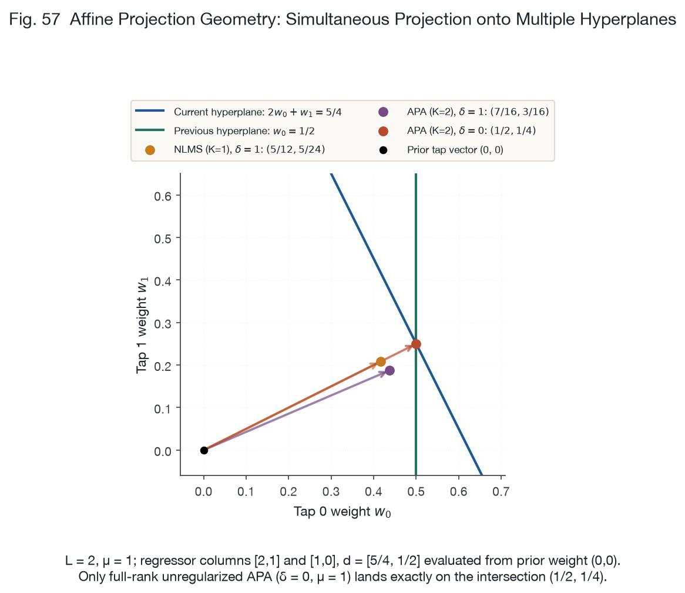

Figure 57 (corresponding to the noiseless two-tap geometry of Exercise E06-34) visualizes the three update trajectories on the $(w_0,w_1)$ plane: the two solid lines represent current observation hyperplane $2w_0+w_1=5/4$ and prior hyperplane $w_0=1/2$, intersecting uniquely at the true path $(0.5,0.25)$; starting from $(0,0)$, single-step NLMS ($K=1$) steps perpendicularly toward the current line alone to $[5/12,5/24]^\top$; unregularized two-column projection ($K=2,\delta=0,\mu=1$) jumps straight to the intersection in one step; and regularized APA ($K=2,\delta=1,\mu=1$) lands damped at $[7/16,3/16]^\top$ between the origin and the true intersection, bounding single-step noise amplification (colored-reference noisy holdout trade-offs follow in Exercise E06-39 and Figure 58).

#### 6.2.5 RLS: Reshaping the Update Direction with the Reference Correlation Matrix

Whereas NLMS inspects only the most recent sample and APA inspects a short window of $K$ samples, **Recursive Least Squares (RLS)** weights the entire observation history from $i=0$ through $n$ exponentially with forgetting factor $0<\lambda\le 1$ and computes the exact least-squares minimizer of the cumulative weighted cost at every sample—whitening the gradient with the inverse historical sample correlation matrix and freeing convergence directions from input spectral condition numbers.

Restricting attention to a real, time-aligned single-reference causal FIR of length $L$, we append an explicit quadratic penalty toward initial prior weights $\vec w_{-1}$ ($\delta>0$, matching the initial inverse-covariance convention of [MathWorks `dsp.RLSFilter`](https://www.mathworks.com/help/dsp/ref/dsp.rlsfilter-system-object.html)) so that the normal equations remain strictly positive definite from sample $0$ onward even before $L$ samples arrive:

$$\begin{aligned}
J_n(\vec w)={}&\sum_{i=0}^{n}\lambda^{n-i}
  (d[i]-\vec w^\top\vec x_i)^2\\
&+\lambda^{n+1}\delta\|\vec w-\vec w_{-1}\|_2^2.
\end{aligned}\tag{6-16}$$

Setting $\nabla_{\vec w}J_n(\vec w_n)=\vec 0$ yields the normal equations $\mathbf R_n\vec w_n=\vec p_n$. Splitting the exponentially weighted sum into $\lambda$ times the prior sum plus the $n$-th observation gives rank-1 recursions for sample correlation matrix $\mathbf R_n\in\mathbb{R}^{L\times L}$ and cross-correlation vector $\vec p_n\in\mathbb{R}^L$:

$$\begin{aligned}
\mathbf R_{-1}&=\delta\mathbf I_L,\\
\vec p_{-1}&=\delta\vec w_{-1},\\
\mathbf R_n&=\lambda\mathbf R_{n-1}+\vec x_n\vec x_n^\top,\\
\vec p_n&=\lambda\vec p_{n-1}+\vec x_n d[n],\\
\mathbf P_n&=\mathbf R_n^{-1},\\
\vec w_n&=\mathbf P_n\vec p_n.
\end{aligned}\tag{6-17}$$

Inverting $\mathbf R_n$ directly at every sample would cost $O(L^3)$ operations. Because line 3 of Eq. (6-17) adds a rank-1 outer product $\vec x_n\vec x_n^\top$ onto the invertible matrix $\mathbf A=\lambda\mathbf R_{n-1}$ (whose inverse is $\mathbf A^{-1}=\lambda^{-1}\mathbf P_{n-1}$), we apply the **Woodbury (Sherman–Morrison) matrix inversion lemma** from [Chapter 0 §0.3](00_math-foundations.md#sec-0-3) and [Appendix A](16_appendix-symbols-math.md):

$$(\mathbf A+\vec u\vec v^\top)^{-1}
=\mathbf A^{-1}
-\frac{\mathbf A^{-1}\vec u\vec v^\top\mathbf A^{-1}}
      {1+\vec v^\top\mathbf A^{-1}\vec u}.$$

Setting $\vec u=\vec v=\vec x_n$ and defining intermediate vector $\vec q_n=\mathbf P_{n-1}\vec x_n$ (with $\vec x_n^\top\mathbf P_{n-1}=\vec q_n^\top$ by symmetry of $\mathbf P_{n-1}$), $\mathbf P_n=\mathbf R_n^{-1}$ simplifies step by step to

$$\begin{aligned}
\mathbf P_n
&=(\lambda\mathbf R_{n-1}+\vec x_n\vec x_n^\top)^{-1}\\
&=\lambda^{-1}\mathbf P_{n-1}
  -\frac{\lambda^{-2}\vec q_n\vec q_n^\top}
        {1+\lambda^{-1}\vec x_n^\top\vec q_n}\\
&=\lambda^{-1}\left(\mathbf P_{n-1}
  -\frac{\vec q_n\vec q_n^\top}
        {\lambda+\vec x_n^\top\vec q_n}\right)\\
&=\lambda^{-1}(\mathbf P_{n-1}-\vec K_n\vec q_n^\top),
\end{aligned}$$

where line 3 multiplies numerator and denominator by $\lambda$ to clear compound fractions and line 4 defines the $L\times 1$ gain vector $\vec K_n=\vec q_n/(\lambda+\vec x_n^\top\vec q_n)$. Right-multiplying by $\vec x_n$ immediately verifies a pivotal algebraic identity:

$$\begin{aligned}
\mathbf P_n\vec x_n
&=\lambda^{-1}\left[\vec q_n
  -\vec q_n\frac{\vec x_n^\top\vec q_n}
                {\lambda+\vec x_n^\top\vec q_n}\right]
=\vec K_n.
\end{aligned}$$

Substituting $\mathbf P_n\vec x_n=\vec K_n$ and $\vec p_n=\lambda\vec p_{n-1}+\vec x_n d[n]$ into $\vec w_n=\mathbf P_n\vec p_n$ yields the weight recursion directly:

$$\begin{aligned}
\vec w_n
&=\mathbf P_n(\lambda\vec p_{n-1}+\vec x_n d[n])\\
&=(\mathbf P_{n-1}-\vec K_n\vec q_n^\top)\vec p_{n-1}
  +\vec K_n d[n]\\
&=\vec w_{n-1}
  -\vec K_n\vec x_n^\top(\mathbf P_{n-1}\vec p_{n-1})
  +\vec K_n d[n]\\
&=\vec w_{n-1}+\vec K_n(d[n]-\vec w_{n-1}^\top\vec x_n).
\end{aligned}$$

Assembling these steps in causal order gives the standard RLS recursion requiring $O(L^2)$ compute and storage per sample (our teaching implementation [`aec_rls.py`](../codes/chapters/ch06/core/aec_rls.py) appends an explicit $O(L^3)$ Cholesky positive-definiteness check to catch extreme ill-conditioning; complex frequency-domain extensions must fix conjugate inner-product conventions consistently):

$$\begin{aligned}
\vec q_n&=\mathbf P_{n-1}\vec x_n,\\
\vec K_n&=\frac{\vec q_n}{\lambda+\vec x_n^\top\vec q_n},\\
\hat y_n^-&=\vec w_{n-1}^\top\vec x_n,\\
e_n^-&=d[n]-\hat y_n^-,\\
\vec w_n&=\vec w_{n-1}+\vec K_n e_n^-,\\
\mathbf P_n&=\lambda^{-1}(\mathbf P_{n-1}-\vec K_n\vec q_n^\top).
\end{aligned}\tag{6-18}$$

**Two-tap anchor hand calculation (cross-checked via recursion and batch normal equations).** Choose $L=2$, forgetting factor $\lambda=1/2$, initial regularizer $\delta=1$, and zero prior $\vec w_{-1}=\vec 0$ (so $\mathbf P_{-1}=\mathbf I_2$). Feed two successive observations: $\vec x_0=[1,0]^\top,d[0]=1$ at $n=0$, and $\vec x_1=[1,1]^\top,d[1]=2$ at $n=1$ (corresponding to continuous reference samples $x[-1]=0,x[0]=1,x[1]=1$):

1. **Recursive step $n=0$**: $\vec q_0=\mathbf I_2[1,0]^\top=[1,0]^\top$, denominator $1/2+1=3/2$, gain $\vec K_0=[2/3,0]^\top$; a priori prediction $\hat y_0^-=0$ and residual $e_0^-=1$, giving $\vec w_0=[2/3,0]^\top$ and $\mathbf P_0=2\operatorname{diag}(1-2/3,1)=\operatorname{diag}(2/3,2)$. Notice that the second diagonal entry inflates from $1$ to $2$—because sample $0$ does not excite tap $1$ while forgetting factor $\lambda=1/2$ halves the prior penalty, doubling uncertainty along that unexcited direction!
2. **Recursive step $n=1$**: $\vec q_1=\mathbf P_0[1,1]^\top=[2/3,2]^\top$, denominator $1/2+(2/3+2)=19/6$, gain $\vec K_1=[2/3,2]^\top/(19/6)=[4/19,12/19]^\top$; a priori prediction $\hat y_1^-=2/3$ and residual $e_1^-=2-2/3=4/3$, updating weights and inverse correlation to

    $$\begin{aligned}
    \vec w_1
    &=\begin{bmatrix}2/3\\0\end{bmatrix}
      +\frac{4}{3}\begin{bmatrix}4/19\\12/19\end{bmatrix}
    =\begin{bmatrix}18/19\\16/19\end{bmatrix},\\
    \mathbf P_1
    &=2\left(\operatorname{diag}(2/3,2)
      -\frac{1}{19}\begin{bmatrix}8&24\\24&72\end{bmatrix}\right)
    =\frac{1}{19}\begin{bmatrix}20&-16\\-16&28\end{bmatrix}.
    \end{aligned}$$

3. **Independent batch normal-equation verification**: Accumulating both steps plus the prior directly in Eq. (6-17) gives $\vec p_1=\frac{1}{2}[1,0]^\top+[2,2]^\top=[5/2,2]^\top$ and

    $$\begin{aligned}
    \mathbf R_1
    &=\frac{1}{4}\mathbf I_2
      +\begin{bmatrix}1&0\\0&0\end{bmatrix}
      +\begin{bmatrix}1&1\\1&1\end{bmatrix}
    =\begin{bmatrix}7/4&1\\1&5/4\end{bmatrix},\\
    \mathbf R_1^{-1}
    &=\frac{16}{19}\begin{bmatrix}5/4&-1\\-1&7/4\end{bmatrix}
    =\frac{1}{19}\begin{bmatrix}20&-16\\-16&28\end{bmatrix}
    =\mathbf P_1,
    \end{aligned}$$

    where $\det\mathbf R_1=\frac{35}{16}-1=\frac{19}{16}$, yielding $\mathbf R_1^{-1}\vec p_1=[18/19,16/19]^\top=\vec w_1$—both routes match identically (see [`aec_rls_demo.py`](../codes/chapters/ch06/aec_rls_demo.py)).

#### Forgetting, Double-Talk, and Engineering Boundaries of RLS

To quantify the temporal horizon of forgetting factor $\lambda$, consider the $J$ most recently accepted updates, where the $j$-th sample from newest to oldest carries weight $a_j=\lambda^j$ ($j=0,\ldots,J-1$). Define total weight sum $A_J$ and effective sample memory $N_{\mathrm{eff},J}$ based on squared-weight concentration (see [MathWorks Online Recursive Estimation documentation](https://www.mathworks.com/help/ident/ref/recursiveleastsquaresestimator.html) for time-scale interpretation):

$$\begin{aligned}
A_J&=\sum_{j=0}^{J-1}a_j,\\
N_{\mathrm{eff},J}&=\frac{A_J^2}{\sum_{j=0}^{J-1}a_j^2},\\
A_\infty&=\frac{1}{1-\lambda},\\
N_{\mathrm{eff},\infty}&=\frac{1+\lambda}{1-\lambda}.
\end{aligned}\tag{6-19}$$

For $0<\lambda<1$ under infinitely many continuous updates, geometric-series summation gives the closed-form limits in the last two lines: at $\lambda=0.99$, $A_\infty=100$ and $N_{\mathrm{eff},\infty}=199$; converting to physical seconds requires multiplying by the actual update period ($100$ sample-rate updates at $16\ \mathrm{kHz}$ span only $6.25\ \mathrm{ms}$, whereas $100$ frame-rate updates at $10\ \mathrm{ms}$ span $1\ \mathrm{s}$; see Exercise E06-15). At $\lambda=1$ without forgetting, finite-$J$ sums satisfy $A_J=N_{\mathrm{eff},J}=J$.

Deploying standard full-matrix RLS directly in real-world echo cancellation hits four hard walls:

- **Double-talk fragility**: Near-end speech $s[n]$ entering $e_n^-$ is aggressively fitted into the path by $\vec K_n$, requiring tight double-talk freezing;
- **Silence covariance windup**: During far-end silence ($\vec x_n=\vec 0$), although $\vec K_n=\vec 0$ leaves weights unchanged, $\mathbf P_n=\lambda^{-1}\mathbf P_{n-1}$ inflates exponentially by $\lambda^{-1}>1$ on every sample, causing violent overshoot when playback resumes—forgetting must be suspended or $\mathbf P_n$ upper-bounded during silence;
- **Loss of positive definiteness in finite precision**: The final line of Eq. (6-18) subtracts two positive semidefinite matrices, so long-term floating-point rounding can break symmetry or introduce negative eigenvalues (numerically robust variants use square-root QR / Householder recursions);
- **Quadratic memory and compute wall**: At $L=4096$, a single `float64` matrix $\mathbf P_n$ consumes $4096^2\times 8=128\ \mathrm{MiB}$ of RAM and tens of millions of MACs per sample, confining full-matrix RLS to low-order modules or offline benchmarks while pushing long-path second-order tracking toward frequency-domain Kalman architectures.

#### 6.2.6 Kalman: Jointly Modeling Path Drift and Observation Uncertainty

NLMS, APA, and RLS all lack an intrinsic knob to distinguish "the acoustic path itself changed" from "a near-end talker started speaking": increasing step size or lowering $\lambda$ to track path jumps leaves weights vulnerable during double-talk, whereas tightening them for double-talk stalls path tracking. **Kalman path estimation and the Frequency-Domain Kalman Filter (FDKF; [Enzner & Vary, *Signal Processing*, 2006](https://doi.org/10.1016/j.sigpro.2005.09.013) and the [author's State-Space FDAF overview](https://homepages.ruhr-uni-bochum.de/gerald.enzner/StateSpaceFDAF.html))** model unknown echo taps explicitly as a random state vector, decoupling "path-drift uncertainty" from "microphone observation-interference uncertainty" via two distinct second-order statistics.

To clarify the physical division of labor between these two noise sources, first write the time-aligned, real, length-$L$ time-domain state-space equations: let $\vec h_n\in\mathbb{R}^L$ denote the true echo path at sample $n$, $a$ the state-transition damping factor (typically $a\lesssim 1$ or $a=1$), $\Delta\vec h_n$ a zero-mean process-perturbation vector, and $s[n],v[n]$ near-end speech and ambient background noise:

$$\begin{aligned}
\vec h_n&=a\vec h_{n-1}+\Delta\vec h_n,\\
d[n]&=\vec x_n^\top\vec h_n+s[n]+v[n].
\end{aligned}\tag{6-20}$$

Line 1 models path drift or abrupt jumps; line 2 explains why the microphone signal deviates from the echo replica. Process covariance $\mathbf Q=\operatorname{Cov}(\Delta\vec h_n)$ and observation-interference variance $\Psi=\operatorname{Var}(s[n]+v[n])$ govern two completely separate physical mechanisms—never confuse observation variance $\Psi$ with the RLS reference correlation matrix $\mathbf R_n$ from §6.2.5.

Likewise, the two state matrices denoted by $\mathbf P$ carry entirely different meanings: $\mathbf P_n$ in Eqs. (6-17)–(6-18) is the inverse sample reference correlation matrix $\mathbf R_n^{-1}$, whereas with path estimation error $\vec\delta_n=\vec h_n-\hat{\vec h}_n$, $\mathbf P_n=\mathbb{E}[\vec\delta_n\vec\delta_n^\top]$ in Kalman Eqs. (6-21)–(6-23) is the path estimation-error covariance; the two recursions share identical algebraic form only under the specific parameter substitution derived below.

Increasing $\mathbf Q$ expresses lower trust in old path estimates (e.g., when device movement or door opening requires fast reconvergence), whereas increasing $\Psi$ expresses lower trust in the current microphone observation (e.g., when near-end double-talk requires automatically throttling updates to protect learned taps). Naturally, real speech exhibits strong short-time correlation and human motion is not stationary white Gaussian noise, so Eq. (6-20) serves as an engineering working model for second-order weight allocation (real short-FIR teaching code in [`aec_kalman_matrix.py`](../codes/chapters/ch06/core/aec_kalman_matrix.py)).

During double-talk, if estimated observation variance $\Psi_m$ rises alongside near-end speech power, the Kalman gain contracts smoothly as a continuous soft gate; conversely, after an abrupt path change, although the a priori residual jumps sharply, the Kalman gain formula in Eq. (6-21) does not contain the residual directly—process variance $\Phi_m$ must be boosted or error covariance reset to raise the gain for rapid recapture.

Below is the hand-verifiable per-bin **scalar diagonal approximation** (suppressing bin index $k$, writing complex path estimate $W_m$, error variance $P_m\ge 0$, process variance $\Phi_m\ge 0$, and observation-interference variance $\Psi_m>0$ at block $m$). Assuming known aligned reference spectrum $X_m$ and zero-mean mutually uncorrelated process perturbation, observation interference, and a priori error, $K_m$ below is the minimum mean-square error (MMSE) complex linear gain using current complex innovation $E_m$ alone without its conjugate $E_m^*$ (achieving full conditional MMSE optimality under joint circularly symmetric—proper—complex Gaussianity; for improper complex augmented Kalman bounds, see [Dini & Mandic, SSPD 2010](https://www.commsp.ee.ic.ac.uk/~mandic/research/WL_Complex_Stuff/Dini_Mandic_Augmented_Kalman_Filter_Analysis_SSPD_2010.pdf)):

$$\begin{aligned}
\hat W_m^-&=aW_{m-1},\\
P_m^-&=|a|^2P_{m-1}+\Phi_m,\\
E_m&=D_m-X_m\hat W_m^-,\\
K_m&=\frac{P_m^-X_m^*}{|X_m|^2P_m^-+\Psi_m},\\
W_m&=\hat W_m^-+K_mE_m,\\
P_m&=(1-K_mX_m)P_m^-.
\end{aligned}\tag{6-21}$$

Tracing the physical loop of Eq. (6-21) line by line: lines 1–2 form the **time-prediction step**, scaling error variance by $|a|^2$ and adding process variance $\Phi_m$ to yield a priori uncertainty $P_m^-$; line 3 computes complex innovation $E_m$, whose total innovation variance is $S_m=|X_m|^2P_m^-+\Psi_m$; line 4 evaluates Kalman gain $K_m$, where multiplying by $X_m$ reveals $K_m X_m=|X_m|^2P_m^-/S_m\in[0,1)$—the exact real SNR fraction of "echo-prediction variance caused by path error" within "total innovation variance"!

Under quiet far-end single-talk ($\Psi_m\ll |X_m|^2P_m^-$), $K_m\approx X_m^*/|X_m|^2=1/X_m$, acting like frequency-domain normalized adaptation at $\mu\to 1$; under double-talk ($\Psi_m\gg |X_m|^2P_m^-$), $K_m\to 0$ soft-gates updates automatically, while the final line shrinks a posteriori error variance by factor $(1-K_m X_m)$.

**Why not set observation variance $\Psi_m$ directly equal to instantaneous squared residual $|E_m|^2$?** Writing a priori path error $\widetilde W_m^-=W_{\mathrm{true}}-\hat W_m^-$, total innovation variance $S_m=|X_m|^2P_m^-+\Psi_m$ of $E_m=X_m\widetilde W_m^-+S_m^{\mathrm{near}}+V_m$ mixes "unconverged path-mismatch power $|X_m|^2P_m^-$" with "near-end speech plus noise floor $\Psi_m$"! Even under single-frame circular complex Gaussian likelihood $\ln S_m+|E_m|^2/S_m$ with known $P_m^-$ and $X_m$, constrained maximum likelihood over $\Psi_m\ge 0$ yields $\hat\Psi_m=\max(0,|E_m|^2-|X_m|^2P_m^-)$—one must first subtract the path-uncertainty floor, and because single-frame power fluctuates wildly, practical engines combine cross-frame smoothing, double-talk coherence, and path-change detectors to estimate $\Phi_m$ and $\Psi_m$ reliably. Two minimal numerical pairs illustrate this cleanly:

- Fixing $X=1,P^-=1$: far-end single-talk with $\Psi=0.01$ gives $K=1/1.01\approx 0.990$, absorbing nearly the entire innovation; double-talk with $\Psi=10$ shrinks the gain to $K=1/11\approx 0.091$ ($\approx 9.2\%$ of the single-talk gain);
- Fixing $X=1,P^-=1,\Psi=1$: whether observed innovation $E$ is $0$ or jumps to $10$, Eq. (6-21) evaluates to $K=1/2$; only when an external path-change detector boosts prior variance to $P^-=4$ does the gain rise to $K=4/5=0.8$.

**Complete one-step scalar and complex-conjugate hand calculation.** Take real parameters $W_{m-1}=0.2$, $P_{m-1}=0.5$, $a=1$, $\Phi_m=0.1$, $X_m=2$, $D_m=1.4$, and $\Psi_m=0.4$ (verifiable item for item via [`aec_kalman_scalar_demo.py`](../codes/chapters/ch06/aec_kalman_scalar_demo.py)):

1. **Prediction and innovation**: $\hat W_m^-=0.2$, $P_m^-=0.5+0.1=0.6=3/5$; innovation $E_m=1.4-2\times 0.2=1.0$, innovation variance $S_m=2^2\times 0.6+0.4=2.8=14/5$;
2. **Gain and a posteriori state**:

    $$\begin{aligned}
    K_m&=\frac{0.6\times 2}{2.8}
       =\frac{3}{7}\approx 0.4286,\\
    W_m&=0.2+\frac{3}{7}\times 1.0
       =\frac{22}{35}\approx 0.6286,\\
    P_m&=\left(1-\frac{6}{7}\right)\frac{3}{5}
       =\frac{3}{35}\approx 0.0857.
    \end{aligned}$$

    Without premature rounding, the exact fractions in the example above reduce the a posteriori residual on the same observation to $1.4-2\times(22/35)=1/7\approx 0.1429$ (whereas raising $\Psi_m$ from $0.4$ to $4$ under double-talk contracts the gain from $3/7$ to $3/16$, nudging the a posteriori weight only to $31/80$). Note two boundary cases: erroneously initializing $P_0^-=0$ with $\Phi_m=0$ forces $K_m\equiv 0$ for every $\Psi_m>0$, locking the filter permanently deaf to observations (see Exercise E06-29); and at a complex bin with purely imaginary $X=\mathrm{j}$ and $P^-=\Psi=1$, conjugation $X^*=-\mathrm{j}$ in Eq. (6-21) gives $K=(-\mathrm{j})/(1+1)=-\mathrm{j}/2$ (so $K X=(-\mathrm{j}/2)\mathrm{j}=+1/2>0$), whereas omitting conjugation flips the sign to $+\mathrm{j}/2$ and triggers divergence!

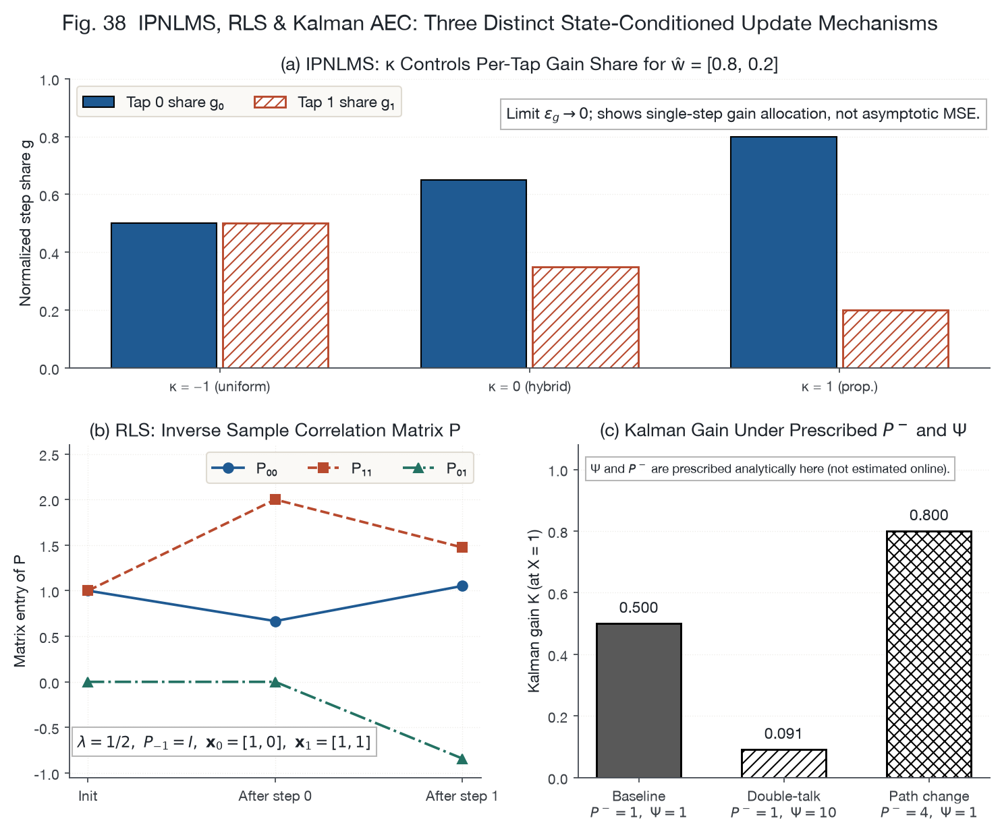

Reviewing the three panels of Figure 38 places IPNLMS, RLS, and Kalman update-shaping mechanisms side by side:

- Figure 38(a) plots the unregularized two-tap IPNLMS hand example ($\hat{\vec w}=[0.8,0.2]^\top$), showing tap shares $g_l$ evolving from $\kappa=-1$ (equal $[0.5,0.5]$) through $\kappa=0$ (blended $[0.65,0.35]$) to $\kappa=+1$ (purely proportionate $[0.8,0.2]$);
- Figure 38(b) plots the two-tap RLS hand example from §6.2.5, tracing the inverse correlation matrix from diagonal $\mathbf P_0=\operatorname{diag}(2/3,2)$ to $\mathbf P_1$ with negative off-diagonal coupling ($-16/19$);
- Figure 38(c) fixes dimensionless scalar reference $X=1$ and compares Kalman gain $K=P^-/(P^-+\Psi)$ across three prescribed statistical regimes (for Bayesian state-space foundations, see [Chapter 0 §0.6](00_math-foundations.md#sec-0-6)): "Baseline" ($P^-=1,\Psi=1$) yields $K=0.500$, "Assumed double-talk" ($P^-=1,\Psi=10$) contracts to $K\approx 0.091$, and "Assumed path jump" ($P^-=4,\Psi=1$) expands to $K=0.800$.

**From scalar to matrix state: What does diagonal approximation discard, and why use the Joseph covariance update?** Under the full time-domain matrix model with transition matrix $\mathbf A\in\mathbb{R}^{L\times L}$, process covariance $\mathbf Q$, and scalar observation variance $\Psi$, the complete real Kalman recursion reads:

$$\begin{aligned}
\hat{\vec h}_n^-&=\mathbf A\hat{\vec h}_{n-1},\\
\mathbf P_n^-&=\mathbf A\mathbf P_{n-1}\mathbf A^\top+\mathbf Q,\\
S_n&=\vec x_n^\top\mathbf P_n^-\vec x_n+\Psi,\\
\vec K_n&=\mathbf P_n^-\vec x_n/S_n,\\
e_n^-&=d[n]-\vec x_n^\top\hat{\vec h}_n^-,\\
\hat{\vec h}_n&=\hat{\vec h}_n^-+\vec K_n e_n^-,\\
\mathbf B_n&=\mathbf I_L-\vec K_n\vec x_n^\top,\\
\mathbf P_n&=\mathbf B_n\mathbf P_n^-\mathbf B_n^\top\\
           &\quad+\vec K_n\Psi\vec K_n^\top.
\end{aligned}\tag{6-22}$$

Examine the **Joseph stabilized covariance form** in the final two lines of Eq. (6-22): writing a priori path error $\vec\delta_n^-=\vec h_n-\hat{\vec h}_n^-$, a posteriori error $\vec\delta_n=\vec h_n-\hat{\vec h}_n$, and total observation interference $u_n=s[n]+v[n]$, substituting $e_n^-=\vec x_n^\top\vec\delta_n^-+u_n$ into $\vec\delta_n=\vec\delta_n^--\vec K_n e_n^-$ gives $\vec\delta_n=\mathbf B_n\vec\delta_n^--\vec K_n u_n$. Because a priori path error and current observation interference are uncorrelated, **for any arbitrary gain vector $\vec K_n$** (even when biased statistics or double-talk gating make $\vec K_n$ suboptimal), the true a posteriori error covariance equals the sum of two symmetric positive semidefinite quadratic forms—$\mathbf B_n\mathbf P_n^-\mathbf B_n^\top$ accounting for compressed remaining path uncertainty, plus $\vec K_n\Psi\vec K_n^\top$ accounting for fresh observation interference injected through $\vec K_n$!

Only when $\vec K_n$ equals the exact optimal gain $\mathbf P_n^-\vec x_n/S_n$ with zero rounding error does expanding the quadratic form cancel down to $(\mathbf I_L-\vec K_n\vec x_n^\top)\mathbf P_n^-$; in finite precision, subtracting two matrices readily destroys symmetry or creates negative eigenvalues, whereas the Joseph sum of congruent quadratic forms preserves symmetry and positive semidefiniteness structurally.

A two-tap hand example (see [`aec_kalman_matrix_demo.py`](../codes/chapters/ch06/aec_kalman_matrix_demo.py)) demonstrates what off-diagonal cross-tap covariance captures: set $\mathbf A=\mathbf I_2,\mathbf Q=\mathbf 0,\Psi=1$, initial state $\hat{\vec h}^-=\vec 0$, $\mathbf P^-=\operatorname{diag}(1,4)$, and first observation $\vec x=[1,1]^\top,d=3$. Equation (6-22) gives $S=1+4+1=6$, $\vec K=[1/6,2/3]^\top$, $\hat{\vec h}=[1/2,2]^\top$, and Joseph a posteriori covariance $\mathbf P$ with diagonal entries $5/6,4/3$ and off-diagonal entries $-2/3$. Even though $\mathbf P^-$ was purely diagonal, observing $x_0 h_0+x_1 h_1\approx 3$ ties the sum of the two taps together, immediately creating negative off-diagonal correlation $-2/3$!

When the next input probes the differential direction $\vec x_{\mathrm{next}}=[-1,1]^\top$, the full matrix evaluates innovation variance $[-1,1]\mathbf P[-1,1]^\top+1=(5/6+4/3+4/3)+1=9/2=4.5$ (faithfully reflecting high uncertainty along the previously unconstrained difference mode), whereas zeroing off-diagonal entries underestimates innovation variance at $(5/6+4/3)+1=19/6\approx 3.167$.

Note also the **exact algebraic bridge between RLS and time-domain matrix Kalman**: setting $\mathbf A=\mathbf I_L$, unit observation variance $\Psi=1$, and prior covariance inflation $\mathbf P_n^-=\lambda^{-1}\mathbf P_{n-1}$ in Eq. (6-22) (equivalent to adaptive process noise $\mathbf Q_n=(\lambda^{-1}-1)\mathbf P_{n-1}$, vanishing at $\lambda=1$) reduces the Kalman gain to

$$\begin{aligned}
\vec K_n
&=\frac{\lambda^{-1}\mathbf P_{n-1}\vec x_n}
       {1+\lambda^{-1}\vec x_n^\top\mathbf P_{n-1}\vec x_n}
=\frac{\mathbf P_{n-1}\vec x_n}
      {\lambda+\vec x_n^\top\mathbf P_{n-1}\vec x_n},
\end{aligned}$$

which coincides identically with the RLS gain in Eq. (6-18)!

**Partitioned-Block Frequency-Domain Kalman Filter (PBFDKF) master equations.** Extending matrix state tracking to multi-partition, multi-playback-channel frequency-domain filtering (original formulation in [Kuech, Mabande & Enzner, ICASSP 2014](https://doi.org/10.1109/ICASSP.2014.6853806)), stack all partition and channel frequency-domain weights into $\vec w_m\in\mathbb{C}^M$, denote the overlap-save linear observation operator mapping state to the length-$N$ **valid time-domain observation block** $\vec d_m\in\mathbb{R}^N$ by $\mathbf H_m\in\mathbb{C}^{N\times M}$ (incorporating binwise products, IFFT, and valid-half extraction $\mathbf S$), and let valid observation-interference covariance be $\mathbf \Psi_m\succ\mathbf 0$. Prior to block-diagonal approximations, the full matrix Kalman recursion reads:

$$\begin{aligned}
\hat{\vec w}_m^-&=\mathbf A\hat{\vec w}_{m-1},\\
\mathbf P_m^-&=\mathbf A\mathbf P_{m-1}\mathbf A^H+\mathbf Q,\\
\vec e_m^-&=\vec d_m-\mathbf H_m\hat{\vec w}_m^-,\\
\mathbf S_m&=\mathbf H_m\mathbf P_m^-\mathbf H_m^H+\mathbf \Psi_m,\\
\mathbf K_m&=\mathbf P_m^-\mathbf H_m^H\mathbf S_m^{-1},\\
\hat{\vec w}_m&=\hat{\vec w}_m^-+\mathbf K_m\vec e_m^-.
\end{aligned}\tag{6-23}$$

Checking dimensions: $\mathbf P_m^-\in\mathbb{C}^{M\times M}$, $\mathbf S_m\in\mathbb{C}^{N\times N}$, and $\mathbf K_m\in\mathbb{C}^{M\times N}$; because $\vec d_m$ is a real time-domain valid block, innovation satisfies $\vec e_m^-=(\vec e_m^-)^*$, while frequency-domain state $\vec w_m=\mathbf T\vec h$ arises from real finite-support FIR taps under a linear constraint map (so $\mathbf P_w=\mathbf T\mathbf P_h\mathbf T^H$ obeys conjugate symmetry and finite-support constraints rather than representing $2M$ free real parameters or independent proper complex states). Because dense inversion in Eq. (6-23) is prohibitive on long paths, practical designs prune off-diagonal covariance blocks at chosen hierarchy levels—for instance, [Zhu et al. (Interspeech 2021, §2–3)](https://www.isca-archive.org/interspeech_2021/zhu21d_interspeech.pdf) compare stereo VD-PBFDKF (retaining only same-channel, same-partition diagonal blocks) against SD-PBFDKF (additionally retaining cross-playback-channel blocks within each partition; open-source details in [Research Manual A04](../codes/chapters/ch00/research_en/02_aec_wpe_separation.md#aec)).

A controlled single-tap double-talk calculation summarizes the impact of variance mismatch: initialize $w^-=0,P^-=1,x=1,\Psi=0.1$; single-talk sample $d[0]=1$ gives $K_0=1/1.1=10/11$, converging to $w_0=10/11\approx 0.909$ and $P_0=1/11$. On sample $1$, the true path remains $1$, but near-end speech of amplitude $2$ raises $d[1]=3$ (innovation $e_1^-=3-10/11=23/11$):

- If $\Psi$ misses double-talk and stays at $0.1$, gain $K_1=(1/11)/(1/11+1/10)=10/21$ pulls the weight to $10/11+(10/21)(23/11)=440/231\approx 1.905$;
- If $\Psi$ captures double-talk energy and rises to $10$, gain plunges to $1/111$, holding the weight steady at $10/11+23/1221\approx 0.928$ (ideal hard freeze holds $10/11\approx 0.909$). In [`aec_rls_kalman_comparison.py`](../codes/chapters/ch06/aec_rls_kalman_comparison.py) (seed `20260923`, $512$-sample two-tap sequence), keeping low $\Psi$ during double-talk degrades a priori echo-estimate MSE to $0.1341$, whereas raising $\Psi$ or applying ideal freeze holds MSE down at $1.57\times 10^{-5}$ and $9.83\times 10^{-6}$ (four-method short-path residual audio comparison in [Synthetic Audio Notes](../codes/chapters/ch00/research_en/05_exercises_and_audio.md#sec-u-042e52c4d2)).

The table below places all seven linear adaptive architectures from §6.1–§6.2 on a unified engineering selection grid:

| Algorithm | Primary Compute per Sample | Factors Governing Convergence | Double-Talk Update Control | Target Operating Regime |
|---|---|---|---|---|
| Time-domain NLMS | $O(L)$; naive $\approx 3L$, recursive-energy core $\approx 2L$ | Input spectral condition number, step size, path drift | External freeze or continuous step-size control | Very short paths, pedagogy, or minimal verification |
| Proportionate (IPNLMS) | $O(L)$ plus proportionate weight evaluation | Faster initial convergence on sparse paths; limited gain on dense tails | Still requires external double-talk control | Impulse responses with pronounced sparse peaks |
| Affine Projection (APA) | Direct $\approx O(LK^2+K^3)$; small-window solve | Projection order $K$, column collinearity, regularizer $\delta$, noise | Window retains double-talk samples after freeze; needs window flush | Low order ($K=2$–$4$) to accelerate colored speech |
| Partitioned Frequency-Domain (PBFDAF) | Unconstrained $\approx O(\log N+L/N)$; full constraint adds $O((L/N)\log N)$ | Per-bin power normalization, block size $N$, constraint schedule | External binary freeze or continuous step scaling | Medium-to-long reverberant paths on buffered real-time devices |
| Subband Adaptive | Filterbank analysis/synthesis plus decimated short filtering | Within-band spectral flatness, oversampling ratio, or cross-band terms | Still requires double-talk control | Front-ends already running an oversampled analysis–synthesis bank |
| RLS | Full-matrix $O(L^2)$ compute and $O(L^2)$ storage | Forgetting factor $\lambda$, initial regularizer, silence windup guard | Highly sensitive to double-talk and silence; requires strict gating | Very low-order modules or offline least-squares baselines |
| Frequency-Domain Kalman (FDKF) | Partitioned filtering plus error and noise variance tracking | Accuracy of process variance $\mathbf Q$ and observation variance $\mathbf \Psi$ | Naturally supports per-bin soft gating by raising $\mathbf \Psi$ | Endpoints facing frequent path changes and demanding DT/reconvergence balance |

Two overarching axes organize this table: along the **computational architecture axis**, virtually all long-path real-time products deploy either partitioned-block frequency-domain filtering (MDF / PBFDAF) or oversampled subbands; along the **parameter update axis**, designs progress from fixed-step per-bin normalization to frequency-domain Kalman soft gating driven jointly by process and double-talk observation variances (FDKF / PBFDKF). With the linear adaptive backbone complete, §6.3 and §6.4 tackle the two main challenges outside the linear model—loudspeaker nonlinearities and double-talk detection.

### 6.3 Nonlinear Echo: Model Mismatch and Mitigation Methods

**Physical origins of nonlinearity**. Micro-speaker suspensions and magnetic circuits depart from Hooke's law and uniform-flux assumptions under large excursion (spider stiffness hardens steeply with displacement while voice-coil overhang reduces force factor), power amplifiers and digital playback chains undergo soft saturation or hard clipping at high volume, and thin plastic enclosures and buttons rattle and re-radiate nonlinearly under high sound pressure. Birkett & Goubran (WASPAA 1995) measured nonlinear echo behavior in hands-free terminals, and Klippel (*JAES*, 2006) established systematic large-signal electro-mechanical loudspeaker models.

**Why a residual plateau emerges**. The linear transversal filter of Eq. (6-2) can synthesize only linear combinations of historical reference samples $x[n],\ldots,x[n-L+1]$. Once amplifier or loudspeaker distortion generates harmonic and intermodulation products orthogonal to that linear subspace, even when linear taps converge to their MMSE optimum, nonlinear distortion energy orthogonal to the reference subspace remains untouched in $e[n]$, pinning $\mathrm{ERLE}$ at a horizontal **residual plateau** (Exercise E06-06 derives closed-form integrals and discrete spectra for a pure sinusoid traversing a cubic nonlinearity). Whether nonlinearity leaves an uncancelable residual also depends on the amplitude support of the excitation: for a bipolar binary sequence $x[n]\in\{-1,+1\}$, $x^3[n]\equiv x[n]$ collapses a cubic polynomial into a linear scaling that linear taps cancel completely; under continuous-amplitude speech and music, however, higher-order harmonics and intermodulation terms are fully exposed.

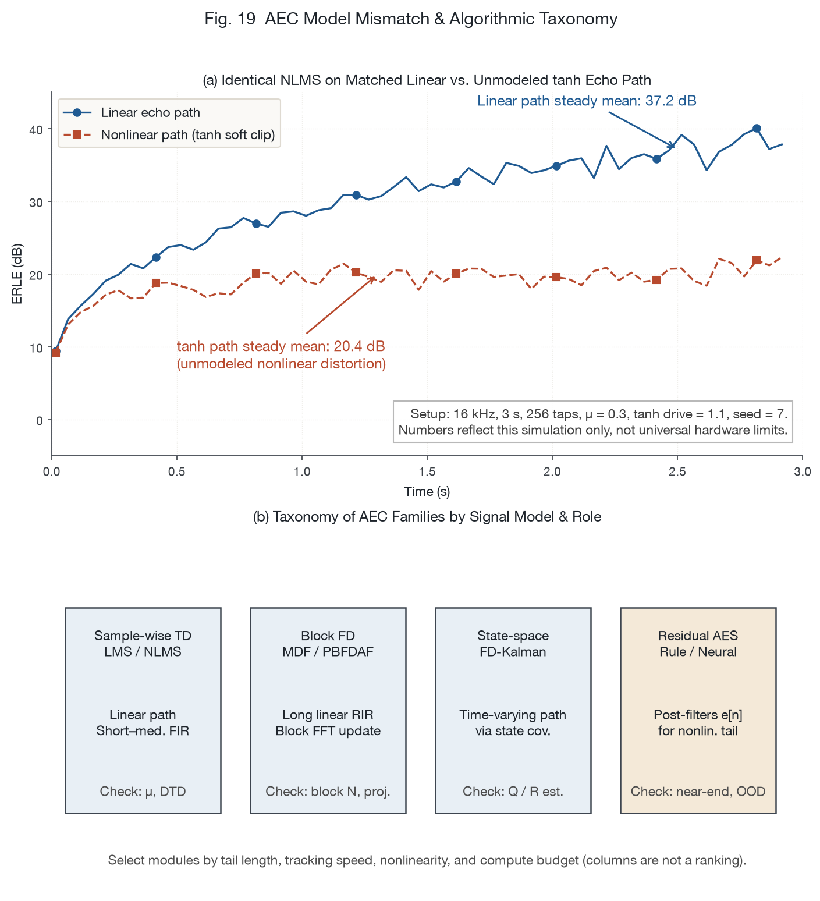

Figure 19 situates the chapter's algorithms across two panels:

- Figure 19(a) plots time (in $\mathrm{s}$) against $\mathrm{ERLE}$ (in $\mathrm{dB}$) over a $3\ \mathrm{s}$ controlled simulation ($256$ taps, step size $0.3$, drive factor $1.1$), contrasting a purely linear echo path against a nonlinearly distorted path—linear $\mathrm{ERLE}$ climbs steadily, whereas the nonlinear path rapidly hits a plateau dictated by unmodeled harmonics;
- Figure 19(b) maps the algorithmic landscape by "model expressiveness" versus "signal processing target": progressing from sample-level LMS/NLMS, partitioned frequency-domain MDF/PBFDAF, and state-space FDKF to explicit nonlinear modeling and post-suppression (spatial placement reflects problem taxonomy rather than chronology or universal ranking). Note that Figure 19(a) and Figure 31(a) below use independent random seeds, boundary tapering, and path realizations despite similar tap counts and drive factors, so their plateau dB numbers illustrate each experiment's own mismatch mechanism rather than cross-figure comparison.

> **Minimal hand calculation of normalized `tanh` soft saturation.**
>
> Figure 31 models symmetric odd-order amplifier/loudspeaker saturation via $y=\tanh(1.1x)/\tanh(1.1)$, normalized so anchor $x=1$ maps to $y=1$. Evaluating two representative amplitudes: at small amplitude $x=0.3$, $y=\tanh(0.33)/\tanh(1.1)\approx 0.3185/0.8005\approx 0.398$, sitting $+0.098$ above secant $y=x$; at overload $x=1.5$, $y=\tanh(1.65)/\tanh(1.1)\approx 0.9289/0.8005\approx 1.160$, compressed by $-0.340$ below $y=x$.
>
> Differentiating at the origin gives small-signal tangent slope $1.1/\tanh(1.1)\approx 1.374$, so dashed line $y=x$ is the secant through $(0,0)$ and $(1,1)$ rather than the origin tangent. Under continuous speech excitation, a linear adaptive filter automatically finds the MMSE-optimal equivalent linear slope, yet any nonzero curvature leaves bending residuals between the best straight line and the true S-curve that cannot be eliminated by lengthening $L$.

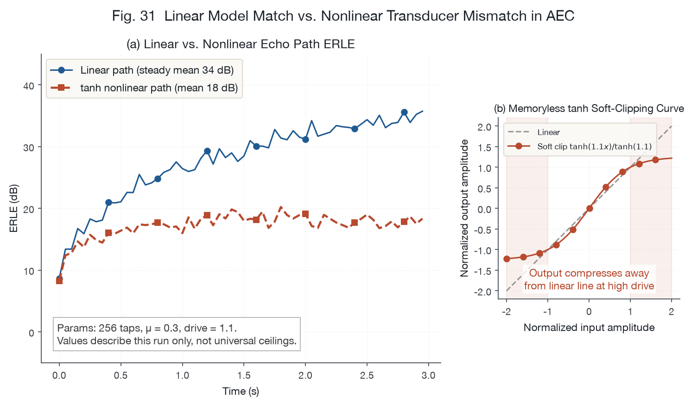

Read both panels of Figure 31 together: Figure 31(b) plots input amplitude $x$ against output amplitude $y$, showing small-signal expansion and large-signal compression of normalized $\tanh$ relative to secant $y=x$; Figure 31(a) shows that inserting this exact static nonlinearity into the echo path caps steady-state NLMS $\mathrm{ERLE}$ at a flat plateau, establishing a direct causal link from **static transfer curvature $\longrightarrow$ linear cancellation ceiling**.

#### Explicit Nonlinearity Modeling

When linear combinations fall short, the first route incorporates nonlinear basis expansions of the known reference directly into the adaptive predictor. The most general memory-truncated feedforward expansion is the **second-order Volterra filter**, augmenting linear convolution with pairwise products of historical samples. Exploiting symmetry $x[n-i]x[n-j]=x[n-j]x[n-i]$ over upper-triangular indices $0\le i\le j<L$ and abbreviating $t_i=x[n-i]$ at sample $n$, the predicted echo reads:

$$\begin{aligned}
\hat y[n]&=\sum_{i=0}^{L-1}w_i t_i\\
&\quad+\sum_{0\le i\le j<L}q_{ij} t_i t_j.
\end{aligned}\tag{6-24}$$

Although Eq. (6-24) remains linear in the unknown parameters $\{w_i,q_{ij}\}$, parameter count explodes quadratically: $L$ linear taps plus $L(L+1)/2$ upper-triangular quadratic coefficients (when folding a symmetric matrix $\mathbf H$, off-diagonal pairs combine as $q_{ij}=H_{ij}+H_{ji}=2H_{ij}$ while diagonal entries stay $q_{ii}=H_{ii}$—dropping the lower triangle without the factor of $2$ miscomputes off-diagonal terms). At $L=256$, the quadratic kernel alone demands $256\times 257/2=32896$ weights, inflating MACs and double-talk overfitting risk; worse yet, a quadratic form driven by a pure sinusoid generates only DC and second harmonics, offering zero expressive power against odd-order third harmonics produced by symmetric clipping such as $\tanh$ above and Exercise E06-06 (see [Stenger & Rabenstein, NSIP 1999](https://www.eurasip.org/Proceedings/Ext/NSIP99/Nsip99/papers/146.pdf)).

To sidestep the curse of dimensionality from cross-lag products, engineering practice favors **structured block-oriented cascades** mirroring physical hardware stages: static memoryless nonlinearity followed by linear dynamics ($N\to L$) forms a **Hammerstein model**; linear dynamics followed by static nonlinearity ($L\to N$) forms a **Wiener model**; and amplifier pre-filtering, nonlinear limiting, plus room propagation form an $L\to N\to L$ **Wiener–Hammerstein model**. In the generalized Hammerstein (power-filter) model widely adopted on compact devices, $Q$ known memoryless basis functions $\{\psi_q(\cdot)\}_{q=1}^{Q}$ transform $x[n]$ first, and each branch traverses its own $L$-tap causal linear filter $h_q[\ell]$:

$$\begin{aligned}
\hat y[n]&=\sum_{q=1}^{Q}\sum_{\ell=0}^{L-1}
           h_q[\ell]\,\psi_q(x[n-\ell]).
\end{aligned}$$

When memoryless amplifier distortion $g(x)=\sum_{q=1}^{Q}c_q\psi_q(x)$ precedes a single shared room path $h[\ell]$, this specializes to the rank-1 structure $h_q[\ell]=c_q h[\ell]$; keeping independent $h_q[\ell]$ converts identification into a $Q$-channel linear-in-parameters multi-reference adaptive problem with only $Q L$ total parameters (e.g., $Q=3$ odd orders at $L=256$ need just $768$ taps versus $32896$ for second-order Volterra), solvable directly within the partitioned frequency-domain framework of §6.2.

**Why choose orthogonal Legendre polynomials instead of raw power monomials $\{x,x^2,x^3,\ldots\}$?** The culprit is **severe inter-branch collinearity and ill-conditioning**! Over normalized amplitude $x\in[-1,1]$ with uniform excitation $x\sim\mathcal U(-1,1)$, compare the two odd monomial branches $\psi_1(x)=x$ and $\psi_3(x)=x^3$: because $x$ and $x^3$ share identical sign everywhere on $[-1,1]$ and peak together near $\pm 1$, even moments $\mathbb{E}[x^{2k}]=\frac{1}{2}\int_{-1}^{1}x^{2k}\,\mathrm{d}x=1/(2k+1)$ give $\mathbb{E}[x^2]=1/3$, $\mathbb{E}[x^6]=1/7$, and a massive cross-moment $\mathbb{E}[x\cdot x^3]=\mathbb{E}[x^4]=1/5$! Their normalized correlation coefficient is

$$\begin{aligned}
\rho_{1,3}
&=\frac{\mathbb{E}[x^4]}
       {\sqrt{\mathbb{E}[x^2]\,\mathbb{E}[x^6]}}
 =\frac{1/5}{\sqrt{(1/3)(1/7)}}
 =\frac{\sqrt{21}}{5}\approx 0.9165.
\end{aligned}$$

Even after normalizing each branch to unit variance, their $2\times 2$ correlation matrix has condition number $(1+\rho_{1,3})/(1-\rho_{1,3})=(5+\sqrt{21})/(5-\sqrt{21})\approx 22.96$ (unscaled moment matrix with diagonal $1/3,1/7$ and off-diagonal $1/5$ has $\kappa_2\approx 27.73$). More generally, across odd degrees $p,q\in\{1,3,5,\ldots\}$, raw monomial moments $\mathbb{E}[x^{p+q}]=\frac{1}{p+q+1}$ form an **odd-indexed Cauchy / Hilbert ill-conditioned submatrix**! Adding a fifth-order branch $x^5$ for $\{x,x^3,x^5\}$ balloons the raw condition number from $27.73$ to **$849.58$**—and **$567.45$** even after unit-variance scaling—causing gradients to tug-of-war sluggishly across harmonic branches (exact characteristic polynomials and coordinate decoupling are derived in Exercise [E06-43](#e06-43)).

Switching to **orthogonal Legendre polynomials** on $[-1,1]$ ($P_1,P_3,P_5,\ldots$ for symmetric odd distortion, adding $P_2,P_4,\ldots$ when asymmetric even harmonics exist):

$$\begin{aligned}
P_1(x)&=x,\qquad
P_2(x)=\frac{1}{2}(3x^2-1),\\
P_3(x)&=\frac{1}{2}(5x^3-3x),\qquad
P_5(x)=\frac{1}{8}(63x^5-70x^3+15x).
\end{aligned}$$

These satisfy $\int_{-1}^{1}P_p P_q\,\mathrm{d}x=\frac{2}{2q+1}\delta_{pq}$ exactly on $[-1,1]$. Notice what $P_3(x)$ and $P_5(x)$ accomplish: they project out all lower-degree odd subspaces from $x^3$ and $x^5$, so under $x\sim\mathcal U(-1,1)$, $\mathbb{E}[P_1(x)P_3(x)]=(5/2)(1/5)-(3/2)(1/3)=0$, diagonalizing the unscaled three-branch moment matrix to $\operatorname{diag}(1/3,1/7,1/11)$ ($\kappa_2=11/3\approx 3.67$)—and scaling by $\sqrt{2q+1}$ yields the identity matrix $\mathbf I_3$ with $\kappa_2=1$! Real speech amplitudes follow super-Gaussian distributions peaked near zero with temporal correlation, so Legendre branches are not strictly orthogonal on speech, yet stripping away dominant polynomial collinearity still slashes multi-branch condition numbers and speeds up nonlinear AEC convergence dramatically (see Kuech & Kellermann, *Signal Processing*, 2006).

When pre-nonlinearity amplifier filtering cannot be neglected, [Nollett & Jones (NSIP 1997)](https://www.iwaenc.org/proceedings/1997/nsip97/pdf/author/ns970521.pdf) investigated an $L\to N\to L$ Wiener–Hammerstein cascade: driving an inexpensive active PC speaker hard into amplifier clipping with pitch- and amplitude-varying synthetic vowels, a $30$-tap pre-filter plus $200$-tap post-filter LNL cascade raised steady-state $\mathrm{ERLE}$ from $11.1\ \mathrm{dB}$ (for a $230$-tap linear NLMS of equal total length) to $19.5\ \mathrm{dB}$ ($+8.4\ \mathrm{dB}$). Note the experimental scope when citing these numbers: that hardware test used synthetic vowels without reporting sampling rate or multi-trial statistics, while their companion white-noise simulation compared $15+43$ taps against $58$ taps, so real-product gains must always be re-benchmarked on target loudspeakers and double-talk speech.

#### Relocating the Reference Tap-Off Point

Because substantial nonlinearity originates at the tail end of the digital chain or inside the analog power amplifier, a complementary hardware-assisted strategy **moves the reference tap-off point downstream toward the physical loudspeaker terminals**, capturing already-distorted waveforms directly into the reference so the adaptive filter need not guess the distortion curve:

- **Loudspeaker terminal electrical reference**: Digitizing attenuated amplifier output voltage or voice-coil current via an auxiliary ADC channel (see [Shah et al., *IEEE/ACM TASLP*, 2015](https://doi.org/10.1109/TASLP.2015.2425955)) folds digital limiting and analog amplifier clipping completely into the known reference, though suspension nonlinearities and enclosure rattle downstream of the voice coil remain on the unknown path side;
- **Mechanical vibration reference**: Mounting an accelerometer on the speaker basket or device shell captures structural vibration directly, at the cost of extra BOM, synchronous ADC channels, and sensor noise floor.

In hardware–software co-design, relocating reference taps, orthogonal-basis nonlinear cancellation, and Deep Neural Network (DNN) residual suppression (§6.5) combine across cost and compute tiers rather than competing mutually exclusively; engineering acceptance simply logs both the linear/explicit-cancellation stage output and the post-suppressor final output side by side.

### 6.4 Double-Talk Detection and Adaptation Control

Once local speech and far-end playback occur simultaneously (double-talk), the a priori residual $e[n]=d[n]-\hat y[n]$ mixes path-mismatch echo with strong near-end speech $s[n]$. Continuing aggressive updates allows $s[n]$ to pour into the taps through $e[n]\vec x[n]$, corrupting an already converged echo path. **Double-Talk Detection (DTD)** senses double-talk in real time to throttle step sizes or freeze updates: an overly hair-trigger threshold mistakes acoustic path changes (such as a user walking or picking up a handset) for double-talk and locks the filter into prolonged echo leakage, whereas a sluggish threshold misses double-talk onsets, causing tap divergence and clipped near-end syllables.

First draw a crisp theoretical distinction between **instantaneous single-step online drift** and **statistical unbiasedness of the population MMSE optimum**. Under the noiseless linear model $d[n]=\vec x^\top[n]\vec h+s[n]$, whenever $\mathbf R_{xx}=\mathbb{E}[\vec x[n]\vec x^\top[n]]$ is invertible and near-end speech is orthogonal to the reference regression vector ($\mathbb{E}[\vec x[n]s[n]]=\vec 0$), the unique minimizer of $\min_{\vec w}\mathbb{E}[(d[n]-\vec x^\top[n]\vec w)^2]$ still equals the exact path $\vec h$ (for zero-mean signals, uncorrelatedness suffices for $\mathbb{E}[\vec x[n]s[n]]=\vec 0$; with nonzero DC offsets, $\mathbb{E}[\vec x s]=\operatorname{Cov}(\vec x,s)+\mathbb{E}[\vec x]\mathbb{E}[s]$, so zero covariance alone is insufficient).

If the population optimum is unbiased, why does un-frozen double-talk still wreck an adaptive filter? Because online algorithms step along finite-sample instantaneous gradients $e[n]\vec x[n]$, where strong $s[n]$ inflates gradient variance by orders of magnitude, driving violent weight excursions away from $\vec h$ under finite step sizes; and if any correlation exists ($\mathbb{E}[\vec x[n]s[n]]\neq\vec 0$), even the population normal equations absorb correlated near-end components into the taps (theoretical foundations in [Benesty & Gänsler, IWAENC 2001](https://www.iwaenc.org/proceedings/2001/main/data/benesty.pdf); four-sample batch-orthogonality versus online-drift verification in Exercise [E06-21](#e06-21), and denominator-induced conditional expectation bias in Exercise E06-32).

**Principal DTD methods** (DTD = double-talk detection; NCC = normalized cross-correlation):

1. **Geigel magnitude comparison**: Let $x_a[n]$ denote the bulk-delay-aligned reference feeding the length-$L$ adaptive filter. First verify whether sliding-window peak $M[n]=\max_{0\le\ell<L}|x_a[n-\ell]|$ exceeds a reference-activity floor; only when active, evaluate magnitude ratio $\xi[n]=|d[n]|/M[n]$ and declare double-talk if $\xi[n]>T$. Never divide when $M[n]=0$ or treat silent frames as double-talk evidence.

    Writing $M$ and $\xi$ at an active instant $n$ satisfying $M[n]>T_x>0$:

    $$\begin{aligned}
    M&=\max_{0\le\ell<L}|x_a[n-\ell]|,\\
    \xi&=\frac{|d[n]|}{M}.
    \end{aligned}\tag{6-25}$$

    The classic textbook threshold $T=0.5$ originated in PSTN line echo cancellers assuming at least $6\ \mathrm{dB}$ hybrid return loss ($20\log_{10}(1/0.5)\approx 6.02\ \mathrm{dB}$), and is **not** a universal constant for acoustic hands-free devices. In multi-path rooms, constructively summing reflections easily push pure single-talk echo peaks past $0.5\times$ or even $1\times$ a single reference peak.

    A two-tap pure STFE counterexample makes this unmistakable: set $x_a[n]=x_a[n-1]=1$, $h=[0.4,0.4]$, and $s[n]=0$, giving pure echo $d[n]=0.4+0.4=0.8$, peak $M=1$, and $\xi=0.8>0.5$—false-alarming double-talk continuously in dead near-end silence! Conversely, well-isolated enclosures with weak echo easily miss soft near-end barge-in. The Geigel detector ([Duttweiler, *IEEE TCOM*, 1978](https://doi.org/10.1109/TCOM.1978.1094133)) is therefore suitable only as an ultra-cheap coarse pre-screen rather than a standalone acoustic DTD;

2. **Cross-correlation / Normalized Cross-Correlation (NCC)** ([Benesty, Morgan & Cho, *IEEE TSAP*, 2000](https://doi.org/10.1109/89.824701); [Benesty & Gänsler, IWAENC 2001](https://www.iwaenc.org/proceedings/2001/main/data/benesty.pdf)): Pairs reference regression vector $\vec x[n]$ with **microphone observation $d[n]$** (not residual $e[n]$!) in a whitened second-order statistic. Why not correlate $\vec x[n]$ with residual $e[n]$? Once $\hat{\vec w}\approx\vec h$, both STFE and uncorrelated DT satisfy $\mathbb{E}[\vec x[n]e[n]]\approx\vec 0$—rising $\vec x$-to-$e$ correlation signals *path mismatch*, which neither distinguishes DT from path jumps nor triggers promptly on converged DT.

    To remove arbitrary multi-tap path $\vec h$ and colored reference spectra from the threshold, consider zero-mean $d[n]=\vec h^\top\vec x[n]+s[n]$ ($\vec h\neq\vec 0$, $s[n]\perp\vec x[n]$) with positive definite $\mathbf R_{xx}=\mathbb{E}[\vec x[n]\vec x^\top[n]]\in\mathbb{R}^{L\times L}$, cross-correlation $\vec r_{xd}=\mathbb{E}[\vec x[n]d[n]]=\mathbf R_{xx}\vec h$, and microphone variance $\sigma_d^2=\mathbb{E}[d^2[n]]=\sigma_y^2+\sigma_s^2$ where $\sigma_y^2=\vec h^\top\mathbf R_{xx}\vec h$. Evaluating the $\mathbf R_{xx}^{-1}$-whitened quadratic form:

    $$\begin{aligned}
    \vec r_{xd}^\top\mathbf R_{xx}^{-1}\vec r_{xd}
    &=(\mathbf R_{xx}\vec h)^\top\mathbf R_{xx}^{-1}
      (\mathbf R_{xx}\vec h)
     =\vec h^\top\mathbf R_{xx}\vec h=\sigma_y^2,
    \end{aligned}$$

    recovering unknown echo power exactly! Dividing by $\sigma_d^2$ and taking the square root yields the **full vector Benesty NCC** statistic:

    $$\begin{aligned}
    \nu&=\sqrt{\frac{\vec r_{xd}^\top\mathbf R_{xx}^{-1}\vec r_{xd}}
                    {\sigma_d^2}}
        =\sqrt{\frac{\sigma_y^2}{\sigma_y^2+\sigma_s^2}}.
    \end{aligned}$$

    Observe its clean invariance: regardless of how many delay taps $\vec h$ spans or how large its gain is, noiseless STFE ($\sigma_s^2=0$) yields $\nu=1$ identically, while near-end speech ($\sigma_s^2>0$) strictly pulls $\nu$ into $(0,1)$, decoupling the decision threshold from path gain! At $L=1$, $\mathbf R_{xx}=\sigma_x^2$ and $r_{xd}=h\sigma_x^2$ reduce $\nu$ to scalar $|\rho_{xd}|=|h|\sigma_x/\sqrt{h^2\sigma_x^2+\sigma_s^2}$ (e.g., $h=0.5,\sigma_x^2=1,\sigma_s^2=0.25$ gives $\nu=0.5/\sqrt{0.25+0.25}\approx 0.707$). Because inverting $L\times L$ matrix $\mathbf R_{xx}$ online is costly, Benesty et al. substitute the converged adaptive filter itself, $\hat{\vec w}[n]\approx\mathbf R_{xx}^{-1}\vec r_{xd}$, forming the cheap inner-product estimator $\hat\nu^2[n]=(\hat{\vec r}_{xd}^\top[n]\hat{\vec w}[n])/\hat\sigma_d^2[n]$ (which can deviate slightly outside $[0,1]$ prior to convergence);

3. **Frequency-domain NCC** (Gänsler & Benesty, *Signal Processing*, 2001): Moves cross-correlation into frequency bins or subbands, reusing PBFDAF spectra directly without large time-domain matrices;

4. **Coherence-based DTD**: Estimates short-time Magnitude-Squared Coherence (MSC) between $d$ and $x$ across bins and aggregates across bands—sharing the same physical core as frequency-domain NCC (near $1$ on single-talk linear echo, dropping sharply under double-talk or strong noise);

5. **Two-path / foreground–shadow filtering**: Maintains a conservative foreground filter for clean output alongside a fast-adapting background shadow filter that scouts new paths. Note that a shadow filter is not "magically immune to double-talk"—uncontrolled large-step adaptation during double-talk corrupts it too, so shadow updates still incorporate energy and coherence guards.

    Only when the shadow filter sustains markedly lower STFE residual than the foreground filter across a multi-frame hold window under valid reference coherence does control logic copy shadow weights over to the foreground, applying thresholds and hysteresis to prevent oscillation (three-window gating verified in Exercise [E06-44](#e06-44)).

    WebRTC AEC3 centers its linear stage on bidirectional promotion and reset between a conservative `refined` foreground filter and an aggressive `coarse` shadow filter, dissected in detail in §6.8.

> **Boundary check on Geigel thresholding.** In legacy PSTN line echo with peak $M=1.0$ and $6\ \mathrm{dB}$ hybrid attenuation ($|d|\approx 0.5$), $T=0.5$ sits right at the STFE ceiling. Moved to acoustic hands-free devices, strong multi-path reflections push STFE $|d|/M>0.5$ into chronic false freezes, while well-isolated enclosures with weak echo plus soft near-end speech fall below $0.5$ and miss double-talk—motivating modern coherence, two-path, and Kalman soft-gating designs.

**From binary hard freezing to continuous soft step sizes**. Binary freezing acts as an abrupt $0/1$ switch prone to audible transitions under detection latency. Mäder, Puder & Schmidt (*Signal Processing*, 2000) derived optimal continuous step-size factors $\alpha(k,m)\in[0,1]$ minimizing a posteriori tap mismatch as a smooth function of the per-band ratio of residual path-mismatch echo power to near-end-plus-noise power—converging conceptually with the frequency-domain Kalman soft gate in Eq. (6-21) to transition seamlessly between double-talk protection and slow path tracking.

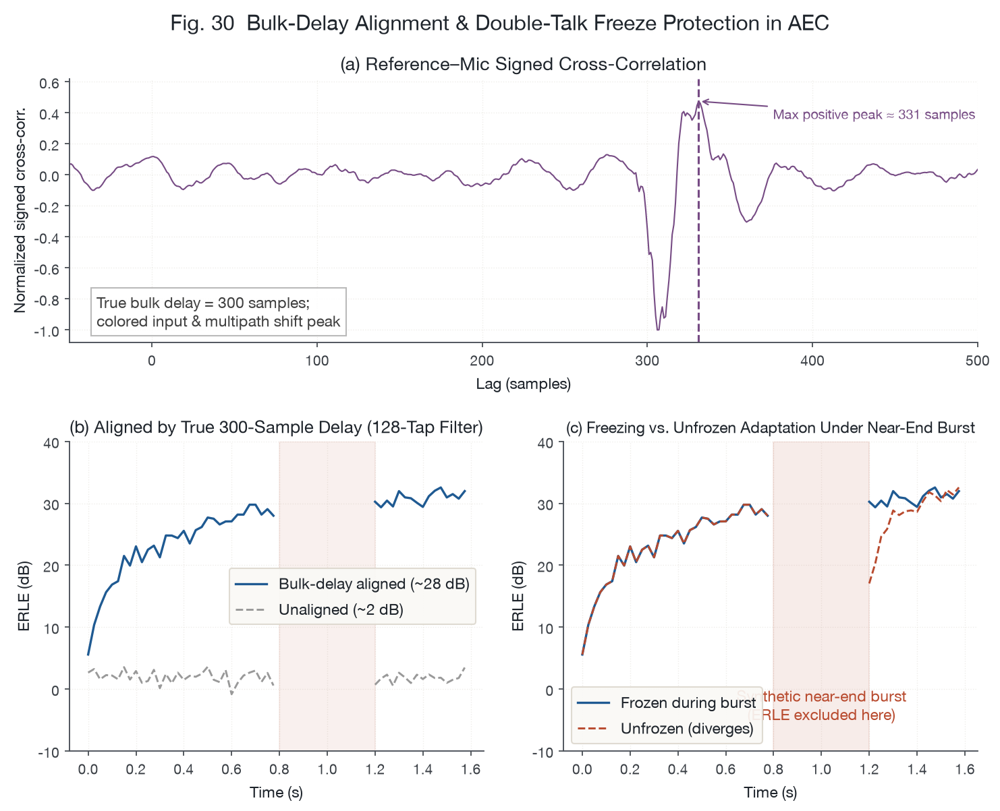

Inspecting the three panels of Figure 30 clarifies bulk delay alignment and double-talk freezing:

- Figure 30(a) plots lag (in samples) against **signed sample cross-correlation** over the first $4000$ samples. Although the true pure propagation delay is $300$ samples, the largest positive correlation peak lands near lag $331$! This offset arises because the broad autocorrelation mainlobe of the colored reference convolves with alternating-sign multi-path taps, shifting the signed maximum away from path onset $300$ (if the dominant tap has negative polarity, searching only for the maximum **positive** peak fails completely—see Exercise E06-10; industrial estimators whiten spectral magnitude via GCC-PHAT and detect the leading edge of the magnitude envelope);
- Figure 30(b) compares $128$-tap NLMS STFE $\mathrm{ERLE}$ with known $300$-sample delay compensation against uncompensated alignment: because $300$ samples exceed the $128$-tap span altogether, the unaligned filter achieves virtually no cancellation ($\approx 2\ \mathrm{dB}$), whereas pre-alignment focuses all $128$ taps onto the multi-path tail to reach $\approx 28\ \mathrm{dB}$;
- Figure 30(c) injects a white Gaussian near-end burst after convergence, contrasting "frozen weights" against "uncontrolled adaptation": uncontrolled updates write random burst interference into the taps, causing pronounced echo rebound and slow secondary reconvergence once single-talk resumes.

**Hard geometric condition for tap-span coverage.** Suppose a pure bulk delay of $D$ samples precedes a nonzero reverberant tail spanning relative lags $0$ through $R$. Without pre-alignment, a causal length-$L$ FIR covers all nonzero taps only if $L\ge D+R+1$; delaying the reference by $D$ samples up front reduces the requirement to $L\ge R+1$, dedicating all MACs to actual reverberation. Conversely, if audio-pipeline scheduling delivers the reference to AEC **later** than the echo arrives at the microphone (effective $D<0$, placing the path in non-causal negative lags), not even $10{,}000$ causal FIR taps can predict future reference samples yet to arrive—pipeline buffering must be corrected first (see Exercise E06-24).

In long-call diagnostics, keep three distinct delay anomalies separate: a fixed pipeline offset shifts the correlation peak by a constant lag; crystal mismatch (Sample Rate Offset, SRO) causes correlation lag to drift linearly over time; and Bluetooth reconnects, buffer underruns, or audio-route switches cause abrupt step jumps—requiring initial buffer alignment, asynchronous resampling, and jump re-acquisition respectively rather than blindly lengthening FIR taps (source-level mechanisms in the [Research Manual](../codes/chapters/ch00/research_en/02_aec_wpe_separation.md#aec)).

#### 6.4.1 Four-State Experiment on Automatic Double-Talk Detection

Figure 30(c) froze adaptation using ground-truth interval labels; evaluating a genuine automatic DTD requires feeding the detector **only** aligned reference $x[n]$ and microphone observation $d[n]$ while isolating ground-truth activity labels strictly on the scoring side. Teaching function [`ncc_activity_states()`](../codes/chapters/ch06/core/double_talk.py) partitions $x[n]$ and $d[n]$ into non-overlapping $B=160$-sample frames ($10\ \mathrm{ms}$ at $16\ \mathrm{kHz}$), gates per-channel activity via demeaned frame RMS, and emits four operational labels according to the five-row decision table below:

| Reference Active | Microphone Active | Correlation Condition | Baseline Decision |
|---|---|---|---|
| No | No | Ratio not evaluated | Silence |
| No | Yes | Double-talk ratio not evaluated | Near-end single-talk |
| Yes | No | Correlation evidence not required | Far-end single-talk |
| Yes | Yes | Absolute NCC $\ge$ threshold | Far-end single-talk |
| Yes | Yes | Absolute NCC $<$ threshold | Double-talk |

Pay special attention to rows 2 and 3: row 3 ("reference active, microphone below threshold") captures low playback volume or high acoustic isolation where far-end audio is genuinely playing, labeling it `far_only` rather than mutual silence; row 2 ("current frame reference inactive, microphone active") reflects only an instantaneous comparison within the **current $10\ \mathrm{ms}$ window**—immediately after far-end playback stops, earlier playback continues arriving via delayed room reflections as a **pure echo tail**, causing the short-window detector to emit operational label `near_only` even when zero near-end speech exists in the room (Exercises [E06-41](#e06-41) and [E06-42](#e06-42) verify this pure echo-tail effect frame by frame; never mistake a frame-level operational tag for clean near-end ground truth).

Within frames where both reference and microphone are active, writing demeaned samples $\tilde x_b=x_b-\bar x$ and $\tilde d_b=d_b-\bar d$ ($b=0,\ldots,B-1$), our teaching baseline evaluates zero-lag scalar absolute cross-correlation $c_{xd}$:

$$\begin{aligned}
P_x&=\sum_{b=0}^{B-1}\tilde x_b^2,\\
P_d&=\sum_{b=0}^{B-1}\tilde d_b^2,\\
c_{xd}&=\frac{\left|\sum_{b=0}^{B-1}\tilde x_b\tilde d_b\right|}
             {\sqrt{P_x P_d}}.
\end{aligned}\tag{6-26}$$

Evaluated only when $P_x P_d>0$, the absolute value ensures an inverted single-tap path $d_b=-h_0 x_b$ still yields $c_{xd}=1$. Comparing Eq. (6-26) against the **full vector Benesty NCC** immediately predicts the Achilles' heel of this zero-lag scalar baseline: Eq. (6-26) correlates only at lag $0$ ($\sum_b\tilde x_b\tilde d_b$) without $\mathbf R_{xx}^{-1}$ whitening to gather echo energy at lags $\ell\ge 1$! Whenever the dominant echo peak sits at a nonzero lag, $c_{xd}$ collapses even in pure STFE without a whisper of near-end speech.

Runnable script [`aec_dtd_demo.py`](../codes/chapters/ch06/aec_dtd_demo.py) verifies both sides of this prediction: fixing $16\ \mathrm{kHz}$ and seed `20260924` for independent Gaussian sequences over zero-lag-dominant path $h=[0.6,0.25]$ across five $20$-frame stages—silence, STFE, STNE, DT, and far-end recovery ($100$ frames total; reference/near-end scales $0.3$ and $0.22$, demeaned RMS threshold $0.02$, $c_{xd}$ threshold $0.85$):

| Ground-Truth State | Predicted Silence | Predicted STFE | Predicted STNE | Predicted DT |
|---|---:|---:|---:|---:|
| Silence | 20 | 0 | 0 | 0 |
| Far-end single-talk (incl. recovery) | 0 | 40 | 0 | 0 |
| Near-end single-talk | 0 | 0 | 20 | 0 |
| Double-talk | 0 | 0 | 0 | 20 |

On this zero-lag-dominant path, all $100$ frames land on the diagonal; expanding frame decisions to freeze all $160$ samples of each detected DT frame (which buffers $10\ \mathrm{ms}$ before retroactive gating rather than operating at zero-lookahead sample causality) cuts residual RMS of the known echo component during DT from $0.1492$ (unfrozen) to $0.0812$ (both branches subsequently reconverge to floating-point precision during far-end recovery, reminding us that inspecting final end-of-call weights alone cannot rule out mid-call double-talk leakage).

Now test the **delayed-peak multi-path counterexample**: keeping pure STFE ($s[n]\equiv 0$) while swapping the path to lag-1-dominant $h=[0.1,0.75]$, the exact same zero-lag detector misclassifies $100\%$ of all $20$ pure-echo frames as double-talk, with mean $c_{xd}$ plunging to $\approx 0.1105$! Because adjacent white-Gaussian samples are nearly orthogonal, dominant echo $0.75\,x[n-1]$ contributes nothing to the zero-lag numerator $\sum\tilde x[n]\tilde d[n]$ while inflating denominator $P_d$, dropping theoretical correlation to $0.1/\sqrt{0.1^2+0.75^2}\approx 0.132\ll 0.85$. This vividly demonstrates why industrial double-talk control must pool evidence across taps (vector/frequency-domain NCC) and bands alongside path-change logic.

**Learning-based step-size control.** Lightweight neural networks can also predict per-frame, per-bin step sizes jointly from reference, microphone, and innovation spectra. For example, Deep Variable Step-Size (DVSS; [Ivry et al., ICASSP 2022](https://israelcohen.com/wp-content/uploads/2022/04/Deep_Adaptation_Control_for_Acoustic_Echo_Cancellation.pdf)), evaluated in §4.1–§4.3 and Table 4 of the original paper ($16\ \mathrm{kHz}$, $150\ \mathrm{ms}$ paths, $100\ \mathrm{h}$ synthetic/real corpus split $80/10/10\ \mathrm{h}$, random path jumps every $4.5$–$5.5\ \mathrm{s}$, $8\ \mathrm{ms}$ step-size updates; reconvergence defined as normalized misalignment reaching $\le -10\ \mathrm{dB}$ and holding until the next jump), shortened mean post-jump reconvergence time from $7.9\ \mathrm{s}$ for a fixed tiny-step NLMS baseline ($\mu=3\times 10^{-5}$ without classical DTD) to $3.4\ \mathrm{s}$ while raising reconvergence success rate from $58\%$ to $95\%$.

When citing such figures, keep "path-reconvergence success rate" distinct from "double-talk classification recall," and benchmark candidate controllers fairly against "linear AEC + classical two-path / Kalman gating" on target hardware.

Sections 6.3 and 6.4 have thus established the origin of nonlinear residual plateaus and the boundaries of double-talk gating: nonlinear and late-reverberation residuals beyond linear span pass to a post-suppressor, while double-talk outputs naturally carry near-end speech and cannot be scored via input-to-output total power ratios. Sections 6.5–6.7 next examine neural residual suppression, array cascade ordering, and full-duplex evaluation.

### 6.5 Learning-Based AEC

**Benchmarking and paradigm evolution through the Microsoft AEC Challenge**. Legacy telecom testing long emphasized STFE $\mathrm{ERLE}$, yet real-world double-talk experience most often breaks down when "echo is crushed, and near-end speech gets chopped up right along with it." Beginning in 2021, Microsoft's public AEC Challenges introduced large-scale paired consumer-device loopback/microphone recordings alongside crowdsourced double-blind listening tests (rules, latency caps, and test splits vary by edition; consult each year's official report when reproducing):

| Report | Verifiable Setup | Scope Caveats |
|---|---|---|
| [ICASSP 2021 Challenge Report (Sridhar et al.)](https://arxiv.org/pdf/2009.04972.pdf) | Public multi-device paired render-loopback and microphone clips; ITU-T P.808 crowdsourced subjective evaluation | Dataset size, rankings, and sub-scores must be read within that edition's protocol tables |
| [2023 Challenge Report (Cutler et al., *IEEE OJSP* 2024)](https://doi.org/10.1109/OJSP.2024.3376289) | Parallel general AEC and personalized pAEC tracks, jointly scoring subjective quality and downstream ASR word error rate | Enrollment duration, algorithmic latency budget, and composite ranking formula reflect that specific edition |

Two clear engineering lessons emerge across editions: energy ratio $\mathrm{ERLE}$ alone is wholly inadequate for characterizing double-talk naturalness or downstream ASR usability; and architecturally, **hybrid pipelines** ("analytical linear filter + lightweight neural residual suppressor") coexist alongside **pure end-to-end neural networks**, with deployment choices governed by frame latency, on-device MACs, cross-device generalization, and field debuggability.

#### Hybrid Architecture: Linear Estimation Plus Learned Residual Suppression

Why do commercial products overwhelmingly favor "running a linear adaptive filter first, followed by a neural post-filter"? Because an adaptive filter subtracts causal waveforms directly using the known reference $x[n]$ without any training data—eliminating the bulk of linear echo, compressing the dynamic range faced by the downstream network, and preserving transparent diagnostic probes (tap weights, bulk delay, convergence state); the downstream neural network then focuses on loudspeaker nonlinear harmonics, fast path perturbations, and stationary/nonstationary ambient noise beyond linear span.

A single double-talk time–frequency tile at a Signal-to-Echo Ratio (SER) of $-20\ \mathrm{dB}$ exposes the fundamental divide between **waveform subtraction** and **real spectral-gain multiplication**: $\mathrm{SER}=-20\ \mathrm{dB}$ means echo power is $100\times$ near-end speech power ($10\times$ in amplitude).

Suppose the upstream linear AEC is phase-aligned with a $10\%$ amplitude underestimate (true echo phasor $Y$, linear replica $\hat Y=0.9Y$): complex subtraction leaves residual echo $Y-\hat Y=0.1Y$, slashing echo power to $|0.1|^2=1\%$ of its original value (linear cancellation absorbs $20\ \mathrm{dB}$ up front, lifting effective $\mathrm{SER}$ entering the post-filter from a hopeless $-20\ \mathrm{dB}$ up to $0\ \mathrm{dB}$; with simultaneous phase error $\phi$ and amplitude ratio $\alpha$, residual power ratio $|1-\alpha e^{\mathrm{j}\phi}|^2=1+\alpha^2-2\alpha\cos\phi$ by the law of cosines).

Contrast this with omitting waveform subtraction and multiplying mixture $S+Y$ directly by a real scalar mask $g\in[0,1]$: near-end speech $gS$ and echo $gY$ scale down identically, leaving within-tile SER $|gS|^2/|gY|^2=|S|^2/|Y|^2$ completely unchanged—attenuating echo by $40\ \mathrm{dB}$ obliterates the near-end speech in that tile by $40\ \mathrm{dB}$ too! That physical asymmetry underpins the hybrid division of labor: **subtract the linear bulk first, then mask nonlinear residuals**.

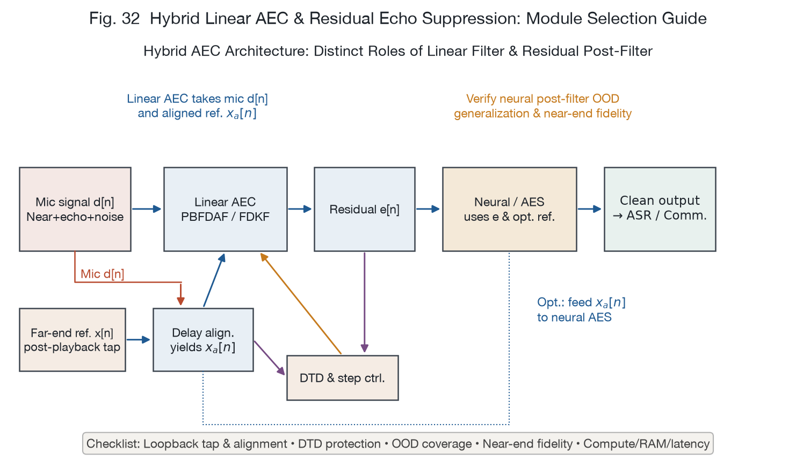

Figure 32 illustrates the hybrid signal flow: far-end reference $x[n]$ passes through bulk delay alignment to form $x_a[n]$, driving a linear adaptive filter (NLMS, PBFDAF, or FDKF) to subtract echo replica $\hat y[n]$ and emit a priori residual $e[n]$; adaptation control regulates step sizes from reference, microphone, and residual statistics; finally, a learned residual suppressor combines $e[n]$ and aligned reference features to emit enhanced speech. Acceptance testing must instrument both the "linear residual" node and the "final output" node to audit echo leakage and near-end distortion separately.

Representative public hybrid and joint architectures emphasize distinct trade-offs:

- **PercepNet hybrid post-suppression** ([Valin et al., ICASSP 2021](https://doi.org/10.1109/ICASSP39728.2021.9414140)): Following linear echo cancellation, a compact recurrent-convolutional network predicts envelope gains and pitch-comb strengths across $32$ triangular Equivalent Rectangular Bandwidth (ERB) bands to jointly suppress residual echo and noise (§4–§5 use two frames of lookahead for $40\ \mathrm{ms}$ total algorithmic latency), compressing high-dimensional bin masks onto low-dimensional psychoacoustic bands;
- **MDF + GRU residual suppression** ([Ma et al., arXiv:2005.09237](https://arxiv.org/abs/2005.09237)): Runs front-end MDF to strip linear echo followed by a Gated Recurrent Unit (GRU) predicting residual masks from linear residual and reference features—exemplifying decoupled two-stage embedded design;
- **DeepVQE joint enhancement** ([Indenbom et al., Interspeech 2023](https://doi.org/10.21437/Interspeech.2023-1028)): Jointly performs AEC, denoising, and dereverberation inside a single network while using cross-attention between reference and microphone frame sequences for soft delay alignment, easing sensitivity to front-end hard delay jumps.

By contrast, **pure end-to-end neural AEC** feeds raw microphone and reference streams directly into a reference-conditioned separation network outputting complex masks or multi-frame Deep Filtering taps. While bypassing explicit linear filters and DTD engineering, end-to-end networks face steeper challenges at extreme negative $\mathrm{SER}$ (loud music playback with quiet user barge-in), unseen micro-speaker clipping profiles, and field root-cause debugging without explicit tap/convergence probes.

Training corpora for hybrid or end-to-end models typically synthesize diverse room volumes and $T_{60}$ impulse responses via the image-source method (§2.4), cascade randomized Wiener–Hammerstein nonlinearities across wide $\mathrm{SER}$/$\mathrm{SNR}$ ranges for pre-training, and fine-tune on real playback recordings from target hardware; fine-tuning gains must always be verified on held-out recordings from disjoint rooms and units of the same device model to prevent memorizing fixed test-room transfer functions.

#### Neural Kalman: Learning Unknown Terms Inside the Recursion

Section 6.2.6 noted that classical FDKF is bottlenecked by analytical estimation of nonstationary process variance $\Phi_m$ and double-talk observation variance $\Psi_m$. **Neural Kalman** methods retain the analytical state-space recursion while training compact neural networks to infer unknown statistics or Kalman gains online—when reading papers, check carefully which exact variable in Eq. (6-21) the network replaces:

- **Direct Kalman-gain prediction (NKF)** ([Yang et al., *IEEE/ACM TASLP* / arXiv:2207.11388](https://arxiv.org/pdf/2207.11388)): Preserves linear overlap-save state updates while a small recurrent network maps innovation and reference history directly to complex Kalman gains, bypassing explicit variance smoothing;
- **Joint nonlinear reference encoding and state evolution (NeuralKalman)** ([Indenbom / Haubner line, ASRU 2023](https://doi.org/10.1109/ASRU57964.2023.10389780); preprint [arXiv:2301.12363](https://arxiv.org/pdf/2301.12363), §2.2 and Fig. 1(b)): Applies a learned nonlinear feature transform to the reference to absorb loudspeaker distortion while predicting state transition factors and noise variances;
- **Differentiable adaptive filtering layers (Deep Adaptive AEC)** ([Zhang et al., ICASSP 2022](https://doi.org/10.1109/ICASSP43922.2022.9746039)): Unrolls frequency-domain adaptation as an end-to-end differentiable computation graph supervised by clean near-end speech reconstruction loss to learn time-varying step sizes and nonlinear reference encoders (for a comparative survey across hybrid and deep adaptive designs, see [Seidel et al., *IEEE SPM*, 2024](https://doi.org/10.1109/MSP.2024.3449557)).

Across all variants—predicting step sizes, Kalman covariances, or post-filter masks—retaining an analytical filtering backbone delivers physical causality, zero-shot cold-start operation, and inspectable intermediate residuals.

#### Personalized AEC (pAEC)

During hands-free calls in open offices or living rooms, microphones pick up neighboring colleagues or family members alongside loudspeaker echo. Standard AEC preserves every non-echo voice in the room as "near-end speech," whereas **personalized AEC (pAEC; see [Cutler et al., *IEEE OJSP*, 2024](https://doi.org/10.1109/OJSP.2024.3376289))** cancels loudspeaker echo while preserving *only* the enrolled primary talker and suppressing bystander speech simultaneously.

Architecturally, pAEC parallels Target Speaker Extraction (TSE; see [§8.6](08_speech-separation.md#sec-8-6), [Chapter 15 §15.1–§15.2](15_target-extraction-diarization.md#sec-15-1), and [Appendix B §17.3](17_appendix-guide.md#sec-17-3), exemplified by [GTCNN, Interspeech 2022](https://www.isca-archive.org/interspeech_2022/zhang22t_interspeech.pdf)): a fixed-dimensional speaker embedding $\vec e_{\mathrm{enroll}}$ extracted from a few seconds of enrollment speech conditions the residual suppressor via Feature-wise Linear Modulation (FiLM) or cross-attention (privacy governance and shared-device fallback rules follow in §6.13).

**Speaker-similarity thresholds and three-zone fallback in pAEC.** Given nonzero real enrollment embedding $\vec e_{\mathrm{enroll}}$ and nonzero frame-level local embedding $\vec e_t$, speaker match is scored by normalized cosine similarity:

$$\begin{aligned}
c&=\frac{\vec e_t^\top\vec e_{\mathrm{enroll}}}
        {\|\vec e_t\|_2\,\|\vec e_{\mathrm{enroll}}\|_2}.
\end{aligned}\tag{6-27}$$

Whenever silence or heavy noise drives either norm toward zero, Eq. (6-27) is undefined and the system must fall back to unconditional AEC rather than thresholding garbage ratios. During overlapping double-talk, residual echo or competing speech perturbs $\vec e_t$, pushing $c$ into an ambiguous midrange; practical systems therefore calibrate high-, mid-, and low-confidence zones on target-hardware validation sets: pass target speech at high confidence, suppress bystanders at low confidence, and attenuate or bypass the **identity-conditioned suppression branch** in the uncertain middle zone (retaining standard linear echo cancellation)—preferring minor bystander leakage over accidentally muting the enrolled talker. Acceptance tests must separately audit target false-suppression rate, bystander leakage rate, and standard double-talk quality.

**Extending neural AEC to multi-microphone arrays** follows three primary topologies:

1. End-to-end multi-channel networks trained for a fixed microphone count and geometry (e.g., a specific four-mic smart speaker);
2. Parameter-shared single-channel encoders followed by cross-channel attention or permutation-equivariant pooling across arbitrary microphone counts while preserving inter-channel phase cues;
3. Per-microphone linear AEC plus classical beamforming up front, followed by a lightweight single-channel neural post-filter on the beamformed output—offering the lowest embedded compute and easiest cross-product portability.

In real-time wake-word barge-in on smart speakers and automotive voice assistants, front-end linear AEC typically strips $15$–$25\ \mathrm{dB}$ of music playback before feeding linear residuals into wake-word and ASR front-ends; inserting an overly aggressive nonlinear post-suppressor ahead of wake-word detection often erodes initial consonants and *lowers* wake-word recall.

The table below contrasts the three learning-based families across inspectability, risk, and resource accounting:

| Paradigm | Representative Design | Inspectable Internal Quantities | Principal Risks | Resource Verification |
|---|---|---|---|---|
| Hybrid | Linear AEC + learned residual suppressor | Linear-stage path, linear residual, linear ERLE | Post-filter may distort near-end speech | Benchmark by band count, model version, and target silicon |
| End-to-end | Estimates near-end speech directly from mic and reference | Typically lacks explicit impulse-response taps | Out-of-domain hardware, extreme negative SER, opaque fault isolation | Benchmark by model size, context window, and target silicon |
| Neural Kalman | Retains state recursion while learning gains or variances | Kalman gains, state estimates, innovation residuals | Variance mismatch, combined recursion + network MACs | Report state-recursion and network budgets jointly |

**Device-tier selection guidelines**:

- Earbuds and smartwatches constrained by MACs, SRAM, and battery budget compare tiny on-device post-filters against classical frequency-domain NLP;
- Smart speakers and conferencing bars evaluate PBFDAF or FDKF paired with neural post-filtering;
- Complex double-talk environments requiring transparent recursive diagnostics evaluate Neural Kalman;
- Products requiring bystander speech rejection alongside echo control evaluate pAEC.

Voice assistants must additionally benchmark near-end preservation under barge-in. Regardless of learning paradigm, every production system still rests on the reference tap-off, delay-alignment, and double-talk stability foundations of §6.8–§6.10.

### 6.6 AEC in Microphone Arrays: Three Cascade Orders with Beamforming

When a multi-microphone endpoint combines spatial beamforming (Chapter 5) with acoustic echo cancellation, deciding whether to run **AEC before beamforming or beamforming before AEC** is a pivotal architectural choice with three classical topologies:

1. **AEC$\to$BF (per-microphone AEC)**: Runs an independent linear AEC on each of the $M$ raw microphone channels before passing echo-canceled streams to DOA estimation and beamforming. Its decisive advantage is that the $m$-th physical echo path $h_m[\ell]$ depends solely on the loudspeaker and room acoustics, remaining completely decoupled from time-varying adaptive beamformer weights downstream; the trade-off is that linear AEC state memory and per-channel MACs scale with $M$ (exact reference-FFT sharing savings are quantified below).

    Whenever DSP budget and on-chip SRAM permit—and downstream beamforming uses time-varying adaptive weights (MVDR, GSC, or steered tracking beams)—AEC$\to$BF is the gold-standard industrial choice;

2. **BF$\to$AEC (single post-beamformer AEC)**: Forms a single spatial beam from the $M$ microphones first and runs just one single-channel AEC afterward, compressing linear cancellation from $M$ channels to $1$ (net compute savings must deduct beamformer cost and the reference FFT that would otherwise be shared across channels).

    Why does this compute-thrifty order harbor a coupling trap? Under the narrowband same-bin approximation neglecting cross-band terms, denote the $m$-th microphone's echo transfer function at bin $k$, frame $n$ by $H_m(k,n)$ and the beamformer weights by $w_m(k,n)$ (using Chapter 5's conjugate inner product $\sum_m w_m^* D_m$). The post-beamformer AEC sees an effective echo transfer function $H_{\mathrm{eff}}(k,n)$ given approximately by $\sum_{m=1}^{M}w_m^*(k,n)H_m(k,n)$. Strictly speaking, overlapped windowed STFT frames introduce cross-band coupling terms (derived in [Avargel & Cohen, *IEEE TASLP*, 2007](https://webee.technion.ac.il/Sites/People/IsraelCohen/Publications/TASL_May2007.pdf), §II), and exact LTI convolution summation holds only for fixed time-domain FIR beamformers.

    Suppressing $(k,n)$ across $M$ microphones, this narrowband effective echo path reads:

    $$H_{\mathrm{eff}}\approx\sum_{m=1}^{M}w_m^*H_m.\tag{6-28}$$

    Equation (6-28) pinpoints the Achilles' heel: even in a completely static room (physical $H_m$ unchanged), the instant a talker moves or noise covariance updates alter beamformer weights $w_m(k,n)$, $H_{\mathrm{eff}}$ jumps abruptly—forcing the downstream AEC to reconverge and leaking jarring echo bursts across every transition! Freezing beamformer weights during transitions blunts spatial tracking agility;

3. **Joint optimization (GEIC, Generalized Echo and Interference Canceller)**: Herbordt and Kellermann unified multichannel echo cancellation with the blocking matrix and adaptive interference canceller of a Generalized Sidelobe Canceller (GSC) under a single constrained optimization objective (classical derivations in Kellermann, ICASSP 1997, and Brandstein & Ward, eds., *Microphone Arrays*, 2001, Ch. 13), jointly exploiting spatial nulls and reference correlation against strong nonlinear/reverberant echo at the cost of high-dimensional spatiotemporal covariance tracking and intricate double-talk gating.

**Joint analysis and beam-switching transient hand calculation**: [Schwartz et al. (Interspeech 2024)](https://www.isca-archive.org/interspeech_2024/schwartz24_interspeech.pdf) analyzed steady-state and transient behavior across cascade orders within a Multichannel Wiener Filter (MCWF) framework; in practice, even under "fixed multi-beam switching + single post-beam AEC" with perfectly known physical paths, switching beams mid-playback triggers a convolution-memory mismatch transient.

Verify this **beam-switching residual under fixed physical paths** on a four-sample sequence: let shared playback reference be $x=[1,2,3,0]$ (zero for $n<0$), mic $1$ have unit passthrough $h_1=[1,0]$ (echo $y_1=[1,2,3,0]$), and mic $2$ have attenuated unit delay $h_2=[0,1/2]$ (echo $y_2=[0,1/2,1,3/2]$, retaining the tail). If a beam selector picks mic $1$ at $n=0,1$ and hard-switches to mic $2$ starting at $n=2$, the beamformer output echo sequence becomes $[1,\ 2,\ 1,\ 3/2]$!

If the single post-beam AEC still holds pre-switch weights $\hat h=h_1=[1,0]$ (predicting $[1,2,3,0]$), subtraction bursts out nonzero switching residuals $[1,2,1,3/2]-[1,2,3,0]=[0,\ 0,\ -2,\ 3/2]$ at $n=2,3$! Conversely, running **AEC$\to$BF** to cancel $h_1$ and $h_2$ per microphone before switching (or maintaining a dedicated bank of pre-converged AEC weights paired $1$-to-$1$ with each fixed beam in BF$\to$AEC) yields identically zero residual across all four samples. Distinguish the two loci of time variation carefully: beam switching alters spatial combination weights at the **output synthesis instant**, whereas playback volume changes (§6.10 and Exercise [E06-40](#e06-40)) alter excitation amplitudes at the **historical loudspeaker input instant**—two distinct nodes along the convolution chain.

> **Sidebar: The Non-Uniqueness Problem in Stereo and Multi-Loudspeaker AEC.**
>
> When a TV, laptop, or cabin audio system plays stereo through left and right loudspeakers, a single microphone captures total echo $y[n]=(h_1*x_1)[n]+(h_2*x_2)[n]$. Whenever both stereo channels originate from a **single far-end talker** filtered through two fixed far-end room paths ($x_1=g_1*s_{\mathrm{far}},\ x_2=g_2*s_{\mathrm{far}}$), the two references obey the exact linear convolution identity $(g_2*x_1)[n]-(g_1*x_2)[n]=0$, making the two-channel reference correlation matrix rank-deficient or severely ill-conditioned (Sondhi, Morgan & Hall, *IEEE SPL*, 1995): infinitely many false path pairs $(h'_1,h'_2)\neq(h_1,h_2)$ cancel the current talker's echo to zero, yet fail instantly the moment a second far-end talker at a different position speaks!
>
> A single-tap example makes this immediate: under mono-compatible playback $x_1[n]=x_2[n]=x[n]$, true path $(h_1,h_2)=(0.8,0.2)$ and false path $(h'_1,h'_2)=(1.3,-0.3)$ produce identical predictions $(0.8+0.2)x=(1.3-0.3)x=x$; even at normalized cross-correlation $\rho=0.99$, the $2\times 2$ correlation matrix (unit diagonal, off-diagonal $\rho$) has eigenvalues $1+\rho=1.99$ and $1-\rho=0.01$—a condition number of $199$ where tiny noise drives the two weights in opposite directions. Industry introduces subtle inter-channel decorrelation ([Benesty et al., ICASSP 1997](https://www2.spsc.tugraz.at/people/franklyn/ICASSP97/pdf/scan/ic970303.pdf)); §6.9 develops multi-reference modeling and time-varying all-pass decorrelation in full.

Hardware reference-loop clock synchronization and integration are covered in §10.1 and Figure 23. To quantify how **AEC$\to$BF** compute scales with microphone count $M$, apply the transparent **selected-core-operator** rules of Worked Example 6-2 at $16\ \mathrm{kHz}$, path length $L=2048$ ($128\ \mathrm{ms}$), and PBFDAF block size $N=128$ ($P=16$ partitions, $2N=256$-point FFTs at $4N\log_2(2N)=4096$ real multiplications per complex transform and $1024$ real multiplications per $256$-bin complex product).

For a single channel, naive time-domain NLMS costs $3L=6144$ real multiplications/sample; unconstrained PBFDAF costs $(3\times 4096+32\times 1024)/128=352$ real multiplications/sample; enforcing IFFT/FFT projection on all $16$ partitions every block adds $2\times 16\times 4096/128=1024$/sample for $1376$/sample total (explicitly recomputing $|X|^2$ across $16$ partitions adds $2\times 256\times 16/128=64$/sample, giving $416$ and $1440$/sample). Multiplying by $16000$ samples/s gives the $M$-channel scaling table:

| Algorithm | Single-Channel Hand Count | $M$-Channel Scaling | Additional Resources Requiring Target Profiling |
|---|---:|---:|---|
| Time-domain NLMS | $6144\times16000\approx98.3$M real mults/s | $\approx M\times98.3$M real mults/s | Instruction issue, memory bandwidth, tap & history SRAM |
| PBFDAF, unconstrained | $352\times16000\approx5.6$M real mults/s | $\approx M\times5.6$M real mults/s | Real-FFT library, power smoothing, constraint cadence, buffers |
| PBFDAF, full per-block constraint | $1376\times16000\approx22.0$M real mults/s | $\approx M\times22.0$M real mults/s | Same as above plus $2P$ constraint transforms (amortized if alternating) |
| FDKF or neural post-filter | No fixed multiplier | Governed by state dimension or network topology | Operator kernels, threading, SRAM footprint, real-time factor |

Notice the multi-microphone sharing optimization in rows 2–3: while naive instantiation multiplies cost by $M$, all $M$ microphones on the same DSP cancel the **exact same loudspeaker reference $x[n]$** (given shared bulk pre-delay alignment and synchronized block boundaries), so the forward $256$-point FFT of $u_m$ ($4096/128=32$ mults/sample) and reference power spectra need to be computed **only once per block** and broadcast across all $M$ channels!

Factoring out redundant reference FFTs drops unconstrained core MACs from $352M$ to $32+320M$ ($2112\to 1952$/sample on a $6$-mic array) and full-constraint MACs from $1376M$ to $32+1344M$ ($8256\to 8096$/sample on $6$ mics, with SpeexDSP-style single-partition alternating projection slashing $15/16$ of the $1024M$ constraint term on top). Shared-reference partitioned frequency-domain AEC thus sits comfortably within embedded real-time DSP budgets on $6$- and $8$-mic smart speakers and conference speakerphones.

### 6.7 Evaluation Framework and Engineering Acceptance Checklist

**Objective energy metrics and their physical prerequisites**. Echo Return Loss Enhancement (ERLE) is strictly defined over a valid evaluation window $\mathcal W$ as the decibel ratio of **true pre-cancellation echo energy $E_y$** to **post-cancellation residual echo energy $E_e$**:

$$\begin{aligned}
E_y&=\sum_{n\in\mathcal W}|y[n]|^2,\\
E_e&=\sum_{n\in\mathcal W}|e_{\mathrm{echo}}[n]|^2,\\
\mathrm{ERLE}&=10\log_{10}\frac{E_y}{E_e}.
\end{aligned}\tag{6-29}$$

Here $y[n]$ is the true echo component entering the microphone ($y=x*h$ only under a linear path) and $e_{\mathrm{echo}}[n]$ is the residual echo component remaining at the output. Equation (6-29) yields a physically meaningful finite dB figure only when echo is present ($E_y>0$): ideal cancellation ($E_e=0$) approaches $+\infty$, whereas during silence ($E_y=0$) there is no echo to evaluate—never add $\varepsilon$ to both numerator and denominator on silent windows and report the resulting $0\ \mathrm{dB}$ as "zero dB of echo cancellation" (software energy-floor guards are detailed in §6.15.1).

In real-device room recordings, air-mixed $y[n]$, $s[n]$, and ambient noise $v[n]$ cannot be separated physically. Engineers therefore record **pure far-end single-talk (STFE)** in anechoic or quiet rooms, trim initial convergence transients, and approximate $\mathrm{ERLE}$ from the microphone-to-output power ratio—remembering that ambient noise energy $E_v$ pads the denominator $(E_e+E_v)$ and imposes an **ambient noise-floor ceiling** (if input echo sits $20\ \mathrm{dB}$ above room noise, even $100\%$ perfect echo cancellation cannot read higher than $\approx 20.04\ \mathrm{dB}$ on an external power meter; full proof in Exercise E06-05). During **double-talk (DT)**, the output rightly contains near-end speech $s[n]$, stripping the total input-to-output power ratio of any echo-attenuation meaning; only synthetic experiments with isolated ground-truth components can evaluate Eq. (6-29) during double-talk.

> **Mental math ruler for ERLE.** Reducing residual echo energy to $0.0063$ ($\approx 0.63\%$) of input echo gives $\mathrm{ERLE}=10\log_{10}(1/0.0063)\approx 22.0\ \mathrm{dB}$; reducing energy to $10^{-4}$ ($1\%$ in amplitude) gives $\mathrm{ERLE}=10\log_{10}(10000)=40\ \mathrm{dB}$. Always state sampling rate, evaluation window, blockwise-dB mean versus pooled-energy ratio (Exercise E06-31), and whether measurement taps the linear stage or post-NLP output.

**Subjective listening tests and non-intrusive perceptual models**. $\mathrm{ERLE}$ measures total energy alone, remaining blind to musical-noise artifacts or muffled, chopped double-talk speech. Microsoft's non-intrusive neural estimator [AECMOS (Purin et al., ICASSP 2022)](https://arxiv.org/abs/2110.03010) emulates ITU-T P.808 human ratings, outputting $1$–$5$ scores along an **Echo DMOS** axis and an **Other DMOS** axis (capturing near-end distortion and noise artifacts). With frozen model weights, AECMOS excels at automated daily regression tracking, though domain shifts on unseen languages, sample-rate conversions, or novel nonlinear artifacts mean release sign-off must still combine double-blind human listening with downstream ASR Word Error Rate (WER).

A rigorous production AEC acceptance report must deliver three scorecards simultaneously:

1. **Steady-state STFE attenuation (dual-tap separate reporting)**: Over post-convergence windows, report **linear adaptive output** alongside **final NLP/neural output**—auditing acoustic path identification and reference-chain health separately from final audible residual, and prohibiting aggressive post-muting from masking broken linear cancellation;
2. **Post-perturbation reconvergence dynamics**: Specify repeatable physical perturbations (handset rotation, speaker occlusion, audio-route switch) and report recovery time and pass rate back to baseline attenuation;
3. **Bidirectional double-talk balance**: Sweep across SER tiers to score echo-leakage suppression jointly with near-end speech fidelity, ensuring quietness is never bought at the price of clipped syllables.

### 6.8 WebRTC AEC3 Architecture and Troubleshooting

Around its linear subtractor core, an industrial full-duplex AEC integrates four indispensable system-level subsystems (Figure 20(a) shows the front-end backbone; post-processing may use analytical rules or neural networks):

1. **Reference-to-microphone delay alignment**: OS render buffers, capture buffers, and acoustic time-of-flight sum into bulk loop delay. Without pre-alignment, leading causal taps are squandered padding pure delay, and linear cancellation collapses altogether once delay exceeds filter span (tap-off locations follow in §6.10);
2. **Adaptation control under double-talk and anomalies**: Binary freezing, continuous soft step sizes, or foreground/shadow selection prevent strong near-end speech from corrupting converged taps;
3. **Nonlinear Processor (NLP) residual echo suppression**: Attenuates frequency bands post-subtraction to suppress loudspeaker harmonics, fast path transients, and unmodeled late reverberation (operating-point calibration in §6.12);
4. **Comfort Noise Generation (CNG)**: Deep NLP suppression during STFE vacuums out steady microphone background noise, creating jarring "black-hole silence" (noise pumping); CNG tracks ambient noise spectral envelopes and injects matching comfort noise for seamless background continuity.

Respect hardware saturation limits strictly: while NLP suppresses mild loudspeaker-side nonlinear tails, hard clipping in the **capture-side** microphone preamplifier or ADC permanently destroys both echo waveforms and superimposed near-end speech peaks—no post-processor can resurrect clipped speech peaks after the fact. Proper analog/digital gain staging with adequate headroom, paired with software clipping flags to freeze adaptation, comes first.


Figure 20 delineates engineering module boundaries: in Figure 20(a), the upper dashed box encompasses the physical amplifier–speaker–room–microphone path $h$, while the lower digital branch bulk-aligns the reference before $\hat{\vec w}$ subtracts the echo replica to emit the linear residual (explicitly separating reference, microphone, and adaptation-control ports); Figure 20(b) feeds linear residual and reference features into an optional orange learned residual suppressor (or classical NLP + CNG) to produce the final full-duplex output.

**WebRTC AEC3 core architecture and `refined` / `coarse` dual-filter cooperation**. Using the pinned official WebRTC source tree in this repository (`modules/audio_processing/aec3/`, commit hashes and line-by-line walkthroughs in the [Research Manual](../codes/chapters/ch00/research_en/02_aec_wpe_separation.md#aec)), let us trace how a mature open-source engine organizes real-time processing on $64$-sample sub-blocks ($4\ \mathrm{ms}$ at $16\ \mathrm{kHz}$):

- **Multi-band splitting and `RenderBuffer`**: External $10\ \mathrm{ms}$ frames split internally into $64$-sample sub-blocks, pushing far-end playback into circular history buffer `RenderBuffer` to serve both wide-range delay search and partitioned frequency-domain convolution;
- **Downsampled matched-filter delay estimation**: [`echo_path_delay_estimator.cc`](https://webrtc.googlesource.com/src/+/0467d2b91cc20b9b001c2bbb73d43ea6b2491f3e/modules/audio_processing/aec3/echo_path_delay_estimator.cc) runs parallel time-domain matched filters on decimated render and capture streams, aggregates stable peak lags, and instructs [`block_processor.cc`](https://webrtc.googlesource.com/src/+/0467d2b91cc20b9b001c2bbb73d43ea6b2491f3e/modules/audio_processing/aec3/block_processor.cc) to adjust the `RenderBuffer` read offset (handling macroscopic bulk delay separately from adaptive tap updates);
- **Bidirectional closed loop between foreground (`refined`) and shadow (`coarse`) filters**: Why do [`subtractor.cc`](https://webrtc.googlesource.com/src/+/0467d2b91cc20b9b001c2bbb73d43ea6b2491f3e/modules/audio_processing/aec3/subtractor.cc) and [`echo_remover.cc`](https://webrtc.googlesource.com/src/+/0467d2b91cc20b9b001c2bbb73d43ea6b2491f3e/modules/audio_processing/aec3/echo_remover.cc) run two parallel PBFDAFs on the exact same aligned reference? To resolve the tension between **double-talk immunity** and **path-jump agility**:

    1. **Fast/slow gain specialization**: Foreground filter `refined` uses conservative error-spectrum-gated step sizes (`RefinedFilterUpdateGain`) throttled tightly by near-end and noise-floor estimates, ensuring minimal steady-state misadjustment and zero near-end speech cancellation; shadow filter `coarse` uses aggressive NLMS-like step sizes (`CoarseFilterUpdateGain`) acting as an agile scout for path changes;
    2. **Forward promotion copy on path jumps**: When device motion, door opening, or route switching alters the true echo path, `coarse` locks onto the new path first during active render segments and drives $e_{\mathrm{coarse}}$ well below $e_{\mathrm{refined}}$; once sustained, AEC3 smoothly transitions linear output to the shadow branch and copies `coarse` frequency-domain weights over `refined` to jump-start convergence;
    3. **Reverse reset on double-talk divergence**: Because `coarse` steps aggressively, intense double-talk readily pulls it off course; whenever `coarse` residual degrades persistently relative to `refined`, `subtractor.cc` overwrites `coarse` weights from the rock-steady `refined` filter and resets leakage flags (double-talk overfitting interception and three-state gating verified in Exercise [E06-44](#e06-44)); saturation flags simultaneously clamp both gains against clipping;

- **Residual echo estimation, spectral suppression, and comfort noise**: Downstream of linear subtraction, the residual echo estimator combines linear echo power, reverberation decay models, and filter convergence state to drive spectral suppression gains and CNG.

**Exporting internal linear residuals from AEC3.** Never tune a hybrid or industrial engine solely by staring at post-NLP final outputs. Enabling `EchoCanceller::export_linear_aec_output` in WebRTC's Audio Processing Module (APM; [`audio_processing.h`](https://webrtc.googlesource.com/src/+/0467d2b91cc20b9b001c2bbb73d43ea6b2491f3e/api/audio/audio_processing.h)) allows calling `GetLinearAecOutput()` after each `ProcessStream()` to extract the $16\ \mathrm{kHz}$ linear-stage waveform (multi-channel buffer shapes and return-flag checks in the [Industrial Deployment Manual](../codes/chapters/ch00/research_en/03_industrial_deployment.md); note also that `set_stream_delay_ms()` clamps out-of-range hints to $0$–$500\ \mathrm{ms}$ with a warning, so always inspect the clamped effective delay).

**The classic false fault of asynchronous queue underruns.** Embedded teams integrating [`mdf.c` in SpeexDSP](https://gitlab.xiph.org/xiph/speexdsp/-/blob/8e29a256ef0235ebbe7fcb8417b5ac7731eb8307/libspeexdsp/mdf.c) via asynchronous `speex_echo_playback()` / `speex_echo_capture()` callbacks often observe zero echo cancellation and immediately start tweaking step sizes—unaware that whenever the capture callback fires before playback starts, or thread jitter underruns the internal reference ring buffer, the async wrapper silently bypasses cancellation and emits raw microphone frames! Always audit callback startup order, underrun counters, and multi-channel interleaving strides first (verify multi-mic/multi-speaker channel mapping by injecting **time-staggered** single impulses per physical channel, never identical simultaneous tones that hide swapped channels).

When a field device "fails to cancel echo cleanly," following this **four-step ironclad troubleshooting sequence** eliminates ninety percent of wasted parameter tuning:

1. **Rule 1: Verify the reference tap sits downstream of mixing, EQ, and DRC/AGC!** The closer the digital reference tap sits to the DAC, the more faithfully it matches physical loudspeaker drive; tapping upstream of EQ, Automatic Gain Control (AGC), or Dynamic Range Compression (DRC) dumps time-varying loudness gains and limiter nonlinearities onto the unknown path side, trapping any linear filter in perpetual mismatch reconvergence (strict proof in §6.10);
2. **Step 2: Verify bulk-delay coverage and clock drift (SRO)**: Inject controlled delay steps while monitoring linear-stage $\mathrm{ERLE}$ and dominant tap indices to confirm the true path stays inside causal window $[0,L-1]$ under worst-case buffer jitter, and check long-call correlation peaks for monotonic SRO drift;
3. **Step 3: Verify double-talk gating and front-end clipping**: Inspect mic ADCs and power amplifiers for analog/digital clipping, and check linear tap trajectories on double-talk clips for erratic jumps (cf. Figure 30(c));
4. **Step 4: Lock identical paired recordings and dual tap points before comparing algorithms**: Only after ruling out underruns, misplaced reference taps, out-of-span delays, and front-end clipping does comparing NLMS, PBFDAF, FDKF, or neural post-filters on identical paired recordings carry scientific validity.

### 6.9 Multi-Reference AEC Models and Decorrelation Selection

Moving from single-speaker smart speakers to stereo TVs, laptops, and four-zone automotive cabins upgrades echo cancellation from SISO to **multi-reference (multi-channel playback) AEC**, where convergence stability hinges directly on statistical correlation across playback channels.

Production code organizes multi-reference AEC in three ways (rows 1–2 represent distinct update operators over the same physical multi-loudspeaker sound field rather than different acoustic propagation laws):

| Model | Structure | Identifiability | Resource Scaling | Target Use Case |
|---|---|---|---|---|
| Per-reference branches sharing total residual | Sum branch predictions first, then update all branches from shared $e=d-\sum_r\hat y_r$; per-branch normalization requires step-size recalibration | Strongly correlated references still leave path estimates ill-conditioned | Filtering and state scale roughly linearly with reference count $R$ | Single mic receiving multiple playback channels; requires joint stability check |
| Joint MISO (Multiple-Input Single-Output) | Stack multi-reference regression vectors and estimate all paths jointly from shared residual | Still bounded by condition number of stacked reference correlation matrix | Stores $R$ path vectors; full-matrix variants also store cross-channel blocks | Explicit handling of inter-reference correlation |
| Joint MIMO array | Jointly estimates across multiple references and multiple microphones (e.g., GEIC, extended MWF / MWFext) | Exploits cross-channel spatial and reference statistics, still requiring full-rank excitation | Scales with $R$, $M$, and joint state dimension | Integrated echo and spatial interference cancellation |

Clear two classic multi-reference landmines up front. **Trap 1: Running independent mono AECs and summing their outputs.** Under noiseless single-tap mono playback $x_1[n]=x_2[n]=x[n]$ with true total echo $d[n]=x[n]$, feeding full $d[n]$ independently to two separate mono filters drives each tap to $1$, summing their predictions to $x[n]+x[n]=2x[n]$ and yielding total residual $-x[n]$ ($0\ \mathrm{dB}$ attenuation with inverted echo)! Multi-reference AEC must sum predictions across all $R$ references $\vec x_r[n]$ *before* forming the **single shared residual** driving joint updates (classical stereo formulation in [Gilloire, IWAENC 1997](https://www.iwaenc.org/proceedings/1997/iwaenc97/pdf/scan/ae970002.pdf)):

$$\begin{aligned}
\hat y[n]&=\sum_{r=1}^{R}\hat{\vec h}_r^\top\vec x_r[n],\\
e[n]&=d[n]-\hat y[n].
\end{aligned}\tag{6-30}$$

**Trap 2: Sharing the total residual while keeping unscaled per-channel denominators and mono step sizes.** Under Eq. (6-30), if $R$ branches step simultaneously toward $e[n]$ while dividing only by individual channel energies $\|\vec x_r[n]\|^2$, total prediction change multiplies by $R$! Exercise E06-22 proves by hand that $\mu=1.5$—perfectly stable in mono—causes the a posteriori residual to double in magnitude with alternating sign every step ($1,-2,4,\ldots$) on two equal in-phase references with local denominators, requiring either a pooled total-energy denominator or $1/R$-rescaled step sizes.

Even with exact Eq. (6-30) and joint normalization, highly correlated stereo channels leave normal equations ill-conditioned (under $x_1=x_2=x$, Eq. (6-30) constrains only $\hat h_1+\hat h_2=1$, exposing severe echo leakage the instant far-end panning shifts; see Exercise E06-23).

**Stereo Time-Varying All-Pass Filtering (TV-APF) and alternative decorrelators**. To weaken inter-channel collinearity prior to loudspeaker playback without audible quality loss, four decorrelation families are used in industry:

| Method | Mechanism | Potential Audible Side Effects | Validation Protocol |
|---|---|---|---|
| Half-wave nonlinear distortion | Applies distinct mild asymmetric nonlinearities per channel | Harmonic distortion, stereo image shift | Measure stacked condition number, STFE residual, and blind listening quality |
| Time-varying phase modulation | Applies independent slowly varying all-pass phase per channel | Transient smearing or subtle image wander | Blind listening on both speech and music plus path-tracking checks |
| Independent micro frequency shifting | Shifts channels by tiny opposite or unequal frequency offsets | Audible beating on sustained musical chords or pitch warble | Sweep shift Hz against identifiability and musical artifacts |
| Shaped low-level noise injection | Adds independent spectrally masked low-level noise per channel | Elevated noise floor during quiet passages | Measure condition number, noise floor, and listening quality across volume tiers |

Mild half-wave rectification $x'_r[n]=x_r[n]+\alpha_r|x_r[n]|$, popular in early teleconferencing, breaks linear collinearity via even harmonics—tolerable on voice but rough on high-fidelity music—while micro frequency shifting and noise injection run into chord beating and quiet-passage hiss. Consequently, **Time-Varying All-Pass Filtering (TV-APF; see Ali, ICASSP 1998; Herre, Buchner & Kellermann, WASPAA 2007)** serves as a premier linear time-varying decorrelator in music-capable smart speakers and cabin systems.

Why **must** the all-pass filter be **time-varying** rather than fixed LTI? Recall the origin of stereo non-uniqueness: a single far-end source $S_{\mathrm{far}}(z)$ filtered by fixed far-end paths $G_1(z),G_2(z)$ produces $X_1(z)=G_1(z)S_{\mathrm{far}}(z)$ and $X_2(z)=G_2(z)S_{\mathrm{far}}(z)$ obeying $G_2(z)X_1(z)-G_1(z)X_2(z)=0$. Inserting **fixed LTI** all-pass filters $A_1(z),A_2(z)$ yields $\tilde X_r(z)=A_r(z)X_r(z)$ satisfying $(G_2 A_2)\tilde X_1-(G_1 A_1)\tilde X_2=0$—merely rotating the nullspace without curing rank deficiency!

Now modulate the real first-order all-pass pole/zero parameter slowly over time $n$ as $a_r[n]\in(-1,1)$—for instance, $a_r[n]=a_{r,0}+\delta_r\sin(\omega_{\mathrm{mod},r}n)$ at sub-Hz to few-Hz rates $\omega_{\mathrm{mod},r}=2\pi f_{\mathrm{mod},r}/f_s$ (incommensurate or anti-phase across channels). At any frozen instant, the instantaneous transfer function satisfies

$$\begin{aligned}
A_r(e^{\mathrm{j}\Omega_{\mathrm{d}}},n)
&=\frac{a_r[n]+e^{-\mathrm{j}\Omega_{\mathrm{d}}}}
       {1+a_r[n]e^{-\mathrm{j}\Omega_{\mathrm{d}}}},\\
\left|A_r(e^{\mathrm{j}\Omega_{\mathrm{d}}},n)\right|
&\equiv 1.
\end{aligned}$$

Because numerator and denominator differ only by unit-modulus factor $z=e^{-\mathrm{j}\Omega_{\mathrm{d}}}$ ($|a_r+z|=|z(a_r z^*+1)|=|1+a_r z|$), short-time magnitude gain equals $1$ at every frequency—preserving timbre, keeping noise floor untouched, and generating zero harmonic distortion—while slowly drifting group delay and inter-channel phase convert locked LTI collinearity into **linear time-varying (LTV) persistent excitation** that restores full multi-tap identifiability (five-sample full-rank verification in Exercise [E06-44](#e06-44))!

Observe two strict engineering rules: (1) keep modulation depth $\delta_r$ and rate $f_{\mathrm{mod},r}$ gentle to avoid audible vibrato on sustained piano/string notes or stereo image drift; and (2) **insert decorrelation into the actual physical loudspeaker playback path, tapping the AEC reference downstream of decorrelation**.

A four-sample orthogonal hand check shows the absurdity of violating Rule 2 ("modifying only the internal AEC reference without playing it out the speakers"): with orthogonal $\vec x=[1,1,-1,-1]^\top$ and $\vec a=[1,-1,1,-1]^\top$ ($\vec x^\top\vec a=0$, $\|\vec x\|^2=\|\vec a\|^2=4$), set $\vec x_1=\vec x$ and $\vec x_2=\vec x+\vec a$, giving well-conditioned sample correlation matrix $\begin{bmatrix}1&1\\1&2\end{bmatrix}$ ($\det=1$).

- **Correct wiring** (speakers play $\vec x$ and $\vec x+\vec a$): True path $(h_1,h_2)=(0.8,0.2)$ produces physical echo $0.8\vec x+0.2(\vec x+\vec a)=\vec x+0.2\vec a$, uniquely recovering $(0.8,0.2)$;
- **Broken wiring** (both speakers still play raw $\vec x$ while $\vec a$ is added privately inside AEC's second reference): Physical echo is $0.8\vec x+0.2\vec x=\vec x$; the full-rank solver happily converges with zero training residual to the bogus path $(1,0)$, leaking $100\%$ of right-speaker echo as soon as true stereo material plays!

> **Quick condition-number formula for stereo correlation.** For unit-variance $2\times 2$ Hermitian correlation matrix $\mathbf R=\begin{bmatrix}1&\rho\\\rho^*&1\end{bmatrix}$ ($|\rho|<1$), $(1-\lambda)^2-|\rho|^2=0$ gives $\lambda_{\max}=1+|\rho|$, $\lambda_{\min}=1-|\rho|$, and $\kappa_2(\mathbf R)=\frac{1+|\rho|}{1-|\rho|}$.
>
> At $|\rho|=0.95$ (in-phase $\rho=+0.95$ and anti-phase $\rho=-0.95$ are equally ill-conditioned—anti-phase is *not* uncorrelated!), $\kappa_2=1.95/0.05=39$; moderate decorrelation to $|\rho|=0.6$ drops $\kappa_2=1.6/0.4=4$, improving normal-equation conditioning nearly tenfold.

### 6.10 Playback-Chain Reference Tap Locations and Their Impact on ERLE

Inside modern smart-device operating systems, digital audio traverses a multi-stage rendering pipeline before driving the loudspeaker cone:

$$\begin{aligned}
&\text{App Source}\longrightarrow\text{System Mixer}
 \longrightarrow\text{Equalizer (EQ)}\\
&\quad\longrightarrow\text{Dynamic Range Compression (DRC/AGC)}
 \longrightarrow\text{Peak Limiter}\\
&\quad\longrightarrow\text{Resampler / Codec}
 \longrightarrow\text{DAC}\longrightarrow\text{Amp \& Loudspeaker}.
\end{aligned}$$

Where the loopback reference tap is placed along this chain directly dictates how much unmodeled mismatch the adaptive filter must absorb. Fixed, causal, LTI short filters **downstream** of the tap sharing the **exact same synchronous sampling clock** as the microphones fold harmlessly into equivalent path $h[\ell]$ in Eq. (6-1) (though heavy bass boost or treble cut still degrades spectral conditioning); conversely, unmixed system notification chimes, time-varying DRC/AGC gain envelopes, hard-limiter clipping, or asynchronous Bluetooth resampling/lossy codecs downstream of the tap turn into time-varying and nonlinear model mismatches no linear FIR can fit! Comparing five representative tap nodes (T1–T5) from earliest to latest:

| Tap Node | Pipeline Location | Downstream Transforms Left Outside Reference | Principal Risks | Diagnostic Verification |
|---|---|---|---|---|
| T1 App source | Raw application stream | System mixer, master volume, all post-processing | Misses concurrent system alerts and all time-varying DSP | Trigger alerts, switch apps, sweep volume; check whether reference tracks |
| T2 Post-mixer, pre-FX | System mixer output | EQ, AGC/DRC, limiter, transport | Time-varying DRC gain and limiter clipping cause mismatch | Bypass post-FX stages one by one; compare residual & tap drift |
| T3 Post-EQ, pre-AGC | Equalizer output | AGC/DRC gain envelope, limiter, transport | Gain pumping and peak clipping omitted from reference | Sweep playback loudness while logging ERLE, clipping, and recovery |
| T4 Post-limiter, pre-codec | Peak limiter output | Asynchronous resampling, lossy codec, wireless link | Delay jitter, packet drops, perceptual coding artifacts | Inject known probes; log end-to-end delay distribution & residual |
| T5 Latest synchronous digital tap | Final digital node pre-DAC (e.g., I2S/TDM loopback) | DAC, analog amp, transducer, room acoustics | Only analog/electro-acoustic nonlinearities remain outside reference | Preferred baseline; benchmark against V/I sense or earlier taps |

One golden architectural rule emerges immediately: **whenever clock synchronization and timestamps are reliable, always tap the AEC reference at T5 right before the DAC (such as hardware I2S/TDM loopback)**, locking system mixing, master volume, EQ, DRC/AGC, and digital limiting safely inside the known reference.

#### Why Must Time-Varying Gain Enter the Reference Before Traversing the Path?

Software engineers frequently ask: "If OS permissions restrict me to early reference $x[n]$ at T2/T3 upstream of the volume slider or DRC, yet I can read the instantaneous digital volume scalar $g[n]$ at every sample, can't I just filter early reference $x[n]$ to get $\hat y_x[n]$ and multiply the output by $g[n]$?" Two lines of exact convolution algebra prove that **whenever the acoustic path has nonzero delayed taps and gain changes over time, 'filtering first and multiplying by current gain afterward' miscomputes the reverberant history tail across every gain transition!**

Under a shared sampling clock, let $x[n]$ be the pre-gain early reference, $g[n]$ the time-varying scalar gain, $r[n]=g[n]x[n]$ the true signal driving the loudspeaker (T5 late reference), and $h[\ell]$ ($\ell=0,\ldots,L-1$) the fixed causal FIR acoustic path. True microphone echo $y[n]$ sums historical samples $r[n-\ell]=g[n-\ell]x[n-\ell]$, **each scaled by the gain that was active when that sample was actually emitted**; whereas post-multiplying early-reference prediction $\hat y_x[n]$ by the single current gain $g[n]$ produces $\hat y_{\mathrm{after}}[n]$:

$$\begin{gathered}
r[n]=g[n]x[n],\\
y[n]=\sum_{\ell=0}^{L-1}h[\ell]r[n-\ell],\\
\hat y_{\mathrm{after}}[n]=g[n]\hat y_x[n],\\
\hat y_x[n]=\sum_{\ell=0}^{L-1}h[\ell]x[n-\ell].
\end{gathered}\tag{6-31}$$

Subtracting post-multiplied prediction $\hat y_{\mathrm{after}}[n]=\sum_{\ell=0}^{L-1}h[\ell]g[n]x[n-\ell]$ from true echo $y[n]=\sum_{\ell=0}^{L-1}h[\ell]g[n-\ell]x[n-\ell]$ lag by lag yields the exact ordering-error residual $e_{\mathrm{a}}[n]=y[n]-\hat y_{\mathrm{after}}[n]$:

$$\begin{aligned}
e_{\mathrm{a}}[n]
&=\sum_{\ell=0}^{L-1}h[\ell]\Delta g_{n,\ell}\,x[n-\ell],\\
\Delta g_{n,\ell}&=g[n-\ell]-g[n].
\end{aligned}\tag{6-32}$$

Inspecting discrepancy factor $\Delta g_{n,\ell}=g[n-\ell]-g[n]$ in Eq. (6-32) makes the physics unmistakable:

- Direct-lag tap $\ell=0$ satisfies $\Delta g_{n,0}=g[n]-g[n]=0$ and cancels identically;
- Every delayed reflection ($\ell\ge 1$) arriving through the air was radiated $\ell$ samples ago at **historical gain $g[n-\ell]$**, whereas post-multiplication scales all of them uniformly by **current gain $g[n]$**! Every time a user drags the volume slider or DRC rides a bass transient, Eq. (6-32) leaks nonzero echo across the entire $L-1$-sample reverberation memory span (vanishing identically only if $g[n-\ell]\equiv g[n]$ is constant or $L=1$ is memoryless).

Mathematically lossless envelope compensation must therefore **reconstruct late reference $r[n]=g[n]x[n]$ sample by sample *before* entering the adaptive filter's convolution history**, never by multiplying $g[n]$ after convolution (five-sample hand calculation in Exercise [E06-40](#e06-40); $16\ \mathrm{kHz}$ PCM verification in Exercise [E06-42](#e06-42)).

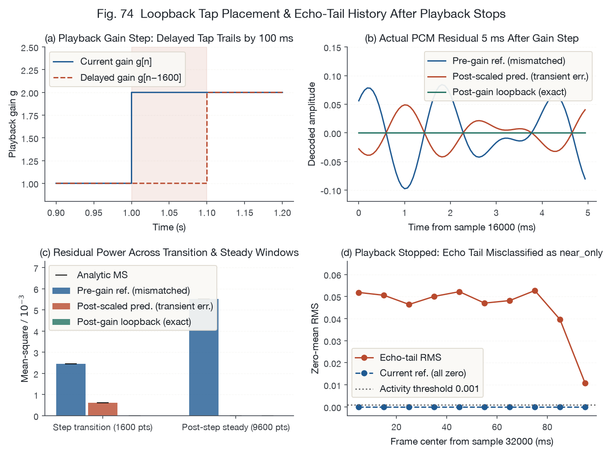

Figure 74 illustrates both this gain-ordering transient and the pure echo-tail labeling phenomenon of §6.4.1: with a known two-tap sparse path frozen at ground truth, playback gain $g[n]$ steps from $1$ to $2$ at $1.0\ \mathrm{s}$ (sample $16000$), and source playback stops at $2.0\ \mathrm{s}$ (sample $32000$) while retaining the full $100\ \mathrm{ms}$ ($1600$-sample) reverberation tail. Over the $1.0$–$1.1\ \mathrm{s}$ transition window, the T5 late-reference residual stays identically zero, the early-reference branch leaks heavily throughout, and the post-multiplied branch exhibits the exact $100\ \mathrm{ms}$ memory-span transient leakage predicted by Eq. (6-32); over the $2.0$–$2.1\ \mathrm{s}$ tail window, although zero current reference causes the frame activity detector to output `near_only` across all $10$ frames, the microphone waveform is pure delayed echo from $100\ \mathrm{ms}$ earlier, which the history-preserving late-reference filter cancels cleanly to zero.

Finally, contrast **cloud vs. edge AEC placement in remote calls** against **physical acoustic superposition in local cabin sound reinforcement**:

- **Remote full-duplex calls (on-device AEC vs. cloud AES)**: AEC performs **digital waveform subtraction** on the uplink transmit stream without canceling loudspeaker sound in local room air. Whenever external wireless speakers, HDMI TVs, or cloud servers lack a clock-synchronized T5 reference stream, accurate linear adaptive filtering must run on-device close to hardware loopback, leaving the cloud restricted to weak-reference or blind Acoustic Echo Suppression (AES);
- **Physical wave superposition in cabin reinforcement and active noise control (automotive ICC / local PA vs. ANC)**: When microphone speech is amplified and played immediately out rear-seat loudspeakers inside the **same vehicle cabin** (In-Car Communication, ICC), reinforced sound superimposes **physically in cabin air** onto direct driver speech $s(t)+\alpha s(t-\tau_{\mathrm{loop}})$! Two coherent waves separated by loop delay $\tau_{\mathrm{loop}}$ form power spectrum $|1+\alpha e^{-\mathrm{j}2\pi f\tau_{\mathrm{loop}}}|^2$ with periodic peaks and notches spaced every $\Delta f=1/\tau_{\mathrm{loop}}$—once capture, block filtering, and playback push $\tau_{\mathrm{loop}}$ near or past the **ITU-T P.1150** ceiling $\Delta_{\mathrm{Rx}}<15\ \mathrm{ms}$ (at $\tau_{\mathrm{loop}}=15\ \mathrm{ms}$, deep notches repeat every $\approx 66.7\ \mathrm{Hz}$ across the speech band), passengers hear hollow metallic comb filtering or closed-loop acoustic feedback howling that no digital subtraction can undo; and **Active Noise Control (ANC)** tightens electronic latency even further to $\tau_{\mathrm{elec}}\le\tau_{\mathrm{acoust}}-\tau_{\mathrm{sec}}$ (often sub-millisecond) for destructive acoustic interference (quantitative delay comparison across all three loops in Exercise [E06-44](#e06-44)).

### 6.11 Test Coverage and Acceptance Matrix

Once integrated into target hardware, QA requires an end-to-end acceptance matrix spanning steady state, transients, double-talk, clock drift, and downstream tasks. Products subject to industry certification (e.g., ITU-T P.340/P.1100/P.1110 telecom standards, automotive hands-free specs, or voice-assistant certification) should bind pass/fail thresholds directly to pinned standard clauses, test sequences, and HATS artificial-head geometry:

| # | Test Item | Test Condition | Logged Deliverables | Threshold Basis |
|---|---|---|---|---|
| C1 | Post-convergence STFE linear ERLE | Far-end single-talk, excluding initial convergence | Mean/quantiles, evaluation window, input & linear-output tap nodes | Target-device linear-stage baseline |
| C2 | STFE final output | Exact same recording as C1 | Final residual level, AECMOS Echo score, listening results | Audible-echo spec of target product |
| C3 | Cold-start convergence | Specified initial state and playback material | Distribution of time-to-baseline from playback onset | Interactive latency & task requirements |
| C4 | Path-jump reconvergence | Repeatable motion, occlusion, or route-switch action | Recovery time, success rate, peak transient residual | Permissible dropout window for scenario |
| C5 | Double-talk speech quality | Specified SER grid, talkers, and DT sequences | Near-end quality, syllable retention, residual echo | Applicable standard or project listening baseline |
| C6 | Double-talk echo leakage | Exact same clips as C5 | AECMOS Echo score plus human double-blind listening | Pinned model version & listening protocol |
| C7 | STNE near-end distortion | Near-end single-talk, AEC on vs. bypassed | Spectral diff, objective quality, downstream task, listening | Bypass baseline & permissible degradation |
| C8 | Idle-period stability | Longest target idle duration with mid-idle path change | Tap drift plus recovery behavior upon playback resumption | Maximum session length & idle states |
| C9 | Nonlinear high-volume playback | Target max volume & program types, including DT | Linear residual, final residual, near-end distortion | Transducer overload & audio quality spec |
| C10 | Clock drift (SRO) | Actual render/capture clock domains over max session | Estimated delay slope, resampler state, residual trend | Crystal ppm spec & max call duration |
| C11 | Route switching & packet drops | Supported device switches and injected buffer drops | Delay re-search, recovery time, audio continuity | Call-continuity & UX requirements |
| C12 | Certification compliance | Profiles and stimuli mandated by target standard | Standard-mandated metrics and statistical aggregation | Explicit version & clause of target standard |
| C13 | Downstream task impact | Identical corpus with AEC bypassed vs. enabled | Wake-word recall/FA, ASR WER, or call intelligibility delta | Task baseline & regression budget |

For daily firmware builds and production-line smoke tests, distill seven fast regression gates (A1–A7) calibrated against historical unit distributions and component tolerances:

| # | Smoke Gate | Rapid Check Procedure | Pass Criterion |
|---|---|---|---|
| A1 | Reference content & tap node | Inspect signal graph; vary app source, alerts, volume, post-FX | Reference captures all expected playback; uncovered DSP has documented compensation |
| A2 | Bulk-delay coverage | Inspect delay-estimator logs under injected jitter & route switches | Search range and filter span cover target delay distribution with safety margin |
| A3 | Dual-tap STFE | Fixed STFE clip logging both linear stage and final output | Both tap points independently meet project baselines per §6.7 |
| A4 | Double-talk | Pinned, versioned double-talk regression suite | Near-end preservation, echo leakage, and tap stability all clear baseline |
| A5 | Path perturbation | Repeatable mechanical shift, occlusion, or route switch | Reconverges to baseline within target time window; report failure rate |
| A6 | Human blind listening | Pre-registered sample count, randomization, and playback level | Statistical pass criterion of chosen protocol; never single-listener anecdote |
| A7 | Automated multi-metric gate | Pinned scoring model, firmware build, and test set | Regression guard only; thresholds anchored to human-validated baselines |

### 6.12 AEC Diagnostic Methods and NLP Operating Point

When field recordings exhibit echo leakage, clipped syllables, or late-call degradation, walk down diagnostic matrix D1–D8 ("Symptom $\longrightarrow$ Key Measurement $\longrightarrow$ Probe Stimulus $\longrightarrow$ Root-Cause Criterion"):

| # | Symptom | Key Measurement | Probe / Tool | Root-Cause Criterion |
|---|---|---|---|---|
| D1 | ERLE below baseline | Consistency between reference and physical playback | Compare reference waveform against acoustic playback; audit tap node | Reference must reflect source, volume, and DSP changes or carry exact compensation |
| D2 | ERLE stalls early | Delay / span mismatch | Cross-correlation peak, Fig. 30(a), delay logs | Verify bulk delay falls inside search window & cache, and aligned nonzero path fits $[0,L-1]$ |
| D3 | Sluggish post-DT recovery | Adaptation gating | DTD flags, step-size trace, misalignment log | Recovery rate after DT matches STFE baseline without abnormal lockup |
| D4 | ERLE plateaus at high volume | Nonlinear distortion share | Multi-level ERLE sweep vs. harmonic distortion | Residual nonlinear floor drops proportionally as playback volume is backed off (cf. Fig. 31) |
| D5 | Choppy / muffled speech or pumping | Over-aggressive NLP | Bypass NLP; evaluate ITU-T P.863 only when time-aligned clean near-end truth exists & clauses hold, else AECMOS Other, blind listening, ASR WER (if retaining legacy PESQ, pin P.862 build & bandwidth) | Speech restores upon NLP bypass $\to$ raise gain floor & relax DT suppression |
| D6 | Abrupt silence background shifts | CNG spectrum & level | Compare idle CNG spectrum against true mic noise floor | Tune spectral tilt and level jointly via blind listening rather than a single dB number |
| D7 | Gradual degradation over long calls | Cumulative SRO clock drift | Delay-estimate trajectory across max session length | Residual rate offset stays within coherence and task tolerances |
| D8 | Failure after track/device switch | Step delay jump | Event-aligned ERLE and delay-estimator trace | Re-acquires within target window; verify search range covers new route delay |

D1–D3 audit reference integrity, delay alignment, and double-talk gating; D4 isolates nonlinear floors; D5–D6 audit near-end preservation and comfort noise; D7–D8 catch long-term clock drift and route-switch jumps.

Keep the two delay scopes in D2 distinct: total render-to-capture bulk delay must fall within the estimator's search window and reference ring buffer; once bulk-aligned, all nonzero taps of the residual impulse response must fit within causal indices $0$ through $L-1$. Negative residual lags require adjusting reference tap-off or capture buffering; trailing taps beyond $L-1$ require adjusting alignment offset or filter length $L$.

In Figure 30, compensating the $300$-sample bulk delay up front allows a $128$-tap filter to cover the remaining multi-path tail—never judge coverage solely from the $331$-sample signed correlation peak (full coverage condition in [§6.4](#sec-6-4)). Multiple correlation peaks warrant checking strong reflections and periodic stimuli.

Note that ITU-T withdrew P.862, P.862.1, P.862.2, and P.862.3 (the PESQ family) on January 5, 2024 in favor of P.863, P.863.1, and P.863.2 (POLQA; see [ITU-T P.862 status](https://www.itu.int/rec/T-REC-P.862) and [ITU-T P.863](https://www.itu.int/rec/T-REC-P.863-201803-I)); retain PESQ solely for legacy regression continuity, and verify P.863 bandwidth, time-alignment, and licensing clauses before establishing new objective quality gates.

Because real AEC Challenge loopback/microphone pairs lack isolated clean near-end ground truth, intrusive P.863 near-end scores cannot be computed on them ([ITU-T P.863.1](https://www.itu.int/rec/T-REC-P.863.1-201906-I) explicitly requires paired clean-reference and degraded speech); evaluate unreferenced real recordings via AECMOS sub-scores, downstream WER, and double-blind listening.

> **Cumulative ledger of Sample Rate Offset (SRO).** When an external USB speaker and built-in microphones run off independent crystals differing by just $10\ \mathrm{ppm}$ ($10^{-5}$), a $16\ \mathrm{kHz}$ stream slips by $16000\times 10^{-5}=0.16$ samples every second—accumulating $0.16\times 3600=576$ samples ($36\ \mathrm{ms}$) over a $1$-hour meeting! Coarse integer-lag jumps only recenter the buffer intermittently without canceling intra-frame phase rotation (Exercise E06-25); cross-clock calls require continuous online SRO estimation driving fractional-delay Asynchronous Sample Rate Conversion (ASRC), whereas clocking DAC and ADC off a shared hardware MCLK/BCLK eliminates SRO at its physical root.

**Calibrating the NLP residual-suppression operating point**. Because NLP multiplies subbands by real attenuation gains, pushing suppression harder cleans up STFE at the direct expense of double-talk syllable clipping, musical noise, and background pumping. Calibrate across four coordinated axes rather than setting a single "max suppression dB" knob:

| Tuning Priority | Controlled Parameters | Monitored Trade-Offs | Rollback Trigger |
|---|---|---|---|
| Near-end protection first | Raise gain floor; slow or cap suppression during DT | Near-end spectrogram, ASR WER, DT naturalness | Tighten suppression incrementally only if audible echo remains |
| Echo suppression first | Lower gain floor in high-confidence STFE bands | Audible residual echo, musical noise, background continuity | Syllable dropouts, noise pumping, or abrupt background transitions |
| State-continuous control | Modulate gains smoothly via far-end activity, DT confidence, residual power | State-transition transients and recovery speed | Low-confidence oscillation or audible switching artifacts |
| Comfort-noise matching | Shape CNG spectrum and level to true mic noise floor | Idle continuity and spectral color match | CNG becomes noticeable on its own or masks quiet near-end speech |

In practice, bypass NLP completely first to verify the linear stage is optimal, then lower the NLP gain floor gradually along the Pareto frontier of "echo leakage — double-talk fidelity — ASR WER," never copying a blind $-20\ \mathrm{dB}$ rule-of-thumb without measuring hardware acoustic coupling.

### 6.13 Compliance Checklist for Personalized AEC

Section 6.5 introduced personalized AEC (pAEC) conditioned on enrolled speaker embeddings. Because voiceprints constitute biometric personal data capable of identifying natural persons, production deployment must clear privacy, access-control, and graceful-degradation gates P1–P8 alongside acoustic benchmarks:

| # | Audit Item | Required Engineering Specification | Consequence of Omission |
|---|---|---|---|
| P1 | Enrollment duration & quality | Plot enrollment length/SNR vs. target/bystander error rates at target distances | Unreliable embeddings falsely suppress the enrolled user during DT |
| P2 | Informed notice & consent | Specify purpose, on-device vs. cloud locus, retention, and deletion per law/policy | Users cannot exercise informed control over biometric processing |
| P3 | Embedding storage security | Define edge/cloud storage boundary, ACLs, encryption at rest, backup scope | Unauthorized biometric access or scope creep |
| P4 | First-frame readiness | Pre-load embedding ahead of frame 0 if opening words require protection; budget latency | Opening wake words or syllables lack personalized protection |
| P5 | Revocation & opt-out | Define deletion UI, propagation SLA, and seamless fallback to standard AEC | Users cannot revoke biometric conditioning |
| P6 | Low-confidence fallback | Specify bypass/fallback rules for unenrolled use, low cosine similarity, or multi-talker overlap | Accidental muting of unenrolled callers or the target user |
| P7 | Shared & household devices | Define multi-profile switching, permissions, and minor-user consent workflows | Cross-profile confusion or family members muted mid-call |
| P8 | Identity-conditioned QA | Augment C5/C6 with target + bystander + far-end three-way overlap matrices | Standard DT suites miss identity-conditioning failures |

### 6.14 Research Directions

Contemporary AEC research advances along four main fronts: lightweight neural networks estimating online step sizes or Kalman state-space covariances; joint multi-microphone, multi-loudspeaker echo and interference optimization; low-latency speaker-conditioned full-duplex pickup; and differentiable non-intrusive perceptual metrics aligned with human double-talk ratings. When reading new papers, checking four hard engineering coordinates up front—**strict causality, total frame-plus-lookahead latency in milliseconds, exact playback reference tap-off point, and double-talk SER distribution**—cuts straight past headline averages to real deployment viability.

### 6.15 Executable Baselines and Open-Source Implementation Boundaries

#### 6.15.1 Teaching NLMS, PBFDAF, and State Boundaries

This repository provides step-by-step inspectable pure-NumPy teaching implementations: core time-domain NLMS and $\mathrm{ERLE}$ live in [`codes/chapters/ch06/core/aec.py`](../codes/chapters/ch06/core/aec.py), and the Chapters 6–9 cross-chapter baseline runner lives in [`codes/chapters/ch00/cross_chapter/ch06_09_baselines.py`](../codes/chapters/ch00/cross_chapter/ch06_09_baselines.py). Run directly from the repository root:

```bash
.venv/bin/python -m codes.chapters.ch00.cross_chapter.ch06_09_baselines
```

In batch function `nlms(reference, microphone, filter_length, ...)`, setting `freeze[n]=True` computes the causal a priori prediction and residual normally while skipping weight updates; zero-energy reference windows likewise skip updates automatically, and non-finite floats, non-positive integer tap counts, or non-boolean masks raise explicit exceptions rather than silently propagating `NaN`.

**Why must streaming cross-chunk execution never save tap weights alone?** Because in linear convolution, sample $0$ at the start of a new chunk still takes an inner product against the **trailing $L-1$ historical reference samples from the previous chunk**! Stateful class `NLMSState` encapsulates both the current weight vector and that length-$(L-1)$ reference history buffer (stored oldest-to-newest internally and reversed to most-recent-first for dot products), ensuring `process()` produces bit-identical outputs whether fed a whole file at once or arbitrary chunk sizes. Run the [streaming boundary demo](../codes/chapters/ch06/aec_streaming_demo.py) to verify directly ($h=[0.5,0.25]$, $x=[1,2,3,4]$, frozen $\mu=0$): both single-pass and two-chunk `NLMSState` execution emit $[0,0,0,0]$, whereas carrying over weights while zeroing reference history misses $x[1]=2$ at the start of chunk $2$ and fabricates a spurious $0.5\times 2-0.5=0.5$ residual:

```bash
.venv/bin/python -m codes.chapters.ch06.aec_streaming_demo
```

Five focused module runners let readers verify every hand calculation in the text:

1. **Four core arithmetic mini-cases** ([`aec_algorithm_minicases.py`](../codes/chapters/ch06/aec_algorithm_minicases.py), unit-tested in [`test_codes_aec_minicases.py`](../tests/test_codes_aec_minicases.py)): Emits exact JSON records for $N=2,P=2$ overlap-save valid half-blocks, two-tap IPNLMS proportionate allocation, Geigel multi-path false alarms and zero-reference gating, and negative-polarity echo fooling maximum-positive-peak delay search:

    ```bash
    .venv/bin/python -m codes.chapters.ch06.aec_algorithm_minicases
    ```

2. **Partitioned frequency-domain PBFDAF demo** (core in [`core/aec_partitioned.py`](../codes/chapters/ch06/core/aec_partitioned.py), tests in [`test_codes_aec_partitioned.py`](../tests/test_codes_aec_partitioned.py)): Chains Eqs. (6-4)–(6-5) overlap-save prediction, front-zero-padded error spectra, per-bin power normalization, and optional time-domain valid-tap zero-projection, reproducing both the two-block hand trace in §6.2.2 and the pure-tone vs. wideband holdout benchmark of Worked Example 6-5:

    ```bash
    .venv/bin/python -m codes.chapters.ch06.aec_partitioned_demo
    ```

3. **Sample-by-sample full-matrix RLS demo** (core in [`core/aec_rls.py`](../codes/chapters/ch06/core/aec_rls.py)): Maintains the inverse correlation matrix and cross-chunk reference history (`freeze=True` suspends both tap fitting and $\lambda^{-1}$ windup while advancing the reference window) and cross-checks Eq. (6-18) against batch normal equations:

    ```bash
    .venv/bin/python -m codes.chapters.ch06.aec_rls_demo
    ```

4. **Time-domain full-matrix Joseph-form Kalman demo** (core in [`core/aec_kalman_matrix.py`](../codes/chapters/ch06/core/aec_kalman_matrix.py)): Tracks full path-error covariance via Eq. (6-22) (`freeze=True` skips measurement updates alone while still advancing time prediction $\mathbf A\hat{\vec h}_{n-1}$ and reference history, so freezing is not weight-stationary when $a\neq 1$), illustrating cross-tap negative off-diagonal covariance buildup:

    ```bash
    .venv/bin/python -m codes.chapters.ch06.aec_kalman_matrix_demo
    ```

5. **Single-bin scalar and complex-conjugate Kalman demo** ([`aec_kalman_scalar_demo.py`](../codes/chapters/ch06/aec_kalman_scalar_demo.py), tested in [`test_codes_aec_kalman_scalar_demo.py`](../tests/test_codes_aec_kalman_scalar_demo.py)): Reproduces Eq. (6-21) on real single-talk, purely imaginary conjugated spectra, and high-observation-variance double-talk soft gating:

    ```bash
    .venv/bin/python -m codes.chapters.ch06.aec_kalman_scalar_demo
    ```

In scoring function `erle_db()`, alongside `double_talk_mask` excluding double-talk intervals, callers pass `valid_mask` to exclude cold-start transients, STNE, and silence. The function requires mean squared input over the valid window to strictly exceed floor `epsilon` (at default `epsilon=1e-15`, a $10^{-8}$-amplitude tone of mean square $10^{-16}$ is rejected as silent) and adds `epsilon` to both numerator and denominator mean squares before taking the log ratio, returning a floor-bounded finite dB value rather than `inf` at zero residual (regression tests in [`tests/test_codes_aec_wpe_sep_track.py`](../tests/test_codes_aec_wpe_sep_track.py) and [`tests/test_codes_aec_streaming.py`](../tests/test_codes_aec_streaming.py)).

Readers exploring industrial engines and research repositories can fetch pinned third-party snapshots into `codes/chapters/ch00/upstream/_downloads/` (fetch instructions in the [Upstream Code Guide](../codes/chapters/ch00/upstream/README_EN.md); line-level API walkthroughs in the [AEC Source Research Manual](../codes/chapters/ch00/research_en/02_aec_wpe_separation.md#aec)):

| Method or Component | Entry Point in Upstream Source | Core Problem Addressed | Specific Reproduction Checks |
|---|---|---|---|
| MDF/PBFDAF and AUMDF | SpeexDSP `libspeexdsp/mdf.c`, `speex_echo_state_init_mc()` through `speex_echo_cancellation()` | Splits long paths into frequency partitions and schedules constraint projections | Overlap-save valid half, FFT scaling, partition delay line, block tails |
| Continuous learning-rate control | Learning-rate and proportionate segments in `mdf.c` | Modulates step size from residual echo, double-talk, and noise | Speex omits binary DTD here; do not impose hard-freeze semantics |
| AEC3 linear path & delay | WebRTC `aec3/echo_canceller3.cc`, `block_processor.cc`, `subtractor.cc`, `render_delay_controller.cc` | Organizes reference buffering, delay alignment, and dual-filter subtraction | Render/capture call order, underruns, path jumps, shadow resets |
| AEC3 residual suppression | `residual_echo_estimator.cc`, `suppression_gain.cc`, `comfort_noise_generator.cc` | Estimates unmodeled echo, applies spectral gains, synthesizes CNG | Export both linear residual and final output so NLP never masks linear bugs |
| DTLN-aec | Author repo `run_aec.py` and two-stage model I/O | Jointly estimates near-end speech from mic and playback reference | Sampling rate, recurrent states, overlap-add framing, TFLite & weight license |
| NKF-AEC | Author repo `src/nkf.py` (source index only) | Learns complex Kalman gains atop linear overlap-save AEC | 16 kHz, pre-aligned reference; redistribution license unconfirmed |
| Meta-AF | `metaaf/filter.py`, `core.py`, and learned optimizers | Meta-learns adaptive filter update rules with chunked state | Core library vs. `zoo/` and pretrained weights carry separate licenses |
| Learned step-size CTF-AEC | `main_train.py` $\to$ `libPython/class_frontend.py` $\to$ `class_aec_ctf.py` | Retains linear CTF echo model while DNN predicts binwise step sizes | No pretrained weights; resets state at clip boundaries with `center_stft=True` (non-streaming) |
| Integrated AEC/NR | `Main.m` $\to$ `Util/Process/process.m` $\to$ AEC, NR, MWF, postfilter modules | Compares joint vs. cascaded AEC/NR across multi-mic, multi-speaker arrays | MATLAB R2024a; uses oracle clean-speech/echo ground-truth VAD unavailable on hardware |
| Original FDKF/PBFDKF, NeuralKalman, DeepVQE | Structural mapping in primary papers and research manual | Reshapes state statistics, learned recursions, or joint attention | Unverified third-party reimplementations must not be conflated with official author code |

#### 6.15.2 External AEC Interfaces and Output Tap Points

When auditing open-source implementations in the table above, first verify mathematical identity from file headers and operators: [`mdf.c` in SpeexDSP](https://gitlab.xiph.org/xiph/speexdsp/-/blob/8e29a256ef0235ebbe7fcb8417b5ac7731eb8307/libspeexdsp/mdf.c) explicitly implements Soo & Pang's Alternating Unconstrained MDF (AUMDF) with Valin's coherence-driven continuous learning rate (a partitioned gradient method), whereas true FDKF explicitly recurses state-error, process, and observation variances—never label every partitioned frequency-domain filter "FDKF."

Comparing `NLMSState`, [WebRTC AEC3](https://webrtc.googlesource.com/src/+/0467d2b91cc20b9b001c2bbb73d43ea6b2491f3e/modules/audio_processing/aec3/), and SpeexDSP requires respecting strict API ordering and tap-point semantics:

- **WebRTC APM call order**: Pushing $10\ \mathrm{ms}$ frames, the host must call `ProcessReverseStream()` with far-end playback *first*, pass the render/capture buffer offset via `set_stream_delay_ms()` (a pipeline buffer hint, neither room $T_{60}$ nor FIR tap count), and call `ProcessStream()` on capture audio *last* (see [`audio_processing.h`](https://webrtc.googlesource.com/src/+/0467d2b91cc20b9b001c2bbb73d43ea6b2491f3e/api/audio/audio_processing.h));
- **SpeexDSP synchronous vs. asynchronous APIs and dual tap points**: Synchronous `speex_echo_cancellation()` expects caller-aligned playback and capture frame pointers and outputs the **core linear MDF residual** (including internal DC notch and pre-/de-emphasis); enabling post-suppression requires instantiating the preprocessor and binding echo state via `SPEEX_PREPROCESS_SET_ECHO_STATE` as a separate second tap point ([`speex_echo.h`](https://gitlab.xiph.org/xiph/speexdsp/-/blob/8e29a256ef0235ebbe7fcb8417b5ac7731eb8307/include/speex/speex_echo.h) and [Speex Manual §6](https://www.speex.org/docs/manual/speex-manual/node7.html)). Asynchronous wrappers [`speex_echo_playback()` / `capture()` in `mdf.c`](https://gitlab.xiph.org/xiph/speexdsp/-/blob/8e29a256ef0235ebbe7fcb8417b5ac7731eb8307/libspeexdsp/mdf.c#L687-733) queue mono `frame_size` slices—never pass interleaved multi-channel buffers into those mono async helpers.

Because industrial libraries bundle internal framing delays, DC highpass filters, and NLP suppression, never compare "final post-NLP AEC3 output power" directly against "raw linear teaching NLMS residual power"—lock identical inputs, sample rates, aligned windows, and explicit tap points.

#### 6.15.3 Real Paired Recordings and Double-Talk Controls

What happens on real consumer recordings lacking clean component truth and pre-aligned bulk delay? Three controlled experiments establish disciplined real-audio diagnostics (full commands and SHA checksums in the [Research Manual](../codes/chapters/ch00/research_en/02_aec_wpe_separation.md#aec); raw audio cached locally).

**Experiment 1: Reference-sensitivity controls on real STFE** ([`aec_real_pair_experiment.py`](../codes/chapters/ch06/examples/aec_real_pair_experiment.py)). Feeding a paired $16\ \mathrm{kHz}$ mono Windows loopback `lpb` and microphone clip `mic` ($11.77\ \mathrm{s}$, single device session GUID from the Microsoft AEC Challenge) into synchronous `speex_echo_cancellation()` ($160$-sample frame, $4096$-sample filter; $3\ \mathrm{s}$ convergence warmup, scoring total input-to-output power ratio over `[3, 11.77)` $\mathrm{s}$):

- With **correctly paired reference**, total output power drops by **$5.57\ \mathrm{dB}$**;
- With an **all-zero silent reference** blank control, output power *still* drops by **$3.95\ \mathrm{dB}$**! Speex's internal DC-notch highpass filter strips low-frequency room hum and DC offset from the raw recording; omitting this zero-reference control would falsely credit that $3.95\ \mathrm{dB}$ to adaptive echo cancellation;
- **Delaying the reference by $1\ \mathrm{s}$** to break causality drops power change to **$-0.23\ \mathrm{dB}$**, confirming genuine reliance on time-paired reference waveforms.

**Experiment 2: Real double-talk paired control** ([`aec_doubletalk_experiment.py`](../codes/chapters/ch06/aec_doubletalk_experiment.py)). On paired double-talk clips `doubletalk_lpb` / `doubletalk_mic` from the same GUID (trimmed to $196160$ full-frame samples, $3\ \mathrm{s}$ warmup, scored over `[3, 8)` $\mathrm{s}$), correct, all-zero, and $1\ \mathrm{s}$-delayed references yield input-to-output power ratios of $2.234$, $2.204$, and $2.200\ \mathrm{dB}$ (correct reference differs from zero control by just $0.029\ \mathrm{dB}$)—confirming §6.7's warning that dominant near-end speech renders unseparated total power ratios useless for measuring double-talk echo suppression or near-end damage!

**Experiment 3: Bare teaching PBFDAF stress test without delay search or DTD** ([`aec_pbfdaf_real_pair_compare.py`](../codes/chapters/ch06/examples/aec_pbfdaf_real_pair_compare.py)). Feeding both real pairs directly into unguarded teaching PBFDAF ($N=160$, $P=26$ spanning $4160$ taps, fixed $\mu=0.3$, instantaneous floor $\delta=0.05$) yields STFE `[3, 11.77)` $\mathrm{s}$ input-to-residual ratios of $-6.700$, $0$, and $-18.017\ \mathrm{dB}$ (correct, zero, $1\ \mathrm{s}$-late reference) and DT `[3, 8)` $\mathrm{s}$ ratios of $-6.363$, $0$, and $-1.665\ \mathrm{dB}$ (negative dB means residual power *exceeds* raw mic input, with `float64` peaks under late reference exceeding PCM16 full scale!).

This negative-dB stress test indicts not partitioned FFT math, but running bare fixed-step updates on real recordings with unknown buffer delays, wild spectral dynamics, and un-gated double-talk without the smoothed power estimators, delay alignment, and step-size guards of §6.8.

#### 6.15.4 Controlled Near-End Injection Verification

Without clean near-end ground truth on real recordings, how can we quantify whether a black-box processor $A$ crushes or distorts near-end speech while canceling echo? A clean probe is **two-run differential increment testing** ([`aec_controlled_doubletalk.py`](../codes/chapters/ch06/aec_controlled_doubletalk.py)): fix reference $x[n]$ and echo-plus-noise baseline mic recording $d_0[n]$, initializing $A$ identically on two runs—Run 1 feeds $d_0$ to obtain $y_0=A(x,d_0)$, while Run 2 adds a known deterministic near-end probe $s[n]$ ($\sum_{n\in W}s^2[n]>0$) over window $W$ to obtain $y_1=A(x,d_0+s)$. Define output increment $\Delta[n]$, zero-lag projection gain $g_\Delta$, and relative squared error $E_\Delta$:

$$\begin{aligned}
\Delta[n]&=y_1[n]-y_0[n],\\
g_{\Delta}
&=\frac{\sum_{n\in W}\Delta[n]s[n]}
       {\sum_{n\in W}s^2[n]},\\
E_{\Delta}
&=\frac{\sum_{n\in W}(\Delta[n]-s[n])^2}
       {\sum_{n\in W}s^2[n]}.
\end{aligned}\tag{6-33}$$

Geometrically (orthogonal decomposition in Exercise E06-33), if $A$ acts as an identity LTI passthrough on $s[n]$ over $W$ without $s[n]$ perturbing internal echo weights between runs, $\Delta[n]\equiv s[n]$ gives $g_\Delta=1$ and $E_\Delta=0$! Because $g_\Delta\approx 1$ alone cannot rule out orthogonal nonlinear harmonics or perturbed echo leakage in $\Delta[n]$, always read $(g_\Delta,E_\Delta)$ as a pair:

1. **Exact synthetic PCM additive test**: Injecting a harmonic near-end probe over `[1.2, 1.8)` $\mathrm{s}$ of a $2\ \mathrm{s}$ clip without PCM clipping, teaching NLMS with oracle freeze gives identical weight trajectories across runs and exact $g_\Delta=1, E_\Delta=0$; leaving DT adaptation unfrozen degrades metrics to $g_\Delta=0.936, E_\Delta=0.322$. SpeexDSP synchronous core yields $g_\Delta=0.878, E_\Delta=0.208$ under correct reference versus $0.879, 0.204$ under all-zero reference—pinpointing the $\approx 0.20$ discrepancy to Speex's fixed DC notch, pre-/de-emphasis, and integer requantization rather than echo-filter speech cancellation!
2. **Semi-synthetic real-recording superposition**: Superimposing a real STNE clip from the same session over `[3, 8)` $\mathrm{s}$ of the real STFE mic track, SpeexDSP synchronous core gives $g_\Delta=0.922, E_\Delta=0.140$ (correct reference) vs. $0.923, 0.128$ (zero reference), cleanly separating fixed front-end filtering from adaptive perturbation.

#### 6.15.5 WebRTC AEC3 Tap Points and Same-Input Ground-Truth Experiment

Benchmarking official WebRTC CLI tool `audioproc_f` requires aligning two subtle interface contracts up front: (1) `audioproc_f` defaults to processing capture frames before render frames, so fair comparison against synchronous APIs must explicitly schedule render frames ahead of capture frames ($0\ \mathrm{ms}$ reported stream delay, exporting both linear and final outputs); and (2) **block frequency-domain and subband filterbanks introduce fixed pipeline output latency**! Plugging unaligned indices into Eq. (6-33) when near-end speech emerges intact $4\ \mathrm{ms}$ later yields a near-zero dot product by pure time shift.

On the two real recording pairs above, `audioproc_f` reduces linear/final power by $7.685\ \mathrm{dB}$ / $15.731\ \mathrm{dB}$ on STFE and $3.384\ \mathrm{dB}$ / $3.851\ \mathrm{dB}$ on DT. To inspect teaching NLMS, SpeexDSP synchronous core, AEC3 linear output, and AEC3 final output against exact component ground truth, [`aec_same_input_truth.py`](../codes/chapters/ch06/examples/aec_same_input_truth.py) (seed `20260924`) generates a $6\ \mathrm{s}$, $16\ \mathrm{kHz}$ noiseless five-tap ($[0.70,0,-0.25,0,0.12]$) echo track with unclipped near-end speech injected over `[3, 4)` $\mathrm{s}$ (`[0, 2)` $\mathrm{s}$ warmup, `[2, 3)` $\mathrm{s}$ STFE evaluation, `[3, 4)` $\mathrm{s}$ two-run increment evaluation).

Prior to scoring, an independent zero-reference single-sample impulse probe (amplitude $10000$) measures each processor's **intrinsic pipeline delay**: teaching NLMS ($32$ taps, $\mu=0.4$, oracle freeze) and SpeexDSP synchronous core ($160$-sample frame, $4096$ span) measure $0$ samples; AEC3 linear output measures exactly $64$ samples ($1$ internal $4\ \mathrm{ms}$ sub-block), and AEC3 final output measures $128$ samples ($8\ \mathrm{ms}$)! Shifting solely by each independently measured fixed delay without fitting gains or lags on the test clip gives:

| Processor Tap Point | Impulse-Measured Pipeline Delay | `[2,3)` s Echo / Aligned Output Power | `[3,4)` s $g_\Delta$ | `[3,4)` s $E_\Delta$ |
|---|---:|---:|---:|---:|
| Teaching NLMS, oracle freeze | 0 samples | 79.27 dB | 1.000 | $\approx 0$ |
| SpeexDSP synchronous core | 0 samples | 37.12 dB | 0.982 | 0.027 |
| AEC3 exported linear stage | 64 samples | 60.58 dB | 0.964 | 0.241 |
| AEC3 exported final stage | 128 samples | 30.63 dB | 0.193 | 0.763 |

Three key engineering insights stand out:

1. **Ignoring intrinsic pipeline delay causes catastrophic misdiagnosis**: Plugging AEC3 linear output into Eq. (6-33) without shifting for its $64$-sample sub-block delay collapses $g_\Delta$ to $0.199$—falsely suggesting $80\%$ near-end speech loss—whereas shifting by $64$ samples immediately restores true $g_\Delta=0.964$!
2. **Each tap point operates under distinct assumptions and is not a single leaderboard**: Teaching NLMS's $79.27\ \mathrm{dB}$ and $g_\Delta=1.000$ rely on exact $32$-tap noiseless coverage plus oracle DT freezing; SpeexDSP synchronous core and AEC3 linear stage achieve $37.12\ \mathrm{dB}$ and $60.58\ \mathrm{dB}$ blind cancellation while preserving $>0.96$ near-end projection; AEC3 final stage layers NLP and CNG—where CNG injects comfort noise into the `[2, 3)` $\mathrm{s}$ silent residual (capping total output ratio at $30.63\ \mathrm{dB}$) and NLP reacts to the abrupt synthetic `[3, 4)` $\mathrm{s}$ burst with time-varying suppression and state divergence ($g_\Delta=0.193, E_\Delta=0.763$).
3. **Build reproducibility**: Compiler flags or upstream revisions can alter internal delays and numeric traces; the script verifies binary build manifests and re-runs impulse calibration automatically (details in script docstrings and [Source Research Notes](../codes/chapters/ch00/research_en/02_aec_wpe_separation.md#aec)).

#### 6.15.6 Industrial Source Code and Hardware Verification Boundaries

Porting research codebases onto streaming embedded hardware requires bridging non-causal framing and oracle-label assumptions. For instance, in pinned step-size control repo [`e2e_dnn_ad_control_for_lin_aec`](https://github.com/ThomasHaubner/e2e_dnn_ad_control_for_lin_aec/tree/7a003133d742698de7acba9510d9586d7d57a584), the front-end uses centered STFT padding (`center_stft=True`) and resets filter state per utterance—ideal for studying DNN modulation of CTF step sizes, yet requiring causal cross-chunk state refactoring before real-time deployment. Similarly, in multi-mic joint repo [`Integrated_AEC_NR`](https://github.com/Arnout-Roebben/Integrated_AEC_NR/tree/23c6b567c7863a8ee9bafd38bad0d3ff2f25e185), [`Util/Process/process.m`](https://github.com/Arnout-Roebben/Integrated_AEC_NR/blob/23c6b567c7863a8ee9bafd38bad0d3ff2f25e185/Util/Process/process.m) constructs oracle VAD masks from ground-truth clean speech and echo components (MIT code license; sample audio terms in its [`ReadMe.md`](https://github.com/Arnout-Roebben/Integrated_AEC_NR/blob/23c6b567c7863a8ee9bafd38bad0d3ff2f25e185/ReadMe.md)), which hardware deployment must replace with blind observation-only activity estimators.

In short, the sharpest benchtop gate for any candidate AEC module locks a single paired test suite across **nominal pairing, fixed delay injection, brief reference dropout, and abrupt path jump**, logging **linear echo replica, linear residual, post-suppressed final output, and step-size/gating traces** side by side—never letting total energy drop disguise clipped double-talk or letting offline oracle gates stand in for closed-loop hardware sign-off.

> **Chapter Summary and Complete Figure Navigation.** Starting from causal linear convolution driven by a known playback reference, this chapter developed time-domain NLMS/APA/RLS, partitioned frequency-domain PBFDAF, subband cross-band coupling, and frequency-domain Kalman soft gating (§6.1–§6.2); analyzed loudspeaker nonlinear subspace plateaus, double-talk adaptation control, hybrid neural residual suppression, and multi-microphone cascade orders (§6.3–§6.6); and established evaluation protocols, WebRTC AEC3 dual-filter control, stereo time-varying all-pass decorrelation, and T5 late-reference tap rules (§6.7–§6.15). All 17 chapter figures are indexed below:
>
> | Figure | Content | Section | Reading Caveat |
> |---|---|---|---|
> | Fig. 26 | Synthetic path, reference, and near-end burst superposition | §6.1.1 | Shows time-domain convolution mixing direct sound, early reflections, and late tail |
> | Fig. 27 | Playback reference, path estimation, and subtraction loop | §6.1.1 | Top DTD block gates adaptive tap updates |
> | Fig. 18 | (a) Causal flow + DTD switch; (b) NLMS convergence + DT freeze | §6.1.2 | Most-recent-first regressor matches convolution indices; mean uses fixed seed & window |
> | Fig. 28 | (a) $\hat{\vec w}$ approaching $\vec h$; (b) misalignment vs. ERLE; (c) $\mu$ sweep | §6.1.2 | Colored excitation weights tap error by $\mathbf R_{xx}$; step 0 is pre-update init |
> | Fig. 19 | (a) Linear vs. nonlinear trajectories; (b) method landscape | §6.3, §6.5 | Panel (a) uses its own seed/path; do not compare plateau dB directly against Fig. 31 |
> | Fig. 20 | (a) System signal flow; (b) hybrid pipeline | §6.8, §6.5 | Orange block denotes optional learned residual suppressor |
> | Fig. 29 | Three-stream RMS envelopes and STFE ERLE | §6.1.2, §6.4 | Pink DT interval preserves near-end speech and leaves STFE ERLE blank |
> | Fig. 30 | (a) Signed peak near lag 331; (b) 300-sample aligned ~28 dB vs. unaligned ~2 dB; (c) freeze vs. update | §6.4, §6.8 | True bulk delay is 300 samples ($>128$ taps); colored multi-path shifts signed peak to 331 |
> | Fig. 31 | (a) Linear vs. normalized `tanh` path; (b) static transfer curve | §6.3 | Links static transfer curvature directly to linear residual ERLE ceiling |
> | Fig. 32 | Hybrid signal and adaptation-control flow | §6.5, §6.2 | Shows signal dependencies across delay alignment, linear subtraction, gating, and post-filter |
> | Fig. 36 | Linear projection and third-harmonic residual of cubic nonlinearity | E06-06 | Analytical power and quantized PCM discrete spectrum verified separately |
> | Fig. 37 | Two-band Haar cross-band terms vs. diagonal-only pruning | §6.2.3 | Contrasts exact unit-delay reconstruction with cross terms against diagonal aliasing |
> | Fig. 38 | Hand-worked updates across IPNLMS, RLS, and Kalman | §6.2.4–6.2.6 | Side-by-side comparison of proportionate shares, $\mathbf P_n$ coupling, and dual-variance Kalman gating |
> | Fig. 39 | Partitioned prediction, valid error, update, and projection | §6.2.1 | Pinpoints both time-domain truncation/padding sites; freeze still shifts reference cache |
> | Fig. 57 | Single-column NLMS, two-column exact APA, and regularized APA | APA, E06-34 | Hyperplane intersection and ridge damping on the 2-D tap plane |
> | Fig. 58 | Same-source noiseless/noisy APA trajectories and frozen holdout MSE | E06-39 | Contrasts colored speedup against noise amplification as projection order $K$ grows |
> | Fig. 74 | Reference tap node, time-varying gain order, and pure echo tail | §6.10, E06-40–42 | Contrasts T5 late tap against post-gain transition leak and post-stop `near_only` tail tags |

### 6.16 Common Pitfalls and Self-Test Questions

Across field integrations, **seven recurring pitfalls** account for the vast majority of debugging detours (physical models and remedies in §6.3, §6.4, §6.6, §6.7, and §6.10):

- Tapping the reference upstream of system mixing, EQ, or DRC/AGC, forcing a linear filter to chase time-varying gains and nonlinearities;
- Reporting the double-talk "total microphone-to-output power ratio" as echo-component $\mathrm{ERLE}$;
- Raising adaptive step sizes during double-talk, pouring near-end speech into taps and clipping user syllables;
- Leaving adaptation or RLS exponential forgetting un-gated during silence or micro-level playback, triggering random walk and covariance windup;
- Placing a single-channel AEC downstream of a rapidly steering adaptive beamformer, leaking echo bursts on every beam switch;
- Blindly multiplying linear FIR tap length to fight a residual plateau caused by micro-speaker clipping;
- Signing off releases on automated mean scores alone without double-blind double-talk listening and wake-word/ASR regression checks.

**Conceptual Self-Test Questions** (focusing on physical mechanisms and architectural trade-offs; attempt independently before checking the reference solutions below, with quantitative computations in `E06-01`–`E06-44` afterward):

1. Write down the three-term microphone observation model in Eq. (6-1), define each symbol and the objective of AEC, and explain the fundamental physical difference between digital waveform subtraction (AEC) and acoustic wave cancellation/superposition in air (ANC / automotive ICC).

2. Summarize the three conceptual steps from instantaneous squared-error LMS to energy-normalized NLMS in Eq. (6-3), and distinguish causal "a priori residual" from algebraic "a posteriori residual."

3. Explain the convergence-speed vs. steady-state misadjustment trade-off of step size $\mu$ and the meaning of persistent excitation: why can a steady pure-tone reference never uniquely identify a multi-tap echo path?

4. Describe how path length $L$, block size $N$, partition count $P=L/N$, and FFT length $2N$ interact in PBFDAF: why does the history half-block add zero lookahead wait, and why must "discarding the leading half-block in prediction" be kept distinct from "zeroing the trailing half-block in gradient projection"?

5. Explain why a unit-sample odd delay creates cross-subband coupling in critically sampled filterbanks (or non-overlapping short transforms), and how oversampled filterbanks or NSAF overcome this bottleneck.

6. Referring to Figure 31(a)–(b), use subspace-orthogonality intuition to explain why loudspeaker nonlinearities create an ERLE plateau, and why generalized Hammerstein models favor orthogonal Legendre polynomials over raw monomials $\{x, x^3, x^5\}$.

7. State the sliding-window peak definition of Geigel DTD in Eq. (6-25), explain why the $T=0.5$ telephone-hybrid assumption fails on acoustic speakerphones, and show how vector Benesty NCC overcomes the multi-path blind spot of zero-lag scalar correlation.

8. Compare the pros and cons of binary hard freezing, continuous soft step-size scaling (such as FDKF gain gating), and foreground/shadow dual-filter cooperation during double-talk.

9. On a double-talk time–frequency tile at $\mathrm{SER}=-20\ \mathrm{dB}$, contrast the effect on local SER of "up-front linear waveform subtraction" versus "multiplying the mixture by a real scalar gain."

10. State a one-sentence selection rule for each of the three array cascade orders (AEC$\to$BF, BF$\to$AEC, GEIC), and explain why stereo multi-reference AEC requires *time-varying* rather than *fixed* all-pass decorrelation.

11. Locate tap nodes T1–T5 along the digital playback pipeline, explain why T5 right before the DAC is preferred, and use convolution memory to explain why "filtering early reference first and multiplying by current gain $g[n]$ afterward" leaks echo across volume changes.

12. Trace the closed-loop cooperation in WebRTC AEC3 across `RenderBuffer`, matched-filter delay estimation, `refined`/`coarse` dual filters, residual suppression, and CNG.

13. Distinguish what objective $\mathrm{ERLE}$, human subjective MOS, and non-intrusive AECMOS measure, explaining why room noise caps single-talk power-ratio readings and why double-talk total output ratios never equal $\mathrm{ERLE}$.

14. Specify tap points, core statistics, and threshold bases for production smoke gates A3 (dual-tap STFE), A4 (double-talk), and A6 (human blind listening).

**Reference Solutions to the 14 Conceptual Self-Test Questions**:

1. Equation (6-1) reads $d[n]=s[n]+(x*h)[n]+v[n]$: $d[n]$ is composite mic input, $s[n]$ near-end speech to preserve, $x[n]$ known playback reference, $h[\ell]$ equivalent linear echo path, and $v[n]$ ambient/circuit noise. AEC subtracts digital replica $\hat y[n]$ on the uplink to keep echo from returning to the far end without muting $d[n]$ or canceling sound in local air; ANC and cabin ICC superpose physical acoustic waves in air, bounded strictly by acoustic time-of-flight or Haas fusion limits ($15\ \mathrm{ms}$ in ITU-T P.1150).

2. Differentiating $J[n]=e^2[n]$ gives negative gradient direction $e[n]\vec x[n]$ (LMS); scaling by step size advances weights; dividing by window energy $\|\vec x[n]\|^2+\varepsilon$ removes quadratic input-amplitude sensitivity to yield Eq. (6-3). The a priori residual uses pre-update weights as the true causal output sent downstream; the a posteriori residual re-evaluates the same sample with post-update weights solely to verify single-step projection contraction.

3. Larger $\mu$ speeds up cold start and post-jump reconvergence but folds more noise floor and un-gated double-talk into weights, raising steady-state misadjustment. Each sample updates only along $\vec x[n]$; lags of a real sinusoid span only a 2-D subspace ($\operatorname{rank}(\mathbf R_{xx})=2$), leaving normal equations singular for $L\ge 3$ so nullspace tap errors burst into echo leakage under wideband speech.

4. Slicing $L$ into $P=L/N$ partitions of length $N$ pairs $N$ newly arrived samples with $N$ cached prior samples into a $2N$-point FFT, keeping buffering wait at $N/f_s$. In forward prediction, leading $N$ circular-convolution samples carry wrap-around aliasing and are discarded while trailing $N$ valid residuals are front-padded with $0_N$ before their FFT; in constrained updates, candidate weights IFFT to the time domain to zero trailing $N$ invalid lags so adjacent partitions never duplicate the same physical delay.

5. Critical decimation breaks shift invariance: odd delays flip polyphase parity and cross block boundaries, coupling each output band to both same- and cross-band inputs; dropping off-diagonal branches breaks alias cancellation. Modern designs suppress adjacent-band overlap via high-stopband oversampled filterbanks or update a single fullband tap vector from subband-whitened errors via NSAF (§6.2.3).

6. Nonzero curvature of $\tanh$ in Figure 31(b) generates higher-order harmonics and intermodulation products orthogonal to the linear span of reference history, leaving an uncancelable orthogonal residual plateau in Figure 31(a). In generalized Hammerstein branches, raw odd monomials $\{x,x^3,x^5\}$ are heavily collinear on $[-1,1]$ with Hilbert-like conditioning, whereas orthogonal Legendre polynomials strip lower-order projections to slash multi-branch condition numbers.

7. Peak $M[n]=\max_{0\le\ell<L}|x_a[n-\ell]|$. Telephone hybrids guaranteed $\ge 6\ \mathrm{dB}$ loss ($\le 0.5$), whereas constructive room reflections push STFE $|d[n]|/M[n]>0.5$ into chronic false freezes while well-isolated weak echo misses quiet barge-in. Vector Benesty NCC whitens via $\vec r_{xd}^\top\mathbf R_{xx}^{-1}\vec r_{xd}$ to sum true echo power across all taps before normalizing by $\sigma_d^2$, curing zero-lag multi-path blindness (§6.4).

8. Binary freezing cleanly blocks gradient corruption once DT is flagged but locks up if path jumps are misclassified as DT; continuous soft step sizes (such as Kalman gain scaling via $\Psi_m$) transition smoothly yet depend on noise-variance accuracy; pairing conservative foreground and agile shadow filters captures both DT stability and rapid jump recovery.

9. At $\mathrm{SER}=-20\ \mathrm{dB}$, echo power is $100\times$ speech power. Phase-aligned linear subtraction ($\hat Y=0.9Y\implies 0.1Y$ residual) removes $99\%$ of echo energy without touching $S$, lifting local SER by $+20\ \mathrm{dB}$ to $0\ \mathrm{dB}$; real scalar masking $g(S+Y)$ attenuates speech and echo identically, leaving within-tile SER unchanged (§6.5).

10. **AEC$\to$BF** decouples physical mic paths from time-varying adaptive beams and is preferred whenever MACs allow (sharing reference FFTs across mics); **BF$\to$AEC** saves channel count but suffers $H_{\mathrm{eff}}$ jumps whenever beam weights steer; **GEIC** optimizes spatial and reference cancellation jointly at high covariance cost. Fixed LTI all-pass filters merely rotate the stereo nullspace of a single far-end talker, whereas slow TV-APF continuously breaks LTI collinearity with unit magnitude response (§6.6, §6.9).

11. T1 sits at app output, T2 post-mixer/pre-EQ, T3 post-EQ/pre-DRC, T4 post-limiter/pre-codec, and T5 right before the DAC. T5 captures mixing, volume, and time-varying DRC gains inside the reference; multiplying post-filter output $\hat y_x[n]$ by current gain $g[n]$ wrongly scales delayed taps ($\ell\ge 1$) by $g[n]$ instead of historical emission gain $g[n-\ell]$, leaking Eq. (6-32) discrepancy across the $L-1$ memory span.

12. `RenderBuffer` feeds decimated matched filters for bulk delay alignment; aligned reference drives conservative `refined` and agile `coarse` PBFDAFs in parallel (promoting `coarse` $\to$ `refined` on confirmed path jumps, resetting `coarse` $\leftarrow$ `refined` on DT divergence); linear residuals then pass through residual echo estimation, spectral suppression, and CNG (§6.8).

13. $\mathrm{ERLE}$ scores STFE echo energy attenuation; human MOS rates double-blind perceptual quality; AECMOS predicts Echo and Other DMOS non-intrusively. Ambient noise $E_v$ caps external STFE power ratios, while DT outputs rightly retain near-end speech energy so total input/output ratios cannot measure $\mathrm{ERLE}$ (§6.7).

14. A3 logs both linear and final STFE nodes to prevent NLP muting from hiding broken linear paths; A4 scores near-end fidelity, echo leakage, and tap stability on versioned DT clips; A6 runs randomized double-blind listening under statistical pass rules anchored to certification clauses or unit baselines (§6.11).

We now proceed to the **44 runnable programming and hand-calculation exercises (E06-01–E06-44)**. The first six (**E06-01–E06-06**) are verified by [`exercises_enhancement.py`](../codes/chapters/ch00/cross_chapter/exercises_enhancement.py) (run `.venv/bin/python -m codes.chapters.ch00.cross_chapter.exercises_enhancement` from the repo root to check JSON outputs by ID; audio notes in the [Exercises & Audio Manual](../codes/chapters/ch00/research_en/05_exercises_and_audio.md)).

#### E06-01: Can a Single Impulse Converge Every Tap?

Given reference $x=[1,0,0]$ and noiseless echo $d=[0.8,-0.2,0.1]$ with $L=3$ taps, zero initial weights, $\mu=0.5$, and $\varepsilon=0$ (skipping updates on all-zero windows), write out the regression vector, a priori residual, and final tap vector across the three samples.

**Solution**: The three regression vectors sweep through orthonormal basis vectors $[1,0,0]^\top,[0,1,0]^\top,[0,0,1]^\top$; because each step modifies only the single tap just visited without touching subsequent zero taps, the three a priori residuals remain $0.8,-0.2,0.1$, leaving final weights at $[0.4,-0.1,0.05]^\top$—exactly half the true path! Notice that although current sample $x[n]=0$ at $n=1,2$, nonzero history keeps window energy positive so updates proceed until $n=3$ when the entire window empties. Convergence thus requires not merely spanning all tap directions, but repeatedly exciting them over time.

#### E06-02: Can a Two-Sample Delay Be Represented by Two Taps?

Given unit-impulse reference $x=[1,0,0,0]$ and pure two-sample-delayed echo $d=[0,0,1,0]$ with zero initialization and $\mu=1$ ($\varepsilon=0$ on nonzero windows, skipping zero-energy windows), compare final weights after four samples for $L=2$ versus $L=3$ taps (most-recent-sample-first regressors).

**Solution**: $L=2$ covers only lags $0$ and $1$; by sample $n=2$ when $d[2]=1$ arrives, two-tap window $[x[2],x[1]]^\top=[0,0]^\top$ has already slid empty, performing zero updates and leaking $[0,0,1,0]$ verbatim. Increasing to $L=3$ catches the delayed impulse in $[0,0,1]^\top$ at $n=2$, learning true path $[0,0,1]^\top$ in one step (causal order emits a priori residual $1$ on that first impulse and cancels subsequent impulses completely; see also the [Speex Manual](https://www.speex.org/docs/manual/speex-manual/node7.html)).

#### E06-03: What Does Double-Talk Freezing Protect?

Let $x=[1,1,1,1]$ and $d=[1,1,2,2]$ (unit single-tap echo path $1$, plus amplitude-$1$ near-end speech on samples $2,3$), initial tap $\hat w_0=0.9$, $\mu=0.5$, and $\varepsilon=0$. Compare frozen vs. unfrozen weight trajectories over the last two samples, and compute STFE $\mathrm{ERLE}$ over the first two samples.

**Solution**: Single-talk steps $0,1$ advance the tap from $0.9$ to $0.95$ and $0.975$ (a priori residuals $0.1$ and $0.05$). Freezing on steps $2,3$ holds $\hat w_0=0.975$ and outputs $[1.025,1.025]$, preserving the unit near-end signal cleanly; continuing unfrozen updates drags the tap to $1.4875$ and $1.74375$! Over the two STFE samples, echo mean square is $1$ and residual mean square is $(0.1^2+0.05^2)/2=0.00625$, giving $\mathrm{ERLE}=10\log_{10}(1/0.00625)\approx 22.04\ \mathrm{dB}$.

#### E06-04: Why Can Subtraction Make Echo Louder?

At a single frequency bin with nonzero true echo phasor $Y$ and unit-gain phase-shifted replica $\hat Y=e^{\mathrm{j}\phi}Y$, evaluate the residual-to-echo power ratio and ideal $\mathrm{ERLE}$ at $\phi=0^\circ,60^\circ,180^\circ$.

**Solution**: Expanding $|Y-\hat Y|^2/|Y|^2=|1-e^{\mathrm{j}\phi}|^2=(1-\cos\phi)^2+\sin^2\phi=2-2\cos\phi$: at $\phi=0^\circ$ the ratio is $0$ (perfect cancellation, encoded as `null` for $+\infty\ \mathrm{dB}$ in JSON); at $\phi=60^\circ$, $\cos 60^\circ=0.5$ gives ratio $1$ ($\mathrm{ERLE}=0\ \mathrm{dB}$, establishing $|\phi|<60^\circ$ as the strict phase boundary for net attenuation!); at $\phi=180^\circ$, $\hat Y=-Y$ turns subtraction into constructive addition $Y-(-Y)=2Y$ with $4\times$ power and $\mathrm{ERLE}=10\log_{10}(1/4)\approx -6.02\ \mathrm{dB}$—louder after subtraction than before!

#### E06-05: Can the Noise Floor Mask Ongoing Echo-Cancellation Gains?

Take true echo $\vec y=[1,1,-1,-1]^\top/2$ and orthogonal ambient noise $\vec v=[1,-1,1,-1]^\top/20$ with mic input $\vec d=\vec y+\vec v$. Assuming $100\%$ ideal echo cancellation ($\vec e=\vec v$), find the total input-to-output energy ratio in dB.

**Solution**: Since $\vec y^\top\vec v=0$, input energy is $\|\vec y\|^2+\|\vec v\|^2=1+0.01=1.01$ and output energy is $\|\vec v\|^2=0.01$, yielding $10\log_{10}(1.01/0.01)=10\log_{10}(101)\approx 20.04\ \mathrm{dB}$. Even though true echo residual is identically zero ($\mathrm{ERLE}=\infty$), the $20\ \mathrm{dB}$ room SNR caps external power-meter readings at $\approx 20.04\ \mathrm{dB}$—never mistake a noisy test room's SNR ceiling for stalled filter convergence.

#### E06-06: After a Pure Tone Traverses a Cubic Nonlinearity, What Remains Past the Best Linear Replica?

At $16\ \mathrm{kHz}$ over $32000$ samples ($2\ \mathrm{s}$), drive memoryless cubic loudspeaker nonlinearity $d[n]=x[n]+2x^3[n]$ (noiseless, STFE) with $500\ \mathrm{Hz}$ sinusoid $x[n]=0.4\sin\theta_n$ ($\theta_n=2\pi\times 500n/16000$). Find the least-squares linear gain $g=\langle x,d\rangle/\langle x,x\rangle$, best linear replica $\hat d[n]=g x[n]$, residual waveform, and theoretical LTI $\mathrm{ERLE}$ ceiling.

**Solution**: Applying triple-angle identity $\sin^3\theta=\frac{3\sin\theta-\sin(3\theta)}{4}$ to $x^3[n]=0.064\sin^3\theta_n$ separates fundamental compression/expansion from the third harmonic:

$$\begin{aligned}
d[n]&=0.4\sin\theta_n
      +2\times 0.064\times\frac{3\sin\theta_n-\sin(3\theta_n)}{4}\\
&=0.496\sin\theta_n-0.032\sin(3\theta_n).
\end{aligned}$$

Because $2\ \mathrm{s}$ spans an exact integer count ($1000$) of $500\ \mathrm{Hz}$ cycles, $\sin\theta_n$ and third harmonic $\sin(3\theta_n)$ ($1500\ \mathrm{Hz}$) are strictly orthogonal over the window! Least-squares projection absorbs the entire fundamental via $g=0.496/0.4=1.24$ and $\hat d[n]=0.496\sin\theta_n$, leaving the third harmonic untouched in $e[n]=-0.032\sin(3\theta_n)$. With average powers $P_d=(0.496^2+0.032^2)/2=0.12352$ and $P_e=0.032^2/2=0.000512$, the ceiling for *any* LTI filter under this stimulus is

$$\begin{aligned}
\mathrm{ERLE}&=10\log_{10}\frac{P_d}{P_e}
=10\log_{10}(241.25)
\approx 23.8247\ \mathrm{dB}.
\end{aligned}$$

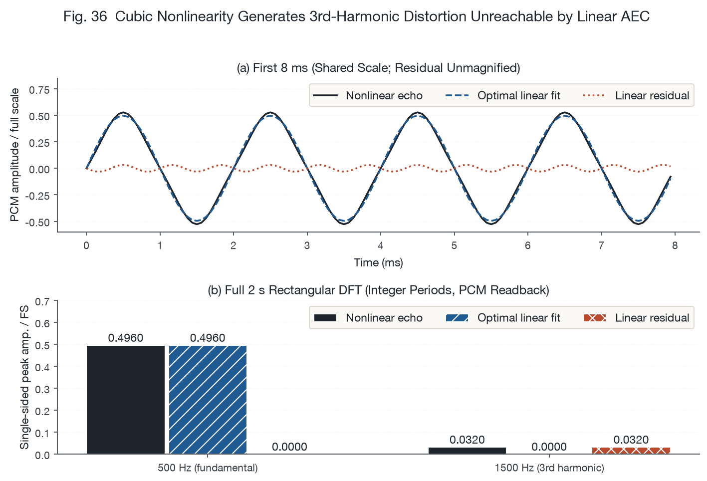

Inspecting Figure 36: panel (a) compares $d[n]$, $\hat d[n]$, and high-frequency residual $e[n]$ in the time domain, showing perfect $500\ \mathrm{Hz}$ alignment alongside an uncancelable $1500\ \mathrm{Hz}$ wave; panel (b) plots the discrete Fourier magnitude spectrum of the exported 16-bit PCM clip (matching analytical powers up to tiny quantization rounding), highlighting the isolated $1500\ \mathrm{Hz}$ third-harmonic spike once the $500\ \mathrm{Hz}$ fundamental is nulled out.

The next four **arithmetic and boundary exercises (E06-07–E06-10)** correspond to the four JSON keys (`overlap_save`, `ipnlms`, `geigel`, `delay_polarity`) emitted by [`aec_algorithm_minicases.py`](../codes/chapters/ch06/aec_algorithm_minicases.py):

#### E06-07: Which Half-Block of Circular Convolution Is Valid?

With $N=2,P=2$, path $h=[1,2\mid 3,4]$, and reference $x=[1,2,3,4]$ (zero for $n<0$), compute by hand the $4$-point circular convolution of block $m=1$ window $[1,2,3,4]$ with partition $0$ ($[1,2,0,0]$) plus prior window $[0,0,1,2]$ with partition $1$ ($[3,4,0,0]$), identifying which two indices suffer wrap-around/history contamination and which two form valid linear output.

**Solution**: Partition $0$ circularly convolves to $[9,4,7,10]$ (linear index $4$ value $4\times 2=8$ wraps onto index $0$: $1+8=9$); partition $1$ circularly convolves $[0,0,1,2]$ with $[3,4,0,0]$ to $[8,0,3,10]$ ($2\times 4=8$ wraps onto index $0$). Discarding the leading two contaminated/prior-block samples from each branch and summing the clean trailing pairs gives $[7+3,10+10]=[10,20]$, which concatenated after block-$0$ output $[1,4]$ matches exact $4$-tap linear convolution $[1,4,10,20]$.

#### E06-08: How Does the IPNLMS Blending Parameter Reshape a Single Update?

Given two-tap weights $\hat{\vec w}=[0.8,0.2]^\top$, $\vec x=[1,1]^\top$, $d=1.2$, and $\mu=1$ (letting tiny regularizers vanish on nonzero denominators), evaluate $\vec g$ and $\Delta\vec w$ via Eq. (6-11) at $\kappa=-1,0,+1$.

**Solution**: With $e=1.2-(0.8+0.2)=0.2$ and $\|\hat{\vec w}\|_1=1.0$, $\kappa=-1,0,+1$ yield $\vec g=[0.5,0.5]^\top$ (uniform), $[0.65,0.35]^\top$ (blended), and $[0.8,0.2]^\top$ (purely proportionate); because $\vec x=[1,1]^\top$ gives $\vec x^\top\mathbf G\vec x=1$ across all three, $\Delta\vec w$ equals $[0.10,0.10]^\top$, $[0.13,0.07]^\top$, and $[0.16,0.04]^\top$, concentrating update budget onto the dominant tap as $\kappa$ rises.

#### E06-09: Without Near-End Speech, Why Does Geigel Declare Double-Talk?

Given two-tap path $h=[0.4,0.4]$, reference window $[1,1]$, $s=0$, and classical threshold $T=0.5$, evaluate $\xi$ in Eq. (6-25); then state what must happen on silent window $[0,0]$.

**Solution**: Constructive STFE summation gives $d=0.4+0.4=0.8$ and $M=1$, so $\xi=0.8/1=0.8>0.5$ falsely triggers double-talk freeze with zero near-end speech. On $[0,0]$, $M=0$ must be gated off by activity check $M>T_x$ rather than dividing by an epsilon floor and triggering false double-talk.

#### E06-10: How Does Negative-Polarity Echo Fool a Maximum-Positive-Peak Detector?

Let $x=[1,0,0,0]$ traverse an inverting amplifier/speaker with two-sample delay to give $d=[0,0,-1,0]$. For non-negative lags $r_{xd}[k]=\sum_n x[n]d[n+k]$ ($k=0,1,2,3$), compare `argmax(r_xd)` against `argmax(abs(r_xd))`.

**Solution**: $r_{xd}=[0,0,-1,0]$. Naive signed `argmax(r_xd)` treats true peak $-1$ at $k=2$ as the *minimum* and picks tied zero index $k=0$ ($2$-sample error!), whereas magnitude peak `argmax(abs(r_xd))` locks onto true delay $k=2$.

The next ten **subband, IPNLMS, RLS, and Kalman exercises (E06-11–E06-20)** correspond to [`aec_advanced_exercises.py`](../codes/chapters/ch06/aec_advanced_exercises.py) (verified in exact rational arithmetic by [`test_codes_aec_advanced_exercises.py`](../tests/test_codes_aec_advanced_exercises.py)):

#### E06-11: Can a Low-Band Input Produce a High-Band Echo?

Under two-point Haar transform Eq. (6-8) with piecewise-constant $x=[1,1\mid 0,0]$ and unit delay $d[n]=x[n-1]$, evaluate input high-band $u_1[m]$ and output high-band $v_1[m]$ across blocks $m=0,1$, explaining why diagonal same-band filtering fails.

**Solution**: Equal samples in block $0$ ($1-1=0$) and zeros in block $1$ force $u_1=[0,0]$ identically! Yet delayed $d=[0,1\mid 1,0]$ produces nonzero high-band outputs $v_1=[-1/\sqrt{2},\ +1/\sqrt{2}]$. Any same-band filter reading $u_1=0$ outputs zero; only cross-band path $u_0\to v_1$ in Eq. (6-9) reconstructs the echo.

#### E06-12: What Changes When Cross-Band Terms Are Pruned?

For unit impulse $x=[1,0,0,0]$ and unit-delay path $h=[0,1]$ in Figure 37(b), compute the synthesized $4$-point time-domain output with the full $2\times 2$ subband matrices versus diagonal-only matrices, plus their difference.

**Solution**: The full four-branch matrix synthesizes exact delayed impulse $[0,1,0,0]$; pruning off-diagonal terms breaks odd-lag alias cancellation to produce $[0,0.5,0,0.5]$, whose difference $[0,0.5,0,-0.5]$ is precisely the discarded cross-band contribution.

#### E06-13: How Does IPNLMS Update When Regularization Terms Are Retained?

Retaining $\hat{\vec w}=[0.8,0.2]^\top$, $\vec x=[1,1]^\top$, $d=1.2$, and $\mu=1$ from E06-08 with nonzero $\varepsilon_g=2,\delta=0.25$, compute $e$, $\vec g$, the denominator, and $\Delta\vec w$ at $\kappa=0$; then find the equivalent $\varepsilon$ in standard NLMS at $\kappa=-1$.

**Solution**: $e=0.2$. At $\kappa=0$, $2(0.8+0.2)+2=4$ gives $g_0=0.25+0.8/4=0.45$ and $g_1=0.25+0.2/4=0.30$ ($\sum g_l=0.75$—never re-normalize to $1$!), denominator $0.75+0.25=1.0$, and $\Delta\vec w=0.2\times[0.45,0.30]^\top=[0.09,0.06]^\top$. At $\kappa=-1$, $\vec g=[0.5,0.5]^\top$ and denominator $1.0+0.25=1.25$ give $\Delta\vec w=[0.08,0.08]^\top$, matching Eq. (6-3) NLMS at $\varepsilon=L\delta=2\times 0.25=0.5$ ($0.2[1,1]^\top/(2+0.5)=[0.08,0.08]^\top$).

#### E06-14: Why Can Adaptation Never Start from Zero Weights in Purely Proportionate Mode?

With $L=2$, $\hat{\vec w}=[0,0]^\top$, $\kappa=1$, and $\varepsilon_g>0,\delta>0$, evaluate the update direction in Eq. (6-11) for arbitrary nonzero $\vec x$ and $e$.

**Solution**: $\kappa=1$ zeroes the uniform term $(1-\kappa)/(2L)=0$, while $\hat{\vec w}=\vec 0$ zeroes the proportionate numerator $(1+\kappa)|\hat w_l|=0$ ($\varepsilon_g>0$ guards the denominator without rescuing the zero numerator), forcing $\mathbf G=\mathbf 0$ and $\mathbf G\vec x=\vec 0$ forever! Practical proportionate filters require $\kappa<1$ (or positive magnitude floors as in classical PNLMS).

#### E06-15: What Is the RLS "Memory Length" in Physical Seconds?

Under continuous unfrozen updates at $\lambda=0.99$, compute the relative weight of an observation after $100$ updates, then convert $100$ updates to seconds at "$16\ \mathrm{kHz}$ per-sample updates" versus "$10\ \mathrm{ms}$ per-frame updates."

**Solution**: Relative weight is $0.99^{100}\approx 0.3660$ ($\approx e^{-1}\approx 0.3679$). At $16\ \mathrm{kHz}$ per sample, $100$ updates span $100/16000=0.00625\ \mathrm{s}$ ($6.25\ \mathrm{ms}$); at $10\ \mathrm{ms}$ per frame, $100$ updates span $1.0\ \mathrm{s}$! Quoting $\lambda=0.99$ without stating the update period has no physical time scale.

#### E06-16: What Happens If Double-Talk Is Mistaken for a Path Change?

In the single-tap scalar Kalman example at the end of §6.2.6 ($w_0=10/11,P_0=1/11,a=1,\Phi=0$), sample $1$ has $x=1$, true path $1$, and near-end $s=2$ so $d=3$. Compare a posteriori weights under "missed DT keeping $\Psi=0.1$," "detected DT raising $\Psi=10$," and "oracle freeze."

**Solution**: Innovation $e_1^-=3-10/11=23/11$. Keeping $\Psi=0.1$ trusts the contaminated sample with gain $K=(1/11)/(1/11+1/10)=10/21$, pulling the weight to $440/231\approx 1.905$; raising $\Psi=10$ shrinks $K=(1/11)/(1/11+10)=1/111$, holding the weight at $10/11+23/1221\approx 0.928$ right beside oracle freeze $10/11\approx 0.909$.

#### E06-17: Does Recursive RLS Truly Equal the Batch Objective Minimizer?

Take $\mathbf R_1=\begin{bmatrix}7/4&1\\1&5/4\end{bmatrix}$ and $\vec p_1=[5/2,2]^\top$ from sample $1$ of §6.2.5. Solve $\mathbf R_1\vec w_1=\vec p_1$ directly via $2\times 2$ determinant inversion without Eq. (6-18).

**Solution**: $\det\mathbf R_1=(7/4)(5/4)-1=19/16>0$, and adjugate inversion gives

$$\begin{aligned}
\vec w_1
&=\frac{16}{19}\begin{bmatrix}5/4&-1\\-1&7/4\end{bmatrix}
  \begin{bmatrix}5/2\\2\end{bmatrix}
 =\frac{16}{19}\begin{bmatrix}9/8\\1\end{bmatrix}
 =\begin{bmatrix}18/19\\16/19\end{bmatrix},
\end{aligned}$$

matching the two-step rank-1 recursion of Eq. (6-18) identically and confirming that the Woodbury lemma is an exact algebraic identity rather than an approximation.

#### E06-18: What Happens When Off-Diagonal Kalman Covariances Are Discarded?

Using two-tap matrix Kalman error covariance $\mathbf P$ after step $0$ in §6.2.6 (diagonals $5/6,4/3$ and off-diagonal $-2/3$), evaluate next-step innovation variance $S=\vec x^\top\mathbf P\vec x+\Psi$ on differential input $\vec x=[-1,1]^\top$ with $\Psi=1$, comparing full $\mathbf P$ against diagonal truncation.

**Solution**: Full $\mathbf P$ retains negative cross-tap correlation, giving $\vec x^\top\mathbf P\vec x+\Psi=(5/6+4/3+4/3)+1=21/6+1=4.5$; zeroing $-2/3$ shrinks estimated innovation variance to $(5/6+4/3)+1=19/6\approx 3.167$. Because step $0$ ($\vec x_0=[1,1]^\top$) constrained only the tap sum, the differential mode remained completely unconstrained, so dropping negative off-diagonal covariance artificially underestimates uncertainty along the difference direction.

#### E06-19: How Does the Cross-Band Term Update on Step Zero for an Unknown Unit-Delay Path?

In two-band full cross-band Eq. (6-10) with $x=[1,1\mid 0,0]$, $d=[0,1\mid 1,0]$, $K=2$, $\mathbf W=\mathbf 0$, $\mu=1$, and $\varepsilon=1$, compute block $m=0$ a priori errors, shared denominator $D$, and updated lag-$0$ weights $W_{i,j,0}$, identifying which entry captures cross-band learning.

**Solution**: Block-$0$ subband input is $\vec u_0=[\sqrt{2},0]^\top$ and observation is $\vec v_0=[1/\sqrt{2},-1/\sqrt{2}]^\top$; with zero initialization, $\vec e_0=\vec v_0$ and $D=1+(\sqrt{2})^2+0=3$. One update yields $W_{0,0,0}=(\frac{1}{\sqrt{2}}\cdot\sqrt{2})/3=1/3$, **cross-band tap** $W_{1,0,0}=(-\frac{1}{\sqrt{2}}\cdot\sqrt{2})/3=-1/3$, and $W_{0,1,0}=W_{1,1,0}=0$ (from zero high-band input $j=1$). Nonzero $W_{1,0,0}=-1/3$ confirms direct online learning of odd-delay energy from low-band input into high-band output.

#### E06-20: Does a Two-Band Model Necessarily Save Taps and Buffering Wait?

For a fullband causal path with $L=4$ nonzero time-domain taps, find the minimal block order $K$, total unconstrained real weights, and extra sample buffering wait required for exact two-point Haar full cross-band representation.

**Solution**: Odd cross-block lags require $K=\lfloor 4/2\rfloor+1=3$; four $2\times 2$ subband branches of $3$ taps each inflate unconstrained real weights to $4K=12$ ($3\times$ the $4$-tap time-domain FIR!), and receiving even sample $x[2m]$ requires waiting $1$ extra sample for $x[2m+1]$ before computing Eq. (6-8). Critically sampled full cross-band filtering thus serves to expose alias-coupling physics, while practical compute reduction turns to oversampled diagonal subbands or NSAF (§6.2.3).

<a id="e06-21"></a>

#### E06-21: When Reference and Near-End Are Orthogonal, Why Do Online Coefficients Still Drift?

Take single-tap true path $h=0.8$, four-point zero-mean reference $\vec x=[1,1,-1,-1]^\top$, and orthogonal near-end $\vec s=[0.5,-0.5,0.5,-0.5]^\top$, forming $d[n]=h x[n]+s[n]$. Compute the four-sample batch least-squares estimate first, then start online NLMS Eq. (6-3) right at true value $w_{-1}=0.8$ with $\mu=0.5,\varepsilon=0$ ($x^2[n]\equiv 1$), tracing why online weights drift.

**Step 1: Population normal equations.** Under constant $\vec h$ and invertible $\mathbf R_{xx}=\mathbb{E}[\vec x\vec x^\top]$, substituting $d=\vec x^\top\vec h+s$ into the MMSE normal equations gives

$$\begin{aligned}
\mathbf R_{xx}\vec w_\star&=\mathbb{E}[\vec x d]\\
&=\mathbf R_{xx}\vec h+\mathbb{E}[\vec x s],\\
\vec w_\star&=\vec h+\mathbf R_{xx}^{-1}\mathbb{E}[\vec x s].
\end{aligned}\tag{6-34}$$

For zero-mean signals, uncorrelatedness guarantees $\mathbb{E}[\vec x s]=\vec 0$ (with nonzero DC, check $\mathbb{E}[\vec x s]$ directly rather than covariance alone), leaving population optimum $\vec w_\star=\vec h$ unbiased.

**Step 2: Four-sample batch estimate.** Since $\vec x^\top\vec s=0.5-0.5-0.5+0.5=0$, $\vec x^\top\vec x=4$, and $\vec d=[1.3,0.3,-0.3,-1.3]^\top$, batch least squares recovers $w_{\mathrm{batch}}=\vec x^\top\vec d/4=3.2/4=0.8=h$ (whereas collinear $\vec s=0.25\vec x$ biases even the batch solution to $0.8+0.25=1.05$).

**Step 3: Sample-by-sample online recursion.** Evaluating $e[n]=d[n]-w_{n-1}x[n]$ and $w_n=w_{n-1}+0.5x[n]e[n]$ step by step:

| Sample $n$ | A Priori Error $e[n]$ | Weight Increment | Updated $w_n$ |
|---|---:|---:|---:|
| 0 | 0.50000 | 0.25000 | 1.05000 |
| 1 | −0.75000 | −0.37500 | 0.67500 |
| 2 | 0.37500 | −0.18750 | 0.48750 |
| 3 | −0.81250 | 0.40625 | 0.89375 |

The culprit is clear: whole-window orthogonality $\sum_n x[n]s[n]=0$ does *not* make instantaneous products $x[n]s[n]$ vanish! Instantaneous $x[0]s[0]=+0.5$ kicks $w_0$ off $0.8$ to $1.05$, and subsequent weight changes couple into later observations to land at $0.89375\neq 0.8$—explaining why statistically independent double-talk still buffets online weights unless step sizes are throttled (verified by `E06-21` in [`enhancement_step_exercises.py`](../codes/chapters/ch00/cross_chapter/enhancement_step_exercises.py)).

#### E06-22: Why Does a Shared Residual Also Require Joint Normalization?

In a two-channel single-tap stereo model with $x_1=x_2=1$, $d=1$, zero initial weights, and mono-stable step size $\mu=1.5$ ($\varepsilon=0$), compute shared residual $e=1-w_1-w_2$ via Eq. (6-30) and compare stability when dividing by pooled energy $x_1^2+x_2^2=2$ versus per-channel energy $x_r^2=1$.

**Derivation and result**: Pooled normalization gives per-branch increment $\mu e/2$ and total prediction change $\mu e$; per-channel normalization gives $\mu e$ per branch and $2\mu e$ total! Substituting back into the a posteriori residual:

$$\begin{aligned}
e^+_{\mathrm{joint}}&=(1-\mu)e=-\tfrac{1}{2}e,\\
e^+_{\mathrm{local}}&=(1-2\mu)e=-2e.
\end{aligned}$$

Over three identical observations, pooled normalization decays geometrically at ratio $-1/2$ as $[1,-0.5,0.25]$ (step-0 $w_1=w_2=0.75$), whereas local normalization explodes at ratio $-2$ as $[1,-2,4]$ (step-0 $w_1=w_2=1.5$)! Multi-reference updates must normalize by total excitation energy across all jointly updated branches (though pooled normalization stabilizes total prediction without resolving collinear individual paths).

#### E06-23: When Training Cancels Echo Perfectly, Why Does Switching Program Material Fail?

Let true stereo single-tap paths be $\vec h=[1,2]^\top$ while mono training stops at candidate weights $\hat{\vec h}=[1.5,1.5]^\top$. Two mono training steps have $x_1=x_2=[1,-1]$; weights then freeze and face out-of-phase stereo holdout $[x_1,x_2]=[1,-1]$.

**Training vs. holdout**: During mono training, tap sums match ($1+2=1.5+1.5=3$), both give $[3,-3]$, and training residual is identically $0$ (rank-$1$ reference matrix places differential mode $[1,-1]^\top$ in the nullspace). On stereo holdout $[1,-1]$, true echo is $1\times 1+2\times(-1)=-1$ while $\hat{\vec h}$ predicts $1.5-1.5=0$, leaking residual $-1$ immediately—underscoring stereo decorrelation and cross-program holdout testing (§6.9).

#### E06-24: How Much Causal Delay Remains After Reference Alignment?

Suppose true echo is pure delay $D=3$ samples and aligned reference is $x_a[n]=x[n-\delta]$ ($\delta$ here denotes integer buffer delay samples, distinct from spectral floor $\delta$). For causal $L=3$ FIR covering relative lags $\{0,1,2\}$, test representability at $\delta=1,3,4$.

**Criterion**: Matching $x[n-D]=x_a[n-r]=x[n-\delta-r]$ gives residual lag $r=D-\delta$, requiring causal support $0\le r\le L-1=2$:

| Alignment Shift $\delta$ | Residual Lag $r$ | $3$-Tap Causal Representation |
|---:|---:|---|
| 1 | 2 | Representable via taps $[0,0,1]$ |
| 3 | 0 | Representable via taps $[1,0,0]$ |
| 4 | −1 | Unrepresentable by any causal FIR |

Over-delaying the reference to $\delta=4$ makes $r=-1$, meaning current microphone echo depends on "future reference" $x_a[n+1]$ not yet delivered to the filter—lengthening causal $L$ extends only into the past, so reference delay $\delta$ itself must be reduced.

#### E06-25: Why Does Slow Clock Drift Ruin Waveform Subtraction?

At nominal $f_s=16\ \mathrm{kHz}$ with crystal rate offset $\rho=250\times 10^{-6}$ ($250\ \mathrm{ppm}$) causing linear sample slip $\Delta n(t)=\rho f_s t$, evaluate phase drift and residual-to-echo power ratio on a $1\ \mathrm{kHz}$ unit-amplitude echo at $t=1\ \mathrm{s}$ and $t=2\ \mathrm{s}$.

**Substitution**: $\Delta n(1)=250\times 10^{-6}\times 16000=4$ samples at $t=1\ \mathrm{s}$ and $\Delta n(2)=8$ samples at $t=2\ \mathrm{s}$. At $1\ \mathrm{kHz}$:

$$\begin{aligned}
|\phi(t)|&=2\pi\frac{1000}{16000}\Delta n(t),\\
R(t)&=\left|1-e^{-\mathrm{j}\phi(t)}\right|^2
=2-2\cos\phi(t).
\end{aligned}$$

**Result**: Phase drift hits $\pi/2$ ($90^\circ$) at $1\ \mathrm{s}$ and $\pi$ ($180^\circ$) at $2\ \mathrm{s}$, driving residual power ratio to $R(1)=2$ ($+3.01\ \mathrm{dB}$ louder than no AEC) and $R(2)=4$ ($+6.02\ \mathrm{dB}$ anti-phase doubling)! Even a tiny crystal offset destroys high-frequency phase alignment within two seconds, mandating asynchronous sample-rate conversion (ASRC) across independent clock domains.

#### E06-26: After a Dropped Reference Stream Recovers, Why Does Residual Echo Linger Briefly?

Suppose the loudspeaker plays $x=[1,2,3,4,5,6]$ continuously ($n<0$ zero) across true and frozen two-tap path $h=[1,0.5]$, while a software buffer drop zeroes AEC reference samples $n=2,3$ to $x_a=[1,2,0,0,5,6]$ (noiseless STFE). Compute $\vec y$, $\hat{\vec y}$, and $\vec e$ sample by sample.

**Samplewise convolution**: Each output sums current input plus $0.5\times$ prior input:

$$\begin{aligned}
\vec y&=[1,\ 2.5,\ 4,\ 5.5,\ 7,\ 8.5]^\top,\\
\hat{\vec y}&=[1,\ 2.5,\ 1,\ 0,\ 5,\ 8.5]^\top,\\
\vec e&=\vec y-\hat{\vec y}=[0,\ 0,\ 3,\ 5.5,\ 2,\ 0]^\top.
\end{aligned}$$

Inspect sample $n=4$: even though reference delivery has recovered ($x_a[4]=x[4]=5$), residual $2$ still leaks out because lag-$1$ memory in the FIR window still holds the dropped zero from $n=3$ (missing $0.5\times x[3]=2$), clearing to zero only at $n=5$ once the entire nonzero tap span flushes clean! In general, dropout error equals $h*(x-x_a)$, spanning **dropout duration $+$ path nonzero tail length**.

This repository includes [four $16\ \mathrm{kHz}$, $2\ \mathrm{s}$ synthetic WAV clips](../codes/chapters/ch00/research_en/05_exercises_and_audio.md#sec-u-ae01d6f3b2) demonstrating this dropout tail: a $256$-tap sparse path with $[0.7,-0.3,0.15]$ at lags $0,80,240$ (frozen at ground truth; far-end seed `20261028` uniform noise + $310\ \mathrm{Hz}$ tone, near-end $220/330/660\ \mathrm{Hz}$ triad, $320$-sample cosine-squared fades, shared export gain $1$). Physical playback runs uninterrupted while algorithm reference zeroes over `[0.75, 1.0)` $\mathrm{s}$ ($[12000,16000)$); after reference resumes at sample $16000$, $240$ samples of path memory must flush before full recovery at sample $16240$ ($1.015\ \mathrm{s}$):

- [Near-end target: scoring reference](../codes/chapters/ch06/audio/aec_dropout_target.wav)
- [Microphone mixture: near-end plus true echo](../codes/chapters/ch06/audio/aec_dropout_microphone.wav)
- [Complete-reference residual: canceled with frozen true path](../codes/chapters/ch06/audio/aec_dropout_complete_reference_residual.wav)
- [Dropped-reference residual: same path, reference zeroed over dropout](../codes/chapters/ch06/audio/aec_dropout_missing_reference_residual.wav)

Comparing 16-bit PCM relative squared error against the near-end target across dropout `[12000, 16000)`, flush tail `[16000, 16240)`, and recovered `[16240, 30000)` windows: complete-reference error is $0$ across all three, whereas dropped-reference error measures $\approx 0.7740$, $0.06483$, and $0$—confirming the $240$-sample flush tail both audibly and numerically.

#### E06-27: What Exactly Does Four-State NCC Gating Read?

Using the five-row activity table of §6.4.1 and demeaned absolute correlation $c_{xd}$ in Eq. (6-26) on $4$-sample frames with zero-mean orthogonal sequences $\vec a=[1,-1,1,-1]^\top$, $\vec b=[1,1,-1,-1]^\top$ (unit demeaned RMS, $\vec a^\top\vec b=0$) and silent frame $\vec z=[0,0,0,0]^\top$, RMS threshold $0.1$, and $c_{xd}$ threshold $0.8$, evaluate the six frame pairs below:

| $(x,d)$ | Defined Absolute NCC | Decision |
|---|---:|---|
| $(z,z)$ | Undefined; API logs 0 | Silence |
| $(a,0.5a)$ | 1 | Far-end single-talk |
| $(z,b)$ | Undefined; API logs 0 | Near-end single-talk |
| $(a,b)$ | 0 | Double-talk |
| $(a,z)$ | Undefined; API logs 0 | Far-end single-talk |
| $(a,-a)$ | 1 | Far-end single-talk |

**Boundary notes**: For $d=\alpha x$ ($\alpha\neq 0$), $|\alpha|P_x/\sqrt{P_x\cdot\alpha^2 P_x}=1$, so inverted echo $(a,-a)$ in row 6 never triggers a false DT alarm; whenever either variance vanishes (rows 1, 3, 5), the ratio is skipped (`0` logged only as a placeholder) and amplitude gates decide directly, classifying quiet-mic row 5 $(a,z)$ as STFE. Scaling amplitude leaves $c_{xd}$ invariant until weak signals drop below the RMS gate; production norms scale by max magnitude to avoid squaring overflow.

#### E06-28: What Phantom Gain Appears If You Score Using the A Posteriori Residual?

With scalar Kalman $w^-=0,P^-=1,\Psi=1$, and sample $(x=1,d=2)$, compare causal a priori residual $e^-$ against post-update a posteriori residual $e^+$ on the same sample.

**Calculation**: $K=1/(1+1)=1/2$; causal $e^-=2-0=2$, updated weight $w^+=0+(1/2)\times 2=1$, and retroactive $e^+=2-1\times 1=1$, fabricating an artificial squared-error gain of

$$10\log_{10}\frac{(e^-)^2}{(e^+)^2}
=10\log_{10}4\approx 6.02\ \mathrm{dB}.$$

That entire $6.02\ \mathrm{dB}$ "gain" is pure in-sample data leakage from scoring on the very sample just fitted—impossible in causal real-time audio. Always score strictly on pre-update $e^-$.

#### E06-29: Does Freezing Always Keep Weights and Covariance Stationary?

Compare `freeze=True` semantics across our two state classes over two frozen steps $(x=1,d=9,\Psi=1)$ from identical numerical state $w=2,P=3$: 1-D matrix Kalman with $a=0.5,Q=1$ vs. RLS with $\lambda=0.5,\delta=1/3$.

**Interface comparison**:

- **Kalman evolution**: `freeze=True` skips measurement update $K e^-$ alone while still advancing time prediction $w^-=a w$ and $P^-=a^2 P+Q$! Step $1$ gives $w=1,P=0.25\times 3+1=1.75$; step $2$ gives $w=0.5,P=0.25\times 1.75+1=1.4375$ (relaxing toward the damped steady-state prior);
- **RLS hold**: `freeze=True` suspends both sample fitting and $\lambda^{-1}$ forgetting windup, keeping $w=2,P=3$ unchanged (shifting only the FIR reference window);
- **Zero-prior deadlock**: Conversely, unfrozen Kalman with $a=1,w=0,P=0,Q=0$ forces $P^-=0\implies K=0$, staying locked at $w=0$ forever even on clean $(x=1,d=2)$.

#### E06-30: Why Can Covariance Validation Never Check Diagonal Entries Alone?

Inspect two $2\times 2$ real symmetric matrices sharing identical positive diagonals:

$$\mathbf P_1=\begin{bmatrix}1&1\\1&1\end{bmatrix},\qquad
\mathbf P_2=\begin{bmatrix}1&2\\2&1\end{bmatrix}.$$

**Positive semidefiniteness and validation**: $\mathbf P_1$ has eigenvalues $2$ and $0$—a valid singular PSD covariance (two perfectly equal random variables, which must *not* be rejected merely for zero determinant); $\mathbf P_2$ has positive diagonals ($1,1$) yet eigenvalues $3$ and $-1$, giving negative variance $\vec z^\top\mathbf P_2\vec z=-2<0$ along $\vec z=[1,-1]^\top$!

Similarly, tiny upper-triangular asymmetric $\mathbf P_3$ ($10^{-20}$ on diagonal and upper-right, $0$ lower-left, where skew-symmetry matches matrix norm and must not slip past a fixed $10^{-12}$ absolute tolerance) and negative-eigenvalue $\mathbf P_4=\operatorname{diag}(-10^{-11},1)$ are explicitly rejected by `KalmanAECState` ($L=2,a=1,Q=0,\Psi=1$), which accepts only valid PSD $\mathbf P_1$—never mask upstream covariance bugs by silently taking absolute values or dropping imaginary parts.

<a id="e06-31"></a>

#### E06-31: Does the Mean of Blockwise dB ERLE Equal Whole-Window ERLE?

Over two consecutive valid STFE blocks with true echo energies $[1,100]$ and residual echo energies $[0.01,100]$ (noiseless), compare the arithmetic mean of per-block dB values against whole-window pooled Eq. (6-29).

**Comparison**: Blockwise dB values are $10\log_{10}(1/0.01)=20\ \mathrm{dB}$ (quiet tail block) and $10\log_{10}(100/100)=0\ \mathrm{dB}$ (loud un-canceled block), averaging to a flattering **$10\ \mathrm{dB}$**; pooling total window energy via Eq. (6-29) gives

$$\begin{aligned}
\mathrm{ERLE}_{\mathrm{all}}
&=10\log_{10}\frac{1+100}{0.01+100}
=10\log_{10}\frac{101}{100.01}
\approx 0.04278\ \mathrm{dB}.
\end{aligned}$$

Pooled $\mathrm{ERLE}$ is virtually **$0\ \mathrm{dB}$**! Averaging logs computes a geometric mean of ratios, giving quiet tail blocks equal weight with loud vowel blocks, whereas pooled energy reflects that $99\%$ of total echo energy went completely un-canceled. Always specify whether reported figures use frame-dB means or pooled-energy ratios.

#### E06-32: When Reference and Near-End Are Uncorrelated, Why Can NLMS Still Drift in Expectation?

For single-tap $h=0.8$ and $d=h x+s$, draw one of the four equiprobable ($1/4$ each) nonzero states below i.i.d. at each step with $\varepsilon=0$ and $0<\mu<2$. Compare population OLS against the **conditional expectation of one NLMS step given $w$**:

| State | $x$ | $s$ | $xs$ | $s/x$ |
|---|---:|---:|---:|---:|
| 1 | 1 | 1 | 1 | 1 |
| 2 | −1 | −1 | 1 | 1 |
| 3 | 2 | −0.5 | −1 | −0.25 |
| 4 | −2 | 0.5 | −1 | −0.25 |

**Population OLS vs. normalized expectation**: $\mathbb{E}[x]=\mathbb{E}[s]=0$, $\mathbb{E}[x s]=(1+1-1-1)/4=0$, and $\mathbb{E}[x^2]=5/2$, so Eq. (6-34) gives exact unbiased OLS $w_{\mathrm{LS}}=h=0.8$.

In floorless single-tap NLMS, however, dividing by $x^2$ reweights each step into $s/x$:

$$\begin{aligned}
w^+&=w+\mu\frac{(h x+s-w x)x}{x^2}
    =(1-\mu)w+\mu\left(h+\frac{s}{x}\right),\\
\mathbb{E}\!\left[\frac{s}{x}\right]
   &=\frac{1+1-0.25-0.25}{4}
    =\frac{3}{8}=0.375\neq 0!
\end{aligned}$$

Thus $\mathbb{E}[w^+\mid w]=(1-\mu)w+\mu(0.8+0.375)$: starting at $w=0.8$ ($\mu=0.5$) drifts in expectation to $0.9875$, with mean fixed point $47/40=1.175$! Although $x$ and $s$ are **linearly uncorrelated** ($\mathbb{E}[xs]=0$), they are **not statistically independent** ($\mathbb{E}[s\mid x]\neq 0$), so dividing by $x^2$ amplifies small-$|x|$ aligned samples and breaks orthogonality.

#### E06-33: Within Injected Increment Error, How Much Is Gain Scaling vs. Orthogonal Distortion?

In the two-run probe of §6.15.4 with $\vec s=[1,-1,1,-1]^\top$, orthogonal distortion $\vec r=0.3[1,1,-1,-1]^\top$, and measured increment $\vec\Delta=0.8\vec s+\vec r=[1.1,-0.5,0.5,-1.1]^\top$, compute $g_\Delta$ and the orthogonal decomposition of $E_\Delta$ in Eq. (6-33).

**Pythagorean decomposition**: Since $\vec s^\top\vec r=0$ and $\|\vec s\|^2=4$, $g_\Delta=\vec s^\top\vec\Delta/\|\vec s\|^2=0.8$. Writing $\vec\Delta-\vec s=(g_\Delta-1)\vec s+\vec r$ sums orthogonal squared norms directly:

$$\begin{aligned}
E_\Delta
&=(g_\Delta-1)^2+\frac{\|\vec r\|^2}{\|\vec s\|^2}
=(-0.2)^2+0.3^2=0.04+0.09=0.13.
\end{aligned}$$

This establishes $E_\Delta\ge(g_\Delta-1)^2$: $g_\Delta=0.8$ captures only the $20\%$ linear attenuation ($0.04$), whereas the excess $0.09$ isolates nonlinear harmonics or adaptive state perturbation orthogonal to $\vec s$.

Exercises **E06-22–E06-33** (along with E06-40, E06-41, E06-43, and E06-44 below) are verified by [`chapter06_experiments.py`](../codes/chapters/ch06/chapter06_experiments.py) (`.venv/bin/python -m codes.chapters.ch06.chapter06_experiments`). The next five **Affine Projection exercises (E06-34–E06-38)** run via [`aec_affine_projection_demo.py`](../codes/chapters/ch06/aec_affine_projection_demo.py):

<a id="e06-34"></a>

#### E06-34: How Is Two-Column Affine Projection Computed Step by Step?

Given $\vec h=[1/2,1/4]^\top$, noiseless reference $x[-1]=0,x[0]=1,x[1]=2$, and zero initial weights: freeze weights on sample $0$ ($d[0]=1/2$, pushing observation into window), then update at sample $1$ ($d[1]=5/4$) via Eq. (6-14) with $K=2,\mu=1,\delta=1$, comparing against exact projection ($\delta=0$) and single-column NLMS ($K=1,\delta=1$; cf. Figure 57).

**Step 1: Regressor matrix and shared-weight window error.** Columns at $n=1$ and $n=0$ are $[2,1]^\top$ and $[1,0]^\top$; frozen zero weights leave $\vec e^-=\vec d$:

$$\mathbf U=\begin{bmatrix}2&1\\1&0\end{bmatrix},\qquad
\vec d=\vec e^-=\begin{bmatrix}5/4\\1/2\end{bmatrix}.$$

**Step 2: $2\times 2$ Gram matrix and loaded inverse.** Column squared norms are $5$ and $1$, inner product $2$:

$$\begin{aligned}
\mathbf G&=\mathbf U^\top\mathbf U
          =\begin{bmatrix}5&2\\2&1\end{bmatrix},\\
\mathbf G+\mathbf I
         &=\begin{bmatrix}6&2\\2&2\end{bmatrix},\qquad
\det(\mathbf G+\mathbf I)=8,\\
(\mathbf G+\mathbf I)^{-1}
         &=\frac{1}{8}\begin{bmatrix}2&-2\\-2&6\end{bmatrix}.
\end{aligned}$$

**Step 3: Solve for $\vec\alpha$ and combine columns.** Equation (6-14) gives

$$\begin{aligned}
\vec\alpha&=(\mathbf G+\mathbf I)^{-1}\vec e^-\\
&=\frac{1}{8}
  \begin{bmatrix}2(5/4)-2(1/2)\\-2(5/4)+6(1/2)\end{bmatrix}
 =\begin{bmatrix}3/16\\1/16\end{bmatrix},\\
\Delta\vec w&=\mathbf U\vec\alpha
 =\begin{bmatrix}2(3/16)+1/16\\3/16\end{bmatrix}
 =\begin{bmatrix}7/16\\3/16\end{bmatrix}.
\end{aligned}$$

With zero init and $\mu=1$, $\vec w_1=[7/16,3/16]^\top$ (a posteriori predictions $[17/16,7/16]^\top$, errors $[3/16,1/16]^\top$; causal output residual at $n=1$ remains pre-update $5/4$).

**Step 4: Degenerate benchmarks.** Setting $\delta=0$ gives $\det\mathbf G=1$ and $\vec w_1=[1/2,1/4]^\top=\vec h$ in one step; setting $K=1,\delta=1$ gives $[2,1]^\top(5/4)/(5+1)=[5/12,5/24]^\top$, matching $\varepsilon=1$ NLMS identically.

<a id="e06-35"></a>

#### E06-35: Why Must Past Emitted Residuals Never Be Pasted into a New APA Window?

Repeat E06-34 ($\mu=1,\delta=1$) **without freezing** step $0$. Compare recomputing the whole window error from $\vec w_0$ via Eq. (6-12) against erroneously pasting step $0$'s stale residual into the window.

**Comparison**: Step $0$ ($[1,0]^\top$, residual $1/2$) updates weights to $\vec w_0=(1/2)/(1+1)[1,0]^\top=[1/4,0]^\top$. At step $1$, evaluating both observations under $\vec w_0=[1/4,0]^\top$ gives current error $5/4-2(1/4)=3/4$ and historical error $1/2-1(1/4)=1/4$! Correct $\vec e^-=[3/4,1/4]^\top$ yields $\vec\alpha=[1/8,0]^\top$, $\Delta\vec w=[1/4,1/8]^\top$, and $\vec w_1=[1/2,1/8]^\top$ (a posteriori errors $[1/8,0]^\top$).

Pasting stale step-$0$ residual $1/2$ to form $[3/4,1/2]^\top$ yields $\vec\alpha=[1/16,3/16]^\top$ and $\vec w_1=[9/16,1/16]^\top$—double-counting half the error already canceled at step $0$!

<a id="e06-36"></a>

#### E06-36: What Do K=1, Freezing, and Flushing Projection History Each Mean?

In two-tap zero-initialized `APAState` ($K=2,\mu=1,\delta=1$), freeze step $0$ on near-end-contaminated $(x[0]=1,d[0]=10)$, then resume adaptation on clean step $1$ $(x[1]=2,d[1]=5/4)$. Compare resuming directly against calling `reset_projection_history()` right before step $1$.

**State breakdown**:

- **What freeze records**: Step $0$ skips weight update ($[0,0]^\top$, output residual $10$), yet shifts $x[0]=1$ into the FIR buffer *and* pushes contaminated pair $(\vec x_0=[1,0]^\top,d[0]=10)$ into the length-$2$ projection window!
- **Resuming without flushing**: Step $1$ forms $\vec e^-=[5/4,10]^\top$, yielding $\vec\alpha=[-35/16,115/16]^\top$ and yanking weights violently to $[45/16,-35/16]^\top$—the dirty sample cached during freeze detonates on the first unfrozen step;
- **Calling `reset_projection_history()` first**: Purges old projection pairs while preserving weights and FIR reference history $[1]$! Step $1$ still forms exact regressor $[2,1]^\top$ (not $[2,0]^\top$) at effective order $K_1=1$, stepping cleanly to $[5/12,5/24]^\top$ ($\varepsilon=1$ NLMS). Higher-order APA ($K>1$) must pair DT recovery with projection-window flushing or per-sample observation gating.

<a id="e06-37"></a>

#### E06-37: Can Regularization Restore Identifiability to a Rank-Deficient Window?

For two taps, zero init, $\mu=1$, and $x[-1]=1$: freeze $(x[0]=1,d[0]=1)$, then update on $(x[1]=1,d[1]=1)$, forming rank-$1$ all-ones $\mathbf U=\mathbf 1\mathbf 1^\top$ and $\vec e^-=[1,1]^\top$. Compare $\delta=0$ vs. $\delta=1$; then scale both $x$ and $d$ by $10\times$ under fixed $\delta=1$.

**Rank deficiency and dimensional scaling**:

1. **Singularity guard and minimum-norm selection**: $\mathbf G=2\mathbf 1\mathbf 1^\top$ has $\det\mathbf G=0$. At $\delta=0$, inversion fails and the API rejects the update; at $\delta=1$, $\mathbf G+\mathbf I=\begin{bmatrix}3&2\\2&3\end{bmatrix}$ inverts to $\frac{1}{5}\begin{bmatrix}3&-2\\-2&3\end{bmatrix}$, yielding $\vec\alpha=[1/5,1/5]^\top$ and $\vec w=[2/5,2/5]^\top$ (a posteriori errors $[1/5,1/5]^\top$). Physical identifiability is *not* restored: any $[t,1-t]^\top$ produces identical observations (tap-space nullvector $[1,-1]^\top\in\ker\mathbf U^\top$, while observation-space $[1,-1]^\top\in\ker\mathbf G$ in Eq. (6-15) reflects that unequal errors on identical regressors cannot be canceled—keep tap space and window space distinct). Regularization merely picks the damped minimum-norm solution.
2. **Amplitude scaling**: Multiplying $x,d$ by $10$ scales $\mathbf U$ by $10$, $\mathbf G$ by $100$, and $\vec e^-$ by $10$. Only scaling energy-dimensioned $\delta$ by $100$ ($1\to 100$) preserves $\vec w=[2/5,2/5]^\top$; keeping fixed $\delta=1$ shrinks relative damping $100\times$ and shifts $\vec w$ to $[200/401,200/401]^\top\approx[0.49875,0.49875]^\top$, reaffirming §6.1.2's dimensional rule.

<a id="e06-38"></a>

#### E06-38: How Does a Path Prior Select Among Solutions, and Why Is Holdout Still Mandatory?

With true path $\vec h=[1,2]^\top$ and constant training reference $1$ ($d=3$, rank-$1$ $\mathbf U=\mathbf 1\mathbf 1^\top$, $\mu=1,\delta=1$, step $0$ frozen, step $1$ updated), compare training from "exact factory prior $[1,2]^\top$," "wrong prior $[2,1]^\top$," and "zero prior $[0,0]^\top$," followed by a frozen differential holdout probe $[1,-1]^\top$.

**Nullspace blind spot vs. holdout exposure**: Both $[1,2]^\top$ and $[2,1]^\top$ sum to $3$, yielding identically $\vec 0$ training error and $\vec 0$ APA update—training residual alone cannot tell the exact prior from the swapped prior! Zero prior gives training error $[3,3]^\top$ and updates to $[6/5,6/5]^\top$ (a posteriori $[3/5,3/5]^\top$). Probing with $[1,-1]^\top$ (true echo $1-2=-1$) exposes all three immediately:

| Initialization / Prior | Post-Training Weights | Holdout Prediction | Holdout A Priori Error |
|---|---|---:|---:|
| Exact prior | $[1,2]^\top$ | −1 | 0 |
| Wrong swapped prior | $[2,1]^\top$ | 1 | −2 |
| Zero prior, one update | $[6/5,6/5]^\top$ | 0 | −1 |

Calibrated or neural priors can fill narrowband nullspaces, yet if enclosure tolerances invalidate the prior, narrowband training residuals report "zero error" until wideband holdout testing exposes the nullspace mismatch.

<a id="e06-39"></a>

#### E06-39: On Colored References, Why Can Raising Projection Order Incur a Noise Penalty?

Extending hand traces to a shared-source, strictly causal $16\ \mathrm{kHz}$ synthetic benchmark quantifies APA's classic trade-off between **colored-signal acceleration** and **noise amplification**. Using `PCG64` seed `20261001`, generate $32000$ samples of strongly colored AR(1) reference $x[n]=0.98x[n-1]+\eta[n]$ ($n<0$ zero, white Gaussian $\eta[n]$ with $\sigma=0.015$); convolve with a $16$-tap sparse path having $[0.6,-0.2,0.1,0.05]$ at lags $0,3,7,13$ (retaining the $13$-sample tail) and add white Gaussian noise $v[n]$ ($\sigma=0.003$; six mono WAVs of $32013$ samples $\approx 2.0008\ \mathrm{s}$).

**Unified training and holdout protocol**: Feed identical inputs to `NLMSState` ($K=1$) and `APAState` ($K=2,4$) from zero initialization at $\mu=0.2$ and $\varepsilon=\delta=0.001$. Adapt causally over `[0, 24000)`, freeze weights at sample $24000$ (advancing history buffers), and score over holdout window $\mathcal I=[24000, 32000)$ of $N_{\mathcal I}=8000$ samples ($0.5\ \mathrm{s}$; trailing $13$ tail samples retained in WAVs without scoring; tap error sampled every $160$ steps for plotting). Writing post-training weights $\vec w_{\mathrm{tr}}$, clean echo $y[n]$, and causal prediction $\hat y^-[n]$, decompose holdout MSE exactly:

$$\begin{aligned}
\rho_h&=\frac{\|\vec w_{\mathrm{tr}}-\vec h\|}
             {\|\vec h\|},\\
\epsilon_{y,n}&=y[n]-\hat y^-[n],\qquad
e^-[n]=\epsilon_{y,n}+v[n],\\
P_{\mathrm{clean}}
&=\frac{1}{N_{\mathcal I}}
  \sum_{n\in\mathcal I}\epsilon_{y,n}^2,\\
P_v&=\frac{1}{N_{\mathcal I}}
     \sum_{n\in\mathcal I}v^2[n],\\
C_{\epsilon v}
&=\frac{1}{N_{\mathcal I}}
  \sum_{n\in\mathcal I}\epsilon_{y,n}v[n],\\
P_{\mathrm{total}}
&=\frac{1}{N_{\mathcal I}}\sum_{n\in\mathcal I}(e^-[n])^2
 =P_{\mathrm{clean}}+P_v+2C_{\epsilon v}.
\end{aligned}\tag{6-35}$$

Equation (6-35) makes no infinite-sample zero-cross-term approximation: over these $8000$ samples, $P_v\approx 8.85524\times 10^{-6}$ (close to $0.003^2=9\times 10^{-6}$), while $2C_{\epsilon v}$ equals $\approx 1.1040\times 10^{-8}$, $-1.0238\times 10^{-7}$, and $-1.4416\times 10^{-7}$ across the three filters.

**Noiseless in-memory control vs. noisy holdout**: Turning off noise ($v[n]\equiv 0$) on this high-condition-number AR(1) reference (pole $0.98$) leaves NLMS at $\rho_h\approx 8.14\times 10^{-7}$ after training while $K=2,4$ APA reach `float64` machine precision! Restoring $\sigma=0.003$ observation noise under the exact same $(\mu=0.2,\delta=0.001)$ flips the ranking dramatically:

| Method | Post-Training $\rho_h$ | Float Clean-Echo Prediction MSE | Float Total Residual MSE | PCM Total Residual MSE |
|---|---:|---:|---:|---:|
| NLMS, $K=1$ | 0.059331 | $1.84160\times10^{-6}$ | $1.07079\times10^{-5}$ | $1.07073\times10^{-5}$ |
| APA, $K=2$ | 0.130719 | $2.94649\times10^{-6}$ | $1.16993\times10^{-5}$ | $1.16991\times10^{-5}$ |
| APA, $K=4$ | 0.210347 | $6.13290\times10^{-6}$ | $1.48440\times10^{-5}$ | $1.48440\times10^{-5}$ |

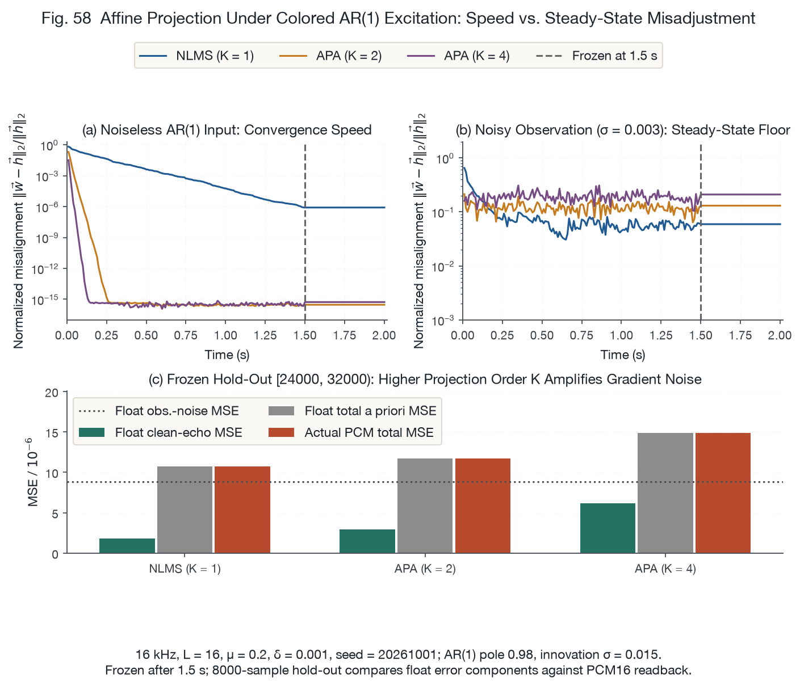

Comparing the table with Figure 58 crystallizes APA tuning: panel (a) (noiseless) shows higher $K$ plunging steeper in $\|\hat{\vec h}-\vec h\|_2/\|\vec h\|_2$ (blue $K=1$, orange $K=2$, purple $K=4$; gray dashed freeze at $1.5\ \mathrm{s}$); panel (b) ($\sigma=0.003$ noise) shows $K=2,4$ descending faster initially before inverting ill-conditioned $(\mathbf G_n+\delta\mathbf I)^{-1}$ amplifies differential-mode noise $v[n]$ onto a higher steady-state misadjustment floor than $K=1$ (confirmed by frozen holdout bars in panel (c))! Reaping higher-order APA speedups on noisy speech requires pairing $K>1$ with smaller steady-state $\mu$ or larger diagonal loading $\delta$ (variable-step / variable-regularized APA).

**PCM16 integer energy audit and listening files**: All six WAVs quantize unscaled floats at shared gain $1$ (decoded by $32768$, holdout denominator $8000\times 32768^2$). Signed integer sums of squares over holdout for the three residual WAVs are `91975291`, `100494856`, and `127508700` (yielding the rightmost PCM MSE column), against `14743087038` for the noisy mic ($\approx 22.0492$, $21.6644$, and $20.6305\ \mathrm{dB}$ mic-to-residual ratios). Generator/verifier in [`generate_apa_audio.py`](../codes/chapters/ch06/examples/generate_apa_audio.py) (core [`core/apa_audio.py`](../codes/chapters/ch06/core/apa_audio.py), [manifest](../codes/chapters/ch06/apa_audio/MANIFEST.json)); lower playback volume before listening:

- [Shared colored reference](../codes/chapters/ch06/apa_audio/apa_reference.wav)
- [Known clean echo](../codes/chapters/ch06/apa_audio/apa_true_echo.wav)
- [Noisy microphone observation](../codes/chapters/ch06/apa_audio/apa_microphone.wav)
- [NLMS a priori residual](../codes/chapters/ch06/apa_audio/apa_nlms_residual.wav)
- [APA2 a priori residual](../codes/chapters/ch06/apa_audio/apa_apa2_residual.wav)
- [APA4 a priori residual](../codes/chapters/ch06/apa_audio/apa_apa4_residual.wav)

<a id="e06-40"></a>

#### E06-40: Even When Current Playback Gain Is Known, Why Does Post-Multiplying Echo Prediction Fail?

Let pre-volume early reference be $x=[1,1,1,1]$ (zero-padded at $x[4]=0$ for full tail, $n<0$ zero) across frozen true two-tap path $h=[1,1/2]$. Digital volume steps from $1$ to $2$ at $n=2$, giving $g=[1,1,2,2,2]$. Compute true echo, early-reference prediction, post-multiplied $g[n]\hat y_x[n]$, and late-reference $r[n]=g[n]x[n]$ prediction sample by sample.

**Samplewise check**: With tail, $x=[1,1,1,1,0]$ and $r=[1,1,2,2,0]$; $y[n]=r[n]+\frac{1}{2}r[n-1]$, $\hat y_x[n]=x[n]+\frac{1}{2}x[n-1]$, and post-multiplied prediction is $g[n]\hat y_x[n]$:

| Sample $n$ | True Echo | Early-Ref Prediction | Wrong Post-Gain Prediction | Late-Ref Prediction |
|---|---:|---:|---:|---:|
| 0 | 1 | 1 | 1 | 1 |
| 1 | $3/2$ | $3/2$ | $3/2$ | $3/2$ |
| 2 | $5/2$ | $3/2$ | 3 | $5/2$ |
| 3 | 3 | $3/2$ | 3 | 3 |
| 4 (full tail) | 1 | $1/2$ | 1 | 1 |

Signed residuals $y-\hat y$ are $[0,0,1,3/2,1/2]$ (early), $[0,0,-1/2,0,0]$ (post-multiplied), and $[0,0,0,0,0]$ (late)! At $n=2$, delayed reflection $\frac{1}{2}r[1]=\frac{1}{2}$ was emitted at old gain $g[1]=1$, whereas post-multiplication scales it by $g[2]=2$ to $1$, over-predicting by $1/2$—matching $\frac{1}{2}(g[1]-g[2])x[1]=-1/2$ in Eq. (6-32) identically before vanishing at $n=3,4$ once history catches up (verified in [`reference_gain_order()`](../codes/chapters/ch06/core/reference_timing.py)).

<a id="e06-41"></a>

#### E06-41: When Current Reference Is Silent, Why Can the Microphone Still Hold Pure Echo Alone?

Slice a $12$-sample sequence into three $4$-sample frames: frame $0$ plays $[1,-1,1,-1]$ and frames $1,2$ ($8$ samples) stop playback at zero. Let the path hold a single $4$-sample delayed reflection $h[4]=1/2$ with $s[n]\equiv 0$ and zero noise. Run §6.4.1's frame detector (RMS gate $0.1$, NCC gate $0.8$) across all three frames.

**Frame activity vs. cross-frame path memory**: Since $y[n]=\frac{1}{2}x[n-4]$, frame-$0$ playback arrives at the microphone during frame $1$ ($[4,8)$):

| Frame, Sample Span | Current Ref RMS | Mic RMS | Baseline Tag | True Physical Content |
|---|---:|---:|---|---|
| 0, $[0,4)$ | 1 | 0 | `far_only` | Active playback; echo not yet arrived |
| 1, $[4,8)$ | 0 | $1/2$ | `near_only` | Pure echo tail from prior playback |
| 2, $[8,12)$ | 0 | 0 | `silence` | No echo, near-end, or noise |

Every frame has at least one zero-RMS channel (`0` logged as undefined NCC placeholder) and routes via amplitude gates: in frame $1$ ($[4,8)$), zero current reference paired with arriving delayed echo triggers operational tag `near_only` despite zero near-end speech! Feeding the same streams into a frozen $5$-tap `NLMSState` loaded with true $h$ reads frame-$0$ samples from its sliding history buffer and cancels all $12$ residuals identically to zero ([`echo_tail_activity()`](../codes/chapters/ch06/core/reference_timing.py))—never flush FIR reference history or disable linear subtraction merely because the current reference frame is silent!

<a id="e06-42"></a>

#### E06-42: Verifying Gain-Step Ordering and Pure Echo Tails on Quantized PCM

Combining E06-40 and E06-41 into a playable $16\ \mathrm{kHz}$ asset suite (Figure 74 in §6.10): a $32000$-sample ($2.0\ \mathrm{s}$) two-tone source sums $0.08\cos(2\pi\cdot 500n/16000)+0.06\sin(2\pi\cdot 730n/16000)$ ($320$-sample cosine-squared endpoint fades, plus $1600$ trailing zeros from sample $32000$ to retain the $100\ \mathrm{ms}$ tail across six $33600$-sample / $2.1\ \mathrm{s}$ mono WAVs; noiseless STFE).

**Nodes and two-tap sparse convolution**: Early reference $x[n]$ precedes volume gain $g[n]$, late reference $r[n]=g[n]x[n]$ follows it, and $g[n]$ steps from $1$ to $2$ at sample $16000$ ($1.0\ \mathrm{s}$, staying $2$ across the tail). Sparse path $h[0]=0.7,h[1600]=0.35$ is predicted causally via frozen $1601$-tap `NLMSState`:

$$\begin{gathered}
\begin{aligned}
y[n]&=0.7r[n]\\
&\quad+0.35r[n-1600],
\end{aligned}\\
\begin{aligned}
\hat y_{\mathrm{early}}[n]&=0.7x[n]\\
&\quad+0.35x[n-1600],
\end{aligned}\\
\hat y_{\mathrm{after}}[n]=g[n]\hat y_{\mathrm{early}}[n].
\end{gathered}\tag{6-36}$$

**Analytical mean squares across three disjoint windows**: Partition into **step-transition window** $[16000,17600)$ ($1600$ samples), **post-step steady window** $[19200,28800)$ ($9600$ samples), and **post-stop pure-tail window** $[32000,33600)$ ($1600$ samples). Because $500\ \mathrm{Hz}$ and $730\ \mathrm{Hz}$ complete exact integer cycles over $1600$ samples ($50$ and $73$ cycles; $300$ and $438$ over the steady window, clear of endpoint fades), periodicity $x[n-1600]=x[n]$ and orthogonality hold identically across both active windows, giving via Parseval's theorem:

$$\begin{aligned}
P_x&=\frac{0.08^2+0.06^2}{2}=0.005,\\
P_{c x}&=c^2 P_x.
\end{aligned}\tag{6-37}$$

Substituting effective amplitude scale $c$: over the **step window**, current samples carry gain $2$ while $1600$-sample-lagged samples still carry gain $1$, giving $c=0.7\times 2+0.35\times 1=1.75$ (true echo), $1.75-1.05=0.7$ (early residual), and $1.75-2\times 1.05=-0.35$ (wrong post-gain residual); over the **steady window**, both carry gain $2$, raising scales to $2.1$ (true echo), $1.05$ (early residual), and $0$ (post-gain residual). Squaring and multiplying by $0.005$ gives exact analytical mean squares:

| Component | Step-Window Analytical Mean Square | Steady-Window Analytical Mean Square |
|---|---:|---:|
| True echo | 0.0153125 | 0.02205 |
| Early-reference fixed residual | 0.00245 | 0.0055125 |
| Wrong post-gain residual | 0.0006125 | 0 |
| Late-reference fixed residual | 0 | 0 |

Over the **post-stop pure-tail window** $[32000,33600)$, $x[n]=r[n]=0$, while $0.7x[n-1600]$ (true echo) and $0.35x[n-1600]$ (early residual) read the $320$-sample fade-out region and evaluate by finite summation to float mean squares `0.00216323765148` and `0.000540809412869` (post-gain and late residuals remain $0$).

**Exported PCM16 integer energy verification**: Quantizing at shared gain $1$ into signed 16-bit integers $q_n$ with $E=\sum q_n^2$ and denominator $D=N\times 32768^2$ ($D=1717986918400$ on step/tail windows, $D=10307921510400$ on steady window):

| WAV Component | Step Window $E$ | Steady Window $E$ | Tail Window $E$ |
|---|---:|---:|---:|
| Early reference | 8589947251 | 51539683506 | 0 |
| Late reference | 34359936344 | 206159618064 | 0 |
| True echo | 26306750961 | 227291471160 | 3716443945 |
| Early-reference residual | 4209136228 | 56821523154 | 929133267 |
| Wrong post-gain residual | 1052295351 | 0 | 0 |
| Late-reference residual | 0 | 0 | 0 |

Checking row 5 on the step window: $E/D=1052295351/1717986918400\approx 0.0006125165$, matching analytical $0.0006125$ to 16-bit quantization accuracy; decoding the $1600$-sample tail into §6.4.1's activity baseline ($160$-sample frames, RMS gate $0.001$, NCC gate $0.85$) emits `near_only` across all ten $10\ \mathrm{ms}$ frames (frame ends $32160,32320,\ldots,33600$), reconfirming that post-stop echo tails must never be treated as near-end speech truth.

Read-only verification runs via `.venv/bin/python -m codes.chapters.ch06.examples.generate_reference_audio --check` (core [`core/reference_audio.py`](../codes/chapters/ch06/core/reference_audio.py), full analytical/float/PCM metrics in the [manifest](../codes/chapters/ch06/reference_audio/MANIFEST.json)):

- [Pre-gain early reference](../codes/chapters/ch06/reference_audio/reference_early.wav)
- [Post-gain late reference](../codes/chapters/ch06/reference_audio/reference_late.wav)
- [True echo including full tail](../codes/chapters/ch06/reference_audio/reference_echo.wav)
- [Residual from fixed early-reference prediction](../codes/chapters/ch06/reference_audio/reference_early_residual.wav)
- [Residual from wrong post-multiplication by current gain](../codes/chapters/ch06/reference_audio/reference_wrong_gain_residual.wav)
- [Residual from fixed late-reference prediction](../codes/chapters/ch06/reference_audio/reference_late_residual.wav)

<a id="e06-43"></a>

#### E06-43: Hammerstein Condition Numbers and Coordinate Decoupling—Odd Monomials vs. Orthogonal Legendre Basis

Let normalized reference amplitude follow $x\sim\mathcal U(-1,1)$ ($\mathbb{E}[x^{2k}]=1/(2k+1)$, odd moments $0$). Compare three-branch odd monomials $\vec\psi_{\mathrm{pow}}(x)=[x,x^3,x^5]^\top$ against odd Legendre polynomials $\vec\psi_{\mathrm{leg}}(x)=[P_1(x),P_3(x),P_5(x)]^\top$:

$$\begin{aligned}
P_1(x)&=x,\qquad
P_3(x)=\frac{1}{2}(5x^3-3x),\\
P_5(x)&=\frac{1}{8}(63x^5-70x^3+15x).
\end{aligned}\tag{6-38}$$

For memoryless cubic–quintic distortion $y(x)=x-0.5x^3+0.63x^5$ ($\vec c_{\mathrm{pow}}=[1,-0.5,0.63]^\top$), compute Gram condition numbers, Legendre expansion weights, and single-branch optimal linear truncation gain (verified by `E06-43` in [`chapter06_experiments.py`](../codes/chapters/ch06/chapter06_experiments.py) and [`core/nonlinear_and_stereo.py`](../codes/chapters/ch06/core/nonlinear_and_stereo.py)).

**Step 1: Raw and unit-variance-normalized monomial condition numbers.** Across $p,q\in\{1,3,5\}$, $\mathbf R_{\mathrm{pow}}$ has entries $1/(p+q+1)$:

$$\mathbf R_{\mathrm{pow}}=\begin{bmatrix}
1/3&1/5&1/7\\
1/5&1/7&1/9\\
1/7&1/9&1/11
\end{bmatrix},\qquad
\det\mathbf R_{\mathrm{pow}}=\frac{256}{22\,920\,975}.$$

Its characteristic polynomial is

$$\mu^3-\frac{131}{231}\mu^2
+\frac{19\,816}{1\,091\,475}\mu
-\frac{256}{22\,920\,975}=0,$$

with eigenvalues $\mu_{\max}\approx 0.5330817$, $\mu_2\approx 0.0333904$, and $\mu_{\min}\approx 6.27468\times 10^{-4}$, giving $\kappa_2(\mathbf R_{\mathrm{pow}})\approx 849.58$ (over $30\times$ worse than two-branch $\{x,x^3\}$ at $\frac{25+\sqrt{541}}{25-\sqrt{541}}\approx 27.73$)!

Scaling to unit variance via $\mathbf D=\operatorname{diag}(\sqrt{3},\sqrt{7},\sqrt{11})$ yields $\widetilde{\mathbf R}_{\mathrm{pow}}=\mathbf D\mathbf R_{\mathrm{pow}}\mathbf D$ with off-diagonals $\rho_{13}=\sqrt{21}/5\approx 0.9165$, $\rho_{15}=\sqrt{33}/7\approx 0.8207$, $\rho_{35}=\sqrt{77}/9\approx 0.9750$, determinant $(16/315)^2=256/99\,225\approx 0.002580$, and cubic equation

$$\lambda^3-3\lambda^2
+\frac{53\,176}{99\,225}\lambda
-\frac{256}{99\,225}=0.$$

Eigenvalues $\approx 2.8095820,0.1854668,0.0049512$ still leave $\kappa_2(\widetilde{\mathbf R}_{\mathrm{pow}})\approx 567.45$ (vs. $\frac{5+\sqrt{21}}{5-\sqrt{21}}\approx 22.96$ for two branches).

**Step 2: Orthogonal Legendre basis and coordinate decoupling.** On $\mathcal U(-1,1)$, unscaled $\mathbf R_{\mathrm{leg}}=\operatorname{diag}(1/3,1/7,1/11)$ drops $\kappa_2$ to $11/3\approx 3.6667$; orthonormal $[\sqrt{3}P_1,\sqrt{7}P_3,\sqrt{11}P_5]^\top$ gives $\mathbf I_3$ with $\kappa_2=1$!

Inverting Eq. (6-38) via $x=P_1$, $x^3=\frac{3}{5}P_1+\frac{2}{5}P_3$, and $x^5=\frac{3}{7}P_1+\frac{4}{9}P_3+\frac{8}{63}P_5$ maps $\vec c_{\mathrm{pow}}$ via upper-triangular multiplication to

$$\begin{aligned}
\vec w_{\mathrm{leg}}
&=\begin{bmatrix}
  1&3/5&3/7\\
  0&2/5&4/9\\
  0&0&8/63
  \end{bmatrix}
  \begin{bmatrix}1\\-0.5\\0.63\end{bmatrix}
 =\begin{bmatrix}97/100\\2/25\\2/25\end{bmatrix}
 =\begin{bmatrix}0.97\\0.08\\0.08\end{bmatrix}.
\end{aligned}$$

Because orthogonal coordinates decouple completely, truncating to a single linear branch ($Q=1$) gives MMSE gain $\mathbb{E}[x y(x)]/\mathbb{E}[x^2]=3\bigl(\frac{1}{3}-\frac{0.5}{5}+\frac{0.63}{7}\bigr)=0.97=w_{\mathrm{leg},1}$ directly—adding or pruning $P_3,P_5$ leaves the optimal linear tap untouched (total second moment $727949/2310000\approx 0.315129$ splits orthogonally into linear variance $\frac{1}{3}(0.97)^2=9409/30000\approx 0.313633$ plus nonlinear residual $\frac{1}{7}(0.08)^2+\frac{1}{11}(0.08)^2=72/48125\approx 0.0014961$). Exact diagonalization assumes $x\sim\mathcal U(-1,1)$; on super-Gaussian temporally correlated speech, orthogonal polynomials still eliminate dominant monomial collinearity.

<a id="e06-44"></a>

#### E06-44: Stereo TV-APF Decorrelation, Digital AEC vs. Physical ANC/ICC Causal Deadlines, and Foreground/Shadow Switching

This capstone exercise verifies three engineering controls from §6.1, §6.4, and §6.8–§6.10 in exact rational arithmetic and physical units (`E06-44` in [`chapter06_experiments.py`](../codes/chapters/ch06/chapter06_experiments.py)).

**Part 1: LTI all-pass rank deficiency vs. five-sample TV-APF full rank.** Let mono far-end source $s[n]$ ($n<0$ zero) feed left passthrough $x_1[n]=s[n]$ and right causal first-order real all-pass $x_2[n]=-a_n x_2[n-1]+a_n s[n]+s[n-1]$, with two unknown taps per channel and four-dimensional regressor row $\vec u_n^\top=[x_1[n],x_1[n-1],x_2[n],x_2[n-1]]$:

- **Fixed LTI all-pass is strictly rank-deficient**: For constant $a_n\equiv a\in(-1,1)$, $(x_2[n]+a x_2[n-1])-(a x_1[n]+x_1[n-1])\equiv 0$ holds identically for every signal and instant, so nonzero $\vec v_{\mathrm{null}}=[-a,-1,1,a]^\top$ satisfies $\mathbf U_{\mathrm{lti}}\vec v_{\mathrm{null}}=\vec 0$ ($\operatorname{rank}\le 3<4$, leaving $4$-D paths non-identifiable);
- **Five-sample deterministic test**: Take $s=[1,0,0,1,0]$ ($n=0,\ldots,4$) and stack rows $n\in\{0,1,3,4\}$ into a $4\times 4$ snapshot matrix. Constant $a_n\equiv 0.5$ gives $x_2=[1/2,3/4,-3/8,11/16,21/32]$ and $\det\mathbf U_{\mathrm{lti}}=0$ ($\operatorname{rank}=3$); two-step time-varying $a=[0,0,0,0.5,0.5]$ gives $x_2=[0,1,0,0.5,0.75]$ and invertible

$$\mathbf U_{\mathrm{tv}}=\begin{bmatrix}
1&0&0&0\\
0&1&1&0\\
1&0&0.5&0\\
0&1&0.75&0.5
\end{bmatrix},\qquad
\det\mathbf U_{\mathrm{tv}}=0.25\neq 0.$$

For true stereo path $\vec h_{\mathrm{true}}=[0.8,0.2,0.4,0.1]^\top$ (echo $[0.8,0.6,1.0,0.55]^\top$), $\mathbf U_{\mathrm{tv}}^{-1}\vec y$ uniquely recovers $\vec h_{\mathrm{true}}$.

**Part 2: Causal deadlines in digital open-loop AEC vs. physical ANC and ITU-T P.1150 cabin ICC.** With $c=343\ \mathrm{m/s}$ and $f_s=16\ \mathrm{kHz}$, ANC electro-acoustic causality and ICC two-wave comb-notch formulas read:

$$\begin{aligned}
\tau_{\mathrm{elec}}
&\le\tau_{\mathrm{acoust}}-\tau_{\mathrm{sec}},\\
\Delta f&=\frac{1}{\tau_{\mathrm{loop}}},\qquad
f_1=\frac{1}{2\tau_{\mathrm{loop}}}.
\end{aligned}\tag{6-39}$$

1. **Physical ANC vs. digital open-loop AEC**: Primary path $d_{\mathrm{p}}=0.12\ \mathrm{m}$ ($\tau_{\mathrm{acoust}}=120/343\ \mathrm{ms}\approx 0.3499\ \mathrm{ms}$) and secondary path $d_{\mathrm{s}}=0.02\ \mathrm{m}$ ($\tau_{\mathrm{sec}}=20/343\ \mathrm{ms}\approx 0.0583\ \mathrm{ms}$) cap electronic latency at $\tau_{\mathrm{elec,max}}=100/343\ \mathrm{ms}\approx 0.2915\ \mathrm{ms}$ ($\approx 4.66$ samples at $16\ \mathrm{kHz}$)! Standard $N=128$ ($8\ \mathrm{ms}$) PBFDAF exceeds that deadline by $27.44\times$, ruling it out for broadband causal ANC; in remote-call digital AEC, even an $800$-sample ($50\ \mathrm{ms}$) OS render buffer is compensated losslessly in RAM via $x_a[n]=x[n-800]$.
2. **ITU-T P.1150 ICC comb filtering and howling margin**: Superimposing direct speech with $\alpha=0.8$ reinforced audio (peak-to-notch swing $20\log_{10}((1+0.8)/(1-0.8))=20\log_{10}9\approx 19.08\ \mathrm{dB}$; closed-loop gain $0.5$ leaves $-20\log_{10}(0.5)\approx 6.02\ \mathrm{dB}$ howling margin): compliant $\tau_{\mathrm{loop}}=10\ \mathrm{ms}<15\ \mathrm{ms}$ spaces notches by $\Delta f=100\ \mathrm{Hz}$ ($f_1=50\ \mathrm{Hz}$, $10$ notches across $[0,1000)\ \mathrm{Hz}$); non-compliant $\tau_{\mathrm{loop}}=25\ \mathrm{ms}>15\ \mathrm{ms}$ compresses spacing to $\Delta f=40\ \mathrm{Hz}$ ($f_1=20\ \mathrm{Hz}$, $25$ deep notches across $[0,1000)\ \mathrm{Hz}$), producing severe hollow coloration.

**Part 3: Three-state gating between foreground (`refined`) and shadow (`coarse`) filters.** With window residual energies $E_{\mathrm{fg}}>0,E_{\mathrm{sh}}\ge 0$, reference–mic coherence $c_{xd}\in[0,1]$, copy ratio $\eta_{\mathrm{copy}}=0.25$, reset ratio $\eta_{\mathrm{reset}}=2.0$, and coherence gate $\tau_c=0.8$:

$$\begin{aligned}
\text{Copy }\vec w_{\mathrm{sh}}\to\vec w_{\mathrm{fg}}
&\iff (E_{\mathrm{sh}}<\eta_{\mathrm{copy}}E_{\mathrm{fg}})
      \land(c_{xd}\ge\tau_c),\\
\text{Reset }\vec w_{\mathrm{fg}}\to\vec w_{\mathrm{sh}}
&\iff E_{\mathrm{sh}}>\eta_{\mathrm{reset}}E_{\mathrm{fg}}.
\end{aligned}\tag{6-40}$$

Across three canonical windows: Window A (STFE path jump, $E_{\mathrm{fg}}=1.28,E_{\mathrm{sh}}=0.08,c_{xd}=0.95$) satisfies $0.0625<0.25$ and $c_{xd}\ge 0.8$, firing `copy_shadow_to_foreground`; Window B (DT shadow divergence, $E_{\mathrm{fg}}=1.00,E_{\mathrm{sh}}=2.50,c_{xd}=0.25$) satisfies $2.5>2.0$, firing `reset_shadow_from_foreground`; Window C (DT shadow overfitting canceling near-end speech to $E_{\mathrm{fg}}=1.00,E_{\mathrm{sh}}=0.20$, yet $c_{xd}=0.30<0.8$) blocks the deceptive energy ratio $0.20<0.25$ via the coherence gate and emits `hold`, protecting the foreground filter from corruption!

### 6.17 Further Reading

1. **Hänsler & Schmidt, *Acoustic Echo and Noise Control: A Practical Approach* (Wiley, 2004)** — Comprehensive treatment of adaptive filtering theory, subband/frequency-domain architectures, double-talk control, and hands-free system engineering ([Wiley Online Book](https://onlinelibrary.wiley.com/doi/book/10.1002/0471678406)).
2. **Benesty et al., *Advances in Network and Acoustic Echo Cancellation* (Springer, 2001)** — In-depth coverage of partitioned frequency-domain filtering, proportionate adaptation (PNLMS/IPNLMS), and stereo non-uniqueness theory.
3. **Enzner et al., *Acoustic Echo Control* (in *Academic Press Library in Signal Processing*, vol. 4, ch. 30, pp. 807–877, Elsevier, 2014)** — Unifies linear cancellation, residual post-filtering, nonlinear modeling, and multichannel extensions through state-space Frequency-Domain Kalman Filtering ([Publisher Chapter Page](https://www.sciencedirect.com/science/article/pii/B9780123965011000303)).
4. **Breining et al., "Acoustic Echo Control: An Application of Very-High-Order Adaptive Filters," *IEEE Signal Processing Magazine*, 1999** — Classic exposition of long impulse responses, nonlinearities, double-talk, and time-varying paths (linked in §6.1.1).
5. **Chinese Engineering Reference**: *Practical Speech Recognition Services* (*Yuyin Shibie Fuwu Shizhan*), Section 3.4, covering system integration essentials for far-field voice interaction front-ends.

---

> 📄 Page Info: 17 figures | [Back to Overview](00_overview.md)
