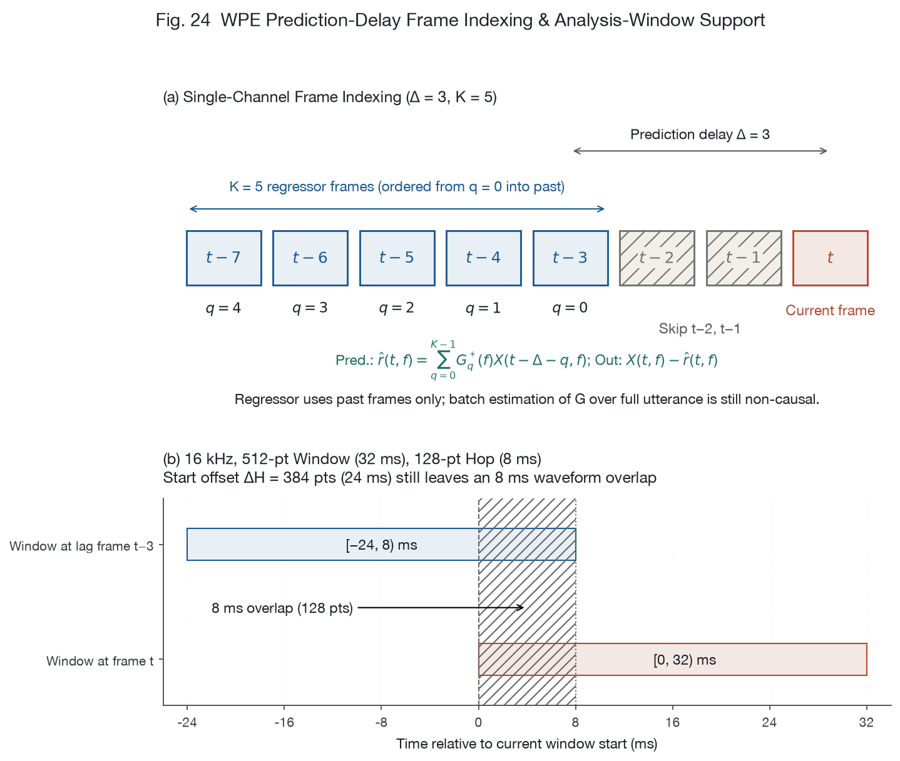
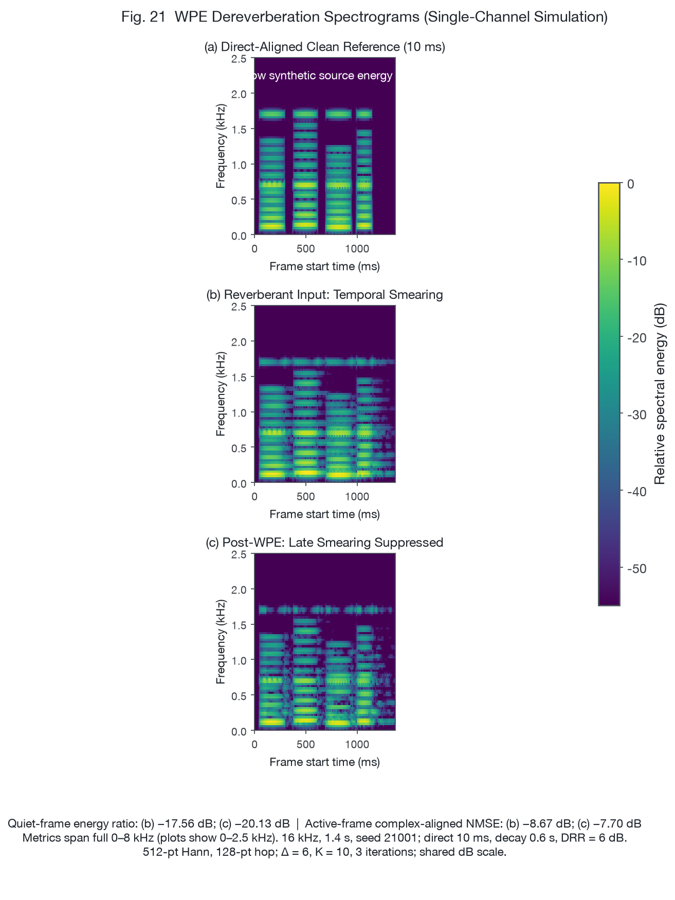
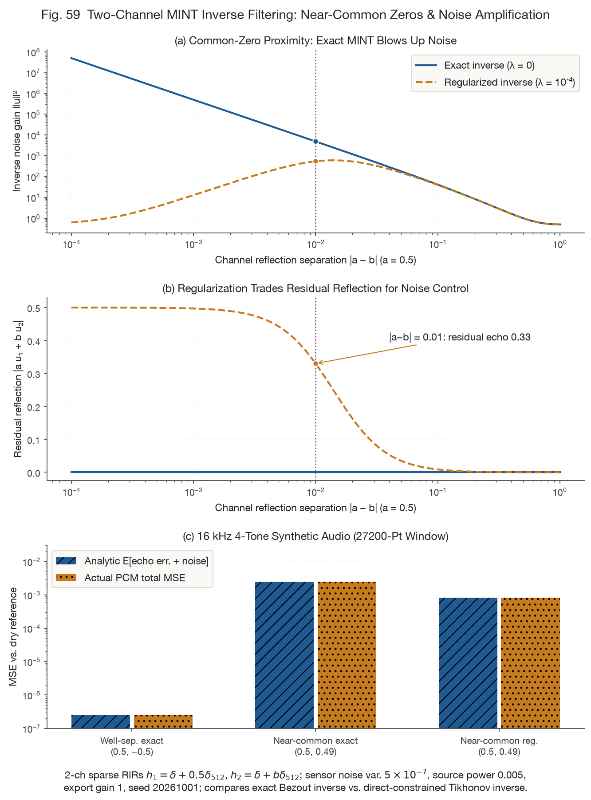
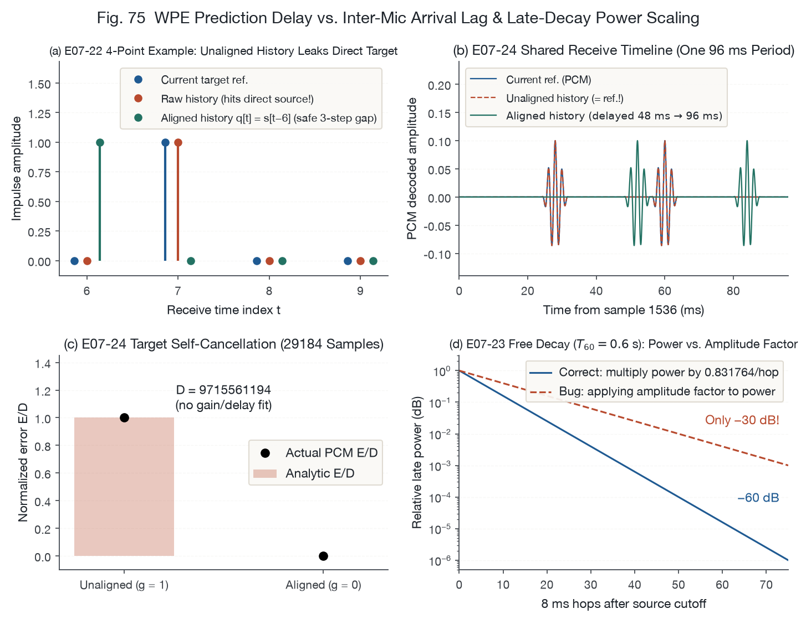

> This chapter is Chapter 7 of the main text; the main text and frontier monographs comprise 16 chapters in total (Chapters 0–15, where Chapter 0 covers mathematical foundations and Chapters 12–15 are four frontier extension chapters), accompanied by Appendices A and B. This chapter can be read independently; use the navigation bar below for adjacent chapters.
>
> Overview Home: [00_overview.md](00_overview.md) | Previous: [06_aec.md](06_aec.md) | Next: [08_speech-separation.md](08_speech-separation.md)

---

## 7. Dereverberation (WPE)

Chapter 6 examined acoustic echo produced when loudspeaker playback couples back into a device's microphones. This chapter turns to a second major class of distortion induced by room acoustics: the late reverberation tail formed as sound waves bounce repeatedly off walls, ceilings, and furniture, focusing on deriving the Weighted Prediction Error (WPE) dereverberation algorithm widely deployed across industry. Multi-speaker separation, time–frequency mask estimation, and complete front-end cascade ordering are developed in Chapter 8.

### 7.1 Problem Formulation, Model, and Intuition Examples

Whereas Acoustic Echo Cancellation (AEC) directly exploits a known loudspeaker reference signal for adaptive subtraction, far-field dereverberation has no access to the clean dry speech at the talker's lips and must rely solely on cross-frame statistical structure within the microphone observations themselves. Compared with single-frame narrowband beamforming in [Chapter 5](05_beamforming.md), typical room reverberation times $T_{60}$ (often hundreds of milliseconds) vastly exceed a single STFT analysis window (such as $32\ \mathrm{ms}$); single-frame spatial filtering suppresses diffuse reflections arriving from off-axis directions, yet cannot reach across frames to strip away delayed speech reflections arriving along or near the target look direction. Cross-frame temporal linear prediction therefore teams up with single-frame spatial filtering in a clean division of labor: **strip multi-frame tails first, then steer single-frame spatial beams**.

The central idea of Weighted Prediction Error (WPE) is to linearly predict the late reverberation tail in the current Short-Time Fourier Transform (STFT) frame from past observation frames and subtract that prediction from the current frame. To avoid mistaking the talker's own short-time speech envelope for reverberation and canceling the target voice, WPE inserts a guard delay $\Delta$ between the current frame and the prediction history, preserving the direct sound and early reflections beneficial to speech intelligibility; nevertheless, when the guard delay is too short, statistical frames are scarce, or the acoustic model is mismatched, early speech components can still incur partial attenuation.

#### Minimal Terminology and Notation

| Symbol or Term | Meaning in This Chapter |
|---|---|
| $X,E$ | Microphone observed complex spectrum and post-subtraction residual complex spectrum; the model seeks $E$ close to early speech without guaranteeing exact equality |
| $n,t$ | Two standard zero-based discrete frame indices; never confuse them with time-domain waveform sample indices |
| $f$ | Discrete frequency-bin index of the Short-Time Fourier Transform (STFT); often omitted during single-bin derivations |
| $\Delta,K$ | Guard delay (frame offset from current frame to the newest predictor frame) and prediction filter order (number of historical frames used), both measured in frames |
| $\lambda$ | Time-varying spectral power variance of the early speech component, sharing the same dimension as squared magnitude $\lvert E\rvert^2$ |
| $G,g$ | Linear prediction filter coefficients; dimensionless under uniform STFT scaling |
| Diagonal loading, power floor | Stabilize normal-matrix inversion and guard inverse-power weights $1/\lambda$ against division by zero, respectively; they act at distinct stages and cannot substitute for each other |

Complex spectral magnitudes in this chapter follow the numerical scale of the analysis STFT rather than physical sound pressure in pascals (Pa). Dimensions of scalars, column vectors, and matrices are stated explicitly upon entering each subsection; superscript $H$ denotes complex conjugate transpose throughout, whereas uppercase $H$ denoting frame hop size is always accompanied by explicit units of seconds (s) or samples.

Practical dereverberation methods have evolved along three principal avenues: (1) **spatial beamforming** (Chapter 5), exploiting multi-microphone spatial selectivity against isotropic diffuse late reverberation; (2) **blind inverse filtering or delayed linear prediction**, directly modeling the temporal decay tail of reverberation; and (3) **spectral gain suppression or Deep Neural Network (DNN) enhancement**. This chapter focuses on WPE, the workhorse of the second avenue—in both literature and production codebases, "WPE" denotes both the weighted prediction error optimization criterion and the iterative or recursive dereverberation algorithms built around it.

#### Three Precursor Methods and Their Prerequisites

Before deriving WPE formally, let us inspect three classical precursors: exact multichannel inverse filtering, cepstral homomorphic liftering, and late spectral-variance suppression. Seeing what physical assumptions each requires—and where each hits a wall—clarifies why WPE opts to "blindly estimate a delayed linear predictor in the STFT domain."

**The Multiple-input/output INverse Theorem (MINT)** answers a foundational algebraic question: if Room Impulse Responses (RIRs) are known *exactly*, can finite-length FIR filters invert reverberation completely? To distinguish polynomial degree from Chapter 8's tap-count symbol $L_h$, denote the FIR polynomial degree of each acoustic path by $N_h$ (tap length $N_h+1$), writing microphone $m$'s transfer function as $H_m(z)=\sum_{\tau=0}^{N_h}h_m[\tau]z^{-\tau}$. With a single microphone ($M=1$), real-room $H_1(z)$ is almost always non-minimum-phase with abundant zeros outside the unit circle; inverting $1/H_1(z)$ directly turns exterior zeros into unstable exterior poles, causing the inverse filter to diverge.

MINT circumvents division by introducing $M\ge 2$ microphones and **replacing polynomial division with a linear combination of polynomials**. Cascading each channel $m$ with a causal degree-$N_u$ (length $N_u+1$) FIR filter $U_m(z)=\sum_{\tau=0}^{N_u}u_m[\tau]z^{-\tau}$ and summing: because physical propagation from source to array incurs bulk time-of-flight (leading zeros before the direct arrival create multiple zeros at $z=\infty$), general causal exact inversion introduces an integer modeling delay $d_0\ge 0$ requiring

$$\sum_{m=1}^M H_m(z)U_m(z)=z^{-d_0}$$

(when direct arrivals are pre-aligned so at least one $h_m[0]\ne 0$, one may set $d_0=0$ for unit right-hand side, e.g., two-mic $H_1(z)U_1(z)+H_2(z)U_2(z)=1$). Matching like powers of $z^{-1}$ yields the time-domain linear system $\mathcal{H}\vec u=\vec e_{d_0}$, where generalized Sylvester convolution matrix $\mathcal{H}\in\mathbb{R}^{(N_h+N_u+1)\times M(N_u+1)}$ imposes $N_h+N_u+1$ lag equations on $M(N_u+1)$ unknown taps. Exact solvability for arbitrary right-hand sides (including any valid delay $d_0$) requires $\mathcal{H}$ to have full row rank, imposing the necessary degree condition

$$M(N_u+1)\ge N_h+N_u+1\iff N_u\ge\left\lceil\frac{N_h-M+1}{M-1}\right\rceil.$$

For two microphones ($M=2$) at $N_u=N_h-1$, $\mathcal{H}$ is a square $2N_h\times 2N_h$ matrix (first-order paths $N_h=1$ with zero-order scalar weights $N_u=0$ in Exercises [E07-14](#e07-14) and [E07-21](#e07-21) form the minimal $2\times 2$ instance). Under this degree bound, **Bézout's polynomial identity** guarantees that $\mathcal{H}$ has full row rank—yielding exact finite-length FIRs $\{U_m(z)\}$—if and only if $\{H_m(z)\}_{m=1}^M$ are **coprime** (sharing no common zero $z_0\in\mathbb{C}\setminus\{0\}$, with $d_0=0$ attainable whenever leading taps are not all zero; for general multi-source/multi-mic matrix coprimeness, see [Miyoshi & Kaneda, 1988, §III–IV](https://doi.org/10.1109/29.1509)). Physically, whereas a single microphone loses information irretrievably at an acoustic null, complementary microphones that do not vanish at the exact same complex frequency reconstruct a pure delay response.

Yet standalone MINT rarely survives in practical speech front-ends: not only must RIRs be measured precisely up front and remain stationary against millimeter-scale talker motion, but whenever channels harbor **near-common zeros**, Bézout's system—though algebraically nonsingular—produces enormous inverse weights $U_1,U_2$ that amplify independent sensor noise floor by hundreds or thousands of times (Exercises [E07-14](#e07-14) and [E07-20](#e07-20) compute this noise blowup by hand).

**Cepstral liftering** attempts to bypass RIR measurement via homomorphic signal processing. Taking the natural log of observed power spectra, $\ln|X|^2$ (twice the real cepstrum corresponding to log-magnitude $\ln|X|$, guarded by a positive floor at spectral zeros), and applying an inverse Fourier transform maps the signal into the cepstral domain, whose horizontal axis—*quefrency*—carries units of time or samples rather than Hz.

If long room convolution factored ideally as binwise multiplication $X=SH$, taking logarithms would give $\ln|SH|^2=\ln|S|^2+\ln|H|^2$, seemingly turning glottal excitation, vocal-tract formants, and room reflections into additive components along the quefrency axis. In practice, short-time STFT windows violate exact binwise multiplication for long RIRs, pitch harmonics overlap early room reflections in quefrency, and—most fatally—taking squared magnitudes discards phase completely, so smoothing magnitudes via a real cepstral lifter cannot restore clean complex phase ([Oppenheim, Schafer & Stockham, 1968, §VI](https://dsp-group.mit.edu/wp-content/uploads/2024/11/nonnlinearfiltering_1968.pdf) showed that exact echo inversion requires complex cepstra with delicate phase unwrapping, which breaks down in reverberant rooms; see Exercise [E07-18](#e07-18)).

**Late spectral-variance suppression** foregoes phase cancellation altogether, estimating late-reverberation power spectral variance $\sigma_r^2(n,f)$ in the energy domain and multiplying STFT bins by real Wiener- or log-spectral-amplitude gains. [Habets, Gannot & Cohen (2009, §II–V)](https://israelcohen.com/wp-content/uploads/2018/05/SPL_Sep2009.pdf), for instance, propagate diffuse-field power decay recursively from $T_{60}$ and Direct-to-Reverberant Ratio (DRR). While computationally featherweight, real-gain attenuation without complex phase subtraction readily introduces musical noise or syllable erosion when aggressive, and leaves audible reverberation tails when conservative.

Contrasting these three precursors pinpoints WPE's design sweet spot: demanding neither oracle RIRs like MINT nor phase-blind real masking like spectral subtraction, WPE leverages the nonstationary speech envelope directly in the multichannel complex STFT domain to blindly estimate a stable multi-frame linear predictor that subtracts late reverberation coherently in complex amplitude and phase.

#### Paradigm Selection and Learning Objectives

The two tables below map spatial beamforming, delayed linear prediction (WPE), and spectral-gain / neural enhancement along **input prerequisites** and **streaming compute & failure boundaries**. Because microphone apertures, corpora, back-end ASR engines, and lookahead budgets differ across studies, never stitch Word Error Rate (WER) deltas from disparate papers into a single cross-paper leaderboard.

Representative spatial-filtering methods include Minimum Variance Distortionless Response (MVDR) and Generalized Eigenvalue (GEV) beamforming, derived in [Chapter 5 §5.4](05_beamforming.md#sec-5-4) and [§5.9](05_beamforming.md#sec-5-9); spectral gains may come from statistical diffuse-field models or neural networks.

| Avenue | Target Mechanism & Representative Methods | Input Prerequisites & Core Assumptions |
|---|---|---|
| Spatial selection | MVDR, GEV; attenuates isotropic diffuse reverb and directional interferers | Synchronized multi-mic signals plus target steering vector or TF masks |
| Delayed linear prediction | Offline WPE, online recursive WPE; complex subtraction of late reverb tail | Single/multi-channel complex STFT, guard delay $\Delta$, sufficient active frames |
| Spectral gain & neural enhancement | Late-variance suppression, DNN dereverberation; fullband reverb & noise suppression | Matched training corpus, or reliable $T_{60}$ and late-reverb power estimates |

Pair input requirements with causal latency and failure boundaries when architecting a pipeline:

| Avenue | Causality & Compute Scaling | Typical Failure Boundaries |
|---|---|---|
| Spatial selection | Causal frame-by-frame streaming; scales with mic count $M$ and bins $F$ | Heavy reverb blurring direct-path cues or tiny $M$ limits spatial rejection |
| Delayed linear prediction | Batch iterates whole utterances; online updates correlation or its inverse per frame | Ultra-short wake words, heavy additive noise, or oversized tap order $K$ cause ill-conditioning |
| Spectral gain & neural enhancement | Governed by bidirectional layers / future lookahead; MACs scale with model size | Cross-room/array generalization must be verified; nonlinear mapping can distort phase or phonemes |

In practical system design, when far-field ASR suffers from long reverberation tails, multichannel WPE is evaluated first; when directional interferers (HVAC, TVs) coexist, multichannel WPE precedes MVDR/GEV beamforming in cascade; when subjective listening cleanliness is paramount and compute permits, a **single-channel** neural post-filter follows the beamformer output (complete module ordering in §7.6 and [Chapter 10 §10.1](10_engineering-practice.md#sec-10-1)).

In the landmark **REVERB Challenge** benchmark, official tracks span 8-channel, 2-channel, and 1-channel tasks across simulated $T_{60}\approx 0.25$–$0.7\ \mathrm{s}$ and real meeting rooms. As summarized by Kinoshita et al. (*EURASIP J. Adv. Signal Process.*, 2016), WPE's ASR gains scale strongly with microphone count: 8-channel MIMO-WPE exploits cross-channel diversity to suppress late tails substantially, whereas single-channel WPE operates with far fewer degrees of freedom—always cite channel count alongside evaluation subset ([REVERB Challenge task spec](https://reverb2014.audiolabs-erlangen.de/index.html) and [Kinoshita et al., 2016, §2, §4.1.1 & Fig. 5](https://doi.org/10.1186/s13634-016-0306-6)).

#### Delayed Linear Prediction Model and Frame Indexing

Assuming the room acoustic path remains approximately time-invariant across the estimation window, a long reverberant impulse response manifests in the STFT domain as a cross-frame convolutive tail. WPE decomposes observed complex spectrum $X(n,f)$ at frame $n$ into desired direct-plus-early speech $E(n,f)$ plus late reverberation $\hat r(n,f)$ linearly predicted from past observations. Because human speech energy fluctuates over orders of magnitude across vowels, consonants, and pauses—unlike stationary autoregressive processes—WPE introduces frame-varying early-speech variance $\lambda(n,f)$ to capture nonstationarity and skips the $\Delta-1$ frames immediately preceding frame $n$ via guard delay $\Delta$ so short-time speech correlation is not mistaken for reverberation.

Clarify a crucial causality distinction right away: although evaluating the prediction formula reads only past frames $X(n-k)$ ($k\ge\Delta$), **classical batch WPE is *not* a causal streaming algorithm**, because estimating filter taps $G$ and variances $\lambda$ pools statistics across the entire utterance (including future frames)! True causal online WPE requires reformulating correlation matrices, filter taps, and power estimates recursively from current and past frames alone, while budgeting STFT frame-gathering latency.

Fix **local frequency and lag notation** for this chapter: to align directly with WPE literature and open-source code, $f\in\{0,1,\dots,\lfloor N/2\rfloor\}$ in $X(n,f)$ indexes dimensionless one-sided STFT bins of a real signal (physical frequency $f_{\mathrm{Hz}}=f f_s/N$ for FFT size $N$ and sample rate $f_s$, hitting Nyquist $f_s/2$ at $f=N/2$ for even $N$); summation index $k$ denotes **frame lag** exclusively (distinct from frequency-bin $k$ in Chapter 2); and $n$ (or $t$ below) indexes frames.

For a single microphone, because reverberation decay rates and modal reflections vary across frequency, each bin $f$ is modeled independently and solved in parallel. Suppressing $f$ at a fixed bin where $X(n)$, $E(n)$, and $G(k)$ are complex scalars, the single-channel delayed linear prediction model reads:

$$\begin{aligned}
X(n)&=E(n)+\hat r(n),\\
\hat r(n)&=\sum_{k=\Delta}^{\Delta+K-1}
G^*(k)X(n-k).
\end{aligned}\tag{7-1}$$

Verify each symbol and convention in Eq. (7-1):

- $X(n)$ is the reverberant complex spectrum observed at frame $n$, and $E(n)=X(n)-\hat r(n)$ is the residual estimate of direct sound plus early reflections after subtracting the predicted tail;
- $G(k)$ is the complex prediction tap at lag $k$, multiplying historical observation $X(n-k)$ via its **complex conjugate $G^*(k)$** (aligning vector inner product $\vec g^H\vec x(n)$ seamlessly with $\vec w^H\vec x$ in Chapter 5 beamforming);
- Summing $K$ terms from $k=\Delta$ through $k=\Delta+K-1$ places the $\Delta-1$ most recent frames $n-1,n-2,\dots,n-\Delta+1$ inside a skipped "guard zone" while regressing on the $K$ consecutive earlier frames; optimal $\Delta$ and $K$ couple tightly to STFT hop size, utterance length, and back-end distortion tolerance rather than acting as hop-independent universal constants.



Figure 24 maps discrete frame indices directly onto physical time across two panels:

- **Figure 24(a) (Frame index layout)**: Frame indices advance left to right, matching `build_y_tilde()` in `nara_wpe 0.0.11` identically. With guard delay $\Delta=3$ and order $K=5$, predicting current frame $t$ on the right skips guard frames $t-1$ and $t-2$, feeding the five historical taps $t-3,t-4,t-5,t-6,t-7$ on the left. Re-indexing via $q=0,\dots,K-1$ with $G_q=G(\Delta+q)$ writes prediction compactly as

$$\hat r(t)=\sum_{q=0}^{K-1}G_q^*X(t-\Delta-q),$$

whose leading tap $q=0$ reads newest predictor frame $t-\Delta$.

- **Figure 24(b) (Actual time-domain analysis-window support)**: At $16\ \mathrm{kHz}$ with a $512$-sample ($32\ \mathrm{ms}$) uncentered window and $128$-sample ($8\ \mathrm{ms}$) hop, current frame $t$ spans $[0,32)\ \mathrm{ms}$, while newest predictor frame $t-3$—whose onset lags by $3\times 8=24\ \mathrm{ms}$—actually spans $[-24,8)\ \mathrm{ms}$, **still sharing $8\ \mathrm{ms}$ of waveform overlap over $[0,8)\ \mathrm{ms}$**! This dispels a pervasive misconception: separating frame onsets by $\Delta$ hops neither carves an overlap-free vacuum between time-domain windows nor defines a sharp geometric acoustics boundary between early and late reflections.

#### Worked Example 7-1: One-Step Intuition Example of WPE (Single Channel, Single Bin)

Full WPE alternates between estimating taps $G$ and time-varying variances $\lambda$ over multiple frames. To lock down lag indexing and complex-conjugate multiplication by hand first, treat $G$ as given constants and step through single-frame prediction and subtraction.

**Inputs and conventions**: Single channel, single bin, order $K=2$, guard delay $\Delta=2$. Summation traverses $k=2,3$, predicting frame $n$ from $n-2$ and $n-3$ while skipping $n-1$. Given dimensionless complex spectra and taps:

- Historical observed spectra: $X(n-2)=0.8+0.1\mathrm{j}$, $X(n-3)=0.5-0.2\mathrm{j}$;
- Prediction filter taps: $G(2)=0.5+0.1\mathrm{j}$, $G(3)=0.3-0.05\mathrm{j}$;
- Current observed spectrum: $X(n)=0.9+0.4\mathrm{j}$.

**Step-by-step substitution**: Using $(a+b\mathrm{j})(c+d\mathrm{j})=(ac-bd)+(ad+bc)\mathrm{j}$, conjugate the filter taps *before* multiplying in Eq. (7-1): $G^*(2)=0.5-0.1\mathrm{j}$ and $G^*(3)=0.3+0.05\mathrm{j}$.

1. **Step 1 (Tail contribution at lag $k=2$)**:

    $$\begin{aligned}
    G^*(2)X(n-2)
    &=(0.5-0.1\mathrm{j})(0.8+0.1\mathrm{j}).
    \end{aligned}$$

    Real part: $0.5\times0.8-(-0.1)\times0.1=0.40+0.01=0.41$; imaginary part: $0.5\times0.1+(-0.1)\times0.8=0.05-0.08=-0.03$, giving $G^*(2)X(n-2)=0.41-0.03\mathrm{j}$.

2. **Step 2 (Tail contribution at lag $k=3$)**:

    $$\begin{aligned}
    G^*(3)X(n-3)
    &=(0.3+0.05\mathrm{j})(0.5-0.2\mathrm{j}).
    \end{aligned}$$

    Real part: $0.3\times0.5-0.05\times(-0.2)=0.15+0.01=0.16$; imaginary part: $0.3\times(-0.2)+0.05\times0.5=-0.06+0.025=-0.035$, giving $G^*(3)X(n-3)=0.16-0.035\mathrm{j}$.

3. **Step 3 (Sum to form late-reverberation estimate $\hat r(n)$)**:

    $$\begin{aligned}
    \hat r(n)&=(0.41-0.03\mathrm{j})+(0.16-0.035\mathrm{j})\\
    &=0.57-0.065\mathrm{j}.
    \end{aligned}$$

4. **Step 4 (Subtract predicted tail from current observation)**:

    $$\begin{aligned}
    E(n)&=X(n)-\hat r(n)\\
    &=(0.9-0.57)+(0.4+0.065)\mathrm{j}\\
    &=0.33+0.465\mathrm{j}.
    \end{aligned}$$

**Result and boundary notes**: Input magnitude $|X(n)|=\sqrt{0.9^2+0.4^2}=\sqrt{0.97}\approx0.985$ drops to residual magnitude $|E(n)|=\sqrt{0.33^2+0.465^2}=\sqrt{0.325125}\approx0.570$, reducing single-bin power from $0.97$ to $\approx 0.325$ ($10\log_{10}(0.97/0.325125)\approx 4.747\ \mathrm{dB}$, or $\approx 4.75\ \mathrm{dB}$). Two lessons stand out: (1) conjugation $G^*(k)$ flips cross-term signs directly (omitting conjugation corrupts the residual—see Exercise E07-02); and (2) "single-frame energy reduction" never by itself proves clean dereverberation—an overfitted predictor canceling steady vowels also slashes energy while severely distorting speech, so multi-frame estimation and clean-reference fidelity checks are essential.

#### Worked Example 7-2: Widening the Guard Interval by One Frame ($\Delta=3$, $K=2$)

Keep prediction order $K=2$ fixed while increasing guard delay from $\Delta=2$ to $\Delta=3$ to observe how the historical regression window shifts.

**Inputs and conventions**: Single channel, single bin, $\Delta=3$, $K=2$. Lags shift to $k=3,4$, skipping $n-1$ and $n-2$ (at $n=10$, skipping frames $9,8$ to read frames $7,6$). Given:

- Historical observations: $X(n-3)=0.6+0.2\mathrm{j}$, $X(n-4)=0.4+0.3\mathrm{j}$;
- Prediction taps: $G(3)=0.4-0.2\mathrm{j}$, $G(4)=0.2+0.1\mathrm{j}$;
- Current observation: $X(n)=1.0+0.5\mathrm{j}$.

**Step-by-step substitution**: Conjugating $G^*(3)=0.4+0.2\mathrm{j}$ and $G^*(4)=0.2-0.1\mathrm{j}$ gives:

$$
\begin{aligned}
G^*(3)X(n-3)
&=(0.4+0.2\mathrm{j})(0.6+0.2\mathrm{j})\\
&=(0.4\times0.6-0.2\times0.2)\\
&\quad+(0.4\times0.2+0.2\times0.6)\mathrm{j}\\
&=0.20+0.20\mathrm{j},
\end{aligned}
$$

$$
\begin{aligned}
G^*(4)X(n-4)
&=(0.2-0.1\mathrm{j})(0.4+0.3\mathrm{j})\\
&=(0.2\times0.4+0.1\times0.3)\\
&\quad+(0.2\times0.3-0.1\times0.4)\mathrm{j}\\
&=0.11+0.02\mathrm{j}.
\end{aligned}
$$

Summing into $\hat r(n)$ and subtracting from $X(n)$ yields $E(n)$ directly:

$$\begin{aligned}
\hat r(n)&=(0.20+0.20\mathrm{j})+(0.11+0.02\mathrm{j})\\
&=0.31+0.22\mathrm{j},\\
E(n)&=X(n)-\hat r(n)\\
&=(1.0-0.31)+(0.5-0.22)\mathrm{j}=0.69+0.28\mathrm{j}.
\end{aligned}$$

**Result and boundary notes**: Input magnitude $|X(n)|=\sqrt{1.25}\approx1.118$ drops to $|E(n)|=\sqrt{0.69^2+0.28^2}=\sqrt{0.5545}\approx0.745$, reducing power from $1.25$ to $0.5545$ ($\approx 3.53\ \mathrm{dB}$; arbitrary example inputs are not comparable in dB across Examples 7-1 and 7-2). The key takeaway is parameter separation: at fixed $K=2$, raising $\Delta$ from $2$ to $3$ **does not alter the number of unknown filter taps**—the normal system remains $2\times 2$—but pushes the length-$K$ history window one frame further into the past, widening the buffer protecting direct sound and early reflections (§7.8).

### 7.2 Offline WPE: Alternating Estimation of the Predictor and Speech Power

#### Defining the History Vector and Probabilistic Model

Suppressing bin index $f$, stack the $K$ predictor history frames preceding frame $n$ into $\vec x(n)\in\mathbb{C}^{K\times 1}$ and stack the filter taps in matching lag order into $\vec g\in\mathbb{C}^{K\times 1}$:

$$\begin{aligned}
\vec x(n)&=\begin{bmatrix}
  X(n-\Delta)\\
  \vdots\\
  X(n-\Delta-K+1)
  \end{bmatrix},\\
\vec g&=\begin{bmatrix}
  G(\Delta)\\
  \vdots\\
  G(\Delta+K-1)
  \end{bmatrix},\\
\hat r(n)&=\vec g^H\vec x(n),\\
E(n)&=X(n)-\hat r(n).
\end{aligned}\tag{7-2}$$

With conjugate transpose $H$, $\vec g^H\vec x(n)=\sum_{k=\Delta}^{\Delta+K-1}G^*(k)X(n-k)$ recovers Eq. (7-1) identically. In batch WPE, filter vector $\vec g$ is time-invariant across the utterance (static room acoustics), whereas residual variance $\lambda(n)$ varies freely across frames $n$ (dynamic speech envelope). That statistical separation—"time-invariant room filter + time-varying speech variance"—is the physical foundation of WPE's inverse-power weighting (original derivation in [Nakatani et al., 2010](https://doi.org/10.1109/TASL.2010.2052251); concise alternating summary in [Kinoshita et al., 2017, §3.1 Eqs. (8)–(12)](https://www.isca-archive.org/interspeech_2017/kinoshita17_interspeech.pdf)).

To formulate a likelihood, specify a probability density for complex residual $E(n)$. Writing $E=a+\mathrm{j}b$ with independent zero-mean real Gaussian components $a,b\sim\mathcal N(0,\lambda/2)$ gives total variance $\mathbb{E}[|E|^2]=\mathbb{E}[a^2]+\mathbb{E}[b^2]=\lambda$ and zero pseudo-variance $\mathbb{E}[E^2]=\mathbb{E}[a^2-b^2]+\mathrm{j}2\mathbb{E}[ab]=0$. This phase-invariant law is the **circularly symmetric (proper) complex Gaussian distribution** (vector densities and MLE derivations in [Chapter 0 §0.6](00_math-foundations.md#sec-0-6)), with density

$$p(E\mid\lambda)=\frac{1}{\pi\lambda}
\exp\!\left(-\frac{|E|^2}{\lambda}\right).
\tag{7-3}$$

Beginners comparing Eq. (7-3) against a real Gaussian often ask: where did the factor of $1/2$ in the exponent and the square root in the denominator go? Multiplying two independent real Gaussians of variance $\lambda/2$ gives

$$\begin{aligned}
p(a)p(b)
&=\frac{1}{\sqrt{2\pi(\lambda/2)}}
  \exp\!\left(-\frac{a^2}{2(\lambda/2)}\right)\\
&\quad\cdot\frac{1}{\sqrt{2\pi(\lambda/2)}}
  \exp\!\left(-\frac{b^2}{2(\lambda/2)}\right),
\end{aligned}$$

where $\sqrt{\pi\lambda}\cdot\sqrt{\pi\lambda}=\pi\lambda$ and the factors of $2$ in $2(\lambda/2)$ cancel cleanly into $-|E|^2/\lambda$. Note that $\lambda$ has dimensions of power (squared amplitude), not amplitude.

One subtle boundary condition applies at the two real endpoints of a one-sided real-signal STFT: Eq. (7-3) holds strictly at interior complex bins, whereas DC ($f=0$) and even-$N$ Nyquist ($f=N/2$) are identically real ($\operatorname{Im}E\equiv 0$) and cannot follow an equal-real/imaginary-variance proper complex Gaussian. Modeling those real endpoints via zero-mean real Gaussian $(2\pi\lambda)^{-1/2}\exp[-E^2/(2\lambda)]$ produces parameter-dependent negative log-likelihood $\frac{1}{2}\ln\lambda+\frac{E^2}{2\lambda}$—exactly $1/2$ of the complex objective from Eq. (7-3)! Scaling a decoupled single-bin objective by $1/2$ leaves both closed-form filter taps and variance updates unchanged, so production code reuses identical update formulas across all one-sided bins while keeping the probabilistic distinction clear (one-sided endpoint conventions in [Chapter 2 §2.5](02_basics-signal-model.md#sec-2-5)).

#### From Conditional Likelihood to Weighted Least Squares

Because predicting frame $n$ reaches back to $n-\Delta-K+1$, leading frames lack full history. Denoting the index set of valid frames possessing all $K$ historical taps by $\mathcal V$ and conditioning on past observations so current innovation $E(n)$ follows Eq. (7-3), the chain rule of conditional probability multiplies conditional densities across $n\in\mathcal V$ into conditional likelihood $L$:

$$L=\prod_{n\in\mathcal V}
\frac{\exp[-|E(n)|^2/\lambda(n)]}{\pi\lambda(n)}.
\tag{7-4}$$

Crucially, Eq. (7-4) does **not** assume observed frames $X(n)$ are mutually independent—past frames $X(n-k)$ enter the conditional mean $\vec g^H\vec x(n)$ explicitly, so the probability chain rule factors the joint sequence density into conditional innovation densities rigorously. Taking $-\ln L$ and dropping constant $|\mathcal V|\ln\pi$ yields the joint offline WPE objective:

$$\begin{aligned}
\mathcal J(\vec g,\lambda)
&=\sum_{n\in\mathcal V}\frac{|E(n)|^2}{\lambda(n)}
+\sum_{n\in\mathcal V}\ln\lambda(n).
\end{aligned}\tag{7-5}$$

While $\vec g$ and $\lambda(n)$ couple nonlinearly via division in Eq. (7-5) with no joint closed-form solution, holding either variable fixed makes optimizing the other elementary. Holding positive variances $\lambda(n)>0$ fixed turns $\sum_{n\in\mathcal V}\ln\lambda(n)$ into an additive constant, reducing $\vec g$ estimation to **Weighted Least Squares (WLS)**:

$$\begin{aligned}
J(\vec g)&=\sum_{n\in\mathcal V}
\frac{|X(n)-\vec g^H\vec x(n)|^2}{\lambda(n)},\\
\hat{\vec g}&=\arg\min_{\vec g}J(\vec g).
\end{aligned}\tag{7-6}$$

Each frame carries inverse early-speech power weight $w(n)=1/\lambda(n)$: loud vowel frames have large $\lambda(n)$ and small weight $1/\lambda(n)$, preventing energetic direct speech from dominating regression and canceling itself; syllable tails and inter-word pauses have small $\lambda(n)$ and large weight $1/\lambda(n)$, focusing regression squarely onto pure decaying reverberation tails.

#### Expanding the Complex Quadratic Form and Solving the Normal Equations

How do we minimize real-valued $J(\vec g)$ over complex vector $\vec g\in\mathbb{C}^{K\times 1}$? Because $|z|^2=z z^*$ involves conjugation, it violates the Cauchy–Riemann equations and is not complex-analytic. Signal processing applies **Wirtinger calculus** (complex gradient rules and alternating minimization properties in [Chapter 0 §0.5](00_math-foundations.md#sec-0-5) and [Appendix A](16_appendix-symbols-math.md)): treating $\vec g$ and $\vec g^*$ as formally independent variables, stationary points of a real-differentiable real cost satisfy $\frac{\partial J}{\partial \vec g^*}=\vec 0$.

Expanding $|X(n)-\vec g^H\vec x(n)|^2$ step by step via $|z|^2=z^* z$ (noting scalar $(\vec g^H\vec x)^*=\vec x^H\vec g$):

$$\begin{aligned}
|X(n)-\vec g^H\vec x(n)|^2
&=\bigl(X^*(n)-\vec x^H(n)\vec g\bigr)
  \bigl(X(n)-\vec g^H\vec x(n)\bigr)\\
&=|X(n)|^2-X(n)\vec x^H(n)\vec g
  -X^*(n)\vec g^H\vec x(n)\\
&\quad+\vec g^H\vec x(n)\vec x^H(n)\vec g.
\end{aligned}$$

The middle two terms are complex conjugates whose sum is real. Dividing by $\lambda(n)>0$ and summing over $n\in\mathcal V$ with $c=\sum_{n\in\mathcal V}|X(n)|^2/\lambda(n)$ puts Eq. (7-6) into standard Hermitian quadratic form:

$$J(\vec g)=c-\vec r^H\vec g-\vec g^H\vec r+\vec g^H\mathbf R\vec g.$$

Differentiating term by term with respect to $\vec g^*$ (i.e., $\vec g^H$) while holding $\vec g$ constant: $c$ and $-\vec r^H\vec g$ vanish, $-\vec g^H\vec r$ gives $-\vec r$, and $\vec g^H(\mathbf R\vec g)$ gives $\mathbf R\vec g$. Setting $\partial J/\partial \vec g^*=\mathbf R\vec g-\vec r=\vec 0$ yields the $K\times K$ complex normal equations:

$$\begin{aligned}
\mathbf R&=\sum_{n\in\mathcal V}
\frac{\vec x(n)\vec x^H(n)}{\lambda(n)},\\
\vec r&=\sum_{n\in\mathcal V}
\frac{\vec x(n)X^*(n)}{\lambda(n)},\\
\mathbf R\vec g&=\vec r.
\end{aligned}\tag{7-7}$$

Checking shapes and conjugations in Eq. (7-7): $\vec x(n)\in\mathbb{C}^{K\times 1}$ and $\vec x^H(n)\in\mathbb{C}^{1\times K}$ accumulate into $K\times K$ Hermitian positive semidefinite $\mathbf R$ ($\vec u^H\mathbf R\vec u=\sum_{n\in\mathcal V}|\vec u^H\vec x(n)|^2/\lambda(n)\ge 0$), while $\vec r\in\mathbb{C}^{K\times 1}$ conjugates current observation $X^*(n)$ consistently with $\vec g^H\vec x(n)$ in Eq. (7-2). Strict invertibility of unloaded $\mathbf R$ requires both $|\mathcal V|\ge K$ and historical regressors spanning all of $\mathbb{C}^K$ (purely periodic tones or silence leave $\mathbf R$ rank-deficient regardless of frame count; see Exercise E07-11).

To guard against near-singular $\mathbf R$ and tap blowup, implementations apply relative diagonal loading:

$$\begin{aligned}
(\mathbf R+\delta \mathbf I)\vec g&=\vec r,\\
\delta&=\epsilon\operatorname{tr}(\mathbf R)/K.
\end{aligned}\tag{7-8}$$

Multiplying dimensionless ratio $\epsilon\ge 0$ by mean diagonal power $\operatorname{tr}(\mathbf R)/K$ gives $\delta$ the exact physical dimension of $\mathbf R$. At fixed $\lambda$ and $\delta$, Eq. (7-8) minimizes the Tikhonov $L_2$-penalized objective $J(\vec g)+\delta\|\vec g\|_2^2$, trading slightly higher unpenalized residual sum of squares $J(\vec g_\delta)$ for bounded filter norm and numerical stability (Exercise E07-08). All-zero bins have $\operatorname{tr}(\mathbf R)=0\implies\delta=0$ and bypass cleanly to zero; positive definite systems solve via Cholesky factorization without explicit matrix inversion.

#### Direct Design-Matrix Solving: Avoiding Squared Condition Numbers

Forming normal matrix $\mathbf R=\mathbf A^H\mathbf A$ squares the spectral condition number: $\kappa_2(\mathbf A^H\mathbf A)=\kappa_2(\mathbf A)^2$ (SVD and least-squares conditioning in [Chapter 0 §0.3](00_math-foundations.md#sec-0-3)). Under strongly collinear multichannel history, subtle directional differences still resolvable in `float64` can be wiped out completely once squared into $\mathbf R$.

Unifying single-channel and §7.3 multichannel cases: let stacked history dimension be $D$ ($D=K$ single-channel, $D=MK$ multichannel), valid frame count $T_v=|\mathcal V|$, output channels $M$, and weights $w_n=1/\lambda_n$. Construct weighted design matrix $\mathbf A\in\mathbb{C}^{T_v\times D}$ with row $\sqrt{w_n}\vec q_n^H$ and target matrix $\mathbf B\in\mathbb{C}^{T_v\times M}$ with row $\sqrt{w_n}\vec X_n^H$—conjugate-transposing $\vec E_n=\vec X_n-\mathbf G^H\vec q_n$ turns residual rows into $\vec E_n^H=\vec X_n^H-\vec q_n^H\mathbf G$ right-multiplied by $\mathbf G$.

Weighted residual sum of squares then equals $\|\mathbf A\mathbf G-\mathbf B\|_F^2$ identically with $\mathbf A^H\mathbf A=\mathbf R$ and $\mathbf A^H\mathbf B=\mathbf P$. Incorporating diagonal loading from Eq. (7-8) forms the augmented least-squares problem:

$$\begin{aligned}
\mathbf A_\delta&=\begin{bmatrix}
  \mathbf A\\
  \sqrt\delta\mathbf I_D
  \end{bmatrix},\\
\mathbf B_\delta&=\begin{bmatrix}
  \mathbf B\\
  \mathbf 0
  \end{bmatrix},\\
J_\delta(\mathbf G)
&=\|\mathbf A_\delta\mathbf G-\mathbf B_\delta\|_F^2,\\
\hat{\mathbf G}&=\arg\min_{\mathbf G}J_\delta(\mathbf G),\\
\delta&=\epsilon\|\mathbf A\|_F^2/D.
\end{aligned}\tag{7-9}$$

Because the bottom block adds $\delta\|\mathbf G\|_F^2$ and $\|\mathbf A\|_F^2=\operatorname{tr}(\mathbf A^H\mathbf A)=\operatorname{tr}(\mathbf R)$, Eq. (7-9) is algebraically identical to Eq. (7-8) in exact arithmetic (dropping the bottom block when $\delta=0$). In finite-precision floating point, however, applying QR factorization or Singular Value Decomposition (SVD; see [LAPACK Users' Guide on Linear Least Squares](https://www.netlib.org/lapack/lug/node27.html)) directly to $\mathbf A_\delta$ bypasses forming $\mathbf A^H\mathbf A$ and avoids squaring the condition number!

Our teaching code exposes both solver paths side by side: default `solver="normal"` solves Eq. (7-8), whereas `solver="design_lstsq"` decomposes augmented $\mathbf A_\delta$ in Eq. (7-9) directly without ever forming $\mathbf R$, preventing numerical rank collapse on ill-conditioned full-rank designs (Exercise [E07-19](#e07-19) demonstrates a $2\times 2$ design of $\kappa_2=2\times 10^9$ where `normal` collapses to rank $1$ while `design_lstsq` recovers the exact solution; remember when reading diagnostic condition numbers that the two paths report $\kappa_2(\mathbf R+\delta\mathbf I)$ vs. $\kappa_2(\mathbf A_\delta)$, related by a square). Note also **tensor axis ordering**: prose writes $X(n,f)$ or $X_m(n,f)$, whereas repository code and `nara_wpe` batch across bins using layout `(F, M, T)` (or `(F, T)` for mono).

#### Power Update, Power Floor, and One Complete Iteration

Turning to the second half of alternating minimization: **holding filter taps $\vec g$ fixed, update per-frame early speech variance $\lambda(n)$**. With $a_n=|E(n)|^2\ge 0$ fixed, Eq. (7-5) decouples across frames into minimizing scalar $f(\lambda)=a_n/\lambda+\ln\lambda$ ($\lambda>0$):

$$f'(\lambda)=-\frac{a_n}{\lambda^2}+\frac{1}{\lambda}
=\frac{\lambda-a_n}{\lambda^2}.$$

When $a_n>0$, $f'(\lambda)<0$ for $\lambda<a_n$ and $f'(\lambda)>0$ for $\lambda>a_n$, making $\hat\lambda(n)=a_n$ the unique global minimizer. When $a_n=0$, however, $f(\lambda)=\ln\lambda\to -\infty$ as $\lambda\downarrow 0^+$ with no positive minimizer on $(0,+\infty)$, and $1/\lambda(n)$ divides by zero on the next iteration! Engineering implementations therefore impose a strictly positive power floor $\lambda_{\min}>0$ ($\lambda(n)\ge\lambda_{\min}$):

$$\begin{aligned}
\hat\lambda(n)&=a_n\quad(a_n>0),\\
\hat\lambda_{\mathrm{floor}}(n)
&=\max\{a_n,\lambda_{\min}\}.
\end{aligned}\tag{7-10}$$

Whenever $a_n<\lambda_{\min}$, monotonic $f'(\lambda)>0$ on $[\lambda_{\min},+\infty)$ guarantees boundary point $\lambda_{\min}$ is the exact constrained minimizer. Some implementations further smooth $|E(n)|^2$ across neighboring frames via a moving average (capturing short-time speech envelope continuity), which modifies the variance prior so the unpenalized likelihood in Eq. (7-5) can no longer be assumed strictly non-increasing per iteration (Exercise E07-09).

One complete per-bin engineering iteration proceeds in five steps:

1. Initialize $\lambda^{(0)}$ from observed power, declaring the floor and its scaling convention.
2. Assemble complete history regressors starting at $n=\Delta+K-1$ to fix valid frame set $\mathcal V$.
3. Accumulate Eq. (7-7) under current variances and solve for taps under the declared loading/solver mode.
4. Compute residuals from updated taps and update variances using the declared floor and smoothing window.
5. Stop upon reaching maximum iterations or a diagnostic convergence threshold, logging bypasses, fallbacks, and conditioning metrics.

Exact coordinate descent on Eq. (7-5) holds only without loading, flooring, or temporal smoothing—and even exact coordinate descent on a nonconvex objective guarantees stationary points rather than a global optimum.

Standard boundary invariants: $K=0$ bypasses to input; all-zero bins skip inversion; uniform scaling of input and floor leaves relative-loaded filter taps invariant.

Tracing the first two alternating cycles $\lambda^{(0)}\to \vec g^{(1)}$ and $\lambda^{(1)}\to \vec g^{(2)}$ brings offline WPE convergence to life:

- **Observation initialization $\lambda^{(0)}$**: Starting with neither taps nor clean early power, initialize $\lambda^{(0)}(n)=\max\{|X(n)|^2,\lambda_{\min}\}$;
- **First regression $\vec g^{(1)}$**: Even though pause tails carry elevated $\lambda^{(0)}(n)$, loud vowel frames are already strongly down-weighted, enabling $\vec g^{(1)}$ to strip away the primary layer of late reflections into sharper residual $E^{(1)}(n)=X(n)-(\vec g^{(1)})^H\vec x(n)$;
- **Tail power drop & weight boost $\lambda^{(1)}$**: Updating $\lambda^{(1)}(n)=\max\{|E^{(1)}(n)|^2,\lambda_{\min}\}$ drops pause-region power sharply, boosting inverse weights $1/\lambda^{(1)}(n)$ across reverberant tails;
- **Refined regression $\vec g^{(2)}$**: Pass 2 focuses normal equations tightly onto pure pause-region decay while leaving direct speech onsets even cleaner.

Consequently, $3$–$5$ offline iterations capture nearly the entire gain in practice. Let us work through one weighted least-squares step by hand.

#### Worked Example 7-3: Hand Calculation of the Weighted Least-Squares Solver (Single Tap $K=1$, 3 Valid Frames)

**Inputs and conventions**: Single channel, single bin, single tap $K=1$, guard delay $\Delta=3$ (one scalar unknown $g=G(3)$). Take six zero-indexed real spectral frames $X(0{:}5)=[0.8,\ 0.5,\ 0.4,\ 1.0,\ 0.6,\ 0.2]$. Since $\Delta+K-1=3$, leading frames $n=0,1,2$ serve solely as historical regressors; over valid set $\mathcal V=\{3,4,5\}$, current targets are $X(n)=[1.0,\ 0.6,\ 0.2]$ and $3$-frame-lagged regressors are $x(n)=X(n-3)=[0.8,\ 0.5,\ 0.4]$. Fix inverse-power weights $w(n)=1/\lambda(n)=[1,\ 4,\ 1]$ (frame $4$ has smallest variance $\lambda(4)=0.25$ and $4\times$ weight) with zero loading, and solve for $\hat g$.

**Step-by-step substitution**: Scalar Eq. (7-7) reads $R g=r$ with $R=\sum_{n=3}^5 w(n)x^2(n)$ and $r=\sum_{n=3}^5 w(n)x(n)X(n)$:

$$\begin{aligned}
R&=1\times0.8^2+4\times0.5^2+1\times0.4^2\\
&=0.64+1.00+0.16=1.80,\\
r&=1\times0.8\times1.0+4\times0.5\times0.6+1\times0.4\times0.2\\
&=0.80+1.20+0.08=2.08.
\end{aligned}$$

**Result and comparison**: Dividing gives $\hat g=2.08/1.80\approx1.156$ (synthetic regression slopes can exceed $1$ without implying passive room energy gain). Inspecting framewise ratios $X(n)/x(n)$ gives $1.0/0.8=1.25$, $0.6/0.5=1.20$, and $0.2/0.4=0.50$. Unweighted OLS ($w=[1,1,1]$) gives $R=1.05$, $r=1.18$, and $\hat g_{\mathrm{ols}}=1.18/1.05\approx1.124$; assigning $4\times$ weight to frame $4$ pulls the estimate from $1.124$ toward frame $4$'s local ratio $1.20$ at $1.156$. Matrix normal equations generalize this exact inverse-variance pull automatically for $K>1$ and $M>1$.

### 7.3 Multichannel WPE

#### Matrix Layout of the Multi-Output Predictor

A single microphone can only guess reverberation from auto-correlations along a single channel, losing predictive power rapidly as the guard delay lengthens; a microphone array samples the reverberant sound field simultaneously across multiple spatial positions, unlocking far richer cross-channel degrees of freedom—just as seen with MINT in §7.1. Multiple-Input Multiple-Output (MIMO) WPE (Yoshioka & Nakatani, 2012) predicts the current frame on microphone $m$ ($m=1,\dots,M$) as a linear combination of past observations across **all $M$ microphones** over $K$ lags.

Suppressing bin index $f$, write the cross-channel prediction contribution $b_{m,k}(n)$ from all $M$ microphones at lag $k$ toward output channel $m$:

$$b_{m,k}(n)=\sum_{m'=1}^M
G^*_{m,m'}(k)X_{m'}(n-k).$$

Summing across all $K$ lags yields late-reverberation prediction $\hat r_m(n)$ and residual $E_m(n)$ for microphone $m$:

$$\begin{aligned}
\hat r_m(n)&=\sum_{k=\Delta}^{\Delta+K-1}b_{m,k}(n),\\
X_m(n)&=E_m(n)+\hat r_m(n).
\end{aligned}\tag{7-11}$$

Tally the parameter dimensions in Eq. (7-11): each lag $k$ holds an $M\times M$ complex tap matrix mapping $M$ historical input channels to $M$ output channels; stacked across $K$ lags, the single-frame history regressor grows to length $D=MK$, the joint filter matrix predicting all $M$ outputs has shape $D\times M$, and the left-hand correlation matrix $\mathbf R$ expands from $K\times K$ to $MK\times MK$.

When writing multichannel code or calling external libraries, the most insidious bug is "valid matrix dimensions with channel and lag axes flattened in the wrong order." Throughout this book we adopt **lag-major stacking**: stack channels $1,\dots,M$ at newest predictor lag $n-\Delta$ into $\vec X_{n-\Delta}\in\mathbb{C}^{M\times 1}$, followed immediately by $\vec X_{n-\Delta-1}$ down to $\vec X_{n-\Delta-K+1}$, forming $\vec q_n\in\mathbb{C}^{D\times 1}$ of length $D=MK$. Writing current $M$-channel observation $\vec X_n\in\mathbb{C}^{M\times 1}$ and placing the $D$ taps predicting channel $m$ in column $m$ of $\mathbf G\in\mathbb{C}^{D\times M}$, the multichannel normal equations and residual read compactly:

$$\begin{aligned}
\vec q_n&=\begin{bmatrix}
  \vec X_{n-\Delta}\\
  \vdots\\
  \vec X_{n-\Delta-K+1}
  \end{bmatrix},\\
\mathbf R&=\sum_{n\in\mathcal V}\vec q_n\vec q_n^H/\lambda_n,\\
\mathbf P&=\sum_{n\in\mathcal V}\vec q_n\vec X_n^H/\lambda_n,\\
\mathbf R\mathbf G&=\mathbf P,\\
\vec E_n&=\vec X_n-\mathbf G^H\vec q_n.
\end{aligned}\tag{7-12}$$

Verify dimensions in Eq. (7-12): $\mathbf R\in\mathbb{C}^{D\times D}$, $\mathbf P\in\mathbb{C}^{D\times M}$, $\mathbf G\in\mathbb{C}^{D\times M}$, and $\mathbf G^H\vec q_n$ has shape $(M\times D)(D\times 1)=M\times 1$, matching $\vec X_n$. Better still, because all $M$ output channels share the exact same left-hand matrix $\mathbf R$, **one single** Cholesky factorization of $D\times D$ matrix $\mathbf R$ per bin solves all $M$ right-hand columns of $\mathbf P$ simultaneously (Exercise E07-08 works a six-frame complex example by hand, and Exercise E07-10 verifies output invariance under synchronized permutation of history and tap rows).

#### Shared Power Variance Is a Modeling Choice

Why can all $M$ output channels in Eq. (7-12) share a single scalar weight $\lambda_n$, allowing one shared matrix $\mathbf R$? That is not an automatic identity of multichannel algebra, but an explicit statistical modeling choice: modeling the $M$-dimensional early residual $\vec E_n$ as a zero-mean spherical circular complex Gaussian $\vec E_n\sim\mathcal{CN}(\vec 0,\lambda_n\mathbf I_M)$. Across a compact array, short-time speech envelope fluctuations of a talker are tightly synchronized across microphones, so a shared scalar $\lambda_n$ captures global speech power naturally while avoiding the $M\times$ cost of building and factoring $M$ separate matrices $\mathbf R^{(m)}$ (though if one microphone suffers a $10\times$ hardware gain mismatch, that loud channel dominates the spherical average; see Exercise [E07-06](#e07-06)).

Under $\vec E_n\sim\mathcal{CN}(\vec 0,\lambda_n\mathbf I_M)$, $\det(\lambda_n\mathbf I_M)=\lambda_n^M$ gives $\ln\det=M\ln\lambda_n$ and $\vec E_n^H(\lambda_n\mathbf I_M)^{-1}\vec E_n=A_n/\lambda_n$ with $A_n=\sum_{m=1}^M|E_m(n)|^2=\|\vec E_n\|_2^2$. Dropping constants, single-frame negative log-likelihood and its derivative with respect to $\lambda$ read:

$$\begin{aligned}
\ell_n(\lambda)&=M\ln\lambda+A_n/\lambda,\\
\ell_n'(\lambda)&=M/\lambda-A_n/\lambda^2,\\
\hat\lambda_n&=A_n/M\quad(A_n>0).
\end{aligned}\tag{7-13}$$

Setting $\ell_n'(\lambda)=0$ yields the shared power update: the arithmetic mean of squared residual magnitudes across all $M$ channels (guarded by $\lambda_{\min}$ when $A_n=0$; for comparison of per-channel vs. scaled-identity variances, see [Yoshioka & Nakatani, 2012, §V-A, §V-B](https://www.audiolabs-erlangen.de/resources/aps-w23/papers/sap_Yoshioka2012.pdf)).

A sharp reader will ask next: early direct speech across a compact array is strongly spatially coherent (its true covariance is far from $\mathbf I_M$), so why does solving for $\mathbf G$ at fixed $\lambda_n$ require *zero* knowledge of that spatial covariance? Let us prove this remarkable cancellation step by step! Suppose $\vec E_n$ follows the general spatially correlated law $\vec E_n\sim\mathcal{CN}(\vec 0,\lambda_n\mathbf C)$ with frame-invariant Hermitian positive definite spatial covariance shape $\mathbf C\in\mathbb{C}^{M\times M}$. Since $\det(\lambda_n\mathbf C)=\lambda_n^M\det\mathbf C$, negative log-likelihood across $n\in\mathcal V$ (up to constants) reads:

$$\begin{aligned}
\mathcal J(\mathbf G,\lambda)
&=\sum_{n\in\mathcal V}\Bigl(M\ln\lambda_n+\ln\det\mathbf C\\
&\quad+\frac{1}{\lambda_n}
  \vec E_n^H\mathbf C^{-1}\vec E_n\Bigr).
\end{aligned}$$

Minimizing over $\mathbf G$ at fixed $\lambda_n>0$ and positive definite $\mathbf C$, the first two terms are constant. Using $\vec E_n^H\mathbf C^{-1}\vec E_n=\operatorname{tr}(\vec E_n^H\mathbf C^{-1}\vec E_n)$ and the **cyclic trace property** ($\operatorname{tr}(\mathbf X\mathbf Y)=\operatorname{tr}(\mathbf Y\mathbf X)$), cycle $\mathbf C^{-1}$ to the left and factor it outside the frame sum (valid because $\mathbf C^{-1}$ is independent of $n$!):

$$\begin{aligned}
\sum_{n\in\mathcal V}\frac{1}{\lambda_n}
\vec E_n^H\mathbf C^{-1}\vec E_n
&=\sum_{n\in\mathcal V}\frac{1}{\lambda_n}
  \operatorname{tr}\!\left(
  \mathbf C^{-1}\vec E_n\vec E_n^H\right)\\
&=\operatorname{tr}\!\Biggl[\mathbf C^{-1}
  \sum_{n\in\mathcal V}\frac{1}{\lambda_n}
  (\vec X_n-\mathbf G^H\vec q_n)
  (\vec X_n-\mathbf G^H\vec q_n)^H\Biggr]\\
&=\operatorname{tr}\!\Bigl[\mathbf C^{-1}\bigl(
  \mathbf S_X-\mathbf P^H\mathbf G
  -\mathbf G^H\mathbf P\\
&\quad+\mathbf G^H\mathbf R\mathbf G\bigr)\Bigr],
\end{aligned}$$

where $\mathbf S_X=\sum_{n\in\mathcal V}\vec X_n\vec X_n^H/\lambda_n$ is independent of $\mathbf G$ and $\mathbf R,\mathbf P$ match Eq. (7-12) identically. Cycling the trace once more, the $\mathbf G^*$-dependent terms read

$$\operatorname{tr}\bigl(
-\mathbf G^H\mathbf P\mathbf C^{-1}
+\mathbf G^H\mathbf R\mathbf G\mathbf C^{-1}\bigr).$$

Applying matrix Wirtinger differentiation ($\partial\operatorname{tr}(\mathbf G^H\mathbf M)/\partial\mathbf G^*=\mathbf M$) and differentiating with respect to $\lambda_n$ gives:

$$\begin{aligned}
\mathbf 0&=(\mathbf R\mathbf G-\mathbf P)\mathbf C^{-1},\\
\mathbf R\mathbf G&=\mathbf P,\\
\hat\lambda_n&=\frac{\vec E_n^H\mathbf C^{-1}\vec E_n}{M}.
\end{aligned}\tag{7-14}$$

Inspect lines 1–2 of Eq. (7-14): because $\mathbf C$ is invertible, right-multiplying by $\mathbf C$ cancels $\mathbf C^{-1}$ cleanly from the normal equations (noted explicitly after Eq. (4) in [Drude et al., 2018, §4](https://groups.uni-paderborn.de/nt/pubs/2018/ITG_2018_Drude_Paper.pdf))! Yet notice line 3: while $\mathbf C$ leaves $\mathbf G$ unchanged **at fixed weights $\lambda_n$**, it alters the whitened quadratic power update $\hat\lambda_n$—and hence changes the frame weights on the **next iteration**!

A $2\times 2$ check makes line 3 concrete: take $\mathbf C=\begin{bmatrix}1&1/2\\1/2&1\end{bmatrix}$ with $\mathbf C^{-1}=\frac{4}{3}\begin{bmatrix}1&-1/2\\-1/2&1\end{bmatrix}$ and compare two snapshots of equal squared norm $2$: in-phase $\vec E=[1,1]^\top$ gives $\vec E^H\mathbf C^{-1}\vec E=4/3$ and $\hat\lambda=2/3$, out-of-phase $\vec E=[1,-1]^\top$ gives $\vec E^H\mathbf C^{-1}\vec E=4$ and $\hat\lambda=2$, whereas $\mathbf C=\mathbf I_2$ assigns $\hat\lambda=1$ to both.

Moreover, if spatial covariance $\mathbf C_n$ varies with $n$ (e.g., a rapidly moving talker), $\mathbf C_n^{-1}$ cannot factor outside the sum and cancellation fails; jointly estimating unknown $\mathbf C$ and $\lambda_n$ also requires a scale constraint such as $\operatorname{tr}(\mathbf C)=M$ to resolve scalar ambiguity.

#### Frame Count, Tap Order, and Computational Cost

Deploying MIMO-WPE on real arrays starts with counting valid frames against matrix dimension. On a standard $M=8$ circular array at order $K=10$, stacked history dimension reaches $D=MK=80$, making $\mathbf R$ an $80\times 80$ matrix per bin. Over an utterance of $T$ frames, valid regression frames number $T_v=\max(0,T-\Delta-K+1)$: whenever $T_v<80$, unloaded $\mathbf R$ is guaranteed singular; even for $T_v\ge 80$, long silences or strong inter-mic coherence can render $\mathbf R$ severely ill-conditioned, requiring joint monitoring of $T_v$, numerical rank, and condition number.

With valid frame count $T_v$ and stacked dimension $D=MK$, per-bin, per-iteration complexity across the four core linear-algebra stages scales as:

| Stage | Asymptotic Complexity | Dominant Scaling Factor |
|---|---|---|
| Accumulate weighted correlation $\mathbf R$ | $O(T_v D^2)$ | Typically dominates runtime on long utterances ($T_v\gg D$) |
| Accumulate cross-correlation $\mathbf P$ | $O(T_v D M)$ | Smaller than $\mathbf R$ accumulation by factor $K$ |
| Cholesky factorization of $\mathbf R$ | $O(D^3)$ | Grows cubically with $D=MK$ |
| Triangular solve across $M$ outputs | $O(D^2 M)$ | Reuses the single Cholesky factor without re-inverting |

Multiplying by active bins $F$ and iteration count gives total batch cost. Memory footprint is equally straightforward to tally: for $F=257$ one-sided bins ($512$-point FFT at $16\ \mathrm{kHz}$) in double-precision complex (`complex128`, $16\ \mathrm{B}$/entry), holding all $257$ matrices $\mathbf R$ ($80\times 80$) simultaneously in RAM consumes $257\times 80^2\times 16\ \mathrm{B}\approx 25.10\ \mathrm{MiB}$, plus $\approx 2.51\ \mathrm{MiB}$ for $\mathbf G$ (excluding spectrograms and solver scratch; our teaching code loops bin by bin so all $257$ matrices need not reside in memory simultaneously—see Exercise E07-15). Systematic ASR evaluations across channel counts appear in [Yoshioka & Nakatani (2012)](https://doi.org/10.1109/TASL.2012.2210879).

#### Configuration, Timeline, and Dual Metrics of Figure 21



Figure 21 illustrates our offline WPE baseline on synthetic reverberant syllables. Simulation setup: $16\ \mathrm{kHz}$, $1.4\ \mathrm{s}$ harmonic syllables (fixed seed `21001`); synthetic RIR with $10\ \mathrm{ms}$ ($160$-sample) direct propagation delay plus exponentially decaying stochastic tail ($T_{60}=0.6\ \mathrm{s}$, $\mathrm{DRR}=6\ \mathrm{dB}$); $512$-sample ($32\ \mathrm{ms}$) Hann STFT with $128$-sample ($8\ \mathrm{ms}$) hop ($172$ frames, final frame onset at $1368\ \mathrm{ms}$); single-channel offline WPE with $\Delta=6$, $K=10$, and $3$ iterations.

To align all three spectrograms on the exact microphone arrival timeline, the clean reference is causally delayed by $160$ samples (rather than anti-causally advancing the reverberant clip by $10\ \mathrm{ms}$); plots zoom into the harmonic-rich $0$–$2.5\ \mathrm{kHz}$ band on a shared dB color scale, while objective metrics sum across all $257$ bins ($0$–$8\ \mathrm{kHz}$).

Scanning across time in **panels (a)–(c)**:

- **Figure 21(a) (Delay-aligned direct reference)**: Crisp vertical syllable onsets and offsets separated by dark, low-energy inter-syllable pauses;
- **Figure 21(b) (Reverberant observation)**: Horizontal harmonic smears trail behind every syllable right into the onset of the next syllable—the late reverberation tail that blurs phonetic boundaries;
- **Figure 21(c) (Offline WPE output)**: Horizontal smears inside pause gaps recede markedly, restoring dark inter-syllable valleys.

Visual darkening of tails is only qualitative; engineering sign-off must score **pause-region tail suppression** and **active-speech target fidelity** as two separate metrics. Partitioning frames by clean reference frame energy in Figure 21(a): $96$ frames at $\ge 10\%$ of peak frame energy form active speech set $\mathcal A$, and $61$ frames at $\le 1\%$ of peak form quiet pause set $\mathcal Q$ (leaving $15$ transition frames). For candidate spectrogram $Y$, define quiet-frame energy ratio $L_Q(Y)$:

$$\begin{aligned}
Q(Y)&=\sum_{n\in\mathcal Q,f}|Y(n,f)|^2,\\
T(Y)&=\sum_{n,f}|Y(n,f)|^2,\\
L_Q(Y)&=10\log_{10}\frac{Q(Y)}{T(Y)}.
\end{aligned}\tag{7-15}$$

Note that $T(Y)$ sums across the entire utterance: reverberant input and WPE output achieve $L_Q=-17.56\ \mathrm{dB}$ and $-20.13\ \mathrm{dB}$ ($2.57\ \mathrm{dB}$ relative improvement), whereas absolute pause energy $Q(Y)$ drops from $11884.24$ to $4119.55$ ($4.60\ \mathrm{dB}$ drop) because total energy $T(Y)$ simultaneously decreases from $677482.17$ to $424136.95$.

Next evaluate speech distortion over active set $\mathcal A$. Vectorizing candidate and clean-reference STFT entries over $\mathcal A$ into $\vec y$ and $\vec s$ and fitting a single global complex scalar gain $a$ defines Normalized Mean Squared Error (NMSE):

$$\begin{aligned}
a&=\frac{\vec y^H\vec s}{\vec y^H\vec y},\\
\mathrm{NMSE}&=\frac{\|a\vec y-\vec s\|_2^2}{\|\vec s\|_2^2},\\
L_{\mathrm{NMSE}}&=10\log_{10}\mathrm{NMSE}.
\end{aligned}\tag{7-16}$$

Single complex scalar $a$ removes only global amplitude scaling and uniform phase shift without hiding spectral tilt or timing distortion (guard zero-energy boundaries in code: undefined when $T(Y)=0$ or $\vec s=\vec 0$; set $\mathrm{NMSE}=1$ without dividing when $\vec s\ne\vec 0$ and $\vec y=\vec 0$; $-\infty\ \mathrm{dB}$ at $\mathrm{NMSE}=0$).

In Figure 21, active-segment $L_{\mathrm{NMSE}}$ is $-8.67\ \mathrm{dB}$ on the reverberant input versus $-7.70\ \mathrm{dB}$ on single-channel WPE—degrading by $\approx 0.97\ \mathrm{dB}$! Pairing these two numbers teaches a vital lesson: **while single-channel blind linear prediction suppresses pause-region late tails, it inevitably inflicts mild self-cancellation on predictable voiced harmonics** (this run used centered $5$-frame power smoothing with $2$-frame lookahead, floor $10^{-5}$, and relative loading $10^{-6}$; full report in [`figure21_wpe.json`](../codes/chapters/ch07/reports/figure21_wpe.json)). That trade-off explains why production systems overwhelmingly deploy multichannel MIMO-WPE cascaded ahead of spatial beamforming.

#### Cascading with Spatial Beamforming

In far-field meeting transcription and smart-speaker front-ends, MIMO-WPE pairs naturally with mask-based MVDR or GEV beamforming: multichannel WPE strips away long-range late reverberation that decorrelates spatial phase, restoring a clean near-rank-1 spatial covariance for the target talker before mask MVDR suppresses additive background noise and directional competing talkers (benchmarked thoroughly in [Drude et al., Interspeech 2018](https://www.isca-archive.org/interspeech_2018/drude18_interspeech.html)).

In training-free meeting separation pipelines covered in Chapter 8, "WPE $\to$ Guided Source Separation (GSS) $\to$ MVDR/GEV" forms the standard CHiME baseline; Raj et al. (Interspeech 2023) further developed batched multi-session GPU acceleration (speedup ratios depend on GPU architecture, utterance duration, and batch size). Before assembling that full cascade, §7.4 and §7.5 examine online causal recursions and exact indexing contracts in open-source `nara_wpe`.

### 7.4 Causal Updates in Online WPE

#### Block-Online and Frame-Causal Are Distinct Regimes

Batch WPE waits for an entire utterance before iterating, ruling it out for interactive calls or low-latency streaming ASR. Practical **online WPE** follows two designs: **sliding-block online WPE**, estimating second-order statistics over a recent sliding block; and **frame-recursive WPE**, updating correlation matrices (or their inverses) and filter taps frame by frame with an exponential forgetting factor ([Kinoshita et al., Interspeech 2017](https://www.isca-archive.org/interspeech_2017/kinoshita17_interspeech.html)).

Always audit actual lookahead when reading "online" experiments: in [Kinoshita et al. (2017), §5.1.2](https://www.isca-archive.org/interspeech_2017/kinoshita17_interspeech.pdf), the block-online setup uses $2\ \mathrm{s}$ non-overlapping blocks with $0.7$ inter-block forgetting, and even its unidirectional LSTM power estimator stacks $\pm 5$ context frames ($40\ \mathrm{ms}$ future lookahead at an $8\ \mathrm{ms}$ hop), so it is not a zero-lookahead frame-causal pipeline.

Sliding-block length faces a classic variance–tracking trade-off: overly short blocks starve regression of valid frames and destabilize $\lambda_t$ and $\mathbf R$; overly long blocks inflate latency/SRAM and drag stale room statistics long after a talker moves.

Genuine streaming WPE requires far more than "setting offline iterations to $1$"—it demands cold-start regularization, long-silence anti-windup gating, and dropped-frame handling (plus cross-room generalization checks whenever a DNN predicts $\lambda_t$). On occasional capture frame drops, the safest rule is **preserving physical frame timestamps without index compaction and flagging gaps explicitly**: at $\Delta=3,K=2$, frame $t$ reads $t-3$ and $t-4$; dropping frame $j$ invalidates history for frames $j+3$ and $j+4$ until continuous history resumes at $j+5$. Compacting indices across a drop misaligns regressors to wrong physical lags! Instead, bypass output and freeze statistical updates on gap-affected frames while advancing the circular history buffer in lockstep with wall-clock frames (hardware dropout handling in [Chapter 10 §10.1.2](10_engineering-practice.md#sec-10-1-2)).

#### Recursive Statistics and A Priori Output

At a fixed bin, let $\vec q_t\in\mathbb{C}^{D\times 1}$ denote the stacked history vector at frame $t$, $X_t$ the single-channel observation (replaced by $\vec X_t^H$ for multichannel $\mathbf P_t$), and $\lambda_t>0$ a strictly causal early-speech variance estimate:

$$\begin{aligned}
\mathbf R_t&=\alpha \mathbf R_{t-1}
  +\frac{\vec q_t\vec q_t^H}{\lambda_t},\\
\vec r_t&=\alpha \vec r_{t-1}
  +\frac{\vec q_tX_t^*}{\lambda_t},\\
(\mathbf R_t+\delta \mathbf I)\vec g_t&=\vec r_t.
\end{aligned}\tag{7-17}$$

Here $\alpha\in(0,1)$ is the exponential forgetting factor and $\delta\ge 0$ is dimensionally matched diagonal loading. Unrolling Eq. (7-17) weights older outer products by powers of $\alpha$ (decaying prior $\mathbf R_0$ by $\alpha^t$ as well; exact batch equivalence in Exercise E07-13). To prevent in-sample data leakage ("using taps fitted on frame $t$ to cancel frame $t$ itself"), causal streaming strictly **emits the a priori residual using previous taps $\vec g_{t-1}$ *before* updating statistics with frame $t$**:

$$E_t^{\mathrm{prior}}=X_t-\vec g_{t-1}^H\vec q_t.
\tag{7-18}$$

Re-solving $D\times D$ ($80\times 80$) linear systems in $O(D^3)$ every $8\ \mathrm{ms}$ frame is costly on embedded DSPs. Because line 1 of Eq. (7-17) adds a **rank-1 outer product** $\vec q_t\vec q_t^H/\lambda_t$ onto $\alpha\mathbf R_{t-1}$, we obtain an exact Recursive Least Squares (RLS) update: setting $\mathbf K_t=\mathbf R_t^{-1}$ (isomorphic to $\mathbf P_n$ in [Chapter 6 §6.2.5](06_aec.md#sec-6-2-5)) and applying the **Sherman–Morrison–Woodbury matrix inversion lemma** (Appendix A) cuts per-frame complexity from $O(D^3)$ to $O(D^2)$:

$$\begin{aligned}
\vec k_t&=\frac{\mathbf K_{t-1}\vec q_t}
  {\alpha\lambda_t+\vec q_t^H\mathbf K_{t-1}\vec q_t},\\
\mathbf K_t&=\frac{1}{\alpha}\Bigl(\mathbf K_{t-1}
  -\vec k_t\vec q_t^H\mathbf K_{t-1}\Bigr),\\
\vec g_t&=\vec g_{t-1}
  +\vec k_t\bigl(E_t^{\mathrm{prior}}\bigr)^*.
\end{aligned}$$

Line 2, $\mathbf K_t=\alpha^{-1}(\cdots)$, immediately exposes the deadliest field hazard of online RLS-WPE—**long-silence covariance windup and first-syllable pop**! During room silence or hardware mute, $\vec q_t\approx\vec 0$ and $\vec k_t\approx\vec 0$ kill the rank-1 downdate, reducing the recursion to exponential inflation $\mathbf K_t\approx\mathbf K_{t-1}/\alpha$: at $\alpha=0.95$, $13838$ zero frames ($\approx 110\ \mathrm{s}$ at $8\ \mathrm{ms}$ hop) overflow `float64` to `Inf`/`NaN` (Exercise E07-13); even at gentle $\alpha=0.99$ far short of `Inf`, a routine $8\ \mathrm{s}$ ($1000$-frame) pause inflates $\mathbf K_t$ by $0.99^{-1000}\approx 2.32\times 10^4\times$, so the instant a talker speaks again, blown-up gain $\vec k_t$ launches filter taps sky-high on frame $1$ and blasts a $+30\text{+}\ \mathrm{dB}$ pop on the opening syllable!

Production online RLS-WPE must therefore enforce **energy gating with convex diagonal pullback** ([Drude et al., 2018, §4.2–§4.3](https://groups.uni-paderborn.de/nt/pubs/2018/ITG_2018_Drude_Paper.pdf)): whenever current and history energy fall below a silence threshold, keep advancing the circular history buffer to preserve timing, skip $1/\alpha$ inflation, hold $\vec g_t=\vec g_{t-1}$, and pull $\mathbf K_t$ convexly toward target loaded inverse $\delta^{-1}\mathbf I_D$:

$$\mathbf K_t=(1-\beta)\mathbf K_{t-1}
+\beta\delta^{-1}\mathbf I_D\qquad(0\le\beta\le 1).$$

Here $\beta=0$ freezes $\mathbf K_t$ in place, while $0<\beta\le 1$ preserves Hermitian positive definiteness and contracts $\operatorname{tr}(\mathbf K_t)$ monotonically back to safe prior $D/\delta$, eliminating post-silence pops altogether (exact rational verification in Exercise [E07-25](#e07-25)).

#### Three-Frame Causal Recursion Example

Trace three scalar single-tap ($K=1$) real steps of Eqs. (7-17)–(7-18) by hand to cement "predict first, update second."

**Inputs and conventions**: Guard delay $\Delta=3$ over six zero-indexed real frames $X_{0:5}=[1,\ 2,\ 1,\ 0.8,\ 1.6,\ 1.0]$. Starting at first valid frame $t=3$, regressor–target pairs $(q_t,X_t)=(X_{t-3},X_t)$ are $(1,0.8)$, $(2,1.6)$, and $(1,1.0)$. Set $\alpha=0.5$, $\lambda_t=1$, $\delta=0$, and zero initial state $R_2=r_2=0$, giving $R_t=0.5 R_{t-1}+q_t^2$, $r_t=0.5 r_{t-1}+q_t X_t$, and $g_t=r_t/R_t$.

**Step-by-step trace**:

1. **Frame $t=3$**: With no prior tap $g_2$, bypass output $E_3^{\mathrm{prior}}=X_3=0.8$; then absorb $(1,0.8)$ to get $R_3=1$, $r_3=0.8$, and $g_3=0.8$ for the next frame.
2. **Frame $t=4$**: Predict with old $g_3=0.8$ first to emit $E_4^{\mathrm{prior}}=1.6-0.8\times 2=0$; then absorb $(2,1.6)$ to get $R_4=0.5\times 1+4=4.5$, $r_4=0.5\times 0.8+3.2=3.6$, and $g_4=3.6/4.5=0.8$.
3. **Frame $t=5$**: Predict with old $g_4=0.8$ first to emit $E_5^{\mathrm{prior}}=1.0-0.8\times 1=0.2$; then absorb $(1,1.0)$ to get $R_5=0.5\times 4.5+1=3.25$, $r_5=0.5\times 3.6+1=2.8$, and $g_5=2.8/3.25\approx0.8615$.

Notice that causal output at $t=5$ is $0.2$ (from pre-update $g_4=0.8$), *not* $1.0-0.8615\approx0.1385$ from post-update $g_5$. Online $\lambda_t$ must likewise use strictly causal energy without future-frame smoothing.

Count valid frames carefully under stateless chunking: with $8\ \mathrm{ms}$ hop and $32\ \mathrm{ms}$ unpadded window without cross-chunk sample carry, a chunk of duration $T\ge 32\ \mathrm{ms}$ yields $1+\lfloor(T-32)/8\rfloor$ frames—only $28$ frames on a $0.25\ \mathrm{s}$ chunk ($247$ on $2\ \mathrm{s}$). At $\Delta=3,K=10$, history spans $\Delta+K-1=12$ lags; resetting history per chunk sacrifices $12$ leading frames, leaving just $28-12=16$ valid frames on $0.25\ \mathrm{s}$—guaranteed rank-deficient for $4$-mic $MK=40$! Carrying both STFT overlap buffers and WPE history buffers seamlessly across chunks makes frame $0$ of every subsequent chunk valid immediately.

### 7.5 Interfaces and Time Indexing in `nara_wpe`

#### Offline Axis Layout and Pinned Version

The de facto open-source reference library in research and industry is Paderborn University's **`nara_wpe`**. Because tensor layouts and online classes can change across releases, we pin `nara-wpe==0.0.11`:

```bash
pip install nara-wpe==0.0.11
```

```python
from nara_wpe.wpe import wpe
Z = wpe(Y, taps=10, delay=3,   # taps=K (prediction order), delay=Delta (guard delay)
        iterations=3)          # offline alternating passes; even iterations=1 pools full-utterance stats
```

Input complex STFT array `Y` uses trailing axes `(..., D, T)`—note carefully that upstream code uses symbol `D` for **microphone channel count** ($M$ in this chapter, *not* stacked dimension $MK$), trailing axis `T` for frames, and leading axis `F` for frequency bins. Calling `wpe()` accumulates statistics across the entire tensor as a purely offline batch routine.

#### Identically Named delay Parameters Do Not Guarantee Identical Timestamps

When migrating offline prototypes to streaming, engineers often switch directly to stateful `OnlineWPE.step_frame()` in `nara_wpe/wpe.py` (feeding single-frame shape `(F, M)` while the instance persists inverse correlations, taps, and a circular buffer across frames—never re-instantiate per chunk!).

A far subtler trap lurks underneath: **although all three APIs in pinned `0.0.11` accept a parameter named `delay`, setting `delay=1, taps=1` fetches *different* historical frame timestamps across the three functions!** Feed four tagged mono frames $[10,20,30,40]$ (evaluating at zero-based $t=3$ where current input is $40$) with unit single-tap weight $1$ to see which frame each API actually subtracts:

| `nara-wpe 0.0.11` API | Historical Frame Read | Current Minus Prediction | Root Cause of Buffer Offset |
|---|---:|---:|---|
| Offline `build_y_tilde()` | $X_{t-1}=30$ | $40-30=10$ | Matches $\Delta=1$ in Eq. (7-1) and Fig. 24 identically |
| Stateless `online_wpe_step()` | $X_{t-2}=20$ | $40-20=20$ | Window includes current frame; slice skips one extra frame |
| Stateful `OnlineWPE.step_frame()` | $X_{t-3}=10$ | $40-10=30$ | Slices circular buffer *before* pushing current frame $40$ |

Not only do timestamps differ by $1$–$2$ frames, **multichannel flattening order** differs across all three as well! Feeding two-channel six-frame tag sequences $[10,20,30,40,50,60]$ and $[100,200,300,400,500,600]$ at $t=5$ with $K=2$, `delay=1` extracts:

- **Offline `build_y_tilde()`**: $[50,500,40,400]$ (lag-major, newest to oldest);
- **Stateless `online_wpe_step()`**: $[40,30,400,300]$ (channel-major, newest to oldest within channel);
- **Stateful `OnlineWPE.step_frame()`**: $[20,30,200,300]$ (channel-major, oldest to newest within channel).

Offline-estimated filter matrices can therefore **never** be copied directly into `OnlineWPE`; feeding monotone integer tag sequences to verify buffer indexing is mandatory before porting any external WPE library (`OnlineWPE.step_block()` in `0.0.11` also restricts `block_shift=1`, and TensorFlow helpers in `tf_wpe.py` follow their own conventions; inspect [`nara_wpe/wpe.py`](https://github.com/fgnt/nara_wpe/blob/a166779cca2088817e330481bd20af1a2c598555/nara_wpe/wpe.py) and [`nara_wpe/tf_wpe.py`](https://github.com/fgnt/nara_wpe/blob/a166779cca2088817e330481bd20af1a2c598555/nara_wpe/tf_wpe.py)).

### 7.6 Module Integration and Failure Boundaries

#### Network Output Dictates Module Placement

In full-duplex smart speakers, conferencing bars, and automotive arrays, dereverberation operates inside the canonical cascade **Linear AEC $\to$ MIMO-WPE $\to$ Beamforming $\to$ Nonlinear Residual Suppression (NLP) / Single-Channel Neural Post-Filter**. Signal-model physics dictates why this order cannot be scrambled:

1. **Linear AEC must precede MIMO-WPE**: Self-loudspeaker echo typically exceeds far-field user speech by $10$–$30\ \mathrm{dB}$, and the device holds the exact playback reference. Placing WPE ahead of AEC lets loud echo hijack WPE's variance $\lambda(t,f)$ and prediction taps while turning the stationary loudspeaker–room–microphone path into a time-varying system that prevents downstream linear AEC from converging.
2. **AEC's Nonlinear Processor (NLP) must *never* sit ahead of MIMO-WPE or beamforming**: Linear AEC performs pure linear subtraction, preserving both the cross-frame linear convolutive structure of near-end room reverberation and inter-microphone complex phase differences; NLP (or per-channel nonlinear neural masking) multiplies bins by rapidly fluctuating real gains $\gamma_t\in[0,1]$, simultaneously shattering WPE's cross-frame linear prediction model and MVDR/GEV's Relative Transfer Function (RTF) phase consistency.

Writing out the algebraic destruction in Rule 2 makes this crystal clear: let echo-free near-end reverberant speech after linear AEC obey $\vec Z_t=\vec E_t+\hat{\vec r}_t$ with $\hat{\vec r}_t=\sum_{k=\Delta}^{\Delta+K-1}\mathbf G_k^H\vec Z_{t-k}$. Multiplying by time-varying NLP mask $\widetilde{\vec Z}_t=\gamma_t\vec Z_t$ ahead of WPE fails because **time-varying $\gamma_t$ does not commute with frame delay** ($\gamma_t\neq\gamma_{t-k}$):

$$\gamma_t\sum_{k=\Delta}^{\Delta+K-1}
\mathbf G_k^H\vec Z_{t-k}
\neq\sum_{k=\Delta}^{\Delta+K-1}
\mathbf G_k^H\bigl(\gamma_{t-k}\vec Z_{t-k}\bigr).$$

Every time double-talk ends and $\gamma_t$ rebounds to $1$, historical slots still hold attenuated $\gamma_{t-k}\vec Z_{t-k}$ from suppressed frames, biasing $\mathbf G$ away from the true room predictor and leaking phantom tails across quiet pauses (Exercise [E07-26](#e07-26) proves all three cascade orders in exact rational arithmetic). Joint state-space Kalman frameworks unifying echo and late reverberation inside one augmented state vector also exist—such as Integrated Spectrogram-domain Linear Prediction and Echo Cancellation Kalman Filtering (ISCLP-KF; Dietzen et al., *IEEE/ACM TASLP*, 2020; early joint ML in Togami & Kawaguchi, *IEEE/ACM TASLP*, 2014)—though because joint state dimension scales as $M(L_{\mathrm{aec}}+K_{\mathrm{wpe}})$, embedded products overwhelmingly favor decoupled "Linear AEC residual $\to$ MIMO-WPE $\to$ Beamforming $\to$ Mono NLP."

Neural integration follows the exact same linearity rule:

- Networks modifying complex spectra or waveforms independently per channel risk distorting inter-channel phase and belong on the mono output downstream of MIMO-WPE and beamforming;
- Networks predicting shared cross-channel TF masks, spatial covariances, or WPE variances $\lambda(t,f)$ while leaving multichannel filtering analytical embed safely inside MIMO-WPE or mask beamformers;
- End-to-end multichannel complex networks can unify dereverberation and spatial filtering, provided cross-geometry generalization and lookahead latency are verified on target arrays.

#### Data and Model Mismatches

WPE removes linearly predictable late reverberation rather than direct sound or early reflections; mismatching guard delays, variance estimates, or noise assumptions degrades early speech:

| Mismatch Scenario | Physical Mechanism & Consequence | Engineering Remedy |
|---|---|---|
| Valid frames $T_v$ close to $MK$ | High covariance variance; $\mathbf R$ singular or ill-conditioned | Lower $K$, raise relative loading $\epsilon$, or use `design_lstsq`; raise $\alpha$ online |
| Low-$T_{60}$ room or high-DRR close-talk | Negligible late tail; mild harmonic self-cancellation outweighs gain | Gate/bypass WPE when estimated $T_{60}$ is short or DRR is high; verify ASR A/B |
| Heavy additive background noise | Standard WPE omits additive noise; noise biases both $\mathbf G$ and $\lambda$ | Pair with downstream beamforming or noise-aware WPE; separate NR vs. WPE attribution |
| Wide-aperture distributed microphones | Large inter-node time-of-flight gaps place far-mic direct speech inside near-mic "history" | Use channel-dependent prediction delays aligned to source emission time ([Lohmann et al., ICASSP 2023](https://doi.org/10.1109/ICASSP49357.2023.10096992)) |

On distributed arrays (row 4), even after protocol clock sync, residual SRO, packet jitter, and dropouts require dedicated handling ([Frontier Chapter 13 §13.15](13_distributed-enhancement.md#sec-13-15)). Let us derive channel-dependent prediction delays under synchronized clocks first.

#### Distributed Microphones: Compare Source Emission Instants Before Selecting Prediction Delays

Across a $5\text{–}10\ \mathrm{cm}$ compact array, acoustic transit takes $<0.3\ \mathrm{ms}\ll 8\ \mathrm{ms}$ hop, so every microphone observes virtually the same source instant at frame $t$. Across daisy-chained table mics or room-scale distributed nodes separated by meters, propagation times differ by tens of milliseconds—**synchronized capture clocks no longer imply aligned source emission instants**, and a close mic's "past history frames" can hold the exact direct speech arriving *right now* at a distant reference mic!

**Minimal integer-frame propagation model**: Omitting window overlap, reflections, and noise to isolate timing, let source frame sequence be $s[t]$ ($t<0$ zero) and let integer propagation delay to mic $m$ be $d_m\ge 0$ frames (larger $d_m$ means farther from the talker). Fixing reference channel $\mathrm{ref}$, source emission instant $i_{\mathrm{ref}}(t)$ arriving at $\mathrm{ref}$ at frame $t$ and source instant $i_m^{\mathrm{hist}}(t)$ inside channel $m$'s newest history frame $t-\Delta_m$ are:

$$\begin{aligned}
X_m[t]&=s[t-d_m],\\
i_{\mathrm{ref}}(t)&=t-d_{\mathrm{ref}},\\
i_m^{\mathrm{hist}}(t)&=t-\Delta_m-d_m.
\end{aligned}\tag{7-19}$$

Keep the two delays in Eq. (7-19) distinct: $d_m$ is physical air propagation delay, whereas $\Delta_m$ is the algorithmic buffer lookback on channel $m$.

**Solving for channel-specific guard delays from source-time separation**: Subtracting $i_m^{\mathrm{hist}}(t)$ from $i_{\mathrm{ref}}(t)$ gives the true source-emission lag $b_m$ separating them. Enforcing a uniform source-time guard $b_m=\Delta_0$ across all channels yields:

$$\begin{aligned}
b_m&=\Delta_m+d_m-d_{\mathrm{ref}},\\
\Delta_m&=\Delta_0+d_{\mathrm{ref}}-d_m.
\end{aligned}\tag{7-20}$$

Plug in concrete numbers: reference far mic at $d_{\mathrm{ref}}=3$ frames, close auxiliary mic right beside the talker at $d_m=0$ frames, desired source guard $\Delta_0=3$ frames. Equation (7-20) mandates $\Delta_m=3+3-0=6$ frames on the close mic! Blindly applying compact-array $\Delta_m=3$ everywhere collapses true source separation to $b_m=3+0-3=0$—the close mic's "$3$-frame-old history" holds $s[t-3]$, the *exact* direct speech arriving at the reference mic right now, wiping out $100\%$ of target speech under least-squares subtraction (demonstrated in Exercises [E07-22](#e07-22) and [E07-24](#e07-24))!

**Causality and valid-frame bounds**: Check the sign of $\Delta_m$ in Eq. (7-20)—if an auxiliary mic sits much farther away than the reference mic ($d_m>d_{\mathrm{ref}}+\Delta_0$), $\Delta_m<0$ demands non-causal future frames (requiring larger $\Delta_0$, switching to a farther reference mic, or dropping that lagging node; standard WPE APIs require $\Delta_m\ge 1$). When $\Delta_m\ge 0$ with $K$ taps $X_m[t-\Delta_m-k]$ ($k=0,\dots,K-1$), first valid frame $t_{\min}$ and valid count $T_v$ over length $T$ are:

$$\begin{aligned}
t_{\min}&=\max_m(\Delta_m+K-1),\\
T_v&=\max(0,T-t_{\min}).
\end{aligned}\tag{7-21}$$

When comparing [Lohmann et al. (2023), §2–4 Eqs. (4), (16)–(25)](https://arxiv.org/pdf/2301.07649v1), note sign conventions: their $\tau_m^{\mathrm{int}}=\tau+\delta_m^{\mathrm{frame}}$ uses $\delta_m^{\mathrm{frame}}$ matching $d_{\mathrm{ref}}-d_m$, extended to fractional sample delays and cross-band FIRs (with unconjugated filter multiplication differing from $\vec g^H\vec q$ by conjugation).

#### Units of Late Spectral Variance: Power Decay Is Not Amplitude Decay

Keep **two distinct time-varying spectral variances** and the $2\times$ dB factor between amplitude and power crystal clear: WPE's $\lambda(t,f)$ estimates **early target-speech power**, whereas $\sigma_r^2(u,f)$ in §7.1 spectral-variance suppression models **late diffuse-reverberation power**.

In a diffuse band $f$ undergoing free decay over elapsed time $u$ (in $\mathrm{s}$) after source cutoff with reverberation time $T_{60}(f)>0$ (time for sound energy to decay by $60\ \mathrm{dB}$): a $60\ \mathrm{dB}$ energy drop shrinks **amplitude envelope $A_r$ to $10^{-60/20}=10^{-3}$** while shrinking **power variance $\sigma_r^2\propto A_r^2$ to $10^{-60/10}=10^{-6}$**! Continuous-time amplitude and power ratios therefore read:

$$\begin{aligned}
\frac{A_r(u,f)}{A_r(0,f)}
&=10^{-3u/T_{60}(f)},\\
\frac{\sigma_r^2(u,f)}{\sigma_r^2(0,f)}
&=10^{-6u/T_{60}(f)}.
\end{aligned}\tag{7-22}$$

Both $u$ and $T_{60}(f)$ are in seconds, and applying $20\log_{10}$ to line 1 or $10\log_{10}$ to line 2 gives identical $-60u/T_{60}(f)\ \mathrm{dB}$.

Discretizing onto STFT frame hop $H$ seconds ($H=H_s/f_s$ from hop samples $H_s$), per-frame power decay factor $\rho(f)$ and dB step are:

$$\begin{aligned}
\rho(f)&=10^{-6H/T_{60}(f)},\\
\sigma_r^2(u+H,f)&=\rho(f)\sigma_r^2(u,f),\\
10\log_{10}\rho(f)&=-60H/T_{60}(f).
\end{aligned}\tag{7-23}$$

In the natural-exponential notation of [Habets, Gannot & Cohen (2009), §III Eqs. (10)–(12)](https://israelcohen.com/wp-content/uploads/2018/05/SPL_Sep2009.pdf), amplitude damping $\alpha=3\ln(10)/(T_{60}f_s)$ decays amplitude as $e^{-\alpha\ell H_s}$ and power variance as $e^{-2\alpha\ell H_s}=e^{-2\cdot 3\ln(10)H/T_{60}}=10^{-6H/T_{60}}$, matching Eq. (7-23) identically. Exercise [E07-23](#e07-23) evaluates $T_{60}=0.6\ \mathrm{s}$ at an $8\ \mathrm{ms}$ hop and shows how mistakenly plugging amplitude factor $10^{-3H/T_{60}}$ into a power recursion yields only $30\ \mathrm{dB}$ decay after $0.6\ \mathrm{s}$ (Schroeder backward-integration $T_{20}$ fitting appears in Appendix [E17-05](17_appendix-guide.md#sec-u-69adc71a3e)).

#### WPD Places Historical and Spatial Constraints Inside a Single Objective

Since "MIMO-WPE + MVDR/MPDR beamforming" is ubiquitous, can we unify **current-frame spatial filtering** and **historical reverberation cancellation** inside a **single constrained optimization**? Weighted Power minimization Distortionless response (WPD; [Nakatani & Kinoshita, 2019](https://doi.org/10.1109/LSP.2019.2911179)) does exactly that.

Write current $M$-channel STFT vector $\vec x_t$ ($\vec X_t$ of Eq. (7-12), lowercase here to match Chapter 5's $\vec w^H\vec x_t$) stacked atop delayed multichannel history $\vec q_t=[\vec x_{t-\Delta}^\top,\dots,\vec x_{t-\Delta-K+1}^\top]^\top$ into augmented spatiotemporal vector $\bar{\vec x}_t=[\vec x_t^\top,\vec q_t^\top]^\top\in\mathbb{C}^{(M+MK)\times 1}$; zero-pad current target RTF/steering vector $\vec v\in\mathbb{C}^{M\times 1}$ into $\bar{\vec v}=[\vec v^\top,\vec 0^\top,\dots]^\top$ (enforcing distortionless unity gain on current-frame target direction while leaving history taps unconstrained). Accumulating weighted spatiotemporal covariance $\bar{\mathbf R}=\sum_t\bar{\vec x}_t\bar{\vec x}_t^H/\lambda_t$ for $\lambda_t>0$, WPD solves:

$$\begin{aligned}
&\min_{\bar{\vec w}}\ \bar{\vec w}^H\bar{\mathbf R}\bar{\vec w},\\
&\text{s.t.}\quad\bar{\vec w}^H\bar{\vec v}=1.
\end{aligned}\tag{7-24}$$

Equation (7-24) has the exact mathematical skeleton of MVDR in [Chapter 5 §5.4](05_beamforming.md#sec-5-4)! For Hermitian positive definite $\bar{\mathbf R}$ and $\vec v\ne\vec 0$, Wirtinger Lagrangian stationarity $\bar{\mathbf R}\bar{\vec w}=\eta\bar{\vec v}$ combined with $\bar{\vec w}^H\bar{\vec v}=1$ ($\bar{\vec v}^H\bar{\mathbf R}^{-1}\bar{\vec v}>0$) gives the closed-form WPD convolutional beamformer:

$$\begin{aligned}
\bar{\vec w}_{\mathrm{WPD}}
&=\frac{\bar{\mathbf R}^{-1}\bar{\vec v}}
  {\bar{\vec v}^H\bar{\mathbf R}^{-1}\bar{\vec v}}.
\end{aligned}\tag{7-25}$$

Check dimensions and degeneration on a $4$-D toy case ($2$ mics, $1$ lag block, $\vec v=[1,1]^\top$, $\bar{\vec v}=[1,1,0,0]^\top$): with zero cross-frame correlation $\bar{\mathbf R}=\operatorname{diag}(2,1,4,4)$, $\bar{\mathbf R}^{-1}\bar{\vec v}=[0.5,1,0,0]^\top$ and denominator $1.5$ yield

$$\bar{\vec w}_{\mathrm{WPD}}=[1/3,\ 2/3,\ 0,\ 0]^\top,$$

satisfying $1/3+2/3=1$—when cross-frame correlation vanishes, history taps zero out automatically and WPD reduces smoothly to purely spatial **weighted MPDR** (weighted by $1/\lambda_t$ on target-present observations rather than noise-only $\mathbf R_{nn}$).

**Does nonzero current-to-history cross-correlation always force nonzero history taps?** Not necessarily! Partitioning $\bar{\mathbf R}$ into current $\mathbf A$, history $\mathbf C$, and cross-block $\mathbf B$ with $\bar{\vec w}=[\vec w^\top,\vec h^\top]^\top$ (Exercise [E07-07](#e07-07)), the unconstrained history block row $\mathbf B^H\vec w+\mathbf C\vec h=\vec 0$ gives $\vec h=-\mathbf C^{-1}\mathbf B^H\vec w$—history taps engage *only* when $\mathbf B^H$ has a **nonzero projection onto spatial beam $\vec w$** ($\mathbf B^H\vec w\ne\vec 0$)!

For instance, with $\mathbf A=2\mathbf I_2$, $\mathbf C=\mathbf I_2$, skew-symmetric rows $[1/2,0]$ and $[-1/2,0]$ in $\mathbf B$, and $\vec v=[1,1]^\top$: Schur complement $\mathbf A-\mathbf B\mathbf C^{-1}\mathbf B^H\succ\mathbf 0$ gives symmetric spatial beam $\vec w=[1/2,1/2]^\top$, which cancels anti-symmetric historical interference spatially ($\mathbf B^H\vec w=\vec 0$) so $\vec h=\vec 0$. Conversely, because $\bar{\vec w}^H\bar{\vec v}=1$ protects only current steering $\vec v$, an overly short guard delay leaving predictable target harmonics in $\vec q_t$ still causes $\vec h$ to partially cancel target speech (Exercises [E07-17](#sec-u-cfc202bb16) and [E07-22](#e07-22)).

Better still, [Boeddeker et al. (ICASSP 2020)](https://doi.org/10.1109/ICASSP40776.2020.9054393) (probabilistic view in [Nakatani & Kinoshita, EUSIPCO 2019](https://doi.org/10.23919/EUSIPCO.2019.8902753)) proved an exact factorization: **sharing identical positive weights $1/\lambda_t$, identical valid frames, and zero mismatched loading, joint WPD in Eq. (7-25) is algebraically identical to running MIMO-WPE first followed by weighted MPDR on the WPE residual with the exact same weights $1/\lambda_t$!** Exercises [E07-07](#e07-07) and [E07-16](#e07-16) prove this Schur-complement equivalence by hand and pinpoint the exact discrepancy introduced when independent diagonal loading is applied at each stage.

### 7.7 Executable Teaching Baselines and Reproduction Experiments

#### Teaching Implementation and Diagnostic Probes

Module [`codes/chapters/ch07/core/dereverberation.py`](../codes/chapters/ch07/core/dereverberation.py) provides pure-NumPy offline mono/multichannel WPE in `offline_wpe()`. Accepting mono `(F, T)` or multichannel `(F, M, T)` complex STFT tensors and returning matching shapes, it implements guard delay $\Delta$, lag-major multichannel history stacking, spherical shared power updates, relative diagonal loading, and conjugated prediction. Each bin scales losslessly by peak magnitude prior to solving and restores scale at output, safely bypassing `taps=0`, zero iterations, short sequences without full history, and all-zero silent bins.

Parameter `power_context` sets the cross-frame moving-average radius for $\lambda$: default `0` uses instantaneous per-frame squared magnitudes, whereas `2` applies a centered $5$-frame moving average (averaging available frames at boundaries, as in Figure 21). Setting `return_diagnostics=True` returns solver mode (`normal` vs. `design_lstsq`), per-iteration minimum numerical rank, peak condition number, and singular fallback counts (extreme dynamic-range underflow regression tests live in [`test_codes_wpe_numerics.py`](../tests/test_codes_wpe_numerics.py)).

Listen directly to three $2.25\ \mathrm{s}$, $16\ \mathrm{kHz}$ mono sparse-echo comparison clips in this repository (shared export gain $1$; lower volume before playback; generation parameters and bounds in the [main audio manifest](../codes/chapters/ch00/audio/MANIFEST.json) and [Exercises & Audio Manual](../codes/chapters/ch00/research_en/05_exercises_and_audio.md#sec-u-1958d3c7fa)):

- [Dry anechoic reference](../codes/chapters/ch07/audio/wpe_dry.wav)
- [Observation with sparse echo tail](../codes/chapters/ch07/audio/wpe_reverberant.wav)
- [Offline WPE output](../codes/chapters/ch07/audio/wpe_output.wav)

#### Small Residual Power Does Not Mean Target Speech Was Preserved

When debugging WPE, never equate "tiny residual energy" with "healthy dereverberation." Verify this in three lines of mental math: feed six constant mono frames $1+0\mathrm{j}$ at a single bin into $K=2$, $\Delta=1$, $1$ iteration, zero loading. All four valid frames $n=2,3,4,5$ have regressor $[1,1]^\top$, accumulating rank-$1$ $\mathbf R=4\begin{bmatrix}1&1\\1&1\end{bmatrix}$ and $\vec r=[4,4]^\top$. Minimum-norm $\vec g=[1/2,1/2]^\top$ predicts $1$ on all four frames and drives output residuals to zero ($\approx 10^{-16}$ in `float64`), leaving only the first two unpredicted frames—zero reverberation existed in the input, yet the steady target tone was obliterated completely!

Run the Chapters 6–9 baseline suite via `.venv/bin/python -m codes.chapters.ch00.cross_chapter.ch06_09_baselines` (unit tests in [`test_codes_aec_wpe_sep_track.py`](../tests/test_codes_aec_wpe_sep_track.py) and [`test_codes_wpe_mask_diagnostics.py`](../tests/test_codes_wpe_mask_diagnostics.py)). To explore industrial open-source implementations across batch, streaming, neural-power, and GPU pipelines, follow the roadmap below (source walkthroughs in the [WPE Source Research Manual](../codes/chapters/ch00/research_en/02_aec_wpe_separation.md#wpe)):

| Open-Source Implementation | Primary Source Entry | Extensions Beyond Teaching Baseline | Minimal Pre-Porting Sanity Check |
|---|---|---|---|
| `nara_wpe` offline MIMO | `nara_wpe/wpe.py` (`build_y_tilde`, `wpe_v6`, etc.) | Flexible statistical axes and blocked wrappers | Single-tap hand check, multi-mic axis order, zero bins, short clips |
| `nara_wpe` frame-online | `nara_wpe/wpe.py` (`OnlineWPE`) | RLS inverse matrix & ring buffer; `0.0.11` `delay` differs from offline | Feed monotone integer sequence to verify lag; verify cross-chunk state |
| `nara_wpe` TensorFlow | `nara_wpe/tf_wpe.py` | In-graph block statistics and recursive ops | Align frame timestamps; verify history/input concatenation seams |
| ESPnet DNN-WPE | `espnet2/enh/layers/dnn_wpe.py`, `wpe.py` | Neural mask predicts $\lambda$ feeding analytical WPE solver | Feed constant positive $\lambda$ first to check linear layer, then check lookahead |
| ESPnet WPD | `espnet2/enh/layers/beamformer.py` (WPD branch) | Joint dereverberation & distortionless beamforming on spatiotemporal $\bar{\mathbf R}$ | Verify zero-cross-correlation degeneration to MPDR, then nonzero lag cancellation |
| CuPy WPE / GPU-GSS | `desh2608/wpe` and `gss/wpe/` | Multi-bin GPU batch acceleration for long meetings | Match CPU/GPU `float` outputs and profile peak VRAM on identical inputs |

Watch out for axis conventions and dead constructor arguments in external frameworks: ESPnet's `DNN_WPE` ingests `(batch, frame, channel, bin)` externally before transposing internally to `(batch, bin, channel, frame)`; and in the [pinned ESPnet commit](https://github.com/espnet/espnet/blob/be79590bb2ff26ffb01bc825c5f68cb9418b7f0d/espnet2/enh/layers/dnn_wpe.py), although `__init__` accepts `diagonal_loading` and `diag_eps`, the active forward call ignores them in favor of a hardcoded $10^{-10}$ absolute floor (details in the [WPE Source Research Manual](../codes/chapters/ch00/research_en/02_aec_wpe_separation.md#wpe))—always trace the live execution path when porting.

#### Numerical Parity Checks Across Offline, Online, and Future-Perturbation Runs

Three runnable scripts verify exact numerical parity between our implementations and upstream `nara-wpe 0.0.11`:

1. **Offline complex-algebra parity** ([`compare_wpe_reference.py`](../codes/chapters/ch07/examples/compare_wpe_reference.py)): At $K=2,\Delta=3$ on shared random complex spectra, compares `offline_wpe()` against unmodified `wpe_v6()` in `nara-wpe 0.0.11` (the matching global relative-floor entry point; default alias `wpe` points to `wpe_v7`, while `wpe_v8` uses per-bin floors that diverge at high dynamic range) across mono, stereo, channel permutations, and global scaling ($1$ and $3$ iterations each). Over valid frames $t\ge 4$, maximum absolute discrepancy across all $8$ tests is $3.2\times 10^{-15}$.
2. **Frame-online state-persistence parity** ([`compare_online_wpe_reference.py`](../codes/chapters/ch07/examples/compare_online_wpe_reference.py)): Across $48$ frames, $2$ bins, mono, $2$ taps, `delay=2`, and $\alpha=0.95$, matches upstream `OnlineWPE.step_frame()` within $2.4\times 10^{-15}$ max error. Splitting execution into two outer loops at frame $24$ on the same stateful instance yields bit-identical output, whereas re-instantiating at frame $24$ introduces a $\approx 2.56$ spectral jump.
3. **Zero-lookahead future-perturbation test** ([`wpe_temporal_contract.py`](../codes/chapters/ch07/wpe_temporal_contract.py)): Fixing seed `20260924` over $48$ frames and injecting impulse perturbation $5+2\mathrm{j}$ solely at frame $30$, `OnlineWPE.step_frame()` (fed either frame by frame or in arbitrary chunks `7+13+5+23`) keeps frames $0$–$29$ **bit-for-bit identical**, shifts frame $30$ by exact input delta $|5+2\mathrm{j}|=\sqrt{29}\approx 5.385$ (because causal prediction uses frame-$29$ weights and history!), and absorbs the perturbation from frame $31$ onward ($\approx 1.261$ max delta); feeding the same perturbed clip into offline `wpe_v6()` for even $1$ iteration leaks frame $30$ backward in time, altering frames $<30$ non-causally by $\approx 0.210$ (cf. [`nara_wpe/wpe.py`](https://github.com/fgnt/nara_wpe/blob/a166779cca2088817e330481bd20af1a2c598555/nara_wpe/wpe.py) and [Kinoshita et al., 2017, §3](https://www.isca-archive.org/interspeech_2017/kinoshita17_interspeech.pdf)).

### 7.8 Parameter Conversion for Guard Delay and Prediction Order

#### Frame Timestamps, Window Support, and Algorithmic Latency

Parameter tuning starts by converting dimensionless frame counts $\Delta,K$ into physical milliseconds (ms). With STFT hop $H\ \mathrm{ms}$, the **frame-onset timestamp offset** between newest predictor frame $t-\Delta$ and current frame $t$ is $\Delta H$; across $K$ taps spanning $t-\Delta$ down to $t-(\Delta+K-1)$, the oldest predictor frame onset lags by $(\Delta+K-1)H$ (note the $-1$ because $t-\Delta$ itself occupies tap $1$).

Converting Figure 21's configuration: at $16\ \mathrm{kHz}$ with $512$-sample ($32\ \mathrm{ms}$) window, $128$-sample ($H=8\ \mathrm{ms}$) hop, $\Delta=6$, and $K=10$, prediction reads $10$ frames $t-6$ through $t-15$ spanning onset lags from $6\times 8=48\ \mathrm{ms}$ to $(6+10-1)\times 8=15\times 8=120\ \mathrm{ms}$—aligning cleanly with room-acoustics practice by leaving the first $48\ \mathrm{ms}$ of direct sound and intelligibility-boosting early reflections untouched while canceling $48$–$120\ \mathrm{ms}$ late reverberation.

Keep three distinct temporal quantities strictly separate:

1. **Frame-onset spacing is not an overlap-free waveform gap**: As Figure 24(b) showed, a $32\ \mathrm{ms}$ uncentered window at an $8\ \mathrm{ms}$ hop still leaves $8\ \mathrm{ms}$ of sample overlap at $\Delta=3$ ($24\ \mathrm{ms}$ onset spacing), clearing window overlap only at $\Delta=4$ ($32\ \mathrm{ms}$); even past $\Delta=4$, sustained vowel formants remain correlated across tens of milliseconds.
2. **Historical lookback adds *zero* future algorithmic latency**: Caching $120\ \mathrm{ms}$ of past frames consumes a sliver of SRAM for samples that have *already arrived*—**requiring zero wait for future audio**! True streaming latency is governed solely by STFT frame gathering, synthesis overlap-add, sliding-block lookahead, or neural future context—and batch utterance wait must never be misreported as $\Delta H$.

#### Selecting Parameters by Target Distortion and Available Data

On new array hardware, tune parameters **from safety floor to performance ceiling**: fix a moderate $K$ first and sweep $\Delta$ upward on close-talk and low-reverb clips, monitoring early-speech fidelity and ASR insertion/substitution errors to lock in a safe $\Delta$; only then sweep $K$ against typical utterance lengths and DSP budgets while tracking condition numbers, pause-tail attenuation, and WER. Never scale $K$ blindly from room $T_{60}$ alone without checking mic count $M$ and utterance duration—oversized $MK$ on short wake words or noisy audio causes underdetermined overfitting.

Furthermore, real-room $T_{60}(f)$ is almost universally **long at low frequencies and short at high frequencies**: carpets, drapes, acoustic ceiling tiles, and air absorption dissipate $>4\ \mathrm{kHz}$ energy rapidly while long-wavelength modes below $1$–$2\ \mathrm{kHz}$ ring far longer. Because STFT MIMO-WPE solves every bin $f$ independently, **band-dependent tap orders $K(f)$** assign full order at reverberant low frequencies while stepping $K(f)$ down across mid and high bands—preventing high-band overfitting while slashing both RAM and $O(D(f)^3)$ Cholesky compute by more than half (exact verification in Exercise [E07-26](#e07-26)):

| Tap Allocation ($M=8$, $F=257$, `complex128`) | Bandwise Order Schedule | Full-Band $\mathbf R(f)$ RAM | $\sum_f D(f)^3$ Factorization Proxy |
|---|---|---:|---:|
| Uniform high order | All $257$ bins use $K=12$ ($D=96$) | $36.14\ \mathrm{MiB}$ | $227\,377\,152$ |
| Three-band stepped $K(f)$ | $65$ low bins $K=12$, $64$ mid bins $K=8$, $128$ high bins $K=4$ | $15.14\ \mathrm{MiB}$ ($-58.11\%$) | $78\,479\,360$ ($-65.48\%$) |

### 7.9 Common Mistakes and Exercises

#### Five Common Mistakes

1. **Setting guard delay $\Delta=0$**: Places current observation $X(n)$ inside its own regressor, allowing trivial $G(0)=1$ to wipe out $100\%$ of target speech rather than "removing a bit more reverb";
2. **Inflating $K$ blindly without checking frame count**: Pushing $MK$ near $T_v$ on short commands or large arrays creates rank-deficient overfitting;
3. **Trying to cancel early reflections**: Early reflections (first $\approx 30$–$50\ \mathrm{ms}$) reinforce perceived loudness and ASR intelligibility; shrinking $\Delta$ to strip them hurts more than it helps;
4. **Treating WPE as an additive denoiser**: Standard WPE models no additive noise floor, so heavy background noise corrupts both $\mathbf R$ and $\lambda$;
5. **Forcing WPE permanently on in close-talk or dry rooms**: Without a late reverberant tail, blind linear prediction inflicts unnecessary harmonic self-cancellation on voiced speech.

Pre-release sign-off should jointly audit current-frame leakage, active-speech NMSE, valid frame counts, condition numbers, and bypass-vs.-enabled ASR WER rather than relying on a single $T_{60}$ figure.

#### Practice 7-1 (Nine Self-Test Questions)

1. Write down the single-channel WPE model and explain $\Delta$ and $K$.

    **Answer**: In Eq. (7-1), observed spectrum $X(n)$ splits into desired early component $E(n)$ plus late reverberation $\hat r(n)$ linearly predicted from past observations. $\Delta$ is the guard delay (lag to newest predictor frame, skipping $\Delta-1$ adjacent frames); $K$ is the number of historical predictor taps.

2. At $\Delta=2$, $K=2$, and $n=10$, which frames are used and which are skipped?

    **Answer**: Frames $8$ and $7$ form the linear prediction; guard frame $9$ is skipped, and current frame $10$ is excluded from the regressor.

3. Recompute Step 1 of Worked Example 7-1.

    **Answer**: Conjugating tap $0.5+0.1\mathrm{j}$ to $0.5-0.1\mathrm{j}$ and multiplying by $0.8+0.1\mathrm{j}$ gives real part $0.5\times0.8+0.1\times0.1=0.41$ and imaginary part $0.5\times0.1-0.1\times0.8=-0.03$, i.e., $0.41-0.03\mathrm{j}$.

4. Complete Worked Example 7-2 independently and verify the dB reduction.

    **Answer**: Summing predictions gives $\hat r=0.31+0.22\mathrm{j}$ and residual $E=0.69+0.28\mathrm{j}$; output power $|E|^2=0.5545$ drops relative to input power $1.25$ by $10\log_{10}(1.25/0.5545)\approx3.53\ \mathrm{dB}$.

5. State the two alternating ML steps and the normal equation at fixed $\lambda$.

    **Answer**: Step 1 holds $\lambda>0$ fixed, accumulates weighted $\mathbf R$ and $\vec r$ via Eq. (7-7), and solves $\mathbf R\vec g=\vec r$ (typically loaded via Eq. (7-8)); Step 2 holds taps fixed to evaluate $E(n)$ and updates variances via $\max\{|E(n)|^2,\lambda_{\min}\}$ in Eq. (7-10) to prevent zero-division.

6. Recompute Worked Example 7-3 and explain how inverse-power weights shift the estimate.

    **Answer**: Accumulating weighted sums gives $R=0.64+4\times0.25+0.16=1.80$, $r=0.80+4\times0.30+0.08=2.08$, and $\hat g=2.08/1.80\approx1.156$. Giving the middle frame $4\times$ weight pulls $\hat g$ from unweighted $1.124$ strongly toward that frame's local ratio $1.20$.

7. In Figure 21 ($8\ \mathrm{ms}$ hop, $\Delta=6$, $K=10$), state the newest/oldest predictor frames and physical lags.

    **Answer**: Uses $10$ frames $t-6$ through $t-15$, spanning onset lags from $6\times 8=48\ \mathrm{ms}$ to $15\times 8=120\ \mathrm{ms}$.

8. What two statistical pitfalls confront online WPE, and how are remedies validated?

    **Answer**: Overly short memory (small $\alpha$) inflates $\lambda_t$ and $\mathbf R_t$ variance, while overly long memory drags stale room paths after motion—and un-gated RLS $\mathbf K_t$ blows up as $\alpha^{-t}$ during silence. Sweep $\alpha$, $K$, loading, and silence pullback jointly on identical clips while scoring both pause-tail suppression and active-speech fidelity.

9. Can a neural network sit before, after, or inside WPE?

    **Answer**: Per-channel spectral/waveform networks distort inter-mic phase and belong on mono output downstream of MIMO-WPE and beamforming; networks predicting shared cross-mic variance $\lambda$ or TF masks embed cleanly inside analytical WPE/beamformers (auditing feature context for future lookahead).

**Runnable Exercises E07-01–E07-05**

Run `.venv/bin/python -m codes.chapters.ch00.cross_chapter.exercises_enhancement` to verify these five exercises via [`exercises_enhancement.py`](../codes/chapters/ch00/cross_chapter/exercises_enhancement.py) (companion audio details in the [Exercises & Audio Manual](../codes/chapters/ch00/research_en/05_exercises_and_audio.md)).

#### E07-01: Valid Frame Count and Matrix Dimensions

For $2$ channels, $12$ zero-indexed frames, $\Delta=3$, $K=2$, and $8\ \mathrm{ms}$ hop, find the first valid frame index, valid frame count, and stacked regressor dimension.

**Solution**: First valid frame index is $\Delta+K-1=3+2-1=4$ (reading frames $1$ and $0$ across $2$ channels). Valid frame count is $12-4=8$; stacked regressor dimension is $D=MK=4$ ($4\times 4$ normal matrix); newest and oldest onset lags are $24\ \mathrm{ms}$ and $32\ \mathrm{ms}$ ($8>4$ satisfies only the necessary count condition for full rank).

#### E07-02: What Happens When Complex Conjugation Is Flipped?

Let $G=0.5+0.25\mathrm{j}$, $X_0=1$, and $X_t=G^*X_{t-1}$ over $12$ frames. Solve $1$-iteration unloaded offline WPE at $K=1,\Delta=1$ and check valid residuals.

**Solution**: $X_1=(0.5-0.25\mathrm{j})\times 1=0.5-0.25\mathrm{j}$. Normal equations recover $G=0.5+0.25\mathrm{j}$ exactly, and conjugated subtraction $G^*X_{t-1}$ zeroes frames $1$–$11$ to `float64` precision (retaining unpredicted $X_0=1$). Omitting conjugation in $X_1-G X_0$ leaves spurious imaginary error $(0.5-0.25\mathrm{j})-(0.5+0.25\mathrm{j})=-0.5\mathrm{j}$.

#### E07-03: What Does Diagonal Loading Repair?

Given singular $\mathbf R=\begin{bmatrix}1&1\\1&1\end{bmatrix}$ and $\vec r=[1,1]^\top$, apply Eq. (7-8) loading $\mathbf R+0.1\operatorname{tr}(\mathbf R)\mathbf I_2/2$ and find eigenvalues, condition number, and closed-form $\vec g$.

**Solution**: Unloaded eigenvalues are $0,2$ (singular); $\operatorname{tr}(\mathbf R)=2$ gives $\delta=0.1\times 2/2=0.1$, shifting eigenvalues to $0.1,2.1$ ($\kappa_2=2.1/0.1=21$) with unique solution $\vec g=[1/2.1,1/2.1]^\top\approx[0.47619,0.47619]^\top$. Loading selects a bounded symmetric solution without conjuring missing differential-mode information.

#### E07-04: If Prediction Reads Only Past Frames, Why Does Offline WPE Still Depend on the Future?

Compare $4$-frame single-bin inputs $A=[1,1,1,1]$ and $B=[1,1,1,2]$ under $K=1,\Delta=1$, $1$ unloaded offline pass initialized at $|X_n|^2$, inspecting residual output at zero-based frame $1$.

**Solution**: Valid frames $n=1,2,3$ have historical regressors $[1,1,1]$ on both clips. Sequence $A$ has weights $[1,1,1]$, giving $R=3,r=3,\hat g=1$ and zero valid residuals; doubling frame $3$ in $B$ changes weights to $[1,1,1/4]$, giving $R=9/4$, $r=5/2$, and global tap $\hat g=10/9$! Consequently, frame $1$'s output changes from $0$ to $1-10/9=-1/9$ (frame $3$ outputs $2-10/9=8/9$). Even without temporal power smoothing, pooling full-utterance statistics into $\hat g$ lets future frame $3$ alter past frame $1$ non-causally.

#### E07-05: When Are Historical Weights Nonzero in WPD?

In Eqs. (7-24)–(7-25) stacking two current mics plus one historical block into $4$-D with $\bar{\vec v}=[1,1,0,0]^\top$ and positive definite $\bar{\mathbf R}$ (eigenvalues $1,1,1,3$):

$$\bar{\mathbf R}=\begin{bmatrix}
2&0&1&0\\
0&1&0&0\\
1&0&2&0\\
0&0&0&1
\end{bmatrix},$$

find optimal $\bar{\vec w}$ satisfying $\bar{\vec w}^\top\bar{\vec v}=1$ and compare output power against purely spatial MPDR ($\vec h=\vec 0$).

**Solution**: Solving $\bar{\mathbf R}\vec u=\bar{\vec v}$: coupled rows $1,3$ ($2u_1+u_3=1, u_1+2u_3=0$) give $u_1=2/3,u_3=-1/3$, and rows $2,4$ give $u_2=1,u_4=0$. Normalization $\bar{\vec v}^\top\vec u=5/3$ yields $\bar{\vec w}=[0.4,\ 0.6,\ -0.2,\ 0]^\top$ ($0.4+0.6=1$) with minimum power $\bar{\vec w}^\top\bar{\mathbf R}\bar{\vec w}=1/(5/3)=0.6$. Forcing history weights to zero on $\operatorname{diag}(2,1)$ gives $[1/3,\ 2/3,\ 0,\ 0]^\top$ at higher power $2/3\approx 0.667$—nonzero cross-correlation $1$ between mic $1$ and history component $3$ activates tap $-0.2$ to cancel historical power ([Nakatani & Kinoshita, 2019, §II, §IV](https://arxiv.org/pdf/1908.02710)).

<a id="e07-06"></a>

#### E07-06: Why Does Shared WPE Power Divide by Microphone Count?

At a fixed bin/frame without temporal smoothing, let two-channel residuals be $E_1=1+\mathrm{j}$ and $E_2=2$. Compute shared variance $\hat\lambda$ under $\vec E\sim\mathcal{CN}(\vec 0,\lambda\mathbf I_M)$, then contrast scaling channel $2$ alone by $2\times$ versus scaling the entire array by $2\times$.

**Step 1 (Likelihood derivation)**: For $M$-D proper complex Gaussian $\mathcal{CN}(\vec 0,\lambda\mathbf I_M)$, $\det=\lambda^M$ gives negative log-likelihood $M\ln\lambda+\sum_{m=1}^M|E_m|^2/\lambda$ in Eq. (7-13), whose stationary point $M\lambda=\sum_{m=1}^M|E_m|^2$ is the exact channel mean.

**Step 2 (Substitution)**: $|1+\mathrm{j}|^2=2$ and $|2|^2=4$ give $\hat\lambda=(2+4)/2=3$ (vs. independent variances $2$ and $4$).

**Step 3 (Single-channel mismatch vs. global scaling)**: Doubling channel $2$ alone ($[1+\mathrm{j},4]$) jumps $|E_2|^2\to 16$ and $\hat\lambda\to(2+16)/2=9$ (dominated by the hot mic); scaling all channels by $c=2$ scales $\hat\lambda$ by $|c|^2=4$ to $12$. In Eq. (7-12), uniform array scaling multiplies both outer-product numerators and $\lambda_n$ by $|c|^2$, canceling identically to leave $\mathbf R$ and $\mathbf G$ invariant, whereas inter-mic gain mismatch skews frame weights (`E07-06` in [`enhancement_step_exercises.py`](../codes/chapters/ch00/cross_chapter/enhancement_step_exercises.py)).

<a id="e07-07"></a>

#### E07-07: Why Does Factoring WPD into MIMO-WPE Plus Weighted MPDR Give the Exact Same Answer?

Using E07-05's $4\times 4$ matrix at fixed $\lambda_t>0$ and zero loading, prove by block completing-the-square that joint WPD equals MIMO-WPE cascaded into equally weighted MPDR, then verify numerically.

**Step 1 (Current vs. history partitioning)**: Partition $\bar{\mathbf R}$ and $\bar{\vec w}$ conformably with $\vec x_t\in\mathbb{C}^{M\times 1}$ and $\vec q_t\in\mathbb{C}^{D\times 1}$ ($M=D=2$):

$$\begin{aligned}
\bar{\mathbf R}&=\begin{bmatrix}
  \mathbf A&\mathbf B\\
  \mathbf B^H&\mathbf C
  \end{bmatrix},\qquad
\bar{\vec w}=\begin{bmatrix}
  \vec w\\
  \vec h
  \end{bmatrix},\\
y_t&=\vec w^H\vec x_t+\vec h^H\vec q_t,
\end{aligned}$$

where $\mathbf A,\mathbf C,\mathbf B$ share the exact same valid frames and weights $1/\lambda_t$.

**Step 2 (Schur-complement decoupling)**: Positive definiteness of $\bar{\mathbf R}$ ensures $\mathbf C\succ\mathbf 0$ and Schur complement $\mathbf S=\mathbf A-\mathbf B\mathbf C^{-1}\mathbf B^H\succ\mathbf 0$. Setting $\mathbf G=\mathbf C^{-1}\mathbf B^H$ and $\vec u=\vec h+\mathbf G\vec w$ completes the square:

$$\begin{aligned}
\bar{\vec w}^H\bar{\mathbf R}\bar{\vec w}
&=\vec w^H\mathbf A\vec w+\vec w^H\mathbf B\vec h
+\vec h^H\mathbf B^H\vec w+\vec h^H\mathbf C\vec h\\
&=\vec w^H\mathbf S\vec w+\vec u^H\mathbf C\vec u,\\
\vec u&=\vec h+\mathbf G\vec w,\qquad
\vec h_\star=-\mathbf G\vec w_\star,\\
\vec w_\star&=\bigl(\mathbf S^{-1}\vec v\bigr)
  /\bigl(\vec v^H\mathbf S^{-1}\vec v\bigr),\\
y_t&=\vec w_\star^H(\vec x_t-\mathbf G^H\vec q_t).
\end{aligned}\tag{7-26}$$

Expanding $\vec u^H\mathbf C\vec u$ cancels $+\vec w^H\mathbf B\mathbf C^{-1}\mathbf B^H\vec w$ against $-\vec w^H\mathbf B\mathbf C^{-1}\mathbf B^H\vec w$ inside $\vec w^H\mathbf S\vec w$! Since $\bar{\vec w}^H\bar{\vec v}=\vec w^H\vec v=1$ leaves $\vec h$ unconstrained, $\vec u=\vec 0\iff\vec h=-\mathbf G\vec w$ zeroes $\vec u^H\mathbf C\vec u$ for any $\vec w$, leaving weighted MPDR $\min_{\vec w^H\vec v=1}\vec w^H\mathbf S\vec w$!

**Step 3 (Two-stage identification)**: $\mathbf C\mathbf G=\mathbf B^H$ is verbatim MIMO-WPE Eq. (7-12), and WPE residual $\vec z_t=\vec x_t-\mathbf G^H\vec q_t$ has weighted covariance

$$\sum_t\frac{\vec z_t\vec z_t^H}{\lambda_t}
=\mathbf A-\mathbf B\mathbf G-\mathbf G^H\mathbf B^H
+\mathbf G^H\mathbf C\mathbf G=\mathbf S,$$

while $y_t=\vec w_\star^H\vec z_t$ applies weighted MPDR directly to $\vec z_t$.

**Step 4 (Numerical check on E07-05)**: With $\mathbf A=\operatorname{diag}(2,1)$, $\mathbf B=\operatorname{diag}(1,0)$, $\mathbf C=\operatorname{diag}(2,1)$, and $\vec v=[1,1]^\top$:

| Two-Stage Quantity | Expression | Hand Value |
|---|---|---|
| Stage-1 MIMO-WPE $\mathbf G$ | Solve $\mathbf C\mathbf G=\mathbf B^\top$ | $\operatorname{diag}(1/2,\ 0)$ |
| Residual covariance (Schur complement) $\mathbf S$ | $\mathbf A-\mathbf B\mathbf G$ | $\operatorname{diag}(3/2,\ 1)$ |
| Unnormalized spatial beam | $\mathbf S^{-1}\vec v$ | $[2/3,\ 1]^\top$ |
| Distortionless denominator | $\vec v^\top \mathbf S^{-1}\vec v$ | $5/3$ |
| Optimal spatial & historical weights | $\vec w_\star,\ \vec h_\star=-\mathbf G\vec w_\star$ | $[2/5,\ 3/5]^\top,\ [-1/5,\ 0]^\top$ |

On snapshot $\vec x=[2,1]^\top,\vec q=[2,3]^\top$: WPE residual $\vec z=[2-1,1-0]^\top=[1,1]^\top$ followed by $\vec w_\star$ outputs $2/5+3/5=1$, matching joint $[0.4,0.6,-0.2,0]^\top$ inner product $(2/5)2+(3/5)1-(1/5)2=1$ and minimum power $3/5=0.6$ identically ([Boeddeker et al., ICASSP 2020, §4 & Appendix](https://arxiv.org/pdf/1910.13707); run `.venv/bin/python -m codes.chapters.ch00.cross_chapter.enhancement_structure_exercises`; diagonal-loading discrepancy follows in Exercise E07-16).

#### E07-08: Complex Weighted Solving and Orthogonality Under Diagonal Loading

Exercises E07-08 through E07-26 run via `.venv/bin/python -m codes.chapters.ch07.chapter07_experiments` ([`chapter07_experiments.py`](../codes/chapters/ch07/chapter07_experiments.py)).

**Inputs**: Two mics, $K=1,\Delta=3$, six frames ($n=0,\dots,5$). Leading frames $0,1,2$ are $[1,0]^\top,[0,1]^\top,[1,\mathrm{j}]^\top$; valid frames $3,4,5$ have mic-$1$ targets $0,-\mathrm{j}/2,3$ (mic $2$ all zero) with weights $w=[1,2,1]$. Solve for $2$-D $\vec g$ predicting mic $1$.

**Step 1 (Complex normal equations)**: Regressors $\vec q_{3,4,5}$ equal frames $0,1,2$. Accumulating Eq. (7-7) (conjugating $X_1^*(4)=(-\mathrm{j}/2)^*=+\mathrm{j}/2$ times weight $2$ and $[0,1]^\top$ into $[0,\mathrm{j}]^\top$):

$$\mathbf R=\begin{bmatrix}
2&-\mathrm{j}\\
\mathrm{j}&3
\end{bmatrix},\qquad
\vec r=\begin{bmatrix}
3\\
4\mathrm{j}
\end{bmatrix}.$$

**Step 2 (Unloaded solution & orthogonality)**: Solving $2g_1-\mathrm{j}g_2=3$ and $\mathrm{j}g_1+3g_2=4\mathrm{j}$ gives $\vec g=[1,\mathrm{j}]^\top$. Predictions $\vec g^H\vec q_n=[1,-\mathrm{j}]\vec q_n$ are $1,-\mathrm{j},2$, residuals $E_1(n)$ are $-1,\mathrm{j}/2,1$, and weighted cost is

$$\begin{aligned}
J(\vec g)&=1\times|-1|^2+2\times|\mathrm{j}/2|^2+1\times|1|^2\\
&=1+2\times\frac{1}{4}+1=\frac{5}{2}=2.5.
\end{aligned}$$

Summing $\sum w_n\vec q_n E_1^*(n)=[-1,0]^\top+[0,-\mathrm{j}]^\top+[1,\mathrm{j}]^\top=[0,0]^\top$ verifies exact orthogonality.

**Step 3 (Absolute diagonal loading $\delta=1$)**: Solving $(\mathbf R+\mathbf I_2)\vec g_\delta=\vec r$ yields

$$\vec g_\delta=\begin{bmatrix}
8/11\\
9\mathrm{j}/11
\end{bmatrix},\qquad
\vec e_\delta=\begin{bmatrix}
-8/11\\
7\mathrm{j}/22\\
16/11
\end{bmatrix}.$$

Unpenalized cost rises to $J(\vec g_\delta)=689/242\approx2.8471>2.5$ and $\vec r-\mathbf R\vec g_\delta=\delta\vec g_\delta\ne\vec 0$ (no longer orthogonal), while penalized objective $J(\cdot)+\delta\|\cdot\|_2^2$ achieves minimum $89/22\approx4.0455<2.5+2=4.5$ ($\delta=1$ here is dimensional absolute loading, distinct from dimensionless ratio $\epsilon$ in Eq. (7-8)).

#### E07-09: Do Power Flooring and Temporal Smoothing Still Minimize the Original Objective?

**Inputs**: Fixing two residual energies $a=[1,9]$, evaluate $\mathcal J(\lambda)=\sum_{n=1}^2(a_n/\lambda_n+\ln\lambda_n)$ across three variance rules:

1. **Unconstrained**: $\lambda=[1,9]$ gives global minimum $2+\ln 9\approx4.197225$;
2. **Power floor $\lambda_{\min}=2$**: Clamps frame $1$ to $\lambda=[2,9]$, giving constrained minimum $1/2+1+\ln 18\approx4.390372$;
3. **Cross-frame mean smoothing**: $\lambda=[5,5]$ raises the free-variance objective to $1/5+9/5+2\ln 5\approx5.218876$ ($5$ is optimal only under a tied-variance model).

At $a_1=0$, $\lambda_1=1,0.1,0.01$ give $0,-2.302585,-4.605170\to-\infty$ as $\lambda_1\downarrow 0^+$, confirming why $\lambda_{\min}>0$ is mandatory.

#### E07-10: When History Ordering Changes, Why Do Valid Matrix Shapes Still Produce Wrong Predictions?

**Comparison**: With zero-indexed channels $m=0,1$ and tagged spectra $X_m(t)=10m+t$ at $t=5,\Delta=2,K=3$, lag-major taps $\vec g=[1,\ \mathrm{j},\ 2,\ -\mathrm{j},\ 0,\ 1]^\top$ pair with lag-major $\vec q=[3,13,2,12,1,11]^\top$ to predict

$$\vec g^H\vec q=3-13\mathrm{j}+4+12\mathrm{j}+0+11=18-\mathrm{j}.$$

Switching to channel-major $\vec q'=[3,2,1,13,12,11]^\top$ (permutation $[0,2,4,1,3,5]$): permuting $\vec g$ identically via unitary $\mathbf\Pi$ to $\vec g'=[1,\ 2,\ 0,\ \mathrm{j},\ -\mathrm{j},\ 1]^\top$ ($\mathbf\Pi\mathbf R\mathbf\Pi^H$) preserves $(\mathbf\Pi\vec g)^H(\mathbf\Pi\vec q)=\vec g^H\vec q=18-\mathrm{j}$ identically; permuting $\vec q'$ alone while keeping old $\vec g$ compiles without shape errors ($6\times 1$) yet miscomputes $16+11\mathrm{j}$!

#### E07-11: Are Four Frames Always Enough to Estimate Two Parameters?

**Comparison**: Over four unit-weighted $2$-D snapshots with targets $[1,2,1,2]$, Group A repeats collinear $[1,1]^\top$ four times while Group B alternates $\vec e_1=[1,0]^\top,\vec e_2=[0,1]^\top$:

- **Group A**: $\mathbf R=4\mathbf 1\mathbf 1^\top$ (eigenvalues $0,8$, rank $1$), $\vec r=[6,6]^\top$, constraining only $g_1+g_2=3/2$ (minimum-norm $[3/4,3/4]^\top$); loading $\delta=1$ yields $[2/3,2/3]^\top$ by regularization symmetry rather than informative data;
- **Group B**: Same $4$ frames span $\mathbb{R}^2$, giving $\mathbf R=2\mathbf I_2$, $\vec r=[2,4]^\top$, and unique exact $[1,2]^\top$.

#### E07-12: Why Does a 24 ms Frame-Onset Offset Still Leave 8 ms of Waveform Overlap?

**Calculation**: At $16\ \mathrm{kHz}$ with uncentered $512$-sample window $[0,512)$, $128$-sample ($8\ \mathrm{ms}$) hop, and $K=5$:

- $\Delta=3$: Newest history frame starts at $-3\times 128=-384$ and spans $[-384,128)$, overlapping $[0,512)$ over $[0,128)$ ($128$ samples $=8\ \mathrm{ms}$), with oldest tap onset at $-896$ samples ($-56\ \mathrm{ms}$);
- $\Delta=4$: Newest history spans $[-512,0)$ with zero sample overlap, oldest onset at $-1024$ samples ($-64\ \mathrm{ms}$).

#### E07-13: Which Batch Problem Does Recursive WPE Actually Solve?

**Inputs**: Re-run §7.4's $q=[1,2,1],X=[0.8,1.6,1],\lambda_t=1,\alpha=1/2,\delta=0$ from nonzero prior $R_0=2,r_0=1$ ($g_0=1/2$).

1. **Batch expansion**: Step $3$ equals decayed prior plus exponentially weighted frames ($[1/4,1/2,1]$):

    $$\begin{aligned}
    R_3&=\alpha^3R_0+\sum_{i=1}^3\alpha^{3-i}q_i^2\\
    &=\frac{2}{8}+\frac{1}{4}+\frac{4}{2}+1=\frac{7}{2},\\
    r_3&=\alpha^3r_0+\sum_{i=1}^3\alpha^{3-i}q_iX_i\\
    &=\frac{1}{8}+\frac{0.8}{4}+\frac{3.2}{2}+1
    =\frac{117}{40},
    \end{aligned}$$

    giving $g_3=117/140\approx0.835714$ (omitting $\alpha^3 R_0,\alpha^3 r_0$ breaks parity).

2. **Causal output trace**: Post-update taps are $0.65,0.77,0.835714$, whereas Eq. (7-18) uses prior taps $0.5,0.65,0.77$ to emit $0.3, 0.3, 0.23$.

3. **Long-silence overflow audit**: Two zero frames decay $(R,r)$ to $(7/8,117/160)$ (frozen: $(7/2,117/40)$), whereas un-gated RLS inverse $\mathbf K_t\leftarrow\mathbf K_{t-1}/\alpha$ in pinned `nara_wpe` overflows `float64` on zero input at step $13838$ ($\alpha=0.95$) and step $1024$ ($\alpha=0.5$; script [`wpe_silence_boundary.py`](../codes/chapters/ch07/examples/wpe_silence_boundary.py) and report [`chapter07_online_wpe_silence.json`](../codes/chapters/ch07/reports/chapter07_online_wpe_silence.json)).

<a id="e07-14"></a>

#### E07-14: When MINT Is Algebraically Invertible, Why Does It Still Amplify Noise?

**Derivation**: For two known first-order paths $h_1=[1,a],h_2=[1,b]$ plus i.i.d. post-path sensor noise of variance $\sigma^2$, find scalar inverse weights $u_1,u_2$ yielding unit impulse $[1,0]$.

Solving $u_1+u_2=1$ and $a u_1+b u_2=0$ for $a\ne b$ (no common zero) gives

$$u_1=\frac{-b}{a-b},\qquad u_2=\frac{a}{a-b}.$$

Comparing post-path noise variance $(u_1^2+u_2^2)\sigma^2$:

- **Well-separated zeros ($a=0.5,b=-0.5$)**: $u_1=u_2=1/2$, halving noise variance to $0.5\sigma^2$ ($-3\ \mathrm{dB}$);
- **Near-common zeros ($a=0.5,b=0.49$)**: $u_1=-49,u_2=50$! Clean reflection cancels to zero, yet sensor noise explodes to $((-49)^2+50^2)\sigma^2=4901\sigma^2$ ($+36.9\ \mathrm{dB}$), and a $0.001$ perturbation on $a$ leaks $0.001u_1=-0.049$ ($49\times$ amplification); at $a=b=0.5$, shared zero $z=-0.5$ renders the system inconsistent (note: $4901\times$ amplifies independent post-path sensor noise; source-colocated acoustic noise traversing both paths recovers at $1\times$ with speech).

#### E07-15: Computing Memory Footprint from Matrix Dimensions Rather Than Guessing Runtime

**Calculation**: For $M=8,K=10,F=257$ in `complex128` ($16\ \mathrm{B}$/entry), $D=MK=80$ gives $6400$ entries per $\mathbf R$, so caching all $257$ bins simultaneously requires

$$\begin{aligned}
257\times80^2\times16
&=26\,316\,800\ \mathrm{B}
 =25.09765625\ \mathrm{MiB},
\end{aligned}$$

plus $2\,631\,680\ \mathrm{B}\approx 2.51\ \mathrm{MiB}$ for $\mathbf G$ ($80\times 8$/bin). Doubling to $M=16$ ($D=160$) quadruples $\mathbf R$ and $\mathbf G$ RAM ($\approx 100.39\ \mathrm{MiB}$ and $10.04\ \mathrm{MiB}$), quadruples $O(T_v D^2)$ accumulation, and octuples $O(D^3)$ factorization!

<a id="e07-16"></a>

#### E07-16: Under Joint Block Loading, Which Term Is Missing from Downstream Residual Covariance?

**Derivation**: Apply joint loading $\bar{\mathbf R}+\delta\mathbf I_4$ ($\delta=1$) to E07-07's $\mathbf A=\mathbf C=\operatorname{diag}(2,1),\mathbf B=\operatorname{diag}(1,0),\vec v=[1,1]^\top$.

1. **Loaded Schur complement**: $\mathbf G_\delta=(\mathbf C+\delta\mathbf I_2)^{-1}\mathbf B^H=\operatorname{diag}(1/3,0)$ gives exact loaded Schur complement $\mathbf S_\delta=\mathbf A+\delta\mathbf I_2-\mathbf B\mathbf G_\delta=\operatorname{diag}(8/3,2)$.
2. **Compare empirical residual covariance $\mathbf R_z$**: Substituting $(\mathbf C+\delta\mathbf I_2)\mathbf G_\delta=\mathbf B^H$ into $\mathbf R_z$ reveals the exact gap:

    $$\begin{aligned}
    \mathbf R_z&=\mathbf A-\mathbf B\mathbf G_\delta
      -\mathbf G_\delta^H\mathbf B^H
      +\mathbf G_\delta^H\mathbf C\mathbf G_\delta,\\
    \mathbf S_\delta&=\mathbf R_z+\delta \mathbf I
      +\delta \mathbf G_\delta^H\mathbf G_\delta.
    \end{aligned}\tag{7-27}$$

    Here $\mathbf R_z=\operatorname{diag}(14/9,1)$, requiring correction $\delta(\mathbf I_2+\mathbf G_\delta^H\mathbf G_\delta)=\operatorname{diag}(10/9,1)$ to match $\mathbf S_\delta=\operatorname{diag}(8/3,2)$!

3. **Weight discrepancy**: Exact $\mathbf S_\delta$ recovers $[3/7,4/7]^\top$ and $[-1/7,0]^\top$ (matching joint $4$-D loaded WPD identically, cost $8/7$), whereas naively loading $\mathbf R_z+\mathbf I_2=\operatorname{diag}(23/9,2)$ omits $\delta\mathbf G_\delta^H\mathbf G_\delta$ and skews weights to $[18/41,23/41]^\top$ and $[-6/41,0]^\top$.

#### E07-17: When the Tail Shrinks, Is a Sustained Target Tone Still Preserved?

**Synthetic model**: Construct a $2\ \mathrm{s}$, $16\ \mathrm{kHz}$ deterministic mono signal where target $s[n]$ is an amplitude-$0.12$, $1\ \mathrm{kHz}$ pure tone active solely over $[0.25,1.0)\ \mathrm{s}$ ($20\ \mathrm{ms}$ cosine-squared fades, zero initial phase). Reverberant $x[n]$ traverses a $512$-sample ($32\ \mathrm{ms}$) first-order feedback comb filter ($n<0$ zero):

$$\begin{aligned}
d[n]&=0.65x[n-512],\\
x[n]&=s[n]+d[n],\\
s_{\mathrm{oracle}}[n]&=x[n]-d[n].
\end{aligned}\tag{7-28}$$

Line 3 gives exact oracle inverse filtering at known $0.65$ (recovering $s[n]$ within $2.8\times 10^{-17}$ in `float64` and byte-identical in PCM16), unavailable to blind offline WPE. Four WAVs export at shared gain $1$ (lower volume before playback):

- [Pure-tone target](../codes/chapters/ch07/audio/wpe_predictable_target.wav)
- [Observation with feedback tail](../codes/chapters/ch07/audio/wpe_predictable_reverberant.wav)
- [Oracle inverse output](../codes/chapters/ch07/audio/wpe_predictable_oracle_inverse.wav)
- [Blind WPE output](../codes/chapters/ch07/audio/wpe_predictable_output.wav)

**WPE setup & dual-window scoring**: Periodic $512$-sample Hann window, $128$-sample hop, `center=True` ($251$ frames), $K=1,\Delta=4$, $3$ iterations, relative loading $10^{-6}$, power floor $10^{-5}$, no temporal smoothing. Over sustained tone window $[0.4,0.9)\ \mathrm{s}$ ($[6400,14400)$), evaluate projection gain $g$ and **uncompensated** relative squared error $\eta$:

$$\begin{aligned}
g&=\frac{\vec s^\top\vec y}{\vec s^\top\vec s},\\
\eta&=\frac{\|\vec y-\vec s\|_2^2}{\|\vec s\|_2^2}.
\end{aligned}\tag{7-29}$$

Measured on the exported PCM16 files:

| Evaluated Clip | Steady-State Projection Gain $g$ | Uncompensated Relative Squared Error $\eta$ |
|---|---:|---:|
| Observation with feedback tail | 2.8046 | 3.2634 |
| Oracle inverse filter | 1.0000 | 0.0000 |
| Blind WPE output | 0.5282 | 0.2231 |

**Physical takeaway**: Over post-tone tail $[1.0,2.0)\ \mathrm{s}$, blind WPE slashes feedback tail power by $\approx 11.66\ \mathrm{dB}$; yet over the sustained tone window, constructive comb buildup ($2.8046\times$, approaching $1/(1-0.65)\approx 2.8571$) gets chopped down by blind WPE to $0.5282\times$ target amplitude—losing nearly half the target signal! Because $1\ \mathrm{kHz}$ completes $32$ exact cycles across $\Delta=4$ ($32\ \mathrm{ms}$), past frames still predict the sustained target tone effortlessly (full details in the [Exercises & Audio Manual](../codes/chapters/ch00/research_en/05_exercises_and_audio.md)). Never score dereverberation on tail decay alone without checking voiced target preservation.

<a id="e07-18"></a>

#### E07-18: If Two Paths Share Identical Real Cepstra, Why Can Phase Still Not Be Recovered?

**Proof**: Compare causal minimum-phase $h_1=[1,\ 1/2]$ against maximum-phase $h_2=[1/2,\ 1]$, zero-padded to $8$ points for DFT. At continuous digital frequency $\omega$ ($\mathrm{rad}$/sample), $H_1(\omega)=1+\frac{1}{2}e^{-\mathrm{j}\omega}$ and $H_2(\omega)=\frac{1}{2}+e^{-\mathrm{j}\omega}$ share the **exact same** squared magnitude $|H(\omega)|^2=H(\omega)H^*(\omega)=\frac{5}{4}+\cos\omega$!

Across all $8$ DFT bins $\omega_k=2\pi k/8$ ($k=0,\dots,7$), power spectra and natural log-powers $L_k=\ln|H(2\pi k/8)|^2$ are strictly positive and pointwise identical, yielding identical $8$-point real power cepstra:

$$c_r[q]=\frac{1}{8}\sum_{k=0}^{7}
L_k\,e^{\mathrm{j}\pi kq/4}.
\tag{7-30}$$

Here $k\in\{0,\dots,7\}$ indexes $8$-point DFT bins and $q$ indexes quefrency samples (using $\ln|H|$ simply halves $c_r[q]$).

**Complex frequency-response check**:

| Digital Frequency $\omega$ ($\mathrm{rad}$/sample) | $H_1(\omega)$ | $H_2(\omega)$ | Shared $\lvert H\rvert^2$ |
|---|---|---|---:|
| $0$ | $3/2$ | $3/2$ | $9/4$ |
| $\pi/2$ | $1-\mathrm{j}/2$ | $1/2-\mathrm{j}$ | $5/4$ |
| $\pi$ | $1/2$ | $-1/2$ | $1/4$ |

At $\omega=\pi/2$, both have magnitude $\sqrt{5}/2$ yet phases $-\arctan(1/2)\approx-0.46365\ \mathrm{rad}$ vs. $-\arctan(2)\approx-1.10715\ \mathrm{rad}$; at Nyquist $\omega=\pi$, phases differ by $\pi$ (opposite polarity). Taking magnitudes erases whether the zero sits inside ($z=-1/2$) or outside ($z=-2$) the unit circle, making real-cepstral liftering incapable of uniquely recovering complex room phase without an artificial minimum-phase assumption ([Oppenheim et al., 1968](https://dsp-group.mit.edu/wp-content/uploads/2024/11/nonnlinearfiltering_1968.pdf)).

<a id="e07-19"></a>

#### E07-19: When the Original Design Matrix Has Full Rank, Why Can Even a Normal-Equation Pseudoinverse Fallback Not Save It?

**Exact solution**: Take unit-weighted real design matrix and target ($\varepsilon=10^{-9}$, zero loading; row $\sqrt{w_n}\vec q_n^H$ and $\sqrt{w_n}X_n^*$ in §7.2):

$$\mathbf A=\begin{bmatrix}1&1\\0&\varepsilon\end{bmatrix},\qquad
\vec b=\begin{bmatrix}0\\-\varepsilon\end{bmatrix}.$$

Since $\det\mathbf A=\varepsilon\ne 0$, $\mathbf A$ has full rank $2$: row 2 gives $g_2=-1$ and row 1 gives $g_1=1$, so unique exact $\vec g=[1,-1]^\top$ achieves zero residual (singular values $\approx\sqrt{2}$ and $\varepsilon/\sqrt{2}$, giving $\kappa_2(\mathbf A)\approx 2/\varepsilon=2\times 10^9$).

**Squared rounding collapse in normal equations**: In exact real arithmetic:

$$\mathbf A^\top\mathbf A=\begin{bmatrix}
1&1\\
1&1+10^{-18}
\end{bmatrix},\qquad
\mathbf A^\top\vec b=\begin{bmatrix}
0\\
-10^{-18}
\end{bmatrix}.$$

In IEEE 754 `float64`, machine epsilon near $1.0$ is $\approx 2.22\times 10^{-16}\gg 10^{-18}$! Storing $1+10^{-18}$ rounds immediately to $1.0$, collapsing $\mathbf A^\top\mathbf A$ into rank-$1$ $\begin{bmatrix}1&1\\1&1\end{bmatrix}$. Comparing both solver paths in `solve_prediction_design()`:

| Solver Mode | Factorized Matrix | `float64` Numerical Rank | Spectral Condition Number | Computed Taps |
|---|---|---:|---:|---|
| `normal` | Rounded $\mathbf A^\top\mathbf A$ | $1$ | $\infty$ | $-2.5\times 10^{-19}\cdot[1,1]^\top$ |
| `design_lstsq` | Direct design $\mathbf A$ | $2$ | $\approx 2\times 10^9$ | $[1,\ -1]^\top$ |

Once squaring $10^{-9}\to 10^{-18}$ destroys the lower-right perturbation inside $\mathbf A^\top\mathbf A$, even catching singularity and falling back to a pseudoinverse can only split the sum into $-2.5\times 10^{-19}[1,1]^\top$, losing differential mode $[1,-1]^\top$ forever; QR/SVD on $\mathbf A$ in `design_lstsq` preserves $10^{-9}$ directly and recovers $[1,-1]^\top$ cleanly ([`dereverberation.py`](../codes/chapters/ch07/core/dereverberation.py) and [`test_codes_wpe_numerics.py`](../tests/test_codes_wpe_numerics.py)).

<a id="e07-20"></a>

#### E07-20: Preserving Unit Direct Gain—How Do Residual Reflection and Sensor Noise Trade Off?

**Univariate reduction**: Extend E07-14 to sparse two-tap paths $h_1[n]=\delta[n]+a\delta[n-L]$ and $h_2[n]=\delta[n]+b\delta[n-L]$ ($L>0$) at near-common-zero $a=0.5,b=0.49$. Enforcing distortionless direct constraint $u_1+u_2=1$ via $u_1=t,u_2=1-t$ leaves residual reflection $r(t)=a t+b(1-t)=b+d t$ ($d=a-b=0.01$) and sensor-noise gain $V(t)=t^2+(1-t)^2$. With dimensionless penalty $\lambda\ge 0$ (denoting inverse-filter regularization here, distinct from WPE variance), minimizing $J(t)$ for $d^2+2\lambda>0$ gives unique minimizer:

$$\begin{aligned}
J(t)&=(b+dt)^2+\lambda V(t),\\
\frac{J'(t)}{2}&=db+(d^2+2\lambda)t-\lambda,\\
t_\star&=\frac{\lambda-db}{d^2+2\lambda}.
\end{aligned}\tag{7-31}$$

**Hand comparison across $\lambda=0,10^{-4},10^{-2}$** (at $\lambda=10^{-4}$: $(10^{-4}-0.0049)/0.0003=-16$ and $r=0.49-0.16=0.33$):

| Penalty $\lambda$ | Optimal $(u_1,u_2)$ | Residual Reflection $r$ | Sensor Noise Gain $\lVert\vec u\rVert_2^2$ |
|---|---:|---:|---:|
| $0$ (exact MINT) | $(-49,\ 50)$ | $0$ | $4901$ |
| $10^{-4}$ (SNR-matched) | $(-16,\ 17)$ | $0.33$ | $545$ |
| $10^{-2}$ (heavy norm penalty) | $(17/67,\ 50/67)$ | $33/67\approx 0.4925$ | $2789/4489\approx 0.6213$ |

**Exact match with population MSE**: For zero-mean independent post-path noises $\nu_1[n],\nu_2[n]$ of variance $\sigma^2$ and delayed source power $P_s=\mathbb{E}[s^2[n-L]]>0$, $u_1+u_2=1$ leaves output error $r s[n-L]+u_1\nu_1[n]+u_2\nu_2[n]$ with population MSE $\mathcal E$:

$$\begin{aligned}
\mathcal E&=r^2P_s+\sigma^2\|\vec u\|_2^2,\\
\lambda&=\sigma^2/P_s,\\
\mathcal E/P_s&=r^2+\lambda\|\vec u\|_2^2.
\end{aligned}\tag{7-32}$$

Setting $\lambda=\sigma^2/P_s$ minimizes exact population MSE! At $P_s=0.005$ and $\sigma^2=5\times 10^{-7}$ ($\lambda=10^{-4}$), exact MINT ($\lambda=0$) incurs $\mathcal E=4901\times 5\times 10^{-7}=0.0024505$, whereas matched $\lambda=10^{-4}$ trades residual reflection $0.33^2\times 0.005=0.0005445$ against reduced noise $545\times 5\times 10^{-7}=0.0002725$ to cut total MSE by two-thirds to $0.0008170$.



Figure 59 visualizes this reflection–noise trade-off across three panels:

- **Figure 59(a)** plots noise gain $\|\vec u\|_2^2$ vs. $|a-b|$ on log–log axes: as $|a-b|\to 0$ leftward toward a common zero, exact MINT ($\lambda=0$, blue solid) blows up as $|a-b|^{-2}$, while constrained regularized inversion ($\lambda=10^{-4}$, orange dashed) caps norm growth (markers $4901$ and $545$ at $|a-b|=0.01$ denote **analytical operating points** from the table above);
- **Figure 59(b)** plots residual reflection $|r|=|a u_1+b u_2|$ vs. $|a-b|$: exact MINT holds $0$, while regularized inversion tolerates $|r|=0.33$ at $|a-b|=0.01$ to suppress noise;
- **Figure 59(c)** compares **population analytical MSE** against **$27200$-sample quantized PCM16 MSE** across the three configurations of E07-21 below, matching closely across three orders of magnitude.

<a id="e07-21"></a>

#### E07-21: Six Playable PCM Files Comparing Exact MINT and Constrained Regularized Inversion

**Signal synthesis**: Realize E07-20 as playable $16\ \mathrm{kHz}$ deterministic WAVs. Clean $32000$-sample ($2.0\ \mathrm{s}$) source $s[n]$ sums four zero-phase cosines ($200,500,900,1200\ \mathrm{Hz}$ at amplitude $0.05$ each) with $320$-sample ($20\ \mathrm{ms}$) cosine-squared fades plus $512$ trailing zeros ($32\ \mathrm{ms}$) to hold the full reflection tail ($32512$ samples $=2.032\ \mathrm{s}$). Reflections sit at lag $512$ ($a=0.5$ on mic $1$; well-separated $b=-0.5$ vs. near-common-zero $b=0.49$ on mic $2$), followed by independent Rademacher sensor noise $\pm\sqrt{5\times 10^{-7}}$ (`PCG64` seed `20261001`):

$$\begin{aligned}
x_1[n]&=s[n]+0.5s[n-512]+\nu_1[n],\\
x_2[n]&=s[n]+b s[n-512]+\nu_2[n],\\
y[n]&=u_1x_1[n]+u_2x_2[n],\\
u_1+u_2&=1.
\end{aligned}\tag{7-33}$$

All six WAVs encode at shared gain $1$ in PCM16 ($\times 32768$ round-to-even); array observations are stereo and reference/outputs are mono (lower volume before listening):

- [Clean source reference](../codes/chapters/ch07/mint_audio/mint_reference.wav)
- [Stereo array observation, $|a-b|=1$](../codes/chapters/ch07/mint_audio/mint_well_array.wav)
- [Stereo array observation, $|a-b|=0.01$](../codes/chapters/ch07/mint_audio/mint_near_array.wav)
- [Exact MINT output, $|a-b|=1$](../codes/chapters/ch07/mint_audio/mint_well_exact.wav)
- [Exact MINT output, $|a-b|=0.01$](../codes/chapters/ch07/mint_audio/mint_near_exact.wav)
- [Constrained regularized output, $|a-b|=0.01$](../codes/chapters/ch07/mint_audio/mint_near_regularized.wav)

**Steady-window integer audit**: Over $[2400,29600)$ ($27200$ samples, zero gain/lag fitting), reference PCM16 sum of squares is $146024450180$, and squared integer errors across the three outputs are $7223120$, $72001808458$, and $23945970352$. Dividing by $27200\times 32768^2$ gives PCM MSE (relative squared errors $\approx 0.00004947$, $0.49308050$, and $0.16398603$):

| Known-Path Filter | Population Analytical MSE | Finite-Sample Float MSE | Decoded PCM16 MSE |
|---|---:|---:|---:|
| $b=-0.5$, exact $(0.5,0.5)$ | $2.5000\times10^{-7}$ | $2.4849\times10^{-7}$ | $2.4732\times10^{-7}$ |
| $b=0.49$, exact $(-49,50)$ | $0.0024505$ | $0.0024653$ | $0.0024653$ |
| $b=0.49$, regularized $\lambda=10^{-4}$ | $0.0008170$ | $0.0008199$ | $0.0008199$ |

Listening confirms immediately: at $|a-b|=0.01$, `mint_near_exact.wav` erases the echo yet buries the chord under $4901\times$-amplified hiss, whereas `mint_near_regularized.wav` leaves a gentle reflection while silencing the hiss! Tiny differences between finite float MSE ($0.0008198935$) and population expectation ($0.0008170$) reflect exact finite-sample noise cross-products ($\approx -3.0147\times 10^{-9}$) and source–noise cross-terms ($0.0000012535$) over $27200$ samples (read-only check: `.venv/bin/python -m codes.chapters.ch07.examples.mint_teaching_demo --check`; [`mint_teaching.py`](../codes/chapters/ch07/core/mint_teaching.py) and [manifest](../codes/chapters/ch07/mint_audio/MANIFEST.json)).

<a id="e07-22"></a>

#### E07-22: Even Under Synchronized Capture Clocks, Why Does Prediction History Still Hold Current Target Speech?

**Timeline table**: In integer-frame Eq. (7-19), let anechoic, noiseless source $s[t]$ equal $1$ solely at $s[0]=s[4]=1$ across $t=0,\dots,9$. With reference far mic $d_{\mathrm{ref}}=3$, close auxiliary mic $d_m=0$, and desired source guard $\Delta_0=3$, compare naive uniform $\Delta_m=3$ against aligned $\Delta_m=6$ from Eq. (7-20) on $q_t=X_m[t-\Delta_m]$ over $t=6,7,8,9$:

| Capture Frame $t$ | Ref Source Instant $t-3$ | Ref Target $y_t$ | Uniform History $s[t-3]$ | Aligned History $s[t-6]$ |
|---:|---:|---:|---:|---:|
| $6$ | $3$ | $0$ | $0$ | $1$ |
| $7$ | $4$ | $1$ | $1$ | $0$ |
| $8$ | $5$ | $0$ | $0$ | $0$ |
| $9$ | $6$ | $0$ | $0$ | $0$ |

**Single-tap OLS**: With unit weights and zero loading:

$$\begin{aligned}
R&=\sum_{t=6}^{9}q_t^2,\\
r&=\sum_{t=6}^{9}q_ty_t,\\
g&=r/R\quad(R>0),\\
e_t&=y_t-gq_t.
\end{aligned}\tag{7-34}$$

Comparing both schedules:

1. **Naive uniform delay ($\Delta_m=3$)**: Source separation collapses to $b_m=3+0-3=0$, making $\vec q=[0,1,0,0]^\top$ **coincide identically** with $\vec y=[0,1,0,0]^\top$! Equation (7-34) gives $R=1,r=1,g=1$ and $\vec e=\vec 0$—erasing $100\%$ of the direct arrival;
2. **Propagation-compensated delay ($\Delta_m=6$)**: Restores $b_m=6+0-3=3$, shifting $\vec q=[1,0,0,0]^\top$ clear of $\vec y$ to give $R=1,r=0,g=0$ and intact target $[0,1,0,0]^\top$ (periodic tones matching the guard period still self-cancel as in E07-17; verified in [`prediction_delays.py`](../codes/chapters/ch07/core/prediction_delays.py)).

<a id="e07-23"></a>

#### E07-23: How Does a 0.6 s T60 Convert into an 8 ms Per-Frame Power Decay Factor?

**Step-by-step conversion**: Fix $T_{60}=0.6\ \mathrm{s}$, $f_s=16000\ \mathrm{Hz}$, $128$-sample hop, and unit initial late variance $1$:

1. **Unify units**: Hop $H=128/16000=0.008\ \mathrm{s}$ gives per-frame level drop $-60\times 0.008/0.6=-0.8\ \mathrm{dB}$ via Eq. (7-23);
2. **Power vs. amplitude factor**: Per-frame power factor is $\rho=10^{-0.8/10}=10^{-0.08}\approx0.8317637711$, whereas amplitude factor is $\sqrt{\rho}=10^{-0.8/20}=10^{-0.04}\approx0.9120108394$;
3. **Multi-frame trajectory**:

| Elapsed Frames $j$ | Physical Time ($\mathrm{s}$) | Late Power Ratio $\rho^j$ | Amplitude Ratio $\rho^{j/2}$ | Level Drop ($\mathrm{dB}$) |
|---:|---:|---:|---:|---:|
| $10$ | $0.080$ | $0.1584893192$ | $0.3981071706$ | $-8$ |
| $25$ | $0.200$ | $0.01$ | $0.1$ | $-20$ |
| $75$ | $0.600$ | $10^{-6}$ | $10^{-3}$ | $-60$ |

At frame $75$ ($0.6\ \mathrm{s}=T_{60}$), power reaches $10^{-6}$ and amplitude reaches $10^{-3}$; plugging amplitude factor $0.9120$ into a power recursion leaves "power" at $10^{-3}$ ($-30\ \mathrm{dB}$)—halving the decay slope!

<a id="e07-24"></a>

#### E07-24: Auditing Source Emission Timing and Target Erasure Across Six PCM Files

**Waveform synthesis**: Render E07-22 as playable $16\ \mathrm{kHz}$ anechoic, noiseless pulse trains. Each $128$-sample ($8\ \mathrm{ms}$, $0\le j<128$) pulse modulates a $500\ \mathrm{Hz}$ cosine ($\pi/16\ \mathrm{rad}$/sample) by a zero-endpoint sine-squared window:

$$\begin{aligned}
p[j]&=0.1\cos(\pi j/16)\,e[j],\\
e[j]&=\sin^2(\pi j/127).
\end{aligned}\tag{7-35}$$

Every $1536$-sample ($96\ \mathrm{ms}$) period places $p[j]$ at $[0,128)$ and $[512,640)$ with zeros elsewhere, repeated $21\times$ into $32256$-sample $s[n]$. On the shared capture clock, close mic receives $x_m[n]=s[n]$ while far reference mic arrives $384$ samples ($24\ \mathrm{ms}$, $3$ hops) later as $x_{\mathrm{ref}}[n]=s[n-384]$.

Compare uniform history $q_{\mathrm c}[n]=x_m[n-384]$ ($0$ source gap) against propagation-aligned $q_{\mathrm a}[n]=x_m[n-768]$ ($384$-sample source gap), padded to $33024$ samples ($2.064\ \mathrm{s}$) at shared gain $1$ in PCM16 (`delay_array.wav` stereo, other five mono; lower volume before playback):

- [Reference target on capture timeline](../codes/chapters/ch07/delay_audio/delay_reference.wav)
- [Two-channel array: reference ch 0, auxiliary ch 1](../codes/chapters/ch07/delay_audio/delay_array.wav)
- [Uniform-delay auxiliary history](../codes/chapters/ch07/delay_audio/delay_common_history.wav)
- [Propagation-aligned auxiliary history](../codes/chapters/ch07/delay_audio/delay_aligned_history.wav)
- [Single-tap residual under uniform delay](../codes/chapters/ch07/delay_audio/delay_common_residual.wav)
- [Single-tap residual under aligned delay](../codes/chapters/ch07/delay_audio/delay_aligned_residual.wav)

**Float & PCM16 dual verification**: Over steady window $[1536,30720)$ ($19$ periods, $29184$ samples), fit scalar $g$ via Eq. (7-34) for $e[n]=x_{\mathrm{ref}}[n]-g q[n]$. Single-pulse float energy is $\approx 0.2381230022507625$ ($38$ pulses $\approx 9.048674085528974$): uniform $q_{\mathrm c}\equiv x_{\mathrm{ref}}$ gives $g=1$ and zero residual, while aligned $q_{\mathrm a}$ has disjoint support ($r=0,g=0$) and preserves $x_{\mathrm{ref}}$ intact.

Keep **two integer denominators** distinct on decoded PCM16: reference integer sum of squares $D_{\mathrm{ref}}=9715561194$ ($D$ in Figure 75(c), decoded energy $9715561194/32768^2\approx 9.048321465030313$) versus full-scale MSE denominator $D_{\mathrm{mse}}=29184\times 32768^2=31336081391616$ (reference mean square $D_{\mathrm{ref}}/D_{\mathrm{mse}}\approx 3.100439\times 10^{-4}$), with NMSE given exactly by $E_{\mathrm{err}}/D_{\mathrm{ref}}$:

| PCM16 Residual File | Output Integer Energy $E_{\mathrm{out}}$ | Squared Integer Error $E_{\mathrm{err}}$ | Relative Squared Error $E_{\mathrm{err}}/D_{\mathrm{ref}}$ |
|---|---:|---:|---:|
| Uniform delay (`delay_common_residual`) | $0$ | $9715561194$ | $1$ |
| Aligned delay (`delay_aligned_residual`) | $9715561194$ | $0$ | $0$ |



Figure 75 ties distributed propagation offsets and late variance decay together across four panels:

- **Figure 75(a)** maps E07-22's frame indices, showing how uniform $\Delta_m=3$ pulls the far mic's current source instant into the close mic's "history";
- **Figure 75(b)** plots one $96\ \mathrm{ms}$ period on the capture clock: uniform history (`delay=3`, orange) overlaps reference target (blue) sample for sample, whereas aligned history (`delay=6`, green) **reaches back to earlier source emission $s[t-6]$—shifting the pulse $24\ \mathrm{ms}$ rightward on the capture axis** clear of the current target pulse;
- **Figure 75(c)** contrasts PCM NMSE $E_{\mathrm{err}}/D_{\mathrm{ref}}$: zero output energy under uniform delay represents $100\%$ target erasure ($\mathrm{NMSE}=1$), cured to $0$ after delay alignment;
- **Figure 75(d)** plots E07-23's $T_{60}=0.6\ \mathrm{s}$ decay ($8\ \mathrm{ms}$ hop), contrasting exact power factor $10^{-0.08j}$ ($-60\ \mathrm{dB}$ at frame $75$) against misapplied amplitude factor $10^{-0.04j}$ ($-30\ \mathrm{dB}$ at frame $75$; verify via `.venv/bin/python -m codes.chapters.ch07.examples.generate_delay_audio --check` and [`delay_audio/MANIFEST.json`](../codes/chapters/ch07/delay_audio/MANIFEST.json)).

<a id="e07-25"></a>

#### E07-25: Exponential Inverse-Covariance Windup, First-Syllable Pop, and Convex Diagonal Pullback in Online RLS-WPE

**Physical hazard**: Beyond the $10{,}000\text{+}$-step `Inf`/`NaN` overflow of E07-13, **a routine conversational pause of just a few seconds inflates un-gated RLS inverse correlation $\mathbf P_t\equiv\mathbf K_t=\mathbf R_t^{-1}$ tens of thousands of times, detonating a violent pop on the very first syllable when speech resumes!** Initialize $\mathbf P_0=\mathbf I_2$, $\vec g_0=[0.5,0]^\top$, and $\alpha=0.99$ (`E07-25` in [`chapter07_experiments.py`](../codes/chapters/ch07/chapter07_experiments.py)).

**Step 1: Hand calculation of an un-gated $8\ \mathrm{s}$ pause pop.** At an $8\ \mathrm{ms}$ hop, $1000$ silent zero frames equal $8\ \mathrm{s}$, inflating un-gated $\mathbf P_{1000}$ to

$$\mathbf P_{1000}=0.99^{-1000}\mathbf I_2
\approx 23\,163.565104\,\mathbf I_2.$$

At frame $1001$, speech resumes ($X_{1001}=1,\lambda_{1001}=1$) while history holds tiny breath/noise $\vec q_{1001}=[0.01,0]^\top$:

1. Frame-$1001$ a priori residual looks benign: $E_{1001}^{\mathrm{prior}}=1-0.5\times 0.01=0.995$;
2. Inflated $\mathbf P_{1000}$ rockets Kalman gain $k_1=231.635651/(0.99+2.316357)\approx 70.0576754$, launching tap $1$ to $g_1=0.5+70.0576754\times 0.995\approx 70.2073870$!
3. On frame $1002$ when active speech enters history ($\vec q_{1002}=[1,0]^\top,X_{1002}=1$), $E_{1002}^{\mathrm{prior}}=1-g_1\approx -69.2073870$ blasts a $+36.80\ \mathrm{dB}$ first-syllable pop!

**Step 2: Exact rational verification of energy gating and convex diagonal pullback.** With frame energy $e_t=|X_t|^2+\|\vec q_t\|_2^2$, threshold $\tau_e>0$, target loading $\delta>0$, and pullback rate $\beta\in[0,1]$:

$$\begin{aligned}
\vec g_t&=\vec g_{t-1}\quad(e_t<\tau_e),\\
\mathbf P_t&=(1-\beta)\mathbf P_{t-1}
  +\beta\delta^{-1}\mathbf I_D\quad(e_t<\tau_e).
\end{aligned}\tag{7-36}$$

- **Two-step anisotropic contraction**: From $\mathbf P_0=\operatorname{diag}(4,2)$ with $\delta=0.5$ ($\delta^{-1}\mathbf I_2=2\mathbf I_2$) and $\beta=0.25$, two silent frames contract smoothly to $\mathbf P_1=\operatorname{diag}(7/2,2)$ (trace $11/2$) and $\mathbf P_2=\operatorname{diag}(25/8,2)$ (trace $41/8$), preserving Hermitian positive definiteness;
- **$1000$-frame gated benchmark**: From $\mathbf P_0=\mathbf I_2$ with $\delta=1,\beta=0.05,\tau_e=10^{-4}$, fixed point $\delta^{-1}\mathbf I_2=\mathbf I_2$ holds $\mathbf P_{1000}=\mathbf I_2$ and $\vec g_{1000}=[0.5,0]^\top$ across all $1000$ silent frames! Resuming at frame $1001$ ($e_{1001}=1.0001\ge\tau_e$) yields exact fractions:

$$\begin{aligned}
k_1&=\frac{0.01}{0.99+0.0001}
  =\frac{100}{9901}\approx 0.0101000,\\
g_1&=\frac{1}{2}+\frac{100}{9901}\times\frac{199}{200}
  =\frac{5050}{9901}\approx 0.5100495,\\
E_{1002}^{\mathrm{prior}}
&=1-\frac{5050}{9901}
  =\frac{4851}{9901}\approx 0.4899505,
\end{aligned}$$

eliminating the pop completely (anchor $\tau_e$ $6$–$10\ \mathrm{dB}$ above thermal noise floor so quiet unvoiced fricatives are not frozen).

<a id="e07-26"></a>

#### E07-26: Linear AEC + WPE Cascade Identifiability, Pre-WPE NLP Failure Counterexample, and Band-Dependent K(f) Budgets

**Part 1: Six-frame exact rational comparison of three AEC/NLP/WPE cascade orders.** Fix single bin, mono, $\Delta=2,K=2$, unit weights $\lambda_t\equiv 1$, zero loading, giving first valid frame $3$ and $\mathcal V=\{3,4,5\}$ (`E07-26` in [`chapter07_experiments.py`](../codes/chapters/ch07/chapter07_experiments.py)).

Near-end early speech $S_{0:5}=[1,1,0,0,0,0]$ drives true late AR reverb $\vec g_{\mathrm{true}}=[1/2,1/4]^\top$ via $Z_t=S_t+\frac{1}{2}Z_{t-2}+\frac{1}{4}Z_{t-3}$ ($t<0$ zero) to produce $Z_{0:5}=[1,\ 1,\ 1/2,\ 3/4,\ 1/2,\ 1/2]$; far-end burst $U_{0:5}=[0,0,2,0,0,0]$ traverses $h_{\mathrm{aec}}=[1,1/2]$ to produce echo $Y_{0:5}=[0,0,2,1,0,0]$ and composite mic $D_{0:5}=[1,\ 1,\ 5/2,\ 7/4,\ 1/2,\ 1/2]$. Non-commutativity defect $\Delta_{\mathrm{nlp}}[t]$ under pre-WPE mask $\gamma_t\in[0,1]$ is:

$$\begin{aligned}
\widetilde Z_t&=\gamma_t(D_t-\hat Y_t),\\
\Delta_{\mathrm{nlp}}[t]
&=\gamma_t\sum_{k=\Delta}^{\Delta+K-1}G_k^*Z_{t-k}
  -\sum_{k=\Delta}^{\Delta+K-1}
   G_k^*\bigl(\gamma_{t-k}Z_{t-k}\bigr).
\end{aligned}\tag{7-37}$$

Evaluating exact rational normal equations over $t\in\{3,4,5\}$:

1. **Canonical order (Linear AEC $\to$ WPE)**: Ideal linear AEC subtracts $Y_t$ to recover $Z_t$, giving history rows $[1,1],[1/2,1],[3/4,1/2]$ and targets $[3/4,1/2,1/2]^\top$:

    $$\mathbf R_{\mathrm{lin}}=\begin{bmatrix}
    29/16&15/8\\
    15/8&9/4
    \end{bmatrix},\qquad
    \vec r_{\mathrm{lin}}=\begin{bmatrix}
    11/8\\
    3/2
    \end{bmatrix},$$

    with $\det\mathbf R_{\mathrm{lin}}=9/16>0$, recovering exact $\hat{\vec g}_{\mathrm{lin}}=[1/2,1/4]^\top$ and zero tail residual $[0,0,0]^\top$!

2. **Misplaced pre-WPE NLP (Linear AEC $\to$ NLP $\to$ WPE)**: Mask $\gamma_{0:5}=[1,1,0,1,1,1]$ at burst $t=2$ yields $\widetilde Z_{0:5}=[1,1,0,3/4,1/2,1/2]$ with nonzero commutation defects $\Delta_{\mathrm{nlp}}[4]=1/4$ and $\Delta_{\mathrm{nlp}}[5]=1/8$:

    $$\mathbf R_{\mathrm{nlp}}=\begin{bmatrix}
    25/16&1\\
    1&2
    \end{bmatrix},\qquad
    \vec r_{\mathrm{nlp}}=\begin{bmatrix}
    9/8\\
    5/4
    \end{bmatrix},$$

    with $\det\mathbf R_{\mathrm{nlp}}=17/8$, biasing $\hat{\vec g}_{\mathrm{nlp}}=[8/17,53/136]^\top\approx[0.470588,0.389706]^\top$ and leaking tail residual $[-15/136,15/136,20/136]^\top$ (sum of squares $25/544\approx 0.045956$).

3. **Reversed order (WPE $\to$ Linear AEC)**: Uncanceled echo $D_{0:5}$ hijacks WPE directly:

    $$\mathbf R_{\mathrm{rev}}=\begin{bmatrix}
    165/16&63/8\\
    63/8&33/4
    \end{bmatrix},\qquad
    \vec r_{\mathrm{rev}}=\begin{bmatrix}
    31/8\\
    7/2
    \end{bmatrix},$$

    with $\det\mathbf R_{\mathrm{rev}}=369/16$, skewing $\hat{\vec g}_{\mathrm{rev}}=[47/246,119/492]^\top\approx[0.191057,0.241870]^\top$, inflating tail residual to $[54/41,-9/41,-18/41]^\top$ (sum of squares $81/41\approx 1.975610$), and distorting the echo path seen by downstream AEC.

**Part 2: Exact RAM and factorization ledger for band-dependent tap order $K(f)$.** For $M$ mics in `complex128` ($B_c=16\ \mathrm{B}$) with $D(f)=M K(f)$ across $F$ bins:

$$\begin{aligned}
M_{\mathrm{corr}}&=B_c\sum_{f=0}^{F-1}D(f)^2,\\
C_{\mathrm{chol}}&=\sum_{f=0}^{F-1}D(f)^3.
\end{aligned}\tag{7-38}$$

On an $8$-mic array ($M=8$) across $F=257$ bins ($512$-point FFT at $16\ \mathrm{kHz}$):

- **Uniform $K=12$** ($D=96$): $M_{\mathrm{corr}}=16\times 257\times 96^2=37\,896\,192\ \mathrm{B}=36.140625\ \mathrm{MiB}$ and $C_{\mathrm{chol}}=257\times 96^3=227\,377\,152$;
- **Three-band stepped $K(f)$** ($65$ low bins $0$–$2\ \mathrm{kHz}$ at $K=12,D=96$; $64$ mid bins at $K=8,D=64$; $128$ high bins $4$–$8\ \mathrm{kHz}$ at $K=4,D=32$): $M_{\mathrm{corr}}=15\,876\,096\ \mathrm{B}=15.140625\ \mathrm{MiB}$ (ratio $323/771$, saving $58.11\%$) and $C_{\mathrm{chol}}=78\,479\,360$ (ratio $2395/6939$, saving $65.48\%$)!

### 7.10 Research Directions

Current WPE research addresses four principal limitations:

- Distributed arrays require channel-dependent prediction delays aligned to source arrival times;
- High-channel-count arrays require reference-channel or subset selection;
- Short sliding blocks and heavy background noise require more robust variance estimators;
- System-level formulations unify dereverberation and spatial beamforming inside joint objectives.

Neural networks supply variances, masks, or learned priors to these analytical structures, provided comparisons align corpora, channel counts, causality, and latency. Three frontier threads highlight key engineering trade-offs:

**Learned optimizers replacing recursive tap updates (MetaAF-WPE)**: Classical online RLS-WPE relies on hand-tuned $\alpha$ and silence gates, struggling under rapid talker motion or nonstationary noise bursts. MetaAF-WPE retains delayed STFT linear prediction while training a meta-learned recurrent optimizer (GRU/FGRU) to output per-frame step updates from gradient features (note when reading [`zoo/wpe/wpe.py`](https://github.com/adobe-research/MetaAF/blob/56c4665bdc51c2e0595a7c0cd9b1266408adceff/zoo/wpe/wpe.py) that it multiplies unconjugated taps, differing from $\vec g^H\vec q$ by conjugation; verify two fixed-step state updates by hand before porting).

**Virtual Acoustic Channel Expansion for single-mic WPE (VACE-WPE)**: To alleviate single-microphone degree-of-freedom limits, [Yang & Chang (2022)](https://doi.org/10.1109/TASLP.2022.3205752) train a network to synthesize a complementary "virtual second microphone" from a mono spectrogram before running two-channel WPE ([pinned snapshot](https://github.com/dreadbird06/tso_vace_wpe/tree/10ee77dd020d58af508feb77251f9353208cb33a) and [WPE Source Research Manual](../codes/chapters/ch00/research_en/02_aec_wpe_separation.md#wpe)). Information-theoretically, a virtual channel adds no independent physical spatial aperture—it injects learned spectral priors into linear prediction, and its variance branch reads the physical channel alone rather than averaging two equal channels via Eq. (7-13).

**Generative speech restoration vs. back-end ASR Word Error Rate (WER)**: Diffusion and conditional Flow Matching models—such as [Stream.FM (2026)](https://doi.org/10.1109/TASLPRO.2026.3696215) ([arXiv v3](https://arxiv.org/abs/2512.19442v3); streaming state audit in [Streaming Generative Source Notes](../codes/chapters/ch00/research_en/02_aec_wpe_separation.md#streamfm))—learn direct conditional transport from reverberant speech to clean speech without linear inverse filters. In blind evaluations such as the Interspeech 2024/2025 **URGENT Speech Restoration Challenges**, generative models reconstruct crisp high-frequency harmonic texture under severe reverb, low SNR, and bandwidth loss, substantially outperforming linear filters on non-intrusive perceptual metrics (DNSMOS, NISQA) and human MOS.

Yet whenever heavy reverberation blurs plosive bursts or weak unstressed syllables, strong generative speech priors readily trigger **phonetic hallucinations**—synthesizing crisp, natural-sounding syllables whose phonemes *disagree* with what the talker actually spoke, alongside subtle speaker-timbre drift! For fidelity-critical back-ends such as ASR WER or speaker verification Equal Error Rate (EER), phase-preserving **MIMO-WPE + beamforming** (or discriminative front-ends) remains markedly more trustworthy than pure generative restoration. Always establish up front whether the downstream consumer is **human conversational listening** or **machine recognition / biometric verification** before choosing a paradigm.

In summary, bound direct-path and early-reflection distortion on target data first when choosing $\Delta$, then select $K$ (or bandwise $K(f)$) from tail length and valid frame count; guard delays do not guarantee zero early-speech change, and low-reverb conditions may safely bypass WPE. Multi-speaker separation follows in Chapter 8.

---

> 📄 Page Info: 4 figures | [Back to Overview](00_overview.md)
