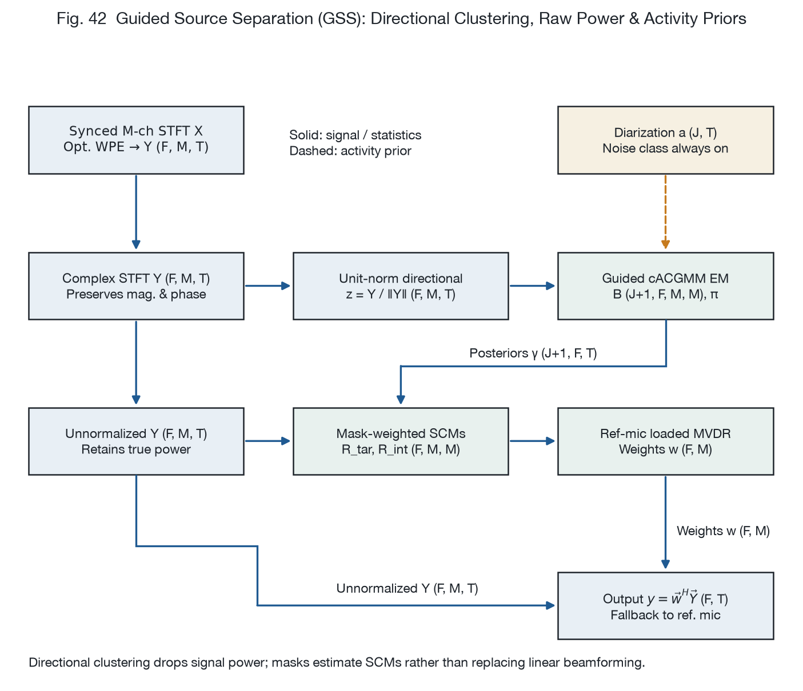
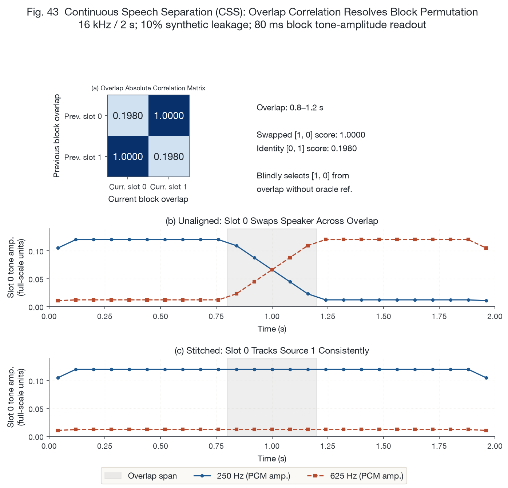
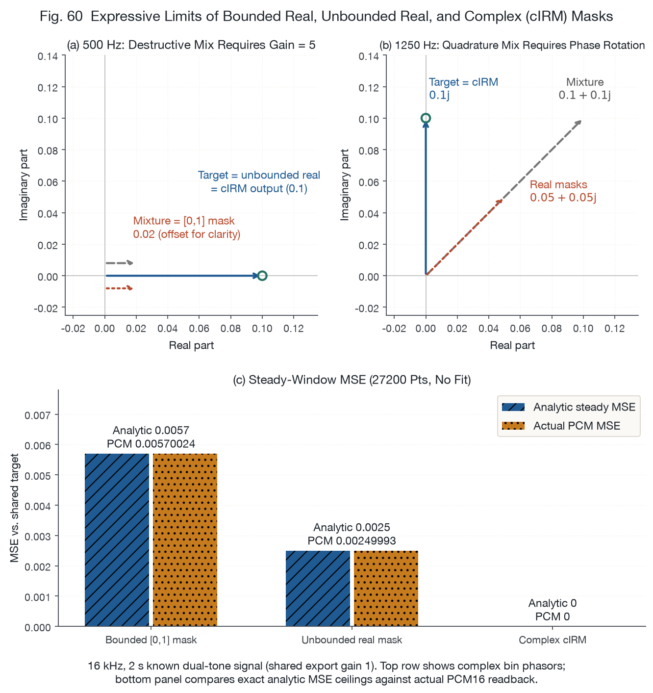
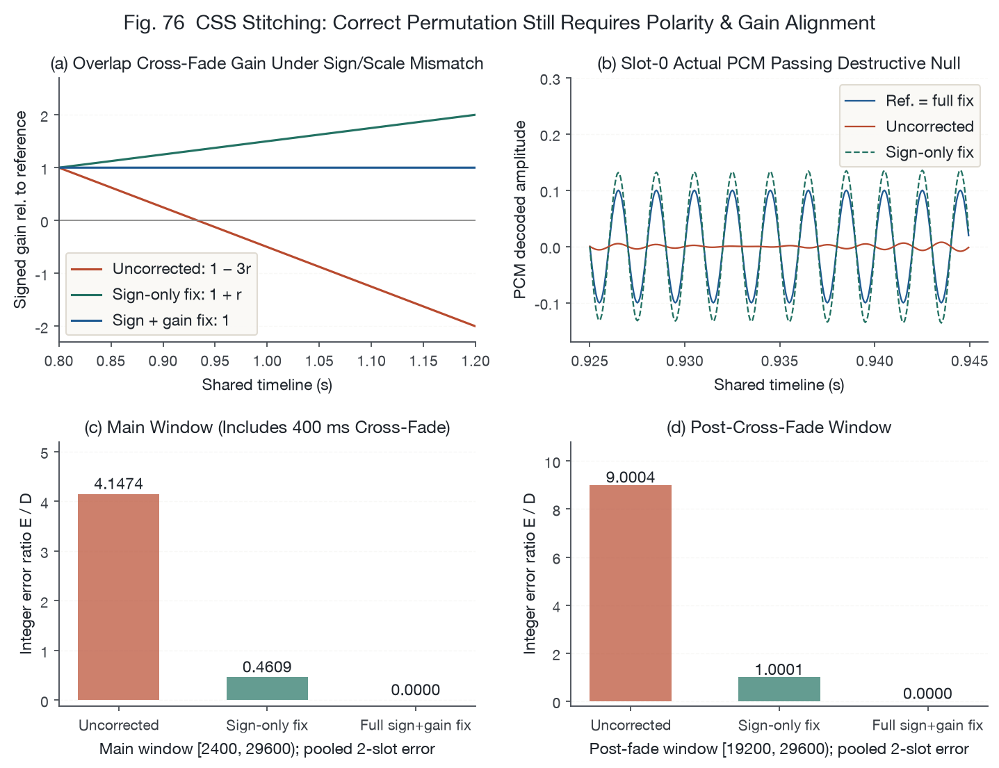

> This chapter is Chapter 8 of the main text; the book comprises 16 chapters across the core chapters and extended topics (Chapters 0–15, where Chapter 0 covers mathematical foundations and Chapters 12–15 are four extended special topics), plus Appendices A and B. This chapter can be read independently; see the navigation links below for the preceding and following chapters.
>
> Overview: [00_overview.md](00_overview.md) | Previous: [07_wpe-dereverberation.md](07_wpe-dereverberation.md) | Next: [09_source-tracking.md](09_source-tracking.md)

---

## 8. Speech Separation

Chapter 7 examined the late reverberation tails generated by one or more acoustic sources propagating inside a room; this chapter turns to the classic "cocktail party problem"—when multiple speakers talk simultaneously in the same space, how do we separate clean speech streams for each speaker from the mixed recording? We develop the derivations along three major paradigms: training-free classical blind source separation (BSS), activity-driven guided source separation (GSS), and deep neural network separation, and in §8.2 clarify the cascading rules governing how they fit into a complete multi-microphone front-end pipeline.

### 8.1 Multi-Speaker Speech Separation: The Cocktail Party Problem

Whereas dereverberation removes the temporal reflection tails of the same source, speech separation suppresses overlapping interference from different sources occurring at the same time instant and within the same frequency band; in real far-field meetings, both types of degradation coexist and must be suppressed jointly. This section first establishes the multichannel convolutive mixture model and its narrowband approximation, clarifies the connection between time-frequency masking and spatial covariance estimation (linking back to Chapter 5, §5.9), and then derives the permutation-invariant training criterion for supervised separation.

#### Core Terminology and Reading Roadmap

| Abbreviation | Full Name | Role in This Chapter |
|---|---|---|
| STFT | Short-Time Fourier Transform | Transforms time-domain mixture waveforms into complex time-frequency observations |
| BSS | Blind Source Separation | Estimates unmixing filters and sources directly from mixed observations without pre-trained supervised labels |
| SCM | Spatial Covariance Matrix | Characterizes second-order magnitude and phase correlations across multiple microphones |
| RTF | Relative Transfer Function | Describes the complex acoustic transfer ratio of a target source at each microphone relative to a reference microphone |
| NMF | Nonnegative Matrix Factorization | Models the low-rank structure of a source power spectrogram as the product of a small set of nonnegative spectral bases and temporal activations |
| PIT | Permutation Invariant Training | Dynamically matches the optimal permutation between output slots and reference speakers inside a supervised loss |
| CSS | Continuous Speech Separation | Resolves cross-chunk output slot alignment and seamless stitching after sliding-window chunking of long meeting recordings |

Before diving into equations, it is essential to distinguish three physical objects that are easily confused:

- **Dry source signal**: $s_n[t]$ is the speech waveform radiated at the $n$-th speaker's mouth before undergoing room propagation;
- **Source image**: a domain-specific term in acoustic array processing—here "image" refers to an acoustic mapping component and **never a visual picture**. Specifically, it denotes the waveform component formed at a designated reference microphone $r$ when the $n$-th source speaks alone and propagates through its room impulse response to that channel (thus the source images of the same utterance at different array elements carry distinct propagation delays, amplitude attenuations, and reverberant coloration);
- **Raw unmixed output**: although the separated channels directly emitted by a blind separator strip away competing speakers, they generally carry arbitrary per-frequency complex scaling factors and channel permutation mismatches.

Consequently, raw unmixed outputs must undergo projection back (derived later in this chapter) to restore the physical scale of the source images at the reference microphone.

#### Convolutive Mixtures and Number of Sources

At discrete sample index $t$, the mixed waveform received by the $m$-th microphone ($m=1,\dots,M$) equals the superposition of the $N$ speakers' dry signals each convolved with its respective room impulse response, plus sensor self-noise and ambient noise $v_m[t]$:

$$\begin{aligned}
x_m[t]&=\sum_{n=1}^{N}\sum_{\tau=0}^{L_h-1}
h_{mn}[\tau]s_n[t-\tau]+v_m[t].
\end{aligned}\tag{8-1}$$

Here $\tau$ is the discrete lag sample index, $L_h$ is the tap length of the finite impulse response (FIR) model, and $h_{mn}[\tau]$ denotes the acoustic impulse response from the $n$-th source to the $m$-th microphone. Depending on how the number of simultaneously active sources $N$ compares with the number of available microphone channels $M$, the separation problem exhibits fundamentally different algebraic structures:

- **Determined mixture ($N=M$)**: the number of sources equals the number of microphones (note that $N=M$ only makes the mixing matrix square—if two speakers stand in the exact same direction, the matrix remains rank-deficient and non-invertible). This is the standard operating regime of square-matrix auxiliary-function-based independent vector analysis (AuxIVA) and independent low-rank matrix analysis (ILRMA);
- **Overdetermined mixture ($N<M$)**: microphones outnumber target sources, providing extra spatial degrees of freedom to suppress diffuse background noise (as in OverIVA or mask-based MVDR beamforming discussed below); however, one must never blindly truncate channels by total energy via principal component analysis (PCA), lest a weaker target speaker be discarded into the null space under strong background noise;
- **Underdetermined mixture ($N>M$)**: speakers outnumber microphones (the extreme case being a single microphone $M=1$, where inter-channel spatial phase cues are completely absent). Here no linear square matrix inverse can perfectly unmix all sources, so separation must rely on full-rank spatial covariances paired with low-rank spectral structure in multichannel NMF (MNMF), sparse time-frequency masks, or speech priors learned by deep neural networks.

#### Narrowband Model and Spatial Statistics

Transforming the time-domain convolution in Eq. (8-1) into the STFT domain, provided the analysis window is sufficiently long relative to the dominant energy span of the room impulse response, the convolutive mixture approximately decouples at each frequency bin $f$ and time frame $t$ into an instantaneous linear mixture:

$$\begin{aligned}
X_m(f,t)&\approx\sum_{n=1}^{N}A_{mn}(f)S_n(f,t)+V_m(f,t).
\end{aligned}\tag{8-2}$$

Written in compact matrix–vector notation, $\vec X(f,t)=\mathbf A(f)\vec S(f,t)+\vec V(f,t)$, where $\vec X\in\mathbb{C}^{M\times 1}$ is the observation column vector, the $(m,n)$-th entry $A_{mn}(f)$ of the mixing matrix $\mathbf A\in\mathbb{C}^{M\times N}$ is the complex frequency response of $h_{mn}[\tau]$ at frequency bin $f$, $\vec S\in\mathbb{C}^{N\times 1}$ is the source column vector, and $\vec V\in\mathbb{C}^{M\times 1}$ is the additive noise column vector.

When cross-referencing equations across chapters, keep in mind local frame-index conventions: once inside the STFT domain, this chapter uniformly uses $t$ to denote the discrete time-frame index (distinguished by context from the time-domain sample index in Eq. (8-1)), corresponding to $\ell$ in the Appendix A symbol table; whereas when importing beamforming equations from Chapter 5, the first argument of $\vec x(k,n)$ in Chapter 5 is the frequency bin $k$ and the second argument is the frame index $n$. Moreover, the accuracy of the narrowband multiplicative approximation in Eq. (8-2) is jointly governed by window length, hop size, and early-to-late reflection energy ratio; when long reverberation exceeds a single frame window, applying Chapter 7's MIMO-WPE first to strip cross-frame late tails restores the narrowband approximation accuracy required by Eq. (8-2).

Under an ideal anechoic free-field far-field plane-wave assumption with matched sensor gains, if a uniform linear array of inter-element spacing $d$ uses microphone $1$ as its phase reference, the column of the mixing matrix corresponding to incidence angle $\theta$ reduces to the pure-phase steering vector familiar from Chapters 3–5:

$$\begin{aligned}
a_m(f,\theta)&=e^{\mathrm{j}(m-1)\phi},\\
\phi&=2\pi f d\sin\theta/c,\\
\vec a&=[a_1,\ldots,a_M]^\top.
\end{aligned}\tag{8-3}$$

Let us review spatial phase and spatial aliasing boundaries with concrete numbers: take inter-element spacing $d=4\ \mathrm{cm}$, speed of sound $c=343\ \mathrm{m/s}$, and incidence angle $\theta=30^\circ$. Under Chapter 5's coordinate convention (microphone $1$ on the left end, positive angles toward the $+x$ side), the inter-element time-delay difference between adjacent microphones is $\tau_{21}=t_2-t_1=-d\sin\theta/c$ (approximately $-58.3\ \mu\mathrm{s}$). At $f=2\ \mathrm{kHz}$ (wavelength $\lambda\approx 17.15\ \mathrm{cm}$, satisfying $d<\lambda/2$), the inter-element phase difference magnitude and the $4$-microphone steering vector are:

$$\begin{aligned}
2\pi f|\tau_{21}|&\approx 0.733\ \mathrm{rad}
\approx 42^\circ,\\
\vec a(2\ \mathrm{kHz},30^\circ)&\approx
\bigl[1,\ e^{+\mathrm{j}42^\circ},\ 
e^{+\mathrm{j}84^\circ},\ e^{+\mathrm{j}126^\circ}\bigr]^\top,
\end{aligned}$$

and doubling the frequency to $4\ \mathrm{kHz}$ doubles the adjacent phase difference to roughly $84^\circ$.

When the frequency rises further to $8\ \mathrm{kHz}$ (wavelength $\approx 4.29\ \mathrm{cm}$, so $d>\lambda/2$), subtracting the dimensionless wavelength-to-spacing ratio $\lambda/d=343/(8000\times 0.04)=1.071875$ from $\sin 30^\circ=0.5$ yields $-0.571875$, corresponding to a distinct physical direction $\theta'\approx -34.88^\circ$—substituting back into Eq. (8-3) shows that adjacent microphone phases differ by exactly $2\pi$, so sources at two completely different directions share **the exact same steering vector** at $8\ \mathrm{kHz}$ (conversely, if the target is at broadside $\theta=0^\circ$, both $0\pm 1.071875$ fall outside the real-angle interval $[-1,1]$, so no real grating lobe appears yet at that frequency). Furthermore, in real rooms each column of $\mathbf A(f)$ also incorporates superposed early reflections and microphone frequency-response mismatches, precluding blind reliance on the free-field formula (8-3)—precisely where blind separation and mask-based covariance estimation shine.

Minimum variance distortionless response (MVDR) beamforming, generalized eigenvalue (GEV) beamforming, and MNMF all revolve around the **spatial covariance matrix (SCM)** of multichannel observations. Assuming the mixing matrix $\mathbf A$ is constant over the statistical estimation window and sources are uncorrelated with additive noise ($\mathbb{E}[\vec S\vec V^H]=\mathbf 0$), omitting frequency and frame subscripts yields:

$$\begin{aligned}
\mathbf R_{xx}&=\mathbb{E}[\vec X\vec X^H],\\
\mathbf R_{xx}&\approx\mathbf A\mathbf R_{ss}\mathbf A^H+\mathbf R_{vv}.
\end{aligned}\tag{8-4}$$

Note that $\mathbf R_{xx}$ in Eq. (8-4) is an uncentered second-order moment (equal to the strict statistical covariance only under zero-mean conditions); without source–noise orthogonality, expanding the outer product adds the cross-terms $\mathbf A\mathbb{E}[\vec S\vec V^H]+\mathbb{E}[\vec V\vec S^H]\mathbf A^H$, while inter-source correlations appear in the off-diagonal entries of $\mathbf R_{ss}=\mathbb{E}[\vec S\vec S^H]$.

In §8.4 below, the complex angular central Gaussian mixture model (cACGMM) takes an elegant geometric route: it first divides each nonzero observation vector by its Euclidean norm to project onto the complex unit sphere $\vec z=\vec X/\|\vec X\|_2$, clustering purely by spatial direction after stripping away speech power fluctuations to estimate soft time-frequency masks; GSS then takes these real-valued soft masks back to the **unnormalized raw multichannel outer products $\vec X\vec X^H$** to accumulate weighted target and interference SCMs (see Chapter 5, §5.9, Eq. (5-22) for mask-weighted SCMs).

When beginners encounter a "time-frequency mask," they must first check what object the mask actually multiplies:

1. **Direct single-channel spectral masking**: multiplying the reference microphone complex spectrogram point-wise as $M(f,t)X_r(f,t)$ followed directly by inverse STFT; here a real-valued mask can only scale magnitudes, whereas a complex mask is required to modify phases simultaneously;
2. **Multichannel covariance statistical weighting**: using a nonnegative real mask $\gamma(f,t)\ge 0$ as a snapshot reliability weight to accumulate multichannel outer products $\sum_t\gamma(f,t)\vec X(f,t)\vec X^H(f,t)$; rather than directly altering waveform phases, it shapes the target and interference SCMs from which linear beamforming weights $\vec w(f)$ are solved;
3. **Single-channel post-masking after beamforming**: multiplying the single-channel complex spectrum at the output of a multichannel linear beamformer by an additional spectral gain to suppress residual leakage.

Thus beamforming and speech separation are by no means mutually exclusive paradigms—as long as a mask is estimated for each speaker and a corresponding beamformer weight vector $\vec w_n(f)$ is solved, a bank of linear beamformers can separate multiple speakers in parallel (which is exactly how GSS operates). The table below provides a bird's-eye comparison of the three core modeling families covered in this chapter:

| Separation Paradigm | Representative Methods | Core Modeling Mechanism | Key Assumptions and Operating Boundaries |
|---|---|---|---|
| Classical Blind Source Separation (BSS) | ICA, AuxIVA, ILRMA, MNMF | Exploits statistical independence across sources together with cross-frequency envelope coupling or low-rank spectral structure to iteratively solve unmixing matrices or spatial models | Square AuxIVA/ILRMA targets determined mixtures ($N=M$); training-free, but requires sufficient frames for statistics and valid narrowband approximation |
| Activity-Guided Spatial Clustering | **cACGMM → GSS → MVDR** | Uses speaker activity timestamps to lock cross-frequency permutations, performs directional EM clustering on the complex unit sphere, and drives beamforming | Training-free model weights, robust to heavily reverberant real meetings, but relies on external speaker diarization timestamps and multi-frame context |
| Supervised Deep Learning Separation | TF-mask networks, Deep Clustering, Conv-TasNet, TF-GridNet | Trains neural networks end-to-end on large-scale synthetic or reference-paired mixtures to directly predict per-source masks, complex spectra, or waveforms | Supports single-channel and underdetermined ($N>M$) separation without long iterative statistics at inference, but bounded by training-domain coverage, compute budget, and streaming state management |

Among the methods listed above, **deep clustering** maps each time-frequency bin into a high-dimensional embedding vector and partitions speaker assignments via clustering, whereas **Conv-TasNet** replaces fixed STFTs with learnable short 1-D convolutional encoders to perform mask separation directly in a latent time-domain space; §8.6 traces the architectural evolution from early time-domain convolutional networks to dual-path models and time-frequency grid networks in detail.

#### PIT and Output Slots

When training a multi-speaker separation network with supervised deep learning, the very first obstacle is the **label permutation problem**: an input mixture $x=s_1+s_2$ carries no intrinsic tag declaring who is "Speaker 1" and who is "Speaker 2." Emitting Speaker B from output head 1 and Speaker A from output head 2 is a completely valid separation; if a loss rigidly evaluates fixed indices $|\hat s_1-s_1|+|\hat s_2-s_2|$, a correct separation is penalized with a huge error, forcing network gradients to blur both voices into an unintelligible average!

**Permutation Invariant Training (PIT)** untangles this deadlock through straightforward combinatorial matching: during forward loss evaluation, it enumerates all $N!$ bijective permutations $\pi\in\mathcal S_N$ between the $N$ output slots and the $N$ clean reference signals, selecting **the permutation with the minimum total pairwise error** to update network parameters:

$$\begin{aligned}
\mathcal L_{\mathrm{PIT}}&=\min_{\pi\in\mathcal S_N}
\sum_{n=1}^{N}\mathcal L\bigl(\hat s_n,s_{\pi(n)}\bigr),
\end{aligned}\tag{8-5}$$

where $\mathcal S_N$ denotes the symmetric group of all permutations of $\{1,\dots,N\}$.

**Hand-worked $2\times 2$ PIT example**: Suppose a two-speaker separation network outputs two estimates $\hat s_1,\hat s_2$ against two clean references $s_1,s_2$. Evaluating all four pairwise distortion costs yields a $2\times 2$ matrix:

$$
\mathbf L=
\begin{bmatrix}
\mathcal L(\hat s_1,s_1)&\mathcal L(\hat s_1,s_2)\\
\mathcal L(\hat s_2,s_1)&\mathcal L(\hat s_2,s_2)
\end{bmatrix}
=
\begin{bmatrix}0.4&3.1\\2.8&0.6\end{bmatrix}.
$$

Enumerating the $2!=2$ permutations: the identity permutation $\pi=(1,2)$ (sum along the main diagonal) gives a total loss of $0.4+0.6=1.0$; the swapped permutation $\pi=(2,1)$ (sum along the anti-diagonal) gives $3.1+2.8=5.9$. Since $1.0<5.9$, the identity permutation wins, and the training loss for this step is $\mathcal L_{\mathrm{PIT}}=1.0$.

Many beginners looking at the outer $\min$ operator in Eq. (8-5) ask: **Isn't the minimum function non-differentiable at ties—how are backpropagation gradients computed?** The answer is **subgradient routing**, standard across convex analysis and deep learning: except on the measure-zero crease in continuous floating-point space where two permutations achieve the exact same loss (where choosing either constitutes a valid subgradient), the winning permutation $\pi^\star$ is strictly unique almost everywhere. The $\min$ operator then acts like a single-pole double-throw switch: during backpropagation, **gradients are routed exclusively through the winning pairs $(\hat s_n,s_{\pi^\star(n)})$ back to their respective output heads**, while all unselected matrix entries receive identically zero gradient!

Once you grasp this subgradient switch, it becomes immediately clear why early "frame-level independent PIT" failed miserably in listening tests and had to be upgraded to **utterance-level PIT (uPIT)**:

- If each frame independently picks its own minimum-loss permutation, single-frame local error is minimized, yet on overlapping unvoiced consonants, breathing pauses, or transitional frames with comparable energy, the two permutation losses are nearly tied; the switch $\pi^\star$ then flips erratically between adjacent frames, causing a single output channel to jump abruptly from a male voice in one second to a female voice in the next;
- **uPIT** forces every frame across an entire utterance (several seconds long) to share **a single common** permutation $\pi^\star$, compelling the network internally to exploit long-range timbre, pitch, and spatial continuity to lock the same person's voice into the same output slot from start to finish! Even with uPIT, however, when sliding windows chop up a long meeting recording and encounter single-speaker chunks (where the secondary slot should output silence) or cross-window stitching boundaries, **slot flipping** still occurs across silent intervals and adjacent chunks—precisely why continuous speech separation (CSS) in §8.6 requires dedicated cross-chunk alignment and single-speaker bypass protection.

From an algorithmic complexity standpoint, only when Eq. (8-5) decomposes strictly into an additive sum of $N\times N$ pairwise costs can one replace $O(N!)$ exhaustive enumeration with the $O(N^3)$ Hungarian linear assignment algorithm for larger source counts (see the [original PIT paper](https://doi.org/10.1109/ICASSP.2017.7952154) and the [uPIT journal paper](https://doi.org/10.1109/TASLP.2017.2648230); for pedagogical transparency so readers can inspect every permutation directly, our teaching function `pit_permutation()` enumerates all permutations explicitly and caps the source count at $N\le 8$).

### 8.2 Ordering of Processing Modules

When chaining acoustic echo cancellation (Chapter 6), dereverberation (Chapter 7), source localization/tracking (Chapters 4 and 9), and multi-speaker separation into an industrial audio front end, module ordering is dictated not by personal taste, but by three hard physical constraints: **reference-path linearity, inter-channel spatial phase integrity, and covariance statistical dependencies** (for the complete system block diagram, see [Chapter 10, §10.1, Fig. 23](10_engineering-practice.md#sec-10-1)). Within the classic **Capture → Linear AEC → MIMO-WPE → Analytic Beamforming/Separation → Single-Channel Post-Processing** backbone, five core ordering rules apply:

1. **In full-duplex scenarios, linear AEC always comes first**: once the linear convolutive relationship between the loudspeaker playback reference and the microphone echo is distorted by downstream time-varying adaptive beamformers, dynamic gain control, or nonlinear neural networks, AEC can no longer maintain a stable echo-path model (see §7.6 and [Chapter 10, §10.1](10_engineering-practice.md#sec-10-1));
2. **Multichannel MIMO-WPE precedes spatial separation and beamforming**: long reverberation tails smear what would be a rank-one point-source spatial covariance into a high-rank matrix, violating the narrowband mixing approximation in Eq. (8-2) and degrading MVDR null depth. Applying linear MIMO-WPE first strips away late tails and purifies spatial statistics (note that solving WPE filters independently per channel may introduce slight inter-microphone magnitude/phase offsets, so downstream beamformers should extract RTFs adaptively from the dereverberated target SCM rather than relying rigidly on free-field geometric steering vectors);
3. **Localization/tracking or time-frequency masks feed analytic beamformers as control branches**: fixed beamformers (DSB) and steering-vector MVDR obtain look directions from a DOA/tracking branch, whereas mask-based MVDR (extracting RTFs from the principal eigenvector of the target SCM) and GEV obtain target and interference covariance matrices from a time-frequency mask branch without solving explicit geometric angles (see [Chapter 5](05_beamforming.md) and [Chapter 9](09_source-tracking.md));
4. **Speaker diarization precedes GSS spatial clustering, and GSS masks precede MVDR weight computation**: speaker diarization supplies temporal gates indicating which speaker is active over which frame intervals, locking cluster label permutations of cACGMM across frequencies; once clustering converges and emits soft masks, target and interference SCMs are accumulated to solve beamforming weights (see §8.4);
5. **The placement of a deep neural network depends on what object it outputs**: single-channel enhancement networks that modify complex spectra or waveforms independently per channel destroy inter-microphone phase differences and must be placed strictly after multichannel linear spatial processing; networks that predict only cross-channel shared masks, covariances, or WPE power $\lambda$ can be embedded inside analytic multi-microphone algorithms; whereas end-to-end multichannel neural separators (or CSS networks) generate separated audio streams directly from post-WPE multichannel spectra, forming an alternative main trunk to analytic beamforming (whose future-frame lookahead budget must be audited carefully).

When evaluating experimental comparisons such as "AEC before NR versus NR before AEC," watch out for oracle ground-truth leakage traps: for example, although the open-source benchmark repository [Integrated_AEC_NR](https://github.com/Arnout-Roebben/Integrated_AEC_NR/tree/23c6b567c7863a8ee9bafd38bad0d3ff2f25e185) implements `AEC→NR`, `NR→AEC`, and joint architectures within a unified codebase, its `process.m` script reads clean near-end speech ground truth and clean echo ground truth—unavailable on any real device—to construct ideal voice activity decisions; engineering selection must substitute blind double-talk and activity detectors before re-benchmarking.

To facilitate side-by-side reading with Fig. 23 in [Chapter 10, §10.1](10_engineering-practice.md#sec-10-1), the table below maps each module covered in this chapter to its exact location and interface contract in the full-device signal flow:

| Core Module in Chapter 8 | Signal-Flow Position in Fig. 23 | I/O Contract and Anti-Bug Pitfalls |
|---|---|---|
| Speaker Diarization + GSS Clustering | "Speaker Diarization → GSS/cACGMM Mask" control branch | Diarization supplies binary temporal gates solely to constrain cross-frequency permutations; it outputs neither covariances nor audio directly |
| Masked SCM + Analytic Beamforming | "GSS Mask + Post-WPE Raw Multi-Mic STFT → SCM → MVDR/GEV" main trunk | Masks serve strictly as nonnegative scalar weights; SCM accumulation must use unnormalized $\vec Y\vec Y^H$, never unit-sphere vectors $\vec z\vec z^H$ |
| End-to-End Neural Separation / CSS | Alternative multi-stream audio main trunk after WPE (optionally followed by single-channel post-processing) | Must specify maximum output slot count, sliding-window lookahead latency, cross-chunk permutation stitching, and single-speaker bypass logic |
| Single-Channel DNN Post-Filtering | Single-stream enhancement stage downstream of beamforming or separation | Placed strictly after spatial filtering so per-channel nonlinear magnitude/phase distortion never corrupts spatial nulls |
| Noise Suppression (NS) / Automatic Gain Control (AGC) / Keyword Spotting (KWS) | Tail-end single-channel post-processing and independent low-power wake-word bypass; VAD resides on the control plane | Enabled selectively per product requirements; not re-derived in this chapter |

With system-level cascading rules clear, we now enter §8.3 to derive step by step how training-free blind source separation prise apart overlapping voices solely through statistical independence, without a single pre-recorded label.

### 8.3 Classical Blind Source Separation: AuxIVA, ILRMA, MNMF, and TRINICON

The word "blind" in blind source separation means that neither clean source ground truth nor the mixing matrix is provided to the estimator—yet it certainly does not mean that feeding an arbitrary mixture guarantees unique recovery of the true sources; an algorithm can lock onto unmixing directions only under well-defined statistical identifiability conditions. Below we first establish the identifiability boundaries of independent component analysis (ICA), then systematically derive four generations of classical algorithms spanning source envelope coupling, low-rank spectral modeling, and spatial covariance diagonalization.

#### Identifiability Conditions and Unmixing Conventions of ICA

Neglecting additive sensor noise and assuming an equal number of sources and microphones ($N=M$) with an invertible per-frequency square mixing matrix $\mathbf A_f\in\mathbb{C}^{M\times M}$, our goal is to find a per-frequency square unmixing matrix $\mathbf W_f\in\mathbb{C}^{M\times M}$. Following the unified convention of this chapter, we store the conjugate transpose $\vec w_{nf}^H$ of the $n$-th unmixing filter as the $n$-th row of $\mathbf W_f$:

$$\begin{aligned}
\vec y_f(t)&=\mathbf W_f\vec x_f(t),\\
y_{nf}(t)&=\vec w_{nf}^H\vec x_f(t).
\end{aligned}\tag{8-6}$$

The foundational principle of ICA is to adjust $\mathbf W_f$ so that the output channels $y_{1f},\dots,y_{Mf}$ become statistically mutually independent. Why can't we achieve blind separation merely by enforcing "mutually uncorrelated outputs (second-order covariance diagonalization)"? Because zero correlation constrains only second-order moments, which is far weaker than statistical independence:

1. **Rotational unidentifiability of stationary identically distributed Gaussian sources**: Suppose two true sources $s_1,s_2$ are independent standard normal random variables, whose joint probability density is proportional to $\exp[-(s_1^2+s_2^2)/2]$, yielding perfectly circular iso-density contours in the 2-D plane. Multiplying $\vec s$ by an orthogonal rotation matrix of any angle (say $45^\circ$) leaves the sum of squares $s_1^2+s_2^2$, the identity covariance matrix, and the joint Gaussian density completely unchanged—the rotated coordinates remain statistically independent, making it impossible to recover the original axes from stationary marginal/joint distributions alone!
2. **Pre-whitening eliminates only half the degrees of freedom**: Applying a whitening transform to a zero-mean observation vector with positive-definite covariance turns its covariance into the identity matrix $\mathbf I_M$; however, left-multiplying a whitened vector by **any unitary matrix** preserves $\mathbf I_M$ as its covariance! Exercise [E08-24](#e08-24) demonstrates concretely with four discrete non-Gaussian sample points that after whitening plus a $45^\circ$ rotation, the two components have strictly zero correlation yet are manifestly statistically dependent (note also that if the observation covariance itself is rank-deficient, adding diagonal loading stabilizes matrix inversion but cannot conjure missing independent source channels out of thin air; for full proofs of whitening and unitary rotational freedom, see [Hyvärinen et al., *Independent Component Analysis*, §§7.4–7.5, pp. 158–163](https://www.cs.helsinki.fi/u/ahyvarin/papers/bookfinal_ICA.pdf)).

Conversely, "stationary i.i.d. Gaussian sources are unidentifiable" does not preclude separating speech or envelope-modulated Gaussian carriers—as soon as sources exhibit **non-Gaussian heavy-tailed distributions** (such as super-Gaussian speech sparsity), **distinct time-varying variance envelopes** (as in ILRMA and our modulated Gaussian carrier experiments below), or **distinct cross-lag autocorrelation structures**, blind separation regains the statistical leverage needed to lock down the remaining unitary rotation.

#### Objective and Iterative Projection of AuxIVA

**AuxIVA (Auxiliary-function-based Independent Vector Analysis, Ono 2011)** generalizes independent components from isolated frequency bins to cross-frequency source vectors: it assumes statistical independence across different speakers while jointly modeling all frequency bins belonging to the same speaker. Traditional frequency-domain ICA optimizes each frequency bin in isolation and suffers severely from inconsistent cross-frequency output permutations; AuxIVA suppresses frequency-bin permutations by exploiting the coherent co-modulation of a speaker's broadband envelope rising and falling together across frequencies, and derives closed-form updates free of learning-rate tuning via an auxiliary function so the objective decreases monotonically under ideal model assumptions.

Notably, cross-frequency envelope dependence does not require linear correlation between the complex spectral bins themselves. For instance, take two frequency bins $Y_1=Ae^{\mathrm{j}\Phi_1}$ and $Y_2=Ae^{\mathrm{j}\Phi_2}$ whose phases are independently uniform and independent of the shared random amplitude $A$: their second-order complex spectral cross-correlation is $\mathbb{E}[Y_1Y_2^*]=0$, yet their instantaneous powers both equal $A^2$ (if $A$ takes values $1$ and $2$ with equal probability, both bin powers jump synchronously between $1$ and $4$ with power covariance $9/4$), a shared co-fluctuation completely invisible to linear cross-covariance.

In practical engineering, standard batch AuxIVA iterates over an entire segment (streaming deployment requires recursive covariance updates), and narrowband model mismatch under heavy reverberation, highly synchronous multi-speaker envelopes, or overly short frame counts can degrade separation—limitations stemming from observation-model violation or finite sample size rather than any loss of physical independence between the dry voices themselves. AuxIVA serves widely as a canonical training-free BSS baseline.

Once the current iteration's weighted covariance matrix $\mathbf V$ is fixed, the closed-form update for a single unmixing row vector is worked out by hand in [Exercise E08-08](#e08-08) (which takes a given $\mathbf V$ and computes the linear solve plus weighted quadratic-form normalization of the IP substep); Eq. (8-8) below completes the picture by showing how AuxIVA constructs $\mathbf V$ recursively from cross-frequency output norms.

Let $T$ be the number of frames. At frame $t$ ($t=1,\dots,T$), stack the $n$-th source's unmixed outputs across all $F$ frequency bins into an $F$-dimensional broadband source spectrum vector $\bar{\vec y}_n(t)=[y_{n1}(t),\dots,y_{nF}(t)]^\top\in\mathbb{C}^{F\times 1}$ (marked with an overbar to distinguish it from the single-frequency $M$-dimensional narrowband vector $\vec y_f(t)=\mathbf W_f\vec x_f(t)\in\mathbb{C}^{M\times 1}$), and adopt a spherically symmetric complex Laplace super-Gaussian working model $p(\bar{\vec y}_n)\propto\exp(-2\|\bar{\vec y}_n\|_2)$—notice that the exponent is not an independent sum of squared magnitudes across frequencies, but the square root of the broadband sum of squares $r_n(t)=\|\bar{\vec y}_n(t)\|_2$, and it is precisely this non-separable square root that binds all frequency bins of the same speaker together!

Next, apply the per-frequency change-of-variables $\vec y_f(t)=\mathbf W_f\vec x_f(t)$ to express the observation density in terms of the source density: multiplying by a complex scalar $w=a+\mathrm{j}b$ on the 2-D real–imaginary plane corresponds to the $2\times 2$ real matrix $\begin{bmatrix}a&-b\\b&a\end{bmatrix}$, whose determinant is $a^2+b^2=|w|^2$; generalizing to $M$-dimensional complex space $\mathbb{C}^M\cong\mathbb{R}^{2M}$, the $2M\times 2M$ real Jacobian determinant of the complex linear map $\mathbf W_f$ equals the squared modulus $|\det\mathbf W_f|^2$! Taking the negative natural logarithm normalized by frame count $T$ (and using $\ln(|\det\mathbf W_f|^2)=2\ln|\det\mathbf W_f|$) yields the AuxIVA objective function:

$$\begin{aligned}
r_n(t)&=\sqrt{\sum_f|y_{nf}(t)|^2},\\
J_{\mathrm{IVA}}&=\frac{2}{T}\sum_{n,t}r_n(t)
-2\sum_f\ln|\det \mathbf W_f|.
\end{aligned}\tag{8-7}$$

Observe the interplay between the two terms in Eq. (8-7): the first term penalizes the sum of broadband output envelope norms, encouraging frequency bins to jointly extract sparse independent speakers; without the second term $-2\sum_f\ln|\det\mathbf W_f|$ pushing back, an optimizer could trivially drive the first term to $0$ by shrinking $\mathbf W_f$ to the zero matrix! The negative log-determinant erects a volume barrier that shoots toward $+\infty$ whenever $\mathbf W_f$ approaches singularity or zero scale.

Early independent vector analysis (Kim et al., 2006) iterated directly along the Lie-group manifold via **natural gradient** descent: letting the $n$-th entry of the multivariate score vector $\vec\varphi_f(\vec y_t)\in\mathbb{C}^{M\times 1}$ be $y_{nf}(t)/r_n(t)$, right-multiplying the Euclidean gradient by $\mathbf W_f^H\mathbf W_f$ updates with step size $\mu>0$:

$$\mathbf W_f\leftarrow\mathbf W_f+\mu\left(\mathbf I_M-\frac{1}{T}\sum_{t=1}^T\vec\varphi_f(\vec y_t)\vec y_{ft}^H\right)\mathbf W_f.$$

Although right-multiplication by $\mathbf W_f^H\mathbf W_f$ endows the update with equivariance, the step size $\mu$ remains a treacherous double-edged sword: speech dynamic range spans orders of magnitude across frequency bands, so a slightly excessive $\mu$ triggers overshoot oscillations or divergence in high frequencies or low-energy frames, whereas a conservative $\mu$ crawls through hundreds of iterations. By contrast, AuxIVA constructs a tight quadratic majorizing auxiliary function for the nonsmooth broadband $\ell_2$ norm, eliminating the learning-rate hyperparameter $\mu$ altogether to achieve **step-size-free monotonically non-increasing convergence**.

Let us now unpack the centerpiece derivation of AuxIVA—often glossed over in papers—showing **how to go from the nonconvex square-root-and-determinant objective Eq. (8-7) to the clean linear-system Iterative Projection (IP) update Eq. (8-8) without a single gradient step size**, in three transparent steps using Majorization-Minimization (MM) and Wirtinger complex calculus (for mathematical preliminaries, see [Chapter 0, §0.5](00_math-foundations.md#sec-0-5)):

1. **Tangent majorization removes the square root, yielding a weighted quadratic form**: Because $\sqrt{u}$ is strictly concave on $u>0$, its graph lies everywhere below its tangent line at any tangency point $u_0>0$; that is, for all $u\ge 0$ and $u_0>0$, $2\sqrt{u}\le\frac{u}{\sqrt{u_0}}+\sqrt{u_0}$ (with equality if and only if $u=u_0$). Setting $\sqrt{u_0}=r_n(t)>0$ at the previous iterate's broadband norm and substituting $u=\sum_f|\vec w_{nf}^H\vec x_f(t)|^2$ into the upper bound averaged over frames, the variable part of the auxiliary objective with respect to row $\vec w_{nf}^H$ reduces to a clean quadratic form plus negative log-determinant (decoupling all frequency bins $f$ within the current MM step!):

    $$\begin{aligned}
    Q_{nf}(\vec w_{nf})&=\vec w_{nf}^H\mathbf V_{nf}\vec w_{nf}
    -2\ln|\det\mathbf W_f|,\\
    \mathbf V_{nf}&=\frac{1}{T}\sum_{t=1}^T
    \frac{1}{r_n(t)}\vec x_f(t)\vec x_f^H(t),
    \end{aligned}$$

    where $\mathbf V_{nf}$ is an $M\times M$ Hermitian positive-definite observation covariance weighted by the reciprocal broadband envelope $1/r_n(t)$.

2. **Laplace cofactor expansion along row $n$ unpacks the determinant**: Why doesn't differentiating $\ln|\det\mathbf W_f|$ entangle the entire matrix? Because we perform **row-by-row sequential updates**—while updating the $n$-th row $\vec w_{nf}^H$, all remaining $M-1$ rows of $\mathbf W_f$ are held strictly fixed! By Laplace expansion along row $n$:

    $$\begin{aligned}
    \det\mathbf W_f&=\sum_{m=1}^M(\mathbf W_f)_{nm}C_{nm}
    =\vec w_{nf}^H\vec c_n,
    \end{aligned}$$

    where $\vec c_n=[C_{n1}^*,\dots,C_{nM}^*]^\top$ collects the conjugates of the cofactors along row $n$, which **depend solely on the other $M-1$ rows and are completely independent of $\vec w_{nf}$**! Furthermore, by the fundamental adjugate identity $\mathbf W_f\operatorname{adj}(\mathbf W_f)=(\det\mathbf W_f)\mathbf I_M$, the inner product of any other row $m'\ne n$ with the $n$-th row's cofactor vector vanishes identically ("alien-row cofactor product is zero," i.e., $\vec w_{m'f}^H\vec c_n=0,\ \forall m'\ne n$).

3. **Stationarity and left-multiplication by $\mathbf W_f$ yield a standard linear system**: Using $|\det\mathbf W_f|=|\vec w_{nf}^H\vec c_n|$ to split the log term into $-\ln(\vec w_{nf}^H\vec c_n)-\ln(\vec c_n^H\vec w_{nf})$, take the Wirtinger derivative of $Q_{nf}(\vec w_{nf})$ with respect to $\vec w_{nf}^*$ and set it to zero (noting that $-\ln(\vec c_n^H\vec w_{nf})$ depends only on $\vec w_{nf}$ so its $\vec w_{nf}^*$-derivative vanishes, while the first log term differentiates to $-\vec c_n/(\vec w_{nf}^H\vec c_n)$):

    $$\begin{aligned}
    \mathbf V_{nf}\vec w_{nf}
    -\frac{\vec c_n}{\vec w_{nf}^H\vec c_n}&=\vec 0,\\
    \mathbf V_{nf}\vec w_{nf}
    &=\frac{\vec c_n}{\vec w_{nf}^H\vec c_n}.
    \end{aligned}$$

    Left-multiplying both sides by $\vec w_{nf}^H$ cancels $\vec w_{nf}^H\vec c_n=\det\mathbf W_f$ in numerator and denominator on the right to $1$, immediately giving the quadratic scale normalization condition **$\vec w_{nf}^H\mathbf V_{nf}\vec w_{nf}=1$**! Next, fix the direction: denoting the matrix just prior to updating row $n$ as $\mathbf W_f^{\mathrm{old}}$, since every row $m'\ne n$ annihilates $\vec c_n$ whereas row $n$ multiplying $\vec c_n$ gives $\det\mathbf W_f^{\mathrm{old}}$, choosing an unnormalized direction vector $\vec u$ proportional to $\mathbf V_{nf}^{-1}\vec c_n$ (divided by $\det\mathbf W_f^{\mathrm{old}}$) and left-multiplying by $\mathbf W_f^{\mathrm{old}}\mathbf V_{nf}$ leaves $1$ in the $n$-th entry and $0$ everywhere else—the standard basis vector $\vec e_n$!

All cumbersome cofactor evaluations vanish completely, distilling into the four-step Iterative Projection (IP) update in Eq. (8-8) (with frame index $t=1,\dots,T$):

$$\begin{aligned}
r_n(t)&=\sqrt{\sum_f|y_{nf}(t)|^2},\\
\mathbf V_{nf}&=\frac{1}{T}\sum_{t=1}^{T}
\frac{1}{r_n(t)}\vec x_f(t)\vec x_f^H(t),\\
\vec u&=(\mathbf W_f\mathbf V_{nf})^{-1}\vec e_n,\\
\vec w_{nf}&=\frac{\vec u}{\sqrt{\vec u^H \mathbf V_{nf}\vec u}}.
\end{aligned}\tag{8-8}$$

Two ironclad implementation rules govern Eq. (8-8): first, solve the linear system $(\mathbf W_f\mathbf V_{nf})\vec u=\vec e_n$ in step 3 rather than inverting matrices explicitly; second, right after computing column vector $\vec w_{nf}$ for source $n$, **you must immediately take its conjugate transpose $\vec w_{nf}^H$ and write it back into row $n$ of $\mathbf W_f$** before using the updated $\mathbf W_f$ to solve for source $n+1$ (updating all rows simultaneously from a stale matrix breaks cross-row cofactor orthogonality; Exercise [E08-12](#e08-12) contrasts sequential versus parallel updates by hand).

When reading external open-source implementations, watch for constant-factor conventions: for instance, [`auxiva.py` in pyroomacoustics v0.10.0](https://github.com/LCAV/pyroomacoustics/blob/0dd39f2614b7fc44b2cc63dbe7d60f4641068890/pyroomacoustics/bss/auxiva.py) writes $2r_n(t)$ in the denominator, halving $\mathbf V_{nf}$ and scaling the normalized $\vec w_{nf}$ by $\sqrt{2}$ in the identical direction, yielding bit-for-bit identical waveforms after projection back; whereas [pinned `iva.py` in ssspy](https://github.com/tky823/ssspy/blob/38b9389e8b1914422561f1936d9b28d042d62d2c/ssspy/bss/iva.py) matches the [original Ono (2011) paper](https://doi.org/10.1109/ASPAA.2011.6082320) and Eq. (8-8) coefficient for coefficient.

#### Power Model and Alternating Updates of ILRMA

**ILRMA (Independent Low-Rank Matrix Analysis)**. Whereas AuxIVA asks only that a speaker's energy across frequencies rise and fall together, signals with fine harmonic or resonant structure—such as tenor harmonics or sustained musical instruments—benefit from a stronger spectral prior: ILRMA models the time-frequency power spectrogram of each independent source $n$ via a rank-$K$ nonnegative matrix factorization (NMF) as a sum of products of $K$ nonnegative spectral bases and temporal activations, optimizing them jointly with the unmixing matrices $\mathbf W_f$ (Exercise [E08-09](#e08-09) works through a $2\times 2$ hand calculation illustrating the physical meaning of spectral bases and activations).

Denote the basis index by $\ell=1,\dots,K$ and the frame index by $t=1,\dots,T$. For the $n$-th source, multiply a nonnegative spectral basis matrix $\mathbf B_n\in\mathbb{R}_+^{F\times K}$ by a nonnegative temporal activation matrix $\mathbf H_n\in\mathbb{R}_+^{K\times T}$ to represent its predicted power spectrogram $\lambda_{nft}>0$:

$$\lambda_{nft}=\sum_{\ell=1}^K B_{nf\ell}H_{n\ell t}.\tag{8-9}$$

Assuming sources are mutually independent at each time-frequency bin and follow zero-mean circularly symmetric (proper) complex Gaussian distributions $y_{nft}\sim\mathcal{CN}(0,\lambda_{nft})$ (with density $(\pi\lambda_{nft})^{-1}\exp(-|y_{nft}|^2/\lambda_{nft})$ satisfying $\mathbb{E}[|y_{nft}|^2]=\lambda_{nft}$), combining with the complex linear Jacobian $|\det\mathbf W_f|^2$ derived earlier and dropping additive constants gives the global negative log-likelihood objective of ILRMA:

$$\begin{aligned}
J_{\mathrm{ILRMA}}&=\sum_{n,f,t}\Bigl(
\frac{|y_{nft}|^2}{\lambda_{nft}}+\ln\lambda_{nft}\Bigr)\\
&\quad-2T\sum_f\ln|\det \mathbf W_f|.
\end{aligned}\tag{8-10}$$

Just as discussed for WPE in §7.2, the DC bin and even-length Nyquist bin of a real-valued waveform's STFT are strictly real (where a real Gaussian density carries a factor $1/2$ and a real Jacobian $|\det\mathbf W_f|$); optimizing Eq. (8-10) uniformly across all bins in engineering software acts as a practical working-criterion approximation (the same applies to MNMF and FastMNMF below; see [Chapter 7, §7.2](07_wpe-dereverberation.md#sec-7-2)).

In each iteration, ILRMA alternates between updating the spatial unmixing filters and the spectral NMF factors:

- **Updating unmixing matrices $\mathbf W_f$ with low-rank powers $\lambda_{nft}$ fixed**: Inspecting the dependence of Eq. (8-10) on $\mathbf W_f$, it is algebraically isomorphic to the tangent-majorized quadratic objective of AuxIVA! Simply replacing the weight factor $1/r_n(t)$ inside $\mathbf V_{nf}$ of Eq. (8-8) with $1/\lambda_{nft}$ allows verbatim reuse of the IP linear solve and normalization in Eq. (8-8)!
- **Updating spectral bases $\mathbf B_n$ and activations $\mathbf H_n$ with $\mathbf W_f$ fixed**: Denoting current unmixed output power by $P_{nft}=|y_{nft}|^2$, the objective decouples per source into minimizing the Itakura–Saito (IS) divergence $\sum_{f,t}(P_{nft}/\lambda_{nft}+\ln\lambda_{nft})$. Expressed compactly in element-wise array notation, its multiplicative updates read:

$$\begin{aligned}
\mathbf U_n&=\mathbf P_n\oslash\lambda_n^2,\qquad
\mathbf D_n=1\oslash\lambda_n,\\
\mathbf B_n&\leftarrow\mathbf B_n\odot
\sqrt{(\mathbf U_n\mathbf H_n^\top)
\oslash(\mathbf D_n\mathbf H_n^\top)},\\
\mathbf H_n&\leftarrow\mathbf H_n\odot
\sqrt{(\mathbf B_n^\top\mathbf U_n)
\oslash(\mathbf B_n^\top\mathbf D_n)}.
\end{aligned}\tag{8-11}$$

Here $\odot$, $\oslash$, squaring, and square roots act element-wise on identically shaped arrays, while juxtaposition (such as $\mathbf U_n\mathbf H_n^\top$) denotes standard matrix multiplication. In execution order, you must **first update $\mathbf B_n$, immediately recompute $\lambda_n=\mathbf B_n\mathbf H_n$ and refresh the intermediate matrices $\mathbf U_n,\mathbf D_n$, and only then update $\mathbf H_n$** (never update both simultaneously using a stale $\lambda_n$; Exercise [E08-19](#e08-19) traces one complete alternating step by hand).

Readers familiar with Euclidean or Kullback–Leibler NMF often wonder at Eq. (8-11): **Why is the multiplicative update ratio wrapped inside a square root $\sqrt{\cdot}$?** That square root is dictated directly by the "convex reciprocal + concave logarithm" geometry of IS divergence: when constructing an MM auxiliary function, the first term $P_{ft}/\sum_\ell B_{f\ell}H_{\ell t}$ is convex in the sum, so splitting it via Jensen's inequality places the unknown parameter in the **first-power denominator** (of the form $c_1/B_{f\ell}$, where $c_1$ is proportional to the squared old parameter times $[\mathbf U_n\mathbf H_n^\top]_{f\ell}$); the second term $\ln(\sum_\ell B_{f\ell}H_{\ell t})$ is concave, so majorizing it by its first-order tangent plane at $\lambda_{ft}^{\mathrm{old}}$ places the unknown parameter in the **first-power numerator** (of the form $c_2 B_{f\ell}$, where $c_2=[\mathbf D_n\mathbf H_n^\top]_{f\ell}$). Setting the derivative of the scalar auxiliary function to zero:

$$\begin{aligned}
g(B)&=\frac{c_1}{B}+c_2 B,\\
g'(B)&=-\frac{c_1}{B^2}+c_2=0
\implies B=\sqrt{\frac{c_1}{c_2}},
\end{aligned}$$

taking the positive square root pulls $B_{f\ell}^{\mathrm{old}}$ out of $\sqrt{c_1}$, leaving the exact $\sqrt{\cdot}$ factor in Eq. (8-11)!

Because any zero entry in a multiplicative update remains permanently trapped at $0$, practical implementations initialize strictly with positive random numbers and apply a positive power floor.

#### Full-Rank Model and Wiener Reconstruction of MNMF

**MNMF (Multichannel Nonnegative Matrix Factorization)**. Both AuxIVA and ILRMA rest on the premise that an invertible square matrix $\mathbf W_f$ can cleanly slice apart point sources; when confronted with **underdetermined mixtures** (e.g., $2$ microphones recording $3$ simultaneous speakers, $N>M$) or heavy reverberation where a single speaker's spatial covariance is no longer rank-one, square unmixing breaks down. MNMF dispenses with deterministic unmixing matrices $\mathbf W_f$ altogether and instead builds a **full-rank spatial covariance generative model** directly in the observation space for each source's multi-microphone image $\vec c_{nft}\in\mathbb{C}^{M\times 1}$.

Specifically, assuming source images are mutually independent, the $n$-th source image at frequency $f$ and frame $t$ is modeled as $\vec c_{nft}\sim\mathcal{CN}(\vec 0,\mathbf R_{nft})$, whose covariance factors into a scalar low-rank NMF power $\lambda_{nft}$ times a time-invariant $M\times M$ full-rank positive-definite spatial covariance matrix $\mathbf G_{nf}$ (typically constrained via $\operatorname{tr}(\mathbf G_{nf})=1$ or $M$ to remove scalar scale ambiguity with $\lambda_{nft}$). The total covariance of the mixture $\vec x_{ft}=\sum_{n=1}^N\vec c_{nft}$ is then the sum of source covariances, giving the global negative log-likelihood objective:

$$\begin{gathered}
\mathbf R_{nft}=\lambda_{nft}\mathbf G_{nf},\qquad
\mathbf R_{ft}=\sum_n\mathbf R_{nft},\\
\vec x_{ft}\sim\mathcal{CN}(\vec 0,\mathbf R_{ft}),\\
J_{\mathrm{MNMF}}=\sum_{f,t}\bigl(\ln\det \mathbf R_{ft}
+\vec x_{ft}^H \mathbf R_{ft}^{-1}\vec x_{ft}\bigr).
\end{gathered}\tag{8-12}$$

Freed from $N=M$, Eq. (8-12) naturally accommodates underdetermined mixtures $N>M$ (though its large parameter space and strong nonconvexity make warm-starting via AuxIVA/ILRMA or directional initialization crucial; Exercise [E08-20](#e08-20) further proves that at an isolated time-frequency bin, an identical total covariance $\mathbf R_{ft}$ admits infinitely many source decompositions, so cross-frequency low-rank bases and cross-frame constant spatial matrices are essential to achieve identifiability).

After convergence, having no unmixing matrix $\mathbf W_f$, MNMF reconstructs the $n$-th source image across all $M$ microphones via the Gaussian posterior conditional mean $\mathbb{E}[\vec c_{nft}\mid\vec x_{ft}]$—the **Multichannel Wiener Filter (MWF)**:

$$\begin{aligned}
\hat{\vec c}_{nft}&=\mathbf R_{nft}
\mathbf R_{ft}^{-1}\vec x_{ft}.
\end{aligned}\tag{8-13}$$

Numerically, one solves $\mathbf R_{ft}\vec u=\vec x_{ft}$ first and left-multiplies by $\mathbf R_{nft}$ (the two matrices generally do not commute—never reverse their order!), then extracts the $r$-th entry as the separated complex spectrum at reference microphone $r$. Notice that summing Eq. (8-13) over all sources $n$ yields $\sum_n\widehat{\vec c}_{nft}=\vec x_{ft}$ identically because $\sum_n\mathbf R_{nft}=\mathbf R_{ft}$—thus "summing strictly back to the mixture" is merely an algebraic identity of Wiener filtering and never proof of accurate separation (for original formulations, see the [FastMNMF paper, §II-A, Eqs. (1)–(4)](https://www.eurasip.org/Proceedings/Eusipco/eusipco2019/Proceedings/papers/1570533283.pdf)).

#### Joint Congruence Diagonalization in FastMNMF

Why is original full-rank MNMF prohibitively slow in engineering practice? A glance at Eq. (8-12) tells the story: because $\lambda_{nft}$ varies at every frame $t$, the total covariance $\mathbf R_{ft}=\sum_n\lambda_{nft}\mathbf G_{nf}$ is a distinct dense $M\times M$ matrix at **every single frequency bin and every single frame**, demanding $F\times T$ matrix inversions and eigendecompositions of cost $O(M^3)$ per iteration!

**FastMNMF** slashes this computational bottleneck with an incisive linear-algebraic constraint: at each frequency bin $f$, assume all $N$ source spatial matrices $\mathbf G_{1f},\dots,\mathbf G_{Nf}$ can be **simultaneously diagonalized by congruence** via a **single shared invertible transform matrix $\mathbf Q_f\in\mathbb{C}^{M\times M}$**:

$$\begin{aligned}
\mathbf Q_f\mathbf G_{nf}\mathbf Q_f^H
&=\operatorname{diag}(\vec g_{nf}),\\
\vec z_{ft}&=\mathbf Q_f\vec x_{ft},\\
d_{ftm}&=\sum_n\lambda_{nft}g_{nfm}.
\end{aligned}\tag{8-14}$$

What is the physical intuition behind $\mathbf Q_f$ in Eq. (8-14)? Think of the $M$ rows of $\mathbf Q_f$ as a **shared spatial decorrelating beam-space transform** erected at frequency $f$: $\mathbf Q_f$ need not be unitary ($\mathbf Q_f\mathbf Q_f^H\ne\mathbf I_M$), nor does it attempt like square IVA to isolate a single speaker per channel; instead, it linearly maps correlated microphone observations $\vec x_{ft}$ into $M$ mutually uncorrelated virtual spatial channels $\vec z_{ft}=\mathbf Q_f\vec x_{ft}$!

Inside this decorrelated beam space, the $n$-th source's covariance reduces to a nonnegative diagonal matrix $\operatorname{diag}(\vec g_{nf})$: the nonnegative vector $\vec g_{nf}\in\mathbb{R}_+^M$ (entries $g_{nf1},\dots,g_{nfM}$) represents the $n$-th speaker's energy distribution fingerprint across the $M$ shared spatial beams, and the total variance in transform channel $m$ collapses to a simple scalar sum $d_{ftm}=\sum_n\lambda_{nft}g_{nfm}>0$!

Consequently, the microphone-domain total covariance factors by inverse congruence, stripping per-frame matrix inversions out of both the determinant and quadratic form:

$$\begin{aligned}
\mathbf R_{ft}&=\mathbf Q_f^{-1}
\operatorname{diag}(\vec d_{ft})\mathbf Q_f^{-H},\\
\ln\det\mathbf R_{ft}&=\sum_{m=1}^M\ln d_{ftm}
-2\ln|\det\mathbf Q_f|,\\
\vec x_{ft}^H\mathbf R_{ft}^{-1}\vec x_{ft}
&=\vec z_{ft}^H\operatorname{diag}(\vec d_{ft})^{-1}\vec z_{ft}
=\sum_{m=1}^M\frac{|z_{ftm}|^2}{d_{ftm}}.
\end{aligned}$$

Substituting these identities into Eq. (8-12) flattens all dense matrix solves into scalar divisions:

$$\begin{aligned}
J_{\mathrm{FastMNMF}}&=\sum_{f,t,m}\Bigl(
\frac{|z_{ftm}|^2}{d_{ftm}}+\ln d_{ftm}\Bigr)\\
&\quad-2T\sum_f\ln|\det \mathbf Q_f|.
\end{aligned}\tag{8-15}$$

Pay special attention never to omit the coordinate-transform Jacobian term $-2T\sum_f\ln|\det\mathbf Q_f|$ at the end of Eq. (8-15) (Exercise [E08-26](#e08-26) proves that rescaling $\mathbf Q_f$ by $2$ and $\vec g_{nf}$ by $4$ leaves the physical covariance unchanged solely because this Jacobian term cancels the log-variance shift). Better still, inspecting how Eq. (8-15) depends on $\mathbf Q_f$ reveals that it is once again isomorphic to AuxIVA in Eq. (8-8), so $\mathbf Q_f$ itself can be updated row by row using the fast IP rule! At reconstruction time, one simply multiplies transform channel $m$ by the scalar Wiener ratio $\frac{\lambda_{nft}g_{nfm}}{d_{ftm}}$ and left-multiplies once per frequency bin by $\mathbf Q_f^{-1}$ to return to the microphone domain (see Exercise [E08-21](#e08-21)).

Of course, there is no free lunch—FastMNMF buys its speedup by **tightening the spatial model assumption**: linear algebra guarantees that **any two** Hermitian positive-definite matrices can always be simultaneously diagonalized by congruence (whiten the first, then unitarily diagonalize the second), whereas once sources plus background exceed two (**three or more positive-definite matrices**), an exact shared congruence diagonalizer $\mathbf Q_f$ generally ceases to exist (Exercise [E08-25](#e08-25) provides a rigorous counterexample with three $2\times 2$ positive-definite matrices; the follow-up FastMNMF2 further ties directional fingerprints $\vec g_n$ across frequencies to suppress frequency permutations simultaneously—see [Sekiguchi et al., EUSIPCO 2019](https://www.eurasip.org/Proceedings/Eusipco/eusipco2019/Proceedings/papers/1570533283.pdf) and the [2020 journal extension](https://doi.org/10.1109/TASLP.2020.3019181)).

#### Time-Domain Convolutive Model of TRINICON

**TRINICON (TRIple-N ICA for CONvolutive mixtures)** steps outside the per-frequency instantaneous STFT approximation to optimize long-tap time-domain FIR unmixing filter banks directly, unifying three statistical properties of speech—**Nonwhiteness (cross-lag temporal correlation), Nonstationarity (block-wise variance modulation), and Nongaussianity (higher-order statistics)**. It sidesteps narrowband mismatch and cross-frequency permutation ambiguity altogether, at the cost of massive multichannel FIR parameter counts, long statistical convergence windows, and heavier tracking inertia when speakers move (note that the tap length of a causal time-domain FIR filter governs how long a room reflection memory it can invert, and does not directly equal the algorithmic buffering latency of block-streaming processing).

Summarizing these four classical BSS families side by side: for fast training-free separation of determined mixtures ($N=M$), start with **AuxIVA**; when sources exhibit pronounced harmonic/musical low-rank structure, upgrade to **ILRMA**; when facing underdetermined mixtures ($N>M$) or diffuse spatial covariances, choose **FastMNMF / MNMF**; and when investigating strict time-domain multi-lag convolutive unmixing mechanisms, consult **TRINICON**.

#### More Microphones Than Targets: Contrasting PCA and OverIVA

In commercial smart hardware (such as $6$-mic or $8$-mic circular arrays), the most common operating regime is actually $M > N_{\mathrm{tar}}$: the microphone count $M$ substantially exceeds the number of target speakers $N_{\mathrm{tar}}$ to be extracted, amidst a composite background field of HVAC hum, fan noise, and distant babble.

Many beginners confronting $M>N_{\mathrm{tar}}$ instinctively reach for: "Run PCA first to retain the top $N_{\mathrm{tar}}$ principal components of largest power, reducing the problem to a square matrix for AuxIVA!"—in strong background noise, that heuristic is a fatal landmine! **PCA ranks solely by total power and is completely blind to speech versus loud noise**: if a fan or television dominates the largest eigenvalue, retaining the top two principal components slices a quieter second target speaker straight into the null space before separation even begins, where no subsequent regularization or iteration can ever resurrect it (Exercise [E08-31](#e08-31) demonstrates this exact failure mode on a 3-channel example with powers $9,4,1$).

**OverIVA (Overdetermined IVA; [Scheibler & Ono, 2019, §§2–3](https://arxiv.org/html/1905.07880v2))** provides a far more principled solution: rather than discarding physical channels upfront, it partitions an invertible $M\times M$ unmixing matrix into upper and lower blocks—the upper block $\mathbf W_{\mathrm{tar}}$ (size $N_{\mathrm{tar}}\times M$) extracts the $N_{\mathrm{tar}}$ target speakers under a cross-frequency Laplace super-Gaussian model, while the lower block $\mathbf U\in\mathbb{C}^{(M-N_{\mathrm{tar}})\times M}$ absorbs the $(M-N_{\mathrm{tar}})$-dimensional composite background subspace modeled as time-invariant complex Gaussian (eliminating wasted effort trying to unmix individual background fans!).

Denoting the uncentered second-order observation moment by $\mathbf C=\frac{1}{T}\sum_t\vec x_t\vec x_t^H$, OverIVA enforces second-order statistical orthogonality $\mathbf W_{\mathrm{tar}}\mathbf C\mathbf U^H=\mathbf 0$ between target outputs and the background subspace, parameterizing the background block as $\mathbf U=[\mathbf J,\ -\mathbf I_{M-N_{\mathrm{tar}}}]$ so that after each target-row IP step, $\mathbf J$ refreshes in closed form via a small linear system (see Exercise [E08-31](#e08-31) for block elimination formulas and leading-subblock invertibility conditions).

#### Projection Back and Scale Recovery

Every independence-based frequency-domain blind separator exhibits two inherent mathematical ambiguities—**permutation ambiguity** and **complex scale ambiguity**: swapping two rows of $\mathbf W(f)$ merely permutes output indices, and multiplying any row by an arbitrary nonzero complex scalar $d_n(f)\ne 0$ leaves statistical independence across outputs completely untouched! While cross-frequency envelope coupling suppresses permutation scrambling, inverting STFTs directly with arbitrary per-frequency magnitude scalings and phase flips makes resynthesized speech sound severely hollow and metallic, as if spoken through a tin barrel.

In the invertible square case, the standard remedy is **projection back**: letting the estimated mixing matrix be $\hat{\mathbf A}(f)=\mathbf W^{-1}(f)$ and designating microphone $r$ as the reference channel, multiply each unmixed output $Y_n(f,t)$ by the corresponding entry in row $r$ of $\hat{\mathbf A}(f)$:

$$\tilde Y_n(f,t)=\hat A_{rn}(f)Y_n(f,t).\tag{8-16}$$

Why does this single multiplication cancel arbitrary complex scaling? Substitute an ideal converged solution carrying an arbitrary invertible diagonal scaling matrix $\mathbf D$ and permutation matrix $\mathbf P$, namely $\mathbf W=\mathbf D\mathbf P\mathbf A^{-1}$: inverting gives $\hat{\mathbf A}=\mathbf A\mathbf P^{-1}\mathbf D^{-1}$! Whenever output $n$ emerges scaled by $D_{nn}$, the matching column of $\hat{\mathbf A}$ carries the exact reciprocal $D_{nn}^{-1}$; their product cancels the unknown $D_{nn}$ cleanly, restoring the exact true source image $A_{r,\pi(n)}(f)S_{\pi(n)}(f,t)$ at reference microphone $r$!

Keep three engineering caveats in mind when implementing projection back: first, for *any* invertible $\mathbf W(f)$—even one that failed to separate anything—$[\mathbf W^{-1}\mathbf W\vec X]_r=X_r$ guarantees $\sum_{n=1}^M\tilde Y_n(f,t)=X_r(f,t)$, so "projected-back outputs summing to the reference mic" never proves separation succeeded; second, "matrix-inverse / joint multi-source least-squares projection back" differs from "independent single-output scalar least-squares regression onto the reference mic" whenever finite-frame outputs retain residual correlation (see Exercise [E08-13](#e08-13)); third, if a source happens to sit at an acoustic null on the chosen reference mic ($A_{rn}=0$), its true source image there vanishes, rendering decibel distortion ratios on that channel undefined (see Exercise [E08-14](#e08-14)).

#### Two-Frequency Hand Calculation of Cross-Frequency Permutation Alignment

To build concrete intuition for how the broadband $\ell_2$ norm $r_n(t)=\sqrt{\sum_f|y_{nf}(t)|^2}$ in Eq. (8-7) automatically aligns speaker slots across frequency bins, let us work through a minimal two-frequency, two-frame numerical example.

**Setup**: Suppose two frequency bins $f_1,f_2$ have each separated two slots, whose nonnegative magnitude envelopes across two frames on slots $1,2$ of $f_1$ are $[2,\ 0.5]$ (strong in frame $1$, weak in frame $2$) and $[0.5,\ 2]$ (weak in frame $1$, strong in frame $2$); bin $f_2$ exhibits the exact same pair of envelope sequences, with unknown correspondence. Evaluate the sum of broadband norms $C=\sum_{t=1}^2\sum_{n=1}^2\|\bar{\vec y}_n(t)\|_2$ from the first term of Eq. (8-7) (noting that swapping two rows of $\mathbf W_f$ flips the sign of $\det\mathbf W_f$ without altering $|\det\mathbf W_f|$, so the second term of Eq. (8-7) is permutation-neutral and the first term decides completely!):

1. **Co-modulated alignment ($f_2$ pairs slot $1\leftrightarrow 1$ and $2\leftrightarrow 2$)**: In frame $1$, the two broadband magnitude vectors are $[2,2]$ and $[0.5,0.5]$, with $\ell_2$ norms $\sqrt{2^2+2^2}=2\sqrt{2}$ and $\sqrt{0.5^2+0.5^2}=\frac{1}{\sqrt{2}}$, summing to $\frac{5}{\sqrt{2}}$; frame $2$ is symmetric, yielding a two-frame total cost of

    $$C_{\mathrm{aligned}}=2\cdot\frac{5}{\sqrt{2}}
    =5\sqrt{2}\approx7.071.$$

2. **Cross-frequency swapped permutation (swapping the two slots at $f_2$)**: Every broadband vector in both frames now mixes one strong and one weak bin ($[2,0.5]$ or $[0.5,2]$), so all four $\ell_2$ norms equal $\sqrt{2^2+0.5^2}=\sqrt{4.25}$, raising the total cost to

    $$C_{\mathrm{swapped}}=4\sqrt{4.25}\approx8.246>7.071.$$

Without knowing who is who, the unsupervised cost function decisively favors the co-modulated alignment ($7.071<8.246$)! Geometrically, the concave function $\sqrt{\cdot}$ rewards concentrating synchronous bursts together and penalizes smearing strong and weak bins across slots (conversely, if two speakers start and pause in lockstep so their envelopes coincide closely, this discriminative margin shrinks; see [Ono, 2011](https://doi.org/10.1109/ASPAA.2011.6082320) for full details).

#### Scale and Computational Cost of BSS Methods

Before selecting an algorithm, let us compare parameter counts and complexity orders across the four classical BSS methods on a unified benchmark configuration: $8\ \mathrm{kHz}$ sampling rate, $3\ \mathrm{s}$ duration ($24{,}000$ samples), and STFT with a $256$-sample window and $64$-sample hop (nominal frame rate $8000/64=125\ \mathrm{frames/s}$; without zero-padding, complete windows give $\lfloor(24000-256)/64\rfloor+1=372$ frames and $F=256/2+1=129$ one-sided frequency bins):

- **AuxIVA** ($2$ sources, $2$ mics): maintains one $2\times 2$ complex unmixing matrix at each of the $129$ bins—just $129\times 2\times 2=516$ complex parameters in total—with learning-rate-free IP updates (see [Ono, WASPAA 2011, pp. 189–192](https://doi.org/10.1109/ASPAA.2011.6082320) and [piva](https://github.com/fakufaku/piva));
- **ILRMA** ($2$ sources, $2$ mics, $K=2$ bases per source): alongside the $516$ complex unmixing parameters, adds per source a $129\times 2$ real basis matrix $\mathbf B_n$ and a $2\times 372$ activation matrix $\mathbf H_n$, alternating between spatial IP and multiplicative NMF updates (see [Kitamura et al., IEEE/ACM TASLP 2016, pp. 1626–1641](https://doi.org/10.1109/TASLP.2016.2577880));
- **MNMF** ($3$ sources, $2$ mics underdetermined): maintains a $2\times 2$ Hermitian spatial matrix per bin per source ($129\times 3=387$ matrices) plus three NMF factor pairs; without joint diagonalization, each sweep factors $M\times M$ total covariances across all $F\times T$ bins at $O(FTM^3)$ compute, with spatial-matrix and source-power storage of $O(FNM^2)$ and $O(FNT)$ respectively (see [Sawada et al., IEEE TASL 2013, pp. 971–982](https://doi.org/10.1109/TASL.2013.2239990));
- **TRINICON** (long time-domain filters): at $8\ \mathrm{kHz}$, $1024$-tap and $2048$-tap time-domain unmixing filters span $128\ \mathrm{ms}$ and $256\ \mathrm{ms}$ of room impulse response memory respectively (end-to-end latency depends additionally on block and buffer lengths; for the general higher-order framework see [Buchner et al., ICASSP 2004](https://www.buchner-net.com/publications.html), whereas the `pyroomacoustics` implementation indexed in this book follows [Aichner et al., 2006, §§2–3 and Table 1](https://www.buchner-net.com/lnt2006_19.pdf), a streamlined second-order special case exploiting nonwhiteness and nonstationarity alone).

### 8.4 GSS: Activity Guidance, Spatial Clustering, and Beamforming

#### 8.4.1 Inputs, Spatial Model, and Complete Processing Pipeline

**GSS (Guided Source Separation)** rose to prominence on the CHiME-5/6 real dinner-party multi-microphone speech recognition benchmarks (Boeddeker et al., CHiME-5 2018; when consulting later leaderboards such as CHiME-8, always verify track-specific channel and annotation rules). Confronted with multi-device recordings plagued by loud domestic noise and frequent conversational barge-ins, purely blind separation suffers severe frequency permutations while end-to-end neural separators struggle with train–test domain mismatch; GSS elegantly marries external speaker activity timestamps with training-free directional clustering in a three-stage pipeline:

1. **cACGMM spatial clustering**: Denote the post-MIMO-WPE multichannel STFT prior to directional normalization by $\vec Y(f,t)\in\mathbb{C}^{M\times 1}$. First discard near-silent bins with $\|\vec Y(f,t)\|_2\le\varepsilon_E$, then divide all remaining bins by their Euclidean norm to project onto the complex unit sphere as $\vec z=\vec Y/\|\vec Y\|_2$ (stripping away frame-to-frame total energy variations while preserving inter-microphone complex magnitude/phase ratios). The complex angular central Gaussian (cACG) directional density of the $n$-th mixture component is

    $$\begin{aligned}
    q_n&=\vec z^H\mathbf B_n^{-1}\vec z,\\
    p(\vec z\mid\mathbf B_n)&\propto\frac{q_n^{-M}}{\det\mathbf B_n},\\
    \|\vec z\|_2&=1.
    \end{aligned}\tag{8-17}$$

    Here $\mathbf B_n\in\mathbb{C}^{M\times M}$ is a Hermitian positive-definite shape matrix. Because multiplying $\mathbf B_n$ by any positive scalar $c>0$ scales $\det(c\mathbf B_n)=c^M\det\mathbf B_n$ in the denominator and $(q_n/c)^{-M}=c^M q_n^{-M}$ in the numerator so $c^M$ cancels identically, a canonical scale representative (such as trace normalization $\operatorname{tr}(\mathbf B_n)=M$) is enforced after each parameter update—purely to fix scalar matrix-parameter ambiguity, bearing zero relation to physical acoustic power.

    Posterior probabilities $\gamma_n(f,t)$ of the mixture model serve as soft time-frequency masks. Calling GSS "training-free" means shape matrices and mixture weights are fitted directly on the current evaluation segment via Expectation-Maximization (EM) without pre-training separation network weights on labeled audio corpora, though the overall pipeline still relies on upstream speaker activity timestamps.

    **Why does the directional density in Eq. (8-17) feature the unfamiliar $-M$-th power $q_n^{-M}$?** Its geometric origin is remarkably transparent: imagine the raw multichannel complex spectrum follows a zero-mean complex Gaussian $\vec y\sim\mathcal{CN}(\vec 0,\mathbf B_n)$, with density proportional to $\exp(-\vec y^H\mathbf B_n^{-1}\vec y)/\det\mathbf B_n$. Decompose $\vec y$ in polar coordinates into radial magnitude $r=\|\vec y\|_2\in(0,\infty)$ and unit-sphere direction $\vec z=\vec y/r$ ($\|\vec z\|_2=1$): in the $2M$-dimensional real Euclidean space $\mathbb{C}^M\cong\mathbb{R}^{2M}$, the spherical shell volume element grows as $r^{2M-1}\,\mathrm{d}r$ while the quadratic exponent becomes $\exp(-r^2 q_n)$.

    To immunize clustering against fluctuating speech loudness, **marginalize out the radial amplitude $r$** from $0$ to $\infty$ (along with the global common phase angle that leaves inter-channel phase differences invariant) via the substitution $u=r^2 q_n$ ($\mathrm{d}u=2r q_n\,\mathrm{d}r$):

    $$\begin{aligned}
    \int_0^\infty r^{2M-1}e^{-r^2 q_n}\,\mathrm{d}r
    &=\frac{1}{2}q_n^{-M}\int_0^\infty u^{M-1}e^{-u}\,\mathrm{d}u\\
    &=\frac{(M-1)!}{2}q_n^{-M}.
    \end{aligned}$$

    The Gamma integral immediately turns the Gaussian exponential into the $-M$-th power $q_n^{-M}$ of the purely directional quadratic form! At the same time, recognize the physical approximation underlying this discrete mixture model: it assumes each time-frequency bin is dominated by a single class (see [Ito et al., 2016, §II-A, Eq. (3)](https://eurasip.org/Proceedings/Eusipco/Eusipco2016/papers/1570256519.pdf)), so $\gamma_n(f,t)\in[0,1]$ represents posterior class-membership responsibility rather than a complex amplitude ratio of superposed sources—actual spatial nulling is carried out by the final linear beamformer.

2. **Guidance**: Running unconstrained cACGMM independently at every frequency bin leaves "Cluster 1" at $f_1$ and "Cluster 1" at $f_2$ clueless as to whether they represent the same speaker, inviting severe cross-frequency permutation errors. GSS introduces **binary speaker activity annotations** $a_j(t)\in\{0,1\}$ as a broadband temporal anchor: whenever the annotation indicates Speaker 2 is silent at frame $t$ ($a_2(t)=0$), Speaker 2's cluster is forcibly disabled across *every* frequency bin at frame $t$! Provided speakers have distinct solo or pause intervals within the context window, identically indexed clusters across all frequencies automatically lock onto the same speaker (note that the original CHiME-5 paper used oracle human-transcribed timestamps; in fully automated pipelines driven by speaker diarization, misses and false alarms propagate directly into the masks). In addition, an always-active background noise class ($a_0(t)\equiv 1$) stays permanently enabled so the posterior denominator remains strictly positive during all-speaker pauses;

3. **Cascading**: The complete pipeline executes **MIMO-WPE dereverberation → activity-guided cACGMM soft-mask estimation → mask-weighted raw-power target/interference SCM accumulation → MVDR beamforming** (see [Boeddeker et al., CHiME-5 2018, §3.3, Eqs. (9)–(12) and Tables 1–2](https://www.isca-archive.org/chime_2018/boeddecker18_chime.pdf)).

    When reading papers and reproducing code, distinguish the exact algebraic variant behind the shared name "MVDR": Eq. (9) of Boeddeker et al. adopts the rank-unrestricted Souden trace-normalized formulation without selecting a single eigenvector (see [Chapter 5, E05-20](05_beamforming.md#e05-20)), picks the reference microphone maximizing estimated output SNR, and appends blind analytic normalization (BAN); Eq. (10) of the original paper divides SCM sums by total frames $T$, whereas Eq. (8-22) in this book normalizes by the sum of mask weights (for positive global constant scaling, Souden's numerator and denominator cancel). Our controlled two-microphone teaching pipeline in §8.4.5 fixes reference mic $0$ and extracts an RTF from the principal eigenvector of $\mathbf R_{\mathrm{tar}}$ to form a standard distortionless MVDR (or optionally §5.9's GEV beamformer—though when citing CHiME-5 WER tables, never misattribute Souden-MVDR + oracle diarization results to GEV or fully automatic diarization).

#### 8.4.2 Activity-Constrained EM Iterations

**Compact implementation sequence**. Below is our five-step teaching procedure incorporating explicit gating and positive-definiteness safeguards to make data flow and state dependencies crystal clear:

1. **Low-energy screening and spherical projection**: Screen out near-silent bins with $\|\vec Y(f,t)\|_2\le\varepsilon_E$ from the post-WPE spectrum $\vec Y(f,t)$, and project remaining valid bins onto unit vectors $\vec z=\vec Y/\|\vec Y\|_2$. Allocate one spatial component per speaker $j=1,\dots,J$ plus an always-active background component $j=0$ ($a_0(t)\equiv 1$); initialize positive-definite shape matrices $\mathbf B_j(f)$ with $\mathbf I_M$ or initial directional outer products.
2. **E-step (activity-gated responsibilities)**: On valid bins, evaluate gated nonnegative scores $q_j(f,t)=a_j(t)\pi_j(f)p(\vec z(f,t)\mid\mathbf B_j(f))$ and normalize into soft-mask posteriors $\gamma_j(f,t)=q_j(f,t)/\sum_{\ell=0}^J q_\ell(f,t)$ (for Bayesian posteriors and mixture EM preliminaries, see [Chapter 0, §0.6](00_math-foundations.md#sec-0-6); production code evaluates log-domain scores to prevent underflow, and the positive-weight always-active background class guarantees $\gamma_0=1$ on all-speaker silent frames, whereas omitting the background class causes division-by-zero failure during silence).
3. **M-step (fixed-point shape update and trace normalization)**: Divide each directional outer product $\vec z\vec z^H$ by the current quadratic form $\vec z^H\mathbf B_j^{-1}\vec z$, accumulate weighted by $\gamma_j$, apply slight shrinkage toward $\mathbf I_M$ for positive-definite regularization, and rescale so $\operatorname{tr}(\mathbf B_j)=M$ (in our teaching code, if a component's total posterior weight falls below the channel count $M$, it safely resets to $\mathbf I_M$ and increments a diagnostic counter).
4. **Termination and state logging**: Repeat E- and M-steps until reaching the iteration cap or convergence tolerance, logging actual iterations and reset counts (once shrinkage regularization, weight floors, and resets are active, one must not claim strict monotonic likelihood ascent of idealized unconstrained EM).
5. **Reconnecting to raw spectra for power SCMs and beamforming**: Using converged $\gamma_j(f,t)$ as weights, return to **the unnormalized raw spectral outer products $\vec Y\vec Y^H$ from the same stage** to compute $\mathbf R_{\mathrm{tar}}$ and non-target interference covariance $\mathbf R_{\mathrm{int}}$ (pooling competing speakers and background noise) via Eq. (8-22), and solve for MVDR or GEV beamforming weights.

Let us write steps 2 and 3 as exact mathematical recurrences. Given binary activity indicators $a_{jt}\in\{0,1\}$ at frame $t$ for class $j$ and global mixture prior vector $\vec\pi=[\pi_0,\pi_1,\dots,\pi_J]^\top$ ($\pi_j\ge 0,\ \pi_0>0$), the conditioned active-set prior and E-step posterior are:

$$\begin{aligned}
\pi_{jt}^{\mathrm{act}}
&=\frac{a_{jt}\pi_j}{\sum_\ell a_{\ell t}\pi_\ell},\\
\gamma_{jt}&=\frac{a_{jt}\pi_jp_j(\vec z_t)}
{\sum_\ell a_{\ell t}\pi_\ell p_\ell(\vec z_t)}.
\end{aligned}\tag{8-18}$$

Upon substituting the first line into Bayes' rule, the active-prior normalization denominator cancels top and bottom, simplifying directly to the second line. Mixture weights $\vec\pi$ are conventionally updated via the frame average $\pi_j\leftarrow\frac{1}{T}\sum_t\gamma_{jt}$ (with a positive floor and renormalization; see the [original GSS paper, §3.2, Eqs. (5)–(8)](https://www.isca-archive.org/chime_2018/boeddecker18_chime.pdf)).

Next, examine the M-step update for a shape matrix $\mathbf B$: holding current responsibilities $\gamma_t\ge 0$ fixed (dropping frequency and class subscripts, assuming $\sum_t\gamma_t>0$), the weighted negative log-likelihood sub-objective from Eq. (8-17) is

$$\begin{aligned}
Q(\mathbf B)&=\sum_t\gamma_t\bigl[\ln\det \mathbf B
+M\ln(\vec z_t^H\mathbf B^{-1}\vec z_t)\bigr].
\end{aligned}\tag{8-19}$$

Taking the first differential with respect to a Hermitian perturbation $\delta\mathbf B$ (for matrix trace and inverse differentials, see [Chapter 0, §0.5](00_math-foundations.md#sec-0-5), equivalent to Wirtinger differentiation with respect to $\mathbf B^*$ without transpose clutter): using $\delta\ln\det\mathbf B=\operatorname{tr}(\mathbf B^{-1}\delta\mathbf B)$ and $\delta(\mathbf B^{-1})=-\mathbf B^{-1}(\delta\mathbf B)\mathbf B^{-1}$ gives

$$\begin{aligned}
\delta Q(\mathbf B)
&=\operatorname{tr}\!\left[\sum_t\gamma_t\left(\mathbf B^{-1}
-M\frac{\mathbf B^{-1}\vec z_t\vec z_t^H\mathbf B^{-1}}
{\vec z_t^H\mathbf B^{-1}\vec z_t}\right)\delta\mathbf B\right].
\end{aligned}$$

Simplifying the stationarity condition $\delta Q(\mathbf B)=0$ in two steps: setting the Hermitian matrix inside the trace to zero gives $\sum_t\gamma_t\bigl(\mathbf B^{-1}-M\frac{\mathbf B^{-1}\vec z_t\vec z_t^H\mathbf B^{-1}}{\vec z_t^H\mathbf B^{-1}\vec z_t}\bigr)=\mathbf 0$; left- and right-multiplying both sides by $\mathbf B$ strips away the outer $\mathbf B^{-1}$ factors, immediately yielding

$$\left(\sum_t\gamma_t\right)\mathbf B
=M\sum_t\frac{\gamma_t}{\vec z_t^H\mathbf B^{-1}\vec z_t}
\vec z_t\vec z_t^H.$$

Notice that even after clearing the outer inverses, the unknown $\mathbf B^{-1}$ remains inside the scalar quadratic denominator on the right! Hence the M-step admits no single-shot closed-form sample average, and instead substitutes the previous iterate $\mathbf B^{(r)}$ into the right-hand denominator for a **fixed-point update** followed by trace normalization (see [Ito et al., EUSIPCO 2016, §III-B, Eq. (14)](https://www.eurasip.org/Proceedings/Eusipco/Eusipco2016/papers/1570256519.pdf); Exercise [E08-11](#e08-11) works out one full step by hand and probes rank-deficient boundaries):

$$\begin{aligned}
q_t^{(r)}&=\vec z_t^H(\mathbf B^{(r)})^{-1}\vec z_t,\\
\widetilde{\mathbf B}^{(r+1)}
&=\frac{M}{\sum_t\gamma_t}
\sum_t\frac{\gamma_t}{q_t^{(r)}}\vec z_t\vec z_t^H,\\
\mathbf B^{(r+1)}&=M\widetilde{\mathbf B}^{(r+1)}
\big/\operatorname{tr}\widetilde{\mathbf B}^{(r+1)}.
\end{aligned}\tag{8-20}$$

One subtle likelihood detail frequently overlooked in papers and code reviews deserves explicit clarification: under known activity gates $a_{jt}$, the marginal activity-conditioned log-likelihood implied by the conditioned prior in the first line of Eq. (8-18) is

$$\begin{aligned}
\ell(\vec\pi,\mathbf B)
&=\sum_t\ln\left(\sum_j a_{jt}\pi_jp_j(\vec z_t)\right)\\
&\quad-\sum_t\ln\left(\sum_j a_{jt}\pi_j\right).
\end{aligned}\tag{8-21}$$

Because Eq. (8-21) subtracts that second activity-normalization log-sum which *also* depends on $\pi_j$, plugging in the ungated mixture-model frame-mean update $\pi_j\leftarrow\frac{1}{T}\sum_t\gamma_{jt}$ **is not guaranteed to monotonically increase the conditioned log-likelihood in Eq. (8-21)**! Exercise [E08-18](#e08-18) constructs a crisp three-frame counterexample where updating $\vec\pi$ causes $\ell$ to drop from $\ln 5$ down to $\ln 3.4$ (note also that upstream official GPU-GSS enables `bss_iterations_post=1` by default, lifting hard activity gating on the final pass alongside a nonzero floor, so its output masks on inactive frames are not strictly mathematical zero—see the [GSS activity-gating source audit](../codes/chapters/ch00/research_en/02_aec_wpe_separation.md#bss)).

#### 8.4.3 Hand Calculation of Activity Gating and Misannotation Counterexamples

First master the gated E-step in Eq. (8-18) on a minimal two-frame example: ordering classes as "Speaker 1, Speaker 2, Background Noise," fix $\vec\pi=[0.5,\ 0.3,\ 0.2]^\top$ and suppose relative directional densities are $[2,\ 1,\ 1]$ on both frames. On frame 1 only Speaker 1 speaks, so the activity vector is $[1,0,1]$; element-wise multiplication gives unnormalized scores $[0.5\times 2,\ 0,\ 0.2\times 1]=[1,\ 0,\ 0.2]$, which divide by their sum $1.2$ into soft-mask posteriors $[5/6,\ 0,\ 1/6]$. On frame 2 both speakers pause, so the activity vector is $[0,0,1]$, scores are $[0,0,0.2]$, and normalized posteriors cleanly become $[0,0,1]$ (see Exercise [E08-07](#e08-07)).

**Three-frame counterexample for automatic diarization misses and false alarms**: Keeping the same three-class order, set $\vec\pi=[0.4,\ 0.4,\ 0.2]^\top$, let relative directional densities across three frames be $[8,1,1]$, $[1,8,1]$, and $[1,1,1]$, and let the true states be "Speaker 1 solo, Speaker 2 solo, all silent."

- **With oracle annotations**: Frame 1 has activity $[1,0,1]$, giving Speaker 1 score $0.4\times 8=3.2$ and background score $0.2\times 1=0.2$, so target posterior reaches $3.2/3.4=16/17\approx0.9412$; frame 3 has activity $[0,0,1]$, giving exact target posterior $0$.
- **Under a diarization miss**: If upstream diarization misses Speaker 1 on frame 1 (mislabeling $a_1=0$), no matter how strongly the spatial direction matches Speaker 1 (density $8$), multiplicative gating exercises an absolute veto and zeroes the posterior to $0$, starving $\mathbf R_{\mathrm{tar}}$ of crucial target snapshots!
- **Under a diarization false alarm**: If upstream diarization falsely flags Speaker 1 active during pure noise on frame 3 (activity becomes $[1,0,1]$), target posterior jumps from $0$ to $0.4/(0.4+0.2)=2/3$, pouring pure background-noise outer products straight into $\mathbf R_{\mathrm{tar}}$! (Run [`gss_activity_error_demo.py`](../codes/chapters/ch08/gss_activity_error_demo.py) to reproduce; see [Boeddeker et al., 2018, §3.2, Fig. 3 and Eqs. (5)–(8)](https://www.isca-archive.org/chime_2018/boeddecker18_chime.pdf)).

The error breakdown of external speaker diarization (DER misses, false alarms, speaker confusion, and overlap blind-spot lower bounds of hard single-label clustering), spatial–spectral Target-Speaker Voice Activity Detection (TS-VAD), and exclusive product gating that strips overlapping frames out of target covariance estimation ($\gamma_{k,t}\prod_{j\ne k}(1-\gamma_{j,t})$) are developed quantitatively in [Chapter 15, §§15.4–15.5](15_target-extraction-diarization.md#sec-15-4).

This also explains why the original GSS paper stresses expanding each target utterance segment by several to fifteen seconds of **context window** on both sides before running EM clustering: if you crop tightly to a two-second clip where the target speaker talks non-stop from start to finish, their activity indicator equals $1$ throughout—indistinguishable along the time axis from the always-$1$ background class—allowing the target and background clusters to swap! Only by widening the window so every speaker exhibits pause gaps can temporal gating genuinely lock cluster identities.

#### 8.4.4 Covariances, Beamforming Weights, and Operating Boundaries

In real meeting processing, first gauge the grid throughput of a context window: at $16\ \mathrm{kHz}$ sampling with a $512$-sample window and $128$-sample hop ($125\ \mathrm{frames/s}$) over a $30\ \mathrm{s}$ context segment, complete unpadded frames number $\lfloor(480000-512)/128\rfloor+1=3747$, which across $257$ one-sided frequency bins totals $962{,}979$ ($\approx 963\mathrm{k}$) time-frequency observations participating in multi-round EM updates. Directional clustering requires at least $M\ge 2$ microphones; when overlapping speakers satisfy $N\le M$, downstream linear beamformers enjoy ample nulling degrees of freedom, and even in $N>M$ crowded overlaps, time-frequency sparsity combined with activity gating still enables per-speaker soft-mask and beam estimation.

Given a target speaker's soft mask $\gamma_{ft}=\gamma(f,t)$, accumulate the target spatial covariance matrix from the unnormalized post-WPE complex spectrum $\vec Y_{ft}=\vec Y(f,t)$:

$$\begin{gathered}
\gamma_{ft}=\gamma(f,t),\\
\vec Y_{ft}=\vec Y(f,t),\\
\mathbf R_{\mathrm{tar}}(f)
=\frac{\sum_t\gamma_{ft}\vec Y_{ft}\vec Y_{ft}^H}
{\sum_t\gamma_{ft}+\varepsilon}.
\end{gathered}\tag{8-22}$$

Equation (8-22) adds a tiny positive $\varepsilon>0$ in the denominator to prevent division by zero, whereas our teaching function `masked_spatial_covariance()` clamps the denominator via $\max(\sum_t\gamma_{ft},\varepsilon)$—under normal mask weights both agree, diverging slightly only when total mask weight approaches $\varepsilon$ (Exercise E08-05 compares both formulas by hand). Summing posteriors of all competing speakers plus background noise as the non-target mask yields the interference-plus-noise covariance $\mathbf R_{\mathrm{int}}(f)$ via the same formula.

When debugging a mask-based beamformer, never look solely at total frame count $T$; monitor how many effective statistical samples a soft mask actually contributes. Kish's effective sample size from survey statistics (defined for nonnegative masks with positive weight sum) provides an immediate diagnostic:

$$\begin{aligned}
N_{\mathrm{eff}}(f)
&=\frac{\bigl(\sum_t\gamma(f,t)\bigr)^2}
{\sum_t\gamma^2(f,t)}.
\end{aligned}\tag{8-23}$$

When $900$ frames carry uniform weight $1$, $N_{\mathrm{eff}}=900$; if only $3$ frames have weight near $1$ and the rest are near zero, $N_{\mathrm{eff}}$ plunges to $\approx 3$. Keep in mind the hard linear-algebraic rank bound as well: if $T_+$ nonzero snapshots have strictly positive weight, the rank of the $M\times M$ matrix $\mathbf R_{\mathrm{tar}}$ is at most $\min(T_+,M)$, and even when $N_{\mathrm{eff}}\ge M$, highly collinear adjacent frames can leave the matrix ill-conditioned—so always check condition numbers and apply diagonal loading before solving beam weights (see [Ito et al., EUSIPCO 2016](https://doi.org/10.1109/EUSIPCO.2016.7760429) and [Heymann et al., ICASSP 2016](https://doi.org/10.1109/ICASSP.2016.7471664)).

**End-to-end $2\times 2$ hand calculation from soft masks to MVDR output**: Take two microphones observing two simplified real spectral snapshots $\vec Y_1=[1,1]^\top$ (in-phase) and $\vec Y_2=[1,-1]^\top$ (out-of-phase), with target soft mask $\gamma=[0.9,\ 0.1]$ (summing to $1$, with $\varepsilon=0$) and non-target mask $1-\gamma=[0.1,\ 0.9]$. Substituting into Eq. (8-22) immediately gives two positive-definite covariances:

$$\begin{aligned}
\mathbf R_{\mathrm{tar}}
&=0.9\vec Y_1\vec Y_1^H+0.1\vec Y_2\vec Y_2^H
=\begin{bmatrix}1&0.8\\0.8&1\end{bmatrix},\\
\mathbf R_{\mathrm{int}}
&=0.1\vec Y_1\vec Y_1^H+0.9\vec Y_2\vec Y_2^H
=\begin{bmatrix}1&-0.8\\-0.8&1\end{bmatrix}.
\end{aligned}$$

The off-diagonal $+0.8$ in $\mathbf R_{\mathrm{tar}}$ reflects in-phase target dominance; its largest eigenvalue $1.8$ yields the principal eigenvector (normalized to mic $1$) as the estimated RTF $\vec v=[1,1]^\top$. Since $\vec v$ simultaneously happens to be the eigenvector of $\mathbf R_{\mathrm{int}}$ with smallest eigenvalue $0.2$, we have $\mathbf R_{\mathrm{int}}^{-1}\vec v=5\vec v$ and normalization denominator $\vec v^H(5\vec v)=10$, producing MVDR weights $\vec w=[0.5,\ 0.5]^\top$—which pass the in-phase target snapshot with output $1$ and place an exact zero null on the out-of-phase interferer! (See Exercise [E08-10](#e08-10) for full eigenvalue and GEV comparisons.)

Equally important is recognizing the failure boundary of "principal-eigenvector RTF extraction": the principal eigenvector aligns with the true $\vec a$ only when $\mathbf R_{\mathrm{tar}}$ approximates a rank-one target outer product $\phi\vec a\vec a^H$. If mask leakage admits strong anisotropic interference—say true $\vec a=[1,1]^\top$ while contaminated $\mathbf R_{\mathrm{tar}}$ becomes $\vec a\vec a^H+\operatorname{diag}(0,3)$—the principal eigenvector skews to $[1,\ (3+\sqrt{13})/2]^\top\approx[1,\ 3.3028]^\top$, causing MVDR target power gain under spatially white $\mathbf R_{\mathrm{int}}=\mathbf I_2$ to collapse to $\approx 0.3613$!

#### 8.4.5 Runnable Controlled cACGMM–SCM–MVDR Pipeline

In [`codes/chapters/ch08/core/gss_teaching.py`](../codes/chapters/ch08/core/gss_teaching.py), this repository provides a pure-NumPy end-to-end teaching implementation of `cACGMM → Masked SCM → 2-Mic MVDR`. The module walks completely through low-energy gating (nonzero weak observations below threshold that bypass spherical shape fitting are assigned posterior $1$ to the background class, with their raw outer products $\vec Y\vec Y^H$ and mask weights faithfully accumulated into the non-target background SCM rather than zeroed out), $8$ iterations of cACGMM with shrinkage regularization and weight-sum checks, and two-microphone MVDR beamforming.

The demo script [`gss_teaching_demo.py`](../codes/chapters/ch08/examples/gss_teaching_demo.py) fixes random seed `20260924` at $16\ \mathrm{kHz}$ to synthesize two $2\ \mathrm{s}$ independent modulated-Gaussian test sources (source $1$ lags by $2$ samples at mic $1$, source $2$ lags by $2$ samples at mic $0$, plus independent sensor noise of RMS $\approx 0.003$; WPE is explicitly bypassed since the scene is anechoic, using a $256$-sample STFT window and $128$-sample hop). Over the common target evaluation interval $[0.2,1.45)\ \mathrm{s}$, zero-mean SI-SDR measurements comparing accurate activity guidance against a complete diarization miss are:

| Comparison Item on Common Interval $[0.2,1.45)\ \mathrm{s}$ | Floating-Point Zero-Mean SI-SDR ($\mathrm{dB}$) | Physical Behavior and Pipeline Mechanism |
|---|---:|---|
| Raw mixture at reference mic $0$ | $1.28$ | Contains strong opposite-side interferer plus additive sensor noise |
| GSS output driven by accurate activity | $13.76$ | Spherical clustering locks onto target direction; MVDR nulls interferer ($+12.48\ \mathrm{dB}$ gain) |
| GSS output under complete target-activity miss | $1.28$ | Target posteriors gated entirely to zero; beamformer safely falls back to reference mic $0$ |

Throughout execution, all-speaker silent frames maintain background posterior $1$, active bins normalize strictly to $1$, and non-degenerate clusters remain positive-definite without triggering singular resets (exported [`STATE.npz`](../codes/chapters/ch08/gss_audio/STATE.npz) stores final E-step and M-step shape matrices separately; see [`test_codes_gss_teaching.py`](../tests/test_codes_gss_teaching.py)). Five standalone WAV assets are exported with common gain $1$ (lower playback volume before listening; asset parameters are logged in the [standalone manifest](../codes/chapters/ch08/gss_audio/MANIFEST.json), and for the official large-scale meeting pipeline see [pinned GPU-GSS source](https://github.com/desh2608/gss/tree/10fad18cae85e2e4342c77421abc70c9c5da23ed) and the [original GSS paper, §§3.1–3.3](https://www.isca-archive.org/chime_2018/boeddecker18_chime.pdf)):

- [Source 1](../codes/chapters/ch08/gss_audio/source_1.wav)
- [Source 2](../codes/chapters/ch08/gss_audio/source_2.wav)
- [Two-mic mixture](../codes/chapters/ch08/gss_audio/mixture.wav)
- [Enhanced output with accurate activity](../codes/chapters/ch08/gss_audio/enhanced_correct.wav)
- [Enhanced output under missed activity](../codes/chapters/ch08/gss_audio/enhanced_missed.wav)

Tracing the three-row grid layout and tensor shape annotations in Fig. 42 reveals the split-and-rejoin architecture of GSS at a glance:

- **Top row (input complex spectrum and external activity priors)**: On the left, multichannel complex spectrum $\mathbf X$ (shape `(F, M, T)` for frequency, mic, frame) passes through optional dereverberation into $\mathbf Y$ (`(F, M, T)`) before splitting downward; on the upper right, the external speaker activity matrix `a` (`(J, T)`, augmented with an always-active background row) enters.
- **Middle row (directional unit normalization and guided cACG clustering branch)**: Normalizing $\mathbf Y$ along the channel axis onto the unit sphere produces purely directional tensor $\mathbf Z$ (`(F, M, T)`), which joins the activity gate inside guided cACG iterations to fit scale-free shape matrices `(J+1, F, M, M)` and emit real posterior soft masks $\boldsymbol\gamma$ (`(J+1, F, T)`).
- **Bottom row (power-preserving covariance accumulation and beamforming branch)**: Retaining the unnormalized raw complex spectrum $\mathbf Y$ (`(F, M, T)`, carrying true magnitudes and inter-mic phases), weighted outer products with target and non-target soft masks `(F, T)` from the middle row form physically scaled spatial covariance tensors `(F, M, M)` ($\mathbf R_{\mathrm{tar}},\mathbf R_{\mathrm{int}}$), solve diagonally loaded per-frequency MVDR weights `(F, M)`, and emit the target complex spectrogram `(F, T)` at the lower right. Remembering this split—"middle row fixes direction, bottom row preserves power"—immunizes you against the classic bug of feeding unit-sphere vectors $\vec z$ into beamformer SCMs.

### 8.5 Separation Metrics and Dataset Conventions

#### Orthogonal Projection in SI-SDR

In single-channel and anechoic speech separation evaluation, the most widely used waveform-level metric is the **Scale-Invariant Signal-to-Distortion Ratio (SI-SDR)**. Why is classical signal-to-noise ratio ($\|\hat{\vec s}-\vec s\|_2^2$) ill-suited for scoring separators directly? Because halving the volume of a cleanly separated speech waveform ($\hat{\vec s}=0.5\vec s$) sounds completely distortion-free to human listeners, yet sample-wise waveform difference penalizes it with a harsh $-6\ \mathrm{dB}$ error! [Le Roux et al. (ICASSP 2019, §2.3, Eqs. (3)–(5))](https://www.merl.com/publications/docs/TR2019-013.pdf) therefore proposed projecting an equal-length real estimate vector $\hat{\vec s}$ (after subtracting sample means from both estimate and reference under the zero-mean convention) onto the nonzero reference vector $\vec s$ via **1-D Euclidean orthogonal projection**, defining the component parallel to $\vec s$ as the effective target $\vec s_{\mathrm{tar}}=\alpha\vec s$ and the orthogonal residual $\vec e_{\perp}=\hat{\vec s}-\vec s_{\mathrm{tar}}$ as distortion, then taking their energy ratio in decibels:

$$\begin{aligned}
\alpha&=\frac{\langle\hat{\vec s},\vec s\rangle}{\|\vec s\|_2^2},\qquad
\vec s_{\mathrm{tar}}=\alpha\vec s,\\
\mathrm{SI\text{-}SDR}&=10\log_{10}
\frac{\|\vec s_{\mathrm{tar}}\|_2^2}
{\|\hat{\vec s}-\vec s_{\mathrm{tar}}\|_2^2}.
\end{aligned}\tag{8-24}$$

The projection scalar $\alpha$ is the exact closed-form minimizer of $\min_\alpha\|\hat{\vec s}-\alpha\vec s\|_2^2$ (found immediately from $-2\vec s^\top\hat{\vec s}+2\alpha\vec s^\top\vec s=0$), guaranteeing strict orthogonality between $\vec s_{\mathrm{tar}}$ and $\vec e_\perp$ (satisfying the Pythagorean decomposition $\|\hat{\vec s}\|_2^2=\|\alpha\vec s\|_2^2+\|\vec e_\perp\|_2^2$) and preventing models from gaming the denominator by shrinking overall gain toward zero. **SI-SDR improvement (SI-SDRi)** is defined as output SI-SDR minus the mixture input SI-SDR at the designated reference microphone, evaluated under identical zero-mean and numerical-floor conventions.

When carrying SI-SDR over to **multi-microphone beamforming and reverberant speech separation**, however, watch out for its major blind spot! The projection factor $\alpha$ in Eq. (8-24) is merely a **zeroth-order scalar**: if an estimated waveform shifts by even $1$–$2$ samples of propagation delay relative to the reference (see Exercise E08-01), or undergoes mild, benign frequency-response equalization from a linear MVDR beamformer, human ears and downstream ASR hear crystal-clear speech, yet single-scalar SI-SDR dumps that entire benign linear filtering difference into orthogonal distortion—handing out abysmal or even negative scores!

For this reason, multichannel and far-field separation benchmarks (such as SMS-WSJ, URGENT, and the open-source `fgnt/ci_sdr` toolkit) widely adopt the **Convolutive-Invariant Signal-to-Distortion Ratio (CI-SDR, [Boeddeker et al., ICASSP 2021](https://doi.org/10.1109/ICASSP39728.2021.9414179))**: upgrading single-scalar scaling to orthogonal projection onto the subspace spanned by a **short causal $L$-tap FIR Toeplitz convolution**. Letting causal delayed shifts of length-$N$ reference $\vec s$ form the $N\times L$ Toeplitz matrix $[\mathbf T_L(\vec s)]_{t,\tau}=s[t-\tau]$, the least-squares matching filter and decibel ratio are:

$$\begin{aligned}
\hat{\vec h}_\star&=\arg\min_{\vec h\in\mathbb{R}^L}
\|\hat{\vec s}-\mathbf T_L(\vec s)\vec h\|_2^2
=(\mathbf T_L^\top\mathbf T_L)^{-1}
\mathbf T_L^\top\hat{\vec s},\\
\vec s_{\mathrm{tar}}&=\mathbf T_L(\vec s)\hat{\vec h}_\star,\quad
\mathrm{CI\text{-}SDR}=10\log_{10}
\frac{\|\vec s_{\mathrm{tar}}\|_2^2}
{\|\hat{\vec s}-\vec s_{\mathrm{tar}}\|_2^2}.
\end{aligned}$$

At $16\ \mathrm{kHz}$ sampling, standard evaluation fixes $L=512$ taps ($32\ \mathrm{ms}$): just long enough to absorb inter-element propagation delays, STFT framing offsets, and short early equalization while still penalizing competing-speaker crosstalk and nonlinear artifacts severely. Never inflate $L$ unchecked—once $L$ approaches signal length $N$, $\mathbf T_L(\vec s)$ spans all of $\mathbb{R}^N$ and overfits even pure orthogonal noise to a bogus perfect score (see [Exercise E08-33](#e08-33) and Eq. (8-37) for a 4-sample hand proof of this overfitting boundary); moreover, every CI-SDR report must still state explicitly whether $\vec s$ is the anechoic dry signal or the reverberant source image at a reference microphone.

#### Reporting Conventions for Separation Metrics

To make experimental numbers reproducible and comparable across engineering teams, every reported separation score must specify four items:

- **Reference signal and channel definition**: state whether the reference is anechoic dry speech or the source image at a specific microphone index, along with sampling rate and length-truncation rules;
- **Preprocessing and alignment degrees of freedom**: state whether mean subtraction is applied, whether scalar alignment (SI-SDR) or short-FIR convolutive alignment (CI-SDR) is used, and whether known algorithmic delay is compensated beforehand;
- **Permutation and silent-segment rules**: distinguish oracle offline PIT assignment on the test set from continuous cross-chunk stitched streams in real deployment, and document how silent segments or zero-energy references are handled;
- **Input baseline and statistical spread**: report the mixture input baseline evaluated by the exact same scoring function, plus mean and dispersion across multiple random seeds where applicable.

#### Recording Setups and Task Scopes of Standard Datasets

Public speech separation corpora target vastly different acoustic degradation regimes, so decibel numbers must never be compared naively across datasets. The table below summarizes the scope and verification checkpoints of six major benchmarks:

| Dataset | Primary Evaluation Task | Audio Construction and Recording Setup |
|---|---|---|
| REVERB | Far-field single-speaker dereverberation and ASR | Simulated reverberation (three $T_{60}$ tiers) plus real-room multi-mic recordings |
| CHiME-5 / CHiME-6 | Real home dinner-party multi-speaker overlapped ASR | Synchronized recordings across multiple 4-mic arrays with real domestic noise and natural movement |
| WHAMR! | Two-speaker separation under both noise and reverberation | Built on WSJ0-2mix by adding recorded ambient noise and synthetic room reverberation |
| WSJ0-2mix / 3mix | Noise-free anechoic multi-speaker overlapped separation | Linear instantaneous sums of dry read utterances at random SIRs |
| LibriMix | Large-scale cross-corpus clean/noisy overlapped separation | Synthesized from LibriSpeech dry speech and WHAM! noise for generalization testing |
| LibriCSS | Continuous long-form meeting separation and multi-stream ASR | Loudspeakers playing back utterances inside real conference rooms captured continuously by a $7$-mic circular array |

When reading or citing numbers on these datasets, verify the following benchmark-specific conventions:

- **REVERB**: Built on WSJCAM0 read speech with three simulated $T_{60}$ tiers ($0.25/0.5/0.7\ \mathrm{s}$) plus the real-room MC-WSJ-AV set across $8$-mic, $2$-mic, and $1$-mic tracks; when benchmarking WPE, specify channel count, ASR acoustic backend, and both absolute and relative WER reductions.
- **CHiME-5 and CHiME-6**: Deploys $6$ four-microphone Kinect devices across real kitchens, dining rooms, and living rooms ($24$ far-field channels in total—**never abbreviate this as a "$6$-mic array"**), while $4$ participants wear binaural in-ear microphones ($8$ channels used strictly for human transcription and alignment reference, *not* crosstalk-free clean ground truth). Note the official boundary difference between editions: the original [CHiME-5 corpus](https://www.chimechallenge.org/challenges/chime5/overview) releases binaural channels only for train/dev and withholds them on eval (see [Boeddeker et al., 2018, §2](https://www.isca-archive.org/chime_2018/boeddecker18_chime.pdf)); whereas clock-synchronized [CHiME-6](https://www.chimechallenge.org/challenges/chime6) explicitly stipulates in its [Track 2 official rules](https://www.chimechallenge.org/challenges/chime6/track2_data) that evaluation-set binaural channels are permitted solely for cross-array clock synchronization and strictly forbidden for diarization, enhancement, or recognition.
- **WHAMR!**: Extends WSJ0-2mix and WHAM! street/café noise with synthetic room impulse responses across low, medium, and high $T_{60}$ ranges sampled uniformly over $0.1\text{--}0.3\ \mathrm{s}$, $0.2\text{--}0.6\ \mathrm{s}$, and $0.4\text{--}1.0\ \mathrm{s}$, providing $8/16\ \mathrm{kHz}$ and `min` (truncated to shorter utterance) / `max` (zero-padded to full length) splits; reported scores must state whether the training/evaluation target is dereverberated dry speech or the reverberant source image (see the [WHAMR! paper, §2 and Table 1](https://doi.org/10.1109/ICASSP40776.2020.9053327)).
- **WSJ0-2mix / 3mix**: The early standard sandbox for deep-learning separation ([Hershey et al., 2016, §3.1](https://www.merl.com/publications/TR2016-003): two-speaker split comprises $30\ \mathrm{h}$ train, $10\ \mathrm{h}$ validation, and $5\ \mathrm{h}$ test at $8\ \mathrm{kHz}$ default); the [official MERL scripts](https://shadow.merl.com/research/highlights/deep-clustering) require local synthesis from the commercially licensed [LDC93S6A corpus](https://catalog.ldc.upenn.edu/LDC93S6A).
- **LibriMix**: A larger open-source alternative offering `clean` and `noisy` splits, `train-100`/`train-360` scales, and `8/16 kHz` plus `min/max` configurations, along with `SparseLibriMix` simulating realistic lower overlap ratios (see the [LibriMix preprint](https://arxiv.org/abs/2005.11262) and [official generation repo](https://github.com/JorisCos/LibriMix)).
- **LibriCSS**: Pushes utterance separation into continuous long-form meeting evaluation across $10\ \mathrm{h}$ ($60$ mini-sessions of $10\ \mathrm{min}$ each), stratified into six overlap tiers—`0S` (zero overlap, short pauses), `0L` (zero overlap, long pauses), and `10%`, `20%`, `30%`, `40%`—specifically probing sliding-window stitching, slot stability, and single-speaker over-splitting protection (see the [LibriCSS paper](https://doi.org/10.1109/ICASSP40776.2020.9053426)).

### 8.6 Continuous Speech Separation and Deep Models

#### Chunking and Speaker Stitching on Continuous Recordings

On lab benchmarks like WSJ0-2mix, inputs are pre-segmented few-second two-speaker clips; in a real conference room or living room, however, the front end faces an uninterrupted audio stream lasting tens of minutes or hours—where the number of active speakers switches unpredictably among $0$, $1$, $2$, or more, and memory plus real-time latency budgets forbid buffering half an hour before running a full-utterance model. **Continuous Speech Separation (CSS)** is the systems discipline that turns utterance-level separators into long-form streaming front ends, governed by four core protocols:

1. **Sliding-window chunking and context boundaries**: how much past history each processing chunk (e.g., $1.2\ \mathrm{s}$ or $2.4\ \mathrm{s}$) retains on the left, and how much future lookahead it waits for on the right;
2. **Overlapping window-weighted stitching**: how the chunk hop size is chosen and whether overlapping window weights sum strictly to $1$ everywhere;
3. **Cross-chunk output slot alignment (stitching)**: because each chunk inferred independently carries slot permutation ambiguity, "Output Slot 0" of the previous chunk and "Output Slot 1" of the current chunk may belong to the exact same speaker, requiring overlap waveform correlation or speaker embeddings to thread adjacent chunks into identity-consistent tracks;
4. **Single-speaker bypass protection against over-splitting**: in real meetings (such as the zero-overlap `0S`/`0L` subsets of `LibriCSS` and $70\%\text{--}85\%$ of voiced time in everyday discussions), **only one person is speaking** most of the time. Unvoiced fricatives (such as `/s/, /f/`) naturally carry roughly $20\ \mathrm{dB}$ less power than vowels: if a two-slot separator runs unconditionally during single-speaker speech and mistakenly slices high-frequency fricatives into Slot 2, the primary slot loses only $1\%$ of total energy—still scoring nearly $+20\ \mathrm{dB}$ on `SI-SDR`—yet missing word-final consonants (turning `"see"` into `"ee"`) directly inflates downstream ASR word error rates!

    Industrial CSS front ends therefore monitor overlapped speech detection (OSD) or the secondary-to-primary slot energy ratio $\eta_{\mathrm{dB}}=10\log_{10}(E_{(2)}/E_{(1)})$: whenever $\eta_{\mathrm{dB}}$ drops below a threshold (typically $\eta_{\mathrm{dB}}\le -18\ \mathrm{dB}$), **single-speaker bypass protection** engages immediately—routing the primary beam straight through or merging both slots while muting the secondary slot (for a quantitative calculation see [Exercise E08-34](#e08-34), and for system evaluation and selection trade-offs see [Chapter 10, §10.5](10_engineering-practice.md#sec-10-5), [Chapter 11, §11.2](11_selection-guide.md#sec-11-2), and [Chapter 15, §15.2](15_target-extraction-diarization.md#sec-15-2)).

In online deployment without clean oracle references, the lightest-weight cross-chunk slot stitcher compares **output waveform similarity over the shared temporal overlap region between adjacent chunks**. Denoting the zero-mean column vectors of slot $i$ from the previous chunk and slot $j$ from the current chunk over the overlap samples by $\vec u_i,\vec v_j$, whenever both energies exceed a silence floor we compute the magnitude normalized cross-correlation matrix $C_{ij}$ and pick the optimal permutation $\hat\pi$:

$$\begin{aligned}
C_{ij}&=\frac{|\vec u_i^\top \vec v_j|}
{\|\vec u_i\|_2\|\vec v_j\|_2},\\
\hat\pi&=\arg\max_{\pi\in\mathcal S_N}
\frac{1}{N}\sum_i C_{i,\pi(i)}.
\end{aligned}\tag{8-25}$$

Note two vital engineering safeguards in Eq. (8-25): first, accept $\hat\pi$ only when overlap energy is sufficient and the winning permutation leads the runner-up by a clear margin—during all-speaker silence, identical slot outputs, or when a new speaker starts talking outside the overlap region, return an `"ambiguous"` status and hand control to speaker embeddings or historical state; second, because the numerator takes absolute value $|\cdot|$ to tolerate inter-chunk polarity flips (time-domain encoders and blind separators frequently flip block sign by $-1$ or drift in scale), **after finding $\hat\pi$ you must also align polarity and scalar gain over the overlap**, lest two anti-phase chunks cancel each other to zero right across the cross-fade! (Exercises [E08-29](#e08-29) and [E08-32](#e08-32) prove and synthesize audio demonstrating this destructive cancellation trap.)

Once permutation, polarity, and gain are aligned, denoting chunk $b$'s aligned $n$-th stream on the global sample axis by $y_{bn}[t]$, apply nonnegative synthesis windows $w_b[t]\ge 0$ via normalized overlap-add:

$$\begin{aligned}
\hat s_n[t]&=\frac{\sum_b w_b[t]y_{bn}[t]}{\sum_b w_b[t]},\\
\sum_b w_b[t]&>0.
\end{aligned}\tag{8-26}$$

With complementary linear cross-fade ramps over the overlap (previous chunk ramping linearly from $1$ to $0$, current chunk from $0$ to $1$), the denominator equals $1$ identically (see Exercise [E08-23](#e08-23)). Be sure to audit the true streaming delivery latency ledger as well: suppose two chunks span $[0,1.2)\ \mathrm{s}$ and $[0.8,2.0)\ \mathrm{s}$ ($0.4\ \mathrm{s}$ overlap) and require full-chunk buffering before inference; although non-overlapped samples $[0,0.8)\ \mathrm{s}$ can be emitted at $1.2\ \mathrm{s}$, samples inside the overlap $[0.8,1.2)\ \mathrm{s}$ cannot be finalized until **the entire second chunk finishes arriving at $2.0\ \mathrm{s}$**, completes inference, and executes cross-chunk stitching—incurring an actual input wait of $0.8\text{--}1.2\ \mathrm{s}$! (See [Chapter 10, E10-17](10_engineering-practice.md#sec-u-864ef35c3f) for sample-timestamp versus emission-time accounting.)

When evaluating long-form CSS + multi-stream ASR, speaker-attributed Word Error Rate (WER) definitions must likewise be stated explicitly (for standard definitions, see the [MeetEval paper, §3.2 Eq. (3) and §3.4 Eq. (5)](https://www.isca-archive.org/chime_2023/neumann23_chime.pdf)):

- **Concatenated minimum-permutation WER (cpWER)**: concatenates all utterances of each reference speaker chronologically across the entire session, then picks **a single session-wide permutation** between output streams and reference speakers to compute edit distance—if a speaker switches streams midway through a meeting, the entire second half counts as errors, strictly testing session-long identity tracking;
- **Optimal Reference Combination WER (ORC-WER)**: allows each reference utterance (kept intact) to be flexibly assigned to whichever output stream transcribes it best, isolating front-end stream separation quality from global speaker diarization (alongside speaker-attributed WER, sa-WER, when explicit speaker IDs are predicted).

A four-word mini-example makes the contrast unmistakable: suppose Speakers $A$ and $B$ alternate four single-word utterances $A:a,\ B:c,\ A:b,\ B:d$, while two CSS output streams swap slots on turn 2 and transcribe `"a d"` and `"c b"`. Under utterance-flexible **ORC-WER**, all four words match cleanly for an error rate of $0/4=0\%$; under session-locked **cpWER** (against reference strings `A:"a b"` and `B:"c d"`), every global permutation misses at least $2$ words, yielding a best cpWER of $2/4=50\%$!

#### Time-Frequency Masks and Deep Separation Models

Why can multiplying a mixture spectrogram by a grid of weights separate overlapping voices? The physical foundation of classical spectral masking is time-frequency sparsity of speech—formalized in the literature as **W-disjoint orthogonality (WDO)**: although two speakers overlap continuously in the time-domain waveform, once transformed onto a high-resolution STFT plane, their pitch harmonics and formants mostly land on distinct time-frequency cells, so the vast majority of active bins are dominated by a single speaker.

In the single-channel (or reference-microphone) STFT domain, the most direct separation mechanism predicts a mask $M_n(f,t)$ for source $n$ and multiplies it point-wise against the mixture complex spectrum $X(f,t)$:

$$\hat S_n(f,t)=M_n(f,t)X(f,t).\tag{8-27}$$

Early supervised separation work established five canonical **oracle time-frequency masks** around Eq. (8-27). Denoting source $n$'s true complex spectrum at the reference channel by $S_n$, the sum of competing sources plus noise by $V_{\bar n}$, and the mixture by $X_{\mathrm{ref}}=S_n+V_{\bar n}$ (suppressing $(f,t)$ indices and assuming $X_{\mathrm{ref}}\ne 0$), they progress in range flexibility and phase fidelity as follows:

| Mask Name | Oracle Formula | Value Range | Complex-Plane Geometric Meaning |
|---|---|---|---|
| **IBM** (Ideal Binary Mask) | $\mathbb{I}\bigl(\lvert S_n\rvert^2 > \tau\lvert V_{\bar n}\rvert^2\bigr)$ (typically $\tau=1$, i.e., $0\ \mathrm{dB}$) | $\{0,1\}$ | Hard binary switch: keeps $X_{\mathrm{ref}}$ intact when target dominates, zeroes otherwise |
| **IRM** (Ideal Ratio Mask) | $\bigl(\lvert S_n\rvert^2\big/(\lvert S_n\rvert^2+\lvert V_{\bar n}\rvert^2)\bigr)^{\beta}$ (typically $\beta=1/2$) | $[0,1]$ | Soft shrinkage along the $X_{\mathrm{ref}}$ ray by incoherent power ratio, reusing mixture phase $\angle X_{\mathrm{ref}}$ verbatim |
| **IAM / FFT-Mask** (Ideal Amplitude Mask) | $\lvert S_n\rvert / \lvert X_{\mathrm{ref}}\rvert$ (often upper-clipped during training) | $[0,\infty)$ | Rescales mixture phasor to exact target magnitude $\lvert S_n\rvert$, while keeping phase locked at $\angle X_{\mathrm{ref}}$ |
| **PSM** (Phase-Sensitive Mask) | $\dfrac{\lvert S_n\rvert}{\lvert X_{\mathrm{ref}}\rvert}\cos(\angle S_n-\angle X_{\mathrm{ref}})=\dfrac{\operatorname{Re}(S_n X_{\mathrm{ref}}^*)}{\lvert X_{\mathrm{ref}}\rvert^2}$ | $(-\infty,\infty)$ | **Orthogonal projection of target phasor $S_n$ onto the line spanned by $X_{\mathrm{ref}}$** (MMSE-optimal real scalar multiplier) |
| **cRM / cIRM** (Complex Ideal Ratio Mask) | $\dfrac{S_n}{X_{\mathrm{ref}}}=\dfrac{\operatorname{Re}(S_n X_{\mathrm{ref}}^*)}{\lvert X_{\mathrm{ref}}\rvert^2}+\mathrm{j}\dfrac{\operatorname{Im}(S_n X_{\mathrm{ref}}^*)}{\lvert X_{\mathrm{ref}}\rvert^2}$ | $\mathbb{C}$ | Performs simultaneous magnitude scaling and phase rotation in $\mathbb{C}$ (real part equals PSM, imaginary part restores quadrature component; often $\tanh$-compressed in training) |

Appreciate the fundamental distinction between single-channel point-wise masking and multichannel broadband beamforming: beamforming exploits inter-microphone complex magnitude/phase coherence at each frequency bin to filter spatially—even when two speakers collide with identical energy on the exact same $(f,t)$ bin, distinct arrival angles allow a spatial filter to separate them—whereas Eq. (8-27) lacks any spatial dimension. Among all real-valued masks $m\in\mathbb{R}$, the unique closed-form minimizer of $|m X_{\mathrm{ref}}-S_n|^2$ is **PSM** in the table above (the unbounded nonnegative real mask in Exercises [E08-22](#e08-22) and [E08-28](#e08-28) is PSM restricted to $[0,\infty)$); further clamping $M_n$ to $[0,1]$ prevents both compensating destructive phase cancellation when $|S_n|>|X_{\mathrm{ref}}|$ and rotating corrupted mixture phases the way **cRM / cIRM** can.

To break free from both the high algorithmic latency of long-window STFTs and the phase ceiling of real masks, deep speech separation pioneered the learnable "Encoder–Mask Separator–Decoder" latent-space paradigm:

$$\begin{aligned}
\vec z&=E_\theta(\vec x),\\
\hat{\vec s}_n&=D_\theta(\vec m_n\odot \vec z).
\end{aligned}\tag{8-28}$$

Here encoder $E_\theta$ maps time-domain waveform $\vec x$ via short 1-D convolutions into a sequence of latent representations $\vec z$, the separator backbone predicts source-specific masks $\vec m_n$ of matching shape, and transposed-convolution decoder $D_\theta$ directly reconstructs time-domain waveforms $\hat{\vec s}_n$ (earlier deep clustering mapped TF bins to embeddings for post-hoc clustering; see [Hershey et al., 2016](https://arxiv.org/abs/1508.04306)).

Guided by the central engineering quest—**how to capture fine local phase alongside utterance-long speaker context within bounded GPU memory, scaling from anechoic dry speech to far-field multichannel reverberation**—modern neural separation architectures have evolved through four distinct generations:

1. **Generation 1: Ultra-short time-domain dilated convolutions (Conv-TasNet, 2019)**: Replaces $32\ \mathrm{ms}$ STFTs with learnable $2\ \mathrm{ms}$ ($32$-sample at $16\ \mathrm{kHz}$) 1-D convolutions paired with stacked dilated temporal convolutional networks (TCNs) to expand receptive fields, surpassing oracle real magnitude masks on anechoic mixtures for the first time with millisecond-level encoding latency; however, tiny hops produce very long feature sequences lacking explicit frequency structure, causing sharp performance drops in heavy far-field reverberation.
2. **Generation 2: Dual-path chunked modeling for long sequences (DPRNN 2020 / SepFormer 2021 / S4M 2023)**: Addressing the difficulty of modeling ultra-long sequences end-to-end, **DPRNN** folds a 1-D sequence into a 2-D "intra-chunk × inter-chunk" tensor, alternating intra-chunk RNNs for fine local waveform dynamics with inter-chunk RNNs for utterance-wide speaker tracking; **SepFormer** upgrades RNNs to highly parallel multi-head self-attention Transformers; **S4M** introduces structured state-space models (SSMs) in place of recurrence and quadratic attention to compress long-context inference cost.
3. **Generation 3: Return to physical STFT complex spectrograms via full-band/sub-band grid modeling (TF-GridNet 2023 / TF-Locoformer 2024)**: Researchers recognized that in reverberant noisy rooms, standard STFT complex spectra lay out harmonic structure cleanly along the frequency axis! **TF-GridNet** and **TF-Locoformer** ingest real/imaginary STFT spectra directly and alternate on the 2-D TF grid between "full-band intra-frame modeling across frequencies" (resolving instantaneous pitch and harmonics) and "sub-band modeling across time" (tracking per-band reverberation decay and dynamics) to directly regress speaker complex spectra, achieving dramatic gains on reverberant benchmarks.
4. **Generation 4: Phase-preserving streaming and geometry-agnostic multichannel networks (VarArray 2022 / Online SpatialNet 2024)**: Extending TF grids to microphone arrays, [VarArray (ICASSP 2022)](https://doi.org/10.1109/ICASSP43922.2022.9746876) employs cross-channel permutation-invariant attention and mean pooling to accommodate arbitrary microphone counts and synchronized array topologies (though "geometry-agnostic" models still require hardware validation against unseen apertures, clock drift, or sensor mismatches); **Online SpatialNet** shares weights narrowband across frequencies to process spatial phase directly while stepping causally along time via masked attention, Retention, or Mamba.

The table below summarizes architectural traits, reproduction checkpoints, and deployment boundaries across these seven landmark models:

| Architectural Family | Representative Model | Core Network Structure | Reproduction Checkpoints | Engineering Strengths and Deployment Limits |
|---|---|---|---|---|
| Time-Domain Dilated Conv | Conv-TasNet (2019) | Ultra-short 1-D encoder + stacked dilated TCN + latent masking | Sampling rate, causal normalization (`cLN` vs `gLN`), SI-SNRi script | Encoding latency down to a few ms; weaker under long reverberation and less interpretable spectrally ([paper](https://doi.org/10.1109/TASLP.2019.2915167)) |
| Dual-Path Recurrent | DPRNN (2020) | Folds long sequence into chunks, alternating intra- and inter-chunk bi-/uni-directional RNNs | Chunk size, overlap hop, dynamic mixing, parameter count | Avoids full-sequence quadratic memory, but sequential RNN steps limit GPU throughput ([paper](https://doi.org/10.1109/ICASSP40776.2020.9054266)) |
| Dual-Path Attention | SepFormer (2021) | Replaces RNNs inside dual-path backbone with Transformer self-attention | Source count, dynamic augmentation recipe, pretrained checkpoint config | Fast parallel training and strong dry separation; utterance-wide attention requires chunked adaptation for streaming ([paper](https://doi.org/10.1109/ICASSP39728.2021.9413901)) |
| Structured State Space | S4M (2023) | Multi-scale encoder paired with structured state-space (S4) long-range temporal blocks | Verify 2-source WSJ0-2Mix / LibriMix configs; [official repo](https://github.com/JusperLee/S4M) ships architecture code only without training scripts or weights | Recurrent state favors long sequences, though original paper did not benchmark strict zero-lookahead streaming latency ([paper](https://doi.org/10.21437/Interspeech.2023-696)) |
| Full-/Sub-Band TF Grid | TF-GridNet (2023) | Alternates intra-frame cross-frequency BiLSTM, sub-band temporal LSTM, and cross-frame attention on STFT complex spectra | Distinguish 1-mic conference vs multi-mic journal versions; lock STFT window/hop and mic count | High accuracy in noise and reverberation, but compute-heavy with noncausal bidirectional layers suited to offline transcription ([ICASSP](https://doi.org/10.1109/ICASSP49357.2023.10094992), [TASLP](https://doi.org/10.1109/TASLP.2023.3304482)) |
| Local-Conv TF Attention | TF-Locoformer (2024) | Alternating frequency/time attention replacing FFNs with convolutional gating to regress complex spectra | Check 4-D tensor axis order and Macaron residual scaling (see [TF-Locoformer source audit](../codes/chapters/ch00/research_en/02_aec_wpe_separation.md#tflocoformer)) | Combines local spectral sharpness with global context; global norm and unmasked temporal attention target offline full utterances ([paper](https://arxiv.org/abs/2408.03440)) |
| Causal Multichannel Spatial Net | Online SpatialNet (2024) | Frequency-shared cross-channel spatial layers + causal temporal attention / Retention / Mamba | Check static/moving source setup, CUDA/Mamba operator dependencies, and cross-chunk state-passing API | Directly exploits multi-mic spatial cues for low-latency streaming separation ([paper](https://doi.org/10.1109/LSP.2024.3418714), [pinned code](https://github.com/Audio-WestlakeU/NBSS/blob/cc42fc8ad2e6642c09b8f4169a85b4766dc22b7e/models/arch/OnlineSpatialNet.py)) |

Before deploying a streaming neural separator from this table, verify two subtle interface traps: first, although SI-SNR and SI-SDR are mathematically identical under zero-mean orthogonal projection, codebases occasionally differ on mean subtraction or epsilon floors, so always re-score baselines and outputs with the exact same script; second, **"mathematically causal architecture" never automatically implies "the inference API supports lossless stateful chunk-by-chunk continuation"**! For instance, in the [pinned Online SpatialNet code in NBSS](https://github.com/Audio-WestlakeU/NBSS/tree/cc42fc8ad2e6642c09b8f4169a85b4766dc22b7e), a full-utterance forward pass never peeks at future frames, yet top-level `forward()` passes `state=None` internally without exposing recurrent state tensors—calling it chunk by chunk cold-resets history at every boundary, so production deployment must run sample-exact equivalence regression tests comparing single-shot full-utterance inference against stateful chunked inference.

Equally critical is budgeting **on-device multiply-accumulate operations per second (MAC/s)** for "narrowband per-frequency + cross-band" streaming backbones: with hop size $H$ samples (frame rate $R=f_s/H$), $B$ stacked blocks, and $K_{\mathrm{proj}}$ linear $D\times D$ projections per subband per block, linear projections alone consume

$$\begin{aligned}
\mathrm{MAC/s}&=R\cdot B\cdot F\cdot K_{\mathrm{proj}}D^2,
\qquad R=\frac{f_s}{H}.
\end{aligned}$$

At $f_s=16\ \mathrm{kHz}$, $H=128$ ($8\ \mathrm{ms}$, $R=125\ \mathrm{frames/s}$), $B=4$, $D=64$, and $K_{\mathrm{proj}}=4$, stepping across all $F=256$ narrowband bins already burns $\approx 2.10\ \mathrm{GMAC/s}$; lightweight edge designs (such as **Mel-McNet** and related subband-compression backbones) compress dense high-frequency linear bins onto $F_{\mathrm{mel}}=64$ Mel or nonuniform subbands before cross-band/temporal modeling, cutting backbone MACs by an exact factor of $4\times$ down to $\approx 0.524\ \mathrm{GMAC/s}$ (see [Exercise E08-34](#e08-34) for full MAC accounting).

#### Mixture Consistency and STFT Consistency

When a deep network directly predicts complex masks or separated complex spectrograms $\widehat y_1,\dots,\widehat y_N$, its raw outputs routinely violate two fundamental physical self-consistency laws: first, the $N$ estimated spectra fail to sum back to the mixture spectrum $x$ at the reference microphone; second, an arbitrary complex matrix emitted by a neural network need not be the valid STFT of *any* real-valued time-domain waveform! **Mixture consistency** and **STFT consistency** append differentiable physical projection layers onto network outputs (keep in mind they enforce physical self-consistency only and cannot create source independence on their own).

Consider first **weighted mixture consistency projection** at an individual TF bin. Suppose $N$ estimates $\widehat y_n$ and mixture observation $x$ are aligned to the exact same reference microphone scale (if ambient noise is non-negligible, allocate a dedicated $(N+1)$-th noise slot rather than forcing clean speaker slots to swallow background noise!). Given positive uncertainty weights $v_n>0$ (with variance dimensions—larger $v_n$ indicates higher uncertainty and absorbs a larger share of the residual), solve the minimum weighted squared adjustment subject to summing to $x$:

$$\begin{aligned}
\min_{\{y_n\}}\quad&\frac{1}{2}\sum_{n=1}^N
\frac{|y_n-\widehat y_n|^2}{v_n},\\
\text{subject to}\quad&\sum_{n=1}^Ny_n=x.
\end{aligned}\tag{8-29}$$

Denoting the sum residual by $r=x-\sum_{j=1}^N\widehat y_j$, introducing a Lagrange multiplier and differentiating with respect to real and imaginary adjustments (for minimum-norm orthogonal projection onto affine subspaces, see [Chapter 0, §0.3](00_math-foundations.md#sec-0-3) and [§0.5](00_math-foundations.md#sec-0-5)) immediately distributes the residual in direct proportion to $v_n$, yielding the closed-form projection (see [Wisdom et al., ICASSP 2019, §3.2, Eqs. (6)–(9)](https://arxiv.org/pdf/1811.08521); Exercise [E08-27](#e08-27) compares weighted versus equal-split costs by hand):

$$y_n=\widehat y_n+\frac{v_n}{\sum_jv_j}
\left(x-\sum_j\widehat y_j\right).\tag{8-30}$$

Next consider **STFT consistency projection**, which resolves cross-frame overlap disagreements. Why is an arbitrary complex matrix $Y$ generally "invalid"? Because adjacent STFT frames overlap heavily in time (e.g., $75\%$ overlap), so local time-domain segments inverted via iDFT from neighboring frames must agree on the exact same sample values over their shared support! ([Chapter 2, Exercise E02-20](02_basics-signal-model.md#sec-u-9fc99c5f2f) worked out this overlap conflict by hand on a 4-sample window.) Denoting a perfect-reconstruction STFT analysis operator by $\mathcal S$ and its paired iSTFT synthesis operator by $\mathcal S^{-1}$, synthesizing back to the time domain and re-analyzing once defines the idempotent consistency projector $P_{\mathcal S}$:

$$\begin{aligned}
P_{\mathcal S}(Y)&=\mathcal S\!\left(\mathcal S^{-1}(Y)\right),\\
Y&=P_{\mathcal S}(Y).
\end{aligned}\tag{8-31}$$

Only complex arrays satisfying the fixed-point identity in the second line are valid STFT spectrograms.

Finally, ponder a subtle operator-ordering question: **when cascading "mixture consistency $Q$" with "STFT consistency $P_{\mathcal S}$," does applying $Q$ then $P_{\mathcal S}$ produce the same result as $P_{\mathcal S}$ then $Q$?** Under constant equal weights ($1/N$) across all frames and frequencies, scalar constants commute through the linear operator $P_{\mathcal S}$, so both orders coincide; as soon as weights $v_n(f,t)$ vary across time frames or frequencies, however, **the two operators cease to commute**!

Specifically, applying mixture correction $Q$ *first* followed by $P_{\mathcal S}$ exploits linearity $P_{\mathcal S}(\sum_n y_n)=P_{\mathcal S}(x)=x$ to satisfy **both** mixture consistency and STFT consistency in a single pass; reversing the order ($P_{\mathcal S}$ first, then time-varying $Q$) preserves summing to $x$ but tears apart inter-frame overlap consistency all over again (Exercise [E08-30](#e08-30) traces a 6-sample waveform sample by sample, revealing an exact $1/8$ discrepancy at the shared samples).

#### Extracting a Speaker by Enrolled Identity

Many on-device calling and voice-assistant applications have no need to separate everyone in a room—they simply want to extract "the device owner who enrolled a few seconds of voiceprint beforehand." **Target Speaker Extraction (TSE, such as the [SpeakerBeam family](https://arxiv.org/abs/1705.10687))** feeds a fixed-dimensional speaker embedding extracted by a pretrained speaker encoder from enrollment speech (optionally paired with visual lip motion or DOA cues) into the separation backbone via concatenation, Feature-wise Linear Modulation (FiLM), or cross-attention to emit a single target audio track—eliminating PIT permutation overhead, multi-stream post-processing, and cross-chunk speaker swapping at the root (echoing personalized AEC in Chapter 6, §6.5, with encrypted on-device voiceprint storage and privacy compliance governed by §6.13). Engineering acceptance testing must cover short-enrollment channel mismatch, same-gender similar-timbre crosstalk rejection, and target-solo over-suppression.

#### Specifying What Sound to Separate via Natural Language

What if no enrolled voiceprint is available either, and users want to type natural-language text prompts like a search engine (e.g., `"keyboard typing"`, `"baby crying"`, or `"male speech"`) to isolate arbitrary sounds? That is the domain of **Language-Queried Audio Source Separation**. Typical systems encode text descriptions into semantic conditioning vectors via contrastive language–audio pretrained encoders (such as [CLAP](https://arxiv.org/abs/2206.04769)) and modulate an audio separation backbone through gated conditioning (**AudioSep**, a representative system, is published in *IEEE/ACM TASLP*, vol. 33, pp. 458–471, 2024; see the [journal paper](https://doi.org/10.1109/TASLP.2024.3520017) and [official repository](https://github.com/audio-agi/audiosep)). Keep in mind that text queries target acoustic event categories or broad vocal attributes and cannot replace voiceprint-conditioned TSE when distinguishing specific individuals.

Condition-injection operators across voiceprint, spatial, and text modalities (FiLM and cross-attention), dual-state training losses that eliminate $0/0$ singularities on target-absent segments, audio-visual lip-motion frame-rate synchronization, camera pipeline lag budgets and occlusion fallback, as well as engineering trade-offs between modular cascades (`TS-VAD → WPE + GSS → ASR`) and joint recognition architectures (`SOT`, `DiCoW`) in far-field meetings are developed systematically in [Chapter 15](15_target-extraction-diarization.md).

### 8.7 Teaching Code and Source-Code Reproduction

#### Locally Runnable Modules and Fallbacks

In [`codes/chapters/ch08/core/separation.py`](../codes/chapters/ch08/core/separation.py), this repository provides five pure-NumPy core functions with zero black-box external dependencies for transparent step-by-step verification:

- `si_sdr()`: applies overflow-safe peak scaling and mean subtraction to equal-length 1-D estimate and reference arrays, then computes orthogonal-projection decibels per Eq. (8-24) (default relative energy floor `epsilon=1e-12`, capping exact reconstruction and exact orthogonality at $\approx \pm 120\ \mathrm{dB}$; explicitly raises an exception on all-zero or constant references rather than returning bogus scores);
- `pit_permutation()`: accepts `(n_sources, n_samples)` estimate and reference matrices and enumerates all permutations to return the optimal "output-slot to reference-source" index tuple and mean SI-SDR (strictly an offline oracle scoring utility, not online identity tracking);
- `masked_spatial_covariance()`: accepts `(freq, channel, frame)` complex spectrograms (obtained from our `stft()` output `(channel, freq, frame)` via `.transpose(1, 0, 2)`) and `(freq, frame)` nonnegative real masks, computing weighted SCMs with denominator floor protection (returning zero matrices on empty masks);
- `mask_mvdr_2x2()`: normalizes observation spectra and non-empty masks scale-invariantly per bin peak, extracts an RTF from the principal eigenvector of $\mathbf R_{\mathrm{tar}}$, and solves two-microphone MVDR (`return_diagnostics=True` exposes per-bin eigenvalue gaps and fallback flags; on empty masks, singular covariances, or float64 underflow, it falls back safely to the reference microphone and logs the diagnostic flag, never masquerading raw fallback audio as successful separation);
- `guided_activity_posterior()`: applies binary speaker activity gating and log-domain safe normalization per Eq. (8-18) given spherical relative densities and mixture weights (automatically appending an always-active background class); the companion module [`separation_metrics_streaming.py`](../codes/chapters/ch08/core/separation_metrics_streaming.py) provides causal Toeplitz `ci_sdr_toeplitz()`, streaming subband compute budgeting `streaming_subband_mac_budget()`, and single-speaker bypass gating `single_speaker_bypass_gate()`.

Cross-chapter baselines and boundary regression tests can be verified via `.venv/bin/python -m codes.chapters.ch00.cross_chapter.ch06_09_baselines` and [`tests/test_codes_aec_wpe_sep_track.py`](../tests/test_codes_aec_wpe_sep_track.py).

#### External Upstream Sources and Operating Boundaries

To inspect full academic and industrial open-source implementations side by side, jump directly to the pinned upstream entrypoints summarized below (complete code-reading guides and audit logs live in the [BSS & GSS Research Notes](../codes/chapters/ch00/research_en/02_aec_wpe_separation.md#bss) and [Neural Separation Research Notes](../codes/chapters/ch00/research_en/02_aec_wpe_separation.md#neural)):

| Algorithm Family | Pinned Official Upstream Entrypoints | Engineering Reproduction & Integration Checkpoints |
|---|---|---|
| AuxIVA, ILRMA | `pyroomacoustics` (`auxiva.py`, `ilrma.py`); `ssspy` (`iva.py`, `ilrma.py`) | Verify IP / ISS update branches, determined $N=M$ assumption, power floors, and projection-back scale conventions |
| MNMF, FastMNMF / 2 | `ssspy` (`mnmf.py`); `pyroomacoustics` (`fastmnmf.py`, `fastmnmf2.py`) | Pin random seeds and initialization, basis count $K$, trace normalization, and Wiener reconstruction reference mic |
| TRINICON | `pyroomacoustics` (`trinicon.py`) | Public implementation is hardcoded to a 2-output second-order special case; distinguish filter tap length from block size |
| cACGMM | `pb_bss` (`distribution/cacgmm.py`) | Check zero-norm screening prior to spherical projection, empty-cluster resets, log-domain underflow guards, and power-SCM handoff |
| GPU-GSS | `gss/core/enhancer.py` → `wpe/` → `cacgmm/` → `beamformer/` | Requires synchronized multi-mic audio, external diarization segments, and matching CUDA/CuPy stack; note final-pass gating flag |
| Conv-TasNet, DPRNN | Asteroid (`conv_tasnet.py`, `dprnn_tasnet.py`) | Match recipe encoder window, normalization alias (in Asteroid, `cgLN` corresponds to causal cumulative `cLN` of the original paper), and checkpoints |
| SepFormer | SpeechBrain (`lobes/models/dual_path.py`) | Utterance-wide dual-path self-attention cannot be invoked chunk-by-chunk for streaming without architectural modification |
| TF-GridNet | ESPnet (`enh/separator/tfgridnet_separator.py`) | Offline bidirectional model with fixed input mic count; pinned version omits zero-variance epsilon in input std normalization, risking `NaN` on all-zero inputs |
| TF-Locoformer | MERL (`standalone/tflocoformer_separator.py`) and ESPnet port | Single-mic complex spectral regression; check 4-D tensor axis order and Macaron residual scaling (see [TF-Locoformer source audit](../codes/chapters/ch00/research_en/02_aec_wpe_separation.md#tflocoformer)) |
| S4M, SPMamba, etc. | Official author model directories | Distinguish bidirectional vs unidirectional configs; check whether full preprocessing and pretrained weights are included |
| Online SpatialNet | NBSS (`models/arch/OnlineSpatialNet.py`) | Requires PyTorch/Mamba/CUDA; refactor top-level API to explicitly pass and return cross-chunk streaming state caches |
| SpeakerBeam, AudioSep | Respective conditioned extraction inference entrypoints | Distinguish enrolled voiceprint conditioning vs text semantic conditioning; audit independent licenses across code, checkpoints, and training corpora |

During static source audits and live upstream runs, we also isolated and documented two representative version-specific implementation boundaries: in pinned `pyroomacoustics`, passing a degenerate 2-mic 1-source input with `init_eig=True` raises an array-broadcasting exception, and disabling projection back in its `ilrma` returns spectrogram outputs inconsistent with manually multiplying the returned unmixing matrices against the input (see the [BSS upstream interface audit](../codes/chapters/ch00/research_en/02_aec_wpe_separation.md#separation-upstream-audit)).

Always audit open-source licenses file by file prior to commercial integration: for instance, the FastMNMF author repository [`SoundSourceSeparation`](https://github.com/sekiguchi92/SoundSourceSeparation/blob/897fe87fea3d85a243d8a3fd36c2232bb0548ad3/LICENSE) restricts usage to academic research only, whereas [`fastmnmf.py`](https://github.com/LCAV/pyroomacoustics/blob/v0.10.0/pyroomacoustics/bss/fastmnmf.py) contributed to `pyroomacoustics` carries a permissive MIT license; similarly, the SpeakerBeam author repository uses an [internal evaluation license](https://github.com/BUTSpeechFIT/speakerbeam/blob/91af02cc617afa35fedfbdbf32533012cd0a8672/LICENSE.txt) restricting modification and redistribution.

#### Blind Estimation Experiment with AuxIVA

To demonstrate both successful blind separation and identifiability breakdown without feeding any mixing-matrix ground truth, [`reproduce_auxiva_reference.py`](../codes/chapters/ch08/examples/reproduce_auxiva_reference.py) invokes [`AuxLaplaceIVA` from pinned `ssspy`](https://github.com/tky823/ssspy/blob/38b9389e8b1914422561f1936d9b28d042d62d2c/ssspy/bss/iva.py) directly (check out per the [upstream source lockfile](../codes/chapters/ch00/SOURCES.lock.json) and run `.venv/bin/python -m codes.chapters.ch08.examples.reproduce_auxiva_reference`): the script feeds *only* the two-microphone mixture complex spectrogram to the estimator, runs $30$ IP iterations to blindly estimate per-frequency unmixing matrices, projects back onto reference mic $0$, inverts STFT, and scores zero-mean SI-SDR against the true source images at mic $0$.

Compare two two-microphone instantaneous mixtures with sharply contrasting source statistics: Group 1 uses seed `2468` at $8\ \mathrm{kHz}$ with two independent Gaussian carriers modulated by distinct eight-segment envelopes and mixing matrix $[1,0.9;\ 0.8,1]$ (condition number $\approx 12.24$); Group 2 uses deterministic two-harmonic signals with synchronous constant envelopes at $16\ \mathrm{kHz}$ and mixing matrix $[1,0.5;\ 0.2,1]$ (differing statistics and sampling rates illustrate identifiability mechanisms rather than leaderboard ranking):

| Blind Separation Test Input Type | Input Mixture 2-Ch SI-SDR ($\mathrm{dB}$) | Blind Separated Output 2-Ch SI-SDR ($\mathrm{dB}$) | Mean SI-SDRi ($\mathrm{dB}$) | Post-Projection-Back RMS Ratio vs. Reference-Mic Source Images |
|---|---:|---:|---:|---|
| Independent Gaussian carriers + distinct fluctuating envelopes ($8\ \mathrm{kHz}$) | $0.90,\ -0.94$ | $37.70,\ 36.80$ | $37.27$ | $0.999,\ 0.999$ (physical amplitude scale accurately restored) |
| Deterministic stationary two-harmonic synthetic signals ($16\ \mathrm{kHz}$) | $6.02,\ -6.02$ | $2.38,\ -2.10$ | $0.14$ | $0.536,\ 1.674$ (lacking independent envelope modulation; fails to unmix) |

This positive-versus-negative contrast brings §8.3's identifiability theory to life: even though Group 1's underlying carriers are Gaussian noise, **mutually independent eight-segment nonstationary envelope fluctuations** match AuxIVA's cross-frequency envelope model, catapulting SI-SDR by over $37\ \mathrm{dB}$ while achieving a $0.999$ RMS amplitude ratio that confirms exact scale recovery via Eq. (8-16) (if row 2 of the mixing matrix is set identical to row 1 so observation rank collapses to $1$, the solver immediately raises `LinAlgError` as expected).

Conversely, Group 2's deterministic stationary harmonics lack independent cross-frame envelope fluctuations, leaving the exact same $30$ IP iterations virtually stalled ($0.14\ \mathrm{dB}$ average gain). Furthermore, when reverberation exceeds single-frame narrowband assumptions, beyond cascading "MIMO-WPE before single-frame BSS," recent research stacks adjacent multi-frame observations into a joint full-rank spatial covariance model via multiframe full-rank spatial covariance analysis (mfFCA; see [Sawada et al., IEEE/ACM TASLP 2023, pp. 3589–3602](https://www.kecl.ntt.co.jp/icl/signal/sawada/mypaper/IEEEtaslp2023sawada.pdf) and the [mfFCA research note](../codes/chapters/ch00/research_en/02_aec_wpe_separation.md#mffca)).

### 8.8 Exercises and Reproducible Solutions

#### Three Self-Check Questions

> **Exercise 8-1 (Three Self-Check Questions)**
>
> 1. Explain the WDO assumption and when it breaks down.
>
>     **Key Points**: W-disjoint orthogonality (WDO) approximates different speakers as rarely exhibiting significant energy on the exact same $(f,t)$ time-frequency cell simultaneously, allowing each bin to be assigned to a dominant speaker via masking. Once pitch harmonics, formants, or consonant transients of two speakers collide inside the same bin, hard or real-valued masks either attenuate the weaker voice or leak interfering crosstalk; denser speech overlap and longer reverberation push mixtures progressively further away from WDO.
>
> 2. What is the three-stage order of GSS?
>
>     **Key Points**: First run MIMO-WPE in the multichannel STFT domain to strip late reverberation before diffuse tails smear rank-one directional covariance structure; second, run speaker-activity-gated cACGMM directional clustering on the complex unit sphere to iteratively estimate soft TF masks for active speakers and background noise; third, accumulate target and interference SCMs on the dereverberated unnormalized spectra weighted by those masks, and apply MVDR or GEV (with BAN) to extract target speech. Activity priors constrain only which classes may activate on each frame—they never replace multi-microphone spatial phase observations.
>
> 3. Which two matrices must be formed when turning masks into covariances?
>
>     **Key Points**: You must explicitly form both the target spatial covariance $\mathbf R_{\mathrm{tar}}$ and the interference-plus-noise spatial covariance $\mathbf R_{\mathrm{int}}$. Given per-frame complex vectors $\vec x_n$, accumulate $\mathbf R_{\mathrm{tar}}$ as $\sum_n\gamma_n\vec x_n\vec x_n^H/\sum_n\gamma_n$, and accumulate $\mathbf R_{\mathrm{int}}$ identically using non-target mask weights, skipping updates or applying floor regularization whenever the weight sum nears zero.
>
>     In two-class speech-plus-noise settings, weights $\gamma$ and $1-\gamma$ suffice; in multi-speaker plus background-noise settings, sum the posteriors of all competing speakers and the background class as the non-target mask rather than treating $1-\gamma$ as pure ambient noise. Both SCMs must share the exact same observation scaling and reference microphone channel.

**Runnable Exercises E08-01–E08-07**

Run `.venv/bin/python -m codes.chapters.ch00.cross_chapter.exercises_enhancement` to reproduce the seven exercises below. Per-exercise implementations reside in [`exercises_enhancement.py`](../codes/chapters/ch00/cross_chapter/exercises_enhancement.py), GSS activity gating in [`guided_activity_posterior()`](../codes/chapters/ch08/core/separation.py), and synthetic audio asset details in the [Exercises & Audio Manual](../codes/chapters/ch00/research_en/05_exercises_and_audio.md).

#### E08-01: Does Scale Invariance Imply Time-Shift Invariance?

Take zero-mean sequences $\vec s=[1,0,-1,0]^\top$, $\vec u=[0,1,0,-1]^\top$, and $\hat{\vec s}=\vec s+0.1\vec u$. Compute SI-SDR at original amplitude, after scaling both signals by $10^{-5}$, and when keeping $\vec s$ as reference while replacing the estimate with $\vec s$ circularly right-shifted by $1$ sample.

**Solution**: Since $\langle \vec s,\vec u\rangle=0$ and both vectors have energy $2$, the orthogonal projection scalar is $\alpha=1$ and the target-to-residual energy ratio is $2/(0.01\times2)=100$, giving $\mathrm{SI\text{-}SDR}=20\ \mathrm{dB}$ both at original scale and after multiplying by $10^{-5}$. Circularly right-shifting $\vec s$ by $1$ sample turns it into $\vec u$, which is strictly orthogonal to $\vec s$ ($\alpha=0$), sending theoretical SI-SDR to $-\infty$ (clamped by code at $-120\ \mathrm{dB}$).

This four-sample counterexample proves vividly that SI-SDR removes global scalar gain *only* and is razor-sensitive to even a $1$-sample time shift. When benchmarking systems with known algorithmic delay, zero-pad and align onto a common interior steady window rather than circularly wrapping tail samples back to the start.

#### E08-02: Does a High PIT Score Guarantee Speaker Identity Continuity?

Reusing the orthogonal sequences $\vec s,\vec u$ above with reference order $[\vec s,\vec u]$ and separator output $[\vec u+0.1\vec s,\;\vec s+0.1\vec u]$, compare fixed-order scoring against optimal PIT permutation scoring.

**Solution**: Under fixed-index scoring, each output contains target amplitude $0.1$ against orthogonal interference $1$, yielding $-20\ \mathrm{dB}$ SI-SDR. Enumerating permutations swaps the pairing so each output has target amplitude $1$ and interference $0.1$, lifting both channels to $+20\ \mathrm{dB}$ under optimal zero-based output-to-reference permutation `[1, 0]`.

PIT relies on clean oracle references to pick the best-scoring permutation; if a streaming separator flips its two output slots back and forth across adjacent chunks, independent per-chunk PIT still awards high scores to every chunk even though the concatenated long-form stream scrambles speaker identities. Streaming evaluations must therefore test cross-chunk identity continuity explicitly.

#### E08-03: Why Can Unmixing Still Be Ill-Conditioned Even When the Mixing Matrix Is Known Exactly?

Given two-source matrix ${\mathbf S}$ and noiseless two-mic instantaneous mixture ${\mathbf X}={\mathbf A}{\mathbf S}$ with ${\mathbf A}=[1,0.5;\ 0.5,1]$, recover ${\mathbf S}$ directly by linear solve and apply a single-column observation perturbation $[0.01,-0.01]^\top$; then change both off-diagonal entries of ${\mathbf A}$ to $0.99$ and repeat.

**Solution**: The first mixing matrix has eigenvalues $1.5$ and $0.5$ ($\ell_2$ condition number $3$), amplifying the perturbation modestly to $[0.02,-0.02]^\top$. Changing off-diagonals to $0.99$ (simulating two speakers standing nearly in the same direction with nearly identical inter-mic responses) shifts eigenvalues to $1.99$ and $0.01$, spiking the condition number to $199$ and magnifying the exact same sensor perturbation $100$-fold to $[1,-1]^\top$. Even with an exact oracle mixing matrix, spatially proximate sources cause linear inversion to severely amplify sensor self-noise.

#### E08-04: Does Unmixing Sources Automatically Restore Reference-Mic Amplitudes?

Reusing ${\mathbf A}=[1,0.5;\ 0.5,1]$ from E08-03 and $\vec s,\vec u$ from E08-01, take an arbitrarily scaled and polarity-flipped unmixing matrix ${\mathbf W}=\operatorname{diag}(2,-3){\mathbf A}^{-1}$, and compute both the raw unmixed outputs and the source images projected back onto reference microphone $1$.

**Solution**: Since ${\mathbf W}{\mathbf A}=\operatorname{diag}(2,-3)$, raw unmixed outputs are $[2\vec s^\top,-3\vec u^\top]^\top$—cleanly separated, yet rescaled and polarity-inverted on channel $2$. Inverting gives ${\mathbf W}^{-1}={\mathbf A}\operatorname{diag}(1/2,-1/3)$, whose first row is $[1/2,-1/6]$. Multiplying the two unmixed streams by those entries yields $[\vec s^\top,0.5\vec u^\top]^\top$, recovering the exact source images at microphone $1$ (which sum to mic $1$'s mixture $\vec s+0.5\vec u$). Because SI-SDR is blind to nonzero scalar factors, verifying projection-back code requires scale-sensitive error metrics.

#### E08-05: Does Multiplying All Masks by a Positive Constant Always Leave the Normalized SCM Unchanged?

Simplify a single-channel two-frame spectrum to scalars $[2,4]$ with equal mask weights $a$ on both frames and code denominator floor $\varepsilon=10^{-12}$. Evaluate the mask-weighted second moment at $a=1,2,\varepsilon/2,\varepsilon/4$.

**Solution**: The weighted numerator is $a(2^2+4^2)=20a$, and the max-clamped denominator is $\max(2a,\varepsilon)$. Evaluating across the four $a$ values gives $10,10,10,5$: for the first three cases $2a\ge\varepsilon$ so $a$ cancels exactly, whereas at $a=\varepsilon/4$ we have $2a=\varepsilon/2<\varepsilon$, hitting the floor and halving the estimate to $5$. Under Eq. (8-22)'s additive floor $2a+\varepsilon$, $a=\varepsilon/2$ already gives denominator $2\varepsilon$ and drops the estimate to $5$. Global positive mask rescaling leaves normalized SCMs invariant *only* when total active mask weight sits well above the numerical protection floor.

#### E08-06: If Every Chunk Achieves 20 dB PIT, Why Does Naive Concatenation Still Swap Speakers?

Reusing $\vec s,\vec u$ from E08-01, let Chunk $1$ output $[\vec s+0.1\vec u,\;\vec u+0.1\vec s]$ and Chunk $2$ swap slots to $[\vec u+0.1\vec s,\;\vec s+0.1\vec u]$. Compare per-chunk PIT scores, naive fixed-slot concatenated full-stream SI-SDR, and permutation-aligned concatenated SI-SDR.

**Solution**: Optimal permutations on Chunks $1$ and $2$ are `[0, 1]` and `[1, 0]`, each scoring $20\ \mathrm{dB}$ average PIT SI-SDR independently. Concatenating fixed Slot $0$ and Slot $1$ end-to-end, however, makes each stream output Speaker A in the first half and Speaker B in the second, crashing full-stream SI-SDR against fixed speaker references to $\approx -3.6900\ \mathrm{dB}$ on both channels; swapping Chunk $2$ back before concatenation restores $+20\ \mathrm{dB}$. Without clean references in live deployment, overlap waveform correlation or speaker embeddings are mandatory for cross-chunk stitching.

#### E08-07: How Does the GSS Posterior Normalize When All Speakers Are Silent?

On two adjacent frames at a single frequency bin with class order "Speaker 1, Speaker 2, Background Noise," take mixture weights $\vec\pi=[0.5,0.3,0.2]^\top$ and relative densities $\vec L=[2,1,1]^\top$ on both frames; speaker activity indicators are $[1,0]$ on frame $1$ and $[0,0]$ on frame $2$, while background noise is always active. Compute posteriors via $q_j=a_j\pi_jL_j$, and explain what happens on frame $2$ if the background class is omitted.

**Solution**:

1. **Append the always-active background gate**: Appending $1$ after the two speaker gates gives full gating vectors $[1,0,1]$ and $[0,0,1]$ (see `E08-07` in [`exercises_enhancement.py`](../codes/chapters/ch00/cross_chapter/exercises_enhancement.py)).
2. **Multiply element-wise and normalize**: Frame $1$ unnormalized scores $[0.5\times2,\ 0,\ 0.2\times1]=[1,0,0.2]$ sum to $1.2$, normalizing to $[5/6,\;0,\;1/6]$; frame $2$ has both speakers silent, giving scores $[0,0,0.2]$ summing to $0.2$ and posterior $[0,0,1]$, routing silent-frame energy cleanly to background noise.
3. **Division-by-zero collapse without a background class**: Deleting the always-active background class leaves unnormalized scores $[0,0]$ on frame $2$, zeroing the denominator and making the posterior undefined—precisely why engineering GSS pipelines permanently keep an always-active background component.

#### E08-08: How Does AuxIVA Update a Single Unmixing Row?

Using Eq. (8-8) in §8.3 with current unmixing matrix ${\mathbf W}={\mathbf I}_2$ and positive-definite weighted covariance ${\mathbf V}=[2,1;\ 1,2]$, compute by hand one Iterative Projection (IP) step for the first unmixing row.

**Solution**: First solve ${\mathbf W}{\mathbf V}\vec u=\vec e_1$, i.e., $2u_1+u_2=1$ and $u_1+2u_2=0$, yielding $\vec u=[2/3,-1/3]^\top$. Using ${\mathbf V}\vec u=\vec e_1$ when $\mathbf W=\mathbf I_2$, the quadratic-form denominator simplifies immediately to $\vec u^\top {\mathbf V}\vec u=u_1=2/3$. Normalizing per Eq. (8-8) gives:

$$\begin{aligned}
\vec w&=\frac{\vec u}{\sqrt{2/3}}
=\begin{bmatrix}\sqrt{2/3}\\-1/\sqrt{6}\end{bmatrix}
\approx\begin{bmatrix}0.81650\\-0.40825\end{bmatrix}.
\end{aligned}$$

Substituting back confirms $\vec w^\top {\mathbf V}\vec w=1$ (${\mathbf V}$ has positive eigenvalues $1$ and $3$): IP normalization constrains weighted output power to $1$ rather than Euclidean unit norm ($\vec w^\top\vec w=5/6\ne1$). For complex matrices, writing column vector $\vec w$ back into row $n$ of ${\mathbf W}$ requires taking the conjugate transpose $\vec w^H$ (see `E08-08` in [`enhancement_step_exercises.py`](../codes/chapters/ch00/cross_chapter/enhancement_step_exercises.py)).

#### E08-09: What Does Multiplying Spectral Bases and Activations in ILRMA Actually Produce?

For a single source with frequency bins as rows and frames as columns, take nonnegative basis matrix ${\mathbf B}$ and activation matrix ${\mathbf H}$:

$${\mathbf B}=\begin{bmatrix}1&0.2\\0.5&1\end{bmatrix},\qquad
{\mathbf H}=\begin{bmatrix}2&0.5\\0.1&3\end{bmatrix}.$$

Compute the modeled source power spectrogram $\mathbf\Lambda={\mathbf B}{\mathbf H}$ via Eq. (8-9).

**Solution**: Each column of ${\mathbf B}$ encodes a spectral envelope template across frequencies, while the corresponding row of ${\mathbf H}$ tracks its temporal activation across frames. Matrix multiplication gives $1\times2+0.2\times0.1=2.02$, $1\times0.5+0.2\times3=1.10$, $0.5\times2+1\times0.1=1.10$, and $0.5\times0.5+1\times3=3.25$, so $\mathbf\Lambda=[2.02,1.10;\ 1.10,3.25]$.

Note that $\mathbf\Lambda$ contains nonnegative real variance parameters with zero phase information and cannot be inverted directly via iSTFT into a waveform (for full alternating updates see [Kitamura et al., 2016](https://doi.org/10.1109/TASLP.2016.2577880)). Doubling column $1$ of ${\mathbf B}$ while halving row $1$ of ${\mathbf H}$ leaves $\mathbf\Lambda$ identical, illustrating inherent basis–activation scale ambiguity; retaining only basis $1$ produces the rank-$1$ matrix $[2,0.5;\ 1,0.25]$, showing how $K\ll\min(F,T)$ imposes a low-rank bottleneck capturing co-modulated speech harmonics on high-dimensional spectrograms.

#### E08-10: Hand Calculation from Two Masked SCMs All the Way to MVDR and GEV.

Following §8.4.4's two-snapshot setup with $\mathbf R_{\mathrm{tar}}=[1,0.8;\ 0.8,1]$ and $\mathbf R_{\mathrm{int}}=[1,-0.8;\ -0.8,1]$, find eigenvalues of both matrices along the in-phase and anti-phase vectors, compute MVDR weights and output powers referenced to mic $1$, and compare against the principal GEV generalized eigenvector.

**Solution**:

1. **Eigenstructure**: Along in-phase ${\vec v}_+=[1,1]^\top$, $\mathbf R_{\mathrm{tar}}$ and $\mathbf R_{\mathrm{int}}$ have eigenvalues $1.8$ and $0.2$; along anti-phase ${\vec v}_-=[1,-1]^\top$, eigenvalues swap to $0.2$ and $1.8$. Both matrices are strictly positive-definite with condition number $1.8/0.2=9$.
2. **MVDR weights and outputs**: Taking mic-$1$-normalized RTF ${\vec v}={\vec v}_+=[1,1]^\top$, solving $\mathbf R_{\mathrm{int}}{\vec u}={\vec v}$ gives ${\vec u}=5{\vec v}$ with denominator ${\vec v}^H{\vec u}=10$, so ${\vec w}={\vec u}/10=[0.5,0.5]^\top$, satisfying distortionless ${\vec w}^H{\vec v}=1$. Output on in-phase $[1,1]^\top$ is $1$, output on anti-phase $[1,-1]^\top$ is an exact null $0$, statistical target output power is ${\vec w}^H\mathbf R_{\mathrm{tar}}{\vec w}=0.9$, and residual interference power is ${\vec w}^H\mathbf R_{\mathrm{int}}{\vec w}=0.1$.
3. **GEV principal direction and scale alignment**: Generalized eigenvalues of $(\mathbf R_{\mathrm{tar}},\mathbf R_{\mathrm{int}})$ along ${\vec v}_+$ and ${\vec v}_-$ are $1.8/0.2=9$ and $0.2/1.8=1/9$, placing the principal generalized eigenvector along ${\vec v}_+$ as well. Because generalized eigenvectors have arbitrary norm (raw ${\vec v}_+$ scales $[1,1]^\top$ to $2$), BAN or reference-mic projection back is required to fix output level. Note that GEV and MVDR share the exact same direction here because the two symmetric $2\times2$ matrices share an orthogonal eigenbasis; in general multi-mic asymmetric fields their directions need not coincide.

Exercises E08-08–E08-10 together with E06-21 and E07-06 can be verified in one command via `.venv/bin/python -m codes.chapters.ch00.cross_chapter.enhancement_step_exercises`, with unit tests in [`test_codes_enhancement_steps.py`](../tests/test_codes_enhancement_steps.py).

#### E08-11: Why Does the cACG Shape Update Divide by the Quadratic Form, and Why Does It Carry No Acoustic Power Scale?

At a single frequency bin for a single component, take two unit-sphere directions ${\vec z}_1=[1,0]^\top,{\vec z}_2=[0,1]^\top$ with responsibilities $\gamma_1=3/4,\gamma_2=1/4$ and initial shape ${\mathbf B}^{(0)}={\mathbf I}_2$. Compute one fixed-point shape update via Eq. (8-20) and evaluate the updated relative density factors along both directions.

**Solution**:

1. **Origin of the fixed-point denominator**: Holding $\gamma_t$ fixed gives sub-objective $Q({\mathbf B})$ in Eq. (8-19). Setting its matrix derivative to zero places $q_t={\vec z}_t^H{\mathbf B}^{-1}{\vec z_t}$ in the denominator of each outer product ${\vec z}_t{\vec z}_t^H$ via the chain rule on $\ln q_t$, forming fixed-point iteration Eq. (8-20).
2. **Per-frame substitution and trace normalization**: With ${\mathbf B}^{(0)}={\mathbf I}_2$, both quadratic forms equal $q_1=q_2=1$; total responsibility is $\gamma_1+\gamma_2=1$ and prefactor $M/\sum_t\gamma_t=2/1=2$. Per-frame terms are:

| Frame $t$ | Unit Direction ${\vec z}_t$ | Quadratic Form $q_t$ | Weighted Outer Product $\gamma_t{\vec z}_t{\vec z}_t^H/q_t$ |
|---:|---|---:|---|
| 1 | $[1,0]^\top$ | 1 | $\operatorname{diag}(3/4,0)$ |
| 2 | $[0,1]^\top$ | 1 | $\operatorname{diag}(0,1/4)$ |

Summing and multiplying by $2$ yields $\widetilde{\mathbf B}^{(1)}=\operatorname{diag}(3/2,1/2)$, whose trace is already $2$, remaining unchanged after trace normalization. Direction ${\vec z}_1$ receives a larger principal axis solely because of its higher responsibility $\gamma_1$, completely independent of physical waveform power.

3. **Relative density and scale invariance**: The updated matrix has determinant $3/4$ and inverse $\operatorname{diag}(2/3,2)$. Dropping shared spherical constants, density factors $(\det\mathbf B)^{-1}q_t^{-M}$ along ${\vec z}_1,{\vec z}_2$ are $(4/3)(2/3)^{-2}=3$ and $(4/3)\times2^{-2}=1/3$. Replacing ${\mathbf B}$ by $c{\mathbf B}$ ($c>0$) scales $\det(c{\mathbf B})=c^M\det {\mathbf B}$ and $q_t\to q_t/c$, so $c^{-M}$ and $(1/c)^{-M}$ cancel identically: ${\mathbf B}$ encodes directional concentration on the unit sphere with zero acoustic power scale, whereas doubling a downstream raw observation SCM directly represents doubled physical power—never conflate the two.
4. **Collinear degeneracy and shrinkage toward $\mathbf I_M$**: Running a second fixed-point step at fixed $\gamma_1=3/4,\gamma_2=1/4$ sharpens ${\mathbf B}$ to $\operatorname{diag}(1.8,0.2)$; in the extreme where both frames equal $[1,0]^\top$, a single step produces singular $\operatorname{diag}(2,0)$ (trace $2$, yet non-invertible). Practical and teaching pipelines therefore apply $(1-\delta){\mathbf B}+\delta{\mathbf I}_M$ shrinkage after trace normalization (e.g., $\delta=0.02$ floors eigenvalues at $1.98,0.02$) and reset components whose responsibility sum falls too low (see [`enhancement_structure_exercises.py`](../codes/chapters/ch00/cross_chapter/enhancement_structure_exercises.py) and [`test_codes_enhancement_structure.py`](../tests/test_codes_enhancement_structure.py)).

Exercises E08-12–E08-34 below run end-to-end via `.venv/bin/python -m codes.chapters.ch08.chapter08_experiments`, coordinated by `run_experiments()` in [`chapter08_experiments.py`](../codes/chapters/ch08/chapter08_experiments.py). Exercises referencing published audio validate tracked WAV SHA-256 digests strictly read-only and recompute integer-sample metrics from disk, raising an error immediately on any digest mismatch.

#### E08-12: Why Must Complex IP Write Back Conjugate Transposes and Update Row by Row?

**Problem Setup.** Start from ${\mathbf W}_0={\mathbf I}_2$ and, to isolate algebraic coupling clearly, let both rows share the same Hermitian positive-definite weighted matrix

$${\mathbf V}=\begin{bmatrix}2&\mathrm{j}\\-\mathrm{j}&2\end{bmatrix}.$$

Apply Eq. (8-8) sequentially—updating row $1$, writing it back into ${\mathbf W}$, and then updating row $2$—and compare against parallel synchronous updates where both rows read stale ${\mathbf W}_0$.

**Step 1: Update column vector $1$ and write its conjugate transpose into row $1$.** Inverting gives $3{\mathbf V}^{-1}=[2,-\mathrm{j};\ \mathrm{j},2]$, so ${\vec u}_1=[2/3,\mathrm{j}/3]^\top$, quadratic form ${\vec u}_1^H{\mathbf V}{\vec u}_1=2/3$, and normalized column vector

$$\begin{aligned}
{\vec w}_1&=\begin{bmatrix}\sqrt{2/3}\\
\mathrm{j}/\sqrt{6}\end{bmatrix}.
\end{aligned}$$

Because unmixing is defined as $\vec y={\mathbf W}\vec x$ with $y_1={\vec w}_1^H\vec x$, writing ${\vec w}_1^H$ into row $1$ of ${\mathbf W}$ flips entry $(1,2)$ to $-\mathrm{j}/\sqrt{6}$; omitting conjugation corrupts the projection direction immediately.

**Step 2: Read updated row $1$ to update row $2$.** Right-multiplying updated row $1$ by ${\mathbf V}$ gives $[\sqrt{3/2},0]$, while row $2$ ($[0,1]$) times ${\mathbf V}$ gives $[-\mathrm{j},2]$. Solving ${\mathbf W}{\mathbf V} {\vec u}_2={\vec e}_2$ yields ${\vec u}_2=[0,1/2]^\top$ with quadratic form $1/2$, normalizing row $2$ to $[0,1/\sqrt{2}]$ and producing sequential matrix

$${\mathbf W}_{\mathrm{seq}}=\begin{bmatrix}
\sqrt{2/3}&-\mathrm{j}/\sqrt{6}\\0&1/\sqrt{2}
\end{bmatrix}.$$

**Step 3: Contrast residual cross-coupling under parallel synchronous updates.** Reading stale ${\mathbf W}_0={\mathbf I}_2$ for row $2$ instead yields ${\vec w}_2=[-\mathrm{j}/\sqrt{6},\sqrt{2/3}]^\top$. Checking weighted second moments under ${\mathbf V}$:

$$\begin{aligned}
{\mathbf W}_{\mathrm{seq}}{\mathbf V}
{\mathbf W}_{\mathrm{seq}}^H&={\mathbf I}_2,\\
{\mathbf W}_{\mathrm{parallel}}{\mathbf V}
{\mathbf W}_{\mathrm{parallel}}^H
&=\begin{bmatrix}1&-\mathrm{j}/2\\\mathrm{j}/2&1\end{bmatrix}.
\end{aligned}$$

Although parallel updates normalize each row's individual weighted power to $1$, they leave cross-correlation of magnitude $1/2$ and violate cofactor orthogonality; only sequential row-by-row writeback places row $2$ strictly into the ${\mathbf V}$-orthogonal complement of row $1$ (in full AuxIVA where each source has its own ${\mathbf V}_n$, immediate row writeback remains essential to preserve coupled descent of the determinant and quadratic terms in Eq. (8-7)).

#### E08-13: Why Does Joint Multi-Source Projection Back Differ from Per-Channel Scalar Regression?

**Problem Setup.** Over $3$ frames, take two separated real output streams and reference-microphone observation row vector:

$${\mathbf Y}=\begin{bmatrix}1&0&1\\0&1&1\end{bmatrix},\qquad
{\vec x}_r=\begin{bmatrix}1&2&3\end{bmatrix}.$$

Holding ${\mathbf Y}$ fixed, find the joint multi-source least-squares row vector ${\vec a}$ fitting ${\vec a}{\mathbf Y}$ to ${\vec x}_r$, and compare against regressing each row of ${\mathbf Y}$ onto ${\vec x}_r$ independently.

**Joint least-squares projection back.** Normal equations ${\vec a}{\mathbf G}_Y={\vec x}_r{\mathbf Y}^H$ (${\mathbf G}_Y={\mathbf Y}{\mathbf Y}^H$) have

$${\mathbf Y}{\mathbf Y}^H=\begin{bmatrix}2&1\\1&2\end{bmatrix},\qquad
{\vec x}_r{\mathbf Y}^H=\begin{bmatrix}4&5\end{bmatrix}.$$

Solving $2a_1+a_2=4$ and $a_1+2a_2=5$ gives ${\vec a}=[1,2]$, whose reconstructed source images sum to ${\vec a}{\mathbf Y}=[1,2,3]={\vec x}_r$, recovering the reference mic observation without bias.

**Bias of independent per-stream scalar regressions.** Row $1$ has energy $2$ and inner product $4$ with ${\vec x}_r$, giving scalar slope $4/2=2$; row $2$ has energy $2$ and inner product $5$, giving slope $5/2$. Summing the independently scaled rows yields $[2,\;5/2,\;9/2]\ne{\vec x}_r$! Because finite-frame rows have nonzero inner product $1\ne0$, independent single-variable regressions double-count shared correlated energy.

**Complex conjugation convention check.** On single-frame complex ${\mathbf Y}=[1,\mathrm{j}]$ with ${\vec x}_r=(2+\mathrm{j}){\mathbf Y}$, the direct multiplier on ${\mathbf Y}$ is $2+\mathrm{j}$; some libraries (such as `pyroomacoustics` projection-back helpers) return its conjugate $2-\mathrm{j}$ internally and conjugate again when multiplying—always verify return-value conjugation conventions paired with application code.

#### E08-14: What Happens When a Source Has Zero Image at the Chosen Reference Microphone?

**Problem Setup.** Take zero-mean orthogonal sequences $\vec s=[1,-1,0,0]^\top$, $\vec u=[0,0,1,-1]^\top$, with mixing and exact unmixing matrices

$${\mathbf A}=\begin{bmatrix}1&0\\1&1\end{bmatrix},\qquad
{\mathbf W}={\mathbf A}^{-1}=\begin{bmatrix}1&0\\-1&1\end{bmatrix}.$$

Unmix with ${\mathbf W}$, then compare projection back onto reference mic $0$ versus reference mic $1$.

**Solution**: Two-mic observations $[\vec s^\top,(\vec s+\vec u)^\top]^\top$ left-multiplied by ${\mathbf W}$ recover $[\vec s^\top,\vec u^\top]^\top$ exactly. Because row $0$ of ${\mathbf A}$ is ${\mathbf A}_{0,:}=[1,0]$ with zero transfer gain from source $2$ (e.g., source $2$ sits on a directional null of mic $0$), projecting back onto mic $0$ rightly yields $[\vec s^\top,\vec 0^\top]^\top$; switching reference to mic $1$ (${\mathbf A}_{1,:}=[1,1]$) yields $[\vec s^\top,\vec u^\top]^\top$.

Thus outputting a zero vector when the true source image on the reference mic vanishes is algebraically exact, yet dividing by that zero reference vector inside SI-SDR is mathematically undefined—evaluation code must detect and reject zero-energy reference channels, selecting a microphone that actually observes the source.

#### E08-15: If Separated Outputs Sum Exactly to the Mixture, Does That Prove Separation Succeeded?

**Problem Setup.** Using orthogonal $\vec s,\vec u$ from E08-14 and mixture $\vec x=\vec s+\vec u$, start from two all-zero initial estimates and apply equal-weight mixture consistency.

**Solution**: Splitting mixture residual $\vec x$ equally gives identical outputs $\vec x/2=(\vec s+\vec u)/2$, which sum to $\vec x$ with zero error. Scoring output $1$ against $\vec s$, however, gives target projection $\vec s/2$ and orthogonal interference $\vec u/2$ of equal energy $1/2$, so $\mathrm{SI\text{-}SDR}=10\log_{10}1=0\ \mathrm{dB}$ on both channels—both outputs are identical copies of the unseparated mixture! Mixture consistency enforces conservation of the sum only; it possesses zero ability to distinguish speaker identities or spatial directions on its own.

#### E08-16: How Can Datasets with Identical Unit-Sphere Directions Produce Different Power SCMs?

**Problem Setup.** Across two frames at one frequency bin, compare ${\mathbf X}=[{\vec e}_1,{\vec e}_2]$ against ${\mathbf X}'=[{\vec e}_1,3{\vec e}_2]$ (scaling frame $2$ by $3$), where ${\vec e}_1=[1,0]^\top,{\vec e}_2=[0,1]^\top$. Under equal frame weights $1/2$, compare unit-sphere directions, relative cACG densities at ${\mathbf B}={\mathbf I}_2$, and raw power SCMs.

**Solution**: Projecting onto $\vec z_t=\vec x_t/\|\vec x_t\|_2$ cancels the positive factor $3$ on frame $2$, giving identical unit directions $[{\vec e}_1,{\vec e}_2]$, unit quadratic forms, and relative cACG density factors $1$ for both datasets. Raw unnormalized outer-product averages, by contrast, retain squared amplitudes:

$$\begin{aligned}
{\mathbf R}&=\frac{1}{2}
({\vec e}_1{\vec e}_1^H+{\vec e}_2{\vec e}_2^H)
=\operatorname{diag}(1/2,1/2),\\
{\mathbf R}'&=\frac{1}{2}
({\vec e}_1{\vec e}_1^H+9{\vec e}_2{\vec e}_2^H)
=\operatorname{diag}(1/2,9/2).
\end{aligned}$$

This captures the two-stage division of labor in GSS: front-end cACGMM deliberately strips radial power jumps to cluster spatial directions robustly across dynamic speech levels, while back-end MVDR/GEV returns to raw unnormalized $\vec x_t$ so true physical interference power governs null depth (and reveals immediately why at $M=1$ single mic, unit-sphere directions collapse to unit-modulus scalars incapable of spatial clustering).

#### E08-17: Can Identical Activity Gates and Identical Initializations Split Two Speakers Automatically?

**Problem Setup.** Over $12$ frames alternating between ${\vec e}_1$ and ${\vec e}_2$, allow all three classes (Speaker 1, Speaker 2, Background) to remain active throughout ($a_{jt}=1$), initialized identically with ${\mathbf B}_j^{(0)}={\mathbf I}_2$ and $\pi_j^{(0)}=1/3$. Run $3$ EM iterations.

**Solution**: In the E-step, identical shape matrices, identical priors, and all-ones activity gates produce identical likelihoods across all three classes on every frame, locking posteriors at $\gamma_{jt}=1/3$ with per-class weight sum $12/3=4$. In the M-step, six ${\vec e}_1$ frames and six ${\vec e}_2$ frames at $q_t=1$ sum to $2{\mathbf I}_2$, which multiplied by $M/4=2/4=1/2$ returns ${\mathbf I}_2$ unchanged; trace normalization, shrinkage toward ${\mathbf I}_2$, reset checks ($4>2$), and prior averaging all stay frozen at ${\mathbf I}_2$ and $1/3$.

The system remains permanently stuck at a symmetric saddle/fixed point emitting uninformative $1/3$ masks forever. Blind clustering therefore requires symmetry-breaking initialization, whereas GSS breaks symmetry naturally and locks speaker identities via temporally staggered solo-activity intervals ($a_{jt}\in\{0,1\}$).

#### E08-18: Does Updating Priors by Frame-Mean Posteriors Under Activity Gating Always Increase Conditioned Likelihood?

**Problem Setup.** Take two classes (target $j=1$ and always-active background $j=2$) over $3$ frames with activity gates $[1,1]$, $[0,1]$, $[0,1]$ and initial global priors $\vec\pi^{(0)}=[1/2,1/2]^\top$. Holding shape matrices fixed, let frame $1$ have relative densities $[9,1]$ (e.g., ${\vec z}_1={\vec e}_1$ under target shape $\propto\operatorname{diag}(9,1)$ and background ${\mathbf I}_2$) and frames $2,3$ have background density $1$. Check whether the frame-mean update $\vec\pi^{(1)}=\frac{1}{T}\sum_t\vec\gamma_t$ increases the activity-conditioned log-likelihood Eq. (8-21).

**Solution**: Frame posteriors $\vec\gamma_t$ are $[9/10,1/10]$ on frame $1$ and $[0,1]$ on target-silent frames $2,3$. Taking the ungated $3$-frame arithmetic mean yields $\vec\pi^{(1)}=[3/10,7/10]^\top$. Substituting into Eq. (8-21): on frames $2,3$ only background is active, so conditioned prior $\pi_{2t}^{\mathrm{act}}=\pi_2/\pi_2=1$ contributes $\ln 1=0$ regardless of $\vec\pi$; on frame $1$ both classes are active, dropping the conditioned mixture density from $0.5\times9+0.5\times1=5$ down to $0.3\times9+0.7\times1=3.4$, so total conditioned log-likelihood *decreases*:

$$\begin{aligned}
\ell_{\mathrm{old}}&=\ln 5\approx1.609438,\\
\ell_{\mathrm{new}}&=\ln 3.4\approx1.223775,\\
\ell_{\mathrm{new}}-\ell_{\mathrm{old}}&=\ln 0.68\approx-0.385662<0.
\end{aligned}$$

Why? In Eq. (8-21), frames $2,3$ exclude the target via hard gating so their conditioned prior $\pi_{2t}^{\mathrm{act}}=1$ does not depend on $\vec\pi$ at all, yet averaging `[0, 1]` over those silent frames dilutes global $\pi_1$. Original GSS adopts full-frame posterior averaging as a practical heuristic that works well empirically, but one must never claim strict monotonic EM ascent on the activity-conditioned likelihood.

#### E08-19: Holding Unmixing Fixed, How Does ILRMA Execute One Basis and Activation Update?

**Problem Setup.** For a single source over two frequency bins and two frames with unmixed power matrix ${\mathbf P}$, rank $K=1$, and initial nonnegative factors:

$$\begin{aligned}
{\mathbf P}&=\begin{bmatrix}1&1\\9&9\end{bmatrix},\quad
{\mathbf B}_0=\begin{bmatrix}1\\1\end{bmatrix},\quad
{\mathbf H}_0=\begin{bmatrix}1&1\end{bmatrix}.
\end{aligned}$$

Execute one step of Eq. (8-11)—updating ${\mathbf B}$ first, immediately refreshing $\mathbf\Lambda$, then updating ${\mathbf H}$—and verify monotonic descent of the Itakura–Saito sub-objective $J=\sum_{f,t}(P_{ft}/\lambda_{ft}+\ln\lambda_{ft})$.

**Solution**: Initial modeled power $\mathbf\Lambda_0={\mathbf B}_0{\mathbf H}_0$ is all ones ($\ln 1=0$), giving initial cost $J_0=1+1+9+9=20$.

Step 1 updates spectral basis ${\mathbf B}$: per Eq. (8-11), bin $1$ multiplies by $\sqrt{(1+1)/(1+1)}=1$ and bin $2$ by $\sqrt{(9+9)/(1+1)}=3$, giving ${\mathbf B}_1=[1,3]^\top$. Immediately refreshing $\mathbf\Lambda_1={\mathbf B}_1{\mathbf H}_0=[1,1;\ 3,3]$ drops per-frame cost to $(1/1+\ln 1)+(9/3+\ln 3)=4+\ln 3$, totaling across two frames:

$$J_1=8+2\ln 3\approx10.197225.$$

Step 2 updates activation ${\mathbf H}$ using updated ${\mathbf B}_1$ and $\mathbf\Lambda_1$: for each column, numerator is $1\times(1/1^2)+3\times(9/3^2)=1+3=4$ and denominator is $1\times(1/1)+3\times(1/3)=2$, giving square-root multiplier $\sqrt{4/2}=\sqrt{2}$:

$$\begin{aligned}
{\mathbf H}_1&=[\sqrt{2},\sqrt{2}],\\
\mathbf\Lambda_2&={\mathbf B}_1{\mathbf H}_1
=\begin{bmatrix}\sqrt{2}&\sqrt{2}\\
3\sqrt{2}&3\sqrt{2}\end{bmatrix},\\
J_2&=4\sqrt{2}+2\ln 2+2\ln 3\approx9.240373.
\end{aligned}$$

Square-root multiplicative updates preserve strict nonnegativity of ${\mathbf B}_1,{\mathbf H}_1$ while monotonically decreasing $J$ at each refreshed sub-step ($20\to10.197\to9.240$; continued iteration converges to exact match $\mathbf\Lambda_*={\mathbf P}$ with minimum cost $4+4\ln 3\approx8.394449$). Production code floors $\lambda_{ft}$ by a tiny positive epsilon to guard against division-by-zero and log underflow on silent bins.

#### E08-20: If Underdetermined MNMF Can Parameterize Three Sources, Can It Identify Them at a Single Bin?

**Problem Setup.** In an underdetermined setting with $M=2$ microphones and $N=3$ sources, examine a single isolated time-frequency bin with unit scalar powers $\lambda_n=1$ across two positive-definite source spatial covariance parameterizations:

$$\begin{aligned}
\text{Model A: }{\mathbf R}_1&=\tfrac{1}{2}{\mathbf I}_2,\quad
{\mathbf R}_2={\mathbf R}_3=\tfrac{1}{4}{\mathbf I}_2,\\
\text{Model B: }{\mathbf R}_1&=\operatorname{diag}(0.6,0.2),\\
{\mathbf R}_2&={\mathbf R}_3=\operatorname{diag}(0.2,0.4).
\end{aligned}$$

**Solution**: Both parameterizations produce the exact same total mixture covariance ${\mathbf R}_{xx}=\sum_{n=1}^3{\mathbf R}_n={\mathbf I}_2$. Consequently, at this isolated time-frequency bin, both models induce the identical zero-mean circularly symmetric complex Gaussian observation law $\mathcal{CN}(\vec 0,{\mathbf I}_2)$—no matter how many snapshot frames are collected, their log-likelihoods agree identically, rendering the decomposition statistically unidentifiable at a single bin.

Yet when reconstructing source images via multichannel Wiener filtering $\hat{\vec c}_n={\mathbf R}_n{\mathbf R}_{xx}^{-1}\vec x$ on observation $\vec x=[1,2]^\top$, Model A estimates source $1$ as $[0.5,1]^\top$ whereas Model B estimates $[0.6,0.4]^\top$ (even though both three-source sums equal $\vec x$ identically). Underdetermined MNMF works on real speech not by splitting isolated single-bin covariances out of thin air, but by tying low-rank spectral bases across frequency bins alongside time-invariant spatial matrices ${\mathbf G}_{nf}$ across frames to lock down a unique global factorization.

#### E08-21: How Are Source Images Reconstructed After Joint Congruence Diagonalization?

**Problem Setup.** At a fixed frequency bin with unit source powers, take two positive-definite spatial matrices and a non-unitary invertible diagonalizer:

$$\begin{aligned}
{\mathbf G}_1&=\begin{bmatrix}3&2\\2&2\end{bmatrix},\qquad
{\mathbf G}_2=\begin{bmatrix}4&1\\1&1\end{bmatrix},\qquad
{\mathbf Q}=\begin{bmatrix}1&-1\\0&1\end{bmatrix}.
\end{aligned}$$

For observation ${\vec x}=[2,1]^\top$, verify joint congruence diagonalization and confirm that scalar Wiener filtering in the transform domain followed by ${\mathbf Q}^{-1}$ matches matrix Wiener filtering in the microphone domain identically.

**Step 1: Verify non-unitary congruence diagonalization.** Direct multiplication gives ${\mathbf Q}{\mathbf G}_1{\mathbf Q}^H=\operatorname{diag}(1,2)$ and ${\mathbf Q}{\mathbf G}_2{\mathbf Q}^H=\operatorname{diag}(3,1)$, diagonalizing both spatial matrices via the same ${\mathbf Q}$. Notice here that

$$\begin{aligned}
{\mathbf Q}{\mathbf Q}^H
&=\begin{bmatrix}2&-1\\-1&1\end{bmatrix}
\ne {\mathbf I}_2,\\
{\mathbf G}_1{\mathbf G}_2-{\mathbf G}_2{\mathbf G}_1
&=\begin{bmatrix}0&-5\\5&0\end{bmatrix}
\ne\mathbf 0,
\end{aligned}$$

demonstrating that joint congruence diagonalization is strictly broader than simultaneous unitary diagonalization—even though ${\mathbf G}_1,{\mathbf G}_2$ do not commute and ${\mathbf Q}$ is non-unitary, an exact shared congruence basis still exists at $M=2$.

**Step 2: Scalar Wiener allocation in the diagonalized beam space.** The transformed observation is ${\vec z}={\mathbf Q}{\vec x}=[1,1]^\top$ (keep in mind the entries of ${\vec z}$ are decorrelated beam-space coordinates, *not* separated sources yet). Diagonal variances $[1,2]^\top$ and $[3,1]^\top$ sum to total variance $[4,3]^\top$, yielding scalar Wiener ratios $[1/4,2/3]^\top$ for source $1$ and $[3/4,1/3]^\top$ for source $2$.

**Step 3: Left-multiply by ${\mathbf Q}^{-1}$ back to the microphone domain.** Inverting gives ${\mathbf Q}^{-1}=[1,1;\ 0,1]$, mapping the beam-space Wiener estimates back into microphone-domain source images:

$$\begin{aligned}
\hat{\vec c}_1&={\mathbf Q}^{-1}
\begin{bmatrix}1/4\\2/3\end{bmatrix}
=\begin{bmatrix}11/12\\2/3\end{bmatrix},\\
\hat{\vec c}_2&={\mathbf Q}^{-1}
\begin{bmatrix}3/4\\1/3\end{bmatrix}
=\begin{bmatrix}13/12\\1/3\end{bmatrix}.
\end{aligned}$$

They sum to $[2,1]^\top$ and agree identically with dense matrix Wiener filtering ${\mathbf G}_n({\mathbf G}_1+{\mathbf G}_2)^{-1}{\vec x}$, eliminating per-frame matrix inversions.

#### E08-22: Why Can't Bounded Real Masks Recover Arbitrary Complex Superpositions?

**Problem Setup.** Across two isolated TF bins, take source $1$ complex spectrum $S_1=[1,\mathrm{j}]$, source $2$ spectrum $S_2=[-0.8,1]$, and mixture $X=[0.2,\;1+\mathrm{j}]$. Compute both the unconstrained oracle complex ratio mask and the MMSE bounded real mask on $[0,1]$.

**Solution**:

- **Unconstrained oracle complex mask**: Since both bins of $X$ are nonzero, complex division $M_{\mathrm{cRM}}=S_1/X=[5,\;(1+\mathrm{j})/2]$ multiplied against $X$ recovers $S_1$ with zero error. Notice bin $1$ suffers destructive anti-phase cancellation leaving $|S_1|=5|X|$, while bin $2$ requires rotating the mixture phase counterclockwise by $45^\circ$.
- **Bounded real mask on $[0,1]$**: Minimizing $|mX-S_1|^2$ over $m\in\mathbb{R}$ gives unconstrained PSM $\operatorname{Re}(S_1X^*)/|X|^2$ ($5$ and $1/2$ on the two bins); clamping to $[0,1]$ gives $m=[1,\;1/2]$ and output $[0.2,\;(1+\mathrm{j})/2]$, leaving squared complex errors:

$$\begin{aligned}
|0.2-1|^2&=0.64,\\
|(1+\mathrm{j})/2-\mathrm{j}|^2&=0.5.
\end{aligned}$$

Bounded real masks hit two geometric ceilings simultaneously: upper bound $1$ cannot restore amplitude lost to destructive cancellation, and restricting multipliers to the real line cannot rotate corrupted mixture phases (note too that at an exact cancellation zero $X=0$ with $S_1\ne0$, even multiplicative complex masks diverge, leaving direct spectral regression as the only finite mapping).

#### E08-23: Stitching Long-Form Audio Using Overlap Waveform Correlation Alone

**Problem Setup.** Synthesize two $2\ \mathrm{s}$, $16\ \mathrm{kHz}$ ($32{,}000$-sample) sinusoids at $250\ \mathrm{Hz}$ and $625\ \mathrm{Hz}$ with peak amplitude $0.12$ and $320$-sample squared-sine fade-in/out tapers at both ends. Form simulated crosstalk-contaminated separator slots $v_1=s_1+0.1s_2$ and $v_2=s_2+0.1s_1$: Chunk $1$ covers $[0,19200)$ in slot order $[v_1,v_2]$, while Chunk $2$ covers $[12800,32000)$ with flipped slots $[v_2,v_1]$.

**Step 1: Associate slot permutations purely from overlap observations.** The shared overlap $[12800,19200)$ spans $6400$ samples ($0.8$–$1.2\ \mathrm{s}$, duration $0.4\ \mathrm{s}$), containing exact integer periods of both $250\ \mathrm{Hz}$ and $625\ \mathrm{Hz}$ so $s_1,s_2$ are strictly orthogonal with equal energy $E$. Each slot has energy $(1^2+0.1^2)E=1.01E$ and cross-slot inner product $(0.1+0.1)E=0.2E$, giving cross-slot normalized correlation $20/101$ versus same-speaker correlation $1$. Indexing previous-chunk slots by rows and current-chunk slots by columns yields overlap correlation matrix:

$${\mathbf C}=\begin{bmatrix}20/101&1\\1&20/101\end{bmatrix}.$$

Identity order `[0, 1]` averages $20/101$ along the main diagonal, whereas swapped order `[1, 0]` averages $1$ along the anti-diagonal (leading by a wide margin of $81/101$). Without touching any clean oracle reference, the stitcher selects `[1, 0]`, routing Chunk $2$'s Slot $1$ onto Chunk $1$'s Slot $0$.

**Step 2: Complementary linear cross-fade stitching.** Across the $6400$-sample overlap, ramp Chunk $2$'s weight linearly from $0$ to $1$ (endpoints inclusive) and Chunk $1$'s weight as $1-w$, keeping non-overlapped samples verbatim. After permutation alignment, matched slots agree sample-for-sample over the overlap, reconstructing continuous $[v_1,v_2]$ seamlessly; naive unaligned concatenation cross-fades different speakers for $0.4\ \mathrm{s}$ and permanently swaps speakers past $1.2\ \mathrm{s}$.

**Step 3: Floating-point and disk PCM16 read-back scoring.** Evaluating zero-mean SI-SDR across the full utterance against fixed speaker references without fitting extra delay or gain: in floating point, naive stitching scores $\approx -3.3407\ \mathrm{dB}$ on both channels whereas overlap-aligned stitching recovers $+20.0000\ \mathrm{dB}$ (set by the built-in $0.1$ crosstalk ratio), against $\approx 0\ \mathrm{dB}$ on the mono mixture. Exporting PCM16 WAVs at common gain $1$, verifying SHA-256 digests against the [master manifest](../codes/chapters/ch00/audio/MANIFEST.json), and reading back $32{,}000$ integer samples from disk yields $-3.3408\ \mathrm{dB}, -3.3405\ \mathrm{dB}$ for naive stitching and $+19.9989\ \mathrm{dB}, +19.9997\ \mathrm{dB}$ for aligned stitching (see the [Exercises & Audio Manual](../codes/chapters/ch00/research_en/05_exercises_and_audio.md)). Lower volume before listening (left and right channels of two-channel WAVs store Slot 0 and Slot 1, *not* spatial left/right ears):

- [Two-channel source reference, for scoring only](../codes/chapters/ch08/audio/css_overlap_reference.wav)
- [Mono mixture](../codes/chapters/ch08/audio/css_overlap_mixture.wav)
- [Unaligned two-channel concatenation](../codes/chapters/ch08/audio/css_overlap_naive.wav)
- [Overlap-aligned two-channel concatenation](../codes/chapters/ch08/audio/css_overlap_aligned.wav)

Inspect the three panels of Fig. 43: panel (a) displays the overlap correlation matrix ${\mathbf C}$, where bright anti-diagonal cells ($1.00$) dominate the main diagonal ($20/101\approx0.198$), signaling a slot flip on Chunk $2$; panels (b) and (c) fit $250\ \mathrm{Hz}$ and $625\ \mathrm{Hz}$ amplitude envelopes every $80\ \mathrm{ms}$ on Slot 0's PCM waveform for naive versus aligned stitching—in panel (b), the $250\ \mathrm{Hz}$ target collapses across the gray-shaded $0.8$–$1.2\ \mathrm{s}$ overlap as $625\ \mathrm{Hz}$ takes over, whereas panel (c) locks steadily onto the $250\ \mathrm{Hz}$ target across the entire $2\ \mathrm{s}$.

**Silence and identical-slot degeneracy guards.** If all speakers fall silent across the overlap (all-zero waveform), correlation denominators vanish; if both slots emit identical waveforms, all four entries equal $1$ in a tie; if Chunk $1$ is $(s,0)$ and Chunk $2$ is $(0,s)$, only one pair carries nonzero energy. Our teaching stitcher enforces a zero-mean RMS floor ($>10^{-8}$), a minimum matched-pair correlation ($\ge0.5$), and a winning-permutation margin ($>0.05$), returning `status="ambiguous"` rather than guessing blindly on degenerate overlaps.

#### E08-24: Why Can Zero Correlation After Whitening Still Fail Statistical Independence?

**Problem Setup.** Let two independent discrete sources $s_1,s_2$ each take values $-1$ or $+1$ with equal probability $1/2$ (four equiprobable joint points of probability $1/4$, zero mean, covariance ${\mathbf I}_2$), mixed instantaneously via symmetric positive-definite

$${\mathbf A}=\begin{bmatrix}1&1/2\\1/2&1\end{bmatrix}$$

into ${\vec x}={\mathbf A}{\vec s}$. Whiten with ${\mathbf A}^{-1}$ and left-multiply by a $45^\circ$ orthogonal rotation, verifying that the rotated components have strictly zero correlation yet are statistically dependent.

**Solution**:

1. **Second-order whitening**: Observation covariance ${\mathbf R}_{xx}={\mathbf A}{\mathbf A}^\top=[5/4,1;\ 1,5/4]$ (eigenvalues $9/4$ and $1/4$) is whitened by ${\mathbf V}={\mathbf A}^{-1}=[4/3,-2/3;\ -2/3,4/3]$, giving ${\mathbf V}{\mathbf R}_{xx}{\mathbf V}^\top={\mathbf I}_2$ and ${\mathbf V}{\vec x}={\vec s}$.
2. **Orthogonal rotation preserves whiteness**: Left-multiplying by $45^\circ$ rotation ${\mathbf H}=\frac{1}{\sqrt{2}}[1,1;\ -1,1]$ to form ${\vec z}={\mathbf H}{\vec s}={\mathbf H}{\mathbf V}{\vec x}$ maps the four equiprobable outcomes to:

| $s_1$ | $s_2$ | $z_1$ | $z_2$ |
|---:|---:|---:|---:|
| $-1$ | $-1$ | $-\sqrt{2}$ | $0$ |
| $-1$ | $+1$ | $0$ | $+\sqrt{2}$ |
| $+1$ | $-1$ | $0$ | $-\sqrt{2}$ |
| $+1$ | $+1$ | $+\sqrt{2}$ | $0$ |

Direct evaluation confirms zero means, unit variances $(2+0+0+2)/4=1$, and point-wise product $z_1z_2\equiv 0$, so ${\mathbf R}_{zz}={\mathbf I}_2$—from second-order covariances alone, ${\vec s}$ and ${\vec z}$ are completely indistinguishable!

3. **Higher-order independence test**: Reading marginal probabilities from the table gives $P(z_1=0)=2/4=1/2$ and $P(z_2=0)=2/4=1/2$. Statistical independence would require $P(z_1=0,z_2=0)=1/2\times1/2=1/4$; yet the four rotated points sit at the vertices of a diamond excluding $(0,0)$, so actual $P(z_1=0,z_2=0)=0\ne1/4$! Observing $z_1=0$ guarantees $|z_2|=\sqrt{2}\ne0$ with $100\%$ certainty—illustrating why BSS cannot stop at PCA whitening and requires non-quadratic super-Gaussian priors (AuxIVA envelope norms or ILRMA time-varying variances) to lock the remaining unitary rotation.

#### E08-25: Any Two Positive-Definite Matrices Can Be Jointly Diagonalized by Congruence—Why Not Three?

**Problem Setup.** At one frequency bin with $M=2$ microphones, take three strictly positive-definite spatial covariances (eigenvalues $(1,1)$, $(1,2)$, $(1,3)$):

$$\begin{aligned}
{\mathbf G}_1&={\mathbf I}_2,\qquad
{\mathbf G}_2=\operatorname{diag}(1,2),\\
{\mathbf G}_3&=\begin{bmatrix}2&1\\1&2\end{bmatrix}.
\end{aligned}$$

Prove that no invertible ${\mathbf Q}\in\mathbb{C}^{2\times2}$ can simultaneously diagonalize all three by congruence.

**Proof**: Proceed by contradiction. Suppose invertible ${\mathbf Q}$ makes ${\mathbf Q}{\mathbf G}_n{\mathbf Q}^H$ diagonal for $n=1,2,3$. For $n=1$ (${\mathbf G}_1={\mathbf I}_2$), ${\mathbf Q}{\mathbf Q}^H={\mathbf D}$ is diagonal with strictly positive diagonal entries. Setting ${\mathbf U}={\mathbf D}^{-1/2}{\mathbf Q}$ gives ${\mathbf U}{\mathbf U}^H={\mathbf I}_2$ (unitary ${\mathbf U}$), and left/right multiplying by positive diagonal ${\mathbf D}^{-1/2}$ preserves diagonality, so ${\mathbf U}{\mathbf G}_2{\mathbf U}^H$ and ${\mathbf U}{\mathbf G}_3{\mathbf U}^H$ must both be diagonal simultaneously.

Diagonal matrices in the same unitary basis necessarily commute, forcing the commutator ${\mathbf \Delta}_{23}={\mathbf G}_2{\mathbf G}_3-{\mathbf G}_3{\mathbf G}_2$ to satisfy ${\mathbf U}{\mathbf \Delta}_{23}{\mathbf U}^H=\mathbf 0$. Direct multiplication gives:

$$\begin{aligned}
{\mathbf G}_2{\mathbf G}_3&=\begin{bmatrix}2&1\\2&4\end{bmatrix},\\
{\mathbf G}_3{\mathbf G}_2&=\begin{bmatrix}2&2\\1&4\end{bmatrix},
\end{aligned}$$

so ${\mathbf \Delta}_{23}=[0,-1;\ 1,0]\ne\mathbf 0$, which unitary conjugation ${\mathbf U}{\mathbf \Delta}_{23}{\mathbf U}^H$ can never map to $\mathbf 0$—contradiction!

Contrasting E08-21 and E08-25 clarifies the exact algebraic boundary: two positive-definite matrices always admit exact joint congruence diagonalization (whiten the first to ${\mathbf I}_M$, then unitarily diagonalize the second); for three or more matrices, after whitening the first, all remaining whitened matrices must pairwise commute (note you cannot test raw commutativity before whitening, since ${\mathbf G}_1,{\mathbf G}_2$ in E08-21 did not commute yet still admitted joint congruence diagonalization), making FastMNMF's shared-${\mathbf Q}_f$ constraint a structural speed-accuracy trade-off in multi-source reverberant fields.

#### E08-26: Why Must FastMNMF Retain the Log-Determinant Jacobian Term?

**Problem Setup.** Reusing ${\mathbf Q},{\mathbf G}_1,{\mathbf G}_2,{\vec x}$ from E08-21 where ${\mathbf Q}{\mathbf G}_1{\mathbf Q}^H=\operatorname{diag}(\vec g_1)=\operatorname{diag}(1,2)$, ${\mathbf Q}{\mathbf G}_2{\mathbf Q}^H=\operatorname{diag}(\vec g_2)=\operatorname{diag}(3,1)$, unit source powers, ${\vec z}={\mathbf Q}{\vec x}=[1,1]^\top$, $\vec d=\vec g_1+\vec g_2=[4,3]^\top$, and $\det {\mathbf Q}=1$, evaluate the full proper complex Gaussian negative log-likelihood in Eq. (8-15); then rescale $\mathbf Q'=2\mathbf Q$ ($\mathbf Q'^{-1}=\frac{1}{2}\mathbf Q^{-1}$) alongside compensating $\vec g_n'=4\vec g_n$ ($\vec d'=4\vec d$), checking physical covariance invariance and what goes wrong if $-2\ln|\det \mathbf Q|$ is omitted.

**Solution**:

1. **Full cost at original parameters**: Quadratic term $1/4+1/3=7/12$, log-variance sum $\ln 4+\ln 3=\ln 12$, and Jacobian $-2\ln|\det{\mathbf Q}|=-2\ln 1=0$ sum to

    $$J=\frac{7}{12}+\ln 12\approx3.068240.$$

2. **Physically equivalent rescaling**: Under ${\mathbf Q}'=2{\mathbf Q}$, transformed observation becomes ${\vec z}'=2{\vec z}=[2,2]^\top$ while $\vec g_n'=4\vec g_n$ scales ${\vec d}'=4{\vec d}=[16,12]^\top$. Checking the microphone-domain physical covariance:

    $$\begin{aligned}
    \mathbf R_{xx}'&={\mathbf Q}'^{-1}\operatorname{diag}({\vec d}'){\mathbf Q}'^{-H}
    ={\mathbf Q}^{-1}\operatorname{diag}({\vec d}){\mathbf Q}^{-H}\\
    &=\mathbf R_{xx}=\begin{bmatrix}7&3\\3&3\end{bmatrix},
    \end{aligned}$$

    confirming the physical observation law is completely unchanged! Auditing the three terms: the quadratic form stays $4/16+4/12=7/12$, the log-variance sum shifts by $\ln 16+\ln 12=\ln 12+2\ln 4$, and $\det{\mathbf Q}'=2^2\det{\mathbf Q}=4$ shifts the Jacobian term to $-2\ln|\det{\mathbf Q}'|=-2\ln 4$, canceling $+2\ln 4$ exactly and preserving $J=3.068240$.

3. **Catastrophic divergence without the Jacobian**: Dropping $-2\ln|\det{\mathbf Q}|$ makes an equivalent rescaling inflate the broken objective by $+2\ln 4\approx2.772589$; conversely, shrinking ${\mathbf Q}$ and ${\vec d}$ toward zero drives the broken loss to $-\infty$ without separating anything!

#### E08-27: Why Should Mixture Consistency Allocate Residuals Proportionally to Uncertainty?

**Problem Setup.** At a single TF bin with mono mixture $x=4$, aligned initial estimates $\widehat{\vec y}=[1,1]^\top$, and positive uncertainty variance weights $\vec v=[1,3]^\top$, minimize the weighted squared adjustment $\frac{1}{2}(\delta_1^2/v_1+\delta_2^2/v_2)$ subject to $y_1+y_2=4$.

**Solution**: Initial estimates sum to $1+1=2$, leaving residual $\delta_1+\delta_2=4-2=2$. Differentiating Lagrangian $L=\frac{1}{2}(\delta_1^2+\delta_2^2/3)+\eta(\delta_1+\delta_2-2)$ with respect to $\delta_1,\delta_2$:

$$\delta_1+\eta=0,\qquad \frac{\delta_2}{3}+\eta=0.$$

Hence $\delta_2=3\delta_1$—adjustments scale in direct proportion to uncertainty $v_n$; substituting into $\delta_1+\delta_2=2$ gives $\delta_1=1/2,\;\delta_2=3/2$ and updated outputs $[3/2,5/2]^\top$.

Comparing weighted costs: uncertainty-proportional allocation achieves minimum cost

$$\begin{aligned}
J_\star&=\frac{1}{2}\Bigl[
(1/2)^2+\frac{(3/2)^2}{3}\Bigr]=\frac{1}{2};
\end{aligned}$$

whereas blind equal splitting ($\delta_1=\delta_2=1$, output $[2,2]^\top$) raises weighted cost to $\frac{1}{2}(1+1/3)=2/3>1/2$. Physically, whichever stream has higher estimation variance absorbs a larger share of unexplained residual (ensure all slots share a common reference-mic scale beforehand, and include a dedicated noise slot whenever ambient noise is present).

#### E08-28: Even After Removing the Amplitude Upper Bound, Why Can't Real Masks Fix Phase?

**Problem Setup and Sampling Convention.** Map the two complex bins of E08-22 onto $2\ \mathrm{s}$, $16\ \mathrm{kHz}$ ($32{,}000$-sample) real two-tone waveforms. Under phasor convention $s(t)=\operatorname{Re}\{Se^{\mathrm{j}2\pi ft}\}$, set target $s(t)=0.1\cos(2\pi\cdot500t)-0.1\sin(2\pi\cdot1250t)$, interferer $v(t)=-0.08\cos(2\pi\cdot500t)+0.1\cos(2\pi\cdot1250t)$, and noiseless mixture $x(t)=s(t)+v(t)$. Take a full-length FFT over the periodic waveform, apply three mask families at positive bins $1000$ ($500\ \mathrm{Hz}$) and $2500$ ($1250\ \mathrm{Hz}$), and invert conjugate-symmetrically to the time domain.

Multiply all $6$ waveforms by $320$-sample ($20\ \mathrm{ms}$) squared-sine fade-in/out tapers at both ends and export PCM16 WAVs at common gain $1$. Score over the interior steady window $[2400,29600)$ ($27{,}200$ samples, containing exact integer periods of both tones where the taper equals $1$) via fixed-axis MSE without fitting gain or delay.

**Step 1: Complex phasors and three mask families.** Under $\operatorname{Re}\{Se^{\mathrm{j}2\pi ft}\}$, $-\sin$ maps to $+\mathrm{j}$, giving target phasors $[0.1,\;0.1\mathrm{j}]$ at $500\ \mathrm{Hz}$ and $1250\ \mathrm{Hz}$, interferer $[-0.08,\;0.1]$, and mixture $[0.02,\;0.1+0.1\mathrm{j}]$: at $500\ \mathrm{Hz}$, anti-phase cancellation leaves $|S|=5|X|$; at $1250\ \mathrm{Hz}$, mixture phase is $45^\circ$ whereas target phase is $90^\circ$. Optimal masks and output phasors are:

| Mask Representation Set | $500\ \mathrm{Hz}$ Mask | $1250\ \mathrm{Hz}$ Mask | Output Complex Phasors |
|---|---:|---:|---|
| Bounded real mask $[0,1]$ | $1$ | $1/2$ | $[0.02,\;0.05+0.05\mathrm{j}]$ |
| Unbounded nonnegative real mask $[0,\infty)$ | $5$ | $1/2$ | $[0.1,\;0.05+0.05\mathrm{j}]$ |
| Oracle complex mask $\mathbb{C}$ | $5$ | $(1+\mathrm{j})/2$ | $[0.1,\;0.1\mathrm{j}]$ |

At $1250\ \mathrm{Hz}$, the MMSE real multiplier is $\operatorname{Re}(X^*S)/|X|^2=0.01/0.02=1/2$—lifting the upper bound completely still confines real multiplication along the $45^\circ$ mixture ray, incapable of rotating onto the $90^\circ$ imaginary axis; only complex mask $(1+\mathrm{j})/2$ fixes magnitude and phase together.

**Step 2: Analytic time-domain MSE decomposition.** Over an integer-period window, distinct tones and quadrature sinusoids are orthogonal, so each bin's phasor error $\Delta S=\widehat S-S$ contributes $|\Delta S|^2/2$ to time-domain MSE. Target mean-square power is $P_s=(0.1^2+0.1^2)/2=0.01$, and raw mixture MSE equals interferer power $(0.08^2+0.1^2)/2=0.0082$. Bounded real masking leaves $0.08^2/2=0.0032$ at $500\ \mathrm{Hz}$ plus $(0.05^2+0.05^2)/2=0.0025$ at $1250\ \mathrm{Hz}$ for total MSE $0.0057$; removing the real upper bound eliminates the $500\ \mathrm{Hz}$ deficit completely yet leaves the $1250\ \mathrm{Hz}$ quadrature phase MSE $0.0025$ untouched, whereas the complex mask achieves analytic MSE $0$.

**Step 3: Disk PCM16 integer read-back verification.** The [standalone manifest](../codes/chapters/ch08/mask_audio/MANIFEST.json) logs all $6$ WAVs and exact parameters (core math in [`mask_representation.py`](../codes/chapters/ch08/core/mask_representation.py); read-only check: `.venv/bin/python -m codes.chapters.ch08.examples.mask_representation_demo --check`). Decoding PCM16 by full scale $32768$, steady-window target integer energy is $D=292062085900$ and common MSE denominator is $27200\times32768^2=29205777612800$ (the manifest additionally regresses onto the four-column orthogonal basis $\cos 500,\sin 500,\cos 1250,\sin 1250$ to verify "cosine coefficient minus $\mathrm{j}$ times sine coefficient"). Disk read-back results are:

| Fixed-Axis Output | Analytic MSE | PCM Error Integer Energy $E$ | Actual PCM MSE | Actual PCM Relative Squared Error $E/D$ |
|---|---:|---:|---:|---:|
| Raw mixture | $0.0082$ | $239495337850$ | $0.00820027$ | $0.820015$ |
| Bounded real mask | $0.0057$ | $166479798100$ | $0.00570024$ | $0.570015$ |
| Unbounded real mask | $0.0025$ | $73012418550$ | $0.00249993$ | $0.249989$ |
| Oracle complex control | $0$ | $0$ | $0$ | $0$ |

The oracle complex WAV matches the target WAV byte-for-byte (float64 iFFT round-trip carries $\approx 1.9\times10^{-27}$ machine-rounding MSE; analytic, float, and PCM integer metrics are logged in separate columns).

Examine the two rows of Fig. 60: in the top-row phasor diagrams, the left plot ($500\ \mathrm{Hz}$) shows the unbounded real mask stretching $0.02$ fivefold past unity to reach target $0.1$, while the right plot ($1250\ \mathrm{Hz}$) shows real masks pinned along the $45^\circ$ mixture ray at orthogonal foot $0.05+0.05\mathrm{j}$ while only the complex mask turns onto $0.1\mathrm{j}$; the bottom bar chart places analytic MSE and disk PCM MSE side by side, matching to four significant digits. Lower playback volume before listening to the $6$ synthetic WAVs:

- [Target](../codes/chapters/ch08/mask_audio/mask_target.wav)
- [Competing source](../codes/chapters/ch08/mask_audio/mask_other.wav)
- [Mixture](../codes/chapters/ch08/mask_audio/mask_mixture.wav)
- [Bounded real mask](../codes/chapters/ch08/mask_audio/mask_bounded_real.wav)
- [Unbounded real mask](../codes/chapters/ch08/mask_audio/mask_unbounded_real.wav)
- [Oracle complex control](../codes/chapters/ch08/mask_audio/mask_complex_oracle.wav)

#### E08-29: Even When Slot Permutations Match, Why Can Overlap Stitching Still Cancel to Zero?

**Problem Setup.** Over a $4$-sample shared overlap between two chunks, let the previous chunk's two-slot output be

$${\mathbf P}=\begin{bmatrix}1&-1&0&0\\0&0&1&-1\end{bmatrix}.$$

Test current-chunk polarity inversion ${\mathbf C}=-{\mathbf P}$ and anti-phase scaling ${\mathbf C}=-2{\mathbf P}$. Match permutations via magnitude cross-correlation first, then compare equal-weight overlap averaging against overlap scalar least-squares alignment.

**Step 1: Magnitude correlation matches slots accurately while masking polarity and gain jumps.** Both rows of ${\mathbf P}$ have zero mean, energy $2$, and zero cross-product. For both ${\mathbf C}=-{\mathbf P}$ and ${\mathbf C}=-2{\mathbf P}$, signed correlation is $-{\mathbf I}_2$ whose entrywise magnitude is ${\mathbf I}_2$, so the stitcher rightly returns `matched` with identity permutation `[0, 1]`.

Averaging equally without gain/sign alignment, however, yields $\tfrac{1}{2}({\mathbf P}+{\mathbf C})=\mathbf 0$ when ${\mathbf C}=-{\mathbf P}$—complete destructive cancellation across the overlap—and $-{\mathbf P}/2$ when ${\mathbf C}=-2{\mathbf P}$ (even flipping sign alone to $+2{\mathbf P}$ leaves $3{\mathbf P}/2$ with a jarring loudness step).

**Step 2: Overlap least-squares scalar regression aligns polarity and gain together.** For matched slot $i$ with previous-chunk overlap ${\vec p}_i$ and nonzero current-chunk overlap ${\vec c}_i$, minimizing $\|{\vec p}_i-g_i{\vec c}_i\|_2^2$ gives the closed-form real alignment multiplier on the current chunk:

$$\begin{aligned}
g_i&=\frac{{\vec c}_i^\top {\vec p}_i}
{{\vec c}_i^\top {\vec c}_i},\\
\text{aligned overlap}&=\frac{1}{2}({\vec p}_i+g_i{\vec c}_i).
\end{aligned}
\tag{8-32}$$

Using overlap observations alone without clean references gives $g_i=-2/2=-1$ for ${\mathbf C}=-{\mathbf P}$ and $g_i=-4/8=-1/2$ for ${\mathbf C}=-2{\mathbf P}$, both recovering ${\mathbf P}$ with zero error after averaging.

**DC-offset and clamping guardrails.** Note that permutation matching uses zero-mean correlation whereas Eq. (8-32) is zero-intercept regression: if a waveform carries a DC offset (e.g., $\vec p=[-1,1,-1,1]^\top,\;\vec c=2\vec p+3\vec 1$), zero-mean correlation is $1$ yet uncentered regression gives $g=8/52=2/13$ with $9/13$ residual MSE—always remove DC offsets first and clamp/fallback $g_i$ on low-energy or high-crosstalk overlaps.

#### E08-30: How Does Reversing the Order of Two Consistency Projectors Alter Overlap Samples?

**Problem Setup.** Calling Chapter 2's canonical STFT ([`spectral.py`](../codes/chapters/ch02/core/spectral.py)) with a length-$4$ rectangular window, hop $2$, and no center padding cuts the $6$-sample constant mixture $\vec x=[1,1,1,1,1,1]^\top$ into two frames sharing middle samples $n=2,3$, using unnormalized DFT and $1/4$-scaled iDFT. Let Stream $1$'s two initial frames have iDFTs $[0,0,0,0]$ and $[1,1,1,1]$ (contradicting each other on shared samples $n=2,3$, hence STFT-inconsistent), and let Stream $2$ be all zeros. Assign frame-varying positive mixture-consistency weights: frame $0$ has $v_1(0)=3,v_2(0)=1$ and frame $1$ has $v_1(1)=1,v_2(1)=3$ (uniform across bins within each frame). Denoting weighted mixture consistency by $Q$ and STFT synthesis-reanalysis projection by $P$, Stream $1$'s residual shares on frames $0$ and $1$ are:

$$\begin{aligned}
\alpha_1(k)&=\frac{v_1(k)}{v_1(k)+v_2(k)},\\
\alpha_1(0)&=3/4,\qquad\alpha_1(1)=1/4.
\end{aligned}\tag{8-33}$$

Because weights are constant across frequency bins inside each frame, $Q$ acts sample-wise within each frame, allowing exact hand comparison of $P(Q(Y))$ versus $Q(P(Y))$.

**Order 1: Mixture consistency $Q$ first, then STFT consistency $P$.** On frame $0$, initial sum is $0$, so residual $[1,1,1,1]$ splits $3:1$ into $[3/4,3/4,3/4,3/4]$ on Stream $1$ and $[1/4,1/4,1/4,1/4]$ on Stream $2$; on frame $1$, initial sum already equals the mixture (zero residual), keeping $[1,1,1,1]$ and $[0,0,0,0]$. Rectangular overlap-add normalization (dividing non-overlapped ends by $1$ and shared samples $n=2,3$ by $2$) averages Stream $1$'s shared samples to $(3/4+1)/2=7/8$ and Stream $2$'s to $(1/4+0)/2=1/8$:

| Stream $1$ Check Item | Order 1: $P(Q(Y))$ |
|---|---|
| Synthesized $6$-sample waveform | $[3/4,\;3/4,\;7/8,\;7/8,\;1,\;1]$ |
| Re-analyzed Frame $0$ | $[3/4,\;3/4,\;7/8,\;7/8]$ |
| Re-analyzed Frame $1$ | $[7/8,\;7/8,\;1,\;1]$ |

Stream $2$'s synthesized waveform is $[1/4,1/4,1/8,1/8,0,0]$. Both waveforms sum exactly to $\vec x$ *and* each re-analyzed spectrogram lies strictly in the consistent STFT subspace—because mixture spectrum $X$ is already consistent ($P(X)=X$) and linear $P$ satisfies $\sum_n P(Q(Y)_n)=P(\sum_n Q(Y)_n)=P(X)=X$, **applying $Q$ before $P$ satisfies both mixture consistency and STFT consistency in one shot**!

**Order 2: STFT consistency $P$ first, then mixture consistency $Q$.** Applying $P$ first averages Stream $1$'s shared samples to $(0+1)/2=1/2$, updating its two frames to $[0,0,1/2,1/2]$ and $[1/2,1/2,1,1]$ while Stream $2$ stays zero. Next apply frame-varying $Q$: frame $0$ residual $[1,1,1/2,1/2]$ scaled by $\alpha_1(0)=3/4$ gives $[3/4,3/4,7/8,7/8]$ on Stream $1$, whereas frame $1$ residual $[1/2,1/2,0,0]$ scaled by $\alpha_1(1)=1/4$ gives $[5/8,5/8,1,1]$! Frame-varying weights $\alpha_1(k)$ tear the newly reconciled overlap right back apart ($7/8\ne5/8$), breaking STFT consistency again (final synthesis averages shared samples down to $3/4$):

| Stream $1$ Check Item | Order 2: $Q(P(Y))$ |
|---|---|
| Post-$Q$ Frame $0$ iDFT | $[3/4,\;3/4,\;7/8,\;7/8]$ |
| Post-$Q$ Frame $1$ iDFT | $[5/8,\;5/8,\;1,\;1]$ |
| Final synthesized $6$-sample waveform | $[3/4,\;3/4,\;3/4,\;3/4,\;1,\;1]$ |

**Residual comparison across cascade orders.** Re-analyzing Order 2's synthesized waveform drops the last two samples of frame $0$ from $7/8$ to $3/4$ (an unnormalized DC spectral discrepancy of $-1/8-1/8=-1/4$), and the two cascade orders differ on shared time-domain samples by $7/8-3/4=1/8$:

| Constraint Residual Metric | Mixture Then STFT $P(Q(Y))$ | STFT Then Mixture $Q(P(Y))$ |
|---|---:|---:|
| Max absolute difference between sum of output spectra and mixture spectrum | $0$ | $0$ |
| Max absolute difference between output spectrum and its synthesis–reanalysis | $0$ | $1/4$ |

**Operating boundary.** Only when allocation ratios $\alpha_n$ are constant across all frames and frequencies (such as uniform $1/N$) do they commute through linear $P$; whenever time/frequency-varying uncertainty weights are used, placing linear $P$ outermost as $P(Q(Y))$ is mandatory to guarantee valid STFT spectrograms (implemented in [`consistency_teaching.py`](../codes/chapters/ch08/core/consistency_teaching.py) and [`test_codes_ch08_constraint_teaching.py`](../tests/test_codes_ch08_constraint_teaching.py); see [Wisdom et al., 2019, §§3.1–3.3](https://arxiv.org/pdf/1811.08521)).

#### E08-31: How Does Strong Background Noise Break PCA Truncation, and How Does OverIVA Construct Background Rows?

**Problem Setup in Two Contrasting Parts.** Part 1 uses $M=3$ microphones to show PCA eigenvalue truncation annihilating a weaker target speaker under strong background noise; Part 2 uses $M=2$ microphones and $N_{\mathrm{tar}}=1$ target row to derive OverIVA's closed-form second-order orthogonal background row.

**Example 1: PCA eigenvalue truncation deletes weak targets.** At one frequency bin, let 3-mic observation covariance be ${\mathbf C}=\operatorname{diag}(9,4,1)$, where ${\vec e}_1$ is a loud directional background interferer (power $9$) and ${\vec e}_2,{\vec e}_3$ are strong and weak target speakers (powers $4$ and $1$). Running top-$2$ PCA to reduce $3$ mics down to $2$ channels for square IVA retains eigenvectors $[{\vec e}_1,{\vec e}_2]^H$. Feeding weak target ${\vec e}_3 s_3$ into this projection outputs $[0,0]^\top$ identically—the weak speaker is not merely degraded, it is amputated before reaching IVA! Even adding diagonal loading $\delta{\mathbf I}_3$ ($\delta\ge0$) shifts eigenvalues uniformly to $9+\delta,4+\delta,1+\delta$ without changing eigenvector ordering, still zeroing the weak target.

**Example 2: Closed-form orthogonal background row in OverIVA.** On two channels, take positive-definite observation covariance and target unmixing row:

$$\begin{gathered}
{\mathbf C}=\begin{bmatrix}2&1\\1&2\end{bmatrix},\qquad
{\mathbf W}_{\mathrm{tar}}=\begin{bmatrix}1&1/2\end{bmatrix},\qquad
{\mathbf U}=\begin{bmatrix}J&-1\end{bmatrix}.
\end{gathered}$$

Stack the target row and parameterized background row into a full-rank $2\times2$ matrix subject to second-order target–background decorrelation:

$$\begin{aligned}
\widetilde{\mathbf W}^\top
&=\begin{bmatrix}
{\mathbf W}_{\mathrm{tar}}^\top&{\mathbf U}^\top
\end{bmatrix},\\
\begin{bmatrix}y_{\mathrm{tar}}\\y_{\mathrm{bg}}\end{bmatrix}
&=\widetilde{\mathbf W}{\vec x},\\
{\mathbf W}_{\mathrm{tar}}{\mathbf C}{\mathbf U}^H&=0.
\end{aligned}\tag{8-34}$$

Evaluating ${\mathbf W}_{\mathrm{tar}}{\mathbf C}=[5/2,\;2]$ and imposing $(5/2)J-2=0$ immediately gives $J=4/5$ and ${\mathbf U}=[4/5,-1]$, with target output power $[5/2,2][1,1/2]^\top=7/2=3.5$, background power ${\mathbf U}{\mathbf C}{\mathbf U}^H=42/25=1.68$, and nonsingular determinant $-1-(1/2)(4/5)=-7/5\ne0$.

**Generalization to $M$ microphones and $K=N_{\mathrm{tar}}$ targets.** Letting selection matrices ${\mathbf E}_1,{\mathbf E}_2$ extract the first $K$ and remaining $Q=M-K$ microphone coordinates, define subblocks ${\mathbf C}_1\in\mathbb{C}^{K\times K}$ and ${\mathbf C}_2\in\mathbb{C}^{Q\times K}$:

$$\begin{aligned}
{\mathbf C}_1
&={\mathbf E}_1{\mathbf C}{\mathbf W}_{\mathrm{tar}}^H,\\
{\mathbf C}_2
&={\mathbf E}_2{\mathbf C}{\mathbf W}_{\mathrm{tar}}^H,\\
{\mathbf J}{\mathbf C}_1&={\mathbf C}_2,\\
{\mathbf U}&=\begin{bmatrix}{\mathbf J}&-{\mathbf I}_Q\end{bmatrix}.
\end{aligned}\tag{8-35}$$

Taking the conjugate transpose of the orthogonality constraint in Eq. (8-34) yields ${\mathbf U}{\mathbf C}{\mathbf W}_{\mathrm{tar}}^H=\mathbf 0$, expanding directly to ${\mathbf J}{\mathbf C}_1-{\mathbf C}_2=\mathbf 0$. Thus after each fast IP update of ${\mathbf W}_{\mathrm{tar}}$, background block ${\mathbf J}$ tracks analytically via a small $K\times K$ linear solve without expensive non-Gaussian modeling on redundant background channels (see [Scheibler & Ono, 2020, §3, Eqs. (9) and (14)](https://arxiv.org/html/1905.07880v2)).

Guard two coding details carefully: first, never replace conjugate transpose $(\cdot)^H$ with plain transpose on complex data in Eq. (8-35); second, positive-definite ${\mathbf C}$ does *not* automatically guarantee leading subblock ${\mathbf C}_1$ is invertible (e.g., ${\mathbf C}={\mathbf I}_2$ with ${\mathbf W}_{\mathrm{tar}}=[0,1]$ gives ${\mathbf C}_1=[0]$), requiring microphone coordinate pivoting on degenerate pivots (see [`overiva_teaching.py`](../codes/chapters/ch08/core/overiva_teaching.py)).

#### E08-32: Turning Cross-Chunk Polarity and Gain Jumps into Continuous Two-Chunk Audio

**Problem Setup and Common Sampling Convention.** Embed E08-29's anti-phase scaling jump into $2\ \mathrm{s}$, $16\ \mathrm{kHz}$ ($32{,}000$-sample) two-channel synthetic audio: Slot $1$ (left channel) is $0.1\sin(2\pi\cdot500t)$ and Slot $2$ (right channel) is $0.1\sin(2\pi\cdot1500t)$, tapered at both ends by $320$-sample squared-sine ramps and exported at common gain $1$. Chunk $1$ covers $[0,19200)$ with true $s_i[n]$, while Chunk $2$ covers $[12800,32000)$ in identical slot order scaled by $-2$ ($-2s_i[n]$), sharing the $6400$-sample overlap $[12800,19200)$.

**Step 1: Overlap permutation matching and scalar regression.** Inside the overlap where the taper equals $1$, $500\ \mathrm{Hz}$ and $1500\ \mathrm{Hz}$ span $200$ and $600$ exact periods and are strictly orthogonal. Chunk $1$ per-slot sum of squares is $6400\times0.1^2/2=32$, Chunk $2$ is $128$, and matched inner products are $-64$. Signed correlation $-{\mathbf I}_2$ has magnitude ${\mathbf I}_2$, returning permutation `[0, 1]` without detecting the $-2$ jump. Applying reference-free overlap regression Eq. (8-32) yields $g_i=-64/128=-1/2$; we compare "unaligned" ($\times 1$), "polarity-only" ($\times\operatorname{sign}(g_i)=-1$, turning Chunk $2$ into $+2s_i$), and "full scalar alignment" ($\times g_i=-1/2$, restoring $s_i$).

**Step 2: Analytic cross-fade envelopes and zero-crossing cancellation instant.** Indexing the overlap by $k=n-12800\in\{0,1,\dots,6399\}$ with linear ramp $r_k=k/6399$ (hitting $0$ and $1$ at the endpoints) and complementary $1-r_k$, stitched overlap samples for unaligned ($\mathrm{u}$), polarity-only ($\mathrm{p}$), and full scalar ($\mathrm{g}$) alignment are:

$$\begin{aligned}
\widehat s_i^{\mathrm{u}}[n]&=(1-3r_k)s_i[n],\\
\widehat s_i^{\mathrm{p}}[n]&=(1+r_k)s_i[n],\\
\widehat s_i^{\mathrm{g}}[n]&=s_i[n].
\end{aligned}\tag{8-36}$$

Equation (8-36) explains the audible artifacts transparently: the unaligned envelope $1-3r_k$ plunges from $+1$ through zero down to $-2$, vanishing at $k=2133$ ($\approx 0.933\ \mathrm{s}$) in complete anti-phase dropout before booming back at double amplitude; polarity-only alignment eliminates the dropout notch yet ramps $1+r_k$ from $1$ to $2$ for a $+6\ \mathrm{dB}$ loudness step; full scalar alignment holds unit gain flat throughout.

**Step 3: Hand calculation over the post-overlap steady window.** Alongside the main window $[2400,29600)$ ($27{,}200$ samples spanning pre-, mid-, and post-overlap), isolating the post-overlap window $[19200,29600)$ ($10{,}400$ samples, $325$ and $975$ full periods) makes hand verification immediate: reference per-channel mean-square power is $0.1^2/2=0.005$; unaligned $-2s_i$ has error $-3s_i$, MSE $9\times0.005=0.045$, and relative squared error $9$; polarity-only $+2s_i$ has error $+s_i$, MSE $0.005$, and relative squared error $1$; full scalar alignment has $0$ error:

| Post-Window Analytic Metric (Per Channel) | Unaligned | Polarity-Only | Full Scalar Alignment |
|---|---:|---:|---:|
| Direct amplitude ratio vs. reference | $-2$ | $+2$ | $+1$ |
| Output mean-square power | $0.020$ | $0.020$ | $0.005$ |
| Uncompensated error MSE | $0.045$ | $0.005$ | $0$ |
| Relative squared error | $9$ | $1$ | $0$ |

Notice that blindly scoring this post-window with scale-invariant SI-SDR awards sky-high scores to all three collinear outputs, completely missing both the $-2\times$ phase-flipped jump and the $+2\times$ gain jump!

**Step 4: Disk PCM16 integer read-back verification.** The [standalone manifest](../codes/chapters/ch08/css_audio/MANIFEST.json) logs analytic, float, and disk PCM16 integer errors separately across both windows (implemented in [`css.py`](../codes/chapters/ch08/core/css.py) and [`css_audio.py`](../codes/chapters/ch08/core/css_audio.py); read-only check: `.venv/bin/python -m codes.chapters.ch08.examples.generate_css_audio --check`). Over the main window ($27{,}200$ samples, per-channel reference integer energy $D_s=146027417700$, MSE denominator $D_M=27200\times32768^2=29205777612800$), disk read-back integer squared errors $E_1,E_2$ are:

| Main-Window Output | Channel 1 Integer Error $E_1$ | Channel 2 Integer Error $E_2$ |
|---|---:|---:|
| Unaligned | $605638471357$ | $605638513911$ |
| Polarity-only | $67298151177$ | $67298221568$ |
| Full scalar alignment | $0$ | $0$ |

Giving main-window Channel 1 relative squared error $E_1/D_s\approx4.147430$ (MSE $\approx 0.02073694$) unaligned and $\approx 0.460860$ (MSE $\approx 0.00230428$) polarity-only ($E_1\ne E_2$ slightly due to ramp sampling phase and integer rounding across the two frequencies). Over the post-window ($10{,}400$ samples, reference integer energy $55834012650$, MSE denominator $10400\times32768^2=11166914969600$), both channels match identically:

| Post-Window Output | Per-Channel Integer Error | Actual PCM MSE | Actual PCM Relative Squared Error |
|---|---:|---:|---:|
| Unaligned | $502527654850$ | $0.04500148$ | $9.000386$ |
| Polarity-only | $55841196450$ | $0.00500059$ | $1.000129$ |
| Full scalar alignment | $0$ | $0$ | $0$ |

Full scalar alignment retains $\approx 2.52\times10^{-36}, 2.66\times10^{-36}$ float64 rounding residuals before quantization and becomes byte-for-byte identical to the reference WAV after PCM16 quantization.

Inspect the four panels of Fig. 76: panel (a) plots the three overlap gain trajectories—unaligned ($1-3r_k$) crossing zero down to $-2$, polarity-only ($1+r_k$) climbing to $+2$, and scalar-aligned flat at $1$; panel (b) zooms into Slot 1's actual PCM waveform around the $0.933\ \mathrm{s}$ cancellation notch, showing the unaligned wave pinching down to zero before ballooning inverted; panels (c) and (d) compare combined two-channel relative squared errors over the main and post windows, confirming that seamless streaming CSS requires aligning permutation, polarity, and scalar gain together. Lower playback volume before listening to the two-channel WAVs (left/right channels store Slots 1 and 2):

- [Common reference](../codes/chapters/ch08/css_audio/css_reference.wav)
- [Matched permutation, unaligned](../codes/chapters/ch08/css_audio/css_naive.wav)
- [Polarity-only alignment](../codes/chapters/ch08/css_audio/css_polarity.wav)
- [Direct scalar alignment](../codes/chapters/ch08/css_audio/css_corrected.wav)

#### E08-33: Convolutive-Invariant CI-SDR and Filter Overfitting Boundaries

**Problem Setup.** On a discrete window of length $N=4$, let anechoic reference be $\vec{s}=\vec{s}_0=[1,0,-1,0]^\top$, its $1$-sample causal shift be $\vec{s}_1=[0,1,0,-1]^\top$, and a weak interference orthogonal to both be $\vec{w}=0.1[1,-1,1,-1]^\top$. Denoting the causal $L$-tap truncated Toeplitz convolution matrix by $\mathbf{T}_L(\vec{s})\in\mathbb{R}^{N\times L}$ whose $l$-th column ($l=0,\dots,L-1$) right-shifts $\vec{s}$ by $l$ samples with zero padding, CI-SDR is defined as:

$$\begin{aligned}
\hat{\vec{h}}_\star
&=\arg\min_{\vec{h}\in\mathbb{R}^L}
\|\mathbf{T}_L(\vec{s})\vec{h}-\hat{\vec{s}}\|_2^2,\\
\vec{s}_{\mathrm{target}}
&=\mathbf{T}_L(\vec{s})\hat{\vec{h}}_\star,\\
\mathrm{CI\text{-}SDR}
&=10\log_{10}
\frac{\|\vec{s}_{\mathrm{target}}\|_2^2}
{\|\hat{\vec{s}}-\vec{s}_{\mathrm{target}}\|_2^2}.
\end{aligned}\tag{8-37}$$

Clamping zero-residual or zero-projection cases at $\pm 120\ \mathrm{dB}$ via relative floor $10^{-12}$, compute exact `SI-SDR` ($L=1$) and `CI-SDR` across three cases:

1. Pure $1$-sample propagation delay $\hat{\vec{s}}=\vec{s}_1$: compare `SI-SDR` vs. $L=2$ `CI-SDR`;
2. Two-tap direct-plus-early-reflection plus weak interference $\hat{\vec{s}}=\vec{s}_0+\vec{s}_1+\vec{w}$: compare `SI-SDR` vs. $L=2$ `CI-SDR`;
3. Pure strong interference $\hat{\vec{s}}=10\vec{w}=[1,-1,1,-1]^\top$ evaluated with tap count carelessly inflated to $L=4=N$.

**Step 1: Orthogonality of the two-column Toeplitz basis and Cases 1–2.** For $L=2$, $\mathbf{T}_2(\vec{s})=[\vec{s}_0,\;\vec{s}_1]$. Since $\vec{s}_0^\top\vec{s}_1=0$ and $\|\vec{s}_0\|_2^2=\|\vec{s}_1\|_2^2=2$, Gram matrix $\mathbf{G}_2=\mathbf{T}_2^\top\mathbf{T}_2=2\mathbf{I}_2$ is diagonal, while $\vec{s}_0^\top\vec{w}=0$, $\vec{s}_1^\top\vec{w}=0$, and $\|\vec{w}\|_2^2=0.04$.

In Case 1, $\hat{\vec{s}}=\vec{s}_1$ has zero inner product with $\vec{s}_0$, so scalar projection gives $\alpha_\star=0$ and hits the floor at $\mathrm{SI\text{-}SDR}=-120.0\ \mathrm{dB}$; $L=2$ `CI-SDR` solves $\hat{\vec{h}}_\star=\tfrac{1}{2}[0,2]^\top=[0,1]^\top$ with exact zero residual, hitting $+120.0\ \mathrm{dB}$.

In Case 2, $\hat{\vec{s}}=\vec{s}_0+\vec{s}_1+\vec{w}$: scalar `SI-SDR` projects onto $\vec{s}_0$ alone ($\alpha_\star=1$), treating useful early reflection $\vec{s}_1$ as distortion with $\|\vec{s}_0\|_2^2=2$ vs. $\|\vec{s}_1+\vec{w}\|_2^2=2.04$, plunging to $10\log_{10}(50/51)\approx -0.086002\ \mathrm{dB}$ ($10\log_{10}(2/2.04)$). Upgrading to $L=2$ `CI-SDR` fits $\hat{\vec{h}}_\star=[1,1]^\top$ across the two-tap impulse response, giving target energy $\|\vec{s}_{\mathrm{target}}\|_2^2=\|\vec{s}_0+\vec{s}_1\|_2^2=4$ against pure interference residual $\vec{w}$ ($0.04$), faithfully recovering $+20.000000\ \mathrm{dB}$.

**Step 2: Overfitting catastrophe when tap length equals window length.** In Case 3, $\hat{\vec{s}}=10\vec{w}=[1,-1,1,-1]^\top$ is strictly orthogonal to both $\vec{s}_0$ and $\vec{s}_1$ (zero speech content). Yet setting $L=4=N$ turns $\mathbf{T}_4(\vec{s})$ into a unit lower-triangular $4\times 4$ matrix:

$$\mathbf{T}_4(\vec{s})
=\begin{bmatrix}
1&0&0&0\\
0&1&0&0\\
-1&0&1&0\\
0&-1&0&1
\end{bmatrix},\qquad
\det\mathbf{T}_4(\vec{s})=1.$$

Because $\mathbf{T}_4(\vec{s})$ is invertible of full rank $4$, forward substitution yields unique exact solution $\hat{\vec{h}}_\star=[1,-1,2,-2]^\top$ achieving $\mathbf{T}_4(\vec{s})\hat{\vec{h}}_\star=\hat{\vec{s}}$ with zero residual—awarding $+120.0\ \mathrm{dB}$ to $100\%$ pure noise! Linear algebra thus mandates $L\ll N$ (e.g., fixing $L=512$ taps $=32\ \mathrm{ms}$ on multi-second utterances) and forbids long projection filters on short segments (verified in [`separation_metrics_streaming.py`](../codes/chapters/ch08/core/separation_metrics_streaming.py) and `E08-33`).

#### E08-34: Narrowband–Crossband Streaming Compute Budget and Single-Speaker Bypass Gating

**Problem Setup in Two Parts.** Part 1 budgets multiply-accumulates per second (MAC/s) for an alternating narrowband/crossband multichannel network at $16\ \mathrm{kHz}$ sampling, $128$-sample hop ($T_{\mathrm{fps}}=125\ \mathrm{frames/s}$), $B=4$ alternating blocks, hidden dimension $D=64$, and $G=4$ recurrent gates per unidirectional layer ($\approx G D^2$ MACs per time-band step), comparing full linear bins $F=256$ against Mel-compressed subbands $F'=64$. Part 2 analyzes single-speaker "vowel + fricative" over-splitting: suppose a $4$-word solo utterance of total energy $100$ comprises voiced vowels $\vec{s}_{\mathrm{v}}$ (energy $99$) and word-final unvoiced fricative `/s/` $\vec{s}_{\mathrm{f}}$ (energy $1$, $\vec{s}_{\mathrm{v}}^\top\vec{s}_{\mathrm{f}}=0$), which a two-slot separator splits across disjoint slots $\hat{\vec{s}}_1=\vec{s}_{\mathrm{v}}$ and $\hat{\vec{s}}_2=\vec{s}_{\mathrm{f}}$. Denoting slot energies $E_i=\|\hat{\vec{s}}_i\|_2^2$ ($i\in\{1,2\}$), dominant slot index $p=\arg\max_{i\in\{1,2\}}E_i$ (tie-breaking to $p=1$), and secondary-to-primary energy ratio $\eta_{\mathrm{dB}}=10\log_{10}(E_{3-p}/E_p)$, define the two-slot single-speaker bypass gate:

$$\begin{aligned}
p&=\arg\max_{i\in\{1,2\}}E_i,\qquad
\eta_{\mathrm{dB}}=10\log_{10}\frac{E_{3-p}}{E_p},\\
(\hat{\vec{s}}_{\mathrm{out},1},\hat{\vec{s}}_{\mathrm{out},2})
&=\begin{cases}
(\hat{\vec{s}}_1+\hat{\vec{s}}_2,\ \vec{0}),&
\eta_{\mathrm{dB}}\le\tau_{\mathrm{gate}},\ p=1,\\
(\vec{0},\ \hat{\vec{s}}_1+\hat{\vec{s}}_2),&
\eta_{\mathrm{dB}}\le\tau_{\mathrm{gate}},\ p=2,\\
(\hat{\vec{s}}_1,\ \hat{\vec{s}}_2),&
\eta_{\mathrm{dB}}>\tau_{\mathrm{gate}}.
\end{cases}
\end{aligned}\tag{8-38}$$

Whenever $\eta_{\mathrm{dB}}\le\tau_{\mathrm{gate}}$, both slots merge back into dominant slot $\hat{\vec{s}}_{\mathrm{out},p}=\hat{\vec{s}}_1+\hat{\vec{s}}_2$ while muting $\hat{\vec{s}}_{\mathrm{out},3-p}=\vec{0}$; when $\eta_{\mathrm{dB}}>\tau_{\mathrm{gate}}$, $(\hat{\vec{s}}_1,\hat{\vec{s}}_2)$ pass through untouched. At $\tau_{\mathrm{gate}}=-18.0\ \mathrm{dB}$, compare taking the unmerged primary slot vs. gated merging on waveform distortion and WER, and verify that a genuine $10:1$ two-speaker overlap is not falsely merged.

**Part 1 Solution: Exact $4\times$ compute savings from Mel subband compression.** Under causal unidirectional streaming, four gated projections per time-band cell per block cost $G D^2=4\times 64^2=4\times 4096=16{,}384$ MACs:

$$\begin{aligned}
\mathrm{MAC}_{\mathrm{full}}
&=125\times 4\times 256\times 4\times 4096
=2{,}097{,}152{,}000,\\
\mathrm{MAC}_{\mathrm{mel}}
&=125\times 4\times 64\times 4\times 4096
=524{,}288{,}000.
\end{aligned}$$

Full $256$-bin processing burns $\approx 2.10\ \mathrm{GMAC/s}$, exceeding typical low-power edge budgets; compressing onto $64$ Mel subbands cuts backbone MACs by an exact factor of $64/256=1/4$ ($4.0\times$ reduction down to $\approx 0.524\ \mathrm{GMAC/s}$) while preserving high-resolution low-frequency inter-channel phase cues.

**Part 2 Solution: Why an almost $+20\ \mathrm{dB}$ SI-SDR still degrades ASR WER.** Against complete solo ground truth $\vec{s}=\vec{s}_{\mathrm{v}}+\vec{s}_{\mathrm{f}}$ ($\vec{s}_{\mathrm{v}}^\top\vec{s}_{\mathrm{f}}=0$), dominant slot $\hat{\vec{s}}_1=\vec{s}_{\mathrm{v}}$ has scalar projection $\alpha_\star=99/100=0.99$, target projection energy $0.99^2\times 100=98.01$, and orthogonal error $\|\vec{s}_{\mathrm{v}}-0.99\vec{s}\|_2^2=0.01^2\times 99+0.99^2\times 1=0.99$, giving an exact ratio of $98.01/0.99=99$! Dominant-slot `SI-SDR` thus scores an impressive $10\log_{10}(99)\approx +19.95635\ \mathrm{dB}$, yet discarding that $1\%$ energy in Slot 2 deletes the word-final `/s/` (plural or possessive marker), corrupting $1$ of the $4$ words and jumping WER from $0\%$ to $1/4=25\%$.

Evaluating Eq. (8-38): $E_1=99, E_2=1$ ($p=1$) gives $\eta_{\mathrm{dB}}=10\log_{10}(1/99)\approx -19.95635\ \mathrm{dB}\le -18.0\ \mathrm{dB}$, triggering single-speaker bypass to output $\hat{\vec{s}}_{\mathrm{out},1}=\hat{\vec{s}}_1+\hat{\vec{s}}_2=\vec{s}$ and $\hat{\vec{s}}_{\mathrm{out},2}=\vec{0}$, restoring the fricative losslessly with zero error and $0\%$ WER (and symmetrically routing to $\hat{\vec{s}}_{\mathrm{out},2}=\vec{s}$ whenever $p=2$). Conversely, on a genuine two-speaker overlap with energies $99$ and $9.9$, $\eta_{\mathrm{dB}}=10\log_{10}(9.9/99)=-10.0\ \mathrm{dB}>-18.0\ \mathrm{dB}$ keeps the gate open, preserving $(\hat{\vec{s}}_1,\hat{\vec{s}}_2)$ without dropping Speaker 2 or remixing interference back into the primary stream (verified in [`separation_metrics_streaming.py`](../codes/chapters/ch08/core/separation_metrics_streaming.py) and `E08-34`).

---

> 📄 Page Info: 4 figures | [Back to Overview](00_overview.md)
