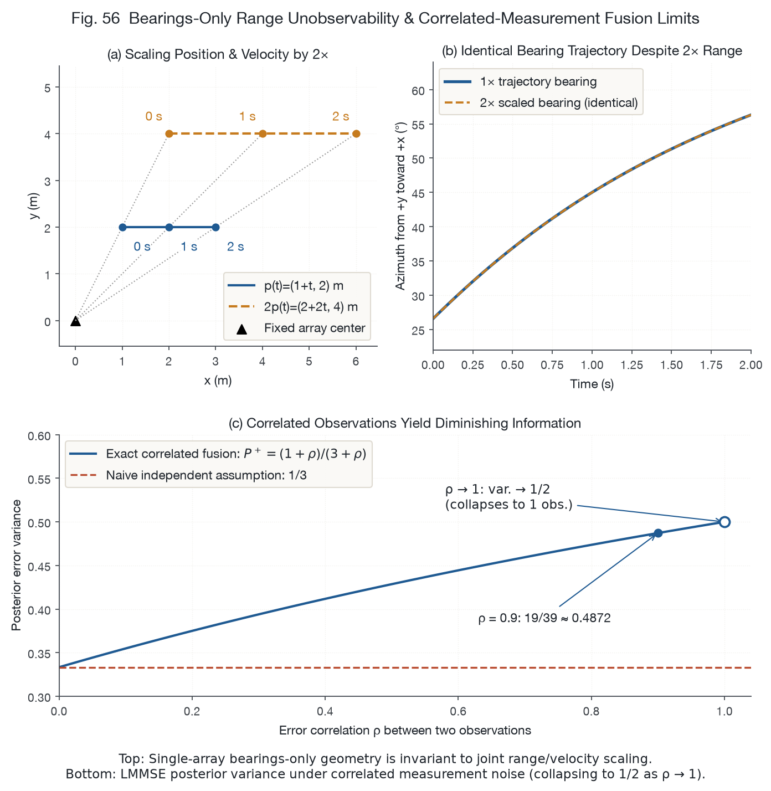
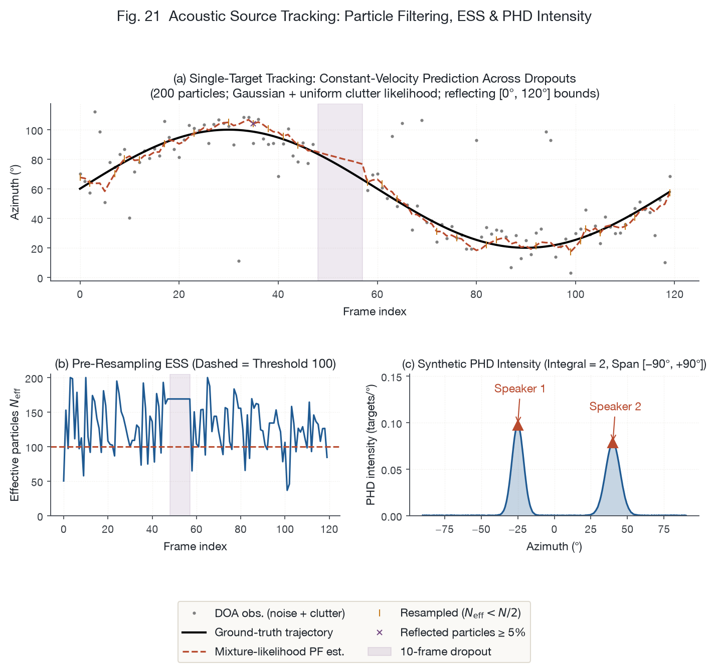
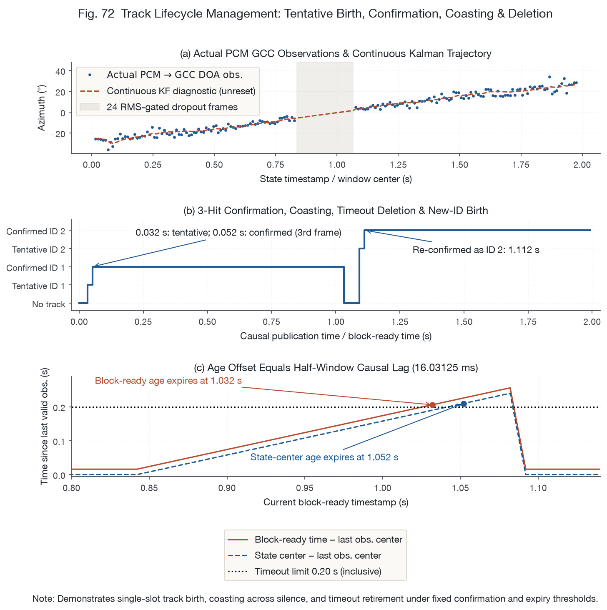
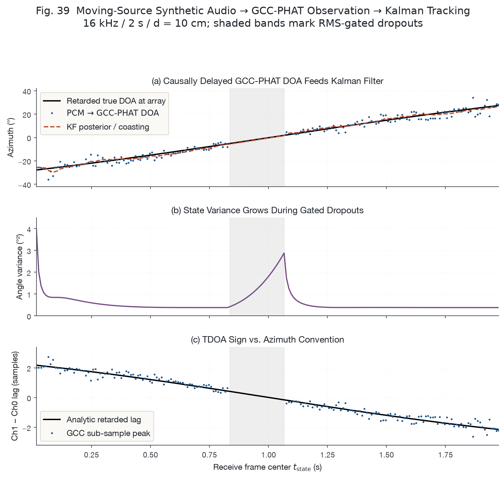

🌐 [简体中文](../chapters/09_source-tracking.md) ｜ **English**

> This chapter is Chapter 9 of the main text; the book comprises 16 chapters across the core chapters and extended topics (Chapters 0–15, where Chapter 0 covers mathematical foundations and Chapters 12–15 are four extended special topics), plus Appendices A and B. This chapter can be read independently; see the navigation links below for the preceding and following chapters.
>
> Overview: [00_overview.md](00_overview.md) | Previous: [08_speech-separation.md](08_speech-separation.md) | Next: [10_engineering-practice.md](10_engineering-practice.md)

---

## 9. Source Tracking

### 9.1 Problem Formulation and Acoustic Specifics

#### Core Terminology and Reading Roadmap

Whereas Chapter 4's sound source localization answers "where did the sound come from in this frame?", this chapter's source tracking answers "combining previously accumulated observations, in which direction or position does the source currently reside, and how large is the estimation uncertainty?" When reading this chapter, we recommend first working through one complete Kalman filter recursion by hand, then understanding particle weighting/resampling and multi-target data association, and finally verifying state timestamps across module interfaces so that a lagging past direction is never mistaken for the current beam look direction.

| Term | Meaning in This Chapter |
|---|---|
| Direction of Arrival (DOA) | Acoustic source direction relative to a designated array coordinate frame |
| Voice Activity Detection (VAD) | Judges whether acoustic speech evidence exists in the current frame; *not* equivalent to judging whether a speaker has left the room |
| State, Measurement, Innovation | Latent variable to be estimated, observation emitted by the localizer, and residual of current measurement minus predicted measurement |
| Prior, Posterior | Probability distribution of the state before and after incorporating the current frame's measurement |
| Covariance | Second central moment of estimation error; diagonal entries give component variances and off-diagonal entries capture linear error correlations |
| Track Label | Local persistent identifier maintained by the tracker; does not automatically equate to permanent speaker identity |

#### Directional States, Positional States, and Observability

Source tracking fuses noisy, pause-interrupted frame-by-frame localization estimates into smooth trajectories, supplying low-jitter causal look-direction estimates to adaptive beamformers. Designing the state vector depends on available measurements and downstream needs: tracking horizontal azimuth alone typically uses $\vec{s}_t=[\theta_t,\dot{\theta}_t]^\top$, sharp turns or frequent starts/stops may augment angular acceleration $\ddot{\theta}_t$, and joint 2-D planar position tracking uses $\vec{s}_t=[x_t,y_t,\dot{x}_t,\dot{y}_t]^\top$. Units of angular state components are angle, angular velocity, and angular acceleration respectively; Cartesian positional states must first fix the array reference origin, coordinate axis orientations, and length/time units.

Public benchmarks such as the [official LOCATA task specification](https://www.locata.lms.tf.fau.de/tasks/) (Evers et al., 2020, *IEEE/ACM TASLP* 28:1620–1643) define six tasks spanning single/multiple sources, static/moving speakers, and moving arrays. Its development set provides synchronized multichannel recordings alongside 3-D ground-truth microphone and source coordinates, whereas its evaluation set releases audio and microphone positions only; when benchmarking frame-level localization or tracking errors on your own, select splits with ground-truth source coordinates and report statistics stratified by task number (see §10.6 for dataset selection guidelines).

Compared with radar or visual object tracking, indoor acoustic source tracking confronts four prominent physical challenges:

- Natural speech contains abundant inter-syllable gaps and inter-sentence pauses, causing intermittent measurement arrivals that require VAD-based measurement gating and trajectory coasting across brief silences;
- Strong early room reflections induce severe non-Gaussian biases and angular outliers (spurious peaks);
- In meetings and domestic spaces, the number of simultaneously active speakers varies dynamically over time;
- Array-measured DOAs map strongly nonlinearly to Cartesian source coordinates.

Suppose a planar state comprises position and velocity $[x,y,\dot{x},\dot{y}]^\top$ with the array geometric center at $(x_0,y_0)$. Retaining the azimuth convention of Chapters 2–5 ("$+y$ axis as $0^\circ$, positive clockwise toward $+x$"), the noiseless azimuth measurement function is $\theta=\operatorname{atan2}(x-x_0,y-y_0)$ (for four-quadrant arctangent and circular angle wrapping, see [Chapter 0, §0.1](00_math-foundations.md#sec-0-1)). Notice that the *first* argument of `atan2` here is the horizontal displacement $x-x_0$ ($\propto\sin\theta$) and the *second* argument is the forward displacement $y-y_0$ ($\propto\cos\theta$)—never copy the standard mathematical polar-angle argument order $\operatorname{atan2}(y-y_0,x-x_0)$ blindly.

For an array centered at $(0,0)$ and a source at $(1\ \mathrm{m},2\ \mathrm{m})$, our convention gives $\operatorname{atan2}(1,2)\approx 26.565^\circ$; accidentally swapping the two arguments yields $\operatorname{atan2}(2,1)\approx 63.435^\circ$, which is the polar angle measured from $+x$. Either convention is valid internally, but localizers, trackers, and beamformer steering vectors must share the exact same angle convention—mixing them steers the beam straight off the target.

From a geometric observability perspective, a single stationary array measuring azimuth alone cannot uniquely determine source range. For an array at the origin, sources at $(1\ \mathrm{m},1\ \mathrm{m})$ and $(2\ \mathrm{m},2\ \mathrm{m})$ lie along the exact same ray and both yield $\operatorname{atan2}=45^\circ$; scaling coordinates radially by any positive factor leaves azimuth readings completely invariant.

Even across arbitrarily many frames, as long as the array stays stationary at the origin and the source moves along a constant-velocity straight line $\vec{p}(t)=\vec{p}_0+t\vec{v}$ of unknown speed (neglecting propagation delay for the moment), multiplying both initial position and initial velocity by any positive scalar $a>0$ yields, by the positive homogeneity of the four-quadrant arctangent:

$$\begin{aligned}
\vec{p}(t)&=\vec{p}_0+t\vec{v},\\
\vec{p}_a(t)&=a\vec{p}_0+t(a\vec{v})=a\vec{p}(t),\\
h(\vec{p}_a(t))&=h(\vec{p}(t)).
\end{aligned}\tag{9-1}$$

The entire scaled trajectory matches the instantaneous azimuth frame for frame at every time instant (see Exercise [E09-17](#e09-17) for the 4-D initial-state Jacobian null-space proof and Fig. 56(a)–(b) below for the geometry). Accumulating more frames reduces angular noise along the observable tangential direction, but cannot eliminate radial scale ambiguity out of thin air; replacing a linear Kalman filter with an Extended Kalman Filter (EKF) or Unscented Kalman Filter (UKF) still cannot "compute" true range from bearings-only measurements.

Achieving 2-D or 3-D positional tracking requires spatially separated subarrays, Time Difference of Arrival (TDOA) wavefront-curvature/range cues, or known array motion satisfying observability conditions such as nonzero relative acceleration (for theoretical observability criteria, see [Nardone & Aidala 1981 / Fogel & Gavish 1989 bearings-only observability analysis](https://doi.org/10.1080/00207178908559665)).

Once multiple subarrays or known array maneuvers render position observable, one must still handle the nonlinearity of $\operatorname{atan2}$. An EKF locally linearizes nonlinear measurements via a first-order Taylor expansion (Jacobian matrix) around the predicted mean; a UKF deterministically selects a small set of representative points around the predicted mean matching its covariance structure (called Sigma points—not extra physical acoustic sources), passes each point directly through the exact nonlinear measurement function, and recovers the predicted measurement mean and covariance by weighted summation.

For an $L$-dimensional state vector, standard symmetric or scaled unscented transforms construct $2L+1$ Sigma points: $9$ points for a planar position–velocity state ($L=4$) and $5$ points for an azimuth–angular-velocity state ($L=2$) (minimal-skew simplex and spherical-radial variants using fewer points also exist in practice, so $2L+1$ is not universal across all UKFs). When a speaker approaches close to the array or sweeps rapidly past it so azimuth varies sharply with position, UKFs or particle filters outperform first-order linearized EKFs; if a source passes directly through the array center $(x_0,y_0)$, however, azimuth is geometrically undefined and no filter can bypass that physical singularity. We begin below with the foundational linear Kalman filter (KF), then extend systematically to nonlinear measurements and multiple motion models.

### 9.2 Single-Target Tracking

#### 9.2.1 Kalman Prediction, Measurement Update, and Angular Boundaries

Denoting discrete frame index by $t$, $d$-dimensional latent state column vector by $\vec{s}_t\in\mathbb{R}^d$, and $p$-dimensional localizer measurement vector by $\vec{z}_t\in\mathbb{R}^p$, the linear state-space model reads:

$$\begin{aligned}
\vec{s}_t&=\mathbf{F}\vec{s}_{t-1}+\vec{v}_t,\\
\vec{z}_t&=\mathbf{H}\vec{s}_t+\vec{w}_t.
\end{aligned}\tag{9-2}$$

Here $\mathbf{F}\in\mathbb{R}^{d\times d}$ is the state transition matrix governing deterministic kinematics between adjacent frames; $\mathbf{H}\in\mathbb{R}^{p\times d}$ is the observation matrix mapping the $d$-dimensional state into the $p$-dimensional measurement space; and $\vec{v}_t\in\mathbb{R}^d$, $\vec{w}_t\in\mathbb{R}^p$ denote process noise (unmodeled random accelerations or turns) and measurement noise (single-frame DOA estimation error), respectively.

Standard Kalman derivations assume $\vec{v}_t$ and $\vec{w}_t$ are zero-mean white sequences, mutually uncorrelated and orthogonal to initial state estimation error. Under these conditions, process noise covariance $\mathbf{Q}=\mathbb{E}[\vec{v}_t\vec{v}_t^\top]$ ($d\times d$) and measurement noise covariance $\mathbf{R}=\mathbb{E}[\vec{w}_t\vec{w}_t^\top]$ ($p\times p$) are symmetric positive semidefinite (typically requiring positive-definite $\mathbf{R}$ for well-conditioned inversion). Systematic mounting angle biases (nonzero noise mean) require state augmentation or prior calibration; strong inter-frame measurement noise correlations induced by heavily overlapping STFT windows require cross-covariance accounting or state augmentation.

Given observations up to frame $t-1$, denote the prior predicted mean at frame $t$ by $\hat{\vec{s}}_t^-$, prior error by $\vec{e}_t^-=\vec{s}_t-\hat{\vec{s}}_t^-$, and prior error covariance by $\mathbf{P}_t^-=\mathbb{E}[\vec{e}_t^-(\vec{e}_t^-)^\top]$ ($d\times d$); after incorporating measurement $\vec{z}_t$, denote posterior mean and error covariance by $\hat{\vec{s}}_t$ and $\mathbf{P}_t$, and Kalman gain by $\mathbf{K}_t\in\mathbb{R}^{d\times p}$. Whenever the zero-mean uncorrelated second-order statistics hold, the Kalman recursion is the Linear Minimum Mean Square Error (LMMSE) estimator among all linear unbiased estimators; if initial state and noises are further jointly Gaussian, the posterior remains strictly Gaussian parameterized completely by $(\hat{\vec{s}}_t,\mathbf{P}_t)$, coinciding with the exact Bayesian conditional mean (for LMMSE and Bayesian recursion foundations see [Chapter 0, §0.6](00_math-foundations.md#sec-0-6), and for original proofs see [Kalman's 1960 seminal paper, §Optimal Estimates and Theorem 3](https://people.duke.edu/~hpgavin/SystemID/References/Kalman-JBE-1960.pdf)).

When checking matrix dimensions and physical units, entry $(i,j)$ of a covariance matrix carries the product of the units of state components $i$ and $j$. For two-component angular motion $\vec{s}_t=[\theta_t,\dot{\theta}_t]^\top$ ($\mathrm{deg}$ and $\mathrm{deg/frame}$), the diagonal entries of $\mathbf{P}_t$ have units $\mathrm{deg}^2$ and $(\mathrm{deg/frame})^2$, off-diagonal cross-covariances have units $\mathrm{deg}^2/\mathrm{frame}$, and the observation matrix is $\mathbf{H}=[1,\ 0]$ (for a three-component state $[\theta,\dot{\theta},\ddot{\theta}]^\top$ including angular acceleration, $\mathbf{H}=[1,\ 0,\ 0]$—never misread those three components as 3-D spatial coordinates).

When the localizer emits a single scalar azimuth per frame ($p=1$), the measurement reduces to scalar $\theta_t^{\mathrm{obs}}$, and both $\mathbf{R}$ and innovation covariance $\mathbf{S}_t$ reduce to $1\times 1$ scalar variances written as $R$ and $S_t$ below while retaining boldface $\mathbf{R}$ and $\mathbf{S}_t$ in general multivariate equations.

Each frame alternates between "time prediction" and "measurement update": prediction propagates the mean forward along the kinematic model while accumulating process uncertainty; update forms the residual between observed and predicted measurements (the innovation), then adjusts the state and shrinks error covariance according to relative prior-versus-measurement uncertainties.

**Five-Step Kalman Filter (KF) Recursion** (for `[angle, angular velocity]` state):

1. **Predict state**:

    $$\hat{\vec{s}}^-_t = \mathbf{F}\hat{\vec{s}}_{t-1}.\tag{9-3}$$

2. **Predict covariance**:

    $$\begin{aligned}
    \mathbf{P}^-_t&=\mathbf{F}\mathbf{P}_{t-1}\mathbf{F}^\top
    +\mathbf{Q}.
    \end{aligned}\tag{9-4}$$

    $\mathbf{F}$ maps and couples the previous frame's error covariance into the current frame, and $\mathbf{Q}$ adds process noise from unmodeled maneuvers. Note that adding positive-semidefinite $\mathbf{Q}$ does *not* imply every diagonal entry must exceed the previous frame's value: for instance, propagating symmetric positive-definite initial $\mathbf{P}=[4,-1;\ -1,1]$ ($\det=3>0$) with $\mathbf{Q}=\mathbf{0}$ through $\mathbf{F}=[1,1;\ 0,1]$ yields $\mathbf{P}^-=[3,0;\ 0,1]$, where error cancellation from the negative cross-covariance actually reduces top-left angle variance from $4$ down to $3$; under uncorrelated initial errors or same-sign cross-covariances in constant-velocity coasting, however, angle variance grows monotonically across missed frames.

3. **Compute Kalman gain**:

    $$\begin{aligned}
    \mathbf{S}_t&=\mathbf{H}\mathbf{P}_t^-\mathbf{H}^\top+\mathbf{R},\\
    \mathbf{K}_t&=\mathbf{P}_t^-\mathbf{H}^\top\mathbf{S}_t^{-1}.
    \end{aligned}\tag{9-5}$$

    Here $\mathbf{R}$ is the measurement noise covariance from Eq. (9-2) and $\mathbf{S}_t$ is total innovation covariance. For scalar DOA ($p=1$) holding the other variance fixed, smaller measurement variance increases angle gain whereas smaller predicted angle variance decreases angle gain—a scalar monotonicity intuition that should not be extrapolated naively entry-by-entry to general multivariate matrix gains.

4. **Update state**:

    $$\begin{aligned}
    \nu_t&=\theta_t^{\mathrm{obs}}-\mathbf{H}\hat{\vec{s}}_t^-,\\
    \hat{\vec{s}}_t&=\hat{\vec{s}}_t^-+\mathbf{K}_t\nu_t.
    \end{aligned}\tag{9-6}$$

    The difference $\nu_t$ on the first line is the *innovation*, quantifying new information beyond prior prediction; in multivariate settings $\vec{\nu}_t=\vec{z}_t-\mathbf{H}\hat{\vec{s}}_t^-$ has covariance $\mathbf{S}_t$ ($S_t$ in the scalar case).

5. **Update covariance**:

    $$\begin{aligned}
    \mathbf{P}_t&=(\mathbf{I}-\mathbf{K}_t\mathbf{H})\mathbf{P}^-_t.
    \end{aligned}\tag{9-7}$$

Whenever azimuths cross the branch cut of the representation interval, angular innovation in Eq. (9-6) must *never* use plain real subtraction. Standardizing principal horizontal azimuths onto the half-open interval $[-180^\circ,180^\circ)$ defines the shortest circular wrap operator:

$$\begin{aligned}
b&=\alpha+180^\circ,\\
r&=b\bmod 360^\circ,\\
\operatorname{wrap}_{180}(\alpha)&=r-180^\circ.
\end{aligned}\tag{9-8}$$

Here $\bmod$ takes the nonnegative remainder $r\in[0^\circ,360^\circ)$ matching the positive divisor $360^\circ$. Step 4 wraps raw angle difference $\Delta\theta_t=\theta_t^{\mathrm{obs}}-\mathbf{H}\hat{\vec{s}}_t^-$ as $\nu_t=\operatorname{wrap}_{180}(\Delta\theta_t)$; after both prediction and update steps, the angle component of the state vector must likewise wrap back into $[-180^\circ,180^\circ)$, whereas angular velocity $\dot{\theta}_t$ lives in the Euclidean tangent space and must *never* be wrapped. Numerically, keep input angles near the principal interval before differencing and wrapping to avoid unnecessary floating-point mantissa loss on tiny differences.

Consider an intuitive example: suppose predicted azimuth is $+179^\circ$ and measured azimuth is $-179^\circ$. Physically on the circle, the speaker stepped just $+2^\circ$ clockwise across the rear seam, yet naive subtraction gives $-358^\circ$—without wrapping, the filter treats the jump as a nearly full-circle reverse rotation that pulls the state far off target, while innovation gating falsely rejects this accurate measurement as an outlier.

At exact antipodal separation ($180^\circ$ apart), clockwise and counterclockwise arcs tie in length and Eq. (9-8) returns $-180^\circ$ by half-open convention, leaving true turn direction ambiguous from innovation sign alone. Keep two domain boundaries in mind as well: wrapping resolves unimodal local Gaussians straddling an artificial coordinate seam, whereas genuinely broad or front–back bimodal posteriors require circular statistics or particle filters; conversely, a wall-mounted linear array operating strictly over $[-90^\circ,90^\circ]$ has physically distinct endfire boundaries and must *not* apply $360^\circ$ wrap-around.

Why does covariance update take the compact form Eq. (9-7) on paper while production code universally prefers the longer **Joseph stabilized form**? Deriving posterior error covariance from scratch yields both the Joseph formula and the optimal gain Eq. (9-5) in one stroke. For **any** linear gain matrix $\mathbf{K}_t\in\mathbb{R}^{d\times p}$, substituting $\vec{z}_t=\mathbf{H}\vec{s}_t+\vec{w}_t$ into $\mathbf{K}_t\vec{\nu}_t$ ($\vec{\nu}_t=\vec{z}_t-\mathbf{H}\hat{\vec{s}}_t^-$) expresses posterior error $\vec{e}_t=\vec{s}_t-\hat{\vec{s}}_t$ as a linear combination of prior error $\vec{e}_t^-=\vec{s}_t-\hat{\vec{s}}_t^-$ and measurement noise $\vec{w}_t$:

$$\begin{aligned}
\vec{e}_t
&=\vec{s}_t-\hat{\vec{s}}_t^-
-\mathbf{K}_t(\mathbf{H}\vec{e}_t^-+\vec{w}_t)\\
&=(\mathbf{I}-\mathbf{K}_t\mathbf{H})\vec{e}_t^-
-\mathbf{K}_t\vec{w}_t.
\end{aligned}$$

Conditioned on the information available before the update, assume the prior error $\vec{e}_t^-$ and current measurement noise $\vec{w}_t$ are zero mean and uncorrelated, with conditional covariances $\mathbf{P}_t^-$ and $\mathbf{R}$. If gain $\mathbf{K}_t$ is fixed under this conditioning, the cross-terms in the conditional outer-product expectation vanish, yielding the **Joseph covariance update**. The fixed gain may be suboptimal:

$$\begin{aligned}
\mathbf{A}_t&=\mathbf{I}-\mathbf{K}_t\mathbf{H},\\
\mathbf{P}_t&=\mathbf{A}_t\mathbf{P}_t^-\mathbf{A}_t^\top
+\mathbf{K}_t\mathbf{R}\mathbf{K}_t^\top.
\end{aligned}\tag{9-9}$$

If gating or the gain also depends on the current innovation, it cannot simply be pulled outside the expectation. Equation (9-9) can still provide a positive-semidefinite nominal covariance recursion, but agreement with the actual error covariance needs separate validation; see the [Kalman AEC derivation in Chapter 6](06_aec.md).

#### Why the Gain Weights by Uncertainty

Using the error covariance in Eq. (9-9) under these conditions, deriving Eq. (9-5) reduces to minimizing total posterior mean-square error across all state components—the trace $J(\mathbf{K}_t)=\operatorname{tr}(\mathbf{P}_t)$. Inspect the scalar case ($d=p=1$, $H=1$) first: posterior error is $e^+=(1-k)e^--kw$ with positive variances $P^-$ and $R$; differentiating with respect to $k$ and setting to zero gives:

$$\begin{aligned}
J(k)&=\mathbb{E}[(s-\hat{s}^+)^2]=(1-k)^2P^-+k^2R,\\
J'(k)&=-2(1-k)P^-+2kR=0,\\
k_*&=\frac{P^-}{P^-+R}.
\end{aligned}\tag{9-10}$$

At $P^-=4$ and $R=1$, optimal weight $k_*=4/(4+1)=4/5$ shrinks posterior variance to $P^+=(1/5)^2\times 4+(4/5)^2\times 1=4/5$ (matching $(1-k_*)P^-$): whichever source has smaller variance pulls the posterior mean closer; conversely, if a measurement carries unmodeled reverberant bias, setting $R$ artificially small aggressively drags the state onto that bias.

Lifting the exact same derivative to matrices: writing $\mathbf{S}_t=\mathbf{H}\mathbf{P}_t^-\mathbf{H}^\top+\mathbf{R}$ and expanding Eq. (9-9) gives

$$\begin{aligned}
\mathbf{P}_t
&=\mathbf{P}_t^--\mathbf{K}_t\mathbf{H}\mathbf{P}_t^-
-\mathbf{P}_t^-\mathbf{H}^\top\mathbf{K}_t^\top
+\mathbf{K}_t\mathbf{S}_t\mathbf{K}_t^\top.
\end{aligned}$$

Applying standard trace-gradient identities ($\nabla_{\mathbf{K}}\operatorname{tr}(\mathbf{K}\mathbf{B})=\mathbf{B}^\top$ and $\nabla_{\mathbf{K}}\operatorname{tr}(\mathbf{K}\mathbf{S}\mathbf{K}^\top)=2\mathbf{K}\mathbf{S}$ for symmetric $\mathbf{P}_t^-,\mathbf{S}_t$) and setting the gradient to zero yields:

$$\begin{aligned}
\frac{\partial\operatorname{tr}(\mathbf{P}_t)}{\partial\mathbf{K}_t}
&=-2\mathbf{P}_t^-\mathbf{H}^\top
+2\mathbf{K}_t\mathbf{S}_t=\mathbf{0},\\
\mathbf{K}_t&=\mathbf{P}_t^-\mathbf{H}^\top\mathbf{S}_t^{-1},
\end{aligned}$$

which is precisely optimal Kalman gain Eq. (9-5). Right-multiplying $\mathbf{K}_t\mathbf{S}_t=\mathbf{P}_t^-\mathbf{H}^\top$ by $\mathbf{K}_t^\top$ and substituting into the last term of the expanded $\mathbf{P}_t$ cancels $-\mathbf{P}_t^-\mathbf{H}^\top\mathbf{K}_t^\top$, leaving shorthand Eq. (9-7) ($\mathbf{P}_t=\mathbf{A}_t\mathbf{P}_t^-$).

Thus shorthand Eq. (9-7) equals Eq. (9-9) *only* when $\mathbf{K}_t$ equals the exact optimal gain: Eq. (9-7) is convenient for hand calculations, whereas under finite-precision floating-point arithmetic or engineered gain clamping, multiplying two asymmetric matrices $(\mathbf{I}-\mathbf{K}_t\mathbf{H})\mathbf{P}_t^-$ easily breaks symmetry or produces negative diagonal variances—making Joseph form Eq. (9-9), which sums two symmetric positive-semidefinite quadratic forms, far superior numerically (code should still validate input positive semidefiniteness rather than masking invalid negative-variance inputs behind Joseph updates).

#### Innovation Gating and Covariance Validity

Strong room reflections routinely spawn transient spurious peaks far from the true speaker, requiring a statistical sanity check on the innovation relative to current prediction uncertainty prior to updating. For innovation vector $\vec{\nu}_t\in\mathbb{R}^p$ and innovation covariance $\mathbf{S}_t$, the Normalized Innovation Squared (NIS, or squared Mahalanobis distance) is

$$\begin{aligned}
\epsilon_\nu&=\vec{\nu}_t^\top\mathbf{S}_t^{-1}\vec{\nu}_t,\\
p=1:\quad\epsilon_\nu&=\nu_t^2/S_t.
\end{aligned}\tag{9-11}$$

Under a valid linear-Gaussian model, accurate data association, and positive-definite $\mathbf{S}_t$, $\epsilon_\nu$ **prior to gating** follows a chi-squared distribution $\chi_p^2$ with $p$ degrees of freedom (for $p=1$, $\epsilon_\nu\le 9$ corresponds to a $3\sigma$ normal interval with $\approx 0.27\%$ theoretical false-rejection rate; for filter consistency tests using NIS and Normalized Estimation Error Squared NEES, see Bar-Shalom, Li & Kirubarajan, 2001). Keep four caveats in mind when gating outliers in practice: first, falling inside the gate does *not* mean "the posterior probability that this measurement originated from the target is $99.7\%$"; second, once above-threshold samples are rejected, surviving innovations follow a *truncated* distribution and cannot be tested directly against an untruncated $\chi_p^2$ goodness-of-fit test; third, circular Gaussianity holds only locally for narrow angular errors (see Exercise [E09-05](#e09-05) for $\pm 180^\circ$ wrap-around effects); fourth, NIS is strictly dimensionless—converting angles from degrees to radians (scale $a=\pi/180$) requires scaling states and measurements by $a$ and covariance matrices $\mathbf{P},\mathbf{Q},\mathbf{R}$ simultaneously by $a^2$ so $\epsilon_\nu$ stays invariant, whereas forgetting the $a^2$ covariance scaling shrinks $\epsilon_\nu$ artificially by $\approx 3.05\times 10^{-4}$ and renders outlier gating ineffective.

In addition, heavily overlapping STFT frames (e.g., $75\%$ overlap) emit consecutive localization readings with strongly time-correlated errors; applying an independent white-noise update blindly creates severe nominal overconfidence. Consider the minimal analytical control of a static scalar prior $x\sim\mathcal{N}(0,1)$ receiving two unit readings $\vec{z}=[1,\ 1]^\top$ with measurement noise covariance $\mathbf{R}=[1,\rho;\ \rho,1]$ ($|\rho|<1$): because shared prior variance $P^-=1$ enters both readings, the joint innovation covariance is $\mathbf{S}=[2,1+\rho;\ 1+\rho,2]$, and Eqs. (9-5) and (9-7) immediately yield the exact posterior:

$$\begin{aligned}
\mathbf{K}&=\frac{[1,\ 1]}{3+\rho},\\
m^+&=\frac{2}{3+\rho},\\
P^+&=1-\mathbf{K}\mathbf{H}=\frac{1+\rho}{3+\rho}.
\end{aligned}\tag{9-12}$$

At $\rho=0.9$, the true posterior variance is $19/39\approx 0.487$, whereas misassuming independence ($\rho=0$) reports a one-third-too-small $1/3\approx 0.333$; as $\rho\to 1$, $P^+\to 0.5$, degenerating completely to a single measurement. Figure 56 brings together the two core information boundaries of §9.1 Eq. (9-1) (bearings-only scale ambiguity) and Eq. (9-12) above (information decay under correlated measurements; see Exercise [E09-17](#e09-17) for complete analytical calculations):

Inspecting the three panels of Fig. 56 highlights the symmetric lessons of insufficient information and redundant information at a glance:

- **Top-left panel (a)** plots constant-velocity baseline trajectory $\vec{p}(t)=(1+t,2)$ and doubled trajectory $2\vec{p}(t)=(2+2t,4)$ in planar $(x,y)$ coordinates ($\mathrm{m}$), showing rays from the stationary origin $(0,0)$ piercing corresponding points of both trajectories simultaneously at $t=0,1,2\ \mathrm{s}$;
- **Top-right panel (b)** plots both trajectories' instantaneous azimuth curves over time, coinciding identically everywhere and visually confirming that a single stationary bearings-only array cannot decouple range from speed scale;
- **Bottom wide panel (c)** plots scalar posterior variance versus measurement noise correlation $\rho\in[0,1)$: the exact variance curve $(1+\rho)/(3+\rho)$ degrades monotonically from $1/3$ toward the single-measurement limit $1/2$, while the misassumed independence line stays flat at $1/3$, exposing the overconfidence risk of pushing heavily overlapped frames into white-noise updates.

#### 9.2.2 Worked Example 9-1: Step-by-Step Hand Calculation of One Kalman Filter Cycle

Let us walk through one complete prediction-and-update cycle of Eqs. (9-3)–(9-7) with concrete numbers for a single speaker moving smoothly in azimuth relative to an array (note that a stationary speaker merely turning their head in place does not shift acoustic mouth location and generally does not produce such translational azimuth trajectories).

**Inputs and model specification.** Take two-component angular state $\vec{s}_t=[\theta_t,\dot{\theta}_t]^\top$ in degrees ($\mathrm{deg}$) and degrees per frame ($\mathrm{deg/frame}$). A constant-velocity model omitting angular acceleration suits smooth motion segments; frequent starts/stops or sharp turns warrant acceleration states or §9.2.3's Interacting Multiple Model (IMM). Inputs for step $t$ are:

- Previous posterior mean: $\hat{\vec{s}}_{t-1}=[30,\ 0.5]^\top$ (estimated azimuth $30^\circ$, moving positively at $0.5^\circ/\mathrm{frame}$);
- Previous posterior covariance: $\mathbf{P}_{t-1}=\operatorname{diag}(4,0.25)$ (angle std $2^\circ$ / variance $4\ \mathrm{deg}^2$, angular-velocity std $0.5\ \mathrm{deg/frame}$ / variance $0.25\ (\mathrm{deg/frame})^2$, zero initial correlation);
- State transition matrix ($1$-frame constant-velocity step): $\mathbf{F}=\begin{bmatrix}1&1\\0&1\end{bmatrix}$, encoding $\theta_t=\theta_{t-1}+1\cdot\dot{\theta}_{t-1}$ and $\dot{\theta}_t=\dot{\theta}_{t-1}$;
- Process noise covariance: $\mathbf{Q}=\begin{bmatrix}0.1&0\\0&0.01\end{bmatrix}$, modeling small unmodeled frame-to-frame motion fluctuations (larger $\mathbf{Q}$ relaxes the motion prior);
- Observation model and reading: scalar azimuth output gives $\mathbf{H}=[1,\ 0]$; frame $t$ measures $\theta_t^{\mathrm{obs}}=32^\circ$ with scalar measurement variance $R=25\ \mathrm{deg}^2$ ($1\times 1$ matrix $\mathbf{R}=[25]$, i.e., $5^\circ$ single-frame DOA std—coarser than the prior prediction).

**Step 1: State prediction** $\hat{\vec{s}}_t^-=\mathbf{F}\hat{\vec{s}}_{t-1}$. Adding previous angular velocity onto azimuth gives:

$$\begin{aligned}
\hat{\vec{s}}_t^-&=\begin{bmatrix}1&1\\0&1\end{bmatrix}
\begin{bmatrix}30\\0.5\end{bmatrix}\\
&=\begin{bmatrix}30+0.5\\0.5\end{bmatrix}
=\begin{bmatrix}30.5\\0.5\end{bmatrix}.
\end{aligned}$$

Before seeing the new measurement, the model extrapolates azimuth to $30.5^\circ$ at $0.5^\circ/\mathrm{frame}$.

**Step 2: Covariance prediction** ($\mathbf{P}_t^-$ via Eq. (9-4)). Multiply in two stages—$\mathbf{F}\mathbf{P}_{t-1}$ first, then right-multiply by $\mathbf{F}^\top=\begin{bmatrix}1&0\\1&1\end{bmatrix}$:

$$\begin{aligned}
\mathbf{F}\mathbf{P}_{t-1}
&=\begin{bmatrix}1&1\\0&1\end{bmatrix}
\begin{bmatrix}4&0\\0&0.25\end{bmatrix}
=\begin{bmatrix}4&0.25\\0&0.25\end{bmatrix},\\
\mathbf{F}\mathbf{P}_{t-1}\mathbf{F}^\top
&=\begin{bmatrix}4+0.25&0.25\\0.25&0.25\end{bmatrix}
=\begin{bmatrix}4.25&0.25\\0.25&0.25\end{bmatrix}.
\end{aligned}$$

Notice that even *before* adding $\mathbf{Q}$, top-left angle variance has grown from $4$ to $4.25$ and off-diagonal entries have acquired $+0.25$ positive correlation—because angular velocity carried $0.25$ variance, extrapolating across one frame couples any velocity overestimate into an angle overestimate of matching sign. Adding process noise $\mathbf{Q}$ gives:

$$\begin{aligned}
\mathbf{P}_t^-&=\begin{bmatrix}4.25&0.25\\0.25&0.25\end{bmatrix}
+\begin{bmatrix}0.1&0\\0&0.01\end{bmatrix}\\
&=\begin{bmatrix}4.35&0.25\\0.25&0.26\end{bmatrix},
\end{aligned}$$

corresponding to predicted angle std $\sqrt{4.35}\approx 2.09^\circ$.

**Step 3: Kalman gain** $\mathbf{K}_t=\mathbf{P}_t^-\mathbf{H}^\top S_t^{-1}$. Since $\mathbf{H}=[1,\ 0]$ extracts the first coordinate, $\mathbf{H}\mathbf{P}_t^-\mathbf{H}^\top$ picks out top-left entry $4.35$, giving scalar innovation variance

$$\begin{aligned}
S_t&=\mathbf{H}\mathbf{P}_t^-\mathbf{H}^\top+R\\
&=4.35+25=29.35\ \mathrm{deg}^2.
\end{aligned}$$

Numerator $\mathbf{P}_t^-\mathbf{H}^\top=[4.35,\ 0.25]^\top$ is column $1$ of $\mathbf{P}_t^-$; dividing by $S_t$ yields the $2\times 1$ gain vector:

$$\begin{aligned}
\mathbf{K}_t&=\frac{1}{29.35}\begin{bmatrix}4.35\\0.25\end{bmatrix}
\approx\begin{bmatrix}0.148\\0.0085\end{bmatrix}.
\end{aligned}$$

To six decimal places, $K_1\approx 0.148211$ and $K_2\approx 0.008518$. Both entries carry transparent physical meaning: $K_1\approx 0.148$ shows that because single-frame measurement variance ($25$) is much larger than predicted angle variance ($4.35$), the angle update trusts only $\approx 14.8\%$ of the innovation; meanwhile, even though the localizer never measures angular velocity directly, positive cross-covariance $P_{21}^-=0.25>0$ couples positive angle residuals into a slight upward velocity nudge of $K_2\approx 0.0085\ (\mathrm{frame})^{-1}$.

**Step 4: State update** $\hat{\vec{s}}_t=\hat{\vec{s}}_t^-+\mathbf{K}_t\nu_t$. Angular innovation is $\nu_t=32^\circ-30.5^\circ=1.5^\circ$ (no $\pm 180^\circ$ seam crossing); substituting exact fractional gains gives

$$\begin{aligned}
\hat{\vec{s}}_t&=\begin{bmatrix}30.5\\0.5\end{bmatrix}
+\frac{1.5}{29.35}\begin{bmatrix}4.35\\0.25\end{bmatrix}\\
&\approx\begin{bmatrix}30.722317\\0.512777\end{bmatrix}.
\end{aligned}$$

Posterior azimuth settles at $30.72^\circ$—between prediction $30.5^\circ$ and noisy measurement $32^\circ$, leaning decisively toward the more reliable prediction—while angular velocity nudges up to $0.513^\circ/\mathrm{frame}$.

**Step 5: Covariance update** ($\mathbf{P}_t$ via Eq. (9-7)). Always substitute unrounded exact fractional gain $\mathbf{K}_t=[4.35,\ 0.25]^\top/29.35$ during hand calculations (plugging in 2- or 3-digit rounded intermediates corrupts trailing digits and can even make off-diagonal entries asymmetric):

$$\begin{aligned}
\mathbf{I}-\mathbf{K}_t\mathbf{H}
&=\begin{bmatrix}1-4.35/29.35&0\\-0.25/29.35&1\end{bmatrix}
=\begin{bmatrix}25/29.35&0\\-0.25/29.35&1\end{bmatrix},\\
\mathbf{P}_t&=(\mathbf{I}-\mathbf{K}_t\mathbf{H})\mathbf{P}_t^-
\approx\begin{bmatrix}3.705&0.213\\0.213&0.258\end{bmatrix}.
\end{aligned}$$

Checking exact fractions entry by entry: $P_{11}=25\times 4.35/29.35\approx 3.705281$, $P_{12}=P_{21}=25\times 0.25/29.35\approx 0.212947$, and $P_{22}=0.26-0.25^2/29.35\approx 0.257871$, rounded to three decimals only at the very end (prematurely rounding $25/29.35\approx 0.8518$ to $0.852$ would yield $0.852\times 4.35=3.7062$).

**Interpretation and failure boundaries.** Fusing the measurement reduces angle variance from $4.35\ \mathrm{deg}^2$ down to $3.705\ \mathrm{deg}^2$ (std narrowing from $2.09^\circ$ to $\approx 1.92^\circ$), confirming that even a coarse $5^\circ$-std measurement improves upon prediction alone when unbiased and properly calibrated. If the speaker pauses on the next frame so no valid DOA arrives, Steps 3–5 are skipped while Steps 1–2 coast the state forward and widen angle variance—the exact mathematical mechanism of §9.4's "silence hold." Conversely, if the speaker stops abruptly and reverses direction (violating constant velocity) or $32^\circ$ is replaced by an $85^\circ$ wall-reflection outlier without Eq. (9-11) gating, nominal $\mathbf{P}_t$ still shrinks on paper while true directional error degrades sharply.

#### Fixed-Gain Filters and Selecting Single-Target Trackers

Having mastered the linear Kalman recursion, let us compare six single-target acoustic tracking families side by side. Among them, $\alpha$-$\beta$ and $\alpha$-$\beta$-$\gamma$ filters replace time-varying gain Eq. (9-5) with offline constant gains to skip per-frame covariance updates: when sampling interval, kinematics, and noise variances remain stationary and the constants equal the steady-state algebraic Riccati solution, they match steady-state KF identically; once frame-rate jitter or SNR swings alter true $R$, or gains are tuned ad hoc, fixed gains cannot rebalance weights automatically (for $\alpha$-$\beta$ equivalence to steady-state KF see [Ekstrand 2012, §9.1](https://doi.org/10.1155/2012/870890), and for $\alpha$-$\beta$-$\gamma$ stability/optimality see [Kosuge & Ito 2002](https://doi.org/10.9746/sicetr1965.38.361)).

| Method | Principle | Strengths | Limitations | Best Suited For |
|---|---|---|---|---|
| Moving Average / Median / Histogram Mode | Average is linear smoothing; median/mode are nonlinear summaries | Simple, no covariance recursion | Implicit local stationarity; high lag, poor on maneuvers, blurs multiple sources | Slow single targets with dense observations (baseline) |
| $\alpha$-$\beta$ / $\alpha$-$\beta$-$\gamma$ | Updates position, velocity (and acceleration) predictions with fixed gains | No online Riccati covariance recursion | Heuristic gains may be suboptimal; cannot adapt when noise statistics shift | Resource-constrained single-target tracking at steady frame rate |
| **Kalman Filter (KF)** | Linear-Gaussian Bayesian recursion (predict + innovation-weighted update) | Achieves MMSE/LMMSE when linear-Gaussian model holds | Dense cost $\approx O(d^3+p^3)$; scalar DOA is tiny, yet sensitive to outliers and requires $\mathbf{Q}/\mathbf{R}$ tuning | Clean or gated DOA observations under near-linear kinematics |
| EKF / UKF | First-order linearization / unscented transform for nonlinearities | Handles nonlinear Cartesian-to-angle mappings | EKF sensitive to linearization error; standard symmetric/scaled UKF propagates $2L+1$ Sigma points | Position-level tracking across distributed subarrays |
| Interacting Multiple Model (IMM) | Mixes initial states via Markov transition probabilities, predicts/updates per mode, reweights by innovation likelihood | Smoothly switches across preset motion regimes | Compute scales with mode count; unmodeled maneuvers still mismatch; requires transition tuning | Start–stop–walk maneuvering speaker scenarios |
| **Particle Filter (PF) / SIR** | Weighted particle ensemble approximating posterior; predict, weight, resample on demand | Represents nonlinear, non-Gaussian, multimodal posteriors | Outlier robustness hinges on likelihood + clutter model; subject to weight degeneracy and sample impoverishment | Multimodal reverberant observations or strongly nonlinear dynamics |

Engineering selection progresses along two orthogonal axes: first, **kinematic complexity**—a two-state constant-velocity KF suffices for gently moving speakers (taking barely a dozen scalar MACs per frame at $d=2,p=1$), upgrading to IMM when speakers alternate between standing still and brisk walking; second, **measurement geometry and noise tails**—single-array far-field azimuth tracking uses linear observation $\mathbf{H}$, multi-subarray Cartesian fusion uses EKF/UKF, and heavily reverberant rooms spawning simultaneous direct and mirror-image peaks benefit from circular particle filters with clutter-mixture likelihoods to retain multimodal hypotheses without prematurely locking onto a wall reflection.

#### 9.2.3 Motion-Model Switching and Nonlinear Measurements

Beginners reading tracking papers often conflate two orthogonal design choices: constant-velocity, constant-acceleration, and start–stop IMM answer "what temporal kinematics does the source obey?", whereas EKF, UKF, and particle filters answer "how are probability distributions or moments propagated through nonlinear mappings?" The two combine freely—for instance, in distributed-array positional tracking, each kinematic mode inside an IMM can run its own EKF or UKF.

#### Nonuniform Time Steps and Continuous-Time Process Noise

Worked Example 9-1 hid frame duration inside "per-frame" units; in real embedded pipelines, frame drops, VAD gating, or asynchronous multi-sensor arrivals produce variable time intervals $h>0$ ($\mathrm{s}$). Measuring time in seconds with angular state $\vec{s}=[\theta,\dot{\theta}]^\top$ ($\mathrm{deg}$ and $\mathrm{deg/s}$) driven by continuous-time zero-mean white angular acceleration of power spectral density (intensity) $q$, integrating the stochastic differential equation across interval $h$ (derived step-by-step in Exercise [E09-04](#e09-04)) yields time-consistent transition and discrete process-noise matrices:

$$\begin{aligned}
\mathbf{F}(h)&=\begin{bmatrix}1&h\\0&1\end{bmatrix},\\
\mathbf{Q}(h)&=q\begin{bmatrix}h^3/3&h^2/2\\h^2/2&h\end{bmatrix}.
\end{aligned}\tag{9-13}$$

With angle in $\mathrm{deg}$, $q$ has units $\mathrm{deg}^2/\mathrm{s}^3$, placing matrix entries in $\mathrm{deg}^2$, $\mathrm{deg}^2/\mathrm{s}$, and $\mathrm{deg}^2/\mathrm{s}^2$. By the matrix propagation identity $\mathbf{Q}(2h)=\mathbf{F}(h)\mathbf{Q}(h)\mathbf{F}(h)^\top+\mathbf{Q}(h)$, taking two half-steps of $h$ matches one step of $2h$ identically under Eq. (9-13) (never miswrite it as $2\mathbf{Q}(h)$, which drops three-quarters of the top-left angle variance); changing hop size from $10\ \mathrm{ms}$ to $20\ \mathrm{ms}$ in code without recomputing $\mathbf{Q}(h)$ silently alters the underlying physical maneuver intensity.

**Indoor human-speech motion models: Langevin damped velocity, Singer, and CTR.** A constant-velocity (CV) model treats velocity as an unbounded random walk—once a speaker stops talking and stands still for a second or two, nonzero velocity inertia causes the coasted beam to drift far off target. To solve this, the seminal indoor acoustic tracking paper by [Ward, Lehmann & Williamson (2003, *IEEE TSAP*)](https://doi.org/10.1109/TSA.2003.818112) introduced a first-order **Langevin (Ornstein–Uhlenbeck) damped-velocity process**: assigning velocity damping rate $\beta>0$ ($\mathrm{s}^{-1}$) and steady-state velocity standard deviation $\bar{v}$, setting $a=e^{-\beta h}$ and $b=\bar{v}\sqrt{1-a^2}$ for step $h$ yields the discrete evolution:

$$\begin{aligned}
\dot{\theta}_t&=a\,\dot{\theta}_{t-1}+b\,u_t,\qquad u_t\sim\mathcal{N}(0,1),\\
\theta_t&=\theta_{t-1}+h\,\dot{\theta}_{t-1}.
\end{aligned}\tag{9-14}$$

(Integrating the continuous-time Ornstein–Uhlenbeck stochastic differential equation $\mathrm{d}\dot{\theta}=-\beta\dot{\theta}\,\mathrm{d}t+\sqrt{2\beta}\bar{v}\,\mathrm{d}W_t$ and $\mathrm{d}\theta=\dot{\theta}\,\mathrm{d}t$ exactly across step $h>0$ yields the closed-form, semigroup-consistent transition and process-noise matrices satisfying $\mathbf{Q}_{\mathrm{OU}}(2h)=\mathbf{F}_{\mathrm{OU}}(h)\mathbf{Q}_{\mathrm{OU}}(h)\mathbf{F}_{\mathrm{OU}}(h)^\top+\mathbf{Q}_{\mathrm{OU}}(h)$:

$$\begin{aligned}
\mathbf{F}_{\mathrm{OU}}(h)&=\begin{bmatrix}1&(1-a)/\beta\\0&a\end{bmatrix},\\
\mathbf{Q}_{\mathrm{OU}}(h)&=\bar{v}^2\begin{bmatrix}
\dfrac{2\beta h-3+4a-a^2}{\beta^2}&\dfrac{(1-a)^2}{\beta}\\
\dfrac{(1-a)^2}{\beta}&1-a^2
\end{bmatrix}.
\end{aligned}$$

When $\beta h\ll 1$, $(1-a)/\beta\approx h$—for instance, at $\beta=1\ \mathrm{s}^{-1}$ and $h=0.01\ \mathrm{s}$, $a=e^{-0.01}\approx 0.99005$ and $(1-a)/\beta\approx 0.00995\ \mathrm{s}$; in double-precision implementations, apply the Taylor expansion $2x-3+4e^{-x}-e^{-2x}\approx \frac{2}{3}x^3-\frac{1}{2}x^4$ ($x=\beta h$) whenever $\beta h<10^{-2}$ to avoid floating-point cancellation.) Taking $\beta\to 0$ while holding diffusion intensity $q=2\beta\bar{v}^2$ fixed recovers the stochastic constant-velocity model of Eq. (9-13) (whereas taking $\beta\to 0$ with $\bar{v}$ fixed sends $b\to 0$ and $\mathbf{Q}_{\mathrm{OU}}\to\mathbf{0}$, degenerating to deterministic noise-free constant velocity); for $\beta>0$, coasted velocity decays exponentially back to zero as $e^{-\beta t}$ while steady-state velocity variance stays bounded at $\bar{v}^2$, suppressing long-pause coasting drift at the physical root. The table below compares the four most common single-motion models in indoor and robotic acoustic tracking:

| Motion Model | State Vector | Core Dynamical Mechanism | Typical Scenarios and Boundaries |
|---|---|---|---|
| Constant Velocity (CV) | $[\theta,\dot{\theta}]^\top$ or $[x,y,\dot{x},\dot{y}]^\top$ | Undamped random walk on velocity, Eq. (9-13) | Brief smooth motion; prone to velocity drift across long silences |
| **Langevin Damped Velocity** | $[\theta,\dot{\theta}]^\top$ or position–velocity | Velocity damps toward zero as $e^{-\beta h}$, Eq. (9-14) | Start–stop speakers in meeting rooms and homes (default single model for indoor acoustics) |
| Singer Correlated Acceleration (Singer, 1970) | $[x,\dot{x},\ddot{x}]^\top$ (per axis) | First-order Markov damped acceleration $\ddot{x}_t=e^{-\alpha_{\mathrm{s}}h}\ddot{x}_{t-1}+w_{a,t}$ | Frequent acceleration/deceleration maneuvers, bridging CV and constant acceleration (CA) |
| Constant Turn Rate (CTR) | $[x,y,v_x,v_y,\omega]^\top$ | Velocity vector rotates along a circular arc at angular rate $\omega$ (nonlinear transition) | Walking around a conference table or turning vehicles/robots; requires EKF/UKF |

In the Singer model ([Singer, 1970, *IEEE TAES* AES-6(4):473–483](https://doi.org/10.1109/TAES.1970.310128)), the per-axis $3\times 3$ state transition matrix is

$$\begin{aligned}
\mathbf{F}_{\mathrm{Singer}}(h)&=\begin{bmatrix}
1&h&(e^{-\alpha_{\mathrm{s}}h}+\alpha_{\mathrm{s}}h-1)/\alpha_{\mathrm{s}}^2\\
0&1&(1-e^{-\alpha_{\mathrm{s}}h})/\alpha_{\mathrm{s}}\\
0&0&e^{-\alpha_{\mathrm{s}}h}
\end{bmatrix},
\end{aligned}$$

where $\alpha_{\mathrm{s}}>0$ is the reciprocal maneuver-acceleration time constant (approaching constant acceleration as $\alpha_{\mathrm{s}}\to 0$ and decaying rapidly back to constant velocity as $\alpha_{\mathrm{s}}\to\infty$).

#### EKF: Differentiating Under Our Azimuth Convention

For planar position–velocity state $\vec{s}=[x,y,\dot{x},\dot{y}]^\top$ and array center $(x_0,y_0)$, set relative displacements $a=x-x_0$, $b=y-y_0$, and squared horizontal range $r^2=a^2+b^2>0$. Under our convention ("$+y$ axis as $0\ \mathrm{rad}$, positive clockwise toward $+x$"), the radian nonlinear measurement function is $h(\vec{s})=\operatorname{atan2}(a,b)$.

Let us differentiate $h(\vec{s})$ carefully from first principles rather than copying textbook polar-angle Jacobians. On any local sector with $b\neq 0$, $\theta=\operatorname{atan2}(a,b)$ satisfies $\tan\theta=a/b$. Using $(\arctan u)'=(1+u^2)^{-1}$ with $u=a/b$ and applying the chain rule with respect to $x$ ($a$) and $y$ ($b$):

$$\begin{aligned}
\frac{\partial h}{\partial x}
&=\frac{1}{1+(a/b)^2}\cdot\frac{\partial(a/b)}{\partial a}
=\frac{b^2}{a^2+b^2}\cdot\frac{1}{b}=+\frac{b}{r^2},\\
\frac{\partial h}{\partial y}
&=\frac{1}{1+(a/b)^2}\cdot\frac{\partial(a/b)}{\partial b}
=\frac{b^2}{a^2+b^2}\cdot\left(-\frac{a}{b^2}\right)
=-\frac{a}{r^2}.
\end{aligned}$$

Taking total differentials of $a=r\sin\theta, b=r\cos\theta$ ($b\,\mathrm{d}a-a\,\mathrm{d}b=r^2\,\mathrm{d}\theta$) confirms both partial derivatives extend smoothly across $b=0$ wherever $r>0$; velocity derivatives vanish since $h$ is position-only. Evaluating at prior prediction $\hat{\vec{s}}_t^-$ gives the $1\times 4$ EKF observation Jacobian and wrapped innovation:

$$\begin{aligned}
\mathbf{H}_t
&=\nabla_{\vec{s}}h(\hat{\vec{s}}_t^-)
=\begin{bmatrix}b/r^2&-a/r^2&0&0\end{bmatrix},\\
\nu_t
&=\operatorname{wrap}_{\pi}\!\bigl(z_t-h(\hat{\vec{s}}_t^-)\bigr).
\end{aligned}\tag{9-15}$$

Double-check **signs and argument order** here: standard polar angle $\varphi=\operatorname{atan2}(y-y_0,x-x_0)$ has position partials $[-b/r^2,\ +a/r^2]$—**the exact opposite signs** of $[+b/r^2,\ -a/r^2]$ in Eq. (9-15). Sanity-check physically at $(a,b)=(1\ \mathrm{m},2\ \mathrm{m})$ ($r^2=5\ \mathrm{m}^2$, forward-right): nudging right ($\Delta x>0$) increases clockwise azimuth, so $\partial h/\partial x=+2/5=+0.4\ \mathrm{rad/m}>0$; nudging forward ($\Delta y>0$) pulls azimuth back toward $0^\circ$, so $\partial h/\partial y=-1/5=-0.2\ \mathrm{rad/m}<0$ (see Exercise [E09-10](#e09-10) for a complete single-step EKF calculation). Pairing our `atan2(x, y)` convention with polar-angle Jacobian signs pushes state updates in the wrong direction and causes immediate divergence.

Three additional rules govern Eq. (9-15): first, $\operatorname{wrap}_\pi(\cdot)$ maps radian residuals into $[-\pi,\pi)$—if the localizer outputs degrees, multiply $\mathbf{H}_t$ by $180/\pi$ ($\mathrm{deg/m}$) and express $R$ in $\mathrm{deg}^2$; second, $\mathbf{H}_t$ propagates $S_t=\mathbf{H}_t\mathbf{P}_t^-\mathbf{H}_t^\top+R$ and $\mathbf{K}_t$ *only*, whereas innovation $\nu_t$ must evaluate exact $h(\hat{\vec{s}}_t^-)$ and *never* $\mathbf{H}_t\hat{\vec{s}}_t^-$ (in fact $\mathbf{H}_t[a,b,0,0]^\top=(ab-ab)/r^2=0$ identically); third, as $r\to 0$, $\|\mathbf{H}_t\|=1/r\to\infty$, breaking first-order Taylor validity, with bearing undefined at $r=0$.

#### UKF: Propagating Sigma Points and Nonlinear Moments

When a speaker stands close to an array or prior uncertainty is wide, a single tangent slope poorly captures how an entire distribution warps through a curved function. The Unscented Transform (UT) avoids derivatives altogether, encoding $L$-dimensional prior mean $\vec{m}$ and covariance $\mathbf{P}$ via $2L+1$ deterministic **Sigma points**. The scaled UT introduces $\lambda=\alpha^2(L+\kappa)-L$ ($L+\lambda>0$), factors $\mathbf{A}\mathbf{A}^\top=(L+\lambda)\mathbf{P}$ via Cholesky decomposition (see [Chapter 0, §0.3](00_math-foundations.md#sec-0-3)), and using columns $\vec{A}_i$ of $\mathbf{A}\in\mathbb{R}^{L\times L}$ constructs Sigma points along with mean weights $W_i^{(m)}$ and covariance weights $W_i^{(c)}$ (offset index $i=1,\ldots,L$; non-central weight index $i=1,\ldots,2L$):

$$\begin{aligned}
\vec{\chi}_0&=\vec{m},\\
\vec{\chi}_i&=\vec{m}+\vec{A}_i,\qquad
\vec{\chi}_{i+L}=\vec{m}-\vec{A}_i,\\
W_0^{(m)}&=\frac{\lambda}{L+\lambda},\qquad
W_0^{(c)}=W_0^{(m)}+1-\alpha^2+\beta,\\
W_i^{(m)}&=W_i^{(c)}=\frac{1}{2(L+\lambda)}.
\end{aligned}\tag{9-16}$$

Here $\alpha$ (typically $10^{-3}$–$1$) and $\kappa$ set the spread radius around $\vec{m}$, while $\beta$ incorporates higher-order moment knowledge ($\beta=2$ for Gaussian priors); note that when $\lambda<0$, central weight $W_0^{(m)}<0$, showing Sigma points are algebraic cubature nodes rather than nonnegative probability particles. Two lines verify exact recovery of the first two prior moments:

1. **Exact prior mean**: Mean weights sum to $W_0^{(m)}+2L/[2(L+\lambda)]=(\lambda+L)/(L+\lambda)=1$, and symmetric offsets $+\vec{A}_i$ and $-\vec{A}_i$ cancel with equal weights, giving $\sum_{i=0}^{2L}W_i^{(m)}\vec{\chi}_i=\vec{m}$.
2. **Exact prior covariance**: Central deviation $\vec{\chi}_0-\vec{m}=\vec{0}$ contributes zero outer product regardless of $W_0^{(c)}$, while each symmetric pair $+\vec{A}_i,-\vec{A}_i$ contributes $2\vec{A}_i\vec{A}_i^\top$, summing to

    $$\begin{aligned}
    \sum_{i=1}^L\frac{2\vec{A}_i\vec{A}_i^\top}{2(L+\lambda)}
    &=\frac{1}{L+\lambda}\mathbf{A}\mathbf{A}^\top=\mathbf{P}.
    \end{aligned}$$

Evaluating $\vec{y}_i=h(\vec{\chi}_i)$ directly on each Sigma point, Euclidean measurement mean, noise-free measurement covariance, and state–measurement cross-covariance follow from weighted sums:

$$\begin{aligned}
\bar{\vec{y}}&=\sum_{i=0}^{2L} W_i^{(m)}\vec{y}_i,\\
\delta\vec{y}_i&=\vec{y}_i-\bar{\vec{y}},\qquad
\delta\vec{s}_i=\vec{\chi}_i-\vec{m},\\
\mathbf{S}_y&=\sum_{i=0}^{2L}
W_i^{(c)}\delta\vec{y}_i\delta\vec{y}_i^\top,\\
\mathbf{P}_{sy}&=\sum_{i=0}^{2L}
W_i^{(c)}\delta\vec{s}_i\delta\vec{y}_i^\top,
\end{aligned}\tag{9-17}$$

followed by $\mathbf{S}=\mathbf{S}_y+\mathbf{R}$, gain $\mathbf{K}=\mathbf{P}_{sy}\mathbf{S}^{-1}$, posterior mean $\vec{m}^+=\vec{m}+\mathbf{K}(\vec{z}-\bar{\vec{y}})$, and posterior covariance $\mathbf{P}^+=\mathbf{P}-\mathbf{K}\mathbf{S}\mathbf{K}^\top$.

**Engineering stability warning: negative covariance weight $W_0^{(c)}<0$ and Square-Root UKF.** When scaling parameter $\alpha$ is set too small, the central covariance weight becomes strongly negative—for instance, on a 4-D planar state ($L=4$) with $\alpha=10^{-3},\kappa=0,\beta=2$, we get $\lambda=-3.999996$ and $W_0^{(c)}\approx -999{,}996<0$. Multiplying this large negative weight by central outer product $\delta\vec{y}_0\delta\vec{y}_0^\top$ under strong nonlinearity or finite floating-point precision can cause $\mathbf{S}_y$ or subtractive update $\mathbf{P}^+=\mathbf{P}-\mathbf{K}\mathbf{S}\mathbf{K}^\top$ to lose positive definiteness, causing the next frame's Cholesky decomposition to fail. In production, prefer moderate scaling parameters (e.g., $\alpha\in[0.1,1]$ with $\kappa\ge 0$ so weights stay nonnegative or gentle), or switch directly to the **Square-Root UKF (SR-UKF)**, which propagates the Cholesky factor directly via QR factorizations and rank-1 Cholesky downdates to preserve positive definiteness (see [van der Merwe & Wan 2001](https://doi.org/10.1109/ICASSP.2001.940586)).

For circular azimuth measurements $y_i=h(\vec{\chi}_i)\in[-\pi,\pi)$, line 1 of Eq. (9-17) must *never* average $y_i$ linearly (lest $+179^\circ$ and $-179^\circ$ average to $0^\circ$). Two circular adaptations are standard: when all weights are nonnegative and directions are concentrated, take the resultant vector angle of unit phasors $(\cos y_i,\sin y_i)$ per Eq. (9-29); when scaled UT produces negative central weight $W_0^{(m)}<0$ (which could flip a resultant phasor $180^\circ$), anchor a local tangent unwrap at central angle $y_0=h(\vec{\chi}_0)$ via $\tilde{y}_i=y_0+\operatorname{wrap}_\pi(y_i-y_0)$, form $\tilde{y}_*=\sum_{i=0}^{2L}W_i^{(m)}\tilde{y}_i$, wrap back $\bar{y}=\operatorname{wrap}_\pi(\tilde{y}_*)$, and replace residuals in Eq. (9-17) with $\delta y_i=\operatorname{wrap}_\pi(y_i-\bar{y})$. Exercise [E09-11](#e09-11) contrasts UT and EKF on $h(x)=x^2$: UT captures the exact second-order variance missed completely by zero-derivative EKF, while also illustrating why symmetric bimodal posteriors remain fundamentally unidentifiable to any single-Gaussian linear update (see [Julier & Uhlmann 2004](https://doi.org/10.1109/JPROC.2003.823141)).

#### IMM: Interacting Mixing Before Prediction and Update

Conference speakers routinely stand in place for minutes, walk briskly to a whiteboard, and stop again: a low-noise model lags behind sudden walk-offs, whereas a high-noise model jitters excessively while standing. The Interacting Multiple Model (IMM; original formulation in [Blom & Bar-Shalom, 1988, *IEEE TAC* 33(8):780–783](https://doi.org/10.1109/9.1299)) runs $M$ parallel kinematic modes (e.g., near-stationary vs. maneuvering) governed by a Markov chain. The word *Interacting* distinguishes IMM from naive post-hoc averaging of independent filters: **before** each frame's prediction step, every mode blends the previous frame's posteriors across all modes into a mode-conditioned mixed initial state.

For $M$ modes sharing state space and dimension, given previous mode probabilities $\mu_i$ ($\sum_{i=1}^M\mu_i=1$) and row-stochastic Markov transition matrix $\mathbf{T}$ with $T_{ij}=\Pr(\text{mode}_t=j\mid\text{mode}_{t-1}=i)$, any reachable target mode $j$ ($c_j>0$) has backward mixing weights $\omega_{i|j}=\Pr(\text{prev}=i\mid\text{curr}=j)$ and mixed initial state $(\vec{x}_j^0,\mathbf{P}_j^0)$:

$$\begin{aligned}
c_j&=\sum_i\mu_iT_{ij},\\
\omega_{i|j}&=\mu_iT_{ij}/c_j,\\
\vec{x}_j^0&=\sum_i\omega_{i|j}\vec{x}_i,\\
\vec{\delta}_{ij}&=\vec{x}_i-\vec{x}_j^0,\\
\mathbf{P}_j^0&=\sum_i\omega_{i|j}
 \left(\mathbf{P}_i+\vec{\delta}_{ij}\vec{\delta}_{ij}^\top\right).
\end{aligned}\tag{9-18}$$

The final line of Eq. (9-18) expresses the law of total variance: mixed covariance sums within-mode covariances $\mathbf{P}_i$ **plus the between-mode spread-of-means outer product** $\vec{\delta}_{ij}\vec{\delta}_{ij}^\top$—even if two modes each have tiny internal variance, widely separated mode means appropriately inflate initial mixed uncertainty (Exercise [E09-09](#e09-09) works through exact rational arithmetic).

Filter $j$ then predicts and updates from $(\vec{x}_j^0,\mathbf{P}_j^0)$ under its own dynamics and evaluates predictive measurement density $L_j=p(\vec{z}_t\mid\text{mode }j,\vec{z}_{1:t-1})$ to update mode posteriors:

$$\mu_j^+=\frac{c_jL_j}{\sum_k c_kL_k}.\tag{9-19}$$

In deployment, note that transition matrix $\mathbf{T}$ is tightly coupled to hop duration (a $0.95$ self-transition probability at $10\ \mathrm{ms}$ hops implies a $10\times$ shorter mean dwell time than $0.95$ at $100\ \mathrm{ms}$ hops); modes of differing state dimensions must be embedded into a common state vector before mixing (e.g., padding zero velocity and physically reasonable covariance onto a static mode), and circular azimuth mixing must unwrap locally first.

#### Mode Likelihood Normalization, Coasting Through Dropouts, and Bias Boundaries in IMM

When evaluating Eq. (9-19) to judge which mode best explains $\vec{z}_t$, $L_j$ **must be the complete normalized probability density including its prefactor**. For scalar Gaussian innovations, perform the update numerically stably in the natural log domain via log-sum-exp:

$$\begin{aligned}
\ell_j&=\ln L_j=-\frac{1}{2}\ln(2\pi S_j)-\frac{\nu_j^2}{2S_j},\\
\ln a_j&=\ln c_j+\ell_j,\qquad b=\ln\sum_k a_k,\\
\mu_j^+&=\exp(\ln a_j-b).
\end{aligned}\tag{9-20}$$

The quadratic exponent penalizes large residuals, while the leading $-\frac{1}{2}\ln(2\pi S_j)$ penalizes overly diffuse high-variance modes that "explain anything loosely." Comparing raw $\nu_j^2$ or even NIS $\nu_j^2/S_j$ unfairly favors high-noise maneuver modes forever—whereas at $\nu_1=\nu_2=0$, the tighter stationary mode achieves a higher density peak, naturally reclaiming mode probability once a speaker stops. Overall fused state and covariance for downstream consumers then weight by $\mu_j^+$ (retaining the spread-of-means outer product consistently with Eqs. (9-18) and (9-31); in the 1-D scalar specialization this reduces to $\delta m_j^2$):

$$\begin{aligned}
\bar{\vec{m}}&=\sum_j\mu_j^+\vec{m}_j,\\
\vec{\delta}_j&=\vec{m}_j-\bar{\vec{m}},\\
\bar{\mathbf{P}}&=\sum_j\mu_j^+\left(\mathbf{P}_j+\vec{\delta}_j\vec{\delta}_j^\top\right).
\end{aligned}\tag{9-21}$$

During speech-pause dropouts where no measurement arrives, $L_j$ does not exist (never fabricate $\nu_j=0$ inside a Gaussian density as fake stationary evidence), yet the underlying Markov chain continues evolving: each missed frame still executes Eq. (9-18) interaction and dynamic prediction, propagating mode probabilities via $\vec{\mu}^+=\vec{\mu}\mathbf{T}$ and retaining spread-of-means variance terms in Eq. (9-21) (see Exercise [E09-18](#e09-18) for complete calculations). Moreover, mode weights reflect relative fit only within the specified model bank: an uncalibrated $3^\circ$ array mounting bias cannot be distinguished from genuine motion simply by stacking random-walk variance modes.

#### 3-D Directions: Known Pose, Tangent Planes, and Spherical Distributions

Chapter 4 introduced 3-D unit vectors pointing toward acoustic sources; in 3-D tracking for mobile devices or robots, specify first which coordinate frame hosts that unit vector (when a mobile robot must jointly estimate its own unknown pose alongside an acoustic source map, the task extends to Acoustic SLAM; see [Evers & Naylor, 2018, *IEEE/ACM TASLP* 26(9):1484–1498](https://doi.org/10.1109/TASLP.2018.2828321)). Retaining our convention—horizontal azimuth $\theta$ positive clockwise from $+y$ toward $+x$, elevation $\phi_{\mathrm{el}}$ positive upward from the horizontal plane toward $+z$ (radian arguments in trig functions)—given known device pose rotation $\mathbf{R}_{\mathrm{WA}}\in\mathrm{SO}(3)$ mapping array coordinates to world coordinates (e.g., a right-handed $+90^\circ$ rotation around world $+z$), the array-local and world-frame unit look vectors transform as (both point *from* the array *toward* the source, opposite in sign to wave propagation vector $\vec{k}$):

$$\begin{aligned}
\vec{u}_{\mathrm{A}}&=\begin{bmatrix}
\cos\phi_{\mathrm{el}}\sin\theta\\
\cos\phi_{\mathrm{el}}\cos\theta\\
\sin\phi_{\mathrm{el}}
\end{bmatrix},\\
\vec{u}_{\mathrm{W}}&=\mathbf{R}_{\mathrm{WA}}\vec{u}_{\mathrm{A}}.
\end{aligned}\tag{9-22}$$

Whenever an intermediate filter outputs a nonzero 3-D estimate vector $\vec{v}$ (norm $r=\|\vec{v}\|_2$) that is normalized to unit vector $\vec{u}=\vec{v}/r$, the quotient rule $\mathrm{d}(\vec{v}/r)=(\mathrm{d}\vec{v}-\vec{u}\,\mathrm{d}r)/r$ (with $\mathrm{d}r=\vec{u}^\top\mathrm{d}\vec{v}$) gives the first-order orthogonal projection Jacobian and local tangent-plane error covariance:

$$\begin{aligned}
\mathrm{d}\vec{u}&=\mathbf{J}\,\mathrm{d}\vec{v},\\
\mathbf{J}&=\frac{\mathbf{I}-\vec{u}\vec{u}^\top}{r},\\
\mathbf{C}_u&\approx\mathbf{J}\mathbf{C}_v\mathbf{J}^\top.
\end{aligned}\tag{9-23}$$

Satisfying $\mathbf{J}\vec{u}=\vec{0}$ automatically filters out meaningless radial scaling perturbations, confining error to the 2-D spherical tangent plane perpendicular to $\vec{u}$.

Two spherical-geometry and probabilistic modeling pitfalls demand vigilance:

1. **Zenith and nadir polar singularities**: Directly overhead at zenith ($\phi_{\mathrm{el}}=+90^\circ$) or nadir ($\phi_{\mathrm{el}}=-90^\circ$), the 3-D unit vector equals $[0,0,\pm 1]^\top$ regardless of $\theta$. While the 3-D unit vector remains smooth and well-defined, azimuth $\theta$ itself becomes undefined—never average erratic noise-perturbed $\operatorname{atan2}$ angles arithmetically near the poles.
2. **Spherical solid-angle measure and conjugate vMF updating**: Writing elevation compactly as $\beta=\phi_{\mathrm{el}}$, differentiating Eq. (9-22) yields the spherical solid-angle surface element (in steradians $\mathrm{sr}$):

    $$\mathrm{d}\Omega=\cos\beta\,\mathrm{d}\theta\,\mathrm{d}\beta.\tag{9-24}$$

    Physical grid patch area shrinks toward the poles as $\cos\beta$, so assigning equal prior weights to equispaced latitude–longitude cells artificially piles probability mass onto the poles (e.g., inflating unit-sphere density at $\phi_{\mathrm{el}}=80^\circ$ by $1/\cos 80^\circ\approx 5.76\times$ relative to the equator). Defined directly with respect to solid-angle measure on $\mathbb{S}^2$, the **von Mises–Fisher (vMF) distribution** eliminates latitude–longitude polar singularities altogether (denoting unit mean direction by $\vec{m}=\vec{\mu}_{\mathrm{vMF}}$ and dimensionless concentration by $k=\kappa_{\mathrm{vMF}}\ge 0$, distinct from mode probabilities $\mu_j$ and clutter intensity $\kappa_t$):

    $$\begin{aligned}
    f(\vec{u};\vec{m},k)&=C(k)e^{k\vec{m}^\top\vec{u}},\\
    C(k)&=\frac{k}{4\pi\sinh k}\quad(k>0),\qquad C(0)=\frac{1}{4\pi}.
    \end{aligned}\tag{9-25}$$

    Combining prior $\mathrm{vMF}(\vec{m}_0,k_0)$ with directional likelihood $\propto\exp(k_y\vec{y}^\top\vec{u})$ adds exponential-family natural parameters directly into a closed-form conjugate posterior (whenever $k_+>0$):

    $$\begin{aligned}
    \vec{\eta}^+&=k_0\vec{m}_0+k_y\vec{y},\\
    k_+&=\|\vec{\eta}^+\|_2,\qquad \vec{m}_+=\vec{\eta}^+/k_+.
    \end{aligned}\tag{9-26}$$

    Its Euclidean expectation is $\mathbb{E}[\vec{u}]=A(k_+)\vec{m}_+$ with mean resultant length $A(k)=\coth k-1/k<1$ (see [Traa & Smaragdis 2014, MLSP preprint, §2 and §4.2](https://www.mit.edu/~paris/pubs/traa-mlsp2014.pdf), and Exercise [E09-20](#e09-20) for worked calculations of pose rotation, tangent-plane projection, and vMF updating).

#### 9.2.4 Worked Example 9-2: Particle Weighting and Resampling

While Kalman-family filters compress posteriors into unimodal Gaussians (or finite Gaussian mixtures in IMM), a **Particle Filter (PF)** approximates the posterior directly via $N$ weighted state samples $\{x_t^{(i)},w_t^{(i)}\}_{i=1}^N$, naturally representing skewed, heavy-tailed, or multimodal distributions. Guard against a widespread beginner misconception, however—simply switching to a particle filter does *not* automatically confer immunity to reverberant outliers. If the observation likelihood remains a narrow pure Gaussian, a single wall-reflection outlier $40^\circ$ off target collapses the likelihoods of all near-true particles and pulls weights toward the outlier; genuine outlier resilience comes from innovation gating, heavy-tailed Student-$t$ likelihoods, or "Gaussian target + uniform clutter" mixture likelihoods.

The standard Sequential Importance Resampling (SIR / Bootstrap) particle filter draws new particles from transition prior $f(x_t\mid x_{t-1}^{(i)})$. Uniformly denoting unnormalized weights by $\tilde{w}_t^{(i)}$ and normalized weights by $w_t^{(i)}$ ($\sum_i w_t^{(i)}=1$), the importance weight recursion simplifies to multiplying previous weights by current likelihood $g(z_t\mid x_t^{(i)})$:

$$\begin{aligned}
\tilde{w}_t^{(i)}&=w_{t-1}^{(i)}g(z_t\mid x_t^{(i)}),\\
w_t^{(i)}&=\frac{\tilde{w}_t^{(i)}}{\sum_j \tilde{w}_t^{(j)}}.
\end{aligned}\tag{9-27}$$

Whenever the previous frame did *not* resample, $w_{t-1}^{(i)}$ carries accumulated historical evidence and must never be omitted (general proposal distributions additionally multiply by transition-over-proposal ratios; Exercise [E09-07](#e09-07) demonstrates the error of overwriting old weights). Production code maintains log-weights $\ln w_t^{(i)}$ normalized via log-sum-exp: a tiny positive weight may print as `0.0` in linear floating point due to underflow, yet as long as its log-weight is finite it remains inside the positive prior support and can recover on subsequent frames; only explicitly zeroed priors or particles eliminated during resampling truly lose support (see Exercise [E09-12](#e09-12)).

Let us walk through weighting, effective sample size, posterior mean estimation, and systematic resampling by hand on $N=10$ particles.

**Inputs and model specification.** Suppose the previous frame just resampled to equal weights ($w_{t-1}^{(i)}=1/10$), and after kinematic propagation the $10$ candidate azimuth particles ($\mathrm{deg}$, well away from $\pm 180^\circ$) are:

$$\begin{aligned}
(x_1,\ldots,x_5)&=(25,27,28,30,30),\\
(x_6,\ldots,x_{10})&=(31,32,33,35,40).
\end{aligned}$$

The localizer outputs $\theta^{\mathrm{obs}}=31^\circ$ under Gaussian measurement std $\sigma=5^\circ$ ($\sigma^2=25\ \mathrm{deg}^2$).

**Step 1: Unnormalized likelihood weights.** Since prior weights are all $1/10$ and Gaussian prefactor $(2\pi\sigma^2)^{-1/2}$ is common across particles, both cancel during normalization, leaving relative exponential kernels $\tilde{w}_i$ (omitting frame subscript $t$):

$$\begin{aligned}
\tilde{w}_i&=\exp\!\bigl(-(x_i-\theta^{\mathrm{obs}})^2/(2\sigma^2)\bigr)\\
&=\exp\!\bigl(-(x_i-31)^2/50\bigr).
\end{aligned}$$

Tabulating squared deviations and exponentials (to four decimals):

| Particle $x_i$ ($\mathrm{deg}$) | $(x_i-31)^2$ | $\tilde{w}_i=\exp(-(x_i-31)^2/50)$ |
|---|---|---|
| 25 | 36 | $\exp(-0.72)=0.4868$ |
| 27 | 16 | $\exp(-0.32)=0.7261$ |
| 28 | 9 | $\exp(-0.18)=0.8353$ |
| 30 | 1 | $\exp(-0.02)=0.9802$ |
| 30 | 1 | $\exp(-0.02)=0.9802$ |
| 31 | 0 | $\exp(0)=1.0000$ |
| 32 | 1 | $\exp(-0.02)=0.9802$ |
| 33 | 4 | $\exp(-0.08)=0.9231$ |
| 35 | 16 | $\exp(-0.32)=0.7261$ |
| 40 | 81 | $\exp(-1.62)=0.1979$ |

Summing all ten unnormalized weights gives:

$$\begin{aligned}
\sum_{i=1}^{10}\tilde{w}_i
&\approx 0.4868+0.7261+0.8353+0.9802+0.9802\\
&\quad+1.0000+0.9802+0.9231+0.7261+0.1979\\
&=7.8359.
\end{aligned}$$

**Step 2: Weight normalization.** Dividing each entry by $7.8359$ yields normalized weights $w_i=\tilde{w}_i/\sum_{j=1}^{10}\tilde{w}_j$:

| Particle Index $i$ | Angle $x_i$ ($\mathrm{deg}$) | Normalized Weight $w_i$ |
|---|---|---|
| 1 | 25 | 0.0621 |
| 2 | 27 | 0.0927 |
| 3 | 28 | 0.1066 |
| 4 | 30 | 0.1251 |
| 5 | 30 | 0.1251 |
| 6 | 31 | 0.1276 |
| 7 | 32 | 0.1251 |
| 8 | 33 | 0.1178 |
| 9 | 35 | 0.0927 |
| 10 | 40 | 0.0253 |

Unrounded floating-point weights sum strictly to $1$ (the $1.0001$ sum of 4-digit table entries reflects display rounding). Notice particle $10$ at $x_{10}=40^\circ$ is a **prior candidate hypothesis spread far from the measurement** (not a measurement outlier), whose weight is suppressed to $0.0253$ by the observation likelihood.

**Step 3: Effective sample size $N_{\mathrm{eff}}$.** Multiplying likelihoods over many frames without resampling drives almost all weights toward zero while one or two particles monopolize probability mass—a phenomenon known as **weight degeneracy**. Effective Sample Size (ESS), denoted $N_{\mathrm{eff}}$, quantifies active ensemble diversity:

$$N_{\mathrm{eff}}=\frac{1}{\sum_i w_i^2}.\tag{9-28}$$

With $\sum_{i=1}^{10}w_i^2\approx 0.1101$, we obtain

$$\begin{aligned}
N_{\mathrm{eff}}
&=\frac{1}{\sum_{i=1}^{10}w_i^2}
\approx\frac{1}{0.1101}\approx 9.08.
\end{aligned}$$

Checking the two extremes clarifies Eq. (9-28): equal weights $w_i=1/N$ give $\sum_i w_i^2=N(1/N^2)=1/N$ and maximum $N_{\mathrm{eff}}=N=10$; a single weight-$1$ particle gives minimum $N_{\mathrm{eff}}=1$. Practical filters trigger resampling only when $N_{\mathrm{eff}}<N_{\mathrm{th}}$ (typically $N_{\mathrm{th}}=N/2$) to avoid unnecessary Monte Carlo variance and sample impoverishment.

**Step 4: Compute posterior mean *before* resampling.** Because all particles lie inside the narrow $25^\circ$–$40^\circ$ sector, weighted arithmetic averaging applies directly:

$$\begin{aligned}
\hat{\theta}&=\sum_{i=1}^{10}w_i\,x_i\\
&=0.0621\times 25+0.0927\times 27+0.1066\times 28\\
&\quad+0.1251\times 30+\cdots+0.0253\times 40\\
&\approx 30.65^\circ,
\end{aligned}$$

pulling the unweighted prior mean $31.10^\circ$ smoothly to $30.65^\circ$. Always extract point estimates **before** resampling using exact weights $w_i$: resampling injects discrete random duplication noise, and once resampled, all surviving particles reset to uniform weight $1/N$—never multiply stale pre-resampling weights onto resampled particles.

**Step 5: Systematic Resampling via an "equispaced comb."** Although $N_{\mathrm{eff}}\approx 9.08>N/2=5$ would skip resampling in normal operation, let us execute one systematic resampling pass to trace index selection explicitly. Partition $[0,1)$ into $N$ contiguous half-open intervals $[C_{i-1},C_i)$ of widths $w_i$ via cumulative sums $C_i=\sum_{j=1}^i w_j$ ($C_0=0$), then lay down a rigid comb of tooth spacing $1/N$: draw **a single** uniform offset $u_0\sim\mathcal{U}[0,1/N)$, form $N$ equispaced query points

$$u_k=u_0+\frac{k-1}{N},\qquad k=1,2,\ldots,N,$$

pick the unique index $i$ satisfying $C_{i-1}\le u_k<C_i$ (equivalently, the smallest index with $C_i>u_k$, matching `searchsorted(..., side="right")` and automatically skipping zero-weight empty intervals) as ancestor $k$, and reset all new weights to $1/N$. Cumulative sums $C_i$ are:

| Particle Index $i$ | 1 | 2 | 3 | 4 | 5 |
|---|---|---|---|---|---|
| Cumulative Sum $C_i$ | 0.0621 | 0.1548 | 0.2614 | 0.3865 | 0.5116 |
| **Particle Index $i$** | **6** | **7** | **8** | **9** | **10** |
| Cumulative Sum $C_i$ | 0.6392 | 0.7643 | 0.8821 | 0.9747 | 1.0000 |

Drawing $u_0=0.0637\in[0,0.1)$ places the $10$ comb teeth at $0.0637,0.1637,0.2637,\ldots,0.9637$: tooth 1 ($0.0637>C_1=0.0621$) lands in bin 2 ($27^\circ$); teeth 3 and 4 ($0.2637,0.3637$) both land inside bin 4 $[0.2614,0.3865)$ (duplicating particle 4's $30^\circ$ twice, plus tooth 5 hitting particle 5's $30^\circ$ for three $30^\circ$ copies); teeth 7 and 8 ($0.6637,0.7637$) both land inside bin 7 $[0.6392,0.7643)$ (duplicating $32^\circ$ twice); while narrow bin 1 ($25^\circ$, width $0.0621$) and bin 10 ($40^\circ$, width $0.0253$) receive zero teeth and are eliminated. The resampled equal-weight ensemble is:

$$\begin{aligned}
(x'_1,\ldots,x'_5)&=(27,28,30,30,30),\\
(x'_6,\ldots,x'_{10})&=(31,32,32,33,35).
\end{aligned}$$

Notice one instructive detail: highest-weight particle $31^\circ$ (width $0.1276>0.1$) is guaranteed at least one tooth, while whether it gets one or two depends on $u_0$ (receiving one copy here)—illustrating how systematic resampling guarantees unbiased expected copy counts ($\mathbb{E}[n_i]=Nw_i$) while bounding copy-count variance within $\pm 1$ of $Nw_i$. On the next frame, process noise *must* jitter duplicated particles apart during prediction, lest identical copies stay stacked forever in **sample impoverishment**.

#### Circular Mean, Resampling, and Outliers Are Distinct Problems

For omnidirectional arrays spanning $[-\pi,\pi)$ across the rear seam, Step 4 maps particle angles $\phi_i$ (radians) onto 2-D unit vectors before taking the weighted resultant:

$$\begin{aligned}
C&=\sum_i w_i\cos\phi_i,\\
S&=\sum_i w_i\sin\phi_i,\\
\bar{\phi}&=\operatorname{atan2}(S,C),\\
\rho&=\sqrt{C^2+S^2}.
\end{aligned}\tag{9-29}$$

Resultant length $\rho\in[0,1]$ measures directional concentration: $\rho=1$ when all particles coincide, whereas $\rho=0$ when sines and cosines cancel completely, leaving circular mean $\bar{\phi}$ geometrically undefined. Never confuse $N_{\mathrm{eff}}$ with $\rho$: $N_{\mathrm{eff}}$ inspects numerical weight uniformity only, whereas $\rho$ measures spatial directional clustering—splitting equal-weight particles half at $+90^\circ$ and half at $-90^\circ$ achieves maximum $N_{\mathrm{eff}}=N$ alongside $\rho=0$, signaling an antipodal bimodal posterior where any single point mean is meaningless (see Exercise [E09-12](#e09-12)).

Keep algorithmic responsibilities distinct as well: systematic resampling focuses finite particles onto high-weight regions without adding observation information or screening reverberant outliers on behalf of the likelihood. Auxiliary Particle Filters (APFs) pre-select promising ancestors using current observations before importance reweighting to boost sampling efficiency under narrow or heavy-tailed likelihoods; yet as [Pitt & Shephard (1999)](https://www.nuffield.ox.ac.uk/economics/papers/1999/w13/pittshephard.pdf) emphasize, better proposal efficiency still cannot substitute for an observation likelihood that faithfully models room reverberation tails.

#### 9.2.5 Single-Target Tracking Simulation and Dropout Boundaries

Figure 21 illustrates how a "Gaussian target + uniform clutter" mixture likelihood and dropout coasting work together in our circular/sector SIR particle filter simulation (seed `22001`; full per-frame trajectories, $N_{\mathrm{eff}}$, and masks are archived in the [Fig. 21 numerical report](../codes/chapters/ch09/reports/figure21_tracking.json)):

- **True trajectory and outlier-corrupted observations**: True azimuth oscillates sinusoidally as $60^\circ+40^\circ\sin(2\pi t/120)$; each frame adds $7^\circ$-std Gaussian noise and, with $0.2$ prior probability, replaces the entire measurement with a uniform random outlier on $[0^\circ,120^\circ]$ simulating strong room reflection peaks;
- **Contiguous dropout segment**: Zero-indexed frames 48–57 ($10$ frames) simulate a speech pause ($25$ outlier draws occurred across all $120$ frames, $3$ of which landed inside the masked dropout window, leaving $22$ outliers across the $110$ active observation frames); during dropout, likelihood updates are skipped and particles coast at constant velocity;
- **Particle filter settings**: $N=200$ particles, mixture likelihood with $0.1$ uniform clutter weight, and per-frame process noise stds of $1^\circ$ (angle) and $0.25^\circ/\mathrm{frame}$ (angular velocity);
- **Blind initialization and sector boundaries**: Frame $0$ scatters particles uniformly across $[0^\circ,120^\circ]$ without peeking at $z_0$; to keep particle spread legible inside the bounded vertical axis, particles crossing $0^\circ$ or $120^\circ$ reflect specularly back into the sector (a toy finite-sector constraint for wall-mounted arrays, distinct from $360^\circ$ wrapping or physical acoustic wall reflections).

Reading the three panels of Fig. 21:

- **Panel (a) (Trajectory, outlier rejection, and dropout coasting)**: Horizontal axis is frame $t$, vertical axis is azimuth ($\mathrm{deg}$). Gray dots show raw localizer outputs peppered with sector-wide reflection outliers; the dashed red posterior mean resists being pulled off course because the $0.1$ uniform clutter floor explains distant outliers without collapsing main-cluster weights, hugging the solid black ground-truth sine curve closely. Across the purple-shaded 10-frame dropout (frames 48–57, after the sine wave has passed its $100^\circ$ peak at $t=30$ onto the descending slope, where ground truth drops from $83.51^\circ$ to $66.26^\circ$), the dashed red curve coasts smoothly **downward-right** (from $84.88^\circ$ to $76.70^\circ$) on its negative pre-pause angular velocity inertia before rapidly reconverging onto the black curve once observations resume at frame 58. Short orange vertical ticks overlaid on the red estimated trajectory mark systematic resampling instants, while purple crosses near the trajectory mark prediction steps where at least $5\%$ of particles touch and reflect off the $0^\circ$ or $120^\circ$ sector boundaries (using a $5\%$ quantile rather than "any single particle" avoids false boundary alarms from isolated tail samples).
- **Panel (b) (Effective sample size $N_{\mathrm{eff}}$)**: Aligned horizontally with (a), plotting pre-resampling $N_{\mathrm{eff}}$ from Eq. (9-28) against threshold $N/2=100$ (dashed line). At frame $0$, uniform blind initialization meets $z_0$ and collapses off-target weights, plunging $N_{\mathrm{eff}}$ below $100$ to trigger immediate resampling onto the target; across the purple dropout window (frames 48–57), no likelihoods multiply the weights, so particles carry forward their non-uniform frame-47 weights unchanged (frame 47 did not trigger resampling), holding $N_{\mathrm{eff}}$ flat at $\approx 169.0$—never misread high $N_{\mathrm{eff}}$ during a dropout as "high tracking confidence," since it merely reflects zero weight differentiation while true spatial spread widens frame by frame.
- **Panel (c) (Multi-target PHD intensity preview)**: Plotting azimuth ($-90^\circ$ to $+90^\circ$) versus Probability Hypothesis Density (PHD) intensity ("expected targets per degree"), two Gaussian peaks at $-25^\circ$ (std $4^\circ$) and $+40^\circ$ (std $5^\circ$) atop a faint clutter floor integrate over the sector to an exact expected source count of $2$—previewing §9.3's core insight: when multiple people speak simultaneously, rather than forcing all particles into a meaningless midpoint average, propagate an intensity curve whose area equals expected speaker count.

Summarizing single-target acoustic tracking: prediction bridges brief speech pauses via kinematics (KF/IMM), updates suppress localization jitter and reflection peaks via measurement geometry (linear/EKF/UKF) plus outlier guards (NIS gating or clutter-mixture likelihoods), and VAD/activity logic governs when to predict-and-update versus coast.

### 9.3 Multi-Target Tracking

#### 9.3.1 Data Association and Target Cardinality

When multiple speakers take turns, talk over one another, or walk past each other in a meeting room or living room, the tracker receives an unlabeled set of measurements $Z_t=\{z_{t,1},\ldots,z_{t,m_t}\}$ at each frame: not only does measurement count $m_t$ differ from true speaker count due to pause misses and reverberant false alarms, the localizer also carries no label indicating which angular peak belongs to which existing track. Multi-target acoustic tracking must therefore solve two coupled problems simultaneously: **data association** (matching measurements to tracks) and **cardinality estimation** (estimating how many active or persistent sources currently exist). The table below contrasts six major multi-target paradigms:

| Method Family | Representatives | Core Idea | Acoustic Behavior |
|---|---|---|---|
| Data Association + Single-Target Filters | Joint Probabilistic Data Association (JPDA), Multiple Hypothesis Tracking (MHT) | Enumerates soft single-frame association probabilities or multi-frame hypothesis trees | Combinatorial hypotheses grow rapidly with dense clutter and crossing tracks |
| Multi-Target Particle Methods | Particle-level association or joint state sampling (incl. RBMCDA) | Splits kinematic, association, and cardinality uncertainties across particles and analytic Kalman filters | Complexity and cardinality priors depend on exact Rao–Blackwell factorization rather than naive "one particle cloud per target" |
| **Random Finite Set (RFS) / Probability Hypothesis Density (PHD) Filters** | PHD, Cardinalized PHD (CPHD), Sequential Monte Carlo PHD (SMC-PHD) | PHD propagates first-order intensity whose integral gives expected target count; CPHD propagates full cardinality distribution alongside | Avoids explicit association enumeration, but carries no persistent track IDs natively; state extraction relies on peak picking/clustering (see [Liu et al. 2018 particle-flow acoustic PHD](https://arxiv.org/pdf/1812.01570)) |
| Labeled Multi-Bernoulli (LMB) / $\delta$-Generalized Labeled Multi-Bernoulli ($\delta$-GLMB) | Birth-labeled RFS filters | Attaches unique birth labels to candidate sources, propagating existence probabilities and spatial densities | Natively outputs persistent labeled trajectories; compute scales with hypothesis truncation budgets |
| Track-Before-Detect (TBD) | Propagates directly over calibrated continuous spatial spectra or likelihood maps | Bypasses hard peak-picking thresholds to preserve weak sub-threshold directional cues at low SNR | Requires cross-frame scale-calibrated spectra and explicit clutter statistics; uncalibrated neural `softmax` scores cannot serve directly as likelihoods |
| Sequential Neural Networks | Recurrent Neural Network (RNN) / Transformer sequence models | Learns voice activity dynamics and trajectory smoothing end to end | Bounded by training acoustic domain coverage; identity preservation depends on permutation training criteria and speaker embeddings |

Tracing the progression across this table: classical pipelines pick peaks on spatial spectra first and resolve "point-to-track" assignments via JPDA (single-frame soft marginalization) or MHT (multi-frame deferred pruning); unlabeled RFS filters (PHD/CPHD) bypass assignment altogether by compressing the multi-target set into a first-order intensity density to estimate speaker count and directions jointly, with labeled RFS filters (LMB/$\delta$-GLMB) restoring persistent track identities; finally, TBD and end-to-end neural sequence models remove front-end peak thresholds so weak syllables are never discarded prematurely.

#### 9.3.2 Three-Frame Association Hand Calculation and Method Overview

**Three-frame association worked example.** Let us expose the core tension of data association with minimal hand numbers. Suppose two constant-velocity tracks have prior predicted azimuths across frames $t=1,2,3$ at Track A: $20^\circ,30^\circ,40^\circ$ and Track B: $60^\circ,50^\circ,40^\circ$, while the localizer emits measurement sets $Z_1=\{22^\circ,58^\circ\}$, $Z_2=\{15^\circ,31^\circ,48^\circ\}$, and $Z_3=\{39^\circ,41^\circ\}$.

To isolate association math, assume predicted measurement residuals are independent zero-mean Gaussians with std $\sigma=3^\circ$ (innovation variance $S=\sigma^2=9\ \mathrm{deg}^2$; in a full KF, $S$ sums predicted state projection variance plus sensor variance).

Inspect Frames 1 and 3 first under zero misses, zero clutter, and equal association priors:

- **Frame 1 (well-separated targets)**: Identity pairing (A$\to 22^\circ$, B$\to 58^\circ$) has sum of squared residuals $2^2+(-2)^2=8$ and joint likelihood $\propto\exp[-8/(2\times 9)]=e^{-8/18}\approx 0.641$; swapped pairing (A$\to 58^\circ$, B$\to 22^\circ$) has residuals $\pm 38^\circ$ and likelihood $\propto e^{-2888/18}$, normalizing identity-pairing probability to $1.0000$ to four decimal places.
- **Frame 3 (exact crossing)**: Both tracks predict $40^\circ$; pairing (A$\to 39^\circ$, B$\to 41^\circ$) and (A$\to 41^\circ$, B$\to 39^\circ$) tie with residual sum of squares $(-1)^2+1^2=2$ and joint likelihood $\propto e^{-2/18}\approx 0.895$. Both global hypotheses receive posterior $0.5$, and marginalizing onto Track A gives $0.5$ probability each for $39^\circ$ and $41^\circ$—single-frame geometry alone cannot tell who is who at a crossing.
- **Frame 2 (clutter peak at $15^\circ$ mixed in)**: Three measurements exceed two tracks; merely computing the two nearest squared residuals $(1^2+(-2)^2)/18=5/18\approx 0.278$ leaves unanswered how likely $15^\circ$ is clutter versus one track missing while the other deflected wildly. Exact posteriors require specifying detection probability $p_D$ and spatial clutter intensity $\kappa$ explicitly.

To work out Frame 2 completely, set per-track detection probability $p_D=0.9$, Poisson clutter spatial intensity $\kappa=0.01\ \mathrm{deg}^{-1}$, and Gaussian angular density $g(z\mid\theta)=(3\sqrt{2\pi})^{-1}\exp[-(z-\theta)^2/18]$ ($\mathrm{deg}^{-1}$). Let $A$ be any valid one-to-one assignment subset ("at most one measurement per track, at most one track per measurement") with $d=|A|\in\{0,1,2\}$ detected tracks, assigning all unclaimed measurements to Poisson clutter. Canceling the common all-clutter product $\prod_{z\in Z_2}\kappa(z)$ across all hypotheses gives relative likelihood weight $L(A)$ and posterior probability:

$$\begin{aligned}
L(A)&=p_D^d(1-p_D)^{2-d}
\prod_{(i,j)\in A}\frac{g(z_j\mid\theta_i)}{\kappa(z_j)},\\
\Pr(A\mid Z)&=\frac{L(A)}{\sum_{A'}L(A')}.
\end{aligned}\tag{9-30}$$

Check physical dimensions: numerator density $g$ and denominator clutter intensity $\kappa$ both carry units $\mathrm{deg}^{-1}$, making $g/\kappa$ strictly dimensionless; converting all angles to radians multiplies both $g$ and $\kappa$ by $180/\pi$, leaving every event probability identical (if finite validation gating is applied, scale effective detection probability to $p_DP_G$ and renormalize truncated Gaussian densities consistently).

Substituting Frame 2 numbers: A ($30^\circ$) paired with $31^\circ$ has likelihood ratio $g(31\mid 30)/\kappa\approx 12.579$, and B ($50^\circ$) paired with $48^\circ$ has $g(48\mid 50)/\kappa\approx 10.648$. The three dominant joint events have relative weights: "A$\to 31^\circ$, B$\to 48^\circ$" ($15^\circ$ clutter) $=0.9^2\times 12.579\times 10.648\approx 108.499$; "A$\to 31^\circ$, B missed" $=0.9\times 0.1\times 12.579\approx 1.132$; and "A missed, B$\to 48^\circ$" $=0.1\times 0.9\times 10.648\approx 0.958$.

Choosing from "miss + 3 measurements" for each of two tracks minus $3$ same-measurement collisions yields $4^2-3=13$ valid joint events. Summing all $13$ weights gives $\approx 110.600$, normalizing the top three events to $0.9810$, $0.0102$, and $0.0087$ while the remaining ten events involving $15^\circ$ or cross-pairings total just $\approx 0.0001$. Summing valid joint events containing each single-track pairing yields marginal association probabilities: A$\to 31^\circ$ is $\approx 0.9912$, B$\to 48^\circ$ is $\approx 0.9897$, and the isolated $15^\circ$ spurious peak is absorbed almost completely by Poisson clutter (single-track marginals must always sum over mutually exclusive one-to-one joint events rather than applying independent per-track `softmax`).

#### Post-Association Mean and Covariance Moment Matching

Given single-track marginal association probabilities $\beta_j$ ($\sum_j\beta_j=1$, including $j=0$ for missed detection), JPDA collapses the association-conditioned Kalman posteriors $\mathcal{N}(\vec{m}_j,\mathbf{P}_j)$ back into a single Gaussian via moment matching:

$$\begin{aligned}
\bar{\vec{m}}&=\sum_j\beta_j\vec{m}_j,\\
\vec{\delta}_j&=\vec{m}_j-\bar{\vec{m}},\\
\bar{\mathbf{P}}&=\sum_j\beta_j
\bigl(\mathbf{P}_j+\vec{\delta}_j\vec{\delta}_j^\top\bigr).
\end{aligned}\tag{9-31}$$

Exactly like IMM mixing in Eq. (9-18), $\bar{\mathbf{P}}$ adds onto the weighted average of conditioned covariances $\mathbf{P}_j$ a positive-semidefinite **association-uncertainty spread-of-means term** $\sum_j\beta_j\vec{\delta}_j\vec{\delta}_j^\top$. For example, consider a 1-D scalar track with prior mean $0$, variance $4$, and measurement variance $R=1$ (gain $K=0.8$) facing two equally probable ($\beta_1=\beta_2=0.5$) symmetric candidate measurements at $-2$ and $+2$: the conditioned posterior means are $-1.6$ and $+1.6$ with conditioned variances $0.8$ each, so Eq. (9-31) gives a true mixture variance of $0.8+0.5\times(-1.6)^2+0.5\times(+1.6)^2=3.36$; naively averaging the two measurements to $0$ before running an ordinary KF produces the same mean $0$ yet reports an overconfident variance of $0.8$, omitting $2.56$ of association-ambiguity variance (for the equivalent combined-innovation form see [Fortmann, Bar-Shalom & Scheffe 1983, §II, Eqs. (2.11)–(2.13)](https://doi.org/10.1109/JOE.1983.1145560) and Bar-Shalom, Willett & Tian, 2011; [Exercise E09-23](#e09-23) quantitatively compares JPDA marginal weights and spread-of-means inflation against hard GNN on symmetric crossing tracks). Precisely because JPDA collapses multi-hypothesis posteriors into unimodal Gaussians at every frame, closely spaced or crossing tracks share middle measurements and pull toward each other (**track coalescence**), so soft association alone cannot preserve speaker identities across crossings.

#### Multi-Frame Hypotheses, Labels, and Track-Before-Detect

Three distinct paradigms address the Frame 3 crossing ambiguity:

- **Multiple Hypothesis Tracking (MHT), minimal two-frame hypothesis tree, and pruning**: Rather than merging immediately at Frame 3, MHT maintains competing history branches in parallel inside a hypothesis tree and defers the decision until subsequent observations separate cleanly (foundational framework in [Reid 1979](https://doi.org/10.1109/TAC.1979.1102177)). Extending the Frame 3 crossing example by one step to Frame 4 (measurements $Z_4=\{50^\circ,30^\circ\}$, with the two tracks coasting at $+10^\circ/\mathrm{frame}$ and $-10^\circ/\mathrm{frame}$ respectively) yields a minimal two-frame hypothesis tree:
  - **Frame 3 fork (exact tie)**: A shared root splits into branch $H_1$ (A$\to 41^\circ$, B$\to 39^\circ$) and branch $H_2$ (A$\to 39^\circ$, B$\to 41^\circ$) with identical single-frame log-likelihoods;
  - **Frame 4 scoring (this example can remain tied)**: Each branch must carry its own updated angles, velocities, and covariance into prediction. For a simple arithmetic control, use the assigned Frame 3 angles as branch angles and retain velocities $+10^\circ/\mathrm{frame}$ for A and $-10^\circ/\mathrm{frame}$ for B. Then $H_1$ predicts $(51^\circ,29^\circ)$ and $H_2$ predicts $(49^\circ,31^\circ)$. Against the same continuation $(50^\circ,30^\circ)$, both squared residual sums equal $2\ \mathrm{deg}^2$; equal innovation covariances therefore leave their likelihoods tied. The $20^\circ$ separation between observations is not a branch innovation. MHT preserves the opportunity to wait for evidence, but these symmetric numbers alone do not resolve identity. Pruning requires an actual difference in cumulative branch likelihood or additional voice or visual information.

  To curb exponential hypothesis growth in production, modern systems use **Track-Oriented MHT (TOMHT)**: each track maintains its own hypothesis tree, each frame calls **Murty's $K$-best linear assignment algorithm** to expand only the top-$K$ feasible global pairings in polynomial time (avoiding exhaustive permutation enumeration), a Maximum Weight Independent Set (MWIS) solver selects the highest-scoring conflict-free global hypothesis, and **$N$-scan pruning** locks the root branch at $t-N$ along the best global hypothesis at frame $t$ while permanently deleting competing subtrees rooted there. Naturally, if both speakers stop at the crossing or reverse symmetrically without voiceprint or visual appearance cues, no purely kinematic history window can tell them apart.

- **Labeled Multi-Bernoulli (LMB) and single-Bernoulli empty-measurement updating**: Explicitly restores track identities inside the RFS framework. An **LMB random finite set** parameterizes the multi-target posterior via independent labeled Bernoulli components $\{(r^{(i)},p^{(i)}(\vec{x}),\ell^{(i)})\}_{i=1}^{M}$: $\ell^{(i)}=(t_b,k)$ is a unique immutable birth label assigned at birth time $t_b$ and carried across frames; scalar $r^{(i)}\in[0,1]$ is the existence probability of track $\ell^{(i)}$; and $p^{(i)}(\vec{x})$ is its spatial state density conditioned on existence ($\int p^{(i)}(\vec{x})\,\mathrm{d}\vec{x}=1$). For a single Bernoulli component with prior existence $r$ and known detection probability $p_D$, the total probability of observing an empty set $Z=\varnothing$ is $(1-r)+r(1-p_D)=1-rp_D$, giving by Bayes' rule the single-target empty-measurement existence update (see [Vo & Ma 2006 GM-PHD preprint, §II-B](https://www.ee.cuhk.edu.hk/~wkma/publications/gmphd_2col.pdf)):

    $$\begin{aligned}
    r^+&=\Pr(\text{present}\mid Z=\varnothing)=\frac{r(1-p_D)}{1-rp_D},\\
    &\qquad 0\le r,p_D\le 1,\quad 1-rp_D>0.
    \end{aligned}\tag{9-32}$$

    Notice that the matching-mean Poisson PHD empty update $(1-p_D)r$ lacks denominator normalization $1-rp_D$ because Poisson models track expected target count rather than single-target existence probability (see Exercise [E09-13](#e09-13)). Unlike unlabeled PHD, LMB gives expected target count $\sum_{i=1}^M r^{(i)}$ and directly outputs labeled tracks $\ell^{(i)}$ wherever $r^{(i)}$ exceeds the confirmation threshold; $\delta$-GLMB retains exact weighted sums over multi-association histories during updates, with LMB acting as an efficient per-label marginalization approximation after each update.

- **Track-Before-Detect (TBD) direct SRP-PHAT pseudo-likelihood particle filtering and ACCDOA**: TBD skips hard peak-picking thresholds and feeds continuous spatial spectra (such as SRP-PHAT power surface $P_{\mathrm{SRP}}(\vec{x})$) directly into particle weight updates so faint, directionally consistent speech tails accumulate across frames. Acoustic TBD particle filters (see [Ward et al. 2003](https://doi.org/10.1109/TSA.2003.818112)) commonly construct particle weights via a calibrated power-law or exponential pseudo-likelihood mapping (where $\gamma>0$ sets peak-sharpening temperature and nonnegative clutter floor $\epsilon_0>0$ prevents single-frame weak speech or reflection peaks from collapsing the ensemble):

    $$\begin{aligned}
    g_{\mathrm{TBD}}\!\bigl(P_{\mathrm{SRP}}\mid\vec{x}_t^{(i)}\bigr)
    &\propto\bigl[\max\!\bigl(P_{\mathrm{SRP}}(\vec{x}_t^{(i)}),0\bigr)\bigr]^\gamma+\epsilon_0\\
    \text{or}\quad
    g_{\mathrm{TBD}}\!\bigl(P_{\mathrm{SRP}}\mid\vec{x}_t^{(i)}\bigr)
    &\propto\exp\!\bigl(\gamma\,\widetilde{P}_{\mathrm{SRP}}(\vec{x}_t^{(i)})\bigr).
    \end{aligned}\tag{9-33}$$

    Here $\widetilde{P}_{\mathrm{SRP}}$ denotes the calibrated spatial spectrum after subtracting background silence mean and normalizing by noise fluctuation std. Both $\gamma$ and $\epsilon_0$ must be calibrated on a held-out validation set prior to deployment (too low blurs the posterior; too high prematurely locks all particles onto a single strong reflection peak), and neural classifier `softmax` scores—which force normalization to $1$ even on pure silence—must *never* serve directly as uncalibrated likelihoods. To avoid evaluating SRP-PHAT densely at hundreds of particle coordinates every frame, practical implementations pair TBD with **Stochastic Region Contraction (SRC)** or "coarse cached grid interpolation + local fine search." Likewise, Activity-Coupled Cartesian DOA (ACCDOA) from Chapter 4 remains a frame-level SELD output representation that requires downstream temporal filtering, dropout coasting, and cross-frame label stitching to form a full tracker.

Let us now unpack the cornerstone of unlabeled RFS filtering—the PHD intensity recursion—to see how it updates expected speaker counts and angular distributions simultaneously without enumerating a single association pairing.

#### PHD Intensity: Expected Target Count and Single-Frame Update

A PHD intensity $D_t(\vec{x})$ is *not* an ordinary single-target probability density, so its integral over the full state space need not equal $1$. Instead, its integral $\int_A D_t(\vec{x})\,\mathrm{d}\vec{x}$ over any region $A$ equals the **expected number of targets** inside $A$, and its total integral $\hat{N}_t=\int D_t(\vec{x})\,\mathrm{d}\vec{x}$ gives the expected total number of sources at frame $t$ (emitting an integer count requires rounding or thresholding, while individual source states are extracted from local intensity peaks or cluster centers).

While PHD sidesteps explicit measurement-to-track association, it propagates only the first-order moment (intensity) of the multi-target RFS—maintaining neither persistent identity labels nor the variance of the target count distribution; CPHD propagates a discrete cardinality distribution alongside the intensity, yet still carries no identity labels (Exercise [E09-13](#e09-13) constructs two multi-target distributions sharing the exact same PHD intensity vector while having completely different cardinality variances).

Under the standard independent point-target model—targets evolve and are detected independently, each detected target generates at most one measurement per frame, false-alarm clutter follows an independent Poisson RFS of spatial intensity $\kappa_t(\vec{z})$, spawning is omitted in favor of spontaneous birth intensity $\gamma_t(\vec{x})$, and the predicted multi-target RFS is approximated as a Poisson point process—consider first the **prediction step**: targets in previous intensity $D_{t-1}(\vec{\xi})$ survive with probability $p_S(\vec{\xi})$ as surviving intensity $s_t(\vec{\xi})=p_S(\vec{\xi})D_{t-1}(\vec{\xi})$, diffuse through Markov transition kernel $f_t(\vec{x}\mid\vec{\xi})$, and add spontaneous newly speaking birth intensity $\gamma_t(\vec{x})$:

$$\begin{gathered}
D_{t|t-1}(\vec{x})=\gamma_t(\vec{x})\\
{}+\int f_t(\vec{x}\mid\vec{\xi})s_t(\vec{\xi})\,\mathrm{d}\vec{\xi}.
\end{gathered}\tag{9-34}$$

Now consider the **update step** upon receiving measurement set $Z_t$. Writing predicted intensity concisely as $D_t^-(\vec{x})=D_{t|t-1}(\vec{x})$ and detectable predicted intensity as $u_t(\vec{x})=p_D(\vec{x})D_t^-(\vec{x})$ for state-dependent detection probability $p_D(\vec{x})\in[0,1]$, the closed-form PHD update reads:

$$\begin{gathered}
\eta_t(\vec{z})=\kappa_t(\vec{z})\\
{}+\int g_t(\vec{z}\mid\vec{\xi})u_t(\vec{\xi})\,\mathrm{d}\vec{\xi},\\
D_t(\vec{x})=[1-p_D(\vec{x})]D_t^-(\vec{x})\\
{}+\sum_{\vec{z}\in Z_t}\frac{g_t(\vec{z}\mid\vec{x})u_t(\vec{x})}{\eta_t(\vec{z})}.
\end{gathered}\tag{9-35}$$

Though integrals and sums in Eq. (9-35) can look intimidating at first glance, its physical accounting is nothing more than **"missed-detection retention + per-measurement Bayesian responsibility bidding"**:

1. **First term $[1-p_D(\vec{x})]D_t^-(\vec{x})$ (missed-detection retention ledger)**: Even if a speaker stands at $\vec{x}$, they may pause for breath or be masked by noise on frame $t$ with miss probability $1-p_D(\vec{x})$. That undetected expected target mass is retained intact; when $Z_t=\varnothing$, the measurement sum vanishes and the entire intensity decays cleanly by $1-p_D(\vec{x})$.
2. **Second sum $\sum_{\vec{z}\in Z_t}\frac{g_t(\vec{z}\mid\vec{x})u_t(\vec{x})}{\eta_t(\vec{z})}$ (per-measurement Bayesian bidding ledger)**: Under "at most one measurement per target," each point measurement $\vec{z}\in Z_t$ **represents at most $1$ real source**. Who claims this $1$ unit of target mass? Every candidate state $\vec{\xi}$ bids with detectable likelihood weight $g_t(\vec{z}\mid\vec{\xi})u_t(\vec{\xi})$, while Poisson clutter bids simultaneously with intensity $\kappa_t(\vec{z})$, summing to total bid pool $\eta_t(\vec{z})$ in the first equation. State $\vec{x}$ claims share $g_t(\vec{z}\mid\vec{x})u_t(\vec{x})/\eta_t(\vec{z})$; denoting total target bid mass by $I_t(\vec{z})=\int g_t(\vec{z}\mid\vec{x})u_t(\vec{x})\,\mathrm{d}\vec{x}$, all states combined claim $I_t(\vec{z})/[\kappa_t(\vec{z})+I_t(\vec{z})]<1$ targets while clutter absorbs the remaining $\kappa_t(\vec{z})/\eta_t(\vec{z})$—explaining why raising clutter intensity $\kappa_t(\vec{z})$ makes single dubious peaks spawn progressively smaller target mass.

Verify this bidding ledger on a two-bin discrete angle grid: let predicted expected target masses be $\vec{D}^-=[0.8,\ 0.6]^\top$ ($1.4$ expected speakers in total; here $\vec{D}^-$ already integrates bin width, whereas continuous densities multiply by $\Delta\theta$). Setting $p_D=1$ (zero miss term) to spotlight the bidding sum, suppose a single measurement $z$ arrives with bin likelihoods $\vec{g}=[0.9,\ 0.1]^\top$ and clutter intensity $\kappa=0.1$ in matching units.

Total bid pool $\eta=0.1+0.9\times 0.8+0.1\times 0.6=0.88$ splits the $1$ unit of measurement evidence across the three bidders as:

| Bidder | Unnormalized Bid Weight | Claimed Responsibility Share |
|---|---:|---:|
| Angle Bin $1$ (prior $0.8$, likelihood $0.9$) | $0.72$ | $0.72/0.88=9/11\approx 0.818$ |
| Angle Bin $2$ (prior $0.6$, likelihood $0.1$) | $0.06$ | $0.06/0.88=3/44\approx 0.068$ |
| Poisson Clutter (intensity $\kappa=0.1$) | $0.10$ | $0.10/0.88=5/44\approx 0.114$ |

Updated target mass across both bins totals $39/44\approx 0.886<1$, which plus clutter share $5/44$ accounts for $100\%$ of the single measurement; for $p_D<1$, simply add $(1-p_D)\vec{D}^-$ back on top. Keep two physical caveats in mind: strong specular room reflections co-occur deterministically with direct sound (violating target-independent clutter), and near-field extended sources can trigger multiple peaks per frame (violating point-target assumptions), calling for reverberation-aware or extended-target likelihoods.

Particles and Gaussian mixtures are simply distinct numerical representations of $D_t(\vec{x})$. Under linear-Gaussian dynamics and measurement models, the **Gaussian-Mixture PHD (GM-PHD)** filter yields a closed-form recursion for Eqs. (9-34)–(9-35) ([Vo & Ma, 2006, *IEEE TSP* 54(11):4091–4104](https://doi.org/10.1109/TSP.2006.881190)): representing the prior intensity as $J_{t-1}$ weighted Gaussians $D_{t-1}(\vec{x})=\sum_{j=1}^{J_{t-1}}w_{t-1}^{(j)}\mathcal{N}(\vec{x};\vec{m}_{t-1}^{(j)},\mathbf{P}_{t-1}^{(j)})$, prediction propagates each surviving component via a Kalman prediction scaled by survival probability $p_S$ and appends Gaussian-mixture birth components from $\gamma_t(\vec{x})$ to form $J_{t|t-1}$ predicted components $\{w_{t|t-1}^{(j)},\vec{m}_{t|t-1}^{(j)},\mathbf{P}_{t|t-1}^{(j)}\}$; updating retains $J_{t|t-1}$ missed-detection components (scaled by $1-p_D$) and pairs each measurement $\vec{z}\in Z_t$ with every predicted component through a Kalman update whose updated component weights are

$$\begin{aligned}
q_t^{(j)}(\vec{z})&=\mathcal{N}\!\bigl(\vec{z};\mathbf{H}\vec{m}_{t|t-1}^{(j)},\mathbf{S}_t^{(j)}\bigr),\\
w_t^{(j)}(\vec{z})&=\frac{p_D w_{t|t-1}^{(j)}q_t^{(j)}(\vec{z})}
{\kappa_t(\vec{z})+p_D\sum_{l=1}^{J_{t|t-1}}w_{t|t-1}^{(l)}q_t^{(l)}(\vec{z})},
\end{aligned}$$

with $\mathbf{S}_t^{(j)}=\mathbf{H}\mathbf{P}_{t|t-1}^{(j)}\mathbf{H}^\top+\mathbf{R}$. Because the component count grows exponentially per frame as $J_t=J_{t|t-1}(1+|Z_t|)$, practical GM-PHD filters perform **pruning and merging** at the end of every step: discarding weak components below threshold $T_{\mathrm{thresh}}$ to leave surviving index set $\mathcal{I}$, then iteratively picking the highest-weight cluster anchor $j=\arg\max_{i\in\mathcal{I}} w_t^{(i)}$, moment-matching its nearby cluster $\mathcal{L}=\{i\in\mathcal{I}:(\vec{m}_t^{(i)}-\vec{m}_t^{(j)})^\top(\mathbf{P}_t^{(i)})^{-1}(\vec{m}_t^{(i)}-\vec{m}_t^{(j)})\le U\}$ into a single Gaussian and removing $\mathcal{L}$ from $\mathcal{I}$, before capping total components at $J_{\max}$:

$$\begin{aligned}
\tilde{w}&=\sum_{i\in\mathcal{L}}w_t^{(i)},\qquad
\tilde{\vec{m}}=\frac{1}{\tilde{w}}\sum_{i\in\mathcal{L}}w_t^{(i)}\vec{m}_t^{(i)},\\
\tilde{\mathbf{P}}&=\frac{1}{\tilde{w}}\sum_{i\in\mathcal{L}}w_t^{(i)}
\bigl[\mathbf{P}_t^{(i)}+\vec{\delta}^{(i)}(\vec{\delta}^{(i)})^\top\bigr],
\end{aligned}$$

where $\vec{\delta}^{(i)}=\vec{m}_t^{(i)}-\tilde{\vec{m}}$. Under strongly nonlinear dynamics or measurements, Sequential Monte Carlo PHD (SMC-PHD) instead approximates the intensity integral via weighted particles, reading expected target count from total weight sum and directions from local modes or clustering (for foundational theory see [Mahler's 2003 PHD paper](https://doi.org/10.1109/TAES.2003.1261119), for moving-array PHD-SLAM in dynamic scenes see [Evers & Naylor, 2018, *IEEE TSP* 66(4):863–878](https://doi.org/10.1109/TSP.2017.2775590), and for audio-visual particle-flow SMC-PHD see [Liu et al. 2019](https://openresearch.surrey.ac.uk/esploro/outputs/journalArticle/Audio-Visual-Particle-Flow-SMC-PHD-Filtering-for/99513411302346)).

Because these algorithms handle association, cardinality, and labels differently, evaluation metrics must separate them too: Optimal Subpattern Assignment (OSPA) jointly scores localization and cardinality errors while ignoring track identity continuity, which our crossing experiment below evaluates explicitly.

#### 9.3.3 Executable Baselines and Two-Target Crossing Experiment

Pairing our runnable teaching modules with a deterministic two-target crossing experiment makes both physical unit contracts and the classic "zero set-localization error alongside $100\%$ swapped track identities" trap unmistakable.

#### Executable Single-Target Interfaces and Safeguards

In [`codes/chapters/ch09/core/tracking.py`](../codes/chapters/ch09/core/tracking.py), we provide constant-velocity angular Kalman filter `ConstantVelocityKalman`, $[-180^\circ,180^\circ)$ shortest-angle wrapping, systematic resampling, and circular particle filter `CircularParticleFilter` (run cross-chapter baselines via `.venv/bin/python -m codes.chapters.ch00.cross_chapter.ch06_09_baselines`; unit tests in [`tests/test_codes_aec_wpe_sep_track.py`](../tests/test_codes_aec_wpe_sep_track.py)).

Four implementation contracts mirror our derivations 1-to-1:

- **Physical time units and Joseph covariance updates**: `ConstantVelocityKalman` standardizes on `[deg, deg/s]` in seconds (unlike Worked Example 9-1's `deg/frame`). Each frame calls `predict(dt)` with elapsed seconds `dt`, calling `update()` with measurement variance via symmetric Joseph Eq. (9-9) when a valid DOA exists and skipping `update()` on dropouts. Note that initialized discrete $\mathbf{Q}$ corresponds to a fixed step; variable `dt` requires recomputing $\mathbf{Q}(h)$ via Eq. (9-13) or Exercise [E09-04](#e09-04).
- **Narrow-error regime of wrapped Gaussian–clutter mixtures**: `CircularParticleFilter` evaluates a 1-D Gaussian kernel on $\operatorname{wrap}_{180}(z-\theta^{(i)})$ linearly mixed with uniform clutter density $1/360\ \mathrm{deg}^{-1}$ on $[-180^\circ,180^\circ)$. When Gaussian std $\ll 180^\circ$, tail mass truncated beyond $\pm 180^\circ$ is negligible so the mixing coefficient matches prior clutter weight; for hundred-degree stds where truncated Gaussian mass drops noticeably below $1$, switch to exact von Mises or wrapped-normal densities.
- **Log-weight underflow protection and antipodal degeneracy detection**: Particles accumulate likelihoods in the log domain so high-confidence distant observations never wipe out positive prior support via linear float underflow; whenever antipodal symmetry drives resultant length $\rho$ in Eq. (9-29) near zero, the API raises an explicit error rather than emitting arbitrary rounding-noise angles. `resample_if_needed()` defaults to threshold $N/2$ ($0$ disables resampling).
- **System-level regression checklist**: Before shipping single-target cores in products, test bounded-sector arrays (forbidding $360^\circ$ wrap-around), out-of-sequence/delayed observations (Exercise [E09-15](#e09-15)), long-silence timeout fallback, and track lifecycle management.

#### Two-Target Crossing, Brief Dropout, and Beam Slew-Rate Limiting

[`tracking_crossing_dropout_demo.py`](../codes/chapters/ch09/tracking_crossing_dropout_demo.py) demonstrates two-target crossing, single-speaker dropout, and beam slew-rate limiting on deterministic hand-verifiable trajectories (run `.venv/bin/python -m codes.chapters.ch09.tracking_crossing_dropout_demo`; hand-checked regression tests in [`test_codes_tracking_crossing_dropout.py`](../tests/test_codes_tracking_crossing_dropout.py)). Setting $\Delta t=1\ \mathrm{s}$ for mental arithmetic: Track A starts at $[20^\circ,+10^\circ/\mathrm{s}]^\top$ and Track B at $[60^\circ,-10^\circ/\mathrm{s}]^\top$, both with $\mathbf{P}_0=\mathbf{I}$, $\mathbf{Q}=\operatorname{diag}(0.1,0.01)$, and scalar measurement variance $R=1\ \mathrm{deg}^2$; ground-truth azimuths across four frames are $t=1\ \mathrm{s}:(30^\circ,50^\circ)$, $t=2\ \mathrm{s}:(41^\circ,39^\circ)$, $t=3\ \mathrm{s}:(50^\circ,30^\circ)$, and $t=4\ \mathrm{s}:(60^\circ,20^\circ)$.

Data association uses gated two-track **Global Nearest Neighbour (GNN)** one-to-one assignment within a $15^\circ$ gate: maximizing the number of gated matches first, then minimizing sum of squared circular residuals, breaking exact ties by track and measurement list order. In general $M$-track, $N$-measurement implementations, GNN populates an $M\times N$ block with gated Mahalanobis distances or negative log-likelihood ratios ($+\infty$ outside gates), appends an $M\times M$ diagonal missed-detection block on the right (gate threshold $\gamma_G$ on the diagonal, $+\infty$ off-diagonal), and minimizes total assignment cost while allowing misses. This objective is not generally equivalent to maximizing match cardinality first: with gated costs $[0,8;\ 8,+\infty]$ and a miss cost of $9$ per track, two matches cost $16$, whereas one zero-cost match plus one miss costs $9$, so total-cost minimization chooses the latter. Select the objective from the detection model; cardinality-first matching can be implemented in two stages, first maximizing cardinality and then minimizing distance among those matchings. The linear assignment can be solved via the Hungarian (Kuhn–Munkres / Jonker–Volgenant) algorithm in $O(\max(M,N)^3)$ time (for duality proofs and worked assignment examples, see [Chapter 0, §0.6.4](00_math-foundations.md#sec-0-6-4)). By contrast, sequential greedy `NearestNeighbour` (NN) lets earlier-indexed tracks claim shared measurements away from neighboring tracks, forcing later tracks into misses or distant misassociations (Stone Soup's [`neighbour.py`](https://github.com/dstl/Stone-Soup/blob/8d1edeb07ef8505ed065cbef435cfb5e517d9bdc/stonesoup/dataassociator/neighbour.py) explicitly separates greedy `NearestNeighbour` from optimal `GlobalNearestNeighbour`).

The pivotal moment arrives at $t=2\ \mathrm{s}$: constant-velocity prediction brings *both* Track A and Track B to $40^\circ$, while ground-truth azimuths are strictly symmetric around $40^\circ$ at $A=41^\circ, B=39^\circ$ (arriving in list order $[39^\circ\text{ (from B)},\ 41^\circ\text{ (from A)}]$). Pairing (A$\to 39^\circ$, B$\to 41^\circ$) and (A$\to 41^\circ$, B$\to 39^\circ$) tie identically at $(-1)^2+1^2=2\ \mathrm{deg}^2$; tie-breaking assigns first-listed $39^\circ$ to A and $41^\circ$ to B, incurring $2$ identity mismatches on the spot. Yet stripping labels leaves identical raw measurement and ground-truth sets $\{39^\circ,41^\circ\}$, scoring a $0^\circ$ raw-set OSPA via Eq. (9-41) (filtered states still carry nonzero error from blending prior $40^\circ$ and opposite velocity inertias).

The table below compares frame-by-frame absolute angle errors and Track A variance between hard GNN association and oracle ground-truth association (diagnostic upper bound only, unavailable in deployment):

| $t$ ($\mathrm{s}$) | Truth A / B | Measurements & True Origin | Assigned to A / B | ID Mismatches | Hard-GNN Angle Error A / B ($\mathrm{deg}$) | Oracle-Assoc Angle Error A / B ($\mathrm{deg}$) | Track A Angle Variance ($\mathrm{deg}^2$) |
|---|---|---|---|---:|---:|---:|---:|
| 1 s | $30^\circ$ / $50^\circ$ | $30^\circ$(A), $50^\circ$(B) | A / B | 0 | 0.00 / 0.00 | 0.00 / 0.00 | 0.68 |
| 2 s | $41^\circ$ / $39^\circ$ | $39^\circ$(B), $41^\circ$(A) | B / A | 2 | 1.68 / 1.68 | 0.32 / 0.32 | 0.68 |
| 3 s | $50^\circ$ / $30^\circ$ | $30^\circ$(B), A silent | Miss / B | 0 | 1.00 / 0.36 | 1.00 / 0.36 | 1.80 |
| 4 s | $60^\circ$ / $20^\circ$ | $60^\circ$(A), $20^\circ$(B) | A / B | 0 | 0.28 / 0.18 | 0.28 / 0.18 | 0.79 |

Three key lessons emerge clearly from this timeline: first, at $2\ \mathrm{s}$, even though nominal variance stays calmly at $0.68\ \mathrm{deg}^2$, misassociation pulls the wrong measurement into the update and shifts posterior mean and velocity off course (pulling A to $39.32^\circ$ and slowing its velocity to $9.68^\circ/\mathrm{s}$), inflating actual filtering error more than fivefold from $0.32^\circ$ to $1.68^\circ$; second, the identical absolute angle errors in the two columns at $3\ \mathrm{s}$ and $4\ \mathrm{s}$ (`1.00 / 0.36` and `0.28 / 0.18`) are *not* a typo—because true positions $41^\circ/39^\circ$ at $t=2\ \mathrm{s}$ are exactly symmetric about the $40^\circ$ prediction, hard GNN and oracle association produce equal-magnitude, opposite-sign offsets relative to truth, leaving mirror-symmetric residual errors at $t=3\ \mathrm{s}$ (hard GNN $49.00^\circ/30.36^\circ$ vs. oracle $51.00^\circ/29.64^\circ$) and $t=4\ \mathrm{s}$ ($59.72^\circ/20.18^\circ$ vs. $60.28^\circ/19.82^\circ$); third, across $3\ \mathrm{s}$–$4\ \mathrm{s}$, Speaker A's pause forces Track A to coast, swelling variance from $0.68\ \mathrm{deg}^2$ to $1.80\ \mathrm{deg}^2$—fortunately, Track A's positive velocity inertia carries its prediction toward $50^\circ$ clear of B's $30^\circ$ measurement, allowing A to re-acquire $60^\circ$ cleanly at $4\ \mathrm{s}$ and compress variance back to $0.79\ \mathrm{deg}^2$.

The same script examines **beam slew-rate limiting** lag during coasting: coasting two seconds without measurements from $[20^\circ,10^\circ/\mathrm{s}]^\top, \mathbf{P}_0=\mathbf{I}$ advances predicted azimuths to $30^\circ$ and $40^\circ$ while angle variance climbs to $2.10\ \mathrm{deg}^2$ at $1\ \mathrm{s}$ and $2.10+2\times 1.00+1.01+0.10=5.21\ \mathrm{deg}^2$ at $2\ \mathrm{s}$. If a downstream beam controller caps steering rate at $5^\circ/\mathrm{s}$ to prevent audible spatial artifacts, actual beam look directions reach only $25^\circ$ and $30^\circ$, incurring $5^\circ$ and $10^\circ$ deterministic tracking lag. Slew-rate limits must therefore be co-designed alongside hop duration, peak human walking angular speed, and beam mainlobe width.

#### Upstream Open-Source Implementations and Operating Boundaries

Never assume identical mathematical conventions merely because class names match paper titles. In reference versions of FilterPy and Stone Soup (URLs, versions, and licenses recorded in [`SOURCES.lock.json`](../codes/chapters/ch00/SOURCES.lock.json)), FilterPy's `kalman/EKF.py`, `UKF.py`, and `IMM.py` provide nonlinear filtering and multi-model skeletons, yet combined `predict_update()` differs subtly from separate `predict()`/`update()` calls on Jacobian evaluation points, and dropout IMM fusion weights warrant cross-checking against Eq. (9-18); Stone Soup provides JPDA and GM-PHD pruning/merging via `dataassociator/probability.py::JPDA` and `updater/pointprocess.py::PHDUpdater` with `GaussianMixtureReducer` (compare the [Stone Soup JPDA tutorial source](https://github.com/dstl/Stone-Soup/blob/8d1edeb07ef8505ed065cbef435cfb5e517d9bdc/docs/tutorials/08_JPDATutorial.py), [official GM-PHD tutorial](https://stonesoup.readthedocs.io/en/v1.9.1/auto_tutorials/filters/GMPHDTutorial.html), and our [Spatial & Tracking Research Notes](../codes/chapters/ch00/research_en/01_spatial_and_tracking.md#tracking-upstream-audit), verifying birth-density support, pruned intensity mass loss, and track coalescence behavior).

Porting radar or 2-D vision tracking code to microphone array DOA tracking requires adapting three low-level contracts simultaneously: residuals and NIS gates must apply circular angle wrapping; clutter intensity $\kappa$ must switch units from "false alarms per $\mathrm{m}^2$" to angular measure (expected reflection peaks per radian or steradian); and detection probability $p_D$ must account jointly for localizer misses and natural speech syllable pauses rather than constant high radar $p_D$.

For MHT reference reading, Stone Soup's [`mht_example.py`](https://github.com/dstl/Stone-Soup/blob/8d1edeb07ef8505ed065cbef435cfb5e517d9bdc/docs/examples/dataassociation/mht_example.py) pairs `MFAHypothesiser` with OR-Tools integer-programming `MFADataAssociator` for 3-scan sliding multi-frame assignment and N-scan pruning (initialized with three fixed range-bearing targets without dynamic birth/death).

A compelling acoustic hybrid is **Rao–Blackwellized Monte Carlo Data Association (RBMCDA)**: rather than wasting particles guessing continuous positions and velocities blindly, particles sample *discrete* measurement-to-track association histories and birth/death events, while conditioned on each particle's association history, continuous target kinematics propagate analytically via closed-form Kalman filters. The open-source Spatial Audio Framework (SAF) tracker adopts this exact analytic–Monte Carlo split (see [McCormack et al., EUSIPCO 2021, §III](https://eurasip.org/Proceedings/Eusipco/Eusipco2021/pdfs/0000206.pdf) and our [upstream tracking notes](../codes/chapters/ch00/research_en/01_spatial_and_tracking.md#tracking-upstream-audit)), showing that "using a particle filter" never requires sampling every continuous state variable by Monte Carlo. Author MATLAB reference codes for CPHD and LMB/$\delta$-GLMB are available at [Ba-Tuong Vo's research page](https://ba-tuong.vo-au.com/codes.html) (marked for academic/research use only; commercial products must implement independently from published equations and benchmark birth/survival calibration, hypothesis truncation, and compute budgets).

### 9.4 Interfaces Across Localization, Tracking, and Beamforming

#### Filtering, Prediction, and Online Fixed-Lag Smoothing

Denoting by $\hat{\vec{s}}_{u|t}$ the state estimate for epoch $u$ given all measurements up to time $t$, the ordering of $u$ versus $t$ partitions estimation into three distinct tasks (see [Kalman 1960, §Optimal Estimates](https://people.duke.edu/~hpgavin/SystemID/References/Kalman-JBE-1960.pdf)): $u=t$ is **causal filtering**, $u>t$ is **prediction**, and $u<t$ is **smoothing**. Smoothing is not restricted to offline post-processing after an entire meeting ends: online meeting transcription and captioning pipelines routinely run 1–3 frame **fixed-lag smoothing**, refining trajectories tens of milliseconds in the past as each new audio frame arrives for buffered downstream consumers—though such lagged smoothed angles must *never* be fed into a zero-wait real-time beamformer as its current look direction.

Under a linear-Gaussian model, once forward Kalman filtering stores filtered posterior $(\vec{m}_{t|t},\mathbf{P}_{t|t})$, one-step prediction $(\vec{m}_{t+1|t},\mathbf{P}_{t+1|t})$, and updated $(\vec{m}_{t+1|t+1},\mathbf{P}_{t+1|t+1})$, one backward step of the classic **Rauch–Tung–Striebel (RTS) smoother** reads (for transition $\mathbf{F}_{t+1}$ and nonsingular $\mathbf{P}_{t+1|t}$):

$$\begin{aligned}
\mathbf{C}_t
&=\mathbf{P}_{t|t}\mathbf{F}_{t+1}^\top
(\mathbf{P}_{t+1|t})^{-1},\\
\vec{a}_t&=\vec{m}_{t+1|t+1}-\vec{m}_{t+1|t},\\
\mathbf{B}_t&=\mathbf{P}_{t+1|t+1}-\mathbf{P}_{t+1|t},\\
\vec{m}_{t|t+1}&=\vec{m}_{t|t}+\mathbf{C}_t\vec{a}_t,\\
\mathbf{P}_{t|t+1}
&=\mathbf{P}_{t|t}+\mathbf{C}_t\mathbf{B}_t\mathbf{C}_t^\top.
\end{aligned}\tag{9-36}$$

Joint Gaussian conditioning makes Eq. (9-36) immediately transparent: conditioned on measurements up to $t$, the cross-covariance between $\vec{s}_t$ and $\vec{s}_{t+1}=\mathbf{F}_{t+1}\vec{s}_t+\vec{v}_{t+1}$ is $\mathbf{P}_{t|t}\mathbf{F}_{t+1}^\top$, so smoother gain $\mathbf{C}_t$ regresses step-$(t+1)$ correction $\vec{a}_t$ back onto epoch $t$; because measurement updating shrinks $\mathbf{P}_{t+1|t+1}\preceq\mathbf{P}_{t+1|t}$, negative-semidefinite $\mathbf{B}_t$ reduces (or preserves) historical covariance via $\mathbf{C}_t\mathbf{B}_t\mathbf{C}_t^\top$ (Exercise [E09-15](#e09-15) derives the scalar case from scratch; wrap circular angular differences $\vec{a}_t$ before smoothing).

Returning to zero-wait real-time calling front ends, beam controllers require the exact opposite direction: forward prediction $u>t$. Full end-to-end module connections are detailed in Fig. 22 of [Chapter 10, §10.1](10_engineering-practice.md#sec-10-1); here we focus on the clean decoupling between data plane and control plane: localization and tracking tap into the multichannel linear front-end trunk *prior* to beamforming (interface `M` in Fig. 22(b)—multichannel complex spectra after multichannel linear AEC cancels strong echo and phase-preserving MIMO-WPE strips late reverberation; never tap downstream of single-channel nonlinear post-filters or narrow beamformers, which destroys inter-mic phase and creates a self-reinforcing positive-feedback loop where the localizer can only see wherever the beam already points). The tracker feeds smoothed or extrapolated directions solely to analytic beamformers without interfering directly in GSS TF-mask iterations, while the control plane feeds VAD, far-end playback activity, and Double-Talk Detection (DTD) into the tracker. Two practical gating contracts on this control interface are essential in commercial smart speakers, conference bars, and smart displays:

- **Loudspeaker residual-echo and self-emission sector gating**: During loud music or far-end speech playback, even after Chapter 6's linear AEC removes direct-path echo, amplifier/micro-speaker nonlinear harmonics, enclosure vibrations, and strong early reflections routinely leave coherent energy around the **fixed mechanical loudspeaker azimuth** $\theta_{\mathrm{spk}}$, causing GCC-PHAT or SRP-PHAT to emit high-confidence spurious peaks. Ungated, existing tracks get diverted toward the loudspeaker; even if Eq. (9-11) NIS gating blocks those peaks from existing tracks, feeding consecutive rejected echo peaks into track birth logic still spawns a confirmed "ghost echo track" at $\theta_{\mathrm{spk}}$ that claims the beam. Production trackers combine far-end activity $I_{\mathrm{far}}\in\{0,1\}$, double-talk indicator $I_{\mathrm{dt}}\in\{0,1\}$, and known loudspeaker exclusion half-width $\tau_{\mathrm{spk}}$: denoting wrapped angular distance by $\delta(z)=|\operatorname{wrap}_{180}(z-\theta_{\mathrm{spk}})|$, filter the measurement set **before entering track association or tentative birth**:

    $$\begin{aligned}
    \widetilde{Z}_t
    &=\begin{cases}
    \{z\in Z_t:\ \delta(z)>\tau_{\mathrm{spk}}\},&
    I_{\mathrm{far}}=1,\ I_{\mathrm{dt}}=0,\\
    Z_t,&\text{otherwise}.
    \end{cases}
    \end{aligned}\tag{9-37}$$

    During "far-end playback active without near-end double-talk," peaks inside the loudspeaker sector are stripped cleanly; the moment DTD detects near-end double-talk ($I_{\mathrm{dt}}=1$), the sector immediately unblocks to pass the full set $Z_t$ so a real human standing right in front of the device is never blocked (see Exercise [E09-21](#e09-21) for two-step hijacking and three-frame ghost-birth calculations).

- **Audio-visual multimodal fusion: extrinsic parallax calibration, Active Speaker Detection (ASD), and heterogeneous latency retrodiction**: Conference bars fusing camera face/lip boxes with acoustic tracking (for an early sequential Monte Carlo audio-visual formulation, see Vermaak, Gangnet, Blake & Pérez, 2001, *Proc. IEEE ICCV*, pp. 741–746) must jointly resolve three physical and temporal mismatches:
  1. **Camera–array extrinsic calibration and near-field parallax**: Let the rigid rotation from array frame to camera frame be $\mathbf{R}_{\mathrm{cm}}\in\mathrm{SO}(3)$ and translation baseline be $\vec{t}_{\mathrm{cm}}=\vec{p}_{\mathrm{mic}}-\vec{p}_{\mathrm{cam}}$. For a source at array range $r$ and unit direction $\vec{u}_{\mathrm{A}}$, its 3-D camera-frame position is $\vec{p}_{\mathrm{C}}=\mathbf{R}_{\mathrm{cm}}(r\vec{u}_{\mathrm{A}}+\vec{t}_{\mathrm{cm}})$. Camera and array bearings coincide closely only in the far field ($r\gg\|\vec{t}_{\mathrm{cm}}\|$); near-field parallax is bounded by $\approx \|\vec{t}_{\mathrm{cm}}\|/r\ \mathrm{rad}$—for instance, a $15\ \mathrm{cm}$ camera-to-mic baseline creates up to $\arctan(0.15)\approx 8.53^\circ$ parallax for a speaker at $1\ \mathrm{m}$, exceeding typical DOA association gates and demanding extrinsic calibration plus depth-aware parallax compensation prior to deployment.
  2. **Lip-motion Active Speaker Detection (ASD) and occlusion takeover**: A plain face bounding box proves only that "someone is in frame," never "who is talking"; silent listeners often face the camera directly, so feeding all face boxes into acoustic association pulls the beam toward quiet attendees. Practical pipelines score cross-modal correlation between lip motion and audio envelope to estimate visual speech activity $p_{\mathrm{lip}}$, weighting it jointly with acoustic DOA likelihood. When a speaker turns away, becomes occluded, or walks outside the camera's horizontal Field of View (FOV, optical axis $\theta_{\mathrm{cam}}$, half-width $\Delta\theta_{\mathrm{FOV}}/2$), piecewise visual detectability drops strictly to $p_{D,v}(\theta)=0$ outside FOV: substituting into Bernoulli empty-measurement Eq. (9-32) gives $r^+=r$ ("out of camera sight" never means "left the room"), allowing acoustic DOA to hold the track seamlessly until visual re-acquisition.
  3. **Out-of-Sequence Measurements (OOSM) and heterogeneous latency retrodiction**: Acoustic DOA runs every 10–20 ms, whereas camera exposure, ISP, and neural detection lag by $\Delta t_{\mathrm{lag}}\in[30,150]\ \mathrm{ms}$. When a short buffer of historical states and measurements is maintained, replaying in physical capture-timestamp order equals joint Gaussian conditioning (for prior state mean $m_t^{\mathrm{prior}}$ and variance $P_t^{\mathrm{prior}}$, joint measurement vector $\vec{Z}$ with prior expectation $\bar{\vec{Z}}=\mathbb{E}[\vec{Z}]$ and covariance $\mathbf{S}_Z$, and state–measurement cross-covariance $\mathbf{C}$):

      $$\begin{aligned}
      \mathbf{K}_Z&=\mathbf{C}\mathbf{S}_Z^{-1},\qquad
      m_{t\mid Z}=m_t^{\mathrm{prior}}+\mathbf{K}_Z\bigl(\vec{Z}-\bar{\vec{Z}}\bigr),\\
      P_{t\mid Z}&=P_t^{\mathrm{prior}}-\mathbf{C}\mathbf{S}_Z^{-1}\mathbf{C}^\top.
      \end{aligned}\tag{9-38}$$

      Under a zero-mean prior ($m_t^{\mathrm{prior}}=0,\ \bar{\vec{Z}}=\vec{0}$, as in Exercise [E09-15](#e09-15)), Eq. (9-38) reduces to $m_{t\mid Z}=\mathbf{K}_Z\vec{Z}$. Under local constant velocity with negligible process noise across a brief lag window, a lighter alternative forms the one-step retrodictive observation matrix $\mathbf{H}_{\mathrm{retro}}$ mapping current state $\hat{\vec{s}}_t^a$ unbiasedly back to image exposure instant $t_1=t-\Delta t_{\mathrm{lag}}$ without replaying the entire buffer:

      $$\begin{aligned}
      \mathbf{H}_{\mathrm{retro}}
      &=\mathbf{H}\mathbf{F}(-\Delta t_{\mathrm{lag}})
      =\begin{bmatrix}1&-\Delta t_{\mathrm{lag}}\end{bmatrix},\\
      \nu_{\mathrm{retro}}
      &=\operatorname{wrap}_{180}\!\bigl(z_v(t_1)
      -\mathbf{H}_{\mathrm{retro}}\hat{\vec{s}}_t^a\bigr).
      \end{aligned}\tag{9-39}$$

      Never forge the timestamp of a delayed visual box to update the current frame with $\mathbf{H}=[1,\ 0]$ (when replay or retrodiction is unavailable, drop expired boxes safely; see Exercises [E09-15](#e09-15) and [E09-22](#e09-22) for quantitative contrasts).

#### State Timestamps, Activity, and Track Lifecycle

For asynchronous threads or inter-process message buses connecting trackers to beamformers without subtle timing bugs, published track messages must distinguish the coordinate, clock, and probability fields below explicitly:

| Published Track Field | Meaning and Units | Mandatory Consumer Checks |
|---|---|---|
| Coordinate Frame ID (`frame_id`) | Array, device, or world frame; angle zero reference and positive orientation | Match steering-vector convention; `frame_id` here is coordinate frame, *not* audio frame index |
| Audio Frame Index | Sequential index of the audio block used for localization | Useful for input replay/debugging; never a substitute for sample timestamps below |
| `measurement_time` | Sample capture timestamp of the acoustic measurement | Never substitute message-arrival wall clock |
| `state_time` | Epoch to which published state and covariance belong | May differ from `measurement_time` after prediction or smoothing; forward extrapolation starts *here* |
| `publish_time` | Wall/system timestamp when track message was published | Measures compute and scheduling latency |
| `apply_time` | Sample timestamp of the first audio block multiplied by new beam weights | Convert onto same clock domain as `state_time`; use matching device pose if array rotates |
| State & Covariance | Angle/angular velocity or position/velocity plus matching covariance | Units, dimension, circular innovation wrapping, confidence intervals |
| Voice Activity Probability | Evidence that target is vocalizing in current frame | Calibration, detection window, and silence-hold policy |
| Target Existence Probability | Probability that the tracked physical source remains present | Birth, survival, and missed-detection models; never substitute raw VAD directly |
| `track_id` & Lifecycle State | Birth, tentative, confirmed, retired/deleted rules and ID reuse policy | Local `track_id` never equates to permanent speaker identity |
| `last_update` / Validity Horizon | Timestamp of most recent real measurement update and max coasting budget | Hold, widen beam, or revert to search mode upon timeout |

Keeping `measurement_time`, `state_time`, `publish_time`, and `apply_time` distinct is paramount: if a speaker walks at $30^\circ/\mathrm{s}$ and beam weights take effect $80\ \mathrm{ms}$ after capture, steering to the unextrapolated angle lags behind by $30\times 0.080=2.4^\circ$. Downstream consumers must extrapolate forward **strictly across remaining gap $(t_{\mathrm{apply}}-t_{\mathrm{state}})$** (inflating covariance via $\mathbf{F}\mathbf{P}\mathbf{F}^\top+\mathbf{Q}$); if the tracker already pre-extrapolated to `apply_time` and stamped `state_time = apply_time`, the consumer must *never* extrapolate a second time from `measurement_time` (see Exercise [E09-08](#e09-08)).

**How much target speech attenuation does a $40\ \mathrm{ms}$ timestamp mix-up cause?** Let us compute exact numbers on Chapter 5's $8$-microphone uniform linear array: set half-wavelength spacing $d=\lambda/2$ at $f=3\ \mathrm{kHz}$, with a near-field speaker at $30^\circ$ at $t_{\mathrm{state}}$ sweeping rapidly past at $250^\circ/\mathrm{s}$; after $40\ \mathrm{ms}$ compute/scheduling the message publishes at $t_{\mathrm{pub}}$, taking effect after buffering at $t_{\mathrm{apply}}=t_{\mathrm{state}}+80\ \mathrm{ms}$. At $t_{\mathrm{apply}}$, true source azimuth reaches $\theta=30^\circ+250\times 0.080=50^\circ$; if the consumer mistakes $t_{\mathrm{pub}}$ for `state_time` and extrapolates across only $40\ \mathrm{ms}$, the beam points at $\theta_b=40^\circ$. Evaluating the normalized $8$-mic delay-and-sum array factor magnitude:

$$\begin{aligned}
B(\theta,\theta_b)
&=\frac{1}{8}\left|\sum_{m=0}^{7}
e^{\mathrm{j}\pi m(\sin\theta-\sin\theta_b)}\right|.
\end{aligned}$$

At true $\theta=50^\circ$ across beam directions $\theta_b\in\{30^\circ,\ 40^\circ,\ 50^\circ\}$, $20\log_{10}B(\theta,\theta_b)$ at $3\ \mathrm{kHz}$ yields **$-24.20\ \mathrm{dB}$** (zero extrapolation, dropping near a sidelobe null), **$-3.75\ \mathrm{dB}$** (extrapolated wrongly from `publish_time`, falling outside the $-3\ \mathrm{dB}$ half-power mainlobe), and **$0\ \mathrm{dB}$** (exact extrapolation from `state_time`). More generally, for a uniform linear array of effective aperture $Md$ ($M$ elements at spacing $d$) steered to $\theta_0$, the half-power beamwidth (HPBW, in radians) is $\theta_{\mathrm{HPBW}}\approx 0.886\,\lambda/(Md\cos\theta_0)$; to prevent total control latency $\Delta t_{\mathrm{ctrl}}$ from pushing a source moving at peak angular speed $\omega_{\max}$ outside the $-3\ \mathrm{dB}$ mainlobe, steering lag must obey

$$\begin{aligned}
\omega_{\max}\Delta t_{\mathrm{ctrl}}
&\ll\frac{\theta_{\mathrm{HPBW}}}{2}
\approx 0.443\frac{\lambda}{Md\cos\theta_0}.
\end{aligned}$$

In the example above ($Md=4\lambda,\ \theta_0=50^\circ$), the linear approximation gives a half-beamwidth of $\approx 9.9^\circ$; owing to the nonlinear $\sin\theta$ broadside/endfire asymmetry, the exact $-3\ \mathrm{dB}$ array-factor half-width at $\theta_0=50^\circ$ is only $9.11^\circ$ toward broadside versus $11.35^\circ$ toward endfire (averaging $10.2^\circ$; equivalently, the lagging $\theta_b=40^\circ$ beam's upper $-3\ \mathrm{dB}$ edge sits at $48.96^\circ$), cleanly explaining why the $10^\circ$ lag from $40\ \mathrm{ms}$ unextrapolated latency already exceeds the half-power edge and drops target gain to $-3.75\ \mathrm{dB}$. Larger apertures and higher frequencies suffer even steeper high-frequency attenuation under timestamp errors.

#### From Active Measurements to Track Birth, Confirmation, and Deletion

An isolated single-frame localization peak is merely an instantaneous reading—perhaps a human voice, perhaps a door slam or desk reflection. Production trackers filter transient clutter via a **track lifecycle state machine**: unassociated peaks spawn **tentative tracks**, promoting to **confirmed tracks** published externally only after accumulating $M$-out-of-$N$ or $K$ consecutive gated hits; confirmed tracks coast on predictions through brief pauses, and once **measurement age** (how much time has elapsed since the most recent valid gated measurement's capture timestamp) exceeds the hold horizon, the track is **retired/deleted**. Even if someone speaks again from that exact azimuth later, a brand-new `track_id` is assigned—geometric bearing alone never proves it is the same person.

Beginners debugging lifecycle state machines routinely confuse "remaining state extrapolation step" with "measurement age." The table below lays out the complete **state timeline** alongside hardware capture clocks on concrete numbers ($512$-sample window at $16\ \mathrm{kHz}$, half-window $\approx 16\ \mathrm{ms}$; last valid measurement centered at $1.000\ \mathrm{s}$, followed by silence):

| Clock Milestone | Example Reading | Physical Meaning and Relationship |
|---|---|---|
| Last valid measurement time $t_{\mathrm{last}}$ | $1.000\ \mathrm{s}$ | Window center of most recent gated DOA hit; never refreshed on missed frames |
| Full-window availability time $t_{\mathrm{avail}}$ | $1.016\ \mathrm{s}$ | Earliest causal instant when second half of window finishes capturing ($\approx 16\ \mathrm{ms}$ after center) |
| Current predicted state time $t_{\mathrm{state}}$ | $1.100\ \mathrm{s}$ | Epoch to which tracker kinematics have already coasted the state |
| Message publish time $t_{\mathrm{pub}}$ | $1.105\ \mathrm{s}$ | System clock when filter/prediction finishes writing to message bus |
| Beam apply time $t_{\mathrm{apply}}$ | $1.115\ \mathrm{s}$ | Instant new weights multiply audio: remaining extrapolation is just $t_{\mathrm{apply}}-t_{\mathrm{state}}=15\ \mathrm{ms}$, yet **measurement age** has reached $t_{\mathrm{apply}}-t_{\mathrm{last}}=115\ \mathrm{ms}$ |

Reading the bottom row settles the distinction clearly: even if the tracker continues advancing `state_time` every $10\ \mathrm{ms}$ so remaining extrapolation looks like a short $15\ \mathrm{ms}$, the acoustic evidence anchoring that track is already $115\ \mathrm{ms}$ old. Under a "$100\ \mathrm{ms}$ maximum blind coasting" spec, fallback or retirement *must* trigger at $1.115\ \mathrm{s}$ (for capture/playback dual-clock alignment see [Chapter 10, Exercise E10-17](10_engineering-practice.md#e10-17)).

**Half-sample integer tick clock and single-slot lifecycle on disk PCM.** A causal system can make detection and state-machine decisions only at full-window availability $t_{\mathrm{avail}}$, whereas the measurement evidence itself belongs to the active window's geometric center $t_{\mathrm{last}}$ (never refreshed during dropouts). To eliminate binary floating-point rounding ambiguity when comparing against timeout thresholds, introduce an exact half-sample integer clock running at $2f_s$ ticks per second: for zero-based window start $n_0$, window length $N_w$, last valid measurement start $n_\ell$, and timeout ceiling $T_{\max}$ (e.g., at $f_s=16\ \mathrm{kHz}, N_w=512, T_{\max}=0.20\ \mathrm{s}$, we have $2f_s=32{,}000$ and $a_{\max}=6400$), integer ticks and measurement age $a_k$ are:

$$\begin{aligned}
k_{\mathrm{state}}&=2n_0+N_w-1,\\
k_{\mathrm{avail}}&=2(n_0+N_w),\\
k_{\mathrm{last}}&=2n_\ell+N_w-1,\\
a_k&=k_{\mathrm{avail}}-k_{\mathrm{last}},\\
a_{\max}&=T_{\max}(2f_s).
\end{aligned}\tag{9-40}$$

Retirement becomes the exact integer inequality $a_k>a_{\max}$ (retaining on equality), and every arriving frame must **check timeout retirement on existing tracks *before* processing new measurements**, preventing the first post-silence detection from silently extending an expired `track_id`. Running this single-slot state machine ($3$ consecutive active hits to confirm, $T_{\max}=0.20\ \mathrm{s}$, monotonically increasing non-reused IDs) on §9.5's companion 16-bit two-mic PCM recording ($197$ frames: frames 0–81 and 106–196 active, 82–105 silent dropout) triggers five exact lifecycle events under the causal availability clock:

| Lifecycle Event | Frame Index | `track_id` | State Time ($\mathrm{s}$) | Causal Availability Time ($\mathrm{s}$) |
|---|---:|---:|---:|---:|
| Spawn tentative | 0 | 1 | 0.01596875 | 0.032 |
| Confirm | 2 | 1 | 0.03596875 | 0.052 |
| Retire | 100 | 1 | 1.01596875 | 1.032 |
| Re-spawn tentative | 106 | 2 | 1.07596875 | 1.092 |
| Re-confirm | 108 | 2 | 1.09596875 | 1.112 |

Inspecting the three panels of Fig. 72 (script: [`tracking_lifecycle_demo.py`](../codes/chapters/ch09/examples/tracking_lifecycle_demo.py); frame-by-frame half-sample integer tick calculations for frames 99–102 in Exercise [E09-19](#e09-19)) ties the entire lifecycle logic together:

- **Top panel (a)** overlays active GCC-PHAT azimuth detections on disk two-mic PCM, the gray-shaded $24$-frame silent dropout region, and the continuous Kalman reference trajectory;
- **Middle panel (b)** plots the discrete staircase of single-slot states starting from first causal availability $0.032\ \mathrm{s}$ (`Tentative ID 1` $\to$ `Confirmed ID 1` $\to$ `No Track` $\to$ `Tentative ID 2` $\to$ `Confirmed ID 2`), illustrating visually why even the same speaker resuming on the exact same trajectory after a $0.26\ \mathrm{s}$ pause splits into two separate local IDs under bearing-and-energy-only gating;
- **Bottom panel (c)** compares measurement-age curves under causal full-window availability (retiring at frame $100$, availability time $1.032\ \mathrm{s}$) versus offline window-center state time (retiring at frame $102$; because the horizontal axis is aligned to block-ready `t_avail`, frame $102$ plots at $1.052\ \mathrm{s}$ while its window-center `t_state` is $1.03596875\ \mathrm{s}$) against the horizontal black dotted $0.20\ \mathrm{s}$ timeout line, cleanly exposing the $2$-frame retirement shift caused by half-window capture delay (confirmed published frame totals for both clocks are worked out in [E09-19](#e09-19)). The companion state machine verifies a complete frame table at the declared hop, defaulting to `hop_samples=160`; missing observations must still have frame rows, and skipped frames raise an error. An upstream module that emits only active detections must first restore the frame clock with explicit missing-observation markers, so widely separated peaks do not become "three consecutive hits."

State machines and probabilistic updates must also distinguish three physically distinct causes of "no associated measurement on frame $t$": **dropped/missing audio packet**, **audio packet processed normally with zero peaks detected**, and **peak detected but rejected by innovation gating**. Case 1 had zero sensor observation opportunity and performs time prediction *only* without multiplying any likelihood; Case 2 had a genuine detection opportunity returning $\varnothing$ and multiplies existence or mode weights by $(1-p_D)$—for instance, two modes starting at $[0.5,\ 0.5]$ with $p_D=[0.9,\ 0.1]$ shift after one confirmed empty frame to unnormalized $[0.05,\ 0.45]$ and posterior $[0.1,\ 0.9]$, whereas a dropped packet (with identity Markov transition) leaves $[0.5,\ 0.5]$ untouched (see Exercises [E09-13](#e09-13) and [E09-18](#e09-18)).

#### OSPA: Normalized Set Distance Across Localization and Cardinality

At each frame, multi-target trackers emit an estimated set $Y=\{y_1,\ldots,y_n\}$ against ground-truth set $X=\{x_1,\ldots,x_m\}$; whenever $m\neq n$, ordinary single-target RMSE is undefined. Multi-target tracking universally adopts the **Optimal Subpattern Assignment (OSPA)** metric to combine "how far off are positions?" and "by how many targets is the count wrong?" into a rigorous metric carrying physical angle/length units (Schuhmacher, Vo & Vo 2008, *IEEE TSP* 56(8), pp. 3447–3457, [DOI 10.1109/TSP.2008.920469](https://doi.org/10.1109/TSP.2008.920469)).

Given base point distance $d(x,y)$ (shortest wrapped difference $|\operatorname{wrap}_{180}(\theta_1-\theta_2)|$ on the circle, or ordinary absolute difference on non-wrapping bounded sectors like Fig. 21), cutoff distance $c>0$ (capping the penalty of an unpaired miss/false alarm in the same units as $d$), and order $1\le p<\infty$, define cutoff distance $d_c(x,y)=\min\{c,d(x,y)\}$ and $p$-th power cost $a_{ij}=d_c(x_i,y_j)^p$. For $n\ge m>0$, let $\pi$ range over all injections from $\{1,\ldots,m\}$ into $\{1,\ldots,n\}$, find minimum assignment sum $J_*$ via the Hungarian algorithm (see [Chapter 0, §0.6.4](00_math-foundations.md#sec-0-6-4)), add cardinality penalty $C=c^p(n-m)$ for the $(n-m)$ unpaired estimates, divide by larger cardinality $n$, and take the $p$-th root:

$$\begin{aligned}
J_*&=\min_{\pi}\sum_{i=1}^m a_{i,\pi(i)},\\
C&=c^p(n-m),\\
d_p^{(c)}(X,Y)&=\left(\frac{J_*+C}{n}\right)^{1/p}.
\end{aligned}\tag{9-41}$$

When $m>n>0$, swap $X$ and $Y$ via $d_p^{(c)}(Y,X)$ for exact symmetry; boundary conventions set $d_p^{(c)}(\varnothing,\varnothing)=0$ and $c$ whenever one set is empty and the other is nonempty. Notice $J_*+C$ divides **once** by $\max(m,n)$, and cross-algorithm comparisons must lock identical $(p,c)$ and base distance conventions.

#### GOSPA: Decomposing Localization, Missed Targets, and False Alarms Without Dilution

Dividing by $\max(m,n)$ in OSPA introduces a dilution effect: if an algorithm misses $1$ speaker or produces $1$ false alarm, adding several easy stationary speakers that both truth and tracker get right inflates $\max(m,n)$ and shrinks OSPA. **Generalized OSPA (GOSPA)** removes cardinality normalization and, at $\alpha=2$ ($p\ge 1,c>0$), decomposes total $p$-th power error cleanly into **localization cost, missed-target cost, and false-alarm cost** (see [Rahmathullah, García-Fernández & Svensson 2017, Definition 1, Proposition 1, and Appendix](https://arxiv.org/abs/1601.05585)).

Letting $\gamma$ range over all partial one-to-one matchings of size $|\gamma|$ between $X$ ($m$ points) and $Y$ ($n$ points), the $(m-|\gamma|)$ unmatched truths are misses and $(n-|\gamma|)$ unmatched estimates are false alarms, each penalized by $c^p/2$. Writing $J_{\mathrm{loc}}$ and $J_{\mathrm{card}}$ for a candidate $\gamma$, $p$-th power GOSPA is:

$$\begin{aligned}
J_{\mathrm{loc}}&=\sum_{(i,j)\in\gamma}d(x_i,y_j)^p,\\
J_{\mathrm{card}}&=\frac{c^p}{2}(m+n-2|\gamma|),\\
J&=J_{\mathrm{loc}}+J_{\mathrm{card}},\\
D_{\mathrm{G}}^p&=\min_\gamma J,
\end{aligned}\tag{9-42}$$

with $D_{\mathrm{G}}=(D_{\mathrm{G}}^p)^{1/p}$ (additivity holds on pre-root $p$-th power components $D_{\mathrm{G}}^p$ when $p>1$, not after taking $p$-th roots). Why doesn't $d(x_i,y_j)$ in Eq. (9-42) need $\min\{c,\cdot\}$ clamping? Because whenever $d(x_i,y_j)>c$, unmatching that pair into "$1$ miss + $1$ false alarm" costs $\frac{c^p}{2}+\frac{c^p}{2}=c^p<d(x_i,y_j)^p$, so optimization automatically rejects pairings beyond $c$. At boundary tie $d(x_i,y_j)=c$, the canonical decomposition retains strictly $d<c$ pairs (e.g., at $p=1,c=10^\circ$, truth $0^\circ$ vs. estimate $10^\circ$ gives total GOSPA $10^\circ$, decomposed canonically into $5^\circ$ miss + $5^\circ$ false alarm + $0^\circ$ localization; Exercise [E09-14](#e09-14) contrasts OSPA dilution against GOSPA invariance).

Above all, remember that both OSPA and GOSPA re-solve optimal assignments on **single-frame unlabeled point sets**: if ground truth sits at $\{-20^\circ,+20^\circ\}$ across two frames while a tracker outputs $\{\text{ID1}:-20^\circ,\ \text{ID2}:+20^\circ\}$ on Frame 1 and swaps to $\{\text{ID1}:+20^\circ,\ \text{ID2}:-20^\circ\}$ on Frame 2, both OSPA and GOSPA score $0^\circ$ on every frame even though downstream separation or diarization bound to `ID1` has switched speakers.

To evaluate track identity continuity explicitly, multi-target audio-visual benchmarks (such as LOCATA and AV16.3; Lathoud, Odobez & Gatica-Perez, 2005, *MLMI/LNCS* 3361) report **CLEAR MOT** Multiple Object Tracking Accuracy (`MOTA`) and Identity Switches (`IDSW`, Bernardin & Stiefelhagen 2008) alongside OSPA: given $g_t$ active ground-truth sources on frame $t$, preserving previous-frame truth-to-`track_id` pairings whenever still within a fixed match threshold $\tau_{\mathrm{match}}$ before minimum-distance matching on remaining points, and counting misses $\mathrm{FN}_t$, false alarms $\mathrm{FP}_t$, and identity reassignments $\mathrm{IDSW}_t$, sequence-level `MOTA` is

$$\begin{aligned}
E_{\mathrm{tot}}
&=\sum_t\bigl(\mathrm{FN}_t+\mathrm{FP}_t
+\mathrm{IDSW}_t\bigr),\\
\mathrm{MOTA}
&=1-\frac{E_{\mathrm{tot}}}{\sum_t g_t}.
\end{aligned}\tag{9-43}$$

Scoring that exact two-frame ID swap with `MOTA`: total ground-truth instances $\sum_t g_t=2+2=4$ have $\mathrm{FN}=\mathrm{FP}=0$ and per-frame $\mathrm{OSPA}=0^\circ$, yet both speakers swapping IDs on Frame 2 triggers $\mathrm{IDSW}_2=2$, reducing `MOTA` from $1.00$ down to $1-2/4=0.50$; if unshielded loudspeaker echo spawns an extra $-45^\circ$ false track on Frame 2 ($\mathrm{FP}_2=1$), `MOTA` drops further to $1-(2+1)/4=0.25$ (because false alarms are unbounded, `MOTA` can go negative under heavy clutter; see Exercise [E09-22](#e09-22); for balanced detection–association evaluation and full trajectory-set distances, see HOTA in [Luiten et al., 2021](https://doi.org/10.1007/s11263-020-01375-2) and [García-Fernández et al., 2020](https://arxiv.org/abs/1605.01177)).

### 9.5 Two-Microphone Free-Field Moving-Source Audio and Propagation Ground Truth

#### Emission Time Versus Reception Time

Lower playback volume before listening. Earlier perceptual panning demos modulated left/right channel gains without physical inter-microphone propagation delays:

- [Amplitude-panned listening demo](../codes/chapters/ch09/audio/tracking_pan.wav)

So readers can verify retarded propagation times and Doppler phase shifts firsthand on physical array waveforms, this section provides standalone free-field mathematically synthesized WAVs (parameters, shared export gain, and per-frame trajectory truth live in the [standalone moving-audio manifest](../codes/chapters/ch09/moving_audio/MANIFEST.json)):

- [Original two-tone source](../codes/chapters/ch09/moving_audio/source.wav)
- [Two-mic output fixed at starting position](../codes/chapters/ch09/moving_audio/static_array.wav)
- [Two-mic output moving linearly](../codes/chapters/ch09/moving_audio/moving_array.wav)

Geometry and sampling specifications: $f_s=16\ \mathrm{kHz}$, duration $2\ \mathrm{s}$; two omnidirectional microphones placed symmetrically along the $x$-axis at $\vec{m}_0=(-0.05,0)\ \mathrm{m}$ and $\vec{m}_1=(0.05,0)\ \mathrm{m}$ ($0.1\ \mathrm{m}$ spacing). The source starts at $\vec{p}_0=(-0.8,1.5)\ \mathrm{m}$ and moves rightward parallel to the array at constant velocity $\vec{v}=(0.8,0)\ \mathrm{m/s}$ with sound speed $c=343\ \mathrm{m/s}$.

Moving-source modeling hinges on strictly distinguishing **acoustic emission time $u$** from **microphone-$m$ reception sample time $t$**. Using a low-Mach kinematic model with retarded propagation time and spherical $1/r$ spreading, we invert exact retarded emission time $u$ for each discrete reception sample time $t$:

$$\begin{aligned}
r_m(u)&=\|\vec{p}_0+\vec{v}u-\vec{m}_m\|,\\
t&=u+r_m(u)/c,\\
x_m(t)&=\frac{1\ \mathrm{m}}{r_m(u)}s(u).
\end{aligned}\tag{9-44}$$

Source signal $s(u)$ superposes $220\ \mathrm{Hz}$ and $320\ \mathrm{Hz}$ sinusoids with a smooth $20\ \mathrm{ms}$ onset fade-in; all three WAVs share a single fixed export gain without per-file peak normalization. Differentiating $t=u+r_m(u)/c$ with respect to $u$ where $r_m(u)>0$ and letting $\vec{n}_m(u)$ denote the unit vector from mic $m$ toward emission point $\vec{p}(u)$ gives instantaneous time dilation:

$$\begin{aligned}
\vec{n}_m(u)&=\frac{\vec{p}_0+\vec{v}u-\vec{m}_m}{r_m(u)},\\
r'_m(u)&=\vec{n}_m(u)^\top\vec{v},\\
\frac{\mathrm{d}t}{\mathrm{d}u}&=1+r'_m(u)/c,\\
\frac{\mathrm{d}u}{\mathrm{d}t}&=\frac{1}{1+r'_m(u)/c}.
\end{aligned}\tag{9-45}$$

Whenever subsonic $\|\vec{v}\|<c$ holds, $|r'_m(u)|\le\|\vec{v}\|<c$ ensures $\mathrm{d}t/\mathrm{d}u>0$, guaranteeing strictly monotonic reception time and a unique inverse $u(t)$. A tone $\cos(2\pi f_0 u)$ arrives with instantaneous Doppler-shifted frequency $f_0\,\mathrm{d}u/\mathrm{d}t$: approaching the array center over the first second gives $r'_m(u)<0$ (slightly elevated pitch), while receding over the second half gives $r'_m(u)>0$ (slightly lowered pitch; Mach number here is $\|\vec{v}\|/c=0.8/343\approx 0.00233$—high-Mach acoustic monopoles carry an extra convective amplitude factor in aeroacoustics, see [Kayser & Dragna 2026, *Applied Acoustics* 245, §3.1.1, Eq. (2)](https://acoustique.ec-lyon.fr/publi/kayser_applacoust26.pdf), whereas our low-Mach model targets retarded TDOA and clock alignment).

Ground-truth trajectory checkpoints logged every $160$ samples ($10\ \mathrm{ms}$):

- **Azimuth sweep**: Under $+y=0^\circ$, positive toward $+x$, emission at $u=0\ \mathrm{s}$ from $(-0.8,1.5)\ \mathrm{m}$ starts at $\theta_0=\operatorname{atan2}(-0.8,1.5)\approx -28.07^\circ$; at $u=0.99\ \mathrm{s}$, $x=-0.8+0.8\times 0.99=-0.008\ \mathrm{m}$ nears broadside at $-0.31^\circ$; at $u=1.99\ \mathrm{s}$, $x=+0.792\ \mathrm{m}$ reaches $+27.83^\circ$.
- **Signed TDOA sign flip**: Defining propagation difference of the *same* emitted wavefront arriving at mic 1 minus mic 0 as $\tau_{1-0}(u)=[r_1(u)-r_0(u)]/343$: starting on the left closer to mic 0 gives $r_1>r_0$ and $\tau_{1-0}(0)\approx +0.0001372\ \mathrm{s}$ ($+2.19$ samples at $16\ \mathrm{kHz}$, mic 1 lagging); finishing on the right closer to mic 1 flips sign to $\tau_{1-0}(1.99)\approx -0.0001361\ \mathrm{s}$ ($\approx -2.18$ samples), confirming why localizer APIs must never strip TDOA signs (verified in [`moving_source_audio.py`](../codes/chapters/ch09/examples/moving_source_audio.py) and [`test_codes_moving_source.py`](../tests/test_codes_moving_source.py)).

Note that this manifest column logs same-wavefront arrival differences indexed by emission time $u$, whereas receiver DSP slices fixed reception windows $t$. For real reverberant human-motion evaluation, LOCATA Task 3 (static array recording a single moving talker; see [Evers et al., 2020, *IEEE/ACM TASLP* 28:1620–1643, §III Table I and §IV.C](https://doi.org/10.1109/TASLP.2020.2990485)) provides public dev-set position ground truth aligned to unified timestamps.

#### End-to-End Closed Loop from Noisy Two-Mic PCM Waveforms to Localization and Tracking

Next we execute the complete closed loop—"**noisy two-mic PCM16 waveform $\to$ RMS energy gating $\to$ GCC-PHAT localization $\to$ Kalman filtering & silence coasting**"—stored in `codes/chapters/ch09/tracking_audio/` with per-frame logs in the [standalone manifest](../codes/chapters/ch09/tracking_audio/MANIFEST.json) and core implementation in [`tracking_audio.py`](../codes/chapters/ch09/core/tracking_audio.py). Lower volume before listening:

- [Source reference: 32-tone harmonic stack with one pause](../codes/chapters/ch09/tracking_audio/source.wav)
- [Noisy two-mic received array signal after moving propagation](../codes/chapters/ch09/tracking_audio/array_noisy.wav)

**Signal synthesis and pause design.** Array geometry, constant-velocity trajectory, and sound speed match the subsection above ($16\ \mathrm{kHz}$, $2\ \mathrm{s}$). To give GCC-PHAT rich broadband phase cues, the source superposes $32$ equal-amplitude tones spanning $300$–$3400\ \mathrm{Hz}$ at $100\ \mathrm{Hz}$ spacing (amplitude $1/\sqrt{32}$ each); `PCG64` (seed `9001`) draws $32$ uniform random initial phases plus independent sensor white Gaussian noise on both channels (pre-export std $0.01$).

Linear $20\ \mathrm{ms}$ fades taper both ends of the recording, and a simulated breathing pause is inserted mid-utterance on the emission axis: linear fade-out over $0.80$–$0.82\ \mathrm{s}$, exact zero silence over $0.82$–$1.08\ \mathrm{s}$, and linear fade-in over $1.08$–$1.10\ \mathrm{s}$. Both WAVs scale by common export gain ($\approx 0.4023$) setting global peak to $0.7$ before PCM16 quantization; all localization and tracking run strictly on the **decoded 16-bit integer PCM waveform read back from disk** (using the known export gain solely to refer the fixed RMS threshold back to physical units, never peeking at clean source or position truth).

**Per-frame RMS gating and GCC-PHAT localization.** Window length $N_w=512$ samples and hop $160$ samples ($10\ \mathrm{ms}$) slice $32{,}000$ samples into $\lfloor(32000-512)/160\rfloor+1=197$ complete frames. Each frame checks unwindowed two-channel RMS amplitude: referred to pre-export scale, only frames with $\mathrm{RMS}>0.04$ run localization while quieter frames mark a dropout. Active frames multiply by `numpy.hanning(512)`, call Chapter 4's `gcc_phat(ch1, ch0)` with parabolic sub-sample peak interpolation inside physical bound $|\tau|\le 0.1/343\ \mathrm{s}$, and map to horizontal azimuth via the far-field plane-wave relation:

$$\begin{aligned}
\theta^{\mathrm{obs}}
&=\arcsin\!\left(-\frac{343\,\tau_{1-0}}{0.1}\right).
\end{aligned}$$

Any interpolated delay nudging $|\cdot|>1$ marks a dropout rather than clipping to $\pm 90^\circ$. Note that two microphones along the $x$-axis have front–back mirror symmetry ($(1,2)\ \mathrm{m}$ and $(1,-2)\ \mathrm{m}$ yield identical TDOAs); principal $\arcsin\in[-90^\circ,90^\circ]$ selects the $+y$ forward half-plane where the source resides.

**Kalman parameters and state timeline.** Arrival of first valid azimuth $z_0$ initializes $[z_0,\ 0]^\top$ and $\mathbf{P}_0=\operatorname{diag}(4,\ 400)$; subsequent frames step $h=0.01\ \mathrm{s}$ via Eqs. (9-3)–(9-4) using continuous white angular acceleration $q=100\ \mathrm{deg}^2/\mathrm{s}^3$ in Eq. (9-13), updating with $R=4\ \mathrm{deg}^2$ on active frames and coasting on dropouts (note $352$-sample frame overlap correlates measurement noise across adjacent frames, so nominal $\mathbf{P}$ is uncalibrated for overlap correlation—see Eq. (9-12) and Exercise [E09-17](#e09-17)).

For a $512$-sample reception window starting at zero-based sample $n_0$, its geometric center sits at sample $n_0+255.5$ whereas full-window causal availability sits at sample $n_0+512$:

$$\begin{aligned}
t_{\mathrm{state}}&=\frac{n_0+255.5}{16000},\\
t_{\mathrm{available}}&=\frac{n_0+512}{16000},\\
\Delta t&=t_{\mathrm{available}}-t_{\mathrm{state}}\\
&=16.03125\ \mathrm{ms}.
\end{aligned}\tag{9-46}$$

Window-center state therefore lags causal window completion by $\approx 16.03\ \mathrm{ms}$ even before FFT/thread latency; ground-truth evaluation azimuths invert retarded emission time arriving at the array origin at exact window center $t_{\mathrm{state}}$. In the manifest, `state_time_s` logs each frame's state epoch, `measurement_time_s` logs valid observation timestamps (`null` on dropouts), and `last_valid_measurement_time_s` locks the most recent active center: on the state timeline, `state_time_s - last_valid_measurement_time_s` gives state-axis measurement age, whereas real-time hardware checks timeout via `available_time_s - last_valid_measurement_time_s`.

Walking through the three panels of Fig. 39 from actual disk PCM16 processing (all horizontal axes aligned to window-center `state_time`, with the central gray band marking the $24$ consecutive RMS-gated silent dropout frames spanning $0.83596875$–$1.06596875\ \mathrm{s}$):

- **Panel (a) (True azimuth, GCC-PHAT observations, and KF track)**: Dots show raw GCC-PHAT estimates across the $173$ active frames fluctuating by $\approx 2^\circ$–$3^\circ$ around the rising truth curve; the Kalman trajectory suppresses high-frequency jitter and bridges the gray silent gap smoothly using pre-pause velocity slope before rejoining resumed observations near $1.076\ \mathrm{s}$.
- **Panel (b) (Angle variance $P_{11}$ evolution)**: Starting from $4\ \mathrm{deg}^2$ at frame $0$, active observations rapidly compress posterior variance to steady state; upon entering the gray dropout band, unanchored angle variance balloons nearly quadratically with accumulated velocity uncertainty—warning downstream beam controllers that confidence is eroding—before dropping sharply back upon re-acquisition.
- **Panel (c) (Sub-sample TDOA comparison)**: Plotting true retarded TDOA in samples against parabolic-interpolated GCC-PHAT peaks, sweeping smoothly through zero from $+2.19$ samples on the left to $-2.18$ samples on the right.

Quantifying tracking accuracy over frame index subset $\mathcal{I}$ via wrapped circular Root Mean Square Error ($e_k=\operatorname{wrap}_{180}(\hat{\theta}_k-\theta_k)$):

$$\begin{aligned}
\mathrm{RMSE}_{\mathcal{I}}
&=\sqrt{\frac{1}{|\mathcal{I}|}\sum_{k\in\mathcal{I}}e_k^2}.
\end{aligned}\tag{9-47}$$

| Frame Subset | Denominator $\lvert\mathcal{I}\rvert$ | Disk PCM16 Result |
|---|---:|---:|
| Active observation frames, raw GCC-PHAT | 173 | RMSE $2.8226^\circ$ |
| Same 173 active frames, Kalman filtered | 173 | RMSE $1.1505^\circ$ |
| Initialized silent dropout frames, prediction only | 24 | RMSE $0.3526^\circ$ |

Interpret denominators carefully: the $197$ total frames split into $173$ active frames ($1$ initialization + $172$ updates) and $24$ silent coasting frames. Across the identical $173$ active frames, Kalman filtering cuts raw GCC-PHAT RMSE more than in half from $2.8226^\circ$ down to $1.1505^\circ$; the tiny $0.3526^\circ$ RMSE across the $24$ silent frames occurs solely because our source crosses broadside at constant velocity in the near-linear arcsine regime matching the KF motion model—never conclude that "not measuring is more accurate than measuring" (if a talker stops and turns back mid-pause, coasting error climbs steeply). Unquantized float64 waveforms yield $2.8064^\circ$, $1.1556^\circ$, and $0.3701^\circ$ respectively (archived separately in the manifest), as PHAT spectral whitening normalizes quiet bins to unit magnitude where 16-bit quantization dither slightly perturbs interpolated peaks (see Exercise [E09-16](#e09-16)).

### 9.6 Exercises

#### Four Comprehensive Self-Check Problems

1. **KF hand calculation + silence coasting**: Starting from Worked Example 9-1's posterior ($\hat{\vec{s}}=[30.72,\ 0.513]^{\top}$, top-left variance $3.705$), suppose the speaker falls silent for the next two frames (prediction only, no update): compute predicted azimuths and angle variances across both frames by hand, and state how the beamformer should steer.

    **Key Points**: Azimuth advances by $+0.513^\circ$ per frame to $\approx 31.75^\circ$ after two frames; under the given $\mathbf{F}$ and $\mathbf{Q}$, angle variance grows $3.705\to 4.49\to 5.80$. Full predicted covariances are approximately:

    $$\begin{aligned}
    \mathbf{P}_1^-
    &\approx\begin{bmatrix}4.49&0.47\\0.47&0.27\end{bmatrix},\\
    \mathbf{P}_2^-
    &\approx\begin{bmatrix}5.80&0.74\\0.74&0.28\end{bmatrix}.
    \end{aligned}$$

    During brief pauses the beamformer tracks the coasted direction. Given peak physical angular speed $\omega_{\max}$ and hop $\Delta t$, per-frame beam slew limits scale with $\omega_{\max}\Delta t$ (balancing tracking lag against perceptual smoothness)—never hardcode "3°–5°/frame" divorced from frame rate.

2. **Data association comparison**: Two tracks sit at A $=20^\circ$ and B $=60^\circ$ with two measurements $\{22^\circ,58^\circ\}$: how do Nearest Neighbour and JPDA behave? Now inject a $19^\circ$ clutter peak assuming one-to-one gating, and compare again.

    **Key Points**: Without clutter, hard NN assigns $22^\circ\to$ A and $58^\circ\to$ B, and JPDA assigns posterior $\approx 1$ to that same joint pairing when residual std $\ll 40^\circ$.

    Adding the $19^\circ$ false peak causes hard NN to assign $19^\circ$ ($1^\circ$ away) to A and $58^\circ$ to B while discarding true $22^\circ$. JPDA enumerates all valid joint events incorporating one-to-one exclusivity, gating, misses, and Poisson clutter to update A with a probability-weighted mixture of $19^\circ$, $22^\circ$, and miss hypotheses.

    Note, however, that if clutter intensity $\kappa$ is miscalibrated far too low under pure Gaussian angular residuals, JPDA's marginal weight will also lean toward closer $19^\circ$—proving soft association is no substitute for calibrated $p_D$, $\kappa$, and gates (see [Fortmann et al. 1983](https://doi.org/10.1109/JOE.1983.1145560)).

3. **PHD + OSPA**: On one frame, peak picking on a PHD intensity extracts two targets at $28^\circ$ and $-40^\circ$ while ground truth is a single speaker at $25^\circ$. Is the target count right? Take $p=1$ and $c=10^\circ$, and compute the OSPA for this frame.

    **Key Points**: Estimated count is $2$ vs. true count $1$ ($1$ false alarm). Optimal one-to-one pairing matches $28^\circ\leftrightarrow 25^\circ$ (cutoff localization error $3^\circ$), penalizes unpaired $-40^\circ$ by $c=10^\circ$, and divides by larger cardinality $n=2$ to yield $\mathrm{OSPA}=(3^\circ+10^\circ)/2=6.5^\circ$ (pairing $-40^\circ\leftrightarrow 25^\circ$ has circular distance $65^\circ$ capped at $10^\circ$, worsening the total cost to $10^\circ$).

4. **VAD gating + beam slew limiting**: A talker pauses abruptly for $5$ frames (coasting only). (a) How should WPE taps, spatial noise covariance, and single-channel post-filter noise PSD update? (b) Given $\omega_{\max}$ and $\Delta t$, how should the $5$-frame turn budget and post-timeout fallback behave?

    **Key Points**: Freeze WPE tap updates whenever delayed buffer energy drops low enough to make the regressor correlation matrix ill-conditioned (note the first few pause frames still hold early/late reverberation inside delayed taps, so gate by regressor energy, rank, and power floors rather than instantaneous target VAD alone); once both target speech and double-talk are absent, update noise SCMs and post-filter noise PSDs.

    Single-frame beam slew scales with $\omega_{\max}\Delta t$ ($5$-frame cumulative cap $\approx 5\omega_{\max}\Delta t$); once pause duration exceeds hold timeout or predicted angle variance crosses threshold, halt coasting and freeze the beam or widen back to an omnidirectional/broad listening pattern.

#### Entrypoints and Conventions for Runnable Exercises

This chapter provides $23$ reproducible exercises (E09-01–E09-23) spanning continuous-time discretization, linear/nonlinear Kalman filtering, particle resampling, multi-target set estimation and set metrics, fixed-lag smoothing and out-of-sequence measurements, two-mic disk PCM waveform tracking and lifecycle state machines, as well as 3-D pose/spherical tracking, loudspeaker residual-echo sector gating, heterogeneous audio-visual latency fusion, and JPDA soft association versus hard GNN on crossing tracks.

Execution entrypoints: E09-01–E09-05 run via `.venv/bin/python -m codes.chapters.ch00.cross_chapter.exercises_enhancement` ([`exercises_enhancement.py`](../codes/chapters/ch00/cross_chapter/exercises_enhancement.py)), E09-06 corresponds to §9.3.3's crossing script, E09-07–E09-08 live in `tracking_time_exercises.py`, and E09-09 lives in `enhancement_structure_exercises.py`. Every exercise models physical bearings or true acoustic propagation delays, never stereo panning.

#### Implementation Boundaries of Chapter 9 Experiments

Exercises E09-10–E09-23 run via `.venv/bin/python -m codes.chapters.ch09.chapter09_experiments` ([`chapter09_experiments.py`](../codes/chapters/ch09/chapter09_experiments.py)). E09-16 and E09-19 read the repository's 16-bit two-mic PCM WAV directly from disk to verify localization, filtering, and lifecycle events, while the remaining exercises isolate self-contained analytical and edge-case checks (e.g., scaling set distances by cutoff $c$ before raising to power $p$ to prevent float underflow).

#### E09-01: Switching Units from "Per Frame" to "Per Second"

Initial state $[30^\circ,5^\circ/\mathrm{s}]^\top$, $\mathbf{P}_0=\operatorname{diag}(4,1)$; predict every $0.1\ \mathrm{s}$ using pre-discretized $\mathbf{Q}=\operatorname{diag}(0.1,0.01)$ across two consecutive dropouts.

**Solution**: With $\mathbf{F}=\begin{bmatrix}1&0.1\\0&1\end{bmatrix}$, angle advances $5\times 0.1=0.5^\circ$ per step to $[30.5,\ 5]^\top$ and $[31.0,\ 5]^\top$ (forgetting $\Delta t=0.1$ and treating $5^\circ/\mathrm{s}$ as `deg/frame` would erroneously extrapolate to $40^\circ$). Equation (9-4) yields:

$$\begin{aligned}
\mathbf{P}_1^-&=\begin{bmatrix}4.11&0.1\\0.1&1.01\end{bmatrix},\\
\mathbf{P}_2^-
&=\begin{bmatrix}4.2401&0.201\\0.201&1.02\end{bmatrix}.
\end{aligned}$$

Whenever hop duration changes, re-integrate $\mathbf{Q}$ from the continuous-time noise model (Exercise [E09-04](#e09-04)).

#### E09-02: Which Way Should the State Update Across ±180°?

Predicted azimuth $+179^\circ$, measured azimuth $-179^\circ$, predicted and measurement variances both $1\ \mathrm{deg}^2$, zero angle–velocity cross-covariance. Find updated azimuth and variance.

**Solution**: Raw difference $-358^\circ$ wraps via Eq. (9-8) to shortest innovation $\nu=+2^\circ$. Scalar Kalman gain $K_1=1/(1+1)=0.5$ steps $+179^\circ+0.5\times 2^\circ=+180^\circ$, which normalizes into half-open $[-180^\circ,180^\circ)$ as $-180^\circ$, with posterior variance $(1-0.5)\times 1=0.5\ \mathrm{deg}^2$ (valid for $360^\circ$ circular arrays only, not bounded endfire sectors).

#### E09-03: Effective Sample Size and Systematic Resampling CDF Indices

Four particles carry normalized weights $[0.1,\ 0.2,\ 0.6,\ 0.1]$ with resampling threshold $N/2=2$. Check whether threshold triggers resampling; then force systematic resampling at offset $u_0\approx 0.159240$ and tooth spacing $0.25$, listing zero-based ancestor indices.

**Solution**: Sum of squared weights $0.01+0.04+0.36+0.01=0.42$ gives $N_{\mathrm{eff}}=1/0.42\approx 2.381>2$ via Eq. (9-28), so threshold gating skips resampling. Cumulative sums $[0.1,\ 0.3,\ 0.9,\ 1.0]$ met by comb teeth $0.15924,0.40924,0.65924,0.90924$ (`numpy.random.default_rng(0)` draw divided by $4$) select zero-based ancestors `[1, 2, 2, 3]`, resetting weights to $0.25$ (compare the [Stone Soup resampling tutorial](https://stonesoup.readthedocs.io/en/v1.5/auto_tutorials/sampling/ResamplingTutorial.html)).

#### E09-04: Both Are Called "White Noise"—Why Do Their $Q$ Matrices Differ?

For state $[\theta,\dot{\theta}]^\top$ ($\mathrm{deg}$, $\mathrm{deg/s}$) and step $\Delta t=0.1\ \mathrm{s}$, derive and compare numerically: (1) continuous-time white angular acceleration of PSD intensity $q=2\ \mathrm{deg}^2/\mathrm{s}^3$; (2) piecewise-constant discrete white angular acceleration held constant across each frame with variance $\sigma_a^2=4\ \mathrm{deg}^2/\mathrm{s}^4$.

**Solution**: Under continuous white acceleration, an impulse at remaining time $u\in[0,\Delta t]$ before step end propagates into final angle and angular velocity via $[u,\ 1]^\top$; integrating the outer product yields Eq. (9-13):

$$\begin{aligned}
\mathbf{Q}_c
&=q\int_0^{\Delta t}
\begin{bmatrix}u^2&u\\u&1\end{bmatrix}\mathrm{d}u\\
&=q\begin{bmatrix}
\Delta t^3/3&\Delta t^2/2\\
\Delta t^2/2&\Delta t
\end{bmatrix}\\
&\approx\begin{bmatrix}0.000667&0.01\\0.01&0.2\end{bmatrix}.
\end{aligned}$$

Under piecewise-constant acceleration $a$, angle shifts by $\frac{1}{2}a\Delta t^2$ and velocity by $a\Delta t$ along gain vector $\vec{G}=[\Delta t^2/2,\ \Delta t]^\top=[0.005,\ 0.1]^\top$, giving $\mathbf{Q}_d=\sigma_a^2\vec{G}\vec{G}^\top=[0.0001,0.002;\ 0.002,0.04]$ (entries in $\mathrm{deg}^2$, $\mathrm{deg}^2/\mathrm{s}$, $\mathrm{deg}^2/\mathrm{s}^2$). Notice $q$ and $\sigma_a^2$ even carry different physical dimensions ($\mathbf{Q}_c$ is full rank $2$, single-step $\mathbf{Q}_d$ is rank $1$)—always distinguish `Q_continuous_white_noise()` from `Q_discrete_white_noise()` in libraries like [FilterPy `discretization.py`](https://filterpy.readthedocs.io/en/latest/_modules/filterpy/common/discretization.html).

#### E09-05: How Does Circular Innovation Wrapping Affect NIS Gating?

Predicted azimuth $+179^\circ$, measured azimuth $-179^\circ$, total innovation variance $S=4\ \mathrm{deg}^2$, NIS gate threshold $9$. Compare naive subtraction versus wrapped gating.

**Solution**: Naive subtraction gives $-358^\circ$ and Eq. (9-11) gives $\epsilon_\nu=(-358)^2/4=32{,}041\gg 9$, falsely rejecting an accurate observation; Eq. (9-8) wraps to $+2^\circ$ and $\epsilon_\nu=2^2/4=1\le 9$, passing cleanly. Always ensure denominator $S=\mathbf{H}\mathbf{P}^-\mathbf{H}^\top+R$ sums both prior state uncertainty and measurement variance $R$.

#### E09-06: At a Crossing, Why Can Set Positions Be Exact While Track Identities Swap?

Both tracks predict $40^\circ$ while measurements arrive in order $[39^\circ\text{ (B)},\ 41^\circ\text{ (A)}]$. Under §9.3.3's minimum-cost assignment and tie-breaking, find both residual sums of squares, ID mismatch count, and raw-set OSPA; then coast $[20^\circ,10^\circ/\mathrm{s}]^\top$, $\mathbf{P}_0=\mathbf{I}$, $\mathbf{Q}=\operatorname{diag}(0.1,0.01)$, $\Delta t=1\ \mathrm{s}$ across two silent steps and apply a $5^\circ/\mathrm{s}$ beam slew limit.

**Solution**: Both pairings tie at $1^2+1^2=2\ \mathrm{deg}^2$, so list-order tie-breaking assigns $39^\circ\to$ A and $41^\circ\to$ B ($2$ ID mismatches), while unlabeled sets coincide at $\{39^\circ,41^\circ\}$ for raw $\mathrm{OSPA}=0^\circ$ via Eq. (9-41). Two-step coasting predicts $30^\circ,40^\circ$ with angle variances $2.10\ \mathrm{deg}^2, 5.21\ \mathrm{deg}^2$, whereas the $5^\circ/\mathrm{s}$-limited beam reaches only $25^\circ$ and $30^\circ$.

#### E09-07: Why Must Sequential Particle Updates Multiply by Previous Weights?

Two static particles at $0^\circ$ and $10^\circ$ start at $[0.5,\ 0.5]$ and observe two conditionally independent measurements $z_1=0^\circ, z_2=0^\circ$ ($\sigma=10^\circ$, no resampling, zero process noise/clutter). Compare proper recursive weight multiplication against overwriting weights with single-frame likelihoods.

**Solution**: By Bootstrap weight recursion Eq. (9-27), dropping common Gaussian prefactors leaves relative likelihood $[1,\ e^{-10^2/(2\times 10^2)}]=[1,\ e^{-0.5}]$. Frame 1 normalizes to $[1,\ e^{-0.5}]/(1+e^{-0.5})\approx [0.6225,\ 0.3775]$; multiplying again on Frame 2 gives $[1,\ e^{-1}]/(1+e^{-1})\approx [0.7311,\ 0.2689]$, accumulating two independent frames of support for $0^\circ$. Overwriting old weights leaves Frame 2 stuck at $[0.6225,\ 0.3775]$, erasing Frame 1 completely (never feed the *same* audio frame twice to fabricate evidence; see the [Stone Soup 1.9.1 Particle Filter tutorial](https://stonesoup.readthedocs.io/en/v1.9.1/auto_tutorials/04_ParticleFilter.html)).

#### E09-08: `publish_time` Is Not `state_time`

A track state belongs to sample epoch $t_{\mathrm{state}}=1.00\ \mathrm{s}$, publishes at $t_{\mathrm{pub}}=1.05\ \mathrm{s}$, and applies to beamforming at $t_{\mathrm{apply}}=1.08\ \mathrm{s}$ ($0.10\ \mathrm{s}$ validity horizon). Given $[30^\circ,30^\circ/\mathrm{s}]^\top$, $\mathbf{P}=[4,1;\ 1,9]$ ($\mathrm{deg}^2$, $\mathrm{deg}^2/\mathrm{s}$, $\mathrm{deg}^2/\mathrm{s}^2$), and continuous white angular acceleration $q=2\ \mathrm{deg}^2/\mathrm{s}^3$ from [E09-04](#e09-04), compute the extrapolated state and covariance at $1.08\ \mathrm{s}$.

**Solution**: Extrapolate across $h=t_{\mathrm{apply}}-t_{\mathrm{state}}=1.08-1.00=0.08\ \mathrm{s}$ (age $0.08\ \mathrm{s}\le 0.10\ \mathrm{s}$ valid)—never across bus transit delay $1.08-1.05=0.03\ \mathrm{s}$. Azimuth extrapolates to $30^\circ+30\times 0.08=32.4^\circ$ (avoiding $2.4^\circ$ lag). Kinematic covariance $4+2(0.08)(1)+0.08^2(9)=4.2176$ plus $2\times 0.08^3/3\approx 0.000341$, off-diagonal $1+0.08(9)+2(0.08^2)/2=1.7264$, and velocity variance $9+2(0.08)=9.16$ give:

$$\begin{aligned}
\mathbf{P}_{1.08}
&\approx\begin{bmatrix}4.2179&1.7264\\1.7264&9.16\end{bmatrix}.
\end{aligned}$$

If upstream pre-predicts to $1.08\ \mathrm{s}$, it must stamp `state_time = 1.08` to prevent double extrapolation; if consumption slips to $1.20\ \mathrm{s}$ ($>0.10\ \mathrm{s}$ horizon), reject and trigger fallback search (Recomputation entrypoint for E09-07 and E09-08: `.venv/bin/python -m codes.chapters.ch00.cross_chapter.tracking_time_exercises`; source in [`tracking_time_exercises.py`](../codes/chapters/ch00/cross_chapter/tracking_time_exercises.py), tests in [`test_codes_time_state_exercises.py`](../tests/test_codes_time_state_exercises.py); compare [Stone Soup OOSM Kalman example](https://stonesoup.readthedocs.io/en/v1.9.1/auto_examples/oosm/KalmanFilterOOSMExample.html)).

#### E09-09: Why Can't IMM Just Average the Variances of Its Two Models?

To test Eq. (9-18)'s interacting mixing step in isolation, let two modes share a local scalar angle state with previous posteriors $\vec{\mu}=[3/4,\ 1/4]$, means $x_1=0^\circ, x_2=10^\circ$, internal variances $P_1=1\ \mathrm{deg}^2, P_2=4\ \mathrm{deg}^2$, and row-stochastic transition matrix $\mathbf{T}=[0.9,0.1;\ 0.2,0.8]$ where $T_{ij}=\Pr(\text{new mode}=j\mid\text{old mode}=i)$.

**Solution**:

1. **Mode prediction probabilities $c_j$**: Entering Mode 1 sums $(3/4)(9/10)=27/40$ and $(1/4)(1/5)=2/40$ to $c_1=29/40$; entering Mode 2 sums $3/40+8/40=11/40$, with $c_1+c_2=1$.
2. **Backward mixing weights, mixed means, and total variances**: Evaluating $\omega_{i|j}=\mu_iT_{ij}/c_j$ (summing to $1$ down each *column* $j$, unlike row-normalized $\mathbf{T}$) in Eq. (9-18):

| Statistic | Target Mode 1 | Target Mode 2 |
|---|---:|---:|
| Backward mixing weights from old modes 1, 2 | $27/29,\ 2/29$ | $3/11,\ 8/11$ |
| Mixed mean ($\mathrm{deg}$) | $20/29\approx 0.6897$ | $80/11\approx 7.2727$ |
| Within-mode variance sum ($\mathrm{deg}^2$) | $35/29\approx 1.2069$ | $35/11\approx 3.1818$ |
| Spread-of-means term ($\mathrm{deg}^2$) | $5400/841\approx 6.4209$ | $2400/121\approx 19.8347$ |
| Total mixed variance ($\mathrm{deg}^2$) | $6415/841\approx 7.6278$ | $2785/121\approx 23.0165$ |

For Target Mode 1, spread of means $(27/29)(0-20/29)^2+(2/29)(10-20/29)^2=5400/841$ matches second-moment minus squared mean $(27/29)(1+0^2)+(2/29)(4+10^2)-(20/29)^2=6415/841$ identically. Omitting the spread term leaves just $35/29\approx 1.21\ \mathrm{deg}^2$, severely underestimating mode-switch uncertainty (total variance $7.63\ \mathrm{deg}^2$ exceeding both $1$ and $4$ is completely natural because the $10^\circ$ gap between means carries substantial uncertainty).

3. **Mode likelihood update and upstream verification**: Given subsequent predictive likelihoods $L_1=0.2, L_2=0.8$, Eq. (9-19) gives unnormalized $[29/200,\ 44/200]$ and normalized posterior $\vec{\mu}^+=[29/73,\ 44/73]\approx [0.3973,\ 0.6027]$. Boundary checks: when $\mathbf{T}=\mathbf{I}$, modes never mix; if $c_j=0$, skip division on unreachable mode $j$; across $\pm 180^\circ$, unwrap angles locally before mixing. When reading the reference [FilterPy `IMM.py`](https://github.com/rlabbe/filterpy/blob/3b51149ebcff0401ff1e10bf08ffca7b6bbc4a33/filterpy/kalman/IMM.py), note that its docstring wording on row/column orientation diverges from the actual `mu @ M` computation—always test asymmetric $\mathbf{T}$ numerically before integrating (script: [`enhancement_structure_exercises.py`](../codes/chapters/ch00/cross_chapter/enhancement_structure_exercises.py); rational tests: [`test_codes_enhancement_structure.py`](../tests/test_codes_enhancement_structure.py); upstream notes: [Spatial & Tracking Research Notes](../codes/chapters/ch00/research_en/01_spatial_and_tracking.md#tracking-upstream-audit)).

#### E09-10: Single-Step EKF Update Under Bearings-Only Azimuth

For 2-D planar position with array at $(0,0)$, prior mean $\vec{m}^-=[1,\ 2]^\top\ \mathrm{m}$, and prior covariance $\mathbf{P}^-=\frac{1}{4}\mathbf{I}\ \mathrm{m}^2$, using our convention $h(x,y)=\operatorname{atan2}(x,y)$, measurement variance $R=0.01\ \mathrm{rad}^2$, and reading $z=h(\vec{m}^-)+0.1\ \mathrm{rad}$, compute the Jacobian, Kalman gain, posterior mean/covariance, and verify why radial range stays unconstrained.

**Solution**:

1. **Jacobian linearization and innovation**: Squared range $r^2=1^2+2^2=5\ \mathrm{m}^2$ gives Jacobian $\mathbf{H}=[b/r^2,\ -a/r^2]=[2/5,\ -1/5]=[0.4,\ -0.2]\ \mathrm{rad/m}$ via Eq. (9-15). Prior bearing is $\operatorname{atan2}(1,2)\approx 0.4636\ \mathrm{rad}$ and innovation is $\nu=0.1\ \mathrm{rad}$.
2. **Innovation variance and Kalman gain**:

$$\begin{aligned}
S&=\mathbf{H}\mathbf{P}^-\mathbf{H}^\top+R
=\frac{1}{4}\bigl[(2/5)^2+(-1/5)^2\bigr]+0.01
=0.06\ \mathrm{rad}^2,\\
\mathbf{K}&=\frac{1}{0.06}\begin{bmatrix}0.1\\-0.05\end{bmatrix}
=\begin{bmatrix}5/3\\-5/6\end{bmatrix}\ \mathrm{m/rad}.
\end{aligned}$$

3. **Posterior mean, covariance, and radial check**: Posterior mean is $\vec{m}^+=\vec{m}^-+0.1\mathbf{K}=[7/6,\ 23/12]^\top\approx [1.1667,\ 1.9167]^\top\ \mathrm{m}$. Using $\mathbf{H}\mathbf{P}^-=[0.1,\ -0.05]$:

$$\begin{aligned}
\mathbf{P}^+&=\mathbf{P}^--\mathbf{K}\mathbf{H}\mathbf{P}^-
=\begin{bmatrix}1/12&1/12\\1/12&5/24\end{bmatrix}\ \mathrm{m}^2,
\end{aligned}$$

agreeing identically with Joseph Eq. (9-9). Along radial vector $\vec{r}=[1,\ 2]^\top$, $\mathbf{H}\vec{r}=0.4(1)-0.2(2)=0$, so radial variance $\vec{r}^\top\mathbf{P}^+\vec{r}/\|\vec{r}\|^2$ stays frozen at $1/4\ \mathrm{m}^2$—a single bearing compresses tangential uncertainty perpendicular to the line of sight while providing zero range resolution.

#### E09-11: What the Unscented Transform Can—and Cannot—Recover

For scalar Gaussian prior $x\sim\mathcal{N}(0,1)$, even nonlinear measurement $h(x)=x^2$, scaled UT parameters $\alpha=1,\kappa=0,\beta=2$, and zero measurement noise, compare UT vs. EKF predicted measurement mean and variance, and compute linear-update cross-covariance $P_{xy}$.

**Solution**:

1. **Construct Sigma points and predicted mean**: At $L=1$, $\lambda=\alpha^2(1+0)-1=0$ places $3$ Sigma points via Eq. (9-16) at $\chi_0=0,\chi_1=+1,\chi_2=-1$ with mean weights $[0,\ 1/2,\ 1/2]$ and covariance weights $[2,\ 1/2,\ 1/2]$. Mapping through $y_i=\chi_i^2$ gives $0,1,1$ and predicted mean $\bar{y}=0\cdot 0+(1+1)/2=1$.
2. **Propagate measurement variance**: Central covariance weight $W_0^{(c)}=2$ supplies higher-order curvature compensation via Eq. (9-17):

$$S_y=2(0-1)^2+\frac{1}{2}(1-1)^2+\frac{1}{2}(1-1)^2=2,$$

matching exact normal moments $\mathbb{E}[x^2]=1, \mathbb{E}[x^4]=3\implies\operatorname{Var}(x^2)=3-1^2=2$ identically. EKF, by contrast, sees zero slope $h'(0)=0$ at $x=0$ and outputs erroneous mean $0$ and variance $0$.
3. **Sign unidentifiability**: Evaluating cross-covariance $P_{xy}$: symmetric points $\chi_{1,2}=\pm 1$ have $y_i-\bar{y}=0$ while central point has $\chi_0-0=0$, giving $P_{xy}=0$ and UKF gain $K=0$. Because $z=x^2$ erases sign, the true posterior forms an equal-weight symmetric bimodal distribution at $\pm\sqrt{z}$ (conditional mean $0$), so no unimodal linear update can pick left versus right.

#### E09-12: Circular Mean, Antipodal Ambiguity, and Positive Prior Support

(1) For two equal-weight particles at $+179^\circ$ and $-179^\circ$, compute arithmetic mean, circular mean Eq. (9-29), resultant length $\rho$, and $N_{\mathrm{eff}}$; repeat at $+90^\circ$ and $-90^\circ$. (2) For two static particles at $0^\circ$ and $10^\circ$ starting at $[0.5,\ 0.5]$ under two independent frames with $\sigma=0.01^\circ$ (Frame 1 observes $10^\circ$, Frame 2 observes $0^\circ$), contrast retaining positive prior support in the log domain against setting explicit zero prior weights.

**Solution**:

1. **Circular statistics and antipodal ambiguity**: On $\pm 179^\circ$, arithmetic averaging yields opposite-facing $0^\circ$, whereas unit-phasor averaging Eq. (9-29) cancels sines and sums cosines to $-\cos 1^\circ$, recovering exact circular mean $-180^\circ$ with $\rho=\cos 1^\circ\approx 0.9998$. On $\pm 90^\circ$, both sines and cosines cancel ($\rho=0$), leaving circular mean strictly undefined (code must raise an explicit error rather than emitting floating-point rounding noise). Both pairs achieve $N_{\mathrm{eff}}=2$ via Eq. (9-28), showing high $N_{\mathrm{eff}}$ does not imply unimodality.
2. **Log-weight underflow protection vs. true zero prior**: Frame 1 observing $10^\circ$ creates log-likelihood gap $-10^2/(2\times 0.01^2)=-500{,}000$, yielding finite internal log-weights $[-500{,}000,\ 0]$ that display in IEEE 754 linear float only as `[0.0, 1.0]` (flagged via `weight_underflow_indices`). Frame 2 observing $0^\circ$ swings back $+500{,}000$, canceling cleanly to restore $[0.5,\ 0.5]$; storing linear `0.0` back into state would permanently kill $0^\circ$. Conversely, calling `set_prior_weights([0, 1])` sets mathematical zero prior (log-weight $-\infty$), keeping posteriors strictly at $[0,\ 1]$ regardless of subsequent observations.

#### E09-13: PHD Cardinality Variance and Single-Bernoulli Empty-Measurement Existence Updating

(1) Over a discrete state space with two mutually exclusive bearing cells $\{a,b\}$: Model A always has exactly $1$ target, landing at $\{a\}$ or $\{b\}$ with probability $0.5$ each; Model B has either $0$ targets ($\varnothing$, probability $0.5$) or $2$ simultaneous targets ($\{a,b\}$, probability $0.5$). Compare the PHD intensity vectors, cardinality means, and cardinality variances of the two models, and perform one standard Poisson PHD empty-frame update at $\vec{D}^-=[0.5,\ 0.5]$ and $p_D=0.8$. (2) Switch to a "at most $1$ target" single-Bernoulli model (prior existence probability $r=4/5=0.8$); observing empty set $Z=\varnothing$, evaluate posterior existence probability $r^+$ via Eq. (9-32) for $p_D=0.9$ and $p_D=0.1$, and contrast with the matching-mean ($0.8$) Poisson PHD empty-frame result.

**Solution**:

1. **Identical PHD intensity does not determine cardinality distribution**: Both models yield expected target count $0.5$ at cell $a$ and $0.5$ at cell $b$, sharing identical PHD intensity $\vec{D}=[0.5,\ 0.5]$ and total expected count $1$. Yet Model A has cardinality law $\Pr(N=0,1,2)=[0,\ 1,\ 0]$ (variance $0$, $\Pr(N\ge 1)=1$), whereas Model B has $[0.5,\ 0,\ 0.5]$ (variance $1$, $\Pr(N\ge 1)=0.5$)—precisely why CPHD must propagate a cardinality distribution alongside intensity. At $Z_t=\varnothing$ and $p_D=0.8$, Eq. (9-35) leaves only missed-detection retention: $\vec{D}^+=(1-0.8)\vec{D}^-=[0.1,\ 0.1]$ and $\hat{N}^+=0.2$.
2. **Single-Bernoulli vs. Poisson PHD empty-frame contrast**: Substituting into Eq. (9-32) yields:

| $p_D$ | "Present & Missed" Prob. | Total $\Pr(Z=\varnothing)=1-rp_D$ | Bernoulli Posterior $r^+$ | Poisson PHD Expected Count $(1-p_D)\cdot 0.8$ |
|---:|---:|---:|---:|---:|
| 0.9 | $2/25$ | $7/25$ | $2/7\approx 0.2857$ | $2/25=0.08$ |
| 0.1 | $18/25$ | $23/25$ | $18/23\approx 0.7826$ | $18/25=0.72$ |

When sensor detectability is high ($p_D=0.9$) and nothing is detected, single-target existence plunges to $\approx 0.286$; during a speech pause with low effective detectability ($p_D=0.1$), one empty frame barely budges presence ($r^+\approx 0.783$). Poisson PHD omits denominator normalization $1-rp_D$ because it estimates unbounded expected count rather than binary existence; production APIs must keep frame VAD, single-track existence $r$, global PHD expected count, and `track_id` strictly separate.

#### E09-14: Normalization Differences and Metric Boundaries Between OSPA and GOSPA

Given initial ground-truth set $X=\{32^\circ\}$ and estimated set $Y=\{30^\circ,70^\circ\}$ at order $p=1$ and cutoff $c=10^\circ$ ($\alpha=2$ in GOSPA), compute both set distances; then insert an exact shared target at $100^\circ$ into both $X$ and $Y$ to observe how each responds; finally, use three sets $A=\{0^\circ,10^\circ\}, B=\{0^\circ,11^\circ\}, C=\{1^\circ,11^\circ\}$ ($c=100^\circ$) to verify why choosing invalid $p=0.5<1$ violates the triangle inequality.

**Solution**:

1. **Initial sets and dilution effect**: Optimal pairing matches $30^\circ\leftrightarrow 32^\circ$ ($2^\circ$ localization error), leaving $70^\circ$ as an unpaired false alarm: OSPA Eq. (9-41) adds penalty $c=10^\circ$ and divides by larger cardinality $n=2$ to yield $(2^\circ+10^\circ)/2=6^\circ$; GOSPA Eq. (9-42) penalizes a single false alarm by $c/2=5^\circ$ without dividing by $n$, giving $2^\circ+5^\circ=7^\circ$. Adding a shared exact target at $100^\circ$ leaves localization error and false alarm untouched, yet OSPA shrinks to $(2^\circ+10^\circ)/3=4^\circ$ due to denominator dilution whereas GOSPA stays invariant at $7^\circ$ (for one empty set vs. $k$ targets, OSPA is constant $c=10^\circ$ while GOSPA scales linearly as $5k^\circ$).
2. **Necessity of $p\ge 1$ for metric validity**: Plugging invalid $p=0.5<1$ into the same formula gives $d(A,B)=d(B,C)=[(0+1)/2]^2=0.25^\circ$, whereas $d(A,C)=[(1+1)/2]^2=1^\circ>0.25^\circ+0.25^\circ$, violating the triangle inequality directly and showing why $p\ge 1$ is required.

#### E09-15: Fixed-Lag RTS Smoothing and Out-of-Sequence Measurement Fusion on a Random Walk

Consider scalar random walk $x_t=x_{t-1}+v_t, z_t=x_t+w_t$ with prior $x_0\sim\mathcal{N}(0,1)$ and independent zero-mean Gaussian process/measurement noises $Q=R=1$. (1) Receiving $z_1=1, z_2=0$ in order, perform two forward KF steps and refine $t=1$ at $t=2$ via RTS smoother Eq. (9-36); (2) for another sequence with true readings $z_1=2, z_2=-1$ where heterogeneous latency delivers $z_2$ *first* and delayed $z_1$ *afterward*, compare at $t=2$: timestamp-sorted replay (verified via joint Gaussian conditioning Eq. (9-38)), dropping delayed $z_1$, and naively treating $z_1$ as a fresh independent observation at $t=2$.

**Solution**:

1. **Two-step forward filtering and one-step RTS smoothing**: Step 1 predicts $P_{1|0}=2$, $K_1=2/3$, giving $m_{1|1}=2/3, P_{1|1}=2/3$; Step 2 predicts $P_{2|1}=5/3$, $K_2=5/8$, updating with $z_2=0$ to $m_{2|2}=1/4, P_{2|2}=5/8$. With $F_2=1$, smoother gain $C_1=(2/3)/(5/3)=2/5$ in Eq. (9-36) yields:

$$\begin{aligned}
m_{1|2}&=\frac{2}{3}+\frac{2}{5}\left(\frac{1}{4}-\frac{2}{3}\right)=\frac{1}{2},\\
P_{1|2}&=\frac{2}{3}+\left(\frac{2}{5}\right)^2\left(\frac{5}{8}-\frac{5}{3}\right)=\frac{1}{2}.
\end{aligned}$$

One future observation tightens epoch-$1$ variance from $2/3$ down to $1/2$, yet the estimate still belongs strictly to epoch $1$ and must not be used directly as the real-time beam direction at epoch $2$.

2. **Three policies for out-of-sequence measurements**: In-order chronological replay of $z_1=2, z_2=-1$ gives $m_1=4/3, P_1=2/3 \to m_2=-1/8, P_2=5/8$. Verifying independently via Eq. (9-38): prior variances $\operatorname{Var}(x_1)=2, \operatorname{Var}(x_2)=3, \operatorname{Cov}(x_1,x_2)=2$ yield joint covariance $\mathbf{S}_Z=[3,2;\ 2,4]$ and cross-covariance $\mathbf{C}=[2,\ 3]$; inverting $\mathbf{S}_Z^{-1}=[4,-2;\ -2,3]/8$ gives $\mathbf{K}_Z=[1/4,\ 5/8]$, hence $m_{2|Z}=\frac{1}{4}(2)+\frac{5}{8}(-1)=-1/8$ and $P_{2|Z}=3-(\frac{2}{4}+\frac{15}{8})=5/8$, matching replay identically. Predicting two steps when $z_2=-1$ arrives first ($P_2^-=3, K=3/4$) yields $(-3/4,\ 3/4)$—dropping late $z_1$ stays unbiased with slightly wider variance; naively updating $(-3/4,\ 3/4)$ with late $z_1=2$ as a fresh $t=2$ measurement (gain $3/7$) flips the mean sign to $+3/7$ while understating variance at $3/7$:

| Policy | Final State Epoch | Mean | Variance |
|---|---:|---:|---:|
| In-order replay / joint conditioning | 2 | $-1/8$ | $5/8$ |
| Drop delayed measurement | 2 | $-3/4$ | $3/4$ |
| Naively apply as current independent measurement | 2 | $3/7$ | $3/7$ |

Engineering rule: whenever short-window replay or cross-time retrodiction is unavailable, drop expired frames safely rather than forging timestamps onto the current frame.

#### E09-16: Timestamps and Scoring Denominators on the Disk Two-Mic PCM Waveform Pipeline

Verify §9.5's companion `tracking_audio` 16-bit two-mic PCM experiment (checking the manifest and [`array_noisy.wav`](../codes/chapters/ch09/tracking_audio/array_noisy.wav) before re-running RMS gating, GCC-PHAT, and Kalman filtering): derive exact complete frame count $197$, first/last state and availability timestamps, and verify subset RMSE aggregation rules.

**Solution**:

1. **Exact complete frame count and dual timestamps**: With $32{,}000$ samples, window $512$, hop $160$, and no tail padding, the last zero-based frame $196$ spans $[31{,}360,\ 31{,}872)$ (frame $197$ would end at $32{,}032>32{,}000$), giving $197$ complete frames. By Eq. (9-46), frame $0$ sits at state center $255.5/16{,}000=0.01596875\ \mathrm{s}$ and causal availability $512/16{,}000=0.032\ \mathrm{s}$ (constant $16.03125\ \mathrm{ms}$ gap); frame $196$ sits at $1.97596875\ \mathrm{s}$ and $1.992\ \mathrm{s}$.
2. **Gating denominators and RMSE aggregation**: Measured noisy PCM RMS and physical TDOA bounds partition the $197$ frames into $173$ active frames and $24$ dropout frames (never slice reception frames directly by clean emission-axis $0.82$–$1.08\ \mathrm{s}$ silence, which ignores propagation delay, $512$-sample window support, and sensor noise). By Eq. (9-47), PCM RMSE over the $173$ active frames is $2.8226^\circ$ for raw GCC-PHAT and $1.1505^\circ$ for KF, while the $24$ coasted dropout frames score $0.3526^\circ$. Combining subsets into overall RMSE requires summing unrooted squared errors across subsets, dividing by total frame count $197$, and taking a single square root—never average subset RMSEs with unequal denominators arithmetically.

#### E09-17: Two Information Boundaries of Figure 56—Correlated Measurements and Bearings-Only Scale Ambiguity

Combining §9.1 Eq. (9-1), §9.2.1 Eq. (9-12), and Fig. 56, complete two derivations: (1) for static scalar prior $x\sim\mathcal{N}(0,1)$ receiving two simultaneous readings $\vec{z}=[1,\ 1]^\top$ with strongly correlated zero-mean Gaussian noise covariance $\mathbf{R}=[1,\rho;\ \rho,1]$ ($\rho=0.9$), derive the exact posterior of Eq. (9-12) and contrast against misassuming $\rho=0$; (2) for a stationary array at the origin observing a constant-velocity target starting at $\vec{p}_0=[1,\ 2]^\top\ \mathrm{m}$ with velocity $\vec{v}=[1,\ 0]^\top\ \mathrm{m/s}$, compare against the $2\times$-scaled trajectory at $t=0,1,2\ \mathrm{s}$ and write out the 4-D initial-state Jacobian null-space proof.

**Solution**:

1. **Innovation covariance and overconfidence under correlated measurements**: With $\mathbf{H}=[1,\ 1]^\top$, joint innovation covariance is $\mathbf{S}=\mathbf{H}P^-\mathbf{H}^\top+\mathbf{R}=[2,1+\rho;\ 1+\rho,2]$ (off-diagonals sum shared prior variance $1$ and noise covariance $\rho$). Substituting into Eqs. (9-5) and (9-7) yields Eq. (9-12). At $\rho=0.9$, $\det(\mathbf{S})=4-3.61=0.39$ gives $\mathbf{K}=[10/39,\ 10/39]$, exact mean $m^+=20/39\approx 0.5128$, and exact variance $P^+=19/39\approx 0.4872$; misassuming independence ($\rho=0$) produces $\mathbf{K}=[1/3,\ 1/3]$, $m^+=2/3$, and overconfident variance $1/3\approx 0.3333$ (as $\rho\to 1$, the exact limit converges to single-measurement $m^+=P^+=0.5$).
2. **Bearings-only scale null-space verification**: By positive homogeneity Eq. (9-1), baseline and $2\times$-scaled trajectories share identical bearings at $t=0,1,2\ \mathrm{s}$ while ranges double:

| $t$ ($\mathrm{s}$) | Baseline Position ($\mathrm{m}$) | Shared Azimuth ($\mathrm{deg}$) | Baseline Range ($\mathrm{m}$) | $2\times$-Scaled Range ($\mathrm{m}$) |
|---:|---|---:|---:|---:|
| 0 | $(1,2)$ | 26.5651 | 2.2361 | 4.4721 |
| 1 | $(2,2)$ | 45.0000 | 2.8284 | 5.6569 |
| 2 | $(3,2)$ | 56.3099 | 3.6056 | 7.2111 |

Right-multiplying Eq. (9-15)'s position gradient $[b/r^2,\ -a/r^2]$ by $[\mathbf{I},\ t\mathbf{I}]$ and factoring out positive row factors $1/r(t)^2$ across $t=0,1,2\ \mathrm{s}$ yields the stacked Jacobian:

$$\begin{aligned}
\mathbf{J}_0
&=\begin{bmatrix}
2&-1&0&0\\
2&-2&2&-2\\
2&-3&4&-6
\end{bmatrix}.
\end{aligned}$$

Row reduction shows $\operatorname{rank}(\mathbf{J}_0)=3$, and right-multiplying by global scaling vector $\vec{u}=[x_0,y_0,v_x,v_y]^\top=[1,\ 2,\ 1,\ 0]^\top$ gives $\mathbf{J}_0\vec{u}=\vec{0}$ identically, proving radial scale remains permanently in the bearings-only null space.

#### E09-18: Complete Log-Likelihood and Consecutive-Dropout IMM Recursion

Consider two scalar random-walk modes in the same coordinate frame ($1\ \mathrm{s}$ step) with process variances $Q_1=0$ (smooth) and $Q_2=4\ \mathrm{deg}^2$ (maneuvering), common measurement variance $R=1\ \mathrm{deg}^2$, identical initial state $(0^\circ, 1\ \mathrm{deg}^2)$, initial mode probabilities $(0.8,\ 0.2)$, and row-stochastic transition matrix $\mathbf{T}=[0.9,0.1;\ 0.2,0.8]$. Given measurement $z_1=3^\circ$ at $t=1$ followed by consecutive dropouts at $t=2,3$, compute mode probabilities and overall mean/variance step by step via Eqs. (9-18), (9-20), and (9-21).

**Solution**:

1. **Measurement update at $t=1$**: Predicted mode probabilities are $(0.8,\ 0.2)\mathbf{T}=(0.76,\ 0.24)$. Because both modes share identical initial moments, mixed predictions have variances $1$ and $5\ \mathrm{deg}^2$, shared innovation $3^\circ$, and innovation variances $S_1=2, S_2=6\ \mathrm{deg}^2$. Complete Gaussian densities via Eq. (9-20) give $L_1=e^{-9/4}/\sqrt{4\pi}\approx 0.029733\ \mathrm{deg}^{-1}$ and $L_2=e^{-9/12}/\sqrt{12\pi}\approx 0.076933\ \mathrm{deg}^{-1}$, normalizing to $\vec{\mu}^+\approx (0.5503,\ 0.4497)$ (at zero innovation $\nu=0^\circ$, tighter Mode 1 automatically wins via higher peak $L_1/L_2=\sqrt{3}$; converting to radians multiplies both densities by $180/\pi$, leaving $\vec{\mu}^+$ unchanged). Mode gains $1/2$ and $5/6$ update means to $1.5^\circ, 2.5^\circ$ and variances to $1/2, 5/6\ \mathrm{deg}^2$, fusing via Eq. (9-21) into overall mean $1.9497^\circ$ and variance $0.8974\ \mathrm{deg}^2$.
2. **Consecutive dropouts at $t=2,3$**: Without multiplying any likelihood, each missed step propagates mode probabilities via $\vec{\mu}\mathbf{T}$, runs Eq. (9-18) mixing, and adds $Q_2=4\ \mathrm{deg}^2$ on Mode 2:

| State Epoch ($\mathrm{s}$) | Mode 1 Prob. | Mode 2 Prob. | Overall Mean ($\mathrm{deg}$) | Overall Variance ($\mathrm{deg}^2$) |
|---|---:|---:|---:|---:|
| 1 (post-update) | 0.5503 | 0.4497 | 1.9497 | 0.8974 |
| 2 (prediction only) | 0.5852 | 0.4148 | 1.9497 | 2.5564 |
| 3 (prediction only) | 0.6097 | 0.3903 | 1.9497 | 4.1178 |

Because lossless mixing at $F=1$ preserves overall first and second moments, overall variance grows each dropout step by exactly $Q_2$ times Mode 2's predicted probability (core implementation in [`imm_teaching.py`](../codes/chapters/ch09/core/imm_teaching.py)).

#### E09-19: Half-Sample Integer Tick Clock and 2-Frame Retirement Shift on Two-Mic PCM

Using §9.4's lifecycle state machine and Fig. 72's two-mic PCM settings ($N_w=512$, hop $160$, last active pre-silence frame $81$, timeout $T_{\max}=0.20\ \mathrm{s}\iff a_{\max}=6400\ \mathrm{ticks}$), hand-calculate measurement-age ticks on frames $99$–$102$ via Eq. (9-40) to prove why the causal availability clock and offline window-center state clock differ by $2$ frames in retirement index and confirmed published frames ($187$ vs. $189$).

**Solution**:

1. **Last valid measurement tick**: The final pre-silence active frame starts at $n_\ell=81\times 160=12{,}960$, giving center tick $k_{\mathrm{last}}=2(12{,}960)+511=26{,}431$ ($0.82596875\ \mathrm{s}$) via Eq. (9-40).
2. **Causal full-window availability clock**: At frame $99$, $k_{\mathrm{avail}}=2(99\times 160+512)=32{,}704$ gives age $a_{99}=32{,}704-26{,}431=6273\le 6400$ ($0.1960\ \mathrm{s}$, retained); at frame $100$, $k_{\mathrm{avail}}=33{,}024$ gives $a_{100}=33{,}024-26{,}431=6593>6400$ ($0.2060\ \mathrm{s}$), retiring `ID 1` immediately upon timeout check (frame $106$ spawns `ID 2`, frame $108$ confirms, yielding $187$ confirmed published frames across the recording).
3. **Offline window-center state clock contrast**: Measuring $k_{\mathrm{state}}-k_{\mathrm{last}}$ gives $32{,}831-26{,}431=6400$ at frame $101$ (retained by strict-greater-than rule) and retires only at frame $102$ ($6720>6400$, yielding $189$ confirmed frames)—exactly $2$ frames later than causal availability, cleanly demonstrating how half-window capture delay shifts hard timeout boundaries.

#### E09-20: 3-D Pose Transformation, Tangent-Plane Projection, and Spherical vMF Updating

Under §9.2.3's 3-D angle convention (azimuth $\theta$ at $+y=0^\circ$ positive toward $+x$, elevation $\phi_{\mathrm{el}}$ positive toward $+z$), let the array be rotated $+90^\circ$ right-handed around world $+z$ ($\mathbf{R}_{\mathrm{WA}}=[0,-1,0;\ 1,0,0;\ 0,0,1]$ in Eq. (9-22)). Compute: (1) world-frame direction for array-local $(\theta_{\mathrm{A}},\phi_{\mathrm{el}})=(30^\circ,0^\circ)$; (2) tangent-plane covariance $\mathbf{C}_u$ for $\vec{v}=[0,\ 2,\ 0]^\top, \mathbf{C}_v=0.04\mathbf{I}$ via Eq. (9-23); (3) equispaced lat–lon grid density distortion at $\phi_{\mathrm{el}}=80^\circ$ and uniform probability of a $10^\circ$ half-cone zenith cap via Eq. (9-24); (4) posterior parameters and Euclidean expectation $\mathbb{E}[\vec{u}]$ for prior $\mathrm{vMF}([0,1,0]^\top,\ 3)$ and directional likelihood $\vec{y}=[1,0,0]^\top, k_y=4$ via Eqs. (9-25)–(9-26).

**Solution**:

1. **Pose rotation and sign check**: Eq. (9-22) gives $\vec{u}_{\mathrm{A}}=[1/2,\ \sqrt{3}/2,\ 0]^\top$; left-multiplying by $\mathbf{R}_{\mathrm{WA}}$ gives $\vec{u}_{\mathrm{W}}=[-\sqrt{3}/2,\ 1/2,\ 0]^\top$, corresponding to world azimuth $\theta_{\mathrm{W}}=\operatorname{atan2}(-\sqrt{3}/2,1/2)=-60^\circ$ and elevation $0^\circ$ (inverse $\mathbf{R}_{\mathrm{WA}}^\top$ restores $\vec{u}_{\mathrm{A}}$). Because our $\theta$ is clockwise-positive while right-handed yaw $\psi$ is counterclockwise-positive, horizontal angle shifts as $\operatorname{wrap}_{180}(30^\circ-90^\circ)=-60^\circ$—always verify IMU signs on basis vectors first.
2. **Tangent-plane covariance projection**: With $r=\|\vec{v}\|_2=2$ and $\vec{u}=[0,\ 1,\ 0]^\top$, Eq. (9-23) gives $\mathbf{J}=\operatorname{diag}(0.5,\ 0,\ 0.5)$ and $\mathbf{C}_u\approx\operatorname{diag}(0.01,\ 0,\ 0.01)$, stripping radial perturbations ($\mathbf{J}\vec{u}=\vec{0}$).
3. **Zenith pole and spherical solid-angle measure**: At $\phi_{\mathrm{el}}=90^\circ$, $\vec{u}=[0,0,1]^\top$ is independent of $\theta$ (code must flag azimuth undefined). By Eq. (9-24), uniform density on $(\theta,\phi_{\mathrm{el}})$ is $\cos\phi_{\mathrm{el}}/(4\pi)$: equal weights on equispaced lat–lon grids over-weight $\phi_{\mathrm{el}}=80^\circ$ by $1/\cos 80^\circ\approx 5.7588\times$, and a $10^\circ$ half-cone zenith cap covers only fraction $(1-\cos 10^\circ)/2\approx 0.007596$ of the sphere (far below latitude-interval fraction $10^\circ/180^\circ\approx 0.0556$).
4. **Conjugate vMF update and expected resultant length**: Eq. (9-26) yields $\vec{\eta}^+=[4,\ 3,\ 0]^\top$, concentration $k_+=5$, mean direction $\vec{m}_+=[0.8,\ 0.6,\ 0]^\top$, and world azimuth $\theta_+=\operatorname{atan2}(0.8,0.6)\approx 53.1301^\circ$ (distinct from $3:4$ linear angle average $51.43^\circ$; exact cancellation $\vec{\eta}^+=\vec{0}$ gives uniform $k_+=0$). Mean length factor $A(k)=\coth k-1/k$ evaluates to $A(5)\approx 0.8001<1$, placing $\mathbb{E}[\vec{u}]=A(5)\vec{m}_+$ strictly inside the unit ball (core implementation in [`spherical_tracking.py`](../codes/chapters/ch09/core/spherical_tracking.py)).

#### E09-21: On-Device Loudspeaker Residual-Echo Clutter Sector Gating

At $t=0$, a confirmed near-end track has $\hat{\vec{s}}_0=[20^\circ,\ 0^\circ/\mathrm{s}]^\top$, $\mathbf{P}_0=\operatorname{diag}(4,1)$, step $\Delta t=1\ \mathrm{s}$, $\mathbf{Q}=\operatorname{diag}(1,0)$, and $R=4\ \mathrm{deg}^2$. The device loudspeaker sits at $\theta_{\mathrm{spk}}=-45^\circ$ with exclusion half-width $\tau_{\mathrm{spk}}=10^\circ$. During near-end silence with continuous far-end playback, residual echo emits a spurious peak at $z=-45^\circ$ every frame. Compute: (1) two-step hijacked posteriors without gating; (2) why $\epsilon_\nu\le 9$ NIS gating alone still births a ghost track; (3) behavior of Eq. (9-37) during far-end-only playback vs. double-talk ($I_{\mathrm{dt}}=1, Z_1=\{-45^\circ,\ 22^\circ\}$).

**Solution**:

1. **Two-step hijacking without gating**: Step 1 predicts $[20,\ 0]^\top$, $\mathbf{P}_1^-=[6,1;\ 1,1]$, $S_1=10$, $\mathbf{K}_1=[0.6,\ 0.1]^\top$; ingesting $z_1=-45^\circ$ ($\nu_1=-65^\circ$) pulls state to $\hat{\vec{s}}_1=[-19,\ -6.5]^\top$ and $\mathbf{P}_1=[2.4,0.4;\ 0.4,0.9]$. Step 2 predicts $[-25.5,\ -6.5]^\top$, $\mathbf{P}_2^-=[5.1,1.3;\ 1.3,0.9]$, $S_2=9.1$, $\mathbf{K}_2=[51/91,\ 13/91]^\top$; ingesting $z_2=-45^\circ$ ($\nu_2=-19.5^\circ$) yields:

$$\begin{aligned}
\hat{\vec{s}}_2
&=\begin{bmatrix}-255/7\\-65/7\end{bmatrix}
\approx\begin{bmatrix}-36.4286\\-9.2857\end{bmatrix},
\end{aligned}$$

dragging the track over $56^\circ$ off course in two steps.
2. **Why NIS alone fails to block ghost track birth**: Eq. (9-11) gives $\epsilon_{\nu,1}=(-65)^2/10=422.5>9$, shielding the $+20^\circ$ track; yet unclaimed detections automatically enter the tentative birth pool, where $3$ consecutive stationary $-45^\circ$ echo peaks satisfy "$3$ consecutive hits" to confirm a high-confidence ghost track `ID_echo`.
3. **Sector gating Eq. (9-37) and double-talk unblocking**: During far-end-only playback ($I_{\mathrm{far}}=1, I_{\mathrm{dt}}=0$), Eq. (9-37) empties $-45^\circ$ before association and birth ($\widetilde{Z}_t=\varnothing$), coasting $[20^\circ,\ 0^\circ/\mathrm{s}]^\top$ cleanly (angle variance $4\to 6\to 10\ \mathrm{deg}^2$) with zero ghost births; during double-talk ($I_{\mathrm{dt}}=1$), gating unblocks so $+22^\circ$ updates the track ($\nu=2^\circ, \epsilon_\nu=0.4\le 9$) to $[21.2^\circ,\ +0.2^\circ/\mathrm{s}]^\top$ without muting a real speaker standing in front of the loudspeaker (implementation in [`echo_av_fusion.py`](../codes/chapters/ch09/core/echo_av_fusion.py)).

#### E09-22: Audio-Visual Lag Retrodiction, Camera FOV Blind Spots, and Identity Metrics

Complete three connected calculations: (1) at $t_4=0.04\ \mathrm{s}$, an acoustic tracker holds $\hat{\vec{s}}_4^a=[13,\ 100]^\top$ ($13^\circ, 100^\circ/\mathrm{s}$) and $\mathbf{P}_4^a=[9,20;\ 20,100]$ (negligible process noise across the brief window), when a face bearing $z_v(t_1)=10^\circ$ ($R_v=1\ \mathrm{deg}^2$) exposed at $t_1=0.01\ \mathrm{s}$ ($\Delta t_{\mathrm{lag}}=0.03\ \mathrm{s}$) arrives—compare naive current-time fusion ($\mathbf{H}=[1,\ 0]$), one-step retrodiction Eq. (9-39), and history replay from $t_1$; (2) for a camera centered at $0^\circ$ with horizontal FOV $[-45^\circ,+45^\circ]$ and in-FOV $p_{D,v}^{\mathrm{in}}=0.95$, compare FOV-aware vs. naive $p_{D,v}=0.95$ updates via Eq. (9-32) when an acoustic track at $+60^\circ$ ($r=0.8$) receives an empty visual frame; (3) against two-frame truth $\{\text{GT1}:-20^\circ,\ \text{GT2}:+20^\circ\}$, compare "Frame 2 ID swap" vs. "Frame 2 ID swap + $-45^\circ$ echo false track" on `OSPA` Eq. (9-41) ($p=1, c=10^\circ$) and `MOTA` Eq. (9-43) ($10^\circ$ match threshold).

**Solution**:

1. **Unbiased retrodictive fusion of lagged visual boxes**: Ignoring the $30\ \mathrm{ms}$ lag with $\mathbf{H}=[1,\ 0]$ creates a spurious innovation $-3^\circ$ ($S=10, \mathbf{K}=[0.9,\ 2.0]^\top$), pulling the state back to $[10.3^\circ,\ 94^\circ/\mathrm{s}]^\top$. Applying Eq. (9-39) with $\mathbf{H}_{\mathrm{retro}}=[1,\ -0.03]$ predicts $13^\circ-0.03\times 100^\circ=10^\circ$, giving $\nu_{\mathrm{retro}}=0^\circ$ and unbiased mean $[13^\circ,\ 100^\circ/\mathrm{s}]^\top$; $\mathbf{P}_4^a\mathbf{H}_{\mathrm{retro}}^\top=[8.4,\ 17]^\top$ gives $S_{\mathrm{retro}}=8.89=889/100$ and $\mathbf{K}_{\mathrm{retro}}=[840/889,\ 1700/889]^\top$, tightening exact posterior covariance to:

$$\begin{aligned}
\mathbf{P}_4^{\mathrm{retro}}
&=\begin{bmatrix}135/127&500/127\\500/127&60000/889\end{bmatrix}
\approx\begin{bmatrix}1.0630&3.9370\\3.9370&67.4916\end{bmatrix},
\end{aligned}$$

matching entry-for-entry backward-propagating to $t_1$, updating, and forward-propagating back to $t_4$.
2. **FOV blind-spot existence protection**: Since $+60^\circ\notin[-45^\circ,+45^\circ]$, $p_{D,v}(60^\circ)=0$, so Eq. (9-32) preserves $r^+=0.8$ untouched; forgetting FOV clipping and applying $p_{D,v}=0.95$ drops $r^+$ to $0.04/0.24=1/6\approx 0.1667$, falsely killing off-camera talkers.
3. **Orthogonal roles of `OSPA` and `MOTA`**:

| Evaluated Sequence | Frame 1 / Frame 2 `OSPA` | $\mathrm{FN}$ | $\mathrm{FP}$ | $\mathrm{IDSW}$ | Sequence `MOTA` |
|---|---|---|---|---|---|
| Frame 2 ID swap only | $0^\circ$ / $0^\circ$ | $0$ | $0$ | $2$ | $1-2/4=0.50$ |
| ID swap + Frame 2 $-45^\circ$ false track | $0^\circ$ / $10/3^\circ$ ($\approx 3.33^\circ$) | $0$ | $1$ | $2$ | $1-3/4=0.25$ |

Unlabeled `OSPA` is blind to pure identity swaps whereas `MOTA` catches $\mathrm{IDSW}=2$; adding the $-45^\circ$ ghost track degrades both metrics simultaneously (implementation in [`echo_av_fusion.py`](../codes/chapters/ch09/core/echo_av_fusion.py)).

#### E09-23: JPDA Marginal Association Probabilities vs. Hard GNN Assignment on Symmetric Crossing Tracks

Consider single-frame 1-D scalar-azimuth updates for two symmetric crossing tracks from §9.3.1–§9.3.2. Both tracks share prior variance $P^-=2.0\ \mathrm{deg}^2$ and measurement variance $R=2.0\ \mathrm{deg}^2$, giving innovation variance $S=P^-+R=4.0\ \mathrm{deg}^2$ ($\sigma_S=2.0^\circ$) and Kalman gain $K=P^-/S=0.5$. To keep every step hand-checkable, take $P_D=1$ with zero clutter so exactly two one-to-one joint events exist: straight $\Theta_1=\{(1\to 1),(2\to 2)\}$ and swapped $\Theta_2=\{(2\to 1),(1\to 2)\}$. Compute:

1. **Separated approach**: predicted bearings $\hat\theta_1^-=-2.0^\circ$, $\hat\theta_2^-=+2.0^\circ$ with detections $z_1=-1.5^\circ$, $z_2=+1.5^\circ$. Using Gaussian likelihoods $g_{jt}=\mathcal N(z_j;\ \hat\theta_t^-,S)$, compute joint event weights, marginal JPDA weights $\beta_{jt}$, and posterior means and variances;
2. **Ambiguous crossing instant**: predicted bearings $\hat\theta_1^-=-0.5^\circ$, $\hat\theta_2^-=+0.5^\circ$ with detections $z_1=-0.4^\circ$, $z_2=+0.4^\circ$. Contrast hard **GNN** (fixing $\beta_{11}=1$) against **JPDA**'s combined innovation $\bar\nu_1=\beta_{11}\nu_{11}+\beta_{21}\nu_{21}$ and **spread-of-the-means covariance inflation** $\tilde P_1=K^2\bigl(\sum_j\beta_{j1}\nu_{j1}^2-\bar\nu_1^2\bigr)$, showing how JPDA widens posterior uncertainty during close crossings while exhibiting track coalescence.

**Solution**:

1. **Separated approach (log-odds $3$; straight event dominates)**: Innovations $\nu_{jt}=z_j-\hat\theta_t^-$ are $\nu_{11}=+0.5^\circ,\;\nu_{22}=-0.5^\circ$ and $\nu_{21}=+3.5^\circ,\;\nu_{12}=-3.5^\circ$. Dropping the shared prefactor $(2\pi S)^{-1}=(8\pi)^{-1}$, the two joint event kernels are

   $$\begin{aligned}
   w(\Theta_1)&\propto\exp\!\left(-\frac{0.5^2+(-0.5)^2}{2\times 4}\right)
   =e^{-1/16}\approx 0.939413,\\
   w(\Theta_2)&\propto\exp\!\left(-\frac{3.5^2+(-3.5)^2}{2\times 4}\right)
   =e^{-49/16}\approx 0.046771.
   \end{aligned}$$

   Since $w(\Theta_2)/w(\Theta_1)=e^{-(49-1)/16}=e^{-3}$, the exact JPDA marginal weights are

   $$\beta_{11}=\beta_{22}=\frac{1}{1+e^{-3}}\approx 0.952574,\qquad
   \beta_{21}=\beta_{12}=\frac{1}{1+e^{3}}\approx 0.047426.$$

   Hard GNN selects $\Theta_1$, giving $\hat\theta_{1,\mathrm{GNN}}^+=-1.75^\circ$, $\hat\theta_{2,\mathrm{GNN}}^+=+1.75^\circ$, and $P_{\mathrm{GNN}}=(1-K)P^-=1.0\ \mathrm{deg}^2$. JPDA yields $\bar\nu_1\approx +0.642278^\circ$ and $\hat\theta_{1,\mathrm{JPDA}}^+\approx -1.678861^\circ$; because the $4.74\%$ swap hypothesis spans $3.0^\circ$, spread inflation adds $\tilde P_1=0.25\times\beta_{11}\beta_{21}\times 3.0^2\approx 0.101647\ \mathrm{deg}^2$ for total variance $1.101647\ \mathrm{deg}^2$.

2. **Ambiguous crossing instant (log-odds drops to $0.2$; honest variance inflation and coalescence)**: Innovations shrink to $\nu_{11}=+0.1^\circ,\;\nu_{22}=-0.1^\circ$ and $\nu_{21}=+0.9^\circ,\;\nu_{12}=-0.9^\circ$, bringing joint kernels close at $w(\Theta_1)\propto e^{-1/400}\approx 0.997503$ and $w(\Theta_2)\propto e^{-81/400}\approx 0.816686$ (ratio $e^{-80/400}=e^{-0.2}$), so

   $$\beta_{11}=\beta_{22}=\frac{1}{1+e^{-0.2}}\approx 0.549834,\qquad
   \beta_{21}=\beta_{12}=\frac{1}{1+e^{0.2}}\approx 0.450166.$$

   With a $45.02\%$ swap chance, Track 1 updates compare as follows (Track 2 is strictly antisymmetric):

   | Quantity | Hard GNN (assumes $\beta_{11}=1$) | Soft JPDA ($\beta_{11}\approx 0.5498,\;\beta_{21}\approx 0.4502$) |
   |---|---:|---:|
   | Effective innovation ($\mathrm{deg}$) | $+0.100000$ | $\bar\nu_1=+0.460133$ |
   | Track 1 posterior mean ($\mathrm{deg}$) | $-0.450000$ | $-0.269934$ |
   | Posterior track separation ($\mathrm{deg}$) | $0.900000$ | $0.539867$ (pulled inward) |
   | Spread-of-means inflation $\tilde P_1$ ($\mathrm{deg}^2$) | $0.000000$ | $+0.039603$ |
   | Total posterior variance $P_1^+$ ($\mathrm{deg}^2$) | $1.000000$ (overconfident) | $1.039603$ |

   Because both conditioned posteriors $m_{j1}=\hat\theta_1^-+K\nu_{j1}$ share variance $P_c=(1-K)P^-=1.0\ \mathrm{deg}^2$, Eq. (9-31) moment matching equals $\tilde P_1=K^2\bigl(\sum_j\beta_{j1}\nu_{j1}^2-\bar\nu_1^2\bigr)=K^2\beta_{11}\beta_{21}(\nu_{21}-\nu_{11})^2\approx 0.039603\ \mathrm{deg}^2>0$ identically. JPDA therefore widens posterior uncertainty instead of reporting an overconfident $1.0\ \mathrm{deg}^2$ during a near-50/50 crossing, while unimodal moment matching contracts track separation from $0.90^\circ$ to $0.54^\circ$—quantifying the track-coalescence trade-off noted in §9.3.2 (verified in [`chapter09_experiments.py`](../codes/chapters/ch09/chapter09_experiments.py), `E09-23`).

### 9.7 Chapter Summary

Starting from the jitter and occlusion pitfalls of single-frame localization, this chapter built a systematic source-tracking framework for microphone arrays:

1. **Physical foundations of filtering**: Angular innovations and means must respect circular topology ($\operatorname{wrap}_{180}$ and phasor means), time steps must enter state transitions and continuous white-acceleration noise integrals explicitly in seconds, and practitioners must guard against both the radial scale null space of bearings-only observations and nominal overconfidence caused by correlated overlapped frames.
2. **Kinematics and nonlinear modeling**: Indoor talkers exhibit start–stop–turn damped velocities and mode switches, allowing compute-aware trade-offs across constant-velocity KF, damped Langevin/Singer models, IMM mode switching, EKF/SR-UKF, 3-D tangent-plane/vMF spherical tracking, and particle filters (including Track-Before-Detect directly on SRP-PHAT pseudo-likelihoods).
3. **Multi-target association and RFS filtering**: Whereas single-target tracking centers on smoothing and coasting, multi-target tracking centers on crossing disambiguation and time-varying speaker counts—spanning NN and Hungarian GNN hard assignment, mutually exclusive joint-event JPDA, deferred-decision MHT, and association-free RFS filters (PHD/CPHD/LMB)—requiring joint benchmarking with both unlabeled set distances (OSPA/GOSPA) and identity continuity metrics (MOTA/IDSW).
4. **Closed-loop acoustic engineering**: Only by uniting track lifecycle state machines (exact half-sample integer tick clocks and measurement age), loudspeaker residual-echo sector gating, audio-visual extrinsic parallax calibration with heterogeneous latency retrodiction, and downstream beamformer slew limiting plus noise/WPE freezing does a tracker deliver reliable performance in real conference rooms and mobile devices.

---

> 📄 Page Info: 4 figures | [Back to Overview](00_overview.md)
