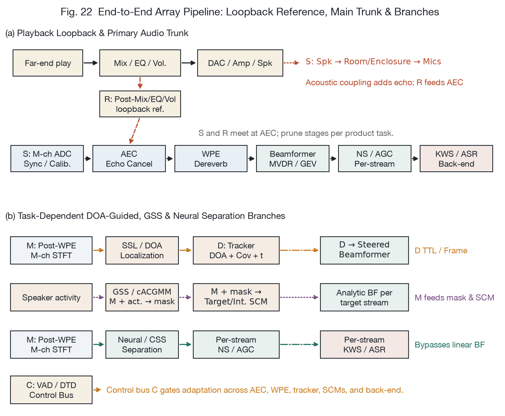
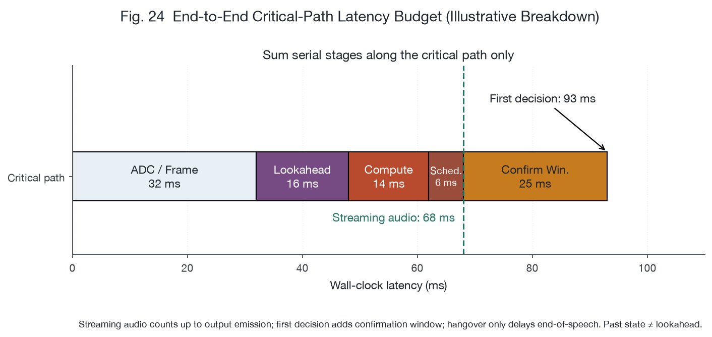
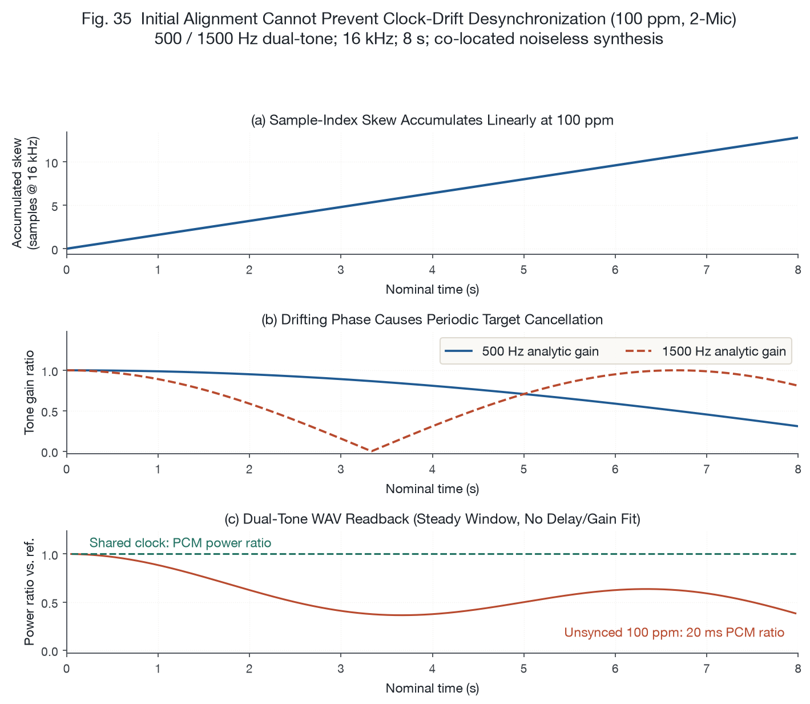
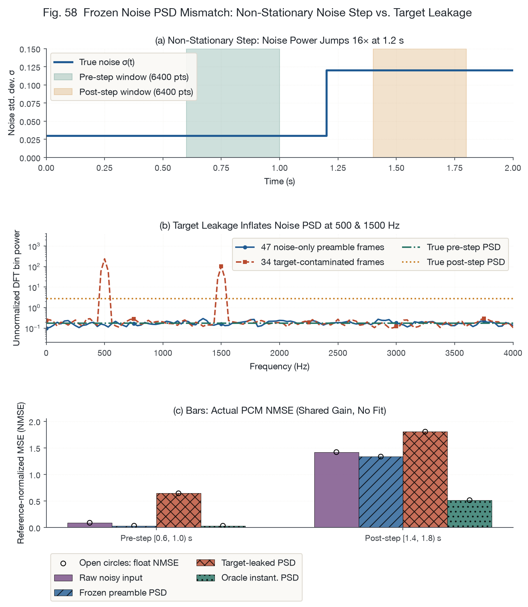
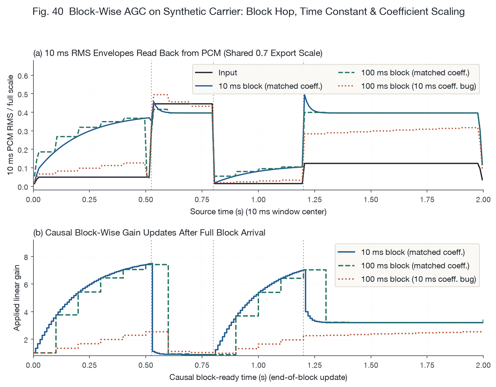
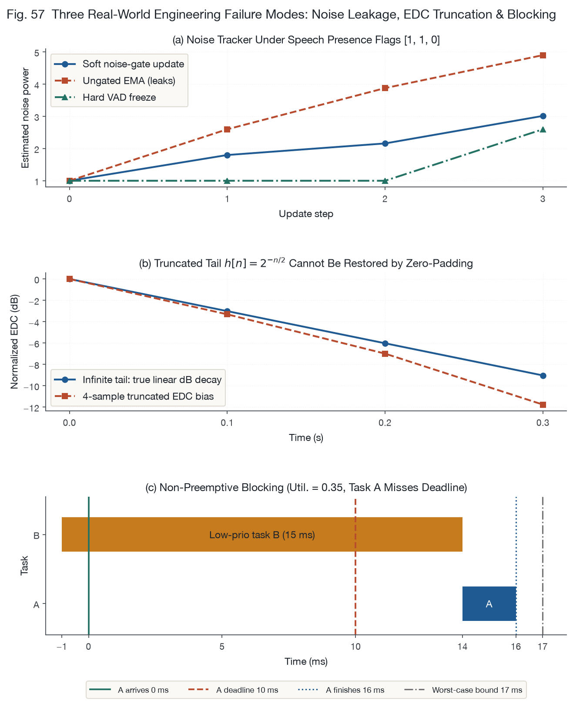
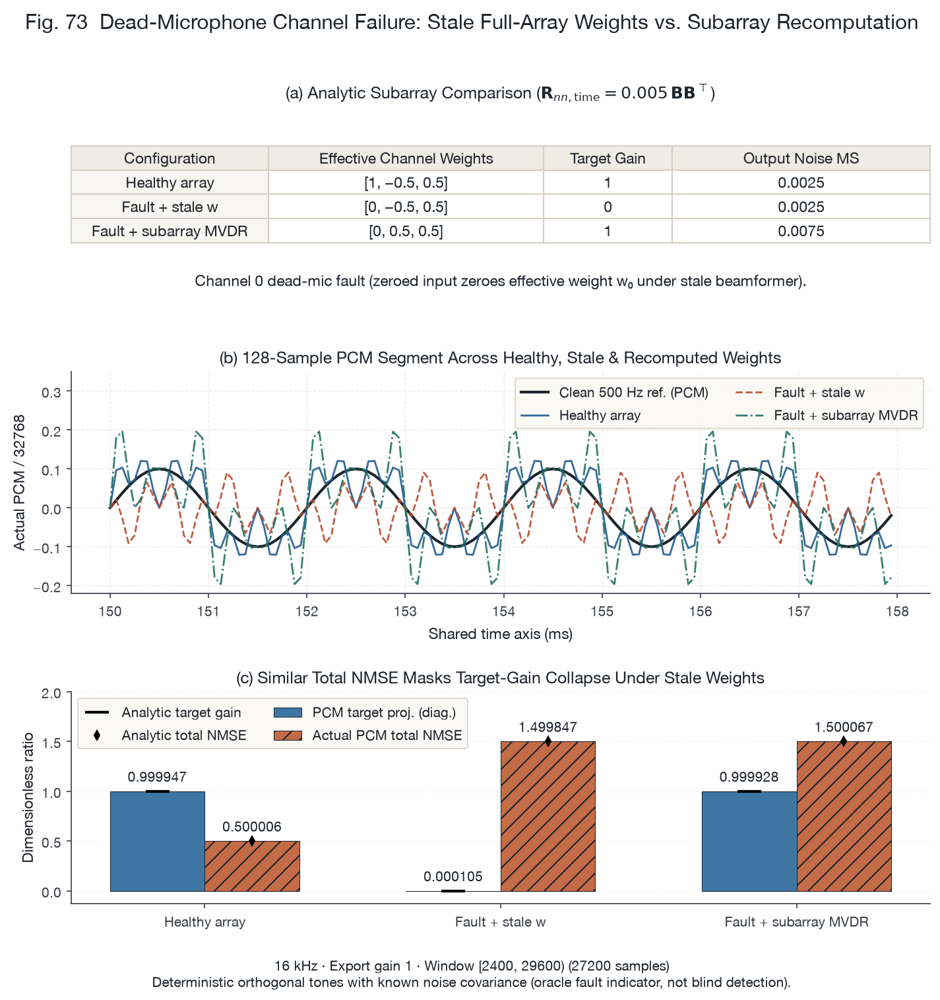

🌐 [简体中文](../chapters/10_engineering-practice.md) ｜ **English**

> This chapter is Chapter 10 of the main text; the book comprises 16 chapters across the core chapters and extended topics (Chapters 0–15, where Chapter 0 covers mathematical foundations and Chapters 12–15 are four extended special topics), plus Appendices A and B. This chapter can be read independently; see the navigation links below for the preceding and following chapters.
>
> Overview: [00_overview.md](00_overview.md) | Previous: [09_source-tracking.md](09_source-tracking.md) | Next: [11_selection-guide.md](11_selection-guide.md)

---

## 10. Engineering Implementation, Evaluation, and Industrial Practice

Chapters 1–9 examined the principles and algorithms of sound source localization, beamforming, acoustic echo cancellation, dereverberation, speech separation, and source tracking individually. When these modules enter commercial hardware products, end-user experience is governed above all by system-level coupling: in what causal order modules cascade or run in parallel, at which tap point playback references and control states are extracted, how sampling-clock offsets and audio driver buffers erode inter-channel phase and real-time deadlines, how fixed-point word lengths and battery budgets are allocated, and how to build an acceptance suite immune to gaming any single metric. This chapter walks through that complete engineering closed loop; all accompanying mathematically synthesized WAVs and teaching scripts verify arithmetic contracts, timing semantics, and failure boundaries reproducibly, while full-device acoustic and real-time performance must always be validated on target hardware.

Common abbreviations used throughout this chapter are summarized below:

| Abbreviation | Full Name and Engineering Role |
|---|---|
| AFE | Audio Front End: multichannel signal processing and control subsystem between capture and ASR or communication coding |
| AEC | Acoustic Echo Cancellation: suppresses loudspeaker-to-microphone echo using on-device playback references |
| WPE | Weighted Prediction Error dereverberation: predicts and subtracts late reverberation from multi-frame history |
| NS / AGC | Noise Suppression / Automatic Gain Control |
| VAD | Voice Activity Detection |
| KWS / ASR | Keyword Spotting / Automatic Speech Recognition |
| SRO | Sampling Rate Offset: relative clock frequency deviation between independent crystal oscillators |
| SRC | Sample Rate Conversion: remaps discrete samples onto a target sampling clock grid |
| TSE | Target Speaker Extraction: extracts a designated speaker's audio stream conditioned on enrolled voiceprints or directions |
| FIR | Finite Impulse Response: filter computing outputs from linear combinations of finite-length input history |
| RTF | Real-Time Factor: ratio of processing wall-clock time to newly advanced source audio duration |
| STFT | Short-Time Fourier Transform: transforms framed time-domain channels into complex time-frequency coefficients |
| GSS | Guided Source Separation: uses speaker activity timestamps to guide multichannel spatial mask estimation |
| cACGMM | Complex Angular Central Gaussian Mixture Model: directional clustering model commonly used inside GSS |
| SCM | Spatial Covariance Matrix: accumulated from multichannel complex spectra weighted by masks to solve analytic beam weights |

To prevent cross-module ambiguity, `RTF` in this chapter stands exclusively for **Real-Time Factor**; the beamforming concept "target relative transfer function" is always written out in full.

### 10.1 Reference Pipeline and End-to-End Latency

No single universal pipeline fits every industrial audio front end. Figure 22 presents a modular reference architecture designed to clarify physical dependencies between signal streams and statistical estimators—not to mandate enabling every block on every device.

Alongside the classic serial trunk "Synchronized Multichannel Capture → Linear AEC → Multichannel WPE → Analytic Beamforming → Single-Channel NS/AGC → KWS/ASR," spatial and separation cues typically flow along three parallel or alternative branches:

1. **Localization and tracking branch**: extracts multichannel phase or cross-correlation features to emit capture-timestamped directional states and uncertainties to direction-steered analytic beamformers without modifying audio waveforms directly.
2. **Guided spatial statistics branch (GSS)**: constrains cACGMM mask estimation via speaker diarization activity intervals, then combines soft TF masks with post-WPE multichannel complex spectra **retaining original magnitudes, phases, and physical power scale** to accumulate target and interference SCMs for MVDR or GEV beamforming.
3. **End-to-end neural separation or Continuous Speech Separation (CSS) branch**: directly emits one or more separated audio streams downstream of WPE as an alternative main trunk bypassing "Mask → SCM → Analytic Beamforming." When a separator emits concurrent streams, downstream NS/AGC and ASR instances must run independently per stream (or select a target stream first) rather than remixing separated tracks back into mono; if the neural separator already performs denoising and level normalization jointly, ablation tests should decide whether to bypass legacy post-NS/AGC to avoid compounding nonlinear speech distortion.

When reading Fig. 22, trace **playback reference tap points** and linearity boundaries along Fig. 22(a) first. Far-end downlink audio typically passes through system prompt mixing, parametric equalizers (EQ), dynamic range compression, or user volume scaling before feeding the Digital-to-Analog Converter (DAC) and power amplifier driving the loudspeaker. The AEC reference **must be tapped downstream of all digital playback processing and immediately upstream of the DAC and power amplifier**, ensuring the adaptive filter sees every prompt mix and volume change reflected in the loudspeaker output; tapping upstream of mixing or volume control mismatches the reference against radiated sound and causes frequent linear AEC divergence.

Keep signal types distinct as well: the playback reference is a continuous waveform stream entering convolutive modeling, whereas near-end/far-end activity flags are Boolean or soft-probability gating metadata—never conflate continuous reference audio and gating metadata into a single "control port" in architecture diagrams.

Inspecting conditional routing and gating in Fig. 22(b), verify port labels on each wire rather than guessing by line color alone. Central control logic fuses near-end voice activity, far-end playback energy, and double-talk status, yet individual modules consume these states in fundamentally different ways—wiring a single VAD bit indiscriminately to every module's "freeze enable" breaks the pipeline. Tailor the pipeline to physical product constraints:

- Pure recording devices and playback-free sensor arrays generate zero self-echo and omit AEC altogether.
- Close-talk headsets or heavily damped cabins with negligible late reverberation skip multichannel WPE matrix inversions.
- Automotive driver-headrest arrays or fixed-seat kiosks with known target geometry use pre-calibrated steering vectors or fixed superdirective weights without real-time DOA tracking.
- VAD, far-end activity detection, and double-talk detection are side-chain state estimators emitting control metadata and should never be drawn as inline waveform-modifying blocks on the audio trunk.

Placing linear AEC at the very front whenever enabled is dictated by linearity: inserting time-varying adaptive beamformers, nonlinear spectral subtraction, or dynamic AGC between capture and AEC turns a stationary (or slowly varying) linear "loudspeaker–room–microphone" convolution path into a rapidly time-varying nonlinear system, collapsing echo cancellation depth. Ordering among WPE, beamforming, and single-channel post-filtering follows channel dimensionality and model contracts: multichannel WPE exploits raw inter-element spatial diversity to predict late reverberation prior to beamforming, whereas single-channel WPE or joint neural dereverberation-beamforming networks sit wherever their training/derivation contracts specify.

#### 10.1.1 Latency Cannot Be Estimated by Summing Every Module's Window or Runtime

End-to-end latency in real-time calling or voice interaction cannot be estimated by summing module window lengths or isolated execution times; instead, decompose critical paths along the Directed Acyclic Graph (DAG) into five physical waiting components:

| Category | Meaning | Typical Sources |
|---|---|---|
| Lookahead / Algorithmic Wait | Future input samples required before emitting current output | Centered windows, bidirectional layers, decision confirmation windows |
| Buffering | Driver, Direct Memory Access (DMA), network, or frame-assembly waits | Audio callback period, jitter buffers, full-chunk inference |
| Compute | Execution time from input readiness to output completion | Fast Fourier Transform (FFT), matrix factorizations, neural inference |
| Scheduling | Time spent ready in queue before running | OS preemption, queue backlog, accelerator contention |
| Decoding & Interaction | Downstream critical path past the AFE | Streaming ASR decoding, network round-trip, TTS playback prep |

Before apportioning budgets across individual modules, establish the system-level ceiling. Under **ITU-T G.114 (05/2003)** for one-way mouth-to-ear transmission delay: one-way totals below $150\ \mathrm{ms}$ remain essentially transparent to conversational interaction; delays between $150\ \mathrm{ms}$ and $400\ \mathrm{ms}$ remain usable with careful network planning but exhibit noticeable double-talk barge-in degradation; delays above $400\ \mathrm{ms}$ exceed acceptable planning bounds for interactive telephony. After subtracting speech codec framing, one-way network propagation and jitter buffering, and far-end playback buffers, the steady-state budget left for the local audio front end (AFE) is typically **$20\text{--}50\ \mathrm{ms}$**. For hearing aids and hear-through earbuds, direct ear-canal acoustic leakage and bone-conducted sound interfere with the processed output at the eardrum to produce comb-filtering coloration, tightening the full-chain ceiling to **$5\text{--}10\ \mathrm{ms}$**. In addition, the internal digital decimation and interpolation filters of hardware $\Sigma\Delta$ ADCs and DACs contribute roughly $15\text{--}40$ samples of linear-phase group delay ($\approx 0.3\text{--}2.5\ \mathrm{ms}$ at $16\text{--}48\ \mathrm{kHz}$, or $4\text{--}8$ samples in low-latency minimum-phase modes), which must be accounted for in full-device hardware loopback budgets.

The single most common latency accounting bug in audio engineering is **equating the analysis window length of causal Weighted Overlap-Add (WOLA / STFT) directly to steady-state algorithmic latency** (for STFT overlap-add reconstruction conditions and decibel scales, see [Chapter 0, §0.2](00_math-foundations.md#sec-0-2)). Let us break down causal streaming frequency-domain beamforming at $f_s=16\ \mathrm{kHz}$, analysis window $N=512$ samples ($32\ \mathrm{ms}$), and hop size $H=128$ samples ($8\ \mathrm{ms}$):

1. **Structural framing latency of causal sliding windows depends on hop size and lookahead, *not* historical window length**: In steady state, the older $N-H=384$ samples ($24\ \mathrm{ms}$) on the left of the window already sit in the circular history buffer. Provided the algorithm never peeks past the current frame's right edge (zero lookahead), accumulating just $H=128$ new samples ($T_{\mathrm{hop}}=H/f_s=8\ \mathrm{ms}$) completes a $512$-sample causal window for FFT, spatial filtering, iFFT, and overlap-add emission of those $128$ new samples.

    Pure causal WOLA framing wait is therefore $T_{\mathrm{hop}}=8\ \mathrm{ms}$, *not* $32\ \mathrm{ms}$; only centered noncausal windows or neural masks looking $K_{\mathrm{look}}$ future frames ahead add $K_{\mathrm{look}}H/f_s$ of algorithmic lookahead latency.

2. **Block-period mismatch buffering between audio DMA callbacks and algorithm hop**: If the audio driver delivers $B_{\mathrm{io}}=160$-sample ($10\ \mathrm{ms}$) interrupts while the frequency-domain front end steps by $H=128$ samples ($8\ \mathrm{ms}$), non-divisible block sizes induce periodic remainder waits in the intermediate ring buffer (traced callback-by-callback in Exercise E10-08); aligning DMA period directly to $128$ samples ($8\ \mathrm{ms}$) triggers exactly one STFT frame per callback with zero cross-block assembly wait.

    Consequently, shrinking a causal STFT window from $32\ \mathrm{ms}$ to $16\ \mathrm{ms}$ while holding hop $8\ \mathrm{ms}$ fixed saves *zero milliseconds* of steady-state streaming latency (affecting cold-start first-frame fill only) while needlessly sacrificing low-frequency spectral resolution and reverberation span. Likewise, causal predict-then-update WPE, recursive covariance smoothing, Kalman tracker states, and causal AGC states read strictly past history and never add future lookahead latency.

Across a multi-module DAG, denote module $v$'s upstream-input readiness time by $r_v$, completion time by $c_v$, execution time by $s_v$ ($\mathrm{s}$), and direct predecessors by $\mathcal{P}(v)$. Under contention-free true parallel hardware scheduling:

$$
\begin{aligned}
r_v&=\max_{u\in\mathcal P(v)}c_u,\\
c_v&=r_v+s_v,
\end{aligned}
\tag{10-1}
$$

seeded at source nodes by capture buffering. For instance, if an audio block ready at $32\ \mathrm{ms}$ feeds two genuinely parallel hardware branches taking $4\ \mathrm{ms}$ and $7\ \mathrm{ms}$ followed by a $3\ \mathrm{ms}$ join node, Eq. (10-1) gives completion at $32+\max(4,7)+3=42\ \mathrm{ms}$, counting the shared $32\ \mathrm{ms}$ capture buffer *once*; serializing both branches onto a single CPU thread pushes completion out to $32+4+7+3=46\ \mathrm{ms}$.

Decomposing causal path $p$ from acoustic input to target endpoint into five non-overlapping waits determines system end-to-end latency via the slowest critical path:

$$
\begin{aligned}
L_p&=L_{p,\mathrm{look}}+L_{p,\mathrm{buf}}\\
&\quad+L_{p,\mathrm{comp}}+L_{p,\mathrm{sched}}\\
&\quad+L_{p,\mathrm{decode}},\\
L_{\mathrm{e2e}}&=\max_p L_p,
\end{aligned}
\tag{10-2}
$$

where subscripts $\mathrm{look}$, $\mathrm{buf}$, $\mathrm{comp}$, $\mathrm{sched}$, and $\mathrm{decode}$ correspond to the five categories tabulated above along path $p$ (never adding non-critical side-branch waits).

Reading Fig. 24 from left to right distinguishes latency ledgers across product endpoints: using an illustrative pipeline with a $32\ \mathrm{ms}$ multi-period capture and chunk-assembly buffer (distinct from the single-$8\ \mathrm{ms}$-hop zero-lookahead causal WOLA configuration above), the first four stages—capture/framing buffer ($32\ \mathrm{ms}$), future-frame lookahead ($16\ \mathrm{ms}$), module compute ($14\ \mathrm{ms}$), and scheduling jitter ($6\ \mathrm{ms}$)—sum at the green dashed line to **$68\ \mathrm{ms}$ continuous streaming audio latency**; appending a $25\ \mathrm{ms}$ backend confirmation window reaches **$93\ \mathrm{ms}$ first-decision latency** marked by the black diagonal arrow on the right. Keep three distinct latency definitions separate:

- **Continuous enhanced communication audio** (green dashed $68\ \mathrm{ms}$, e.g., uplink PCM fed to a VoIP codec): incurs framing, lookahead, compute, and scheduling waits only, with zero ASR confirmation window;
- **KWS wake event or streaming ASR first-token display** (black diagonal arrow on the right, $93\ \mathrm{ms}$): adds acoustic-model right context and decoder false-alarm confirmation windows atop AFE delivery;
- **VAD hangover delay**: when speech stops and short-term energy drops, VAD intentionally holds its active flag true for several frames (e.g., $200\ \mathrm{ms}$) to protect trailing unvoiced consonants. That $200\ \mathrm{ms}$ delays *end-of-utterance endpointing events only*—it never delays real-time waveform samples already streamed out frame by frame.

Formal test reports must never report a bare "mean latency" alone. Steady-state latency tables must report median ($\mathrm{p50}$) alongside tail quantiles ($\mathrm{p95}$, $\mathrm{p99}$), sample count, test duration, and quantile interpolation convention (nearest-rank vs. linear interpolation differences on small samples are worked out in Chapter 11, Exercise E11-04).

Cold-start initialization (checkpoint loading, graph compilation, arena allocation, first-frame warm-up) must be tabulated separately from steady-state streaming; physical measurement boundaries (e.g., "loudspeaker acoustic wavefront at mic diaphragm $\to$ analog headphone onset" vs. "audio driver callback entry timestamp $\to$ first ASR token") as well as power governors and concurrent background load must be documented explicitly.

#### 10.1.2 Real-Time Callback Deadlines and Lock-Free Data Transport

Real-time audio backends (cross-platform PortAudio, macOS/iOS Core Audio, Windows WASAPI, or embedded DMA ISRs) fire callbacks on strict hardware clock ticks. One strict rule governs the audio callback thread: finish sample transport and return before the period deadline. Dynamic heap allocation (`malloc`/`new`), blocking mutex contention, disk file I/O, formatted logging, or variable-latency neural inference inside a callback risks priority inversion and unbounded stalls, starving hardware buffers (see the [official PortAudio real-time callback guidelines](https://portaudio.com/docs/v19-doxydocs/writing_a_callback.html)).

Production real-time audio stacks decouple lock-free transport from heavy DSP/neural compute across three thread tiers:

- **High-priority audio callback thread**: executes deterministic memory copies only (interleaved/planar conversion), reads hardware capture/DAC timestamps and overflow flags, and pushes/pops pre-allocated Single-Producer Single-Consumer (SPSC) lock-free ring buffers (ultra-lightweight DSP with $100\%$ static pre-allocation and worst-case runtime far below the period may run inline);
- **DSP / model-inference worker thread**: pulls hop-sized blocks from the input ring buffer, runs AEC, WPE, beamforming, and ASR/KWS, and writes enhanced audio into the output ring buffer;
- **Low-priority telemetry thread**: asynchronously aggregates deadline misses, dropped-sample counts, and queue high-water marks without ever blocking real-time paths.

On bare-metal microcontrollers or RTOS-driven embedded audio DSPs (e.g., ARM Cortex-M7, Cortex-A, or Cadence HiFi DSPs), physical sample transport typically uses **DMA Ping-Pong Double Buffering**: a contiguous circular memory region sized to twice one frame period is split into a first half (Ping) and second half (Pong). When the DMA engine fills the first half and triggers a Half-Transfer IRQ, hardware seamlessly switches to filling the second half while the DSP safely reads the completed first half; the Transfer-Complete IRQ then swaps roles for a zero-copy, tear-free pipeline. Guard strictly against **write-back L1/L2 data cache coherency traps**:

- **Capture path (RX)**: DMA writes fresh samples directly into on-chip SRAM or external DDR without automatically refreshing the CPU data cache; if the DSP does not perform a **Cache Invalidate** before reading the newly arrived Ping/Pong half, the CPU reads stale cache lines from the previous frame, manifesting as baffling periodic stuttering or random noise;
- **Playback path (TX)**: CPU-computed output waveforms initially linger in write-back data cache; failing to issue a **Cache Clean** before handing the buffer to DMA causes the DAC to play back stale memory contents;
- **Cache-line alignment and non-cacheable regions**: both the base address and half-buffer byte size must align strictly to processor cache lines (typically $32\ \mathrm{B}$ or $64\ \mathrm{B}$) so `Invalidate` never corrupts adjacent control variables; the cleanest production practice maps DMA Ping-Pong buffers into **Non-Cacheable SRAM** via the Memory Protection Unit (MPU) or places them directly in cache-bypassed Tightly Coupled Memory (DTCM).

Under variable-size host callbacks where `frameCount` varies per invocation, read/write cursors must advance strictly by actual `frameCount` while tracking global sample intervals for both captured inputs and committed outputs so asynchronous worker completions map output samples back to exact input capture timestamps (see [PortAudio 19.7.0 `portaudio.h` timestamp/status docs](https://github.com/PortAudio/portaudio/blob/3f7bee79a65327d2e0965e8a74299723ed6f072d/include/portaudio.h#L690-L864) and Exercise [E10-17](#e10-17)).

When burst load fills a ring buffer, architecture must choose explicitly among "drop oldest unread block," "drop newest arriving block," or "graceful compute bypass (e.g., skipping heavy neural post-filtering to emit linear beamformer output directly)": silent drops tear FIR history and phase continuity, blocking stalls the capture driver, and unbounded queues permanently inflate interactive latency.

Our teaching baseline [`RingBuffer`](../codes/chapters/ch10/core/engineering.py) implements deterministic "drop oldest and increment `dropped`" semantics, while [`simulate_deadline_queue`](../codes/chapters/ch10/core/engineering.py) separates **per-frame deadline misses**, **queue high-water mark**, and **full-queue frame drops** on a serial worker (releasing completed slots *before* admitting simultaneous arrivals and counting exact-deadline completion as on-time; integer-tick verification in Exercise [E10-16](#e10-16)). Hardware bring-up must also monitor driver **playback underruns** (DAC starved) and **capture overruns** (ADC unread), collectively termed `xrun` in Linux audio.

On embedded/gateway Linux systems, ALSA (Advanced Linux Sound Architecture) distinguishes interruption causes via negative error codes: `-EPIPE` signals capture overrun or playback underrun, `-ESTRPIPE` signals hardware suspend (distinct from VAD hangover), `-ENODEV` signals physical device disconnect, and virtual echo-reference plugins may return `-ENODATA` before linked playback starts (see [official ALSA PCM documentation](https://www.alsa-project.org/alsa-doc/alsa-lib/pcm.html)). Recovery must match the error code: attempt `snd_pcm_resume` on `-ESTRPIPE` before falling back to `snd_pcm_prepare`, while waiting for playback readiness on `-ENODATA` outside `snd_pcm_recover`.

Crucially, "driver recovery succeeded" never implies "the physical sample timeline remained gapless": although [`snd_pcm_resume`](https://www.alsa-project.org/alsa-doc/alsa-lib/group___p_c_m.html) may preserve unread hardware FIFO samples across suspend, independent crystal oscillators keep ticking during suspend so cross-device clock offsets jump. Record an integer dropped-sample count *only* when hardware frame counters or monotonic timestamps prove an exact $N$-sample gap; whenever gap length is unrecoverable, log `dropped_samples = null` and explicitly notify AEC, SRC, and WPE to realign or reset history.

**Real-hardware loopback and driver-timestamp benchmark (MacBook Air).** To verify the relationship between audio callback timestamps and physical acoustic loopback offsets directly on real hardware, we opened a $48\ \mathrm{kHz}$ full-duplex Core Audio + PortAudio stream on a MacBook Air (`Mac17,3`, built-in mono mic capturing the same chirp played through built-in stereo speakers; scripts and raw logs archived in [`macbook_audio_latency/README.md`](../codes/chapters/ch10/examples/macbook_audio_latency/README.md)) and measured two opposite physical paths:

- **Total acoustic round-trip offset (Playback Buffer → Speaker → Air → Mic → Capture Buffer)**: injecting a $20\ \mathrm{ms}$, $900\text{--}4500\ \mathrm{Hz}$ linear chirp at playback index $n_{\mathrm{out}}$ and locating peak normalized cross-correlation $n_{\mathrm{in}}$ on the demeaned recording (muted control max correlation $0.109$, active trials min $0.659$). Across $20$ trials at $128$-frame callbacks, the median offset was $5103$ samples ($106.31\ \mathrm{ms}$; reopening an identical stream measured $105.60\ \mathrm{ms}$, illustrating slight stream-start phase jitter); at $480$-frame callbacks, the median offset was $5555$ samples ($115.73\ \mathrm{ms}$).
- **Forward-relay timestamp pairing and incremental buffer verification (Capture → Software Delay Line → Playback)**: on the same $128$-frame full-duplex stream, we relayed the first captured probe chirp back out through alternating software delay lines of $60\ \mathrm{ms}$ ($2880$ samples) and $100\ \mathrm{ms}$ ($4800$ samples), comparing acoustic spacing between the two recaptured echoes against forward $\mathrm{ADC}\to\mathrm{DAC}$ latency computed from hardware block-start timestamps plus intra-block offsets:

| Inserted Software Buffer | Trials | Median Double-Echo Acoustic Spacing | Median Forward ADC→DAC Timestamp Estimate |
|---:|---:|---:|---:|
| $60\ \mathrm{ms}$ | 16 | $165.60\ \mathrm{ms}$ | $73.58\ \mathrm{ms}$ |
| $100\ \mathrm{ms}$ | 16 | $205.60\ \mathrm{ms}$ | $113.58\ \mathrm{ms}$ |

The acoustic spacing on the left exceeds the pure forward driver estimate on the right by $\approx 92\ \mathrm{ms}$—corresponding cleanly to the second acoustic trip from speaker through air to mic and into the capture buffer—while switching the software buffer from $60\ \mathrm{ms}$ to $100\ \mathrm{ms}$ shifts the two columns by $40.00\text{--}40.02\ \mathrm{ms}$ and an exact $40.00\ \mathrm{ms}$ respectively ($15{,}314$ total callbacks across four streams with zero `xrun`s), confirming exact sample-by-sample timestamp pairing (single- and variable-length callback arithmetic is worked out in Exercise [E10-17](#e10-17)).

On mobile platforms (especially Android phones, tablets, and automotive head units), a common low-level pitfall frequently costs algorithm teams weeks of debugging: **hidden preprocessing enabled silently inside the OS Hardware Abstraction Layer (HAL)**. Opening capture on Android with the telephony preset `MediaRecorder.AudioSource.VOICE_COMMUNICATION` (or a default microphone path with vendor voice preprocessing attached) causes the audio HAL to automatically enable built-in single-/dual-mic AGC, noise suppression, high-pass filters, or even platform AEC; these opaque nonlinear gains and phase distortions destroy raw inter-microphone phase differences and linear echo paths, collapsing custom MVDR nulls and spiking AEC residuals. Meanwhile, although the Android Compatibility Definition Document (CDD) requires `VOICE_RECOGNITION` to disable AGC and noise suppression by default (making it a common fallback on legacy devices lacking unprocessed capture), vendors may still retain mono-ASR equalization or pre-emphasis on that route, so it is *not* equivalent to strictly unmodified raw multichannel audio. When capturing raw arrays via C++ Oboe or native AAudio on Android, lock down a clean path in three mandatory steps:

1. Query `AudioManager.PROPERTY_SUPPORT_AUDIO_SOURCE_UNPROCESSED` first to verify true firmware unprocessed support;
2. Explicitly request `oboe::InputPreset::Unprocessed` alongside `PerformanceMode::LowLatency` and `SharingMode::Exclusive` (re-benchmarking callback periods if downgraded to `Shared`);
3. Run a startup quiet-floor and sine-sweep self-test checking per-channel spectral flatness, magnitude/phase match, and absence of hidden high-SPL gain compression before feeding raw Pulse-Code Modulation (PCM) into your front end.

Combining data dependencies and real-time contracts yields the full-system integration checklist:

| Module | Enable Condition | Primary Inputs | Primary Outputs | Top Priority Checks |
|---|---|---|---|---|
| Capture & Sync | Multichannel timing preservation required | Microphones, clocks | Aligned multichannel PCM samples | Channel map, clipping, frame drops, relative delay |
| AEC | On-device playback couples into mics | Mics; post-mix/EQ/volume pre-DAC/amp reference; far-end/double-talk flags | Echo-suppressed mic channels, residual echo & adaptation state | Reference covers mix/EQ/volume; bulk delay, clipping, double-talk stability |
| WPE | Late reverberation degrades downstream task | Multichannel or mono STFT | Dereverberated STFT | Prediction delay, tap order, target speech distortion |
| Localization / Tracking | Beamformer or app requires DOA / tracks | Multichannel features, activity flags, capture time | Frame ID, capture/state/publish timestamps, state & cov, activity/existence prob., `track_id` & validity | Coordinate conventions, stale extrapolation, miss/FA, ID lifecycle (see §9.4) |
| GSS Mask Estimation | Speaker activity known for multi-speaker spatial extraction | Diarization segments; post-WPE multichannel STFT | Per-target soft TF masks, effective frame count | Diarization misalignment, mask leakage, target-silent frames |
| Target / Interference SCM | Soft masks available on matching TF grid | Unnormalized post-WPE multichannel STFT; target/non-target masks | Per-bin target & interference SCMs, $N_{\mathrm{eff}}$, condition number | Matching time/freq/channel indexing; masks are *not* SCMs |
| Analytic Beamforming | Convert spatial statistics into target stream | Same-stage multichannel STFT; SCMs or steering vectors | Per-target enhanced stream, beam weights & apply timestamp | Steering mismatch, ill-conditioned SCMs, target cancellation |
| Neural Sep / CSS / TSE | Overlapped multi-stream or enrolled target extraction | Multichannel features; optional voiceprint, visual, or DOA conditioning | Fixed/dynamic output streams or single target track | Lookahead context, first-chunk latency, cross-chunk stitching, identity leakage, domain shift |
| NS / AGC | Residual noise or dynamic range impacts backend | Enhanced mono stream | Denoised, level-regulated audio | Speech distortion, gain pumping, inter-sample clipping |
| KWS / ASR | Wake-word detection or speech-to-text required | Audio waveform or features | Wake events or transcripts | Tap point, pre-roll buffer, FA/h vs. FRR, WER |

Across rows 5–7 above, keep the three intermediate objects of GSS strictly distinct: diarization segments constrain **soft TF masks**, soft masks weight unnormalized multichannel outer products into **target/interference SCMs**, and analytic beamformers solve **spatial filter weights** from SCMs to emit mono audio—interface specs must state explicitly whether masks, covariances, or waveforms cross each boundary.

### 10.2 Acoustic Pickup, Synchronization, and Gain Staging

Hardware pickup sets the physical ceiling of every downstream array algorithm. Selecting Micro-Electro-Mechanical Systems (MEMS) microphones requires jointly verifying five electro-acoustic specs: Equivalent Input Noise (EIN, or SNR at $94\ \mathrm{dB\ SPL}$), Acoustic Overload Point (AOP), sensitivity tolerance, frequency-response flatness (low-frequency roll-off corner and high-frequency Helmholtz port resonance), and lot-to-lot magnitude/phase matching. Bare-component datasheet numbers never substitute for full-enclosure acoustic verification—acoustic port length/diameter, protective mesh damping, gasket air leaks, and power-rail ripple all alter inter-element magnitude and phase substantially.

Acoustic Overload Point (AOP) specifies the incident SPL at which microphone Total Harmonic Distortion (THD) hits a stated percentage under rated excitation frequency and supply voltage. Always align THD thresholds and frequencies when comparing datasheets: for instance, [TDK's official MMICT4078-00-908 specification](https://product.tdk.com/en/search/sw_piezo/mic/mems-mic/info?part_no=MMICT4078-00-908) lists both $135\ \mathrm{dB\ SPL}$ at $10\%\ \mathrm{THD}$ and $130\ \mathrm{dB\ SPL}$ at $1\%\ \mathrm{THD}$ ($1\ \mathrm{kHz}$), while [Analog Devices Application Note AN-1328](https://www.analog.com/en/resources/app-notes/an-1328.html) specifies $131\ \mathrm{dB\ SPL}$ at $10\%\ \mathrm{THD}$ for the ADMP411. Once close-range clapping or loud playback drives the diaphragm or preamplifier nonlinear, harmonic distortion is baked in *before* digitization—widening digital formats to 24-bit integer or 32-bit float preserves internal DSP headroom, but can neither raise physical mic AOP nor undo analog clipping.

**Acoustic cavity structure, waterproof breathable membranes, and electromechanical isolation.** Once a bare MEMS microphone is assembled into a product enclosure, its acoustic port channel and the front cavity inside the silicone boot form a miniature Helmholtz resonator. Letting $c$ denote the speed of sound, $S=\pi d^2/4$ the port cross-sectional area, $L_{\mathrm{eff}}$ the effective acoustic channel length (including port end corrections), and $V$ the dead-cavity volume in front of the microphone diaphragm, the first-order resonance frequency is

$$
f_H=\frac{c}{2\pi}\sqrt{\frac{S}{V L_{\mathrm{eff}}}}.
\tag{10-3}
$$

Compare two realistic mechanical designs at $c=343\ \mathrm{m/s}$: a short, wide acoustic port paired with a compact front cavity ($d=1.0\ \mathrm{mm},\ L_{\mathrm{eff}}=1.8\ \mathrm{mm},\ V=1.5\ \mathrm{mm}^3$) yields $f_H\approx 29.4\ \mathrm{kHz}$, pushing the resonance peak safely beyond the human audible and speech bands; conversely, if industrial-design constraints force a long, narrow port with a large dead cavity ($d=0.8\ \mathrm{mm},\ L_{\mathrm{eff}}=5.0\ \mathrm{mm},\ V=10\ \mathrm{mm}^3$), the resonance frequency drops to $f_H\approx 5.47\ \mathrm{kHz}$, introducing strong peak-and-notch ripple (often exceeding $10\ \mathrm{dB}$) and rapid phase transitions directly inside the core voiceless-consonant band. In addition, consumer outdoor and wearable devices routinely bond expanded polytetrafluoroethylene (ePTFE) waterproof breathable membranes over pickup ports—these require low acoustic resistance and tight lot-to-lot adhesive-thickness control to prevent high-frequency roll-off and inter-channel phase drift. Meanwhile, smart speakers and conference units with high-power built-in loudspeakers must mechanically decouple the microphone array from the main housing using flexible printed circuits (FPCs), silicone isolation boots, or PORON foam gaskets, and seal it hermetically from the loudspeaker rear chamber—otherwise nonlinear structure-borne vibrations traveling through plastic or metal enclosures far faster than airborne sound couple directly into the diaphragms and degrade linear AEC.

**Selecting a multi-microphone digital audio bus.** At the interconnect between digital microphones and the host SoC, hardware designs primarily trade off Pulse-Density Modulation (PDM), Inter-IC Sound (I²S), Time-Division Multiplexing (TDM), and the Automotive Audio Bus (A²B):

| Bus Standard | Wires & Pins | Typical Channel Capacity | Typical Distance | Clock / Frame Rate & Key Limitations |
|---|---|---|---|---|
| **PDM** | $2$ wires/pair (`CLK` + `DATA`, 2 mics multiplexed per data line) | $2$ mics per data line (rising/falling-edge latching) | On-board short run ($<15\ \mathrm{cm}$) | $1.024\text{--}3.072\ \mathrm{MHz}$ bit clock; requires host CIC decimation and introduces half-cycle edge skew |
| **I²S** | $3\text{--}4$ wires (`BCLK`, `LRCLK`, `DATA`, optional `MCLK`) | $2$ PCM channels per data line | On-board short run ($<20\ \mathrm{cm}$) | Word clock equals $f_s$ directly (no decimation); scaling to $8$ mics demands multiple parallel I²S ports and high pin count |
| **TDM** | $3\text{--}4$ wires (`BCLK`, `FSYNC`, `DATA`, optional `MCLK`) | $4/8/16$ PCM channels per line (e.g., TDM8) | On-board / short flex ($<30\ \mathrm{cm}$) | $48\ \mathrm{kHz}$ TDM8 ($32\ \mathrm{bit}$ slots) hits $12.288\ \mathrm{MHz}$ bit clock; demands crosstalk and reflection control |
| **A²B** | $2$-wire unshielded twisted pair (single UTP daisy chain) | Up to $32$ upstream/downstream $24\ \mathrm{bit}$ PCM + I²C control | Long run ($15\ \mathrm{m}$/hop, $40\ \mathrm{m}$ chain) | Chain-wide hardware-synchronized clock, deterministic $<50\ \mu\mathrm{s}$ latency, and phantom bus power; requires dedicated transceiver ICs |

Diagnosing elevated high-frequency noise floors or skewed endfire nulls requires going beyond bus names to unpack the **1-bit $\Sigma\Delta$ PDM modulation through $\mathrm{Sinc}^N$ decimation filter** chain. For PDM bit clock $f_{\mathrm{PDM}}$, decimation factor $R$, differential comb delay $M$ (typically $M=1$), and cascade order $N$, the unscaled $N$-stage Cascaded Integrator-Comb (CIC) transfer function, Hogenauer overflow-free register width $B_{\max}$ ([Hogenauer 1981, *IEEE TASSP* 29(2):155–162](https://doi.org/10.1109/TASSP.1981.1163535)), normalized magnitude response $|\widetilde H_{\mathrm{CIC}}(f)|$, and linear-phase group delay $\tau_g$ are:

$$
\begin{aligned}
H_{\mathrm{CIC}}(z)
&=\left(\frac{1-z^{-RM}}{1-z^{-1}}\right)^N,\\
B_{\max}
&=B_{\mathrm{in}}+\left\lceil N\log_2(RM)\right\rceil,\\
\left|\widetilde H_{\mathrm{CIC}}(f)\right|
&=\left|\frac{\sin(\pi fRM/f_{\mathrm{PDM}})}
  {RM\sin(\pi f/f_{\mathrm{PDM}})}\right|^N,\\
\tau_g
&=\frac{N(RM-1)}{2f_{\mathrm{PDM}}}.
\end{aligned}
\tag{10-4}
$$

Hardware bring-up and low-level driver configuration must verify three exact budgets from Eq. (10-4):

1. **Oversampled noise shaping and Hogenauer signed vs. unsigned accumulator bit width**: Inside a digital PDM mic, an ASIC runs a high-order $\Sigma\Delta$ modulator at bit clock $f_{\mathrm{PDM}}=R f_s$ (e.g., $3.072\ \mathrm{MHz}$ for $f_s=48\ \mathrm{kHz}, R=64$; or $1.024\ \mathrm{MHz}$ for $f_s=16\ \mathrm{kHz}, R=64$), emitting a 1-bit pulse stream that pushes quantization noise to high frequencies, while the host SoC PDM peripheral applies a multiplier-free $N$-stage CIC decimator first.

    Watch carefully for a common numerical-encoding pitfall in $B_{\mathrm{in}}$. Because maximum DC envelope gain is $G_{\max}=(RM)^N$, register growth is always exactly $\lceil N\log_2(RM)\rceil$ bits, yet input encoding splits into two distinct arithmetic models:
    - **Unipolar unsigned coding $\{0,1\}$ ($B_{\mathrm{in}}=1\ \mathrm{bit}$)**: For a fourth-order $\mathrm{Sinc}^4$ filter ($N=4, M=1$), first-stage $R_1=16$ ($G_{\max}=65{,}536=2^{16}$) requires $1+16=\mathbf{17\ \mathrm{bit}}$ **unsigned** registers, and single-stage $R_2=64$ ($G_{\max}=16{,}777{,}216=2^{24}$) requires $1+24=\mathbf{25\ \mathrm{bit}}$ **unsigned** registers (hardware RTL often accumulates modulo-unsigned this way and subtracts the constant DC offset $(RM)^N/2$ after the final comb stage to save $1\ \mathrm{bit}$ of register area).
    - **Bipolar signed two's-complement coding $\{-1,+1\}$ ($B_{\mathrm{in}}=2\ \mathrm{bit}$)**: Once 1-bit PDM is mapped explicitly to signed integers $\{-1,+1\}$ feeding a two's-complement accumulator, the minimum signed two's-complement input width capable of representing both $+1$ and $-1$ is $B_{\mathrm{in}}=2\ \mathrm{bit}$, *not* $1\ \mathrm{bit}$. Because a $k$-bit signed two's-complement register tops out at $+2^{k-1}-1$, an all-$+1$ DC full-scale output $+(RM)^N$ strictly overflows the signed width predicted by the unsigned formula ($2^{16}-1=65{,}535<65{,}536$ and $2^{24}-1=16{,}777{,}215<16{,}777{,}216$). Minimum overflow-free bipolar two's-complement widths are therefore $2+16=\mathbf{18\ \mathrm{bit}}$ ($R_1=16$, leaving only **$6\ \mathrm{bit}$** of headroom inside a standard 24-bit signed register rather than $7\ \mathrm{bit}$) and $2+24=\mathbf{26\ \mathrm{bit}}$ ($R_2=64$, exceeding a 24-bit signed register by $2\ \mathrm{bit}$; full step-by-step verification in Exercise [E10-27](#e10-27)).

2. **High-frequency shaped-noise aliasing suppression and passband droop**: A fourth-order $\Sigma\Delta$ modulator ramps quantization noise PSD upward at $24\ \mathrm{dB/octave}$, requiring CIC order $N\ge L_{\Sigma\Delta}+1$ (or $\mathrm{Sinc}^4$ down to $2f_s\text{--}4f_s$ followed by sharp half-band low-pass FIRs) lest high-frequency shaped noise fold back into the audio band.

    Meanwhile, single-stage high-$R$ CICs suffer steep passband droop: at $f_s=16\ \mathrm{kHz}, R=64, M=1$ ($f_{\mathrm{PDM}}=1.024\ \mathrm{MHz}$), $f=7\ \mathrm{kHz}$ has exact discrete single-stage gain $\sin(7\pi/16)/[64\sin(7\pi/1024)]\approx 0.7136$ ($-2.930\ \mathrm{dB}$), compounding across $\mathrm{Sinc}^4$ to **$-11.72\ \mathrm{dB}$**. Industrial PDM peripherals therefore decimate to $2f_s$ or $4f_s$ first (e.g., at $3.072\ \mathrm{MHz}$, first-stage $R_1=16$ droops just $-0.0757\ \mathrm{dB}$ at $7\ \mathrm{kHz}$ with group delay $\tau_g=9.766\ \mu\mathrm{s}$) before cascading half-band droop-compensation FIRs and DC-blocking filters.

3. **Half-clock-cycle edge skew on stereo-multiplexed PDM data lines**: Hardware designs routinely multiplex Left and Right digital mics onto a single `PDM_DATA` wire and `PDM_CLK`—latching Left on rising clock edges and Right on falling edges. Though frequency-locked with zero long-term drift, their physical sampling instants differ permanently by half a bit-clock period $\Delta t_{\mathrm{PDM}}=1/(2f_{\mathrm{PDM}})$.

    At $f_{\mathrm{PDM}}=1.024\ \mathrm{MHz}$, $\Delta t_{\mathrm{PDM}}\approx 0.4883\ \mu\mathrm{s}$ ($\approx 0.1675\ \mathrm{mm}$ path offset at $c=343\ \mathrm{m/s}$, or fixed phase offset $\Delta\phi=2\pi f\Delta t_{\mathrm{PDM}}\approx 1.406^\circ$ at $8\ \mathrm{kHz}$); even at $f_{\mathrm{PDM}}=3.072\ \mathrm{MHz}$ ($\Delta t_{\mathrm{PDM}}\approx 162.76\ \mathrm{ns}$), uncompensated half-cycle skew on a $12\ \mathrm{mm}$-spaced first-order differential cardioid endfire pair pulls the $180^\circ$ rear null off by **over $5.5^\circ$** (derived in Exercise [E10-27](#e10-27)). Unless the SoC PDM controller enables hardware half-cycle de-skewing, array calibration filters must compensate this fixed group-delay offset explicitly.

#### 10.2.1 SRO: Separating Initial Offset from Sampling-Rate Offset

When loudspeaker playback and microphone capture run off independent crystal oscillators (e.g., a laptop pairing a USB mic with a Bluetooth speaker, or ad-hoc wireless multi-device arrays), the two clock domains exhibit not only a fixed startup offset, but a continuously growing Sampling Rate Offset (SRO). For nominal reference rate $f_s$ and actual device rate $f_d=f_s(1+\varepsilon)$ ($\varepsilon>-1$ dimensionless), align $n=0$ at zero offset and inspect sample index $n$: its reference timestamp is $T=n/f_s$ whereas its actual physical device capture instant is $n/f_d$. Under our unified "reference time minus device time" sign convention, cumulative drift at index $n$ is:

$$
\begin{aligned}
\Delta t(T)&=\frac{n}{f_s}-\frac{n}{f_d}\\
&=\frac{\varepsilon}{1+\varepsilon}T\\
&\approx\varepsilon T\quad(|\varepsilon|\ll1).
\end{aligned}
\tag{10-5}
$$

Crystal tolerances are measured in parts per million ($\mathrm{ppm}$, $1\ \mathrm{ppm}=10^{-6}$). A typical consumer tolerance of $\varepsilon=100\ \mathrm{ppm}$ slips by $\approx 100\ \mu\mathrm{s}$ every second, accumulating $\approx 60\ \mathrm{ms}$ over $10\ \mathrm{min}$ ($600\ \mathrm{s}$); because a faster device ($\varepsilon>0$) captures sample $n$ earlier ($n/f_d < n/f_s$), Eq. (10-5) yields positive drift. Note that $60\ \mathrm{ms}$ is cumulative index slip after $10\ \mathrm{min}$, *not* a $60\ \mathrm{ms}$ acoustic TDOA within a single frame. Even tens of $\mathrm{ppm}$ severely degrade linear AEC and multi-microphone beamforming simultaneously:

- **Impulse creep and phase-cancellation ceiling in linear AEC**: At $f_s=16\ \mathrm{kHz}$ and $\varepsilon=100\ \mathrm{ppm}$, playback and capture slip by $f_s\varepsilon=1.6$ samples/s—shifting the entire room impulse response by $1$ full tap every $0.625\ \mathrm{s}$. Worse still is sub-sample phase mismatch at high frequencies: even with rapid adaptive tracking, lagging just $0.1$ sample ($\Delta\tau=6.25\ \mu\mathrm{s}$) behind the true impulse peak creates phase error $\Delta\phi=2\pi f\Delta\tau=0.05\pi\ \mathrm{rad}$ ($9^\circ$) at $f=4\ \mathrm{kHz}$, holding the coherent residual-to-echo power ratio $20\log_{10}|1-e^{-\mathrm{j}0.05\pi}|$ at $\approx -16.1\ \mathrm{dB}$ (limiting achievable ERLE to at most $+16.1\ \mathrm{dB}$) before the echo peak eventually slides outside the finite FIR window.
- **Time-varying high-frequency comb cancellation and SCM coherence decay in asynchronous beamforming**: Across two mics in clock domains separated by SRO, inter-channel phase drift $\Delta\phi(f,T)=2\pi f\,\Delta t(T)$ grows bilinearly in $f$ and $T$. Denoting instantaneous reference phase by $\varphi$, the sum-to-product identity for equal-index averaging of two unit cosines yields $\frac{1}{2}[\cos\varphi+\cos(\varphi-2\pi f\Delta t)]=\cos(\pi f\Delta t)\cos(\varphi-\pi f\Delta t)$, introducing a time-modulated local envelope $|\cos(\pi f\Delta t)|$ (power loss $20\log_{10}|\cos(\pi f\Delta t)|$). At $T=1\ \mathrm{s}$ with exact drift $\Delta t\approx 99.99\ \mu\mathrm{s}$, a $1\ \mathrm{kHz}$ speech component loses just $\approx 0.44\ \mathrm{dB}$ (amplitude factor $0.9511$), whereas at $4\ \mathrm{kHz}$ sibilants the phase difference approaches $144^\circ$, reducing equal-weight sum power by $\approx 10.20\ \mathrm{dB}$ (amplitude factor just $0.3091$) and turning fixed or slow beamformers into time-sweeping high-frequency comb filters. Furthermore, when estimating an STFT-domain spatial covariance matrix (SCM) over an averaging window of length $T_{\mathrm{avg}}$, the constant phase rotation rate $2\pi f\varepsilon$ multiplies off-diagonal cross-spectral entries by the integral decay factor (with $\operatorname{sinc}(u)=\sin(\pi u)/(\pi u)$):

$$
\begin{aligned}
\frac{1}{T_{\mathrm{avg}}}\int_0^{T_{\mathrm{avg}}}
e^{-\mathrm{j}2\pi f\varepsilon t}\,\mathrm{d}t
&=e^{-\mathrm{j}\pi f\varepsilon T_{\mathrm{avg}}}
\operatorname{sinc}(f\varepsilon T_{\mathrm{avg}}).
\end{aligned}
$$

For example, at $f=4\ \mathrm{kHz}$ and $\varepsilon=100\ \mathrm{ppm}$, a $T_{\mathrm{avg}}=1\ \mathrm{s}$ averaging window attenuates cross-channel coherence magnitude to $|\operatorname{sinc}(0.4)|\approx 0.757$, and extending to $T_{\mathrm{avg}}=2.5\ \mathrm{s}$ nulls the off-diagonal cross-correlation completely, quantitatively explaining why covariance-based adaptive beamformers (MVDR/GEV) often fail even earlier than delay-and-sum under uncompensated SRO.

First principle of audio hardware architecture: **never go asynchronous when a shared clock is possible**. Drive all ADCs and loopback DACs inside an enclosure from a single master clock (`MCLK`/`BCLK`), and enable hardware clock locking on networked pro-audio gear; reserve software "online SRO estimation $\to$ fractional-delay asynchronous SRC $\to$ closed-loop thermal drift tracking" strictly for genuinely clock-independent consumer devices.

#### Clock-Drift Waveforms and Time Axes

Figure 35 and the `clock_drift` group in the master audio manifest construct a deterministic $8\ \mathrm{s}$, nominal-$16\ \mathrm{kHz}$ two-device benchmark with $+100\ \mathrm{ppm}$ device clock offset, evaluating the exact same continuous acoustic waveform at each device's true physical sampling instants (never approximating drift via stereo panning). At nominal $8\ \mathrm{s}$, the faster device captures its matching sample index at $8/(1+10^{-4})\ \mathrm{s}$, accumulating $\approx 0.79992\ \mathrm{ms}$ ($12.799$ reference samples; exact lengths and gains in the [master manifest](../codes/chapters/ch00/audio/MANIFEST.json)).

Reading the three panels of Fig. 35 from top to bottom traces asynchronous destructive interference:

- **Panel (a)** plots linear sample slip $\Delta t(T)\times 16\,\mathrm{kHz}$ climbing to $\approx 12.8$ samples over $0\text{--}8\ \mathrm{s}$;
- **Panel (b)** contrasts analytic coherent-sum envelopes $|\cos(\pi f\Delta t)|$ at $500\ \mathrm{Hz}$ vs. $1500\ \mathrm{Hz}$: because phase scales with $f$, $1500\ \mathrm{Hz}$ plunges into its first complete anti-phase null at $t\approx 3.33\ \mathrm{s}$ (half-wavelength accumulated slip) while $500\ \mathrm{Hz}$ rolls off gently;
- **Panel (c)** computes $20\ \mathrm{ms}$ block power ratios from the published two-tone `PCM16` WAVs relative to the synchronized baseline (green dashed line at $1$), exposing periodic power dropouts—whenever field recordings exhibit rhythmic volume pulsing or periodic high-frequency muffling on a multi-mic beamformer, check unsynchronized clock domains first rather than mistaking beat-frequency cancellation for "noise suppression".

Diagnosing real recordings requires separating **initial offset $b$**, **steady SRO slope $\widehat{s}$**, and **dropped-buffer step jumps**: on a "time vs. relative delay" scatter plot, startup offset sets intercept $b$, crystal frequency offset sets slope $\widehat{s}$, and driver `xrun` drops that pack subsequent samples contiguously inject vertical step discontinuities. Differencing only the first and last frames of a recording produces wildly corrupted SRO estimates whenever a single drop occurs mid-session; robust estimators extract windowed cross-correlation peaks, screen adjacent-window residuals for step jumps (cross-checked against hardware frame counters and `xrun` logs), and fit linear regressions strictly within contiguous gap-free segments.

Our helper [`estimate_sro_ppm`](../codes/chapters/ch10/core/engineering.py) fits $\widehat{d}(T)=b+\widehat{s}T$ against reference time $T$ ($\mathrm{s}$) under "reference minus device" sign convention. Matching exact $\Delta t(T)=\frac{\varepsilon}{1+\varepsilon}T$ in Eq. (10-5) for constant rate $\widehat{s}<1$ gives exact and first-order SRO inversions:

$$
\begin{aligned}
\widehat\varepsilon&=\frac{\widehat s}{1-\widehat s},\\
\mathrm{ppm}_{\mathrm{exact}}&=10^6\widehat\varepsilon,\\
\mathrm{ppm}_{\mathrm{first}}&=10^6\widehat s.
\end{aligned}
\tag{10-6}
$$

At $\widehat{s}=10^{-4}$, first-order gives $100\ \mathrm{ppm}$ while exact inversion gives $10^6\times 10^{-4}/0.9999\approx 100.010\ \mathrm{ppm}$; intercept $b$ captures startup offset without entering rate ratios, while Exercise [E10-12](#e10-12) quantifies slope corruption from an unscreened drop jump. Moreover, never mistake a "single device's sample count against an uncalibrated host timer" for absolute crystal offset: if the device's true sampling rate is $f_d=f_0(1+\varepsilon)$ while the host timer reads $\widetilde{t}=(1+\eta)t$, the single-sided apparent normalized rate ratio $r$ and nominal residual slope $s$ identify only the ratio of the two scales:

$$
\begin{aligned}
\widetilde t_n&=\frac{(1+\eta)n}{f_0(1+\varepsilon)},\\
r&=\frac{n/\widetilde t_n}{f_0}
 =\frac{1+\varepsilon}{1+\eta},\\
s&=1-\frac1r,
\end{aligned}
\tag{10-7}
$$

Only by reading frame increments $\Delta N_d, \Delta N_r$ from *two* hardware devices over the *same* window on the *same* host timer does the common timer scale factor $1+\eta$ cancel to reveal true relative SRO (non-identifiability counterexample in Exercise [E10-24](#e10-24)).

Offline teaching helper [`resample_sro_to_reference`](../codes/chapters/ch10/core/engineering.py) guards output length against memory caps ($10^7$ samples/ch default) before applying two-point linear interpolation to verify rate direction; because two-point linear interpolation suffers steep high-frequency passband roll-off (see [Fig. 36](../figures_en/fig36_interpolation_error.png)) and weak stopband rejection, downsampling requires anti-aliasing polyphase or polynomial filters (high-frequency aliasing foldback is worked out in Exercise [E10-19](#e10-19)).

#### Special Topic: Rate Direction, Unconsumed Remainders, and Gap Propagation in Stateful SRC

Streaming pipelines must carry **sub-sample fractional phase and filter history** seamlessly across thousands of chunk callbacks. For device sample $0$ at physical time $t_0$, actual device rate $f_d$, and target reference rate $f_s$, reference output sample $k$ at time $k/f_s$ lands on continuous input index $u_k$, integer base index $q_k$, and fractional remainder $\eta_k\in[0,1)$:

$$
\begin{aligned}
u_k&=f_d\left(\frac{k}{f_s}-t_0\right),\\
q_k&=\lfloor u_k\rfloor,\quad \eta_k=u_k-q_k,\\
y[k]&=(1-\eta_k)x[q_k]\\
&\quad+\eta_k x[q_k+1].
\end{aligned}
\tag{10-8}
$$

Two-point linear interpolation in the final line makes cross-chunk boundary and missing-sample semantics transparent: $\eta_k=0$ hits exact $x[q_k]$, whereas $0<\eta_k<1$ requires *both* $x[q_k]$ and $x[q_k+1]$—if $q_k+1$ belongs to the next chunk not yet arrived, the resampler must pause emission and retain trailing samples for the next call, never resetting fractional phase to zero at chunk boundaries. Whenever a packet drop marks an input sample missing, affected outputs must be flagged invalid (`None`) rather than interpolating blindly across gaps. For example, resampling the ramp $x[n]=n/3$ from $f_d=3\ \mathrm{Hz}$ to $f_s=2\ \mathrm{Hz}$ maps outputs $k=0,1,2,3$ to fractional indices $u_k=[0, 1.5, 3, 4.5]$: if device sample $n=2$ is confirmed lost, output $k=1$ lacks its right endpoint $x[2]$ and must be emitted as `None` (producing `[0, None, 1, 1.5]`), never zero-filling or bridging across the gap, while subsequent samples stay aligned via their global indices.

Why do wideband arrays and high-ERLE AEC systems use **Farrow polynomial fractional-delay structures** ([Farrow 1988, *Proc. IEEE ISCAS* pp. 2641–2645](https://doi.org/10.1109/ISCAS.1988.15483); fractional-delay filter design review in [Laakso, Välimäki, Karjalainen & Laine 1996, *IEEE SPM* 13(1):30–60](https://doi.org/10.1109/79.482137)) or polyphase filterbanks rather than Eq. (10-8)'s two-point linear interpolator? As a continuous-time resampling kernel (with fractional phase $\eta_k$ sweeping across $[0,1)$), two-point linear interpolation has a triangular continuous impulse response whose $\operatorname{sinc}^2$ spectral envelope droops above $4\ \mathrm{kHz}$ while leaking spectral images back into the passband (note that a fixed half-sample discrete 2-tap FIR $[1/2,1/2]$ has exact DTFT magnitude $\cos(\Omega_d/2)$ rather than $\operatorname{sinc}^2$; see Fig. 36 and Appendix B), whereas recomputing windowed-$\operatorname{sinc}$ taps via transcendental calls at every drifting $\eta_k$ is computationally prohibitive.

The **Farrow fractional-delay filter** resolves both issues cleanly: take an $M_{\mathrm{fd}}$-tap causal fractional-delay FIR (tap index $m=0,1,\dots,M_{\mathrm{fd}}-1$) implementing total delay $D=D_0-\eta_k\in(D_0-1,\,D_0]$ around nominal bulk delay $D_0=\lfloor M_{\mathrm{fd}}/2\rfloor$ for $\eta_k\in[0,1)$ (e.g., degree-$P$ Lagrange interpolation basis $h_m^{\mathrm{FD}}(D)=\prod_{j=0,\,j\ne m}^{M_{\mathrm{fd}}-1}\frac{D-j}{m-j}$ with $M_{\mathrm{fd}}=P+1$, or least-squares/minimax designs), express each tap $h_m(\eta_k)=h_m^{\mathrm{FD}}(D_0-\eta_k)$ as a degree-$P$ polynomial in $\eta_k$, swap summation order, and evaluate via Horner's nested scheme (with input base $q_k+D_0$, the causal delay $D=D_0-\eta_k$ evaluates the signal at $(q_k+D_0)-(D_0-\eta_k)=q_k+\eta_k=u_k$ and reduces identically to Eq. (10-8) for $M_{\mathrm{fd}}=2,\,D_0=1$):

$$
\begin{aligned}
h_m(\eta_k)&=h_m^{\mathrm{FD}}(D_0-\eta_k)
  =\sum_{p=0}^{P}c_{p,m}\eta_k^p,\\
v_p[q_k]&=\sum_{m=0}^{M_{\mathrm{fd}}-1}c_{p,m}x[q_k+D_0-m],\\
y[k]&=\sum_{p=0}^{P}\eta_k^p\,v_p[q_k]\\
&=\bigl(\cdots\bigl((v_P[q_k]\eta_k
  +v_{P-1}[q_k])\eta_k\bigr)+\cdots\bigr)+v_0[q_k].
\end{aligned}
\tag{10-9}
$$

Hardware efficiency is striking: the $P+1$ subfilter tap banks $c_{p,m}$ **are completely independent of time-varying $\eta_k$** and sit fixed in ROM, updating $v_0[q_k],\dots,v_P[q_k]$ per input sample while each output sample $k$ costs just $P$ scalar MACs in Horner's rule to track continuously drifting SROs with flat passband magnitude and smooth group delay.

When integrating production open-source SRC libraries, verify **ratio direction, unconsumed input remainder handling, and end-of-stream draining** upfront:

- **`libsamplerate` (`src_process`)**: defines ratio as **"output sample rate / input sample rate"** ([official `libsamplerate` full API docs](https://libsndfile.github.io/libsamplerate/api_full.html)). Aligning a $+100\ \mathrm{ppm}$ fast capture device to nominal reference passes $1/1.0001\approx 0.99990001$; inspect returned `input_frames_used` and `output_frames_gen` on every call, carrying unconsumed tail frames into the next chunk.

    In our [two-segment variable-SRO `libsamplerate` probe](../codes/chapters/ch00/research_en/03_industrial_deployment.md#sec-u-7371fbfb85) ($+100\ \mathrm{ppm}$ over $0\text{--}5\ \mathrm{s}$, stepping to $+150\ \mathrm{ppm}$ over $5\text{--}10\ \mathrm{s}$), uncompensated pulse markers drifted $16$ frames across $1\text{--}9\ \mathrm{s}$, whereas updating known ratios online reduced residual drift to $0$ frames.

- **Closed-loop estimation, chunked interpolation, and gap isolation**: [`sro_closed_loop_demo.py`](../codes/chapters/ch10/sro_closed_loop_demo.py) chains timestamp regression with stateful $257$-sample chunked resampling at $2000\ \mathrm{Hz}$ reference, $+150\ \mathrm{ppm}$ fast device, $2\ \mathrm{ms}$ initial delay, and a $1$-sample drop at device index $12{,}000$. Nine anchor timestamps over $0\text{--}2\ \mathrm{s}$ ($t_n=0.002+n/2000.3\ \mathrm{s}$) recover intercept $-2\ \mathrm{ms}$ and slope $150\times 10^{-6}/(1+150\times 10^{-6})$ (first-order $149.9775\ \mathrm{ppm}$, exact Eq. (10-6) $150\ \mathrm{ppm}$) while timestamp differencing isolates the drop without corrupting slope.

    Stateful $257$-sample chunked resampling flags gap-straddling reference indices $12{,}002, 12{,}003$ invalid (`None`), cutting waveform MSE against analytic truth over the $6000$ pre-gap and $9000$ post-gap samples from $0.02869, 0.02131$ down to $2.773\times 10^{-6}$ and $2.477\times 10^{-6}$.

- **Inverted ratio convention in `libsoxr` (`soxr_set_io_ratio`)**: Switching to `libsoxr` flips the ratio definition to **"input sample rate / output sample rate"** ([official `libsoxr` `5-variable-rate.c` example](https://sourceforge.net/p/soxr/code/ci/945b592b70470e29f917f4de89b4281fbbd540c0/tree/examples/5-variable-rate.c))—the exact same $+100\ \mathrm{ppm}$ fast input requires passing $1.0001$ rather than $0.99990001$, so passing the `libsamplerate` ratio by habit **doubles** the clock drift. In our companion `libsoxr 0.1.3` variable-rate test ($48\ \mathrm{kHz}\to 16\ \mathrm{kHz}$, stepping mid-stream from $+100\ \mathrm{ppm}$ to $+150\ \mathrm{ppm}$), updating the ratio online and draining at EOF reduced residual drift to $0$ frames after subtracting the fixed $2$-frame filter group delay, matching chunked streaming and full-buffer processing sample for sample (frame-level counts and slew-ramp deviations are detailed in the [`libsoxr` ratio-slewing and delay notes](../codes/chapters/ch00/research_en/03_industrial_deployment.md#sec-u-8e0e56db4b)).

#### 10.2.2 Gain Changes and AEC Stability

Second only to SRO in destabilizing linear AEC are analog or digital gain jumps. Trace gain stages relative to the reference tap point on the hardware schematic first: digital system volume changes **upstream** of the reference tap scale both reference and radiated sound equally, requiring zero AEC tap re-convergence; conversely, analog power-amplifier gain steps **downstream** of the reference tap or microphone Programmable Gain Amplifier (PGA) step changes alter the effective echo-path gain seen by AEC, forcing re-convergence unless control firmware rescales filter taps in exact lockstep.

Adaptation control must never lump **analog clipping**, **near-end double-talk**, and **physical echo-path changes** (moving the speaker, opening a glass conference door, hand occlusion) under a single "shrink step size" heuristic: clipping injects odd harmonics requiring tap freeze plus playback limiter backoff; double-talk requires DTD or robust error normalization to freeze/slow adaptation lest near-end speech be canceled; whereas genuine acoustic path changes require **opening up step sizes or switching shadow filters** for rapid re-convergence—mistaking a path change for double-talk locks stale taps and leaves loud echo ringing.

On the spatial array side, factory and field calibration cover relative sensitivity, fixed channel group delays, and element position tolerances. Following Chapter 2, §2.3's far-field plane-wave convention, for element mounting displacement error $\Delta\vec{r}\in\mathbb{R}^3$ ($\mathrm{m}$) relative to nominal design coordinates, sound speed $c$ ($\mathrm{m/s}$), and unit source look vector $\vec{u}$ ($\|\vec{u}\|=1$), steering phase error $\Delta\phi$ ($\mathrm{rad}$) at frequency $f$ ($\mathrm{Hz}$) and its Cauchy–Schwarz bound are:

$$
\begin{aligned}
\Delta\phi&=\frac{2\pi f}{c}\Delta\vec r^{\top}\vec u,\\
|\Delta\phi|&\le\frac{2\pi f}{c}\|\Delta\vec r\|.
\end{aligned}
\tag{10-10}
$$

Two mechanical tolerance design rules follow immediately: first, far-field phase error depends solely on line-of-sight projection $\Delta\vec{r}^\top\vec{u}$, vanishing when $\Delta\vec{r}\perp\vec{u}$ (near-field spherical waves still require range/attenuation checks); second, worst-case phase error scales linearly with $f$. At $\|\Delta\vec{r}\|=0.5\ \mathrm{mm}$, $f=4\ \mathrm{kHz}$, and $c=343\ \mathrm{m/s}$, collinear displacement reaches $360^\circ\times 4000\times 0.0005/343\approx 2.1^\circ$ (two-direction comparison worked by hand in Exercise [E10-11](#e10-11)). White noise gain ($\mathrm{WNG}=|\vec{w}^H\vec{d}|^2/\|\vec{w}\|_2^2$) quantitatively links this steering-vector calibration perturbation $\Delta\vec{d}$ to beamformer distortion: for any distortionless weight vector satisfying $\vec{w}^H\vec{d}=1$, we have $\|\vec{w}\|_2=1/\sqrt{\mathrm{WNG}}$, and Cauchy–Schwarz immediately bounds the target-response perturbation:

$$
\begin{aligned}
\left|\vec{w}^H\Delta\vec{d}\right|
&\le\|\vec{w}\|_2\|\Delta\vec{d}\|_2
=\frac{\|\Delta\vec{d}\|_2}{\sqrt{\mathrm{WNG}}}.
\end{aligned}
$$

For a high-$\mathrm{WNG}$, wide-mainlobe delay-and-sum beamformer, a $2.1^\circ$ phase offset is benign; for low-$\mathrm{WNG}$ high-order superdirective differential arrays or unregularized deep-null MVDR, the large weight norm $\|\vec{w}\|_2$ directly amplifies a few degrees of high-frequency mismatch into noticeable target self-cancellation.

**Dividing R&D omnidirectional calibration from End-of-Line (EOL) production testing.** Anechoic multi-angle turntable calibration is essential during prototype sign-off and component requalification to build the full-enclosure acoustic model, yet taking tens of minutes per unit makes it completely impossible on an automated line shipping several units per minute. Industrial deployment splits calibration into two distinct closed-loop protocols:

1. **Four-step traceable R&D calibration**: First tap each port individually to verify one-to-one physical-port-to-software-channel mapping and synchronized timestamps; then play log-sweep excitations from known anechoic turntable angles to separate per-channel sensitivity, fixed group delay, and cavity magnitude/phase response; finally verify mainlobe gain, sidelobe levels, and DOA accuracy on **held-out angles excluded from fitting**. Whenever acoustic meshes, sealing gaskets, microphone part numbers, or cavity plastics change, previous calibration tables are immediately invalidated.
2. **5–30 s production EOL acoustic-box testing and Golden Unit checks**: Final assembly stations use pneumatic fixtures and compact isolated acoustic coupler boxes to complete a four-stage screen in $5\text{--}30\ \mathrm{s}$ per unit—"quiet self-noise floor $\to$ broadband sweep/multitone sensitivity and polarity check $\to$ high-frequency roll-off check (catching glue-clogged ports, misaligned silicone boots, or missing ePTFE membranes) $\to$ inter-channel magnitude/phase tolerance gate (e.g., $\pm 0.5\text{--}1.0\ \mathrm{dB}$ for sensitive arrays)"—and flash per-channel trim tables alongside serial number (SN), temperature/humidity, and fixture ID into onboard EEPROM/Flash. To guard against speaker aging or fixture-seal wear causing silent batch drift, every shift startup and periodic interval must re-measure a calibrated **Golden Unit**, halting production unless the test-box transfer function stays within $\pm 0.3\text{--}0.5\ \mathrm{dB}$.

### 10.3 Noise Suppression, Control Logic, and Wake-Word Branches

#### 10.3.1 Single-Channel NS Methods and Operating Boundaries

In modular front ends, single-channel Noise Suppression (NS) sits downstream of mono beamformer output: running once rather than $M$ times cuts compute by $1/M$, and sitting downstream of linear AEC and spatial filtering prevents nonlinear time-varying gains from corrupting echo-path identification or inter-mic phases (end-to-end multichannel neural enhancers or dedicated DOA pre-cleaning branches follow their own training contracts). Major single-channel NS families compare as follows:

| Method | Core Mechanism | Primary Engineering Risk |
|---|---|---|
| Spectral Subtraction | Subtracts estimated noise PSD from noisy PSD | Low spectral floor creates musical-noise tonal artifacts |
| Wiener Filtering | Sets per-bin gain from estimated SNR | Lagging noise and *a priori* SNR tracking |
| Subspace Methods | Splits signal-plus-noise principal subspace from noise subspace | Rank selection sensitivity and eigendecomposition cost |
| Minimum Mean-Square Error Short-Time Spectral Amplitude (MMSE-STSA) | Minimizes MSE of linear spectral magnitudes | Statistical distribution and parameter mismatch |
| Minimum Mean-Square Error Log-Spectral Amplitude (MMSE-LSA) | Minimizes MSE of log-spectral magnitudes | Target speech distortion at very low SNR |
| Hybrid Signal Processing & Lightweight Neural Baseline (e.g., RNNoise) | Bark-band features and pitch comb filtering paired with a lightweight GRU predicting band gains | Coarse band resolution limits suppression of strong narrowband interferers |
| Neural Complex-Spectrum / TF Masking or Mapping | Learns complex spectral gains or waveform mappings directly from corpora | Out-of-domain noise artifacts, phonetic hallucinations, compute, and lookahead latency |

Four practical distinctions stand out when reading the table above:

- **Linear vs. log-spectral distortion**: Although MMSE-STSA ([Ephraim & Malah 1984, *IEEE TASSP* 32(6):1109–1121](https://doi.org/10.1109/TASSP.1984.1164453)) and MMSE-LSA ([Ephraim & Malah 1985, *IEEE TASSP* 33(2):443–445](https://doi.org/10.1109/TASSP.1985.1164550)) both belong to statistical speech enhancement, they optimize different criteria—MMSE-STSA minimizes linear spectral magnitude MSE whereas MMSE-LSA minimizes log-magnitude MSE, matching human logarithmic loudness perception and leaving smoother residual musical noise at low SNR.
- **Subspace covariance assumptions**: Subspace methods stack consecutive samples or bins into an observation vector, eigendecompose the sample covariance matrix, retain the principal "signal-plus-noise" subspace, and attenuate the orthogonal noise-only complement; this works only when short-term speech correlation substantially exceeds near-white noise across ample snapshots, struggling under strongly colored interference or short windows.
- **Classic lightweight hybrid baseline (RNNoise)**: Between purely statistical denoisers and heavy full-band neural networks, **RNNoise** ([Valin 2018, *IEEE MMSP*](https://doi.org/10.1109/MMSP.2018.8547084)) exemplifies a pragmatic hybrid paradigm—at $48\ \mathrm{kHz}$ it uses just $22$ auditory Bark-band features with a compact Gated Recurrent Unit (GRU) to predict per-band gains alongside a pitch comb filter suppressing inter-harmonic noise, running in real time with tiny parameter footprint and minimal single-core CPU load as a low-cost neural baseline for embedded communications.
- **Continuous background noise tracking**: Modern noise-PSD estimators no longer freeze updates solely on hard binary VAD bits; minimum tracking, soft speech-presence probabilities, and neural masks smoothly track evolving background noise throughout continuous speech.

#### 10.3.2 Power Spectral Subtraction: Tracing One Bin from Input to Output

Let us trace classical power spectral subtraction completely at a single bin. Given mono additive $y[n]=s[n]+v[n]$ with short-time stationary noise $v[n]$ and known initial noise-only frame set $\mathcal{N}$, compute $512$-point periodic-Hann, $128$-hop STFT coefficients $Y_{f,t}$ and average $|Y_{f,\tau}|^2$ over $\tau\in\mathcal{N}$ under identical window/FFT scaling to obtain noise PSD estimate $D_f$.

Why doesn't subtracting exact mean noise power $D_f$ from $|Y|^2$ recover clean $|S|^2$ bin by bin? Dropping subscripts and expanding $Y=S+V$:

$$
\begin{aligned}
Y&=S+V,\\
|Y|^2&=(S+V)(S^*+V^*)\\
&=|S|^2+|V|^2\\
&\quad+2\operatorname{Re}(SV^*).
\end{aligned}
\tag{10-11}
$$

Even when zero-mean uncorrelated $S$ and $V$ satisfy ensemble $\mathbb{E}[SV^*]=0$ and $\mathbb{E}[|Y|^2]=\mathbb{E}[|S|^2]+\mathbb{E}[|V|^2]$, at **any individual short-time $(f,t)$ bin** the instantaneous cross-term $2\operatorname{Re}(SV^*)$ fluctuates positively and negatively while $|V|^2$ fluctuates around $D_f$. Whenever $|Y|^2<\alpha D_f$, raw subtraction yields unphysical negative power; clamping at zero (or a floor) rectifies negative dips while leaving positive random spikes standing—introducing positive power bias (proved quantitatively in Exercise [E10-18](#e10-18)) and resynthesizing isolated TF spikes into chirping tonal blips known as **musical noise**.

Engineering spectral subtraction introduces oversubtraction factor $\alpha\ge 0$ and relative spectral floor $0\le\beta\le 1$. Writing $P=|Y_{f,t}|^2$ and $D=D_f$:

$$
\begin{aligned}
D_f&=\frac{1}{|\mathcal N|}\sum_{\tau\in\mathcal N}|Y_{f,\tau}|^2,\\
\widehat P&=\max(P-\alpha D,\,\beta P),\\
G&=\begin{cases}
\sqrt{\widehat P/P},&P>0,\\
0,&P=0,
\end{cases}\\
\widehat X_{f,t}&=GY_{f,t}.
\end{aligned}
\tag{10-12}
$$

Real gain $G\in[0,1]$ ($\alpha\ge 0, \beta\le 1$) floors positive-energy magnitude gain at $\sqrt{\beta}$ (e.g., $\beta=0.04$ sets minimum gain $0.2\approx -14\ \mathrm{dB}$, retaining a gentle steady noise bed to mask musical noise), reuses noisy phase in $\widehat{X}_{f,t}=GY_{f,t}$ (outputting $0$ when $P=0$), and reconstructs via squared-window WOLA. Originating in [Boll (1979)](https://doi.org/10.1109/TASSP.1979.1163209) and [Berouti, Schwartz & Makhoul (1979)](https://doi.org/10.1109/ICASSP.1979.1170788) (note Berouti et al. floor at $\beta D$ whereas Eq. (10-12) floors at $\beta P$ to bound minimum gain $\sqrt{\beta}$ directly—always check floor conventions when reproducing code).

Equation (10-12) defines two canonical single-bin operating regimes: when observed power exceeds the noise estimate (e.g., $P=9,\ D=4,\ \alpha=1$), real gain $G=\sqrt{(P-\alpha D)/P}$ subtracts powers rather than magnitudes while preserving input phase; when observed power falls below $\alpha D$ (e.g., $P=1,\ D=4$), spectral floor $\beta P$ (at $\beta=0.04$) holds magnitude gain at $\sqrt{\beta}=0.2$ to prevent hard zero-clipping spikes (full two-frame hand arithmetic and $\beta=0$ contrast in Exercise [E10-13](#e10-13)). Rising ambient noise above the template leaks musical-noise bursts, whereas speech contaminating calibration $\mathcal{N}$ inflates $D$ and pushes weak consonants onto the floor.

Run [`spectral_subtraction_demo.py`](../codes/chapters/ch10/spectral_subtraction_demo.py) to verify these numbers, and [`generate_audio_samples.py`](../codes/chapters/ch00/examples/generate_audio_samples.py) for the $16\ \mathrm{kHz}, 2\ \mathrm{s}$ audio trio ($47$ initial noise-only STFT frames over $0\text{--}0.4\ \mathrm{s}$; metadata in the [master manifest](../codes/chapters/ch00/audio/MANIFEST.json)). Lower volume before comparing residual noise vs. musical-noise grain at shared export gain $1$:

- [Noisy input](../codes/chapters/ch10/audio/spectral_noisy.wav)
- [Floored output ($\beta=0.04$)](../codes/chapters/ch10/audio/spectral_floor04.wav)
- [Zero-floor output ($\beta=0$)](../codes/chapters/ch10/audio/spectral_floor00.wav)

Unquantized float RMS over the $6400$-sample ($0.4\ \mathrm{s}$) noise-only intro (export gain $1$, rounded to 4 decimals):

| Intro Variant | Float RMS (Full Scale $=1$) |
|---|---:|
| Noisy input | 0.0697 |
| $\beta=0.04$ output | 0.0404 |
| $\beta=0$ output | 0.0381 |

Notice $\beta=0$ achieves a slightly lower numerical RMS ($0.0381$ vs. $0.0404$) yet sounds noticeably more warbly and distracting because $\beta=0.04$'s steady noise floor auditorily masks isolated tonal blips—proving noise-segment RMS drop alone never captures perceptual denoising quality.

#### From Fixed Noise Templates to Minima-Controlled Recursive Updating

Fixed intro templates fail whenever car speed or HVAC noise changes online. Naive constant-factor smoothing $D_t=\alpha_d D_{t-1}+(1-\alpha_d)P_t$ lets loud speech harmonics inflate $D_t$ and self-cancel speech, whereas hard freezing stalls whenever background noise steps up.

Minima-Controlled Recursive Averaging (MCRA; [Cohen & Berdugo 2002, §II Eqs. (3)–(5) and §III Eq. (14)](https://webee.technion.ac.il/Sites/People/IsraelCohen/Publications/SPL_Jan2002.pdf)) introduces soft-gated recursive tracking: comparing local smoothed power to its sliding-window minimum via ratio $r_t$, setting indicator $I_t=\mathbf{1}\{r_t>\delta\}$, smoothing into speech-presence control probability $p'_t\in[0,1]$, and modulating time-varying retention factor $\widetilde{\alpha}_{d,t}$:

$$
\begin{aligned}
I_t&=\mathbf{1}\{r_t>\delta\},\\
p'_t&=\alpha_p p'_{t-1}+(1-\alpha_p)I_t,\\
\widetilde{\alpha}_{d,t}&=\alpha_d+(1-\alpha_d)p'_t,\\
D_t&=\widetilde{\alpha}_{d,t}D_{t-1}
  +(1-\widetilde{\alpha}_{d,t})P_t.
\end{aligned}
\tag{10-13}
$$

Check the two extremes of $\widetilde{\alpha}_{d,t}=\alpha_d+(1-\alpha_d)p'_t$: in pure noise ($p'_t\to 0$), $\widetilde{\alpha}_{d,t}\to\alpha_d$ tracks ambient shifts briskly; during speech ($p'_t\to 1$), $\widetilde{\alpha}_{d,t}\to 1$ ($1-\widetilde{\alpha}_{d,t}\to 0$) slows updates to shield $D_t$ from speech leakage before smoothly resuming afterward (three exact rational steps worked by hand in Exercise [E10-21](#e10-21) and plotted in §10.6 Fig. 57(a); for two-pass IMCRA and OM-LSA gain posteriors see [Chapter 5, §5.7](05_beamforming.md#sec-5-7) and [Spatial & Tracking Research Notes](../codes/chapters/ch00/research_en/01_spatial_and_tracking.md#sec-u-2973a53a28), keeping noise-update control $p'_t$ distinct from final spectral gain posteriors).

**Nonstationary noise-mismatch experiment (target-polluted over-subtraction vs. stale-template under-subtraction).** To separate "target leaking into the noise template" from "a stale template lagging behind a noise step" directly in the waveform domain, our standalone audio suite synthesizes a $2\ \mathrm{s}$ ($32{,}000$-sample), $16\ \mathrm{kHz}$ mono mixture $y[n]=s[n]+v[n]$: clean target $s[n]$ sums a $0.12$-amplitude $500\ \mathrm{Hz}$ cosine and a $0.08$-amplitude $1500\ \mathrm{Hz}$ cosine (silent over the first $0.4\ \mathrm{s}$, with $320$-sample $\sin^2$ fades at both ends); independent additive white Gaussian noise starts at $\sigma=0.03$ before $1.2\ \mathrm{s}$ (sample $19{,}200$) and steps up $4\times$ to $\sigma=0.12$ ($16\times$ variance jump). Three centered WOLA spectral-subtraction branches share a $512$-point periodic Hann window, $128$-sample hop, and Eq. (10-12) parameters $\alpha=1,\ \beta=0.04$, differing solely in how they source noise PSD:

| Branch | Noise PSD Source | Failure Mode Probed |
|---|---|---|
| Fixed Intro | Mean over pure-noise frames wholly inside `[0, 6400)` | Whether a stale template under-subtracts after noise jumps |
| Target-Polluted | Mean over target-present frames wholly inside `[8000, 12800)` | Target self-cancellation from counting target energy as noise |
| Known Variance | Exact expected noise PSD per window from the generative model | Remaining finite-sample residual floor under oracle variance |

For frame $t$ (center $c_t=128t$, window $g[\ell]$, sample variance $v_{t,\ell}=\sigma^2[c_t-256+\ell]$), uncorrelated white-noise samples immediately yield exact per-frame expected spectral noise power (since $\sum_{\ell=0}^{511}g^2[\ell]=192$, steady pre-step expectation is $0.03^2\times 192=0.1728$, stepping up to $0.12^2\times 192=2.7648$ post-step):

$$
D_t^{\mathrm{known}}
=\mathbb{E}[|V_{f,t}|^2]
=\sum_{\ell=0}^{511}v_{t,\ell}\,g^2[\ell].
\tag{10-14}
$$

Applying each branch's real gain $G_{f,t}$ linearly to the clean and noise spectra separately via inverse STFT yields reconstructed components $s_G[n]$ and $v_G[n]$, with target distortion $d[n]=s_G[n]-s[n]$. Over any length-$N=|W|$ evaluation window $W$, floating-point total MSE $P_e$ decomposes strictly into target distortion power $P_d$, residual noise power $P_v$, and cross-term $C_{dv}$, while common-gain-$1$ `PCM16` integer samples (reference $u_n$, evaluated output $z_n$) directly yield quantized MSE and NMSE over full scale $32{,}768$:

$$
\begin{gathered}
P_d=\frac1N\sum_{n\in W}d^2[n],\qquad
P_v=\frac1N\sum_{n\in W}v_G^2[n],\qquad
C_{dv}=\frac2N\sum_{n\in W}d[n]v_G[n],\\
P_e=P_d+P_v+C_{dv}=\mathrm{MSE}_{\mathrm{float}},\\
E_{\mathrm{PCM}}=\sum_{n\in W}(z_n-u_n)^2,\qquad
U=\sum_{n\in W}u_n^2,\\
\mathrm{MSE}_{\mathrm{PCM}}=\frac{E_{\mathrm{PCM}}}{N\cdot 32768^2},\qquad
\mathrm{NMSE}_{\mathrm{PCM}}=\frac{E_{\mathrm{PCM}}}{U}.
\end{gathered}
\tag{10-15}
$$

Across the $6400$-sample pre-step `[9600, 16000)` ($0.6\text{--}1.0\ \mathrm{s}$) and post-step `[22400, 28800)` ($1.4\text{--}1.8\ \mathrm{s}$) steady windows (target power $0.0104$; full exact integer sums of squares and metadata in the [standalone noise-mismatch manifest](../codes/chapters/ch10/noise_audio/MANIFEST.json)), the four streams measure:

| Output Stream | Pre-Step Float MSE | Pre-Step PCM MSE | Post-Step Float MSE | Post-Step PCM MSE |
|---|---:|---:|---:|---:|
| Raw Mixture | $9.193\times10^{-4}$ | $9.193\times10^{-4}$ | $1.476\times10^{-2}$ | $1.476\times10^{-2}$ |
| Fixed Intro | $3.428\times10^{-4}$ | $3.428\times10^{-4}$ | $1.388\times10^{-2}$ | $1.388\times10^{-2}$ |
| Target-Polluted | $6.693\times10^{-3}$ | $6.693\times10^{-3}$ | $1.876\times10^{-2}$ | $1.876\times10^{-2}$ |
| Known Variance | $3.343\times10^{-4}$ | $3.343\times10^{-4}$ | $5.346\times10^{-3}$ | $5.346\times10^{-3}$ |

The table and Fig. 58 cleanly separate the two opposite failure modes: in the low-noise pre-step interval, the **Target-Polluted** branch absorbs the $500/1500\ \mathrm{Hz}$ target harmonics into its noise template (two sharp spikes in Fig. 58(b)), causing target distortion to dominate total error and degrading MSE by more than $7\times$ relative to the raw mixture; after noise variance jumps $16\times$ at $1.2\ \mathrm{s}$, the **Fixed Intro** branch clings to its stale template with almost no denoising left, whereas only the **Known Variance** branch tracks the stepped variance to hold total MSE down to $5.346\times 10^{-3}$ (exact straddling-frame expected power at frame $150$ and the full three-component Eq. (10-15) breakdown are derived in Exercise [E10-25](#e10-25)).

Verification command: `.venv/bin/python -m codes.chapters.ch10.examples.generate_noise_mismatch --check`. Lower playback volume first and audition the contrast between "failing to remove rising noise" and "attenuating the target itself":

- [Clean mathematical reference](../codes/chapters/ch10/noise_audio/noise_reference.wav)
- [Noise component](../codes/chapters/ch10/noise_audio/noise_component.wav)
- [Noisy mixture](../codes/chapters/ch10/noise_audio/noise_mixture.wav)
- [Fixed-intro template output](../codes/chapters/ch10/noise_audio/noise_fixed.wav)
- [Target-polluted template output](../codes/chapters/ch10/noise_audio/noise_polluted.wav)
- [Known-variance output](../codes/chapters/ch10/noise_audio/noise_known_variance.wav)

#### 10.3.3 Front-End Control Logic Cannot Rely on a Single VAD Bit

System-wide state control must combine **near-end voice activity, far-end playback reference energy (including filter delay-line history), and double-talk detection** into a multi-state gating matrix:

| System State | AEC Adaptation | NS Noise Tracking | Beamforming / Spatial SCMs | WPE Adaptation | ASR / KWS |
|---|---|---|---|---|---|
| Far-end playback only | Adapt when reference active & unclipped | Update only if residual echo doesn't pollute noise | Prevent locking onto loudspeaker echo | Depends on residual echo level | KWS monitors post-AEC stream if barge-in required |
| Near-end speech only | Freeze once reference tap history drains | Soft-gated update or hold | Update target SCM; guard noise SCM | Adapt with power weighting | Stream to backend |
| Double-talk | Slow step size or robust update via DTD | Soft-gated update or hold | Separate target vs. interference stats | Do *not* freeze merely because speech is present | Preserve near-end speech |
| Idle (neither active) | Hold | Update ambient noise model | Update noise SCM | Hold or slow update per design | Backend sleeps; always-on KWS per product spec |

In row 2 ("once reference tap history drains"), respect acoustic room tail memory: for echo path $h=[1,0.5]$, even when the current playback sample hits zero ($x[n]=0$), $x[n-1]=1$ still rings at $0.5$ in the mic while the regressor vector remains non-empty (longer room-tail contamination example in Chapter 6, Exercise [E06-16](06_aec.md#e06-16)). Likewise, WPE relies *on active speech* to distinguish short-term speech correlation from long-delay reverberation—freezing WPE whenever VAD says "speech" prevents it from ever learning dereverberation weights.

Co-tune VAD onset/offset hysteresis thresholds, **hangover** frames, and **pre-roll buffer** length so initial plosives of wake words are never clipped; decide whether KWS monitors post-AEC audio continuously or gates behind VAD based on standby power vs. barge-in specs, reporting full "False Reject Rate (FRR) at fixed False Alarms per hour (FA/h)" operating curves rather than single-point accuracy.

#### 10.3.4 Minimal Runnable Baselines for VAD and AGC

[`HysteresisVAD`](../codes/chapters/ch10/core/engineering.py) provides a transparent discrete-frame baseline illustrating three cooperating mechanisms:

- **Dual-threshold hysteresis**: setting `on_threshold > off_threshold` prevents rapid chattering when ambient noise hovers near a single threshold;
- **Hangover**: resetting a countdown to `hangover_frames` whenever energy exceeds `off_threshold`, then decrementing frame by frame across trailing weak consonants before declaring speech end;
- **Pre-roll buffering**: pairing with fixed-capacity [`RingBuffer`](../codes/chapters/ch10/core/engineering.py) so that on the exact frame VAD transitions inactive $\to$ active, buffered pre-trigger frames flush immediately ahead of the trigger frame to preserve quiet word onsets (frame-index stitching verified in Exercise [E10-15](#e10-15)).

For frame $k$ of $B$ real samples $x_k[n]$, mean-square energy $E_k$ and root-mean-square amplitude $\mathrm{RMS}_k$ are:

$$
\begin{aligned}
E_k&=\frac1B\sum_{n=0}^{B-1}x_k[n]^2,\\
\mathrm{RMS}_k&=\sqrt{E_k}.
\end{aligned}
\tag{10-16}
$$

On $[-1,1]$ normalized audio, check threshold units carefully: [`HysteresisVAD`](../codes/chapters/ch10/core/engineering.py) takes **linear mean-square energy $E_k$** (`on_threshold`, `off_threshold`), *not* $\mathrm{dBFS}$ or linear amplitude—e.g., constant amplitude $0.3$ has $E_k=0.3^2=0.09>0.08$, triggering activation and holding two extra silent frames under `hangover_frames=2` before closing on the third.

#### Block Peak-Protect AGC: When Does the Control Gain Become Causally Available?

Automatic Gain Control (AGC) balances **slow level riding** (normalizing near and far talkers toward a target loudness) against **fast transient peak limiting** (preventing claps or close shouts from clipping past $1.0$). [`PeakProtectAGC`](../codes/chapters/ch10/core/engineering.py) scans block $k$ for sample peak $p_k=\max_n|x_k[n]|$, then computes block-uniform gain $g_k$ from target peak $p_\star\in(0,1]$, max gain $g_{\max}>0$, and previous gain $g_{k-1}$ (for $p_k>0$):

$$
\begin{aligned}
g_k^\star&=\min(g_{\max},p_\star/p_k),\\
\widetilde g_k&=(1-\alpha_k)g_{k-1}\\
&\quad+\alpha_k g_k^\star,\\
g_k&=\min(\widetilde g_k,1/p_k,g_{\max}),\\
y_k[n]&=g_kx_k[n].
\end{aligned}
\tag{10-17}
$$

Each equation has a clear job: line 1 caps ideal gain $g_k^\star$ at $g_{\max}$ (using $g_k^\star=g_{\max}$ on all-zero blocks); line 2 smooths via a larger **attack** $\alpha_k$ when $g_k^\star<g_{k-1}$ (sudden loud onset) and smaller **release** $\alpha_k$ when $g_k^\star\ge g_{k-1}$ (quiet recovery); line 3 enforces hard ceiling $1/p_k$ so no output sample ever exceeds $1.0$ even before $\widetilde{g}_k$ finishes attacking.

Two strict rules govern tuning across different block sizes. First, convert continuous physical attack/release time constants $\tau_g$ cleanly into per-step smoothing factor $\alpha_g$ at update period $\Delta t$ so remaining error fractions match over equal physical time (worked out across block sizes in Exercise [E10-10](#e10-10)):

$$
\begin{aligned}
g_{k+1}&=g_k+\alpha_g(g_\star-g_k),\\
\alpha_g&=1-e^{-\Delta t/\tau_g},\\
e_k&=g_k-g_\star=e^{-k\Delta t/\tau_g}e_0.
\end{aligned}
\tag{10-18}
$$

Note the convention differences across DSP manuals for attack and release times: $\tau_g$ in Eq. (10-18) is the standard first-order exponential time constant to reach $1-e^{-1}\approx 63.2\%$ of a step change, whereas some hardware compressor datasheets specify the $10\%\text{--}90\%$ step rise time $t_{10\text{--}90}=\tau_g\ln 9\approx 2.197\,\tau_g$ (or $0\text{--}99\% \approx 4.6\tau_g$); copying parameter values without converting definitions shifts response speed by $2\text{--}3\times$.

Second, block-based AGC inherently pays $1$ full block of causal latency—and a loud burst near the *end* of a block invokes $1/p_k$ and fast attack to duck quiet speech at the *start* of that same block prematurely. Figure 40 and the `agc_blocks` group in the master audio manifest ($2\ \mathrm{s}$, $16\ \mathrm{kHz}$ piecewise-AM $500\ \mathrm{Hz}$ sine jumping from $0.1$ to $0.9$ at $0.525\ \mathrm{s}$ and dropping to $0.03$ at $0.8\ \mathrm{s}$; $\tau_{\mathrm{att}}=20\ \mathrm{ms},\ \tau_{\mathrm{rel}}=200\ \mathrm{ms}$) compare disk-read `PCM16` output/input RMS ratios across three diagnostic windows (hand verification in Exercise [E10-20](#e10-20)):

| Processing Variant | $0.50\text{--}0.52\ \mathrm{s}$ (Pre-Burst) | $0.60\text{--}0.70\ \mathrm{s}$ (Loud Burst) | $1.00\text{--}1.10\ \mathrm{s}$ (Quiet Recovery) |
|---|---:|---:|---:|
| A: $10\ \mathrm{ms}$ blocks, scaled via Eq. (10-18) | 7.4668 | 0.8899 | 5.9991 |
| B: $100\ \mathrm{ms}$ blocks, scaled via Eq. (10-18) | 0.9329 | 0.8892 | 6.4129 |
| C: $100\ \mathrm{ms}$ blocks, mistakenly reusing $10\ \mathrm{ms}$ $\alpha$ | 1.1112 | 1.0237 | 1.9500 |

As Fig. 40(a)–(b) illustrates: Branch B ($100\ \mathrm{ms}$ blocks, green dashed) covers $[0.5,0.6)\ \mathrm{s}$ in its 6th block, encompassing the $0.9$ burst at $0.525\ \mathrm{s}$ and prematurely ducking the pre-burst interval $0.50\text{--}0.52\ \mathrm{s}$ down to $0.9329$; meanwhile, Branch C blindly reuses $10\ \mathrm{ms}$ dimensionless coefficients on $100\ \mathrm{ms}$ blocks, stretching physical time constants $10\times$ slower so recovery after $0.8\ \mathrm{s}$ stalls at $1.9500$ over $1.00\text{--}1.10\ \mathrm{s}$. Lower playback volume before comparing all four WAVs (shared export gain $0.7$; full metadata in the [master manifest](../codes/chapters/ch00/audio/MANIFEST.json)):

- [Synthetic input](../codes/chapters/ch10/audio/agc_blocks_input.wav)
- [10 ms blocks, scaled via time constant](../codes/chapters/ch10/audio/agc_blocks_10ms.wav)
- [100 ms blocks, scaled via time constant](../codes/chapters/ch10/audio/agc_blocks_100ms.wav)
- [100 ms blocks, unscaled short-block coefficients](../codes/chapters/ch10/audio/agc_blocks_100ms_wrong_alpha.wav)

Why do commercial stacks (WebRTC `AGC2`, conference DSPs) design **piecewise static compression curves in the logarithmic $\mathrm{dB}$ domain** rather than linear Eq. (10-17)? First, human loudness perception is roughly logarithmic, so first-order $\mathrm{dB}$ smoothing $G_k=(1-\alpha)G_{k-1}+\alpha G_k^\star$ interpolates linear gain geometrically for natural $20\text{--}40\ \mathrm{dB}$ transitions.

Second, pure $p_\star/p_k$ ramps gain up to $g_{\max}$ during speech pauses—boosting HVAC/circuit hiss—only to pull gain sharply down when speech resumes, creating audible background **gain pumping**. Industrial log-domain AGCs partition short-term input level $L_{\mathrm{in}}$ ($\mathrm{dBFS}$) into four regions:

1. **Noise gate / downward expander ($L_{\mathrm{in}}<T_{\mathrm{gate}}$, e.g., $<-55\ \mathrm{dBFS}$)**: gated by VAD speech probability, freezes gain or pulls target gain toward $0\ \mathrm{dB}$ during silence to eliminate noise pumping at the root;
2. **Linear makeup-gain region ($T_{\mathrm{gate}}\le L_{\mathrm{in}}<T_{\mathrm{knee}}$)**: applies bounded positive gain (e.g., $\le +18\ \mathrm{dB}$) lifting distant talkers toward target level (e.g., $-18\ \mathrm{dBFS}$);
3. **Compression region ($L_{\mathrm{in}}\ge T_{\mathrm{knee}}$)**: with excess input $\Delta L=L_{\mathrm{in}}-T_{\mathrm{knee}}$, attenuates levels above the threshold at ratio $R:1$ (e.g., $3:1$). To eliminate the slope discontinuity of a hard knee at $T_{\mathrm{knee}}$, practical dynamic range compressors (DRCs) apply a $C^1$-smooth quadratic soft-knee transfer characteristic over a transition width $W=W_{\mathrm{knee}}>0$ ($\mathrm{dB}$):

    $$
    \begin{aligned}
    L_{\mathrm{out}}&=
    \begin{cases}
    L_{\mathrm{in}}, & 2\Delta L\le -W,\\
    L_{\mathrm{in}}+\dfrac{(1/R-1)(\Delta L+W/2)^2}{2W}, & 2|\Delta L|<W,\\
    T_{\mathrm{knee}}+\Delta L/R, & 2\Delta L\ge W,
    \end{cases}
    \end{aligned}
    $$

    whose slope matches $1$ and $1/R$ continuously at the two knee edges $T_{\mathrm{knee}}\pm W/2$;
4. **Lookahead limiter (near $-1\ \mathrm{dBFS}$)**: appends a $1\text{--}5\ \mathrm{ms}$ lookahead brickwall limiter at the very end to catch sharp transients cleanly.

#### Sample Peak, True Peak, and Integrated Loudness

Keeping discrete samples within $[-1,1]$ ($0\ \mathrm{dBFS}$) does *not* guarantee the continuous analog waveform reconstructed by the DAC reconstruction low-pass filter will remain unclipped. Broadcast/streaming standards (ITU-R BS.1770 / EBU R128; open-source reference [`libebur128` `ebur128.h`](https://github.com/jiixyj/libebur128/blob/67b33abe1558160ed76ada1322329b0e9e058b02/ebur128/ebur128.h)) distinguish **sample peak** ($\max_n|x[n]|$), **true peak** (inter-sample continuous envelope peak estimated via $\ge 4\times$ oversampled interpolation), and **integrated loudness** (`LUFS`/`LKFS` via head-diffraction K-weighting and gated energy integration).

Hand-check a classic inter-sample peaking example: at $48\ \mathrm{kHz}$, sample a $12\ \mathrm{kHz}$ cosine ($4$ samples/period) of continuous amplitude $0.95$ and initial phase $\pi/4$, $x(t)=0.95\cos(2\pi\times 12000t+\pi/4)$. Discrete phases hit $\pi/4, 3\pi/4, 5\pi/4, 7\pi/4,\dots$, so *every single digital sample* has magnitude $0.95/\sqrt{2}\approx 0.67175$ ($\approx -3.46\ \mathrm{dBFS}$), while the continuous crest midway between adjacent same-sign samples still reaches $0.95$.

A naive sample-peak limiter seeing $0.67175$ and multiplying by $1.4\times$ stays unclipped digitally ($0.94045<1$) while driving the analog DAC reconstruction filter to $0.95\times 1.4=1.33$ in hard analog clipping. Running `libebur128`'s $4\times$-oversampled true-peak meter on a $10\ \mathrm{s}$ tapered burst of this tone reports sample peak $0.671751$ and true-peak estimate $0.946371$ (a tight lower bound on $0.95$ from finite-tap polyphase filters; see the [`libebur128` loudness and true-peak notes](../codes/chapters/ch00/research_en/03_industrial_deployment.md#sec-u-5022078f41)). Remember also that digital $\mathrm{dBFS}$ / $\mathrm{LUFS}$ cannot convert to physical $\mathrm{dB\ SPL}$ without electro-acoustic sensitivity calibration.

#### Valid Frame Sizes and Session State Lifecycles in Control APIs

Integrating open-source control modules requires matching **supported frame lengths and recurrent session state lifecycles**: [legacy WebRTC C VAD](https://webrtc.googlesource.com/src/+/0467d2b91cc20b9b001c2bbb73d43ea6b2491f3e/common_audio/vad/include/webrtc_vad.h) accepts mono PCM16 strictly in $10$, $20$, or $30\ \mathrm{ms}$ frames, whereas recurrent [Silero VAD's ONNX wrapper](https://github.com/snakers4/silero-vad/blob/60b7ffa243625ebdc1070275a29f18c87843786a/src/silero_vad/utils_vad.py) steps strictly in $512$-sample ($16\ \mathrm{kHz}$) or $256$-sample ($8\ \mathrm{kHz}$) $32\ \mathrm{ms}$ chunks while carrying hidden RNN states across chunks.

Feeding $10\ \mathrm{ms}$ ($160$-sample) audio callbacks into Silero VAD therefore requires an adapter ring buffer accumulating $512$ samples per call and stamping the output probability onto that full $32\ \mathrm{ms}$ capture span rather than the final $10\ \mathrm{ms}$ callback. Moreover, recurrent hidden states must bind 1-to-1 per audio stream—neither zeroing states every frame (destroying temporal context) nor sharing one state instance across concurrent beams/calls (cross-stream state corruption; see [Industrial Deployment Research Notes, §2](../codes/chapters/ch00/research_en/03_industrial_deployment.md#sec-u-35a3d281af)).

### 10.4 Fixed-Point Quantization, Compute, and Power Budgets

#### 10.4.1 From Floating-Point Prototypes to Target Silicon

Porting double/single-precision prototypes onto MCUs, ultra-low-power earbud DSPs, or integer NPUs crosses four engineering hurdles: **dynamic-range scaling, wide accumulator overflow protection, piecewise lookup/polynomial approximations for nonlinear operations ($\sqrt{\cdot}, 1/x, \ln, \exp$), and inter-stage scale alignment**.

In classical array cores (power spectra, spatial covariances $\hat{\mathbf{R}}_{xx}=\sum_t\vec{x}_t\vec{x}_t^H$, MVDR/WPE linear solves), naive 16-bit fixed-point (`Q1.15`) hits a wall on **dynamic-range collapse under squaring**. Checking the bit precision directly: signed 16-bit PCM has smallest nonzero magnitude $2^{-15}\approx -90.3\ \mathrm{dBFS}$ (distinct from full-scale sine $\mathrm{SQNR}=6.02\times 16+1.76\approx 98.1\ \mathrm{dB}$, comparing sine power $1/2$ to $\Delta^2/12$). Suppose a quiet far-field talker has a typical $-42\ \mathrm{dBFS}$ high-band spectral bin (amplitude $2^{-7}\approx 0.0078$, `Q1.15` integer $256$); squaring directly back into `Q1.15` yields $(2^{-7})^2=2^{-14}$, collapsing code $256^2/32768=2$ down to **$1\ \mathrm{bit}$ of mantissa precision**.

Worse yet, every weak speech bin or quiet noise floor at or below $-48.2\ \mathrm{dBFS}$ (`Q1.15` $|X|\le\sqrt{16384}=128$ under round-to-nearest-even $\operatorname{rne}$ where $128^2/2^{15}=0.5$ rounds to even $0$; or $-45.2\ \mathrm{dBFS}$, $|X|\le 181$ under truncation) **underflows completely to exact machine zero**, leaving SCMs singular and diagonal loading mis-scaled. Conversely, in a $512$-point fixed-point FFT where butterfly stages grow up to $1\ \mathrm{bit}$ per stage ($9\ \mathrm{bits}$ across $9$ stages), unconditional $1/2$ right-shifting at every stage throws away $9\ \mathrm{bits}$ ($54\ \mathrm{dB}$) of quiet-signal SNR.

To preserve wide dynamic range at integer throughput without FPU power overhead, industrial DSP libraries (XMOS `lib_xcore_math`, ADI SHARC, Cadence HiFi) use **Block Floating-Point (BFP)**: an entire block (e.g., $N$ bins of a frame or an $M$-mic vector) shares **a single integer exponent $e_{\mathrm{blk}}$** alongside 16- or 32-bit signed mantissas $\vec{m}$, representing $\vec{x}=\vec{m}\cdot 2^{e_{\mathrm{blk}}}$. Before butterflies, outer products, or matrix additions, BFP scans block `headroom` (redundant leading sign bits before saturation), subtracts operator guard bits $s_{\mathrm{guard}}$, left-shifts all mantissas by $s=\mathrm{headroom}-s_{\mathrm{guard}}$ to pack MSBs, and updates $e_{\mathrm{blk}}\leftarrow e_{\mathrm{blk}}-s$.

Re-evaluating that peak-$256$ ($-42\ \mathrm{dBFS}$) `Q1.15` block under BFP: $256=2^8$ has $s=6\ \mathrm{bits}$ of headroom below $16{,}384=2^{14}$ ($1$ guard bit), so BFP left-shifts mantissas by $6$ to $16{,}384$ with $e_{\mathrm{blk}}=-6$. Squaring now produces mantissa $16384^2/32768=8192$ and doubled exponent $2e_{\mathrm{blk}}=-12$, representing exact $8192\times 2^{-15}\times 2^{-12}=2^{-14}$ while raising mantissa precision from **$1\ \mathrm{bit}$ up to $13\ \mathrm{bits}$** at the cost of storing just $1$ integer exponent per block.

Keep numerical precision distinct from statistical invertibility: even when BFP or 32-bit fixed-point prevents squaring underflow, insufficient snapshots or coherent interferers still leave SCMs nearly rank-deficient, requiring trace-proportional diagonal loading during linear solves.

On the neural `INT8` side ([official ONNX Runtime quantization guide](https://onnxruntime.ai/docs/performance/model-optimizations/quantization.html)): **Dynamic PTQ** quantizes weights offline while scanning activation min/max online per call (zero calibration corpus, extra runtime reduction cost); **Static PTQ** freezes activation scales from a representative calibration corpus covering close-talk loud speech, ultra-low SNR, and pure silence for pure-integer NPUs (clipping activations whenever calibration coverage is incomplete).

For speech-enhancement and multichannel complex-spectrum separation networks, applying naive per-tensor `INT8` static PTQ across the entire graph routinely triggers steep drops in SI-SDR and perceptual quality due to wide cross-band dynamic ranges. Production deployments therefore combine three fine-grained quantization techniques: ① **per-channel symmetric weight quantization** to absorb scale variation across convolution kernels; ② **Quantization-Aware Training (QAT)** inserting straight-through fake-quantize nodes into forward/backward passes so weights adapt to discrete steps; and ③ **`W8A16` mixed precision (`INT16` activations + `INT8` weights)** on phase-sensitive STFT entry layers, complex-mask / complex-spectrum output regression layers, and streaming RNN/GRU hidden-state gates that accumulate error over time, preserving speech clarity and steady-state stability with minimal bandwidth overhead.

#### Multiplication, Wide Accumulation, and Rounding in `Q1.15`

Even inside nominal `Q1.15` inner products, differing **accumulator widths, rounding points, or half-LSB tie rules** break bit-exactness or create small-signal deadzones. [`q15_quantize`](../codes/chapters/ch10/core/engineering.py) maps $[-1,1)$ into signed 16-bit two's complement by multiplying by $2^{15}=32{,}768$, applying **round-to-nearest-even ($\operatorname{rne}$)**, and saturating ($\operatorname{sat}_{16}$) onto $[-32768,32767]$—encoding $-1$ exactly as $-32768$ while saturating $+1$ at $32767/32768\approx 0.9999695$ (explicitly rejecting complex inputs to catch frequency/time domain wiring bugs).

Taking the inner product of `Q1.15` vectors $X_i,H_i\in[-32768,32767]$ ($X_i/2^{15}, H_i/2^{15}$), each integer product $X_i H_i$ carries $15+15=30$ fractional bits (`Q2.30`). [`q15_dot`](../codes/chapters/ch10/core/engineering.py) accumulates losslessly in 64-bit signed integers before rounding once at the very end:

$$
\begin{aligned}
A&=\sum_i X_iH_i,\\
y_{\mathrm{real}}&=A/2^{30},\\
q&=\operatorname{rne}(A/2^{15}),\\
Y&=\operatorname{sat}_{16}(q).
\end{aligned}
\tag{10-19}
$$

Why must you neither round prematurely per tap nor skimp with a 32-bit signed accumulator? Two boundary examples settle both questions: on quiet inputs $X=[1,1],\ H=[16384,16384]$, each product divided by $2^{15}$ equals $0.5$—wide accumulation sums to $A=32{,}768$ and rounds once at the end to code $1$, whereas premature per-tap round-to-nearest-even rounds both taps to $0$ and loses the quiet signal inside a deadzone. Conversely, at negative full scale $[-32768,-32768]$, summing **just two taps** $(-32768)\times(-32768)=2^{30}$ reaches $A=2^{31}$, overflowing the signed 32-bit positive ceiling $2^{31}-1$ into a negative sign flip; a signed 64-bit accumulator safely holds up to $N\le 2^{33}-1$ worst-case taps without intermediate overflow.

Two quick sanity checks on Eq. (10-19):

- **Two-tap $0.5$ dot product**: $[16384,16384]\cdot[16384,16384]$ sums $2\times 268{,}435{,}456=536{,}870{,}912$ ($0.5$ in `Q2.30`), dividing cleanly by $2^{15}$ to `16384` ($0.5$).
- **Negative full-scale product saturation**: $[-32768]\cdot[-32768]$ gives $A=2^{30}$ ($+1.0$), $q=32768$, clamped by $\operatorname{sat}_{16}$ to `32767`.

When vectorizing via ARM Cortex-M / Neon SIMD, contiguous memory layout matters as much as MAC throughput: strided gathers and runtime transposes stall load/store units. Watch library rounding conventions too—[ARM CMSIS-DSP `arm_fir_q15.c`](https://github.com/ARM-software/CMSIS-DSP/blob/83a2d7bc98c81b4bbe4a6f48b1f2ecf179868a0b/Source/FilteringFunctions/arm_fir_q15.c) also uses a 64-bit accumulator (`q63_t`) but truncates on right-shift `>> 15` before saturating rather than $\operatorname{rne}$, differing legitimately by up to $1\ \mathrm{LSB}$; always test scalar reference vs. SIMD paths on impulses, full-scale saturation, and unaligned tail remainders with safe CPU-feature fallback.

#### 10.4.2 Never Confuse MIPS, MAC/s, and Real-Time Factor (RTF)

Keep three distinct compute metrics separate when sizing silicon and battery life:

- **Multiply-Accumulates per Second (MAC/s, MMAC/s)**: architecture-independent arithmetic count under a stated operator convention;
- **Millions of Instructions per Second (MIPS)**: heavily dependent on ISA (single-cycle complex MACs, SIMD width), cache misses, memory wait states, and compiler flags—never equate nominal MIPS across different CPU/DSP architectures;
- **Real-Time Factor (RTF)**: actual wall-clock service time on target silicon divided by **non-duplicated newly advanced source audio duration**.

When streaming call $i$ advances by $H_i$ new samples at rate $f_s$ in serial service time $s_i$, incremental audio duration $T_i$, step load $\rho_i$, and cumulative RTF $\rho_{\mathrm{all}}$ satisfy:

$$
\begin{aligned}
T_i&=H_i/f_s,\\
\rho_i&=s_i/T_i,\\
\rho_{\mathrm{all}}&=\frac{\sum_i s_i}{\sum_i T_i}\\
&=\frac{\sum_i T_i\rho_i}{\sum_i T_i}.
\end{aligned}
\tag{10-20}
$$

Four strict denominator rules govern Eq. (10-20): first, an overlapping $512$-window, $128$-hop STFT at $16\ \mathrm{kHz}$ advances only $T_i=8\ \mathrm{ms}$ of new audio per call—a $4\ \mathrm{ms}$ call has true steady-state $\mathrm{RTF}=4/8=0.5$, whereas dividing by window length $32\ \mathrm{ms}$ under-reports load $4\times$ at $0.125$; second, $60\ \mathrm{ms}$ captured across $M$ synchronized mics still has denominator $60\ \mathrm{ms}$, *never* $60M\ \mathrm{ms}$; third, uneven utterances must aggregate via duration-weighted total time over total source duration (e.g., $10\ \mathrm{ms}$ audio taking $1\ \mathrm{ms}$ plus $100\ \mathrm{ms}$ audio taking $90\ \mathrm{ms}$ gives $\rho_{\mathrm{all}}=91/110\approx 0.8273$, never the unweighted average $(0.1+0.9)/2=0.5$); fourth, zero-padding appended and later trimmed by an inference wrapper to round up frame counts must never be counted in the denominator, or short utterances report artificially deflated RTF. Resource sizing tables must measure all columns under locked hardware conditions:

| Module | Config & Input Shape | MAC/s or Complexity | Worst-Case Frame Time | RTF | Peak RAM | Mean / Peak Power |
|---|---|---|---|---:|---:|---:|
| Example Module | Mics, $f_s$, hop, model rev | Counted under unified rule | Measured on target SoC | Same audio clip | High-water mark | Power analyzer |

On battery-powered wearables (TWS earbuds, smart glasses, portable recorders, battery doorbells), compute translates into Watt-hours. For nominal battery voltage $V$ ($\mathrm{V}$), capacity $C_{\mathrm{Ah}}$ ($\mathrm{Ah}$, $1\ \mathrm{Ah}=1000\ \mathrm{mAh}$), and nominal energy $E=VC_{\mathrm{Ah}}$ ($\mathrm{Wh}$), operating runtime $t$ ($\mathrm{h}$) is:

$$
t\approx\frac{E\,\eta}{P_{\text{avg}}},
\tag{10-21}
$$

keeping measurement tap points consistent: if $P_{\text{avg}}$ is measured downstream of PMIC/DC-DC regulators at the load rails, $\eta\in(0,1)$ combines usable discharge fraction, DC-DC efficiency, and thermal/aging derating; if measured directly across battery terminals, regulator losses already sit inside $P_{\text{avg}}$ and must not be double-counted in $\eta$ (never quote $\mathrm{mAh}$ divorced from voltage $V$, since $1000\ \mathrm{mAh}$ at $3.7\ \mathrm{V}$ vs. $2\mathrm{S}$ $7.4\ \mathrm{V}$ differs $2\times$ in energy).

This energy ledger explains why battery-powered far-field devices universally rely on a **Two-Stage Cascaded Wake-Up Architecture**. Run the numbers: suppose running 4-mic capture, wideband AEC, MVDR beamforming, and large ASR on the main Application Processor (AP) draws $P_{\mathrm{active}}=180\ \mathrm{mW}$; on a $0.2\ \mathrm{Wh}$ ($3.7\ \mathrm{V}, 54\ \mathrm{mAh}$) smart-glasses battery with $\eta=0.85$ ($170\ \mathrm{mWh}$ usable), keeping the full pipeline active continuously exhausts the battery in **under one hour** ($170/180\approx 0.94\ \mathrm{h}$). Two-stage wake-up splits hardware into two power domains:

1. **Stage-1 Always-On Ultra-Low-Power Island**: Powers down the main AP and three mics, keeping a single low-power mic plus a microwatt Always-On DSP/MCU running lightweight VAD + tiny tens-of-KB Stage-1 KWS alongside a $500\text{--}800\ \mathrm{ms}$ circular pre-roll buffer in on-chip SRAM at just $P_{\mathrm{aon}}=1.5\ \mathrm{mW}$;
2. **Stage-2 On-Demand Full-Array Verification & Interaction Domain**: Only when Stage 1 spots a candidate wake phrase does a hardware interrupt wake the main AP and power all mics within milliseconds—burst-flushing the SRAM pre-roll buffer into high-precision Stage-2 KWS to reject false alarms while seamlessly handing off subsequent audio to multi-mic beamforming and streaming ASR.

At a $d=2\%$ daily AP wake duty cycle ($\approx 28.8\ \mathrm{min/day}$ combining real commands and noisy Stage-1 candidates), average front-end power drops to:

$$
\begin{aligned}
P_{\mathrm{avg}}&=P_{\mathrm{aon}}+d\cdot P_{\mathrm{active}}\\
&=1.5+0.02\times 180=5.1\ \mathrm{mW},
\end{aligned}
\tag{10-22}
$$

a **more than $35\times$ reduction** compared with keeping the full pipeline always on.

Notice the tight cross-layer coupling this exposes: **Stage-1 KWS false-trigger rate directly governs battery life**. Setting Stage-1 thresholds too loose in a noisy café so false wakes push AP duty cycle to $d=10\%$ raises average power to $1.5+18.0=19.5\ \mathrm{mW}$, reducing standby battery life by nearly $75\%$; furthermore, during loud music playback on the device's own speaker, an AEC-free Stage-1 single-mic listener gets masked by self-playback—requiring an active AEC wake path whenever playback is running to preserve barge-in wake rates.

#### 10.4.3 Unifying Throughput, Queuing Latency, Peak RAM, and Battery Runtime in One Ledger

Average $\mathrm{RTF}<1$ routinely hides deadline violations caused by transient compute spikes. Using our six-frame serial queue example ([E10-14](#e10-14) in [`exercises_engineering.py`](../codes/chapters/ch00/cross_chapter/exercises_engineering.py)), let us evaluate throughput, tail response time, in-flight RAM, and battery runtime on one unified balance sheet: 4-channel $16\ \mathrm{kHz}$ `float32` capture delivers non-overlapping $160$-sample ($10\ \mathrm{ms}$) blocks every $10\ \mathrm{ms}$ to a non-preemptive worker thread with service times $[4,4,25,4,4,4]\ \mathrm{ms}$ (Frame 2 simulates an occasional covariance matrix inversion or cache-miss spike), total capacity $3$ frames (**including the currently executing frame**), and a $10\ \mathrm{ms}$ relative deadline per frame ($t=0$ at Frame 0 arrival):

| Frame Index | Arrival (ms) | Start (ms) | Finish (ms) | Response (ms) | Misses 10 ms Deadline? |
|---:|---:|---:|---:|---:|---|
| 0 | 0 | 0 | 4 | 4 | No |
| 1 | 10 | 10 | 14 | 4 | No |
| 2 | 20 | 20 | 45 | 25 | Yes |
| 3 | 30 | 45 | 49 | 19 | Yes |
| 4 | 40 | 49 | 53 | 13 | Yes |
| 5 | 50 | 53 | 57 | 7 | No |

For admitted frame $i$ with arrival $a_i$, start $b_i$, completion $c_i$, and service time $s_i$, non-preemptive FIFO recursion (idle at $t=0$) gives:

$$
\begin{aligned}
b_i&=\max(a_i,c_{i-1}),\\
c_i&=b_i+s_i,\\
w_i&=b_i-a_i,\\
\ell_i&=c_i-a_i.
\end{aligned}
\tag{10-23}
$$

with queue wait $w_i$ and total response time $\ell_i$ (dropped frames are counted separately). Trace the domino effect: Frame 2 starts at $20\ \mathrm{ms}$ and occupies the worker for $25\ \mathrm{ms}$ until $45\ \mathrm{ms}$—not only missing its own deadline, but stalling Frame 3 (arrived $30\ \mathrm{ms}$) for $w_3=15\ \mathrm{ms}$ ($\ell_3=49-30=19\ \mathrm{ms}$) and Frame 4 (arrived $40\ \mathrm{ms}$) until $53\ \mathrm{ms}$ ($\ell_4=13\ \mathrm{ms}$), finally draining the backlog on Frame 5 ($50\to 57\ \mathrm{ms}$, $\ell_5=7\ \mathrm{ms}$).

Three system-level lessons stand out across these six frames:

1. **Throughput passes while real-time deadlines fail**: Total service time $4+4+25+4+4+4=45\ \mathrm{ms}$ over $6\times 10=60\ \mathrm{ms}$ of source audio (never divide by arrival span $50\ \mathrm{ms}$ or completion span $57\ \mathrm{ms}$) gives healthy average $\mathrm{RTF}=45/60=0.75<1$; yet **3 of 6 frames (Frames 2, 3, 4) miss their $10\ \mathrm{ms}$ deadline** with peak response $25\ \mathrm{ms}$. Right at $t=40\ \mathrm{ms}$ when Frame 4 enqueues, Frame 2 is running while Frames 3 and 4 wait, hitting capacity ceiling $3$; enlarging queue capacity prevents drops but cannot rescue deadlines already violated by a slow frame. Similarly, under non-preemptive fixed-priority scheduling, even at modest long-run CPU utilization $U=0.35$, a $15\ \mathrm{ms}$ low-priority background job can stall a $10\ \mathrm{ms}$-period high-priority audio frame to $16\ \mathrm{ms}$ response (worst-case supremum $17\ \mathrm{ms}$; see §10.6 Fig. 57(c) and Exercise [E10-23](#e10-23)).
2. **Concurrent live-buffer peak RAM**: With persistent state sizes $400$, $200$, and $60\ \mathrm{KiB}$ for AEC, WPE, and beamforming, plus $4\times 160\times 4=2560\ \mathrm{B}$ ($2.5\ \mathrm{KiB}$) per in-flight block, $3$ simultaneous live blocks add $7.5\ \mathrm{KiB}$ for $400+200+60+7.5=667.5\ \mathrm{KiB}$ (within a $700\ \mathrm{KiB}$ budget; firmware must also add thread stacks, SIMD alignment padding, and FFT/BLAS scratchpads). Generally, for static RAM $M_0$ and live dynamic buffers $\mathcal{A}(t)$ at instant $t$:

    $$
    \begin{aligned}
    m(t)&=\sum_{j\in\mathcal A(t)}m_j,\\
    M_{\mathrm{peak}}&=M_0+\max_t m(t).
    \end{aligned}
    \tag{10-24}
    $$

    Strictly serial stages reusing a shared physical scratchpad take $\max$, whereas concurrent stages sum—for example, with $512\ \mathrm{KiB}$ static state, $7.5\ \mathrm{KiB}$ for three in-flight blocks, and two scratchpads of $128\ \mathrm{KiB}$ and $96\ \mathrm{KiB}$, serial reuse peaks at $647.5\ \mathrm{KiB}$ whereas concurrent two-thread execution climbs to $743.5\ \mathrm{KiB}$.

3. **Passing battery runtime never excuses audio glitches**: Repeating this $60\ \mathrm{ms}$ cycle gives $75\%$ busy ($1.2\ \mathrm{W}$) and $25\%$ idle ($0.2\ \mathrm{W}$) duty cycle for $P_{\mathrm{avg}}=1.2(0.75)+0.2(0.25)=0.95\ \mathrm{W}$. On a $3.7\ \mathrm{V}, 2\ \mathrm{Ah}$ ($7.4\ \mathrm{Wh}$) battery at $\eta=0.8$ ($5.92\ \mathrm{Wh}$ usable), Eq. (10-21) yields $\approx 5.92/0.95\approx 6.23\ \mathrm{h}$—passing battery spec comfortably while still clicking audibly every cycle if the DAC requires $10\ \mathrm{ms}$ delivery.

### 10.5 Evaluation Framework

No single metric can summarize an audio front end on its own. Industrial acceptance suites must span task recognition accuracy, conversational listening quality, spatial continuity, real-time resource ceilings, and multi-hour soak stability:

| Subsystem | Standard Metrics | What It Cannot Prove Alone |
|---|---|---|
| AEC | Echo Return Loss Enhancement (ERLE), double-talk recovery, subjective residual echo | High ERLE never proves near-end speech is undistorted |
| Localization | Angular error, miss rate, false-alarm rate, Root Mean Square Error (RMSE) | Single-source RMSE never proves multi-speaker tracking stability |
| Beamforming / Separation | Scale-Invariant Signal-to-Distortion Ratio (SI-SDR; Le Roux et al., 2019), leakage; multi-stream cpWER, ORC-WER, or sa-WER | Single objective scores miss perceptual artifacts or phonetic swaps (see Chapter 11 overlap table) |
| Speaker Diarization | Diarization Error Rate (DER), Jaccard Error Rate (JER) | Must lock boundary collar duration, overlap scoring flag, evaluation regions, and scorer version (overlap bound in [§15.4](15_target-extraction-diarization.md#sec-15-4)); accurate timestamps never prove clean audio |
| Speech Enhancement | Short-Time Objective Intelligibility (STOI; Taal et al., 2011), Extended STOI (ESTOI; Jensen & Taal, 2016), legacy Perceptual Evaluation of Speech Quality (PESQ), Perceptual Objective Listening Quality Analysis (POLQA), subjective listening | Objective predictors can mis-score novel neural artifacts |
| Source Tracking | Optimal Sub-Pattern Assignment (OSPA), track completeness, track fragmentations, ID switches | Accurate set positions never guarantee identity continuity (OSPA $p,c$ in §9.4) |
| System Level | End-to-end latency, RTF, power draw, crashes / frame drops | Averages mask tail latency spikes and worst-case states |

In multi-speaker overlapped ASR, the three multi-stream Word Error Rate extensions—Concatenated minimum-Permutation WER (cpWER), Optimal Reference Combination WER (ORC-WER), and Speaker-Attributed WER (sa-WER)—enforce distinct permutation and identity rules and must never be conflated under a generic "multi-stream WER" label. Likewise, because classical OSPA solves unlabeled single-frame assignments without tracking IDs across frames, track fragmentations and ID switches must always be reported alongside OSPA.

For standardized lab certification of full-duplex hands-free and noise-suppressing terminals, the International Telecommunication Union (ITU-T) defines an interlocking protocol suite plugging single-metric loopholes:

1. **ITU-T P.340 (Transmission characteristics and double-talk duplex classification of hands-free terminals)**: If a smart speaker implements aggressive half-duplex Residual Echo Suppression (RES/NLP)—muting the mic completely whenever far-end audio plays—single-talk ERLE effortlessly exceeds $50\ \mathrm{dB}$ while user barge-in is severely attenuated.

    ITU-T P.340 defines additional attenuation inserted during double-talk relative to nominal single-talk RMS levels $(u_{\mathrm{S,st}},u_{\mathrm{R,st}})$ and double-talk measured levels $(u_{\mathrm{S,dt}},u_{\mathrm{R,dt}})$ on both the send path (Table 1a) and receive path (Table 1b):

    $$
    \begin{aligned}
    A_{\mathrm{H,S,dt}}&=20\log_{10}(u_{\mathrm{S,st}}/u_{\mathrm{S,dt}}),\\
    A_{\mathrm{H,R,dt}}&=20\log_{10}(u_{\mathrm{R,st}}/u_{\mathrm{R,dt}}).
    \end{aligned}
    \tag{10-25}
    $$

    Equation (10-25) classifies duplex capability into five tiers: send thresholds **Type 1** ($\le 3\ \mathrm{dB}$), **Type 2a** ($\le 6\ \mathrm{dB}$), **Type 2b** ($\le 9\ \mathrm{dB}$), **Type 2c** ($\le 12\ \mathrm{dB}$), and **Type 3** ($>12\ \mathrm{dB}$), paired with receive thresholds $\le 3,\ 5,\ 8,\ 10\ \mathrm{dB}$ and $>10\ \mathrm{dB}$, assigning overall terminal class from **whichever direction is worse** (worked out in Exercise [E10-28](#e10-28)). Crucially, alongside $A_{\mathrm{H,S,dt}}$ and $A_{\mathrm{H,R,dt}}$, ITU-T P.340 **mandates a joint double-talk echo-loss floor** (minimum double-talk Talker Echo Loudness Rating $\mathrm{TELR}_{\mathrm{dt}}\ge 37/33/27/21\ \mathrm{dB}$ for Types 1 / 2a / 2b / 2c): without this joint echo-loss requirement, a device that completely bypasses AEC/NLP would trivially achieve $A_{\mathrm{H,S,dt}}=A_{\mathrm{H,R,dt}}=0\ \mathrm{dB}$ while leaking severe acoustic echo. Enforcing both criteria together requires balanced engineering between echo suppression and double-talk fidelity.

2. **ITU-T P.501 (Test signals for telecommunication terminals & Composite Source Signal, CSS)**: Natural speech cannot reproduce a stationary spectrum frame by frame, whereas stationary white noise or pure tones get clamped down as background noise by smart VADs, failing to exercise active speech-path gains and echo cancellers.

    ITU-T P.501 defines standardized artificial speech and the **Composite Source Signal (CSS)**—a $350\ \mathrm{ms}$ cycle composed of a $48.62\ \mathrm{ms}$ ($\approx 50\ \mathrm{ms}$) pseudo-periodic voiced harmonic excitation segment that activates terminal VAD and speech paths, a $200\ \mathrm{ms}$ **pseudo-random noise (PN) segment with a deterministic spectrum specifically engineered for variance-free transfer-function and impulse-response measurement**, and a $101.38\ \mathrm{ms}$ ($\approx 100\ \mathrm{ms}$) silent pause simulating inter-word gaps, with $180^\circ$ polarity inversions across alternating cycles to eliminate long-term DC bias. This keeps the terminal in active conversational state while reproducibly probing AEC convergence speed, double-talk switching recovery, and AGC attack/release transients.

3. **ITU-T P.58 and P.57 (Standardized laboratory acoustic fixtures)**: To make frequency response, double-talk, and noise-suppression results comparable across laboratories, electro-acoustic testing relies on standardized fixtures—**ITU-T P.58** specifies the Head and Torso Simulator (HATS) artificial mouth radiation directivity and pinna scattering geometry modeling real human speech emission and binaural pickup, while **ITU-T P.57** defines standardized artificial-ear acoustic couplers (Type 1–4.4) spanning in-ear, supra-aural, and circumaural headsets and hearing aids, eliminating fixture bias from non-standard human ears or off-the-shelf speakers.

4. **ITU-T P.835 and ITU-T P.808 (Lab and crowdsourced 3-D subjective listening tests)**: For noisy speech enhancement, [ITU-T P.835 (07/2026)](https://www.itu.int/rec/T-REC-P.835-202607-I/en) (see [official summary](https://www.itu.int/dms_pubrec/itu-t/rec/p/T-REC-P.835-202607-I!!SUM-HTM-E.htm)) instructs listeners to hear each clip three separate times, rating 5-point Speech Signal non-distortion (`SIG`), Background Noise non-intrusiveness (`BAK`), and Overall Quality (`OVRL`) to cleanly decouple noise removal from speech damage.

    Because anechoic lab panels take weeks, **ITU-T P.808** standardizes crowdsourced listening quality control (used as the final tiebreaker in DNS and AEC Challenges) by embedding two distinct quality-control clip types inside every session: **gold clips** with known lab-consensus high/degraded scores verifying playback gear and perceptual discrimination, and **trapping clips** speaking explicit instructions aloud (e.g., *"Please select score 1 for this clip"*) to catch bots and inattentive raters (screening math in Exercise [E10-28](#e10-28)). Furthermore, [ITU-T P.566 (07/2026)](https://www.itu.int/rec/T-REC-P.566/en) for single-ended non-intrusive machine-learning multidimensional quality prediction is **already approved and in force (final text pending publication)**; even once the published text is available, any non-intrusive objective predictor serves strictly as an automated R&D regression screen and can never replace human P.835 / P.808 subjective listening as the final release gate.

5. **Formal withdrawal of ITU-T P.862 (PESQ) and transition to P.863 (POLQA)**: On January 5, 2024, ITU-T formally withdrew [P.862 (PESQ)](https://www.itu.int/rec/T-REC-P.862/en), designating [P.863 (POLQA)](https://www.itu.int/rec/T-REC-P.863/en) as the active full-reference objective speech quality standard. Reserve PESQ strictly for reproducing legacy academic baselines at matching sample rates, and use POLQA (stating version and WB/SWB mode) for modern compliance reports.

For fast daily CI regression, open-source non-intrusive neural estimators and full-reference metrics include Microsoft's [`DNSMOS` local inference scripts](https://github.com/microsoft/DNS-Challenge/tree/591184a9fcb2cbdec02520fed81a32bbbf9d73ff/DNSMOS) (Reddy, Gopal & Cutler, 2021/2022, *IEEE ICASSP*; standard vs. personalized `pDNSMOS`), [`AECMOS` local evaluator](https://github.com/microsoft/AEC-Challenge/tree/6c633d0a9d2a143a0e364899b91b06f127315b18/AECMOS), the 4-D quality/noisiness/coloration/discontinuity predictor `NISQA` (Mittag et al., 2021, *Interspeech*), and [`pystoi`](https://github.com/mpariente/pystoi/blob/74872b000753a7a42ff51aa0868af8c82c7f9053/pystoi/stoi.py) (STOI and ESTOI). Enterprise conference-room hardware certification (Microsoft Teams Rooms, Zoom Rooms) further mandates Weighted Terminal Coupling Loss (`TCLw`), **ETSI TS 103 224** multi-loudspeaker ambient sound-field reproduction, and **ETSI TS 103 106 (`3QUEST`)** 3-D noisy speech quality (see [Chapter 11, §11.5.1](11_selection-guide.md#sec-11-5-1)).

Guard against two silent script-level traps when automating open-source scorers—never assume "returned a float without raising an exception" means a valid score:

- **Hardcoded challenge-slice cropping in `AECMOS`**: Official scripts skip hardcoded initial convergence windows tailored to 2021/2022 challenge clips and slice scenario-specific intervals for far-end single-talk, near-end single-talk, and double-talk; custom recordings must recalibrate valid scoring windows and log silent/crashed clips in a failure ledger rather than dropping them silently.
- **Short-silence sentinels and all-zero bugs in `pystoi`**: `pystoi` strips silent frames by energy first, issuing only a warning and returning sentinel `1e-5` whenever fewer than $30$ STFT frames remain; $10\ \mathrm{kHz}$, $256$-sample all-zero inputs raise `AxisError`, while $1\ \mathrm{s}$ all-zero inputs return `0` silently on STOI (and random $\pm$ dither noise on ESTOI)—always validate active speech frame counts and finite energy beforehand.

#### Valid Inputs and Tap Points for Objective Quality Scorers

Google's open-source full-reference perceptual tool ViSQOL (Virtual Speech Quality Objective Listener; [official `ViSQOL` guide](https://github.com/google/visqol/blob/38d0b0163e441047d4429bf07ad09e5b9031d02c/README.md) and [ViSQOL v3 paper, §§II.C & III.C](https://arxiv.org/pdf/2004.09584)) compares neurogram patch similarity to predict MOS-LQO, separating $48\ \mathrm{kHz}$ audio mode from $16\ \mathrm{kHz}$ speech mode. Four major objective scorers have distinct acceptance blind spots:

| Objective Scorer | Reference & Mechanism | Bandwidth Modes | Full-Device Acceptance Blind Spots & Required Pairings |
|---|---|---|---|
| POLQA (P.863) | Intrusive full-reference, internal dynamic time alignment | NB to FB | Auto-alignment hides hundreds of ms of fixed latency; pair with hardware loopback timing |
| ViSQOL v3 | Intrusive full-reference, neurogram patch similarity | $16$ or $48\ \mathrm{kHz}$ | Downmixes to mono and absorbs constant lag; misses binaural cues & real-time glitches |
| DNSMOS (P.835) | Non-intrusive neural network, 3-D scores | $16\ \mathrm{kHz}$ speech | Can reward generative vocoder phonetic hallucinations; pair with ASR WER |
| NISQA | Non-intrusive neural network, 4-D dimensions | WB communication | Sensitive to unseen codecs and far-field reverb shifts; never replaces P.808 |

Guard against **four universal blind spots** across objective quality scorers:

- **Internal dynamic time-warping hides latency and clock drift**: Both POLQA and ViSQOL automatically time-align degraded clips segment by segment before spectral comparison—preventing fixed transport delay from penalizing MOS, yet allowing a broken pipeline with $300\ \mathrm{ms}$ queue backlog or mild SRC drift to score high MOS-LQO.
- **Mono downmixing erases spatial steering and binaural cues**: Tools like ViSQOL downmix multichannel files to mono, missing multi-beam pointing errors, track jumps, or ITD/ILD distortion on hearing aids and AR glasses.
- **Blindness to generative "phonetic hallucinations"**: GAN, diffusion, or neural-codec enhancers at low SNR can synthesize crisp, natural-sounding speech scoring high `DNSMOS` while substituting wrong consonants—pushing MOS *up* while ASR WER gets *worse*.
- **Per-file peak normalization destroys true attenuation ratios**: When auditioning clips, lower playback volume first and apply **one shared fixed linear export gain** across reference, noisy, and enhanced files in each comparison group; peak-normalizing each file individually boosts a $-20\ \mathrm{dB}$ suppressed residual echo right back to full scale (see the [Exercises & Audio Manual](../codes/chapters/ch00/research_en/05_exercises_and_audio.md)).

### 10.6 Datasets, Simulation, and Reproducibility

Public multichannel corpora are invaluable for algorithmic benchmarking, yet never replace recordings captured through the target product's physical acoustic enclosure in real deployment rooms. Verify sample rate, 3-D mic coordinates, $T_{60}$ range, concurrent talker count, overlap ratio, reference acquisition (close-talk headset vs. mathematical dry convolution), and commercial licensing; enforce **strictly disjoint physical rooms and speaker identities** across train, validation, and test splits so adjacent slices of the same session never leak voiceprints or RIRs.

Products touching real user speech or voiceprints must establish privacy and data governance from day one:

- Disclose collection purpose clearly with verifiable user consent and revocation workflows;
- Segregate raw multichannel WAVs, ASR transcripts, enrolled **speaker embeddings** for TSE, and audio-free telemetry logs across access tiers (high-dimensional speaker embeddings remain sensitive biometric identifiers even when raw WAVs are deleted);
- Specify on-device vs. encrypted cloud processing with TLS-in-transit, encryption-at-rest, and least-privilege RBAC;
- Enforce automated retention-expiry deletion and PII scrubbing/approval before exporting field failure clips.

#### Verifying Acoustic Energy Decay on Simulated Rooms

Always close the verification loop on simulated room parameters rather than trusting input arguments blindly. Consider this canonical [`pyroomacoustics 0.10.0`](https://pypi.org/project/pyroomacoustics/0.10.0/) Image Source Method (ISM) snippet:

~~~python
import pyroomacoustics as pra

room_dim = [6.0, 5.0, 3.0]
target_rt60 = 0.45
absorption, max_order = pra.inverse_sabine(target_rt60, room_dim)
room = pra.ShoeBox(
    room_dim,
    fs=16000,
    materials=pra.Material(absorption),
    max_order=max_order,
)
~~~

Here `inverse_sabine` converts room dimensions and desired $T_{60}$ ($60\ \mathrm{dB}$ steady-state energy decay time) into wall energy absorption and suggested `max_order`. Passing `target_rt60 = 0.45` **does not guarantee** the generated Room Impulse Response (RIR) actually has $0.45\ \mathrm{s}$ $T_{60}$—Sabine's formula holds approximately only in weakly absorbing diffuse rooms, and lowering `max_order` truncates late reflection tails prematurely. After generating discrete RIR $h[n]$ (length $L$, nonzero, rate $f_s$), verify actual $\widehat{T}_{60}$ via [Schroeder's 1965 backward integration method (p. 410, Eq. (6))](https://labrosa.ee.columbia.edu/~dpwe/papers/Schro65-reverb.pdf):

$$
\begin{aligned}
E[n]&=\sum_{k=n}^{L-1}|h[k]|^2,\\
D[n]&=10\log_{10}\frac{E[n]}{E[0]},\\
D[n]&\approx a+b\frac{n}{f_s},\\
\widehat T_{60}&=-\frac{60}{b}\quad(b<0).
\end{aligned}
\tag{10-26}
$$

Here $E[n]$ sums remaining energy from sample $n$ to $L-1$, $D[n]$ is decibel decay relative to $E[0]$ ($D[0]=0\ \mathrm{dB}$), least-squares linear regression over $t=n/f_s$ along the exponential decay segment yields slope $b$ ($\mathrm{dB/s}$), and $-60/b$ extrapolates $\widehat{T}_{60}$ (e.g., dropping linearly from $-5\ \mathrm{dB}$ at $0.1\ \mathrm{s}$ to $-25\ \mathrm{dB}$ at $0.3\ \mathrm{s}$—standard $T_{20}$—gives $b=-100\ \mathrm{dB/s}$ and $\widehat{T}_{60}=0.6\ \mathrm{s}$).

Avoid two classic traps in Eq. (10-26): first, truncating RIR length $L$ too short subtracts missing tail energy from **every single sample's backward sum including denominator $E[0]$**, bending $D[n]$ sharply downward near the end and systematically underestimating $T_{60}$—for instance, on an analytic decaying impulse response $h[n]=2^{-n/2}$ ($|h[n]|^2=2^{-n}$, halving energy by $3.01\ \mathrm{dB/step}$), keeping only the first $4$ points systematically underestimates extrapolated $T_{60}$ by **over $23\%$** (exact geometric-series proof in Exercise [E10-22](#e10-22)), while zero-padding an already truncated RIR recovers zero lost energy.

Second, fit the line strictly *after* the direct-path step and *before* the noise floor knee or truncation cliff (e.g., $-5\ \mathrm{dB}$ to $-25\ \mathrm{dB}$ or $-35\ \mathrm{dB}$), logging target $T_{60}$, measured $\widehat{T}_{60}$ + fit interval, 3-D source/mic coordinates, scattering/band-absorption configs, noise seeds, and simulator version.

Placing §10.3.2's MCRA soft-gated recursion, this section's finite-tail RIR truncation, and §10.4.3's non-preemptive task blocking side by side (Fig. 57) reveals a shared mathematical principle beneath three seemingly unrelated engineering pitfalls—**once a control law or truncation boundary violates steady-state assumptions, local errors compound through recursion or queuing**:

Reading the three panels of Fig. 57 together ties all three boundaries down quantitatively (hand derivations in Exercises [E10-21](#e10-21), [E10-22](#e10-22), and [E10-23](#e10-23)): Fig. 57(a) contrasts noise-floor divergence under sustained high-power input between ungated constant-$\alpha_d$ recursion (jumping to $4.904$) and MCRA soft control (held to $3.015$); Fig. 57(b) plots the infinite-tail straight line $D_\infty[n]$ against the steep terminal dive of 4-point truncated $D_4[n]$; Fig. 57(c) shows the scheduling Gantt chart where a low-priority $15\ \mathrm{ms}$ job B pushes high-priority audio Task A ($10\ \mathrm{ms}$ deadline) out to $16\ \mathrm{ms}$ completion, approaching the $17\ \mathrm{ms}$ worst-case supremum.

### 10.7 Array Form Factors, Distributed Scaling, and Scenario Constraints

Rather than reverse-engineering competitor hole counts by guesswork, derive array form factors and mandatory test matrices directly from scenario physics:

| Scenario | Primary Physical Constraints | Candidate Active Modules | Mandatory Test Regimes |
|---|---|---|---|
| Smart Speakers / Conference Bars | Playback SPL, reference tap, angular coverage | AEC; WPE per $T_{60}$; DOA/beamforming per coverage | Far-end single-talk, near-end single-talk, double-talk, loud music barge-in |
| Meeting Rooms | Room $T_{60}$, seating layout, speech overlap ratio | Multi-beam or GSS/CSS; WPE under long $T_{60}$ | Solo talker, barge-in overlap, keyboard/HVAC noise, near/far seats |
| Automotive Cabin | Seat zones, speed-dependent road/wind noise, multi-clock buses | Zone beamforming, SRO compensation, post-mix AEC | Idle, highway, open window, max HVAC, music + hands-free call |
| Earbuds / Hearing Aids | Acoustic leakage, ultra-low latency ($<10\ \mathrm{ms}$), tiny battery | Fixed/adaptive 2-mic differential beam, NS, feedback cancellation | Fit variations, wind noise, own-voice occlusion, max insertion gain |
| Service Robots | Ego-motor/fan noise, head pan/tilt pose, IMU timestamp sync | Ego-noise feedforward, pose rotation, DOA tracking | Stationary, head turn, rolling locomotion, variable fan RPM |
| Smartphones / Handhelds | Hand grip occlusion, portrait/landscape flip, handset vs. speakerphone | Bad-mic channel selection, beam/NS, mode switching | Finger over mic port, wind, cheek proximity, speakerphone, video zoom |

During Industrial Design (ID) and Mechanical Design (MD) reviews, enforce two 3-D geometric boundaries from Chapter 3 upfront:

- **Spherical harmonic order ceiling and low-frequency modal noise amplification on 3-D spherical arrays**: At wavenumber $\kappa=2\pi f/c$ and sphere radius $r$, expanding up to order $N$ spans $(N+1)^2$ spherical harmonics—requiring $M>(N+1)^2$ nearly quadrature-uniform mics while squeezing usable order between high-frequency spatial aliasing (large $\kappa r$) and severe low-frequency radial-filter white-noise amplification ($\kappa r\ll N$, where high-order spherical Bessel/Hankel functions vanish and boost sensor self-noise by tens of $\mathrm{dB}$). Never blindly plug in $N=\lceil\kappa r\rceil+1$ or assume "$(N+1)^2$ arbitrarily placed mics unlock order $N$."
- **Up–down mirror ambiguity of planar 3-mic arrays**: Three non-collinear omnidirectional mics span a 2-D plane with two independent baselines, uniquely resolving the two in-plane projections of a far-field unit look vector while leaving upper- and lower-hemisphere mirror directions **completely indistinguishable**. Check concrete numbers: place three mics in the $xy$-plane at $(0,0,0)$, $(0.04,0,0)$, and $(0,0.04,0)$ ($\mathrm{m}$); upper direction $\vec{u}_+=(0.3,0.4,+\sqrt{0.75})^\top$ and lower mirror $\vec{u}_-=(0.3,0.4,-\sqrt{0.75})^\top$ (both unit norm $\sqrt{0.09+0.16+0.75}=1$) have identical baseline inner products $0.012\ \mathrm{m}$ and $0.016\ \mathrm{m}$, producing identical far-field TDOAs. Resolving 3-D mirror ambiguity requires either baffle mounting (ceiling flush-mount restricting sources to $z<0$) or a fourth out-of-plane mic; meanwhile, squeezing three mics nearly collinearly along a narrow bezel collapses baseline angle and degrades normal-axis conditioning.

#### Cross-Device Scaling to Distributed Nodes

When pickup nodes scale further from a single-PCB compact array to wireless distributed microphone networks scattered across conference tables, front/rear car seats, or ad-hoc mobile devices (full derivations of node-specific MWF, lossless linear compression conditions, and broadcast communication budgets live in [Chapter 13, Extended Topic II](13_distributed-enhancement.md)), engineering deployment must clear three systems barriers:

1. **Continuous cross-node timeline maintenance**: separating startup offset, independent crystal SROs, wireless packet-loss gaps, and jitter-buffer resizing—offline start/end two-point cross-correlation cannot track hour-long thermal crystal drift or mid-call reconnects.
2. **Dynamic ad-hoc geometry**: fixed steering vectors fail the moment a participant nudges a table pod or rotates a phone, pushing algorithms toward blind spatial covariance estimation (mask-driven MVDR / DANSE).
3. **Bandwidth-constrained fusion level**: streaming raw wideband waveforms to a fusion center maximizes coherent array gain at steep wireless bandwidth and sub-sample sync cost, whereas SNR-based single-node channel selection or back-end ASR lattice fusion trades coherent spatial nulling for high clock tolerance and minimal bandwidth. Always include a mandatory negative regression test verifying that adding a distant ultra-low-SNR node never degrades output *below* the clean close-talk node alone.

### 10.8 From Trained Models to Edge Silicon

Before deploying neural networks or matrix front ends onto edge silicon, freeze input tensor shapes, streaming chunk hops, ONNX opset versions, quantization scales, and thread-pool caps prior to on-board profiling. Quantizing weights from `FP32` to `INT8` shrinks static Flash footprint by $\approx 4\times$, yet **wall-clock inference never speeds up $4\times$ automatically**: end-to-end speedup depends on hardware `INT8` dot-product instructions (ARM DotProd / AVX-VNNI), activation dequantization overhead, and operator fusion. Weigh on-device vs. cloud vs. hybrid split architectures quantitatively across privacy boundaries, offline availability, wireless tail jitter, OTA updatability, and battery drain.

#### 10.8.1 Using Open-Source Production Codebases as Engineering References

Production open-source audio projects are valuable references on real-world edge cases, provided you respect each project's exact scope rather than copy-pasting blindly. Key open-source references examined in this book (exact versions and licenses recorded in [`codes/chapters/ch00/SOURCES.lock.json`](../codes/chapters/ch00/SOURCES.lock.json); note permissive code licenses never automatically cover bundled checkpoints or training corpora) are:

| Upstream Project | What to Benchmark / Study | What It Does *Not* Prove |
|---|---|---|
| [WebRTC AEC3](https://webrtc.googlesource.com/src/+/0467d2b91cc20b9b001c2bbb73d43ea6b2491f3e/modules/audio_processing/aec3/) | Real-time delay estimation, linear adaptive filtering, and RES split (see §6.8) | Internal constants are not universal product thresholds; covers neither DOA nor WPE |
| [PortAudio 19.7.0](https://github.com/PortAudio/portaudio/tree/3f7bee79a65327d2e0965e8a74299723ed6f072d) | Cross-platform device enumeration, blocking & callback I/O | Performs zero cross-device clock sync, SRC, AEC, or beamforming |
| [pyroomacoustics 0.10.0](https://pypi.org/project/pyroomacoustics/0.10.0/) | Python prototyping for ISM rooms, RIRs, DOA, and beamforming | Passing offline Python sims never proves embedded real-time or real-enclosure accuracy |
| [nara_wpe 0.0.11](https://pypi.org/project/nara-wpe/0.0.11/) | Offline, block-online, and recursive WPE reference APIs | `pip install` alone neither guarantees causal configuration nor Python version compatibility |
| [ONNX Runtime](https://github.com/microsoft/onnxruntime/tree/48795e0281bcaa6b3b63b28af5e078b4c41e995f) | Graph execution, Execution Providers, and quantized edge inference | Runtime engine only; defines no NS, separation, or beamforming training objective |

To dive deeper into OS audio servers, embedded DSP firmware, and bare-metal MCU inference, follow this eight-layer industrial code map (PipeWire's echo-cancel module routes across physical mic `capture`, clean app `source`, virtual app playback `sink`, and physical speaker `playback`; XMOS `lib_voice` pairs Acoustic Delay Estimation & Control `ADEC`, Interference Cancellation `IC`, and Voice-to-Noise Ratio `VNR`; TFLite Micro allocates activations inside a static `tensor arena`; full source walkthroughs in [Industrial Deployment Research Notes](../codes/chapters/ch00/research_en/03_industrial_deployment.md)):

| System Layer | Official Upstream Entrypoints | Mandatory Integration Contracts |
|---|---|---|
| Linux Audio & AEC Routing | ALSA `src/pcm/`; PipeWire `src/modules/module-echo-cancel.c` | Device, period/buffer, timestamps; 4-stream `capture`/`source`/`sink`/`playback` routing |
| Audio File I/O | libsndfile `include/sndfile.h`, `src/sndfile.c` | Frames vs. scalar items, PCM integer vs. float normalization, short final reads |
| Streaming SRC | libsamplerate `src/samplerate.c`; SpeexDSP `libspeexdsp/resample.c`; libsoxr `src/soxr.h` | Ratio direction (`out/in` vs. `in/out`), filter quality, cross-chunk state, consumed/generated counts, drain |
| VAD, AGC & Neural NS | WebRTC `common_audio/vad/`, `agc2/`; Silero `utils_vad.py`; RNNoise `src/`; DeepFilterNet `libDF/`, `ladspa/` | PCM scale (`[-1,1]` vs. `[-32768,32767]`), valid frame sizes, per-stream state, lookahead |
| Embedded DSP Firmware | XMOS `lib_voice` (AEC/ADEC, IC/VNR, NS/AGC); SOF `src/audio/tdfb/` | Mic geometry, quantized coeffs, DMA scheduling, toolchain & silicon license scope |
| Bare-Metal MCU Inference | CMSIS-NN `Source/`; TensorFlow Lite Micro `micro_speech/` | `INT8`/`INT16` scales, operator support, scratchpad & `tensor arena` sizing, frontend match |
| Block Floating-Point Kernels | XMOS `lib_xcore_math` (`src/bfp/`, `src/fft/`, `src/arch/ref/`) | Mantissa width + shared exponent, headroom guard bits, target ISA |
| Loudness & Quality Metering | libebur128 `ebur128/`; pystoi `pystoi/stoi.py`; ViSQOL `src/` | Keep loudness/true-peak separate from MOS; verify active frame counts & failure logs |

Review both silicon-tied license clauses (XMOS migrated legacy repos into `lib_voice` per [official notice](https://github.com/xmos/fwk_voice) under the [`lib_voice` XMOS Public Licence v1](https://github.com/xmos/lib_voice/blob/c9f1a9bf95cd88c7950adf4bf631c217f900ad25/LICENSE.rst), restricting commercial deployment to XMOS silicon rather than permissive MIT/BSD terms) and I/O counting units: in [`libsndfile`](https://libsndfile.github.io/libsndfile/api.html), `sf_readf_*` counts multichannel **time frames**, whereas `sf_read_*` counts flattened **scalar items**; short final reads at EOF must advance state strictly by actual frames returned, and streaming resamplers must preserve cross-chunk state and explicitly drain at EOF to match full-file output sample for sample (frame-by-frame comparisons for `libsndfile` and `libsamplerate` are detailed in the [industrial I/O reproduction notes](../codes/chapters/ch00/research_en/04_source_reproduction.md)).

Finally, measure three runtime behaviors explicitly on edge neural inference engines:

1. **Separate cold-start initialization from post-warm-up steady state**: First calls include model deserialization, graph fusion, weight packing, and JIT kernel allocation—run several warm-up passes on fixed-shape dummy tensors before timing steady-state latency quantiles, keeping same-silicon rollback baselines across OTA updates.
2. **Bound multi-session thread-pool contention and spin-wait power**: Per the [ONNX Runtime threading guide](https://onnxruntime.ai/docs/performance/tune-performance/threading.html), `intra_op_num_threads` and `inter_op_num_threads` act independently, and worker thread busy-spinning lowers single-model wake latency at the cost of starving real-time audio callbacks and spiking battery drain when VAD, separation, and ASR contend on few CPU cores.
3. **Never equate `.tflite` Flash size with runtime SRAM footprint**: As documented in [TensorFlow Lite Micro memory management](https://github.com/tensorflow/tflite-micro/blob/9f638f18154dff868e7053572f089be845b2fbdf/tensorflow/lite/micro/docs/memory_management.md), `tensor arena` SRAM must simultaneously hold persistent cross-frame RNN/state tensors, active layer input/output activations, and `im2col`/FFT scratchpads alongside thread stacks and audio ring buffers in Eq. (10-24).

### 10.9 Staged Integration and Production Acceptance

Never turn on every module at once and tune blindly; bring up and sign off stage by stage along causal dependencies:

| Bring-Up Stage | Verification Checkpoints | How Acceptance Thresholds Are Set |
|---|---|---|
| Capture | Channel map, timestamps, clipping, drops, EIN floor, SRO | Component specs, max session duration, downstream phase budget |
| AEC | Reference alignment, tail span, single-talk ERLE, double-talk duplex, path-change recovery | Separate ERLE, near-end distortion (P.340), and re-convergence time across playback modes |
| WPE | Late-reverb decay reduction, direct-path preservation, long-run numerical stability | A/B comparison vs. WPE-bypassed at target room $T_{60}$ and distances |
| Localization / Tracking | Angular quantiles, miss/FA, cardinality, ID switches, track fragmentations | Angular coverage zones, crossing walks, visual/speaker occlusions |
| Beamforming / Separation | Target distortionless response, interference nulling, calibration mismatch robustness, crosstalk | Task WER + P.835 `SIG`/`BAK`/`OVRL`, never SI-SDR alone |
| NS / AGC | Residual noise, speech muffling, gain pumping, true-peak clipping | Sweep noise types and $-55\text{ to }-5\ \mathrm{dBFS}$ input levels + P.835 listening |
| KWS / ASR | FRR at fixed FA/h, WER/CER, onset/offset clipping | Target languages, distances, SNR/SIR, and playback barge-in |
| Full System | Critical-path latency quantiles, RTF, peak RAM, mean/peak power, 72-h soak stability | Target production silicon, release build, worst-case concurrent load |

Every requirement in a Product Requirements Document (PRD) must bind **acoustic condition + statistical quantile + sample size** together—writing "DOA error $<5^\circ$" alone is meaningless; write *"At $T_{60}=0.5\ \mathrm{s}$, $3\ \mathrm{m}$ range, $12$ uniform azimuths over $360^\circ$, and $10\ \mathrm{dB}$ fan-noise SNR across $500$ utterances, active-frame absolute azimuth error satisfies $\mathrm{p90}<5^\circ$."*

In production fleet deployment where privacy and uplink bandwidth forbid uploading raw user audio, structured privacy-safe telemetry is indispensable for root-causing field issues. [`telemetry_schema.json`](../codes/chapters/ch10/engineering/telemetry_schema.json) defines a zero-PII, audio-free diagnostic schema:

| Field Group | Units and Counting Semantics |
|---|---|
| `timestamp_ns`, `frame_index` | Monotonic capture clock domain; timestamp marks first sample of frame, *not* wall-clock time |
| `sample_rate_hz`, `vad_active` | Nominal sample rate ($\mathrm{Hz}$) and post-hysteresis/hangover VAD state; log measured rate and decision-ready time separately |
| `queue_depth` | Waiting frames in queue at publish instant, **excluding** any frame currently executing |
| `xrun_count`, `dropped_samples` | Cumulative since stream start; `dropped_samples` counts multichannel *time samples* (not flattened items), and **must be `null` (never `0`)** whenever exact lost count is unknown |
| `known_dropped_samples` | Optional nonnegative integer of confirmed lost samples; neither implies unknown portion is $0$ nor replaces `xrun_count` |
| `clipping_fraction` | Fraction of clipped scalar samples across all channels in this frame |
| `sro_ppm` | Estimated SRO over configured window relative to designated reference clock |
| `rtf` | Cumulative service time / cumulative newly advanced source audio over reporting window; overlapping window samples never double-counted |
| `frame_service_rtf` | Optional single-frame service time / newly advanced hop duration; named distinctly from cumulative `rtf` |
| `deadline_miss` | Boolean flag indicating whether this frame missed its real-time period deadline |
| `agc_gain`, `model_version` | Applied linear amplitude gain; immutable version string of ordered model pipeline |

Enforce three strict telemetry rules: first, `queue_depth` counts waiting frames *excluding* the executing frame (e.g., $3$ in-flight blocks with $1$ executing reports `queue_depth = 2`, distinct from `simulate_deadline_queue`'s `queue_high_water` which includes the executing frame); second, confirmed block drops count multichannel *time samples* (dropping one $10\ \mathrm{ms}$ block on a $16\ \mathrm{kHz}$ 4-mic stream reports `dropped_samples = 160` rather than $640$ flattened scalars), and whenever an `xrun` occurs without exact gap accounting, report `dropped_samples: null` rather than faking `0` (putting any confirmed subset in `known_dropped_samples`); third, compute windowed `rtf` via Eq. (10-20) by summing numerator service time and denominator newly advanced audio separately, keeping it distinct from instantaneous `frame_service_rtf`.

Run systematic **fault injection** prior to launch, logging injection point, duration, state-machine transitions, and recovery time:

- Step-jump playback reference bulk delay to verify AEC delay re-alignment and shadow-filter recovery;
- Attenuate or invert polarity on one microphone to verify white-noise-gain constraints and bad-mic handling;
- Alternate integer sample drops with continuous SRO to verify sync diagnostics separate `xrun` steps from crystal drift;
- Inject high-priority CPU preemption bursts to verify queue high-water alerts, tail latency bounds, and compute bypass;
- Inject `NaN`/`Inf` into neural output tensors to verify safety guards bypass and reset filter state before corrupting IIR/FIR histories.

When debugging elusive multi-module regressions offline, **anchor AEC residuals, DOA track states, and beamformer outputs onto a single global sample-index timeline**: synthesize a controlled $16\ \mathrm{kHz}$ 3-mic session stepping through far-end-only, near-end-only, and double-talk with a mid-double-talk playback gain step (cf. Chapter 6, [E06-26](06_aec.md#e06-26) contrasting reference taps before vs. after gain), feeding AEC residuals into DOA, tracking, and beamforming while logging both **capture sample index** and **publish-ready sample index**.

For example, at $16\ \mathrm{kHz}$, a DOA state captured at sample $3200$ ($200\ \mathrm{ms}$) that finishes publishing at sample $3840$ ($240\ \mathrm{ms}$) is already $40\ \mathrm{ms}$ old; when the beamformer consumes it at sample $4000$ ($250\ \mathrm{ms}$)—just $10\ \mathrm{ms}$ after publish—its true **measurement age** is $(4000-3200)/16000=50\ \mathrm{ms}$, triggering wide-beam or freeze fallback if the validity horizon is $45\ \mathrm{ms}$ (dual-clock validity check in Chapter 9, Exercise [E09-08](09_source-tracking.md#e09-08)). Comparing "oracle DOA," "causal valid DOA," and "expired stale DOA" isolates immediately whether degradation stems from AEC tap-point mismatch, residual echo pulling DOA, or thread lag feeding stale steering.

Symptom-driven field triage guide:

| Observed Symptom | Check First | Check Second |
|---|---|---|
| Sudden residual echo spike during playback | Reference tap point, bulk delay jump, analog clipping, PGA step | FIR tap length and double-talk freeze logic |
| Muffled speech or missing consonants | NS over-suppression, WPE prediction delay too short, AGC pumping | Beam pointing error, mic port blockage, PDM droop |
| DOA slowly drifting over minutes | Independent clock domains, uncompensated SRO, silent sample drops | Thermal drift and enclosure mounting warp |
| Poor wake rate despite healthy ASR WER | KWS tap point, pre-roll buffer truncation, domain mismatch, threshold | Over-aggressive VAD clipping wake-word onset |
| Healthy mean RTF (<0.5) yet occasional clicks | Worst-case frame spikes, non-preemptive stalls, driver `xrun` | Memory bandwidth contention and thread spin-waits |

#### Known Faulty Microphones: Synchronously Subsetting Observations, Target Vectors, and Covariances

Across years of field service in cars, outdoor robots, phones, and conference rooms, dust/oil/water clogging acoustic ports, condensation on meshes, finger occlusion, or ESD-damaged PDM lines outputting zeros or rail noise are everyday hardware realities. Before touching beamforming math, answer the first half of the engineering problem: **without an anechoic test source, how does a live device blindly diagnose *which* microphone failed?** Production audio daemons cross-check four lightweight online health monitors to avoid mistaking normal near-field head shadowing for dead hardware:

1. **Long-window log-RMS outlier detector (catches dead mics, clogged ports, and blown preamps)**: Track multi-second sliding log-RMS $L_m(t)=10\log_{10}(\widehat{P}_m(t))$ against array median $\operatorname{median}_j L_j(t)$. Exact zero variance flags a dead clock/data line immediately; sustained $15\text{--}25\ \mathrm{dB}$ high-band ($>3\ \mathrm{kHz}$) deficit flags port clogging or finger occlusion; a single channel sitting $>20\ \mathrm{dB}$ *above* median during quiet intervals flags preamp bias breakdown or local wind rub.
2. **Clipping fraction and DC-offset drift monitor (catches diaphragm pull-in and op-amp rail lock)**: Track per-channel clipping rate and sliding mean $\widehat{\mu}_m$ for asymmetric hard clipping or large DC shifts after drop shocks.
3. **Low-frequency inter-channel Magnitude-Squared Coherence (MSC) check (blindly catches uncorrelated noise or corrupted streams)**: Across a compact $d=4\text{--}8\ \mathrm{cm}$ array at $100\text{--}500\ \mathrm{Hz}$ ($\lambda\approx 0.69\text{--}3.43\ \mathrm{m}\gg d$, $\kappa d\ll 1$), both far-field speech from any angle and diffuse room fields yield near-unity MSC between healthy neighbors:

    $$
    \gamma_{mk}^2(f)
    =\frac{\left|\widehat S_{mk}(f)\right|^2}
      {\widehat S_{mm}(f)\,\widehat S_{kk}(f)}
    \tag{10-27}
    $$

    must inevitably approach $1$—in a 3-D isotropic diffuse sound field, two omnidirectional microphones separated by $d$ have theoretical MSC $\gamma_{mk}^2(f)=\operatorname{sinc}^2(2fd/c)$ (for example, $\gamma_{mk}^2\approx 0.975$ at $f=300\ \mathrm{Hz},\ d=5\ \mathrm{cm},\ c=343\ \mathrm{m/s}$). Conversely, for an independent uncorrelated faulty channel, the sample MSC estimated over $K_{\mathrm{snap}}$ independent stationary spectral snapshots follows the null distribution $\hat{\gamma}^2\sim\mathrm{Beta}(1,K_{\mathrm{snap}}-1)$ (Goodman 1957; Carter 1987), with closed-form false-alarm tail probability $\Pr(\hat{\gamma}^2>\tau)=(1-\tau)^{K_{\mathrm{snap}}-1}$ (e.g., $\approx 1.1\times 10^{-3}$ at $K_{\mathrm{snap}}=20,\ \tau=0.3$), providing an explicit statistical basis for choosing fault-detection thresholds. If channel $m$ alone has $\gamma_{mk}^2(f)\approx 0$ against **every** neighbor during active speech despite normal RMS, it is emitting uncorrelated thermal noise, desynchronized bit-slip errors, or severe nonlinear distortion.

4. **Built-in loudspeaker playback self-test (active BIST on speaker-equipped devices)**: Smart speakers, conference bars, and car head units compare per-mic normalized cross-correlation peaks and AEC main-tap energies during boot chimes or normal playback against factory golden baselines, isolating degraded or blocked ports in seconds without external gear.

Once health monitoring flags one or more faulty mics, the second half of the problem is mission-critical: **never simply zero out the dead microphone's samples (or zero out its entry inside the old $M$-mic beamformer weight vector $\vec{w}$).** Why does naive zeroing cause severe target distortion? Because the original $M$-mic adaptive weight vector $\vec{w}$ was solved jointly across all $M$ channels to satisfy $\vec{w}^H\vec{d}=1$ through inter-channel phase/amplitude balance; deleting one term can leave the remaining weights summing far from $1$—or canceling each other **all the way to exact $0$**, canceling target speech completely so that no downstream gain can recover it.

Instead, synchronously contract the beamformer problem from $M$ channels onto the ordered healthy subset $\mathcal{I}$ ($K=|\mathcal{I}|\ge 1$) and re-solve optimal subarray weights. Construct dimensionless real selection matrix $\mathbf{S}\in\mathbb{R}^{K\times M}$ whose $k$-th row places $1$ in the column of the $k$-th healthy channel and $0$ elsewhere. Under Chapter 5's narrowband model $\vec{x}=\vec{d}S+\vec{n}$ and $Y=\vec{w}^H\vec{x}$ ($S$ target complex scalar, $\vec{d}\in\mathbb{C}^M$ steering vector or target relative transfer function—distinct from boldface $\mathbf{S}$—and $\mathbf{R}_{nn}=\mathbb{E}[\vec{n}\vec{n}^H]$), since real $\mathbf{S}$ satisfies $\mathbf{S}^H=\mathbf{S}^\top$, extract observations, target vector, and noise principal submatrix in **identical row order** (for principal submatrix positive-definiteness and Schur complements see [Chapter 0, §0.3](00_math-foundations.md#sec-0-3); subarray model in [Zhang et al. 2017, §II.C, Eqs. (9)–(11)](https://arxiv.org/pdf/1705.08255)):

$$
\begin{aligned}
\vec x_{\mathcal I}&=\mathbf S\vec x,\\
\vec d_{\mathcal I}&=\mathbf S\vec d,\\
\mathbf R_{nn,\mathcal I}&=\mathbf S\mathbf R_{nn}\mathbf S^\top.
\end{aligned}
\tag{10-28}
$$

Whenever $\mathbf{R}_{nn,\mathcal{I}}$ is positive-definite (or diagonally loaded) and $\vec{d}_{\mathcal{I}}\ne\vec{0}$, re-solve $K$-channel MVDR weights $\vec{w}_{\mathcal{I}}$:

$$
\begin{aligned}
\mathbf R_{nn,\mathcal I}\vec q_{\mathcal I}
 &=\vec d_{\mathcal I},\\
\vec w_{\mathcal I}
 &=\frac{\vec q_{\mathcal I}}{
 \vec d_{\mathcal I}^H\vec q_{\mathcal I}},\\
Y_{\mathcal I}&=\vec w_{\mathcal I}^H\vec x_{\mathcal I}.
\end{aligned}
\tag{10-29}
$$

Positive-definite $\mathbf{R}_{nn,\mathcal{I}}$ guarantees $\vec{d}_{\mathcal{I}}^H\vec{q}_{\mathcal{I}}>0$, automatically restoring exact distortionless target response $\vec{w}_{\mathcal{I}}^H\vec{d}_{\mathcal{I}}=1$ on the healthy subarray.

**Three-mic zero-target counterexample and 16-bit PCM waveform evidence.** Consider a three-microphone target steering vector $\vec{d}=[1,1,1]^\top$ and normalized noise spatial covariance matrix $\mathbf{R}_{nn}=\mathbf{B}\mathbf{B}^\top$ (where $\mathbf{B}=[1,0,0;\ 1,1,0;\ 0,1,1]$). Across all three healthy mics, optimal MVDR weights are $\vec{w}=[1,-1/2,1/2]^\top$; once Channel $0$ fails and is zeroed, keeping stale weights leaves $[-1/2,1/2]^\top$ on healthy subset $\mathcal{I}=(1,2)$, plunging target response to $\mathbf{0}$ (complete target self-cancellation), whereas recomputing subarray MVDR via Eqs. (10-28)–(10-29) yields $\vec{w}_{\mathcal{I}}=[1/2,1/2]^\top$ and restores distortionless target gain $1$ (full linear-system solution and power accounting in Exercise [E10-26](#e10-26)).

Our standalone audio suite ($16\ \mathrm{kHz}$, $32{,}000$ samples, shared export gain $1$) synthesizes $\vec{x}[n]=\vec{d}s[n]+\mathbf{B}\vec{u}[n]$ using a $0.1$-amplitude $500\ \mathrm{Hz}$ sine target (steady power $P_s=0.005$) and three equal-amplitude orthogonal high-frequency noise sines (each power $0.005$), so time-domain noise covariance over the $27{,}200$-sample integer-cycle orthogonal window `[2400, 29600)` equals $0.005\mathbf{R}_{nn}$ exactly. Letting $g=\vec{w}^H\vec{d}$ denote actual target gain and $n_y$ output residual noise, unquantized total error $e=y-s$ decomposes cleanly into:

$$
\begin{aligned}
e&=(g-1)s+n_y,\\
P_e&=|g-1|^2P_s+P_{n_y}+C,\qquad
C=2\operatorname{Re}\mathbb{E}\bigl[(g-1)s\,n_y^*\bigr].
\end{aligned}
\tag{10-30}
$$

With $C=0$ inside the orthogonal window, analytic three-component powers and disk-read `PCM16` total errors across all three branches compare as follows (full exact integer sums of squares and phasors in the [standalone channel-failure manifest](../codes/chapters/ch10/channel_audio/MANIFEST.json)):

| Branch | Target Gain $g$ | Target Distortion Power | Residual Noise Power | Actual PCM MSE | Actual PCM NMSE |
|---|---:|---:|---:|---:|---:|
| Healthy Full Array | $1$ | $0$ | $0.0025$ | $0.002500$ | $0.5000$ |
| Faulty + Stale Weights | $0$ | $0.0050$ | $0.0025$ | $0.007499$ | $1.4998$ |
| Faulty + Recomputed Subarray | $1$ | $0$ | $0.0075$ | $0.007500$ | $1.5001$ |

The bottom two rows expose a critical evaluation blind spot: the stale-weight branch ("completely canceled target $0.005$ + low noise $0.0025$") and the recomputed-subarray branch ("zero target loss $0$ + higher noise $0.0075$") produce **virtually identical total MSE ($\approx 0.0075$) and total NMSE ($\approx 1.500$)**. Monitoring overall waveform MSE alone cannot distinguish "noisy but undistorted speech" from "target speech completely zeroed out." Figure 73 links effective weights, disk `PCM16` time-domain waveforms, inner-product target-projection diagnostics, and total NMSE side by side:

Lower playback volume first and audition the six companion WAVs below to hear the $500\ \mathrm{Hz}$ target vanish completely under stale weights and return cleanly after subarray recomputation:

- [Common target reference](../codes/chapters/ch10/channel_audio/channel_reference.wav)
- [Healthy 3-mic array input](../codes/chapters/ch10/channel_audio/channel_healthy_array.wav)
- [Channel-0-zeroed array input](../codes/chapters/ch10/channel_audio/channel_faulty_array.wav)
- [Healthy array output](../codes/chapters/ch10/channel_audio/channel_healthy_output.wav)
- [Faulty + stale weights output](../codes/chapters/ch10/channel_audio/channel_stale_output.wav)
- [Faulty + recomputed subarray output](../codes/chapters/ch10/channel_audio/channel_recomputed_output.wav)

Enforce two multi-threaded software safeguards during live subarray reconfiguration: first, bundle healthy index tuple $\mathcal{I}$, recomputed $\vec{w}_{\mathcal{I}}$, and WPE/GSS buffer shapes into **a single versioned atomic snapshot** swapped cleanly at frame boundaries—never let an audio thread multiply a newly contracted $\vec{x}_{\mathcal{I}}$ against stale channel-order weights.

Second, if target relative transfer functions were normalized to a reference mic that just failed, distinguish keeping $\vec{d}_{\mathcal{I}}=\mathbf{S}\vec{d}$ via Eq. (10-28) (preserving original output target scale) from re-normalizing to a new healthy reference mic (shifting output scale/phase to the new mic); if all mics fail ($K=0$), raise an explicit fault and enter safe mute/bypass.

### 10.10 Exercises

This chapter provides $28$ reproducible engineering exercises (E10-01–E10-28). Work out intermediate quantities and physical units on paper first, then verify via the corresponding scripts:

- **E10-01–E10-12 and E10-14** (clock offset, hysteresis VAD, ring buffers, queue deadlines, and fixed-point `Q1.15` arithmetic): run [`exercises_engineering.py`](../codes/chapters/ch00/cross_chapter/exercises_engineering.py):

        .venv/bin/python -m codes.chapters.ch00.cross_chapter.exercises_engineering

- **E10-13, E10-15, and E10-16–E10-17**: E10-13 runs [`spectral_subtraction_demo.py`](../codes/chapters/ch10/spectral_subtraction_demo.py); E10-15 runs [`tracking_time_exercises.py`](../codes/chapters/ch00/cross_chapter/tracking_time_exercises.py); E10-16–E10-17 run [`engineering_boundary_exercises.py`](../codes/chapters/ch00/cross_chapter/engineering_boundary_exercises.py).

- **E10-18–E10-28** (spectral-subtraction clipping bias, downsampling aliasing, block AGC, MCRA soft updating, RIR truncation, non-preemptive blocking, single-device clock unidentifiability, noise mismatch, bad-mic subarray recomputation, PDM decimation bit widths and edge skew, and P.340/P.808 screening): run [`chapter10_experiments.py`](../codes/chapters/ch10/chapter10_experiments.py):

        .venv/bin/python -m codes.chapters.ch10.chapter10_experiments

#### E10-01: Separating Startup Offset from SRO

At reference times $[0,10,20]\ \mathrm{s}$, measured relative delays are $[2,3,4]\ \mathrm{ms}$. Under §10.2.1 Eq. (10-5)'s first-order linear model, find initial intercept, relative SRO in $\mathrm{ppm}$, $600\ \mathrm{s}$ cumulative drift, and the `output / input` resampling ratio aligning the device to the reference clock.

**Solution**: Delay slope is $(4-2)\ \mathrm{ms}/20\ \mathrm{s}=10^{-4}\ \mathrm{s/s}$ ($100\ \mathrm{ppm}$ first-order SRO) with fixed startup intercept $2\ \mathrm{ms}$. Pure rate drift over $600\ \mathrm{s}$ accumulates $10^{-4}\times 600=0.06\ \mathrm{s}=60\ \mathrm{ms}$ (excluding the $2\ \mathrm{ms}$ startup offset), and aligning the fast device requires `output / input` ratio $1/(1+10^{-4})=1/1.0001\approx 0.99990001$. On real recordings with jitter and potential `xrun` jumps, use multi-window regression with step-residual screening rather than two-point differencing.

#### E10-02: VAD Hysteresis and Two-Frame Hangover

At $160$-sample frames ($16\ \mathrm{kHz}$), onset/offset energy thresholds $0.08/0.03$ (mean-square energy per Eq. (10-16)), `hangover_frames = 2`, starting inactive, six consecutive frame mean-square energies are $[0,0.09,0.04,0,0,0]$. List the six active flags and hangover duration in $\mathrm{ms}$.

**Solution**: Output flags are `[False, True, True, True, True, False]`: Frame 1 ($0$) stays inactive; Frame 2 ($0.09>0.08$) triggers active and loads hangover $=2$; Frame 3 ($0.04>0.03$) stays above continue threshold, keeping hangover full at $2$; Frames 4–5 ($0$) burn the two hangover counts keeping `True`; Frame 6 closes to `False`. At $160/16000=10\ \mathrm{ms/frame}$, $2$ hangover frames span $20\ \mathrm{ms}$ (word onsets still require a separate pre-roll buffer).

#### E10-03: What Remains When a Ring Buffer Overflows?

A $4$-sample ring buffer writes $[1,2,3]$ then $[4,5]$ without intervening reads under "drop oldest unread" semantics. Find the read-out sequence, dropped count, and required downstream FIR handling.

**Solution**: Writing $5$ samples into capacity $4$ overwrites oldest sample $1$, reading out $[2,3,4,5]$ with `dropped = 1`. Because dropped samples create a physical time discontinuity against older samples already sitting inside FIR delay lines, adaptive weights must *never* keep updating as if the stream were contiguous—propagate the drop event and resync timestamp to AEC/WPE to realign taps, zero-fill, or reset state.

#### E10-04: Mean Load Is Under 1.0—Why Are Frames Still Dropped?

Six non-overlapping $10\ \mathrm{ms}$ blocks arrive every $10\ \mathrm{ms}$ ($60\ \mathrm{ms}$ source audio) with service times $[2,18,18,2,2,2]\ \mathrm{ms}$ on a non-preemptive worker of total capacity $2$ frames (including executing frame), dropping arrivals when full ($10\ \mathrm{ms}$ relative deadline). Trace admission, completion, misses, and drops.

**Solution**:

| Frame Index (0-based) | Arrival (ms) | Start (ms) | Finish (ms) | Outcome |
|---|---:|---:|---:|---|
| 0 | 0 | 0 | 2 | On time |
| 1 | 10 | 10 | 28 | Deadline miss |
| 2 | 20 | 28 | 46 | Deadline miss |
| 3 | 30 | 46 | 48 | Deadline miss |
| 4 | 40 | — | — | Queue full, dropped |
| 5 | 50 | 50 | 52 | On time |

Planned workload ratio is $44/60\approx 0.733<1$, yet back-to-back $18\ \mathrm{ms}$ spikes on Frames 1–2 cause **3 deadline misses** (Frames 1, 2, 3; peak queue wait $16\ \mathrm{ms}$), and at $t=40\ \mathrm{ms}$ Frame 2 is running while Frame 3 waits (hitting capacity $2$), dropping Frame 4. Always report offered load ($44/60$) alongside drops rather than reporting executed $42/60$ to hide overload.

#### E10-05: Rounding Halfway Quantization Levels in `Q1.15`

Encode $[-1,-0.5/32768,0.5/32768,1.5/32768,1]$ into signed `Q1.15` under round-to-nearest-even and 16-bit signed saturation.

**Solution**: Scaling by $32768$ gives $[-32768,-0.5,0.5,1.5,32768]$. Round-to-nearest-even maps ties $\pm 0.5\to 0$ and $1.5\to 2$, while $[-32768,32767]$ saturation clamps $+32768\to 32767$, yielding `[-32768, 0, 0, 2, 32767]` (floor truncation differs by $1\ \mathrm{LSB}$ on ties).

#### E10-06: Peak Protection Versus Target Level Riding

With `PeakProtectAGC` initial gain $1$, target peak $p_\star=0.8$, max gain $g_{\max}=4$, and attack/release $\alpha=0.5$, feed $[-0.2,0.2]$ followed by $[-2,2]$ through Eq. (10-17).

**Solution**: Block 1 ($p_1=0.2$) has $g_1^\star=\min(4,0.8/0.2)=4$ and $\widetilde{g}_1=0.5(1)+0.5(4)=2.5<1/0.2=5$, applying $g_1=2.5$ for output peak $0.5$. Block 2 ($p_2=2$) has $g_2^\star=\min(4,0.8/2)=0.4$ and $\widetilde{g}_2=0.5(2.5)+0.5(0.4)=1.45$, where hard ceiling $1/p_2=0.5$ steps in immediately to clamp $g_2=\min(1.45,0.5,4)=0.5$ and cap output peak at exact $1.0$ (transient limiting guards the full-scale ceiling while slow smoothing approaches target $0.8$).

#### E10-07: How Many Bytes Are in One Audio Callback Block?

A $16\ \mathrm{kHz}$, $4$-channel interleaved `PCM16` stream delivers $160$ time frames per callback. Excluding headers, find scalar item count, byte size, physical duration, and $1\ \mathrm{s}$ byte throughput.

**Solution**: Each multichannel frame holds $4$ mic samples, giving $160\times 4=640$ scalar items and $640\times 2=1280\ \mathrm{B}$ per block. Physical duration divides *time frames* by sample rate: $160/16000=10\ \mathrm{ms}$ (never $640/16000=40\ \mathrm{ms}$), and $1\ \mathrm{s}$ totals $16000\times 4\times 2=128{,}000\ \mathrm{B}$. Always distinguish "time frames" from "scalar items" when wiring PortAudio `frameCount` or `libsndfile`.

#### E10-08: Do Mismatched Block Sizes Have to Wait for Their Least Common Multiple?

Starting at $t=0$, $160$ samples arrive every $10\ \mathrm{ms}$. Two independent parallel consumers require $240$-sample and $512$-sample blocks respectively, firing immediately whenever enough samples accumulate (zero compute time). Find first-fire times, total calls over $480\ \mathrm{ms}$, and ending remainders.

**Solution**: Tracking half-open sample intervals: the $240$-sample consumer has $160$ at $10\ \mathrm{ms}$, reaches $320$ at $20\ \mathrm{ms}$ to fire first on `[0, 240)` (remainder $80$), then hits $80+160=240$ at $30\ \mathrm{ms}$ to fire `[240, 480)` (remainder $0$); the $512$-sample consumer reaches $480$ at $30\ \mathrm{ms}$ and $640$ at $40\ \mathrm{ms}$ to fire first on `[0, 512)` (remainder $128$). Over $480\ \mathrm{ms}$ ($48\times 160=7680$ samples), they complete $7680/240=32$ and $7680/512=15$ calls with zero ending remainders—the LCM governs remainder zero-alignment period, whereas startup wait depends solely on callbacks needed to fill the first block ($20\ \mathrm{ms}$ and $40\ \mathrm{ms}$).

#### E10-09: Can Averaging Fix an Inverted Microphone Polarity?

Two delay-aligned noiseless mics receive $s$ and $0.9s$ from broadside. Compare normal in-phase averaging against inverted polarity on mic 2.

**Solution**: In-phase average is $(s+0.9s)/2=0.95s$; inverted polarity reduces output to $(s-0.9s)/2=0.05s$—a severe $20\log_{10}(0.05/0.95)\approx -25.575\ \mathrm{dB}$ target loss (or complete zero cancellation if gains match). Factory polarity checks must evaluate fixed-gain target band power without per-file peak normalization (listening demo in the [Exercises & Audio Manual](../codes/chapters/ch00/research_en/05_exercises_and_audio.md)).

#### E10-10: Why Can't Dimensionless Smoothing Factors Be Copied Across Different Hop Sizes?

For constant target $g_\star$ without limiting and physical time constant $\tau_g=100\ \mathrm{ms}$ under Eq. (10-18), find one-step $\alpha_g$ at update periods $\Delta t=10\ \mathrm{ms}$ and $\Delta t=32\ \mathrm{ms}$, verifying identical remaining error fraction at $320\ \mathrm{ms}$.

**Solution**: Under Eq. (10-18), each step multiplies residual error by $1-\alpha_g=e^{-\Delta t/\tau_g}$, so $k$ steps leave $e^{-k\Delta t/\tau_g}$. At $\tau_g=100\ \mathrm{ms}$: $\Delta t=10\ \mathrm{ms}$ gives $\alpha_g=1-e^{-0.1}\approx 0.095163$ ($32$ steps in $320\ \mathrm{ms}$), while $\Delta t=32\ \mathrm{ms}$ gives $\alpha_g=1-e^{-0.32}\approx 0.273851$ ($10$ steps in $320\ \mathrm{ms}$), both leaving exact $e^{-3.2}\approx 0.040762$ ($\approx 4.08\%$) residual error. Copying $0.095163$ blindly onto a $32\ \mathrm{ms}$ hop stretches effective $\tau_g$ to $320\ \mathrm{ms}$.

#### E10-11: Why Do Equal-Magnitude Mic Position Errors Produce Different Phase Errors?

At $f=4\ \mathrm{kHz}$, $c=343\ \mathrm{m/s}$, and far-field source along $\vec{u}=[1,0,0]^\top$, evaluate Eq. (10-10) for $0.5\ \mathrm{mm}$ displacements $\Delta\vec{r}_1=[0.0005,0,0]^\top\ \mathrm{m}$ and $\Delta\vec{r}_2=[0,0.0005,0]^\top\ \mathrm{m}$.

**Solution**: Collinear $\Delta\vec{r}_1^\top\vec{u}=0.0005\ \mathrm{m}$ ($f\Delta r_1=2\ \mathrm{m/s}$) gives $360^\circ\times 2/343\approx 2.099^\circ$; orthogonal $\Delta\vec{r}_2^\top\vec{u}=0$ gives exact $0^\circ$ far-field phase error. Mechanical tolerance radius sets the omnidirectional worst-case envelope, modulated by direction cosine.

#### E10-12: What Happens When a Single Buffer-Drop Jump Is Fitted as Linear SRO?

At $T=[0,1,2,3,4,5]\ \mathrm{s}$, delays read $[0,0.1,0.2,1.3,1.4,1.5]\ \mathrm{ms}$: true SRO is $100\ \mathrm{ppm}$ ($0.1\ \mathrm{ms/s}$), plus a $+1\ \mathrm{ms}$ `xrun` jump just before $t=3\ \mathrm{s}$. Compare naive 6-point OLS against jump-compensated regression under §10.2.1 Eq. (10-6).

**Solution**: Naive 6-point OLS ($\bar{T}=2.5\ \mathrm{s}, \bar{d}=0.75\ \mathrm{ms}, \sum(T_i-\bar{T})^2=17.5\ \mathrm{s}^2$, cross-sum $6.25\ \mathrm{ms\cdot s}$) reports biased slope $6.25/17.5\approx 0.357143\ \mathrm{ms/s}$ (**$357.14\ \mathrm{ppm}$**, intercept $-0.1429\ \mathrm{ms}$). Detecting and subtracting the $1\ \mathrm{ms}$ step at $3\ \mathrm{s}$ restores $[0,0.1,0.2,0.3,0.4,0.5]\ \mathrm{ms}$, recovering exact $100\ \mathrm{ppm}$ and $0\ \mathrm{ms}$ intercept.

#### E10-13: Power Spectral Subtraction and Spectral Floor

Noise-only bin value $2$, subsequent noisy bins $3$ and $1$, $\alpha=1, \beta=0.04$ in Eq. (10-12): find $D$, output powers/magnitudes, $\beta=0$ behavior on frame 2, $Y=0$ rule, and contrast with MMSE-STSA.

**Solution**: $D=|2|^2=4$; noisy powers $9, 1$ subtract to $5, -3$, floored against $0.36, 0.04$ to $\widehat{P}=5, 0.04$ and magnitudes $\sqrt{5}\approx 2.2361, 0.2$ (the companion script also prints pure-noise intro RMS values across the three synthetic waveforms). Under $\beta=0$, frame 2 clips directly to $0$; when $Y=0$, phase is undefined so output is $0$ regardless of $\beta$. Unlike algebraic subtraction/clipping, MMSE-STSA computes conditional expectation of $|S|$ under complex Gaussian priors via modified Bessel functions of *a priori*/*a posteriori* SNR to minimize spectral-amplitude MSE.

#### E10-14: Average RTF Is 0.75—Why Do 3 of 6 Frames Still Miss Their Deadlines?

Reusing §10.4.3's 6-frame queue ($10\ \mathrm{ms}$ period, service $[4,4,25,4,4,4]\ \mathrm{ms}$, capacity $3$ incl. running, RAM and power specs), apply Eqs. (10-20), (10-21), (10-23), and (10-24) to summarize start/finish times, mean RTF, max response, misses, high-water mark, peak RAM, and runtime; if capacity shrinks to $2$ (dropping new arrivals when full), which metrics must be recomputed?

**Solution**: Eq. (10-23) gives starts $[0,10,20,45,49,53]\ \mathrm{ms}$ and finishes $[4,14,45,49,53,57]\ \mathrm{ms}$, yielding mean $\mathrm{RTF}=45/60=0.75$, max response $25\ \mathrm{ms}$, $3$ misses (Frames 2–4), high-water $3$ at $t=40\ \mathrm{ms}$, peak RAM $667.5\ \mathrm{KiB}$, and runtime $\approx 6.23\ \mathrm{h}$. Shrinking capacity to $2$ drops Frame 4 at $t=40\ \mathrm{ms}$, altering Frame 5 wait, executed work, duty cycle, and drop count—requiring full queue re-simulation.

#### E10-15: Stitching Pre-Roll, Trigger Frame, and Hangover into One Utterance Segment

At $16\ \mathrm{kHz}$, $160$-sample ($10\ \mathrm{ms}$) frames, thresholds $0.08/0.03$, hangover $2$, and pre-roll $2$, ten frames $0\text{--}9$ have energies $[0,0.01,0.04,0.09,0.04,0,0,0,0,0]$ (constructed from constant-amplitude frames). Find VAD flags, stitched half-open sample span, speech-start ready time, and speech-end ready time.

**Solution**: Frame 2 ($0.04<0.08$) stays `False`; Frame 3 ($0.09$) triggers `True`, Frame 4 ($0.04$) sustains, Frames 5–6 burn hangover, and Frame 7 closes, giving `[False, False, False, True, True, True, True, False, False, False]`. At Frame 3 trigger, flush pre-roll frames `1, 2` plus trigger `3` (never push `3` into pre-roll first and append again), followed by `4, 5, 6`, emitting `[1, 2, 3, 4, 5, 6]` = samples $[160,1120)$ ($960$ samples $=60\ \mathrm{ms}$, ending at $70\ \mathrm{ms}$). Speech-start fires at $40\ \mathrm{ms}$ when Frame 3 finishes (historical pre-roll adds zero future wait), whereas speech-end fires at $80\ \mathrm{ms}$ when Frame 7 confirms closure ([`tracking_time_exercises.py`](../codes/chapters/ch00/cross_chapter/tracking_time_exercises.py)).

#### E10-16: Does Finishing Right on the Next Arrival Tick Count as a Drop?

Across $30$ frames arriving every $0.1\ \mathrm{ms}$ on a capacity-$1$ non-preemptive worker ($0.1\ \mathrm{ms}$ deadline, drop when full), compare service times $0.10\ \mathrm{ms}$ vs. $0.11\ \mathrm{ms}$.

**Solution**: Using $0.01\ \mathrm{ms}$ integer ticks: at $10$ ticks service, frame $i$ runs $[10i,10(i+1)]$; releasing finished slots before admitting simultaneous arrivals admits all $30$ frames with $0$ drops and $0$ misses. At $11$ ticks service, Frame 0 finishes at tick $11$, dropping Frame 1 at tick $10$; Frame 2 runs $[20,31]$ (deadline miss) and drops Frame 3 at tick $30$—alternating so all $15$ even frames miss deadlines and all $15$ odd frames drop. Telemetry must report "completed late" separately from "dropped unexecuted" ([`engineering_boundary_exercises.py`](../codes/chapters/ch00/cross_chapter/engineering_boundary_exercises.py)).

#### E10-17: Why Three Callback Timestamps Do Not Equal Three Additive Compute Delays

(1) On a $16\ \mathrm{kHz}$ full-duplex callback copying $160$ input samples straight to output (zero algorithmic buffering): input sample 0 ADC capture time is $5.000\ \mathrm{s}$, callback wake time is $5.015\ \mathrm{s}$, output sample 0 DAC playback time is $5.045\ \mathrm{s}$, and callback CPU copy takes $3\ \mathrm{ms}$ before deadline. Find input age at entry, output buffer lead time, and true ADC-to-DAC latency. (2) Next, trace the five variable-length callbacks below ($0.0625\ \mathrm{ms/sample}$, reading results published at or before callback start) to determine the fate and latency of Probes A (input index $120$, published $122\ \mathrm{ms}$ to output index $180$), B (input index $200$, published $133\ \mathrm{ms}$), and C (input index $480$, published $150\ \mathrm{ms}$, with Callback 4 flagging `paInputOverflow`)—for real-hardware loopback comparison see §10.1.2.

| Callback | Frames | Input Span | Output Span | ADC Start (ms) | Callback Start (ms) | DAC Start (ms) |
|---:|---:|---|---|---:|---:|---:|
| 0 | 160 | `[0,160)` | `[0,160)` | 100 | 116 | 130 |
| 1 | 80 | `[160,240)` | `[160,240)` | 110 | 124 | 140 |
| 2 | 160 | `[240,400)` | `[240,400)` | 115 | 132 | 145 |
| 3 | 160 | `[400,560)` | `[400,560)` | 125 | 144 | 155 |
| 4 | 80 | Contiguous index unknown | `[560,640)` | 137 | 154 | 165 |

**Solution**:

1. **Single-callback three-timestamp accounting**: Input capture age is $(5.015-5.000)\times 1000=15\ \mathrm{ms}$; DAC buffer lead time is $(5.045-5.015)\times 1000=30\ \mathrm{ms}$; exact ADC→DAC end-to-end latency is $(5.045-5.000)\times 1000=\mathbf{45\ \mathrm{ms}}$—the $3\ \mathrm{ms}$ callback CPU work executes *inside* the $[5.015,5.045]\ \mathrm{s}$ window and must never be added again as $48\ \mathrm{ms}$. Deferring worker output to the *next* callback ($+10\ \mathrm{ms}$) raises true latency to $55\ \mathrm{ms}$ (see [PortAudio `PaStreamCallbackTimeInfo` docs](https://files.portaudio.com/docs/v19-doxydocs/structPaStreamCallbackTimeInfo.html)).
2. **Variable-length callback pairing and overflow invalidation**:
   - **Probe A (index $120$)**: ADC time $100+120/16=107.5\ \mathrm{ms}$; published $122\ \mathrm{ms}$ ahead of Callback 1 ($124\ \mathrm{ms}$, offset $20$), DAC time $140+20/16=141.25\ \mathrm{ms}$, latency $\mathbf{33.75\ \mathrm{ms}}$.
   - **Probe B (index $200$)**: ADC time $110+40/16=112.5\ \mathrm{ms}$; published $133\ \mathrm{ms}$—missing Callback 2 ($132\ \mathrm{ms}$) by $1\ \mathrm{ms}$—landing at Callback 3 start (DAC $155\ \mathrm{ms}$), stretching latency to $\mathbf{42.5\ \mathrm{ms}}$.
   - **Probe C (index $480$)**: Callback 4 flags `paInputOverflow` (unknown-length drop); recovery flushes pending queues to silence, invalidating Probe C and logging *"3 planned, 2 succeeded, 1 aborted by input overflow with unknown drop count"* (hardware loopback guide in [Android Audio Latency Measurement](https://source.android.com/docs/core/audio/latency/measure#technique)).

#### E10-18: Does an Unbiased Power Difference Stay Unbiased After Nonnegative Clipping?

At one real bin with clean $S=1$ and zero-mean noise $V=\pm 1$ equiprobably ($D=\mathbb{E}[V^2]=1$), evaluate Eqs. (10-11)–(10-12) at $\alpha=1, \beta=0$ across both noise realizations and compare expectations before and after $\max(\cdot,0)$ clipping.

**Solution**: Both equiprobable realizations evaluate as:

| Noise $V$ | Observation $Y=S+V$ | Cross-Term $2SV$ | $\lvert Y\rvert^2-D$ | Post-Clip Power |
|---:|---:|---:|---:|---:|
| $1$ | $2$ | $2$ | $3$ | $3$ |
| $-1$ | $0$ | $-2$ | $-1$ | $0$ |

Because $\mathbb{E}[V]=0$, the cross-term averages to $0$ and unclipped $|Y|^2-D$ has expectation $(3+(-1))/2=1=|S|^2$ (unbiased). However, half-wave clipping $\max(|Y|^2-D,0)$ lifts $-1\to 0$ while keeping $+3$ intact, biasing expected output power upward to $(3+0)/2=\mathbf{1.5}>|S|^2$ (magnitudes $\sqrt{3}$ and $0$)—demonstrating from the simplest discrete distribution how half-wave rectifying instantaneous cross-term fluctuations creates positive bias and musical-noise fluctuations.

#### E10-19: Why Exact Interpolation Still Aliases Without Low-Pass Filtering

Decimate the $8\ \mathrm{kHz}$, $17$-sample cosine $x[n]=\cos(2\pi\times 3000n/8000)$ ($n=0,\dots,16$) directly to $4\ \mathrm{kHz}$ by keeping even indices $0,2,\dots,16$ with no anti-aliasing low-pass filter. Find output length and apparent aliased frequency, and explain why high-order fractional interpolation cannot help.

**Solution**: Keeping even indices yields $9$ output samples ($k=0,\dots,8$):

$$
y[k]=x[2k]=\cos(3\pi k/2)=\cos(\pi k/2),\qquad k=0,\ldots,8.
$$

At the $4\ \mathrm{kHz}$ output rate, digital angular frequency $\pi/2\ \mathrm{rad/sample}$ maps to **$1\ \mathrm{kHz}$** (exact sequence $[1,0,-1,0,1,0,-1,0,1]$)—folding the $3\ \mathrm{kHz}$ component above the $2\ \mathrm{kHz}$ Nyquist limit straight onto a spurious $1\ \mathrm{kHz}$ tone. Because $2k$ already lands on exact integer grid points, *every* interpolating polynomial that preserves grid samples outputs the exact same aliased sequence; downsampling always requires a pre-filter cutting off below $\min(f_d,f_s)/2$.

#### E10-20: Why Identical Physical Time Constants Still Produce Different Block AGC Outputs

Reusing §10.3.4 Fig. 40's piecewise-AM $500\ \mathrm{Hz}$ sine ($16\ \mathrm{kHz}$, $2\ \mathrm{s}$, envelope $0.1, 0.9, 0.03, 0.25$ on $[0,0.525)$, $[0.525,0.8)$, $[0.8,1.2)$, $[1.2,2)\ \mathrm{s}$) and `PeakProtectAGC` parameters ($p_\star=0.8,\ g_{\max}=8,\ g_0=1,\ \tau_{\mathrm{att}}=20\ \mathrm{ms},\ \tau_{\mathrm{rel}}=200\ \mathrm{ms}$), compare Branch A ($10\ \mathrm{ms}$ blocks, scaled $\alpha$), Branch B ($100\ \mathrm{ms}$ blocks, scaled $\alpha$), and Branch C ($100\ \mathrm{ms}$ blocks, mistakenly reusing $10\ \mathrm{ms}$ $\alpha$) under Eqs. (10-17)–(10-18): compute per-step coefficients, first-block ready times, and Branch B's premature pre-burst ducking gain on Block 6 $[0.5,0.6)\ \mathrm{s}$.

**Solution**:

1. **Block-scaled coefficients and ready times**: From Eq. (10-18), Branch A ($\Delta t=10\ \mathrm{ms}$) has attack/release $1-e^{-0.5}\approx 0.3935$ and $1-e^{-0.05}\approx 0.0488$ (Block 1 ready at $10\ \mathrm{ms}$); Branch B ($\Delta t=100\ \mathrm{ms}$) scales up to $1-e^{-5}\approx 0.9933$ and $1-e^{-0.5}\approx 0.3935$ (Block 1 waits until $100\ \mathrm{ms}$); Branch C stretches physical time constants $10\times$ slower by reusing short-block $\alpha$ at $100\ \mathrm{ms}$.
2. **Premature pre-burst ducking inside Block 6**: Branch B's 6th block $[0.5,0.6)\ \mathrm{s}$ already spans the $0.9$ burst at $0.525\ \mathrm{s}$, setting block peak $p=0.9$ and $g^\star=8/9$; stepping from previous gain $7.4254$ at $100\ \mathrm{ms}$ attack yields $\widetilde{g}=e^{-5}\times 7.4254+(1-e^{-5})\times(8/9)\approx 0.9329<1/0.9$, ducking the pre-burst interval $[0.50,0.52)\ \mathrm{s}$ down to $0.9329$ while Branch A maintains $\approx 7.4668$ (disk `PCM16` 3-window RMS ratios in §10.3.4 table and Fig. 40).

#### E10-21: How MCRA Soft Control Slows Contamination of Recursive Noise Tracking

Evaluate the single-bin MCRA noise update in Eq. (10-13) across three frames with constant observed power $P_t=9$, local-to-minimum ratios $r_t=[9,9,1]$, threshold $\delta=2$, probability retention $\alpha_p=1/2$, base noise retention $\alpha_d=4/5$, and $p'_0=0, D_0=1$. Work out exact fractions step by step and contrast against ungated constant-$\alpha_d=4/5$ recursion (corresponding to §10.6 Fig. 57(a)).

**Solution**: Exact rational substitution into Eq. (10-13):

- **Step 1**: $r_1=9>2\implies I_1=1$, $p'_1=1/2$, $\widetilde{\alpha}_{d,1}=4/5+(1/5)(1/2)=9/10$, $D_1=(9/10)\cdot 1+(1/10)\cdot 9=9/5=1.8$;
- **Step 2**: $r_2=9>2\implies I_2=1$, $p'_2=3/4$, $\widetilde{\alpha}_{d,2}=19/20$, $D_2=(19/20)(9/5)+(1/20)\cdot 9=54/25=2.16$;
- **Step 3**: $r_3=1\le 2\implies I_3=0$, $p'_3=3/8$, $\widetilde{\alpha}_{d,3}=7/8$, $D_3=(7/8)(54/25)+(1/8)\cdot 9=603/200=3.015$.

| Call | $I_t$ | $p'_t$ | $\widetilde\alpha_{d,t}$ | Soft-Gated $D_t$ | Ungated Constant-$\alpha_d$ $D_t$ |
|---:|---:|---:|---:|---:|---:|
| 1 | 1 | 1/2 | 9/10 | 1.8 | 2.6 |
| 2 | 1 | 3/4 | 19/20 | 2.16 | 3.88 |
| 3 | 0 | 3/8 | 7/8 | 3.015 | 4.904 |

Soft gating slows high-power speech leakage into the noise floor from $4.904$ down to $3.015$ while avoiding the permanent deadlock of hard binary freezing ($[1,1,2.6]$) when real ambient noise steps up (for OM-LSA log-spectral gains see [Chapter 5, §5.7.2 Eq. (5-23)](05_beamforming.md#sec-5-7-2)).

#### E10-22: How Finite RIR Tail Truncation Biases Schroeder Decay Extrapolation

Given analytic exponential RIR $h[n]=2^{-n/2}$ ($n\ge 0$, halving energy $3.01\ \mathrm{dB/step}$, toy rate $f_s=10\ \mathrm{Hz}$), find the infinite-tail Schroeder curve and true $T_{60,\infty}$, then truncate to $4$ samples ($n=0,1,2,3$) and extrapolate $\widehat{T}_{60,4}$ via Eq. (10-26) across endpoints $t=0$ and $t=0.3\ \mathrm{s}$ (corresponding to §10.6 Fig. 57(b)).

**Solution**: Pointwise energies are $|h[n]|^2=2^{-n}$.

1. **Infinite complete tail**: $E_\infty[n]=\sum_{k=n}^{\infty}2^{-k}=2^{1-n}$, $E_\infty[0]=2$, yielding an exact straight line $D_\infty[n]=-10n\log_{10}2$, slope $b_\infty=-100\log_{10}2\approx -30.1030\ \mathrm{dB/s}$, and true $T_{60,\infty}=0.6/\log_{10}2\approx\mathbf{1.9932\ \mathrm{s}}$.
2. **4-point truncated backward sum**: Keeping $[1,1/2,1/4,1/8]$ and summing backward gives:

| Index $n$ | Time (s) | Truncated $E_4[n]$ | $E_4[n]/E_4[0]$ | Truncated $D_4[n]$ (dB) |
|---:|---:|---:|---:|---:|
| 0 | 0 | $15/8$ | $1$ | $0$ |
| 1 | 0.1 | $7/8$ | $7/15$ | $-3.3099$ |
| 2 | 0.2 | $3/8$ | $1/5$ | $-6.9897$ |
| 3 | 0.3 | $1/8$ | $1/15$ | $-11.7609$ |

Dropping tail energy $1/8$ ($n\ge 4$) subtracts $1/8$ from every numerator and denominator alike, bending the end sharply downward; endpoint slope $b_4=-10\log_{10}(15)/0.3$ extrapolates $\widehat{T}_{60,4}=1.8/\log_{10}(15)\approx\mathbf{1.5305\ \mathrm{s}}$, underestimating true $T_{60}$ by **over $23\%$** (theory in [Schroeder 1965](https://labrosa.ee.columbia.edu/~dpwe/papers/Schro65-reverb.pdf)).

#### E10-23: Why Low Average CPU Load Still Gets Blocked by Non-Preemptive Tasks

One worker thread runs non-preemptive fixed-priority scheduling for high-priority audio Task A (period $10\ \mathrm{ms}$, service $2\ \mathrm{ms}$, deadline $10\ \mathrm{ms}$) and low-priority background Task B (period $100\ \mathrm{ms}$, service $15\ \mathrm{ms}$). If B starts at $t=-1\ \mathrm{ms}$ and A releases at $t=0$, find long-run CPU utilization, A's actual response time, and the worst-case response supremum over all release phases (corresponding to §10.6 Fig. 57(c)).

**Solution**: Long-run CPU utilization is just $U=2/10+15/100=\mathbf{0.35}$. When B starts at $t=-1\ \mathrm{ms}$, B holds the core non-preemptively until $t=14\ \mathrm{ms}$, forcing A to execute on $[14,16)\ \mathrm{ms}$ for actual response **$16\ \mathrm{ms}$** ($6\ \mathrm{ms}$ past its $10\ \mathrm{ms}$ deadline). Starting B at $-\delta\to 0^-$ leaves $15-\delta\ \mathrm{ms}$ blocking plus $2\ \mathrm{ms}$ service, making **$17\ \mathrm{ms}$** the least upper bound across phases. Preemptive scheduling finishes A on $[0,2)\ \mathrm{ms}$, confirming long low-priority tasks must never share non-preemptive critical sections with hard-real-time audio frames.

#### E10-24: Which Clock Offset Is Identifiable from Single-Device Counts Against an External Timer?

Given device true rate $f_d=f_0(1+\varepsilon)$ and uncalibrated host timer $\widetilde{t}=(1+\eta)t$ (zeroed at $t=0$), apply §10.2.1 Eq. (10-7) to compare Setup A ($\varepsilon_{\mathrm{A}}=100\ \mathrm{ppm},\ \eta_{\mathrm{A}}=0$) and Setup B ($\varepsilon_{\mathrm{B}}=200.01\ \mathrm{ppm},\ \eta_{\mathrm{B}}=100\ \mathrm{ppm}$) on single-sided $(n,\widetilde{t}_n)$ observations, and explain how to break the non-identifiability.

**Solution**: Substituting into Eq. (10-7) for apparent normalized rate ratio $r=(1+\varepsilon)/(1+\eta)$:

$$
r_{\mathrm{A}}=\frac{10001}{10000},\qquad
r_{\mathrm{B}}=\frac{100020001/100000000}{10001/10000}=\frac{10001}{10000}.
$$

Two completely different physical clock offsets generate sample-for-sample identical $(n,\widetilde{t}_n)$ pairs (identical residual slope $s=1/10001\approx 99.990\ \mathrm{ppm}$ and apparent offset $10^6(r-1)=100\ \mathrm{ppm}$), proving a single device against an uncalibrated host clock can never separate $\varepsilon$ from $\eta$. Reading frame increments $\Delta N_d$ and $\Delta N_r$ from *two* hardware devices simultaneously over the *same* host-timer window cancels the common factor $1+\eta$ in $\Delta N_d/\Delta N_r$, exposing exact relative SRO.

#### E10-25: Expected Noise PSD and Three-Component Error Decomposition Under Nonstationary Noise Mismatch

Reusing §10.3.2 Fig. 58's nonstationary noise-mismatch setup ($512$-point periodic Hann, $128$-hop centered STFT, noise stepping from $\sigma=0.03$ to $\sigma=0.12$ at sample $19{,}200$): (1) derive via Eq. (10-14) the expected noise PSD pre-step, post-step, and at straddling frame $t=150$ ($c_{150}=19{,}200$); (2) use Eq. (10-15)'s three-component breakdown to diagnose the dominant error term for Target-Polluted pre-step versus Fixed-Intro post-step.

**Solution**:

1. **Expected noise PSD accounting**: The $512$-point periodic Hann window has squared sum $\sum_{\ell=0}^{511}g^2[\ell]=192$. Eq. (10-14) gives pre-step steady expectation $0.03^2\times 192=\mathbf{0.1728}$ and post-step $0.12^2\times 192=\mathbf{2.7648}$; straddling frame $t=150$ spans $[18{,}944,\ 19{,}456)$, weighting its left and right halves by $0.03^2$ and $0.12^2$ to yield exact **$1.47555$**.
2. **Three-component mismatch diagnosis**: Applying Eq. (10-15) (target power $0.0104$): pre-step, **Target-Polluted** cuts residual noise to $3.072\times 10^{-4}$ yet leaks $500/1500\ \mathrm{Hz}$ target tones into its noise template, raising target distortion to $6.391\times 10^{-3}$ (plus cross-term $-5.810\times 10^{-6}$ for total MSE $6.693\times 10^{-3}$, over $7\times$ worse than raw mixture $9.193\times 10^{-4}$); post-step, **Fixed-Intro** clings to stale $0.1728$ leaving $1.388\times 10^{-2}$ residual noise ($\mathrm{NMSE}\approx 1.335$), whereas **Known-Variance** tracks $2.7648$ to hold total MSE to $5.346\times 10^{-3}$ (target distortion just $6.608\times 10^{-6}$; exact integer sums in [`noise_audio/MANIFEST.json`](../codes/chapters/ch10/noise_audio/MANIFEST.json)).

#### E10-26: After Zeroing a Dead Microphone, Why Must Subarray MVDR Be Recomputed?

Reusing §10.9 Fig. 73's 3-mic counterexample ($\vec{d}=[1,1,1]^\top$, $\mathbf{B}=[1,0,0;\ 1,1,0;\ 0,1,1]$, normalized $\mathbf{R}_{nn}=\mathbf{B}\mathbf{B}^\top=[1,1,0;\ 1,2,1;\ 0,1,2]$, Channel $0$ failed and zeroed), verify step by step: (1) healthy 3-mic MVDR weights $\vec{w}$; (2) target response and output noise power when Channel $0$ is zeroed under stale weights; (3) recomputed subarray weights $\vec{w}_{\mathcal{I}}$ on healthy $\mathcal{I}=(1,2)$ via Eqs. (10-28)–(10-29); (4) why both faulty branches share identical total $\mathrm{NMSE}=1.5$ under Eq. (10-30) despite opposite listening outcomes.

**Solution**:

1. **Healthy 3-mic MVDR**: Solving $\mathbf{R}_{nn}\vec{q}=\vec{d}$ ($q_0+q_1=1,\ q_0+2q_1+q_2=1,\ q_1+2q_2=1$) gives $\vec{q}=[2,-1,1]^\top$, $\vec{d}^\top\vec{q}=2$, optimal $\vec{w}=[1,-1/2,1/2]^\top$, target gain $1$, and normalized noise power $\vec{w}^\top\mathbf{R}_{nn}\vec{w}=0.5$.
2. **Target cancellation under stale weights**: Zeroing Channel $0$ reduces effective weights on $(1,2)$ to $\vec{w}_{\mathrm{old},\mathcal{I}}=[-1/2,1/2]^\top$, whose target response on $[1,1]^\top$ plunges to $-1/2+1/2=\mathbf{0}$ (complete target self-cancellation) while residual normalized noise remains $[-1/2,1/2]\,[2,1;\ 1,2]\,[-1/2,1/2]^\top=0.5$.
3. **Recomputed 2-mic subarray MVDR**: Eq. (10-28) extracts $\mathbf{R}_{nn,\mathcal{I}}=[2,1;\ 1,2],\ \vec{d}_{\mathcal{I}}=[1,1]^\top$; Eq. (10-29) yields $\vec{q}_{\mathcal{I}}=[1/3,1/3]^\top$ and $\vec{w}_{\mathcal{I}}=[1/2,1/2]^\top$, restoring target gain **$1$** at normalized noise power $1.5$.
4. **Total-NMSE blind-spot check**: With $P_s=0.005$ (noise covariance $0.005\mathbf{R}_{nn}$) and orthogonal tones ($C=0$) in Eq. (10-30): stale weights incur "$0.005$ target cancellation $+ 0.0025$ noise" $=0.0075$ ($\mathrm{NMSE}=1.5$); recomputed subarray incurs "$0$ target loss $+ 0.0075$ noise" $=0.0075$ ($\mathrm{NMSE}=1.5$)—identical total waveform MSE with completely opposite target fidelity (code in [`channel_selection.py`](../codes/chapters/ch10/core/channel_selection.py), full PCM ledger in [`channel_audio/MANIFEST.json`](../codes/chapters/ch10/channel_audio/MANIFEST.json)).

#### E10-27: PDM CIC Signed vs. Unsigned Bit Width, Passband Droop, and Stereo Edge Skew

Two digital MEMS mics share `PDM_CLK` ($f_{\mathrm{PDM}}=3.072\ \mathrm{MHz}$, target $f_s=48\ \mathrm{kHz}$, total decimation $64$), fourth-order CIC ($N=4,M=1$), $c=343\ \mathrm{m/s}$, forming a $d=12\ \mathrm{mm}$ first-order endfire cardioid pair (Mic 1 rising-edge latch, Mic 2 falling-edge latch). Verify via Eq. (10-4): (1) minimum overflow-free register widths and 24-bit signed register headroom for Stage-1 $R_1=16$ vs. single-stage $R_2=64$ under both **unipolar unsigned $\{0,1\}$ ($B_{\mathrm{in}}=1$)** and **bipolar signed two's-complement $\{-1,+1\}$ ($B_{\mathrm{in}}=2$)** arithmetic; (2) 4th-order droop and group delay at $f=7\ \mathrm{kHz}$ (contrasted against $f_{\mathrm{PDM}}=1.024\ \mathrm{MHz}, R=64$); (3) endfire null skew from half-cycle edge offset; (4) $180^\circ$ vs. $0^\circ$ residual response at $1\ \mathrm{kHz}$ when hidden HAL `VOICE_COMMUNICATION` induces single-channel gain mismatch $(1.0, 0.8)$.

**Solution**: Step-by-step verification via §10.2 Eq. (10-4) and [`pdm_and_eval.py`](../codes/chapters/ch10/core/pdm_and_eval.py):

1. **Hogenauer unsigned vs. signed two's-complement register widths**: DC gains are $16^4=65{,}536=2^{16}$ ($16$-bit growth) and $64^4=16{,}777{,}216=2^{24}$ ($24$-bit growth). Unipolar unsigned $\{0,1\}$ ($B_{\mathrm{in}}=1$) requires **$17\ \mathrm{bit}$** and **$25\ \mathrm{bit}$ unsigned** registers; once mapped to bipolar signed two's-complement $\{-1,+1\}$ ($B_{\mathrm{in}}=2$), since a $k$-bit signed two's-complement register peaks at $+2^{k-1}-1$ ($2^{16}-1=65{,}535<65{,}536$ and $2^{24}-1=16{,}777{,}215<16{,}777{,}216$), all-$+1$ full-scale DC overflows $17/25$-bit signed widths—so bipolar signed overflow-free widths are **$18\ \mathrm{bit}$** (leaving only **$6\ \mathrm{bit}$** headroom inside a 24-bit signed DSP register, *not* $7\ \mathrm{bit}$) and **$26\ \mathrm{bit}$** (exceeding 24-bit signed by $2\ \mathrm{bit}$).
2. **$7\ \mathrm{kHz}$ passband droop and linear-phase group delay**: Substituting into lines 3–4 of Eq. (10-4):

| CIC Configuration | Unsigned $\{0,1\}$ Width | Signed $\{-1,+1\}$ Width | $7\ \mathrm{kHz}$ $\mathrm{Sinc}^4$ Gain | $7\ \mathrm{kHz}$ Droop | Group Delay $\tau_g$ |
|---|---:|---:|---:|---:|---:|
| $3.072\ \mathrm{MHz},\ R_1=16$ | $17\ \mathrm{bit}$ | $18\ \mathrm{bit}$ ($6\ \mathrm{bit}$ left in 24-bit) | $0.9913$ | $-0.0757\ \mathrm{dB}$ | $9.766\ \mu\mathrm{s}$ |
| $3.072\ \mathrm{MHz},\ R_2=64$ | $25\ \mathrm{bit}$ | $26\ \mathrm{bit}$ ($+2\ \mathrm{bit}$ over 24-bit) | $0.8686$ | $-1.2238\ \mathrm{dB}$ | $41.016\ \mu\mathrm{s}$ |
| $1.024\ \mathrm{MHz},\ R=64$ | $25\ \mathrm{bit}$ | $26\ \mathrm{bit}$ ($+2\ \mathrm{bit}$ over 24-bit) | $0.2594$ | $-11.7216\ \mathrm{dB}$ | $123.047\ \mu\mathrm{s}$ |

(Note: at $20\ \mathrm{kHz}$, $3.072\ \mathrm{MHz},\ R_2=64$ droops even deeper to $-10.557\ \mathrm{dB}$.)

3. **Endfire null skew from half-cycle edge offset**: $\Delta t_{\mathrm{skew}}=1/(2f_{\mathrm{PDM}})\approx 162.76\ \mathrm{ns}$, equivalent to path offset $\Delta d=c\Delta t_{\mathrm{skew}}\approx 0.05583\ \mathrm{mm}$ ($0.4102^\circ$ phase at $7\ \mathrm{kHz}$). Setting cardioid cancellation lag $(d\cos\theta)/c+d/c-\Delta t_{\mathrm{skew}}=0$ yields $\cos\theta_{\mathrm{null}}=-(1-c\Delta t_{\mathrm{skew}}/d)\approx -0.99535$, or $\theta_{\mathrm{null}}\approx\mathbf{174.47^\circ}$—pulling the $180^\circ$ rear null off by **$5.53^\circ$**.
4. **Hidden HAL gain mismatch degrading directivity**: At $f=1\ \mathrm{kHz}$ ($\omega\tau_0=24\pi/343\approx 0.2198\ \mathrm{rad}$), channel gains $(1.0,0.8)$ leave $180^\circ$ residual $|1-0.8|=0.2$ vs. $0^\circ$ forward magnitude $|1-0.8e^{-\mathrm{j}2\omega\tau_0}|\approx 0.4384$, degrading rear rejection from $-\infty\ \mathrm{dB}$ to just **$-6.82\ \mathrm{dB}$**.

#### E10-28: ITU-T P.340 Double-Talk Duplex Classification and ITU-T P.808 Crowdsourced Rater Screening

In hands-free testing with nominal single-talk RMS $u_{\mathrm{S,st}}=u_{\mathrm{R,st}}=0.20$, Candidates A, B, C achieve single-talk ERLEs of $48$, $35$, and $32\ \mathrm{dB}$ alongside double-talk RMS $(u_{\mathrm{S,dt}},u_{\mathrm{R,dt}})$ of A $(0.04,0.20)$, B $(0.08,0.10)$, and C $(0.16,0.18)$. Candidate C's $4$ clips then enter ITU-T P.808 crowdsourced listening ($1$ trapping clip instructing score $1$; $2$ gold clips benchmarked at clean $4.8$, degraded $1.4$; pass requires $|\Delta|\le 1.0$ on both and $r_{\mathrm{clean}}>r_{\mathrm{deg}}$), rated by six workers below. Perform P.340 classification, P.808 de-biasing, and objective blind-spot checks.

| Rater | Trapping Score | Gold Pair (Clean, Deg) | Candidate C Four-Clip Scores |
|---|---:|---|---:|
| w1 | 1 | (5, 1) | 4, 5, 4, 5 |
| w2 | 1 | (4, 2) | 4, 4, 5, 4 |
| w3 | 1 | (5, 2) | 5, 4, 4, 4 |
| w4 | 1 | (5, 1) | 4, 4, 4, 5 |
| w5 | 3 | (3, 3) | 3, 3, 3, 3 |
| w6 | 1 | (2, 4) | 1, 2, 1, 2 |

**Solution**: Three-step evaluation via §10.5 Eq. (10-25) and [`pdm_and_eval.py`](../codes/chapters/ch10/core/pdm_and_eval.py):

1. **ITU-T P.340 duplex class**: Applying Eq. (10-25) and taking the worse direction:
   - **Candidate A ($48\ \mathrm{dB}$ ERLE)**: send attenuation $20\log_{10}5\approx 13.98\ \mathrm{dB}>12\ \mathrm{dB}$ (`Type 3`), receive $0\ \mathrm{dB}$ (`Type 1`) $\implies$ overall **`Type 3` half-duplex**—rejected outright;
   - **Candidate B ($35\ \mathrm{dB}$ ERLE)**: send $7.96\ \mathrm{dB}$ (`Type 2b`), receive $6.02\ \mathrm{dB}$ (`Type 2b`) $\implies$ **`Type 2b` partial duplex**;
   - **Candidate C ($32\ \mathrm{dB}$ ERLE)**: send $1.94\ \mathrm{dB}\le 3\ \mathrm{dB}$ (`Type 1`), receive $0.92\ \mathrm{dB}\le 3\ \mathrm{dB}$ (`Type 1`) $\implies$ sole **`Type 1` full-duplex** qualifier.
2. **ITU-T P.808 quality screening and exact de-biasing**: `w1`–`w4` pass completely ($16$ votes totaling $69$); `w5` clicks $3$ mechanically (`trap_and_gold`) and is discarded; `w6` passes the trap yet flips the gold ranking (`gold_mismatch`) and is discarded. Exact raw vs. screened MOS:

$$
\mathrm{MOS}_{\mathrm{raw}}=\frac{87}{24}=\mathbf{3.625},\qquad
\mathrm{MOS}_{\mathrm{P808}}=\frac{69}{16}=\mathbf{4.3125},\qquad
\Delta\mathrm{MOS}=+\frac{11}{16}=\mathbf{+0.6875}.
$$

3. **Orthogonal objective blind-spot checks**: Inserting an extra $250\ \mathrm{ms}$ send buffer still receives high full-reference `POLQA`/`ViSQOL v3` scores due to internal dynamic time alignment—requiring hardware loopback latency checks; neural post-filter phonetic hallucinations can still earn high non-intrusive `DNSMOS`/`NISQA` scores—requiring downstream ASR WER verification.

### 10.11 Chapter Summary

1. **Reference topology, DMA cache coherency, and raw capture passthrough**: Figure 22 captures linearity and statistical dependencies rather than a rigid template; linear AEC references must tap post-mix/EQ/volume and pre-DAC; embedded DMA ping-pong double buffering must enforce write-back cache `Invalidate`/`Clean` or non-cacheable SRAM mapping; Android multichannel capture must explicitly lock `InputPreset::Unprocessed` (distinguishing `VOICE_COMMUNICATION`'s automatic HAL preprocessing from `VOICE_RECOGNITION`'s CDD default disabling AGC/NS).
2. **Acoustic cavities, digital audio buses, PDM bit widths, and production EOL calibration**: Acoustic ports and front cavities must push Helmholtz resonance outside the speech band alongside low-resistance ePTFE membranes and loudspeaker electromechanical isolation; multi-mic interconnects trade channel count against wire run across PDM, I²S, TDM, and A²B; PDM CIC decimation must strictly separate unipolar unsigned $\{0,1\}$ ($17/25\ \mathrm{bit}$) from bipolar two's-complement $\{-1,+1\}$ ($18/26\ \mathrm{bit}$) accumulator widths and half-cycle edge skew; asynchronous cross-crystal systems separate startup intercept, `xrun` jumps, and steady SRO slope using Farrow/polyphase filters, while mass production closes the loop with $5\text{--}30\ \mathrm{s}$ EOL acoustic boxes plus Golden Unit checks.
3. **Critical-path latency, fixed-point quantization, and two-stage wake power**: Causal STFT/WOLA structural latency depends on hop size and lookahead rather than historical window length; classical spectral covariances use Block Floating-Point (BFP) to defeat 16-bit squaring underflow, while deep networks combine per-channel weight quantization, QAT, and `W8A16` mixed precision on phase-sensitive entry/exit and recurrent layers; battery devices reduce standby power dozens-fold via always-on microwatt wake islands while guarding against non-preemptive blocking deadline misses.
4. **Multi-state gating, hybrid denoising, and $\mathrm{dB}$-domain AGC**: Front-end control must fuse near-end activity, far-end tap-history energy, and double-talk state; noise-PSD tracking adopts MCRA soft control to prevent target leakage and step lag (with RNNoise exemplifying lightweight hybrid baselines); production AGCs combine noise gates, soft-knee compression, and lookahead limiters in $\mathrm{dB}$ to suppress gain pumping.
5. **Standardized certification matrices and online bad-mic self-healing**: Release sign-off unites ITU-T P.340 double-talk classes, P.501 deterministic-PN CSS signals, P.58/P.57 acoustic fixtures, P.835/P.808 human 3-D listening (with approved-and-in-force P.566 strictly for auxiliary R&D regression), and task recognition rates; field-failed microphones are blindly detected via log-RMS outliers, clipping/DC drift, low-frequency MSC, and playback BIST, followed by synchronous subarray contraction of observations, steering vectors, and noise covariances.

---

> 📄 Page Info: 7 figures | [Back to Overview](00_overview.md)
