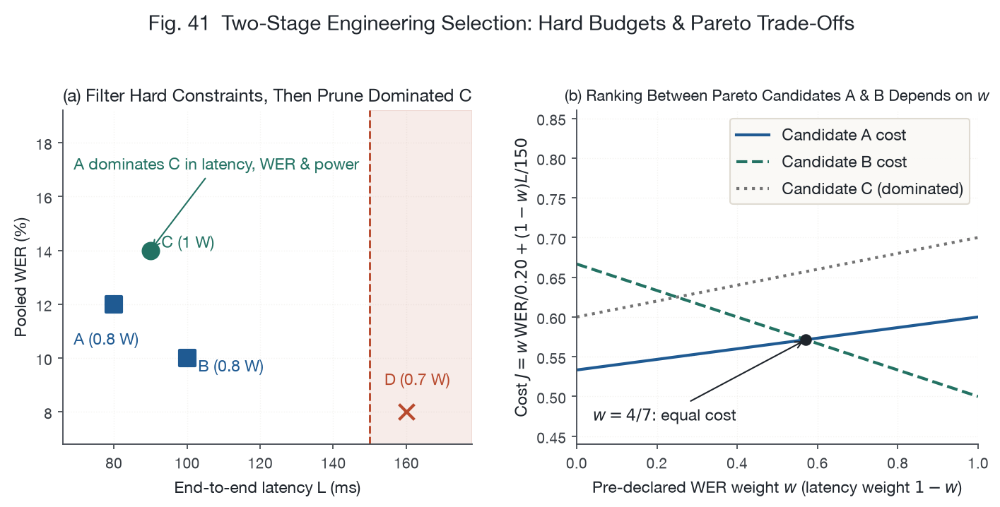
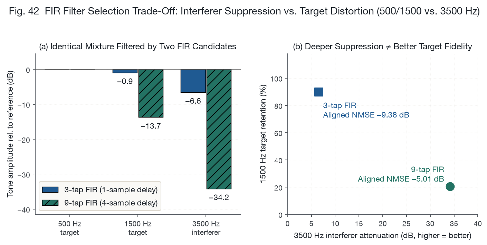
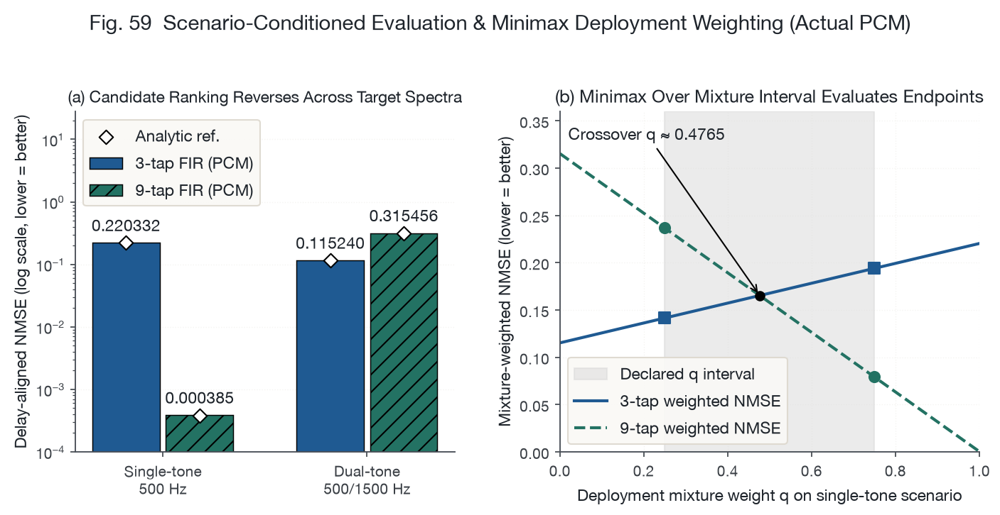
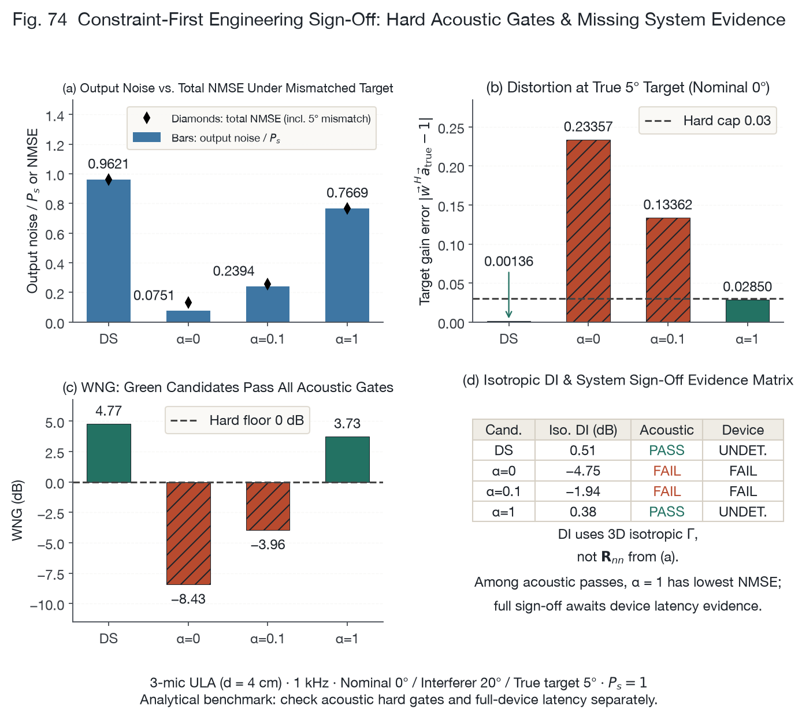

🌐 [简体中文](../chapters/11_selection-guide.md) ｜ **English**

> This chapter is Chapter 11 of the main text; the main text and extended special topics comprise 16 chapters in total (Chapters 0–15, where Chapter 0 covers mathematical foundations and Chapters 12–15 are four extended special topics), accompanied by Appendices A and B. This chapter can be read standalone; see the navigation bar below for the preceding and following chapters.
>
> Overview Home: [00_overview.md](00_overview.md) ｜ Previous: [10_engineering-practice.md](10_engineering-practice.md) ｜ Next: [12_acoustic-imaging.md](12_acoustic-imaging.md)

---

## 11. Summary and Selection Guide

The preceding ten chapters sequentially unpacked the physical propagation models of microphone arrays, array geometry, direction-of-arrival estimation, beamforming, acoustic echo cancellation, dereverberation, speech separation, source tracking, and device-level system integration. Yet when an actual engineering project reaches the scoping stage, the most common mistake is putting the cart before the horse: stuffing a string of fashionable modules into a block diagram before clearly specifying what signal the system must ultimately deliver and what hard boundaries constrain it. When the exact same four-microphone array is mounted inside a fixed desktop agent speakerphone, a large multi-participant conference room terminal, or a mobile service robot, the acoustic boundary conditions and real-time constraints differ drastically—and the appropriate front-end processing chain diverges accordingly. Following the progression "clarify task constraints $\rightarrow$ select geometry and algorithmic modules by physical conditions $\rightarrow$ establish multi-metric statistical acceptance specifications," this chapter consolidates the knowledge of the entire book into a reproducible, falsifiable selection methodology.

Commonly used abbreviations in this chapter are summarized below (full names of specific localization, beamforming, and tracking algorithms are expanded upon first appearance in the text):

| Abbreviation | Full Term and Description |
|---|---|
| DOA | Direction of Arrival |
| AEC | Acoustic Echo Cancellation |
| WPE | Weighted Prediction Error dereverberation |
| NS / VAD | Noise Suppression / Voice Activity Detection |
| RTF | In this chapter, Real-Time Factor, i.e., the ratio of cumulative processing time to newly acquired audio duration; in beamforming chapters such as Chapter 5, RTF denotes Relative Transfer Function |
| SRO | Sampling Rate Offset |
| CSS | Continuous Speech Separation: block-wise separation of continuous long recordings into a small number of output slots with cross-block permutation stitching |
| TSE | Target Speaker Extraction: extracting a designated speaker's speech conditioned on enrolled voiceprint, visual lip motion, or spatial direction |
| ASR | Automatic Speech Recognition: transcribing speech signals into sequences of text word tokens |
| KWS | Keyword Spotting: online detection of wake-up words or fixed command phrases |
| STOI / ESTOI | Short-Time Objective Intelligibility and Extended STOI: intelligibility metrics requiring a clean, time-aligned reference |
| ICC | In-Car Communication: capturing speech from passengers in one seating row and reinforcing it to loudspeakers in other rows with ultra-low real-time latency |

### 11.1 Answer Six Questions First

Before choosing any algorithm, write down quantitative answers to the following six questions item by item; each clearly answered question eliminates an entire class of mismatched array form factors and processing modules:

1. **What final output must the system deliver?** Does the downstream consumer expect a single direction angle, a continuously updated trajectory over time, a single-channel enhanced audio stream, mutually independent multi-speaker audio streams, an extracted stream for a designated target, or recognized text directly stamped with timestamps and speaker labels? Whenever multi-speaker output is involved, one must specify upfront whether the total number of participants is fixed or dynamically varying, whether processing operates offline over full utterances or online in streaming mode, and whether consistent real-name or anonymous speaker identities must be maintained throughout the session. Capturing speech solely from a fixed podium direction requires no online DOA search; driving a directional LED ring indicator requires neither beamforming nor back-end noise suppression.

2. **What are the pickup coverage region and source distance?** When targets are known to lie within a plane or half-space sector, a uniform linear array (ULA) can form directivity directly from axial projected time differences, whereas in three-dimensional space all directions on the same cone around the array axis share identical axial time differences; for $360^\circ$ azimuthal coverage in the horizontal plane, a circular array should generally be evaluated first. A planar array constrains both azimuth and elevation simultaneously, yet under free-field plane-wave assumptions it cannot distinguish mirror-image sources above and below the array plane from phase alone—symmetry must be broken via desktop baffle reflections, device housing occlusion, or non-coplanar sensor placement. Spherical arrays and other three-dimensional geometries are likewise governed by sensor distribution and amplitude–phase calibration accuracy; never infer spatial coverage capability merely from "how many microphones are used."

3. **What angular resolution and maximum operating frequency are required?** Total array aperture governs mainlobe width and low-frequency angular resolving power, whereas adjacent inter-element spacing bounds the highest frequency free of spatial aliasing. Enlarging the aperture helps resolve closely spaced directions at low frequencies, whereas shrinking inter-element spacing pushes up the high-frequency alias-free boundary; when the total number of microphones is constrained, one must trade these off by adding elements, partitioning subarrays across frequency bands, or adopting non-uniform geometries—never report a single uniform spacing and claim alias-free coverage across the entire speech band.

4. **Which physical interferences actually exist in the field?** AEC needs to be enabled only when playback from the device's own loudspeaker couples back into the microphones; cascading WPE is worth the added latency and compute cost only when late room reverberation tails substantially degrade recognition accuracy or speech intelligibility; multi-stream speech separation is needed only when multiple speakers talk simultaneously in overlap and the task requires preserving everyone's content; stationary fan or HVAC noise floors can often be suppressed with analytical Wiener/MMSE filtering, whereas non-stationary transient noise demands targeted verification of neural noise suppression generalization and speech fidelity outside its training domain.

5. **Do target sources move, and does the number of active speakers change?** A single slowly moving talker can typically be tracked for beam steering starting from first-order smoothing or a linear Kalman filter. Once multiple people walk past each other with brief pauses and occlusions, explicit mechanisms for new track confirmation, stale track retirement, and observation-to-track data association must be designed (see Chapter 9). Random finite set methods such as Probability Hypothesis Density (PHD) filters and Labeled Multi-Bernoulli (LMB) filters do not automatically win simply because "there are many participants"; they must still be weighed jointly against single-frame DOA missed-detection/false-alarm distributions, identity continuity requirements, and embedded compute budgets.

6. **Where lie the hard boundaries on hardware resources, mass-production cost, and privacy compliance?** Specifications must itemize sampling rate, channel count, clock topology, measured compute load on the exact target processor model, peak memory footprint, total device power consumption, end-to-end critical-path latency, and industry certification standards. Mass-production budgets should account for Bill of Materials (BOM) procurement costs at target shipment volumes: acoustic sealing foams, bus transceivers, and housing port structural parts already included in the BOM must not be double-counted under other headings, whereas per-unit production-line acoustic calibration, test fixture depreciation, and post-sales maintenance expenses must be itemized separately and managed in distinct columns alongside compute, power, and latency budgets. Whenever voiceprint enrollment or cloud audio retention is involved, informed consent, access control, retention periods, and revocation/deletion mechanisms must also be documented (see Chapter 10, §10.6); processor load must never be discussed in abstract Millions of Instructions per Second (MIPS) detached from a concrete chip microarchitecture, and battery life is uniformly calculated as usable watt-hours (Wh) divided by average total device power (see Chapter 10, §10.4).

### 11.2 Selecting Modules by Operating Conditions

#### Algorithm Families and Enabling Conditions

Having answered the six questions above, let us first place the core algorithm families from earlier chapters back into their respective physical assumptions:

- **Time-delay and beam-scanning localization**: Generalized Cross-Correlation with Phase Transform (GCC-PHAT) extracts two-microphone relative time difference of arrival by whitening cross-power spectral magnitudes; Steered Response Power with Phase Transform (SRP-PHAT) accumulates phase-transformed cross-correlation energy across multiple microphone pairs over a candidate spatial grid, serving as a robust baseline localizer for single or sparse dominant sources.
- **Subspace high-resolution localization**: Multiple Signal Classification (MUSIC) constructs spatial spectral peaks from the orthogonality between the noise subspace and true steering vectors; Estimation of Signal Parameters via Rotational Invariance Techniques (ESPRIT) exploits the signal-subspace rotational operator between shift-invariant subarrays for closed-form angle estimation. Both methods rely on accurate active source count estimation, sufficient statistical snapshots, and low-coherence reverberation environments.
- **Data-dependent adaptive beamforming**: Minimum Variance Distortionless Response (MVDR) minimizes total output power subject to a linear distortionless complex response constraint in the target direction; Linearly Constrained Minimum Variance (LCMV) generalizes this to simultaneously lock responses across multiple target or null directions. Practical gains of both are highly sensitive to noise covariance estimation accuracy and target steering-vector mismatch.

For eight common front-end decision targets, the table below lists the recommended starting baseline, upgrade triggers, and accompanying engineering risks:

| Decision Target | Recommended Starting Baseline | When to Upgrade | Concurrent Risks to Check |
|---|---|---|---|
| Single-source DOA | GCC-PHAT or SRP-PHAT baseline | Evaluate MUSIC or ESPRIT when finer angular resolution is required and snapshot count / SNR satisfy subspace decomposition conditions; evaluate learning-based localization under heavy reverberation | Array geometric mirror ambiguity, reverberation spurious peaks, wideband frequency fusion, false alarms during silence |
| Fixed-direction enhancement | Delay-and-sum (DS) or fixed superdirective beamformer | Evaluate MVDR or LCMV beamforming when interferer directions vary over time and noise covariance can be estimated robustly online | Low-frequency white noise gain degradation, target angle mismatch, inter-sensor amplitude–phase mismatch |
| Adaptive beamforming | Diagonally loaded robust MVDR or LCMV | Evaluate time–frequency mask-assisted beamforming or joint neural front ends when target relative transfer functions or geometric steering vectors cannot be obtained reliably | Rank-deficient covariance matrices, excessive loading degenerating toward DS, target speech leaking into noise covariance causing target self-cancellation |
| Late reverberation | Keep a WPE-disabled pass-through baseline first | When measured long reverberation tails degrade task metrics, add a matched-input WPE-enabled comparison: check Word Error Rate (WER) for transcription, and intelligibility, perceptual quality, and added latency for communication listening | Overly short prediction delay damaging direct sound, filter tap order and matrix inversion runtime |
| Device acoustic echo | Enable linear AEC whenever loudspeaker playback leaks into pickup | Upgrade to nonlinear residual echo suppression or multi-channel decorrelation modeling when micro-speaker nonlinear distortion is pronounced, acoustic paths change abruptly, or stereo/multi-channel playback induces strongly correlated references | Digital reference tap omitting sound-effect mixing, bulk buffer delay jitter, near-end speech damage during double-talk |
| Multi-speaker overlap | Try multi-beam selection or mask beamforming first when downstream consumes a single stream | Evaluate separation / CSS when full spoken content of all overlapping parties must be preserved; evaluate TSE when locking onto a single designated target with reliable prior cues (see [Extended Topic IV](15_target-extraction-diarization.md)) | Maximum concurrent talkers, fixed vs. variable total participants, full-utterance vs. streaming stitching, cross-block slot permutations, content hallucination/alteration, and peak compute |
| Trajectory smoothing | $\alpha$-$\beta$ filter or single-target Kalman filter | Upgrade to multi-target tracking with gating and track lifecycle management when frequent speaker crossings, brief inter-phrase missed detections, and reflective false alarms coexist | Angular wrap-around jumps (e.g., $\pm 180^\circ$), asynchronous sensor timestamps, track identity swaps, and broken tracks |
| Residual noise | Wiener filtering or Minimum Mean-Square Error (MMSE) spectral gain baseline | Evaluate lightweight neural NS when analytical noise tracking lags noticeably behind strongly non-stationary noise such as keyboard typing or clattering tableware | Over-suppression of weak consonants, out-of-domain noise generalization collapse, improved perceptual pleasantness accompanied by degraded downstream ASR WER |

When reading the table above, keep two core selection principles in mind: moving from Column 1 to Column 2 follows the rule "probe problem boundaries first using an analytical baseline with transparent physical assumptions and zero training requirements," upgrading model complexity only when the baseline's failure mechanism lands squarely on the physical bottleneck described in Column 3; meanwhile, Column 4 reminds us that naming an algorithm fixes only the model structure, far from locking down its operating parameters—WPE prediction delay and tap order, MVDR diagonal loading level, AEC filter coverage length, and VAD hangover duration must all be calibrated against target hardware and real-world field data, never copied blindly from empirical constants of another product.

#### Scoring Protocols for Multi-Speaker Content and Identity

Once selection enters multi-speaker overlapping conversation, "what is the word error rate?" ceases to have a single unambiguous meaning: a system might transcribe every word accurately while routing utterances into the wrong output streams, or maintain within-stream consistency while swapping real speaker names. Before engineering acceptance, three multi-speaker WER definitions must be strictly distinguished mathematically:

- **Concatenated minimum-Permutation Word Error Rate (cpWER)**: Within a single session, concatenate all utterances of each reference speaker in chronological order into one reference word sequence per speaker, concatenate each anonymous output slot into one hypothesis word sequence, and search over a single global stream permutation across the entire session to minimize total edit errors. It penalizes mid-session cross-slot speaker switches without checking whether anonymous slot indices match real personal names.
- **Optimal Reference Combination Word Error Rate (ORC-WER)**: Keep every individual reference utterance intact without internal splitting, while allowing different utterances to be freely assigned (preserving reference chronological order) to any output slot so as to minimize total edit distance. It evaluates solely whether the lexical content of each utterance is completely recognized by *some* slot, without requiring a slot to track the same person throughout the session.
- **Speaker-Attributed Word Error Rate (sa-WER)**: Require the system to assign explicit real-name speaker labels to output words, aligning reference and hypothesis one-to-one by identical speaker label to compute edit distance with zero cross-name permutation permitted; once speaker labels are swapped, every word counts as an error even if transcribed verbatim.

Suppose a single session involves $S$ true speakers whose $U$ chronologically ordered reference utterances $\{u_m\}_{m=1}^U$ are concatenated by true speaker to form reference sequences $\{R_s\}_{s=1}^S$, with total reference word count $N_{\mathrm{ref}} = \sum_{s=1}^S |R_s| > 0$. For a separation-and-transcription system outputting $K$ anonymous streams $\{H_k\}_{k=1}^K$, computing cpWER pads whichever side has fewer streams with empty sequences $\varnothing$ up to $M = \max(S, K)$ and searches for the minimum over all $M!$ global permutations $\mathcal{P}_M$; computing ORC-WER assigns each reference utterance $u_m$ a target slot $z_m \in \{1,\dots,K\}$ and concatenates the utterances assigned to slot $k$ in original chronological order into the recombined reference $R_k^{\mathrm{orc}}(\vec z)$.

For a system outputting speaker-attributed sequences $\{\hat{H}_s\}$, let $\mathcal{S}_{\mathrm{all}}$ denote the union of true speaker labels and system-predicted speaker labels (if a label appears only in predictions, its reference sequence is the empty string $R_s = \varnothing$). Denoting standard word-level Levenshtein edit distance (minimum insertions, deletions, and substitutions) by $\mathcal{D}(\cdot,\cdot)$, the three metrics are written uniformly as:

$$
\begin{aligned}
\mathrm{cpWER} &= \frac{1}{N_{\mathrm{ref}}}
  \min_{\pi \in \mathcal{P}_M}
  \sum_{s=1}^{M} \mathcal{D}\!\left(R_s,\, H_{\pi(s)}\right), \\
\mathrm{ORC\text{-}WER} &= \frac{1}{N_{\mathrm{ref}}}
  \min_{\vec z \in \{1,\dots,K\}^U} \sum_{k=1}^{K}
  \mathcal{D}\!\left(R_k^{\mathrm{orc}}(\vec z),\, H_k\right), \\
\mathrm{sa\text{-}WER} &= \frac{1}{N_{\mathrm{ref}}}
  \sum_{s \in \mathcal{S}_{\mathrm{all}}}
  \mathcal{D}\!\left(R_s,\, \hat{H}_s\right).
\end{aligned}\tag{11-1}
$$

Equation (11-1) clearly reveals the nested hierarchy of constraints across the three metrics: when $S=K=1$ and the speaker label is correct, all three reduce identically to standard single-speaker WER; in multi-speaker scenarios, ORC-WER enjoys the largest feasible reassignment space ($K^U$ utterance-level assignments), cpWER tightens reassignment to $M!$ session-wide slot permutations, and sa-WER collapses reassignment freedom entirely to $1$ fixed identity mapping, yielding the universal ordering $\text{ORC-WER} \le \text{cpWER} \le \text{sa-WER}$ on the exact same transcribed words (whenever real-name labels are produced via a one-to-one global binding to output slots).

#### Four-Word Hand Calculation: Two Streams Swap in Segment 2

Let us work through all three lines of Eq. (11-1) in one go using a minimal four-word example. Treat `spring`, `summer`, `autumn`, and `winter` each as a single word token; across time segments 1 and 2, Speaker A and Speaker B talk simultaneously. Suppose the front-end CSS separator and ASR recognize all four words correctly, but suffer a cross-block slot permutation in Segment 2 that places the two speakers' words into opposite output streams:

| Time Segment | Speaker A Reference | Speaker B Reference | Output Stream 1 | Output Stream 2 |
|---|---|---|---|---|
| 1 | spring | summer | spring | summer |
| 2 | autumn | winter | winter | autumn |

**Inputs and scoring setup**: Concatenating by true speaker gives $R_{\mathrm{A}} =$ "`spring autumn`" and $R_{\mathrm{B}} =$ "`summer winter`", with total reference word count $N_{\mathrm{ref}} = 4$; the two concatenated anonymous output streams are $H_1 =$ "`spring winter`" and $H_2 =$ "`summer autumn`". To evaluate sa-WER on the exact same example, consider a classic voiceprint enrollment mishap—before the meeting, an operator accidentally swapped Speaker A's and Speaker B's enrolled voiceprint profiles in the database: consequently, whether Speaker A's voice lands in Stream 1 during Segment 1 or Stream 2 during Segment 2, the downstream speaker-identification module consistently labels Speaker A's words as "`B`" and labels all of Speaker B's words ("`summer`" and "`winter`") as "`A`".

**Step-by-step substitution into Eq. (11-1)**:

- **Computing cpWER**: The global permutation set $\mathcal{P}_2$ has only two choices. Pairing Stream 1 with A and Stream 2 with B incurs 1 substitution on A ("`autumn`" $\rightarrow$ "`winter`") and 1 substitution on B ("`winter`" $\rightarrow$ "`autumn`"), giving edit sum $1+1=2$; pairing Stream 2 with A and Stream 1 with B incurs 1 substitution each in Segment 1 ("`spring`" $\rightarrow$ "`summer`" and "`summer`" $\rightarrow$ "`spring`"), again giving edit sum $1+1=2$. Hence $\mathrm{cpWER} = \min\{2, 2\}/4 = 50\%$.
- **Computing ORC-WER**: There are $U=4$ single-word utterances. Assigning Segment 1 "`spring`" to Stream 1, "`summer`" to Stream 2, Segment 2 "`autumn`" to Stream 2, and "`winter`" to Stream 1 yields recombined references $R_1^{\mathrm{orc}} =$ "`spring winter`" $= H_1$ and $R_2^{\mathrm{orc}} =$ "`summer autumn`" $= H_2$, with total edit distance $0+0=0$, giving $\mathrm{ORC\text{-}WER} = 0/4 = 0\%$.
- **Computing sa-WER (four-step hand calculation)**:

    1. **Aggregate hypothesis sequences by predicted real name**: Because the voiceprint module labels B's spoken words as A and A's spoken words as B, the predicted sequence attributed to A is $\hat{H}_{\mathrm{A}} =$ "`summer winter`", and that attributed to B is $\hat{H}_{\mathrm{B}} =$ "`spring autumn`";
    2. **Check A's attributed edit distance**: The third line of Eq. (11-1) forbids swapping real names; aligning $R_{\mathrm{A}} =$ "`spring autumn`" against $\hat{H}_{\mathrm{A}} =$ "`summer winter`" requires 2 substitutions, so $\mathcal{D}(R_{\mathrm{A}}, \hat{H}_{\mathrm{A}}) = 2$;
    3. **Check B's attributed edit distance**: Aligning $R_{\mathrm{B}} =$ "`summer winter`" against $\hat{H}_{\mathrm{B}} =$ "`spring autumn`" likewise requires 2 substitutions, so $\mathcal{D}(R_{\mathrm{B}}, \hat{H}_{\mathrm{B}}) = 2$;
    4. **Sum the speaker-attributed WER**: Total edit errors equal $2 + 2 = 4$; dividing by $N_{\mathrm{ref}} = 4$ gives $\mathrm{sa\text{-}WER} = 4/4 = 100\%$.

**Takeaway for system selection**: On the exact same four recognized words, the three protocols report **ORC-WER = 0%**, **cpWER = 50%**, and **sa-WER = 100%**. This contrast clearly separates the physical roles of the three metrics: an ORC-WER of zero proves only that no spoken word was missed, never that an output stream stayed locked onto one person; cpWER rising to 50% cleanly exposes the anonymous cross-block slot swap in Segment 2; and sa-WER reaching 100% shows that even when a voiceprint module tracks each vocal timbre across slots, a misbound enrollment profile will misattribute every line of meeting minutes where personal accountability matters.

For reproducible engineering evaluation, alongside naming the metric one must freeze utterance segmentation rules, text normalization pipelines, and the version identifier of the scoring software package. For instance, the open-source toolkit [MeetEval algorithm documentation](https://github.com/fgnt/meeteval/blob/main/doc/algorithms.md) explicitly defines cpWER, ORC-WER, MIMO-WER, and DI-cpWER, but does not build in sa-WER; acceptance tests involving real-name attribution must separately pin the scoring script version or commit hash rather than recording a mutable default branch name such as `main`.

Furthermore, the small number of output slots in raw CSS is inherently shared in turn by multiple participants. Suppose Speakers A, B, and C speak one non-overlapping word `a`, `b`, and `c` sequentially ($N_{\mathrm{ref}}=3$), while a two-slot CSS system outputs `a c` on Slot 1 and `b` on Slot 2: under utterance-level assignment, ORC-WER assigns Utterances 1 and 3 to Slot 1 and Utterance 2 to Slot 2, yielding $\mathrm{ORC\text{-}WER} = 0\%$; computing cpWER, however, requires padding the two slots with an empty stream $\varnothing$ up to 3 streams before searching over global permutations—a single output slot cannot match two reference speakers simultaneously, so every global permutation incurs at least 1 insertion and 1 deletion, yielding $\mathrm{cpWER} = 2/3 \approx 66.67\%$. Consequently, ORC-WER with frozen utterance boundaries suffices when accepting full-text content indexing alone; if speaker-separated meeting minutes are required, CSS must be cascaded with speaker diarization (see [§15.4](15_target-extraction-diarization.md#sec-15-4) for metrics and overlap lower bounds) or voiceprint association before evaluating cpWER or sa-WER. As proved in [Sections 3.2–3.5 of the MeetEval authors' paper](https://arxiv.org/pdf/2307.11394), ORC-WER forbids splitting words across streams within a single reference utterance and strictly preserves reference utterance chronology—making reference segmentation boundaries and tie-breaking rules for identical start times immutable parts of the evaluation benchmark.

#### Utterance Boundaries and Timing Also Belong to the Scoring Protocol

Even if the reference word sequence is left completely untouched, artificially chopping reference utterances into finer pieces quietly relaxes ORC-WER's assignment constraints, because every extra split grants the scorer an additional degree of freedom to switch slots (see the two-word hand comparison in Exercise [E11-16](#e11-16)). Reference utterance boundaries must be frozen according to dataset-prescribed pause and syntactic conventions, never re-segmented to accommodate a candidate system's chunking boundaries.

Unconstrained edit distance without timing introduces a second pitfall: in tens-of-minutes-long meeting recordings where high-frequency backchannels such as "okay," "right," and "yes" recur constantly, standard dynamic programming will pair a reference word missed at $1\ \mathrm{s}$ with an identical word spuriously inserted at $10\ \mathrm{min}$ for "zero error" (see [E11-17](#e11-17)). To close this loophole, [§4 of the original 2023 MeetEval paper (printed pp. 29–30)](https://www.isca-archive.org/chime_2023/neumann23_chime.pdf) introduced Time-Constrained minimum-Permutation Word Error Rate (tcpWER), stipulating that a reference word and hypothesis word may be matched as correct or substituted only if their time intervals overlap within a prescribed tolerance (`collar`). Whenever time-constrained metrics are used, one must document whether word-level timestamps come from manual annotation, forced alignment, or character-proportional interpolation, and verify whether intervals touching at a single endpoint count as overlapping.

When reading public challenge leaderboards, always verify aggregation denominators and scoring protocol details first. Within the same CHiME-8 Challenge, for example, the [Task 1 (DASR) submission protocol](https://www.chimechallenge.org/challenges/chime8/task1/submission) adopts tcpWER with a $5\ \mathrm{s}$ collar, and its [official scoring toolkit `chime-utils`](https://github.com/chimechallenge/chime-utils) pools total word errors and total reference words within each scenario before taking an unweighted arithmetic mean across the four scenarios; whereas [Task 2 (NOTSOFAR) rules](https://www.chimechallenge.org/challenges/chime8/task2/rules), while also using a $5\ \mathrm{s}$ collar, compute tcpWER per session on the [official leaderboard](https://www.chimechallenge.org/challenges/chime8/task2/results) before taking an unweighted mean across sessions, alongside reporting speaker-agnostic tcORC-WER for diagnostic reference. Cross-edition comparisons require even greater caution: [CHiME-9](https://www.chimechallenge.org/challenges/chime9/), for instance, pivoted to MCoRec and the conversational hearing-aid enhancement task ECHI, changing datasets, channel topologies, and evaluation metrics alike—numbers from two editions must never be ranked in a single table.

#### Output Slots and Target Conditioning

The table below compares three mainstream multi-speaker front-end architectures across output stream count, participant scalability, online latency, and identity continuity:

| Task Aspect | Single-Stream / Mask Beamformer | Continuous Speech Separation (CSS) | Target Speaker Extraction (TSE) |
|---|---|---|---|
| Required output | One enhanced audio stream | Fixed, small number of output streams; each stream carries at most one talker at any instant, while distinct streams output overlapping talkers simultaneously | One designated speaker specified by enrolled speech, visual cue, or spatial direction |
| Participant count variation | Can track one selected target; not responsible for outputting everyone completely | Total participants may exceed output stream count; stream count is governed by peak simultaneous talkers and system design | Non-target speaker count may vary, provided target conditioning cues remain valid |
| Temporal scope | Frame-by-frame or block-wise online processing | Continuous long recordings; chunk size, context windows, and cross-block stitching must be specified | Full-utterance or streaming; enrollment overhead and first-frame latency must be reported |
| Identity continuity | Supplied by external tracking / diarization module | Separation slots do not represent permanent identities; diarization or voiceprint association is typically needed downstream | Target conditioning provides identity cues, subject to enrollment channel mismatch and spoofing |
| Primary acceptance checks | Target preservation, crosstalk leakage, speech distortion, WER | Overlap omissions, cross-block speaker swaps, cpWER / ORC-WER / sa-WER, latency | Target omission, non-target leakage, wrong-target lock, privacy and data deletion |

Comparing these three columns shows that greater architectural complexity does not imply better product fit: if a downstream telephony codec or single-stream wake-word engine accepts only a single audio channel, forcing multi-output CSS into the pipeline merely introduces cross-block permutation jumps and multiples of compute cost; conversely, if the product must transcribe every ad-hoc visitor in a conference room verbatim into meeting minutes, TSE—which demands pre-enrolling everyone's voiceprint or face—fails right at the functional entry gate.

When a task genuinely requires target conditioning cues or multi-speaker attribution, see [Extended Topic IV](15_target-extraction-diarization.md) for the dual-state energy-floor loss during target-absent silence ([§15.2](15_target-extraction-diarization.md#sec-15-2)), near-field acoustic distance bubbles suppressing co-directional far-field interferers ([§15.3](15_target-extraction-diarization.md#sec-15-3)), audio-visual lip-motion asynchrony and occlusion confidence gating ([§15.6](15_target-extraction-diarization.md#sec-15-6)), and architectural trade-offs between modular `TS-VAD + GSS + ASR` pipelines and joint `SOT / DiCoW` modeling ([§15.5](15_target-extraction-diarization.md#sec-15-5), [§15.7](15_target-extraction-diarization.md#sec-15-7)).

### 11.3 Geometry and Algorithm Must Be Selected Together

Array geometry dictates which spatial phase differences in the physical sound field are sampled, while signal processing algorithms govern how those phase differences are extracted and combined; once a geometric layout forfeits identifiability along a spatial dimension, no depth of subspace decomposition or neural network layers downstream can conjure that lost information out of thin air:

- **Two-microphone and uniform / quasi-linear arrays**: Uniquely measure only the directional cosine projection of the wave arrival vector onto the array axis; in a three-dimensional free field, a single axial projection corresponds to an entire cone of equal-delay directions, and even when restricted to the horizontal plane it leaves a front–back mirror ambiguity. Millimeter-scale staggered offsets introduced for industrial styling often yield transverse phase differences at low frequencies far smaller than sensor amplitude–phase tolerances; linear arrays are appropriate when flush-mounted against a wall or paired with cardioid acoustic ports so targets are known to lie within a single half-plane sector.
- **Non-collinear three-microphone and planar arrays**: Span two linearly independent basis vectors in the plane—sufficient to uniquely resolve horizontal azimuth—yet remain completely symmetric with respect to free-field plane waves arriving from above versus below the array plane $(+z \leftrightarrow -z)$. Practical deployments typically mount planar arrays flush on a tabletop or ceiling, exploiting a rigid physical boundary to eliminate the lower-hemisphere mirror image.
- **Uniform circular arrays**: Cover the full $360^\circ$ horizontal azimuth isotropically, making them a staple for tabletop conference speakerphones and smart speakers. Element count $M$ and radius $r$ must be jointly back-calculated from target angular resolution, highest alias-free operating frequency, and enclosure diameter (see the 4-mic vs. 6-mic screening in Exercise [E11-05](#e11-05)); there is no "universal microphone count" divorced from frequency band and aperture.
- **Spherical and three-dimensional volumetric arrays**: Enable full-sphere joint azimuth–elevation resolution and high-order sound-field reconstruction. Usable spherical harmonic orders in practice are simultaneously bounded by spatial sampling theorems, the dimensionless wavenumber–aperture product $\kappa r$ (where $\kappa = 2\pi f/c$ is the wavenumber and $r$ is the sphere radius), sensor white-noise amplification at open-sphere Bessel zeros or low-frequency radial equalization, and residual sensor calibration errors; see [Chapter 5, §5.8](05_beamforming.md#sec-5-8), [Chapter 10, §10.7](10_engineering-practice.md#sec-10-7), and [Extended Topic III, §§14.2–14.4](14_spatial-wearable-arrays.md#sec-14-2) (first-order Ambisonics tetrahedral encoding, $\kappa R=\pi$ open-sphere nulls, and DirAC active-intensity parameterization).
- **Sparse non-uniform arrays**: Construct a difference coarray from pairwise sensor position differences to expand virtual contiguous lags in stationary second-order statistics, without increasing the number of physical channels sampled per frame; under short-snapshot transient speech, strongly coherent early reflections, or wideband non-stationary interferers, every covariance reconstruction assumption from Chapter 3 must be re-verified item by item.

Once array geometry is fixed, beamformer parameter tuning revolves around the fundamental physical trade-off between White Noise Gain (WNG) and Directivity Index (DI): forcing an overly narrow mainlobe or deep adaptive null out of a small aperture at low frequencies inevitably explodes the filter weight norm, amplifying microphone thermal self-noise and micrometer-level assembly tolerances manyfold. Diagonal loading, explicit WNG lower-bound constraints, and frequency-dependent switching between fixed and adaptive weights all trade moderate relaxation of spatial null depth for real-hardware robustness.

#### Why Planar Mirror Ambiguity Cannot Be Eliminated by Changing Algorithms

Let us verify via a concrete three-dimensional coordinate hand calculation that "geometric unidentifiability cannot be rescued by algorithms." Following Chapter 2's far-field plane-wave unit incident vector and steering-phase convention, place three coplanar microphones in the $xy$-plane at $\vec p_1 = (0,0,0)^\top$, $\vec p_2 = (0.04,0,0)^\top$, and $\vec p_3 = (0,0.04,0)^\top\ \mathrm{m}$, and examine two mirror-symmetric unit direction vectors above and below the plane: $\vec u_+ = (0.6, 0, 0.8)^\top$ and $\vec u_- = (0.6, 0, -0.8)^\top$ (satisfying $\|\vec u_\pm\|_2 = \sqrt{0.6^2 + 0^2 + (\pm 0.8)^2} = 1$).

Taking Microphone 1 as the phase reference, the spatial path-difference projections of the other two microphones relative to the reference are the inner products $\vec p_2^\top \vec u_\pm = 0.024\ \mathrm{m}$ (i.e., $0.04\times 0.6 + 0 + 0$) and $\vec p_3^\top \vec u_\pm = 0\ \mathrm{m}$. Because the $z$-coordinates of all three microphones are identically zero, the vertical component $\pm 0.8$ is wiped out completely in every dot product—meaning that at *every* frequency $f$, the ideal array-manifold steering vectors generated by $\vec u_+$ and $\vec u_-$ are entry-wise identical. Whether one extends snapshot count to infinity or swaps GCC-PHAT for MUSIC, MVDR, or a deep neural network, these three ideal free-field observations are information-theoretically incapable of distinguishing whether the source lies above or below the array plane.

Conversely, introducing a fourth non-coplanar microphone along the normal at $\vec p_4 = (0, 0, 0.04)^\top\ \mathrm{m}$ immediately splits its path-difference projections across the two directions into $+0.032\ \mathrm{m}$ and $-0.032\ \mathrm{m}$. At sound speed $c = 343\ \mathrm{m/s}$ and frequency $f = 1\ \mathrm{kHz}$, Microphone 4's steering phases relative to Microphone 1 diverge to $\pm 2\pi f(0.032)/c \approx \pm 0.58619\ \mathrm{rad}$, cleanly resolving the up–down mirror ambiguity (see Chapter 3, Exercise [E03-14](03_array-geometry.md#e03-14) for the full-space rank criterion across arbitrary directions).

### 11.4 Typical Product Form Factors and Scenario-Driven Derivation

#### Hardware, Mechanical, Power, and Certification Matrix Across Six Product Categories

Different product categories diverge by orders of magnitude in microphone bus interfaces, structural acoustic boundaries, processor compute, thermal and power budgets, latency redlines, and mandatory regulations. The table below provides typical engineering order-of-magnitude references across six mainstream product form factors to rapidly bound the feasible design space at project scoping:

| Product Form Factor | Typical Array & Bus | Structural Acoustics & Environmental Constraints | Compute, Power & Thermal Budget | Latency Redline | Key Certifications & Compliance |
|---|---|---|---|---|---|
| Smart speaker | 2–6 mic circular/linear array (PDM/I²S/TDM) | Speaker cavity vibration isolation, silicone sealing foam against internal acoustic leakage | Multi-core SoC/DSP; total system $1\text{–}5\ \mathrm{W}$, continuous passive cooling | Wake response $<200\text{–}300\ \mathrm{ms}$; voice call $<150\ \mathrm{ms}$ | Far-field false-wake rate (e.g., $\le 0.05\text{–}0.1\ \mathrm{h}^{-1}$), EMC |
| Conference video bar & ceiling array | 4–16 mic linear/planar array (TDM/Dante/USB UAC) | Wall-mounted half-space or ceiling rigid baffle; $5\text{–}8\ \mathrm{m}$ strongly reverberant pickup | Mid-to-high-end DSP/SoC + NPU; total system $5\text{–}25\ \mathrm{W}$, passive/fan cooling | Uplink DSP $20\text{–}40\ \mathrm{ms}$; end-to-end $<150\ \mathrm{ms}$ | Microsoft Teams Rooms (G.122 $\mathrm{TCL}_w$, ETSI TS 103 224 / 3QUEST), Zoom Rooms |
| Smart automotive cabin | 4–16+ mic headliner & headrest distributed array (A²B synchronous bus, zero relative SRO) | Tight cabin strong reflections, $65\text{–}80\ \mathrm{dB\ SPL}$ road/wind noise, $-40\text{ to }+85\,^\circ\mathrm{C}$ wide temperature range | Automotive-grade DSP / cockpit SoC; audio subsystem $2\text{–}8\ \mathrm{W}$ | ICC $\Delta_{\mathrm{Rx}} < 15\ \mathrm{ms}$ (production typically $4\text{–}10\ \mathrm{ms}$); hands-free per P.1110/P.1120 | ITU-T P.1100–P.1150, automotive silicon AEC-Q100 |
| TWS earbuds & smart glasses | 2–4 air-conduction mics + in-ear / bone-conduction VPU (low-power PDM/I²S) | Ear-canal occlusion effect, dust mesh / waterproof membrane HF phase shift, strong wind turbulence | Ultra-low-power Bluetooth SoC + DSP; $5\text{–}15\ \mathrm{mW}$ per earbud, $20\text{–}60\ \mathrm{mW}$ for glasses, zero active cooling | Active transparency anti-comb $<0.5\text{–}1\ \mathrm{ms}$; speech uplink $<30\text{–}60\ \mathrm{ms}$ | Bluetooth HFP / LE Audio, skin temperature rise & Specific Absorption Rate (SAR) |
| Medical & OTC hearing aids | 2–4 mic binaural wireless cooperation (ultra-low-power PDM + NFMI / BLE Audio) | Ultra-small $7\text{–}12\ \mathrm{mm}$ aperture, earmold acoustic feedback howling, IP68 wax-guard membrane | Dedicated hearing-aid ASIC/DSP; total system $1\text{–}3\ \mathrm{mW}$, $16\text{–}24\ \mathrm{h}$ battery life | Direct hearing-aid throughput $<5\text{–}10\ \mathrm{ms}$ (open-fit anti-comb typically $<5\ \mathrm{ms}$) | IEC 60601-2-66 medical electrical safety, FDA 21 CFR 800.30 / ANSI/CTA-2051, OSPL90 hard limiting |
| Industrial IoT edge acoustic node | 1–4 mics or ultrasonic MEMS (analog / low-rate PDM + SPI/I²C) | Housing acoustic-port Helmholtz resonance, IP67 waterproof membrane attenuation & phase drift, dust & wide temperature | Dual-stage architecture: always-on analog/digital VAD core ($10\text{–}200\ \mu\mathrm{W}$) + sleeping MCU/NPU ($10\text{–}100\ \mathrm{mW}$ awake) | Event wake $50\text{–}200\ \mathrm{ms}$; battery lifetime $1\text{–}5\ \mathrm{years}$ | Industrial EMC (IEC 61000), hazardous-area explosion-proof (ATEX / IECEx) |

When interpreting this matrix, pay special attention to three hardware and regulatory hard boundaries frequently overlooked during algorithmic prototyping:

- **Amplitude–phase distortion from acoustic cavities and waterproof breathable membranes**: A microphone housing port together with its back-channel acoustic duct forms a miniature Helmholtz resonator; mismatched port length and cross-sectional area introduce multi-decibel resonant peaks across $3\text{–}8\ \mathrm{kHz}$. Applying IP67/IP68 waterproof breathable membranes (ePTFE) to outdoor speakers, smart glasses, or industrial IoT nodes further introduces high-frequency insertion loss and unit-to-unit membrane-tension scatter causing several to over ten degrees of inter-channel phase drift—any product employing superdirective or sharp-null adaptive beamforming must re-measure its true array manifold and WNG *after* full enclosure and membrane assembly.
- **Industrial IoT $\mu\mathrm{W}$-class always-on wake-up and KWS operating-point trade-offs**: Bound by coin-cell batteries or multi-year maintenance-free deployment, industrial edge voice/acoustic monitoring nodes widely adopt a dual-stage wake architecture: the main processor and neural acoustic model stay in deep sleep while only a $10\text{–}200\ \mu\mathrm{W}$ always-on analog envelope detector or ultra-light digital VAD monitors acoustic energy; upon threshold crossing, the main MCU/NPU wakes within milliseconds to execute full Keyword Spotting (KWS) or fault diagnostics. Selecting the wake threshold $\tau$ requires balancing dimensionless positive-event miss rate $r_{\mathrm{miss}} = N_{\mathrm{miss}}/N_+$ against hourly false-alarm rate $\nu_{\mathrm{FA}} = N_{\mathrm{FA}}/T_-$ over continuous negative exposure duration $T_-$ (with zero-false-trigger test durations audited via Poisson confidence bounds; see [E11-15](#e11-15)), preventing frequent false wakes from exhausting the main-core power budget.
- **Regulatory and auditory-safety baselines for medical and OTC hearing devices**: A hearing aid is never merely a "miniaturized earbud." Beyond complying with the particular medical electrical safety standard for hearing instruments (**IEC 60601-2-66**), medical and Over-the-Counter (OTC) hearing instruments are bound by statutory electroacoustic ceilings under **FDA 21 CFR 800.30** and **ANSI/CTA-2051**: maximum output **OSPL90 (Output Sound Pressure Level for a $90\ \mathrm{dB\ SPL}$ input) $\le 111\ \mathrm{dB\ SPL}$** (or $\le 117\ \mathrm{dB\ SPL}$ with input-controlled compression), statutory processing latency **$\le 15\ \mathrm{ms}$**, self-generated noise **$\le 32\ \mathrm{dBA}$**, and total harmonic distortion plus noise (THD+N, 21 CFR 800.30(d)(3)) **$\le 5\%$**, enforced via hardware/firmware output compression limiting so transient impulses or acoustic feedback howling cannot damage residual hearing. Simultaneously, under open-fit or vented-dome wear, direct ambient sound and amplified output sum at the eardrum to create harsh metallic comb filtering, forcing total end-to-end throughput delay even tighter below $5\text{–}10\ \mathrm{ms}$ (see [Extended Topic III, §14.10](14_spatial-wearable-arrays.md#sec-14-10))—disqualifying any long-window STFT or large-lookahead neural denoiser in the very first compliance screening.

#### Scenario Condition Shifts and Smart Automotive Cabin Hard Boundaries

With the hardware boundaries of the six product categories in place, the table below uses four representative acoustic operating regimes to illustrate how system pipelines are derived step by step from shifting field constraints rather than memorized as rigid recipes:

| Scenario | Condition Shift | How the Architecture Adapts |
|---|---|---|
| Voice terminal with loudspeaker | Wake-up or voice calls required during active media playback | AEC becomes mandatory; digital reference tap must capture actual mixing, equalization, and playback gain. Circular, linear, or planar geometry follows coverage sector and industrial form factor. Do not cascade WPE by default without pronounced late reverberation. |
| Conference room | Infrequent multi-speaker overlap; downstream consumes a single meeting audio stream | Compare multi-beam selection against adaptive beamforming first. Add separation only when overlapping speech causes task failure *and* independent streams are required. Decide WPE via room measurements at far distances and long $T_{60}$. |
| Automotive cabin | Microphones span multiple asynchronous clock domains | Resolve SRO and hardware timestamping before attempting multi-zone beamforming. Playback reference must cover music, navigation prompts, and telephony mixes. Validate across idle, highway cruise, open-window, and HVAC states separately. |
| Earbuds or hearing devices | Monitoring path is acutely sensitive to latency and battery power | Separate signal chains may serve local ear-monitoring vs. uplink telephony. Fixed two-mic beamforming and lightweight NS are candidate baselines, not mandatory defaults; regulatory limits, acoustic feedback stability, fit variation, and hearing safety take precedence. See [Extended Topic III, §§14.5–14.10](14_spatial-wearable-arrays.md#sec-14-5) for irregular-frame Binaural Signal Matching (BSM/MagLS), interaural coherence preservation, wind-robust cross-modal own-voice fusion, and hundred-microsecond-class ($\sim 100\text{–}500\ \mu\mathrm{s}$) anti-comb-filtering transparency constraints. |

Reading across the table shows how a slight change in mounting location or signal tap point completely rewrites selection conclusions within the same broad scenario. Within conference room pickup, for example, a wall-mounted video bar beneath a display needs to cover only the forward $180^\circ$ half-space, where a horizontal linear array balances slim bezel aesthetics with lateral directivity; a tabletop speakerphone placed in the center of a boardroom table must cover $360^\circ$ in azimuth, naturally favoring a uniform circular array. Similarly, while loudspeaker-equipped terminals require the digital reference to capture all mixing and audio effects, a purely digital tap never captures downstream analog power-amplifier clipping or speaker diaphragm harmonic distortion—whether to add an amplifier-output voltage/current feedback sense (electrical reference), introduce nonlinear residual echo suppression, or cap peak playback level within wake-word-sensitive bands must be settled jointly from hardware BOM limits and acoustic enclosure measurements (see Chapter 6 and Chapter 10, Fig. 22).

Among all terminal form factors, **multi-zone interaction and in-car communication in smart automotive cabins** most vividly concentrates the cross-coupling of international standards, bus clocking, near-field arrays, and ultra-low-latency hard constraints, warranting a dedicated breakdown across three engineering dimensions:

- **Aligning with the ITU-T P.1100–P.1150 automotive speech standards family**: Cabin audio cannot be summarized by a single number; project scoping must first map each feature to its governing standard clause. Hands-free cellular telephony to external networks maps by transmission bandwidth to **ITU-T P.1100** (narrowband, $300\text{–}3400\ \mathrm{Hz}$), **P.1110** (wideband, $100\text{–}7000\ \mathrm{Hz}$), and **P.1120** (super-wideband and fullband), focusing on double-talk clipping, send delay, echo attenuation, and speech quality under road noise; subsystem, digital module, and short-range wireless link verification follows **P.1130**.

    Post-crash emergency calling (eCall) is governed by **P.1140**, which mandates preserving a baseline intelligibility floor for Public Safety Answering Points under extreme cabin acoustic transients such as airbag deployment or shattered windows; meanwhile, **In-Car Communication (ICC)**—real-time reinforcement of front-row speech to rear-row passengers—is governed specifically by **P.1150**, centering on closed-loop howling stability margin, listening effort, spatial localization preservation, and strict reinforcement delay ceilings.

- **Architectural divide between A²B synchronous audio buses and heterogeneous-domain SRO**: Modern cabins often distribute a dozen or more digital microphones across the headliner, sun visors, and seat headrests. When the vehicle adopts a single-master, multi-slave daisy-chain **A²B (Automotive Audio Bus)** architecture, the master node delivers bit clock, frame sync, and phantom power simultaneously over a single unshielded twisted pair; phase-locked loops on all remote slave nodes lock strictly to the same master clock crystal, inherently achieving **zero relative SRO** and deterministic transport latency below $50\ \mu\mathrm{s}$ so cross-seat beamformers and multi-channel media AEC share exact inter-channel phase.

    Conversely, once Bluetooth hands-free phones, USB dashcams, or Ethernet streams crossing Electronic Control Units (ECUs) with independent crystal oscillators enter the loop, relative SROs of tens to hundreds of ppm plus packet jitter arise between clock domains: letting the fast clock run at $f_s(1+\varepsilon)$ and the slow clock at $f_s$, at slow-clock time $T = n/f_s$ the exact physical time difference at identical sample index $n$ is $\Delta t = \varepsilon T/(1+\varepsilon)$ (often approximated by $\varepsilon T$ at the hundred-ppm scale); if each re-alignment leaves an initial residual $b$ and frequency offset is bounded above by $\varepsilon_{\max}$, keeping total skew within $B$ enforces a worst-case re-alignment period $T \le (B - b)(1+\varepsilon_{\max})/\varepsilon_{\max}$ (for example, at $B = 100\ \mu\mathrm{s}$, $b = 20\ \mu\mathrm{s}$, and $\varepsilon_{\max} = 90\ \mathrm{ppm}$, the period shrinks sharply from $1.25\ \mathrm{s}$ at residual-free $80\ \mathrm{ppm}$ to roughly $0.89\ \mathrm{s}$). Applying cross-node MVDR or fixed multi-channel echo filters directly under such conditions sees microsecond-level sample drift destroy spatial nulls and echo cancellation within seconds (see Exercises [E11-01](#e11-01), [E11-07](#e11-07), and [E11-21](#e11-21)), making hardware timestamp capture and online Asynchronous Sample Rate Conversion (ASRC) mandatory at the very front of the pipeline.

- **Headrest zone isolation LCR and the ICC $<15\ \mathrm{ms}$ comb-filtering hard constraint**: Enabling the driver, front passenger, and rear passengers to trigger wake words and issue commands independently without cross-zone interference has driven widespread adoption of near-field two-/four-microphone differential arrays embedded in seat headrests. Let $P_{z\leftarrow z}$ denote the effective target speech power at zone $z$'s enhanced output when zone $z$'s occupant speaks at standard vocal effort, and let $P_{z\leftarrow q}$ denote the crosstalk power leaking into zone $z$'s output when an adjacent seat $q\ (q\ne z)$ speaks at equal vocal effort. Concurrently, in ICC mode, a rear passenger's ears receive both the front talker's direct airborne cabin wave and the reinforced loudspeaker signal after microphone pickup, DSP enhancement, and rear-speaker radiation (denoting the excess delay of reinforced sound relative to airborne direct arrival by $\Delta_{\mathrm{Rx}} > 0$; under standard closed-loop-stable ICC loop-gain settings, the relative acoustic pressure amplitude ratio at the listener's ear satisfies $0 < g < 1$). Factoring out the common propagation phase of the airborne direct wave, the Local-to-Crosstalk Ratio (LCR) and normalized two-path power transfer function $|H_{\mathrm{ICC}}(f)|^2$ at the listener's ear are:

$$
\begin{aligned}
\mathrm{LCR}_{z,q} &= 10\log_{10}\!\left(
  \frac{P_{z\leftarrow z}}{P_{z\leftarrow q}}\right), \\
\left|H_{\mathrm{ICC}}(f)\right|^2 &=
  \left|1 + g\,e^{-\mathrm{j}2\pi f\Delta_{\mathrm{Rx}}}\right|^2 \\
&= 1 + g^2 + 2g\cos\!\left(2\pi f\Delta_{\mathrm{Rx}}\right), \\
f_m &= \frac{2m + 1}{2\Delta_{\mathrm{Rx}}},
  \qquad m = 0, 1, 2, \dots
\end{aligned}\tag{11-2}
$$

Equation (11-2) exposes three hard physical boundaries in cabin system selection. First, consider zone isolation $\mathrm{LCR}_{z,q}$ in the first line: a headrest sits only $15\text{–}25\ \mathrm{cm}$ from its own occupant's mouth versus $70\text{–}100\ \mathrm{cm}$ from an adjacent occupant's mouth with head-shadow occlusion, yielding roughly $10\text{–}15\ \mathrm{dB}$ of raw acoustic isolation from near-field spherical spreading and two-mic delay-and-sum alone; leveraging synchronous A²B channels from the adjacent headrest as cross-zone cancellation references (noting that forcing a deep spatial null on a narrow $4\ \mathrm{cm}$ single-headrest aperture severely degrades WNG), paired with local-to-adjacent power-ratio double-talk freeze protection to prevent reverse self-cancellation of the driver's speech, elevates system-level $\mathrm{LCR}_{z,q}$ to $25\text{–}36\ \mathrm{dB}$ or higher while preserving high robustness (see Exercise [E11-21](#e11-21) for a complete architecture comparison).

Next, examine the two-path interference mechanism in the second and third lines: whenever $\cos(2\pi f\Delta_{\mathrm{Rx}})=-1$, airborne direct sound and loudspeaker reinforcement interfere destructively at regular frequency intervals $\Delta f = 1/\Delta_{\mathrm{Rx}}$, carving a dense comb-filter notch sequence $f_m$. Copying a conventional $32\ \mathrm{ms}$-frame, $16\ \mathrm{ms}$-hop STFT enhancer or a neural separator with tens of milliseconds of lookahead into an ICC path pushes algorithmic buffering alone to $\Delta_{\mathrm{Rx}} \ge 22\text{–}25\ \mathrm{ms}$, digging notches over ten decibels deep every $40\text{–}45\ \mathrm{Hz}$ across the core $300\text{–}3400\ \mathrm{Hz}$ speech band (nearly 70 notches in total)—producing harsh metallic "hollow barrel" coloration and shattering forward auditory image fusion under the Haas precedence effect.

For this reason, **ITU-T P.1150 strictly mandates an excess cabin reinforcement delay of $\Delta_{\mathrm{Rx}} < 15\ \mathrm{ms}$** (production systems typically hold $4\text{–}10\ \mathrm{ms}$), confining candidate algorithms to short-tap time-domain FIR filters or ultra-low-latency subband architectures and disqualifying all long-window or lookahead modules outright. Simultaneously, rear-loudspeaker sound re-couples through the cabin air path back into front pickup microphones to form a closed acoustic loop: the strict **Barkhausen self-oscillation criterion** requires loop-gain magnitude $\ge 0\ \mathrm{dB}$ **and** loop phase hitting $0^\circ \bmod 360^\circ$; because the closed-loop ICC delay (electronic chain plus cabin return propagation) of roughly $15\text{–}16\ \mathrm{ms}$ wraps phase by $360^\circ$ every $\approx 62\text{–}67\ \mathrm{Hz}$, densely hitting dozens of zero-phase frequencies across the speech band, engineering design must constrain broadband magnitude margin—reserving at least $\mathrm{GM}_{\min}\ge 6\ \mathrm{dB}$ of howling gain margin and back-calculating the maximum permissible electronic reinforcement gain accordingly (see Exercise [E11-22](#e11-22) for quantitative verification).

### 11.5 Writing Candidate Designs as Verifiable Specifications

#### 11.5.1 Write Specifications and Evidence Protocols First

Selection debates must not remain at the level of verbal adjectives; to place candidate designs on the same review table, a specification document must lock down nine categories of information item by item:

| Category | Required Specification Content |
|---|---|
| Task | Inputs, outputs, target source count, whether identity continuity is required |
| Geometry | Sensor coordinates, dimensional tolerances, acoustic ports and occlusions, operating band |
| Scenarios | Distances, angles, room acoustics, noise types, playback levels, and motion states |
| Pipeline | Enabling conditions, tap points, bypass logic, and control signals for every module |
| Resources | RTF on target hardware, measured per-frame runtime bounds, peak memory, average/peak power, and measurement conditions |
| Cost | Target production volume, BOM procurement cost; non-BOM interface/mechanical costs, calibration, and maintenance listed separately without double-counting BOM items; one-time NRE vs. per-unit recurring cost |
| Latency | Lookahead, buffering, compute, OS scheduling, and decoding along the critical path |
| Metrics | Task metrics, speech distortion, stability margins, confidence intervals, and sample sizes |
| Exception handling | Defined fallback behavior under dead channels, low DOA confidence, network dropouts, and CPU overload |

The table above doubles as an R&D project charter checklist and an ablation control-variable matrix. When building the system, start with a minimal runnable baseline containing only indispensable blocks, then introduce one candidate module at a time while recording target task gains, near-end speech distortion, end-to-end latency, device power draw, and newly induced failure cases in lockstep.

Whenever two modules exhibit statistical or nonlinear coupling (for example, WPE altering the spatial covariance structure fed into a downstream adaptive beamformer, or beamformer nulls reshaping residual spectral distributions seen by back-end neural noise suppression), supplement single-module toggles with a full four-way $2\times 2$ joint ablation grid (see Exercise [E11-12](#e11-12)) rather than mistaking greedy one-by-one additions for a global optimum search. Any dereverberation block that fails to lower error rates in target-room measurements, or any separation network that boosts Scale-Invariant Signal-to-Distortion Ratio (SI-SDR) while inflating downstream WER via nonlinear artifacts, should be decisively removed from the main pipeline.

Open-source implementations must likewise be screened by task assumptions—a project name never substitutes for algorithmic preconditions:

- PortAudio handles device audio I/O, not cross-device clock synchronization.
- ONNX Runtime executes model graphs, without prescribing model training objectives.
- `pyroomacoustics` suits room and array prototyping, without proving real-time execution on target embedded hardware.
- WebRTC AEC3 provides a reference real-time echo-control pipeline, whose internal tuning constants are not default values for other hardware products.

When adopting open-source packages, record the canonical repository URL, pinned commit hash or release tag, software license, supported platforms, I/O interface contracts, maintenance status, and minimal regression tests directly inside the specification (see §10.8.1).

Passing unit tests on a pedagogical baseline proves that mathematical conventions and degenerate boundary cases match theory, without substituting for target-device engineering acceptance; when advancing toward mass production, concrete open-source toolchains, peripheral resampling/I/O/objective-scoring interface semantics, and embedded runtime selection are detailed in [Chapter 10, §10.5](10_engineering-practice.md#sec-10-5), [§10.8](10_engineering-practice.md#sec-10-8), and [Industrial Deployment Research](../codes/chapters/ch00/research_en/03_industrial_deployment.md), while this chapter focuses on formulating those preconditions as falsifiable acceptance rules and statistical gates.

Commercial enterprise speakerphones and all-in-one video conferencing bars must also align their project specifications directly against enterprise conferencing certification redlines (taking **Microsoft Teams Rooms** certification specifications as an example; **Zoom Rooms** likewise rigorously tests full-duplex AEC, noise suppression, and intelligibility, with exact numerical thresholds verified against the corresponding specification version). Unlike in-cabin automotive ICC—which reinforces sound within the same acoustic enclosure under $\Delta_{\mathrm{Rx}}<15\ \mathrm{ms}$ and local open-loop howling margins—remote conferencing terminals are isolated from far-end rooms over IP networks, granting uplink DSP pipelines a $20\text{–}40\ \mathrm{ms}$ processing budget and shifting certification focus toward full-duplex echo suppression and speech quality inside realistic diffuse noise fields: on one hand, single-talk testing enforces ITU-T G.122 **weighted Terminal Coupling Loss ($\mathrm{TCL}_w$)**, where Microsoft Teams Rooms qualification typically requires $\mathrm{TCL}_w \ge 55\ \mathrm{dB}$ at nominal playback volume and $\mathrm{TCL}_w \ge 46\ \mathrm{dB}$ even at maximum volume, paired with ITU-T P.340 double-talk duplex classification to prevent gaming single-talk scores via hard center-clipping mute gates (see [Chapter 10, E10-28](10_engineering-practice.md#e10-28)).

On the other hand, to test beamformers inside realistic spatial noise fields rather than single-point synthetic white noise, distinguish two generations of background-noise simulation standards: the legacy **ETSI ES 202 396-1** reproduces background noise via a 4.1 loudspeaker setup equalized at the ears of a Head and Torso Simulator (HATS)—suitable for single-microphone or handset testing—whereas modern multi-microphone certification labs widely adopt **ETSI TS 103 224**, which equalizes an 8-loudspeaker (or 4-loudspeaker hands-free) array across a multi-microphone spatial grid in an anechoic or hemi-anechoic chamber so that inter-microphone coherence and spatial correlation fields of cafeterias and open-plan offices are accurately preserved; **ETSI TS 103 106 (`3QUEST`)** then simultaneously scores speech component quality (`S-MOS`), background noise intrusiveness suppression (`N-MOS`), and overall quality (`G-MOS`) under noise. In final certification sign-off, this multidimensional threshold set obeys the exact three-state decision rule derived below—if the measured confidence or fluctuation interval of *any* metric (such as maximum-volume $\mathrm{TCL}_w$) straddles the certification threshold, overall device status must be ruled "undetermined" (insufficient evidence) rather than certified pass (see Exercise [E11-22](#e11-22)).

**Real-recording worked example: Why passing a full-clip average masks local worst-window violations.** Many acceptance disputes stem from "the full-file summary passed, yet listeners heard glaring artifacts during the first two seconds." Let us perform a verification on real public recording R01 curated in Chapter 2 (drawn from the [original DEMAND dataset](https://zenodo.org/records/1227121); see [R01 capture, license, and reproduction notes](../codes/chapters/ch02/real_audio/README.md)): this clip is a $16\ \mathrm{kHz}$, $10\ \mathrm{s}$ synchronous 16-microphone natural river-stream noise recording, archived alongside both the 16-channel raw signed 16-bit PCM file and a zero-delay equal-weight averaged (round-to-nearest-even) mono PCM file.

Suppose a simplified selection model ignores inter-element noise cross-correlation, predicting that equal-weight averaging across 16 channels reduces output noise power to $1/16$ of the single-microphone average power, and stipulates that measured output power must not deviate from this diagonal prediction by more than $6\ \mathrm{dB}$. Let $x_{m,n}$ denote the raw signed 16-bit PCM integer at microphone $m$, sample $n$, and let $y_n$ denote the published 16-channel averaged integer. Over any half-open sample window $\mathcal{I}$, the ratio between single-mic average energy and array-averaged output energy depends solely on two exact integer sums of squares:

- Array-averaged output integer sum of squares $E_y = \sum_{n\in\mathcal{I}} y_n^2$, and 16-channel raw input integer sum of squares $E_x = \sum_{m=1}^{16}\sum_{n\in\mathcal{I}} x_{m,n}^2$;
- Under genuinely uncorrelated channel noise, the diagonal prediction for 16-channel averaged power scales as $\frac{1}{16}\left(\frac{1}{16} E_x\right) = E_x / 16^2$ (window length and the $32768^2$ decoding scale cancel identically between numerator and denominator), so the deviation of measured output power above the independent-noise prediction equals $10\log_{10}\!\left(16^2 E_y / E_x\right)$.

Summarizing the exported PCM16 integer energies across the entire $10\ \mathrm{s}$ clip first gives exported PCM16 integer sums $E_y \approx 3.11\times 10^8$, $E_x \approx 3.02\times 10^{10}$, and ratio $256 E_y / E_x \approx 2.6393$, yielding a full-clip deviation of $10\log_{10}(256 E_y / E_x) \approx 4.2148\ \mathrm{dB}$ (direct unquantized floating-point averaging gives $2.6392$ and $4.2147\ \mathrm{dB}$; below $6\ \mathrm{dB}$)—seemingly a comfortable pass. However, tightening the specification to "every pre-fixed non-overlapping $1\ \mathrm{s}$ window must stay within $6\ \mathrm{dB}$" reveals $E_y \approx 2.13\times 10^7$ and $E_x \approx 6.25\times 10^8$ in the very first window $[0, 16000)$, a deviation of **$9.4000\ \mathrm{dB}$**; Windows 2 and 3 likewise hit $8.9257\ \mathrm{dB}$ and $8.8156\ \mathrm{dB}$ (strong low-frequency coherent water-flow waves during the first $3\ \mathrm{s}$ add in phase across inter-sensor spacings much smaller than half a wavelength), with only the trailing 7 windows falling below $6\ \mathrm{dB}$. Long-term averaging diluted $3\ \mathrm{s}$ of high-coherence violations across the quieter $7\ \mathrm{s}$ tail. Readers can verify exact integer sums of squares and per-window results from the repository root via:

```bash
.venv/bin/python -m codes.chapters.ch02.examples.prepare_real_recordings --check
```

#### 11.5.2 Complete Decision Walkthrough: Continuous Transcription of Unenrolled Participants

Below we demonstrate how to turn the qualitative principles of §§11.1–11.2 into a row-by-row hard-constraint screening matrix. Suppose an enterprise conference room hosts 2–6 un-enrolled participants walking in and out freely, with at most two people speaking in overlap at any moment; the front end must stream complete, omission-free content to back-end ASR with measurable end-to-end latency budgeted for target hardware benchmarking. We screen functional hard constraints first, then design hardware verification tests for the surviving candidate:

| Condition or Evidence | Single-Stream Mask Beamformer | Two-Stream CSS | Voiceprint-Enrolled TSE | Decision |
|---|---|---|---|---|
| Must preserve content of both overlapping talkers | Single stream may drop one talker; fails hard constraint | Two streams carry up to two simultaneous talkers by design, matching requirement | Extracts only one pre-designated target at a time; fails "all unknown speakers" constraint | Retain two-stream CSS candidate |
| Total participants vary between 2 and 6 over time | Can steer to current target, but omits full set | Up to 6 speakers time-share two output slots across turns; must verify silent-slot suppression and cross-block stitching | Requires prior target cue per participant, unavailable here | Log CSS participant-to-slot management risks |
| Continuous long recordings | Streamable | Must specify chunk length, left/right context, stitching, and state resets | Streamable if model supports it, but already eliminated functionally | Schedule latency benchmarks for CSS |
| Identity and recognition scoring | Single-target WER ignores discarded talker's words | Score raw slots via ORC-WER under frozen protocol; evaluate cpWER or sa-WER after downstream speaker diarization/attribution | Would require wrong-target and spoofing tests | Accept initially under enrollment-free transcription protocol |
| Resource and quality evidence | Retain as low-cost comparison baseline | Measure p50/p95/p99 latency, RTF, peak RAM, omissions, and WER on target hardware | Eliminated by functional constraint; excluded from performance shootout | Adopt CSS only upon verified net empirical gain |

Three subtle engineering points stand out when reading this decision matrix: first, "2–6 total participants over the meeting" does not conflict with "two CSS output streams"—the number of output slots is dictated by peak *instantaneous* overlapping talkers (2), allowing all 6 participants to reuse those two slots across turns; second, the table refrains from declaring two-stream CSS the automatic winner before hardware testing, because compute overhead, stitching artifacts, and net WER improvement must be empirically proven on target silicon, while the single-stream mask beamformer—despite failing the dual-overlap completeness requirement—stays on the bottom row as a zero-permutation control baseline; third, hard constraints are strictly task-dependent—swapping the back end for a single-stream Serialized Output Training (SOT) multi-speaker ASR model, or narrowing product scope to "extract commands only from an enrolled moderator," immediately reshapes the feasible set.

#### 11.5.3 Hard Constraints Must Distinguish Pass, Fail, and Undetermined

When checking quantitative specifications, the first discipline is stating whether each redline bounds a deterministic worst-case ceiling or a quantile / tail probability of a random distribution. For example, "no single-frame compute time may exceed the frame hop period" is a hard real-time deterministic budget, whereas "end-to-end response latency p99 under heavy load shall not exceed $150\ \mathrm{ms}$" is a probabilistic quantile constraint: claiming deterministic compliance from the sample maximum of 20 successful runs, or substituting average $\mathrm{RTF} < 1$ for per-request deadline checks, will miss fatal long-tail timeouts.

Timing start points, end points, and statistical denominators must likewise be frozen in the test protocol. Taking each triggered voice interaction request as the elementary statistical unit, any request that fails to deliver a valid response before the observation cutoff (timeout packet drop or hung process) must be assigned latency $+\infty$ and retained inside the total request denominator—computing sample p99 exclusively over completed responses (see Exercises [E11-04](#e11-04) and [E11-11](#e11-11)) rewards an unreliable system that drops its slowest requests with deceptively low latency numbers. By the inverse cumulative distribution function definition, population $\mathrm{p99} \le 150\ \mathrm{ms}$ is equivalent to single-request violation probability $p = P(L > 150\ \mathrm{ms}) \le 1\%$; if the test harness itself suffers a corrupted capture log, flag the trial separately as missing instrumentation and re-run rather than conflating harness disconnection with algorithm deadline violation.

Whenever a lower-is-better metric $v$ (such as end-to-end latency, power consumption, or true violation probability) is governed by a hard upper bound $v \le b$, and finite-sample testing or error analysis furnishes a credible / confidence interval $[\ell, u]$ ($\ell \le u$) containing the true value, one must never compare only the interval midpoint or point estimate against $b$; instead, enforce the **three-state hard-constraint decision rule**:

$$
\mathcal{V}([\ell, u], b) = \begin{cases}
\text{pass}, & u \le b, \\
\text{fail}, & \ell > b, \\
\text{undetermined}, & \ell \le b < u \text{ or metric missing}.
\end{cases}\tag{11-3}
$$

The engineering logic of Eq. (11-3) is transparent: sign off only when even the worst-case upper endpoint $u$ of the credible interval stays at or below redline $b$; eliminate immediately without further testing once even the best-case lower endpoint $\ell$ exceeds $b$; and whenever the interval straddles the threshold ($\ell \le b < u$) or target-hardware measurements have not yet been collected (as in Exercises [E11-14](#e11-14) and [E11-20](#e11-20)), the sole honest verdict is `undetermined` (insufficient evidence), requiring larger independent sample sizes or hardware measurements to narrow the interval. Across a specification sheet with $M$ simultaneous hard constraints, a single `fail` disqualifies the candidate outright, all $M$ items must `pass` for overall qualification, and every remaining combination resolves to `undetermined`. By the same token, asserting deterministic dominance between two interval-uncertain candidates A and B requires verifying that every upper bound of A lies at or below the corresponding lower bound of B (see Exercise [E11-14](#e11-14)).

Given $n$ mutually independent and identically distributed (i.i.d.) session trials under a fixed scenario (with unknown true per-trial violation probability $p \in [0, 1]$), how do we compute a valid upper confidence bound $u$ for $p$ from $k$ observed violations to plug into Eq. (11-3)? We derive both the "zero-failure" ($k=0$) and "general failure count" ($k \ge 0$) cases:

1. **Exact binomial upper confidence bound under zero failures ($k=0$)**: A single session succeeds on time with probability $1 - p$, so $n$ independent sessions all complete with zero violations with joint probability $(1 - p)^n$. If the true violation rate were as high as $p_{\mathrm{U}}$, the probability of observing $n$ consecutive zero-failure runs by sheer luck would be at most significance level $\alpha$ ($\alpha = 0.05$ gives a one-sided $95\%$ upper confidence bound). Setting $(1 - p_{\mathrm{U}})^n = \alpha$, taking the $n$-th root to solve for $p_{\mathrm{U}}$, and imposing $p_{\mathrm{U}} \le p_0$ (e.g., target risk ceiling $p_0 = 0.01$)—noting that dividing by $\ln(1 - p_0) < 0$ reverses the inequality—immediately yields the zero-failure risk upper bound and minimum required trial count:

    $$
    \begin{aligned}
    p_{\mathrm{U}} &= 1 - \alpha^{1/n}, \\
    p_{\mathrm{U}} \le p_0 &\Longleftrightarrow
      n \ge \left\lceil \frac{\ln\alpha}{\ln(1 - p_0)} \right\rceil.
    \end{aligned}\tag{11-4}
    $$

    Equation (11-4) immediately exposes the hazard of small-sample zero-failure claims: passing a mere 20 zero-failure trials falls far short of proving a violation rate below $1\%$; bringing a one-sided $95\%$ upper confidence bound within $1\%$ requires pre-committing to hundreds of independent zero-failure sessions (see Exercise [E11-08](#e11-08) for exact multi-size calculations).

2. **Wilson score upper confidence bound for general failure counts ($k \ge 0$)**: Practical stress tests frequently encounter $k = 1, 2, \dots$ sporadic timeouts, giving empirical violation rate $\hat{p} = k/n$ (see [Chapter 0, §0.6](00_math-foundations.md#sec-0-6) for random-variable variance and interval estimation fundamentals). Beginners often reach for the naive textbook normal approximation (Wald upper bound) $\hat{p} + z\sqrt{\hat{p}(1-\hat{p})/n}$, which is dangerously misleading at small sample sizes or low violation rates—plugging $\hat{p} = 0$ under the radical yields zero standard error and an implausible risk upper bound of $0$. Edwin B. Wilson (1927) observed that the standardized score test denominator should retain the **unknown true variance** $p(1-p)/n$ rather than substituting the empirical plug-in estimate $\hat{p}(1-\hat{p})/n$ prematurely. Setting the critical condition where empirical proportion $\hat{p}$ sits $z$ true standard deviations below true mean $p$ gives $(\hat{p} - p)/\sqrt{p(1-p)/n} = -z$ (for a one-sided $1-\alpha$ upper bound, take standard normal quantile $z = z_{1-\alpha}$, e.g., $z_{0.95} \approx 1.6449$ at $95\%$; for the upper endpoint of a two-sided $1-\alpha$ Wilson interval, as in Chapter 4, §4.2 Fig. 13 and E04-08, split tail probability equally with $z = z_{1-\alpha/2} \approx 1.9600$). Squaring both sides to clear the radical yields a quadratic equation in the unknown $p$:

    $$
    \begin{aligned}
    \left(1 + \frac{z^2}{n}\right)p^2
      &- \left(2\hat{p} + \frac{z^2}{n}\right)p + \hat{p}^2 = 0, \\
    \Delta &= 4z^2\left[\frac{\hat{p}(1-\hat{p})}{n}
      + \frac{z^2}{4n^2}\right].
    \end{aligned}
    $$

    Selecting the larger quadratic root, dividing numerator and denominator by $2$, and denoting the radical half-width by $s_z$ produces the **Wilson upper confidence bound** valid for all $0 \le k \le n$:

    $$
    \begin{aligned}
    s_z &= z\sqrt{\frac{\hat{p}(1 - \hat{p})}{n}
      + \frac{z^2}{4n^2}}, \\
    p_{\mathrm{U,Wilson}} &=
      \frac{\hat{p} + z^2/(2n) + s_z}{1 + z^2/n}.
    \end{aligned}\tag{11-5}
    $$

    Let us check both boundary cases first: when $k = 0$ ($\hat{p} = 0$), the numerator of Eq. (11-5) simplifies to $z^2/(2n) + z^2/(2n) = z^2/n$, yielding a strictly positive, well-behaved upper bound $z^2/(n + z^2)$ (e.g., at $n = 200$ and two-sided $z = 1.96$, $3.8416 / 203.8416 \approx 1.88\%$, matching $[0, 1.9\%]$ in Chapter 4, E04-08); when $k = n$ ($\hat{p} = 1$), the upper bound converges identically to $1$. Now evaluate a practical engineering anchor: suppose a candidate runs $n = 100$ independent stress sessions and suffers $k = 1$ timeout (empirical rate $\hat{p} = 1\%$, right on the $p_0 = 1\%$ threshold); substituting one-sided $95\%$ quantile $z = 1.6449$ ($z^2 \approx 2.7055$) into Eq. (11-5) gives $z^2/(2n) \approx 0.01353$ and half-width $s_z \approx 0.02123$, totaling $0.04476$ in the numerator and dividing by $1.02706$ to yield $p_{\mathrm{U,Wilson}} \approx 4.36\%$. As a conservative exact benchmark, the **Clopper–Pearson one-sided exact binomial upper bound** $p_{\mathrm{U,CP}}$ is solved from (reducing to Eq. (11-4) when $k = 0$):

    $$
    \begin{aligned}
    \sum_{i=0}^{k}\binom{n}{i}p_{\mathrm{U,CP}}^i(1 - p_{\mathrm{U,CP}})^{n-i}
      &= 1 - I_{p_{\mathrm{U,CP}}}(k + 1,\, n - k) = \alpha, \\
    p_{\mathrm{U,CP}}
      &= \mathrm{Beta}^{-1}(1 - \alpha;\, k + 1,\, n - k).
    \end{aligned}
    $$

    Here $I_p(a, b)$ is the regularized incomplete Beta function, so the second line provides a direct closed-form Beta quantile expression (computed numerically via an incomplete-Beta inverse such as `scipy.stats.beta.ppf(1 - alpha, k + 1, n - k)`). Substituting $n = 100, k = 1, \alpha = 0.05$ yields $p_{\mathrm{U,CP}} \approx 4.66\%$ (sharing the exact binomial tail probability mechanism of [E11-11](#e11-11)). This figure immediately demonstrates that observing a $1/100 = 1\%$ point estimate falls far short of proving compliance with a $p \le 1\%$ reliability redline—its true risk upper bound still exceeds $4\%$, placing it squarely in `undetermined` under Eq. (11-3). Equally important, adjacent analysis frames inside a continuous audio stream share CPU caches and thermal states; never conflate 1000 correlated speech frames with $n = 1000$ independent sessions to artificially shrink the denominator of Eq. (11-4) or Eq. (11-5).

#### 11.5.4 Even Among Qualified Candidates, There May Be No Unique Best Choice

Once every hard constraint has been cleared, surviving qualified designs typically trade off recognition error rate, latency, power draw, and BOM cost across multiple objectives. Let $f_1(x), \dots, f_M(x)$ denote $M$ evaluation metrics uniformly oriented as "lower is better." Qualified candidate A is said to **dominate** candidate C if both inequalities below hold simultaneously ([see Eq. (3) on p. 7 of the standard multi-objective optimization reference](https://ntrs.nasa.gov/api/citations/20170007991/downloads/20170007991.pdf)):

$$
\begin{aligned}
f_j(A) &\le f_j(C), \qquad \forall\, j \in \{1, \dots, M\}, \\
f_k(A) &< f_k(C), \qquad \exists\, k \in \{1, \dots, M\}.
\end{aligned}\tag{11-6}
$$

Equation (11-6) states that A is no worse than C on every metric and strictly better on at least one, so discarding dominated candidate C sacrifices nothing along any dimension. Retaining all qualified designs not dominated by any peer in the feasible set forms the **Pareto non-dominated frontier (Pareto frontier)**. Any two designs on the Pareto frontier trade strengths against each other (e.g., A has lower latency while B achieves lower WER); there is no preference-free "absolute #1."

When a project review genuinely requires collapsing multidimensional metrics into a single scalar score to reach a final decision, one must never add raw quantities bearing incompatible physical units ("milliseconds + percentages + watts"), nor peek at test results first to reverse-engineer weights favoring a preferred candidate; positive reference scales $s_j > 0$ and non-negative preference weights $w_j \ge 0$ ($\sum_{j=1}^M w_j = 1$) must be **pre-declared before unblinding scores**. Taking recognition error rate $\operatorname{WER}(x)$ and end-to-end latency $L(x)$ as a two-metric illustration, the dimensionless linearly weighted cost function is defined as:

$$
\begin{aligned}
J_{\vec w}(x) &= \sum_{j=1}^{M} w_j \frac{f_j(x)}{s_j}, \\
J_w(x) &= w\,\frac{\operatorname{WER}(x)}{s_{\mathrm{WER}}}
  + (1 - w)\,\frac{L(x)}{s_L} \quad (0 \le w \le 1).
\end{aligned}\tag{11-7}
$$

An oft-overlooked **convex-hull geometric blind spot** arises here: even when every candidate's metrics are known with zero measurement error, sweeping *all* linear weights $0 \le w \le 1$ in Eq. (11-7) **cannot necessarily select every non-dominated design on the Pareto frontier**. Two-dimensional plane geometry makes the reason immediately visible (see [Chapter 0, §0.5](00_math-foundations.md#sec-0-5) for convex sets and optimization duality): plot each candidate in the normalized first quadrant $(u, v) = (\operatorname{WER}/s_{\mathrm{WER}},\, L/s_L)$. For any weight $w \in (0, 1)$, iso-cost contours $w u + (1 - w)v = c$ form a family of parallel lines with negative slope $-w/(1-w) < 0$; minimizing $J_w$ geometrically translates this line outward from the origin $(0, 0)$ toward the upper right, and **the very first candidate point touched by the advancing line is the minimizer for weight $w$**—in convex geometry, a supporting hyperplane to the **lower-left convex hull** of the candidate set.

Two contrasting geometric regimes follow immediately: if the Pareto frontier bulges convexly toward the origin at the lower left, every non-dominated point is an extreme vertex of the lower-left convex hull and can be selected by tuning $w$; however, if a non-dominated candidate B sits inside a **non-convex upper-right dent** behind the chord connecting endpoints A and C—take $A=(0,1)$, $B=(3/5, 3/5)$, and $C=(1,0)$, where all three are mutually non-dominated—substituting into Eq. (11-7) gives $J_w(A)=1-w$, $J_w(B)=3/5$, and $J_w(C)=w$; for B to achieve the minimum (including ties), both $3/5 \le 1-w$ (i.e., $w \le 2/5$) and $3/5 \le w$ (i.e., $w \ge 3/5$) must hold simultaneously, whose intersection is empty—meaning no linear weight $w \in [0, 1]$ can ever select B.

Yet B remains a genuine non-dominated compromise (holding both metrics at a balanced $3/5$ without suffering the extreme $1.0$ degradation of A or C); switching to an $\varepsilon$-constraint formulation ("minimize metric 1 subject to metric 2 $\le 3/5$," eliminating $A$ and uniquely selecting $B$ from $\{B, C\}$) or a weighted Chebyshev minimax criterion $\max_j w_j(f_j - z_j^\star)$—whose L-shaped right-angle iso-contours reach directly into non-convex dents—cleanly recovers such balanced designs. For example, setting $w_1 = w_2 = 1/2$ with ideal reference $z^\star = (0, 0)$ evaluates $\max_j w_j(f_j - z_j^\star)$ to $\max\{0, 1/2\} = 1/2$ for $A$, $\max\{3/10, 3/10\} = 3/10$ for $B$, and $\max\{1/2, 0\} = 1/2$ for $C$, strictly and uniquely selecting non-convex $B$.



*Figure 41: Two-step selection procedure on the four constructed candidates of Exercise [E11-10](#e11-10). (a) Hard-constraint and dominance screening: horizontal axis shows single-run end-to-end latency (ms), vertical axis shows pooled-count WER (%), with total device power noted in parentheses beside each point ($0.8\ \mathrm{W}$ for A and B, $1\ \mathrm{W}$ for C, $0.7\ \mathrm{W}$ for D). (b) Preference sensitivity across surviving candidates: horizontal axis shows pre-declared WER weight $w$, vertical axis shows dimensionless normalized cost under Eq. (11-7) with $s_{\mathrm{WER}}=0.20$ and $s_L=150\ \mathrm{ms}$.*

Read Figure 41 in two steps—"(a) prune redlines and dominated designs first $\rightarrow$ (b) inspect preference crossover second":

- **Figure 41(a) Hard-constraint boundary and dominance relations**: The vertical red dashed line at $150\ \mathrm{ms}$ and light-red shaded zone mark the latency forbidden region; red cross D at the lower right ($160\ \mathrm{ms}$, WER $8\%$, $0.7\ \mathrm{W}$), despite boasting the lowest WER and power draw overall, is eliminated in Round 1 for violating the latency ceiling (one must also check the third-dimension power figures in parentheses against the $\le 1\ \mathrm{W}$ limit so nothing hides in a 2D projection). Inside the feasible region on the left, green circle C ($90\ \mathrm{ms}$, $14\%$, $1\ \mathrm{W}$) is strictly inferior to blue square A ($80\ \mathrm{ms}$, $12\%$, $0.8\ \mathrm{W}$) across latency, WER, and power alike, and is eliminated by strict dominance under Eq. (11-6); only blue squares A and B ($100\ \mathrm{ms}$, $10\%$, $0.8\ \mathrm{W}$) remain on the Pareto frontier.
- **Figure 41(b) Normalized cost versus preference weight**: Gray dotted curve C hovers strictly above solid blue line A across the entire $w \in [0, 1]$ interval, visually confirming that a dominated candidate can never win under any non-negative linear weight; solid blue line A (positive slope, favoring low latency) and dashed green line B (negative slope, favoring low WER) intersect at the black dot $w = 4/7 \approx 0.571$ (equal cost $4/7$). Applications prioritizing responsiveness ($w < 4/7$) select A; those prioritizing transcription accuracy ($w > 4/7$) select B.

#### 11.5.5 Freeze Scenario Composition and Check Inter-Module Interactions

In multi-scenario evaluations, every candidate must be bound to the exact same scenario manifest, reference transcripts, tokenization rules, and scoring scripts. When the sampling proportions of quiet versus noisy clips in a test set diverge from real-world deployment exposure, pooling raw word counts across all clips invites **Simpson's paradox**. Inspect the minimal contrast below:

| Candidate & Scenario | Reference Words | Word Errors | Scenario WER | Own Pooled Total WER | Equal-Weight Stratified ($\omega_1=\omega_2=0.5$) |
|---|---:|---:|---:|---:|---:|
| A, Quiet / Noisy | 900 / 100 | 90 / 30 | 10% / 30% | $(90+30)/1000$ $= 12\%$ | $(10\%+30\%)/2$ $= 20\%$ |
| B, Quiet / Noisy | 100 / 900 | 8 / 252 | 8% / 28% | $(8+252)/1000$ $= 26\%$ | $(8\%+28\%)/2$ $= 18\%$ |

Scenario by scenario, Candidate B beats A by $2$ full percentage points in both quiet and noisy sub-scenarios; yet because $90\%$ of B's test words sit in the hard noisy scenario, its pooled WER surges from $12\%$ to $26\%$ (more than double). Formally, across $J$ mutually exclusive evaluation scenarios where candidate $x$ achieves within-scenario metric $e_j(x)$ and pre-frozen common deployment scenario weights are $\omega_j$, the stratified composite metric is defined as:

$$
\begin{aligned}
e_{\mathrm{mix}}(x) &= \sum_{j=1}^{J} \omega_j e_j(x), \\
\omega_j &\ge 0, \qquad \sum_{j=1}^{J} \omega_j = 1.
\end{aligned}\tag{11-8}
$$

Locking common weights $\omega_1 = \omega_2 = 0.5$ in Eq. (11-8) immediately restores the true ordering in the rightmost column above: B ($18\%$) beats A ($20\%$). Concurrently, the evaluation campaign must enforce three statistical principles:

1. **Algebraic envelope for missing samples on bounded scales**: When anomalous samples fail to produce scores, deterministic lower and upper bounds on the full-set mean can be computed by substituting extreme endpoints $a$ and $b$ for the $N - m$ missing items *only* if the scoring scale possesses strict physical bounds $[a, b]$ (such as a 1–5 subjective MOS scale): $\bar z_{\min} = [S + (N - m)a]/N$ and $\bar z_{\max} = [S + (N - m)b]/N$ (for instance, scoring 8 of 10 clips with mean $3.8$ gives $S = 30.4$ and a full-set envelope $[3.24, 4.04]$ on $[1, 5]$, which straddles a rival's full-set mean of $3.6$ and precludes ranking; note that this envelope is a deterministic worst/best-case bound rather than a statistical confidence interval).
2. **Bonferroni allocation for multi-scenario simultaneous coverage**: When a specification requires $J$ independent scenarios to **simultaneously** satisfy individual risk ceilings at joint confidence level at least $1-\alpha$, testing each scenario individually at $95\%$ degrades joint coverage—apply the Bonferroni union bound upfront by splitting one-sided tail probability into $\alpha_j = \alpha / J$ (see [E11-11](#e11-11)).
3. **Development-set freeze and single-shot blind test certification**: Lock all hyperparameters and module inclusion choices on a development set before running the blind test set **exactly once** for final acceptance evidence—repeatedly tuning parameters against test-set scores invalidates the coverage guarantees of Eqs. (11-4) and (11-5).

#### 11.5.6 Comparing Candidates Under Unknown Deployment Composition

Equation (11-8) assumes the true post-launch scenario mixture $\vec\omega = (\omega_1, \dots, \omega_J)^\top$ is known exactly. Prior to a first-generation product launch, however, engineering teams can often bound a scenario's share only within a plausible interval $\mathcal{W}$ (for instance, estimating quiet single-talker commands at $q \in [q_-, q_+] = [0.25, 0.75]$ without guaranteeing the midpoint $0.50$), or must guarantee acceptable error ceilings across **every individual scenario**. Rather than plugging an arbitrary midpoint into Eq. (11-8), explicitly distinguish **interval-bounded worst-composition risk** $R(x)$ from **full-simplex scenario minimax risk** $S(x)$:

$$
\begin{aligned}
R(x) &= \max_{\vec\omega \in \mathcal{W}}
  \sum_{j=1}^{J} \omega_j e_j(x) \\
&\underset{J=2}{=}\;
  \max\!\left\{J(x; q_-),\, J(x; q_+)\right\}, \\
S(x) &= \max_{1 \le j \le J} e_j(x).
\end{aligned}\tag{11-9}
$$

In the first line of Eq. (11-9), for $J = 2$ scenarios with Scenario 1 weight $\omega_1 = q \in [q_-, q_+]$, the objective $J(x; q) = q e_1(x) + (1-q)e_2(x)$ is affine linear in $q$, so its maximum over closed interval $[q_-, q_+]$ is attained at endpoint $q_-$ or $q_+$—comparing just the two endpoints suffices to lock down exact worst-composition risk by hand. Scenario minimax loss $S(x)$ in the second line relaxes $\mathcal{W}$ to the entire probability simplex ($q \in [0, 1]$ for $J=2$), guarding against candidates that sacrifice hard scenarios to inflate easy-scenario averages. Exercise [E11-18](#e11-18) pairs eight synthetic PCM WAV files to contrast filter selection across fixed weights Eq. (11-8) and both worst-case criteria in Eq. (11-9).

#### 11.5.7 Separate Scoring Events from Numerical Scores

In automated evaluation pipelines, "an empty hypothesis word list" and "a crashed process that produced no output file" are physically and statistically distinct events: the former is a valid empty hypothesis—the system ran cleanly to completion but misclassified all speech as silence, incurring $W$ deletion errors equal to the $W$ reference words; the latter is an undelivered system failure. Likewise, malformed output JSON/text, unreadable reference files, or runtime exceptions inside a scoring callback produce *no* valid edit-error count—never catch exceptions with a fallback `errors = 0` (which rewards crashing sessions with a zero-error score).

A disciplined scoring wrapper (see Exercise [E11-19](#e11-19)) validates the test plan itself first (unique session IDs and non-empty reference token lists), then logs event status separately from numerical errors per session: if WER is summarized over the subset of successfully scored sessions, both numerator and denominator sum exclusively over that scored subset, accompanied mandatorily by **session scoring coverage** and **reference-word scoring coverage** side by side (crashed long sessions carry far more words than short utterances, so the two coverage percentages diverge). Moreover, because insertions make WER unbounded above $100\%$, missing sessions cannot be bounded algebraically like the 1–5 bounded scale in §11.5.5; under any benchmark rule requiring $100\%$ planned-session completion for full leaderboard ranking, a single unscored session disqualifies the submission from full-set ranking.

#### 11.5.8 Acoustic Noise Gains Versus Device Hard Constraints on the Same Physical Candidate

Returning finally to array signal processing itself, we close the loop between physical-layer metrics and device-level acceptance. Comparing candidate beamformers head-to-head requires first fixing the true test-field noise spatial covariance matrix, reference-microphone target convention, and allowable mounting / DOA pointing error, then jointly checking residual output noise power, target complex response distortion under pointing mismatch, and White Noise Gain (WNG). Unloaded standard MVDR often achieves the deepest paper suppression against a point interferer, yet suffers huge complex weight norms (negative-dB WNG amplifying sensor thermal self-noise) and severe target self-cancellation under a mere $5^\circ$ pointing offset.

Keep distinct spatial noise models strictly separate as well: WNG measures suppression of spatially white, i.i.d. sensor self-noise, standard spherical isotropic DI measures suppression of a three-dimensional uniform diffuse field, whereas the actual test environment may combine "one strong directional interferer plus weak sensor self-noise"—three distinct spatial covariance matrices, meaning isotropic diffuse DI must never be mistaken for actual output noise in a directional-interferer scene (see Exercise [E11-20](#e11-20) and Fig. 74). Even after a beamformer clears every acoustic hard constraint and achieves the lowest total error under the true noise model, until wideband causal filter realization and end-to-end latency measurements on target hardware are completed, Eq. (11-3) holds overall device specification status strictly at `undetermined`.

#### 11.5.9 Tiered Lab-to-Field Acceptance and OTA Regression Gates

To embed these mathematical tools into R&D and mass-production workflows, organize test protocols into four progressive gates—moving from controlled to open environments and from unit modules to full-device regression—so low-cost simulations or single quiet-room recordings never masquerade as production sign-off evidence:

| Acceptance Stage | Core Test Dimensions & Coverage Matrix | Sample Size & Statistical Protocol | Exit & Release Gate Action |
|---|---|---|---|
| 1. Bench electrical & algorithm unit tests | Sampling sync & SRO drift, critical-path latency (p50/p95/p99), RTF / memory / peak power, fault injection for dead mic & reference switch | Fixed test vectors & stress session counts; undelivered timeouts kept in denominator | Any hard real-time / latency / memory redline `fail` blocks code merge |
| 2. Hemi-anechoic standard sound-field certification | ETSI TS 103 224 multi-speaker background field + `3QUEST`, G.122 $\mathrm{TCL}_w$ / P.340 double-talk class, P.1150 delay & howling margin, OSPL90 hard limiting | Independent intervals per volume step & noise field; pooling that masks max-volume step is prohibited | Three-state Eq. (11-3) verdict; any core clause straddling threshold (`undetermined`) requires re-test or redesign |
| 3. Field stratified test matrix | Orthogonal matrix over `distance × azimuth × SNR × RT60 × double-talk × playback level × temperature/humidity/aging`, freezing true scenario weights $\vec\omega$ | Simultaneous multi-scenario coverage via Eqs. (11-4)/(11-5) & Bonferroni, alongside paired sign test & coverage rates | Matched-input paired comparison vs. baseline; run frozen blind test set exactly once after dev-set freeze |
| 4. Golden-unit OTA regression gate | Fixed reference hardware (Golden Unit) & frozen regression audio suite covering wake miss / false-trigger exposure, main-chain WER, and resource drift | Continuous negative exposure audited via Poisson upper confidence bound; full failure-event ledger retained | Triggered automatically on every firmware/model OTA; any hard-redline regression or scoring coverage $<100\%$ auto-blocks release |

When operating this four-tier gate, the core discipline is enforcing strict permission isolation between the development tuning set and the release blind regression set, while periodically auditing the Golden Unit's own microphone sensitivity and acoustic-seal aging drift so baseline reference shift never fabricates false algorithmic regressions or inflated passes.

### 11.6 Exercises

The 22 exercises below use deterministic constructed parameters or known-frequency synthetic signals to train hard-constraint screening, upper risk bounds, multi-objective trade-offs, and scoring-boundary verification. Exercises `E11-10`–`E11-22` share the unified reproduction entry point `.venv/bin/python -m codes.chapters.ch11.chapter11_experiments` from the repository root, while `E11-01`–`E11-09` invoke the cross-chapter scripts noted in each problem; work out intermediate steps by hand first before checking program outputs.

<a id="e11-01"></a>

#### E11-01: Putting Spatial Bandwidth, Synchronization, and Latency in One Selection Table

A candidate four-microphone ULA has inter-element spacing $d = 4\ \mathrm{cm}$ at sound speed $c = 343\ \mathrm{m/s}$, targeting an upper speech frequency of $4\ \mathrm{kHz}$. Two heterogeneous capture devices exhibit a worst-case relative SRO of $80\ \mathrm{ppm}$; the current design re-aligns every $5\ \mathrm{min}$ against a maximum allowable inter-channel skew of $0.1\ \mathrm{ms}$ (neglecting re-alignment residual under first-order approximation).

Along the online pipeline, capture framing, algorithmic lookahead, feature/enhancement compute, OS scheduling, and back-end decoding take $16$, $8$, $22$, $5$, and $70\ \mathrm{ms}$, respectively; inserting a candidate separator in series adds $48\ \mathrm{ms}$ of lookahead and $18\ \mathrm{ms}$ of compute. Total device end-to-end latency is capped at $150\ \mathrm{ms}$. Assess the feasibility of inter-element spacing, sync interval, baseline pipeline, and cascaded-separator pipeline item by item.

**Key Answer Points**:

1. **Inter-element spacing and spatial aliasing**: Ideal endfire alias-free ceiling $f_{\mathrm{alias}} = c/(2d) = 343/0.08 = 4287.5\ \mathrm{Hz}$ clears the $4\ \mathrm{kHz}$ requirement, though the high-frequency safety margin is only $287.5\ \mathrm{Hz}$, warranting attention to assembly tolerances and anti-aliasing filter transition bands.
2. **Cross-device synchronization period**: Over $300\ \mathrm{s}$, $80\ \mathrm{ppm}$ drifts by $80\times 10^{-6}\times 300 = 0.024\ \mathrm{s} = 24\ \mathrm{ms}$—exceeding the $0.1\ \mathrm{ms}$ limit by $240\times$. Periodic re-alignment must occur at intervals $\le 10^{-4}/(8\times 10^{-5}) = 1.25\ \mathrm{s}$, or be replaced by continuous ASRC.
3. **Baseline pipeline latency**: Critical-path serial sum is $16 + 8 + 22 + 5 + 70 = 121\ \mathrm{ms} \le 150\ \mathrm{ms}$, passing with $29\ \mathrm{ms}$ of jitter headroom.
4. **Cascaded-separator pipeline latency**: Total latency rises to $121 + 48 + 18 = 187\ \mathrm{ms} > 150\ \mathrm{ms}$, violating the hard ceiling; multi-block pipeline parallelism boosts throughput only without shortening the serial lookahead and compute wait experienced by each individual audio frame, disqualifying the separator unless lookahead or back-end latency is reduced.

Run `.venv/bin/python -m codes.chapters.ch00.cross_chapter.exercises_engineering` to check `alias_boundary_hz=4287.5`, `drift_300s_ms=24`, `maximum_alignment_interval_s=1.25`, and both critical-path latencies under `E11-01`: multi-dimensional hard constraints operate by hard pass/fail disqualification—passing inter-element spacing never offsets a synchronization or latency violation.

<a id="e11-02"></a>

#### E11-02: Scoring Coverage and Battery Budget

A candidate model is scheduled to evaluate 10 test clips; 8 succeed with a subset mean score of $3.8$, while 2 fail to score due to runtime exceptions. May the acceptance report claim "full-test-set mean score $3.8$"? Which statistics must be disclosed alongside? Furthermore, a portable terminal running this model carries a $3.7\ \mathrm{V}$, $2000\ \mathrm{mAh}$ lithium battery with a combined usable-capacity derating, aging margin, and DC-DC conversion efficiency factor of $0.8$; load power measured at the DC-DC converter output is $0.2\ \mathrm{W}$ in standby ($10\%$ duty cycle) and $1.2\ \mathrm{W}$ during active speech processing ($90\%$ duty cycle). Estimate average load power and expected battery runtime.

**Key Answer Points**: Scoring coverage is $8/10 = 80\%$, so $3.8$ represents solely the conditional mean over the successful subset and must never be labeled a "full-test-set score"; the report must disclose planned count 10, succeeded count 8, failed count 2, exception categories, and scenario breakdown of failed clips (neither fabricating $0$s for failed clips nor silently dropping them from the denominator; if the scoring scale has strict physical bounds $[1,5]$, the deterministic full-set mean algebraic envelope $[3.24, 4.04]$ is shown in §11.5.5).

For battery runtime, convert capacity to $2\ \mathrm{Ah}$ for nominal energy $3.7\times 2 = 7.4\ \mathrm{Wh}$; multiplying by combined efficiency factor $0.8$ delivers $7.4\times 0.8 = 5.92\ \mathrm{Wh}$ of usable energy at the converter output (note: if power were measured directly at the battery terminals upstream of the converter, conversion losses would already be included in measured power and must not be multiplied twice). Duty-cycle-weighted average load power is $0.2\times 0.1 + 1.2\times 0.9 = 1.10\ \mathrm{W}$, giving theoretical runtime $5.92 / 1.10 \approx 5.38\ \mathrm{h}$, subject to environmental chamber verification of cold-temperature internal resistance rise and state-transition transient draws (run `exercises_engineering.py` to check `E11-02`).

<a id="e11-03"></a>

#### E11-03: Mean of File Scores Versus Pooled Word Counts

Two successfully scored audio files sharing identical tokenization have reference word counts of 10 and 90, and total edit errors (substitutions + deletions + insertions) of 1 and 45, respectively. Compute per-file WERs, the "equal-file-weight macro-average WER," and the "pooled-word-count micro-average WER," explaining the physical meaning of each.

**Key Answer Points**: Individual file WERs are $1/10 = 10\%$ and $45/90 = 50\%$. Equal-file-weight macro-averaging gives $(10\% + 50\%)/2 = 30\%$, weighting each independent interaction session equally; pooling total error words over total reference words gives $(1 + 45)/(10 + 90) = 46\%$, algebraically equivalent to reference-length weighting ($0.1\times 10\% + 0.9\times 50\% = 46\%$), weighting every spoken word equally. The two conventions serve distinct product priorities (short voice commands care about per-invocation success, whereas long lecture transcription cares about total word error fraction); lock one convention upfront during scoping and never mix denominators across competing models (run `exercises_engineering.py` to check `E11-03`).

<a id="e11-04"></a>

#### E11-04: Why Reporting p99 Still Requires Specifying the Quantile Formula

An ascending sample of $n = 20$ latencies is $[1, 2, \dots, 19, 100]\ \mathrm{ms}$. Compute p50, p95, and p99 first under the discrete **nearest-rank** definition—selecting the $1$-indexed $\lceil nq \rceil$-th ordered sample for quantile $0 < q \le 1$—and contrast against NumPy's default linear interpolation `method="linear"`.

**Key Answer Points**: Under nearest-rank, $1$-based indices are $\lceil 20\times 0.50 \rceil = 10$, $\lceil 20\times 0.95 \rceil = 19$, and $\lceil 20\times 0.99 \rceil = 20$, reading off $\mathrm{p50} = 10\ \mathrm{ms}$, $\mathrm{p95} = 19\ \mathrm{ms}$, and $\mathrm{p99} = 100\ \mathrm{ms}$.

Under the $0$-based linear interpolation index $q(n-1)$ documented in the [NumPy `quantile` Notes](https://numpy.org/doc/stable/reference/generated/numpy.quantile.html): p50 lands at index $9.5$, interpolating to $10.5\ \mathrm{ms}$; p95 lands at index $18.05$ (between the 19th sample $19\ \mathrm{ms}$ and 20th sample $100\ \mathrm{ms}$), interpolating to $19 + 0.05\times 81 = 23.05\ \mathrm{ms}$; and p99 lands at index $18.81$, interpolating to $19 + 0.81\times 81 = 84.61\ \mathrm{ms}$. On the exact same 20 numbers, p99 shifts by over $15\ \mathrm{ms}$ purely from quantile interpolation convention. Moreover, 20 trials carry nowhere near enough statistical information to characterize a true $99\%$ distribution tail; latency quantile reports must always specify the estimator formula, sample size, and timeout inclusion rules (run `exercises_engineering.py` to check `E11-04`).

<a id="e11-05"></a>

#### E11-05: Omnidirectional Azimuthal Voice Terminal with Playback

A tabletop voice terminal requires $360^\circ$ horizontal azimuthal coverage, wake-word detection and single-talker voice commands during active music playback, and a target upper operating frequency of $4\ \mathrm{kHz}$ (take sound speed $c = 343\ \mathrm{m/s}$). Two uniform circular array geometries of identical radius $r = 4\ \mathrm{cm}$—4 microphones versus 6 microphones—are proposed: perform an initial screen using adjacent inter-element chord length $d_{\mathrm{adjacent}} = 2r\sin(\pi/M)$ and pairwise half-wavelength limit $c/(2d_{\mathrm{adjacent}})$, then specify mandatory front-end modules and two key acoustic control experiments.

**Key Answer Points**: The 4-mic circular array has adjacent chord length $0.08\sin 45^\circ \approx 0.05657\ \mathrm{m}$, corresponding to a pairwise alias-free ceiling of $343/(2\times 0.05657) \approx 3032\ \mathrm{Hz}$ (below $4\ \mathrm{kHz}$); the 6-mic circular array has adjacent chord length $0.08\sin 30^\circ = 0.04\ \mathrm{m}$, giving ceiling $4287.5\ \mathrm{Hz} > 4\ \mathrm{kHz}$. Initial screening therefore eliminates the 4-mic design and retains the 6-mic candidate, subject to full-array 3D manifold and enclosure port verification across wideband beams.

**Full-array manifold verification of exact directional ambiguity on the 4-mic array at $4\ \mathrm{kHz}$**: Place the 4 microphones in the horizontal plane at $(\pm r, 0)$ and $(0, \pm r)$, and construct the pair of unit direction vectors $\vec u_\pm = (v \pm h/2,\,-v \pm h/2)^\top$, where $h = c/(2fr) = 343/(2\times 4000\times 0.04) = 1.071875$ and $v = \sqrt{(1 - h^2/2)/2}$. One readily verifies $\|\vec u_\pm\|_2 = 1$ with difference vector $\vec u_+ - \vec u_- = (h, h)^\top$. Taking the inner product of this difference vector against every sensor coordinate yields $\pm r h$; multiplying by wavenumber $2\pi f/c$ produces phase difference $\pm \pi$ at every element, so the ratio of complex steering entries between the two directions equals $e^{\pm\mathrm{j}\pi} = -1$ across all four microphones—after normalizing to Microphone 1 as reference channel, the full-array steering vectors for two distinct azimuths coincide identically.

For pipeline configuration, continuous wake-word standby during music playback mandates AEC tapping the complete post-EQ, post-mix playback signal, paired with azimuthal DOA or multi-beam selection enhancement; near-field domestic settings require neither WPE nor multi-stream separation by default. Essential control experiments include at minimum "wake-rate vs. false-alarm-rate curves under silent standby versus active music playback" and "near-end speech distortion and residual echo comparisons with AEC enabled versus bypassed" (run `E11-05` in [`exercises_engineering.py`](../codes/chapters/ch00/cross_chapter/exercises_engineering.py) to verify numerical values).

<a id="e11-06"></a>

#### E11-06: Multi-Participant Conference Room

A noticeably reverberant conference room experiences occasional two-party speech overlap, but the downstream telephony codec accepts only a single mono audio input and enforces an end-to-end latency ceiling of $150\ \mathrm{ms}$. Three candidate pipelines—single-stream adaptive beamformer, beamformer cascaded with WPE, and two-stream speech separator—measure end-to-end latencies of $90\ \mathrm{ms}$, $115\ \mathrm{ms}$, and $180\ \mathrm{ms}$, respectively. On a common 100-reference-word recording under unified tokenization, the two single-stream pipelines incur 25 and 20 word errors; the two-stream separator reports no single-stream WER because no dual-stream merging transcription protocol has been defined. Screen by hard constraints first, then explain what evidence justifies keeping WPE and what requirement shift would bring the separator back into contention.

**Key Answer Points**: The two-stream separator violates both the "single-channel output" interface contract and the $150\ \mathrm{ms}$ latency ceiling ($180\ \mathrm{ms} > 150\ \mathrm{ms}$), exiting in Round 1 hard-constraint screening—and one must never fabricate an undefined single-stream WER just to fill a table cell. The two surviving single-stream candidates achieve matched-protocol WERs of $25/100 = 25\%$ and $20/100 = 20\%$, where cascading WPE lowers WER by 5 percentage points ($20\%$ relative reduction); signing off on WPE still requires verifying paired statistical consistency across multiple independent real-room recordings, checking direct-speech perceptual coloration, and weighing the added $25\ \mathrm{ms}$ latency and compute cost.

Only if product requirements change to "preserve complete spoken content from both overlapping talkers simultaneously"—accompanied by relaxing output stream count and latency budgets and freezing an ORC-WER or cpWER multi-speaker scoring protocol under §11.2 Eq. (11-1)—does the two-stream separator re-enter the candidate pool (run `exercises_engineering.py` to check `E11-06`).

<a id="e11-07"></a>

#### E11-07: Cross-Clock-Domain Automotive Array

Four automotive cabin microphones span two asynchronous clock domains with an initial fixed buffer offset of $2\ \mathrm{ms}$ and a constant relative Sampling Rate Offset (SRO) of $80\ \mathrm{ppm}$; beamformer phase coherence requires **newly accumulated** clock drift between re-alignments not to exceed $0.1\ \mathrm{ms}$. Using the first-order linear budget $\Delta t \approx \varepsilon T$, compare re-alignment every $10\ \mathrm{s}$ versus every $1\ \mathrm{s}$; explain why tuning beamformer weights directly is futile before synchronization, and list which physical quantities must be measured prior to integration.

**Key Answer Points**: Re-aligning every $10\ \mathrm{s}$ accumulates $80\times 10^{-6}\times 10 = 0.8\ \mathrm{ms}$ of new drift (exceeding the $0.1\ \mathrm{ms}$ hard ceiling); re-aligning every $1\ \mathrm{s}$ limits new drift to $0.08\ \mathrm{ms} \le 0.1\ \mathrm{ms}$, meeting budget, with maximum permissible periodic re-alignment interval $10^{-4} / (8\times 10^{-5}) = 1.25\ \mathrm{s}$ (accounting for exact same-index physical timing skew $\Delta t = \varepsilon T/(1+\varepsilon)$, a $20\ \mu\mathrm{s}$ re-alignment residual, and a $90\ \mathrm{ppm}$ thermal drift ceiling tightens the robust interval further to roughly $0.89\ \mathrm{s}$; see §11.4).

Even more critical is the engineering integration order: the initial $2\ \mathrm{ms}$ offset is a static buffer delay that must be removed via startup frame alignment rather than folded into SRO slope estimation, while instantaneous phase jumps from bus frame drops cannot be smoothed away by continuous slope compensation either. Tuning beamformer weights across unsynchronized clock domains sees inter-channel relative phases rotate continuously every second, collapsing spatial nulls and mainlobes within seconds. Integration must strictly follow the sequence: "characterize initial offset, cumulative drift slope, frame-drop step jumps, and hardware timestamp jitter $\rightarrow$ validate online resampling synchronization $\rightarrow$ calibrate element amplitude/phase and optimize beamformer weights" (run `exercises_engineering.py` to check `E11-07`).

<a id="e11-08"></a>

#### E11-08: How Low a Risk Can Zero Failures Prove?

Taking one independent voice session as a trial unit where any deadline timeout counts as a failure, suppose $n$ pre-fixed independent trials under identical load all observe zero failures (assuming constant true failure probability $p$). Substitute into §11.5.3 Eq. (11-4) to evaluate the one-sided $95\%$ ($\alpha = 0.05$) exact binomial risk upper bound $p_{\mathrm{U}}$ at $n = 20, 100, 1000$, and verify the minimum zero-failure sample size required to prove $p_{\mathrm{U}} \le 1\%$.

**Key Answer Points**: Substitute $\alpha = 0.05$ directly into the first line of Eq. (11-4), $p_{\mathrm{U}} = 1 - \alpha^{1/n}$ (for two-sided general failure-count background see [NIST Exact Binomial Confidence Intervals](https://itl.nist.gov/div898/handbook/prc/section2/prc241.htm), noting that one-sided $95\%$ uses $\alpha = 0.05$ rather than two-sided $\alpha/2 = 0.025$):

- At $n = 20$, $p_{\mathrm{U}} = 1 - 0.05^{1/20} \approx 13.9108\%$;
- At $n = 100$, $p_{\mathrm{U}} = 1 - 0.05^{1/100} \approx 2.9513\%$;
- At $n = 1000$, $p_{\mathrm{U}} = 1 - 0.05^{1/1000} \approx 0.2991\%$.

Although all three runs show an empirical failure rate of $0\%$, the true risk ceilings they can certify differ by more than $46\times$. Substituting $p_0 = 0.01$ into the second line of Eq. (11-4) gives $n \ge \lceil \ln(0.05)/\ln(0.99) \rceil = \lceil 298.073 \rceil = 299$ (at $n = 298$, the exact upper bound is $1 - 0.05^{1/298} \approx 1.00024\% > 1\%$; at $n = 299$, it drops to $1 - 0.05^{1/299} \approx 0.99691\% \le 1\%$). Remember that "$95\%$ confidence" describes the long-run coverage frequency of a procedure with **pre-committed** sample size $n$—peeking continuously during testing and stopping the clock as soon as a streak of 299 consecutive successes appears inflates true miscoverage well above $5\%$. Run `.venv/bin/python -m codes.chapters.ch00.cross_chapter.tracking_time_exercises` to check `E11-08` in [the cross-chapter exercise script](../codes/chapters/ch00/cross_chapter/tracking_time_exercises.py).

<a id="e11-09"></a>

#### E11-09: Average Errors Dropped—Is the Paired Evidence Statistically Sufficient?

Across 6 mutually independent meeting recordings, Candidates A and B process identical audio inputs under identical reference transcripts and tokenization, with exactly 100 reference words per meeting and $100\%$ scoring completion. Word error counts across the 6 sessions are $[12, 8, 20, 5, 15, 10]$ for A and $[10, 9, 14, 5, 12, 9]$ for B. Compute pooled WERs, absolute percentage-point reduction, and relative reduction; then perform an exact paired Sign Test for the pre-locked one-sided question "among non-tied sessions, is B more likely to win than A?" under the null hypothesis of independent fair-coin outcomes ($1/2$ win probability per non-tied session).

**Key Answer Points**:

1. **Pooled WER and reductions**: Total errors are $12+8+20+5+15+10 = 70$ for A and $10+9+14+5+12+9 = 59$ for B; dividing by $6\times 100 = 600$ total reference words gives $\mathrm{WER}_A = 70/600 \approx 11.6667\%$ and $\mathrm{WER}_B = 59/600 \approx 9.8333\%$. Absolute reduction is $(70 - 59)/600\times 100 \approx 1.8333$ percentage points, and relative reduction is $(70 - 59)/70 \approx 15.7143\%$ (always compute ratios from exact integers before rounding rather than back-calculating from rounded percentages).

2. **Exact paired Sign Test**: Per-session error differences $e_A - e_B$ are $[2, -1, 6, 0, 3, 1]$, where positive signs indicate fewer errors for B, yielding **4 wins, 1 loss, and 1 tie**. Following the [NIST Sign Test specification](https://www.itl.nist.gov/div898/software/dataplot/refman1/auxillar/signtest.htm), tied sessions remain in the full experimental log while exiting the directional binomial count; with $n$ non-tied sessions and $w$ wins for B, the one-sided upper-tail $p$-value of observing at least $w$ wins under the null hypothesis is:

    $$
    p_{\mathrm{sign}} = \sum_{k=w}^{n} \binom{n}{k} 2^{-n}. \tag{11-10}
    $$

    Substituting $n = 5$ and $w = 4$, out of $2^5 = 32$ equiprobable sign patterns there are $\binom{5}{4} = 5$ patterns with 4 wins and $\binom{5}{5} = 1$ with all 5 wins, giving $p_{\mathrm{sign}} = (5 + 1)/32 = 0.1875 > 0.05$ by Eq. (11-10). Thus although B cut 11 cumulative word errors, 5 non-tied sessions cannot rule out chance fluctuation at the $0.05$ significance level; noting also that the sign test ignores win magnitude (saving 6 words vs. 1 word both count as $+1$ win), engineering reports should present pooled error reductions and paired significance side by side (run `.venv/bin/python -m codes.chapters.ch00.cross_chapter.engineering_boundary_exercises` to verify `E11-09`).

<a id="e11-10"></a>

#### E11-10: After Hard Constraints, Which Candidate Is Better?

Latency, WER, and total device power for four candidates are tabulated below. Hard specification limits require latency $L \le 150\ \mathrm{ms}$ and power $P \le 1\ \mathrm{W}$. Identify the feasible Pareto frontier via §11.5.4 Eq. (11-6), then apply Eq. (11-7) with reference scales $s_{\mathrm{WER}} = 0.20$ and $s_L = 150\ \mathrm{ms}$ to find the break-even preference weight and winners at $w = 0.5$ and $w = 0.8$.

| Candidate | Latency $L$ (ms) | WER | Power (W) |
|---|---:|---:|---:|
| A | 80 | 12% | 0.8 |
| B | 100 | 10% | 0.8 |
| C | 90 | 14% | 1.0 |
| D | 160 | 8% | 0.7 |

**Key Answer Points**: Despite achieving the best WER ($8\%$) and lowest power ($0.7\ \mathrm{W}$) overall, Candidate D violates the latency ceiling ($160\ \mathrm{ms} > 150\ \mathrm{ms}$) and is eliminated first. Within feasible set $\{A, B, C\}$, plugging all three metrics into §11.5.4 Eq. (11-6) shows A strictly beats C on latency ($80 < 90$), WER ($12\% < 14\%$), and power ($0.8 < 1.0$) simultaneously, eliminating C by dominance; A is $20\ \mathrm{ms}$ faster than B while B is $2$ percentage points lower in WER (at identical $0.8\ \mathrm{W}$ power), leaving $\{A, B\}$ as the Pareto frontier (matching Fig. 41(a)).

Substituting A and B into the second line of §11.5.4 Eq. (11-7) (since both pass and tie on power, omitting power from the two-term soft cost changes nothing):

$$
\begin{aligned}
J_w(A) &= w\,\frac{0.12}{0.20} + (1 - w)\,\frac{80}{150} \\
&= \frac{3}{5}w + \frac{8}{15}(1 - w), \\
J_w(B) &= w\,\frac{0.10}{0.20} + (1 - w)\,\frac{100}{150} \\
&= \frac{1}{2}w + \frac{2}{3}(1 - w).
\end{aligned}
$$

Setting $J_w(A) = J_w(B)$ and clearing denominators gives $\frac{7}{30}w = \frac{2}{15}$, yielding break-even crossover $w = 4/7 \approx 0.5714$ (the black dot in Fig. 41(b)). At $w = 0.5 < 4/7$, $J_{0.5}(A) = 17/30 \approx 0.5667 < J_{0.5}(B) = 7/12 \approx 0.5833$, selecting A; at $w = 0.8 > 4/7$, $J_{0.8}(A) = 44/75 \approx 0.5867 > J_{0.8}(B) = 8/15 \approx 0.5333$, selecting B.

<a id="e11-11"></a>

#### E11-11: Passing Three Scenarios Individually Versus Claiming All Three Simultaneously

Three pre-specified test scenarios each execute $n_j = 100$ independent session trials with zero observed violations (each scenario obeys an i.i.d. binomial model internally, while true violation rates may differ across scenarios). First compute the single-scenario upper bound at $\alpha_j = 0.05$ and worst-case joint coverage; then design one-sided upper bounds guaranteeing **simultaneous three-scenario coverage of at least $95\%$**, and find the minimum zero-failure sample size per scenario required to push all three simultaneous upper bounds below $1\%$.

**Key Answer Points**: Let event $A_j$ denote that scenario $j$'s upper confidence bound covers its true violation rate, with individual miscoverage probability $P(A_j^{\mathrm{c}}) \le \alpha_j$. Regardless of inter-scenario independence, Boole's union bound ([NIST Bonferroni Multiple-Comparison Inequality](https://www.itl.nist.gov/div898/handbook/prc/section4/prc473.htm)) guarantees:

$$
\begin{aligned}
P\!\left(\bigcap_{j=1}^{J} A_j\right)
&= 1 - P\!\left(\bigcup_{j=1}^{J} A_j^{\mathrm{c}}\right) \\
&\ge 1 - \sum_{j=1}^{J} P(A_j^{\mathrm{c}}) \\
&\ge 1 - \sum_{j=1}^{J} \alpha_j.
\end{aligned}\tag{11-11}
$$

Applying §11.5.3 Eq. (11-4) to each of the three scenarios at $\alpha_j = 0.05$ gives per-scenario upper bounds $1 - 0.05^{1/100} \approx 2.9513\%$, yet Eq. (11-11) guarantees simultaneous three-scenario coverage of only $1 - 3\times 0.05 = 85\%$. Splitting total tail budget $\alpha$ equally across $J$ scenarios upfront and combining Eqs. (11-4) and (11-11) yields:

$$
\begin{aligned}
\alpha_j &= \frac{\alpha}{J}, \\
p_{\mathrm{U},j} &= 1 - \left(\frac{\alpha}{J}\right)^{1/n_j}.
\end{aligned}\tag{11-12}
$$

At $J = 3$, $\alpha = 0.05$, and $n_j = 100$, each simultaneous upper bound widens to $1 - (0.05/3)^{1/100} \approx 4.0117\%$. Requiring all three simultaneous bounds not to exceed $1\%$ sets $1 - (0.05/3)^{1/n_j} \le 0.01$, giving $n_j \ge \ln(0.05/3)/\ln(0.99) \approx 407.38$, which rounds up to **408** zero-failure trials per scenario ($407$ gives $1.00094\% > 1\%$; $408$ gives $0.99850\% \le 1\%$).

**End-to-end joint acceptance check (keeping undelivered timeouts in the denominator)**: Suppose each session triggers 1 planned response, where returning past $150\ \mathrm{ms}$ or failing to deliver valid audio before the observation cutoff counts as a violation (exact $150\ \mathrm{ms}$ counts as on time), and hard specifications cap true violation rate at $1\%$ in *both* "nominal" and "playback heavy-load stress" scenarios. Test logs for Candidates A and B are:

| Candidate & Scenario | Planned | On-Time | Late | Undelivered |
|---|---:|---:|---:|---:|
| A, Nominal | 600 | 600 (100 ms) | 0 | 0 |
| A, Stress | 20 | 17 (100 ms) | 1 (180 ms) | 2 |
| B, Nominal | 600 | 600 (125 ms) | 0 | 0 |
| B, Stress | 20 | 20 (incl. one 150 ms) | 0 | 0 |

Consider two common flawed reporting practices first: dropping undelivered hangs and computing nearest-rank pooled p99 over returned responses alone gives $100\ \mathrm{ms}$ for A and $125\ \mathrm{ms}$ for B, hiding A's two stress crashes completely; even restoring undelivered runs to the pooled denominator yields a pooled violation rate of $3/620 \approx 0.484\% < 1\%$ for A, because 600 nominal runs dilute A's $3/20 = 15\%$ stress failure rate (an instance of the cross-scenario pooling dilution examined in §11.5.5).

The rigorous analysis evaluates scenario by scenario while splitting $\alpha_b = 0.05 / 8 = 0.00625$ across 8 one-sided tests (upper and lower directions across 2 candidates $\times$ 2 scenarios, guaranteeing $\ge 95\%$ simultaneous coverage via Eq. (11-11) even when candidates share correlated session inputs): in the nominal scenario, both A and B record $0/600$ violations, giving upper bound $1 - 0.00625^{1/600} \approx 0.8423\% \le 1\%$ via Eq. (11-4)—both **pass** nominal.

Under stress, B records $0/20$ violations, whose upper bound $1 - 0.00625^{1/20} \approx 22.4121\% > 1\%$ resolves to **undetermined** under §11.5.3 Eq. (11-3) (more stress trials needed); whereas A suffers 3 stress violations (1 late + 2 undelivered)—if true $p \le 0.01$, the exact binomial upper-tail probability of observing at least 3 violations in 20 independent trials (see [NIST Exact Binomial Confidence Limits](https://www.itl.nist.gov/div898/software/dataplot/refman2/auxillar/exacbici.htm)) is at most:

$$\begin{aligned}
&1 - 0.99^{20} - 20(0.01)0.99^{19} - 190(0.01)^2 0.99^{18}\\
&\quad\approx 0.001004 < \alpha_b = 0.00625.
\end{aligned}$$

Because the binomial upper-tail probability $\Pr(K \ge 3 \mid p)$ increases strictly with $p \in (0, 1)$, $\Pr(K \ge 3 \mid p = 0.01) < \alpha_b$ directly implies that the exact Clopper–Pearson lower confidence bound solving $\Pr(K \ge 3 \mid p_{\mathrm{L,CP}}) = \alpha_b$ satisfies $p_{\mathrm{L,CP}} > 0.01$. Hence A's lower confidence bound under stress strictly exceeds the $1\%$ redline, eliminating A with a definitive **fail** (verify full output under `deadline_acceptance` of `E11-11` in `chapter11_experiments.py`).

<a id="e11-12"></a>

#### E11-12: Both Modules Degrade Alone—Why Can Their Combination Improve?

On a fixed 100-reference-word test set, measured word error counts across four module toggle combinations are: Baseline (both off) = 20, Module A only = 22, Module B only = 23, and joint A+B = 10. Compute single-module deltas and the second-order interaction effect, explaining why "testing one module at a time and pruning individually unhelpful modules" can miss the optimal pipeline.

**Key Answer Points**: With 100 reference words, error counts equal percentage WERs directly. Enabling A alone degrades WER by $+2$ percentage points and enabling B alone degrades WER by $+3$ percentage points; under additive linearity, enabling both would degrade WER to $20\% + 2\% + 3\% = 25\%$, whereas actual joint A+B drops sharply to $10\%$. Denoting error rate under toggle state $a, b \in \{0, 1\}$ by $e_{ab}$, the statistical difference-in-differences interaction term is:

$$
\begin{aligned}
I &= (e_{11} - e_{01}) - (e_{10} - e_{00}) \\
&= e_{11} - e_{10} - e_{01} + e_{00}.
\end{aligned}\tag{11-13}
$$

Substituting into Eq. (11-13) gives $I = 10 - 22 - 23 + 20 = -15$ percentage points: turning on A raises WER by $2$ percentage points when B is off, yet *lowers* WER by $13$ percentage points once B is on (for instance, Module B suppresses heavy reverberation or aligns delays first, rescuing adaptive Module A from mismatch-induced target self-cancellation). Whenever upstream–downstream physical coupling exists between modules, selection ablations must evaluate the complete $2\times 2$ factorial grid.

<a id="e11-13"></a>

#### E11-13: More Noise Suppressed, Yet Larger Total Error—Why?

This problem reads and writes synthetic audio waveforms to quantify the physical trade-off between high-frequency noise attenuation and target harmonic preservation in low-pass Finite Impulse Response (FIR) filtering. At sampling rate $f_s = 16000\ \mathrm{Hz}$ over $32000$ samples ($2\ \mathrm{s}$ duration, $t = n/f_s$) with $20\ \mathrm{ms}$ linear fade-in/out envelope $a(t) = \min\{1,\, t/0.02,\, (2 - t)/0.02\}$, construct a two-tone target ($500\ \mathrm{Hz}$ fundamental plus equal-amplitude $1500\ \mathrm{Hz}$ harmonic) corrupted by an additive $3500\ \mathrm{Hz}$ cosine interferer, all of amplitude $0.2$:

$$
\begin{aligned}
s[n] &= 0.2\,a(t)\cos(2\pi\cdot 500\,t) \\
&\quad + 0.2\,a(t)\cos(2\pi\cdot 1500\,t), \\
v[n] &= 0.2\,a(t)\cos(2\pi\cdot 3500\,t), \\
x[n] &= s[n] + v[n].
\end{aligned}
$$

Two candidate causal moving-average FIR filters ($L = 3$ taps vs. $L = 9$ taps) process $x[n]$ alone, each scaled uniformly so its magnitude response at $500\ \mathrm{Hz}$ equals $1$ exactly (zero initial history causal linear convolution, retaining the first $32000$ output samples).

**Key Answer Points**:

**Step 1: Derive causal frequency response from finite geometric series.** Writing digital angular frequency $\Omega_{\mathrm{d}} = 2\pi f / f_s$, the unscaled $L$-tap moving-average response $\frac{1}{L}\sum_{k=0}^{L-1}e^{-\mathrm{j}\Omega_{\mathrm{d}}k}$ factors half-angle linear phase $e^{-\mathrm{j}\Omega_{\mathrm{d}} d_L}$ (group delay $d_L = (L - 1)/2$ samples) out of numerator $1 - e^{-\mathrm{j}L\Omega_{\mathrm{d}}}$ and denominator $1 - e^{-\mathrm{j}\Omega_{\mathrm{d}}}$, leaving real signed Dirichlet kernel $D_L(f)$, which is divided by $b_L = |D_L(500)|$ for unit $500\ \mathrm{Hz}$ gain:

$$
\begin{aligned}
D_L(f) &= \frac{\sin(L\Omega_{\mathrm{d}} / 2)}
  {L\sin(\Omega_{\mathrm{d}} / 2)}, \\
H_L^{(0)}(f) &= e^{-\mathrm{j}\Omega_{\mathrm{d}} d_L} D_L(f), \\
b_L &= |D_L(500)|, \\
h_L[k] &= \frac{1}{L b_L}, \qquad k = 0, \dots, L - 1.
\end{aligned}\tag{11-14}
$$

(At removable singularity $f = 0$, take continuous limit $D_L(0) = 1$.) The normalized complex frequency response is $H_L(f)=e^{-\mathrm{j}\Omega_{\mathrm{d}}d_L}D_L(f)/b_L$. Crucially, $D_L(f)$ is a **signed real number**: past sidelobe zeros where $D_L(f) < 0$, a $\pi$ phase inversion occurs, so unsigned $|D_L(f)|$ must never replace signed $D_L(f)$ in waveform error formulas. At $f_s = 16000\ \mathrm{Hz}$ and $f = 500\ \mathrm{Hz}$ ($\Omega_{\mathrm{d}} = \pi/16$): for $L = 3$, $D_3(f) = [1 + 2\cos(\Omega_{\mathrm{d}})]/3$, per-tap weight is $1/[1 + 2\cos(\pi/16)] \approx 0.33765868$, and group delay is $d_3 = 1$ sample ($0.0625\ \mathrm{ms}$); for $L = 9$, per-tap weight is $0.12679924$ with group delay $d_9 = 4$ samples ($0.25\ \mathrm{ms}$).

**Step 2: Analytical steady-state error and noise attenuation.** Let $A_L(f) = D_L(f)/b_L$ denote the delay-compensated signed real gain. Evaluating at $1500\ \mathrm{Hz}$ and $3500\ \mathrm{Hz}$: 3-tap $|A_3|$ equals $0.89916454$ and $0.46940656$; 9-tap $|A_9|$ equals $0.20591080$ and $0.01959116$ (with $A_9(3500) \approx -0.01959116$ inverted in polarity). While 9 taps strongly attenuate the $3500\ \mathrm{Hz}$ interferer, they simultaneously remove nearly $80\%$ of the target's $1500\ \mathrm{Hz}$ harmonic amplitude.

To exclude the $20\ \mathrm{ms}$ fade ramps and causal startup transients, fix scoring inside unit-envelope steady-state window $\mathcal{I} = [1600, 30400)$ ($28800$ samples $= 1.8\ \mathrm{s}$, spanning exact integer cycles of all three frequencies so cross-frequency inner products vanish identically). Compensating known group delay $d_L$ via sample-wise error $e_L[n] = y[n + d_L] - s[n]$ (slicing $[1601, 30401)$ for 3 taps and $[1604, 30404)$ for 9 taps without post-hoc gain fitting) and writing $a_v = A_L(3500)$, Normalized Mean-Square Error (NMSE) and interferer attenuation are:

$$
\begin{aligned}
\mathcal{E}_L &= \frac{\sum_{n\in\mathcal{I}} |e_L[n]|^2}
  {\sum_{n\in\mathcal{I}} |s[n]|^2}, \\
\mathcal{E}_{L,\mathrm{dB}} &= 10\log_{10} \mathcal{E}_L, \\
R_{v,L} &= -20\log_{10} |a_v|.
\end{aligned}\tag{11-15}
$$

Because $500\ \mathrm{Hz}$ passes distortionlessly ($A_L(500) = 1$) and the target comprises two equal-power orthogonal cosines, steady-state analytical error simplifies directly to $2\mathcal{E}_L = [A_L(1500) - 1]^2 + A_L(3500)^2$: 3 taps achieve $\mathcal{E}_3 \approx 0.11525515$ ($-9.38340\ \mathrm{dB}$) with noise attenuation $R_{v,3} \approx 6.56902\ \mathrm{dB}$; 9 taps yield $\mathcal{E}_9 \approx 0.31548074$ ($-5.01027\ \mathrm{dB}$) with noise attenuation $R_{v,9} \approx 34.15880\ \mathrm{dB}$. Despite suppressing over $27.5\ \mathrm{dB}$ more noise, the 9-tap filter suffers $4.37\ \mathrm{dB}$ *worse* total waveform NMSE than the 3-tap filter.

**Step 3: 16-bit PCM WAV read-back verification.** Encoding clean target, noisy mixture, and both filtered outputs into 16-bit PCM WAVs under common export gain $0.8$ and reading back directly in integer PCM domain: tone retention ratios are measured via least-squares DC + three-tone sine/cosine projection, and aligned NMSE is computed from the exact steady-state integer energy ratio $E/D$ (exact integer sums of squares are recorded in the master audio manifest and checked read-only by script):

| Candidate | 1500 Hz Target Amplitude Retention | 3500 Hz Noise Attenuation (dB) | Aligned NMSE (dB) |
|---|---|---|---|
| 3-tap FIR | 0.89923 | 6.56914 | −9.38396 |
| 9-tap FIR | 0.20593 | 34.15796 | −5.01061 |

Read-back values match analytical theory up to 16-bit integer rounding in the last two digits, confirming the physical conclusion identically.



*Figure 42: 16-bit PCM read-back evaluation of synthetic 500/1500 Hz dual-tone target and 3500 Hz interferer waveforms processed by 3-tap and 9-tap FIR filters (all four WAVs share export gain $0.8$, aligned by respective group delays of 1 and 4 samples). (a) Per-tone amplitude change relative to reference (dB); (b) 2D trade-off between $3500\ \mathrm{Hz}$ interferer attenuation and $1500\ \mathrm{Hz}$ target retention alongside aligned total NMSE.*

Inspecting both panels of Figure 42 makes the trade-off unmistakable:

- **Figure 42(a) Per-frequency amplitude response bar chart**: At the $500\ \mathrm{Hz}$ fundamental, solid blue (3-tap) and hatched green (9-tap) bars both sit at $0\ \mathrm{dB}$ (distortionless); at the $3500\ \mathrm{Hz}$ interferer on the right, 9 taps suppress to $-34.2\ \mathrm{dB}$, far deeper than 3 taps' $-6.6\ \mathrm{dB}$; yet at the middle $1500\ \mathrm{Hz}$ target harmonic, the hatched green bar plunges $-13.7\ \mathrm{dB}$ whereas the blue bar dips by less than $1\ \mathrm{dB}$.
- **Figure 42(b) Noise-suppression vs. target-preservation scatter plot**: The blue square (3-tap) occupies the upper-left high-fidelity region ($89.9\%$ target retention, $-9.38\ \mathrm{dB}$ aligned NMSE), while the green circle (9-tap), pushed far right into deep noise suppression, collapses target retention to $20.6\%$ and degrades total aligned NMSE to $-5.01\ \mathrm{dB}$.

**Listening comparison and reproduction**: Lower playback volume before listening and compare in the order "Clean Target $\rightarrow$ Noisy Mixture $\rightarrow$ 3-Tap Output $\rightarrow$ 9-Tap Output"—you will clearly hear that although the 9-tap filter completely eliminates the piercing $3500\ \mathrm{Hz}$ whistle, the target's bright two-tone timbre turns muffled and dull (for audio generation details see [Section 33 of the Exercises and Audio Research Manual](../codes/chapters/ch00/research_en/05_exercises_and_audio.md#sec-33)):

[Clean Target](../codes/chapters/ch11/audio/selection_clean.wav)

[Noisy Mixture](../codes/chapters/ch11/audio/selection_mixture.wav)

[3-Tap Output](../codes/chapters/ch11/audio/selection_fir3.wav)

[9-Tap Output](../codes/chapters/ch11/audio/selection_fir9.wav)

<a id="e11-14"></a>

#### E11-14: Deterministic Interval Dominance Versus Crossing a Hard Threshold

Deterministic rectangular error envelopes on latency and WER (true values may lie anywhere inside each box; both lower-is-better) are tabulated below for three candidates. Derive the necessary and sufficient condition for asserting "A deterministically dominates B" under interval uncertainty, evaluate dominance between A & B and between A & C, and contrast against three-state verdicts under hard ceiling "latency $\le 92\ \mathrm{ms}$" (if any candidate completely lacks a required measurement interval, overall status likewise resolves to `undetermined` under Eq. (11-3)).

| Candidate | Latency Interval (ms) | WER Interval |
|---|---|---|
| A | [80,90] | [0.10,0.12] |
| B | [100,110] | [0.14,0.16] |
| C | [85,95] | [0.11,0.13] |

**Key Answer Points**: Denote Candidate A's closed interval on metric $j$ by $[\ell_{A,j}, u_{A,j}]$ and B's by $[\ell_{B,j}, u_{B,j}]$. Guaranteeing §11.5.4 Eq. (11-6) for *every* pair of realizations inside their respective boxes requires A's worst-case upper bound not to exceed B's best-case lower bound on every metric, with strict inequality on at least one:

$$
\begin{aligned}
u_{A,j} &\le \ell_{B,j}, \qquad \forall\, j, \\
u_{A,k} &< \ell_{B,k}, \qquad \exists\, k.
\end{aligned}\tag{11-16}
$$

By transitivity, $f_j(A) \le u_{A,j} \le \ell_{B,j} \le f_j(B)$ holds everywhere, strictly on $k$. Checking A versus B: worst latency $90 < 100$ and worst WER $0.12 < 0.14$ satisfy Eq. (11-16), so **A deterministically dominates B**.

Between A and C, however, the rectangular boxes overlap, violating Eq. (11-16): realizations $A = (90, 0.12)$ and $C = (85, 0.11)$ make C dominate A, whereas $A = (80, 0.10)$ and $C = (95, 0.13)$ make A dominate C—neither dominates deterministically under current uncertainty. Imposing hard threshold "latency $\le 92\ \mathrm{ms}$" in §11.5.3 Eq. (11-3) yields **pass** for A ($u = 90 \le 92$), **fail** for B ($\ell = 100 > 92$), and **undetermined** for C ($[85, 95]$ straddles $92$)—confirming that "checking against a fixed hard threshold" and "checking pairwise interval dominance" are mathematically distinct judgments.

<a id="e11-15"></a>

#### E11-15: How Low an Hourly False-Alarm Rate Can Two Zero-Trigger Hours Certify?

Over a pre-fixed continuous negative recording of duration $T = 2\ \mathrm{h}$, a wake-word system observes $0$ false triggers. Modeling false triggers as a **Homogeneous Poisson Process (HPP)** of constant intensity $\lambda$ (events/hour)—where counts over disjoint intervals are independent and total count $N$ over duration $T$ follows a Poisson distribution with mean $\lambda T$—derive the one-sided $95\%$ ($\alpha = 0.05$) upper confidence bound $\lambda_{\mathrm{U}}$ on true hourly false-alarm rate, and find the minimum pre-committed zero-trigger test duration required to certify $\lambda_{\mathrm{U}} \le \lambda_0 = 0.1\ \mathrm{h}^{-1}$.

**Key Answer Points**: From the [NIST Poisson Probability Mass Function](https://www.itl.nist.gov/div898/handbook/eda/section3/eda366j.htm), the probability of observing zero events over duration $T$ is $P(N = 0) = e^{-\lambda T}$. Setting this tail probability equal to $\alpha$ and taking natural logarithms (the exact reciprocal of the Mean Time Between Failures lower bound $T/(-\ln\alpha)$ in [NIST Homogeneous Poisson Zero-Failure Confidence Bounds](https://www.itl.nist.gov/div898/handbook/apr/section4/apr451.htm)) gives:

$$
\begin{aligned}
e^{-\lambda_{\mathrm{U}} T} &= \alpha, \\
\lambda_{\mathrm{U}} &= \frac{-\ln\alpha}{T}, \\
\lambda_{\mathrm{U}} \le \lambda_0 &\Longleftrightarrow
  T \ge \frac{-\ln\alpha}{\lambda_0}.
\end{aligned}\tag{11-17}
$$

Here $-\ln\alpha$ is dimensionless and $T$ is in hours, giving $\lambda_{\mathrm{U}}$ in events/hour. Substituting $-\ln 0.05 \approx 2.99573227355$ and $T = 2\ \mathrm{h}$ yields $\lambda_{\mathrm{U}} \approx 1.49786613678\ \mathrm{h}^{-1}$—despite a $0\ \mathrm{h}^{-1}$ empirical count, passing a mere $2\ \mathrm{h}$ test falls more than an order of magnitude short of certifying a mass-production promise of "fewer than one false wake per ten hours ($\le 0.1\ \mathrm{h}^{-1}$)." Plugging $\lambda_0 = 0.1$ into the third line of Eq. (11-17) requires pre-committing and passing at least $T \ge 2.99573227355 / 0.1 \approx 29.96\ \mathrm{h}$ with zero false triggers. Keep model boundaries in view as well: non-stationary TV dialogue often induces bursty clustered false triggers, while internal post-trigger cooldown windows break independent increments locally—acceptance protocols must freeze deduplication cooldowns and acoustic exposure mixes jointly.

<a id="e11-16"></a>

#### E11-16: Same Two Words—Why Does Reference Utterance Splitting Alter ORC-WER?

A single talker utters a continuous two-token phrase `a b` ($N_{\mathrm{ref}} = 2$), while a two-slot separation-ASR pipeline outputs `a` on Slot 1 and `b` on Slot 2 (mid-utterance cross-slot fracture). Compare ORC-WER and cpWER via §11.2 Eq. (11-1) under two reference segmentation conventions: (1) keeping `a b` as one intact two-word utterance; (2) splitting the reference artificially into two single-word utterances `a` and `b`.

**Key Answer Points**:

- **ORC-WER under one intact utterance**: By [§§3.3–3.4 (Eqs. (4)–(5), printed p. 29) of the 2023 MeetEval paper](https://www.isca-archive.org/chime_2023/neumann23_chime.pdf), ORC-WER assigns each reference utterance as an indivisible unit to a single slot. Assigning `a b` to Slot 1 forms recombined references `a b` on Slot 1 and $\varnothing$ on Slot 2: Slot 1 misses `b` (1 deletion) and Slot 2 inserts `b` (1 insertion), totaling $2$ errors; assigning `a b` to Slot 2 symmetrically misses `a` on Slot 2 and inserts `a` on Slot 1, again totaling $2$ errors. Thus $\mathrm{ORC\text{-}WER} = 2/2 = 100\%$.
- **ORC-WER after splitting into two utterances**: The assignment space expands from $2^1 = 2$ to $2^2 = 4$ choices; routing Utterance 1 (`a`) to Slot 1 and Utterance 2 (`b`) to Slot 2 matches the system's dual-slot output identically for $0$ errors, collapsing $\mathrm{ORC\text{-}WER}$ to $0\%$. Without changing a single system output token, chopping reference utterances masked a mid-sentence slot-jump defect.
- **Invariance of cpWER**: Concatenating globally by speaker yields the same full reference `a b` (paired with $\varnothing$) regardless of utterance splitting; every global permutation leaves one word deleted on one slot and inserted on the other, holding $\mathrm{cpWER}$ invariant at $2/2 = 100\%$.

<a id="e11-17"></a>

#### E11-17: When the Right Word Appears at the Wrong Time, Can WER Still Be Zero?

A reference sequence contains a single word `"a"` spoken over $[0, 1]\ \mathrm{s}$; the system hypothesis also contains a single word `"a"`, emitted at $[10, 11]\ \mathrm{s}$. Compute timestamp-free unit-cost Levenshtein edit distance first, then set time collar $c = 0$ and enforce strict interval overlap for any match or substitution while keeping unit cost $1$ per insertion or deletion.

**Key Answer Points**: For reference tokens $r_1, \dots, r_m$ and hypothesis tokens $h_1, \dots, h_n$, let $D_{ij}$ denote minimum time-constrained edit cost over prefixes $r_{1:i}$ and $h_{1:j}$ with boundary conditions $D_{i0} = i$ and $D_{0j} = j$. Letting $\chi_{ij} \in \{0, 1\}$ indicate whether $r_i$ and $h_j$ overlap under collar $c$, and writing lexical mismatch $u_{ij} = \mathbf{1}[r_i \ne h_j]$, the dynamic programming recurrence is:

$$
\begin{aligned}
c_{ij} &= \begin{cases}
u_{ij}, & \chi_{ij} = 1, \\
2, & \chi_{ij} = 0,
\end{cases} \\
A_{ij} &= D_{i-1,j} + 1, \\
B_{ij} &= D_{i,j-1} + 1, \\
T_{ij} &= D_{i-1,j-1} + c_{ij}, \\
D_{ij} &= \min\{A_{ij},\, B_{ij},\, T_{ij}\}.
\end{aligned}\tag{11-18}
$$

In Eq. (11-18), $A_{ij}$, $B_{ij}$, and $T_{ij}$ represent cumulative candidate costs for deleting $r_i$, inserting $h_j$, and diagonal pairing: when intervals overlap ($\chi_{ij} = 1$), matching identical words costs $0$ and substituting distinct words costs $1$; when intervals are disjoint ($\chi_{ij} = 0$), diagonal cost becomes $2$ (equivalent to 1 deletion + 1 insertion, blocking cheap cross-time substitutions).

For our data: standard edit distance ignores the $9\ \mathrm{s}$ offset and pairs the two `"a"`s for $0$ errors; under Eq. (11-18) at zero collar ($c = 0$), $[0, 1]\ \mathrm{s}$ and $[10, 11]\ \mathrm{s}$ are disjoint ($\chi_{11} = 0$), so $D_{11} = \min\{1+1,\, 1+1,\, 0+2\} = 2$, giving time-constrained WER $2/1 = 200\%$ (insertions readily push WER above $100\%$; never clip WER at $100\%$). Had the hypothesis occurred at $[0.2, 0.8]\ \mathrm{s}$, $\chi_{11} = 1$ and $u_{11} = 0$ would restore $0\%$ WER immediately.

Regarding endpoint-touching conventions, positive-duration reference interval $[a, b]$ is first expanded bilaterally to $[a - c, b + c]$ against hypothesis $[u, v]$ and checked via strict inequalities $a - c < v$ and $b + c > u$ (touching at a single point does not count as overlap; see [Scoring Kernel Contracts](../codes/chapters/ch00/research_en/03_industrial_deployment.md#meeting-kernel-contracts) for boundary conventions of different scoring kernels on zero-length point timestamps). Word-timestamp generation itself also forms part of anti-gaming integrity: stretching every hypothesis word's span across the entire recording duration would trivially bypass overlap checks. Accordingly, when only utterance-level boundaries exist, [§4.1 and Fig. 2 (printed pp. 29–30) of the 2023 MeetEval paper](https://www.isca-archive.org/chime_2023/neumann23_chime.pdf) recommend character-proportional word intervals on the reference side and midpoint collapse on the hypothesis side—for a $6\ \mathrm{s}$ utterance containing tokens `a` (1 char) and `bbb` (3 chars, 4 non-space chars total), character-proportional spans and midpoints are:

| Token | Character Count | Character-Proportional Span (s) | Midpoint (s) |
|---|---|---|---|
| a | 1 | [0, 1.5] | 0.75 |
| bbb | 3 | [1.5, 6] | 3.75 |

<a id="e11-18"></a>

#### E11-18: When Scenario Composition Shifts, Which FIR Candidate Wins?

Reusing the 3-tap and 9-tap FIR coefficients and unit-$500\ \mathrm{Hz}$ normalization of [E11-13](#e11-13), construct two $16\ \mathrm{kHz}$, $2\ \mathrm{s}$ synthetic scenarios ($20\ \mathrm{ms}$ linear fade ramps, zero initial history): **Single-Tone Scenario S** has a pure $500\ \mathrm{Hz}$ cosine target of amplitude $0.2$; **Dual-Tone Scenario D** superimposes $500\ \mathrm{Hz}$ and $1500\ \mathrm{Hz}$ cosines of amplitude $0.2$ each (identical to [E11-13](#e11-13)); both scenarios add a $3500\ \mathrm{Hz}$ cosine interferer of amplitude $0.2$. Evaluate both analytical and read-back 16-bit PCM scores per scenario, then compare filter selection under §11.5.5 Eq. (11-8) fixed composition, §11.5.6 Eq. (11-9) interval worst-case composition, and scenario minimax.

**Key Answer Points**:

**Step 1: Verify input SNRs and file-alignment conventions.** Within the unit-envelope integer-cycle steady-state window prior to export scaling, target power is $0.2^2/2 = 0.02$ in Scenario S and $2\times 0.2^2/2 = 0.04$ in Scenario D against identical interferer power $0.02$; input SNRs are thus $0\ \mathrm{dB}$ for S and $10\log_{10} 2 \approx 3.0103\ \mathrm{dB}$ for D (adding the high-frequency harmonic doubles total target energy). All eight official WAVs apply common export gain $0.8$ and retain full causal convolution tails out to $32008$ samples (references and mixtures zero-padded by 8 samples, 3-tap outputs keeping 2 true tail samples + 6 zeros, 9-tap outputs keeping all 8 true tail samples); scoring slices source steady-state window $[1600, 30400)$ ($28800$ samples) against $[1601, 30401)$ for 3 taps and $[1604, 30404)$ for 9 taps to compensate exact group delays.

**Step 2: Per-scenario analytical NMSE.** Using signed real gain $A_L(f) = D_L(f)/b_L$ from [E11-13](#e11-13) Eq. (11-14): in Scenario S, the $500\ \mathrm{Hz}$ target passes intact leaving only $3500\ \mathrm{Hz}$ residual noise at equal input power, so linear NMSE equals $A_L(3500)^2$ directly; in Scenario D, incorporating $1500\ \mathrm{Hz}$ harmonic distortion over doubled target power gives linear NMSE $\bigl\{[A_L(1500) - 1]^2 + A_L(3500)^2\bigr\}/2$ (identical to [E11-13](#e11-13)):

| Candidate | Scenario S (Single-Tone) NMSE | Scenario D (Dual-Tone) NMSE |
|---|---:|---:|
| 3-tap FIR | 0.2203425170 | 0.1152551537 |
| 9-tap FIR | 0.0003838135 | 0.3154807375 |

The reversal across columns is pronounced: without high-frequency target harmonics (Scenario S), 9 taps reduce error to $1/574$ of 3 taps; once the $1500\ \mathrm{Hz}$ harmonic enters (Scenario D), 9 taps attenuate the target so severely that their error is nearly $3\times$ worse than 3 taps.

**Step 3: Fixed composition, interval worst-case composition, and scenario minimax.** Let $q \in [0, 1]$ denote Scenario S deployment share and $1 - q$ denote Scenario D share. Writing stratified dimensionless linear NMSE via §11.5.5 Eq. (11-8), interval worst-composition loss $R_L$ over $q \in [q_-, q_+] = [0.25, 0.75]$, and scenario minimax loss $S_L$ via §11.5.6 Eq. (11-9):

$$
\begin{aligned}
J_L(q) &= q\,\mathcal{E}_{L,S} + (1 - q)\,\mathcal{E}_{L,D}, \\
R_L &= \max_{q \in [q_-, q_+]} J_L(q) \\
&= \max\!\left\{J_L(q_-),\, J_L(q_+)\right\}, \\
S_L &= \max\!\left\{\mathcal{E}_{L,S},\, \mathcal{E}_{L,D}\right\}.
\end{aligned}
$$

Equating $J_3(q) = J_9(q)$ solves the linear break-even equation in $q$:

$$
\begin{aligned}
&(0.1152551537 - 0.3154807375) \\
&\quad + q\bigl[(0.2203425170 - 0.1152551537) \\
&\qquad - (0.0003838135 - 0.3154807375)\bigr] = 0,
\end{aligned}
$$

giving crossover share $q^* \approx 0.4765184941$:

- At known $q = 0.25 < q^*$ (dual-tone dominant), $J_3 \approx 0.1415269945 < J_9 \approx 0.2367065065 \implies$ select **3-tap FIR**;
- At known $q = 0.75 > q^*$ (single-tone dominant), $J_3 \approx 0.1940706761 > J_9 \approx 0.0791580445 \implies$ select **9-tap FIR**;
- Under uncertain composition $q \in [0.25, 0.75]$, endpoint maxima give $R_3 = J_3(0.75) \approx 0.1940706761 < R_9 = J_9(0.25) \approx 0.2367065065 \implies$ robust interval criterion selects **3-tap FIR**;
- Under scenario minimax, $S_3 \approx 0.2203425170 < S_9 \approx 0.3154807375 \implies$ likewise selects **3-tap FIR**, with a higher risk bound than the narrowed-interval $R_L$.



*Figure 59: Actual PCM evaluation and cross-scenario selection for the 3-tap vs. 9-tap FIR pair across Single-Tone (S) and Dual-Tone (D) target scenarios. (a) Log-scale per-scenario aligned linear NMSE (white diamonds atop bars mark analytical values); (b) Eq. (11-8) stratified cost lines versus single-tone weight $q$ and Eq. (11-9) worst-case endpoint comparison across uncertainty band $[0.25, 0.75]$ (gray shading; analytical and PCM crossovers sit at $0.4765184941$ and $0.4765204439$, respectively).*

Reading both panels of Figure 59 captures the cross-scenario decision structure at a glance:

- **Figure 59(a) Per-scenario log-scale bar chart**: White diamonds (analytical) sit flush atop solid blue (3-tap PCM) and hatched green (9-tap PCM) bars, confirming 16-bit quantization preserves error magnitudes across three orders of magnitude; the green bar plunges nearly three decades below blue in Scenario S on the left, then rebounds nearly $3\times$ above blue in Scenario D on the right—a textbook crossover where one scenario's champion finishes last in the other.
- **Figure 59(b) Composition-weight sensitivity lines**: Solid blue line $J_3(q)$ rises gently with $q$ while dashed green line $J_9(q)$ drops steeply, crossing at black dot $q \approx 0.4765$. Across gray uncertainty band $[0.25, 0.75]$, 3-tap hits its worst case at right endpoint $q=0.75$ (blue square $\approx 0.1941$) whereas 9-tap hits its worst case at left endpoint $q=0.25$ (green circle $\approx 0.2367$); comparing endpoint heights immediately identifies the 3-tap filter as more robust.

**Step 4: Read-back verification across all eight 16-bit PCM files and two aggregation traps.** Denoting aligned-window signed 16-bit integer samples of reference and output by $r_n$ and $o_n$, actual PCM linear NMSE is computed directly from the exact integer sum-of-squares ratio $E/D = \sum_n (o_n - r_n)^2 / \sum_n r_n^2$:

| Scenario & Candidate | Analytical Linear NMSE | Actual PCM Linear NMSE | Actual PCM NMSE (dB) |
|---|---:|---:|---:|
| S, 3-tap FIR | 0.2203425170 | 0.2203318211 | −6.5692 |
| S, 9-tap FIR | 0.0003838135 | 0.0003852689 | −34.1424 |
| D, 3-tap FIR | 0.1152551537 | 0.1152401155 | −9.3840 |
| D, 9-tap FIR | 0.3154807375 | 0.3154562032 | −5.0106 |

(Substituting PCM ratios above gives $0.1415130419$ vs. $0.2366884696$ at $q = 0.25$; $0.1940588947$ vs. $0.0791530025$ at $q = 0.75$; interval worst cases $R_L$ of $0.1940588947$ vs. $0.2366884696$; and scenario minimax $S_L$ of $0.2203318211$ vs. $0.3154562032$.)

These read-back results also expose two subtle **post-hoc aggregation-switching traps**:

1. **Normalize-then-average vs. pool-energies-then-divide**: Fix $q = 0.55$. Normalizing dimensionless NMSE per scenario before weighting via Eq. (11-8) gives $0.173041$ (3-tap) versus $0.142167$ (9-tap), selecting **9-tap FIR**; pooling weighted numerator and denominator energies $(q E_{L,S} + (1-q)E_{L,D})/(q D_S + (1-q)D_D)$ flips the result to $0.155103$ versus $0.195944$, selecting **3-tap FIR**. Because dual-tone target energy $D_D$ is roughly double single-tone $D_S$, pooling denominators silently doubles Scenario D's effective weight.
2. **Average-linear-then-dB vs. convert-to-dB-then-average**: Fix $q = 0.25$. Taking $10\log_{10} J_L(0.25)$ of the linear weighted mean gives $-8.4920\ \mathrm{dB}$ (3-tap) versus $-6.2582\ \mathrm{dB}$ (9-tap), selecting **3-tap FIR**; converting each scenario's NMSE to dB *before* taking the $q = 0.25$ arithmetic mean—algebraically equivalent to the weighted **geometric mean** $\mathcal{E}_{L,S}^{q}\mathcal{E}_{L,D}^{1-q}$, letting 9-tap's tiny $-34.14\ \mathrm{dB}$ in Scenario S drag down the overall average—flips scores to $-8.6803\ \mathrm{dB}$ versus $-12.2935\ \mathrm{dB}$, selecting **9-tap FIR**. This is precisely why Chapter 10 [§10.5](10_engineering-practice.md#sec-10-5) and Chapter 6 [E06-18](06_aec.md#e06-18) insist on locking linear-domain versus dB-domain averaging before running experiments.

**Listening comparison and read-only verification**: Lower volume before listening, and compare "Target $\rightarrow$ Mixture $\rightarrow$ 3-Tap $\rightarrow$ 9-Tap" within Single-Tone S and Dual-Tone D groups respectively (complete integer energies are recorded in [`MANIFEST.json`](../codes/chapters/ch11/scenario_audio/MANIFEST.json); read-only check command: `.venv/bin/python -m codes.chapters.ch11.examples.generate_selection_audio --check`; source script [`generate_selection_audio.py`](../codes/chapters/ch11/examples/generate_selection_audio.py)):

[S Single-Tone Target](../codes/chapters/ch11/scenario_audio/selection_single_target.wav)

[S Mixture Input](../codes/chapters/ch11/scenario_audio/selection_single_mixture.wav)

[S 3-Tap Output](../codes/chapters/ch11/scenario_audio/selection_single_fir3.wav)

[S 9-Tap Output](../codes/chapters/ch11/scenario_audio/selection_single_fir9.wav)

[D Dual-Tone Target](../codes/chapters/ch11/scenario_audio/selection_dual_target.wav)

[D Mixture Input](../codes/chapters/ch11/scenario_audio/selection_dual_mixture.wav)

[D 3-Tap Output](../codes/chapters/ch11/scenario_audio/selection_dual_fir3.wav)

[D 9-Tap Output](../codes/chapters/ch11/scenario_audio/selection_dual_fir9.wav)

<a id="e11-19"></a>

#### E11-19: Can Empty Outputs, Missing Sessions, and Scorer Crashes All Be Filled with Zeros?

A frozen test plan specifies 5 sessions totaling 10 reference word tokens (each lowercase letter is one token, scored by standard permutation-free unit-cost edit distance). Actual deliverables and scoring callback outcomes for a system under test across the 5 sessions are tabulated below; determine per-session error counts and summarize scored-subset WER, both coverage metrics, and full-test-set ranking eligibility.

| Session | Reference Tokens | Deliverable & Scorer Status | Actual Event |
|---|---|---|---|
| s0 | a b | Hypothesis is `a c` | Scored normally |
| s1 | d e | Valid empty token list `[]` delivered | Empty output, validly scored |
| s2 | f g h | Missing hypothesis field | Missing hypothesis |
| s3 | i | Raw string delivered, violating token-list contract | Malformed format |
| s4 | j k | Valid list delivered; controlled scorer callback raises exception | Scorer runtime exception |

**Key Answer Points**: Auditing valid edit distances session by session: `s0` substitutes `c` for `b`, incurring $1$ error ($2$ reference words); `s1` delivers a syntactically valid empty token list `[]`, requiring $2$ deletions of `d` and `e` for $2$ errors ($2$ reference words—a valid empty output is *never* zero errors); whereas `s2` (missing output key), `s3` (schema violation raising `ValueError`), and `s4` (scorer callback raising `RuntimeError`) produce no valid edit count and must be recorded honestly as undefined (`None`), never filled with $0$.

Writing $N_p, W_p$ for planned sessions and reference words, and $N_s, W_s, E_s$ for validly scored sessions, scored reference words, and cumulative errors, session coverage, word coverage, and scored-subset conditional WER are:

$$
\begin{aligned}
C_s &= \frac{N_s}{N_p}, \qquad C_w = \frac{W_s}{W_p}, \\
\mathrm{WER}_{\mathrm{subset}} &= \frac{E_s}{W_s}.
\end{aligned}
$$

Summarizing numerators and denominators gives:

| Summary Quantity | Numerator & Denominator | Result |
|---|---|---|
| Planned reference words | 2+2+3+1+2 | 10 |
| Scored-subset reference words | 2+2 | 4 |
| Scored-subset word errors | 1+2 | 3 |
| Session scoring coverage | 2/5 | 40% |
| Reference-word scoring coverage | 4/10 | 40% |
| Scored-subset WER | 3/4 | 75% |
| Full-test-set WER | Three sessions lack valid error counts | Undefined |

(Here $C_s = 2/5$ and $C_w = 4/10$ happen to both equal $40\%$; across unequal-length sessions they diverge immediately. Even if benchmark rules pre-declare "missing hypothesis fields are penalized as empty token lists," that converts `s2` alone into 3 deletions—shifting subset metrics to $C_s = 3/5$, $C_w = 7/10$, and $\mathrm{WER}_{\mathrm{subset}} = 6/7$—while `s3` and `s4` remain unscorable.) Whenever unscored sessions exist, neither $3/10 = 30\%$ (crediting 6 untested words as error-free) nor the subset's $75\%$ may be reported as full-test-set WER; on any leaderboard requiring $100\%$ planned-session completion, this submission is ineligible for full ranking (see [Scoring Kernel Contracts](../codes/chapters/ch00/research_en/03_industrial_deployment.md#meeting-kernel-contracts)).

<a id="e11-20"></a>

#### E11-20: Why the Lowest-Noise Beamformer Cannot Directly Pass System Selection

A three-microphone ULA sits along the $x$-axis at $(-0.04, 0, 0)$, $(0, 0, 0)$, and $(0.04, 0, 0)\ \mathrm{m}$, taking the center 2nd microphone as phase and amplitude reference; operating frequency is $f = 1\ \mathrm{kHz}$ at sound speed $c = 343\ \mathrm{m/s}$, measuring azimuth from broadside $+y$ ($0^\circ$) positively toward $+x$. The nominal design target direction is $0^\circ$, whereas the actual talker stands at $5^\circ$ ($5^\circ$ pointing mismatch), accompanied by a strong directional interferer at $20^\circ$. Compare fixed delay-and-sum (DS) against diagonally loaded MVDR at relative loading factors $\alpha = 0, 0.1, 1$, combining acoustic hard constraints with device latency evidence for a complete three-state selection verdict.

**Key Answer Points**:

**Step 1: Narrowband statistical model with pointing mismatch and loading convention.** Denoting microphone $m$'s $x$-coordinate by $p_m$, far-field plane-wave steering entries are $a_m(\theta) = \exp(\mathrm{j}2\pi f p_m \sin\theta / c)$. Nominal design steering vector is $\vec a_0 = \vec a(0^\circ) = [1, 1, 1]^\top$, true talker steering vector is $\vec a_5 = \vec a(5^\circ)$, and interferer steering vector is $\vec b = \vec a(20^\circ)$. Target $s$ and interferer $v$ both have unit power $1$, i.i.d. sensor self-noise $\vec e$ has per-channel power $0.01$, all three are mutually uncorrelated, true noise spatial covariance is $\mathbf{R}_{nn}$, and trace-scaled diagonal loading is $\delta$:

$$
\begin{aligned}
\vec x &= \vec a_5 s + \vec b v + \vec e, \\
\mathbf{R}_{nn} &= \vec b\vec b^H + 0.01\mathbf{I}, \\
\delta &= \frac{\alpha}{3}\operatorname{tr}(\mathbf{R}_{nn})
  = 1.01\alpha.
\end{aligned}\tag{11-19}
$$

Equation (11-19) embodies **strict separation of design and evaluation**: when solving MVDR weights, the algorithm sees only nominal $\vec a_0$ and inverts loaded matrix $\mathbf{R}_{nn} + \delta\mathbf{I}$; when scoring physical performance, target speech arrives along $\vec a_5$ and output noise power is evaluated on the **unloaded physical covariance** $\mathbf{R}_{nn}$.

**Step 2: Closed-form weights via rank-one elimination.** Fixed DS weights are $\vec w_{\mathrm{DS}} = \vec a_0 / 3$. For MVDR, write diagonal scalar $q = 0.01 + 1.01\alpha > 0$, giving positive-definite matrix $q\mathbf{I} + \vec b\vec b^H$ (note $\|\vec b\|_2^2 = \vec b^H\vec b = 3$). Defining intermediate vector $\vec z = (q\mathbf{I} + \vec b\vec b^H)^{-1}\vec a_0$, i.e., $q\vec z + \vec b(\vec b^H\vec z) = \vec a_0$, left-multiplying by $\vec b^H$ collects scalar inner product $(q + 3)(\vec b^H\vec z) = \vec b^H\vec a_0$, solving $\vec z$ and normalized MVDR weights in closed form without inverting a $3\times 3$ complex matrix (matching [`beamforming.py`](../codes/chapters/ch05/core/beamforming.py) in Chapter 5):

$$
\begin{aligned}
\beta &= \vec b^H \vec a_0, \\
\vec z &= \frac{1}{q}\Bigl(\vec a_0
  - \frac{\beta\vec b}{q + 3}\Bigr), \\
\vec w &= \frac{\vec z}{\vec a_0^H \vec z}.
\end{aligned}\tag{11-20}
$$

With outer sensor spacing $0.04\ \mathrm{m}$, the $20^\circ$ interferer steering phase $\phi_{20}=80\pi\sin 20^\circ / 343 \approx 0.250609\ \mathrm{rad}$ gives real scalar $\beta = 1 + 2\cos(0.250609)$. At $\alpha = 1$ ($\delta = 1.01$, $q = 1.02$), Eq. (11-20) yields conjugate-symmetric weights $w_1 \approx 0.342249 + 0.212328\mathrm{j}$, $w_2 \approx 0.315503$, and $w_3 \approx 0.342249 - 0.212328\mathrm{j}$, summing identically to $1$ ($\vec w^H\vec a_0 = 1$).

**Step 3: Strictly separate three spatial noise metrics.** Because all four candidates satisfy $\vec w^H\vec a_0 = 1$, nominal target output power is $1$. Write squared weight norm $\nu_w = \vec w^H\vec w$; with dimensionless spacing $d_{mn}=2f|p_m - p_n|/c$, construct the 3D spherically isotropic diffuse coherence matrix $\Gamma_{mn} = \operatorname{sinc}(d_{mn})$ ($\operatorname{sinc}(x) = \sin(\pi x)/(\pi x)$) and quadratic form $\gamma_w = \vec w^H\mathbf{\Gamma}\vec w$. Nominal White Noise Gain, isotropic Directivity Index, and true-field output noise power are:

$$
\begin{aligned}
\mathrm{WNG}_{\mathrm{dB}} &= -10\log_{10} \nu_w, \\
\mathrm{DI} &= -10\log_{10} \gamma_w, \\
P_{n,\mathrm{out}} &= \vec w^H \mathbf{R}_{nn} \vec w.
\end{aligned}\tag{11-21}
$$

Equation (11-21) keeps three distinct noise covariances apart: Line 1 uses $\mathbf{I}$ (independent sensor self-noise), Line 2 uses $\mathbf{\Gamma}$ (ideal isotropic diffuse reference), and only Line 3 uses the actual scene covariance $\mathbf{R}_{nn}$:

| Candidate | WNG (dB) | Separate-Model DI (dB) | Actual Output Noise Power |
|---|---|---|---|
| DS | 4.771213 | 0.506780 | 0.962116 |
| MVDR, $\alpha=0$ | −8.432492 | −4.754189 | 0.075070 |
| MVDR, $\alpha=0.1$ | −3.955840 | −1.944528 | 0.239407 |
| MVDR, $\alpha=1$ | 3.726580 | 0.380762 | 0.766901 |

**Step 4: Total actual error under $5^\circ$ target pointing mismatch.** Writing complex response at the true $5^\circ$ talker direction as $H = \vec w^H\vec a_5$ and referencing clean target $s$ at the center microphone, output error is $(H - 1)s + \vec w^H(\vec b v + \vec e)$. By orthogonality and unit target power, complex response error magnitude, target distortion power, and actual total NMSE are:

$$
\begin{aligned}
\varepsilon_H &= |H - 1|, \qquad
P_{\mathrm{err,s}} = \varepsilon_H^2, \\
\mathrm{NMSE}_{\mathrm{act}} &=
  \varepsilon_H^2 + P_{n,\mathrm{out}}.
\end{aligned}\tag{11-22}
$$

Note that Eq. (11-22) takes the modulus of **complex difference** $H - 1$, never magnitude difference $||H| - 1|$ (a $90^\circ$ phase shift $H = \mathrm{j}$ has $|H| = 1$ yet incurs waveform error $|\mathrm{j} - 1| = \sqrt{2}$):

| Candidate | Actual $H$ | Complex Response Error $\varepsilon_H$ | Target Error Power | Actual Total NMSE |
|---|---|---|---|---|
| DS | 0.998641 | 0.001359 | 0.000001847 | 0.962118 |
| MVDR, $\alpha=0$ | 0.766431 | 0.233569 | 0.054555 | 0.129625 |
| MVDR, $\alpha=0.1$ | 0.866379 | 0.133621 | 0.017855 | 0.257262 |
| MVDR, $\alpha=1$ | 0.971504 | 0.028496 | 0.000812 | 0.767713 |

**Step 5: Joint three-state acceptance across acoustic hard constraints and device latency evidence.** Suppose specifications enforce three hard constraints simultaneously: (1) $\mathrm{WNG}_{\mathrm{dB}} \ge 0\ \mathrm{dB}$; (2) $5^\circ$-mismatch target complex response error $\varepsilon_H \le 0.03$; and (3) target-hardware end-to-end latency $\le 150\ \mathrm{ms}$ (at this single-frequency weight-design stage, none of the four candidates has been latency-benchmarked on target hardware). Applying §11.5.3 Eq. (11-3) yields:

| Candidate | Two Acoustic Constraints | Device Latency Evidence | Overall Specification Status |
|---|---|---|---|
| DS | Pass | Unmeasured | Undetermined |
| MVDR, $\alpha=0$ | Fail | Unmeasured | Fail |
| MVDR, $\alpha=0.1$ | Fail | Unmeasured | Fail |
| MVDR, $\alpha=1$ | Pass | Unmeasured | Undetermined |

Although unloaded MVDR ($\alpha = 0$) posts the lowest total NMSE ($0.129625$) on paper, it amplifies sensor self-noise by $8.43\ \mathrm{dB}$ (failing WNG) and attenuates over $23\%$ of target amplitude under a $5^\circ$ offset (failing target fidelity), disqualifying it in Round 1. Within acoustically feasible set $\{ \mathrm{DS},\; \mathrm{MVDR}(\alpha=1) \}$, $\alpha = 1$ achieves substantially lower total NMSE ($0.767713$ vs. $0.962118$) and advances as the lead candidate for wideband causal realization and hardware latency benchmarking—yet until hardware latency evidence is collected, overall device status must remain `undetermined`.



*Figure 74: Complete selection loop for the four narrowband beamformer candidates of E11-20 under true noise covariance $\mathbf{R}_{nn}$ and $5^\circ$ pointing mismatch. (a) Output noise power (blue bars) and total NMSE including target mismatch (black diamonds); (b) complex response deviation $|\vec w^H\vec a_5 - 1|$ at true $5^\circ$ target against hard ceiling $0.03$; (c) White Noise Gain WNG against hard floor $0\ \mathrm{dB}$; (d) isotropic diffuse reference DI alongside the overall three-state acceptance summary.*

Figure 74 synthesizes the entire chapter's selection philosophy across four panels:

- **Figure 74(a) Noise suppression versus self-cancellation penalty**: Although $\alpha=0$ achieves the shortest blue bar ($0.0751$), its black diamond hovers high above the bar top ($0.1296$), visualizing target self-cancellation power under $5^\circ$ mismatch; DS and $\alpha=1$ keep black diamonds flush against bar tops with negligible target loss.
- **Figures 74(b) & (c) Dual acoustic hard-gate audit**: Horizontal dashed lines mark $\varepsilon_H \le 0.03$ and $\mathrm{WNG} \ge 0\ \mathrm{dB}$; $\alpha=0$ and $\alpha=0.1$ violate both redlines in red, leaving only green bars DS and $\alpha=1$ clear of both gates.
- **Figure 74(d) Cross-model reminder and device three-state sign-off**: The summary separates isotropic diffuse DI ($\mathbf{\Gamma}$) from Panel (a)'s true-field noise power, while the final column underscores that even acoustic winner $\alpha=1$ remains `undetermined` at the system level until wideband causal filtering and on-device latency measurements are completed (for online weight recomputation after dead-channel faults, compare Chapter 10 [E10-26](10_engineering-practice.md#e10-26)).

<a id="e11-21"></a>

#### E11-21: Automotive Multi-Zone Bus Synchronization, Headrest Beamforming, and Double-Talk Protection

In the horizontal plane of a smart cabin, the driver's mouth sits at $\vec s_{\mathrm{D}}=(-0.35,0)\ \mathrm{m}$ and the front passenger's mouth sits at $\vec s_{\mathrm{P}}=(+0.35,0)\ \mathrm{m}$; operating frequency is $f=1000\ \mathrm{Hz}$ at sound speed $c=343\ \mathrm{m/s}$ with nominal close-talk reference distance $r_{\mathrm{nom}}=0.20\ \mathrm{m}$, equal talker powers ($P_{\mathrm{D}}=P_{\mathrm{P}}=1$), and independent sensor self-noise power $\sigma_e^2=10^{-3}$ per channel. Spherical-wave transfer coefficient from source $\vec s$ to microphone $m$ is $h_m=(r_{\mathrm{nom}}/r_m)e^{-\mathrm{j}2\pi fr_m/c}$, and beamformer weights follow Chapter 3's near-field steering vector $\vec a(\vec s)$ normalized to local microphone 0.

Project specifications impose four hard pass/fail constraints on Driver Zone 1: (1) cross-node bus clock-drift phase skew after $60\ \mathrm{s}$ of continuous operation at $4\ \mathrm{kHz}$ shall not exceed $5^\circ$; (2) zone isolation $\mathrm{LCR}_{1,2}\ge 25.0\ \mathrm{dB}$; (3) White Noise Gain $\mathrm{WNG}_{\mathrm{dB}}\ge -3.0\ \mathrm{dB}$; and (4) driver target speech self-cancellation loss during double-talk shall not exceed $1.0\ \mathrm{dB}$. Screen bus clocking options first, then compare five spatial array architectures to finalize selection (source implementation in [`automotive_selection.py`](../codes/chapters/ch11/core/automotive_selection.py)).

**Key Answer Points**:

**Step 1: Cross-node bus clock hard-boundary screen.** Bounding phase skew within $5^\circ$ at $4\ \mathrm{kHz}$ requires physical timing skew $|\Delta t|\le 1/288\,000\ \mathrm{s} = 5/(360\times 4000) \approx 3.472222\ \mu\mathrm{s}$. Over an uncompensated asynchronous cross-ECU or Bluetooth link ($\varepsilon=50\ \mathrm{ppm}$), $60\ \mathrm{s}$ exact same-index skew $60\varepsilon/(1+\varepsilon)$ reaches **$2999.850007\ \mu\mathrm{s}$** ($4319.784^\circ$ phase rotation), an immediate **fail**; a single-master phase-locked **A²B synchronous audio bus** ($\varepsilon=0\ \mathrm{ppm}$) maintains identically zero relative drift and **passes**.

**Step 2: Physical bottlenecks of single-zone geometry and narrow-aperture headrest nulling.** On the A²B bus, evaluate three purely local two-microphone candidates (each candidate's White Noise Gain is defined relative to the input SNR of **its own reference Microphone 0**):

- **Candidate 1 (Overhead console center 2-mic DSB)**: Sensors at $(-0.03,0.40)$ and $(0.03,0.40)\ \mathrm{m}$ sit at distances $[\sqrt{0.2624},\sqrt{0.3044}]\ \mathrm{m} \approx [0.512250,0.551725]\ \mathrm{m}$ from the driver (symmetrically swapped for the passenger). Near-field norm $\|\vec a_{\mathrm{D}}\|_2^2=1417/761\approx 1.862024$ gives $\|\vec w\|_2^2=761/1417\approx 0.537050$ ($\mathrm{WNG}=+2.699852\ \mathrm{dB}$ relative to overhead reference Mic 0, whose $0.51\ \mathrm{m}$ distance puts its signal $8.17\ \mathrm{dB}$ weaker than the headrest); driver output power $0.20^2/0.2624=25/164\approx 0.152439$ against passenger leakage $0.085220$ yields $\mathrm{LCR}_{1,2} =$ **$2.525559\ \mathrm{dB}$** ($\ll 25\ \mathrm{dB}$), **fail**.
- **Candidate 2a (Driver headrest 2-mic DSB)**: Sensors behind the driver's head at $(-0.35,-0.20)$ and $(-0.35,-0.24)\ \mathrm{m}$ ($4\ \mathrm{cm}$ spacing) sit at exact distances $[0.20,0.24]\ \mathrm{m}$ from the driver (amplitude ratio $5/6$, $\|\vec a_{\mathrm{D}}\|_2^2=61/36$, $\|\vec w\|_2^2=36/61\approx 0.590164$, $\mathrm{WNG}=10\log_{10}(61/36)\approx$ **$+2.290273\ \mathrm{dB}$**) and $[\sqrt{0.53},0.74]\ \mathrm{m} \approx [0.728011,0.74]\ \mathrm{m}$ from the passenger. Driver output power is $1.000000$ against passenger crosstalk $|y_{\mathrm{P,pri}}|\approx 0.285489$ (power $0.081504$); spherical spreading plus delay-and-sum alone reaches only $\mathrm{LCR}_{1,2}=$ **$10.888202\ \mathrm{dB}$** ($< 25\ \mathrm{dB}$), **fail**.
- **Candidate 2b (Driver headrest 2-mic null-steering LCMV)**: Constraining $\mathbf C=[\vec a_{\mathrm{D}},\vec a_{\mathrm{P}}]$ places a hard null toward the passenger; even under a $5\%$ cabin scattering perturbation on Sensor 2 ($h_{\mathrm{P},1}\to 1.05\,h_{\mathrm{P},1}$), crosstalk power drops to $7.810873\times 10^{-4}$ for $\mathrm{LCR}_{1,2}=$ **$31.073004\ \mathrm{dB}$** ($\ge 25\ \mathrm{dB}$). Yet separating two same-side near-field sources across a $4\ \mathrm{cm}$ aperture explodes $\|\vec w\|_2^2\approx 8.416997$, plunging WNG to **$-9.251572\ \mathrm{dB}$** ($< -3.0\ \mathrm{dB}$)—**fail** on self-noise amplification.

**Step 3: A²B cross-zone reference cancellation and double-talk protection.** Leveraging zero-skew A²B transport to tap Passenger Headrest Mic 0 at $(+0.35,-0.20)\ \mathrm{m}$ as cross-zone reference $x_{\mathrm{ref}}$ ($|h_{\mathrm{P,ref}}|=1.0$ to passenger, reverse driver leakage $|h_{\mathrm{D,ref}}|=\sqrt{4/53}\approx 0.274721$), form $y_1=y_{\mathrm{DSB},1}-g_{12}x_{\mathrm{ref}}$:

- **Candidate 2c (Unprotected online adaptive cancellation)**: Updating scalar Wiener weight $g_{12}$ without double-talk freeze subtracts reverse driver leakage during equal-power double-talk, dropping isolation to **$11.240916\ \mathrm{dB}$** with **$1.312311\ \mathrm{dB}$** of driver self-cancellation loss ($> 1.0\ \mathrm{dB}$ ceiling—and during driver single-talk $P_{\mathrm{P}}=0$, it attenuates the driver's own voice by **$37.670015\ \mathrm{dB}$**), **fail**.
- **Candidate 2d (Calibrated cross-zone cancellation with zone power-ratio freeze)**: Locking $g_{12,\mathrm{cal}} = 0.95\,y_{\mathrm{P,pri}}/h_{\mathrm{P,ref}}$ ($|g_{12,\mathrm{cal}}|\approx 0.271215$, reserving $5\%$ scattering margin) strictly during passenger single-talk calibration segments and freezing whenever driver-to-passenger zone power ratio exceeds threshold yields equivalent 3-channel squared weight norm $\|\vec w\|_2^2 = 36/61+|g_{12,\mathrm{cal}}|^2\approx 0.663721$; because cross-zone reverse leakage changes net driver output power to $P_{D,\mathrm{out}} \approx 0.861713 \ne 1$ (violating the unit distortionless constraint, so the simplified formula $-10\log_{10}\|\vec w\|_2^2 \approx +1.7801\ \mathrm{dB}$ no longer applies), WNG must be evaluated from its generalized definition:

$$\mathrm{WNG}_{\mathrm{dB}} = 10\log_{10}\!\left(\frac{P_{D,\mathrm{out}}}{\|\vec w\|_2^2}\right) = 10\log_{10}\!\left(\frac{0.861713}{0.663721}\right) \approx +1.1338\ \mathrm{dB}.$$

Meanwhile, residual passenger crosstalk drops to $2.037604\times 10^{-4}$; all five candidates are summarized below:

| Cabin Array Candidate | $\mathrm{LCR}_{1,2}$ (dB) | WNG (dB) | Double-Talk Target Loss (dB) | Verdict |
|---|---:|---:|---:|---|
| Overhead center 2-mic DSB | 2.5256 | +2.6999 | 0.0000 | Fail |
| Driver headrest 2-mic DSB | 10.8882 | +2.2903 | 0.0000 | Fail |
| Driver headrest 2-mic LCMV | 31.0730 | −9.2516 | 0.0000 | Fail |
| Cross-zone cancel (no DT freeze) | 11.2409 | −0.6385 | 1.3123 | Fail |
| Cross-zone cancel (power-ratio freeze) | 36.2624 | +1.1338 | 0.6464 | Pass |

The bottom row achieves **$36.262429\ \mathrm{dB}$** isolation, **$+1.133769\ \mathrm{dB}$** WNG, and **$0.646372\ \mathrm{dB}$** double-talk target loss (bounded even under worst-case anti-phase scattering at $0.672551\ \mathrm{dB}\le 1.0\ \mathrm{dB}$)—the sole architecture passing all four hard gates.

<a id="e11-22"></a>

#### E11-22: Automotive ICC Reinforcement Delay, Howling Stability Margin, and Certification Sign-Off

In a three-row cabin In-Car Communication (ICC) design, airborne direct propagation from front talker to rear passenger ears takes $t_{\mathrm{dir}}=5.0\ \mathrm{ms}$, rear ceiling loudspeaker-to-ear propagation takes $t_{\mathrm{spk\to ear}}=1.0\ \mathrm{ms}$, reinforced-to-direct pressure amplitude ratio at the ear is $g=0.8$, core speech band is $[300,3400]\ \mathrm{Hz}$, and worst-case closed-loop acoustic feedback coupling from rear loudspeaker back to front pickup microphone is $20\log_{10}|\beta_{\mathrm{fb}}|=-18.0\ \mathrm{dB}$.

Following ITU-T P.1150 ($\Delta_{\mathrm{Rx}}<15\ \mathrm{ms}$) and §11.4 Eq. (11-2): (1) compare exact comb-notch counts and peak-to-valley ripple across $[300,3400]\ \mathrm{Hz}$ between short time-domain FIR Pipeline A ($t_{\mathrm{DSP,A}}=12.0\ \mathrm{ms}$) and lookahead neural enhancement Pipeline B ($t_{\mathrm{DSP,B}}=26.0\ \mathrm{ms}$) (here $t_{\mathrm{DSP}}$ already folds in front-row mouth-to-mic acoustic delay $t_{\mathrm{mouth\to mic}}$ and ADC/DAC/amplifier chain delay); (2) derive maximum safe electronic reinforcement gain guaranteeing $\mathrm{GM}_{\min}=6.0\ \mathrm{dB}$ howling margin; and (3) apply Eq. (11-3) to measured `3QUEST` and `TCLw` intervals of an enterprise conference speakerphone.

**Key Answer Points**:

**Step 1: Excess reinforcement delay and exact comb-notch counts in $[300,3400]\ \mathrm{Hz}$.** Total reinforced arrival is $t_{\mathrm{arr}} = t_{\mathrm{DSP}}+t_{\mathrm{spk\to ear}}$ (where $t_{\mathrm{DSP}}$ already includes roughly $0.6\text{–}1.5\ \mathrm{ms}$ of front mouth-to-mic acoustic propagation plus codec/amplifier latency), giving net excess delay $\Delta_{\mathrm{Rx}}=t_{\mathrm{arr}}-t_{\mathrm{dir}}$, with destructive notches at odd half-multiples $f_m=(2m+1)/(2\Delta_{\mathrm{Rx}})$ by Eq. (11-2):

- **Pipeline A (Short FIR, $t_{\mathrm{DSP,A}}=12.0\ \mathrm{ms}$)**: Total arrival $t_{\mathrm{arr}}=13.0\ \mathrm{ms}$ gives excess delay $\Delta_{\mathrm{Rx,A}}=13.0-5.0=$ **$8.0\ \mathrm{ms}$** ($<15\ \mathrm{ms}$, **passes** P.1150). Notch spacing is $\Delta f_{\mathrm{A}}=1/0.008 =$ **$125.0\ \mathrm{Hz}$** with $f_m=62.5(2m+1)\ \mathrm{Hz}$; solving $300\le 62.5(2m+1)\le 3400$ gives $4.8\le 2m+1\le 54.4$, i.e., $m\in\{2,3,\dots,26\}$—exactly **25 notches** in band (spanning $312.5\ \mathrm{Hz}$ to $3312.5\ \mathrm{Hz}$).
- **Pipeline B (Lookahead neural enhancer, $t_{\mathrm{DSP,B}}=26.0\ \mathrm{ms}$)**: Total arrival $t_{\mathrm{arr}}=27.0\ \mathrm{ms}$ gives excess delay $\Delta_{\mathrm{Rx,B}}=$ **$22.0\ \mathrm{ms}$** ($\ge 15\ \mathrm{ms}$, **fails** P.1150). Notch spacing shrinks to $\Delta f_{\mathrm{B}}=500/11 \approx$ **$45.454545\ \mathrm{Hz}$**; solving $300\le \frac{250}{11}(2m+1)\le 3400$ gives $13.2\le 2m+1\le 149.6$, i.e., $m\in\{7,8,\dots,74\}$—packing **68 notches** across the speech band ($340.909\ \mathrm{Hz}$ to $3386.364\ \mathrm{Hz}$, $68/25=2.72\times$ denser than Pipeline A).
- **Two-path peak-to-valley ripple**: At $g=0.8$, constructive peak power gain $(1+0.8)^2=3.24$ over destructive valley $(1-0.8)^2=0.04$ spans $20\log_{10}(1.8/0.2)=20\log_{10}9 =$ **$19.084850\ \mathrm{dB}$**.

**Step 2: Closed-loop howling margin and reinforcement gain ceiling.** Denoting front-mic-to-rear-speaker electronic wideband gain by $G_{\mathrm{ICC,dB}}$, under the Barkhausen criterion closed-loop self-oscillation requires both open-loop magnitude $\mathrm{LG}_{\mathrm{dB}} \ge 0\ \mathrm{dB}$ and loop phase $\angle\mathrm{LG} = 0^\circ \bmod 360^\circ$. Distinguish the forward reinforced arrival delay ($t_{\mathrm{arr}}=13.0\ \mathrm{ms}$) from the closed acoustic feedback loop delay $\tau_{\mathrm{loop}} = t_{\mathrm{elec}} + t_{\mathrm{spk\to mic}}$: subtracting a nominal $t_{\mathrm{mouth\to mic}}\approx 1\ \mathrm{ms}$ from $t_{\mathrm{DSP,A}}=12.0\ \mathrm{ms}$ leaves electronic latency $t_{\mathrm{elec}}\approx 11\ \mathrm{ms}$, and adding the cabin return propagation $t_{\mathrm{spk\to mic}}\approx 5\ \mathrm{ms}$ from the rear loudspeaker back to the front microphone gives $\tau_{\mathrm{loop}}\approx 11 + 5 = 16\ \mathrm{ms}$. This wraps loop phase by $360^\circ$ every $1/0.016 = 62.5\ \mathrm{Hz}$, densely hitting roughly $50$ zero-phase crossings across $[300, 3400]\ \mathrm{Hz}$ and reinforcing even more strongly that stability must be governed by broadband magnitude margin:

$$
\begin{aligned}
\mathrm{LG}_{\mathrm{dB}}
&= G_{\mathrm{ICC,dB}} + 20\log_{10}|\beta_{\mathrm{fb}}|
  < 0\ \mathrm{dB}, \\
G_{\mathrm{ICC,dB}}
&\le -20\log_{10}|\beta_{\mathrm{fb}}| - \mathrm{GM}_{\min}.
\end{aligned}\tag{11-23}
$$

Substituting $20\log_{10}|\beta_{\mathrm{fb}}|=-18.0\ \mathrm{dB}$ and $\mathrm{GM}_{\min}=6.0\ \mathrm{dB}$ into Eq. (11-23) caps safe reinforcement gain at $G_{\mathrm{ICC,\max}}=18.0-6.0 =$ **$12.0\ \mathrm{dB}$** (linear amplitude scale **$3.981072$**): pushing gain to $15.0\ \mathrm{dB}$ erodes margin to $3.0\ \mathrm{dB}$ (ringing coloration fail), and $18.0\ \mathrm{dB}$ hits $\mathrm{LG}_{\mathrm{dB}}=0\ \mathrm{dB}$ sustained howling.

**Step 3: Orthogonal comparison against remote conferencing certification.** A tabletop speakerphone undergoing Microsoft Teams Rooms certification measures uplink DSP latency $[28.0,32.0]\ \mathrm{ms}$ (passing the $\le 40.0\ \mathrm{ms}$ conferencing cap), ETSI TS 103 224 `3QUEST` scores `S-MOS` $=4.1$, `N-MOS` $=4.3$, `G-MOS` $=4.0$ (all clearing the $3.8$ floor), and nominal-volume weighted Terminal Coupling Loss $\mathrm{TCL}_w=58.0\ \mathrm{dB}\ge 55.0\ \mathrm{dB}$, whereas maximum-volume $\mathrm{TCL}_w$ fluctuates across $[44.5,47.0]\ \mathrm{dB}$ under mild speaker nonlinearity against a $46.0\ \mathrm{dB}$ floor. Negating lower-bound constraints $x\ge L$ into $[-u,-\ell]\le -L$ in §11.5.3 Eq. (11-3): the first five gates **pass**, but maximum-volume $\mathrm{TCL}_w$ straddles the $46.0\ \mathrm{dB}$ redline, holding overall certification strictly at **undetermined** (verify in [`automotive_selection.py`](../codes/chapters/ch11/core/automotive_selection.py)).

### 11.7 Further Reading

If your engineering objective shifts from "extracting an enhanced speech stream" to "localizing and quantifying acoustic radiation source strengths across machinery, wind-tunnel models, or vehicle bodies," proceed to [Extended Topic I: Acoustic Imaging](12_acoustic-imaging.md), paying particular attention to distinguishing spatial-scan power maps, deconvolved source-strength inversion, absolute SPL calibration, and band-integrated quantities.

If your system networks multiple physically separated microphone nodes over bandwidth-constrained wireless links for collaborative speech enhancement, proceed to [Extended Topic II: Distributed Microphone Collaborative Enhancement](13_distributed-enhancement.md), verifying Chapter 5's reference-channel conventions and Chapter 10's cross-device SRO synchronization prerequisites first (if all microphones already wire into a single processor over a synchronous bus, use a centralized multi-channel pipeline directly rather than introducing iterative distributed protocols).

If your product form factor moves into Ambisonic spatial audio capture, Extended Reality (XR) headsets, smart glasses, digital hearing aids, or True Wireless Stereo (TWS) earbuds, proceed to [Extended Topic III: Spatial Sound Field Capture, Parametric Coding, and Wearable Arrays](14_spatial-wearable-arrays.md), examining First-Order Ambisonics (FOA) spherical harmonic encoding and DirAC active-intensity parameterization, head-tracked 3D rotation, irregular-frame Binaural Signal Matching (BSM/MagLS), interaural coherence preservation, wind-robust fusion of air-conduction with occluded in-ear / bone-conduction sensors, and hundred-microsecond-class ($\sim 100\text{–}500\ \mu\mathrm{s}$) anti-comb-filtering latency budgets for active transparency.

If the acoustic scene involves multiple talkers, co-directional far-field competing speech, or frequent conversational overlap requiring voiceprint, near-field distance, diarization, or visual lip-motion cues to extract target speech and speaker-attributed transcripts, proceed to [Extended Topic IV: Conditional Target Extraction, Multi-Channel Diarization, and Far-Field Multimodal Front Ends](15_target-extraction-diarization.md), covering Feature-wise Linear Modulation (FiLM) and dual-state target-absent energy-floor losses, near-field spherical-wave acoustic distance bubbles, theoretical Diarization Error Rate (DER) lower bounds under overlap, multi-channel spectro-spatial TS-VAD + exclusive-mask GSS loops, audio-visual positive pipeline lag and lip-occlusion fallback gating, and cascaded versus end-to-end SOT/DiCoW meeting architectures.

To review mathematical derivations and implementation details of individual signal processing blocks, consult Chapters 4–9 on DOA estimation, beamforming, AEC, WPE, speech separation, and source tracking alongside [Chapter 10](10_engineering-practice.md) for device-level resource budgeting and integration testing; foundational mathematics appears in [Chapter 0: Mathematical Foundations](00_math-foundations.md), unified notation and compact formula references appear in [Appendix A](16_appendix-symbols-math.md), and role-based reading paths, the full-book exercise index, and troubleshooting checklists appear in [Appendix B](17_appendix-guide.md).

---

> 📄 Page Info: 4 Figures ｜ [Back to Overview](00_overview.md)
