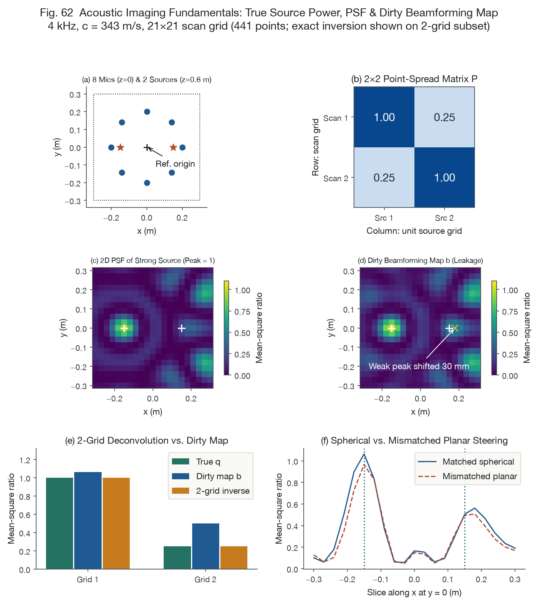
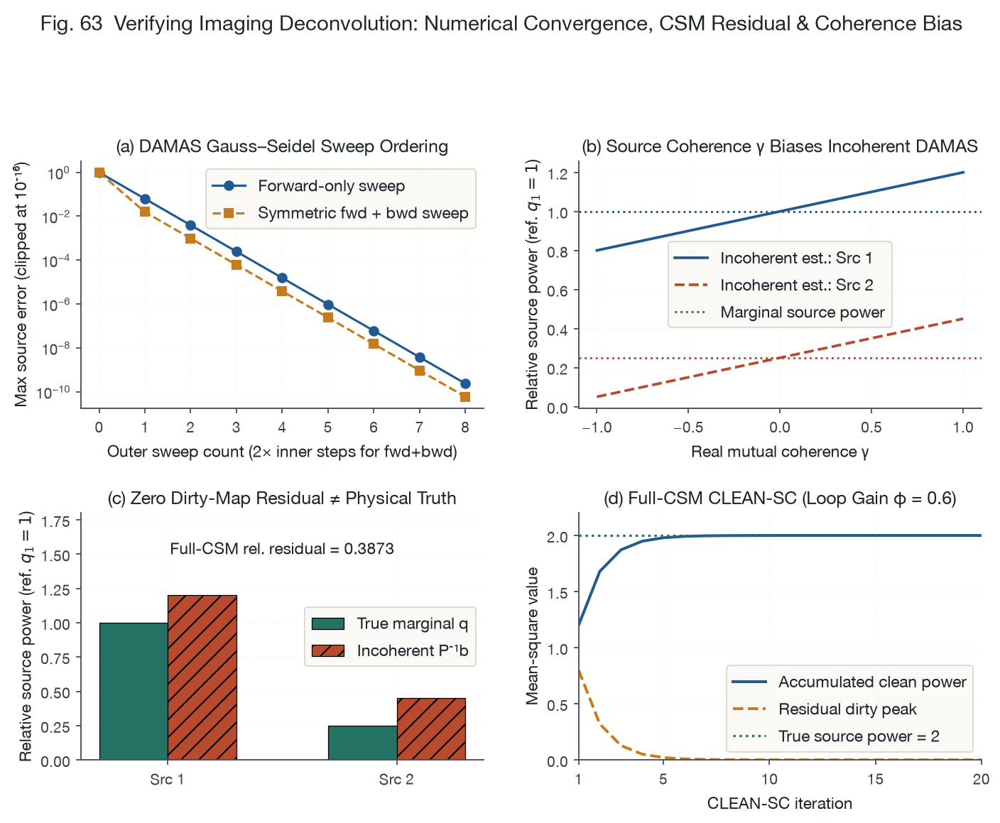
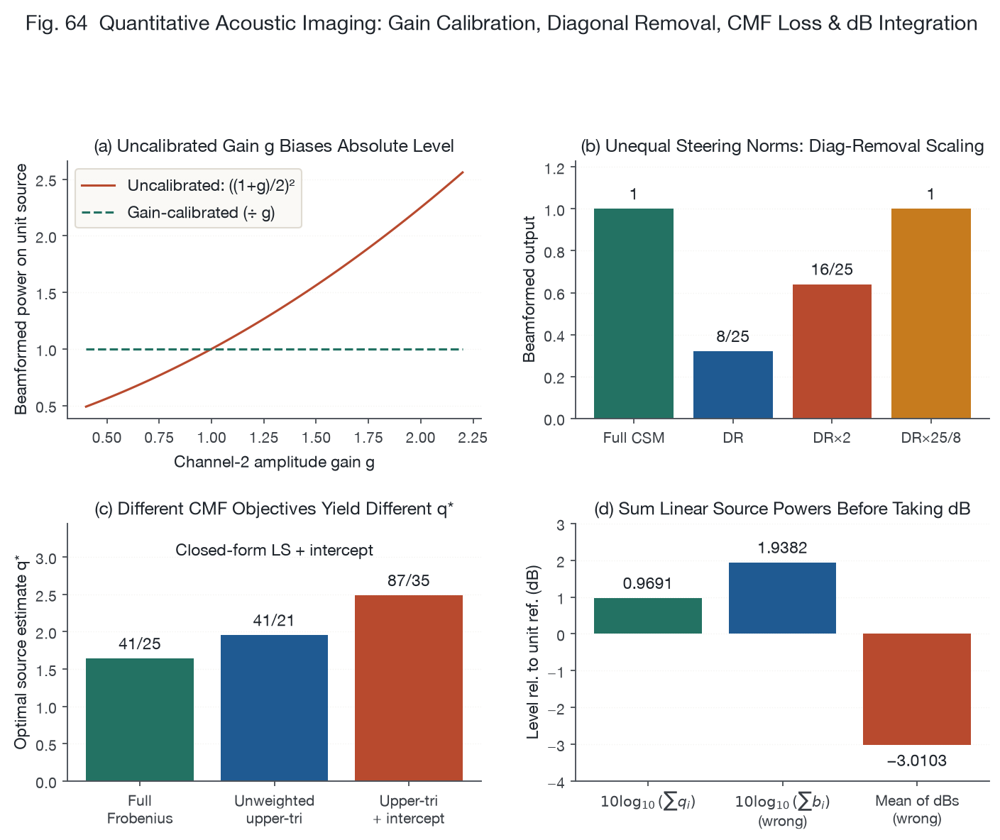
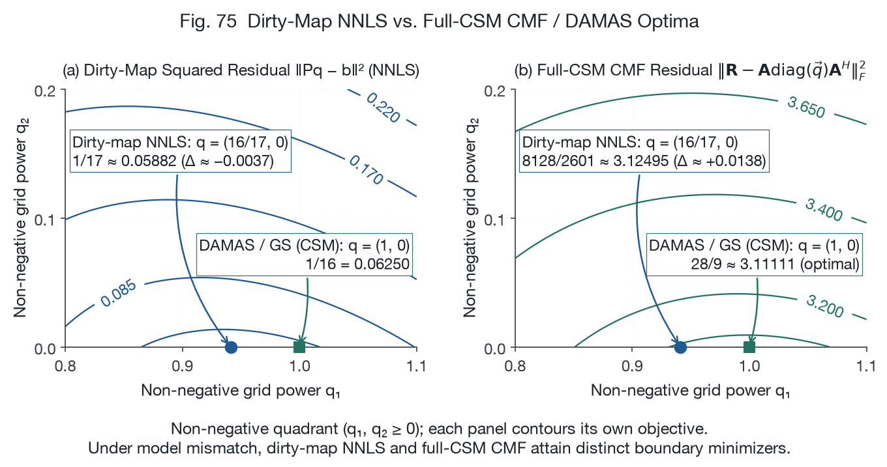

🌐 [简体中文](../chapters/12_acoustic-imaging.md) ｜ **English**

> ⚠️ This chapter is Chapter 12 of the main text (Extended Topic I; the main text comprises 16 chapters in total, Chapters 0–15, where Chapters 12–15 are four extended special topics accompanied by Appendices A and B), immediately following Chapter 11's selection guide. Step-by-step mathematical derivations can be reviewed in [Chapter 0](00_math-foundations.md) (see [§0.5](00_math-foundations.md#sec-0-5) for Non-Negative Least Squares KKT conditions), and global notation and terminology references appear in [Chapter 16, Appendix A](16_appendix-symbols-math.md).
>
> Overview Home: [00_overview.md](00_overview.md) ｜ Previous: [11_selection-guide.md](11_selection-guide.md) ｜ Next: [13_distributed-enhancement.md](13_distributed-enhancement.md)

---

## Chapter 12: Acoustic Imaging and Noise Source Diagnostics

### 12.1 From "Where Is the Sound?" to "How Much Sound Did Each Region Contribute?"

#### What a Noise Map Answers

Operating industrial machinery typically radiates bearing friction noise, cooling-fan aerodynamic noise, and structural housing vibration noise simultaneously. Inspecting the spectrum from a single microphone reveals only that acoustic pressure is elevated in a certain frequency band, without telling us *which physical part* of the machine radiates that energy. Switching to synchronous multi-channel acquisition with a microphone array introduces geometry-dependent propagation distances from each candidate spatial location to every microphone, imprinting position-specific amplitude ratios and phase differences across channels.

Acoustic imaging exploits these spatial amplitude–phase differences to invert source contributions across a grid of candidate locations that are consistent with the array observations, rendering the result as an intuitive spatial energy map. Engineers routinely use such "noise maps" to prioritize noise-control treatments, quantify regional radiation reductions before versus after structural redesigns, or diagnose whether weak acoustic sources are masked by sidelobes of dominant sources.

Reading an acoustic map always requires keeping the underlying wave-propagation model in view: a bright hotspot on the map might represent a genuine physical radiator, a specular mirror image reflected off a rigid wall, off-grid source energy split across neighboring grid nodes, geometric projection shift caused by an incorrect scan-plane depth setting, or spurious sidelobes induced by inter-channel amplitude–phase mismatch. Judging a heatmap solely by "how sharp its spots look" proves neither positional accuracy nor source-strength fidelity.

#### Distinctions from Localization, Enhancement, and Semantic Imaging

Direction-of-Arrival (DOA) estimation in [Chapter 4](04_doa-estimation.md) asks primarily "at what angle or coordinate does the source lie?"; beamforming in [Chapter 5](05_beamforming.md) extracts complex target-direction spectra to reconstruct an audible enhanced waveform. This chapter applies formally similar spatial weight vectors to inter-channel second-order statistics with a distinct objective: quantitatively estimating spatial source-power distributions across candidate grid points. Although the same array hardware and propagation physics can serve all four tasks, their output physical dimensions and acceptance criteria differ fundamentally:

| Task | Primary Output | What Validation Requires |
|---|---|---|
| DOA / Source localization | Direction angles or 3D spatial coordinates | Ground-truth geometric coordinates and angular/range error statistics |
| Beamforming speech enhancement | Time-domain waveform or short-time complex spectrum | Clean reference signal, target distortion metric, and residual-noise protocol |
| Noise-source imaging (this chapter) | Spatial source-strength map and regionally integrated quantities | Wave-propagation model, physical units, statistical coherence assumptions, and integration-zone boundaries |
| Semantic acoustic imaging | Sound event classes paired with spatial regions | Ground-truth class labels, spatial region annotations, and detection/segmentation scoring protocols |

Classical physical acoustic imaging inverts spatial source strengths strictly from wave propagation equations; its output carries no semantic labels such as "cooling fan" or "ball bearing." Overlaying an acoustic heatmap onto an optical camera photograph performs only geometric registration between acoustic coordinates and pixel coordinates; identifying faulty components and root-cause mechanisms still requires shaft-speed tachometers, order-tracked spectra, mechanical layout priors, or dedicated acoustic event classification models.

#### Method Names and Learning Progression

This chapter progresses through Cross-Spectral Matrix (CSM) estimation, conventional scan-and-sum beamforming, and three mainstream deconvolution / matrix-fitting paradigms, whose core abbreviations and roles are summarized below:

| Abbreviation | Full Term | Role in This Chapter |
|---|---|---|
| CSM | Cross-Spectral Matrix | Second-order statistical matrix collecting auto- and cross-power spectra across all microphone channels at a single frequency |
| PSF | Point Spread Function | Spatial scan response across the entire candidate grid induced by a single unit-strength point source |
| DAMAS | Deconvolution Approach for the Mapping of Acoustic Sources | Formulates the PSF linear system linking scan maps to source distributions and recovers source powers via coordinate-wise iteration with non-negativity projection |
| CLEAN-SC | CLEAN based on Spatial Source Coherence | Extracts the rank-one component spatially coherent with the current scan peak directly from the observed CSM and strips it out iteratively |
| CMF | Covariance Matrix Fitting | Bypasses beamformed scan maps to fit individual entries of the observed CSM directly using a dictionary of non-negative source powers |
| NNLS | Non-Negative Least Squares | Convex optimization framework minimizing squared residuals in either scan domain or matrix domain under non-negative source constraints |

The clearest learning path follows the causal signal-processing chain: assign each candidate grid node a spherical-wave propagation vector first, estimate the Cross-Spectral Matrix (CSM) from synchronous multi-channel recordings, evaluate conventional beamforming quadratic forms via spatial weights to see why the Point Spread Function (PSF) produces mainlobes and sidelobes, and finally enter non-negative inversion and coherent-component stripping. Because DAMAS, CLEAN-SC, and CMF each modify a different link along this chain, practical method selection must weigh their mathematical objectives and failure modes rather than comparing spot sharpness on selectively chosen demonstration plots.

#### Prerequisites and Notation in This Chapter

Multi-channel time delays and complex-exponential phase conventions can be reviewed in [Chapter 2, §2.3](02_basics-signal-model.md#sec-2-3); array aperture, difference coarrays, and channel calibration in [Chapter 3](03_array-geometry.md); spatial inner products and matched beamformer weights in [Chapter 5, §5.1](05_beamforming.md#sec-5-1); and Hermitian positive-semidefinite matrices and least squares in [Appendix A, §16.3](16_appendix-symbols-math.md#sec-16-3).

Book-wide mathematical notation applies throughout: column vectors carry arrows (e.g., $\vec x$), matrices use bold upright capitals (e.g., $\mathbf R$), real transpose is $^\top$, and conjugate transpose is $^H$. Microphone count is $M$, candidate grid node count is $J$, and statistical averaging snapshot count is $L$; time-sample index is $n$, frequency-bin index is $k$, and frame/snapshot index is $\ell$. To avoid collision with bin index $k$, acoustic wavenumber is written uniformly as $\kappa = 2\pi f / c$ ($\mathrm{rad/m}$).

For matrix symbols, the candidate grid propagation matrix is $\mathbf A \in \mathbb{C}^{M \times J}$, the Point Spread Function matrix is $\mathbf P \in \mathbb{R}^{J \times J}$, and the observed Cross-Spectral Matrix is $\mathbf R \in \mathbb{C}^{M \times M}$ (do not confuse this chapter's PSF matrix $\mathbf P$ with the state-error covariance matrix $\mathbf P$ in Kalman filtering of [Chapter 9](09_source-tracking.md)).

### 12.2 Assigning Every Candidate Source a Propagation Model First

#### Multi-Source Observation at a Single Frequency

Fix a single operating frequency $f_k$ first, stacking the frequency-domain complex coefficients across $M$ microphones at snapshot $\ell$ into column vector $\vec x_\ell \in \mathbb{C}^{M \times 1}$. Discretizing the inspection region into $J$ candidate grid nodes, let scalar $s_{j,\ell}$ denote the complex source coefficient emitted at node $j$ during snapshot $\ell$, and let $\vec a_j \in \mathbb{C}^{M \times 1}$ denote the propagation (steering) vector from node $j$ to all $M$ microphones. By linear acoustic superposition, the array observation vector sums contributions across all grid nodes plus additive channel noise $\vec n_\ell \in \mathbb{C}^{M \times 1}$:

$$\begin{aligned}
\vec x_\ell&=\sum_{j=1}^{J}\vec a_j s_{j,\ell}+\vec n_\ell\\
&=\mathbf A\vec s_\ell+\vec n_\ell,\\
\mathbf A&=[\vec a_1,\ldots,\vec a_J].
\end{aligned}\tag{12-1}$$

Here $\vec s_\ell = [s_{1,\ell},\ldots,s_{J,\ell}]^\top \in \mathbb{C}^{J \times 1}$ stacks source coefficients across the entire grid—empty grid nodes without physical sources simply have $s_{j,\ell} = 0$. Approximating continuous radiating surfaces by $J$ discrete nodes is a spatial discretization choice; real noise sources need not land squarely on grid intersections, and the consequences of "off-grid" mismatch are analyzed specifically in §12.9.

To keep formulas uncluttered, single-frequency derivations omit explicit argument $f_k$ below: unless noted otherwise, $\vec a_j$, weights $\vec w_i$, CSM $\mathbf R$, and source powers $q_j$ are evaluated at one shared frequency bin. Section 12.10 details how narrowband inversions are integrated across frequency bins into octave-band or broadband overall levels with consistent physical dimensions.

#### Distance Attenuation and Sign Conventions of Phase

In acoustic imaging, machinery under test frequently sits in the near field of the array, where waves from a single source exhibit non-negligible spherical-spreading amplitude ratios alongside inter-channel phase differences. Assuming a homogeneous quiescent medium (zero mean flow), unobstructed free-field propagation, and isotropic monopole point sources, denote microphone $m$'s position by $\vec r_m$, candidate grid node $j$'s position by $\vec p_j$, and pick a common reference point $\vec r_0$ (such as the geometric center of the array). Letting $r_{mj} = \|\vec p_j - \vec r_m\|$ be source-to-microphone distance, $r_{0j} = \|\vec p_j - \vec r_0\|$ be source-to-reference distance, and $\Delta r_{mj}$ be relative path difference (all in $\mathrm{m}$), the $m$-th entry of the dimensionless reference-normalized propagation vector is:

$$\begin{gathered}
\Delta r_{mj}=r_{mj}-r_{0j},\\
a_{mj}(f)=\frac{r_{0j}}{r_{mj}}e^{-\mathrm{j}\kappa\Delta r_{mj}},\\
\kappa=\frac{2\pi f}{c}.
\end{gathered}\tag{12-2}$$

Readers encountering amplitude ratio $\frac{r_{0j}}{r_{mj}}$ for the first time often wonder: "Why is reference distance $r_{0j}$ in the numerator and microphone distance $r_{mj}$ in the denominator?" Free-field spherical spreading ($\propto 1/r$) makes the physical origin immediate: with source strength proportionality constant $C_j$, complex acoustic pressure at reference point $\vec r_0$ is $s_j = (C_j / r_{0j})e^{-\mathrm{j}\kappa r_{0j}}$, while pressure at microphone $m$ is $x_{mj} = (C_j / r_{mj})e^{-\mathrm{j}\kappa r_{mj}}$. Dividing the two cancels $C_j$ and yields $x_{mj}/s_j = (r_{0j}/r_{mj})e^{-\mathrm{j}\kappa\Delta r_{mj}}$, i.e., $x_{mj} = a_{mj}(f)s_j$.

In other words, defining unknown source coefficient $s_j$ as "the acoustic pressure this source alone would produce at reference point $\vec r_0$," any microphone farther from the source than $\vec r_0$ ($r_{mj} > r_{0j}$) naturally receives weaker pressure ($\frac{r_{0j}}{r_{mj}} < 1$), any microphone closer receives stronger pressure ($\frac{r_{0j}}{r_{mj}} > 1$), and at $\vec r_0$ itself ($r_{mj} = r_{0j}$) the transfer entry normalizes to $1$ (see [Sarradj 2012, §2 Eqs. (1)–(4)](https://doi.org/10.1155/2012/292695)). Equation (12-2) requires $r_{mj} > 0$ and omits structural occlusion, ground reflection, dipole/quadrupole directivity, and wind-tunnel shear-layer refraction.

Double-check the exponential sign as well: throughout this book, forward Fourier transforms use kernel $e^{-\mathrm{j}2\pi f t}$, so a delayed arrival ($\tau = \Delta r_{mj}/c > 0$, i.e., $r_{mj} > r_{0j}$) multiplies by negative-phase factor $e^{-\mathrm{j}2\pi f\tau} = e^{-\mathrm{j}\kappa\Delta r_{mj}}$. Far-field plane-wave formulas in [Chapter 5](05_beamforming.md) display positive exponents along positive arrival angles simply because sensors upstream toward the incoming wavefront receive waves *earlier* than the origin ($\Delta r_{mj} < 0$), turning two negatives positive—both conventions are completely consistent.

In the two-microphone, two-grid-node hand-calculation anchor running throughout this chapter, Candidate Source 2 arrives at Mic 2 **later** than at Mic 1, carrying phase factor $e^{-\mathrm{j}2\pi/3}$. Accidentally conjugating $\vec a_j$ in code leaves magnitude-squared PSF entries and synthetic scan powers unchanged on paper, yet flips the sign of all off-diagonal imaginary parts in the CSM—inverting left and right completely once connected to real FFT microphone data. Propagation vectors, synthetic audio delays, and CSM conjugation order must therefore be locked together.

#### The Reference Point Sets the Physical Scale of Source Quantities

Common reference point $\vec r_0$ need not coincide with a physical microphone. Choosing the array center as $\vec r_0$ compares acoustic pressure contributions fairly from the array's vantage point, though peripheral grid nodes have larger $r_{0j}$ than on-axis nodes. Because dimensionless distance ratios are absorbed into $\vec a_j$ in Eq. (12-2), inverted source coefficients $s_j$ inherit the physical acoustic pressure dimension at $\vec r_0$ directly (mean-square source power $q_j$ has units $\mathrm{Pa}^2$ at $\vec r_0$).

Shifting reference location from $\vec r_0$ to another point $\vec r_1$ obviously cannot alter the physical pressures $\vec a_j s_j$ sensed at the microphones. Consequently, whenever rescaled propagation vector $\vec a'_j$ shrinks or grows with the new reference distance, true source strength $s'_j$ scales inversely so product $\vec a'_j s'_j = \vec a_j s_j$ remains invariant. Exercise [E12-12](#e12-12) verifies this exact invariance step by step on 3D coordinates.

Other source-strength conventions appear widely in papers and commercial acoustic cameras—such as surface volume velocity, coefficients under unit-Euclidean-norm columns ($\|\tilde{\vec a}_j\|_2 = 1$), or free-field mean-square pressure standardized to $1\,\mathrm{m}$ from each individual source. All are mathematically valid, but before comparing "source power" numbers across publications or software packages, always inspect column normalization conventions and apply explicit scale conversion.

### 12.3 Forming the Cross-Spectral Matrix from Synchronous Recordings

#### What a Single Outer Product Contains

Rather than solving source positions from instantaneous single-frame waveforms, acoustic imaging accumulates frequency-domain multi-channel second-order statistics—the Cross-Spectral Matrix (CSM). With single-frequency observation scale fixed, we follow acoustic imaging convention in writing population second-order moment matrix $\mathbf R$ (matching spatial observation covariance $\mathbf R_{xx}$ in earlier chapters) alongside its $L$-snapshot sample average $\hat{\mathbf R}$:

$$\begin{aligned}
\mathbf R&=\mathbb{E}[\vec x\vec x^H],\\
\hat{\mathbf R}&=\frac{1}{L}\sum_{\ell=1}^L\vec x_\ell\vec x_\ell^H.
\end{aligned}\tag{12-3}$$

Expanding the two-channel ($M = 2$) single-snapshot outer product $\vec x_\ell\vec x_\ell^H$ makes its information content explicit:

$$\vec x_\ell\vec x_\ell^H=
\begin{pmatrix}
|x_{1,\ell}|^2 & x_{1,\ell}x_{2,\ell}^*\\
x_{2,\ell}x_{1,\ell}^* & |x_{2,\ell}|^2
\end{pmatrix}.$$

Main-diagonal entries $|x_{1,\ell}|^2, |x_{2,\ell}|^2 \ge 0$ record per-channel auto-powers while discarding absolute phase; off-diagonal entries $x_{1,\ell}x_{2,\ell}^*$ and $x_{2,\ell}x_{1,\ell}^*$ form a complex-conjugate pair whose magnitude equals the product of channel amplitudes and whose phase preserves exact inter-channel phase difference $\angle x_{1,\ell} - \angle x_{2,\ell}$. Mistyping conjugate transpose $^H$ as plain transpose $^\top$ turns phase differences into phase sums, destroying spatial localization altogether.

Checking positive semidefiniteness of $\hat{\mathbf R}$: for any $\vec v \in \mathbb{C}^{M \times 1}$, factoring the quadratic form through the snapshot sum gives

$$\begin{aligned}
\vec v^H\vec x_\ell\vec x_\ell^H\vec v&=|\vec v^H\vec x_\ell|^2,\\
\vec v^H\hat{\mathbf R}\vec v
&=\frac{1}{L}\sum_{\ell=1}^{L}|\vec v^H\vec x_\ell|^2\ge 0.
\end{aligned}$$

Because every summand is a squared modulus, retaining all diagonal and off-diagonal entries guarantees $\hat{\mathbf R}$ is Hermitian positive semidefinite ($\hat{\mathbf R} \succeq 0$). This property holds purely by outer-product structure without requiring zero sample mean across the $L$ snapshots; strictly speaking, Eq. (12-3) defines the uncentered second-moment matrix, whereas centered sample covariance subtracts $\bar{\vec x}\bar{\vec x}^H$ (see [Appendix A, E16-02](16_appendix-symbols-math.md#e16-02)).

#### Peak Complex Amplitude Versus RMS Complex Coefficient

When constructing sinusoidal test cases, the most frequent bug is dropping the factor of $2$ between peak amplitude and root-mean-square (RMS) power. For a real sinusoid strictly between DC and Nyquist—writing complex exponential $\xi[n] = z e^{\mathrm{j}\Omega_{\mathrm{d}} n}$ with $\Omega_{\mathrm{d}} = 2\pi f / f_s \in (0,\pi)$ and peak complex phasor $z$ so $x[n] = \operatorname{Re}\{\xi[n]\}$—averaging cosine-squared over integer periods yields time-domain mean-square power $|z|^2 / 2$. Defining RMS complex coefficient $\vec s_\ell = \vec z_\ell / \sqrt{2}$ (equivalently dividing outer products by $2$) aligns CSM diagonals directly with time-domain mean-square power:

$$\begin{aligned}
\mathbf R_{\mathrm{tone}}
&=\frac{1}{2L}\sum_{\ell=1}^{L}\vec z_\ell\vec z_\ell^H\\
&=\frac{1}{L}\sum_{\ell=1}^{L}\vec s_\ell\vec s_\ell^H.
\end{aligned}\tag{12-4}$$

Keep in mind that division by $2$ applies *only* to interior real sinusoids $f \in (0, f_s/2)$; at DC ($f = 0$, $x[n] = A$) and even-length Nyquist ($f = f_s/2$, $x[n] = A(-1)^n$), every sample squared equals $A^2$, so mean-square power is $A^2$ without division by $2$. In this chapter's companion synthetic WAVs, peak source amplitudes $0.2$ and $0.1$ convert via Eq. (12-4) to exact mean-square powers $0.2^2/2 = 0.02$ and $0.1^2/2 = 0.005$.

#### FFT Windows, Frequency Spacing, and One-Sided Spectra

For wideband real recordings, each $N$-sample frame is multiplied by real analysis window $v[n]$ ($n = 0,\ldots,N-1$) with window energy $U = \sum_{n=0}^{N-1} v[n]^2$ before an unnormalized $N$-point FFT yielding $\vec X_\ell[k]$. Exploiting conjugate symmetry of real-signal spectra, engineering conventions work over one-sided bins ($0 \le k \le \lfloor N/2 \rfloor$) to define one-sided Cross-Power Spectral Density (CPSD) $\mathbf S[k]$ and per-bin mean-square power matrix $\mathbf R_{\mathrm{bin}}[k]$:

$$\begin{aligned}
\hat{\mathbf R}_X[k]
&=\frac{1}{L}\sum_{\ell=1}^{L}\vec X_\ell[k]\vec X_\ell[k]^H,\\
\mathbf S[k]&=\frac{\epsilon_k}{f_s U}\hat{\mathbf R}_X[k],\\
\mathbf R_{\mathrm{bin}}[k]&=\mathbf S[k]\Delta f,\qquad
\Delta f=\frac{f_s}{N}.
\end{aligned}\tag{12-5}$$

One-sided folding factor $\epsilon_k$ equals $2$ at interior positive bins ($1 \le k < N/2$) to fold symmetric negative-frequency energy, and equals $1$ at DC ($k = 0$) and even-$N$ Nyquist ($k = N/2$) where no distinct conjugate partner exists. For pressure-calibrated inputs ($\mathrm{Pa}$), $\mathbf S[k]$ has units $\mathrm{Pa}^2/\mathrm{Hz}$ and $\mathbf R_{\mathrm{bin}}[k]$ has units $\mathrm{Pa}^2$; for uncalibrated digital audio, both carry squared digital full-scale units.

Never confuse the two standard window normalization constants: coherent amplitude sum $S_1 = \sum_{n=0}^{N-1} v[n]$ must *not* replace energy sum $U$ in the denominator of Eq. (12-5). While $S_1$ calibrates single-bin peak reading of an isolated bin-centered tone, $U$ preserves broadband noise PSD and multi-bin integrated power. Applying a tapered window spreads a bin-centered tone across its center bin and immediate sidebins so the center bin alone reads lower than total tone power—yet summing $\mathbf R_{\mathrm{bin}}[k]$ across those affected bins recovers exact total power (Exercise [E12-11](#e12-11) verifies both $24$-point rectangular and periodic Hann windows by hand).

Summing diagonal entries across all one-sided bins for channel $m$ confirms time–frequency Parseval consistency:

$$\begin{aligned}
\sum_{k=0}^{\lfloor N/2\rfloor}[\mathbf R_{\mathrm{bin}}[k]]_{mm}
&=\frac{1}{LU}\sum_{\ell=1}^{L}E_{m,\ell},\\
E_{m,\ell}&=\sum_{n=0}^{N-1}v[n]^2|x_{m,\ell}[n]|^2.
\end{aligned}$$

The right-hand side equals the **window-squared-weighted mean-square value** of the time-domain frame. Under a rectangular window ($v[n] = 1, U = N$), this reduces to unweighted frame mean-square power; for non-stationary transients under tapered windows, the two differ legitimately.

A minimal 4-point transient makes this concrete: for periodic Hann window $v = [0, 1/2, 1, 1/2]$ ($N = 4$), $U = 0 + 1/4 + 1 + 1/4 = 3/2$. A unit impulse at $n = 0$ ($x = [1, 0, 0, 0]$) and one at $n = 2$ ($x = [0, 0, 1, 0]$) share unweighted frame mean-square power $1/4$; yet summing Eq. (12-5) across one-sided bins yields $0$ for the first and $1 / (3/2) = 2/3$ for the second—the first impulse landed squarely on the window's zero endpoint (which is why $50\%$–$75\%$ frame overlap is used for non-stationary signals), not because the FFT lost energy.

For off-diagonal channel pairs $m \ne m'$, one-sided cross-spectra retain positive-frequency complex phases with generally nonzero imaginary parts; recovering zero-lag real time-domain cross-correlation simply takes the real part of the full-band one-sided sum, since conjugate negative-frequency imaginary parts cancel in the two-sided sum.

#### Where the Incoherent-Source Assumption Enters

Substituting multi-source model $\vec x = \mathbf A\vec s + \vec n$ from Eq. (12-1) into $\mathbf R = \mathbb{E}[\vec x\vec x^H]$ produces source–noise cross-terms $\mathbf A\mathbb{E}[\vec s\vec n^H]$ and $\mathbb{E}[\vec n\vec s^H]\mathbf A^H$. Under second-order orthogonality $\mathbb{E}[\vec s\vec n^H] = \mathbf 0$ (e.g., zero-mean uncorrelated signals; note that if both means are nonzero, zero centered covariance alone does not make uncentered second-moment cross-terms vanish), cross-terms drop out to leave $\mathbf R - \mathbf R_{nn} = \mathbf A\mathbf R_{ss}\mathbf A^H$, where $\mathbf R_{ss} = \mathbb{E}[\vec s\vec s^H] \in \mathbb{C}^{J \times J}$ is the source cross-spectral matrix and $\mathbf R_{nn} = \mathbb{E}[\vec n\vec n^H]$ is the noise spatial covariance.

Conventional beamforming and standard DAMAS / CMF all hinge on the very next physical assumption—that sources at distinct locations are mutually **incoherent**, i.e., $R_{ss,jh} = \mathbb{E}[s_j s_h^*] = 0$ for all $j \ne h$. Only under mutual incoherence does $\mathbf R_{ss} = \operatorname{diag}(q_1,\ldots,q_J)$ collapse to a real non-negative diagonal matrix, decomposing $\mathbf R$ into a non-negative linear combination of rank-one source templates:

$$\begin{aligned}
\mathbf R&=\sum_{j=1}^{J}q_j\vec a_j\vec a_j^H+\mathbf R_{nn},\\
q_j&=\mathbb{E}[|s_j|^2]\ge 0.
\end{aligned}\tag{12-6}$$

Whenever radiators at distinct locations are driven by a common rotating shaft, or direct waves reflect off floors or wind-tunnel walls to form coherent image sources, $\mathbf R_{ss}$ acquires nonzero off-diagonal pairs $R_{ss,jh}\vec a_j\vec a_h^H$ and $R_{ss,jh}^*\vec a_h\vec a_j^H$ ($j \ne h$). Constructive and destructive spatial interference from these cross-terms cannot be represented as a sum of non-negative independent point-source powers.

Keep "population statistical incoherence" distinct from "exact zero sample cross-spectrum over finite snapshots" as well: genuinely independent random sources still exhibit finite-sample cross-spectral fluctuations around zero (reduced by averaging more snapshots, noting that heavily overlapped STFT frames are not independent snapshots); conversely, alternating inter-block phases in our pedagogical synthetic WAVs to cancel $20$-block sample cross-spectra to exact zero is a deterministic orthogonal phase code for isolating algebraic variables, never proof of stochastic independence (see Exercise [E12-03](#e12-03)).

### 12.4 Why Scan Maps Exhibit Mainlobes and Sidelobes

#### From Complex Beam Output to the Scan Quadratic Form

With observed CSM $\mathbf R$ in hand, we sweep across candidate grid nodes $i = 1,\ldots,J$ like a searchlight. Applying spatial weight vector $\vec w_i \in \mathbb{C}^{M \times 1}$ designed for node $i$ forms scalar beam output $y_i = \vec w_i^H\vec x$, whose mean-square power $b_i$ is:

$$\begin{aligned}
b_i&=\mathbb{E}[|y_i|^2]\\
&=\mathbb{E}[(\vec w_i^H\vec x)(\vec x^H\vec w_i)]\\
&=\vec w_i^H\mathbb{E}[\vec x\vec x^H]\vec w_i\\
&=\vec w_i^H\mathbf R\vec w_i.
\end{aligned}\tag{12-7}$$

Checking matrix dimensions: $(1 \times M)(M \times M)(M \times 1)$ contracts cleanly to a scalar. Because full CSM $\mathbf R \succeq 0$ is Hermitian positive semidefinite, $b_i$ is theoretically a non-negative real number; floating-point arithmetic may leave $10^{-16}$-scale imaginary roundoff (discarded via `np.real`), whereas noticeable imaginary parts or negative powers signal either an upstream CSM construction bug or intentional diagonal removal (§12.8).

To align scan output power directly with reference-point source strength, conventional beamforming throughout this chapter adopts **unit-matched-response weights** (guaranteeing unit noiseless scan output at node $i$ for a unit source at node $i$ alone):

$$\begin{aligned}
\vec w_i&=\frac{\vec a_i}{\vec a_i^H\vec a_i},\\
\vec w_i^H\vec a_i&=\frac{\vec a_i^H\vec a_i}{\vec a_i^H\vec a_i}=1.
\end{aligned}\tag{12-8}$$

Under this normalization, a single noiseless source of power $q_i$ at node $i$ ($\mathbf R = q_i\vec a_i\vec a_i^H$) reads out $b_i = q_i|\vec w_i^H\vec a_i|^2 = q_i$ exactly. For equal-amplitude far-field plane waves ($|a_{mi}| = 1$), $\vec a_i^H\vec a_i = M$ reduces Eq. (12-8) to Chapter 5's familiar delay-and-sum weights $\vec a_i / M$. Under spatially white sensor noise $\mathbf R_{nn} = \sigma^2\mathbf I$, additive scan-floor bias at node $i$ equals $\sigma^2\|\vec w_i\|_2^2 = \sigma^2 / (\vec a_i^H\vec a_i)$ (e.g., $\sigma^2 / 2$ for equal-amplitude two-mic arrays).

#### Unit Matched Response Does Not Guarantee Unbiased 3D Depth Peaks

It is tempting to assume that because Eq. (12-8) aligns phases perfectly and normalizes gain to $1$ at true source position $\vec p_j$, scanning across 3D space must attain its global maximum at $\vec p_j$. Under near-field spherical waves, **that is false**. Under the reference-normalized model Eq. (12-2) with $\vec r_0$ at the array center, varying longitudinal scan depth $z$ simultaneously alters phases and amplitude ratios $r_{0i}/r_{mi}$. For a planar array on $z = 0$ with radial element offsets $\rho_m = \|\vec r_m - \vec r_0\|_2$ scanning an on-axis point $(0, 0, z)$, $|a_{mi}|^2 = z^2 / (z^2 + \rho_m^2)$, so the derivative of squared steering norm with respect to depth is strictly positive:

$$\frac{\mathrm{d}}{\mathrm{d}z}\|\vec a_i\|_2^2
=\sum_{m=1}^{M}\frac{2z\rho_m^2}{(z^2+\rho_m^2)^2}>0.$$

Under Eq. (12-2), scanning deeper ($z \uparrow$) therefore increases $\|\vec a_i\|_2$ monotonically toward $\sqrt{M}$, whereas **scanning closer to the array ($z \downarrow$) shrinks $\|\vec a_i\|_2$ monotonically toward $0$**; consequently, weight norm $\|\vec w_i^{\mathrm{III}}\|_2 = 1/\|\vec a_i\|_2$ (and $r_{mi}/r_{0i}$ in Formulation II) inflates at shallower depths, pulling the 3D peaks of Formulations II and III **closer to the array (shallower than $z_{\mathrm{true}}$)** rather than deeper behind the source (conversely, under an unnormalized free-field Green's function $1/r_{mi}$ without the $r_{0i}$ numerator, $\|\vec g_i\|_2$ shrinks with depth and pulls peaks deeper behind the source).

Sarradj systematically compared four classical steering-vector formulations in 3D source mapping (see [Sarradj 2012, §§2.1–2.5 Eqs. (7)–(13) & Table 1](https://doi.org/10.1155/2012/292695) and Acoular's `steer_type` names); their exact expressions and near-field/far-field properties are summarized below:

| Formulation & Acoular Name | Exact Steering-Weight Expression | Noiseless Single-Source 3D Peak | Source-Strength Reading at True Location | Far-Field Equal-Amplitude Limit ($\lvert a_{mi}\rvert=1$) |
|---|---|---|---|---|
| Formulation I (`classic`) | $w_{mi}^{\mathrm{I}} = \dfrac{1}{M}\dfrac{a_{mi}}{\lvert a_{mi}\rvert}$<br>$= \dfrac{1}{M}e^{-\mathrm{j}\kappa\Delta r_{mi}}$ | **Unbiased** (equal-weight, lower SNR than IV) | Biased (equals $\frac{q_j}{M^2}(\sum_m \frac{r_{0j}}{r_{mj}})^2$) | $\vec a_i / M$ |
| Formulation II (`inverse`) | $w_{mi}^{\mathrm{II}} = \dfrac{1}{M}\dfrac{1}{a_{mi}^*}$<br>$= \dfrac{1}{M}\dfrac{r_{mi}}{r_{0i}}e^{-\mathrm{j}\kappa\Delta r_{mi}}$ | Biased | Unbiased ($\vec w_i^H\vec a_i=1$) | $\vec a_i / M$ |
| Formulation III (`true level`, Eq. (12-8)) | $\vec w_i^{\mathrm{III}} = \dfrac{\vec a_i}{\|\vec a_i\|_2^2}$ | Biased | Unbiased (and WNG-optimal) | $\vec a_i / M$ |
| Formulation IV (`true location`) | $\vec w_i^{\mathrm{IV}} = \dfrac{\vec a_i}{\sqrt{M}\|\vec a_i\|_2}$ | **Unbiased** ($1/r$-matched, higher SNR than I) | Biased (equals $\frac{\|\vec a_j\|_2^2}{M}q_j$) | $\vec a_i / M$ |

For a noiseless single source $\mathbf R = q_j\vec a_j\vec a_j^H$, both Formulation I and Formulation IV attain their ideal upper bounds at the true source position; steering-equivalent points may share the maximum, as the equality conditions below show. For Formulation I, the triangle inequality directly gives

$$\begin{aligned}
b_i^{\mathrm{I}}
&=\frac{q_j}{M^2}\left|\sum_{m=1}^{M}\frac{r_{0j}}{r_{mj}}
e^{\mathrm{j}\kappa(\Delta r_{mi}-\Delta r_{mj})}\right|^2\\
&\le\frac{q_j}{M^2}\left(\sum_{m=1}^{M}\frac{r_{0j}}{r_{mj}}\right)^2,
\end{aligned}$$

where the positive magnitudes $r_{0j}/r_{mj}$ are independent of scan index $i$, so equality holds when all channel phases align; the true position satisfies this, but steering-equivalent ambiguous points can also satisfy it (and similarly with diagonal removal); Formulation I's drawback relative to IV is lower SNR and White Noise Gain (WNG) because it omits $1/r$ amplitude matching, not noiseless localization bias. Next, pay close attention to the $\sqrt{M}$ factor in the denominator of Formulation IV: it fixes every scan node's weight norm to $\|\vec w_i^{\mathrm{IV}}\|_2 = 1/\sqrt{M}$, so the Cauchy–Schwarz inequality guarantees $b_i^{\mathrm{IV}} = \frac{q_j}{M}\frac{|\vec a_i^H\vec a_j|^2}{\|\vec a_i\|_2^2} \le \frac{\|\vec a_j\|_2^2}{M}q_j$ with strict equality when $\vec a_i$ is collinear with $\vec a_j$ (including the true position, without proving its uniqueness); simultaneously, in the far-field limit ($|a_{mi}|=1,\ \|\vec a_i\|_2 = \sqrt{M}$), the factor $1/\sqrt{M}$ brings $\vec w_i^{\mathrm{IV}}$ back to $\vec a_i / M$ and restores output power $q_j$ identically (omitting $1/\sqrt{M}$ by using unit-norm $\vec a_i/\|\vec a_i\|_2$ would inflate far-field power by a factor of $M$). The table also confirms algebraically that *no* fixed conventional steering formulation can unconditionally achieve both unbiased 3D peak location and unbiased source-strength amplitude in unknown-depth near-field scans.

Accordingly, industrial imaging of quasi-planar machinery fixes a 2D scan grid onto the known radiating surface via laser rangefinders or CAD drawings first, allowing Eq. (12-8) to preserve both lateral localization and physical source scale; extending the same weights across unknown 3D depths requires explicit assessment of depth bias and weight amplification.

#### The Full Map of One Unit Source Is the PSF

Why do two discrete point sources produce broad diffuse blobs and spurious sidelobe patches on a conventional beamforming map? Substituting incoherent CSM Eq. (12-6) into quadratic form Eq. (12-7) makes the mechanism transparent:

$$\begin{aligned}
b_i&=\vec w_i^H\mathbf R\vec w_i\\
&=\sum_{j=1}^J q_j(\vec w_i^H\vec a_j)(\vec a_j^H\vec w_i)+b_{n,i}\\
&=\sum_{j=1}^J q_j|\vec w_i^H\vec a_j|^2+b_{n,i},\\
P_{ij}&=|\vec w_i^H\vec a_j|^2,\qquad
b_{n,i}=\vec w_i^H\mathbf R_{nn}\vec w_i,\\
\vec b&=\mathbf P\vec q+\vec b_n.
\end{aligned}\tag{12-9}$$

Pay close attention to the two indices of coupling entry $P_{ij} = |\vec w_i^H\vec a_j|^2$: second index $j$ is the **true source grid column**, while first index $i$ is the **observed scan grid row**. Placing a single unit-power source at node $j$ ($q_j = 1$, all other $q = 0$, noiseless) produces across all $J$ scan nodes precisely **Column $j$** of matrix $\mathbf P$—the Point Spread Function (PSF) of node $j$. Conversely, reading across **Row $i$**, $b_i = \sum_{j=1}^J P_{ij} q_j + b_{n,i}$ shows how scan reading $i$ accumulates leakage from every active source across the grid.

Under Eq. (12-8) and full CSM, main-diagonal entries satisfy $P_{ii} = |\vec w_i^H\vec a_i|^2 = 1$ with $P_{ij} \ge 0$ everywhere. Because finite aperture and finite sensor count prevent $\vec a_i$ and $\vec a_j$ from being mutually orthogonal across grid nodes, $P_{ij}$ forms a finite-width **mainlobe** around node $j$ plus distant **sidelobes** from spatial aliasing or array periodicity. Moreover, under near-field spherical spreading or wide-angle planar grids, PSF shape varies with source node $j$ (breaking shift invariance), making Eq. (12-9) a general dense linear system rather than a spatially shift-invariant 2D FFT convolution.

#### Complete Two-Grid Hand Calculation

To ground every matrix symbol in exact arithmetic, we establish a two-grid-node benchmark carried through every section of this chapter: **inputs and conventions** specify $M = 2$ microphones, $J = 2$ candidate grid nodes, dimensionless propagation vectors, matched weights, and incoherent true mean-square source powers:

$$\begin{aligned}
\vec a_1&=\begin{pmatrix}1\\1\end{pmatrix},\qquad
\vec a_2=\begin{pmatrix}1\\e^{-\mathrm{j}2\pi/3}\end{pmatrix},\\
\vec w_i&=\frac{\vec a_i}{2}\quad(i=1,2),\qquad
\vec q=\begin{pmatrix}1\\1/4\end{pmatrix}.
\end{aligned}\tag{12-10}$$

**Step-by-step substitution and intermediate values**: Evaluate the complex spatial response matrix $\mathbf W^H\mathbf A$ first (where $\mathbf W = [\vec w_1, \vec w_2] = \mathbf A / 2$). Using $e^{-\mathrm{j}2\pi/3} = -1/2 - \mathrm{j}\sqrt{3}/2$, the conjugate inner product gives $\vec w_1^H\vec a_2 = \frac{1}{2}(1 + e^{-\mathrm{j}2\pi/3}) = \frac{1}{4} - \mathrm{j}\frac{\sqrt{3}}{4}$, and symmetrically $\vec w_2^H\vec a_1 = (\vec w_1^H\vec a_2)^* = \frac{1}{4} + \mathrm{j}\frac{\sqrt{3}}{4}$:

$$\mathbf W^H\mathbf A =
\begin{pmatrix}
1 & 1/4 - \mathrm{j}\sqrt{3}/4 \\
1/4 + \mathrm{j}\sqrt{3}/4 & 1
\end{pmatrix}.$$

Taking the **entry-wise Hadamard squared modulus** of $\mathbf W^H\mathbf A$ (never matrix multiplication $(\mathbf W^H\mathbf A)^2$) yields off-diagonal coupling $P_{12} = P_{21} = (1/4)^2 + (\sqrt{3}/4)^2 = 1/16 + 3/16 = 1/4$. Assuming zero sensor noise ($\vec b_n = \vec 0$), the **exact scan result** is:

$$\begin{aligned}
\mathbf P&=\begin{pmatrix}1&1/4\\1/4&1\end{pmatrix},\\
\vec b&=\mathbf P\vec q
=\begin{pmatrix}1\times 1 + \frac{1}{4}\times\frac{1}{4}\\
\frac{1}{4}\times 1 + 1\times\frac{1}{4}\end{pmatrix}
=\begin{pmatrix}17/16\\1/2\end{pmatrix}.
\end{aligned}\tag{12-11}$$

**Physical takeaway and validity boundaries**: Inspect $\vec b = [17/16, 1/2]^\top = [1.0625, 0.5]^\top$—Node 1's true power is $1$, yet its scan reading inflates to $17/16$ ($+1/16$ leaked from Source 2); Node 2's true power is only $1/4 = 0.25$, yet leakage $\frac{1}{4}\times 1 = 1/4$ from strong Source 1 equals Node 2's own power, **doubling** Node 2's scan reading to $1/2$. Summing raw scan pixels as "total radiated energy" gives $17/16 + 8/16 = 25/16 = 1.5625$, overstating true total source power $1 + 1/4 = 5/4 = 1.25$ by $25\%$—that excess $5/16$ is pure double-counting from overlapping spatial beams, not extra acoustic radiation. Note that this two-mic, two-node model serves to isolate incoherent deconvolution algebra (requiring incoherent on-grid sources and exact $\mathbf A$) rather than representing multi-source wind-tunnel measurements.



Figure 62 pairs our two-node hand calculation with a 2D near-field planar array benchmark to make the interplay among true source distribution, single-source PSF, and multi-source conventional scan maps crystal clear (all quantities normalized to common reference source strength):

- **Panel (a) Array and source-plane geometry**: Blue dots mark an $8$-microphone uniform circular ring of radius $0.2\,\mathrm{m}$ in plane $z = 0$ with common reference origin marked by a black cross; the dashed box outlines the $21 \times 21 = 441$-node 2D scan plane at $z = 0.6\,\mathrm{m}$ ($x, y \in [-0.3, 0.3]\,\mathrm{m}$, step $0.03\,\mathrm{m}$), with red stars at the strong left source $(-0.15, 0, 0.6)\,\mathrm{m}$ (strength $1.0$) and weak right source $(0.15, 0, 0.6)\,\mathrm{m}$ (strength $0.25$).
- **Panel (b) Two-node PSF matrix**: Heatmap of the $2 \times 2$ matrix in Eq. (12-11) (horizontal column $j$ = true source node, vertical row $i$ = scan node), showing unit diagonal response $1.00$ and $0.25$ cross-node leakage.
- **Panel (c) 2D strong-source PSF**: Normalized $441$-node map at $4\,\mathrm{kHz}$ ($c = 343\,\mathrm{m/s}$) when illuminating the strong left source alone. Response at the left white cross equals $1$ exactly, surrounded by a finite-aperture mainlobe plus curved sidelobe arcs that lift the right white cross (weak-source location) to $\approx 0.255$.
- **Panel (d) Two-source conventional beamforming map**: Activating incoherent strong ($1.0$) and weak ($0.25$) sources together superimposes the sloped sidelobe skirt of Source 1 onto Source 2's mainlobe, pushing the right local maximum (yellow $\times$) outward by one full grid step ($30\,\mathrm{mm}$, to $x = 0.18\,\mathrm{m}$)—demonstrating that even when both sources sit squarely on grid intersections, conventional scan peaks can shift away from weak-source ground truth (see [E12-05](#e12-05)).
- **Panel (e) Two-node inversion and regional sum**: Comparing ground truth (green: $1.00, 0.25$), conventional scan (blue: $1.0625, 0.50$), and inverted values (orange: $1.00, 0.25$) shows why raw scan pixel sums systematically overestimate total source strength.
- **Panel (f) Propagation-model mismatch cut**: Horizontal profile along $y = 0$ ($x \in [-0.3, 0.3]\,\mathrm{m}$) on the exact same near-field spherical-wave CSM, contrasting matched spherical-wave weights Eq. (12-2) (solid blue) against mismatched far-field plane-wave weights omitting distance ratios and wavefront curvature (dashed red)—plane-wave mismatch depresses peak readings and distorts spatial profiles noticeably.

### 12.5 Learning DAMAS and NNLS from the PSF System

#### Why Non-Negative Deconvolution Is Needed

Given PSF matrix $\mathbf P$ and conventional scan map $\vec b$, our goal is inverting for true grid source powers $\vec q$. Isolating diagonal self-response from off-diagonal cross-node leakage in row $i$ of noiseless $\mathbf P\vec q = \vec b$ gives:

$$\begin{aligned}
P_{ii}q_i+\sum_{j\ne i}P_{ij}q_j&=b_i,\\
q_i&=\frac{b_i-\sum_{j\ne i}P_{ij}q_j}{P_{ii}}.
\end{aligned}$$

On well-conditioned $2 \times 2$ toy example Eq. (12-11), $\mathbf P$ is nonsingular and noiseless so $\mathbf P^{-1}\vec b = [1, 1/4]^\top$ directly. In real acoustic imaging, however, unconstrained linear inversion hits two brick walls immediately: first, grid count $J$ routinely spans hundreds or thousands of nodes (e.g., $J = 441$ in Fig. 62), whereas an $M$-microphone CSM carries at most $M^2$ real linearly independent degrees of freedom; whenever $J \gg M^2$, $\mathbf P$ is massively rank-deficient with infinitely many linear solutions.

Second, adjacent fine-grid steering columns are nearly collinear, making $\mathbf P$ severely ill-conditioned: tiny finite-snapshot fluctuations or geometric errors explode under unconstrained inversion or pseudoinversion, producing wild positive–negative oscillations across neighboring pixels—assigning huge positive power to one node alongside physically absurd **negative acoustic source power** next door so their sidelobes cancel to fit $\vec b$.

By Eq. (12-6), independent mean-square source power $q_j = \mathbb{E}[|s_j|^2]$ can never be negative physically (coherent interference cross-terms do not belong to an independent-source power vector). Brooks and Humphreys's DAMAS algorithm enforces this physical floor directly by pairing the row-wise rearrangement above with coordinate-wise **non-negativity projection**, suppressing oscillatory ringing and stripping sidelobes across sparse source fields (notation below matches [Brooks & Humphreys 2004, Eqs. (18), (23), (24)](https://ntrs.nasa.gov/api/citations/20080015889/downloads/20080015889.pdf)).

#### One Original DAMAS Iteration Comprises Two Sweep Directions

Starting from $\vec q^{(0)} = \vec 0$, DAMAS updates coordinates sequentially across grid indices. During a single forward sweep $i = 1 \to J$, updating coordinate $i$ uses the freshest available estimates $\tilde q_j$ everywhere else—already-updated coordinates $j < i$ supply current-sweep values, while not-yet-visited coordinates $j > i$ supply previous-sweep values:

$$\tilde q_j=
\begin{cases}
q_j^{\mathrm{new}},&j<i,\\
q_j^{\mathrm{old}},&j>i.
\end{cases}$$

Subtracting cross-node leakage from $b_i$ forms net residual $t_i$, which is divided by $P_{ii}$ and clamped at zero:

$$\begin{aligned}
t_i&=b_i-\sum_{j\ne i}P_{ij}\tilde q_j,\\
q_i&\leftarrow\max\left\{0,\frac{t_i}{P_{ii}}\right\}.
\end{aligned}\tag{12-12}$$

In numerical linear algebra, this immediate in-place substitution is projected Gauss–Seidel (GS) iteration.

Pay attention to sweep conventions when reading open-source implementations: to prevent directional bias tied to arbitrary grid-numbering order, Brooks and Humphreys explicitly define **one full DAMAS iteration as a forward sweep followed immediately by a reverse sweep**—sweeping $1 \to J$ first, then $J \to 1$ (where $j > i$ holds newly reversed values while $j < i$ holds forward-sweep outputs). A single $1 \to J$ pass should be called "one forward sweep" rather than conflated with the paper's bidirectional iteration; this repository's numerical kernel supports and logs both explicitly.

#### Intermediate Numbers Across Three Forward Sweeps

Substituting Eq. (12-11) ($P_{11} = P_{22} = 1$, $P_{12} = P_{21} = 1/4$, $\vec b = [17/16, 1/2]^\top$) into Eq. (12-12) across three forward sweeps shows sidelobe stripping in action:

- **Forward Sweep 1**: From $q_1^{(0)} = 0, q_2^{(0)} = 0$, Node 1 updates to $q_1^{(1)} = 17/16 - \frac{1}{4}\times 0 = 17/16$; immediately plugging $q_1^{(1)}$ into Node 2 gives $t_2 = 1/2 - \frac{1}{4}\times\frac{17}{16} = 15/64 > 0$, so $q_2^{(1)} = 15/64$.
- **Forward Sweep 2**: Using $q_2^{(1)} = 15/64$ refines Node 1 to $q_1^{(2)} = 17/16 - \frac{15}{256} = 257/256$; using $q_1^{(2)}$ refines Node 2 to $q_2^{(2)} = 1/2 - \frac{257}{1024} = 255/1024$.
- **Forward Sweep 3**: Node 1 updates to $q_1^{(3)} = 17/16 - \frac{255}{4096} = 4097/4096$, and Node 2 updates to $q_2^{(3)} = 1/2 - \frac{4097}{16384} = 4095/16384$.

| Forward Sweep Count | $q_1$ | $q_2$ |
|---|---:|---:|
| 1 | $17/16 = 1.0625$ | $15/64 = 0.234375$ |
| 2 | $257/256 = 1.00390625$ | $255/1024 = 0.2490234375$ |
| 3 | $4097/4096 \approx 1.00024414$ | $4095/16384 \approx 0.24993896$ |

Within just three forward sweeps, estimates approach ground truth $[1, 0.25]^\top$ to within $3 \times 10^{-4}$—a contraction rate immediately explained by the Gauss–Seidel splitting $\mathbf P = \mathbf L + \mathbf U$ (lower triangular $\mathbf L$ including the diagonal, strictly upper triangular $\mathbf U$): for an unconstrained $2 \times 2$ system, the iteration matrix is

$$-\mathbf L^{-1}\mathbf U=
\begin{pmatrix}
0 & -P_{12}/P_{11}\\
0 & P_{12}P_{21}/(P_{11}P_{22})
\end{pmatrix},$$

whose sole nonzero eigenvalue is $P_{12}P_{21}/(P_{11}P_{22}) = P_{12}^2$ (here $(1/4)^2 = 1/16$). Moving two grid nodes close together so off-diagonal coupling hits $0.99$ degrades per-sweep contraction to $0.99^2 = 0.9801$, slowing convergence substantially (see [E12-02](#e12-02)). On general rank-deficient grids ($J > M^2$), Chardon et al.'s (2021) equivalence proven in §12.7 guarantees that positive diagonal entries $G_{ii} = \|\vec a_i\|_2^4 > 0$ suffice for each projected coordinate-descent step to decrease convex quadratic $F(\vec q)$ monotonically. Practical solvers must monitor iteration count, step norm $\|\vec q^{(t)} - \vec q^{(t-1)}\|$, and residual norm jointly: hitting `max_iter` does not prove convergence, and tiny step deltas along ill-conditioned valleys can masquerade as stagnation.

#### Scan-Domain NNLS Minimizes a Different Objective

When noise or model mismatch prevents exact satisfaction of $\mathbf P\vec q = \vec b$, a natural convex formulation is **scan-domain Non-Negative Least Squares (NNLS)**, minimizing squared Euclidean scan residual explicitly:

$$\min_{\vec q\ge 0}\;\frac{1}{2}\|\mathbf P\vec q-\vec b\|_2^2.
\tag{12-13}$$

Denoting the objective gradient with respect to $\vec q$ by $\vec u = \mathbf P^\top(\mathbf P\vec q - \vec b)$ (avoiding collision with CLEAN-SC steering vector $\vec g$ below), unconstrained optimality sets $\vec u = \vec 0$; under hard wall $\vec q \ge 0$, first-order Karush–Kuhn–Tucker (KKT) optimality conditions follow directly from visualizing an upward-opening 1D parabola against left boundary $q_i \ge 0$ (general convex derivation in [Chapter 0, §0.5](00_math-foundations.md#sec-0-5)):

- **Case 1 (Interior minimum, $q_i > 0$)**: Holding other coordinates fixed, both leftward and rightward perturbations are feasible, so tangent slope must vanish: $u_i = 0$.
- **Case 2 (Unconstrained minimum behind wall, clamped at $q_i = 0$)**: Only rightward perturbations ($q_i > 0$) are feasible; for $q_i = 0$ to minimize cost over the feasible ray, moving right must not decrease cost, requiring non-negative slope $u_i \ge 0$ (if $u_i < 0$ at $q_i = 0$, stepping right lowers residual immediately).

Combining both cases yields primal non-negativity, dual gradient non-negativity, and coordinate-wise complementary slackness:

$$\begin{gathered}
\vec q\ge 0,\qquad \vec u\ge 0,\\
q_i u_i=0\quad\text{for each }i=1,\ldots,J.
\end{gathered}\tag{12-14}$$

Many newcomers assume projected GS in DAMAS solves scan-domain NNLS Eq. (12-13)—**it does not**. A two-node counterexample settles this immediately: keep $\mathbf P$ from Eq. (12-11) and set $\vec b = [1, 0]^\top$. Starting at zero, Eq. (12-12) gives $q_1 = 1$ and $q_2 = \max(0, -1/4) = 0$ on Step 1 and stays parked at fixed point $[1, 0]^\top$ forever with squared scan residual $\|\mathbf P\vec q - \vec b\|_2^2 = 1/16 \approx 0.0625$; whereas scan-domain NNLS under Eq. (12-14) ([E12-15](#e12-15)) slightly trims $q_1$ to reduce Node 2's leaked residual, attaining its unique minimum at $[16/17, 0]^\top$ with lower scan residual $1/17 \approx 0.0588$.

DAMAS fixed points do *not* minimize Eq. (12-13)—Section 12.7 reveals the exact convex matrix-domain objective they actually minimize under full CSM. Always specify the mathematical cost function before comparing deconvolved maps.

### 12.6 How CLEAN-SC Strips Spatially Coherent Components Iteratively

#### Scan Peaks and Their Spatially Coherent Channel Structure

Both DAMAS and scan-domain NNLS treat theoretical PSF matrix $\mathbf P$ as exact ground truth: whenever weak wind-tunnel wall reflections or mild microphone amplitude–phase errors perturb true sidelobes away from free-field predictions, PSF deconvolution misinterprets uncancelled residual sidelobes as phantom sources. Sijtsma's CLEAN-SC (CLEAN based on Spatial Source Coherence) takes an alternative route: instead of subtracting theoretical free-field sidelobes from a lookup matrix, it follows the current scan peak to **extract the entire actual channel vector spatially coherent with that peak directly from the observed CSM** and strips its rank-one contribution out in one piece (see [Sijtsma 2007, NLR-TP-2007-345 §§2.4, 4.6](https://reports.nlr.nl/server/api/core/bitstreams/813b0521-b37c-4aff-be61-7a8bceaa06d4/content)). Locating the peak still relies on $\vec w_i$, of course, so gross geometric steering errors do not disappear automatically.

Let us establish the algebra on a **full CSM** (diagonal retained) first. Denoting the current degraded residual CSM by $\mathbf D$ (initialized at $\mathbf D^{(0)} = \hat{\mathbf R}$), scan all grid nodes to locate maximum peak index $p$ with peak value $B = \vec w_p^H\mathbf D\vec w_p > 0$; given dimensionless loop gain $0 < \phi \le 1$, one iteration takes just four lines:

$$\begin{aligned}
B&=\vec w_p^H\mathbf D\vec w_p,\\
\vec h&=\frac{\mathbf D\vec w_p}{B},\\
\mathbf G&=B\vec h\vec h^H,\\
\mathbf D_{\mathrm{next}}&=\mathbf D-\phi\mathbf G.
\end{aligned}\tag{12-15}$$

Why does $\vec h = \mathbf D\vec w_p / B$ extract the dominant source's true propagation vector from a composite CSM? Suppose $\mathbf D$ comprises dominant source $p$'s actual rank-one contribution $q_p\vec g_p\vec g_p^H$ (where $\vec g_p$ includes mild channel perturbations or weak coherent reflections, normalized to $\vec w_p^H\vec g_p = 1$) plus mutually incoherent weaker sources/noise $\mathbf D_{\mathrm{other}}$. Right-multiplying $\mathbf D$ by peak beam weight $\vec w_p$ computes the cross-correlation vector $\mathbb{E}[\vec x y_p^*] = \mathbf D\vec w_p$ between raw microphone signals $\vec x$ and peak beam output $y_p = \vec w_p^H\vec x$: whenever the mainlobe suppresses off-peak weak sources ($\mathbf D_{\mathrm{other}}\vec w_p \approx \vec 0$),

$$\begin{aligned}
\mathbf D\vec w_p&\approx q_p\vec g_p(\vec g_p^H\vec w_p),\\
q_p\vec g_p(\vec g_p^H\vec w_p)&=q_p\vec g_p,\\
B&=\vec w_p^H\mathbf D\vec w_p\approx q_p|\vec w_p^H\vec g_p|^2=q_p.
\end{aligned}$$

Dividing the two gives $\vec h = \mathbf D\vec w_p / B \approx \vec g_p$, isolating the dominant source's true complex amplitude–phase signature across all $M$ microphones via projection onto peak beam $\vec w_p$. Subtracting $\phi\mathbf G = \phi B\vec h\vec h^H$ from $\mathbf D$ strips out both the main peak and *every actual sidelobe coherent with it* simultaneously. Conservative loop gains ($\phi = 0.5$ or $0.6$) strip energy robustly across multiple passes; remember that the power accumulated onto node $p$ of the clean map each pass must equal the stripped fraction $\phi B$, never full $B$ when only $\phi\mathbf G$ was subtracted.

In stopping logic, halt immediately whenever peak residual scan $B \le 0$ (or upon reaching a relative stopping threshold or `max_iter`) rather than dividing by zero; numerical tolerances serve solely to guard against floating-point roundoff, never to silently accept a strongly indefinite, corrupted input CSM.

#### Why Full-CSM Stripping Preserves Positive Semidefiniteness

A useful algebraic guarantee holds for full-CSM CLEAN-SC: whenever current residual $\mathbf D \succeq 0$ is Hermitian positive semidefinite, subtracting Eq. (12-15) keeps $\mathbf D_{\mathrm{next}} \succeq 0$ strictly positive semidefinite regardless of inter-source crosstalk, without creating negative eigenvalues. The proof takes three lines: first note $\vec w_p^H\vec h = (\vec w_p^H\mathbf D\vec w_p)/B = 1$; letting $\mathbf D^{1/2}$ be the unique Hermitian PSD square root of $\mathbf D \succeq 0$, define $\vec u = \mathbf D^{1/2}\vec w_p / \sqrt{B}$, which has unit norm $\vec u^H\vec u = (\vec w_p^H\mathbf D\vec w_p)/B = 1$. Rewriting $\mathbf G$ via $\mathbf D^{1/2}$ and $\vec u$ yields:

$$\begin{aligned}
\mathbf G&=\frac{(\mathbf D\vec w_p)(\vec w_p^H\mathbf D)}{B}
=\mathbf D^{1/2}\vec u\vec u^H\mathbf D^{1/2},\\
\mathbf D-\mathbf G
&=\mathbf D^{1/2}(\mathbf I-\vec u\vec u^H)\mathbf D^{1/2}\succeq 0.
\end{aligned}\tag{12-16}$$

Orthogonal projector $\mathbf I - \vec u\vec u^H$ has eigenvalue $0$ along unit vector $\vec u$ and eigenvalue $1$ across all $M - 1$ orthogonal directions, so sandwiching between $\mathbf D^{1/2}$ preserves positive semidefiniteness; for $0 < \phi < 1$, $\mathbf I - \phi\vec u\vec u^H$ retains positive eigenvalue $1 - \phi > 0$ along $\vec u$ as well. While this guarantees second-order statistical validity at every pass, closely spaced sources whose mainlobes overlap still perturb single-pass $\vec h$ away from an isolated source's true steering vector.

#### Complete First-Pass Two-Source Hand Calculation and Clean Map

Let us work through one full-CSM CLEAN-SC pass at $\phi = 1$ on incoherent two-source benchmark Eq. (12-10) to see how weak-source leakage perturbs $\vec h$. **Inputs**: From $\mathbf R = \vec a_1\vec a_1^H + 0.25\vec a_2\vec a_2^H$ and $e^{+\mathrm{j}2\pi/3} = -1/2 + \mathrm{j}\sqrt{3}/2$, the observed $2 \times 2$ CSM is (noting that Source 2 arrives late at Mic 2 with negative propagation phase, while $R_{12} = x_1 x_2^*$ conjugates Channel 2 so two negatives turn positive, giving upper-right entry $R_{12} = 1 + \frac{1}{4}e^{+\mathrm{j}2\pi/3} = 7/8 + \mathrm{j}\sqrt{3}/8$ with positive imaginary part, and its conjugate in the lower-left):

$$\mathbf R=
\begin{pmatrix}
5/4 & 7/8+\mathrm{j}\sqrt{3}/8\\
7/8-\mathrm{j}\sqrt{3}/8 & 5/4
\end{pmatrix}.$$

**Step-by-step substitution**: From Eq. (12-11), $\vec b = [17/16, 1/2]^\top$ peaks at Node $p = 1$ with $B = 17/16$ and $\vec w_1 = [1/2, 1/2]^\top$. Cross-correlating $\mathbf R\vec w_1$ gives:

$$\mathbf R\vec w_1=\frac{1}{2}
\begin{pmatrix}
5/4 + 7/8 + \mathrm{j}\sqrt{3}/8\\
7/8 - \mathrm{j}\sqrt{3}/8 + 5/4
\end{pmatrix}
=\frac{1}{16}
\begin{pmatrix}
17+\mathrm{j}\sqrt{3}\\
17-\mathrm{j}\sqrt{3}
\end{pmatrix}.$$

Dividing entry-wise by $B = 17/16$ extracts coherent component vector $\vec h$:

$$\vec h=\frac{\mathbf R\vec w_1}{17/16}=\begin{pmatrix}
1+\mathrm{j}\sqrt{3}/17\\
1-\mathrm{j}\sqrt{3}/17
\end{pmatrix}.$$

**Result and boundary interpretation**: Forming $\mathbf G = \frac{17}{16}\vec h\vec h^H$ (diagonal entries $\frac{17}{16}(1 + 3/289) = 73/68$, upper-right entry $\frac{17}{16}(1 + \mathrm{j}\sqrt{3}/17)^2 = \frac{143}{136} + \mathrm{j}\frac{\sqrt{3}}{8}$) and subtracting at $\phi = 1$ leaves residual CSM

$$\begin{aligned}
\mathbf D_{\mathrm{next}}&=\mathbf R-\mathbf G\\
&=\frac{3}{17}\begin{pmatrix}1&-1\\-1&1\end{pmatrix},
\end{aligned}$$

whose eigenvalues are $0$ and $6/17 \ge 0$, confirming Eq. (12-16). Notice, however, that whereas Source 1's true steering vector is $[1, 1]^\top$, extracted $\vec h$ carries imaginary perturbation $\pm\mathrm{j}\sqrt{3}/17$—because $1/16$ of Source 2's power leaked through Beam 1 and pulled the first-pass coherent vector slightly off-axis (Exercise [E12-09](#e12-09) continues Pass 2 to exact zero residual).

After termination, imaging packages plot accumulated clean strengths $\phi B$ at peak coordinates or convolve them with a user-chosen narrow Gaussian display beam into a smooth "clean map," optionally adding the residual scan map back. Remember that clean-beam Gaussian width is purely a cosmetic display parameter that never improves physical array resolution, and regional power integration must explicitly state whether unstripped residual CSM energy is included.

#### Full-CSM and Diagonal-Removed CLEAN-SC Formulas Are Not Interchangeable

In wind-tunnel aeroacoustic testing where boundary-layer turbulence buffets microphone diaphragms with strong uncorrelated self-noise, engineers routinely zero out CSM diagonals first (Diagonal Removal, §12.8) before running CLEAN-SC. Watch out for a classic implementation trap: **never plug diagonal-zeroed $\mathbf D_{\mathrm{trim}}$ straight into full-CSM Eq. (12-15)**. Because $\mathbf D_{\mathrm{trim}}$ has zeros along its main diagonal, $\mathbf D_{\mathrm{trim}}\vec w_p$ omits the coherent component's own diagonal auto-powers completely.

Let $\vec w_p$ denote the DR-compensated peak steering vector ($\vec w_p = \sqrt{\gamma_p}\,\vec a_p / \|\vec a_p\|_2^2$ via §12.8 Eq. (12-23), so peak reading $B = \vec w_p^H\mathbf D_{\mathrm{trim}}\vec w_p > 0$), introduce diagonal-restoration matrix $\mathbf H(\vec h) = \operatorname{diag}(|h_1|^2,\ldots,|h_M|^2)$ (retaining only the main diagonal of $\vec h\vec h^H$), and postulate $\mathbf D_{\mathrm{trim}} \approx B\bigl(\vec h\vec h^H - \mathbf H(\vec h)\bigr)$. Dividing by $B$ and right-multiplying by $\vec w_p$, then left-multiplying the resulting vector identity by $\vec w_p^H$ (using $\vec w_p^H\mathbf D_{\mathrm{trim}}\vec w_p / B = 1$), yields:

$$\begin{aligned}
\frac{\mathbf D_{\mathrm{trim}}\vec w_p}{B}+\mathbf H(\vec h)\vec w_p
&=(\vec w_p^H\vec h)^*\vec h,\\
1+\vec w_p^H\mathbf H(\vec h)\vec w_p
&=|\vec w_p^H\vec h|^2.
\end{aligned}$$

Selecting the real positive phase gauge $\vec w_p^H\vec h = \sqrt{1+\vec w_p^H\mathbf H(\vec h)\vec w_p}$ and substituting back into the first line directly gives Sijtsma's coupled nonlinear fixed-point equation ([Sijtsma 2007, Eqs. (24)–(27) & §4.6](https://reports.nlr.nl/server/api/core/bitstreams/813b0521-b37c-4aff-be61-7a8bceaa06d4/content)):

$$\vec h=
\frac{\mathbf D_{\mathrm{trim}}\vec w_p/B+\mathbf H(\vec h)\vec w_p}
{\sqrt{1+\vec w_p^H\mathbf H(\vec h)\vec w_p}}.
\tag{12-17}$$

The physical intuition of Eq. (12-17) is transparent: the numerator term $\mathbf H(\vec h)\vec w_p$ restores the coherent auto-power entries stripped away by diagonal removal back into the cross-correlation vector, while the denominator $\sqrt{1 + \vec w_p^H\mathbf H(\vec h)\vec w_p}$ ensures that the peak scale of that coherent component under diagonal-removed scan weights remains strictly consistent with the observed peak $B$. Because unknown $\vec h$ appears on both sides of Eq. (12-17), each outer CLEAN-SC pass requires an inner fixed-point loop paired strictly with diagonal-removed weight normalization. Exercise [E12-09](#e12-09) focuses on full-CSM Eq. (12-15); whenever auditing an external `CLEAN-SC` library, check first whether it executes the full-CSM branch or the inner-loop diagonal-removed branch.

### 12.7 Retaining the Cross-Spectral Matrix: Fitting the Source Statistical Model Directly

#### Constructing the Dictionary from Matrix Entries

Looking back at §§12.4–12.5, both conventional beamforming and DAMAS compress the $M \times M$ complex CSM into $J$ real scalar scan readings $b_i = \vec w_i^H\hat{\mathbf R}\vec w_i$ first. Since Eq. (12-6) already expresses $\mathbf R \approx \sum_{j=1}^J q_j\vec a_j\vec a_j^H$ as a direct linear combination of source powers $q_j$, why not bypass scan projection altogether and fit every entry of $\hat{\mathbf R}$ directly with rank-one source templates? That is the core idea of **Covariance Matrix Fitting (CMF)**.

Letting $\operatorname{vec}(\cdot)$ stack an $M \times M$ matrix column-major into an $M^2 \times 1$ vector, vectorizing $\hat{\mathbf R}$ alongside each node's unit-source template $\mathbf T_j = \vec a_j\vec a_j^H$ formulates matrix-domain NNLS:

$$\begin{aligned}
\vec c&=\operatorname{vec}(\hat{\mathbf R}),\\
\vec h_j&=\operatorname{vec}(\vec a_j\vec a_j^H),\\
\mathbf H&=[\vec h_1,\ldots,\vec h_J],\\
\min_{\vec q\ge 0}\;&\|\mathbf H\vec q-\vec c\|_2^2.
\end{aligned}\tag{12-18}$$

Each column $\vec h_j$ of dictionary $\mathbf H \in \mathbb{C}^{M^2 \times J}$ lives in $\mathbb{C}^{M^2}$ (distinct in dimension from $M$-dimensional coherent vector $\vec h$ in §12.6). Writing modeled CSM $\mathbf M(\vec q) = \sum_{j=1}^J q_j\vec a_j\vec a_j^H$ and matrix residual $\mathbf E = \mathbf M(\vec q) - \hat{\mathbf R}$, Euclidean norm squared of $\operatorname{vec}(\mathbf E)$ equals Frobenius norm squared $\|\mathbf E\|_F^2$ identically. This baseline formulation omits unknown noise-floor columns, $\ell_1$ sparsity budgets, and correlated source cross-terms.

#### Why Real Vectorization Requires $\sqrt{2}$ on Off-Diagonal Parts

Standard NNLS solvers (such as Lawson–Hanson active-set NNLS) accept real matrices and real vectors only; how do we convert complex $\mathbf H$ and $\vec c$ in Eq. (12-18) into an exact real system? Because $\vec q \in \mathbb{R}_+^J$ is real, residual matrix $\mathbf E$ is always Hermitian: diagonal entries $E_{mm}$ are purely real, and lower-triangle entries conjugate upper-triangle entries so $|E_{nm}|^2 = |E_{mn}|^2 = (\operatorname{Re} E_{mn})^2 + (\operatorname{Im} E_{mn})^2$. Grouping all $M^2$ squared moduli into diagonal plus upper/lower triangles yields:

$$\begin{aligned}
\|\mathbf E\|_F^2&=\sum_{m=1}^{M}E_{mm}^2
+2\sum_{1\le m<n\le M}(\operatorname{Re} E_{mn})^2\\
&\quad+2\sum_{1\le m<n\le M}(\operatorname{Im} E_{mn})^2.
\end{aligned}\tag{12-19}$$

Equation (12-19) dictates the exact compact real vectorization: from each $M \times M$ Hermitian matrix, pack the $M$ real diagonal entries, the $\frac{M(M-1)}{2}$ upper-triangular real parts **multiplied by $\sqrt{2}$**, and the $\frac{M(M-1)}{2}$ upper-triangular imaginary parts **also multiplied by $\sqrt{2}$** into a real column vector of length $M + M(M-1) = M^2$. Squaring $\sqrt{2}$ restores factor $2$, matching the full complex Frobenius norm to machine precision.

Avoid two frequent coding bugs here: first, dropping the lower triangle while forgetting to multiply upper-triangular real and imaginary parts by $\sqrt{2}$ cuts all cross-channel phase weights in half (silently altering the objective; see [E12-10](#e12-10)); second, taking `np.real()` on complex $\mathbf H$ and discarding imaginary parts wipes out odd-symmetric phase differences and creates severe mirror-image ghosts.

#### When DAMAS Fixed Points Coincide with Full-CSM Fitting

Section 12.5 left an open question: since projected GS in DAMAS does *not* minimize scan residual $\|\mathbf P\vec q - \vec b\|_2^2$, what objective *does* it optimize? Chardon et al. proved a direct equivalence: under a **full CSM** and **matched weights Eq. (12-8)**, unrelaxed DAMAS iteration is literally cyclic **coordinate descent** on the **full-CSM Frobenius fitting objective Eq. (12-18)**.

Three lines of elementary matrix algebra reveal why right away. With rank-one template $\mathbf T_j = \vec a_j\vec a_j^H$, expanding $F(\vec q) = \|\mathbf E\|_F^2$ has quadratic Gram entry $G_{ij} = \langle\mathbf T_i, \mathbf T_j\rangle_F = \operatorname{tr}(\mathbf T_i^H\mathbf T_j)$. Cycling the trace via $\operatorname{tr}(\mathbf X\mathbf Y) = \operatorname{tr}(\mathbf Y\mathbf X)$ contracts vectors into scalars:

$$\begin{aligned}
G_{ij}&=\operatorname{tr}(\vec a_i\vec a_i^H\vec a_j\vec a_j^H)
=\operatorname{tr}(\vec a_j^H\vec a_i\vec a_i^H\vec a_j)\\
&=(\vec a_j^H\vec a_i)(\vec a_i^H\vec a_j)
=|\vec a_i^H\vec a_j|^2.
\end{aligned}$$

Similarly, linear term $h_i = \langle\mathbf T_i, \hat{\mathbf R}\rangle_F = \operatorname{tr}(\vec a_i\vec a_i^H\hat{\mathbf R}) = \vec a_i^H\hat{\mathbf R}\vec a_i$. Comparing against matched-weight PSF and scan entries in §12.4 Eqs. (12-8)–(12-9) with $\vec w_i = \vec a_i / (\vec a_i^H\vec a_i)$ and collecting squared column energies into positive diagonal row-scaling matrix $\boldsymbol\Lambda_a \in \mathbb{R}^{J\times J}$ ($\Lambda_{a,ii} = (\vec a_i^H\vec a_i)^2 > 0$) yields exact row-scaling identities linking template Gram matrix $\mathbf G$ and right-hand vector $\vec h$:

$$\begin{aligned}
G_{ij}&=|\vec a_i^H\vec a_j|^2,\qquad
h_i=\vec a_i^H\hat{\mathbf R}\vec a_i,\\
\Lambda_{a,ii}&=(\vec a_i^H\vec a_i)^2>0,\\
\mathbf G&=\boldsymbol\Lambda_a\mathbf P,\qquad
\vec h=\boldsymbol\Lambda_a\vec b.
\end{aligned}\tag{12-20}$$

Row $i$ of CMF Gram matrix $G_{ij}$ and Row $i$ of scan PSF $P_{ij}$ in Eq. (12-20) differ by the *exact same strictly positive row factor* $\Lambda_{a,ii} > 0$, as do $h_i$ and $b_i$. Minimizing convex quadratic $F(\vec q)$ over $q_i \ge 0$ with $q_{j\ne i}$ held fixed cancels $\Lambda_{a,ii}$ from numerator and denominator of $(h_i - \sum_{j\ne i} G_{ij}q_j) / G_{ii}$, reproducing DAMAS update Eq. (12-12) $q_i \leftarrow \max\{0, t_i / P_{ii}\}$ identically; even when $J > M^2$ makes $\mathbf G$ rank-deficient, positive diagonals $G_{ii} = \|\vec a_i\|_2^4 > 0$ ensure each cyclic projected coordinate-descent step monotonically lowers $F(\vec q)$ ([Chardon et al., §§3.1–3.3 Theorems 1–3 & Eqs. (15)–(18)](https://gilleschardon.fr/papers/damascmf.pdf)).

This equivalence requires full diagonals in both CSM and templates, no pre-clamping of negative scan values, and no extra noise columns, $\ell_1$ budgets, or constant intercepts (while column norms $\|\vec a_i\|_2$ need *not* be equal); moreover, coordinate descent attains global optimality only upon converging to a KKT fixed point rather than at arbitrary truncated iteration counts. Exercise [E12-15](#e12-15) builds directly on Eq. (12-20) to contrast full-CSM CMF against scan-domain NNLS on identical legal CSM data, and verifies both consistent diagonal-zeroed projections and unequal-norm columns ([Chardon et al., §3.5](https://gilleschardon.fr/papers/damascmf.pdf)).

#### How Noise Variance and Sparsity Budgets Reshape the Objective

Real CSM measurements typically include unknown spatially white noise $\sigma^2\mathbf I$ with $J \gg M^2$, motivating sparsity priors to suppress spurious peaks. Yardibi et al. formulated CMF with unit-norm steering columns $\tilde{\mathbf A}$, an unknown diagonal noise variance $\sigma^2$, and an $\ell_1$ sum budget on source powers $\vec d$ (distinguished from reference-point powers $\vec q$):

$$\begin{aligned}
\mathbf M_d
&=\tilde{\mathbf A}\operatorname{diag}(\vec d)\tilde{\mathbf A}^H
+\sigma^2\mathbf I,\\
\min_{\vec d,\sigma^2}\;&\|\hat{\mathbf R}-\mathbf M_d\|_F^2,\\
\text{s.t.}\;&d_j\ge 0,\;\sigma^2\ge 0,\;\sum_{j=1}^J d_j\le\Lambda.
\end{aligned}\tag{12-21}$$

Budget ceiling $\Lambda \ge 0$ caps total energy allocated across grid nodes (equivalent to non-negative $\ell_1$ regularization) in units matched to unit-norm columns $\tilde{\vec a}_j = \vec a_j / \|\vec a_j\|_2$; converting back to reference-point mean-square pressures divides node $j$ by $\|\vec a_j\|_2^2$ (see [Yardibi et al. 2008](https://doi.org/10.1121/1.2896754) for adaptive $\Lambda$ selection). Keep unbudgeted baseline Eq. (12-18) distinct from Eq. (12-21).

Exercise [E12-14](#e12-14) isolates the minimal "one source template + unknown white noise $\sigma^2\mathbf I$" pair to show how the identity column enters the real vectorized dictionary and when single-microphone degeneration destroys source-versus-noise identifiability.

#### Two Residuals That Must Be Interpreted Separately

We now hold two distinct residual rulers: the $J$-dimensional **scan-domain residual** $\mathbf P\vec q - \vec b$, and the $M \times M$ **CSM Frobenius residual** $\sum_{j=1}^J q_j\vec a_j\vec a_j^H - \hat{\mathbf R}$. Differing in dimension, element weighting, and retained phase structure, their raw numbers can never be compared directly against each other.

As §12.9 demonstrates next, coherent sources can drive scan-domain residual under an incoherent model to *exact zero* while leaving a glaring CSM Frobenius residual; conversely, a tiny CSM residual under collinear dictionary columns, wrong scan depth, or scarce snapshots can still hide non-uniqueness or positional bias, requiring joint physical verification.

### 12.8 Diagonal Removal: One Contamination Less, Part of the Target Less Too

#### Diagonal Entries Carry Both Target Auto-Power and Channel Self-Noise

During wind-tunnel runs or high-speed flow measurements, turbulent boundary layers grazing microphone windscreens induce strong local pressure fluctuations. When inter-microphone spacing exceeds turbulence correlation lengths, windscreen self-noise and preamplifier thermal noise are approximately uncorrelated across channels—concentrating their population covariance $\mathbf R_{nn} = \operatorname{diag}(\sigma_1^2,\ldots,\sigma_M^2)$ entirely along the main diagonal of $\mathbf R$ while leaving off-diagonal cross-spectra uncontaminated. **Diagonal Removal (DR)** zeroes out the main diagonal of $\mathbf R$ directly:

$$\begin{gathered}
\mathbf D_R=\operatorname{diag}(R_{11},\ldots,R_{MM}),\\
\mathbf R_{\mathrm{trim}}=\mathbf R-\mathbf D_R.
\end{gathered}\tag{12-22}$$

(Note: the literature also writes $\mathbf D_R = \operatorname{diag}(\mathbf R)$, where $\operatorname{diag}(\cdot)$ acting on a square matrix extracts its main-diagonal matrix, distinct from $\operatorname{diag}(\vec q)$ constructing a diagonal matrix from a vector in §§12.3 and 12.7.)

This gain comes with a trade-off: diagonal entry $R_{mm} = \sum_{j=1}^J q_j|a_{mj}|^2 + \sigma_m^2$ contains not only unwanted self-noise $\sigma_m^2$, but also **target auto-power** $\sum_j q_j|a_{mj}|^2$. Zeroing the diagonal discards $M$ auto-power equations alongside channel self-noise. Moreover, finite-snapshot sample cross-spectra of uncorrelated noise do not vanish identically, and large-scale coherent flow structures correlating across adjacent sensors bypass diagonal removal altogether.

Once diagonal removal is applied to $\mathbf R$, both scan weights/compensation and the deconvolution PSF matrix must be rebuilt consistently under the exact same diagonal-removed operator—never feed a diagonal-removed scan map into a full-CSM PSF ([Brooks & Humphreys 2004, p. 6 Eqs. (17), (20), (21)](https://ntrs.nasa.gov/api/citations/20080015889/downloads/20080015889.pdf), noting that diagonal-removed PSF off-diagonals can turn negative).

#### Why Negative Scan Values Appear

Running diagonal-removed beamforming for the first time can be unexpected when negative numbers appear in the scan array ("how can acoustic power be negative?"). Two lines of $2 \times 2$ arithmetic explain why: apply anti-phase weight $\vec w = [1/2, -1/2]^\top$ to zero-diagonal symmetric matrix $\mathbf R_{\mathrm{trim}}$ with off-diagonals $1/2$:

$$\begin{aligned}
\mathbf R_{\mathrm{trim}}&=
\begin{pmatrix}0&1/2\\1/2&0\end{pmatrix},\\
\mathbf R_{\mathrm{trim}}\vec w&=
\begin{pmatrix}-1/4\\1/4\end{pmatrix},\\
b&=\vec w^H\mathbf R_{\mathrm{trim}}\vec w=-\frac{1}{4}<0.
\end{aligned}$$

Inspecting trace and eigenvalues shows why: $\operatorname{tr}(\mathbf R_{\mathrm{trim}}) = 0$ with eigenvalues $+1/2$ and $-1/2$—**stripping positive diagonal auto-powers makes $\mathbf R_{\mathrm{trim}}$ indefinite**. Its quadratic form sums cross-channel correlations alone, turning negative wherever channels interfere out of phase at the steering angle, without implying "negative acoustic energy." While dB plotting routines clamp non-positive pixels to a display floor, un-clamped signed values *must* be preserved when feeding diagonal-removed deconvolution or checking residuals (see [E12-15](#e12-15)).

#### Microphone-Count Compensation Factors Carry Preconditions

Because diagonal removal strips target auto-powers $\mathbf D_{a,i} = \operatorname{diag}(|a_{1i}|^2,\ldots,|a_{Mi}|^2)$ from a unit single source $\mathbf R = \vec a_i\vec a_i^H$, uncompensated scan response under Eq. (12-8) drops to

$$\begin{aligned}
\vec w_i^H(\vec a_i\vec a_i^H-\mathbf D_{a,i})\vec w_i
&=1-\frac{\sum_{m=1}^{M}|a_{mi}|^4}{(\vec a_i^H\vec a_i)^2}.
\end{aligned}$$

Restoring unit single-source matched response at node $i$ requires multiplying by position-dependent exact compensation factor $\gamma_i$:

$$\gamma_i=
\frac{(\vec a_i^H\vec a_i)^2}
{(\vec a_i^H\vec a_i)^2-\sum_{m=1}^{M}|a_{mi}|^4}.
\tag{12-23}$$

Check degenerate boundaries first: if the denominator vanishes (e.g., only $1$ microphone has nonzero response), diagonal removal erased $100\%$ of that source's signal and no finite factor can recover it. Under equal-amplitude far-field waves ($|a_{mi}| = c_0 > 0, M > 1$), $(\vec a_i^H\vec a_i)^2 = M^2 c_0^4$ and $\sum_m |a_{mi}|^4 = M c_0^4$, simplifying Eq. (12-23) to textbook constant $\frac{M^2}{M^2 - M} = \frac{M}{M - 1}$ (replacing $M^2$ total entries by $M(M - 1)$ off-diagonal entries).

Under unequal near-field $1/r$ attenuations, however, applying constant $\frac{M}{M - 1}$ introduces amplitude bias. For unequal two-mic vector $\vec a = [1, 2]^\top$ with $\vec w = \vec a / 5 = [1/5, 2/5]^\top$, full-CSM response is $1$; zeroing diagonals $1$ and $4$ leaves off-diagonals $2$, dropping the quadratic form to $2 \times (1/5) \times (2/5) \times 2 = 8/25 = 0.32$.

Multiplying by far-field constant $\frac{M}{M-1} = 2$ recovers only $16/25 = 0.64$; exact Eq. (12-23) gives $\gamma = 25 / (25 - 17) = 25/8$, restoring unit source strength $1$ exactly (see [E12-06](#e12-06) and Fig. 64(b)).

### 12.9 When Pretty Maps Mislead: Violated Physical Conditions

#### Coherent Sources: Zero Scan Residual Can Still Yield Wrong Powers

A pervasive misconception holds that "whenever an inverted solution $\vec q \ge 0$ reproduces $\mathbf P\vec q = \vec b$ with zero scan residual, its source powers must be true." A fully coherent two-source counterexample refutes this immediately.

**Inputs**: Keep two-mic steering vectors $\vec a_1 = [1, 1]^\top$ and $\vec a_2 = [1, e^{-\mathrm{j}2\pi/3}]^\top$ from Eq. (12-10), but drive both sources coherently at fixed amplitude ratio $\vec s = \alpha[1, 1/2]^\top$ with $\mathbb{E}[|\alpha|^2] = 1$. Marginal mean-square powers remain $q_1 = 1$ and $q_2 = 1/4$, yet cross-spectrum $\mathbb{E}[s_1 s_2^*] = 1/2 \ne 0$ invalidates Eq. (12-6).

**Step-by-step numbers**: At $\alpha = 1$, array vector $\vec x = \vec a_1 + \frac{1}{2}\vec a_2 = [3/2,\; 3/4 - \mathrm{j}\sqrt{3}/4]^\top$ produces coherent CSM $\mathbf R_{\mathrm{coh}} = \mathbb{E}[\vec x\vec x^H]$ and scan vector $\vec b$ (writing $\zeta = 9 + \mathrm{j}3\sqrt{3}$):

$$\begin{gathered}
\zeta=9+\mathrm{j}3\sqrt{3},\qquad
\mathbf R_{\mathrm{coh}}=\frac{1}{8}
\begin{pmatrix}
18 & \zeta\\
\zeta^* & 6
\end{pmatrix},\\
b_i=\vec w_i^H\mathbf R_{\mathrm{coh}}\vec w_i,\qquad
\vec b=\begin{pmatrix}21/16\\3/4\end{pmatrix}.
\end{gathered}\tag{12-24}$$

Off-diagonals remain conjugate-symmetric while interference splits channel auto-powers into $9/4 = 2.25$ and $3/4 = 0.75$.

**Failure diagnosis**: Solving incoherent PSF equation $\mathbf P\vec q = \vec b$ blindly yields strictly positive $\vec q_{\mathrm{wrong}} = [6/5, 9/20]^\top = [1.20, 0.45]^\top$ with **exact zero scan residual**. Yet both values miss true marginal powers $[1, 0.25]^\top$, and substituting $\vec q_{\mathrm{wrong}}$ back into incoherent CSM Eq. (12-6) predicts equal channel auto-powers $33/20 = 1.65$ against observed $2.25$ and $0.75$, leaving a massive full-CSM squared Frobenius residual of $27/20 = 1.35$ (see [E12-04](#e12-04)).

"A non-negative point-source map reproduces the scan map" never proves "those numbers equal true independent source powers." Similarly, under strong specular wall reflections, CLEAN-SC absorbs direct plus reflected waves into a single composite vector $\vec h$; its single-pass peak cannot be split naively into independent physical sources.

#### Duplicate Dictionary Columns and Finite Aperture

Whenever two grid nodes share identical steering columns at frequency $f$ (grating-lobe aliasing directions or front–back planar mirror points), shifting power arbitrarily between $[1, 0]^\top$, $[1/2, 1/2]^\top$, and $[0, 1]^\top$ leaves the CSM completely unchanged, and non-negativity cannot resolve the tie.

Even without exact duplicates, subdividing a grid far finer than the Rayleigh resolution limit $\sim \lambda z / D$ makes adjacent columns nearly parallel, exploding condition numbers. Finer pixel grids refine cursor coordinates without adding physical aperture information; grid spacing must balance aperture, wavelength, column coherence, and regional-sum stability.

#### Pairwise-Distinct Columns Can Still Be Jointly Unidentifiable

Checking that "no two columns are parallel" still does not suffice. Because source powers $q_j$ weight rank-one templates $\mathbf T_j = \vec a_j\vec a_j^H$, pairwise-distinct templates can still be **jointly linearly dependent**. Exercise [E12-16](#e12-16) constructs four distinct two-mic phase columns where Nodes $\{1, 3\}$ at unit power generate $2\mathbf I_2$ and disjoint Nodes $\{2, 4\}$ at unit power *also* generate $2\mathbf I_2$—indistinguishable even from the full complex CSM.

Exercise [E12-16](#e12-16) fixes sensor noise to zero first to isolate source-dictionary ambiguity; adding unknown white noise $\sigma^2\mathbf I_2$ introduces yet another exact explanation ($\vec q = \vec 0, \sigma^2 = 2$), showing how richer noise models can create source–noise identifiability trade-offs.

Dimensionally, $M \times M$ Hermitian matrices span at most $M^2$ real dimensions, making $J \le M^2$ necessary but never sufficient for template independence; whether nullspace perturbations preserve $\vec q \ge 0$ near a specific sparse solution depends on its active support.

For a **far-field equal-amplitude Uniform Linear Array (ULA)**, real span dimension falls far below $M^2$. With inter-element phase step $\psi_j$, template entry $(m, n)$ is $e^{\mathrm{j}(m - n)\psi_j}$, depending solely on lag $m - n$.

Counting real dimensions of this Toeplitz span directly: main-diagonal lag $m - n = 0$ is identically $1$; each of the $M - 1$ positive lags $m - n \in \{1,\ldots,M-1\}$ contributes at most one real and one imaginary coordinate, with negative lags fixed by conjugation. Total real span dimension is thus at most $1 + 2(M - 1) = 2M - 1$, and $2M - 2$ after diagonal removal—for an $8$-mic ULA, at most $15$ (or $14$ DR) rather than $8^2 = 64$ (review difference coarrays in [Chapter 3](03_array-geometry.md)).

Near-field spherical wavefronts and 2D irregular spiral arrays break uniform shift redundancy specifically to expand independent covariance lags.

#### Off-Grid Sources, Out-of-Grid Interferers, and Wrong Scan Depth

Sources between grid nodes split energy across neighboring nodes; strong sources *outside* the scan grid boundary force inversions to pile phantom sources along the grid perimeter to explain incoming phases ([Brooks & Humphreys 2004, pp. 10–13](https://ntrs.nasa.gov/api/citations/20080015889/downloads/20080015889.pdf)).

2D scan grids assume all sources lie on one known depth plane; out-of-plane sources mismatch range, amplitude ratio, and phase simultaneously, shifting or defocusing spots. Even on 3D volumetric grids, single-sided planar arrays have far weaker axial range resolution than lateral angular resolution.

**Axial depth-of-field scaling in 3D volumetric imaging**: For a continuously filled circular disk aperture of diameter $D$ at normal standoff $z$ and wavelength $\lambda = c/f$, lateral Rayleigh resolution degrades linearly with $z/D$ (Eq. (12-32) in §12.11, $\Delta x \approx 1.22\,\lambda z/D$), whereas axial $-3\,\mathrm{dB}$ depth-of-field—which relies on quadratic wavefront curvature (path sag $\propto D^2/(8z)$)—has a local paraxial, small-relative-defocus scale that broadens **quadratically** with $z/D$:

$$\Delta x \approx 1.22\,\frac{\lambda z}{D},\qquad \Delta z \approx 7.1\,\lambda\left(\frac{z}{D}\right)^2.$$

The $1.22$ coefficient above is the filled-disk lateral Rayleigh criterion; $7.1$ refers to its local axial half-power full width after both the paraxial approximation and the small-defocus linearization $|\delta z|\ll z$. A continuous ring instead has a $J_0$ lateral response, rather than disk Airy $2J_1(x)/x$, and sparse finite arrays have additional sidelobes and ambiguities. These constants are not universal bounds for the eight-microphone ring of Figure 62.

The ratio of these local scales, $\Delta z / \Delta x \approx 5.8\,(z/D)$, grows linearly with standoff. Substituting Fig. 62's geometric parameters into the filled-disk model ($D = 0.4\,\mathrm{m},\ f = 4\,\mathrm{kHz},\ \lambda \approx 8.58\,\mathrm{cm}$) at $z = 0.6\,\mathrm{m}$ gives lateral scale $\Delta x \approx 15.7\,\mathrm{cm}$ and local axial scale $\Delta z \approx 1.37\,\mathrm{m}$. The latter already exceeds the standoff and violates the small-relative-defocus condition, so it is not the actual finite half-power full width for this scene. Substitution at $z = 1.2\,\mathrm{m}$ gives $31.4\,\mathrm{cm}$ and $5.48\,\mathrm{m}$ only as the same local formula's twofold/fourfold scaling. Outside that regime, compute the PSF directly along depth and check both half-power crossings; the far-side crossing may not exist. Single-sided planar arrays are generally less sensitive to axial depth, and wide-baseline multi-view arrays or enclosing 3D arrays can add longitudinal constraints.

An **on-axis circular-ring depth counterexample** makes longitudinal degeneracy exact: for the $8$-mic ring of radius $0.2\,\mathrm{m}$ at $z = 0$ referenced to $(0,0,0)$, compare axial depths $z = 0.6\,\mathrm{m}$ and $z = 0.2\,\mathrm{m}$. Every ring mic is equidistant from any on-axis point, so Eq. (12-2) produces $8$ identical entries with squared moduli $0.6^2 / (0.6^2 + 0.2^2) = 0.9$ at $z = 0.6\,\mathrm{m}$ and $0.2^2 / (0.2^2 + 0.2^2) = 0.5$ at $z = 0.2\,\mathrm{m}$.

Both depths generate scalar multiples of all-ones matrix $\vec 1\vec 1^\top$: power $q$ at $z = 0.6\,\mathrm{m}$ ($0.9q\,\vec 1\vec 1^\top$) and power $1.8q$ at $z = 0.2\,\mathrm{m}$ ($0.5 \times 1.8q\,\vec 1\vec 1^\top$) produce the *exact same CSM* regardless of how many microphones populate the ring. Adding one center microphone at $(0,0,0)$ holds center gain at $1$ while ring gain varies with $z$, breaking this two-point axial degeneracy via center-to-ring amplitude ratio (without implying arbitrary 3D volumetric identifiability).

#### Finite Snapshots, Dead Channels, and Over-Interpretation

Averaging more independent snapshots reduces variance, whereas non-stationary RPM ramps or moving sources smear distinct physical states together over long windows; re-running solvers on one frozen CSM with tweaked hyperparameters never substitutes for acquiring independent snapshots.

When a dead channel occurs in the field, remove that channel consistently from raw streams, propagation dictionary $\mathbf A$, weights $\mathbf W$, and $\hat{\mathbf R}$, re-normalizing over surviving sensors—never zero out a dead waveform while keeping full-$M$ normalization denominators.



Figure 63 contrasts sweep conventions, source coherence mismatch, and CLEAN-SC stripping across four panels (matching [E12-02](#e12-02), [E12-04](#e12-04), and [E12-09](#e12-09)):

- **Panel (a) DAMAS sweep direction and convergence**: Log max source-power error versus outer iteration count on the two-node benchmark. In the special $J = 2$ two-node case, the forward sweep ends by updating $q_2$, so the reverse sweep's first step immediately re-updates the same boundary coordinate $q_2$ (idempotently leaving it unchanged) before updating $q_1$, and the next forward sweep's first step likewise re-updates $q_1$ (again unchanged); consequently, the orange bidirectional curve and blue forward-only curve descend **strictly in parallel** on a log scale with the *exact same* contraction factor per outer iteration ($1/16$), with the orange curve holding a constant half-sweep ($4\times$ error) lead solely from its extra effective $q_1$ update in Iteration 1. For larger grids, a bidirectional sweep performs $2J-2$ effective coordinate updates rather than $J$; this work count does not determine the spectral radius or guarantee twice the convergence rate.
- **Panel (b) Inversion bias across inter-source coherence**: Holding marginal powers at $1.0$ (blue dotted) and $0.25$ (red dotted) while sweeping real coherence $\gamma \in [-1, 1]$; incoherent inversion (solid curves) crosses truth exclusively at $\gamma = 0$, overestimating for $\gamma > 0$ and underestimating for $\gamma < 0$.
- **Panel (c) Wrong coherent solution at zero scan residual**: At $\gamma = 1$, incoherent solution $[1.20, 0.45]$ (red) misses marginal truth $[1.00, 0.25]$ (green); scan residual is $0$, whereas full-CSM relative Frobenius residual hits $0.3873$, flagging coherence violation immediately.
- **Panel (d) Full-CSM single-source CLEAN-SC stripping**: True source $2$ (green dotted) at loop gain $\phi = 0.6$; residual peak $2 \times 0.4^\ell$ (orange dashed) decays monotonically while accumulated clean power $2(1 - 0.4^\ell)$ (solid blue) converges to $2$ by Pass 20. The four panels have distinct physical vertical scales and verify individual mechanisms rather than ranking algorithms head-to-head.

### 12.10 Regional Map Summation, Frequency-Band Integration, and Physical Units

#### Discrete Point-Source Powers Versus Areal Source Density

Under Eqs. (12-1) and (12-6), $q_j$ denotes the discrete point-source mean-square pressure contribution assigned to grid node $j$ ($\mathrm{Pa}^2$ or squared digital units), so total contribution from region of interest $\mathcal G$ sums linearly across nodes inside $\mathcal G$:

$$Q_{\mathcal G}=\sum_{j\in\mathcal G}q_j.
\tag{12-25}$$

Never multiply Eq. (12-25) by grid cell area $\Delta A_j$, or refining grid resolution would artificially shrink a discrete point source's regional sum. Area-weighted summation $\sum_{j\in\mathcal G}\rho_{q,j}\Delta A_j$ applies *only* when a package defines maps as continuous areal power density $\rho_q(\vec p)$ ($\mathrm{Pa}^2/\mathrm{m}^2$), requiring synchronized conversion upon grid refinement (see [E12-13](#e12-13)). Linear regional addition also presupposes mutual incoherence inside $\mathcal G$ and a shared reference point $\vec r_0$.

A two-source example distinguishes **"pressure at one shared reference point" from "pressure at $1\,\mathrm{m}$ from each individual source"**: two incoherent monopoles at $1\,\mathrm{m}$ and $2\,\mathrm{m}$ from the array center each contribute $0.25\,\mathrm{Pa}^2$ at the array center, producing an actual physical total mean-square pressure of $0.50\,\mathrm{Pa}^2$ at that point.

Reporting free-field mean-square pressure standardized to "$1\,\mathrm{m}$ from each source" via inverse-square scaling leaves Source 1 at $0.25\,\mathrm{Pa}^2$ and scales Source 2 to $0.25 \times (2/1)^2 = 1.00\,\mathrm{Pa}^2$. Their sum $1.25\,\mathrm{Pa}^2$ is a standardized $1\,\mathrm{m}$ source-ranking index rather than physical pressure at any single point in space, and its dimension remains $\mathrm{Pa}^2$—not watts ($\mathrm{W}$).

#### Converting Linear Regional Sums into Sound Pressure Level

Once calibrated to physical $\mathrm{Pa}$ with regional/band linear mean-square pressure $Q > 0$, Sound Pressure Level (SPL) is:

$$\begin{aligned}
L_p&=10\log_{10}\frac{Q}{p_{\mathrm{ref}}^2},\\
p_{\mathrm{ref}}&=20\,\mu\mathrm{Pa}.
\end{aligned}\tag{12-26}$$

Composite SPL always sums linear powers *first* and takes logarithms *last*: adding $1.00\,\mathrm{Pa}^2$ ($\approx 93.9794\,\mathrm{dB\ SPL}$) and incoherent $0.25\,\mathrm{Pa}^2$ ($\approx 87.9588\,\mathrm{dB\ SPL}$) yields $1.25\,\mathrm{Pa}^2$ ($\approx 94.9485\,\mathrm{dB\ SPL}$)—never add or average dB numbers directly. Uncalibrated digital waveforms must report squared digital units or explicitly labeled relative dB, and colormap dynamic-range floors applied to zero pixels must never be misread as measured background source floors.

#### Frequency-Band Integration and Spectral Weighting

Integrating across frequency band $\mathcal B$: sum **per-bin mean-square powers** $q_j[k]$ directly, whereas **power spectral densities** $S_{q,j}[k]$ must multiply bin width $\Delta f_k$ first:

$$\begin{aligned}
Q_{\mathcal G,\mathcal B}
&=\sum_{k\in\mathcal B}\sum_{j\in\mathcal G}q_j[k]\\
&=\sum_{k\in\mathcal B}\sum_{j\in\mathcal G}S_{q,j}[k]\Delta f_k.
\end{aligned}\tag{12-27}$$

Changing FFT length $N$ scales per-bin powers and PSDs differently via $\Delta f_k = f_s / N$; keeping both conventions distinct keeps band-integrated levels invariant to $N$. Frequency weightings $W(f)$ (such as A-weighting) multiply linear bin powers by $|W(f_k)|^2$ prior to summation and must be labeled distinctly from unweighted Z/linear levels.

#### Converting $\mathrm{Pa}^2$ to Watts Requires Extra Physical Assumptions

Acoustic power ($\mathrm{W}$) integrates normal active acoustic intensity over an enclosing surface; reference-point $\mathrm{Pa}^2$ alone does not measure normal intensity directly. Only under **ideal free-field, omnidirectional outward spherical radiation** at known distance $r$, medium density $\rho$, and sound speed $c$ can radial intensity $q / (\rho c)$ ($\mathrm{W/m^2}$) multiply sphere area $4\pi r^2$:

$$W=4\pi r^2\frac{q}{\rho c}.
\tag{12-28}$$

Structural reflections, source directivity, near-field reactive energy, and mean flow all violate Eq. (12-28), while $r$ varies across grid nodes; this chapter therefore retains explicit reference mean-square pressure dimensions rather than relabeling maps in watts.

### 12.11 Industrial Measurement Practice and Advanced Method Selection

#### How Channel Calibration Enters the CSM

Real array microphones, preamplifiers, and ADC channels exhibit individual sensitivity and phase-response tolerances. Writing raw uncalibrated digital vector $\vec d$ (digital CSM $\mathbf R_{dd}=\mathbb{E}[\vec d\vec d^H]$) and known complex calibration matrix $\mathbf K(f)$ (incorporating digital-to-$\mathrm{Pa}$ sensitivity and complex frequency-response equalization), calibrated pressure observations and spatial CSM transform via:

$$\begin{aligned}
\vec x&=\mathbf K\vec d,\\
\mathbf R_{xx}&=\mathbf K\mathbf R_{dd}\mathbf K^H.
\end{aligned}\tag{12-29}$$

Multiplying all channels accidentally by $2$ inflates all squared quantities $4\times$ ($+6.0206\,\mathrm{dB}$ SPL error), leaving hotspot locations intact while corrupting absolute levels; wiring one channel with inverted polarity ($180^\circ$ phase flip) turns constructive two-mic summation into destructive cancellation, unfixable by any post-hoc dB offset. Amplitude–phase calibration, sensor coordinate surveying, clock sync, and dead-channel health checks are separate audit items ([Chapter 3](03_array-geometry.md)); always archive raw digital streams alongside calibration version metadata.

Note too that "average outer products into $\mathbf R_{dd}$ first, then sandwich $\mathbf K\mathbf R_{dd}\mathbf K^H$ once" in Eq. (12-29) holds *only* when $\mathbf K$ stays constant across every snapshot in the averaging window. Mid-run range-gain switches or polarity flips require per-snapshot phase restoration prior to averaging or segmented accumulation across switch boundaries.

A two-mic, two-snapshot example shows why order matters: using §12.3 RMS coefficients, let Snapshot 1 be $[1, 1]^\top$ and Snapshot 2 suffer a known right-channel polarity flip to $[1, -1]^\top$. Averaging outer products *before* correction cancels off-diagonal cross-spectra $+1$ and $-1$ to $0$, leaving $\mathbf I_2$—no post-hoc phase multiplier can resurrect a zeroed cross-spectrum, leaving equal-weight beam $[1/2, 1/2]^\top$ stuck at $1/2$.

Restoring Snapshot 2's right channel by $-1$ back to $[1, 1]^\top$ *before* averaging preserves the all-ones CSM and full beam power $1$. Field recorders should retain raw snapshot streams or accumulate per calibration state so cross-frame cancellation never goes undetected.



Figure 64 connects channel gain calibration, near-field DR compensation, CMF objective variants, and regional dB summation across four analytical panels (matching [E12-07](#e12-07), [E12-06](#e12-06), [E12-10](#e12-10), and [E12-08](#e12-08)):

- **Panel (a) Channel amplitude gain vs. absolute source reading**: Holding Mic 1 gain at $1$ while sweeping Mic 2 gain $g \in [0.4, 2.2]$. Uncalibrated scan output (solid red) drifts as $((1+g)/2)^2$ across $0.49$–$2.56$ (an absolute error hidden whenever plots self-normalize to peak $0\,\mathrm{dB}$); Eq. (12-29) calibration (green dashed) restores $1.0$ identically.
- **Panel (b) Near-field unequal-amplitude DR compensation**: For $\vec a = [1, 2]^\top$, full-CSM matched response is $1$ (green), dropping to $8/25 = 0.32$ upon diagonal removal (blue); far-field equal-amplitude factor $\frac{M}{M-1}=2$ reaches only $16/25 = 0.64$ (red), whereas exact Eq. (12-23) factor $25/8$ restores $1.0$ (orange).
- **Panel (c) Optimal source estimates across CSM regression objectives**: On $\mathbf R = \operatorname{diag}(1, 10)$ with $\vec a = [1, 2]^\top$, exact Frobenius CMF gives $41/25 = 1.64$ (green), omitting $\sqrt{2}$ on upper-triangle terms shifts to $41/21 \approx 1.952$ (blue), and leaving an unphysical regression intercept enabled jumps to $87/35 \approx 2.486$ with $-1.6$ intercept (red).
- **Panel (d) Linear power summation vs. dB order**: On benchmark $[1, 0.25]$, summing linear source powers before $10\log_{10}$ gives $+0.9691\,\mathrm{dB\ re}\ 1$ (green); summing PSF-overlapped scan pixels inflates to $+1.9382\,\mathrm{dB\ re}\ 1$ (blue); averaging the two individual dB levels yields $-3.0103\,\mathrm{dB\ re}\ 1$ (red).

#### Field Calibration and Measurement Provenance Logs

NASA field-array deployment procedures distinguish laboratory bench absolute calibration before/after campaigns from in-situ reference-source drift monitoring: field check-sources are subject to loudspeaker directivity, atmospheric absorption, temperature/humidity/wind shifts, and transducer drift, so relative in-situ checks supplement rather than replace full-channel bench calibration ([Humphreys et al. 2017, §§II–III](https://ntrs.nasa.gov/api/citations/20170006081/downloads/20170006081.pdf)).

Complete industrial imaging provenance logs should record physical channel wiring, 3D sensor coordinates, reference coordinate frame and scan-plane pose, sampling rate, FFT window/hop, ambient sound speed, integration band, CSM physical units, calibration version, DR and compensation rules, grid bounds/spacing, solver stopping criteria, and regional integration polygons. Before applying quiescent free-field propagation to wind tunnels or high-speed rotating rigs, audit propagation physics first: adding deconvolution iterations only fits the existing dictionary harder without restoring missing convective shift, shear-layer refraction, Doppler motion, or optical registration errors.

#### Wind-Tunnel Convective Propagation, Shear-Layer Refraction, and Rotating-Source De-Dopplerization

Aeroacoustic testing of airfoils, landing gear, and automotive side-mirror/A-pillar wind noise represents the premier industrial application of acoustic imaging, where quiescent free-field Eq. (12-2) no longer applies directly:

1. **Convective Green's function in uniform subsonic mean flow**: Let uniform background flow move along $+x$ with Mach vector $\vec M_a = (M_a, 0, 0)^\top$ ($0 \le M_a < 1$, Prandtl–Glauert factor $\beta = \sqrt{1 - M_a^2}$), and write displacement from candidate source $\vec p_j$ to microphone $m$ as $\Delta\vec r_{mj} = \vec r_m - \vec p_j = (\Delta x, \Delta y, \Delta z)^\top$. A spherical wavefront emitted at $\vec p_j$ simultaneously expands at sound speed $c$ and convects downstream at velocity $c\vec M_a$, so arrival time $\tau_{mj}$ at $\vec r_m$ satisfies $\|\Delta\vec r_{mj} - c\tau_{mj}\vec M_a\|_2^2 = c^2\tau_{mj}^2$. Setting $r_c = c\tau_{mj}$ and expanding the square gives:

$$\begin{aligned}
(\Delta x - M_a r_c)^2 + \Delta y^2 + \Delta z^2 &= r_c^2, \\
\beta^2 r_c^2 + 2 M_a \Delta x\,r_c - \|\Delta\vec r_{mj}\|_2^2 &= 0.
\end{aligned}$$

For subsonic flow ($\beta^2 = 1 - M_a^2 > 0$), the discriminant equals $4\bigl[\Delta x^2 + \beta^2(\Delta y^2 + \Delta z^2)\bigr] > 0$, so taking the unique positive causal root $r_{c,mj} > 0$ yields the effective convective propagation distance and travel time:

$$\begin{aligned}
r_{c,mj} &= \frac{1}{\beta^2}\!\left(
  -M_a\Delta x + \sqrt{\Delta x^2 + \beta^2(\Delta y^2 + \Delta z^2)}
\right), \\
\tau_{mj} &= \frac{r_{c,mj}}{c}.
\end{aligned}\tag{12-30}$$

Check two physical limits immediately: directly downstream ($\Delta x = L > 0, \Delta y = \Delta z = 0$), $r_{c,mj} = L/(1+M_a)$ (accelerated arrival); directly upstream ($\Delta x = -L < 0$), $r_{c,mj} = L/(1-M_a)$ (delayed arrival); and at $M_a = 0$, $r_{c,mj}$ reduces identically to geometric distance $\|\Delta\vec r_{mj}\|_2$. For a typical wind-tunnel flow $M_a = 0.2$ ($\beta \approx 0.9798$) at normal standoff $\Delta z = 1.0\,\mathrm{m}$, upstream ($\Delta x = -0.5\,\mathrm{m}$) and downstream ($\Delta x = +0.5\,\mathrm{m}$) sensors at equal geometric range $1.1180\,\mathrm{m}$ experience effective convective distances stretched to $1.2500\,\mathrm{m}$ ($+0.385\,\mathrm{ms}$ late) and compressed to $1.0417\,\mathrm{m}$ ($-0.223\,\mathrm{ms}$ early); applying a quiescent-air model interprets that early downstream arrival as a tilted wavefront, shifting a broadside source's apparent location downstream by roughly $+0.21\,\mathrm{m}$. For wind-tunnel source-strength calibration, note also a subtle distinction: while convective distance $r_{c,mj} = c\tau_{mj}$ governs the phase factor $e^{-\mathrm{j}\kappa r_{c,mj}}$, the **amplitude factor** of the free-field convective Green's function scales inversely with modified radius $R^*_{mj} = \sqrt{\Delta x^2 + \beta^2(\Delta y^2 + \Delta z^2)}$ (i.e., $\propto 1/R^*_{mj}$, not $1/r_{c,mj}$).

2. **Amiet shear-layer refraction correction in open-jet wind tunnels**: When the phased array stands outside an open-jet wind tunnel inside a quiescent anechoic plenum, sound waves first convect inside the jet and then refract across the shear layer separating the high-speed jet from still air. **Amiet (1978)** models a thin shear layer as a planar vortex sheet and invokes Fermat's principle of least time to find the refraction point $\vec p_{\mathrm{sl}}$ stationarizing total travel time $\tau_{mj} = \min_{\vec p_{\mathrm{sl}}}\!\bigl[\tau_{\mathrm{in}}(\vec p_j \to \vec p_{\mathrm{sl}}) + \|\vec r_m - \vec p_{\mathrm{sl}}\|_2 / c\bigr]$, alongside amplitude transmission corrections across the layer, removing both systematic downstream positional shift and amplitude distortion.

3. **ROSI de-Dopplerization for rotating and moving sources**: On cooling fans, propellers, wind-turbine blades, or pass-by vehicles, source coordinate $\vec p_s(t_e)$ moves continuously with emission time $t_e$; forming a static CSM blurs localized blade sources into a smeared ring. **ROSI (Rotating Source Identifier, Sijtsma et al. 2001)** discretizes candidate nodes in a rotating frame fixed to the blades, computing reception time $t_r$ at microphone $m$ for each emission instant $t_e$ via the retarded-time equation:

$$t_r = t_e + \frac{\|\vec r_m - \vec p_s(t_e)\|_2}{c}.
\tag{12-31}$$

Raw time-domain microphone waveforms are then non-uniformly resampled at $t_r(t_e)$ and compensated for instantaneous spreading distance and Doppler amplification, flattening time-varying Doppler frequency shifts and amplitude–phase modulations into the blade-stationary frame before conventional scanning or deconvolution (in strong mean flow, replace the Euclidean distance in Eq. (12-31) with convective distance Eq. (12-30)).

#### Spiral Acoustic Camera Array Design and Optical Overlay Registration

Commercial acoustic cameras and wind-tunnel phased arrays rarely adopt the single-ring circular array of Fig. 62 or regular rectangular grids; instead, they overwhelmingly employ **Underbrink multi-arm logarithmic spirals** (Underbrink 2002) or Vogel sunflower spirals. The reason is spatial sampling geometry: regular grids contain abundant redundant inter-sensor difference vectors, exciting periodic **spatial-aliasing grating lobes** matching mainlobe height once wavelength falls below twice the minimum spacing; multi-arm logarithmic spirals transition sensor density smoothly from core to perimeter with staggered arm angles, distributing 2D difference-coarray lags nearly uniformly and non-redundantly so grating-lobe energy disperses into a low background floor—sharply depressing **Maximum Sidelobe Level (MSL)** across multiple octaves.

For a continuously and uniformly filled circular disk, the paraxial lateral Rayleigh scale of conventional matched scanning is given below. Here $D$ is the disk diameter and $z$ the normal standoff; an arbitrary sparse array with the same diameter need not share this coefficient:

$$\Delta x \approx 1.22\,\frac{\lambda z}{D} = 1.22\,\frac{c\,z}{f D}.
\tag{12-32}$$

Substituting Fig. 62's $D=0.4\,\mathrm{m}$, $z=0.6\,\mathrm{m}$, and $f=4\,\mathrm{kHz}$ ($c=343\,\mathrm{m/s}$) into the disk model gives a comparison scale $\Delta x\approx15.7\,\mathrm{cm}$. Figure 62 instead uses eight microphones on a ring, whose resolution and sidelobes require its actual PSF. The $30\,\mathrm{cm}$ source separation and $3\,\mathrm{cm}$ weak-peak shift are numerical results for that discrete array and source-strength setting, not consequences of the disk's $1.22$ coefficient. A finer grid samples the existing response more densely without changing its mainlobe or sidelobes; selection therefore compares aperture, layout, frequency, and the actual scene PSF together.

Overlaying acoustic heatmaps onto optical equipment photographs maps each 3D scan node $\tilde{\vec p}_j = [x_j, y_j, z_j, 1]^\top$ (homogeneous world coordinates) onto homogeneous image pixels $\tilde{\vec u}_{\mathrm{px}} = [u_j, v_j, 1]^\top$ via the pinhole camera model:

$$\tilde{\vec u}_{\mathrm{px}} \propto \mathbf K_{\mathrm{cam}}\,[\mathbf R_{\mathrm{cam}} \mid \vec t_{\mathrm{cam}}]\,\tilde{\vec p}_j,
\tag{12-33}$$

where $\mathbf K_{\mathrm{cam}} \in \mathbb{R}^{3\times 3}$ is the camera intrinsic matrix (focal lengths and principal point) and $[\mathbf R_{\mathrm{cam}} \mid \vec t_{\mathrm{cam}}] \in \mathbb{R}^{3\times 4}$ is the rigid extrinsic transform from array coordinates to optical camera coordinates (reducing to a 2D planar homography when all scan nodes share a single plane). The most deceptive field mislocalization bug is **parallax shift from camera-to-array baseline offset combined with scan-depth error**: place the array center at $(0, 0, 0)$, the optical lens at $(b_{\mathrm{cam}}, 0, 0)$, and a true on-axis radiator at $(0, 0, z)$ while the operator specifies assumed scan plane $\zeta = \hat z$. By similar triangles, the camera line of sight to the true source follows ray $x(\zeta) = b_{\mathrm{cam}}(1 - \zeta/z)$, intersecting the assumed scan plane $\zeta = \hat z$ at $x(\hat z) = b_{\mathrm{cam}}(1 - \hat z/z)$ (offset by $b_{\mathrm{cam}}\lvert\hat z/z - 1\rvert$ from the acoustic reconstruction $(0, 0, \hat z)$ along $x=0$); conversely, projecting $(0, 0, \hat z)$ back onto the true source plane $\zeta = z$ along the camera ray produces lateral parallax displacement $\Delta x_{\mathrm{par}} \approx b_{\mathrm{cam}}\lvert 1 - z/\hat z\rvert$ on the physical part surface. For example, at $b_{\mathrm{cam}} = 0.15\,\mathrm{m}$, true part depth $z = 1.0\,\mathrm{m}$, and mis-entered scan depth $\hat z = 1.2\,\mathrm{m}$, the hotspot shifts $2.5\,\mathrm{cm}$ off the true component ($3.0\,\mathrm{cm}$ on the scan plane), easily misattributing a noisy bearing to an adjacent bolt. Field practice therefore prefers an array-centered coaxial camera paired with real-time laser rangefinding, or direct import of 3D CAD / LiDAR point-cloud meshes as scan grids.

**Ultrasonic industrial leak and partial-discharge acoustic cameras (20–100 kHz)**: In compressed-air pipeline leak inspection, vacuum-seal testing, and high-voltage switchgear partial-discharge diagnostics, target faults are often buried beneath loud audible plant noise yet radiate strong turbulent jet hiss or corona impulses across $20\text{–}100\,\mathrm{kHz}$. Handheld industrial ultrasonic cameras leverage wideband ultrasonic MEMS microphones (typically sampled at $192\text{–}256\,\mathrm{kHz}$) so a compact aperture of $D \approx 15\text{–}20\,\mathrm{cm}$ attains high spatial precision via short wavelengths: at $f = 40\,\mathrm{kHz}$ ($c = 343\,\mathrm{m/s},\ \lambda \approx 8.6\,\mathrm{mm}$) with $D = 0.18\,\mathrm{m}$, the same filled-disk formula gives a scale of about $5.8\,\mathrm{cm}$ at $z=1.0\,\mathrm{m}$ (about $58\,\mathrm{cm}$ at $4\,\mathrm{kHz}$). Substitution at $z=0.15\,\mathrm{m}$ gives $8.7\,\mathrm{mm}$ arithmetically, but this standoff/aperture ratio violates the paraxial condition: actual sub-centimeter resolution must be assessed from the sensor layout and a spherical-wave PSF. Two high-frequency physical constraints govern ultrasonic imaging: first, **atmospheric absorption $\alpha_{\mathrm{air}}(f)$**—classical viscothermal attenuation scales with $f^2$ (combined with $\mathrm{O}_2/\mathrm{N}_2$ molecular relaxation per ISO 9613-1, reaching roughly $1\text{–}3\,\mathrm{dB/m}$ or higher across $40\text{–}100\,\mathrm{kHz}$ at room humidity), so quantitative leak-rate or source-level estimation over multi-meter standoffs must multiply the $1/r_{mj}$ spreading factor in Eq. (12-2) by $10^{-\alpha_{\mathrm{air}}(f) r_{mj}/20}$ with $\alpha_{\mathrm{air}}$ in dB/m (or convert to nepers/m before using an exponential); second, **spatial-aliasing mitigation**—because half-wavelengths ($1.7\text{–}4.3\,\mathrm{mm}$ across $40\text{–}100\,\mathrm{kHz}$) fall below physical MEMS package footprints, regular grids inevitably excite full-height grating lobes, so handheld ultrasonic cameras pair dense $64\text{–}128$-element irregular multi-arm or golden-angle spirals (dispersing grating lobes into a low diffuse floor) with wideband multi-frequency averaging where true source peaks stay stationary while frequency-dependent sidelobes smear out.

#### Which Link Each Advanced Imaging Method Modifies

When field conditions violate "stationary, incoherent, isotropic monopole, quiescent free field" or hit dense-grid compute bottlenecks, specialized methods modify the specific broken link:

| Method | Model or Algorithmic Link Modified | Target Regime and Engineering Boundaries |
|---|---|---|
| DAMAS2 / FFT-NNLS / FFT-RL | Approximates PSF as shift-invariant over moderate view angles, replacing dense matrix products with 2D FFT convolution and regularized iterations (DAMAS2, FFT-NNLS, or Richardson–Lucy) | Accelerates original DAMAS by $10^2\text{–}10^3\times$ (Dougherty 2005; Ehrenfried & Koop 2007); shift-invariance breaks down under wide near-field angles or strong 3D depth variation |
| Orthogonal Beamforming (OBF) | Eigendecomposes full CSM, scans each orthogonal eigenmode separately, and assigns each eigenvalue's energy to its peak grid node | Recovers absolute source levels rapidly without iterative deconvolution (Sarradj 2010, Acoular `BeamformerOrthogonal`); requires distinct strengths and incoherent sources |
| TIDY | Executes CLEAN-SC-style coherent stripping directly in the time domain using Cross-Correlation Matrices (CCM) | Targets high-speed jets, shock waves, and non-stationary broadband transients (Dougherty & Podboy 2009); cost grows with delay-lag window |
| DAMAS-C / CMF-C | Expands diagonal independent source powers to a full source covariance matrix with cross-spectra | Specular reflections or shaft-coherent sources; exploding unknowns require PSD and sparsity regularization |
| HR-CLEAN-SC | Decouples coherent-vector extraction marker from peak location, selecting mainlobe source markers less contaminated by neighbor sidelobes | Reduces first-pass crosstalk and peak shift for closely spaced sources; still requires accurate candidate steering vectors |
| SODIX | Fits directional radiation amplitudes toward microphones at fixed candidate source positions | Directive sources violating monopole isotropy; $J \times M$ non-negative parameters; spatial/directional smoothing is optional and zero-regularization cases exist |
| ROSI rotating/moving source imaging | Resamples time-domain waveforms at retarded emission times Eq. (12-31) to de-Dopplerize and reconstruct maps in the co-moving frame | Fans, propellers, wind-turbine blades, and pass-by noise (Sijtsma et al. 2001); static time-averaged CSM invalid |
| Flow-field & shear-layer imaging | Recomputes steering vectors with convective distance Eq. (12-30) and Amiet (1978) shear-layer refraction | Out-of-flow phased arrays in wind tunnels; uncorrected refraction shifts apparent sources downstream |
| Nearfield Acoustic Holography (NAH) | Back-propagates wavefields from a close hologram plane to reconstruct surface pressure, normal velocity, and active intensity | Sub-wavelength near-field wavefield reconstruction requiring dense sampling and evanescent-wave regularization |
| Functional Beamforming (FB) | Raises eigenvalues of full PSD CSM to power $1/\nu$ via Eq. (12-34), scans, and restores power $\nu$ | Non-iterative $\nu$-th-power sidelobe suppression; breaks multi-source linear superposition and integrated power conservation, underestimating off-grid weak sources |
| **Spherical Harmonic Panoramic Imaging (SH-CBF / Modal Deconvolution)** | Projects rigid spherical array pressures onto spherical harmonics (SH), equalizes radial scattering $b_n(\kappa r)$, and performs $4\pi$ scanning or spherical shift-invariant deconvolution | Automotive cabin Buzz, Squeak, and Rattle (BSR) and aircraft cabin $4\pi$ acoustic cameras; usable order bounded by aliasing $N\approx \kappa r$ and low-frequency radial-inverse WNG amplification ([Chapter 5, §5.8](05_beamforming.md#sec-5-8) & [Chapter 14, §14.2](14_spatial-wearable-arrays.md#sec-14-2)) |
| **Gridless Continuous-Domain Imaging (ANM / Continuous-Domain)** | Drops fixed discrete grids to jointly optimize continuous source coordinates and powers via semidefinite Atomic Norm Minimization (ANM) or continuous-coordinate refinement | Eliminates §12.9 off-grid splitting and basis mismatch (Xenaki & Gerstoft 2015; Chardon 2021); canonical Toeplitz SDP targets shift-structured/coarray geometries and scales tightly with sensor count, while 3D near-field spherical waves typically rely on continuous refinement |
| **Sparse Bayesian Learning (SBL)** | Assigns each grid node an independent prior variance hyperparameter $\gamma_j$ and maximizes marginal likelihood (Type-II ML / EM) to jointly infer sparse source powers and noise variance $\sigma^2$ | Reduces manual regularization tuning relative to fixed-budget $\ell_1$ CMF Eq. (12-21) and delivers strong low-SNR / multi-snapshot sidelobe rejection (Gerstoft et al. 2016); repeated matrix inversions over dense grids run slower than CLEAN-SC |
| **Neural Acoustic Imaging** | Trains CNN, U-Net, or unrolled-deconvolution networks to map conventional scan maps or complex CSMs directly to high-resolution source maps | Enables millisecond single-pass real-time super-resolution mapping (Ma & Liu 2019; Castellini et al. 2021); bound tightly to training array geometry, frequency band, and propagation domain, with weak cross-array generalization and no automatic regional power conservation |

Match each field pathology to its corresponding physical extension (for a field-wide comparative review spanning conventional beamforming, Sarradj I–IV, DAMAS/DAMAS2/FFT-NNLS, CLEAN-SC, HR-CLEAN-SC, CMF, Functional Beamforming, and benchmark array datasets B1–B12, see [Merino-Martínez et al. 2019](https://doi.org/10.1007/s13272-019-00383-4)): under strong specular reflections or shaft-locked cross-terms ([E12-04](#e12-04)), adopt DAMAS-C or CMF-C ([Yardibi et al. 2008](https://doi.org/10.1121/1.2896754)) rather than misapplying scalar non-negative Eq. (12-18).

HR-CLEAN-SC identifies candidate source regions first, picks a mainlobe source marker retaining strong self-response while minimizing neighbor PSF leakage to extract $\vec h$, and re-scans that clean component to refine peak coordinates ([Sijtsma & Snellen 2016, §2.5](https://www.bebec.eu/fileadmin/bebec/downloads/bebec-2016/papers/BeBeC-2016-S1.pdf)); placing markers where target response itself is weak destabilizes extraction.

SODIX assigns non-negative source-to-microphone radiation amplitudes across all $J \times M$ pairs instead of a single scalar $q_j$, with fixed source-grid positions; directional/spatial smoothing can stabilize the fit but is not mandatory in every original control ([Funke et al. 2014, Eqs. (6)–(10)](https://elib.dlr.de/94587/1/BeBeC-2014-11_Funke_SODIX.pdf)). Nearfield Acoustic Holography (NAH) occupies a distinct physical regime from phased-array beamforming: NAH places a dense array at close standoff $z \ll \lambda$ with aperture at least as large as the vibrating source surface so exponentially decaying evanescent waves are captured for sub-wavelength spatial resolution—requiring wavenumber regularization to prevent severe sensor-noise amplification during back-propagation ([Maynard et al. 1985, §III](https://doi.org/10.1121/1.392911); Williams 1999)—whereas phased-array beamforming operates at standoff $z \gtrsim D$ on propagating waves alone, allowing compact arrays to image wide structures at the cost of the Rayleigh diffraction limit $\Delta x \sim \lambda z / D$.

#### Functional Beamforming: Suppressing Sidelobes via Fractional CSM Powers

Field diagnostics often want real-time heatmap refresh rates without hundreds of deconvolution iterations while suppressing finite-aperture sidelobes sharply. Dougherty's **Functional Beamforming (FB)** achieves this via a spectral-decomposition operator trick ([Dougherty 2014, BeBeC-2014-01](https://www.bebec.eu/fileadmin/bebec/downloads/bebec-2014/papers/BeBeC-2014-01.pdf)).

Given orthonormal eigendecomposition $\mathbf R = \sum_{m=1}^M \lambda_m \vec u_m \vec u_m^H$ of full PSD $\mathbf R \succeq 0$ ($\lambda_m \ge 0$, $\vec u_m^H\vec u_{m'} = \delta_{mm'}$) and order exponent $\nu \ge 1$ (named `gamma` in Acoular's `BeamformerFunctional`), raise each non-negative eigenvalue to power $1/\nu$ to form $\mathbf R^{1/\nu}$, evaluate compressed quadratic forms with unit-norm steering vectors $\tilde{\vec a}_i = \vec a_i / \|\vec a_i\|_2$, raise to power $\nu$, and divide by $\|\vec a_i\|_2^2$ to restore reference-point scale Eq. (12-8):

$$\begin{aligned}
\mathbf R^{1/\nu}
&=\sum_{m=1}^{M}\lambda_m^{1/\nu}\vec u_m\vec u_m^H,\\
\tilde{\vec a}_i&=\frac{\vec a_i}{\|\vec a_i\|_2},\qquad
b_{\mathrm{FB},i}(\nu)=\frac{1}{\|\vec a_i\|_2^2}
\bigl(\tilde{\vec a}_i^H\mathbf R^{1/\nu}\tilde{\vec a}_i\bigr)^\nu.
\end{aligned}\tag{12-34}$$

Check two anchor cases immediately: at $\nu = 1$, $\mathbf R^{1} = \mathbf R$ and $\tilde{\vec a}_i / \|\vec a_i\|_2 = \vec w_i$ recover conventional matched beamforming $b_{\mathrm{FB},i}(1) = b_i = \vec w_i^H\mathbf R\vec w_i$ identically; for a single noiseless point source $\mathbf R = q_1\vec a_1\vec a_1^H$, the sole nonzero eigenvalue $\lambda_1 = q_1\|\vec a_1\|_2^2$ ($\vec u_1 = \tilde{\vec a}_1$) preserves exact peak $b_{\mathrm{FB},1}(\nu) = q_1$ via $|\tilde{\vec a}_1^H\tilde{\vec a}_1| = 1$ while raising equal-norm sidelobes $|\tilde{\vec a}_i^H\tilde{\vec a}_1|^2 < 1$ to power $\nu$ (turning a $-6\,\mathrm{dB}$ sidelobe into $-12\,\mathrm{dB}$ at $\nu = 2$ and $-24\,\mathrm{dB}$ at $\nu = 4$; see [E12-17](#e12-17)).

Before using Functional Beamforming, enforce three hard boundaries:

1. **Diagonal removal is strictly forbidden**: Fractional powers require non-negative eigenvalues ($\lambda_m \ge 0$) of a Hermitian PSD matrix; zeroing the diagonal (§12.8) creates negative eigenvalues where real fractional powers break down algebraically and physically (Acoular's `BeamformerFunctional` hard-locks `r_diag = False` accordingly).
2. **Multi-source integrated power is not conserved**: For $\nu > 1$, matrix roots are non-additive—$(\mathbf R_1 + \mathbf R_2)^{1/2} \ne \mathbf R_1^{1/2} + \mathbf R_2^{1/2}$. Multi-source FB maps neither equal sums of single-source FB maps nor recover true total power when divided by single-source PSF column sums (see exact $2 \times 2$ square-root calculation in [E12-18](#e12-18)).
3. **Weak-source underestimation depends on the modal projections**: In general, $b_{\mathrm{FB},i}=\bigl(\sum_m\lambda_m^{1/\nu}|\vec u_m^H\tilde{\vec a}_i|^2\bigr)^\nu/\|\vec a_i\|^2$. The simpler $\eta^\nu q_2$ law requires the weak source to define an eigenmode, the scan to be orthogonal to other signal modes, and its remaining energy to lie in the nullspace, with the matched norm scaling of [E12-18](#e12-18). Under that control, $\eta=0.8,\nu=8$ loses $7.75\,\mathrm{dB}$; a signal-subspace overlap fraction alone does not determine a general multi-source result.

#### Audit Open-Source Library Interfaces Item by Item

When calling open-source acoustic imaging libraries in engineering or research (such as Python's widely used [Acoular](https://github.com/acoular/acoular) or the authors' public [DAMAS / CMF reference code](https://github.com/gilleschardon/DAMAS)), identical class names do not guarantee matching internal normalizations or branch formulas. Before integration, run small analytical benchmarks across three general interface checks (detailed interface audits appear in the [Spatial & Tracking Research Manual](../codes/chapters/ch00/research_en/01_spatial_and_tracking.md)):

1. **Conjugation order, spectral dimensions, diagonal removal, and flow environment consistency**: Verify whether the CSM forms $\vec x\vec x^H$ or its transpose, whether spectral arrays already include one-sided factor $\epsilon_k$ and bin width $\Delta f$, whether diagonal removal (`r_diag`) defaults to on, and whether scan maps and PSFs share identical DR and Sarradj steering-weight conventions; for wind-tunnel examples or band integration, also confirm whether convective/shear-layer compensation is enabled, what integration bandwidth (octave vs. $1/3$-octave) is actually called, and whether calibration modules apply real magnitude scaling only or full complex phase calibration.
2. **CLEAN-SC branch scaling and CMF intercept / $\sqrt{2}$ weighting**: Verify that single-source full-CSM CLEAN-SC stripping converges to true source strength rather than applying diagonal-removed scaling factors; when invoking generic regression or sparse solvers for CMF, confirm both real and imaginary upper-triangular entries are multiplied by $\sqrt{2}$ to match the full Frobenius norm, and explicitly disable default constant intercepts (`fit_intercept=False`).
3. **Active-set uniqueness flags do not certify full-dictionary uniqueness**: When an active-set NNLS/DAMAS solver returns `unique=True`, that typically certifies only positive definiteness of the Gram submatrix on the currently active nonzero support—it does not rule out another non-negative solution across the full dictionary generating the exact same observed CSM (see [E12-16](#e12-16)).

### 12.12 Using This Chapter's Code and Audio Assets

#### Run Read-Only In-Memory Exercises First

Core algorithms reside in [`imaging.py`](../codes/chapters/ch12/core/imaging.py) and [`functional_beamforming.py`](../codes/chapters/ch12/core/functional_beamforming.py), with all 18 exercises reproduced via [`chapter12_exercises.py`](../codes/chapters/ch12/chapter12_exercises.py) from the repository root:

```bash
.venv/bin/python -m codes.chapters.ch12.chapter12_exercises
```

`run_experiments()` returns a JSON-serializable dictionary keying `E12-01`–`E12-18` under `exercises`, separating exact analytical matrices, `float64` waveforms, and 16-bit PCM read-back statistics. Common-scale normalization guards CSM formation and relative Frobenius residuals against `float64` underflow/overflow so tiny nonzero signals are never misclassified as exact silence.

#### What the Known-Delay Synthetic Audio Preserves

Companion WAVs run at $24\,\mathrm{kHz}$ with a $2\,\mathrm{kHz}$ sinusoidal carrier across $2$ channels and $20$ coded blocks. Source 1 arrives with zero inter-mic delay; Source 2 arrives at Mic 2 exactly $4$ samples later than at Mic 1, imparting positive-frequency phase shift $-2\pi \times 2000 \times (4 / 24000) = -2\pi / 3$. Peak source amplitudes are $0.2$ and $0.1$ at common export gain $1$.

To contrast §12.3 against §12.9, two two-source pairings are archived: one alternates Source 2's polarity across blocks so the $20$-block sample source cross-spectrum cancels to exact zero; the other holds constant phase to exhibit coherent mismatch. Each block spans $2400$ samples, scoring interior integer-cycle steady window $[252, 2160)$ ($20 \times 1908 = 38160$ samples total), while full files span $48004$ samples to preserve the $4$-sample causal propagation tail. Archived standalone under `imaging_audio/` (outside the $109$ main-manifest clips), the six files are:

| File | Purpose |
|---|---|
| [Source 1](../codes/chapters/ch12/imaging_audio/source_1.wav) | Common reference source at peak amplitude $0.2$ |
| [Source 2: Phase-Coded](../codes/chapters/ch12/imaging_audio/source_2_phase_code.wav) | Block-alternating polarity canceling $20$-block sample source cross-spectrum to zero |
| [Source 2: Coherent Control](../codes/chapters/ch12/imaging_audio/source_2_coherent.wav) | Constant phase relation relative to Source 1 throughout |
| [2-Ch Array: Phase-Coded](../codes/chapters/ch12/imaging_audio/array_phase_code.wav) | Two-mic observation with exact $4$-sample differential delay and zeroed cross-block source cross-spectrum |
| [2-Ch Array: Coherent Control](../codes/chapters/ch12/imaging_audio/array_coherent.wav) | Identical propagation geometry under full inter-source coherence |
| [Standalone Manifest](../codes/chapters/ch12/imaging_audio/MANIFEST.json) | Synthesis parameters, steady-window slices, and float vs. PCM read-back metrics |

Regenerate or run strict read-only verification from the repository root via:

```bash
.venv/bin/python -m codes.chapters.ch12.examples.generate_imaging_audio
.venv/bin/python -m codes.chapters.ch12.examples.generate_imaging_audio --check
```

`--check` replays synthesis in memory and audits directory members, SHA-256 digests, and PCM read-back metrics without touching disk files.

#### Separate Verification of Analytical, Float, and PCM Quantities

Peak amplitudes $0.2, 0.1$ correspond to analytical mean-square powers $[0.02, 0.005]^\top$ and unquantized phase-coded conventional scan values $0.02 \times [17/16, 1/2]^\top = [0.02125, 0.01]^\top$ (true power sum $0.025$ vs. raw scan sum $0.03125$).

Dividing PCM read-back powers by reference power $0.02$ aligns directly with dimensionless benchmark Eq. (12-11) (without turning squared digital units into physical $\mathrm{Pa}^2$), while retaining raw digital powers, normalized ratios, and 16-bit quantization deltas side by side.

### 12.13 Exercises and Step-by-Step Solutions

All 18 exercises below map 1-to-1 to their stable IDs (`E12-01`–`E12-18`) in `chapter12_exercises.py`. Unless noted otherwise, small matrices use exact rationals or radicals rounded only for final display, and complex inner/outer products use conjugate transpose $^H$ throughout.

<a id="e12-01"></a>

#### E12-01: Why Squared Peak Complex Amplitude Must Still Be Divided by 2

**Problem.** For real sinusoid $x[n] = 0.2\cos(2\pi n / 12)$, compute time-domain mean-square power over an integer-period window. By what factor does forming outer products directly from peak complex phasors overestimate power? How does the CSM scale if both microphone waveforms are doubled in amplitude?

**Solution.** Writing $x[n] = \operatorname{Re}\{0.2 e^{\mathrm{j}2\pi n / 12}\}$ gives peak phasor $z = 0.2$. Averaging $\cos^2$ over full periods gives $1/2$, so mean-square power is $0.2^2 / 2 = 0.02$ (RMS amplitude $0.2 / \sqrt{2} \approx 0.14142136$).

Outer product $z z^* = 0.04$ overestimates mean-square power by **$2\times$**; dividing by $2$ via Eq. (12-4) ($z z^* / 2$, or RMS phasor $s = z / \sqrt{2}$ giving $s s^*$) restores $0.02$ exactly.

Doubling all channel waveforms multiplies both sides of $\vec x\vec x^H$ by $2$, scaling the entire CSM by **$4\times$** ($+6.0206\,\mathrm{dB}$). Remember that division by $2$ holds strictly for interior tones $f \in (0, f_s/2)$; DC and Nyquist scaling appear in [E12-11](#e12-11), and physical $\mathrm{Pa}$ calibration in §12.11.

<a id="e12-02"></a>

#### E12-02: Is One Bidirectional DAMAS Iteration Identical to One Forward Sweep?

**Problem.** Starting from $\vec 0$ on Eq. (12-11), compare intermediate vectors across the first two passes of forward-only sweeps versus original bidirectional DAMAS iterations, and explain why the two error curves run strictly parallel on the log plot of Fig. 63(a) for $J = 2$. What happens if both $\mathbf P$ and $\vec b$ are multiplied by $2$ while an implementation omits division by $P_{ii}$? Finally, set off-diagonal coupling to $0.99$ and explain the slow convergence.

**Solution.** Forward-only sweeps give $[17/16, 15/64]^\top$ and $[257/256, 255/1024]^\top$ (§12.5). Under original bidirectional DAMAS, Iteration 1 runs forward to $[17/16, 15/64]^\top$ then immediately reverses—first updating Node 2 to $1/2 - \frac{1}{4}\times\frac{17}{16} = 15/64$ (**boundary idempotent, unchanged**), then immediately using it to update Node 1 to $17/16 - \frac{1}{4}\times\frac{15}{64} = 257/256$, finishing Iteration 1 at $[257/256, 15/64]^\top$.

Likewise, Iteration 2's forward sweep begins by re-updating Node 1 to $257/256$ (again boundary idempotent, unchanged) and then updates Node 2 to $255/1024$; its reverse sweep begins by re-updating Node 2 unchanged and advances Node 1 to $4097/4096$, finishing at $[4097/4096, 255/1024]^\top$. Thus in the special $J = 2$ case, aside from the single extra effective $q_1$ update in Iteration 1's reverse half giving a constant $4\times$ lead (cutting initial max error from $1/16$ to $1/64$), every subsequent bidirectional iteration executes only two alternating effective updates—contracting error by the exact same factor of $1/16$ per iteration as a forward-only sweep, so the two log-error curves in Fig. 63(a) run strictly parallel. For larger grids, a bidirectional sweep performs $2J-2$ effective coordinate updates rather than $J$; this work count does not determine the spectral radius or guarantee twice the convergence rate.

Scaling both $\mathbf P$ and $\vec b$ by $2$ ($P_{ii} = 2$) cancels in numerator and denominator of Eq. (12-12); hardcoding $P_{ii} \equiv 1$ corrupts source scales completely.

At off-diagonal PSF $0.99$, eigenvalues of $\mathbf P$ become $1.99$ and $0.01$ (condition number $199$), slowing per-sweep linear error contraction to $0.99^2 = 0.9801$: even after $100$ forward sweeps, estimates sit at $[1.03383325, 0.21650508]^\top$, noticeably short of $[1, 0.25]^\top$.

<a id="e12-03"></a>

#### E12-03: Does Time-Domain Orthogonality Guarantee Spectral Incoherence?

**Problem.** Equal-frequency $\cos(\Omega_{\mathrm{d}} n)$ and $\sin(\Omega_{\mathrm{d}} n)$ have zero real inner product over full periods—does that make their single-frequency complex cross-spectrum vanish? Contrast "cross-snapshot phase-coded cancellation" against "single-snapshot same-bin coherence" on our $20$-block audio.

**Solution.** **No.** With RMS phasors $s_1 = 1$ (cosine) and $s_2 = -\mathrm{j}/2$ (sine), single-snapshot cross-spectrum is $s_1 s_2^* = +\mathrm{j}/2 \ne 0$ with magnitude-squared coherence $|\mathrm{j}/2|^2 / (1 \times 1/4) = 1$ ($100\%$ coherent). Real time-domain orthogonality zeroes only the **real part** of $s_1 s_2^*$, leaving pure imaginary $+\mathrm{j}/2$ to interfere strongly across spatial beams:

$$\begin{aligned}
b_1&=\frac{17}{16}-\frac{\sqrt{3}}{4}\approx 0.62948730,\\
b_2&=\frac{1}{2}-\frac{\sqrt{3}}{4}\approx 0.06698730.
\end{aligned}$$

Inverting with incoherent $\mathbf P$ even produces unphysical negative power:

$$\vec q_{\mathrm{wrong}}=\begin{pmatrix}
1-\sqrt{3}/5\\
1/4-\sqrt{3}/5
\end{pmatrix}\approx\begin{pmatrix}
0.65358984\\
-0.09641016
\end{pmatrix}.$$

Clamping negative entries to zero merely inflates residuals without fixing missing quadrature cross-spectra.

In our phase-coded WAVs, each individual block remains a fully coherent two-tone pair; Eq. (12-6) holds over the $20$-block average solely because Source 2 flips polarity across even/odd blocks so cross-block $s_1 s_2^*$ cancels to zero (with tiny 16-bit PCM quantization residuals retained faithfully in read-back checks).

<a id="e12-04"></a>

#### E12-04: Does Zero Scan Residual Prove Accurate Source Powers?

**Problem.** Solve incoherent $\mathbf P\vec q = \vec b$ on fully coherent observation Eq. (12-24), contrasting scan-domain residual against full-CSM Frobenius residual; when sweeping inter-source coherence deterministically, what metadata should be logged?

**Solution.** Solving $q_1 + q_2 / 4 = 21/16$ and $q_1 / 4 + q_2 = 3/4$ yields $q_1 = 6/5 = 1.20$ and $q_2 = 9/20 = 0.45$, satisfying both equations with **exact zero scan residual**.

Reconstructing incoherent CSM Eq. (12-6) from $\vec q_{\mathrm{wrong}} = [6/5, 9/20]^\top$, however, gives equal diagonals $33/20$ and upper-right entry $6/5 + \frac{9}{20}e^{+\mathrm{j}2\pi/3} = 39/40 + \mathrm{j}9\sqrt{3}/40$. Subtracting true $\mathbf R_{\mathrm{coh}}$ in Eq. (12-24) leaves diagonal errors $-3/5$ and $+9/10$ plus upper-right error $-3/20 - \mathrm{j}3\sqrt{3}/20$, totaling via Eq. (12-19):

$$\begin{aligned}
\|\mathbf E\|_F^2&=(-0.6)^2+0.9^2+2(9/400+27/400)\\
&=\frac{9}{25}+\frac{81}{100}+\frac{72}{400}=\frac{27}{20}=1.35.
\end{aligned}$$

This large matrix residual exposes coherence violation immediately (true marginal powers remain $1$ and $0.25$). The numerical kernel further sweeps inter-source coherence $\gamma \in [-1, 1]$ (Fig. 63(b)) alongside PCM read-back on `array_coherent.wav`; always archive ground-truth source covariances and $\gamma$ alongside results so deterministic parameter sweeps are never confused with random Monte Carlo draws.

<a id="e12-05"></a>

#### E12-05: Duplicate Columns, Off-Grid Splitting, and the 2D 441-Node Benchmark

**Problem.** (1) List three distinct non-negative exact solutions when $2 \times 2$ $\mathbf P = \vec 1\vec 1^\top$ and $\vec b = [1.25, 1.25]^\top$; (2) invert a unit off-grid source at $[1, e^{-\mathrm{j}\pi/3}]^\top$ on our two-node dictionary, checking power sum and CSM residual; (3) verify weak-source peak shift and 441-pixel scan sum in Fig. 62.

**Solution.** Auditing all three discretization effects:

1. **Duplicate-column non-uniqueness**: Every $q_1 + q_2 = 1.25$ with $q_1, q_2 \ge 0$ solves $\mathbf P\vec q = \vec b$ exactly—including $[1, 0.25]^\top$, $[0.75, 0.5]^\top$, and forward-DAMAS fixed point $[1.25, 0]^\top$.
2. **Off-grid single-source splitting**: Unit source $\vec a_{\mathrm{true}} = [1, e^{-\mathrm{j}\pi/3}]^\top$ produces equal scan readings $b_1 = |1 + e^{-\mathrm{j}\pi/3}|^2 / 4 = 3/4$ and $b_2 = |1 + e^{+\mathrm{j}\pi/3}|^2 / 4 = 3/4$. Inverting Eq. (12-11) yields $\vec q = [3/5, 3/5]^\top$: scan residual is zero, yet summed power inflates $20\%$ to $6/5 = 1.2$, with squared CSM Frobenius residual $2/5 = 0.4$ (relative Frobenius error $\sqrt{0.4 / 4} = \sqrt{0.1} \approx 0.31622777$). Never misread off-grid splitting of one source as twin physical sources.
3. **2D $441$-node planar benchmark**: $8$-mic ring of radius $0.2\,\mathrm{m}$ at $z = 0$ ($c = 343\,\mathrm{m/s}, f = 4\,\mathrm{kHz}$), scanning $21 \times 21 = 441$ nodes on $z = 0.6\,\mathrm{m}$ ($x, y \in [-0.3, 0.3]\,\mathrm{m}$, step $0.03\,\mathrm{m}$) with incoherent spherical sources at $(-0.15, 0, 0.6)\,\mathrm{m}$ ($1.0$) and $(0.15, 0, 0.6)\,\mathrm{m}$ ($0.25$). Cross-PSF is $\approx 0.25508837$, giving scan readings $1.06377209$ and $0.50508837$; within $0.09\,\mathrm{m}$ neighborhoods, the strong peak lands on truth while strong-source sidelobe slope pushes the weak peak outward by $0.03\,\mathrm{m}$ to $(0.18, 0, 0.6)\,\mathrm{m}$. Summing all $441$ raw scan pixels gives $72.17393775 \gg 1.25$.

<a id="e12-06"></a>

#### E12-06: Can the Original PSF Still Be Used After Diagonal Removal?

**Problem.** Zero out the diagonal of §12.6's incoherent two-source CSM and multiply by two-mic far-field factor $2$: find DR scan vector $\vec b_{\mathrm{DR}}$, consistent PSF $\mathbf P_{\mathrm{DR}}$, and eigenvalues of $\mathbf R_{\mathrm{trim}}$; then test constant factor $2$ on unequal near-field vector $[1, 2]^\top$.

**Solution.** With $\|\vec w_i\|_2^2 = 1/2$ and common diagonal $5/4$ in Eq. (12-10) and §12.6, zeroing the diagonal subtracts $\frac{5}{4} \times \frac{1}{2} = 5/8$ to give $[7/16, -1/8]^\top$, which factor $2$ scales to $\vec b_{\mathrm{DR}} = [7/8, -1/4]^\top$.

Zeroing unit diagonals of each source template and multiplying by $2$ yields negative-off-diagonal DR PSF:

$$\mathbf P_{\mathrm{DR}}=2\mathbf P-\vec 1\vec 1^\top
=\begin{pmatrix}1 & -1/2\\-1/2 & 1\end{pmatrix}.$$

Checking $\mathbf P_{\mathrm{DR}}[1, 1/4]^\top = [1 - 1/8,\; -1/2 + 1/4]^\top = [7/8, -1/4]^\top = \vec b_{\mathrm{DR}}$ confirms exact consistency—reusing full-CSM $\mathbf P$ breaks the linear equation outright. Off-diagonal modulus of $\mathbf R_{\mathrm{trim}}$ is $\sqrt{49/64 + 3/64} = \sqrt{13}/4$, giving indefinite eigenvalues $\pm\sqrt{13}/4 \approx \pm 0.90138782$; clamping negative $-1/4$ to zero prior to inversion corrupts the right-hand side as well.

On unequal near-field $\vec a = [1, 2]^\top$ ($\vec w = [1/5, 2/5]^\top$, off-diagonals $2$), DR scan gives $2 \times (1/5) \times (2/5) \times 2 = 8/25 = 0.32$; exact Eq. (12-23) requires $\gamma = 25 / (25 - 17) = 25/8$ rather than constant $2$.

<a id="e12-07"></a>

#### E12-07: How Channel Gain Calibration Restores Absolute Scan Scale

**Problem.** A target arrives as $[1, 1]^\top$ while Mic 2 carries uncalibrated gain $g \in \{0.5, 1, 2\}$. Evaluate equal-weight scan $[1/2, 1/2]^\top$ before and after applying $\mathbf K = \operatorname{diag}(1, 1/g)$ via Eq. (12-29).

**Solution.** Uncalibrated $\vec d = [1, g]^\top$ gives beam amplitude $(1 + g)/2$ and scan power $(1 + g)^2 / 4 \in \{0.5625, 1, 2.25\}$.

Sandwiching $\mathbf R_{dd} = \vec d\vec d^\top$ via $\mathbf R_{xx} = \mathbf K\mathbf R_{dd}\mathbf K^H$ restores $\vec 1\vec 1^\top$ and unit scan power $1$ across all $g$ (omitting right-hand $\mathbf K^H$ breaks Hermitian symmetry and Channel 2 auto-power). Note in hardware design that post-amplifier circuit noise is scaled by $1/g^2$ alongside acoustic pressure.

<a id="e12-08"></a>

#### E12-08: Regional Power Sums, dB Conversion, and Actual PCM Read-Back

**Problem.** On our two-node benchmark referenced to digital power $1$, compare dB values ($\mathrm{dB\ re}\ 1$) of true regional power sum versus raw scan sum, check whether averaging per-source dB levels equals total dB, and cross-check against PCM read-back.

**Solution.** True power sum $1 + 0.25 = 1.25$ converts to $10\log_{10}(1.25) \approx +0.96910013\,\mathrm{dB\ re}\ 1$; raw scan sum $17/16 + 1/2 = 1.5625$ converts to $+1.93820026\,\mathrm{dB\ re}\ 1$ ($+0.97\,\mathrm{dB}$ PSF overlap inflation).

Averaging per-source levels $0\,\mathrm{dB\ re}\ 1$ and $-6.02059991\,\mathrm{dB\ re}\ 1$ gives $-3.01029996\,\mathrm{dB\ re}\ 1$—the geometric mean $\sqrt{1 \times 0.25} = 0.5$, never total radiated power.

In companion WAVs, peak amplitudes $0.2, 0.1$ give analytical powers $0.02, 0.005$ (true sum $0.025$, scan sum $0.03125$), matched up to 16-bit integer quantization under `pcm_measurements` in `MANIFEST.json`.

<a id="e12-09"></a>

#### E12-09: Step-by-Step Full-CSM CLEAN-SC Stripping

**Problem.** (1) On single-source $\mathbf R = 2\,\vec 1\vec 1^\top$ ($\vec w = \vec 1 / 2, \phi = 0.6$), compute Passes 1–3 and Pass 20; (2) run two passes at $\phi = 1$ on §12.6's incoherent two-source CSM to check whether driving $\mathbf D_2 = \mathbf 0$ yields true powers $[1, 1/4]^\top$.

**Solution.** Evaluating Eq. (12-15):

1. **Single-source geometric convergence**: Pass 1 finds $B_1 = 2, \vec h_1 = \vec 1$, logs $\phi B_1 = 1.2$, and scales residual by $0.4$; Pass 2 finds $B_2 = 0.8$, logs $0.48$ (cumulative $1.68$); Pass 3 finds $B_3 = 0.32$, logs $0.192$ (cumulative $1.872$). At Pass 20, cumulative clean power reaches $2(1 - 0.4^{20}) \approx 1.9999999780$ with residual peak $2 \times 0.4^{20} \approx 2.1990 \times 10^{-8}$.
2. **Two-source two-pass exact zeroing at $\phi = 1$**: Pass 1 (§12.6) logs $B_1 = 17/16$ at Node 1, leaving $\mathbf D_1 = \frac{3}{17}[1,-1]^\top[1,-1]$. Pass 2 scans $\vec w_1^H\mathbf D_1\vec w_1 = 0$ at Node 1 and $B_2 = \vec w_2^H\mathbf D_1\vec w_2 = \frac{3}{68}|1 - e^{-\mathrm{j}2\pi/3}|^2 = 9/68$ at Node 2; subtracting at $\phi = 1$ drives $\mathbf D_2 = \mathbf 0$ **identically to zero**. Yet clean-map powers $[17/16, 9/68]^\top \approx [1.0625, 0.13235]^\top$ miss $[1, 0.25]^\top$ (even channel-averaged traces $\operatorname{tr}(\mathbf G_1)/2 = 73/68$ and $\operatorname{tr}(\mathbf G_2)/2 = 12/68$, while summing to $85/68 = 1.25$, redistribute power via Pass 1 crosstalk)—proving that zero residual CSM does not guarantee unbiased multi-source power separation.

<a id="e12-10"></a>

#### E12-10: Exact Frobenius Norm, Unweighted Half-Triangle, and Unphysical Intercepts

**Problem.** Fit $q\vec a\vec a^H$ ($\vec a = [1, 2]^\top$) to $\mathbf R = \operatorname{diag}(1, 10)$ under exact Frobenius Eq. (12-19) versus omitting $\sqrt{2}$ on upper-triangle entries; if an all-ones intercept column is also included, does it model physical white noise?

**Solution.** Template $\vec a\vec a^H$ has diagonals $1, 4$ and off-diagonals $2$. Exact Frobenius cost Eq. (12-19) is:

$$\begin{aligned}
F(q)&=(q-1)^2+(4q-10)^2+2(2q-0)^2\\
&=25q^2-82q+101,
\end{aligned}$$

minimized at $50q - 82 = 0 \Rightarrow q^\star = 41/25 = 1.64$ (minimum $33.76$).

Dropping $\sqrt{2}$ changes cost to $(q - 1)^2 + (4q - 10)^2 + (2q)^2 = 21q^2 - 82q + 101$, biasing $q$ to $41/21 \approx 1.95238095$.

Adding an all-ones intercept $[1, 1, 1, 1]^\top$ alongside unweighted $[1, 4, 2, 0]^\top$ against $[1, 10, 0, 0]^\top$ yields $q = 87/35 \approx 2.48571429$ with intercept $-8/5 = -1.6$—injecting $-1.6$ into off-diagonal real and imaginary cross-spectra rather than physical diagonal white noise $[1, 1, 0, 0]^\top$ ([E12-14](#e12-14)).

<a id="e12-11"></a>

#### E12-11: Window Energy, PSD Normalization, and Endpoint Folding Factors

**Problem.** At $f_s = 24000\,\mathrm{Hz}$ and $N = 24$, evaluate one-sided bin powers via Eq. (12-5) for $x[n] = 0.2\cos(2\pi \cdot 2n / 24)$ under rectangular versus periodic Hann windows; then verify $\epsilon_k$ at DC ($0.2$) and Nyquist ($0.2(-1)^n$).

**Solution.** Bin spacing is $\Delta f = 1000\,\mathrm{Hz}$. Under the rectangular window ($v[n] = 1, U = 24$), bin $k = 2$ ($2000\,\mathrm{Hz}$) has FFT magnitude $24 \times 0.2 / 2 = 2.4$; with $\epsilon_2 = 2$, Eq. (12-5) gives bin power $\frac{2 \times 2.4^2}{24 \times 24} = 0.02$ and PSD $2 \times 10^{-5}\ \mathrm{Hz}^{-1}$, with zeros elsewhere.

Under periodic Hann $v[n] = \frac{1}{2}\big(1 - \cos(2\pi n / 24)\big)$ ($U = 24 \times \frac{3}{8} = 9$), product-to-sum splits $x_v[n] = v[n]x[n]$ into three tones:

$$x_v[n]=0.1\cos\!\left(\frac{2\pi\cdot 2n}{24}\right)
-0.05\cos\!\left(\frac{2\pi n}{24}\right)
-0.05\cos\!\left(\frac{2\pi\cdot 3n}{24}\right).$$

Unnormalized FFT magnitudes at $k = 1, 2, 3$ are $0.6, 1.2, 0.6$; plugging into Eq. (12-5) ($N U = 216, \epsilon_k = 2$) gives bin powers $\frac{1}{300}, \frac{1}{75}, \frac{1}{300}$. Although center bin $k=2$ drops to $1/75 \approx 0.01333$, summing bins $1..3$ recovers $\frac{1 + 4 + 1}{300} = 0.02$ identically.

At endpoints under rectangular window: DC $x[n] = 0.2$ ($k = 0$) and Nyquist $x[n] = 0.2(-1)^n$ ($k = 12$) both have FFT magnitude $4.8$; with $\epsilon_0 = \epsilon_{12} = 1$, Eq. (12-5) gives $\frac{1 \times 4.8^2}{576} = 0.04 = 0.2^2$ (neither multiplying $\epsilon = 2$ nor dividing time-domain $A^2$ by $2$).

<a id="e12-12"></a>

#### E12-12: Why Shifting the Reference Point Leaves the Physical CSM Invariant

**Problem.** In [E12-05](#e12-05)'s 2D setup with sources at $(-0.15, 0, 0.6)\,\mathrm{m}$ and $(0.15, 0, 0.6)\,\mathrm{m}$, shift common reference from $(0, 0, 0)$ to $(0, 0, 0.2)\,\mathrm{m}$: compute rescaled $\vec q'$ and prove algebraically that $\mathbf R$ is unchanged.

**Solution.** Squared reference distances change from $r_0^2 = (\pm 0.15)^2 + 0.6^2 = 0.3825\,\mathrm{m}^2$ to $r_1^2 = (\pm 0.15)^2 + 0.4^2 = 0.1825\,\mathrm{m}^2$, scaling mean-square reference pressure by $r_0^2 / r_1^2 = 153 / 73$:

$$\vec q'=\frac{153}{73}\begin{pmatrix}1\\1/4\end{pmatrix}
=\begin{pmatrix}153/73\\153/292\end{pmatrix}
\approx\begin{pmatrix}2.09589041\\0.52397260\end{pmatrix}.$$

Writing $\delta_r = r_1 - r_0$ and $\eta_0 = (r_1/r_0)e^{\mathrm{j}\kappa\delta_r}$ in Eq. (12-2), $\vec a'_j = \eta_0\vec a_j$ and $s'_j = \eta_0^{-1} s_j$ cancel identically in $\vec a'_j s'_j = \vec a_j s_j$ and $q'_j\vec a'_j(\vec a'_j)^H = q_j\vec a_j\vec a_j^H$.

<a id="e12-13"></a>

#### E12-13: Which Quantities Multiply Bandwidth and Cell Area?

**Problem.** (1) Sum two adjacent bins with PSDs $0.01$ and $0.02\ \mathrm{Hz}^{-1}$ over widths $100\,\mathrm{Hz}$ and $200\,\mathrm{Hz}$; (2) on two $0.04\,\mathrm{m}^2$ cells reading $1$ and $0.25$, compute regional totals under discrete point-source versus areal-density conventions, plus $2\times 2$ cell refinement rules.

**Solution.** Matching integration dimensions:

1. **Frequency integration**: Multiply PSDs by bin widths before summing: $0.01 \times 100 + 0.02 \times 200 = 1 + 4 = 5$ (raw $0.03$ has density units).
2. **Spatial summation and refinement**: Under discrete point-source Eq. (12-25), sum directly to $1.25$; under areal density ($\mathrm{m}^{-2}$), multiply area to get $(1 + 0.25) \times 0.04 = 0.05$. Splitting a $0.04\,\mathrm{m}^2$ cell of uniform density $1$ (total $0.04$) into four $0.01\,\mathrm{m}^2$ subcells holds density at $1$ while scaling per-subcell discrete point power to $1 \times 0.01 = 0.01$ (summing across 4 subcells back to $0.04$).

<a id="e12-14"></a>

#### E12-14: Separating Source Power from Spatially White Noise

**Problem.** Fit $q\vec a\vec a^H + \sigma^2\mathbf I$ ($\vec a = [1, 2]^\top$) to CSM with diagonals $2.5, 8.5$ and off-diagonals $4$: write out real dictionary columns, Gram matrix, and solution; can a single microphone ($a = 1, R = 2.5$) separate the two?

**Solution.** Packing $(1,1), (2,2), \sqrt{2}\operatorname{Re}(1,2), \sqrt{2}\operatorname{Im}(1,2)$ via Eq. (12-19) gives source column $\vec h_1 = [1, 4, 2\sqrt{2}, 0]^\top$, white-noise column $\vec h_2 = [1, 1, 0, 0]^\top$, and observation $\vec c = [2.5, 8.5, 4\sqrt{2}, 0]^\top$:

$$\begin{aligned}
\mathbf H^\top\mathbf H
&=\begin{pmatrix}1+16+8&1+4\\1+4&1+1\end{pmatrix}
=\begin{pmatrix}25&5\\5&2\end{pmatrix},\\
\mathbf H^\top\vec c
&=\begin{pmatrix}2.5+34+16\\2.5+8.5\end{pmatrix}
=\begin{pmatrix}52.5\\11\end{pmatrix}.
\end{aligned}$$

Solving $25q + 5\sigma^2 = 52.5$ and $5q + 2\sigma^2 = 11$ ($5\times\text{Eq. 2} - \text{Eq. 1} \Rightarrow 5\sigma^2 = 2.5$) yields exact $\sigma^2 = 0.5$ and $q = 2$.

At $M = 1$ ($a = 1$), dictionary $[1, 1]$ has rank $1$ with a single equation $q + \sigma^2 = 2.5$, leaving an entire unidentifiable segment $q, \sigma^2 \ge 0$ (minimum-norm pseudoinverse $[1.25, 1.25]^\top$ is an arbitrary numerical split, never evidence of $0\,\mathrm{dB}$ SNR).

<a id="e12-15"></a>

#### E12-15: One Scan Map, Two Distinct Minimization Objectives

**Problem.** Using Eqs. (12-10)–(12-11)'s two-mic dictionary and $\mathbf P$ against rank-one PSD matrix $\mathbf R = \vec v\vec v^H$ ($\vec v = \sqrt{4/3}[1, e^{\mathrm{j}\pi/3}]^\top$), compute $\vec b$, template Gram matrix $\mathbf G$, and $\vec h$; contrast the unconstrained linear inverse, projected GS (full-CSM non-negative fitting), and scan-domain NNLS with their KKT conditions and costs; and verify consistent diagonal-zeroed and unequal-norm extensions.

**Solution.** Building directly on §12.7 Eq. (12-20) ($\mathbf G = \boldsymbol\Lambda_a\mathbf P$ and $\vec h = \boldsymbol\Lambda_a\vec b$), denote the full-CSM squared Frobenius objective of Eq. (12-18) by $F(\vec q)$ with residual $\mathbf E_q = \sum_j q_j\mathbf T_j - \hat{\mathbf R}$, expanding term by term:

$$\begin{aligned}
F(\vec q)&=\|\mathbf E_q\|_F^2\\
&=\vec q^\top\mathbf G\vec q-2\vec h^\top\vec q
+\|\hat{\mathbf R}\|_F^2.
\end{aligned}\tag{12-35}$$

Minimizing over $q_i \ge 0$ with $q_{j\ne i}$ fixed (writing $r_i^G = h_i - \sum_{j\ne i} G_{ij} q_j$ and $r_i^P = b_i - \sum_{j\ne i} P_{ij} q_j$) cancels positive $\Lambda_{a,ii}$ from Eq. (12-20):

$$\begin{aligned}
q_i&\leftarrow\max(0,r_i^G/G_{ii})
=\max\bigl(0,(\Lambda_{a,ii}r_i^P)/(\Lambda_{a,ii}P_{ii})\bigr)\\
&=\max(0,r_i^P/P_{ii}),
\end{aligned}\tag{12-36}$$

reproducing unrelaxed DAMAS Eq. (12-12) identically. Because Gram matrix $\mathbf G \succeq 0$ makes $F(\vec q)$ convex, any fixed point satisfying $\vec q \ge 0$, $\mathbf G\vec q - \vec h \ge 0$, and $q_i(\mathbf G\vec q - \vec h)_i = 0$ globally minimizes Eq. (12-35) ([Chardon et al., §§3.1–3.3 Theorems 1–3 & Eqs. (15)–(18)](https://gilleschardon.fr/papers/damascmf.pdf)); scan-domain NNLS $S(\vec q) = \|\mathbf P\vec q - \vec b\|_2^2$ uses Hessian $\mathbf P^\top\mathbf P \ne \mathbf G$.

Substituting our numbers ($\|\vec a_i\|_2^2 = 2 \Rightarrow \boldsymbol\Lambda_a = 4\mathbf I_2$, $|\vec a_1^H\vec a_2|^2 = 1$, $\|\mathbf R\|_F^2 = (\vec v^H\vec v)^2 = 64/9$, $\vec w_2^H\vec v = 0 \Rightarrow b_2 = 0$, $b_1 = \frac{1}{3}|1 + e^{\mathrm{j}\pi/3}|^2 = 1$, confirming $\vec b = [1, 0]^\top$ is generated by a valid rank-one PSD CSM from an off-grid source):

$$\begin{gathered}
\mathbf G=\begin{pmatrix}4&1\\1&4\end{pmatrix},\qquad
\vec b=\begin{pmatrix}1\\0\end{pmatrix},\\
\vec h=\boldsymbol\Lambda_a\vec b=[4,\;0]^\top,\qquad
\|\mathbf R\|_F^2=\frac{64}{9}.
\end{gathered}\tag{12-37}$$

Writing both squared-error objectives directly in terms of non-negative source-power coordinates $(q_1, q_2)$ ($q_1, q_2 \ge 0$):

$$\begin{aligned}
F(q_1,q_2)&=4q_1^2+2q_1q_2+4q_2^2-8q_1+\frac{64}{9},\\
S(q_1,q_2)&=\left(q_1+\frac{q_2}{4}-1\right)^2+\left(\frac{q_1}{4}+q_2\right)^2.
\end{aligned}\tag{12-38}$$

The unconstrained linear inverse $\mathbf P^{-1}\vec b = [16/15, -4/15]^\top$ is infeasible under $\vec q \ge 0$. For $F(q_1, q_2)$: unrelaxed projected GS steps immediately from $\vec 0$ to $[1, 0]^\top$ and stays fixed there; half-gradient $\mathbf G\vec q - \vec h = [0, 1]^\top \ge 0$ satisfies KKT with positive eigenvalues $3, 5 > 0$, making $[1, 0]^\top$ the unique global minimizer of $F$ with $F(1, 0) = 28/9$ (scan residual $[0, 1/4]^\top$, $S = 1/16$).

For $S(q_1, q_2)$: along $q_2 = 0$, $2(q_1 - 1) + q_1 / 8 = 0$ yields unique global minimizer $[16/17, 0]^\top$ with residual $[-1/17, 4/17]^\top$, $S = 1/17 < 1/16$, half-gradient $\mathbf P^\top(\mathbf P\vec q - \vec b) = [0, 15/68]^\top \ge 0$ satisfying Eq. (12-14), and $F(16/17, 0) = 4(16/17 - 1)^2 + 28/9 = 8128/2601$:

| Solver Formulation | Optimal $\vec q \ge 0$ | Squared Scan Residual $S(\vec q)$ | Full-CSM Residual $F(\vec q)$ |
|---|---|---:|---:|
| DAMAS fixed point / Full-CSM CMF | $[1, 0]^\top$ | $1/16 \approx 0.06250$ | $28/9 \approx 3.11111$ |
| Scan-domain NNLS | $[16/17, 0]^\top$ | $1/17 \approx 0.05882$ | $8128/2601 \approx 3.12495$ |

Each wins strictly on its own objective ($28/9 < 8128/2601$ vs. $1/17 < 1/16$); never compare $0.05882$ directly against $3.11111$ across incompatible rulers, and because the true source generating $\mathbf R$ sits off-grid, neither boundary solution equals physical true source power.

**Extension 1 (Consistent diagonal-zeroed projection)**: Zero-diagonal projector $\mathcal O(\cdot)$ gives $\mathbf T'_i = \mathcal O(\mathbf T_i)$, $\mathbf R' = \mathcal O(\mathbf R)$, and inner products:

$$\begin{gathered}
\mathbf G'=\begin{pmatrix}2 & -1\\-1 & 2\end{pmatrix},\qquad
\vec h'=\begin{pmatrix}4/3\\-8/3\end{pmatrix}.
\end{gathered}$$

Multiplying by two-mic factor $2$ gives DR PSF $\mathbf G'/2$ and signed DR scan $\vec h'/2 = [2/3, -4/3]^\top$ (retaining $-4/3$ unclamped). Along $q_2 = 0$, DR-CSM fitting solves $2q_1 - 4/3 = 0 \Rightarrow [2/3, 0]^\top$ (second half-gradient component $2 > 0$), whereas DR scan-domain NNLS minimizes $(q_1 - 2/3)^2 + (-q_1/2 + 4/3)^2 \Rightarrow [16/15, 0]^\top$ (second half-gradient component $3/5 > 0$):

| Diagonal-Zeroed Formulation | Optimal $\vec q \ge 0$ | Compensated Scan Residual | DR-CSM Residual |
|---|---|---:|---:|
| DR-CSM non-negative fitting | $[2/3, 0]^\top$ | $1$ | $8/3 \approx 2.66667$ |
| DR scan-domain NNLS | $[16/15, 0]^\top$ | $4/5 = 0.8$ | $224/75 \approx 2.98667$ |

**Extension 2 (Unequal column norms)**: Scaling Column 2 by $2$ ($\|\vec a_2\|_2^2 = 8, \boldsymbol\Lambda_a = \operatorname{diag}(4, 64)$) makes $\mathbf P$ asymmetric (rows $[1, 1]$ and $[1/16, 1]$), yet $\mathbf G = \boldsymbol\Lambda_a\mathbf P$ (rows $[4, 4]$ and $[4, 64]$) remains strictly symmetric, verifying Eq. (12-20) without equal-norm assumptions.



Figure 75 zooms into $q_1 \in [0.8, 1.1],\; q_2 \in [0, 0.2]$ to visualize Eq. (12-38):

- **Panel (a) Scan residual $S(q_1, q_2) = \|\mathbf P\vec q - \vec b\|_2^2$**: Blue ellipses (unconstrained minimum at $[16/15, -4/15]^\top$) graze boundary $q_2 = 0$ at blue dot $(16/17, 0) \approx (0.9412, 0)$ ($S = 1/17 \approx 0.05882 < 1/16$ at green square $(1, 0)$).
- **Panel (b) Full-CSM residual $F(q_1, q_2)$**: Replacing Hessian $\mathbf P^\top\mathbf P$ by $\mathbf G$ rotates the green ellipses so tangency along $q_2 = 0$ shifts to green square $(1, 0)$—the exact DAMAS fixed point ($F = 28/9 \approx 3.11111 < 8128/2601$ at blue dot).

<a id="e12-16"></a>

#### E12-16: Why Four Pairwise-Distinct Steering Columns Remain Unidentifiable

**Problem.** With zero noise on $M = 2$ mics and four distinct columns $\vec a_j = [1, z_j]^\top$ ($z_j \in \{1, \mathrm{j}, -1, -\mathrm{j}\}$), prove disjoint $[1, 0, 1, 0]^\top$ and $[0, 1, 0, 1]^\top$ produce identical full CSMs; find $\vec b$, dictionary rank, and the complete non-negative solution segment, plus the impact of adding $\sigma^2\mathbf I_2$.

**Solution.** Anti-podal rank-one templates $\mathbf T_j = \vec a_j\vec a_j^H$ cancel off-diagonal cross-spectra in pairs:

$$\begin{aligned}
\mathbf T_1+\mathbf T_3
&=\begin{pmatrix}1&1\\1&1\end{pmatrix}
+\begin{pmatrix}1&-1\\-1&1\end{pmatrix}=2\mathbf I_2,\\
\mathbf T_2+\mathbf T_4
&=\begin{pmatrix}1&-\mathrm{j}\\\mathrm{j}&1\end{pmatrix}
+\mathbf T_2^\top=2\mathbf I_2.
\end{aligned}\tag{12-39}$$

Both $[1, 0, 1, 0]^\top$ and $[0, 1, 0, 1]^\top$ generate the exact same full complex CSM $2\mathbf I_2$.

Under $\vec w_i = \vec a_i / 2$, adjacent coupling $|1 \pm \mathrm{j}|^2 / 4 = 1/2$ and opposite coupling $0$ yield:

$$\mathbf P=\frac{1}{2}\begin{pmatrix}
2 & 1 & 0 & 1\\
1 & 2 & 1 & 0\\
0 & 1 & 2 & 1\\
1 & 0 & 1 & 2
\end{pmatrix},\qquad
\vec b=\begin{pmatrix}1\\1\\1\\1\end{pmatrix}.
\tag{12-40}$$

Real dictionary $\mathbf H$ via Eq. (12-19) has columns $[1, 1, \sqrt{2}, 0]^\top$, $[1, 1, 0, -\sqrt{2}]^\top$, $[1, 1, -\sqrt{2}, 0]^\top$, $[1, 1, 0, \sqrt{2}]^\top$: Rows 1 and 2 are identical, so despite $J = 4 \le M^2 = 4$, $\operatorname{rank}(\mathbf H) = \operatorname{rank}(\mathbf P) = 3$ (eigenvalues of $\mathbf P$: $0, 1, 1, 2$).

Both share 1D nullspace vector $\vec n = [1, -1, 1, -1]^\top$, generating the exact non-negative solution segment:

$$\begin{gathered}
\vec q(t)=\frac{1}{2}\begin{pmatrix}1\\1\\1\\1\end{pmatrix}
+t\begin{pmatrix}1\\-1\\1\\-1\end{pmatrix},\\
-\frac{1}{2}\le t\le\frac{1}{2}.
\end{gathered}\tag{12-41}$$

Endpoints $t = \mp 1/2$ recover $[0, 1, 0, 1]^\top$ and $[1, 0, 1, 0]^\top$, with constant $\ell_1$ sum $\sum_j q_j(t) \equiv 2$ throughout (so $\ell_1$ regularization cannot break the tie between two 2-sparse endpoints either). Appending $\sigma^2\mathbf I_2$ adds pure-noise explanation $\vec q = \vec 0, \sigma^2 = 2$; our numerical kernel explicitly returns the nullspace direction and multiple representative solutions to flag intrinsic geometric ambiguity.

<a id="e12-17"></a>

#### E12-17: Why Functional Beamforming Preserves Single-Source Peaks and Exponentiates Sidelobes

**Problem.** For $\mathbf R \succeq 0$ and $\nu \ge 1$, adopt the matched-scale Functional Beamforming definition of §12.11 Eq. (12-34). (1) Prove on noiseless single source $\mathbf R = q_1\vec a_1\vec a_1^H$ ($q_1 > 0$) that $b_{\mathrm{FB},1}(\nu) = q_1$ regardless of near-field column norms, reducing to $q_1 P_{i1}^\nu$ under equal norms; (2) compute $\vec b_{\mathrm{FB}}(\nu)$ and sidelobe dB at $\nu = 1, 2, 4$ on our two-node benchmark ($q_1 = 1, q_2 = 0, P_{21} = 1/4$), and explain why DR matrices fail.

**Solution.** Rewriting rank-one $\mathbf R = q_1\vec a_1\vec a_1^H = \lambda_1\tilde{\vec a}_1\tilde{\vec a}_1^H$ gives sole nonzero eigenvalue $\lambda_1 = q_1\|\vec a_1\|_2^2$ ($\vec u_1 = \tilde{\vec a}_1$) and $M - 1$ zero eigenvalues ($0^{1/\nu} = 0$), so $\mathbf R^{1/\nu} = \lambda_1^{1/\nu}\tilde{\vec a}_1\tilde{\vec a}_1^H$. Substituting into §12.11 Eq. (12-34):

$$\begin{aligned}
\tilde{\vec a}_i^H\mathbf R^{1/\nu}\tilde{\vec a}_i
&=(q_1\|\vec a_1\|_2^2)^{1/\nu}
\bigl|\tilde{\vec a}_i^H\tilde{\vec a}_1\bigr|^2,\\
b_{\mathrm{FB},i}(\nu)&=q_1\frac{\|\vec a_1\|_2^2}{\|\vec a_i\|_2^2}
\bigl|\tilde{\vec a}_i^H\tilde{\vec a}_1\bigr|^{2\nu}.
\end{aligned}\tag{12-42}$$

At $i = 1$, $\|\vec a_1\|_2^2 / \|\vec a_1\|_2^2 = 1$ and $|\tilde{\vec a}_1^H\tilde{\vec a}_1| = 1$ give $b_{\mathrm{FB},1}(\nu) = q_1$ identically for all $\nu \ge 1$; under equal norms $\|\vec a_i\|_2 = \|\vec a_1\|_2$, $P_{i1} = |\vec w_i^H\vec a_1|^2 = |\tilde{\vec a}_i^H\tilde{\vec a}_1|^2$ reduces Eq. (12-42) to $b_{\mathrm{FB},i}(\nu) = q_1 P_{i1}^\nu$:

- $\nu = 1$ (conventional scan): $[1, 1/4]^\top = [1, 0.25]^\top$ ($-6.0206\,\mathrm{dB}$ sidelobe);
- $\nu = 2$ (matrix square root): $[1, 1/16]^\top = [1, 0.0625]^\top$ ($-12.0412\,\mathrm{dB}$ sidelobe);
- $\nu = 4$ (fourth root): $[1, 1/256]^\top \approx [1, 0.003906]^\top$ ($-24.0824\,\mathrm{dB}$ sidelobe).

Zeroing the diagonal yields eigenvalues $+1$ and $-1 < 0$, making real $(-1)^{1/\nu}$ undefined; our kernel raises an explicit error on indefinite inputs.

<a id="e12-18"></a>

#### E12-18: $2 \times 2$ Matrix Square Root, Non-Conservation of Power, and Weak-Source Underestimation

**Problem.** (1) On incoherent $\vec q = [1, 1/4]^\top$, hand-calculate $\mathbf R^{1/2}$ via Cayley–Hamilton and exact $\vec b_{\mathrm{FB}}(2)$; (2) test whether summing $\vec b_{\mathrm{FB}}(2)$ or dividing by single-source PSF sum recovers $1.25$; (3) on a 3-mic setup ($q_1 = 1$ on-grid, orthogonal weak source $q_2 = 1/4$ with off-grid cosine-squared overlap $\eta = 4/5$), evaluate $\nu = 1, 2, 8$ to explain weak-source underestimation.

**Solution.** Step by step:

**Step 1: $2 \times 2$ PSD square root and exact two-source FB.** From §12.6, $\mathbf R$ has diagonals $5/4$, $R_{12} = (7 + \mathrm{j}\sqrt{3})/8$, trace $T_R = 5/2$, and $\det(\mathbf R) = 25/16 - 13/16 = 3/4 > 0$ (eigenvalues $(5 \pm \sqrt{13})/4 > 0$). By $2 \times 2$ Cayley–Hamilton ($D_R = \sqrt{\det\mathbf R}$, $\tau_R = T_R + 2D_R$):

$$\begin{aligned}
\mathbf R^{1/2}&=\frac{\mathbf R+\sqrt{\det\mathbf R}\,\mathbf I_2}
{\sqrt{\tau_R}},\\
\sqrt{\det\mathbf R}&=\frac{\sqrt{3}}{2},\qquad
\tau_R=\frac{5+2\sqrt{3}}{2}.
\end{aligned}\tag{12-43}$$

Since $\|\vec a_i\|_2^2 = 2$, $\tilde{\vec a}_i^H\mathbf R\tilde{\vec a}_i = 2b_i$, and $\tilde{\vec a}_i^H\mathbf I_2\tilde{\vec a}_i = 1$, substituting Eq. (12-43) into §12.11 Eq. (12-34) at $\nu = 2$ gives directly in terms of $b_i$:

$$\begin{aligned}
\tilde{\vec a}_i^H\mathbf R^{1/2}\tilde{\vec a}_i
&=\frac{2b_i+\sqrt{3}/2}{\sqrt{(5+2\sqrt{3})/2}},\\
b_{\mathrm{FB},i}(2)&=\frac{(4b_i+\sqrt{3})^2}{4(5+2\sqrt{3})}.
\end{aligned}\tag{12-44}$$

Plugging $4b_1 = 17/4$ and $4b_2 = 2$ and rationalizing via $(5 + 2\sqrt{3})(5 - 2\sqrt{3}) = 13$:

- Node 1: $b_{\mathrm{FB},1}(2) = (869 + 6\sqrt{3})/832 \approx 1.05696190$ (scan $1.0625$, truth $1.00$);
- Node 2: $b_{\mathrm{FB},2}(2) = (11 + 6\sqrt{3})/52 \approx 0.41139048$ (scan $0.5000$, truth $0.25$).

**Step 2: Non-conservation of integrated power.** At $\nu = 1$, $(25/16) / (5/4) = 1.25$ exactly. At $\nu = 2$, $(\mathbf R_1 + \mathbf R_2)^{1/2} \ne \mathbf R_1^{1/2} + \mathbf R_2^{1/2}$ yields sum $(1045 + 102\sqrt{3})/832 \approx 1.46835238$ ($\ne 1.25$, and $\ne 85/64 = 1.328125$); dividing by single-source $\nu=2$ PSF sum $1 + 1/16 = 17/16$ gives $(1045 + 102\sqrt{3})/884 \approx 1.38197871 \ne 1.25$.

(Note by Loewner–Heinz operator monotonicity of $t^{1/\nu}$ for $\nu \ge 1$: $\mathbf R \succeq q_j\vec a_j\vec a_j^H \implies b_{\mathrm{FB},j}(\nu) \ge q_j$ whenever incoherent sources sit *exactly* on grid nodes.)

**Step 3: Multi-sensor off-grid weak-source underestimation.** When $M = 3 > J = 2$ ($\vec a_1 = [1, 1, 1]^\top, q_1 = 1$; orthogonal $\vec a_{\mathrm{true},2} = [1, z, z^2]^\top, z = e^{-\mathrm{j}2\pi/3}, q_2 = 1/4$), eigenvalues of $\mathbf R$ are $\lambda_1 = 3, \lambda_2 = 3/4$, and **nullspace $\lambda_3 = 0$**.

When Scan Node 2's unit vector $\vec v_{\mathrm{s}} \perp \vec a_1$ has off-grid overlap $\eta = |\vec v_{\mathrm{s}}^H\vec v_{\mathrm{t}}|^2 = 4/5 = 0.8$ with true unit vector $\vec v_{\mathrm{t}}$ and spills $1 - \eta = 1/5$ into the $\lambda_3 = 0$ kernel, Eq. (12-34) yields compressed quadratic form $(3q_2)^{1/\nu}\eta$ and output $b_{\mathrm{FB},\mathrm{scan},2}(\nu) = \eta^\nu q_2$:

- $\nu = 1$: $0.8 \times 0.25 = 0.2000$ ($-0.9691\,\mathrm{dB}$);
- $\nu = 2$: $0.8^2 \times 0.25 = 0.1600$ ($-1.9382\,\mathrm{dB}$);
- $\nu = 8$: $0.8^8 \times 0.25 = 0.04194304$ (**$-7.7528\,\mathrm{dB}$ severe underestimation**).

Destructive inter-source coherence (e.g., $\vec x = \vec a_1 - 0.5\,e^{\mathrm{j}\pi/3}\vec a_2$ with $\vec a_2^H\vec x = 0$) can likewise drive even an on-grid source reading to $0 < 0.25$.

### 12.14 Primary References and Further Reading

The following references underpin the wave-propagation models, deconvolution derivations, and industrial measurement standards of this chapter:

- Brooks, T. F. & Humphreys, W. M., *A Deconvolution Approach for the Mapping of Acoustic Sources (DAMAS) Determined from Phased Microphone Arrays*, AIAA 2004-2954: Eqs. (18)–(24) formulate standard and diagonal-removed DAMAS iterations; pp. 10–13 analyze off-grid splitting, scan boundaries, and specular reflections ([18-page NASA conference PDF](https://ntrs.nasa.gov/api/citations/20080015889/downloads/20080015889.pdf); journal version in *Journal of Sound and Vibration* 294, 2006, [DOI](https://doi.org/10.1016/j.jsv.2005.12.046)).
- Chardon, G., Picheral, J., & Ollivier, F., *Theoretical analysis of the DAMAS algorithm and efficient implementation of the Covariance Matrix Fitting method for large-scale problems*, *Journal of Sound and Vibration* 508, 116208, 2021: §§3.1–3.5 Theorems 1–3 and Eqs. (15)–(18) establish equivalence between full/DR CSM Frobenius fitting and DAMAS fixed points while contrasting scan-domain NNLS ([DOI](https://doi.org/10.1016/j.jsv.2021.116208); [author preprint](https://gilleschardon.fr/papers/damascmf.pdf)).
- Sijtsma, P., *CLEAN Based on Spatial Source Coherence*, NLR-TP-2007-345, 2007: Eqs. (24)–(30) and §§4.3–4.6 derive spatial-coherence stripping and inner-loop diagonal-removed CLEAN-SC ([NLR technical report](https://reports.nlr.nl/server/api/core/bitstreams/813b0521-b37c-4aff-be61-7a8bceaa06d4/content)).
- Yardibi, T. et al., *Sparsity constrained deconvolution approaches for acoustic source mapping*, *J. Acoust. Soc. Am.* 123(5), 2008: formulates CMF with diagonal noise variance and $\ell_1$ sparsity budgets alongside correlated-source CMF-C ([DOI](https://doi.org/10.1121/1.2896754)).
- Sarradj, E., *Three-Dimensional Acoustic Source Mapping with Different Beamforming Steering Vector Formulations*, *Advances in Acoustics and Vibration*, 2012: §§2–3 compare peak location and amplitude properties of four steering-vector formulations across 2D planes and 3D volumes ([DOI](https://doi.org/10.1155/2012/292695)).
- Sarradj, E., *A fast signal subspace approach for the determination of absolute levels from phased microphone array measurements*, *Journal of Sound and Vibration* 329(9), 1553–1569, 2010: introduces Orthogonal Beamforming (OBF) via CSM eigendecomposition for rapid localization and absolute source-level recovery.
- Amiet, R. K., *Refraction of sound by a shear layer*, *Journal of Sound and Vibration* 58(4), 467–482, 1978: formulates refraction angle, travel-time, and amplitude corrections across a thin vortex-sheet shear layer in open-jet wind tunnels.
- Underbrink, J. R., *Aeroacoustic Phased Array Testing in Low Speed Wind Tunnels*, in Mueller, T. J. (ed.), *Aeroacoustic Measurements*, Springer, 2002, pp. 98–217: systematically presents multi-arm logarithmic spiral acoustic camera arrays (Underbrink spirals), MSL suppression, and wind-tunnel calibration.
- Sijtsma, P., Oerlemans, S., & Holthusen, H., *Location of Rotating Sources by Phased Array Measurements*, AIAA 2001-2167 (NLR-TP-2001-135), 2001: introduces retarded-time resampling de-Dopplerization for rotating-source imaging (ROSI).
- Dougherty, R. P., *Extensions of DAMAS and Benefits and Limitations of Deconvolution in Beamforming*, AIAA 2005-2961, 2005: introduces DAMAS2/DAMAS3 accelerated by shift-invariant PSF approximation and 2D FFT convolution.
- Ehrenfried, K. & Koop, L., *Comparison of Iterative Deconvolution Algorithms for the Mapping of Acoustic Sources*, *AIAA Journal* 45(7), 1584–1595, 2007: introduces and benchmarks fast shift-invariant 2D-FFT deconvolution methods including FFT-NNLS and Richardson–Lucy (FFT-RL).
- Merino-Martínez, R. et al., *A review of acoustic imaging methods using phased microphone arrays*, *CEAS Aeronautical Journal* 10(1), 197–230, 2019: comprehensive benchmark review of conventional beamforming, Sarradj I–IV, DAMAS/DAMAS2/FFT-NNLS, CLEAN-SC, HR-CLEAN-SC, CMF, Functional Beamforming, and benchmark array datasets B1–B12 ([DOI](https://doi.org/10.1007/s13272-019-00383-4)).
- Dougherty, R. P. & Podboy, G. G., *Improved Phased Array Imaging of a Model Jet*, AIAA 2009-3186, 2009: introduces time-domain cross-correlation deconvolution (TIDY) for broadband non-stationary jet noise.
- Humphreys, W. M. et al., *Evaluation of Methods for In-Situ Calibration of Field-Deployable Microphone Phased Arrays*, AIAA 2017-4176: §§II–IV distinguish bench absolute calibration from field check-source drift monitoring ([NASA report PDF](https://ntrs.nasa.gov/api/citations/20170006081/downloads/20170006081.pdf)).
- Dougherty, R. P., *Functional Beamforming*, BeBeC-2014-01, 2014: introduces non-iterative sidelobe suppression via fractional CSM powers $\mathbf R^{1/\nu}$, analyzing single-source peak preservation and multi-source weak-source boundaries ([BeBeC paper](https://www.bebec.eu/fileadmin/bebec/downloads/bebec-2014/papers/BeBeC-2014-01.pdf)).
- Sijtsma, P. & Snellen, M., *High resolution CLEAN-SC*, BeBeC-2016-S1: §2.5 details mainlobe source-marker selection and peak re-scanning ([BeBeC paper](https://www.bebec.eu/fileadmin/bebec/downloads/bebec-2016/papers/BeBeC-2016-S1.pdf)).
- Funke, S., Dougherty, R. P., & Michel, U., *SODIX in comparison with various deconvolution methods*, BeBeC-2014-11: Eqs. (6)–(10) formulate directive source fitting with spatial/directional regularization ([DLR paper](https://elib.dlr.de/94587/1/BeBeC-2014-11_Funke_SODIX.pdf)).
- Maynard, J. D., Williams, E. G., & Lee, Y., *Nearfield acoustic holography: I. Theory of generalized holography and the development of NAH*, *J. Acoust. Soc. Am.* 78(4), 1985: §III analyzes propagating waves, evanescent-wave back-propagation, and sensor noise amplification ([DOI](https://doi.org/10.1121/1.392911)); comprehensive monograph in Williams, E. G., *Fourier Acoustics: Sound Radiation and Nearfield Acoustical Holography*, Academic Press, 1999.
- Open-source implementations and interface checks: [Acoular official repository](https://github.com/acoular/acoular) and the [Spatial & Tracking Research Manual](../codes/chapters/ch00/research_en/01_spatial_and_tracking.md).

---

> 📄 Page Info: 4 Figures ｜ [Back to Overview](00_overview.md)
