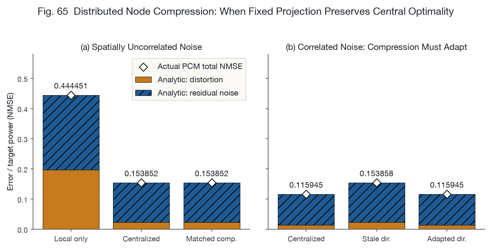
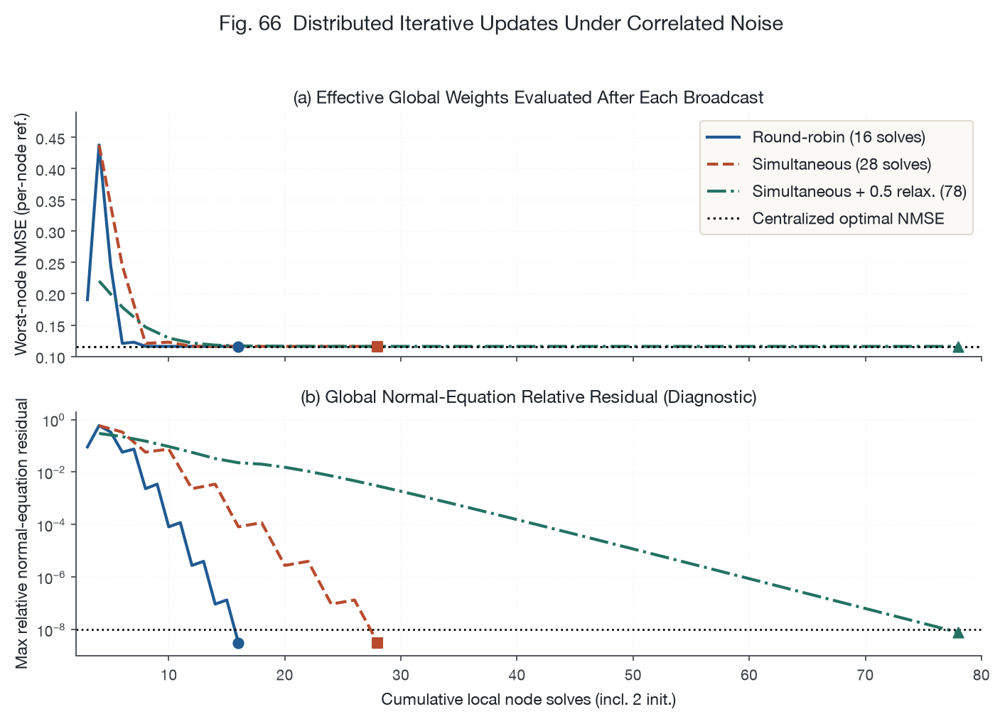
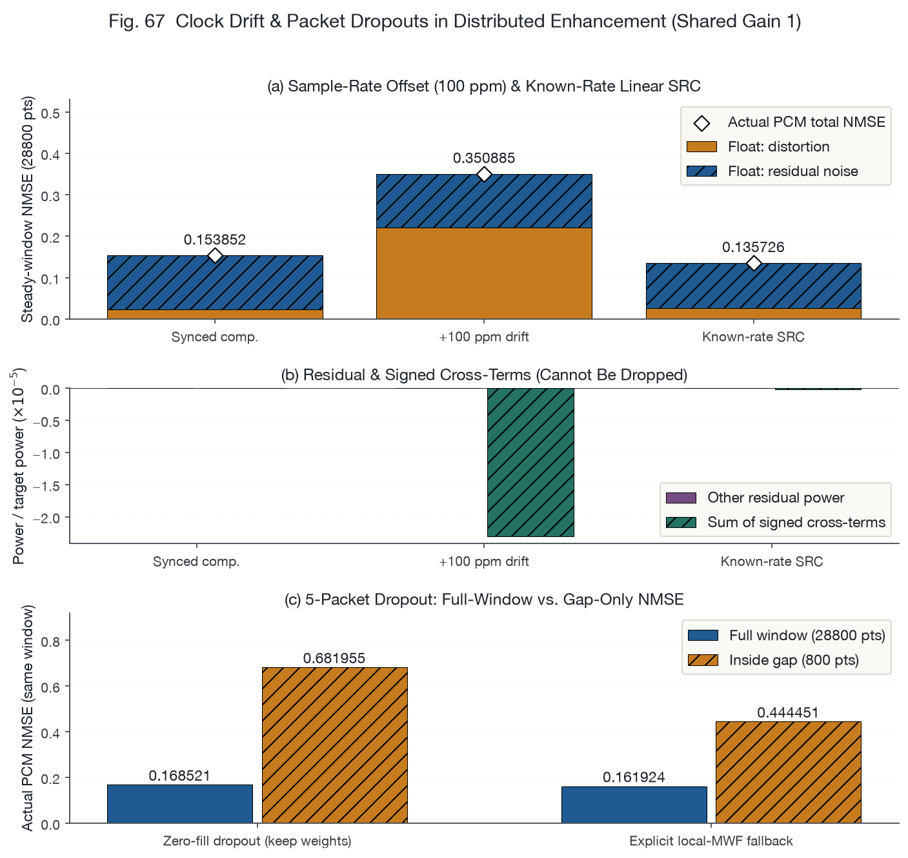

🌐 [简体中文](../chapters/13_distributed-enhancement.md) ｜ **English**

> ⚠️ This chapter is Chapter 13 of the main text (Extended Topic II; the main text comprises 16 chapters in total, Chapters 0–15, where Chapters 12–15 are four extended special topics accompanied by Appendices A and B), immediately following Chapter 12 on acoustic imaging, introducing how multiple pickup nodes collaborate to enhance sound under constrained communication bandwidth. Block Schur complements and Generalized Eigenvalue Decomposition derivations can be reviewed in [Chapter 0, §0.3](00_math-foundations.md#sec-0-3) and [§0.4](00_math-foundations.md#sec-0-4), and global notation references appear in [Chapter 16, Appendix A](16_appendix-symbols-math.md).
>
> Overview Home: [00_overview.md](00_overview.md) ｜ Previous: [12_acoustic-imaging.md](12_acoustic-imaging.md) ｜ Next: [14_spatial-wearable-arrays.md](14_spatial-wearable-arrays.md)

---

## Chapter 13: Distributed Microphone Collaborative Enhancement

### 13.1 Why Multiple Nodes Exchange Sound

#### Define the Collaborative Output Objective First

Imagine a long conference table holding two smart pickup devices, each equipped with two microphones: Device 1 sits right next to the main presenter, whereas Device 2 sits beside an HVAC diffuser or projector cooling fan. From a signal-processing standpoint, a remote device's audio offers two distinct forms of collaborative value—it might sit closer to the target talker than the local device, supplying a high-SNR speech observation; or it might sit right next to an interferer, supplying the clean noise reference the local device desperately needs to cancel correlated interference. Crudely "switching on only the loudest device" throws away the spatial noise-cancellation aperture of every other device; conversely, running ASR independently on each device and merging transcripts at the text level abandons waveform-level phase coherence across devices altogether.

This chapter focuses on **waveform-level distributed collaborative enhancement**: each node in a Wireless Acoustic Sensor Network (WASN) retains all of its own local multi-channel observations while receiving a small number of linearly compressed broadcast streams from peer nodes, fusing both locally to synthesize its own enhanced waveform. Crucially, distinct nodes typically seek to recover the target acoustic image as heard *at their own physical location* (for instance, left and right binaural hearing-aid nodes must preserve their respective head-related binaural cues), so optimal output waveforms need not be sample-wise identical across nodes. Formulating this rigorously requires unifying three questions inside one mathematical model: "which observation dimensions did communication compression discard?", "which reference acoustic image does each node target?", and "when do node clocks and broadcast filters change?"

[Chapter 10, §10.7](10_engineering-practice.md#sec-10-7) surveyed time-axis alignment, amplitude–phase consistency, and multi-stream fusion from a system-architecture perspective. Here we dive into the algorithmic core to answer four progressive questions step by step: without transmitting all raw microphone channels, under what exact condition can nodes still attain the optimal linear estimate of a centralized full array? How do nodes alternately update broadcast filters without knowing global statistics? How do multiple sources and non-fully-connected network topologies bound broadcast dimensionality? And when transitioning to finite windowed frames, 16-bit quantization, crystal Sampling Rate Offset (SRO), and wireless packet loss, how do we transform statistical coordinates and score errors honestly?

| Collaboration Tier | Primary Inter-Node Exchange | Output Form and Fundamental Limits |
|---|---|---|
| Centralized full-channel enhancement | All raw multi-channel waveforms, or equivalent global cross-spectral statistics | Solved at a single fusion center; demands high backhaul bandwidth and strict sample-level synchronization |
| Best-channel / device selection | Speech quality scores plus the selected node's audio stream | Outputs audio from one winning device; forfeits spatial interference cancellation across unselected nodes |
| Waveform-level distributed enhancement | A few locally compressed waveforms / short-time complex spectra plus control state | Each node solves independently for its own node-specific target image; requires compression-subspace and sample-sync conditions |
| Post-ASR transcript fusion | Word-token lattices, confidence scores, and speaker timestamps | Outputs merged text transcripts only; produces no cross-device noise-suppressed audible waveform |

#### Terminology and Prerequisites for This Chapter

Core abbreviations and their roles in this chapter are summarized below for quick reference:

| Abbreviation | Full Term | Role in This Chapter |
|---|---|---|
| WASN | Wireless Acoustic Sensor Network | Collaborative network of pickup nodes, each carrying local microphones, compute, and wireless links |
| LMMSE | Linear Minimum Mean-Squared Error | Statistical criterion minimizing mean-square estimation error of a target acoustic image over linear combinations of available observations |
| MWF | Multichannel Wiener Filter | Estimates the target acoustic image at a designated reference channel under the LMMSE criterion from second-order mixture statistics |
| DANSE | Distributed Adaptive Node-specific Signal Estimation | Classical distributed algorithm updating local estimation weights and outbound broadcast compression filters sequentially or simultaneously |
| TI | Topology Independent | Extensions relaxing full-mesh broadcast assumptions via multi-hop in-network aggregation over trees or general connected graphs |
| GEVD | Generalized Eigenvalue Decomposition | Extracts low-rank target speech subspaces under a noise-whitened metric to suppress finite-snapshot covariance errors |
| WOLA | Weighted Overlap-Add | Time–frequency framework windowing time streams into frequency bins for filtering before inverse transform, synthesis windowing, and overlap-add |
| SRO | Sampling Rate Offset | Relative sampling-clock frequency skew between independent crystal oscillators across nodes (typically in parts per million, $\mathrm{ppm}$) |

Before reading ahead, review [Chapter 5, §5.5.1 on Multichannel Wiener Filtering (MWF)](05_beamforming.md#sec-5-5-1), alongside complex inner products, Hermitian positive-definite matrices, and generalized eigenvalues in [Chapter 0, §§0.3–0.4](00_math-foundations.md#sec-0-3) and [Appendix A, §16.3](16_appendix-symbols-math.md#sec-16-3). To build rock-solid geometric intuition for "why compressing down to a single broadcast channel can incur zero performance loss," Sections 13.2–13.11 start at a single frequency bin under ideal synchronous sampling and exact population second-order statistics; Sections 13.12–13.15 then introduce subspace estimation, WOLA frame-boundary timing, bandwidth/memory budgets, and SRO / packet-drop compensation.

### 13.2 Writing Local Observations and Node-Specific References Separately

#### Partitioning the Global Observation Vector by Node

Consider a network of $U$ collaborative pickup nodes where node $u$ carries $M_u$ local microphones ($u = 1, \ldots, U$), giving $M = \sum_{u=1}^U M_u$ microphones network-wide. Fixing frequency bin $k$, stack node $u$'s local frequency-domain observations at frame $\ell$ into column vector $\vec x_u[k, \ell] \in \mathbb{C}^{M_u \times 1}$. Stacking all $U$ nodes vertically from a global centralized view forms the $M$-dimensional global observation vector $\vec x \in \mathbb{C}^{M \times 1}$. Starting with a single latent scalar target source $s$ (omitting fixed $[k, \ell]$ indices below):

$$\begin{gathered}
\vec x=[\vec x_1^\top,\ldots,\vec x_U^\top]^\top,\\
\vec x=\vec a s+\vec n,\qquad d_u=c_u s.
\end{gathered}\tag{13-1}$$

Here $s \in \mathbb{C}$ is the dry source phasor at this bin, $\vec a \in \mathbb{C}^{M \times 1}$ is the acoustic transfer vector from the source to all $M$ microphones, and $\vec n \in \mathbb{C}^{M \times 1}$ is the global additive noise vector.

Pay special attention to $d_u = c_u s$ on the right: it defines **the node-specific target reference signal that node $u$ wishes to recover**, where scalar $c_u \in \mathbb{C}$ is node $u$'s chosen reference acoustic transfer entry. Practically, node $u$ typically designates one of its own local microphones (global index $r_u$) as its reference sensor so $c_u = a_{r_u}$—preserving the exact amplitude and phase (acoustic image) of target speech arriving at microphone $r_u$ while stripping away additive noise $n_{r_u}$.

Throughout this chapter we use forward Fourier kernel $e^{-\mathrm{j}2\pi f t}$ and conjugate inner-product filter output $y = \vec w^H\vec x$. Index conventions: frequency bin $k$, frame $\ell$, time sample $n$, node indices $u, v$, iteration index $i$, multi-source latent target subspace dimension $S$, outbound compressed broadcast dimension $Q$ per node, and acoustic wavenumber $\kappa = 2\pi f / c$.

Transfer vector $\vec a$ in Eq. (13-1) may represent either free-field direct propagation or room early-reflection transfer functions; finite frame lengths and causal hop delays upon returning to the time domain are examined in §13.13.

#### Power Units and Zero-Mean Orthogonality Conditions

Assuming zero-mean random variables $s$ and $\vec n$ with finite second moments and source–noise orthogonality $\mathbb{E}[s\vec n^H] = \vec 0^H$, dry source power $\phi_s$, global noise covariance $\mathbf R_{nn}$, and global observation covariance $\mathbf R_{xx}$ are:

$$\begin{aligned}
\phi_s&=\mathbb{E}[|s|^2],\qquad
\mathbf R_{nn}=\mathbb{E}[\vec n\vec n^H],\\
\mathbf R_{xx}&=\mathbb{E}[\vec x\vec x^H]
=\phi_s\vec a\vec a^H+\mathbf R_{nn}.
\end{aligned}\tag{13-2}$$

Here $\phi_s \ge 0$ is real, and $\mathbf R_{nn}, \mathbf R_{xx} \in \mathbb{C}^{M \times M}$ are Hermitian positive semidefinite. Uncalibrated digital inputs carry dimensionless squared digital units, acquiring physical $\mathrm{Pa}^2$ units only when all channels are pressure-calibrated (with $\vec a$ and $\vec w$ dimensionless). Switching FFT normalization conventions requires scaling $\mathbf R_{xx}$, cross-correlation vectors, and reference power $\phi_{d_u}$ identically.

Note a statistical subtlety: finite-$L$ sample outer-product averages $\frac{1}{L}\sum_{\ell=1}^L \vec x_\ell\vec x_\ell^H$ are uncentered sample second moments, differing slightly from centered sample covariances whenever finite sample means are nonzero ([Appendix A, E16-02](16_appendix-symbols-math.md#e16-02)). Sections 13.3–13.11 analyze exact population second moments, while §13.15 specifies exact integer-period steady-window averaging on deterministic synthetic waveforms.

### 13.3 What Centralized MWF Actually Minimizes

#### Write the Complete Cost Function for Arbitrary Weights First

Before introducing communication compression, we establish the centralized gold standard: if bandwidth were unlimited so node $u$ could linearly filter all $M$ microphones network-wide via $\hat d_u = \vec w^H\vec x$, which weight vector $\vec w$ is optimal? Multichannel Wiener Filtering (MWF) minimizes Mean-Squared Error (MSE) between node reference $d_u$ and estimate $\hat d_u$. Writing reference power $\phi_{d_u} = \mathbb{E}[|d_u|^2]$ and $M \times 1$ cross-correlation vector $\vec r_{xd_u} = \mathbb{E}[\vec x d_u^*]$, expanding MSE cost $J_u(\vec w)$ for **any arbitrary** weight vector $\vec w \in \mathbb{C}^{M \times 1}$ gives:

$$\begin{aligned}
J_u(\vec w)&=\mathbb{E}\big[|d_u-\vec w^H\vec x|^2\big]\\
&=\mathbb{E}\big[(d_u-\vec w^H\vec x)(d_u^*-\vec x^H\vec w)\big]\\
&=\phi_{d_u}-\vec w^H\vec r_{xd_u}-\vec r_{xd_u}^H\vec w
+\vec w^H\mathbf R_{xx}\vec w\\
&=\phi_{d_u}-2\operatorname{Re}(\vec w^H\vec r_{xd_u})
+\vec w^H\mathbf R_{xx}\vec w.
\end{aligned}\tag{13-3}$$

Conjugate scalars $\vec w^H\vec r_{xd_u}$ and $\vec r_{xd_u}^H\vec w$ sum to $2\operatorname{Re}(\vec w^H\vec r_{xd_u})$. Keep the universality of Eq. (13-3) front and center: **whether $\vec w$ is the global optimum, a mid-iteration unconverged estimate, or a stale effective weight transiently mismatched after a remote broadcast update, plugging the actually applied global weight into Eq. (13-3) always yields exact true MSE.**

When $\mathbf R_{xx} \succ 0$ is strictly positive definite, setting the Wirtinger gradient with respect to $\vec w^*$ ([Appendix A, §16.3](16_appendix-symbols-math.md#sec-16-3)), $\mathbf R_{xx}\vec w - \vec r_{xd_u}$, to zero yields the unique centralized Wiener–Hopf normal equations, optimal weight $\vec w_u^\star$, and centralized MMSE floor $J_u^\star$:

$$\begin{aligned}
\mathbf R_{xx}\vec w_u^\star&=\vec r_{xd_u},\qquad
\vec w_u^\star=\mathbf R_{xx}^{-1}\vec r_{xd_u},\\
J_u^\star&=\phi_{d_u}
-\vec r_{xd_u}^H\mathbf R_{xx}^{-1}\vec r_{xd_u}.
\end{aligned}\tag{13-4}$$

Numerical implementations solve $\mathbf R_{xx}\vec w_u^\star = \vec r_{xd_u}$ via Hermitian positive-definite Cholesky solvers rather than forming $\mathbf R_{xx}^{-1}$ explicitly. Crucially, the simplified expression $J_u^\star = \phi_{d_u} - \vec r_{xd_u}^H\vec w_u^\star$ in the bottom line of Eq. (13-4) cancels quadratic terms via $\mathbf R_{xx}\vec w_u^\star = \vec r_{xd_u}$ so the normal equations guarantee this simplification at the optimum; the scalar equality alone is not a necessary-and-sufficient test of optimality. Evaluate suboptimal or stale weights through all three terms of Eq. (13-3) ([Bertrand & Moonen 2010, Part I §II-A Eqs. (1), (2)](https://homes.esat.kuleuven.be/~abertran/reports/09-65.pdf)).

#### Target References Cannot Be Read Straight Off Noisy Recordings

Newcomers to MWF often ask: "Since microphone $r_u$ is our reference channel, why not plug raw recording $x_{r_u}$ in for $d_u$ when forming $\mathbb{E}[\vec x x_{r_u}^*]$?" This does not work. Because $x_{r_u} = c_u s + n_{r_u}$ contains channel $r_u$'s own noise $n_{r_u}$, substituting $x_{r_u}$ for $d_u$ turns the normal equations into $\mathbf R_{xx}\vec w = \mathbf R_{xx}\vec e_{r_u}$, collapsing trivially to unit coordinate vector $\vec w = \vec e_{r_u}$—passing the noisy reference channel through untouched with zero noise reduction.

In real deployments where clean $d_u$ is unobservable, Voice Activity Detection (VAD) or time–frequency masks estimate $\hat{\mathbf R}_{nn}$ during noise-only frames and $\hat{\mathbf R}_{xx}$ during active speech, forming target covariance $\hat{\mathbf R}_{ss} = \hat{\mathbf R}_{xx} - \hat{\mathbf R}_{nn}$ (or the robust low-rank GEVD estimate of §13.12) and extracting column $r_u$ as $\vec r_{xd_u} = \hat{\mathbf R}_{ss}\vec e_{r_u}$. Note also that Eq. (13-3) corresponds to unweighted MWF (speech-distortion-weighted SDW-MWF of [Chapter 5](05_beamforming.md) at trade-off parameter $\mu = 1$): when $\mathbf R_{nn} \succ 0$ and the target is rank one ($\mathbf R_{ss} = \phi_s\vec a\vec a^H$), choosing node-specific noise penalties $\mu_u > 0$ preserves collinearity along $\mathbf R_{nn}^{-1}\vec a$, changing only the scalar Wiener gain. For a multi-source or higher-rank target ($\operatorname{rank}(\mathbf R_{ss}) \ge 2$), optimal weights remain in the common subspace spanned by the noise-weighted target responses, but need not be collinear; different $\mu_u$ may change only a scalar or may change the direction within that subspace. A broadcast dimension $Q < S$ does not meet the $Q = S$ condition of the sequential convergence theorem in §13.10. The theorem also maps the node costs to an MSE for a common reference target; a shared optimal-weight subspace alone does not establish convergence when nodes use different noise penalties.

### 13.4 Reference Scale and Conjugation in the Rank-One Model

#### One Shared Source, Distinct Node-Specific Targets

Under single-point-source rank-one model Eq. (13-1), centralized optimal weights Eq. (13-4) admit an illuminating closed form. Substituting $d_u = c_u s$ with $\mathbb{E}[s\vec n^H] = \vec 0^H$ gives:

$$\begin{aligned}
\vec r_{xd_u}&=\mathbb{E}[(\vec a s+\vec n)c_u^* s^*]
=\phi_s c_u^*\vec a,\\
\phi_{d_u}&=\mathbb{E}[|c_u s|^2]=|c_u|^2\phi_s.
\end{aligned}\tag{13-5}$$

Assuming $\phi_s > 0$, $\vec a \ne \vec 0$, and $\mathbf R_{nn} \succ 0$, define positive scalar $q = \vec a^H\mathbf R_{nn}^{-1}\vec a > 0$ (physically, $\phi_s q$ is the **global maximum output SNR** after full-array matched filtering). Without memorizing Sherman–Morrison, left-multiplying $\mathbf R_{nn}^{-1}\vec a$ by $\mathbf R_{xx}$ directly yields:

When $\mathbf R_{nn}$ is calibrated in $\mathrm{Pa}^2$ and $\vec a$ is dimensionless, $q=\vec a^H\mathbf R_{nn}^{-1}\vec a$ has units $\mathrm{Pa}^{-2}$; only $\phi_s q$ is dimensionless. Digital-amplitude normalization is a separate convention.

$$\begin{aligned}
\mathbf R_{xx}(\mathbf R_{nn}^{-1}\vec a)
&=(\mathbf R_{nn}+\phi_s\vec a\vec a^H)\mathbf R_{nn}^{-1}\vec a\\
&=\vec a+\phi_s\vec a(\vec a^H\mathbf R_{nn}^{-1}\vec a)
=(1+\phi_s q)\vec a.
\end{aligned}$$

Left-multiplying by $\mathbf R_{xx}^{-1}$ and dividing by $(1 + \phi_s q)$ gives $\mathbf R_{xx}^{-1}\vec a = \mathbf R_{nn}^{-1}\vec a / (1 + \phi_s q)$. Combining with Eqs. (13-4)–(13-5) produces node $u$'s centralized rank-one weight, MMSE, and Normalized MSE (NMSE):

$$\begin{aligned}
\vec w_u^\star&=\frac{\phi_s c_u^*}{1+\phi_s q}
\mathbf R_{nn}^{-1}\vec a,\\
J_u^\star&=\phi_{d_u}-\frac{\phi_s^2|c_u|^2 q}{1+\phi_s q}
=\frac{|c_u|^2\phi_s}{1+\phi_s q},\\
\operatorname{NMSE}_u^\star&=\frac{J_u^\star}{\phi_{d_u}}
=\frac{1}{1+\phi_s q}.
\end{aligned}\tag{13-6}$$

Pause to appreciate the physical factorization in Line 1 of Eq. (13-6). Multiplying numerator and denominator by $q = \vec a^H\mathbf R_{nn}^{-1}\vec a$ and writing centralized MVDR beamformer $\vec w_{\mathrm{MVDR}} = (\mathbf R_{nn}^{-1}\vec a)/q$ factors $\vec w_u^\star$ into **three cascaded physical operators**:

$$\begin{aligned}
\vec w_{\mathrm{MVDR}}
&=\frac{1}{q}\mathbf R_{nn}^{-1}\vec a,\\
\vec w_u^\star&=\vec w_{\mathrm{MVDR}}\cdot c_u^*
\cdot\frac{\phi_s q}{1+\phi_s q}.
\end{aligned}$$

Writing scalar Wiener gain $g_{\mathrm{W}} = \frac{\phi_s q}{1 + \phi_s q}$, conjugate inner-product output $\hat d_u = (\vec w_u^\star)^H\vec x = g_{\mathrm{W}} c_u(\vec w_{\mathrm{MVDR}}^H\vec x)$ executes three transparent steps:

1. **Step 1 (Network-wide common MVDR spatial filter)**: Regardless of node $u$, extract dry source $s$ distortionlessly via the exact same global Minimum Variance Distortionless Response beamformer $\vec w_{\mathrm{MVDR}}$ while minimizing spatial output noise (output power $\phi_s + 1/q$, achieving output SNR $\rho = \mathrm{SNR}_{\mathrm{out}} = \phi_s q$);
2. **Step 2 (Node-specific acoustic image projection)**: Multiply by node $u$'s reference transfer factor $c_u$ (appearing conjugated as $c_u^*$ inside $\vec w_u^\star$ so $\vec w^H\vec x$ restores $c_u$), projecting dry $s$ onto node $u$'s true acoustic image $c_u s$;
3. **Step 3 (Single-channel real Wiener shrinkage)**: Multiply by scalar Wiener gain $g_{\mathrm{W}} = \frac{\rho}{1 + \rho} \in (0, 1)$, trading a slight target amplitude shrinkage for steeper residual noise reduction to land squarely at $\operatorname{NMSE}_u^\star = 1 / (1 + \rho)$.

This three-factor structure immediately reveals the key structural property of distributed collaborative enhancement: **because centralized optimal weights $\vec w_u^\star$ across every node $u = 1, \ldots, U$ are merely distinct complex scalar multiples of the *exact same* global vector $\mathbf R_{nn}^{-1}\vec a$, each node only ever needs to contribute a *one-dimensional* spatial projection to the rest of the network.** (Note that $\operatorname{NMSE}_u^\star$ requires $\phi_{d_u} > 0$, i.e., $\phi_s > 0$ and $c_u \ne 0$.)

#### Why Averaging Unnormalized MSE Across Nodes Distorts Rankings

Equation (13-6) exposes a classic distributed evaluation trap. Suppose Node 1 sits farther from the talker with $d_1 = s$, while Node 2 sits closer where acoustic pressure is twice as strong: $d_2 = 2s$. By Eq. (13-6), Node 2's optimal weight is $2\times$ Node 1's, and its unnormalized MSE $J_2^\star = 4 J_1^\star$ is **$4\times$ larger**.

Yet Node 2's enhancement is *not* worse—its target reference power $\phi_{d_2} = 4\phi_{d_1}$ is also $4\times$ larger, making normalized $\operatorname{NMSE}_1^\star = \operatorname{NMSE}_2^\star = \frac{1}{1 + \phi_s q}$ identical. Averaging raw unnormalized MSEs across nodes penalizes whichever node sits closest to the talker.

Always check conjugation of complex $c_u$ in code as well: for $c_u = 1 + \mathrm{j}$, $\vec w_u^\star$ carries $c_u^* = 1 - \mathrm{j}$ so $(\vec w_u^\star)^H\vec x$ conjugates it back to $1 + \mathrm{j}$; omitting conjugation flips output phase by $90^\circ$ (see [E13-01](#e13-01) and [Chapter 5, E05-11](05_beamforming.md#e05-11)).

### 13.5 Compressed Covariance and Effective Global Weights

#### Broadcast Streams Are Linear Combinations of Local Sensors

Now impose communication bandwidth limits: node $v$ owns $M_v$ microphones, but its wireless link permits transmitting only $Q$ compressed streams ($Q \ll M_v$, and $Q = 1$ for a single source). Fixing local linear compression matrices $\mathbf F_v \in \mathbb{C}^{M_v \times Q}$ first, each node $v$ broadcasts $Q \times 1$ compressed vector $\vec z_v = \mathbf F_v^H\vec x_v$.

At receiving node $u$, available inputs stack all $M_u$ uncompressed local channels $\vec x_u$ atop the $(U - 1)Q$ compressed streams $\vec z_{-u}$ received from peers $v \ne u$ (ordered by ascending node index). Stacking these forms $L_u = M_u + (U - 1)Q$-dimensional local observation $\tilde{\vec x}_u$, written compactly as a block-sparse linear projection $\mathbf T_u \in \mathbb{C}^{M \times L_u}$ applied to global $\vec x \in \mathbb{C}^{M \times 1}$:

$$\begin{gathered}
\tilde{\vec x}_u=[\vec x_u^\top,\vec z_{-u}^\top]^\top,\qquad
L_u=M_u+(U-1)Q,\\
\tilde{\vec x}_u=\mathbf T_u^H\vec x,\qquad
\mathbf T_u\in\mathbb{C}^{M\times L_u}.
\end{gathered}\tag{13-7}$$

Matrix $\mathbf T_u$ places identity $\mathbf I_{M_u}$ in node $u$'s row block across its first $M_u$ columns (uncompressed local pass-through), places each remote node $v$'s broadcast matrix $\mathbf F_v$ in row block $v$ across the trailing $(U - 1)Q$ columns, and zeroes all other blocks. Note that $\mathbf T_u^H\vec x$ projects $M$ global channels down to $L_u$ locally accessible channels—it never reconstructs individual remote microphone waveforms.

Holding broadcast matrices fixed at one frequency bin and statistical window, substituting $\tilde{\vec x}_u = \mathbf T_u^H\vec x$ yields local covariance $\tilde{\mathbf R}_u \in \mathbb{C}^{L_u \times L_u}$, local cross-correlation $\tilde{\vec r}_u \in \mathbb{C}^{L_u \times 1}$, and $L_u$-dimensional local Wiener–Hopf equations:

$$\begin{aligned}
\tilde{\mathbf R}_u&=\mathbb{E}[\tilde{\vec x}_u\tilde{\vec x}_u^H]
=\mathbf T_u^H\mathbf R_{xx}\mathbf T_u,\\
\tilde{\vec r}_u&=\mathbb{E}[\tilde{\vec x}_u d_u^*]
=\mathbf T_u^H\vec r_{xd_u},\\
\tilde{\mathbf R}_u\vec h_u^\star&=\tilde{\vec r}_u.
\end{aligned}\tag{13-8}$$

When is $\tilde{\mathbf R}_u \succ 0$ guaranteed nonsingular? Given $\mathbf R_{xx} \succ 0$, for any nonzero $\vec b \in \mathbb{C}^{L_u}$ with lifted vector $\vec v = \mathbf T_u\vec b$, $\vec b^H\tilde{\mathbf R}_u\vec b = \vec v^H\mathbf R_{xx}\vec v > 0 \iff \mathbf T_u\vec b \ne \vec 0$—i.e., **$\mathbf T_u$ must have full column rank**. Zero broadcasts ($\mathbf F_v = \mathbf 0$), linearly dependent broadcast columns, or setting $Q > M_v$ make $\mathbf T_u$ rank-deficient and $\tilde{\mathbf R}_u$ singular (safe fallback handling in [E13-07](#e13-07)).

#### Local Filter Coefficients Versus Effective Global Weights

Once node $u$ solves for $L_u$-dimensional local weight $\vec h_u$, its output is $\hat d_u = \vec h_u^H\tilde{\vec x}_u$. Comparing directly against centralized $M$-dimensional $\vec w_u^\star$ substitutes $\tilde{\vec x}_u = \mathbf T_u^H\vec x$:

$$\begin{aligned}
\hat d_u&=\vec h_u^H(\mathbf T_u^H\vec x)
=(\mathbf T_u\vec h_u)^H\vec x,\\
\vec w_{u,\mathrm{eff}}&=\mathbf T_u\vec h_u,
\qquad\vec w_{u,\mathrm{eff}}\in\mathbb{C}^{M\times 1}.
\end{aligned}\tag{13-9}$$

We call $\vec w_{u,\mathrm{eff}} = \mathbf T_u\vec h_u$ node $u$'s **effective global weight** across all $M$ raw microphones. Note a frequent conjugation pitfall here: if remote node $v$ sends scalar $z_v = \vec f_v^H\vec x_v$ and local node $u$ applies scalar receiving weight $g_{uv}$, that branch contributes $g_{uv}^* z_v = g_{uv}^*(\vec f_v^H\vec x_v) = (\vec f_v g_{uv})^H\vec x_v$—so the effective weight on remote microphones $\vec x_v$ is the **unconjugated product** $\vec f_v g_{uv}$, never $\vec f_v g_{uv}^*$.

Similarly, normalizing compressed columns internally for numerical conditioning ($\mathbf T'_u = \mathbf T_u\mathbf D$) rescales local coefficients to $\vec h'_u = \mathbf D^{-1}\vec h_u$ while leaving effective global weight $\mathbf T'_u\vec h'_u = \mathbf T_u\vec h_u$ and physical output completely invariant (see [E13-02](#e13-02)).

### 13.6 Proving Task-Specific Losslessness of Fixed Compression

#### Squared Error Yields a Directly Verifiable Subspace Criterion

By how much does MSE increase when compressing $M$ channels down to $L_u < M$—and when is the increase **identically zero**? Orthogonal decomposition answers this in four lines.

Writing weight discrepancy $\vec e = \mathbf T_u\vec h - \vec w_u^\star$ and plugging $\vec w = \vec w_u^\star + \vec e$ into true cost Eq. (13-3), centralized optimality $\mathbf R_{xx}\vec w_u^\star = \vec r_{xd_u}$ cancels all linear cross-terms:

$$\begin{aligned}
J_u(\vec w_u^\star+\vec e)-J_u(\vec w_u^\star)
&=2\operatorname{Re}\big(\vec e^H\mathbf R_{xx}\vec w_u^\star\big)
-2\operatorname{Re}\big(\vec e^H\vec r_{xd_u}\big)\\
&\quad+\vec e^H\mathbf R_{xx}\vec e\\
&=\vec e^H\mathbf R_{xx}\vec e\ge 0.
\end{aligned}\tag{13-10}$$

Under $\mathbf R_{xx} \succ 0$, excess MSE $\vec e^H\mathbf R_{xx}\vec e$ vanishes if and only if $\vec e = \vec 0$—i.e., there exists $\vec h \in \mathbb{C}^{L_u \times 1}$ satisfying $\mathbf T_u\vec h = \vec w_u^\star$:

$$\vec w_u^\star\in\operatorname{range}(\mathbf T_u).
\tag{13-11}$$

Geometrically, Eq. (13-11) is crystal clear: broadcast compression restricts node $u$ to the $L_u$-dimensional **feasible subspace** $\operatorname{range}(\mathbf T_u) \subset \mathbb{C}^M$. Whenever remote block $v$ of $\vec w_u^\star$ lies inside $\operatorname{range}(\mathbf F_v)$ for every $v \ne u$, LMMSE incurs zero compression loss; whenever $\vec w_u^\star \notin \operatorname{range}(\mathbf T_u)$, even an exact nonsingular local solve pays positive excess MSE $\vec e^H\mathbf R_{xx}\vec e > 0$. Estimating multiple targets $\mathbf W^\star$ losslessly requires every column of $\mathbf W^\star$ to lie inside $\operatorname{range}(\mathbf T_u)$, dictating minimum broadcast dimension $Q$.

#### Qualify "Lossless" by the Exact Estimation Task

Whenever papers write "lossless compression," qualify its scope explicitly: Eq. (13-11) certifies **zero LMMSE degradation for designated target $d_u$ under fixed second-order statistics**. It does *not* reconstruct individual remote raw channels from a scalar broadcast, nor remain lossless if another non-collinear talker starts speaking or noise covariance shifts, nor preserve arbitrary higher-order non-Gaussian statistics for nonlinear neural enhancers (under joint Gaussianity LMMSE coincides with general MMSE). We therefore write "lossless for the specified LMMSE task" throughout.

### 13.7 Spatially White Noise Benchmark: Combining Two Remote Microphones into One Stream

#### Centralized Array Versus Local-Only Processing

Let us work through a four-microphone rational-number benchmark carried across the rest of the chapter. Here "spatially white noise" means $\mathbf R_{nn} = \mathbf I_4$ at the analyzed frequency bin (mutually uncorrelated unit-variance channel noises, without restricting temporal spectra across frames).

**Inputs**: $U = 2$ nodes with $2$ microphones each (Node 1 owns Channels $1, 2$; Node 2 owns Channels $3, 4$; $M = 4$):

$$\vec a=\big[1,\;\tfrac{1}{2},\;2,\;-\tfrac{1}{2}\big]^\top,\qquad
\phi_s=1,\qquad
\mathbf R_{nn}=\mathbf I_4,\qquad
d_1=s\;\;(c_1=1).$$

**Centralized vs. local-only benchmarks**: Global SNR factor is $q = \vec a^\top\mathbf I_4^{-1}\vec a = 1 + 1/4 + 4 + 1/4 = 11/2$ ($1 + \phi_s q = 13/2$). Equation (13-6) gives Node 1's **centralized 4-mic optimum**:

$$\begin{aligned}
\vec w_1^\star&=\frac{2}{13}[1,\;0.5,\;2,\;-0.5]^\top\\
&=\frac{1}{13}[2,\;1,\;4,\;-1]^\top,\\
J_1^\star&=\frac{1}{1+11/2}=\frac{2}{13}\approx 0.153846.
\end{aligned}$$

Decomposing $2/13$ physically: target amplitude response $(\vec w_1^\star)^\top\vec a = (2 + 1/2 + 8 + 1/2)/13 = 11/13$ incurs **target distortion power** $(11/13 - 1)^2 = 4/169$, while white noise through $\vec w_1^\star$ leaves **residual noise power** $\|\vec w_1^\star\|_2^2 = (4 + 1 + 16 + 1)/169 = 22/169$, summing to $\frac{4 + 22}{169} = \frac{26}{169} = \frac{2}{13}$—illustrating how MWF intentionally shrinks target gain to $11/13$ to slash noise far deeper than distortionless MVDR.

Using Node 1's local channels $[1, 1/2]^\top$ alone drops SNR to $q_{\mathrm{local}} = 1 + 1/4 = 5/4$ with local weight $[4, 2]^\top / 9$ and MSE $J_{\mathrm{local}} = 4/9 \approx 0.444444$—nearly $3\times$ worse than centralized $2/13 \approx 0.153846$ because remote Channel 3 enjoys high target amplitude $2$.

#### Term-by-Term Verification of the Compressed Local System

Now let Node 2 transmit just **one** scalar combination $z_2 = 2x_3 - \frac{1}{2}x_4$ ($\vec f_2 = [2, -1/2]^\top$) instead of $x_3, x_4$. Does Node 1's 3D input $\tilde{\vec x}_1 = [x_1, x_2, z_2]^\top$ recover 4-mic centralized performance?

The $4 \times 3$ projection matrix $\mathbf T_1$ in Eq. (13-7) is:

$$\mathbf T_1=
\begin{bmatrix}
1 & 0 & 0\\
0 & 1 & 0\\
0 & 0 & 2\\
0 & 0 & -\tfrac{1}{2}
\end{bmatrix}.$$

In 3D compressed space, $\tilde{\vec r}_1 = \mathbf T_1^\top\vec a = [1, 1/2, 17/4]^\top$ (since $2\times 2 + (-1/2)^2 = 17/4$) and compressed noise covariance $\tilde{\mathbf R}_{nn,1} = \mathbf T_1^\top\mathbf I_4\mathbf T_1 = \operatorname{diag}(1, 1, 17/4)$ (note Channel 3's noise variance is $17/4$, not $1$), giving $3 \times 3$ local covariance $\tilde{\mathbf R}_1$:

$$\begin{aligned}
\tilde{\mathbf R}_1
&=\tilde{\vec r}_1\tilde{\vec r}_1^\top
+\operatorname{diag}\!\big(1,\;1,\;\tfrac{17}{4}\big)\\
&=\begin{bmatrix}
2 & \tfrac{1}{2} & \tfrac{17}{4}\\
\tfrac{1}{2} & \tfrac{5}{4} & \tfrac{17}{8}\\
\tfrac{17}{4} & \tfrac{17}{8} & \tfrac{357}{16}
\end{bmatrix}.
\end{aligned}$$

Solving $\tilde{\mathbf R}_1\vec h_1^\star = [1, 1/2, 17/4]^\top$ gives $\vec h_1^\star = \frac{1}{13}[2, 1, 2]^\top$ (Row 1 check: $\frac{4 + 1/2 + 17/2}{13} = 1$). Lifting back via Eq. (13-9) yields:

$$\begin{aligned}
\vec w_{1,\mathrm{eff}}&=\mathbf T_1\vec h_1^\star
=\frac{1}{13}[2,\;1,\;2\times 2,\;-1]^\top\\
&=\frac{1}{13}[2,\;1,\;4,\;-1]^\top=\vec w_1^\star.
\end{aligned}$$

Exact 4-mic centralized weights and MSE $2/13$ are recovered. Equation (13-11) explains why: remote block $[4, -1]^\top / 13 = \frac{2}{13}[2, -1/2]^\top$ is collinear with $\vec f_2 = [2, -1/2]^\top$—and remains collinear for Node 2's own target $d_2 = 2s$ (unnormalized MSE $8/13$, NMSE $2/13$).

### 13.8 Correlated-Noise Counterexample: Useful Observations Outside the Target Direction

#### Change Only the Noise Covariance, and the Old Broadcast Fails

After seeing §13.7, it is tempting to conclude: "Remote nodes just beamform toward the talker locally ($\vec f_2 = \vec a_2 = [2, -1/2]^\top$) and broadcast that." Let us hold talker position, power, and node layout completely fixed while introducing **cross-node noise correlation** between remote sensors and local Mic 1 (e.g., HVAC duct noise or table vibration coupling across devices):

$$\mathbf R_{nn}=
\begin{bmatrix}
1 & 0 & \tfrac{1}{5} & \tfrac{4}{5}\\
0 & 1 & 0 & 0\\
\tfrac{1}{5} & 0 & 1 & 0\\
\tfrac{4}{5} & 0 & 0 & 1
\end{bmatrix}.$$

Eigenvalues of $\mathbf R_{nn}$ are $1, 1, 1 \pm \sqrt{17}/5$ with $\lambda_{\min} = 1 - \sqrt{17}/5 \approx 0.175379 > 0$ (strictly positive definite). Solving $\mathbf R_{nn}\vec u = \vec a$ gives $\mathbf R_{nn}^{-1}\vec a = [25, 4, 11, -24]^\top / 8$ and $q = (25 + 2 + 22 + 12)/8 = 61/8$ ($1 + q = 69/8$), yielding the **centralized correlated-noise optimum**:

$$\vec w_1^\star=\frac{1}{69}[25,\;4,\;11,\;-24]^\top,\qquad
J_1^\star=\frac{8}{69}\approx 0.115942.$$

Notice that cross-node noise correlation *lowers* centralized MSE from $2/13 \approx 0.153846$ down to $8/69 \approx 0.115942$ because the full array exploits remote sensors to cancel correlated noise inside local Mic 1.

What happens if Node 2 stubbornly keeps sending white-noise target-matched broadcast $z_2 = 2x_3 - \frac{1}{2}x_4$? Cross-correlating $z_2$'s noise against $n_1$ gives $\mathbb{E}[n_1(2n_3 - n_4/2)] = 2\times(1/5) - (1/2)\times(4/5) = 0$—exact cancellation.

Consequently, Node 1 sees the *exact same* $3 \times 3$ local covariance as under white noise, stays stuck at $[2, 1, 2]^\top / 13$ with MSE $2/13 \approx 0.153846$, and forfeits $2/13 - 8/69 = 34/897 \approx 0.037904$ of collaborative noise cancellation because remote block $[11, -24]^\top / 69$ no longer lies along $[2, -1/2]^\top$, violating Eq. (13-11).

#### Why a Zero-Target Remote Combination Aids Speech Enhancement

What information did the old broadcast throw away? Inspect orthogonal remote combination $p_2 = \frac{1}{2}x_3 + 2x_4$ ($[1/2, 2]^\top$):

- Target response is $\frac{1}{2} \times 2 + 2 \times (-\frac{1}{2}) = 0$—**target speech cancels to exact zero; listening to $p_2$ on headphones reveals pure hum/noise without a syllable of speech.**
- Yet its cross-correlation with local noise $n_1$ is $(1/2)\times(1/5) + 2\times(4/5) = 17/10 = 1.7$—**strongly correlated with the interference corrupting Node 1.**

Physically, speech-free combination $p_2$ acts as a **distributed Generalized Sidelobe Canceller (GSC) blocking-matrix noise reference** ([Chapter 5](05_beamforming.md)): Node 2 nulls the talker locally to extract a clean interference probe for Node 1 to subtract from $x_1$. Decomposing optimal remote block $[11, -24]^\top$ onto target-matched $[2, -1/2]^\top$ and blocking-reference $[1/2, 2]^\top$ shows both branches working together:

$$\begin{bmatrix}11\\-24\end{bmatrix}
=8\begin{bmatrix}2\\-\tfrac{1}{2}\end{bmatrix}
-10\begin{bmatrix}\tfrac{1}{2}\\2\end{bmatrix}.$$

Transmitting only the first term severs the distributed GSC noise-cancellation path—so during field debugging, never dismiss a remote node as useless just because its broadcast stream sounds noisy.

Better still, Node 2 still needs only **one** broadcast channel: transmitting adapted combination $z'_2 = 11x_3 - 24x_4$ changes the 3D input $[x_1, x_2, z'_2]^\top$'s local cross-correlation vector to $[1, 1/2, 34]^\top$ and its local total covariance matrix to

$$\tilde{\mathbf R}_1=
\begin{bmatrix}
2 & 1/2 & 17\\
1/2 & 5/4 & 17\\
17 & 17 & 1853
\end{bmatrix},$$

from which Node 1 solves $\vec h_1^\star = [25, 4, 1]^\top / 69$, lifting back globally to recover the centralized optimum $[25, 4, 11, -24]^\top / 69$ and minimum MSE $8/69$ with zero loss (if the broadcast vector is pre-scaled by $1/69$, the third local receiving coefficient scales synchronously up to $1$, leaving the lifted effective global weight completely unchanged). The sole remaining question—how Node 2 discovers $[11, -24]^\top$ automatically without knowing cross-node correlations upfront—brings us to DANSE.

### 13.9 Sequential DANSE: Updating Local Estimation and Outbound Broadcast Together

#### Single-Stream Broadcast State and One Sequential Update

How can nodes seeing only local sensors plus compressed peer broadcasts iteratively align onto the globally optimal subspace? Bertrand and Moonen's Sequential DANSE provides an elegant round-robin solution.

For a single target and scalar broadcast ($Q = 1$), partition node $u$'s $L_u = M_u + (U - 1)$-dimensional local weight into local sensor block $\vec f_u \in \mathbb{C}^{M_u \times 1}$ and peer-broadcast receiving block $\vec g_u \in \mathbb{C}^{(U-1) \times 1}$. Distinguish node $u$'s outbound broadcast $z_u$ strictly from its local enhanced output $\hat d_u$:

$$\begin{aligned}
z_u&=\vec f_u^H\vec x_u,\\
\hat d_u&=\vec f_u^H\vec x_u+\vec g_u^H\vec z_{-u}.
\end{aligned}\tag{13-12}$$

Two natural questions arise at Eq. (13-12): **First, why does reusing node $u$'s local filter block $\vec f_u$ as its outbound broadcast help every other node? Second, why not broadcast the cleaner full output $\hat d_u$ instead?**

Section 13.4's rank-one structure answers both immediately: centralized optimal weights across all nodes share the same global vector $\mathbf R_{nn}^{-1}\vec a$ up to scalar factors. When active node $u$ solves local Eq. (13-8) $\hat d_u = \vec f_u^H\vec x_u + \vec g_u^H\vec z_{-u}$ given fixed $\vec z_{-u}$, local block $\vec f_u^H\vec x_u$ extracts **the best linear combination of node $u$'s own raw microphones $\vec x_u$ under the current global approximation**, whereas peer nodes already receive $\vec z$ from everyone else directly and lack *only* node $u$'s local slice. Broadcasting pure $z_u = \vec f_u^H\vec x_u$ hands neighbors the exact uncontaminated local update they need.

Broadcasting full $\hat d_u$ (containing $\vec g_u^H\vec z_{-u}$) would recirculate peer broadcasts in closed feedback loops across the network, destroying DANSE's loop-free subspace projection structure ([Bertrand & Moonen 2010, Part I §III-A Eqs. (6)–(14)](https://homes.esat.kuleuven.be/~abertran/reports/09-65.pdf)).

Round-robin execution activates one token-holding node $u$ per step ($1 \to 2 \to \cdots \to U \to 1 \to \cdots$): holding peer broadcasts fixed, node $u$ solves Eq. (13-8) for $[\vec f_u^\top, \vec g_u^\top]^\top$, updates its outbound broadcast to $\vec f_u$ and local output to $[\vec f_u^\top, \vec g_u^\top]^\top$, and passes the token. Distinguish offline population analysis (where $\mathbf T_u^H\mathbf R_{xx}\mathbf T_u$ updates immediately) from online streaming hardware (where past transmitted samples cannot be recalled, requiring fresh frame accumulation or coordinate transformation as in §13.13).

#### Exact Hand Calculation of Three Round-Robin Updates

On §13.7's 4-mic white-noise setup ($\vec a = [1, 1/2, 2, -1/2]^\top, \phi_s = 1, \mathbf R_{nn} = \mathbf I_4$) with $d_1 = s$ and $d_2 = 2s$, let us trace three $3 \times 3$ updates ($1 \to 2 \to 1$) showing how they reach exact 4-mic centralized optimality:

**Initialization**: Each node broadcasts its first local mic: $\vec f_1^{(0)} = \vec f_2^{(0)} = [1, 0]^\top$ ($z_1 = x_1, z_2 = x_3$).

1. **Update 1 (Node 1 active)**: Input $[x_1, x_2, x_3]^\top$ has target vector $[1, 1/2, 2]^\top$ and unit white noise, giving $q = 1 + 1/4 + 4 = 21/4$ ($1 + q = 25/4$). Equation (13-6) yields $[\vec f_1^\top, g_1]^\top = \frac{4}{25}[1, 1/2, 2]^\top = [4, 2, 8]^\top / 25$. Node 1 sets $\vec f_1^{(1)} = [4, 2]^\top / 25$, achieving effective weight $[4, 2, 8, 0]^\top / 25$ and dropping MSE from local $4/9 \approx 0.4444$ to $4/25 = 0.16$.
2. **Update 2 (Node 2 active)**: Input $[x_3, x_4, z_1]^\top$ ($z_1 = \frac{4x_1 + 2x_2}{25}$) targets $d_2 = 2s$. Because $z_1$ already bundles Mics 1 and 2 in optimal $2:1$ ratio, solving Node 2's $3 \times 3$ system yields $[\vec f_2^\top, g_2]^\top = [8, -2, 25]^\top / 13$, lifting to local $[8, -2]^\top / 13$ and remote $\frac{25}{13}[4, 2]^\top / 25 = [4, 2]^\top / 13$, i.e., $[4, 2, 8, -2]^\top / 13$—**at Step 2, Node 2 already attains exact 4-mic centralized optimality** (MSE $8/13$, NMSE $2/13$). Node 2 updates $\vec f_2^{(2)} = [8, -2]^\top / 13$.
3. **Update 3 (Node 1 active)**: Receiving $z_2 = \frac{8x_3 - 2x_4}{13}$, Node 1 solves $[2/13, 1/13, 1/2]^\top$, lifting remote $\frac{1}{2}[8, -2]^\top / 13 = [4, -1]^\top / 13$ to reach $[2, 1, 4, -1]^\top / 13$—**Node 1 also locks onto exact 4-mic centralized optimality with MSE $2/13 \approx 0.153846$.**

#### Stale Receiving Weights Temporarily Inflate Error

Hidden inside those three steps is a subtle real-time phenomenon often missed by naive simulation scripts: **during the interval right after Step 2 switches Node 2's broadcast to $\vec f_2^{(2)} = [8, -2]^\top / 13$ *before* Step 3 re-solves Node 1, what happens to Node 1's live audio output?**

During that gap, Node 1 still applies old scalar $g_1^{(1)} = 8/25$ (calibrated for $z_2 = x_3$) to the newly scaled stream $z_2 = \frac{8x_3 - 2x_4}{13}$, forming transient effective global weight:

$$\begin{aligned}
\vec w_{1,\mathrm{stale}}
&=\big[\tfrac{4}{25},\;\tfrac{2}{25},\;
\tfrac{8}{25}\cdot\tfrac{8}{13},\;
-\tfrac{8}{25}\cdot\tfrac{2}{13}\big]^\top\\
&=\frac{1}{325}[52,\;26,\;64,\;-16]^\top.
\end{aligned}$$

Plugging into universal Eq. (13-3): target gain drops to $\frac{52 + 13 + 128 + 8}{325} = \frac{201}{325}$ (distortion $(1 - 201/325)^2 = \frac{15376}{105625}$) plus residual noise $\frac{7732}{105625}$, rebounding live MSE to $\frac{23108}{105625} \approx 0.218774 > 0.16$ until Step 3 readjusts $g_1$ from $8/25$ to $1/2$.

Monotonic descent in DANSE proofs applies to a **shared surrogate global objective** at consistent states—never assume "every non-updating node's live audio improves monotonically whenever a peer changes its broadcast." Honest evaluation must recombine each node's cached receiving weights against the *currently active* remote broadcast at every instant.



Figure 65 compares six fixed weight configurations across §13.7 white noise and §13.8 cross-node correlated noise (stacked orange = analytical target distortion, hatched blue = analytical residual noise, white diamonds = 16-bit PCM WAV integer error ratios over $28800$ steady samples):

- **Panel (a) Spatially white noise**: Local 2-mic processing suffers high target distortion ($16/81 \approx 0.1975$) and noise ($20/81 \approx 0.2469$) for NMSE $4/9 \approx 0.44444$ (PCM $0.444451$); 4-mic centralized processing drops NMSE to $2/13 \approx 0.15385$ ($4/169$ distortion + $22/169$ noise), matched identically by scalar broadcast $2x_3 - \frac{1}{2}x_4$ per Eq. (13-11).
- **Panel (b) Cross-node correlated noise**: Centralized processing exploits inter-node correlation to reach $8/69 \approx 0.11594$; keeping the stale white-noise broadcast forfeits the blocking reference and stalls at $2/13 \approx 0.15385$ (PCM $0.153858$), whereas adapted scalar broadcast $11x_3 - 24x_4$ restores $8/69$ losslessly, with white PCM diamonds matching analytical bar tops throughout.

### 13.10 Convergence Guarantees Across Sequential, Simultaneous, Relaxed, and Asynchronous Updates

#### Sequential Convergence Under Exact Stationary Statistics

While §13.7 converged in three steps, cross-node noise coupling in §13.8 requires alternating iterations. Bertrand and Moonen proved that whenever $\mathbf R_{xx} \succ 0$ (requiring full-rank *noisy observation* covariance rather than full-rank signal covariance), all node targets are full-rank linear transforms of a shared $S$-dimensional latent source vector, broadcast dimension satisfies $Q = S$, and nodes update round-robin under exact stationary second-order statistics, every node's output converges to its centralized LMMSE optimum ([Bertrand & Moonen 2010, Part I §III-B Theorem III.1 & §IV-B Theorem IV.1](https://homes.esat.kuleuven.be/~abertran/reports/09-65.pdf)).

The proof rests on three linked steps: (1) **Shared optimal column space**: because each node targets $\vec d_u = \mathbf B_u\vec s$ with invertible $\mathbf B_u \in \mathbb{C}^{Q \times S}$ ($Q = S$), every centralized solution $\mathbf W_u^\star = \mathbf R_{xx}^{-1}\mathbf R_{xs}\mathbf B_u^H$ shares the identical $Q$-dimensional column space $\operatorname{range}(\mathbf R_{xx}^{-1}\mathbf R_{xs})$ (reducing to $\operatorname{span}(\mathbf R_{nn}^{-1}\vec a)$ for $Q = S = 1$); (2) **Monotonic descent on a common surrogate objective**: mapping each node's output via $\mathbf B_u^{-1}$ onto the shared target $\vec s$, each active update minimizes the same global MSE $\mathbb{E}[\|\vec s - \mathbf W^H\vec x\|_2^2]$ exactly over node $u$'s coordinate block $(\mathbf F_u, \mathbf G_u)$ with peer compressors $\{\mathbf F_v\}_{v\ne u}$ held fixed, producing a monotonically non-increasing sequence bounded below by the centralized MMSE floor; (3) **Stationarity implies global optimality**: since $\mathbf R_{xx} \succ 0$ makes the global MSE strictly convex and the block parameterization spans all first-order feasible perturbations around any full-rank broadcast limit point, vanishing block gradients across nodes imply the global normal equations $\mathbf R_{xx}\mathbf W_u^\star = \mathbf R_{xd_u}$.

Thus cross-node correlated noise never blocks Sequential DANSE—it automatically folds §13.8's GSC blocking reference into the scalar broadcast—whereas fixed non-adaptive beams enjoy no such guarantee.

#### Simultaneous Updates Change Peer Inputs Underneath Each Solve

Can all $U$ nodes solve local normal equations in parallel from iteration $i$'s broadcasts and switch to new broadcasts simultaneously (**Simultaneous DANSE**)?

Beware the coupling hazard: Node 1 optimizes assuming Node 2 keeps sending $\vec f_2^i$ while Node 2 simultaneously optimizes assuming Node 1 keeps sending $\vec f_1^i$; the moment both switch broadcasts together, the peer signals assumed by both solves vanish simultaneously—just like two pedestrians stepping toward the same side of a hallway at once. Block-wise local optimality does *not* guarantee descent of a simultaneous step (Exercise [E13-14](#e13-14) constructs a $3 \times 3$ SPD Jacobi divergence counterexample).

To damp simultaneous oscillations, practical implementations often apply convex relaxation with step size $0 < \alpha_i \le 1$:

$$\begin{aligned}
\vec f_u^{i+1}
&=(1-\alpha_i)\vec f_u^i+\alpha_i\vec f_{u,\mathrm{new}}.
\end{aligned}\tag{13-13}$$

Interfaces using Eq. (13-13) must specify whether receiving weights $\vec g_u$ are relaxed in lockstep and which weights form live outputs. While $\alpha_i = 1$ and $\alpha_i = 0.5$ both converge numerically on our well-conditioned 4-mic benchmark, "constant step size $< 1$" alone does not guarantee global convergence across arbitrary ill-conditioned matrices.

#### Provably Convergent Relaxed DANSE Adds a Basis-Alignment Subproblem

Why is naive convex mixing Eq. (13-13) insufficient for general theoretical proofs at $Q \ge 1$? Consider basis gauge freedom: right-multiplying $\mathbf F_u^i$ by any invertible $Q \times Q$ rotation/scaling matrix (or flipping sign $-1$) leaves its $Q$-dimensional broadcast subspace unchanged. If $\mathcal F_u(\{\mathbf F_v^i\})$ happens to carry an opposite sign or rotated basis relative to $\mathbf F_u^i$, naive averaging in Eq. (13-13) can cancel valid subspace directions destructively.

Bertrand and Moonen resolved this in **$rS$-DANSE$^+$** ([Part II §IV-B Eqs. (22)–(28) & Theorem IV.1](https://homes.esat.kuleuven.be/~abertran/reports/09-178.pdf)): before convex mixing, denote the stacked network-wide old broadcast vector by $\vec z^i = [(\vec z_1^i)^\top, \ldots, (\vec z_U^i)^\top]^\top \in \mathbb{C}^{UQ \times 1}$ (where $\vec z_v^i = (\mathbf F_v^i)^H\vec x_v$). Node $u$ first solves a $UQ$-dimensional auxiliary LMMSE problem purely in broadcast space, $\hat{\mathbf G}_u^{i+1} = \arg\min_{\mathbf G \in \mathbb{C}^{UQ \times Q}} \mathbb{E}[\|\vec d_u - \mathbf G^H\vec z^i\|_2^2]$ (closed-form solution $\mathbf R_{zz,i}^{-1}\mathbf R_{z d_u,i}$), and extracts its $Q \times Q$ sub-block acting on node $u$'s own old broadcast $\vec z_u^i$ as the basis-alignment matrix $\mathbf G_{uu}^{i+1}$. Right-multiplying $\mathbf F_u^i$ by $\mathbf G_{uu}^{i+1}$ rotates the old broadcast into alignment with the same target coordinate system as the new local solution $\mathcal F_u(\{\mathbf F_v^i\})$ prior to convex blending with step size $\alpha_i$:

$$\begin{aligned}
\mathbf F_u^{i+1}
&=(1-\alpha_i)\mathbf F_u^i\mathbf G_{uu}^{i+1}
+\alpha_i\mathcal F_u(\{\mathbf F_v^i\}).
\end{aligned}\tag{13-14}$$

With basis alignment, $\mathbf R_{xx} \succ 0$, full-rank shared-subspace targets ($Q = S$), exact statistics, and deterministic diminishing step sizes $\{\alpha_i\}$ satisfying:

$$\begin{gathered}
\alpha_i\in(0,1],\\
\lim_{i\to\infty}\alpha_i=0,\\
\sum_{i=0}^{\infty}\alpha_i=\infty,
\end{gathered}\tag{13-15}$$

both simultaneous and asynchronous updates are guaranteed to converge globally.

In Eq. (13-15), $\alpha_i \to 0$ quells late-stage simultaneous coupling perturbations, while $\sum_{i=0}^\infty \alpha_i = \infty$ supplies infinite total travel distance so iterates never stall short of the optimum from distant initializations (deterministic exact-statistics analysis requires no $\sum_i \alpha_i^2 < \infty$ condition).

Harmonic steps $\alpha_i = 1/(i + 1)$ satisfy all three conditions; constant $0.5$ violates $\alpha_i \to 0$; geometric $2^{-i-1}$ sums to $1 < \infty$ and stalls ([E13-15](#e13-15)). (Notation map to the original papers: their $J, K, Q$ denote nodes, broadcast streams, and sources—matching our $U, Q, S$, so their $K = Q$ is our $Q = S$.)

#### Asynchronous Parameter Updates Still Require Synchronous Sample Clocks

"Asynchronous DANSE" in the literature refers strictly to **asynchronous filter-parameter update instants**—allowing nodes to wake up and update weights at irregular intervals without a central token coordinator (provided every node updates infinitely often; Part II §IV-D fn. 8). Never misread "asynchronous weight updates" as "unsynchronized ADC sampling clocks." Under crystal SRO, inter-node phases at bin $k$ rotate continuously every second, invalidating stationary spatial covariance Eq. (13-2) itself.

On real hardware deployments, finite-snapshot statistical fluctuations, speaker-motion non-stationarity, coordinate jumps triggered by broadcast updates, VAD misses and false alarms, diagonal loading, wireless transport jitter, and fixed-point quantization all compound on top of these idealized trajectories, requiring stage-by-stage verification as laid out in §§13.13–13.15.

### 13.11 Multiple Targets and Network Topologies: Broadcast Dimension Governs Retained Directions

#### Two Targets Cannot Be Verified Through a Single Weight Vector

With $S$ simultaneous target sources (or an $S$-dimensional diffuse target subspace), $\vec x = \mathbf A\vec s + \vec n$ ($\mathbf A \in \mathbb{C}^{M \times S}, \vec s \in \mathbb{C}^{S \times 1}$). When node $u$ estimates $Q$-dimensional target $\vec d_u = \mathbf B_u\vec s$ ($\mathbf B_u \in \mathbb{C}^{Q \times S}$) via $\mathbf W_u^\star \in \mathbb{C}^{M \times Q}$, lossless compression across *all* $Q$ outputs generalizes Eq. (13-11) to column-space inclusion:

$$\begin{aligned}
\mathbf R_{xx}\mathbf W_u^\star&=\mathbf R_{xd_u},\\
\operatorname{range}(\mathbf W_u^\star)
&\subseteq\operatorname{range}(\mathbf T_u),
\end{aligned}\tag{13-16}$$

where $\mathbf R_{xd_u} = \mathbb{E}[\vec x\vec d_u^H] \in \mathbb{C}^{M \times Q}$. Always inspect per-target MSEs individually alongside total trace MSE so a lossless Channel 1 never hides a degraded Channel 2.

An orthogonal 4-mic, 2-source example makes "why two independent sources require $Q = 2$ broadcasts" immediate. For uncorrelated unit-variance $s_1, s_2$ under $\mathbf R_{nn} = \mathbf I_4$ (Node 1: Mics $1, 2$; Node 2: Mics $3, 4$):

$$\mathbf A=\begin{bmatrix}
1 & 0\\
0 & 1\\
1 & 1\\
1 & -1
\end{bmatrix}.
\tag{13-17}$$

Columns 1 and 2 of $\mathbf A$ are orthogonal ($0 + 0 + 1 - 1 = 0$) with squared norm $3$ each, decoupling centralized 4-mic estimates of $s_1$ and $s_2$ at MMSE $\frac{1}{1 + 3} = \frac{1}{4} = 0.25$ each.

Locally at Node 1 ($x_1 = s_1 + n_1, x_2 = s_2 + n_2$), local MSE is $\frac{1}{1 + 1} = \frac{1}{2} = 0.50$ per source. If Node 2 broadcasts only scalar sum $z_2 = x_3 + x_4 = 2s_1 + (n_3 + n_4)$, $s_2$ cancels out completely: Node 1's MSE on $s_1$ drops to centralized $1/4$, while $s_2$ stalls at local $1/2$. Expanding to $Q = 2$ streams ($x_3 + x_4$ and $x_3 - x_4 = 2s_2 + (n_3 - n_4)$) spans $\operatorname{range}(\mathbf W_1^\star)$ in Eq. (13-16) and restores $1/4$ on both sources simultaneously ([E13-06](#e13-06)).

#### Full Meshes, Trees, and In-Network Sums Are Distinct Implementations

Classical DANSE assumes a **fully connected** graph where every node hears all $U - 1$ peers directly ($L_u = M_u + (U - 1)Q$). In large halls, cabin buses, or multi-hop IoT networks where nodes communicate only with immediate neighbors (chains, stars, trees, or general connected graphs), full-mesh inputs are unavailable.

Over cycle-free **tree topologies**, the core communication primitive is **multi-hop same-sample in-network summation**: each node forms $Q$-dimensional $\vec z_u$; leaves aggregate partial sums upward to a chosen root (up-cast) to form $\vec z_{\mathrm{sum}} = \sum_{v=1}^U \vec z_v$, which disseminates back down the tree (down-cast); subtracting own $\vec z_u$ gives every node $u$ the sum of all peers $\vec z_{-u,\mathrm{sum}} = \vec z_{\mathrm{sum}} - \vec z_u$. On chain $1 \leftrightarrow 2 \leftrightarrow 3$ rooted at Node 2, Nodes 1 and 3 send to 2 and receive $\vec z_{\mathrm{sum}}$ back in $2(U - 1) = 4$ directed messages (provided every summed packet carries identical sample timestamps).

Crucially, **in-network summation alone does not yet constitute Topology-Independent DANSE (TI-DANSE)**: whereas full-mesh DANSE assigns each peer $v$ an independent receiving block, in-network summation welds all peers together into a single $Q$-dimensional sum $\vec z_{-u,\mathrm{sum}}$, shrinking local input dimension to $M_u + Q$.

To make peer broadcasts directly summable without per-peer receiving matrices, Szurley, Bertrand, and Moonen introduced transmitter-side inverse-transform normalization in TI-DANSE (*IEEE Transactions on Signal and Information Processing over Networks* 3(1), 2017 / [Technical Report 15-87 §§III–IV, Theorems 1–2](https://homes.esat.kuleuven.be/~abertran/reports/15-87.pdf)): right-multiplying node $u$'s local filter block $\mathbf F_u$ (denoted $\mathbf W_{uu}$ in the original paper) by the inverse of the $Q \times Q$ receiving matrix $\mathbf G_u^{-1}$ acting on the neighbor sum constructs the transmit compression matrix $\mathbf P_u = \mathbf F_u\mathbf G_u^{-1}$ (originally $\mathbf W_{uu}\mathbf G_u^{-1}$). Provided $\mathbf G_u \in \mathbb{C}^{Q \times Q}$ is invertible, factoring out $\mathbf G_u^H$ from node $u$'s local estimate verifies the coordinate alignment in three lines:

$$\begin{aligned}
\hat{\vec d}_u
&=\mathbf F_u^H\vec x_u
  +\mathbf G_u^H\sum_{v\ne u}\vec z_v\\
&=\mathbf G_u^H\!\left(
  \mathbf G_u^{-H}\mathbf F_u^H\vec x_u
  +\sum_{v\ne u}\vec z_v\right),\\
\vec z_u
&=\mathbf P_u^H\vec x_u
 =(\mathbf F_u\mathbf G_u^{-1})^H\vec x_u
 =\mathbf G_u^{-H}\mathbf F_u^H\vec x_u.
\end{aligned}$$

Setting $\vec z_u = \mathbf P_u^H\vec x_u$ thus places node $u$'s local contribution into the exact same $Q$-dimensional global coordinate frame as the peer sum $\sum_{v\ne u}\vec z_v$, allowing all broadcasts to be added directly across the tree. Exercise [E13-16](#e13-16) audits tree routing, message counts, and link-drop impacts; real networks must pair spanning-tree repair with statistical reset handling.

**Covariance Matrix Resizing Under Ad-Hoc Node Dropout and Rejoin.** In a fully connected $U$-node ad-hoc DANSE network, each node $u$ maintains $L_u \times L_u$ local total covariance $\tilde{\mathbf R}_{xx, u}$ (Eq. (13-8)'s $\tilde{\mathbf R}_u$) and local noise covariance $\tilde{\mathbf R}_{nn, u}$ over $\tilde{\vec x}_u = [\vec x_u^\top, \vec z_{-u}^\top]^\top$ ($L_u = M_u + (U - 1)Q$). When remote node $q$ ($q \ne u$) drops out due to power loss, departure, or heartbeat timeout, each surviving node $u$ avoids resetting the network by deleting the $Q$ rows and $Q$ columns corresponding to $\vec z_q$ via principal-submatrix extraction—yielding $(L_u - Q) \times (L_u - Q)$ matrices $\tilde{\mathbf R}_{xx, u}^{\mathrm{red}}$ and $\tilde{\mathbf R}_{nn, u}^{\mathrm{red}}$ (automatically preserving strict positive definiteness)—and immediately solving the reduced local system with the reduced target covariance $\tilde{\mathbf R}_{ss, u}^{\mathrm{red}}$:

$$\vec h_u^{\mathrm{red}} = \big(\tilde{\mathbf R}_{xx, u}^{\mathrm{red}}\big)^{-1}\tilde{\mathbf R}_{ss, u}^{\mathrm{red}}\vec e_{r_u},$$

which preserves all converged statistics across the surviving $U - 1$ nodes and obtains the optimum in the remaining fixed compressed-observation space (reducing directly to local $M_u$-mic MWF in a two-node network). This contrasts sharply with the zero-fill packet-gap trap in §13.15, where zeroing out $\vec z_q$ under stale weights triggers severe gain collapse and feeding zero vectors into recursive covariance estimation renders $\tilde{\mathbf R}_{xx, u}$ rank-deficient. Conversely, when node $q$ rejoins (or a new node enters), each surviving node $u$ expands its $L_u \times L_u$ covariances to $(L_u + Q) \times (L_u + Q)$ via warm-started block-diagonal padding:

$$\tilde{\mathbf R}_{xx, u}^{\mathrm{new}} = \begin{bmatrix} \tilde{\mathbf R}_{xx, u}^{\mathrm{old}} & \mathbf 0 \\ \mathbf 0 & \sigma_0^2\mathbf I_Q \end{bmatrix}, \qquad \tilde{\mathbf R}_{nn, u}^{\mathrm{new}} = \begin{bmatrix} \tilde{\mathbf R}_{nn, u}^{\mathrm{old}} & \mathbf 0 \\ \mathbf 0 & \sigma_0^2\mathbf I_Q \end{bmatrix},$$

where diagonal loading $\sigma_0^2 > 0$ guarantees immediate invertibility and zero initial cross-covariances hold the newly appended receiving weights at zero at the instant of join so surviving channels remain undisturbed. Momentarily raising the forgetting/adaptation rate during the brief rejoin transient (either via a short-horizon forgetting factor on the rank-1 update or a convex warm-up blend toward freshly accumulated post-join frames guarded by a Cholesky positive-definiteness check) lets cross-node covariances with $\vec z_q$ converge rapidly without destabilizing the surviving nodes.

Deleting a node yields an optimum only in the remaining fixed compressed-observation space. Re-adapting the surviving broadcast directions is still needed to approach the centralized optimum over all remaining raw channels; a small local normal-equation residual alone cannot establish that stronger claim.

### 13.12 GEVD and Recent Extensions: Which Step Each Method Modifies

#### Noise Whitening Turns the Noise Metric into a Euclidean Metric

In §13.3, solving $\mathbf R_{xx}\vec w_u = \vec r_{xd_u}$ hinged on estimating $\mathbf R_{ss}$ cleanly from noisy observations ($\vec r_{xd_u} = \mathbf R_{ss}\vec e_{r_u}$). Naive subtraction $\hat{\mathbf R}_{xx} - \hat{\mathbf R}_{nn}$ suffers finite-snapshot negative eigenvalues and inflates a low-rank $S$-dimensional target into a full-rank noisy matrix. **Generalized Eigenvalue Decomposition (GEVD)** resolves both by mapping observations into a **noise-whitened coordinate frame** first.

Given $\mathbf R_{nn} \succ 0$ with Hermitian square root $\mathbf R_{nn}^{1/2}$ and inverse $\mathbf R_{nn}^{-1/2}$, left-multiplying observations by $\mathbf R_{nn}^{-1/2}$ maps noise covariance to $\mathbf I$, turning whitened total covariance $\mathbf C$ into a standard Hermitian matrix whose eigendecomposition solves the generalized eigenvalue problem:

$$\begin{aligned}
\mathbf W_n&=\mathbf R_{nn}^{-1/2},\qquad
\mathbf C=\mathbf W_n\mathbf R_{xx}\mathbf W_n,\\
\mathbf C\vec v_j&=\lambda_j\vec v_j,\qquad
\vec v_i^H\vec v_j=\delta_{ij},\\
\vec q_j&=\mathbf W_n\vec v_j,\\
\mathbf R_{xx}\vec q_j&=\lambda_j\mathbf R_{nn}\vec q_j.
\end{aligned}\tag{13-18}$$

Why whiten via $\mathbf W_n = \mathbf R_{nn}^{-1/2}$ instead of running standard PCA on $\mathbf R_{xx}$? Under strong directional interference, standard top eigenvectors of $\mathbf R_{xx}$ point straight at loud interferers; inside whitened $\mathbf C = \mathbf I + \mathbf W_n\mathbf R_{ss}\mathbf W_n$, background noise power equals $1$ isotropically along *every* direction. Consequently, under $\mathbf R_{ss} \succeq 0$, generalized eigenvalues obey $\lambda_1 \ge \lambda_2 \ge \cdots \ge \lambda_M \ge 1$: directions with $\lambda_j > 1$ carry target speech at SNR $\lambda_j - 1$, whereas $\lambda_j = 1$ represents pure noise (clamping finite-sample $\hat\lambda_j < 1$ to $1$ eliminates negative target powers completely).

Stacking the top $S$ eigenvectors ($\lambda_j > 1$) into semi-unitary $\mathbf V_S = [\vec v_1, \ldots, \vec v_S] \in \mathbb{C}^{M \times S}$, whitened target power along mode $j$ is $\lambda_j - 1$, giving whitened rank-$S$ covariance $\mathbf V_S\operatorname{diag}(\lambda_1 - 1, \ldots, \lambda_S - 1)\mathbf V_S^H$. De-whitening on both sides via $\mathbf R_{nn}^{1/2}$ yields the guaranteed-PSD **rank-$S$ target covariance estimate**:

$$\begin{aligned}
\hat{\mathbf R}_{ss}
&=\mathbf R_{nn}^{1/2}\mathbf V_S
\operatorname{diag}(\lambda_1-1,\ldots,\lambda_S-1)\\
&\quad\cdot\mathbf V_S^H\mathbf R_{nn}^{1/2}.
\end{aligned}$$

Combining $\hat{\mathbf R}_{ss}$ with $\mathbf R_{xx}^{-1}=\mathbf R_{nn}^{-1/2}\bigl(\sum_{j=1}^M\lambda_j^{-1}\vec v_j\vec v_j^H\bigr)\mathbf R_{nn}^{-1/2}$ and $\mathbf V_S^H\vec v_j=\vec e_j$ ($j\le S$) collapses multichannel estimator $\mathbf W_{\mathrm{GEVD}}^H=\hat{\mathbf R}_{ss}\mathbf R_{xx}^{-1}$ into a five-stage cascade:

$$\mathbf W_{\mathrm{GEVD}}^H
=\mathbf R_{nn}^{1/2}\mathbf V_S
\operatorname{diag}\!\left(1-\frac{1}{\lambda_1},\ldots,1-\frac{1}{\lambda_S}\right)
\mathbf V_S^H\mathbf R_{nn}^{-1/2}.$$

Reading right-to-left on $\vec x$: whiten via $\mathbf R_{nn}^{-1/2}$ $\rightarrow$ project onto $S$ target modes via $\mathbf V_S^H$ $\rightarrow$ apply scalar Wiener gains $(\lambda_j - 1)/\lambda_j = 1 - 1/\lambda_j$ $\rightarrow$ lift via $\mathbf V_S$ $\rightarrow$ de-whiten back to physical microphone coordinates via $\mathbf R_{nn}^{1/2}$, reading row $r_u$ ($\vec w_u=\mathbf W_{\mathrm{GEVD}}\vec e_{r_u}$) for reference sensor $r_u$ ([Serizel et al. 2014; Hassani, Bertrand & Moonen 2016 GEVD-DANSE §III Eqs. (9)–(17)](https://ftp.esat.kuleuven.be/SISTA/abertran/reports/GEVD_DS_TSP2016.pdf)). Choosing $S$ below true target rank discards target modes beyond $S$.

Distinguish "estimating sensor acoustic image $c_u s$" from "estimating unscaled dry source $s$": even on scalar $x = 2s + n$ ($\phi_s = 1, \sigma_n^2 = 1, \lambda_1 = 5$), recovering sensor image $d = 2s$ applies $1 - 1/\lambda_1 = 4/5$ directly to give $\frac{4}{5}x$, whereas targeting dry $s$ ($\mathbb{E}[x s^*] = 2$) gives $\frac{2}{5}x$—eigenvalue $\lambda_1 = 5$ measures SNR without choosing reference scale.

#### A Two-Channel Hand-Calculable GEVD Example

Let us cross-check GEVD whitening against direct MWF on $\vec a = [1, 2]^\top$, $\phi_s = 1$, and correlated two-channel noise:

$$\mathbf R_{nn}=\begin{bmatrix}1 & 1/2\\1/2 & 1\end{bmatrix}.
\tag{13-19}$$

Route 1 (direct Eq. (13-6)): $\mathbf R_{nn}^{-1}$ (diagonals $4/3$, off-diagonals $-2/3$) times $\vec a = [1, 2]^\top$ gives $\mathbf R_{nn}^{-1}\vec a = [0, 2]^\top$ and $q = 4$, so generalized eigenvalues are $\lambda_1 = 1 + q = 5$ and $\lambda_2 = 1$; dry-source MWF weight is $\frac{1}{5}[0, 2]^\top = [0, 2/5]^\top$ with MMSE $1/5 = 0.2$.

Route 2 (**Cholesky triangular whitening**, standard in numerical code): factor $\mathbf R_{nn} = \mathbf L\mathbf L^H$ and whiten via $\mathbf L^{-1}$ to form $\tilde{\mathbf C} = \mathbf L^{-1}\mathbf R_{xx}\mathbf L^{-H}$ (crucially, because lower-triangular $\mathbf L$ is not Hermitian, the right factor *must* be conjugate-transpose inverse $\mathbf L^{-H} = (\mathbf L^H)^{-1}$, never $\mathbf L^{-1}$):

$$\begin{aligned}
\mathbf L&=\begin{bmatrix}
1 & 0\\
1/2 & \sqrt{3}/2
\end{bmatrix},\\
\mathbf L^{-1}&=\begin{bmatrix}
1 & 0\\
-1/\sqrt{3} & 2/\sqrt{3}
\end{bmatrix},\\
\mathbf L^{-1}\vec a&=[1,\;\sqrt{3}]^\top,\\
\tilde{\mathbf C}&=\mathbf L^{-1}\mathbf R_{xx}\mathbf L^{-H}
=\mathbf I_2+\begin{bmatrix}1\\\sqrt{3}\end{bmatrix}[1,\sqrt{3}]\\
&=\begin{bmatrix}2 & \sqrt{3}\\\sqrt{3} & 4\end{bmatrix}.
\end{aligned}$$

Whitened target $[1, \sqrt{3}]^\top$ has squared norm $1 + 3 = 4$, immediately giving eigenvalue $1 + 4 = 5$ along $[1, \sqrt{3}]^\top$ and $1$ along orthogonal $[-\sqrt{3}, 1]^\top$. Notice why Mic 1 receives exact weight $0$ in $[0, 2/5]^\top$: Mic 1's target amplitude is half of Mic 2's ($1 : 2$) while noise coupling from Mic 2 into Mic 1 is *also* $1/2$, making Mic 2 a sufficient statistic for $s$ so adding Mic 1 would only inject extra independent noise ([E13-17](#e13-17)).

#### Preconditions and Engineering Boundaries of Recent Extensions

Recent advances extend DANSE across low-rank subspace estimation, SRO compensation, general topologies, and constrained spatial filtering:

| Extension | Algorithmic Link Modified | Preconditions and Practical Boundaries |
|---|---|---|
| GEVD-DANSE | Performs local GEVD low-rank $\hat{\tilde{\mathbf R}}_{ss}$ reconstruction inside compressed space before weight updates | Sequential proof assumes exact statistics and true rank $S$; under-estimating rank alters the target objective |
| SRO-aware DANSE | Tracks inter-frame cross-spectral phase rotation to apply per-bin linear phase shifts and integer hop slips online | Assumes static geometry and quasi-constant SRO over estimation windows; packet drops and clock steps require gating |
| TI-GEVD-DANSE | Embeds local GEVD inside tree in-network summation with shared cross-node coordinate normalization | Normalization must transform filters and covariances consistently; low-rank truncation differs from full-rank proofs |
| TI-DANSE$^+$ | Retains per-branch subtree partial sums at the root for higher-dimensional fusion before down-casting | Root dimension grows with node degree; topology/root switches require batch-isolated covariance tracking |

Note the boundary between theoretical proofs and empirical observations: GEVD-DANSE proves sequential round-robin convergence rigorously while demonstrating simultaneous updates empirically ([Hassani et al. 2016, §§IV-B/C/F & V-A](https://ftp.esat.kuleuven.be/SISTA/abertran/reports/GEVD_DS_TSP2016.pdf)); SRO-aware DANSE tracks crystal frequency offset via inter-frame coherence products and decomposes it into per-bin fractional-delay linear phase slopes plus integer frame-shift slips rather than a frequency-flat constant phase (Didier, van Waterschoot, Doclo, & Moonen, *IEEE Open Journal of Signal Processing*, vol. 4, pp. 71–79, 2023 / [arXiv:2211.02489v2 §§IV-A–C Eqs. (11)–(20)](https://arxiv.org/html/2211.02489v2); upstream blind SRO estimators such as WACD/DWACD and DXCP-PhaT are detailed in §13.15).

On general trees, TI-GEVD-DANSE stabilizes shared-sum scaling ([Didier et al. 2024, §§III–IV](https://ftp.esat.kuleuven.be/sista/pdidier/eusipco2024/eusipco24_pdidier_submission_v1.pdf)), while TI-DANSE$^+$ accelerates convergence via multi-branch root fusion and analyzes batch-isolated covariance estimation across broadcast updates ([2025 conference paper §§III–IV](https://arxiv.org/html/2506.20001v1); [2026 extended preprint §§III-C, III-G](https://arxiv.org/html/2506.02797v2)). Unifying all of these, the KU Leuven Bertrand group's **Distributed Adaptive Signal Fusion (DASF)** framework casts DANSE, distributed MVDR/LCMV, distributed GEVD, and distributed Canonical Correlation Analysis (CCA) as alternating compressed-subspace optimization over communication graphs.

#### The Unified DASF Framework: When Compressed Subspaces Are Lossless for Constrained Beamformers

Extending beyond unconstrained MSE $J_u(\vec w)$ to MVDR, max-SNR GEVD, and multi-null LCMV beamformers, the **DASF** framework developed by Musluoglu and Bertrand (Part I) and Musluoglu, Hovine, and Bertrand (Part II) (*IEEE Transactions on Signal Processing*, vol. 71, pp. 1863–1878 and pp. 1879–1894, 2023; 2022 preprints) shows that whenever objectives and linear constraints depend on data solely through $\vec w^H\vec x$ second-order statistics, node $u$ receiving $R$ streams per peer ($L_u = M_u + (U - 1)R$, projection $\mathbf T_u \in \mathbb{C}^{M \times L_u}$) solves an isomorphic compressed problem:

$$\begin{aligned}
\tilde{\mathbf R}_{xx,u}&=\mathbf T_u^H\mathbf R_{xx}\mathbf T_u,\\
\tilde{\mathbf R}_{nn,u}&=\mathbf T_u^H\mathbf R_{nn}\mathbf T_u,\\
\tilde{\mathbf C}_u&=\mathbf T_u^H\mathbf C,\\
\min_{\vec h_u}\;&\vec h_u^H\tilde{\mathbf R}_{nn,u}\vec h_u,\\
\text{s.t.}\;&\tilde{\mathbf C}_u^H\vec h_u=\vec f.
\end{aligned}$$

Under rank-one single-source $\mathbf R_{ss} = \phi_s\vec a\vec a^H$, centralized MWF, single-constraint MVDR ($\vec a^H\vec w = 1$), and principal GEVD (maximizing $\vec w^H\mathbf R_{xx}\vec w / \vec w^H\mathbf R_{nn}\vec w$) are all collinear with $\mathbf R_{nn}^{-1}\vec a$—so in §13.8's correlated-noise benchmark, Node 2's single adapted broadcast $z_2 = 11x_3 - 24x_4$ makes local MWF, local MVDR, and local principal GEVD at Node 1 **all simultaneously lossless**.

Once interference nulls form $P$ linear constraints $\mathbf C^H\vec w = \vec f$ ($\mathbf C \in \mathbb{C}^{M \times P}$ full column rank), with $\mathbf M = \mathbf C^H\mathbf R_{nn}^{-1}\mathbf C$ and $\vec\mu = \mathbf M^{-1}\vec f$, centralized $\vec w_{\mathrm{LCMV}}^\star = \mathbf R_{nn}^{-1}\mathbf C\vec\mu$ swings its remote block away from $\mathbf R_{nn}^{-1}\vec a$; keeping the old MVDR broadcast satisfies constraints locally at inflated output noise until DASF updates realign the compressor.

Constrained DASF obeys a strict **local residual degrees-of-freedom requirement**: local dimension $L_u$ must strictly exceed constraint count $P$ ($L_u > P$). If $L_u = P$, square constraint system $\tilde{\mathbf C}_u^H\vec h_u = \vec f$ locks $\vec h_u$ uniquely with $L_u - P = 0$ degrees of freedom left to reduce noise, freezing alternating updates at Step 1 until $R$ is increased so $L_u > P$ (full three-stage hand verification in [E13-20](#e13-20)).

Historically, a decade before the general DASF formulation, Markovich-Golan, Gannot, and Cohen (EUSIPCO 2012; *IEEE Transactions on Audio, Speech, and Language Processing*, vol. 21, no. 2, pp. 343–356, 2013) directly generalized [Chapter 5's Generalized Sidelobe Canceller (GSC)](05_beamforming.md) to fully connected WASNs (**Distributed Multiple-Constraint GSC / LCMV**): each node splits its local observations into a constraint-preserving fixed beamformer branch and a local blocking-matrix noise-reference branch, exchanges reduced-dimension projections with peers, and adapts interference-cancelling weights distributively—forming a direct architectural bridge between Chapter 5's GSC and the unified DASF-LCMV subspace theory above.

It is equally important to contrast two fundamental paradigms in distributed array signal processing. DANSE, DASF, and distributed GSC are **signal-broadcast** algorithms, whereas a major parallel literature develops **parameter-fusion** methods such as **Diffusion LMS** (Adapt-Then-Combine / Combine-Then-Adapt; Cattivelli & Sayed, *IEEE Transactions on Signal Processing*, vol. 58, no. 3, pp. 1035–1048, 2010; Sayed, *Foundations and Trends in Machine Learning*, vol. 7, no. 4–5, pp. 311–801, 2014, [DOI: 10.1561/2200000051](https://doi.org/10.1561/2200000051)) and distributed average consensus/gossip. Parameter diffusion and consensus assume each node observes full-dimensional regressors estimating a *shared global parameter vector* $\vec\theta$ (making them ideal for distributed diffuse-noise PSD averaging, network-wide DOA consensus, or shared parameter tracking), whereas in multichannel speech enhancement each node observes only its own spatial slice $\vec x_u \in \mathbb{C}^{M_u}$ and cannot form the cross-node inner product $\vec w^H\vec x$ without exchanging compressed waveforms or spectra.

#### TI-dMWF: Finite-Pass Discovery and Estimation Require a Structured Source Model

Can centralized MWF be computed in **finite non-iterative tree passes**? **TI-dMWF** ([2026 preprint §§2–3, Theorem 1 & Remark 1](https://arxiv.org/html/2607.05561v1)) achieves two-pass exactness under a structured **global / strictly-local source dichotomy**: every latent speech or noise source must either be observed by *all* nodes network-wide (global) or by *one single* node exclusively (strictly local), with mutually uncorrelated sources, full-column-rank global mixing, and root sensor count at least equal to total global source dimension (counting global interferers alongside target talkers).

Under these assumptions, a down-cast reference discovery pass followed by an up-cast local LMMSE compression pass synthesizes the exact centralized MWF at the root without iterative subspace alternation—though sample covariance accumulation and multi-hop latency remain, and partially shared local cross-node interferers heard by two or three neighbors violate the dichotomy.

### 13.13 Finite WOLA: Covariance Update, Broadcast Update, and Waveform Activation Span Three Distinct Instants

#### From Single-Bin Models to Bounded Time-Domain Waveforms

Sections 13.2–13.12 suppressed bin index $k$ and frame index $\ell$ to spotlight spatial subspaces. Real continuous audio streams run inside a Weighted Overlap-Add (WOLA) framework: each node windows local frames, computes $N$-point FFTs, applies broadcast compression and receiving fusion per bin, and synthesizes continuous audio via inverse FFT, synthesis windowing, and hop-$H$ overlap-add. Finite frames introduce window COLA normalization, causal hop latency, cross-frame weight smoothing, and boundary transients—so single-bin algebraic losslessness never implies zero sample-wise error at frame boundaries.

Even more importantly, in online recursive-covariance streaming systems, "acquiring microphone samples," "triggering covariance/weight updates," and "having new broadcasts actually arrive at peer inputs" occur at **three distinct timeline instants** that must never be collapsed into a single iteration index:

| Frame Timeline Stage | Remote Broadcast Channel State | Local Covariance Accumulation & Solve | Outbound Broadcast & Audio Synthesis |
|---|---|---|---|
| **Instant 1: Sample acquisition & buffering** ($\ell < \ell_{\mathrm{upd}}$) | Continues receiving peer streams generated by old filters $\mathbf F_v^{\mathrm{old}}$ | Recursively accumulates $\hat{\tilde{\mathbf R}}_u^{\mathrm{old}}$ in the consistent old broadcast basis | Transmits via $\mathbf F_u^{\mathrm{old}}$ and synthesizes audio via old receiving weights |
| **Instant 2: Parameter solve trigger** ($\ell = \ell_{\mathrm{upd}}$) | Arriving frame packets were still generated by pre-update broadcast filters | Solves local normal equations from accumulated statistics to obtain $\mathbf F_u^{\mathrm{new}}$ and new receiving blocks | New weights computed (or fed to smoother); cannot retroactively alter already-transmitted frames |
| **Instant 3: Network-wide activation** ($\ell \ge \ell_{\mathrm{eff}}$) | After TX buffering and link transport, new weights alter the remote stream basis seen by peers | Peer old statistics now mismatch new input coordinates; require coordinate transform or fresh batching | New broadcast serves the network; peers not yet re-solved experience transient receiving mismatch |

Whereas offline population simulations recompute $\mathbf T_u^H\mathbf R_{xx}\mathbf T_u$ instantaneously, streaming WOLA engines must manage all three timeline stages alongside VAD active-frame sufficiency and transport buffering.

#### Transform Old Statistics into New Coordinates Whenever Broadcast Versions Switch

Inspecting "Instant 3" reveals a pervasive online bug: even if talkers and background noise remain completely stationary, a remote node doubling its broadcast gain quadruples that stream's variance and doubles its cross-spectra with local mics. Both old and new covariances are valid SPD matrices in their respective coordinates, yet blending them directly via an exponential forgetting factor feeds the solver a "mixed-coordinate chimera"—producing finite weights without a single warning while degrading physical output quality.

Whenever old and new inputs are related by a **known invertible linear transformation** (such as scalar gain rescaling or full-rank basis rotation), sandwiching old covariances and cross-correlations through that transformation aligns them cleanly into new coordinates prior to recursive blending (Exercise [E13-18](#e13-18) works out all four matrices and exact MSE deltas by hand).

Coordinate transformation cannot resurrect directions previously annihilated by projection, however: whenever DANSE rotates a low-dimensional broadcast into a genuinely *new* sensor subspace orthogonal to the old broadcast, low-dimensional old statistics carry zero information along that new direction—requiring either fresh active/noise frame accumulation under the new broadcast or recomputation from a ring buffer of raw local frames ([TI-DANSE$^+$ extended preprint §III-G1](https://arxiv.org/html/2506.02797v2#S3.SS7.SSS1)).

Intermittent wireless packet drops can trigger a second subtle covariance bug—**"every channel pair is PSD individually, yet the assembled matrix predicts negative power."** Suppose staggered packet drops across three channels yield pairwise sample correlations $r_{12} = 0.9$, $r_{13} = 0.9$, and $r_{23} = -0.9$ estimated over non-identical frame subsets. Every $2 \times 2$ submatrix has eigenvalues $0.1$ and $1.9 > 0$.

Assembling all three into one $3 \times 3$ unit-diagonal matrix $\mathbf R$ and multiplying test vector $\vec v = [-1, 1, 1]^\top$ gives $\mathbf R\vec v = -0.8\vec v$—an unphysical negative eigenvalue $-0.8$ that crashes Cholesky factorization immediately (see the classic pairwise-complete covariance note in [R's `cor` documentation](https://stat.ethz.ch/R-manual/R-devel/library/stats/html/cor.html)). Online covariance estimators must accumulate outer products exclusively over **complete frames where all channels are simultaneously valid under the same broadcast version**, logging valid snapshot counts explicitly.

#### Smoothing Lag, Window Normalization, and Gating Alignment in Online Streaming Implementations

Translating idealized matrix equations into online WOLA streaming code requires close attention to four general signal-processing details (line-by-line interface audits of third-party reference implementations appear in the [Industrial Deployment Manual](../codes/chapters/ch00/research_en/03_industrial_deployment.md)):

1. **Dual-filter smoothing and activation lag**: Streaming implementations typically split each node into an outbound broadcast filter branch and a local enhancement output filter branch; the round-robin token gates when the target broadcast weight is recomputed, while the active transmit weight smooths exponentially across frames to avoid waveform discontinuities. Applying the pre-update smoothed weight to the current frame before advancing the smoother state introduces a deterministic frame activation lag that must be accounted for in step-response and convergence budgets.
2. **Whitened GEVD versus direct-subtraction eigendecomposition**: Running ordinary eigendecomposition directly on $\hat{\mathbf R}_{xx} - \hat{\mathbf R}_{nn}$ ignores the anisotropic noise metric and becomes ambiguous under finite-snapshot negative eigenvalues depending on algebraic versus magnitude sorting. Engineering implementations should prefer positive-definite whitened GEVD Eq. (13-18) with explicit clamping of generalized eigenvalues below $1$.
3. **WOLA window COLA normalization and boundary completeness**: When both analysis and synthesis apply a $\sqrt{\text{Hann}}$ window at $50\%$ hop, only the **periodic** (DFT-even) Hann window achieves a constant overlap-add (COLA) unit squared-window sum; using a **symmetric** Hann window without dividing by the overlap sum introduces periodic steady-state amplitude ripple. Also verify frame-loop boundaries so the final complete frame is never truncated, and configure explicit diagonal loading for ill-conditioned or coherent noise channels (cf. [Bertrand et al. IWAENC 2010 §§II-C, III](https://homes.esat.kuleuven.be/~abertran/reports/IWAENC10.pdf)).
4. **Aligned correlation and VAD gating windows in synchronization trackers**: In online cross-frame cross-correlation clock-drift trackers (such as DWACD in §13.15), the cross-correlation slice and the active-speech VAD gating window must span the exact same physical time interval; a wider gating window allows trailing speech to pass a noise-only correlation slice through the gate and bias the delay peak.

### 13.14 Budgeting Communication Bitrate, Matrix Memory, and Solver Compute

#### Declare the Transmitted Signal Representation First

Never claim vaguely that "compressing to one channel saves bandwidth" without writing out exact payload bitrates. At $f_s = 16\,\mathrm{kHz}$, 16-bit integer PCM (PCM16) mono carries net payload $16000 \times 16 = 256000\,\mathrm{bit/s}$ ($32\,\mathrm{kB/s}$; $64000$ bytes over $2\,\mathrm{s}$), whereas `float32` doubles to $512000\,\mathrm{bit/s}$ ($64\,\mathrm{kB/s}$)—before RTP/UDP/IP headers, checksums, encryption, and wireless retransmissions.

What if a node transmits WOLA **one-sided complex spectra** instead of reconstructing a time-domain broadcast stream? An $N$-point real FFT has $\lfloor N/2 \rfloor + 1$ non-negative bins (including DC $k=0$ and even-$N$ Nyquist $k=N/2$). At hop $H$ ($f_s / H$ frames/s), $Q$ streams, and `complex64` ($32$-bit real + $32$-bit imag $= 64$ bits/bin), net spectral bitrate is:

$$\begin{aligned}
B_{\mathrm{spec}}
&=\frac{f_s}{H}(\lfloor N/2\rfloor+1)Q\times 64
\quad\text{bit/s}.
\end{aligned}\tag{13-20}$$

At standard $50\%$ overlap ($f_s = 16000\,\mathrm{Hz}, N = 512, H = 256, Q = 1$): $62.5$ frames/s $\times 257$ bins $\times 64$ bits $= 1028000\,\mathrm{bit/s}$—**more than $4\times$ higher than time-domain PCM16 ($256000\,\mathrm{bit/s}$)** due to $2\times$ overlap oversampling and $64$-bit unquantized complex floats. Unless paired with subband quantization or active-bin pruning, practical nodes typically synthesize a time-domain broadcast stream via inverse WOLA before encoding ([E13-09](#e13-09)).

Link-layer primitives multiply air-time as well: true physical-layer broadcast over a shared medium sends $U$ packets/frame across $U$ nodes; point-to-point unicast over a full mesh sends $U(U - 1)$ packets/frame; and up-cast + down-cast over a tree sends $2(U - 1)$ directed link messages plus multi-hop latency.

#### Smaller Per-Node Matrices Do Not Imply Smaller Network-Wide Memory

Now check RAM and solver FLOPs. In full-mesh DANSE at $Q = 1$, node $u$ tracks $L_u = M_u + U - 1$ channels. One `complex128` ($16$ bytes/entry) dense covariance matrix per bin occupies $16 L_u^2$ bytes—doubled for $(\hat{\tilde{\mathbf R}}_{xx}, \hat{\tilde{\mathbf R}}_{nn})$ and multiplied by $F$ bins.

For $U = 4, M_u = 2$ ($M = 8$): a centralized $8 \times 8$ matrix takes $64 \times 16 = 1024$ bytes/bin; each distributed node ($L_u = 2 + 3 = 5$) takes only $25 \times 16 = 400$ bytes/bin (slashing single-device RAM and $O(L_u^3)$ Cholesky cost), whereas total memory across all $4$ devices sums to $4 \times 400 = 1600$ bytes/bin due to replicated broadcast statistics.

When comparing convergence speed across schedules, never plot raw "outer iteration events" alone: one sequential event executes $1$ local matrix solve, whereas one simultaneous event executes $U$ local solves—always align horizontal axes by **cumulative node linear-system solves** ([E13-10](#e13-10) and Fig. 66).

#### Global Residuals Must Audit Currently Active Effective Weights

Checking an active node's *local* compressed residual $\tilde{\mathbf R}_u\vec h_u - \tilde{\vec r}_u$ right after solving always reads zero—even under a completely wrong remote broadcast (§13.8). Proper offline convergence diagnostics plug node $u$'s live effective global weight $\vec w_{u,\mathrm{eff}} = \mathbf T_u\vec h_u$ back into the centralized normal equations to form **global relative residual** $\epsilon_u$:

$$\begin{aligned}
\vec\rho_u&=\mathbf R_{xx}\vec w_{u,\mathrm{eff}}-\vec r_{xd_u},\\
\epsilon_u&=\frac{\|\vec\rho_u\|_2}{\|\vec r_{xd_u}\|_2}.
\end{aligned}\tag{13-21}$$

For $\vec r_{xd_u} \ne \vec 0$, $\epsilon_u$ is scale-invariant (computed with max-entry scaling against underflow, switching to covariance-normalized absolute residual if $\vec r_{xd_u} = \vec 0$). Always recombine non-updating peers' cached receiving weights with the **newest live broadcasts** when evaluating Eq. (13-21) so transient cross-node mismatches are captured faithfully.



Figure 66 tracks Sequential, Simultaneous ($\alpha = 1$), and half-step Relaxed ($\alpha = 0.5$) DANSE on §13.8's 4-mic correlated-noise benchmark ($d_1 = s, d_2 = 2s$, initialized at $[1, 1/2]^\top$ and $[2, -1/2]^\top$) against **cumulative node matrix solves** (including the $2$ initial local solves):

- **Panel (a) Worst-node live NMSE**: Solid blue (Sequential) sits at $0.19048$ at Cumulative Solve 3 and spikes to $\approx 0.43787$ at Cumulative Solve 4—this is §13.9's stale-receiving-weight mismatch (red dashed Simultaneous hits an identical $0.43787$ initial peak upon completing its first round at Cumulative Solve 4): one node sharply updates its outbound broadcast while its peer still applies stale receiving weights, temporarily degrading live recombined output before plunging onto the centralized floor $8/69 \approx 0.11594$ (black dotted) within $16$ total solves, compared to $28$ solves for Simultaneous (red dashed) and $78$ solves for $\alpha = 0.5$ Relaxed (green dash-dot).
- **Panel (b) Log global relative normal-equation residual**: Tracks $\max_u \epsilon_u$ down to $10^{-8}$ (black dotted), serving as an offline oracle diagnostic (online devices monitor step/output deltas without access to global $\mathbf R_{xx}$; relative ordering across schedules can vary with initialization and noise conditions).

### 13.15 Audio, Sampling Rate Offset, and Packet Loss: Honest Scoring on Finite Recordings

#### Audible Control WAVs from a Known-Statistics Mixture Model

To turn matrix algebra into audible, sample-verifiable waveforms, `codes/chapters/ch13/distributed_audio/` archives $17$ synthetic $16\,\mathrm{kHz}$, $32000$-sample ($2\,\mathrm{s}$) WAVs at common export gain $1$. Target speech sums $700\,\mathrm{Hz}$ and $1300\,\mathrm{Hz}$ cosines (peak amplitudes $0.1$ and $0.06$, steady-window mean-square power $P = (0.1^2 + 0.06^2)/2 = 0.0068$); four mutually orthogonal noise bases use disjoint $1900 / 2300 / 2900 / 3500\,\mathrm{Hz}$ sinusoids mixed instantaneously.

Scaling everything by $P = 0.0068$ leaves all optimal weights and dimensionless NMSEs identical to our unit-power hand calculations while scaling unnormalized MSEs by $P$ (e.g., white centralized MSE $\frac{2}{13}P$). Scoring slices steady interior window $[1600, 30400)$ ($28800$ samples $= 1.8\,\mathrm{s}$), spanning exact integer cycles of all six frequencies so target and noise bases are strictly orthogonal in wideband zero-lag time-domain inner products—reproducing §§13.7–13.8's exact channel second-moment matrices over finite recordings (in wideband zero-lag sense across distinct carrier frequencies rather than narrowband single-bin white noise).

#### Three Scoring Tiers Answer Three Distinct Questions

Regression checks separate three tiers strictly: **Analytical** evaluates exact fractions via Eq. (13-3); **Float** decomposes pre-export `float64` target distortion, residual noise, and finite-window cross-terms; and **PCM read-back** reloads quantized 16-bit integer WAVs from disk (scaled strictly by $32768$, never $32767$) to accumulate exact 64-bit integer squared sums over $\mathcal I = [1600, 30400)$:

$$\begin{aligned}
E_{\mathrm{PCM}}&=\sum_{n\in\mathcal I}(Y[n]-D[n])^2,\\
P_{\mathrm{ref}}&=\sum_{n\in\mathcal I}D[n]^2,\\
\mathrm{NMSE}_{\mathrm{PCM}}&=E_{\mathrm{PCM}}/P_{\mathrm{ref}}.
\end{aligned}\tag{13-22}$$

Tier 3 is indispensable because both $D[n]$ and $Y[n]$ undergo independent 16-bit rounding, and post-hoc gain/delay fitting is strictly prohibited.

#### SRO Compensation Alters Observation Statistics Rather Than Labels Alone

Hardware clocking comes first in cross-device pickup (for definitions of clock offset, crystal drift, and sample gaps as well as buffering architectures, see [Chapter 10, §10.2](10_engineering-practice.md#sec-10-2) and [§10.7](10_engineering-practice.md#sec-10-7)). Over wired LANs in boardrooms or broadcast studios, **AES67 / IEEE 1588 PTPv2** interfaces suppress sampling-rate drift only when an explicit hardware sample-clock servo disciplines each ADC to the Grandmaster; PTP timestamps alone do not establish this: at $48\,\mathrm{kHz}$, $\pm 1\,\mu\mathrm{s}$ worst-case opposing skew induces a static $1.728^\circ$ phase offset at $2.4\,\mathrm{kHz}$ ($< 0.001\,\mathrm{dB}$ coherent-sum loss).

Phones, tablets, earbuds, and smart speakers in an ad-hoc wireless array can have independent sample clocks. With a $100\,\mathrm{ppm}$ rate difference, the relative phase of a $2.4\,\mathrm{kHz}$ component changes by $86.4^\circ$ per second. Starting in phase, the two components are $180^\circ$ apart after about $2.083\,\mathrm{s}$. They cancel completely at that instant if their weighted target amplitudes are equal at the sum. See [E13-19](#e13-19) for the clock and packet-gap budget.

In the synthetic clock control, remote Node 2 runs $+100\,\mathrm{ppm}$ fast at $f_d=16001.6\,\mathrm{Hz}$, with zero initial offset. To reconstruct the remote waveform at local time $n/16000$ seconds, asynchronous sample-rate conversion (SRC) interpolates at remote array coordinate $m_n=n\times1.0001$. The last output sample $n=31999$ needs $m_n=32002.1999$, so the interpolation reads remote samples at indices $32002$ and $32003$. Counting from index $0$, that means $32004$ samples in the remote recording. A streaming implementation waits for the right-hand sample to arrive.

In the floating-point steady window, uncompensated $+100\,\mathrm{ppm}$ raises the fused NMSE from the synchronous baseline $2/13\approx0.153846$ to about $0.350880$. With known-rate linear interpolation, full-buffer processing and stateful $257$-sample chunks agree sample for sample, and the NMSE falls to about $0.135724$. Why does the corrected value fall below the synchronous baseline? Write $m_n=n\times 1.0001=\lfloor m_n\rfloor+\mu_n$, where $\mu_n$ is the fractional part of the remote sample position. For a complex exponential at remote digital angular frequency $\omega$, the squared magnitude of the two-sample interpolation gain is $1-4\mu_n(1-\mu_n)\sin^2(\omega/2)$. The fractional part changes with each output sample, so the attenuation varies over time. Here the interpolation attenuates the $2900/3500\,\mathrm{Hz}$ noise more strongly than the $700/1300\,\mathrm{Hz}$ target. This changes the resampled noise covariance $\mathbf R_{nn}$, so the two NMSE values describe different input statistics.

For wireless packet-drop gaps, deterministic recovery policies ("zero-fill remote stream under fixed weights," "repeat previous frame," or "explicitly switch to local 2-mic MWF weights") must be specified upfront. Excising $800$ contiguous remote samples over $[16000, 16800)$ ($5 \times 10\,\mathrm{ms}$ packets of $160$ samples), we report *both* full $28800$-sample steady-window NMSE and $800$-sample in-gap NMSE: inside the $800$-sample gap, naive zero-fill under unchanged weights spikes to $461/676 \approx 0.68195$ (PCM $0.681955$), whereas explicit fallback to local 2-mic MWF holds $4/9 \approx 0.44444$ (PCM $0.444451$); looking only at full-window averages ($0.168516$ vs. $0.161918$) dilutes a $50\,\mathrm{ms}$ dropout across $1.8\,\mathrm{s}$ of clean audio.

Real-time streaming systems must also separate sender media timestamps, packet sequence numbers, local NIC arrival times, and fusion hard deadlines at the protocol layer (such as standard RTP/RTCP, [RFC 3550 §§5.1, 6.4.1](https://www.rfc-editor.org/rfc/rfc3550)): if a remote packet carrying $1000\,\mathrm{ms}$ audio arrives at $1020\,\mathrm{ms}$ after retransmission while local fallback already committed to audio DMA at $1018\,\mathrm{ms}$, that late packet can never retroactively rewrite already-played audio. Equally important, conventional single-channel VoIP adaptive jitter-buffer time-scaling (such as WebRTC NetEQ accelerate/preemptive-expand) and Bluetooth LE Audio LC3 or neural packet-loss concealment (PLC) optimize single-stream perceptual continuity by warping or resynthesizing phase trajectories, destroying cross-node sample-level **phase coherence**; coherent distributed spatial fusion must therefore operate directly on sample-clock-aligned streams with explicit missing-packet masks and local fallback, never on post-NetEQ time-warped or generative-PLC audio.



Figure 67 summarizes SRO compensation and $5$-packet ($800$-sample) dropout recovery across our $16\,\mathrm{kHz}$ WAVs ([E13-11](#e13-11) & [E13-12](#e13-12)):

- **Panel (a) SRO and linear SRC**: Total PCM NMSE (white diamonds) is $0.153852$ with synchronous compressed data and rises to $0.350885$ at uncompensated $+100\,\mathrm{ppm}$. Known-rate linear SRC restores target alignment and attenuates high-frequency noise, changing the noise covariance. Total PCM NMSE after SRC is $0.135726$.
- **Panel (b) Finite-window cross-term diagnostic**: Exact zero under synchronous integer-period windows, versus $\approx -2.3 \times 10^{-5}$ normalized signed cross-term (green; raw target–noise cross-power $-1.5668 \times 10^{-7}$ divided by reference power $P = 0.0068$ equals $-2.304 \times 10^{-5}$) under $+100\,\mathrm{ppm}$ drift where carrier cycles lose exact orthogonality.
- **Panel (c) Full-window vs. in-gap scoring across $800$ dropped samples**: Full-window blue bars ($0.168521$ vs. $0.161924$) look deceptively close, whereas in-gap orange bars expose zero-fill's $0.681955$ collapse versus local-MWF fallback's $0.444451$.

#### Quantization Error Bounds for PCM16 Remote Transport

Quantizing floating-point streams to 16-bit PCM ($\Delta = 1/32768$) over wireless links obeys exact deterministic bounds across two architectures.

Architecture 1 (quantize raw remote mics individually with $|e_m[n]| \le \Delta / 2$, then weight by $\vec w_r$ locally): triangle inequality gives peak and window mean-square bounds:

$$\begin{aligned}
|e_{\mathrm{link}}[n]|&\le\frac{\Delta}{2}\sum_{m}|w_{r,m}|,\\
\frac{1}{|\mathcal I|}\sum_{n\in\mathcal I}|e_{\mathrm{link}}[n]|^2
&\le\left(\frac{\Delta}{2}\sum_{m}|w_{r,m}|\right)^2.
\end{aligned}\tag{13-23}$$

For §13.7's $\vec w_r = [4, -1]^\top / 13$, per-mic quantization bounds peak link error by $(\Delta / 2)(5/13) = 5\Delta / 26$.

Architecture 2 (distributed scalar broadcast): Node 2 forms $z_2 = 2x_3 - \frac{1}{2}x_4$ in `float64` first, quantizes $z_2$ once ($\le \Delta / 2$), and Node 1 multiplies by $g_{12} = 2/13$—tightening peak float-fusion link error to $(2/13)(\Delta / 2) = \Delta / 13 \approx 2.347506 \times 10^{-6}$; actual read-back of `remote_scalar_white.wav` measures $2.347005 \times 10^{-6}$, strictly inside the bound ([E13-13](#e13-13), prior to final output WAV quantization).

#### Blind SRO Estimation, Node Geometry Self-Localization, and Wireless Physical-Layer Selection

The clock control above assumed relative frequency offset $\varepsilon = +100\,\mathrm{ppm}$ was known upfront; in hardware-unlocked consumer wireless ad-hoc networks, however, **sampling rate offset $\varepsilon$ must be estimated blindly** directly from the asynchronous audio streams. Given an initial time offset $\tau_0$ and constant sampling rate offset $\varepsilon = (f_{s,2} - f_{s,1}) / f_{s,1}$ (with reference rate $f_s = f_{s,1}$, so $\varepsilon > 0$ means node 2 samples faster), a continuous pure-tone component $s(t) = e^{\mathrm{j}2\pi f_k t}$ is sampled as $x_1[n] = s(n / f_s) = e^{\mathrm{j}2\pi f_k n / f_s}$ at node 1 and $x_2[n] = s(n / f_{s,2} - \tau_0) = s\!\left(\frac{n}{f_s(1 + \varepsilon)} - \tau_0\right) \approx e^{\mathrm{j}2\pi f_k[(1 - \varepsilon)n / f_s - \tau_0]}$ ($|\varepsilon| \ll 1$) at node 2. In the STFT domain with hop size $H$, frame $\ell$ (centered at sample index $n = \ell H$) therefore satisfies $X_2[k, \ell] \approx X_1[k, \ell]\exp\!\big(-\mathrm{j}2\pi f_k(\tau_0 + \varepsilon\ell H / f_s)\big)$. Under the monograph's standard CSM conjugation convention $\hat\Gamma_{12}[k, \ell] = \hat{\mathbb{E}}\big[X_1[k, \ell]\,X_2^*[k, \ell]\big]$ (consistent with Eq. (13-2)), $\hat\Gamma_{12}[k, \ell] \propto \exp\!\big(+\mathrm{j}2\pi f_k(\tau_0 + \varepsilon\ell H / f_s)\big)$ rotates in phase by **$+2\pi f_k \varepsilon H / f_s$** per frame; forming the conjugate coherence product $P_k[\ell] = \hat\Gamma_{12}[k, \ell + L]\,\hat\Gamma_{12}^*[k, \ell]$ across a lag of $L$ frames cancels static acoustic transfer phase and $\tau_0$, leaving a linear phase ramp proportional to frequency $f_k$:

$$\begin{aligned}
\hat\Gamma_{12}[k,\ell]
&=\hat{\mathbb{E}}\big[X_1[k,\ell]\,X_2^*[k,\ell]\big],\\
\Delta\phi_k
&=+2\pi f_k\frac{\varepsilon H}{f_s},\\
P_k[\ell]
&=\hat\Gamma_{12}[k,\ell+L]\,\hat\Gamma_{12}^*[k,\ell]
\propto\exp\!\left(+\mathrm{j}2\pi f_k\frac{\varepsilon L H}{f_s}\right).
\end{aligned}\tag{13-24}$$

Implementing Eq. (13-24) requires verifying both the **conjugation sign convention** and the **phase-unwrapping bound**. First, under $\hat\Gamma_{12} = \hat{\mathbb{E}}[X_1 X_2^*]$, positive $\varepsilon > 0$ produces a positive phase slope (e.g., at $f_s = 16\,\mathrm{kHz}, \varepsilon = +100\,\mathrm{ppm}, f_k = 2\,\mathrm{kHz}, H = 128, L = 10$, $\arg P_k \approx +0.1005\,\mathrm{rad}$); flipping conjugation to $\hat{\mathbb{E}}[X_1^* X_2]$ (as used in some DWACD derivations) or swapping the reference node flips the sign of $\hat\varepsilon$, and feeding the negated estimate into an SRC doubles the drift instead of cancelling it. Second, to prevent $2\pi$ phase wrapping over lag $L$ up to the maximum analyzed frequency $f_{\max}$ (typically $f_s / 2$), total phase rotation must stay strictly inside $(-\pi, \pi)$, imposing the unambiguous lag bound $|\varepsilon| L H f_{\max} / f_s < 1/2$ (e.g., for $|\varepsilon| = 100\,\mathrm{ppm}$ and $f_{\max} = f_s / 2$, $L H < 10^4$ samples).

Building on the coherence-drift mechanism in Eq. (13-24), two flagship blind SRO estimation families have emerged across academia and industry: first, **Weighted Average Coherence Drift (WACD) and its online dynamic variant DWACD** (Gburrek, Schmalenstroeer, & Haeb-Umbach, ICASSP 2022), which estimates $\hat\varepsilon$ via cross-frequency weighted phase-slope regression or inverse-DFT peak search on $P_k[\ell]$ paired with VAD-gated dynamic reference refreshes to track thermal crystal drift and talker switches; and second, the **Double Cross-Correlation Processor with Phase Transform (DXCP-PhaT)** (Chinaev, Thüne, & Enzner, *IEEE/ACM TASLP* vol. 29, pp. 1881–1896, 2021), which constructs a phase-transform-whitened second-order cross-correlation in the STFT domain to restore ergodicity of drifting cross-spectra, achieving robust online blind SRO and residual sampling time offset (STO) estimation even under strong reverberation and wide inter-node spacing—closing the loop with §13.12's SRO-aware DANSE (Didier et al., *IEEE OJSP* 2023). Meeting benchmarks need a separate task-level check. CHiME-5/6/7/8 differ in device topology and synchronization, separation, and recognition protocols; a challenge name alone does not establish a joint DWACD/DXCP-PhaT, distributed-beamforming, and GSS result. [NOTSOFAR-1 (Vinnikov et al., Interspeech 2024, §2)](https://www.isca-archive.org/interspeech_2024/vinnikov24_interspeech.pdf) defines single-device single-/multi-channel far-field recognition tasks, deliberately avoiding multi-device complexity. It supports study of those meeting front-ends, but its original task is not an asynchronous multi-device SRO benchmark.

**Explicit WOLA-SRO Integer-Hop Slip and Fractional Frequency-Domain Phase Compensation.** Once relative offset $\varepsilon = (f_{s,q} - f_s) / f_s$ is estimated, a WOLA pipeline can compensate drift directly without inserting a standalone time-domain asynchronous resampler by splitting the cumulative drift into an integer circular-buffer slip and a fractional STFT-domain linear phase rotation. Following Eq. (13-24)'s exact sign convention ($\varepsilon > 0$ means remote node $q$ samples faster than reference node $1$), by frame $\ell$ with hop size $H$ the remote stream has accumulated $\delta(\ell) = \varepsilon\ell H$ extra samples, so reading a raw frame at index $\ell H$ lags behind the reference clock by $+\delta(\ell)$ samples and imparts extraneous phase $e^{-\mathrm{j}\frac{2\pi k}{N}\delta(\ell)}$ onto $X_q[k,\ell]$. Decompose $\delta(\ell)$ into its nearest integer $m_\ell$ and bounded fractional residual $\Delta_\ell$:

$$\begin{aligned}
\delta(\ell) &= \varepsilon\ell H = m_\ell + \Delta_\ell,
\qquad m_\ell = \operatorname{round}\!\big(\delta(\ell)\big)\in\mathbb{Z},
\quad |\Delta_\ell| \le 0.5,\\
\tilde X_q[k,\ell] &= X_q^{(\mathrm{slip})}[k,\ell]\,
\exp\!\left(+\mathrm{j}\frac{2\pi k}{N}\Delta_\ell\right),
\qquad k = 0, 1, \dots, N/2.
\end{aligned}$$

Step 1 advances node $q$'s circular input-buffer read pointer by $+m_\ell$ samples (reading frame $\ell$ starting at $\ell H + m_\ell$: skipping $1$ input sample whenever $m_\ell$ increments by $+1$ for $\varepsilon > 0$, or stepping back $1$ sample whenever $m_\ell$ decrements for $\varepsilon < 0$), leaving the slipped spectrum $X_q^{(\mathrm{slip})}[k,\ell]$ with only the residual lag $+\Delta_\ell \in [-0.5, 0.5]$ samples (phase $e^{-\mathrm{j}\frac{2\pi k}{N}\Delta_\ell}$). Step 2 multiplies positive-frequency bins $k = 0, \dots, N/2$ by the **positive-sign** linear phase factor $\exp\!\big(+\mathrm{j}\frac{2\pi k}{N}\Delta_\ell\big)$ (with conjugate symmetry on negative bins $k > N/2$ and real Nyquist bin $k = N/2$) to compensate that residual phase under bandlimited, approximately frame-constant delay—flipping this sign would double the residual drift instead of cancelling it. Note the **intra-frame approximation bound**: modeling continuous resampling as a single frame-wide delay $\Delta_\ell$ holds accurately only when intra-frame drift satisfies $|\varepsilon| N \ll 1$ (e.g., at $\varepsilon = 100\,\mathrm{ppm}$ and $N = 512$, $|\varepsilon| N = 0.0512 \ll 1$, holding window-edge phase error under $4.6^\circ$ even at Nyquist); under severe SRO or very long windows with $|\varepsilon| N \gtrsim 0.5$, intra-frame time stretching smears energy across adjacent DFT bins beyond what bin-wise phase multiplication can repair, requiring time-domain windowed-sinc or Farrow resampling instead (see [E13-21](#e13-21) for quantitative verification of the DWACD-inspired two-window control and activity gating).

A further condition is strict band limitation below Nyquist. For real $x[n]=(-1)^n$, rotating the Nyquist bin and taking its real part scales it by $\cos(\pi\Delta)$, giving $1/\sqrt2$ at $\Delta=1/4$ and zero at $1/2$; this is not a lossless fractional delay. Small intra-frame drift does not remove this endpoint limitation.

Beyond purely blind DANSE requiring no explicit spatial priors, any system that jointly performs cross-node source localization, spatial sector constraints, or DASF-LCMV interference nulling must first solve **ad-hoc node geometry self-localization**: standard approaches use multi-source Time Difference of Arrival (TDOA) measurements to establish pairwise distance constraints solved jointly for node and source coordinates via Multidimensional Scaling (MDS) or nonlinear least squares, or exploit ambient diffuse-noise segments with the 3D isotropic diffuse coherence model $\operatorname{Re}\{\Gamma_{uv}(f)\} \approx \operatorname{sinc}(2f d_{uv} / c)$ to invert unknown inter-node distances $d_{uv}$ blindly.

At the wireless hardware layer, transport technologies differ starkly in payload bitrate, jitter, clock synchronization precision, and packet-loss patterns, directly determining whether waveform-level collaborative enhancement is viable:

| Transport PHY / Protocol | Typical Payload & Coding | Latency & Jitter Profile | Clock Synchronization Capability | Loss Pattern & Waveform-Level Collaboration Fit |
|---|---|---|---|---|
| **BLE LE Audio** (LC3 / ISO / Auracast) | $\approx 16$–$320\,\mathrm{kbit/s}$ lossy LC3 frames; supports Broadcast Isochronous Streams (BIS) | $10$–$30\,\mathrm{ms}$ fixed isochronous intervals, low jitter | Isochronous sync anchors ($\sim$few to tens of $\mu\mathrm{s}$); cross-chip residual SRO often persists | Frame-level drops; suited to ultra-low-power wearable single-stream broadcasts, but lossy coding alters linear spectral phase so coherent post-decode fusion needs care |
| **Wi-Fi** (IEEE 802.11 CSMA/CA) | Tens to hundreds of $\mathrm{Mbit/s}$; carries uncompressed PCM16 / float streams | Channel contention induces $5$–$100\,\mathrm{ms}$ heavy random jitter and retransmission bursts | Relies on application-layer RTCP or TSF hardware timestamps; typically needs software SRO tracking | Bursty contiguous packet drops (tens of ms sample gaps); suited to high-bandwidth conference-table multi-device arrays with hard-deadline fallback policies |
| **UWB** (IEEE 802.15.4z) | Several to tens of $\mathrm{Mbit/s}$ (short-range impulse radio) | Sub-millisecond short frames, low jitter | Nanosecond-grade hardware timestamps and centimeter-grade Two-Way Ranging (TWR) | Combines accurate node self-ranging with tight clock anchoring; ideal auxiliary link for multi-node geometric calibration and synchronization |
| **Wired Ethernet AES67 / PTPv2** | Gigabit-LAN uncompressed $48\,\mathrm{kHz}$ PCM24 multichannel streams | Deterministic sub-ms to few-ms switched forwarding latency | Hardware PTPv2 grandmaster phase lock ($< 1\,\mu\mathrm{s}$, zero long-term SRO) | Negligible packet loss; industrial benchmark transport foundation for ceiling conference arrays, broadcast studios, and fixed distributed installations |

<a id="clock-recovery-recordings"></a>

#### Estimating and Reacquiring Clock Alignment in Three Phone Recordings

The previous WAV example gives the receiver a known $+100\,\mathrm{ppm}$ offset. With independent devices the receiver may only have the audio recorded on each clock. If a source stays in one place, its propagation delay between the two channels stays nearly constant. Repeated measurements of the relative delay then reveal how quickly the sample clocks diverge.

The example divides the reference and remote recordings into blocks of $8192$ samples, or $0.512\,\mathrm{s}$. A Hann window and GCC-PHAT over $300$–$4000\,\mathrm{Hz}$ give one correlation peak per block. The search covers $\pm128$ samples and discards weak peaks and peaks at the search boundary. The cross-spectrum multiplies the remote spectrum by the conjugate of the reference, so a positive lag means reading farther ahead in the remote array. For one source, write the measured lag at block center $n_i$ as $d_i \approx b+\varepsilon n_i$. The fit uses up to the 12 most recent valid peaks:

$$
\hat{\varepsilon}=\operatorname{median}_{i<j}\frac{d_j-d_i}{n_j-n_i},
\qquad
\hat b=\operatorname{median}_i(d_i-\hat{\varepsilon}n_i).
$$

The intercept includes the recording start offset and the fixed propagation delay. If the peak moves from $3.0$ to $3.8192$ samples over one block, the slope is $0.8192/8192=10^{-4}$, or $+100\,\mathrm{ppm}$. To correct it, linearly interpolate between the two remote samples around $m(n)=n+\hat b+\hat{\varepsilon}n$. The fixed-delay baseline holds the lag from the first fit at that fit's final block center.

Block $i$ uses the fit from the end of the preceding block for interpolation. Once the current block arrives, its peak can veto the correction and update the fit for the next block. A missing block, an unreliable peak, or a lag prediction error over two samples discards the old fit and excludes the remote channel for that block. Reacquisition needs four valid observations and accepts a fitted slope within $\pm500\,\mathrm{ppm}$. Each block has a further $130$ remote-sample buffer, and an output sample requires both interpolation neighbors to have arrived. This example uses two-point interpolation and block-by-block tracking. The DWACD-inspired control in [E13-21](#e13-21) uses a different lag observation.

The example marks zero-based blocks 12–14 missing without renumbering the samples. In all four comparisons below, blocks 15–18 rebuild the fit. The first aligned output can be released after block 19 and its buffer, $(5\times8192+130)/16000=2.568125\,\mathrm{s}$ after the gap ends. The block size, the four-observation requirement, and the output buffer determine this wait. Fewer observations would shorten it but leave fewer lags to estimate the slope.

| Input and reference clock | Median applied rate estimate (ppm) | Fixed-delay center residual RMS (samples) | Updated-delay center residual RMS (samples) |
|---|---:|---:|---:|
| Synthetic, remote set to $+100\,\mathrm{ppm}$ | $+99.73$ | $10.4637$ | $0.0336$ |
| Synthetic, remote set to $-75\,\mathrm{ppm}$ | $-74.86$ | $7.8231$ | $0.0287$ |
| LibriWASN, Pixel 6a relative to Pixel 7 | $+2.76$ | $0.3248$ | $0.0249$ |
| LibriWASN, Xiaomi relative to Pixel 7 | $-16.38$ | $1.4631$ | $0.1073$ |

Here the residual is the GCC-PHAT observation for the accepted block minus the lag predicted using the preceding fit. The synthetic signals also supply independent ground truth. Against that truth, the predicted center-lag RMS errors are $0.0218$ and $0.0132$ samples, respectively. On the samples where both alignment methods have valid remote data, NMSE against the same clean waveform drops from $1.8828$ to $0.01047$ for $+100\,\mathrm{ppm}$ and from $1.8238$ to $0.01077$ for $-75\,\mathrm{ppm}$.

The real recordings come from [LibriWASN 1.0.0](https://doi.org/10.5281/zenodo.7960972), the $200\,\mathrm{ms}$ room, $0\mathrm L$ session 8. Use original WAV indices $[770048,974848)$ for each of the three phones, corresponding to $[48.128,60.928)\,\mathrm{s}$ on the nominal file axes. The authors' activity annotation places this excerpt within one loudspeaker's activity interval. It selects the excerpt and does not enter the rate estimate. The recorded pairs contribute 14 and 12 accepted blocks, respectively, and the report lists weak-peak blocks separately. Since the phones have different acoustic paths and gains, the table measures relative lag tracking on this excerpt. An independent clock reference would be needed for absolute sampling rates, and a live packet trace would be needed for actual network recovery times. A moving speaker can also produce a gradual lag, so a slope from two audio channels alone is insufficient to distinguish motion from clock drift.

Run the [example](../codes/chapters/ch13/examples/clock_recovery.py) from the repository root. The first command runs the fixed-seed synthetic comparisons. The second reads the authors' CC BY 4.0 archive or the extracted session `record` directory. The report includes the three WAV SHA-256 hashes and per-block estimates. The recordings are available from the original deposit.

```bash
.venv/bin/python -m codes.chapters.ch13.examples.clock_recovery
.venv/bin/python -m codes.chapters.ch13.examples.clock_recovery \
    --libriwasn "/path/to/LibriWASN_200_0L.zip"
```


#### Reproducible Entry Points and Audio Groups

Core matrix and iterative solvers live in [`codes/chapters/ch13/core/distributed.py`](../codes/chapters/ch13/core/distributed.py), AES67/PTPv2 phase-budget and DASF constrained-subspace kernels in [`codes/chapters/ch13/core/dasf_and_ptp.py`](../codes/chapters/ch13/core/dasf_and_ptp.py), and synthetic audio/transport mismatch experiments in [`codes/chapters/ch13/core/distributed_audio.py`](../codes/chapters/ch13/core/distributed_audio.py). Note one transpose convention when reading the code: prose writes $\tilde{\vec x} = \mathbf T^H\vec x$ with tall column-full-rank $\mathbf T$, whereas the code accepts row-arranged observation mapping $\mathbf B = \mathbf T^H$ (complex broadcast $\vec f^H\vec x$ corresponds to conjugated row $\vec f^H$). For numerical conditioning and transient diagnostics, the solver normalizes nonzero compressed rows internally and records both normalized-coordinate and raw-broadcast local weights alongside two per-step states—each node's last-active proposal weight and its live effective weight recombined against the network's newest broadcasts—reproducing Fig. 66(a)'s cross-node transient mismatch spikes directly.

Generate or strictly verify all $17$ WAVs and `MANIFEST.json` from the repository root via:

```bash
.venv/bin/python -m codes.chapters.ch13.examples.generate_distributed_audio
.venv/bin/python -m codes.chapters.ch13.examples.generate_distributed_audio --check
```

`chapter13_exercises.run_experiments()` returns the complete result dictionary for `E13-01`–`E13-21`. In Fig. 66's correlated-noise convergence budget experiment (stopping criterion: every node's live effective weight satisfies Eq. (13-21) relative residual $< 10^{-8}$), Sequential, full-step Simultaneous, and fixed-$0.5$ half-step Relaxed take $14$ rounds ($14$ update solves), $13$ rounds ($26$ update solves), and $38$ rounds ($76$ update solves), respectively ($16, 28, 78$ cumulative matrix solves including the $2$ initial local solves). The $17$ synthetic WAVs are organized into eight comparison groups:

| Audio Group | WAV Files | Listening & Numerical Verification Focus |
|---|---|---|
| Clean node references | [Node 1](../codes/chapters/ch13/distributed_audio/reference_node1.wav)<br>[Node 2](../codes/chapters/ch13/distributed_audio/reference_node2.wav) | Reference scale difference ($s$ vs. $2s$) across nodes |
| 4-Ch array mixtures | [White noise](../codes/chapters/ch13/distributed_audio/array_white.wav)<br>[Correlated noise](../codes/chapters/ch13/distributed_audio/array_correlated.wav) | Channels $x_1..x_4$ under spatially white vs. cross-node correlated noise |
| White-noise collaboration | [Local only](../codes/chapters/ch13/distributed_audio/local_node1.wav)<br>[Centralized](../codes/chapters/ch13/distributed_audio/central_white.wav)<br>[Lossless compressed](../codes/chapters/ch13/distributed_audio/compressed_white.wav) | Audible noise drop upon adding remote broadcast, confirming lossless scalar compression |
| Correlated-noise broadcast directions | [Centralized](../codes/chapters/ch13/distributed_audio/central_correlated.wav)<br>[Adapted compressed](../codes/chapters/ch13/distributed_audio/compressed_correlated.wav)<br>[Stale direction](../codes/chapters/ch13/distributed_audio/stale_correlated.wav) | Residual interference under stale broadcast vs. full cancellation under adapted broadcast |
| Node 2 target output | [Centralized Node 2](../codes/chapters/ch13/distributed_audio/central_node2_correlated.wav) | Confirms Node 2 scores against `reference_node2.wav` denominator |
| PCM16 broadcast link | [Remote scalar](../codes/chapters/ch13/distributed_audio/remote_scalar_white.wav)<br>[PCM16-link fused](../codes/chapters/ch13/distributed_audio/transport_pcm16_white.wav) | Tiny $\le \Delta/13$ error from 16-bit link quantization |
| Crystal SRO & SRC | [Misaligned](../codes/chapters/ch13/distributed_audio/clock_misaligned_white.wav)<br>[Linear SRC corrected](../codes/chapters/ch13/distributed_audio/clock_linear_corrected_white.wav) | Audible $+100\,\mathrm{ppm}$ phase comb distortion and SRC restoration |
| Contiguous packet-drop recovery | [Zero-fill](../codes/chapters/ch13/distributed_audio/packet_zerofill_white.wav)<br>[Local fallback](../codes/chapters/ch13/distributed_audio/packet_local_fallback_white.wav) | $50\,\mathrm{ms}$ dropout at $1.00$–$1.05\,\mathrm{s}$: amplitude dip vs. smooth local-MWF fallback |

Baseline $\mathrm{NMSE}_{\mathrm{PCM}}$ measured by reloading disk PCM16 integers over the $28800$-sample steady window are approximately $0.153852$ (white centralized), $0.115945$ (correlated centralized), and $0.153858$ (correlated stale broadcast), with Node 2's independently quantized reference energy denominator tracked separately; exact 64-bit integer numerators, denominators, and the full manifest are archived in [`MANIFEST.json`](../codes/chapters/ch13/distributed_audio/MANIFEST.json), with further deployment and reproducibility details in the [Industrial Deployment Manual](../codes/chapters/ch00/research_en/03_industrial_deployment.md) and the [Exercises & Audio Manual](../codes/chapters/ch00/research_en/05_exercises_and_audio.md).

### 13.16 Twenty-One Exercises: From Compression Directions to End-to-End System Verification

Exercises 1–6 cover complex reference conjugation, broadcast-scale invariance, sequential/simultaneous update states, and multi-target broadcast rank; Exercises 7–17 trace rank-deficient fallback, bitrate and RAM accounting, clock/packet-loss transport, PCM16 bounds and three-tier steady-window scoring, convergence step-size rules, tree summation, and GEVD whitening; and Exercises 18–21 examine broadcast-switch coordinate transforms, AES67/PTPv2 sub-microsecond budgets, the unified DASF constrained subspace framework, and a DWACD-inspired two-window cross-spectrum slope control with activity gating. Unless noted otherwise, $d = s$ and $\phi_s = 1$, verifying every effective global weight via Eq. (13-3).

<a id="e13-01"></a>
#### E13-01: Complex Reference Conjugation Cannot Be Omitted

**Problem.** Under §13.7's spatially white 4-mic model ($\vec a = [1, 1/2, 2, -1/2]^\top$, $\mathbf R_{nn} = \mathbf I_4$), set the reference target to complex acoustic image $d = (1 + \mathrm{j})s$: compute $\vec r_{xd}$, $\vec w^\star$, absolute MSE, and NMSE, and explain why unnormalized MSEs of two nodes with different reference amplitudes cannot be compared directly.

**Solution.** By Eq. (13-5), observe the conjugation position: $\vec r_{xd} = \mathbb{E}[\vec x d^*] = (1 - \mathrm{j})\vec a$ gives $\vec w^\star = (1 - \mathrm{j})[2, 1, 4, -1]^\top / 13$, so conjugate-transpose output $(\vec w^\star)^H\vec x$ conjugates $(1 - \mathrm{j})^*$ back to the desired target phase $(1 + \mathrm{j})$. Because reference power becomes $|1 + \mathrm{j}|^2 = 2$, absolute MSE doubles to $4/13$ while normalized NMSE stays $2/13$. Omitting conjugation rotates output phase by $90^\circ$ despite preserving weight magnitude; likewise, Node 2 targeting $d_2 = 2s$ has $4\times$ Node 1's absolute MSE yet identical NMSE, so cross-node comparisons must align reference scale first.

Companion code also constructs complex transfer vector $[1, \mathrm{j}/2, 2, -1/2]^\top$ with Mic 2 as reference ($d = (\mathrm{j}/2)s$, reference power $1/4$), giving absolute MSE $\frac{1}{4}\times\frac{2}{13} = \frac{1}{26}$ while keeping normalized NMSE locked at $2/13$.

<a id="e13-02"></a>
#### E13-02: Broadcast Rescaling Invariance of Effective Global Weights

**Problem.** Scale §13.7's remote broadcast filter $\vec f_2 = [2, -1/2]^\top$ by nonzero complex constant $\vec f'_2 = \gamma\vec f_2$ ($\gamma = 2\mathrm{j}$). Write the transformation rules for the new broadcast signal and receiving coefficient, and state when norm normalization must not be applied blindly.

**Solution.** The new broadcast signal $z'_2 = (\vec f'_2)^H\vec x_2 = \gamma^* z_2 = -2\mathrm{j}z_2$; keeping $(g'_{12})^* z'_2 = g_{12}^* z_2$ invariant requires $g'_{12} = g_{12} / \gamma$ (recomputing $\tilde{\mathbf R}_1$ consistently in the new coordinates—never reuse stale receiving weights after rescaling). In exact arithmetic, for any $\gamma \in \mathbb{C}\setminus\{0\}$, conjugate TX scaling and reciprocal RX compensation cancel identically, leaving $\vec w_{1,\mathrm{eff}}$ and physical output invariant; in finite-precision code, never divide by zero norm on a zero broadcast, and enforce a positive energy floor on near-zero broadcasts instead of amplifying rounding noise.

<a id="e13-03"></a>
#### E13-03: True Round-Robin Updates and Stale Receiving Snapshots

**Problem.** Trace $1 \to 2 \to 1$ from $\vec f_1^{(0)} = \vec f_2^{(0)} = [1, 0]^\top$ on §13.9's white-noise model, listing both nodes' broadcasts, local weights, and live effective global weights at each step, and explain why Step 2 cannot claim monotonic improvement across the whole network.

**Solution.** The three active solves yield $[4, 2, 8]^\top / 25$, $[8, -2, 25]^\top / 13$ (noting Node 2's input ordering $[x_3, x_4, z_1]^\top$), and $[2/13, 1/13, 1/2]^\top$. Right after Step 2 switches Node 2 to $[8, -2]^\top / 13$, Node 1 has not yet re-solved and still holds Step 1's scalar $g_1 = 8/25$, forming live effective global weight $[52, 26, 64, -16]^\top / 325$ whose true MSE rebounds to $23108 / 105625 \approx 0.2188 > 0.16$ until Step 3 re-solves Node 1 down to $2/13$. Companion code also logs six sequential snapshots on §13.8's correlated-noise model (initialized at $[1, 1/2]^\top, [2, -1/2]^\top$), confirming the same transient cross-node mismatch.

<a id="e13-04"></a>
#### E13-04: Finite Update Budgets Require Reporting Live Directions and Global Residuals

**Problem.** When compute budgets permit only 1, 2, or 3 sequential updates, how should distance to the centralized optimum be measured? Why is checking the active node's local normal-equation residual alone insufficient?

**Solution.** An active node solves Eq. (13-8) exactly inside its current compressed subspace, so its local residual vanishes identically—hiding both subspace truncation loss and peers' stale-coefficient mismatch. The right diagnostic recombines every node $u$'s cached receiving weights with the **currently live broadcasts** into $\vec w_{u,\mathrm{eff}}$, evaluating both true MSE via Eq. (13-3) and global normal-equation relative residual $\epsilon_u$ via Eq. (13-21).

In the companion code's §13.8 correlated-noise trajectory—juxtaposing each node's last-active proposal weight against its live recombined effective global weight—sequential round-robin takes $14$ update rounds ($14$ update solves, totaling $16$ linear solver calls including the $2$ initial local solves) to drive every node's global residual below $10^{-8}$.

<a id="e13-05"></a>
#### E13-05: Simultaneous Versus Fixed Half-Step Relaxed Updates

**Problem.** On §13.8's 4-mic correlated-noise model (same initialization as [E13-04](#e13-04)), run full-step Simultaneous updates ($\alpha = 1$) and fixed half-step simplified Relaxed updates ($\alpha = 1/2$), logging effective weights, NMSE, update rounds, and cumulative solves, and explain whether $rS$-DANSE$^+$ convergence theorems apply directly.

**Solution.** At each update round, both nodes independently solve their local equations against the same old broadcast snapshot and then publish new broadcasts simultaneously (half-step relaxation blends old and new outbound broadcast filters $50/50$ while recombining cached receiving coefficients against the newly active broadcasts). On this correlated-noise benchmark, driving $\max_u \epsilon_u < 10^{-8}$ requires $13$ update rounds ($26$ update solves, plus $2$ initial local solves $= 28$ cumulative matrix solves) at $\alpha = 1$, and $38$ update rounds ($76$ update solves, $= 78$ cumulative matrix solves) at $\alpha = 1/2$, both reaching the centralized NMSE floor $8/69$. Watch the theoretical boundary: constant $\alpha = 1/2$ violates $\alpha_i \to 0$ in Eq. (13-15), and simplified mixing omits basis alignment $\mathbf G_{uu}^{i+1}$ in Eq. (13-14), so convergence here reflects benign conditioning rather than a universal guarantee from $rS$-DANSE$^+$.

<a id="e13-06"></a>
#### E13-06: Rank-Deficient Broadcast Under Two Simultaneous Targets

**Problem.** On two-source orthogonal model Eq. (13-17), Node 1 must recover both $s_1$ and $s_2$, yet Node 2 broadcasts only scalar sum $x_3 + x_4$. Find centralized vs. compressed MSEs on both sources and state the minimal lossless fix.

**Solution.** Centralized 4-mic MMSE is $1/(1 + 3) = 1/4$ on each source. Scalar $x_3 + x_4 = 2s_1 + n_3 + n_4$ cancels $s_2$ completely, letting Node 1 achieve lossless $1/4$ on $s_1$ while degrading $s_2$ to local single-mic $x_2$'s MSE of $1/2$. Adding difference stream $x_3 - x_4$ ($Q = 2$) satisfies column-space inclusion Eq. (13-16) (both columns of $\mathbf W_1^\star$ lie inside $\operatorname{range}(\mathbf T_1)$), illustrating why column-space inclusion is more fundamental than raw matrix rank (a high-rank projection pointing along the wrong directions still incurs loss).

<a id="e13-07"></a>
#### E13-07: Zero Broadcast and Safe Local Fallback

**Problem.** When a remote node transmits an all-zero broadcast ($\vec f_2 = \vec 0$) due to mute gating or fault, what happens to the local compressed covariance matrix, how should solvers fall back safely, and why does "zero remote broadcast" never mean "remote noise was perfectly cancelled"?

**Solution.** Zero $\vec f_2$ introduces an all-zero column in $\mathbf T_1$, giving $\tilde{\mathbf R}_1 = \mathbf T_1^H\mathbf R_{xx}\mathbf T_1$ an all-zero row and column—losing positive definiteness and turning singular. A positive-definite solver detecting a zero-broadcast column should explicitly prune that uninformative remote channel and fall back cleanly to local standalone MWF (returning local optimal MSE $4/9$ on the white-noise benchmark). Zeroing a remote broadcast merely severs the communication link, discarding remote speech and noise alike rather than achieving "zero-noise enhancement."

<a id="e13-08"></a>
#### E13-08: Indefinite Matrices, Ill-Conditioning, and Diagonal Loading

**Problem.** Can a $2 \times 2$ real symmetric matrix with diagonal $1$ and off-diagonal $2$ represent a valid noise covariance? How does it differ fundamentally from positive-definite ill-conditioned $\operatorname{diag}(1, 10^{-12})$? Is adding diagonal loading $\delta\mathbf I$ ($\delta > 0$) merely a numerical linear-solver trick?

**Solution.** The first matrix $\begin{bmatrix}1 & 2 \\ 2 & 1\end{bmatrix}$ has eigenvalues $3$ and $-1 < 0$—indefinite, predicting unphysical negative noise power along $[1, -1]^\top$—and must be rejected as an upstream statistical bug (such as §13.13's pairwise missing-packet assembly error). The second matrix $\operatorname{diag}(1, 10^{-12})$ has strictly positive eigenvalues and is physically valid, yet its condition number $10^{12}$ amplifies finite-snapshot variance and rounding error severely.

Adding diagonal loading on the left-hand side to solve $(\mathbf R_{xx} + \delta\mathbf I)\vec w = \vec r_{xd_u}$ is mathematically equivalent to minimizing the regularized cost $J_u(\vec w) + \delta\|\vec w\|_2^2$ (physically equivalent to injecting independent virtual white noise of variance $\delta$ per channel). Loading therefore changes the optimization problem itself: evaluation reports must specify the physical units of $\delta$ and score loaded weights back on the **unloaded** original statistics in Eq. (13-3).

Companion code first enforces Hermitian symmetry and positive semidefiniteness with block scaling against underflow, and demonstrates condition-number improvement versus original-objective trade-off under $\delta = 10^{-3}$ on the ill-conditioned case $\mathbf R_{nn} = \operatorname{diag}(1, 10^{-14})$, $\mathbf R_{ss} = \operatorname{diag}(1, 0)$.

<a id="e13-09"></a>
#### E13-09: Payload Bitrates Across PCM16, Float32, Complex64 Spectra, and Cast Modes

**Problem.** Compute $16\,\mathrm{kHz}$ mono net payload bitrates for time-domain PCM16, time-domain `float32`, and one-sided `complex64` spectra ($N = 512, H = 256$). Over a 4-node full mesh where each node broadcasts one stream, how many packets per cycle are transmitted under physical-layer broadcast versus point-to-point unicast?

**Solution.** Net single-stream payloads are $256000$, $512000$, and $1028000\,\mathrm{bit/s}$ (`complex64` totals $64$ bits for real + imaginary combined—do not multiply by $2$ again). Across four nodes, shared physical-layer broadcast sends $4$ packets/cycle whereas per-receiver unicast sends $4 \times 3 = 12$ packets/cycle (excluding protocol headers and retransmissions). Always fix coding format and link-layer cast primitive before quoting compression savings.

When auditing the companion code's `resource_control` field, note it uses quarter-window hop $H = 128$, doubling frame rate and raising per-node spectral bitrate to $2056000\,\mathrm{bit/s}$ ($4112000\,\mathrm{bit/s}$ across two nodes). Also verify the odd-FFT edge case: at $H = 256$ and odd $N = 511$, there are $256$ non-negative bins ($k = 0, \ldots, 255$), yielding $(16000 / 256) \times 256 \times 64 = 1024000\,\mathrm{bit/s}$, and top bin $\frac{255}{511}f_s < f_s / 2$ has a nonzero imaginary part that cannot be omitted as a real Nyquist bin.

<a id="e13-10"></a>
#### E13-10: Per-Node RAM, Network-Wide RAM, and Cumulative Matrix Solves

**Problem.** Four 2-mic nodes each broadcast one stream, storing one single-bin local `complex128` ($16$-byte) covariance matrix. Compute per-node and network-wide byte counts against an 8-mic centralized hub, and explain why outer update-event counts cannot stand in for solver compute budgets.

**Solution.** Each node has local dimension $L_u = 2 + 3 = 5$, taking $5^2 \times 16 = 400$ bytes/node and $1600$ bytes across all four nodes, versus $8^2 \times 16 = 1024$ bytes for one centralized $8 \times 8$ matrix (multiply by $2$ when storing both total and noise covariances, and by $F$ across bins). Distributed processing reduces per-device RAM and factorization size, while replicated broadcast statistics increase network-wide aggregate memory.

For compute accounting, one simultaneous update event triggers $U$ separate local solves whereas one sequential round-robin event triggers $1$ solve (plus initial local solves); always track cumulative linear-system solves and distinguish this 4-node RAM configuration clearly from the 2-node convergence benchmark.

<a id="e13-11"></a>
#### E13-11: Known SRO and Linear-Interpolation SRC Control

**Problem.** Compare a synchronous remote broadcast, a $+100\,\mathrm{ppm}$ misaligned remote stream, and a known-rate linear-interpolation SRC-compensated fused stream. Explain the interpolation coordinate direction and why SRC steady-window NMSE can fall below the ideal synchronous Wiener floor $2/13$.

**Solution.** At remote sampling rate $f_d = 16000 \times 1.0001 = 16001.6\,\mathrm{Hz}$, remote sample $m$ corresponds to physical time $m / f_d\,\mathrm{s}$; reconstructing local instant $n / 16000\,\mathrm{s}$ therefore interpolates at remote device array coordinate $m = n \cdot (f_d / 16000) = 1.0001 n$ (generating $32000$ local samples requires $32004$ remote boundary-support samples, with bit-identical output across full-buffer and stateful $257$-sample chunked streaming calls).

Steady-window float NMSE drops from $\approx 0.350880$ (misaligned) to $\approx 0.135724$ after linear SRC—below synchronous $2/13 \approx 0.153846$. This does not violate LMMSE optimality: two-point linear interpolation applies high-frequency low-pass attenuation that suppresses the $2900 / 3500\,\mathrm{Hz}$ remote noise carriers and alters input noise covariance $\mathbf R_{nn}$; benchmarking optimality on the resampled stream requires recomputing the centralized optimum under the post-SRC covariance.

<a id="e13-12"></a>
#### E13-12: Matching Denominators Across Packet-Drop Gap Strategies

**Problem.** Over a contiguous $5$-packet ($800$-sample) remote dropout inside the steady window, hand-calculate in-gap analytical MSE and full $28800$-sample steady-window average MSE for "zero-fill remote stream (fixed weights)" versus "explicit fallback to local 2-mic MWF," explaining why both window metrics are indispensable.

**Solution.** First compute analytical error inside the $800$-sample gap:

1. **Zero-fill under unchanged weights**: Node 1's effective global weight truncates to $[2, 1, 0, 0]^\top / 13$, dropping target amplitude response to $\frac{2 + 1/2}{13} = \frac{5}{26}$. Target distortion spikes to $(1 - 5/26)^2 = 441/676$ plus local residual noise $\frac{2^2 + 1^2}{13^2} = \frac{5}{169} = \frac{20}{676}$, giving in-gap analytical MSE $461/676 \approx 0.68195$ (PCM read-back $\approx 0.681955$).
2. **Explicit fallback to local 2-mic MWF**: Switching to local optimum $[4, 2, 0, 0]^\top / 9$ holds in-gap analytical MSE at $4/9 \approx 0.44444$ (PCM read-back $\approx 0.444451$), decisively outperforming blind zero-fill.

Combining via gap time fraction $\eta = 800 / 28800 = 1 / 36$, full $28800$-sample float NMSE $(1 - \eta)(2/13) + \eta J_{\mathrm{gap}}$ yields $\approx 0.168516$ versus $\approx 0.161918$. Long steady averages dilute short dropouts until they appear nearly identical; only pairing full-window and in-gap metrics (never silently excising dropped samples from the denominator) exposes acute audible dropout collapse.

<a id="e13-13"></a>
#### E13-13: PCM16 Remote Transport Error Bounds and Three-Tier Steady-Window Reconciliation

**Problem.** (1) Encode the white-noise scalar broadcast $z_2 = 2x_3 - x_4 / 2$ to 16-bit integer WAV ($\Delta = 1/32768$), reload it to float, and fuse locally via receiving weight $2/13$: compute the peak float-fusion amplitude error bound from link quantization, compare against the measured value, and contrast with quantizing both remote mics individually before weighting; (2) for Fig. 65's four fixed-weight white- and correlated-noise schemes, explain why analytical fractions, pre-export `float64` components, and disk WAV integer ratios $E_{\mathrm{PCM}} / P_{\mathrm{ref}}$ match closely without needing bit-for-bit equality.

**Solution.** (1) Forming scalar $z_2$ remotely and applying one PCM16 rounding introduces at most $\Delta / 2$ broadcast error; multiplying by local $2/13$ bounds fused float amplitude deviation by $(2/13)(\Delta / 2) = \Delta / 13 \approx 2.347506 \times 10^{-6}$ (and mean-square power increment by its square). Actual read-back fusion measures $2.347005 \times 10^{-6}$, strictly inside the bound. Conversely, quantizing both remote microphones independently to PCM16 before multiplying locally by $[4, -1]^\top / 13$ widens Eq. (13-23)'s peak bound to $(5/13)(\Delta / 2) = 5\Delta / 26$.

(2) The three tiers serve distinct roles: the analytical tier yields exact rational numbers under ideal covariances (e.g., $2/13 \approx 0.153846$, $8/69 \approx 0.115942$); the double-precision float tier matches analytical values to over ten digits because the $28800$-sample steady window spans exact integer cycles of every sinusoidal carrier so cross-terms cancel to machine precision; and the disk PCM read-back tier applies independent 16-bit integer rounding to both clean reference $D[n]$ and fused output $Y[n]$, so $E_{\mathrm{PCM}} / P_{\mathrm{ref}}$ ($\approx 0.153852$, $0.115945$, $0.153858$) truthfully captures fixed-point rounding perturbations—always log pure link-quantization increments separately from final output WAV quantization error.

<a id="e13-14"></a>
#### E13-14: Divergence Counterexample Under Unrelaxed Jacobi Coupling

**Problem.** On $3 \times 3$ SPD $\mathbf R = 0.1\mathbf I_3 + 0.9\,\vec 1\vec 1^\top$ with $\vec r = [1, 1, 1]^\top$, compare $\vec w^{i+1} = \vec w^i + \alpha\vec\rho^i$ ($\vec\rho^i = \vec r - \mathbf R\vec w^i$) from $\vec 0$ at $\alpha = 1$ vs. $\alpha = 1/2$.

**Solution.** Eigenvalues $2.8, 0.1, 0.1 > 0$ confirm SPD with exact solution $\vec w^\star = \frac{5}{14}[1, 1, 1]^\top$. Error $\vec e^i = \vec w^i - \vec w^\star$ obeys $\vec e^{i+1} = (\mathbf I_3 - \alpha\mathbf R)\vec e^i$, converging iff spectral radius $\max_\lambda |1 - \alpha\lambda| < 1 \iff 0 < \alpha < 2 / 2.8 = 5/7$. At unrelaxed Jacobi $\alpha = 1$ (each coordinate minimizes quadratic cost exactly given stale peers), mode $2.8$ amplifies error by $1 - 2.8 = -1.8$, oscillating wildly ($1, -0.8, 2.44, -3.392, \ldots$); at $\alpha = 1/2 < 5/7$, factor $-0.4$ converges smoothly ($0.5, 0.3, 0.38, 0.348 \to 5/14$). (While this example is linear stationary Jacobi, simultaneous DANSE also restructures compressed subspaces nonlinearly, governed rigorously by Eq. (13-15) in the next exercise.)

<a id="e13-15"></a>
#### E13-15: Auditing the Three Step-Size Conditions of $rS$-DANSE$^+$

**Problem.** Test $1/(i + 1)$, $1/2$, $2^{-i-1}$, and $1/(i + 1)^2$ ($i = 0, 1, 2, \ldots$) against Eq. (13-15), and note whether Eq. (13-15) suffices without $\mathbf G_{uu}^{i+1}$.

**Solution.** Checking $\alpha_i \in (0, 1]$, $\lim_{i\to\infty}\alpha_i = 0$, and $\sum_{i=0}^\infty \alpha_i = \infty$:

1. **Harmonic $1/(i + 1)$**: **passes all three** (dyadic blocks $[2^j, 2^{j+1}-1]$ each sum $\ge 2^j / 2^{j+1} = 1/2$, so the series diverges);
2. **Constant $1/2$**: fails $\alpha_i \to 0$;
3. **Geometric $2^{-i-1}$**: sums to $1 < \infty$, stalling from distant initializations;
4. **Inverse-square $1/(i + 1)^2$**: sums to $\pi^2 / 6 < \infty$ (Basel problem), failing infinite total travel.

Equation (13-15) is one part of $rS$-DANSE$^+$'s theorem and must pair with basis-alignment $\mathbf G_{uu}^{i+1}$ in Eq. (13-14), $\mathbf R_{xx} \succ 0$, and full-rank shared-target dimension $Q = S$—harmonic step sizes alone do not prove global convergence for simplified Eq. (13-13) without basis alignment.

<a id="e13-16"></a>
#### E13-16: Directed Message Trace for Tree Same-Sample In-Network Summation

**Problem.** On chain $1 \leftrightarrow 2 \leftrightarrow 3$ rooted at Node $1$ with same-sample scalars $z_1 = 1, z_2 = 2, z_3 = 3$, list all directed up-cast and down-cast messages, compute each node's peer sum, and explain the impact of link drops or stale-frame mixing.

**Solution.** $2(U - 1) = 4$ directed link messages complete network-wide summation:

- **Up-cast to root**: leaf $3 \to 2$ sends $3$; Node $2$ adds its own $2$ and sends partial sum $2 + 3 = 5$ along $2 \to 1$; Root $1$ adds its own $1$ to form $z_{\mathrm{sum}} = 6$.
- **Down-cast from root**: Root $1$ sends $6$ along $1 \to 2$; Node $2$ forwards $6$ along $2 \to 3$.

Subtracting own $z_u$ gives Nodes $1, 2, 3$ exact peer sums $5, 4, 3$ (direct-neighbor-only exchange omits endpoints $1$ and $3$ from each other). Any broken link drops an entire subtree, and mixing unaligned stale-frame samples destroys the synchronous linear model (full TI-DANSE layers transmitter-side coordinate normalization and filter iteration atop this primitive).

<a id="e13-17"></a>
#### E13-17: Cross-Checking GEVD Whitening Against Direct MWF

**Problem.** On Eq. (13-19) ($\mathbf R_{nn}$ diagonals $1$, off-diagonals $1/2$) and $\vec a = [1, 2]^\top$, find both whitened eigenvalues, cross-check GEVD low-rank reconstruction against direct normal equations for optimal weights and MSE, and explain the physical meaning of pruning small eigenvalues.

**Solution.** $\mathbf R_{nn}^{-1}\vec a = [0, 2]^\top$ ($q = 4$) gives $\|\mathbf R_{nn}^{-1/2}\vec a\|_2^2 = 4$, so whitened $\mathbf C = \mathbf I_2 + \vec b\vec b^H$ has principal eigenvalue $\lambda_1 = 5$ along $\vec b$ and pure-noise eigenvalue $\lambda_2 = 1$ along the orthogonal direction. Because the true target is rank-1 ($S = 1$), pruning $\lambda_2 = 1$ is completely lossless. Direct dry-source MWF yields $\vec w^\star = [0, 2/5]^\top$ (target gain $4/5 \Rightarrow$ distortion $(4/5 - 1)^2 = 1/25$, plus residual noise $4/25$, totaling MSE $1/5$).

For numerical self-checks, form symmetric positive-definite square root $\mathbf G_n = \mathbf R_{nn}^{1/2}$ from $\mathbf R_{nn}$'s eigenvalues ($3/2, 1/2$), map $\vec q_j = \mathbf G_n^{-1}\vec v_j$, and verify generalized orthonormality $\vec q_i^H\mathbf R_{nn}\vec q_j = \delta_{ij}$, generalized eigen-equation $\mathbf R_{xx}\vec q_j = \lambda_j\mathbf R_{nn}\vec q_j$, and §13.12's low-rank identity:

$$\begin{aligned}
\hat{\mathbf R}_{ss}
&=(\lambda_1-1)\mathbf G_n\vec v_1\vec v_1^H\mathbf G_n
=\vec a\vec a^\top,
\end{aligned}$$

eliminating swapped whitening factors or forgotten noise-floor subtraction bugs.

<a id="e13-18"></a>
#### E13-18: Transforming Statistics into Consistent Coordinates After a Broadcast Version Switch

**Problem.** Two single-mic nodes observe $x_1 = s + n_1, x_2 = s + n_2$ ($d = s$; zero-mean uncorrelated unit-variance $s, n_1, n_2$). Old input at Node 1 is $\vec y = [x_1, x_2]^\top$; after Node 2 doubles broadcast gain, new input becomes $\vec y' = [x_1, 2x_2]^\top$.

Hand-calculate: (1) old and new covariances, cross-correlations, and optimal weights; (2) mixed weight and true physical MSE on $[x_1, 2x_2]^\top$ when averaging old and new statistics $50/50$ without transformation; (3) lossless reuse via invertible transform $\mathbf C$ versus non-invertible subspace rotation.

**Solution.** Five-step hand calculation:

**Step 1: Invertible coordinate transformation rules.** For $\vec y' = \mathbf C\vec y$ with $d' = d$, $\vec p = \mathbb{E}[\vec y d^*]$, and $\mathbf C^{-H} = (\mathbf C^H)^{-1}$:

$$\begin{aligned}
\vec y'&=\mathbf C\vec y,\qquad d'=d,\\
\mathbf R'&=\mathbf C\mathbf R\mathbf C^H,\\
\vec p'&=\mathbf C\vec p,\\
\vec h'&=\mathbf C^{-H}\vec h,
\end{aligned}\tag{13-25}$$

preserving $(\vec h')^H\vec y' = \vec h^H\vec y$ identically (here $\mathbf C = \operatorname{diag}(1, 2)$).

**Step 2: Exact benchmarks in old and new coordinates.**

$$\begin{aligned}
\mathbf R_0&=\begin{bmatrix}2 & 1\\1 & 2\end{bmatrix},\qquad
\vec p_0=[1,\;1]^\top,\\
\mathbf R_1&=\mathbf C\mathbf R_0\mathbf C^H
=\begin{bmatrix}2 & 2\\2 & 8\end{bmatrix},\\
\vec p_1&=\mathbf C\vec p_0=[1,\;2]^\top.
\end{aligned}\tag{13-26}$$

Old optimum is $\vec h_{\mathrm{old}}^\star = [1/3, 1/3]^\top$; new optimum solves $2h'_1 + 2h'_2 = 1, 2h'_1 + 8h'_2 = 2 \Rightarrow \vec h_{\mathrm{new}}^\star = [1/3, 1/6]^\top$, mapping on $[x_1, 2x_2]^\top$ back to identical physical weight $[1/3, 1/3]^\top$.

**Step 3: Unconverted $50/50$ statistical mixing.** Averaging $\mathbf R_0, \mathbf R_1$ and $\vec p_0, \vec p_1$ directly:

$$\begin{aligned}
\mathbf R_{\mathrm{mix}}&=\frac{\mathbf R_0+\mathbf R_1}{2}
=\begin{bmatrix}2 & 3/2\\3/2 & 5\end{bmatrix},\\
\vec p_{\mathrm{mix}}&=\frac{\vec p_0+\vec p_1}{2}
=[1,\;3/2]^\top,\\
2u+\tfrac{3}{2}v&=1,\qquad
\tfrac{3}{2}u+5v=\tfrac{3}{2}.
\end{aligned}\tag{13-27}$$

Eliminating $u$ gives $(31/8)v = 3/4 \Rightarrow v = 6/31, u = 11/31$. Although $\mathbf R_{\mathrm{mix}} \succ 0$ ($\det = 31/4 > 0$) triggers zero solver warnings, applying $[11/31, 6/31]^\top$ to $[x_1, 2x_2]^\top$ yields skewed physical weight $[11/31, 12/31]^\top$.

**Step 4: Exact physical MSE penalty.** On $[x_1, x_2]^\top$ ($H = w_1 + w_2$):

$$\begin{aligned}
J_{\mathrm{correct}}&=\left(\frac{2}{3}-1\right)^2+\frac{2}{9}
=\frac{1}{9}+\frac{2}{9}=\frac{1}{3},\\
H_{\mathrm{mix}}&=\frac{11+12}{31}=\frac{23}{31},\\
J_{\mathrm{mix}}&=(H_{\mathrm{mix}}-1)^2+\frac{11^2+12^2}{31^2}\\
&=\frac{64+265}{961}=\frac{329}{961},\\
\Delta J&=J_{\mathrm{mix}}-J_{\mathrm{correct}}
=\frac{329}{961}-\frac{1}{3}=\frac{26}{2883}>0.
\end{aligned}\tag{13-28}$$

Unconverted mixing inflates MSE by $\Delta J = \frac{26}{2883} \approx 0.00902$.

**Step 5: Proper coordinate transform vs. irreversible subspace switches.** Transforming $\mathbf C\mathbf R_0\mathbf C^H = \mathbf R_1$ and $\mathbf C\vec p_0 = \vec p_1$ via Eq. (13-25) before averaging preserves $J_{\mathrm{correct}} = 1/3$. Conversely, switching from $\vec y = [x_1, x_2]^\top$ to $\vec y' = [x_1, x_3]^\top$ maps $[0, 0, 1]^\top$ from $\vec y = \vec 0$ to $\vec y' = [0, 1]^\top \ne \vec 0$, which *no* $2 \times 2$ matrix $\mathbf C$ can achieve—requiring fresh frame accumulation whenever DANSE rotates into unseen subspaces. Verify via:

```bash
.venv/bin/python -m codes.chapters.ch13.chapter13_exercises --exercise E13-18
```

<a id="e13-19"></a>
#### E13-19: AES67/PTPv2 Sub-Microsecond Sync Budget Versus Software SRO-DANSE

**Problem.** On a $f_s = 48\,\mathrm{kHz}$ two-node system at $f = 2.4\,\mathrm{kHz}$: (1) under wired AES67 / IEEE 1588 PTPv2 ($|\tau_u| \le \tau_{\mathrm{PTP}} = 1\,\mu\mathrm{s}$), compute $T_s$, worst-case sample/phase skew, power attenuation of $\hat s = \frac{1}{2}(1 + e^{-\mathrm{j}\phi_{\max}})s$, and static waveform MSE relative to Node 1; (2) under wireless $\varepsilon = 100\,\mathrm{ppm}$ SRO, compute sample slip rate, $1$-sample slip period, $2.4\,\mathrm{kHz}$ phase rotation rate, first $180^\circ$ null time $t_{\mathrm{null}}$, and per-hop fractional shift / phase step at $N = 1024, H = 512$.

**Solution.** Two-step budget calculation:

**Step 1: AES67 / PTPv2 static hardware-locked budget.** $T_s = 1 / 48000\,\mathrm{s} = 125 / 6\,\mu\mathrm{s} \approx 20.833333\,\mu\mathrm{s}$. Single-node $\tau_{\mathrm{PTP}} = 1\,\mu\mathrm{s} = 0.048\,T_s$ shifts $2400\,\mathrm{Hz}$ by $0.864^\circ$ ($0.0048\pi\,\mathrm{rad}$).

Worst-case opposing skew $|\Delta\tau_{12}| = 2\,\mu\mathrm{s} = 0.096\,T_s$ ($\phi_{\max} = \Delta\phi_{12,\max}$, $H = (1 + e^{-\mathrm{j}\phi_{\max}})/2$) gives:

$$\begin{aligned}
\phi_{\max}&=4\pi f\tau_{\mathrm{PTP}}
=0.0096\pi\,\mathrm{rad}\approx 1.728^\circ,\\
|H|^2&=\cos^2(\phi_{\max}/2)\approx 0.99977262,\\
|H-1|^2&=\sin^2(\phi_{\max}/2)\approx 2.2738\times 10^{-4}.
\end{aligned}\tag{13-29}$$

Power loss $-10\log_{10}|H|^2 \approx 0.000988\,\mathrm{dB}$ ($< 0.001\,\mathrm{dB}$) and static waveform MSE $|H - 1|^2$ ($-36.43\,\mathrm{dB}$) stay **permanently bounded** ($\varepsilon = 0$).

**Step 2: Free-running $100\,\mathrm{ppm}$ drift and first null instant.** At $\varepsilon = 10^{-4}$, slip rate $f_s\varepsilon = 4.8\ \text{samples/s}$ crosses $1$ full sample every $t_{\mathrm{slip}} = 5 / 24\,\mathrm{s} \approx 0.208333\,\mathrm{s}$.

At $2400\,\mathrm{Hz}$, phase rotates at $360^\circ f\varepsilon = 86.4^\circ/\mathrm{s}$ ($0.48\pi\,\mathrm{rad/s}$), hitting its first $180^\circ$ cancellation null ($\cos(\pi/2) = 0$) and WOLA ($N=1024, H=512$) hop steps at:

$$\begin{aligned}
t_{\mathrm{null}}&=\frac{1}{2f\varepsilon}
=\frac{25}{12}\,\mathrm{s}\approx 2.083333\,\mathrm{s},\\
\Delta m_{\mathrm{hop}}&=H\varepsilon=0.0512,\\
\Delta\phi_{\mathrm{hop}}&=360^\circ f(H/f_s)\varepsilon\\
&=0.9216^\circ.
\end{aligned}\tag{13-30}$$

Uncompensated $100\,\mathrm{ppm}$ wipes out $2.4\,\mathrm{kHz}$ speech completely at $2.08\,\mathrm{s}$, whereas SRO-DANSE must apply $0.9216^\circ$/hop linear phase slopes plus integer hop slips every $1 / 0.0512 \approx 19.53$ frames (verify via `.venv/bin/python -m codes.chapters.ch13.chapter13_exercises --exercise E13-19`).

<a id="e13-20"></a>
#### E13-20: Unified DASF Subspaces: When Distributed MWF, MVDR, GEVD, and LCMV Align Versus Diverge

**Problem.** On §13.8's 4-mic correlated-noise model ($\vec a = [1, 1/2, 2, -1/2]^\top, \phi_s = 1$, $\mathbf R_{nn}^{-1}\vec a = [25, 4, 11, -24]^\top / 8, q = 61/8$):

(1) Prove centralized MWF, MVDR ($\vec a^\top\vec w = 1$), and unit-noise-norm principal GEVD are collinear and simultaneously lossless under $z_2 = 11x_3 - 24x_4$; (2) add null $\vec b = [0, 1, 1, 0]^\top$ ($\mathbf C = [\vec a, \vec b], \vec f = [1, 0]^\top, P = 2$), hand-calculating centralized $\vec w_{\mathrm{LCMV}}^\star$, $P_{n,\mathrm{LCMV}}^\star$, stale-broadcast $P_{n,\mathrm{stale}}$, and sequential DASF-LCMV convergence; (3) add $\vec c_3 = [0, 0, 0, 1]^\top$ ($P = 3$), explaining $R = 1$ ($L_u = 3$) DOF lockup vs. $R = 2$ ($L_u = 4$) unlocking.

**Solution.** Three-stage hand calculation:

**Stage 1: Shared 1D broadcast across three rank-one criteria.** Writing $\vec v_0 = [25, 4, 11, -24]^\top = 8\mathbf R_{nn}^{-1}\vec a$: $\vec w_{\mathrm{MWF}}^\star = \vec v_0 / 69$ (MSE $8/69$), $\vec w_{\mathrm{MVDR}}^\star = \vec v_0 / 61$ ($P_n = 8/61 \approx 0.131148$), and $\vec w_{\mathrm{GEVD}}^\star = \vec v_0 / (2\sqrt{122})$ ($\lambda_{\max} = 69/8 = 8.625$). Under $z_2 = 11x_3 - 24x_4$ ($\tilde{\vec a}_1 = [1, 1/2, 34]^\top$), local MWF $[25, 4, 1]^\top / 69$, local MVDR $[25, 4, 1]^\top / 61$, and local GEVD all lift via $\mathbf T_1$ with exact zero error.

**Stage 2: Two-constraint LCMV subspace shift and stale-broadcast penalty.** Solving $\mathbf R_{nn}\vec u_b = \vec b$ gives $\mathbf R_{nn}^{-1}\vec b = [-5, 8, 9, 4]^\top / 8$, Gram matrix $\mathbf M = \mathbf C^\top\mathbf R_{nn}^{-1}\mathbf C$ ($M_{11} = 61/8, M_{12} = 15/8, M_{22} = 17/8, \det(8\mathbf M) = 812 = 4\times 203$), and $\vec\mu = \mathbf M^{-1}\vec f = \frac{2}{203}[17, -15]^\top$:

$$\begin{aligned}
\vec w_{\mathrm{LCMV}}^\star
&=\frac{1}{203}[125,\;-13,\;13,\;-117]^\top,\\
P_{n,\mathrm{LCMV}}^\star
&=\frac{34}{203}\approx 0.167488.
\end{aligned}\tag{13-31}$$

Checking $\vec a^\top\vec w_{\mathrm{LCMV}}^\star = 1$ and $\vec b^\top\vec w_{\mathrm{LCMV}}^\star = 0$ shows remote block $\frac{13}{203}[1, -9]^\top \nparallel [11, -24]^\top$.

Under stale $z_2 = 11x_3 - 24x_4$, $\tilde{\mathbf C}_1$ has columns $[1, 1/2, 34]^\top$ and $[0, 1, 11]^\top$ with $\tilde{\mathbf R}_{nn,1}$ entries $R_{11}=R_{22}=1, R_{13}=-17, R_{33}=697$. Eliminating $h_2 = -11h_3$ and $h_1 = 1 - \frac{57}{2}h_3$ reduces $\vec h^\top\tilde{\mathbf R}_{nn,1}\vec h$ to $1 - 91h_3 + \frac{10397}{4}h_3^2$, minimized at $h_3^\star = 182 / 10397$ ($\vec h_{\mathrm{stale}} = [5210, -2002, 182]^\top / 10397$):

$$\begin{aligned}
P_{n,\mathrm{stale}}
&=1-\frac{91^2}{10397}
=\frac{2116}{10397}\approx 0.203520,\\
P_{n,\mathrm{stale}}-P_{n,\mathrm{LCMV}}^\star
&=\frac{76050}{2110591}>0.
\end{aligned}\tag{13-32}$$

Because $L_u = 3 > P = 2$ retains $1$ noise-reduction DOF, sequential DASF-LCMV descends monotonically back to $34/203$ and Eq. (13-31).

**Stage 3: $P = 3 = L_u$ DOF lockup vs. $R = 2$ unlocking.** Adding $\vec c_3 = [0, 0, 0, 1]^\top$ ($\vec f_3 = [1, 0, 0]^\top, P = 3$) gives centralized $[34, -26, 26, 0]^\top / 73$ ($P_n^\star = 196/365 \approx 0.536986$). At $R = 1$ ($L_u = 3 = P$, $L_u - P = 0$ DOFs), from $\vec f_1^{(0)} = [1, 0]^\top, \vec f_2^{(0)} = [11, -24]^\top$, $3 \times 3$ $\tilde{\mathbf C}_1^\top\vec h_1 = [1, 0, 0]^\top$ welds $\vec h_1 = [1, 0, 0]^\top$ and global $[1, 0, 0, 0]^\top$ permanently at noise $1.0 > 196/365$; expanding to $R = 2$ ($L_u = 4 > 3$) unlocks $196/365$ on Pass 1 (verify via `.venv/bin/python -m codes.chapters.ch13.chapter13_exercises --exercise E13-20`).

<a id="e13-21"></a>
#### E13-21: DWACD-Inspired Two-Window Cross-Spectrum Slope Control and Activity Gating

The two-window controls here illustrate a drift phase slope and known activity gating. They do not implement the original DWACD coherence normalization, recursive state, or closed-loop synchronizer. PTP timestamps alone likewise do not lock an ADC: a hardware sample-clock servo must explicitly discipline the sampling clock, with offset, rate error, packet deadlines, and holdover measured separately.

The [three phone recordings in §13.15](#sec-u-016fd7e9db) show how to interpolate after estimating the rate and how many blocks to wait before using the remote channel again after a gap.

**Problem.** Following §13.15 Eq. (13-24)'s cross-PSD conjugation convention $\hat\Gamma_{12}[k,\ell] = \hat{\mathbb{E}}[X_1[k,\ell]\,X_2^*[k,\ell]]$, consider two asynchronous nodes with reference sampling rate $f_s = 16\,\mathrm{kHz}$, FFT size $N = 512$, hop $H = 256$ ($16\,\mathrm{ms}$), true relative SRO $\varepsilon = +100\,\mathrm{ppm} = 10^{-4}$ (Node 2 samples faster), and static acoustic TDOA $\tau_0 = 1.75$ samples. Construct two correlation segments of length $L_w = 100$ frames separated by nominal lag $B = 200$ frames ($B H / f_s = 3.2\,\mathrm{s}$), and estimate $\hat\varepsilon$ over bins $k \in [16, 128]$ ($500$–$4000\,\mathrm{Hz}$, $113$ bins) from the double-window product $P[k] = \bar\Gamma_{12}^{(2)}[k]\big(\bar\Gamma_{12}^{(1)}[k]\big)^*$ via WACD coherent inner-product peak search:

(1) Compute the exact true cumulative drift $\Delta n_{\mathrm{true}}$ over $B$ frames, theoretical phase slope $\alpha_{\mathrm{true}}$ across bins, endpoint phases at $k = 16$ and $k = 128$, and intra-frame drift $|\varepsilon| N$, explaining why principal-value phase already wraps past $2\pi$ at $k = 128$ whereas complex inner-product peak search remains unambiguous up to $|\Delta n| < N / 2$;

(2) Let active speech frames carry coherent broadband speech plus independent local sensor noise ($P_s = 100, P_n = 1$, SNR $+20\,\mathrm{dB}$) and inactive frames carry mutually uncorrelated silence or local noise bursts (SNR $-\infty\,\mathrm{dB}$, random cross-phase). Using deterministic synthesis (seed `13021`, $20$ trials), compare **jointly active gated two-window control** against **ungated full-segment averaging** across three regimes: (i) $60\%$ active speech + $40\%$ quiet silence (testing both symmetric and asymmetric window activity, checking the conjugation sign-flip trap and centroid-shift bias); (ii) $60\%$ active speech + $40\%$ strong local noise bursts ($P_{\mathrm{burst}} = 2500 = 25 P_s$); and (iii) $20\%$ active speech + $80\%$ strong local noise bursts ($P_{\mathrm{burst}} = 1000 = 10 P_s$).

**Solution.** Verify in three steps combining closed-form anchors and deterministic simulation:

**Step 1: Closed-form drift, phase slope, and unambiguous range.** Across $B = 200$ frames ($B H = 51200$ samples $= 3.2\,\mathrm{s}$), the exact drift and linear phase slope are:

$$\begin{aligned}
\Delta n_{\mathrm{true}} &= \varepsilon B H = 10^{-4}\times 200\times 256 = 5.12\ \text{samples},\\
\alpha_{\mathrm{true}} &= \frac{2\pi}{N}\Delta n_{\mathrm{true}} = \frac{2\pi}{512}\times 5.12 = 0.02\pi \approx 0.062832\ \mathrm{rad/bin}.
\end{aligned}$$

At the band endpoints, theoretical phase reaches $\phi(16) = 0.32\pi \approx 1.0053\,\mathrm{rad}$ and $\phi(128) = 2.56\pi \approx 8.0425\,\mathrm{rad}$, with one principal-phase wrap as the band crosses $\pi$, while adjacent-bin steps stay at $0.02\pi \ll \pi$. Because Eq. (13-24)'s conjugate product $P[k]$ cancels static TDOA $\tau_0 = 1.75$ samples identically, WACD coherent peak search maximizes the zero-intercept matched-filter objective

$$\widehat{\Delta n} = \arg\max_{\tau}\operatorname{Re}\!\left\{\sum_{k=16}^{128} P[k]\,e^{-\mathrm{j}\frac{2\pi k}{N}\tau}\right\}, \qquad \hat\varepsilon = \frac{\widehat{\Delta n}}{B H},$$

via coarse grid scan followed by golden-section refinement, remaining unambiguous up to $|\Delta n| < N / 2 = 256$ samples at unit bin spacing without fragile phase unwrapping. Intra-frame drift is $|\varepsilon| N = 0.0512 \ll 1$ samples, well inside §13.15's WOLA linear-phase validity bound.

**Step 2: Symmetric vs. asymmetric silence—how centroid shift injects systematic bias.** Under symmetric $60\%$ speech + $40\%$ quiet silence (first $60$ frames active in both segments; $60$ jointly active pairs, analytic gated cross-PSD SNR $16.913\,\mathrm{dB}$), the jointly active gated two-window control recovers $\widehat{\Delta n} = 5.1232$ samples and $\hat\varepsilon = +100.062\,\mathrm{ppm}$ (error $+0.062\,\mathrm{ppm}$, band-mean MSC $0.8198$, phase RMSE $0.0784\,\mathrm{rad}$, $20$-trial RMSE $0.265\,\mathrm{ppm}$); reversing conjugation to $\hat{\mathbb{E}}[X_1^* X_2]$ flips the estimate cleanly to $-100.062\,\mathrm{ppm}$. When quiet silence has tiny power ($P_{\mathrm{sil}} = 1 \ll P_s = 100$) *and* symmetric timing, unnormalized energy-weighted averaging barely shifts (ungated single trial $+100.061\,\mathrm{ppm}$, $20$-trial RMSE $0.266\,\mathrm{ppm}$).

Once silence breaks window symmetry—Segment 1 active on frames $0$–$59$ (centroid $29.5$) and Segment 2 active on frames $240$–$299$ (centroid $269.5$)—the actual speech-centroid separation stretches to $240.0$ frames instead of nominal $B = 200$, leaving $20$ jointly active pairs at exact lag $B = 200$. The jointly active gated two-window control still recovers $\widehat{\Delta n} = 5.1152$ samples and $\hat\varepsilon = +99.905\,\mathrm{ppm}$ (error $-0.095\,\mathrm{ppm}$, MSC $0.9618$, phase RMSE $0.0560\,\mathrm{rad}$, $20$-trial RMSE $0.129\,\mathrm{ppm}$), whereas ungated averaging divides $240$ frames of drift by nominal $B = 200$, yielding $\widehat{\Delta n} = 6.1479$ samples, $\hat\varepsilon = +120.077\,\mathrm{ppm}$ (phase RMSE $0.9982\,\mathrm{rad}$), $20$-trial mean bias $+19.954\,\mathrm{ppm}$, and RMSE $19.955\,\mathrm{ppm}$—matching the exact $+20\%$ theoretical centroid bias ($+120.0\,\mathrm{ppm}$).

**Step 3: Cross-PSD SNR collapse under uncorrelated local noise bursts.** When speech pauses contain high-variance uncorrelated local noise (such as fan turbulence, keystrokes, or handling transients), inactive variance $L_{\mathrm{inact}} P_{\mathrm{burst}}^2$ overwhelms ungated averaging, as summarized across all four regimes:

| Regime ($\varepsilon = +100\,\mathrm{ppm}$) | Strategy | Analytic Cross-PSD SNR (dB) | Single-Trial $\hat\varepsilon$ (ppm) | Mean MSC | Phase RMSE (rad) | 20-Trial RMSE (ppm) |
|---|---|---|---|---|---|---|
| Symmetric $60\%$ speech + $40\%$ silence | Jointly gated | $+16.913$ | $+100.062$ | $0.8198$ | $0.0784$ | $0.265$ |
| Asymmetric $60\%$ speech + $40\%$ silence | Gated / Ungated | $+12.835$ / $+16.913$ | $+99.905$ / $+120.077$ | $0.9618$ / $0.8118$ | $0.0560$ / $0.9982$ | $0.129$ / $19.955$ |
| $60\%$ speech + $40\%$ local bursts ($25 P_s$) | Gated / Ungated | $+16.913$ / $-9.209$ | $+99.654$ / $+105.751$ | $0.8239$ / $0.0270$ | $0.0977$ / $1.7628$ | $0.141$ / $223.156$ |
| $20\%$ speech + $80\%$ local bursts ($10 P_s$) | Gated / Ungated | $+12.835$ / $-13.110$ | $+99.894$ / $-86.643$ | $0.9623$ / $0.0121$ | $0.0582$ / $1.7657$ | $0.135$ / $207.738$ |

Under both local-burst regimes, ungated cross-PSD SNR plunges by roughly $26\,\mathrm{dB}$ (to $-9.209\,\mathrm{dB}$ and $-13.110\,\mathrm{dB}$), mean MSC collapses from $0.82$–$0.96$ down to $0.012$–$0.027$, phase RMSE approaches the uniform-random-phase limit $\pi / \sqrt{3} \approx 1.8138\,\mathrm{rad}$, and $20$-trial RMSE explodes to $207.7$–$223.2\,\mathrm{ppm}$ (with the $80\%$ burst single trial mis-estimating $-86.643\,\mathrm{ppm}$, flipping even the drift sign). The jointly active gated two-window control holds single-trial error under $0.35\,\mathrm{ppm}$ and $20$-trial RMSE within $0.13$–$0.27\,\mathrm{ppm}$ across all four regimes. Verify all numbers from the repository root via:

```bash
.venv/bin/python -m codes.chapters.ch13.chapter13_exercises --exercise E13-21
```

### 13.17 Primary References and Further Reading

The following references and technical specifications underpin this chapter's distributed compressed-subspace theory, topology-independent extensions, sampling-rate-offset compensation, and streaming implementation boundaries:

- Bertrand, A. & Moonen, M., *Distributed Adaptive Node-Specific Signal Estimation in Fully Connected Sensor Networks — Part I: Sequential Node Updating* (*IEEE Transactions on Signal Processing* 58(10), 5277–5291, 2010; [Technical Report 09-65](https://homes.esat.kuleuven.be/~abertran/reports/09-65.pdf)) and *Part II: Simultaneous and Asynchronous Node Updating* (*IEEE Transactions on Signal Processing* 58(10), 5292–5306, 2010; [Technical Report 09-178](https://homes.esat.kuleuven.be/~abertran/reports/09-178.pdf)): establish sequential DANSE, basis-aligned relaxed simultaneous/asynchronous $rS$-DANSE$^+$, and exact second-order convergence theorems in fully connected networks.
- Bertrand, A. et al., IWAENC 2010 ([author PDF](https://homes.esat.kuleuven.be/~abertran/reports/IWAENC10.pdf)): §§II-C and III detail online WOLA framing ($\sqrt{\text{Hann}}$ overlap), exponential covariance updates, and frequency-domain SDW-MWF implementation details.
- Szurley, J., Bertrand, A., & Moonen, M., *Topology-Independent Distributed Adaptive Node-Specific Signal Estimation in Wireless Sensor Networks*, *IEEE Transactions on Signal and Information Processing over Networks* 3(1), 130–144, 2017 ([Technical Report 15-87](https://homes.esat.kuleuven.be/~abertran/reports/15-87.pdf)): introduces TI-DANSE via tree-based in-network summation and transmitter inverse-transform coordinate normalization $\mathbf P_u = \mathbf F_u\mathbf G_u^{-1}$ with convergence proofs.
- Serizel, R., Moonen, M., Van Dijk, B., & Wouters, J. (2014) and Hassani, A., Bertrand, A., & Moonen, M., *GEVD-Based Low-Rank Approximation for Distributed Adaptive Node-Specific Signal Estimation in Wireless Sensor Networks*, 2016 ([author manuscript](https://ftp.esat.kuleuven.be/SISTA/abertran/reports/GEVD_DS_TSP2016.pdf)): derive noise-whitened GEVD low-rank target covariance reconstruction and sequential GEVD-DANSE convergence analysis.
- Didier, P., van Waterschoot, T., Doclo, S., & Moonen, M., *Sampling Rate Offset Estimation and Compensation for Distributed Adaptive Node-Specific Signal Estimation in Wireless Acoustic Sensor Networks*, *IEEE Open Journal of Signal Processing* 4, 71–79, 2023 ([arXiv:2211.02489v2](https://arxiv.org/html/2211.02489v2)): integrates cross-frame coherence-drift SRO tracking, per-bin linear phase compensation, and integer hop-slip alignment into online DANSE.
- Didier, P. et al., TI-GEVD-DANSE (EUSIPCO 2024, [author manuscript](https://ftp.esat.kuleuven.be/sista/pdidier/eusipco2024/eusipco24_pdidier_submission_v1.pdf)) and TI-DANSE$^+$ ([2025 conference paper](https://arxiv.org/html/2506.20001v1); [2026 extended preprint](https://arxiv.org/html/2506.02797v2)): develop shared coordinate normalization for tree-based GEVD and root partial-sum fusion with broadcast-versioned statistics isolation.
- TI-dMWF ([2026 preprint](https://arxiv.org/html/2607.05561v1)): derives a non-iterative two-pass tree-based distributed MWF under a global versus strictly-local uncorrelated source dichotomy.
- Musluoglu, C. & Bertrand, A. (*Part I*) and Musluoglu, C., Hovine, C., & Bertrand, A. (*Part II*), *A Unified Algorithmic Framework for Distributed Adaptive Signal Fusion*, *IEEE Transactions on Signal Processing* 71, 1863–1878 & 1879–1894, 2023; together with Markovich-Golan, S., Gannot, S., & Cohen, I., *IEEE Transactions on Audio, Speech, and Language Processing* 21(2), 343–356, 2013 (EUSIPCO 2012): unify distributed MWF, MVDR, GEVD, and constrained LCMV under the DASF projected-subspace framework and formulate distributed multi-constraint GSC/LCMV.
- Cattivelli, F. S. & Sayed, A. H., *IEEE Transactions on Signal Processing* 58(3), 1035–1048, 2010; and Sayed, A. H., *Adaptation, Learning, and Optimization over Networks*, *Foundations and Trends in Machine Learning* 7(4–5), 311–801, 2014 ([DOI: 10.1561/2200000051](https://doi.org/10.1561/2200000051)): establish the Diffusion LMS parameter-fusion paradigm contrasted against signal-broadcast acoustic cooperation.
- Blind SRO research and far-field meeting benchmarks: Gburrek, T., Schmalenstroeer, J., & Haeb-Umbach, R., ICASSP 2022 (WACD/DWACD); Chinaev, A., Thüne, P., & Enzner, G., *IEEE/ACM TASLP* 29, 1881–1896, 2021 (DXCP-PhaT); and the CHiME-5/6/7/8 (Barker et al. 2018; Watanabe et al. 2020; Cornell et al. 2023/2024) and NOTSOFAR-1 (Vinnikov et al., Interspeech 2024) far-field meeting benchmarks; NOTSOFAR-1 is originally a single-device task rather than an asynchronous multi-device evaluation.
- Streaming transport standards, missing-data covariance, and companion manuals: RTP/RTCP timing and jitter specifications ([RFC 3550 §§5.1, 6.4.1](https://www.rfc-editor.org/rfc/rfc3550)); pairwise-complete non-PSD covariance caveats ([R `cor` documentation](https://stat.ethz.ch/R-manual/R-devel/library/stats/html/cor.html)); and this repository's [Industrial Deployment Manual](../codes/chapters/ch00/research_en/03_industrial_deployment.md) and [Exercises & Audio Manual](../codes/chapters/ch00/research_en/05_exercises_and_audio.md).

---

> 📄 Page Info: 3 Figures ｜ [Back to Overview](00_overview.md)
